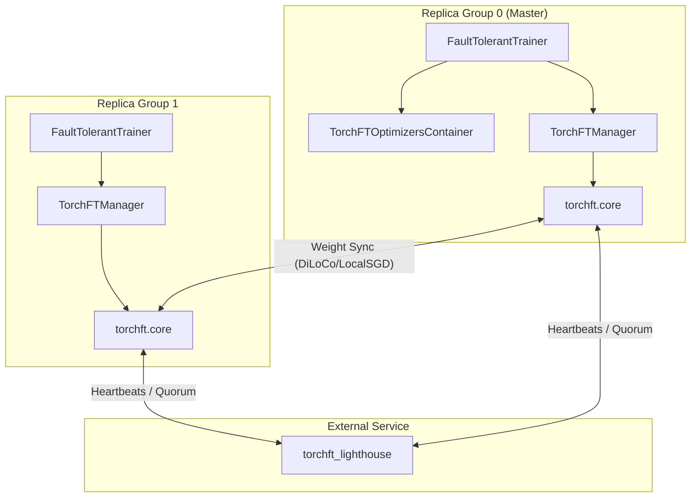

<!-- source: DeepWiki mcp.deepwiki.com · repo pytorch/torchtitan · page 10.6 Fault Tolerance Experiment (TorchFT) · fetched 2026-10-30 -->

# Fault Tolerance Experiment (TorchFT)

<details>
<summary>Relevant source files</summary>

The following files were used as context for generating this wiki page:

- [.github/CODEOWNERS](.github/CODEOWNERS)
- [tests/README.md](tests/README.md)
- [torchtitan/components/validate.py](torchtitan/components/validate.py)
- [torchtitan/experiments/forge/engine.py](torchtitan/experiments/forge/engine.py)
- [torchtitan/experiments/forge/example_train.py](torchtitan/experiments/forge/example_train.py)
- [torchtitan/experiments/graph_trainer/.claude/autodev.md](torchtitan/experiments/graph_trainer/.claude/autodev.md)
- [torchtitan/experiments/graph_trainer/.claude/nightly_scout.md](torchtitan/experiments/graph_trainer/.claude/nightly_scout.md)
- [torchtitan/experiments/torchft/README.md](torchtitan/experiments/torchft/README.md)
- [torchtitan/experiments/torchft/__init__.py](torchtitan/experiments/torchft/__init__.py)
- [torchtitan/experiments/torchft/checkpoint.py](torchtitan/experiments/torchft/checkpoint.py)
- [torchtitan/experiments/torchft/config/__init__.py](torchtitan/experiments/torchft/config/__init__.py)
- [torchtitan/experiments/torchft/trainer.py](torchtitan/experiments/torchft/trainer.py)
- [torchtitan/trainer.py](torchtitan/trainer.py)

</details>


The TorchFT experiment in `torchtitan` provides a PyTorch-native framework for fault-tolerant training using weight replication. It allows training to continue uninterrupted even if specific replica groups (e.g., a subset of nodes or a single machine) fail. This is achieved through integration with the [TorchFT library](https://github.com/pytorch/torchft), supporting both fully synchronous training and semi-synchronous algorithms like DiLoCo (Distributed Low-Communication).

### Overview and Architecture

In a standard `torchtitan` setup, a failure in any rank typically crashes the entire job, requiring a restart from the last saved checkpoint. The TorchFT experiment changes this by launching multiple independent `torchtitan` instances, referred to as **replica groups**.

*   **Replica Groups**: Each group maintains a full copy of the model weights (potentially sharded internally via FSDP/HSDP) [torchtitan/experiments/torchft/README.md:17-17]().
*   **TorchFT Lighthouse**: A central service that monitors the health of all replica groups and manages the quorum [torchtitan/experiments/torchft/README.md:30-34]().
*   **TorchFTManager**: The local component within each `torchtitan` process that communicates with the lighthouse and coordinates recovery [torchtitan/experiments/torchft/manager.py:25-25]().

#### System Component Interaction
The following diagram illustrates how the `FaultTolerantTrainer` interacts with the TorchFT infrastructure.


**Sources:** [torchtitan/experiments/torchft/README.md:1-25](), [torchtitan/experiments/torchft/trainer.py:34-40](), [torchtitan/experiments/torchft/optimizer.py:27-27]()

---

### Key Components

#### FaultTolerantTrainer
The `FaultTolerantTrainer` extends the standard `Trainer` to handle the lifecycle of a fault-tolerant job [torchtitan/experiments/torchft/trainer.py:34-34](). It initializes the `TorchFTManager` and ensures that training steps are synchronized across replicas.

*   **Initialization**: It sets up the `TorchFTManager` and adjusts data-parallel information (degree and rank) based on the replica configuration [torchtitan/experiments/torchft/trainer.py:58-70]().
*   **Metrics Integration**: It passes `ft_enable` and `ft_replica_id` to the `MetricsProcessor` to ensure logging is aware of the multi-replica setup [torchtitan/experiments/torchft/trainer.py:124-131]().
*   **Checkpointing**: Only the alive replica group with the smallest `replica_id` is responsible for performing checkpoint saves to avoid redundant I/O [torchtitan/experiments/torchft/README.md:53-54]().

#### TorchFTManager
The `TorchFTManager` is the primary interface between `torchtitan` and the `torchft` library. It manages:
1.  **Lighthouse Communication**: Sending heartbeats to `TORCHFT_LIGHTHOUSE` [torchtitan/experiments/torchft/README.md:54-56]().
2.  **Quorum Management**: Tracking which replicas are currently "alive".
3.  **Synchronization**: Triggering weight synchronization between replicas via `maybe_semi_sync_training` [torchtitan/experiments/torchft/manager.py:23-26]().

#### DiLoCo and Semi-Synchronous Training
TorchFT supports algorithms that do not require per-step synchronization. Replicas can train independently on different data and synchronize weights every $N$ steps [torchtitan/experiments/torchft/README.md:59-60]().

*   **Local SGD**: Periodically averages weights across replicas.
*   **DiLoCo**: A distributed optimization algorithm designed for poorly connected islands. It treats the inner optimizer steps as a "pseudo-gradient" for an outer optimizer.

**Batch Size Terminology in DiLoCo:**
| Term | Definition |
| :--- | :--- |
| **Global Batch Size** | The total batch size across all replica groups [torchtitan/experiments/torchft/README.md:66-66](). |
| **Inner Global Batch Size** | The batch size within a single replica group (Global Batch Size / Number of Replicas) [torchtitan/experiments/torchft/README.md:67-68](). |

**Sources:** [torchtitan/experiments/torchft/README.md:57-68](), [torchtitan/experiments/torchft/README.md:83-87]()

---

### Configuration and Execution

To run a fault-tolerant experiment, users must launch the `torchft_lighthouse` and then launch each replica group as a separate process (or set of processes).

#### Configuration Parameters
The experiment introduces specific configuration options under the `FaultTolerance` dataclass [torchtitan/experiments/torchft/config/job_config.py:22-22]():

| Parameter | Description |
| :--- | :--- |
| `enable` | Boolean to toggle TorchFT functionality [torchtitan/experiments/torchft/README.md:50-50](). |
| `group_size` | Total number of replica groups expected [torchtitan/experiments/torchft/README.md:51-51](). |
| `replica_id` | Unique ID (0 to group_size - 1) for the current instance [torchtitan/experiments/torchft/README.md:52-52](). |
| `sync_steps` | Number of training steps between replica synchronizations [torchtitan/experiments/torchft/README.md:85-85](). |
| `semi_sync_method` | The algorithm used for synchronization (e.g., `"diloco"`, `"local_sgd"`) [torchtitan/experiments/torchft/README.md:86-86](). |

#### Execution Example
To simulate a 2-replica setup on a single 8-GPU machine (4 GPUs per replica):

1.  **Start Lighthouse**:
    ```bash
    torchft_lighthouse --min_replicas 1 --quorum_tick_ms 100 --join_timeout_ms 10000
    ```
2.  **Launch Replica 0**:
    ```bash
    NGPU=4 CUDA_VISIBLE_DEVICES=0,1,2,3 MODULE=torchft.llama3 CONFIG=llama3_torchft_debugmodel ./run_train.sh --fault_tolerance.enable --fault_tolerance.replica_id=0 --fault_tolerance.group_size=2 --parallelism.data_parallel_shard_degree=4
    ```
3.  **Launch Replica 1**:
    ```bash
    NGPU=4 CUDA_VISIBLE_DEVICES=4,5,6,7 MODULE=torchft.llama3 CONFIG=llama3_torchft_debugmodel ./run_train.sh --fault_tolerance.enable --fault_tolerance.replica_id=1 --fault_tolerance.group_size=2 --parallelism.data_parallel_shard_degree=4
    ```

**Sources:** [torchtitan/experiments/torchft/README.md:30-45](), [torchtitan/experiments/torchft/README.md:47-56]()

---

### Data Flow and Recovery

The following diagram maps the recovery data flow from the `torchft_lighthouse` down to the `FaultTolerantTrainer`.

```mermaid
sequenceDiagram
    participant LH as torchft_lighthouse
    participant MG as TorchFTManager
    participant TR as FaultTolerantTrainer
    participant OPT as TorchFTOptimizersContainer

    Note over LH, OPT: Normal Training Loop
    TR->>MG: maybe_semi_sync_training(step)
    MG->>LH: heartbeat()
    LH-->>MG: status: OK
    MG-->>TR: proceed

    Note over LH, OPT: Replica 1 Fails
    LH->>LH: Detect Timeout
    TR->>MG: maybe_semi_sync_training(step)
    MG->>LH: heartbeat()
    LH-->>MG: status: RECOVERY_REQUIRED (New Quorum)
    MG->>TR: signal_recovery()
    TR->>OPT: handle_recovery()
    TR->>TR: resume_training()
```

#### Environment Variables
The system relies on several environment variables for coordination:
*   `TORCHFT_LIGHTHOUSE`: The URL of the lighthouse service (default: `http://localhost:29510`) [torchtitan/experiments/torchft/README.md:55-56]().
*   `TORCHFT_MANAGER_PORT`: Port for local manager communication [torchtitan/experiments/torchft/README.md:93-93]().
*   `REPLICA_GROUP_ID`: Identifier for the replica group [torchtitan/experiments/torchft/README.md:94-94]().

**Sources:** [torchtitan/experiments/torchft/README.md:90-97](), [torchtitan/experiments/torchft/manager.py:23-26]()

---

