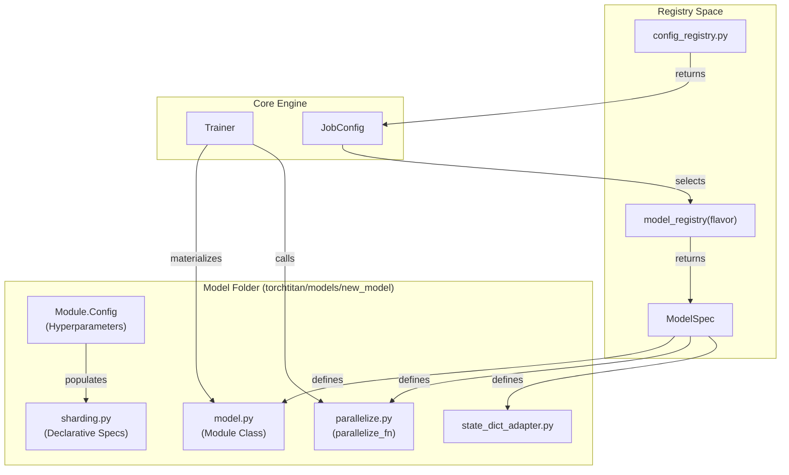
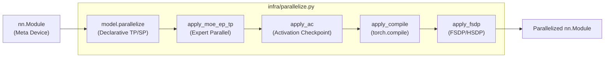

<!-- source: DeepWiki mcp.deepwiki.com · repo pytorch/torchtitan · page 13.1 Contributing New Models · fetched 2026-10-30 -->

# Contributing New Models

<details>
<summary>Relevant source files</summary>

The following files were used as context for generating this wiki page:

- [torchtitan/models/README.md](torchtitan/models/README.md)
- [torchtitan/models/common/config_utils.py](torchtitan/models/common/config_utils.py)
- [torchtitan/models/common/decoder_sharding.py](torchtitan/models/common/decoder_sharding.py)
- [torchtitan/models/deepseek_v3/__init__.py](torchtitan/models/deepseek_v3/__init__.py)
- [torchtitan/models/gpt_oss/__init__.py](torchtitan/models/gpt_oss/__init__.py)
- [torchtitan/models/llama3/__init__.py](torchtitan/models/llama3/__init__.py)
- [torchtitan/models/llama3/sharding.py](torchtitan/models/llama3/sharding.py)
- [torchtitan/models/qwen3/__init__.py](torchtitan/models/qwen3/__init__.py)
- [torchtitan/protocols/module.py](torchtitan/protocols/module.py)
- [torchtitan/protocols/sharding.py](torchtitan/protocols/sharding.py)

</details>


This page provides a step-by-step guide to implementing a new model architecture in torchtitan. Adding a model involves defining the architecture, its configuration, and its parallelization strategy, then registering it via the `ModelSpec` protocol.

## Overview

To support rapid experimentation, torchtitan uses a flexible component swapping system centered around `ModelSpec` [torchtitan/protocols/model_spec.py:1](). A new model contribution typically requires:

1.  **Model Definition**: A self-contained folder under `torchtitan/models/` containing the model class and architecture [torchtitan/models/README.md:9-10]().
2.  **Infrastructure**: Functions to apply PyTorch-native parallelization (TP, FSDP, CP, etc.) via declarative sharding or imperative plans [torchtitan/models/README.md:28-35]().
3.  **Registry**: Integration into the configuration system via `config_registry.py` and `model_registry` [torchtitan/models/README.md:40-53]().

**Diagram: Model Integration Architecture**


Sources: [torchtitan/models/README.md:9-53](), [torchtitan/protocols/model_spec.py:1]()

## 1. Model Architecture Requirements

### The Model Class
New models should reside in a dedicated folder (e.g., `torchtitan/models/llama3/`). The model class must:
*   Inherit from a base model, typically `Decoder` [torchtitan/models/README.md:13-14]().
*   Use a nested `Config` dataclass inheriting from `Module.Config` for architecture hyperparameters [torchtitan/protocols/module.py:53-54]().
*   Implement `__init__()` which consumes the `Config` to build the model [torchtitan/models/README.md:17]().

### Parameter Initialization
torchtitan uses a declarative `param_init` system [torchtitan/protocols/module.py:41-48]():
*   Define a `dict[str, Callable]` mapping parameter names to init functions (e.g., `_LINEAR_INIT`) [torchtitan/models/llama3/__init__.py:44-50]().
*   Set `param_init` on every sub-config in the model registry [torchtitan/models/README.md:18]().
*   `init_states()` auto-recurses into all submodules, so manual recursive calls are not needed [torchtitan/protocols/module.py:69-83]().
*   Override `_init_self_buffers()` for device-aware buffer initialization like RoPE or MoE caches [torchtitan/protocols/module.py:43-45]().

### Model Configuration (`Module.Config`)
The nested `Config` class must provide:
*   `update_from_config(job_config)`: Syncs model settings with global training configs like `seq_len` and hardware-specific settings [torchtitan/models/README.md:16]().
*   `get_nparams_and_flops()`: Returns model size and compute throughput metrics [torchtitan/models/README.md:15]().

Sources: [torchtitan/models/README.md:10-20](), [torchtitan/protocols/module.py:37-94]()

## 2. Parallelization and Sharding

torchtitan has transitioned to a declarative sharding system where parallelization specs are attached to the configuration before the model is materialized.

### Declarative Sharding (`sharding.py`)
Define a function (e.g., `set_llama3_sharding_config`) that populates `sharding_config` on each `Module.Config` [torchtitan/models/llama3/sharding.py:25-30]().
*   **TP/SP**: Expressed via `SpmdLayout` keyed by `MeshAxisName` (DP, CP, TP) [torchtitan/models/common/decoder_sharding.py:14-17]().
*   **Reuse**: Utilize shared helpers from `decoder_sharding.py` such as `set_gqa_attention_sharding` or `set_dense_ffn_sharding` [torchtitan/models/common/decoder_sharding.py:132-141]().
*   **LocalMap**: For attention kernels that require local tensors, use `set_gqa_inner_attention_local_map` [torchtitan/models/common/decoder_sharding.py:167-191]().

### Parallelization Pipeline (`parallelize.py`)
This file implements the `parallelize_fn` required by `ModelSpec`. Techniques must be applied in this specific order [torchtitan/models/README.md:33-39]():

1.  **`model.parallelize(parallel_dims)`**: Triggers auto-recursive declarative sharding based on the `sharding_config` populated earlier [torchtitan/models/README.md:34]().
2.  **MoE Parallelism**: Apply `apply_moe_ep_tp` for expert-parallel + TP on experts [torchtitan/models/README.md:35]().
3.  **Activation Checkpointing (AC)**: Reducing memory footprint.
4.  **torch.compile**: Optimizing execution kernels.
5.  **Data Parallelism (FSDP/HSDP)**: Sharding parameters across the mesh.

**Diagram: Parallelization Data Flow**


Sources: [torchtitan/models/README.md:33-39](), [torchtitan/models/llama3/parallelize.py:1]()

## 3. Registration and Integration

### `ModelSpec` Implementation
The `__init__.py` of the model folder must define a `model_registry(flavor)` function [torchtitan/models/README.md:44-51](). It returns a `ModelSpec` containing:
*   **Model name and flavor**: e.g., "llama3", "8b".
*   **Model config**: A `Model.Config` dataclass instance.
*   **Functions**: `parallelize_fn` and optional `pipeline_fn` [torchtitan/models/llama3/__init__.py:31]().
*   **State Dict Adapter**: An instance of `BaseStateDictAdapter` to handle format conversion for checkpoints (e.g., HuggingFace) [torchtitan/models/llama3/state_dict_adapter.py:1]().

### `config_registry.py`
This file defines specific training recipes. Each function returns a `Trainer.Config` instance [torchtitan/models/README.md:52-56]().
*   Recipes are selected via `--module <model_name> --config <function_name>` [torchtitan/models/README.md:56]().
*   Common patterns include `debugmodel`, `1b`, `8b`, etc., often with variants for `flex_attn` or `float8` [torchtitan/models/llama3/__init__.py:110-171]().

**Example Config Structure:**
| Model Family | Registry Functions | File Path |
| :--- | :--- | :--- |
| **Llama 3** | `_debugmodel`, `_1b`, `_8b`, `_70b` | [torchtitan/models/llama3/__init__.py:110-211]() |
| **DeepSeek-V3** | `_debugmodel`, `_671b` | [torchtitan/models/deepseek_v3/__init__.py:196-230]() |
| **Qwen 3** | `_debugmodel`, `_debugmodel_fused_qkv` | [torchtitan/models/qwen3/__init__.py:187-224]() |

## Summary Checklist

| Component | File/Location | Requirement |
| :--- | :--- | :--- |
| **Model Code** | `model.py` | Single-device code, inherit `Decoder`, nested `Config` [torchtitan/models/README.md:10-14]() |
| **Sharding** | `sharding.py` | Declarative `SpmdLayout` for TP/SP/CP [torchtitan/models/README.md:27-32]() |
| **Parallelism** | `parallelize.py` | Order: `parallelize()` -> MoE -> AC -> Compile -> FSDP [torchtitan/models/README.md:33-39]() |
| **Adapter** | `state_dict_adapter.py` | Inherit `BaseStateDictAdapter` for checkpoint interop [torchtitan/models/README.md:20-26]() |
| **Spec** | `__init__.py` | `model_registry` returning `ModelSpec` [torchtitan/models/README.md:42-51]() |
| **Recipes** | `config_registry.py` | Functions returning `Trainer.Config` [torchtitan/models/README.md:52-56]() |

To run the new model:
```bash
# Example for Llama 3 8B
MODULE=llama3 CONFIG=llama3_8b ./run_train.sh
```
Sources: [torchtitan/models/README.md:56]()

---

