# Page: Overview

# Overview

<details>
<summary>Relevant source files</summary>

The following files were used as context for generating this wiki page:

- [CONTRIBUTING.md](CONTRIBUTING.md)
- [README.md](README.md)
- [docs/composability.md](docs/composability.md)
- [docs/extension.md](docs/extension.md)
- [torchtitan/__init__.py](torchtitan/__init__.py)
- [torchtitan/experiments/README.md](torchtitan/experiments/README.md)
- [torchtitan/experiments/__init__.py](torchtitan/experiments/__init__.py)
- [torchtitan/models/__init__.py](torchtitan/models/__init__.py)

</details>


`torchtitan` is a PyTorch-native platform for large-scale training of generative AI models, specifically designed for rapid experimentation and production-scale deployment. It provides a minimal, clean-room implementation of distributed training techniques with flexible extension points for customization. The platform emphasizes ease of understanding, minimal changes to model code, and a bias towards a clean codebase with reusable and swappable components [README.md:32-42]().

For detailed information about specific subsystems, see:
- Architecture details: [Architecture Overview](#1.1)
- Setup and execution: [Installation and Quick Start](#1.2)
- Configuration details: [Configuration System](#2)
- Training loop internals: [Core Training Engine](#3)
- Parallelization techniques: [Parallelization Strategies](#4)
- Model implementations: [Model System](#5)
- Checkpointing: [Checkpoint Management](#6)

**Sources:** [README.md:32-43](), [torchtitan/train.py:39-71]()

## System Architecture

The following diagram maps the major system components to their code entities, bridging the gap between high-level concepts and the implementation.

### System Mapping: Components to Code Entities

```mermaid
graph TB
    subgraph "Entry Point"
        main["main()<br/>torchtitan/train.py:727-776"]
        ConfigMgr["ConfigManager<br/>torchtitan/config/manager.py"]
        run_train["run_train.sh"]
    end
    
    subgraph "Core Training Orchestration"
        Trainer["Trainer<br/>torchtitan/train.py:39-725"]
        JobConfig["JobConfig<br/>torchtitan/config/job_config.py"]
        TrainSpec["TrainSpec Protocol<br/>torchtitan/protocols/train_spec.py"]
    end
    
    subgraph "Distributed Infrastructure"
        ParallelDims["ParallelDims<br/>torchtitan/distributed/parallel_dims.py:19-371"]
        init_distributed["init_distributed()<br/>torchtitan/distributed/utils.py:297-363"]
        DeviceMesh["DeviceMesh<br/>torch.distributed.device_mesh"]
    end
    
    subgraph "Model & Parallelization"
        model_cls["model_cls<br/>from TrainSpec"]
        parallelize_fn["parallelize_fn<br/>from TrainSpec"]
        pipelining_fn["pipelining_fn<br/>from TrainSpec"]
        ModelConverters["ModelConverters<br/>torchtitan/protocols/model_converter.py"]
    end
    
    subgraph "Training Components"
        OptimizersContainer["OptimizersContainer<br/>torchtitan/components/optimizer.py:41-132"]
        LRSchedulersContainer["LRSchedulersContainer<br/>torchtitan/components/lr_scheduler.py"]
        BaseDataLoader["BaseDataLoader<br/>from TrainSpec"]
        LossFunction["LossFunction<br/>from TrainSpec"]
    end
    
    subgraph "State Management"
        CheckpointManager["CheckpointManager<br/>torchtitan/components/checkpoint.py"]
        FTManager["FTManager<br/>torchtitan/components/ft.py"]
    end
    
    subgraph "Monitoring"
        MetricsProcessor["MetricsProcessor<br/>torchtitan/components/metrics.py"]
        Validator["Validator<br/>from TrainSpec"]
    end
    
    run_train --> main
    main --> ConfigMgr
    ConfigMgr --> JobConfig
    main --> Trainer
    
    Trainer --> JobConfig
    Trainer --> TrainSpec
    Trainer --> ParallelDims
    Trainer --> init_distributed
    
    ParallelDims --> DeviceMesh
    init_distributed --> DeviceMesh
    
    Trainer --> model_cls
    Trainer --> parallelize_fn
    Trainer --> pipelining_fn
    Trainer --> ModelConverters
    
    Trainer --> OptimizersContainer
    Trainer --> LRSchedulersContainer
    Trainer --> BaseDataLoader
    Trainer --> LossFunction
    
    Trainer --> CheckpointManager
    Trainer --> FTManager
    Trainer --> MetricsProcessor
    Trainer --> Validator
```

**Sources:** [torchtitan/train.py:39-71](), [torchtitan/train.py:727-776](), [torchtitan/config/job_config.py:1-617](), [torchtitan/distributed/parallel_dims.py:18-371]()

## Core Components

### Trainer Class
The `Trainer` class ([torchtitan/train.py:39-725]()) is the central orchestrator that manages the entire training lifecycle. It is a `Stateful` object that coordinates distributed initialization, model building, parallelization, and the training loop. For details on the internal logic of the training loop and lifecycle, see [Core Training Engine](#3).

### Configuration System
The `JobConfig` dataclass ([torchtitan/config/job_config.py:17-617]()) provides a hierarchical configuration structure. Configuration sources are parsed in order: TOML files → environment variables → CLI arguments, with later sources overriding earlier ones. For a full breakdown of configuration sections, see [Configuration System](#2).

### ParallelDims and Device Mesh
The `ParallelDims` class ([torchtitan/distributed/parallel_dims.py:19-371]()) manages device mesh creation for N-dimensional parallelism (DP, TP, PP, CP, EP). It translates configuration degrees into a structured `DeviceMesh` for distributed operations. For details on how these dimensions are composed, see [Parallelization Strategies](#4).

**Sources:** [torchtitan/train.py:39-71](), [torchtitan/config/job_config.py:17-617](), [torchtitan/distributed/parallel_dims.py:19-371]()

## Training Workflow

The high-level execution flow starts from the CLI and proceeds through environment setup to the iterative training loop.

### Lifecycle: From Launch to Training Step

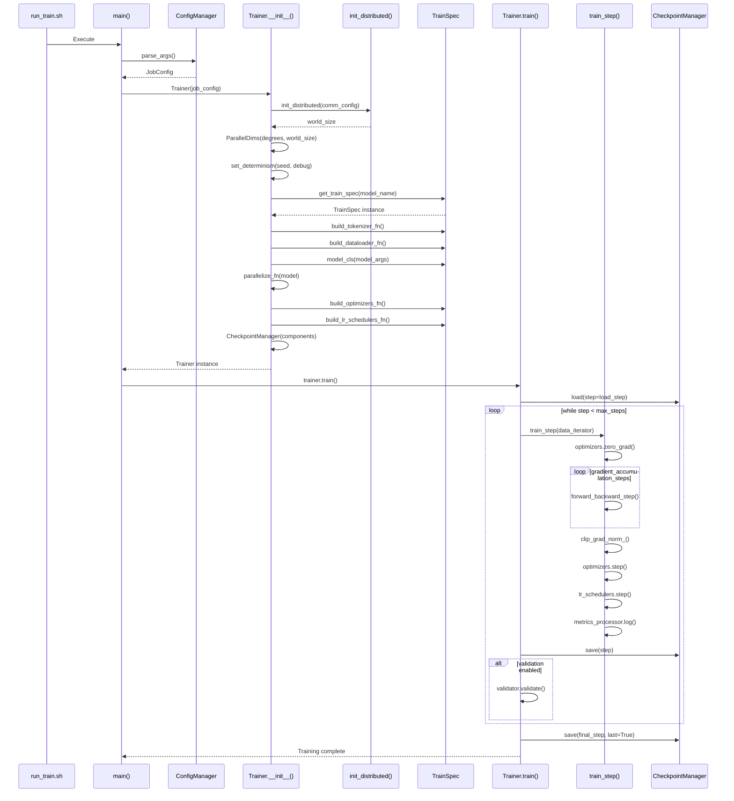

**Sources:** [torchtitan/train.py:727-776](), [torchtitan/train.py:74-368](), [torchtitan/train.py:621-709](), [torchtitan/train.py:551-619]()

## Extension Points

`torchtitan` provides flexibility through the `TrainSpec` protocol and `ModelSpec` system, which define swappable components for different model architectures and training paradigms [docs/extension.md:6-15]().

| Component | Protocol/Class | Purpose |
|-----------|----------------|---------|
| Model Architecture | `ModelSpec` | Defines model class, config, and parallelization [torchtitan/protocols/model_spec.py:1-20]() |
| Model Conversion | `ModelConverter` | Module rewriting (e.g., Float8) before parallelization |
| Data Pipeline | `BaseDataLoader` | Stateful data iteration |
| Checkpoint | `BaseStateDictAdapter` | Interoperability with other formats (e.g., HF) |

To add a new model, implement the `ModelSpec` protocol and register it via `model_registry`. For detailed guides, see [Model System](#5) and [Extension and Development](#13).

**Sources:** [docs/extension.md:6-24](), [README.md:34-36](), [torchtitan/models/__init__.py:7-9]()

## Key Design Principles

1.  **PyTorch Native**: All parallelization uses PyTorch distributed APIs (DTensor, DeviceMesh, FSDP2, etc.) rather than external frameworks [README.md:5-12]().
2.  **Minimal Model Changes**: Models remain standard `nn.Module` classes; parallelization is applied via external transformation functions [README.md:38-41]().
3.  **Clean Codebase**: Bias towards readability and simplicity over feature completeness [docs/composability.md:1-2]().
4.  **Swappable Components**: The `TrainSpec` and `ModelConverter` protocols enable easy experimentation without modifying the core training engine [docs/extension.md:1-5]().
5.  **Stateful Resumption**: All core components implement the `Stateful` protocol for robust checkpoint/resume [torchtitan/train.py:39]().

## File Structure Overview

- `torchtitan/train.py`: Main `Trainer` class and entry point [torchtitan/train.py:39-71]().
- `torchtitan/config/`: Configuration system (`JobConfig`, `ConfigManager`) [torchtitan/config/job_config.py:17-617]().
- `torchtitan/distributed/`: Distributed utilities (`ParallelDims`, device mesh, NCCL utils) [torchtitan/distributed/parallel_dims.py:19-371]().
- `torchtitan/protocols/`: Protocol definitions (`ModelSpec`, `ModelConverter`) [torchtitan/protocols/model_spec.py:1-20]().
- `torchtitan/components/`: Reusable components (checkpoint, optimizer, metrics, etc.) [torchtitan/components/checkpoint.py:1-50]().
- `torchtitan/models/`: Model implementations (Llama 3/4, DeepSeek, etc.) [torchtitan/models/__init__.py:7-9]().
- `torchtitan/experiments/`: Experimental features and new training paradigms [torchtitan/experiments/README.md:1-23]().
- `run_train.sh`: Single-node training launcher script [torchtitan/train.py:727-776]().

**Sources:** [README.md:84-93](), [torchtitan/experiments/README.md:1-23]()

---

# Page: Architecture Overview

# Architecture Overview

<details>
<summary>Relevant source files</summary>

The following files were used as context for generating this wiki page:

- [CONTRIBUTING.md](CONTRIBUTING.md)
- [README.md](README.md)
- [docs/composability.md](docs/composability.md)
- [docs/extension.md](docs/extension.md)
- [torchtitan/__init__.py](torchtitan/__init__.py)
- [torchtitan/components/validate.py](torchtitan/components/validate.py)
- [torchtitan/experiments/README.md](torchtitan/experiments/README.md)
- [torchtitan/experiments/__init__.py](torchtitan/experiments/__init__.py)
- [torchtitan/experiments/forge/engine.py](torchtitan/experiments/forge/engine.py)
- [torchtitan/experiments/forge/example_train.py](torchtitan/experiments/forge/example_train.py)
- [torchtitan/experiments/torchft/trainer.py](torchtitan/experiments/torchft/trainer.py)
- [torchtitan/models/__init__.py](torchtitan/models/__init__.py)
- [torchtitan/trainer.py](torchtitan/trainer.py)

</details>


## Purpose and Scope

This document describes the high-level system architecture of **torchtitan**, a PyTorch-native platform for large-scale generative AI training. It explains the major architectural components, their responsibilities, and how they interact to orchestrate distributed training. 

TorchTitan is designed around three core principles:
1. **Easy to understand and extend** - Minimal abstractions with clear component boundaries [README.md:39]().
2. **Minimal model changes** - Apply multi-dimensional parallelism without extensive model rewrites [README.md:40]().
3. **Clean, reusable components** - Swappable implementations via protocol-based design [README.md:41]().

## System Architecture Overview

The architecture centers on the `Trainer` class, which orchestrates all training subsystems. The system follows a compositional design where configuration flows from `ConfigManager`, components are built via `Configurable.build()`, and parallelism is managed through `ParallelDims`.

### High-Level Component Diagram

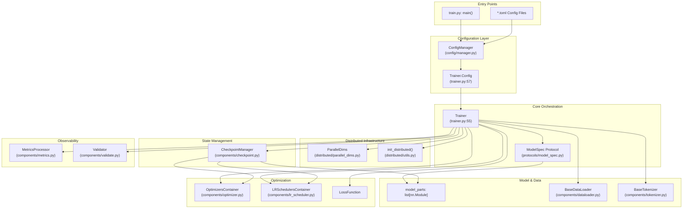

**Sources:** [torchtitan/train.py:16-68](), [torchtitan/trainer.py:55-103](), [torchtitan/distributed/parallel_dims.py:19-35]()

---

## Core Architecture Components

### Trainer Class

The `Trainer` class is the central orchestrator defined at [torchtitan/trainer.py:55](). It implements the `torch.distributed.checkpoint.stateful.Stateful` protocol for checkpointing and the `Configurable` protocol for initialization.

**Key Responsibilities:**
- Initialize the distributed environment via `init_distributed` [torchtitan/trainer.py:192]().
- Build and parallelize model components using `ModelSpec` [torchtitan/trainer.py:246]().
- Coordinate the training loop execution, including gradient accumulation [torchtitan/trainer.py:567]().
- Manage checkpointing, metrics collection, and validation [torchtitan/trainer.py:321-365]().

**Core Attributes:**

| Attribute | Type | Purpose |
|-----------|------|---------|
| `config` | `Trainer.Config` | Hierarchical configuration for the job [torchtitan/trainer.py:57-103]() |
| `parallel_dims` | `ParallelDims` | Manages N-D parallelism degrees and device meshes [torchtitan/distributed/parallel_dims.py:19]() |
| `model_parts` | `list[nn.Module]` | Model components (single or per-PP-stage) [torchtitan/trainer.py:170]() |
| `optimizers` | `OptimizersContainer` | Multi-optimizer management for PP/EP [torchtitan/components/optimizer.py:41]() |
| `lr_schedulers` | `LRSchedulersContainer` | Learning rate scheduling [torchtitan/components/lr_scheduler.py:18]() |
| `checkpointer` | `CheckpointManager` | State persistence and recovery [torchtitan/components/checkpoint.py:34]() |
| `metrics_processor` | `MetricsProcessor` | Logging and throughput calculation [torchtitan/components/metrics.py:228]() |

**Sources:** [torchtitan/trainer.py:55-185](), [torchtitan/components/metrics.py:228-251]()

### ModelSpec Protocol

The `ModelSpec` protocol defines how models are registered and built. It separates the model architecture from the training infrastructure [docs/extension.md:6-15]().

**Interface and Lifecycle:**
1. **Model Selection**: The user selects a model (e.g., `llama3`) via configuration [torchtitan/trainer.py:64]().
2. **Configuration**: `ModelSpec.model` provides a `BaseModel.Config` which is updated from the `Trainer.Config` [torchtitan/trainer.py:204-207]().
3. **Materialization**: The model is first built on the **meta device** to save memory [torchtitan/trainer.py:211-215]().
4. **Parallelization**: `ModelSpec.parallelize` is called to apply TP, CP, AC, and FSDP [torchtitan/trainer.py:246]().

**Sources:** [torchtitan/protocols/model_spec.py:13-36](), [torchtitan/trainer.py:198-250]()

### ParallelDims and Device Mesh

`ParallelDims` manages the complexity of multi-dimensional parallelism. It ensures that the product of all degrees matches the total `world_size` [torchtitan/distributed/parallel_dims.py:19-35]().

**Device Mesh Hierarchy:**
Torchtitan builds specialized meshes for different components:
- **`batch` mesh**: For data parallelism (FSDP/DDP).
- **`tp` mesh**: For tensor parallelism.
- **`cp` mesh**: For context parallelism.
- **`pp` mesh**: For pipeline parallelism.
- **`loss` mesh**: A combination of `batch` and `cp` ranks to ensure loss visibility [torchtitan/distributed/parallel_dims.py:225-230]().

**Sources:** [torchtitan/distributed/parallel_dims.py:19-125](), [torchtitan/distributed/parallel_dims.py:220-235]()

---

## Training Execution Flow

### Trainer Initialization Flow

```mermaid
sequenceDiagram
    participant Main as train.py: main()
    participant CM as ConfigManager
    participant T as Trainer.build()
    participant ID as init_distributed()
    participant PD as ParallelDims
    participant MS as ModelSpec
    participant Par as ModelSpec.parallelize()
    
    Main->>CM: parse_args()
    CM-->>Main: Trainer.Config
    Main->>T: config.build()
    
    T->>ID: init_distributed(comm_config)
    
    T->>PD: ParallelDims(degrees, world_size)
    PD->>PD: build_mesh()
    
    T->>MS: model_config.build() (Meta Device)
    
    T->>Par: MS.parallelize(model, parallel_dims, ...)
    Note over Par: TP -> CP -> AC -> Compile -> FSDP
    
    T->>T: build_optimizers()
    T->>T: build_lr_schedulers()
    T->>T: build_checkpointer()
```

**Sources:** [torchtitan/train.py:41](), [torchtitan/trainer.py:187-368](), [torchtitan/distributed/utils.py:297-320]()

### Step Execution Logic

The `train()` method executes the main loop [torchtitan/trainer.py:475](). For each step, it calls `train_step()` which handles:
1. **Data Loading**: Fetches the next batch from the `BaseDataLoader` [torchtitan/trainer.py:551]().
2. **Gradient Accumulation**: Iterates over microbatches if `gradient_accumulation_steps > 1` [torchtitan/trainer.py:567]().
3. **Forward/Backward**:
    - If Pipeline Parallel (PP) is enabled, it uses `pp_schedule.step()` [torchtitan/trainer.py:506]().
    - Otherwise, it performs a standard `model(input).backward()` [torchtitan/trainer.py:540-547]().
4. **Optimization**: Applies gradient clipping and calls `optimizers.step()` [torchtitan/trainer.py:596-602]().

**Sources:** [torchtitan/trainer.py:475-619](), [torchtitan/trainer.py:621-709]()

---

## Experimental Framework

Torchtitan includes an `experiments/` directory for developing new features without impacting the core stable trainer [torchtitan/experiments/README.md:1-5]().

### ForgeEngine
`ForgeEngine` is a stripped-down, reusable base class for custom training loops [torchtitan/experiments/forge/engine.py:34](). It provides the same distributed and parallelization setup as `Trainer` but allows developers to define their own `batch_generator` and `train` logic [torchtitan/experiments/forge/example_train.py:143]().

- **Base Class**: [torchtitan/experiments/forge/engine.py:34]()
- **Example Implementation**: [torchtitan/experiments/forge/example_train.py:31]()

### Validator System
The `Validator` class [torchtitan/components/validate.py:53]() provides a pluggable way to run evaluation during training.
- It uses a separate `validation_dataloader` [torchtitan/components/validate.py:122]().
- It executes a forward-only pass within a `validation_context` [torchtitan/components/validate.py:127]().
- **Base Interface**: [torchtitan/components/validate.py:33]()

**Sources:** [torchtitan/experiments/forge/engine.py:34-95](), [torchtitan/components/validate.py:53-137](), [torchtitan/experiments/README.md:23-32]()

---

## Observability and Monitoring

### MetricsProcessor
The `MetricsProcessor` [torchtitan/components/metrics.py:228]() calculates critical performance metrics:
- **Throughput**: Tokens per second (TPS).
- **Compute**: TFLOPS and Model Flops Utilization (MFU).
- **Memory**: Peak active and reserved memory via `DeviceMemoryMonitor` [torchtitan/components/metrics.py:39]().

### Garbage Collection
To prevent stragglers in distributed training caused by asynchronous Python GC, Torchtitan uses a `GarbageCollection` handler [torchtitan/tools/utils.py:46](). It disables automatic GC and triggers manual collection at a configured frequency [torchtitan/tools/utils.py:59-67]().

**Sources:** [torchtitan/components/metrics.py:39-90](), [torchtitan/components/metrics.py:228-350](), [torchtitan/tools/utils.py:46-74]()

---

# Page: Installation and Quick Start

# Installation and Quick Start

<details>
<summary>Relevant source files</summary>

The following files were used as context for generating this wiki page:

- [.ci/docker/README.md](.ci/docker/README.md)
- [.ci/docker/build.sh](.ci/docker/build.sh)
- [.ci/docker/common/install_base.sh](.ci/docker/common/install_base.sh)
- [.ci/docker/common/install_clang.sh](.ci/docker/common/install_clang.sh)
- [.ci/docker/common/install_conda.sh](.ci/docker/common/install_conda.sh)
- [.ci/docker/common/install_deepep.sh](.ci/docker/common/install_deepep.sh)
- [.ci/docker/common/install_gcc.sh](.ci/docker/common/install_gcc.sh)
- [.ci/docker/common/install_user.sh](.ci/docker/common/install_user.sh)
- [.ci/docker/common/utils.sh](.ci/docker/common/utils.sh)
- [.ci/docker/conda-env-ci.txt](.ci/docker/conda-env-ci.txt)
- [.ci/docker/requirements-transformers-modeling-backend.txt](.ci/docker/requirements-transformers-modeling-backend.txt)
- [.ci/docker/requirements.txt](.ci/docker/requirements.txt)
- [.ci/docker/ubuntu/Dockerfile](.ci/docker/ubuntu/Dockerfile)
- [.flake8](.flake8)
- [.github/workflows/lint.yaml](.github/workflows/lint.yaml)
- [.github/workflows/release.yml](.github/workflows/release.yml)
- [.gitignore](.gitignore)
- [.pre-commit-config.yaml](.pre-commit-config.yaml)
- [pyproject.toml](pyproject.toml)
- [requirements.txt](requirements.txt)
- [tests/unit_tests/test_loss.py](tests/unit_tests/test_loss.py)
- [torchtitan/components/loss.py](torchtitan/components/loss.py)
- [torchtitan/experiments/graph_trainer/chunked_loss.py](torchtitan/experiments/graph_trainer/chunked_loss.py)
- [torchtitan/experiments/graph_trainer/tests/test_chunked_loss.py](torchtitan/experiments/graph_trainer/tests/test_chunked_loss.py)
- [torchtitan/experiments/transformers_modeling_backend/README.md](torchtitan/experiments/transformers_modeling_backend/README.md)
- [torchtitan/experiments/transformers_modeling_backend/__init__.py](torchtitan/experiments/transformers_modeling_backend/__init__.py)

</details>


This document provides step-by-step instructions for installing torchtitan, setting up your environment, and running your first training job. Three installation methods are supported: from source (recommended for development), nightly builds, and stable releases.

For configuration management details, see page 2. For advanced training options and multi-node setup, see page 11.

## Installation Methods Overview

torchtitan supports three installation methods depending on your use case:

| Method | Use Case | PyTorch Version | Installation Time |
|--------|----------|-----------------|-------------------|
| **From Source** | Development, latest features | Nightly or from source | ~2-5 minutes |
| **Nightly Build** | Latest stable features | Nightly | ~1-2 minutes |
| **Stable Release** | Production, stability | Pinned nightly | ~1-2 minutes |

**Installation Method Selection Diagram**

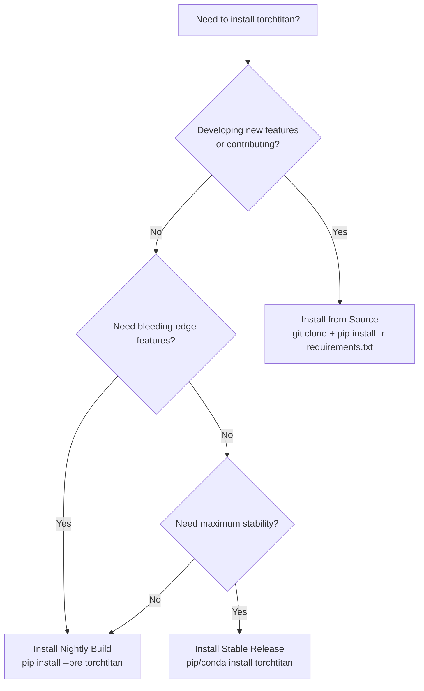

Sources: `pyproject.toml:1-60`(), `requirements.txt:1-11`()

## Prerequisites

Before installing torchtitan, ensure your environment meets these requirements:

| Requirement | Specification | Notes |
|-------------|---------------|-------|
| **Python** | >= 3.10 | Required by `pyproject.toml` [pyproject.toml:6]() |
| **PyTorch** | Nightly recommended | Required for latest distributed features |
| **CUDA** | 13.0 recommended | CI uses CUDA 13.0 [pyproject.toml:60]() |
| **GPUs** | 1+ GPUs | Supports single-node or multi-node distributed training |
| **Operating System** | Linux | Standard CI environment is Ubuntu 22.04 [.ci/docker/build.sh:25]() |

Sources: `pyproject.toml:6`(), `.ci/docker/build.sh:25`()

## Installation Method 1: From Source

Installing from source is recommended for development and to access the latest features. This method requires PyTorch nightly or PyTorch built from source.

### Step-by-Step Installation

**1. Clone the Repository**
```bash
git clone https://github.com/pytorch/torchtitan
cd torchtitan
```

**2. Install Dependencies**
```bash
pip install -r requirements.txt
```

The `requirements.txt` file includes core dependencies:
- `torchdata>=0.8.0` [requirements.txt:1]() - Stateful dataloader for checkpointing
- `datasets>=3.6.0` [requirements.txt:2]() - HuggingFace dataset integration
- `tokenizers>=0.15.0` [requirements.txt:7]() - Text tokenization
- `tyro>=1.0.5` [requirements.txt:6]() - CLI argument parsing
- `tensorboard` & `wandb` [requirements.txt:3-4]() - Training metrics visualization
- `einops` & `safetensors` [requirements.txt:8-9]() - Model and tensor utilities
- `spmd_types==0.2.1` [requirements.txt:11]() - Type checking for distributed operations

**3. Verify Installation**
```bash
# Check that torchtitan can be imported
python -c "import torchtitan"

# Run a quick unit test
pytest tests/unit_tests/test_loss.py
```

**Installation Flow Diagram**

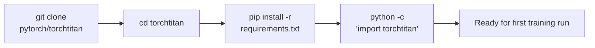

Sources: `pyproject.toml:12-29`(), `requirements.txt:1-12`()

## Installation Method 2: Nightly Builds

Nightly builds provide pre-packaged versions with the latest stable features. This method automatically installs PyTorch nightly.

### Installation Commands

**For CUDA 13.0:**
```bash
pip3 install --pre torch --index-url https://download.pytorch.org/whl/nightly/cu130 --force-reinstall
pip install --pre torchtitan --index-url https://download.pytorch.org/whl/nightly/cu130
```

The `--pre` flag enables pre-release versions (nightly builds), and `--force-reinstall` ensures PyTorch nightly is installed even if a stable version exists.

Sources: `.github/workflows/lint.yaml:60`()

## Installation Method 3: Stable Releases

Stable releases are pinned to specific PyTorch versions and provide maximum stability. Available via pip.

### Via pip
```bash
pip install torchtitan
```

Sources: `pyproject.toml:3`(), `.github/workflows/release.yml:39`()

## Quick Start: Running Your First Training Job

### Single-Node Training (8 GPUs)

The simplest way to start training is using a model configuration on a single node using the `run_train.sh` script.

**Debug Model (Fast Iteration)**
```bash
# Set environment variables and run
CONFIG_FILE="./torchtitan/models/llama3/train_configs/debug_model.toml" ./run_train.sh
```

**Understanding Training Output**
When you launch training, you'll see output metrics like loss, memory usage, and throughput. torchtitan implements a specialized `cross_entropy_loss` [torchtitan/components/loss.py:28]() that handles token-based normalization correctly across distributed ranks.

**Training Script Components**

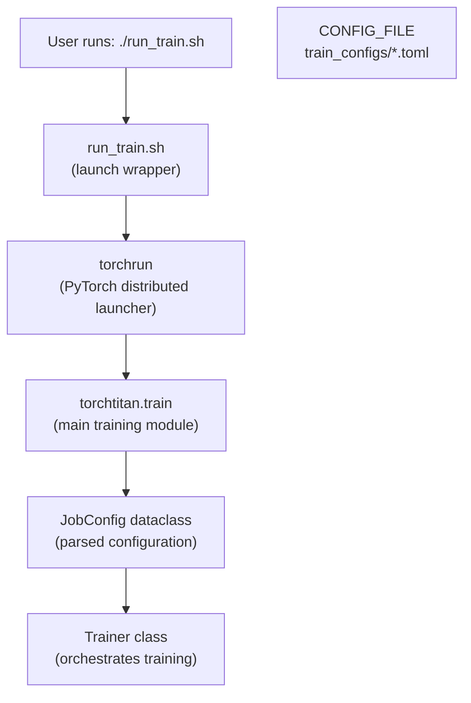

Sources: `torchtitan/components/loss.py:28-39`(), `tests/unit_tests/test_loss.py:38-45`()

## Docker Setup

For consistent environments, torchtitan provides Docker build scripts supporting both NVIDIA (CUDA) and AMD (ROCm) platforms.

### Building the Image
```bash
# Build the Ubuntu 22.04 image
./.ci/docker/build.sh torchtitan-ubuntu-22.04-clang12 -t my_torchtitan:latest
```

### Dockerfile Structure
The Docker setup in `.ci/docker/ubuntu/Dockerfile` [.ci/docker/ubuntu/Dockerfile:1-47]() follows a modular structure:
- **Base Layers**: Installs system dependencies via `install_base.sh` [.ci/docker/ubuntu/Dockerfile:11]().
- **Compilers**: Sets up Clang and GCC [.ci/docker/ubuntu/Dockerfile:16-21]().
- **Python Environment**: Uses Miniconda to manage the environment and installs dependencies from `requirements.txt` [.ci/docker/ubuntu/Dockerfile:33-40]().
- **Expert Parallelism**: Optionally installs `DeepEP` for MoE training [.ci/docker/ubuntu/Dockerfile:43]().

Sources: `.ci/docker/build.sh:23-37`(), `.ci/docker/ubuntu/Dockerfile:1-47]()

## Development and Testing

### Installing Development Dependencies
To contribute or run the full test suite, install the `dev` optional dependencies defined in `pyproject.toml` [pyproject.toml:37-44]():
```bash
pip install -e ".[dev]"
```
This installs `pytest`, `pytest-cov`, `pre-commit`, and `pyrefly` for type checking.

### Linting and Pre-commit
torchtitan uses `pre-commit` to enforce code quality. Key hooks include:
- `ufmt`: Formats code using `black` and `usort` [.pre-commit-config.yaml:41-44]().
- `flake8`: Checks for PEP8 compliance and common bugs [.pre-commit-config.yaml:29-32]().
- `pyrefly`: Performs static type checking [.pre-commit-config.yaml:67-70]().
- `lychee`: Validates hyperlinks in documentation [.pre-commit-config.yaml:80]().

### Running Tests
| Test Category | Command | File Reference |
|-----------|---------|---------|
| **Loss Functions** | `pytest tests/unit_tests/test_loss.py` | `tests/unit_tests/test_loss.py` |
| **CI Linting** | `pre-commit run --all-files` | `.pre-commit-config.yaml` |

Sources: `pyproject.toml:37-44`(), `.pre-commit-config.yaml:1-118`(), `.github/workflows/lint.yaml:15-78`()

## Summary of Key Files

| File Path | Description |
|-----------|-------------|
| `pyproject.toml` | Project metadata and dependency definitions [pyproject.toml:1-60]() |
| `requirements.txt` | Runtime dependencies for pip and Docker [.ci/docker/requirements.txt:1-12]() |
| `.ci/docker/build.sh` | Orchestration script for Docker image creation [.ci/docker/build.sh:1-50]() |
| `torchtitan/components/loss.py` | Implementation of distributed Cross Entropy loss [torchtitan/components/loss.py:28]() |
| `.pre-commit-config.yaml` | Configuration for local and CI linting tools [.pre-commit-config.yaml:1-118]() |

Sources: `pyproject.toml:1-60`(), `requirements.txt:1-12`(), `.ci/docker/build.sh:1-50`()

---

# Page: Configuration System

# Configuration System

<details>
<summary>Relevant source files</summary>

The following files were used as context for generating this wiki page:

- [tests/unit_tests/test_config_manager.py](tests/unit_tests/test_config_manager.py)
- [tests/unit_tests/test_configurable.py](tests/unit_tests/test_configurable.py)
- [tests/unit_tests/test_override.py](tests/unit_tests/test_override.py)
- [torchtitan/config/OVERRIDE.md](torchtitan/config/OVERRIDE.md)
- [torchtitan/config/__init__.py](torchtitan/config/__init__.py)
- [torchtitan/config/configurable.py](torchtitan/config/configurable.py)
- [torchtitan/config/manager.py](torchtitan/config/manager.py)
- [torchtitan/config/override.py](torchtitan/config/override.py)
- [torchtitan/models/flux/flux_datasets.py](torchtitan/models/flux/flux_datasets.py)
- [torchtitan/models/flux/inference/sampling.py](torchtitan/models/flux/inference/sampling.py)
- [torchtitan/models/flux/tokenizer.py](torchtitan/models/flux/tokenizer.py)
- [torchtitan/models/flux/validate.py](torchtitan/models/flux/validate.py)
- [torchtitan/overrides/__init__.py](torchtitan/overrides/__init__.py)
- [torchtitan/protocols/model_spec.py](torchtitan/protocols/model_spec.py)

</details>


## Purpose and Scope

The Configuration System in TorchTitan provides a hierarchical, type-safe approach to configuring all aspects of distributed training. It centralizes configuration management through a structured system of nested sub-configurations, enabling users to specify training parameters via code-based registries and command-line arguments with clear precedence rules.

This document covers the high-level architecture of the configuration system, including the `ConfigManager`, the `Configurable` protocol, and the new `Override` mechanism. For information about the `ModelSpec` protocol and model-specific configuration, see [Model Selection and TrainSpec Protocol](#2.3). For details on the parameters within specific config sections, see [JobConfig Structure](#2.1).

## Configuration Architecture

TorchTitan's configuration system is built around three core components: `ConfigManager` for parsing and merging configuration sources, the `Configurable` protocol for component-level settings, and the `Override` mechanism for non-intrusive implementation swaps.

### Natural Language to Code Entity Mapping

The following diagram maps high-level configuration concepts to their corresponding classes and file locations within the codebase.

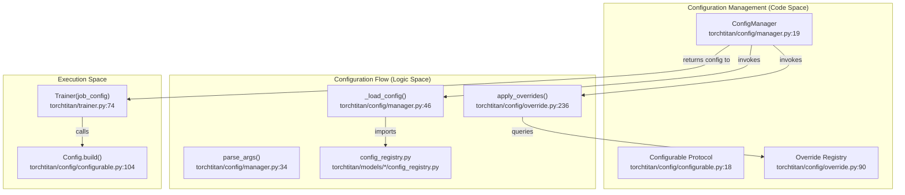
**Sources:** [torchtitan/config/manager.py:19-46](), [torchtitan/config/configurable.py:18-104](), [torchtitan/config/override.py:90-236](), [torchtitan/trainer.py:74-80]()

## Configurable Protocol

The `Configurable` class is the base for all components that require structured settings (e.g., tokenizers, dataloaders, optimizers). It enforces a pattern where every component defines a nested `Config` dataclass [torchtitan/config/configurable.py:18-41]().

Key features of the `Configurable` system:
- **Auto-wiring**: The `build()` method is automatically wired to construct the owning class via `__init_subclass__` [torchtitan/config/configurable.py:132-150]().
- **Type Safety**: Enforces the use of `@dataclass(kw_only=True, slots=True)` for all configuration definitions [torchtitan/config/configurable.py:137-142]().
- **Serialization**: Provides `to_dict()` for serializing complex nested configurations into plain dictionaries [torchtitan/config/configurable.py:46-73]().

For more details on the `Configurable` protocol and how it integrates with different components, see [Configuration Sources and Overrides](#2.2).

**Sources:** [torchtitan/config/configurable.py:18-151]()

## Configuration Sources and Precedence

TorchTitan utilizes a `config_registry` system where model-specific defaults are defined in code, rather than static YAML/TOML files.

### Precedence Rules
1. **CLI Arguments** (Highest priority): Arguments like `--training.batch_size 32` override registry values [torchtitan/config/manager.py:23-28]().
2. **Config Registry Defaults**: The specific configuration function selected via the `--config` flag [torchtitan/config/manager.py:136-150]().
3. **Dataclass Defaults** (Lowest priority): Values defined directly in the `Config` dataclass fields.

### Override Mechanism
TorchTitan includes an advanced `Override` mechanism that allows swapping any `Configurable` component (e.g., a standard RoPE with a Triton-based RoPE) without modifying the core codebase [torchtitan/config/override.py:7-12]().
- **Registration**: Uses the `@override` decorator to map a target `Config` class to a factory function [torchtitan/config/override.py:93-122]().
- **Targeting**: Supports fine-grained targeting via FQN (Fully Qualified Name) globs, allowing an override to apply only to specific layers or modules [torchtitan/config/override.py:106-110]().
- **Derivation**: The `derive()` utility helps create replacement configs by copying shared fields, ensuring version robustness [torchtitan/config/override.py:154-190]().

For detailed documentation on the override system and FQN patterns, see [Configuration Sources and Overrides](#2.2).

**Sources:** [torchtitan/config/manager.py:19-151](), [torchtitan/config/override.py:7-190](), [torchtitan/config/OVERRIDE.md:1-152]()

## Model-Specific Configuration

Configuration for specific models is organized within the `torchtitan/models/` directory. Each model family (e.g., Llama, Flux, DeepSeek) provides a `config_registry.py` that `ConfigManager` dynamically imports based on the `--module` flag [torchtitan/config/manager.py:103-133]().

### Example: Flux Configuration
The Flux model demonstrates the hierarchical nature of the system, involving:
- `FluxTokenizerContainer.Config` for tokenizer paths [torchtitan/models/flux/tokenizer.py:28-34]().
- `FluxValidator.Config` for validation steps and image saving parameters [torchtitan/models/flux/validate.py:49-68]().
- `FluxDataLoader.Config` for dataset selection [torchtitan/models/flux/validate.py:50-55]().

For more on how models are registered and selected, see [Model Selection and TrainSpec Protocol](#2.3).

**Sources:** [torchtitan/config/manager.py:103-133](), [torchtitan/models/flux/tokenizer.py:28-34](), [torchtitan/models/flux/validate.py:49-68]()

## Configuration Consumption

The finalized configuration object is consumed by the `Trainer` to orchestrate the training lifecycle.

| Consumer | Config Section / Protocol | Role |
|----------|---------------------------|------|
| **Trainer** | `JobConfig` | Root configuration container passed to `Trainer.__init__` [torchtitan/trainer.py:74](). |
| **Model Building** | `ModelSpec` | Bundles architecture config with parallelization functions [torchtitan/protocols/model_spec.py:33-47](). |
| **Data Pipeline** | `BaseDataLoader.Config` | Defines dataset loading and processing [torchtitan/models/flux/validate.py:50-55](). |
| **Validation** | `Validator.Config` | Controls validation frequency and metrics [torchtitan/models/flux/validate.py:49-68](). |

**Sources:** [torchtitan/trainer.py:74](), [torchtitan/protocols/model_spec.py:33-47](), [torchtitan/models/flux/validate.py:49-68]()

---

# Page: JobConfig Structure

# JobConfig Structure

<details>
<summary>Relevant source files</summary>

The following files were used as context for generating this wiki page:

- [.github/scripts/run_8xgpu_integration_tests.sh](.github/scripts/run_8xgpu_integration_tests.sh)
- [tests/integration_tests/h100.py](tests/integration_tests/h100.py)
- [tests/unit_tests/test_override.py](tests/unit_tests/test_override.py)
- [torchtitan/config/OVERRIDE.md](torchtitan/config/OVERRIDE.md)
- [torchtitan/config/__init__.py](torchtitan/config/__init__.py)
- [torchtitan/config/configs.py](torchtitan/config/configs.py)
- [torchtitan/config/override.py](torchtitan/config/override.py)
- [torchtitan/experiments/transformers_modeling_backend/parallelize.py](torchtitan/experiments/transformers_modeling_backend/parallelize.py)
- [torchtitan/models/deepseek_v3/parallelize.py](torchtitan/models/deepseek_v3/parallelize.py)
- [torchtitan/models/gpt_oss/parallelize.py](torchtitan/models/gpt_oss/parallelize.py)
- [torchtitan/models/llama3/parallelize.py](torchtitan/models/llama3/parallelize.py)
- [torchtitan/models/qwen3/parallelize.py](torchtitan/models/qwen3/parallelize.py)
- [torchtitan/overrides/__init__.py](torchtitan/overrides/__init__.py)
- [torchtitan/protocols/model_spec.py](torchtitan/protocols/model_spec.py)

</details>


## Purpose and Scope

This document describes the `JobConfig` dataclass hierarchy, which serves as the central configuration container for all torchtitan training jobs. The `JobConfig` aggregates multiple subsystem-specific configuration dataclasses that control every aspect of training execution: model selection, parallelization strategies, optimization parameters, checkpointing policies, and more.

This page focuses on the **structure and fields** of the configuration system. torchtitan utilizes a hierarchical configuration pattern where base components inherit from `Configurable` and define a nested `Config` dataclass.

**Sources:** [torchtitan/config/configurable.py:17-44](), [torchtitan/config/configs.py:22-167]()

---

## JobConfig Hierarchy Overview

The configuration system is built upon the `Configurable` base class. Every configurable component in torchtitan defines a nested `Config` dataclass using `@dataclass(kw_only=True, slots=True)`. This enforcement ensures that configuration fields are strictly managed and serializable.

### The Configurable Protocol

The `Configurable` class [torchtitan/config/configurable.py:17-44]() provides the infrastructure for building components from configurations.

| Method | Description |
|--------|-------------|
| `Config.to_dict()` | Serializes the configuration to a dictionary, safely handling unset `field(init=False)` slots. [torchtitan/config/configurable.py:79-108]() |
| `Config.build(**kwargs)` | Constructs the owning class. It auto-detects if arguments should be absorbed into the config or forwarded to `__init__`. [torchtitan/config/configurable.py:134-184]() |

**Sources:** [torchtitan/config/configurable.py:46-132]()

### Top-Level Configuration Structure

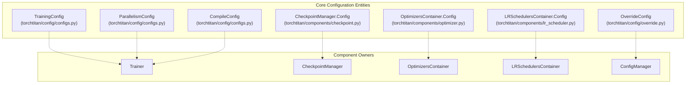

**Sources:** [torchtitan/config/configs.py:7-20](), [torchtitan/config/override.py:46-60](), [torchtitan/config/manager.py:25-26]()

---

## Training and Parallelism Configurations

### TrainingConfig

The `TrainingConfig` [torchtitan/config/configs.py:27-81]() manages dataset-level parameters and hardware-specific training settings.

| Field | Type | Default | Description |
|-------|------|---------|-------------|
| `local_batch_size` | `int` | `8` | Per-device batch size. [torchtitan/config/configs.py:29-29]() |
| `global_batch_size` | `int` | `-1` | Defaults to `local_batch_size * DP degree`. [torchtitan/config/configs.py:32-35]() |
| `seq_len` | `int` | `2048` | Sequence length for training. [torchtitan/config/configs.py:37-38]() |
| `dtype` | `Literal` | `"float32"` | Full training dtype (parameters, grads, and optimizer states). [torchtitan/config/configs.py:51-56]() |
| `mixed_precision_param` | `Literal` | `"bfloat16"` | Parameter dtype for FSDP/autocast mixed precision. [torchtitan/config/configs.py:58-64]() |
| `gc_freq` | `int` | `50` | Python garbage collection interval in steps. [torchtitan/config/configs.py:72-73]() |

**Sources:** [torchtitan/config/configs.py:27-81]()

### ParallelismConfig

The `ParallelismConfig` [torchtitan/config/configs.py:84-167]() defines the multi-dimensional parallelism strategy.

| Field | Type | Default | Description |
|-------|------|---------|-------------|
| `data_parallel_replicate_degree` | `int` | `1` | Degree for weight replication (DDP/HSDP). [torchtitan/config/configs.py:86-95]() |
| `data_parallel_shard_degree` | `int` | `-1` | Degree for weight sharding (FSDP/HSDP). `-1` uses leftover ranks. [torchtitan/config/configs.py:97-107]() |
| `tensor_parallel_degree` | `int` | `1` | TP degree for intra-layer parallelism. [torchtitan/config/configs.py:130-131]() |
| `pipeline_parallel_degree` | `int` | `1` | Number of physical ranks for PP. [torchtitan/config/configs.py:151-156]() |
| `enable_sequence_parallel` | `bool` | `True` | Use SequenceParallel as part of TP. [torchtitan/config/configs.py:139-140]() |
| `spmd_backend` | `Literal` | `"default"` | Backend selector: `"default"`, `"full_dtensor"`, or `"spmd_types"`. [torchtitan/config/configs.py:142-149]() |

**Sources:** [torchtitan/config/configs.py:84-167]()

---

## Performance and Debugging

### CompileConfig
Controls the `torch.compile` integration.

| Field | Type | Default | Description |
|-------|------|---------|-------------|
| `enable` | `bool` | `False` | Global toggle for compilation. |
| `components` | `str` | `"model"` | Comma-separated list of components to compile (e.g., `"model,loss"`). |

**Sources:** [torchtitan/config/configs.py:11-11](), [torchtitan/models/llama3/parallelize.py:66-68]()

### DebugConfig
Configuration for debugging and profiling tools.

| Field | Type | Default | Description |
|-------|------|---------|-------------|
| `enable_profiler` | `bool` | `False` | Whether to enable the PyTorch Profiler. |
| `memory_snapshot` | `bool` | `False` | Whether to capture memory snapshots. |

**Sources:** [torchtitan/config/__init__.py:19-19]()

---

## The Override Mechanism

torchtitan includes a powerful `OverrideConfig` system that allows swapping any `Configurable` component (like model layers or kernels) without modifying the core repository.

### OverrideConfig
| Field | Type | Default | Description |
|-------|------|---------|-------------|
| `imports` | `list[str]` | `[]` | List of Python module paths to import for override registration. [torchtitan/config/override.py:48-59]() |

### Code Entity Association: Override Logic
The following diagram maps the override registration entities to their runtime behavior.

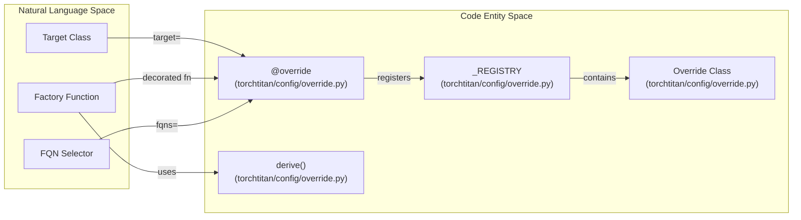

**Sources:** [torchtitan/config/override.py:63-151](), [torchtitan/config/override.py:154-190]()

---

## Configuration Mapping: Code to Logic

This diagram associates configuration symbols with the logical components they initialize within the training engine.

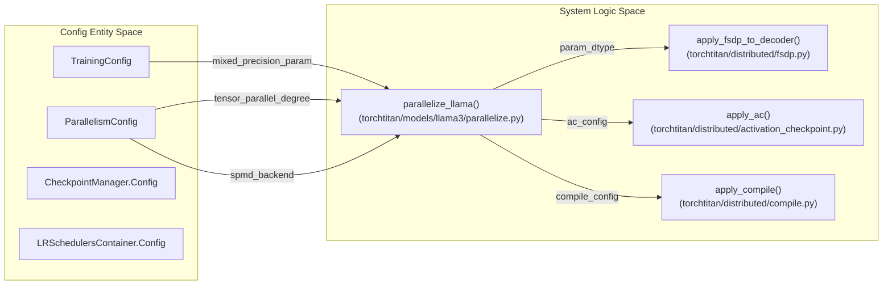

**Sources:** [torchtitan/models/llama3/parallelize.py:27-104](), [torchtitan/models/gpt_oss/parallelize.py:27-106](), [torchtitan/models/deepseek_v3/parallelize.py:28-111]()

---

# Page: Configuration Sources and Overrides

# Configuration Sources and Overrides

<details>
<summary>Relevant source files</summary>

The following files were used as context for generating this wiki page:

- [tests/unit_tests/test_config_manager.py](tests/unit_tests/test_config_manager.py)
- [tests/unit_tests/test_configurable.py](tests/unit_tests/test_configurable.py)
- [torchtitan/config/configurable.py](torchtitan/config/configurable.py)
- [torchtitan/config/manager.py](torchtitan/config/manager.py)
- [torchtitan/models/flux/flux_datasets.py](torchtitan/models/flux/flux_datasets.py)
- [torchtitan/models/flux/inference/sampling.py](torchtitan/models/flux/inference/sampling.py)
- [torchtitan/models/flux/tokenizer.py](torchtitan/models/flux/tokenizer.py)
- [torchtitan/models/flux/validate.py](torchtitan/models/flux/validate.py)

</details>


## Purpose and Scope

This page documents how TorchTitan's configuration system loads, merges, and applies configuration values. It covers the `ConfigManager` implementation, the precedence rules for configuration overrides, the `Configurable` protocol, and the syntax for CLI arguments. TorchTitan uses a dynamic configuration system where configuration is driven by a `module` (model or experiment) and a specific `config` function defined in a `config_registry.py`.

For information about the structure and parameters of the base `JobConfig`, see [JobConfig Structure (2.1)](). For information about selecting models and the `ModelSpec` protocol, see [Model Selection and TrainSpec Protocol (2.3)]().

---

## Configuration Architecture

TorchTitan uses a hierarchical configuration system. Unlike static TOML-only systems, it dynamically loads a base configuration object from a Python module and then applies CLI overrides.

### Configuration Precedence

| Priority | Source | Mechanism | Use Case |
|----------|--------|-----------|----------|
| 1 (Highest) | CLI Arguments | `tyro.cli` overrides | Runtime overrides (e.g., `--training.steps 50`) |
| 2 (Lowest) | `config_registry` | Python function defaults | Base templates (e.g., `llama3_debugmodel`) |

### Data Flow Overview

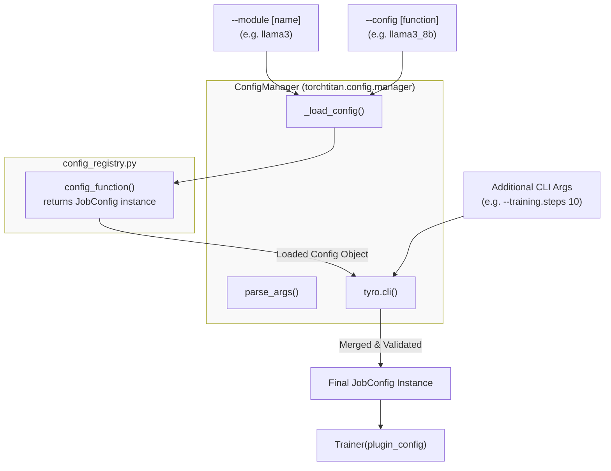

**Sources:** [torchtitan/config/manager.py:19-45](), [torchtitan/config/manager.py:46-151]()

---

## The Configurable Protocol

Most major components in TorchTitan (tokenizers, dataloaders, models) implement the `Configurable` protocol. This provides a unified way to instantiate objects from their configuration dataclasses.

### Implementation Details
*   **Nested Config Class**: Every `Configurable` class defines a nested `Config` class inheriting from `Configurable.Config` [torchtitan/config/configurable.py:40-41]().
*   **Automatic Registration**: Using `__init_subclass__`, the `Config` class is automatically linked to its "owner" class [torchtitan/config/configurable.py:132-151]().
*   **The `build()` Method**: The `Config.build()` method instantiates the owner class. It supports two modes:
    1.  **Direct**: `cfg.build()` clones the config and passes it to the owner's `__init__` [torchtitan/config/configurable.py:120-121]().
    2.  **With Runtime Kwargs**: `cfg.build(dim=64)` forwards additional runtime objects (like device or process groups) to the constructor [torchtitan/config/configurable.py:130]().

### Component Configuration Example: Flux
The `FluxTokenizerContainer` demonstrates this protocol by nesting its `Config` and using it to initialize internal T5 and CLIP tokenizers [torchtitan/models/flux/tokenizer.py:19-49]().

```mermaid
classDiagram
    class Configurable {
        <<Interface>>
        +__init_subclass__(cls)
    }
    class Config {
        +_owner: ClassVar
        +build(**kwargs) Object
        +to_dict() dict
        +traverse(config_cls) Iterator
    }
    class FluxTokenizerContainer {
        +__init__(config)
    }
    class FluxTokenizerConfig {
        +t5_tokenizer_path: str
        +clip_tokenizer_path: str
    }
    Configurable <|-- FluxTokenizerContainer
    Config <|-- FluxTokenizerConfig
    FluxTokenizerContainer +-- FluxTokenizerConfig : nested
```

**Sources:** [torchtitan/config/configurable.py:18-38](), [torchtitan/config/configurable.py:104-131](), [torchtitan/models/flux/tokenizer.py:19-36]()

---

## The ConfigManager

The `ConfigManager` class is the central entity responsible for resolving the final configuration state. It utilizes `tyro` for robust CLI parsing and type enforcement.

### Key Functions

*   **`__init__`**: Registers custom `tyro` rules for specific types like `torch.device` or `torch.dtype` [torchtitan/config/manager.py:31-32]().
*   **`_load_config(args)`**: 
    1.  Extracts `--module` and `--config` from the argument list [torchtitan/config/manager.py:52-81]().
    2.  Locates the corresponding `config_registry.py` within `torchtitan.models` or `torchtitan.experiments` [torchtitan/config/manager.py:103-133]().
    3.  Calls the specified configuration function to get the base `JobConfig` object [torchtitan/config/manager.py:136-151]().
*   **`parse_args(args)`**: Takes the base object from `_load_config` and uses `tyro.cli` to apply any remaining command-line overrides [torchtitan/config/manager.py:34-44]().

**Sources:** [torchtitan/config/manager.py:19-45](), [torchtitan/config/manager.py:46-151]()

---

## Configuration Sources

### The Config Registry (`--module` and `--config`)

Every model family (e.g., Llama, DeepSeek) or experiment includes a `config_registry.py`. This file contains functions that return a pre-configured `JobConfig` (or a subclass).

**Example Usage:**
```bash
# Selects torchtitan/models/llama3/config_registry.py -> llama3_debugmodel()
./run_train.sh --module llama3 --config llama3_debugmodel
```

**Sources:** [torchtitan/config/manager.py:26-29](), [tests/unit_tests/test_config_manager.py:15-24]()

### Command-Line Overrides

CLI arguments provide the highest-priority overrides and use dot notation to access nested configuration fields. `tyro` ensures that these overrides match the types defined in the dataclasses.

**Syntax:**
```bash
# Overriding nested fields
--training.steps 5000
--parallelism.tensor_parallel_degree 8

# Overriding list fields (comma-separated)
--checkpoint.exclude_from_loading "optimizer,lr_scheduler"
```

**Boolean Flag Handling:**
`tyro` handles booleans as flags. To set a value to `False`, use the `--no-` prefix.
```bash
--checkpoint.enable      # Sets to True
--checkpoint.no-enable   # Sets to False
```

**Sources:** [torchtitan/config/manager.py:28-29](), [tests/unit_tests/test_config_manager.py:64-78](), [tests/unit_tests/test_config_manager.py:102-124]()

### Environment Variables

While `ConfigManager` primarily handles CLI args, the `run_train.sh` script (or equivalent launch scripts) often maps environment variables to the required CLI flags for convenience.

| Env Var | CLI Mapping |
|---------|-------------|
| `MODULE` | `--module` |
| `CONFIG` | `--config` |

**Sources:** [torchtitan/config/manager.py:26-29](), [tests/unit_tests/test_config_manager.py:15-24]()

---

## Configuration Merging and Validation

### Deprecated Merging
The `ConfigManager._merge_configs` static method is currently deprecated in favor of using `JobConfig` subclasses within the `config_registry` system [torchtitan/config/manager.py:154-163]().

### Validation Logic
After parsing, `_validate_config()` is called to perform sanity checks. For example, it validates the existence of paths for components like the tokenizer [torchtitan/config/manager.py:42](), [torchtitan/config/manager.py:193-196]().

---

## Summary of Precedence Rules

The following table demonstrates how values are resolved if defined in multiple places:

| Field | Registry Default | CLI Override | Final Value |
|-------|------------------|--------------|-------------|
| `training.steps` | `10` | `--training.steps 100` | `100` |
| `checkpoint.enable` | `False` | `--checkpoint.enable` | `True` |
| `parallelism.tp` | `1` | (None) | `1` |
| `dump_folder` | `"./outputs"` | `--dump_folder "/tmp"` | `"/tmp"` |

**Sources:** [torchtitan/config/manager.py:23-24](), [tests/unit_tests/test_config_manager.py:64-92]()

---

# Page: Model Selection and TrainSpec Protocol

# Model Selection and TrainSpec Protocol

<details>
<summary>Relevant source files</summary>

The following files were used as context for generating this wiki page:

- [tests/integration_tests/features.py](tests/integration_tests/features.py)
- [tests/integration_tests/models.py](tests/integration_tests/models.py)
- [tests/unit_tests/test_override.py](tests/unit_tests/test_override.py)
- [torchtitan/config/OVERRIDE.md](torchtitan/config/OVERRIDE.md)
- [torchtitan/config/__init__.py](torchtitan/config/__init__.py)
- [torchtitan/config/override.py](torchtitan/config/override.py)
- [torchtitan/experiments/graph_trainer/deepseek_v3/config_registry.py](torchtitan/experiments/graph_trainer/deepseek_v3/config_registry.py)
- [torchtitan/experiments/transformers_modeling_backend/config_registry.py](torchtitan/experiments/transformers_modeling_backend/config_registry.py)
- [torchtitan/models/common/config_utils.py](torchtitan/models/common/config_utils.py)
- [torchtitan/models/deepseek_v3/__init__.py](torchtitan/models/deepseek_v3/__init__.py)
- [torchtitan/models/deepseek_v3/config_registry.py](torchtitan/models/deepseek_v3/config_registry.py)
- [torchtitan/models/gpt_oss/__init__.py](torchtitan/models/gpt_oss/__init__.py)
- [torchtitan/models/gpt_oss/config_registry.py](torchtitan/models/gpt_oss/config_registry.py)
- [torchtitan/models/llama3/__init__.py](torchtitan/models/llama3/__init__.py)
- [torchtitan/models/llama3/config_registry.py](torchtitan/models/llama3/config_registry.py)
- [torchtitan/models/qwen3/__init__.py](torchtitan/models/qwen3/__init__.py)
- [torchtitan/models/qwen3/config_registry.py](torchtitan/models/qwen3/config_registry.py)
- [torchtitan/overrides/__init__.py](torchtitan/overrides/__init__.py)
- [torchtitan/protocols/model_spec.py](torchtitan/protocols/model_spec.py)

</details>


## Purpose and Scope

This page documents the `ModelSpec` protocol, which serves as the interface between model definitions and the training infrastructure in torchtitan. The `ModelSpec` protocol standardizes how models expose their configuration, parallelization strategies, and loss functions to the `Trainer` class, enabling a clean separation between model-specific logic and generic training orchestration.

The system utilizes a registration mechanism via `config_registry.py` and a swappable component system including `ModelConverter` for model transformations like quantization.

---

## ModelSpec Protocol Overview

The `ModelSpec` protocol is defined in [torchtitan/protocols/model_spec.py:16-32]() as a dataclass that aggregates model-specific components. It acts as a factory pattern, providing configuration objects and functions that the `Trainer` calls during initialization.

**Core Concept**: Rather than hardcoding model-specific logic in the `Trainer`, each model provides a `ModelSpec` that specifies:
- The model configuration object (`model`)
- How to parallelize it (`parallelize_fn`)
- How to apply pipeline parallelism (`pipelining_fn`)
- How to build its loss function (`build_loss_fn`)
- Post-optimizer hooks and state dict adapters

### ModelSpec Structure

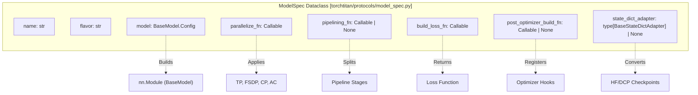

**Diagram: ModelSpec Structure and Responsibilities**

Sources: [torchtitan/protocols/model_spec.py:16-32](), [torchtitan/models/deepseek_v3/__init__.py:34-38]()

---

## Model Selection and Registration

Models are selected via the `config_registry.py` system, which maps a module name and configuration flavor to a specific `Trainer.Config`.

### Registration via config_registry.py

To register a model, a `model_registry(flavor)` function is defined in the model's `__init__.py` (e.g., [torchtitan/models/llama3/__init__.py:27-31]()). This function returns a `ModelSpec`. Training configurations are then defined in a `config_registry.py` module within the model or experiment folder.

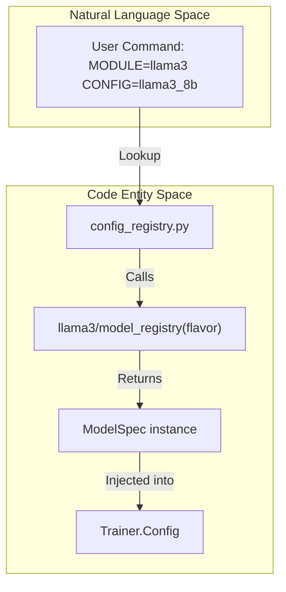

**Diagram: Mapping CLI Selection to Code Entities**

The model registry is invoked within the model-specific `config_registry.py` files to populate the `model_spec` field of the `Trainer.Config` object:
- `llama3_debugmodel` calls `model_registry("debugmodel")` [torchtitan/models/llama3/config_registry.py:34]().
- `deepseek_v3_16b` calls `model_registry("16B", attn_backend="flex")` [torchtitan/models/deepseek_v3/config_registry.py:92]().
- `qwen3_debugmodel` calls `model_registry("debugmodel")` [torchtitan/models/qwen3/config_registry.py:35]().

Sources: [torchtitan/models/llama3/config_registry.py:30-35](), [torchtitan/models/deepseek_v3/config_registry.py:88-92](), [torchtitan/models/qwen3/config_registry.py:30-35]()

---

## Swappable Component System

Torchtitan employs a protocol-based system for swapping core components without modifying the main training loop.

### ModelConverter Protocol

The `ModelConverter` protocol (defined via `ModelConfigConverter` in model protocols [torchtitan/protocols/model.py:33]()) allows for general module rewrites after model initialization but before parallelization. This is primarily used for quantization (e.g., Float8).

| Method | Timing | Purpose |
|--------|--------|---------|
| `convert` | After meta-init, before parallelization | Rewrites modules (e.g., swapping `nn.Linear` for `Float8Linear`) |
| `post_optimizer_hook` | After `optimizer.step()` | Performs post-step operations (e.g., calculating dynamic scales) |

DeepSeek-V3 utilizes specialized converters like `Float8LinearConverter` and `Float8GroupedExpertsConverter` for its 671B model configuration [torchtitan/models/deepseek_v3/config_registry.py:160-168]().

Sources: [torchtitan/models/deepseek_v3/config_registry.py:12-15](), [torchtitan/models/deepseek_v3/config_registry.py:160-168]()

### Optimizer Containers

The system uses specialized containers to handle complex optimizer behaviors, such as parameter grouping or MoE load balancing.

- **`OptimizersContainer`**: Wraps multiple optimizers or complex parameter groups. In `qwen3_debugmodel_moe_param_groups`, it is used to apply different learning rates and weight decay to `tok_embeddings`, `router.gate`, and other parameters [torchtitan/models/qwen3/config_registry.py:61-89]().
- **MoE Load Balancing**: Models like DeepSeek-V3 and GPT-OSS register load balancing hooks via `register_moe_load_balancing_hook` to manage expert utilization [torchtitan/models/deepseek_v3/__init__.py:14](), [torchtitan/models/gpt_oss/__init__.py:13]().

---

## TrainSpec Execution Flow

The `Trainer` class orchestrates the lifecycle of these components. The data flow from configuration to a materialized, parallelized model follows a strict sequence.

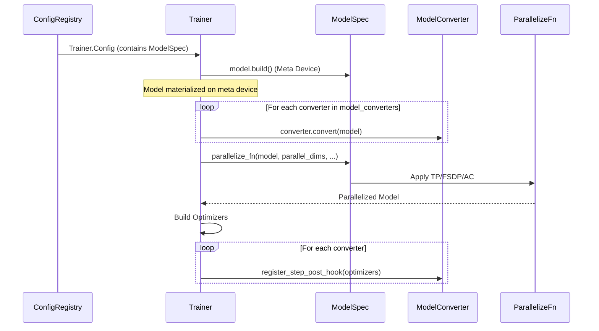

**Diagram: Model Materialization and Transformation Flow**

### Model Building and Parallelization

1. **Layer Construction**: Models use helper functions like `_build_llama3_layers` [torchtitan/models/llama3/__init__.py:68]() or `_build_dsv3_layers` [torchtitan/models/deepseek_v3/__init__.py:160]() to construct the transformer backbone.
2. **Parallelization Function**: Each model provides a specific parallelization entry point, such as `parallelize_llama` [torchtitan/models/llama3/parallelize.py](), `parallelize_deepseekv3` [torchtitan/models/deepseek_v3/parallelize.py](), or `parallelize_qwen3` [torchtitan/models/qwen3/parallelize.py]().
3. **Pipeline Parallelism**: If enabled, the `pipelining_fn` (e.g., `pipeline_llm` [torchtitan/models/llama3/__init__.py:12]()) is used to split the model into stages across the pipeline mesh.

Sources: [torchtitan/models/llama3/__init__.py:68-107](), [torchtitan/models/deepseek_v3/__init__.py:160-194](), [torchtitan/models/qwen3/config_registry.py:190-195]()

---

# Page: Core Training Engine

# Core Training Engine

<details>
<summary>Relevant source files</summary>

The following files were used as context for generating this wiki page:

- [tests/unit_tests/test_set_determinism.py](tests/unit_tests/test_set_determinism.py)
- [torchtitan/components/dataloader.py](torchtitan/components/dataloader.py)
- [torchtitan/components/metrics.py](torchtitan/components/metrics.py)
- [torchtitan/components/validate.py](torchtitan/components/validate.py)
- [torchtitan/distributed/utils.py](torchtitan/distributed/utils.py)
- [torchtitan/experiments/forge/engine.py](torchtitan/experiments/forge/engine.py)
- [torchtitan/experiments/forge/example_train.py](torchtitan/experiments/forge/example_train.py)
- [torchtitan/experiments/torchft/trainer.py](torchtitan/experiments/torchft/trainer.py)
- [torchtitan/tools/utils.py](torchtitan/tools/utils.py)
- [torchtitan/train.py](torchtitan/train.py)
- [torchtitan/trainer.py](torchtitan/trainer.py)

</details>


The Core Training Engine is the central orchestration layer of TorchTitan, responsible for coordinating all aspects of the distributed training process. The engine is implemented primarily in the `Trainer` class, which manages initialization, training loop execution, metrics collection, and integration with all subsystems.

This page focuses on the training orchestration infrastructure. For details on specific sub-topics, see the following child pages:
- [Trainer Initialization and Lifecycle](#3.1) — Detailed breakdown of the `Trainer` class, component building, and model materialization.
- [Training Loop Execution](#3.2) — Deep dive into the `train()` method, gradient accumulation, and step-level logic.
- [Distributed Initialization and Communication](#3.3) — Documentation on process group setup, device meshes, and NCCL configuration.
- [Metrics Collection and Monitoring](#3.4) — Explanation of throughput calculation, memory monitoring, and logging backends.
- [Validation System](#3.5) — Overview of the `Validator` class and integration with the training loop.

**Sources:** [torchtitan/train.py:1-68](), [torchtitan/trainer.py:1-170]()

---

## Trainer Class Architecture

### Core Class Structure

The `Trainer` class ([torchtitan/trainer.py:55-725]()) serves as the main orchestrator and extends `torch.distributed.checkpoint.stateful.Stateful` to enable checkpoint/resume functionality. It centralizes all training components and state.

**Core Components:**
- **Configuration:** Managed via `Trainer.Config` ([torchtitan/trainer.py:57-159]()), a comprehensive dataclass covering parallelism, optimization, and training hyperparameters.
- **Swappable Components:** Built based on the `ModelSpec` ([torchtitan/protocols/model_spec.py]()), including the `tokenizer`, `dataloader`, `model_parts`, `loss_fn`, `optimizers`, and `lr_schedulers`.
- **Infrastructure:** Non-swappable utilities including `checkpointer` ([torchtitan/components/checkpoint.py]()), `metrics_processor` ([torchtitan/components/metrics.py]()), and `gc_handler` ([torchtitan/tools/utils.py:51-88]()).

### Code Entity Relationship Diagram

The following diagram associates the logical training components with their specific class implementations in the codebase.

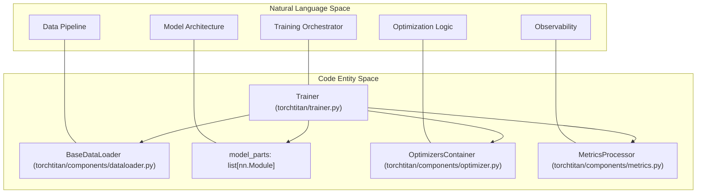

**Sources:** [torchtitan/trainer.py:55-150](), [torchtitan/components/dataloader.py:38-54](), [torchtitan/components/metrics.py:1-35]()

---

## Training Lifecycle and Loop

The training process follows a strict lifecycle: initialization, execution, and teardown.

### Execution Flow Diagram

This diagram maps the high-level training phases to the specific methods executed within the `Trainer` and the main entry point.

```mermaid
sequenceDiagram
    participant Main as train.py:main()
    participant Trainer as trainer.py:Trainer
    participant Loop as trainer.py:train()
    participant Step as trainer.py:train_step()

    Main->>Trainer: build() [via Config]
    Note over Trainer: __init__ performs<br/>Distributed Setup &<br/>Model Parallelization
    Main->>Loop: trainer.train()
    
    loop for step in range(max_steps)
        Loop->>Step: train_step(data_iterator)
        Note over Step: Forward -> Backward -><br/>Optimizer Step
        Loop->>Loop: checkpointer.save()
        Loop->>Loop: validator.validate()
    end

    Main->>Trainer: trainer.close()
    Note over Main: destroy_process_group()
```

**Sources:** [torchtitan/train.py:17-75](), [torchtitan/trainer.py:551-709]()

### Initialization Highlights
The `Trainer` is initialized after the `ConfigManager` parses arguments. A key feature is the materialization of models on the `meta` device first ([torchtitan/trainer.py:214-217]()) to save memory before parallelization strategies (FSDP, TP, etc.) are applied. Determinism is also established early via `dist_utils.set_determinism` ([torchtitan/trainer.py:186-191]()). For details, see [Trainer Initialization and Lifecycle](#3.1).

### Training Loop Highlights
The main `train()` method ([torchtitan/trainer.py:611-709]()) manages the outer loop, while `train_step()` ([torchtitan/trainer.py:551-609]()) handles micro-batching for gradient accumulation. It coordinates the `OptimizersContainer` and `LRSchedulersContainer` to update model weights. For details, see [Training Loop Execution](#3.2).

**Sources:** [torchtitan/train.py:41-65](), [torchtitan/trainer.py:172-369]()

---

## Infrastructure and Monitoring

The training engine integrates several specialized utilities to ensure performance and reliability at scale.

### Distributed Infrastructure
Distributed training is initialized via `init_distributed` ([torchtitan/distributed/utils.py:297-363]()), which sets up the backend (usually NCCL) and establishes the `ParallelDims` used for sharding. For details, see [Distributed Initialization and Communication](#3.3).

### Monitoring and Profiling
- **Metrics:** The `MetricsProcessor` tracks throughput (TPS), FLOPs utilization (MFU), and memory usage.
- **Memory Monitoring:** The `DeviceMemoryMonitor` ([torchtitan/components/metrics.py:38-93]()) captures peak active and reserved bytes to identify potential OOM risks.
- **Garbage Collection:** To prevent stragglers caused by asynchronous Python GC, the `GarbageCollection` utility ([torchtitan/tools/utils.py:51-88]()) provides coordinated, periodic collection.

For details, see [Metrics Collection and Monitoring](#3.4).

### Validation and Correctness
The `Validator` ([torchtitan/components/validate.py:53-137]()) runs a separate evaluation loop at configured intervals to track model convergence on validation sets. It implements the `BaseValidator` protocol. For details, see [Validation System](#3.5).

**Sources:** [torchtitan/tools/utils.py:51-88](), [torchtitan/components/metrics.py:38-93](), [torchtitan/components/validate.py:33-51]()

---

## Experimental Variations

TorchTitan provides alternative engines and specialized trainers for experimental use cases:
- **ForgeEngine:** A stripped-down version of the trainer ([torchtitan/experiments/forge/engine.py:34-186]()) designed for simpler workflows or post-training.
- **FaultTolerantTrainer:** An extension of the base `Trainer` ([torchtitan/experiments/torchft/trainer.py:34-190]()) that integrates `TorchFTManager` for quorum-based recovery and fault tolerance.

| Component | Trainer (Core) | ForgeEngine (Experimental) | FaultTolerantTrainer |
|-----------|----------------|---------------------------|----------------------|
| **Complexity** | High (Feature Complete) | Low (Simplified) | High (Fault Tolerant) |
| **Use Case** | Large-scale Pre-training | Prototyping / Post-training | Unreliable Clusters |
| **State Management** | Stateful (DCP) | Stateful (DCP) | Multi-replica Stateful |

**Sources:** [torchtitan/experiments/forge/engine.py:34-186](), [torchtitan/experiments/forge/example_train.py:31-142](), [torchtitan/experiments/torchft/trainer.py:34-190]()

---

# Page: Trainer Initialization and Lifecycle

# Trainer Initialization and Lifecycle

<details>
<summary>Relevant source files</summary>

The following files were used as context for generating this wiki page:

- [tests/unit_tests/test_set_determinism.py](tests/unit_tests/test_set_determinism.py)
- [torchtitan/components/dataloader.py](torchtitan/components/dataloader.py)
- [torchtitan/components/metrics.py](torchtitan/components/metrics.py)
- [torchtitan/components/validate.py](torchtitan/components/validate.py)
- [torchtitan/distributed/utils.py](torchtitan/distributed/utils.py)
- [torchtitan/experiments/forge/engine.py](torchtitan/experiments/forge/engine.py)
- [torchtitan/experiments/forge/example_train.py](torchtitan/experiments/forge/example_train.py)
- [torchtitan/experiments/torchft/trainer.py](torchtitan/experiments/torchft/trainer.py)
- [torchtitan/tools/utils.py](torchtitan/tools/utils.py)
- [torchtitan/train.py](torchtitan/train.py)
- [torchtitan/trainer.py](torchtitan/trainer.py)

</details>


## Purpose and Scope

This document details the complete lifecycle of the `Trainer` class, which serves as the central orchestrator of TorchTitan training jobs. The lifecycle consists of three main phases:

1.  **Initialization** (`Trainer.__init__`): Executes a carefully ordered sequence of setup operations that prepare all components (distributed, model, data, optimizer) for training.
2.  **Training Execution** (`Trainer.train()`): Runs the main training loop, handling gradient accumulation, checkpointing, validation, and profiling.
3.  **Cleanup** (`Trainer.close()`): Releases resources, flushes metrics, and finalizes asynchronous checkpointing operations.

This page covers the high-level architecture and implementation flow of these phases.

**Sources:** [torchtitan/trainer.py:55-724](), [torchtitan/train.py:17-76]()

---

## Initialization Sequence Overview

The `Trainer` constructor follows a strict initialization order, as many components depend on earlier artifacts (e.g., the optimizer needs the parallelized model).

### Initialization Flow

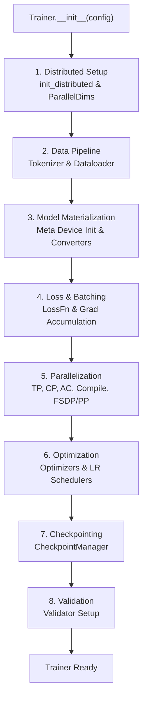

**Sources:** [torchtitan/trainer.py:124-370]()

### 1. Distributed and Environment Setup
The trainer first initializes the distributed backend via `dist_utils.init_distributed` [torchtitan/trainer.py:133-136](). It then constructs a `ParallelDims` object [torchtitan/trainer.py:141-150]() which defines the N-dimensional device mesh (DP, CP, TP, PP, EP). Random seeds and determinism are set via `dist_utils.set_determinism` [torchtitan/trainer.py:166-171](), ensuring that seeds are unique across certain dimensions (like PP) while shared across others for reproducibility [torchtitan/distributed/utils.py:124-192]().

**Sources:** [torchtitan/trainer.py:133-171](), [torchtitan/distributed/utils.py:124-192]()

### 2. Data Pipeline
The `tokenizer` is built using the provided configuration [torchtitan/trainer.py:177-181](). Subsequently, the `dataloader` is constructed via `config.dataloader.build()`, sharded by the data-parallel (DP) degree and rank derived from the device mesh [torchtitan/trainer.py:184-190]().

**Sources:** [torchtitan/trainer.py:177-190](), [torchtitan/components/dataloader.py:55-104]()

### 3. Model Materialization on Meta Device
To support large models that exceed single-device memory, the model is first instantiated on the `meta` device [torchtitan/trainer.py:210-213](). 
- **ModelConverters**: Before materialization, `ModelConverters` (e.g., for Float8 or MX quantization) are applied to swap standard layers with specialized implementations [torchtitan/trainer.py:216-218]().
- **MFU Calculation**: The trainer calculates the parameter count and theoretical peak FLOPs per token while the model is still on the meta device [torchtitan/trainer.py:226-229]().

**Sources:** [torchtitan/trainer.py:210-229]()

### 4. Loss and Batching
The `loss_fn` is built from the `ModelSpec` [torchtitan/trainer.py:251-253](). The trainer calculates `gradient_accumulation_steps` by comparing the `global_batch_size` against the `local_batch_size` multiplied by the DP degree [torchtitan/trainer.py:256-277]().

**Sources:** [torchtitan/trainer.py:251-277]()

### 5. Parallelization
This phase transforms the model based on the configured strategies:
- **Pipeline Parallel (PP)**: If enabled, the `pipelining_fn` splits the model into stages [torchtitan/trainer.py:280-312]().
- **SPMD Parallelism**: If PP is disabled, the model is parallelized as a single unit (applying TP, CP, and FSDP/DDP) [torchtitan/trainer.py:314-322]().
- **Materialization**: The sharded model parts are moved from `meta` to the actual device using `to_empty(device=device_type)` and weights are initialized via `model.init_weights()` [torchtitan/trainer.py:305-308]().

**Sources:** [torchtitan/trainer.py:280-322]()

### 6. Optimization and Checkpointing
Optimizers and LR Schedulers are built to wrap the parallelized model parameters [torchtitan/trainer.py:337-343](). Finally, the `CheckpointManager` is initialized, registering the model, optimizers, dataloader, and trainer state as `Stateful` components [torchtitan/trainer.py:360-376]().

**Sources:** [torchtitan/trainer.py:337-376](), [torchtitan/components/checkpoint.py]()

---

## Training Lifecycle

The lifecycle is managed by the `main()` function in `train.py`.

### Lifecycle State Machine

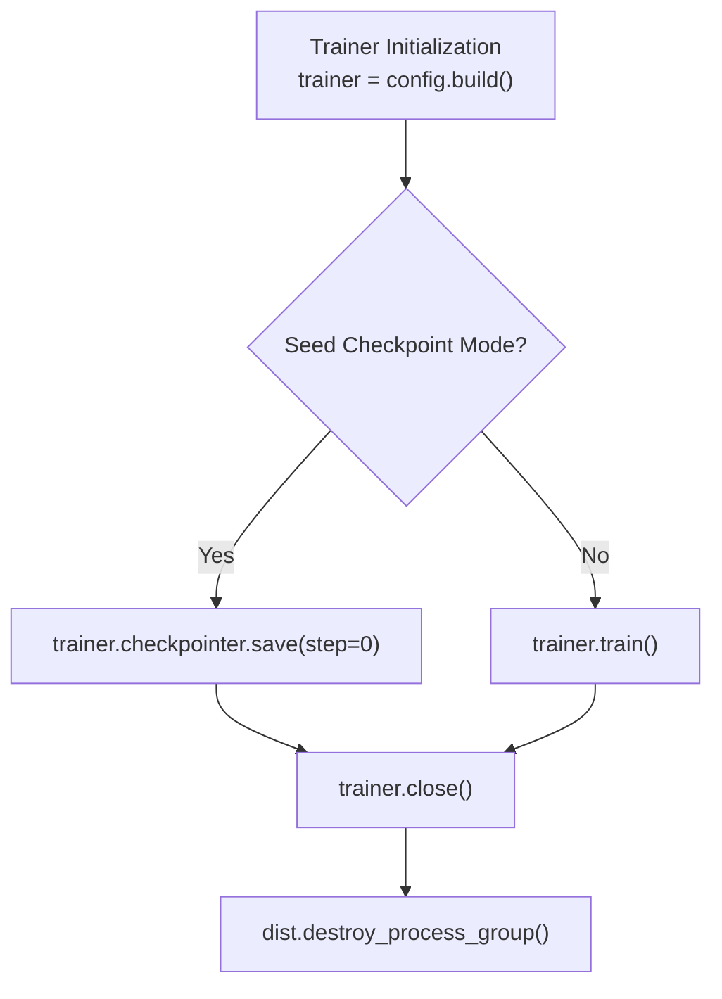

**Sources:** [torchtitan/train.py:41-75]()

### The train() Method
The `train()` method [torchtitan/trainer.py:620-708]() executes the main loop:
1.  **Load Checkpoint**: Restores state from the latest or specified checkpoint [torchtitan/trainer.py:624]().
2.  **Context Managers**: Wraps the loop in profiling (`Profiler`) and memory snapshot contexts [torchtitan/trainer.py:632-661]().
3.  **The Loop**: Iterates through steps, calling `train_step()` which handles forward, backward, and optimization [torchtitan/trainer.py:668]().
4.  **Validation**: Periodically invokes the `Validator` [torchtitan/trainer.py:682-684]().
5.  **Checkpointing**: Saves state based on configured frequency [torchtitan/trainer.py:676-678]().

**Sources:** [torchtitan/trainer.py:620-708]()

### Cleanup (Teardown)
The `close()` method [torchtitan/trainer.py:720-724]() ensures that:
- The `CheckpointManager` finalizes any asynchronous saves.
- The `MetricsProcessor` flushes remaining logs to backends (TensorBoard/WandB).
- In `train.py`, `torch.distributed.destroy_process_group()` is called to release network resources [torchtitan/train.py:72-74]().

**Sources:** [torchtitan/trainer.py:720-724](), [torchtitan/train.py:71-75]()

---

## Key Classes and Implementation

### Trainer.Config
A `tyro`-compatible dataclass that aggregates all sub-configurations for the training job. It includes validation logic in `__post_init__` to ensure compatibility between parallelism degrees and sequence lengths [torchtitan/trainer.py:105-131]().

| Field | Type | Description |
| :--- | :--- | :--- |
| `model_spec` | `ModelSpec` | Factory for model-specific components. |
| `training` | `TrainingConfig` | Steps, batch sizes, and dtypes. |
| `parallelism` | `ParallelismConfig` | Sharding degrees for TP, PP, FSDP, etc. |
| `checkpoint` | `CheckpointManager.Config` | Save frequency and paths. |

**Sources:** [torchtitan/trainer.py:57-103]()

### Component Association

```mermaid
graph LR
    Trainer["Trainer Class"]
    
    subgraph Core_Logic["Core Training Logic"]
        train["train()"]
        train_step["train_step()"]
    end
    
    subgraph Infrastructure["Infrastructure Components"]
        CP["CheckpointManager"]
        MP["MetricsProcessor"]
        VAL["Validator"]
    end
    
    subgraph Data_Model["Data and Model"]
        DL["BaseDataLoader"]
        MOD["list[nn.Module] (model_parts)"]
    end
    
    Trainer --> train
    Trainer --> Infrastructure
    Trainer --> Data_Model
```

**Sources:** [torchtitan/trainer.py:55-122]()

### Resource Monitoring
During initialization, the trainer builds a `DeviceMemoryMonitor` [torchtitan/components/metrics.py:95-101]() to track peak memory usage. This is logged immediately after model materialization to provide visibility into the memory footprint of the sharded model [torchtitan/trainer.py:234-239]().

**Sources:** [torchtitan/components/metrics.py:38-93](), [torchtitan/trainer.py:234-239]()

---

# Page: Training Loop Execution

# Training Loop Execution

<details>
<summary>Relevant source files</summary>

The following files were used as context for generating this wiki page:

- [.ci/docker/requirements.txt](.ci/docker/requirements.txt)
- [pyproject.toml](pyproject.toml)
- [tests/unit_tests/test_loss.py](tests/unit_tests/test_loss.py)
- [torchtitan/components/loss.py](torchtitan/components/loss.py)
- [torchtitan/components/validate.py](torchtitan/components/validate.py)
- [torchtitan/experiments/forge/engine.py](torchtitan/experiments/forge/engine.py)
- [torchtitan/experiments/forge/example_train.py](torchtitan/experiments/forge/example_train.py)
- [torchtitan/experiments/graph_trainer/chunked_loss.py](torchtitan/experiments/graph_trainer/chunked_loss.py)
- [torchtitan/experiments/graph_trainer/tests/test_chunked_loss.py](torchtitan/experiments/graph_trainer/tests/test_chunked_loss.py)
- [torchtitan/experiments/torchft/trainer.py](torchtitan/experiments/torchft/trainer.py)
- [torchtitan/trainer.py](torchtitan/trainer.py)

</details>


## Purpose and Scope

This document describes the core training loop execution in TorchTitan, primarily focusing on the `train()`, `train_step()`, and `forward_backward_step()` methods of the `Trainer` class. These methods orchestrate the iterative process of consuming batches, performing forward and backward passes, and updating model parameters using PyTorch-native distributed primitives.

The training loop handles:
- Iteration over training steps and microbatches.
- Gradient accumulation for large global batch sizes.
- Forward and backward pass execution with support for Pipeline Parallelism (PP).
- Optimizer and learning rate scheduler coordination.
- Integration with checkpointing, profiling, metrics collection, and validation.

---

## Training Loop Architecture

The training loop consists of three nested levels of execution within the `Trainer` class [torchtitan/trainer.py:55]():

1.  **`train()` method**: The outer loop managing the overall lifecycle, including checkpointing, profiling, and validation [torchtitan/trainer.py:566-649]().
2.  **`train_step()` method**: The middle loop performing gradient accumulation over multiple microbatches and executing the optimizer step [torchtitan/trainer.py:496-563]().
3.  **`forward_backward_step()` method**: The inner logic executing a single forward and backward pass for one microbatch [torchtitan/trainer.py:415-494]().

### Training Loop Call Hierarchy

The following diagram maps the execution flow to the specific code entities in `torchtitan/trainer.py`.

```mermaid
graph TD
    train["Trainer.train()<br/>[torchtitan/trainer.py:566]"]
    batch_gen["Trainer.batch_generator()<br/>[torchtitan/trainer.py:384]"]
    train_step["Trainer.train_step()<br/>[torchtitan/trainer.py:496]"]
    fwd_bwd["Trainer.forward_backward_step()<br/>[torchtitan/trainer.py:415]"]
    
    optimizer_step["OptimizersContainer.step()<br/>[torchtitan/components/optimizer.py]"]
    lr_step["LRSchedulersContainer.step()<br/>[torchtitan/components/lr_scheduler.py]"]
    checkpoint_save["CheckpointManager.save()<br/>[torchtitan/components/checkpoint.py]"]
    validator_validate["Validator.validate()<br/>[torchtitan/components/validate.py]"]
    metrics_log["MetricsProcessor.log()<br/>[torchtitan/components/metrics.py]"]
    
    train --> batch_gen
    train --> train_step
    train --> checkpoint_save
    train --> validator_validate
    
    train_step --> fwd_bwd
    train_step --> optimizer_step
    train_step --> lr_step
    train_step --> metrics_log
    
    fwd_bwd --> model_forward["model_parts[0]()"]
    fwd_bwd --> loss_backward["loss.backward()"]
    fwd_bwd --> pp_schedule["pp_schedule.step()"]
```

**Sources**: [torchtitan/trainer.py:566-649](), [torchtitan/trainer.py:496-563](), [torchtitan/trainer.py:415-494]()

---

## Main Training Loop (`train` method)

The `train()` method is the entry point for the training execution. It iterates from the current step (restored from checkpoint or 0) up to the configured `total_steps`. It is decorated with `@record` to enable debug tracing on failure via TorchElastic [torchtitan/trainer.py:566]().

### Training Loop Structure

```mermaid
sequenceDiagram
    participant train as Trainer.train()
    participant checkpointer as CheckpointManager
    participant batch_gen as Trainer.batch_generator()
    participant train_step as Trainer.train_step()
    participant validator as Validator
    participant profiler as Profiler
    
    train->>checkpointer: load(step)
    Note over train: Restore from checkpoint
    
    train->>batch_gen: iter(dataloader)
    Note over train: Create data iterator
    
    loop while step < training.steps
        train->>train: step += 1
        train->>train: gc_handler.run(step)
        
        train->>train_step: train_step(data_iterator)
        Note over train_step: Gradient accumulation<br/>+ optimizer step
        
        train->>checkpointer: save(step)
        Note over checkpointer: Periodic checkpoint
        
        alt validator.enable and should_validate(step)
            train->>validator: validate(model_parts, step)
        end
        
        train->>profiler: step()
        Note over profiler: Signal profiling step
        
        alt step == 1
            train->>train: set_pg_timeouts(train_timeout)
            Note over train: Reduce timeout after<br/>compilation complete
        end
    end
```

**Sources**: [torchtitan/trainer.py:566-649]()

### Key Components Integrated in Training Loop

| Component | Method Call | Purpose |
|-----------|-------------|---------|
| `CheckpointManager` | `checkpointer.load(step)` | Restore training state from checkpoint at start [torchtitan/trainer.py:601]() |
| `CheckpointManager` | `checkpointer.save(step)` | Periodically save training state [torchtitan/trainer.py:623]() |
| `Validator` | `validator.validate(...)` | Run validation at configured intervals [torchtitan/trainer.py:629]() |
| `GarbageCollection` | `gc_handler.run(step)` | Periodic garbage collection to avoid stragglers [torchtitan/tools/utils.py:59]() |
| `Profiler` | `torch_profiler.step()` | Signal profiling step boundaries [torchtitan/tools/profiler.py:147]() |

**Sources**: [torchtitan/trainer.py:566-649](), [torchtitan/tools/utils.py:46-74](), [torchtitan/tools/profiler.py:75-152]()

---

## Training Step Execution (`train_step` method)

The `train_step()` method executes a single training step, involving gradient accumulation and parameter updates [torchtitan/trainer.py:496-563]().

### Training Step Flow

```mermaid
graph TB
    start["Trainer.train_step(data_iterator)"]
    zero_grad["optimizers.zero_grad()"]
    
    grad_accum_loop["for microbatch in range(gradient_accumulation_steps)"]
    next_batch["input_dict, labels = next(data_iterator)"]
    fwd_bwd["loss = forward_backward_step(input_dict, labels)"]
    append_loss["accumulated_losses.append(loss.detach())"]
    
    clip_grad["dist_utils.clip_grad_norm_(parameters)"]
    wait_staging["checkpointer.maybe_wait_for_staging()"]
    opt_step["optimizers.step()"]
    lr_step["lr_schedulers.step()"]
    
    sum_loss["loss = sum(accumulated_losses)"]
    should_log{"should_log(step)?"}
    reduce_loss["dist_utils.dist_mean(loss, ...)"]
    log_metrics["metrics_processor.log(...)"]
    
    start --> zero_grad
    zero_grad --> grad_accum_loop
    
    grad_accum_loop --> next_batch
    next_batch --> fwd_bwd
    fwd_bwd --> append_loss
    append_loss --> grad_accum_loop
    
    grad_accum_loop --> clip_grad
    clip_grad --> wait_staging
    wait_staging --> opt_step
    opt_step --> lr_step
    lr_step --> sum_loss
    sum_loss --> should_log
    should_log -->|Yes| reduce_loss
    should_log -->|No| done["return"]
    reduce_loss --> log_metrics
    log_metrics --> done
```

**Sources**: [torchtitan/trainer.py:496-563]()

### Gradient Accumulation and Clipping

The number of gradient accumulation steps is calculated during initialization based on global batch size and data-parallel degree [torchtitan/trainer.py:212-218](). For each microbatch, `forward_backward_step()` is called [torchtitan/trainer.py:510-513]().

After accumulation, gradients are clipped across all parallelism dimensions:
```python
grad_norm = dist_utils.clip_grad_norm_(
    [p for m in self.model_parts for p in m.parameters()],
    self.config.training.max_norm,
    # ... handles PP and EP meshes
)
```
**Sources**: [torchtitan/trainer.py:515-523](), [torchtitan/distributed/utils.py:165-212]()

---

## Forward-Backward Pass (`forward_backward_step`)

This method handles the actual execution of model logic, branching based on whether Pipeline Parallelism (PP) is enabled [torchtitan/trainer.py:415-494]().

### Forward-Backward Execution Paths

```mermaid
graph TB
    start["Trainer.forward_backward_step(input_dict, labels)"]
    extract_inputs["inputs = input_dict['input']"]
    
    check_flex_attn{"use_flex_attn?"}
    get_attn_masks["model_parts[0].get_attention_masks(...)"]
    
    check_cp{"cp_enabled?"}
    create_cp_ctx["prepare_context_parallel_input(...)"]
    
    check_pp{"pp_enabled?"}
    
    pp_path["Pipeline Parallel Path<br/>pp_schedule.step()"]
    non_pp_path["Non-Pipeline Parallel Path<br/>loss.backward()"]
    
    return_loss["return loss"]
    
    start --> extract_inputs
    extract_inputs --> check_flex_attn
    check_flex_attn -->|Yes| get_attn_masks
    check_flex_attn -->|No| check_cp
    get_attn_masks --> check_cp
    
    check_cp -->|Yes| create_cp_ctx
    check_cp -->|No| check_pp
    create_cp_ctx --> check_pp
    
    check_pp -->|Yes| pp_path
    check_pp -->|No| non_pp_path
    
    pp_path --> return_loss
    non_pp_path --> return_loss
```

**Sources**: [torchtitan/trainer.py:415-494]()

### Pipeline Parallel Execution Path

When PP is enabled, the `pp_schedule` (e.g., `PipelineScheduleSingle` or `PipelineScheduleMulti`) manages microbatch flow [torchtitan/trainer.py:450-482](). Only the first stage receives inputs from the dataloader, and only the last stage calculates losses via the provided `loss_fn`.

### Non-Pipeline Parallel Execution Path

For non-PP runs, a standard forward-backward sequence is performed:
```python
with self.train_context():
    pred = model_parts[0](inputs, **extra_inputs, **extra_kwargs)
    loss = self.loss_fn(pred, labels)
del pred
loss.backward()
```
**Sources**: [torchtitan/trainer.py:483-492]()

---

## Batch Generation and Data Flow

The `batch_generator()` method handles device placement and token tracking for each step [torchtitan/trainer.py:384-413]().

- **Token Counting**: Tracks `ntokens_seen` and updates `metrics_processor.ntokens_since_last_log` [torchtitan/trainer.py:400-402]().
- **Data Loading Time**: Measures time spent in `next(data_iterator)` to monitor dataloader bottlenecks [torchtitan/trainer.py:392-405]().
- **Device Placement**: Tensors are moved to the target device (e.g., CUDA) per microbatch to optimize memory usage [torchtitan/trainer.py:407-411]().

**Sources**: [torchtitan/trainer.py:384-413]()

---

## Training Loop State Management

The `Trainer` class maintains state that persists across steps and is saved in checkpoints via the `torch.distributed.checkpoint.stateful.Stateful` protocol [torchtitan/trainer.py:654-659]().

| Attribute | Type | Purpose |
|-----------|------|---------|
| `step` | `int` | Current training step (0-indexed) [torchtitan/trainer.py:299]() |
| `ntokens_seen` | `int` | Total tokens processed by this trainer instance [torchtitan/trainer.py:300]() |

**Sources**: [torchtitan/trainer.py:298-300](), [torchtitan/trainer.py:654-659]()

---

# Page: Distributed Initialization and Communication

# Distributed Initialization and Communication

<details>
<summary>Relevant source files</summary>

The following files were used as context for generating this wiki page:

- [tests/unit_tests/test_parallel_dims.py](tests/unit_tests/test_parallel_dims.py)
- [tests/unit_tests/test_set_determinism.py](tests/unit_tests/test_set_determinism.py)
- [torchtitan/components/dataloader.py](torchtitan/components/dataloader.py)
- [torchtitan/components/lora.py](torchtitan/components/lora.py)
- [torchtitan/components/metrics.py](torchtitan/components/metrics.py)
- [torchtitan/distributed/full_dtensor.py](torchtitan/distributed/full_dtensor.py)
- [torchtitan/distributed/parallel_dims.py](torchtitan/distributed/parallel_dims.py)
- [torchtitan/distributed/spmd_types.py](torchtitan/distributed/spmd_types.py)
- [torchtitan/distributed/utils.py](torchtitan/distributed/utils.py)
- [torchtitan/tools/utils.py](torchtitan/tools/utils.py)
- [torchtitan/train.py](torchtitan/train.py)

</details>


## Purpose and Scope

This page documents the distributed training initialization and communication infrastructure in TorchTitan. It covers process group creation, communication backend selection, deterministic RNG seeding, and debugging tools for distributed training. TorchTitan is designed to support complex multi-dimensional parallelism, necessitating a robust initialization sequence that handles process groups, device meshes, and functional collectives.

## Communication Configuration

Distributed communication is controlled via the `CommConfig` section of the job configuration. This configuration manages timeouts, communication modes, and the Torch Flight Recorder for debugging.

### Configuration Parameters

| Parameter | Type | Default | Description |
|-----------|------|---------|-------------|
| `init_timeout_seconds` | int | 300 | Timeout for initialization and first train step |
| `train_timeout_seconds` | int | 100 | Timeout after first step (tighter bound) |
| `trace_buf_size` | int | 20000 | Flight recorder buffer size (0 disables) |
| `save_traces_folder` | str | "comm_traces" | Flight recorder trace output location |
| `mode` | str | "default" | Communication mode: "default", "fake_backend", or "local_tensor" |

**Sources:** [torchtitan/config/configs.py:192-212]()

## Distributed Initialization Process

### Initialization Flow

The distributed initialization is managed by the `Trainer` and helper functions in `distributed/utils.py`. The process starts in `train.py` where the `ConfigManager` parses arguments and calls `config.build()`.

**Distributed Setup Sequence**
```mermaid
sequenceDiagram
    participant Main as train.py
    participant Trainer as Trainer.__init__
    participant Utils as distributed/utils.py
    participant Dist as torch.distributed

    Main->>Main: "config.build()"
    Main->>Trainer: "Trainer(config)"
    Trainer->>Utils: "init_distributed(comm_config)"
    
    alt comm_mode == "fake_backend"
        Utils->>Utils: "init_fake_mode(mode)"
        Utils->>Dist: "init_process_group('fake')"
    else Normal Distributed Mode
        Utils->>Utils: Set Environment Variables (NCCL/FR)
        Utils->>Dist: "init_process_group(backend='nccl')"
    end
    
    Dist-->>Utils: Process Group Initialized
    Utils-->>Trainer: world_size
    Trainer->>Trainer: "ParallelDims.from_config(..., world_size)"
```

**Sources:** [torchtitan/train.py:17-51](), [torchtitan/distributed/utils.py:346-412]()

### The `init_distributed()` Function

The `init_distributed()` function in `torchtitan/distributed/utils.py` performs the following critical steps:

1.  **Fake Mode Handling**: If `comm_config.mode` is `fake_backend` or `local_tensor`, it initializes a fake process group using the `NGPU` environment variable to define the simulated world size. [torchtitan/distributed/utils.py:357-365]()
2.  **Environment Variable Configuration**: Sets variables for the Torch Flight Recorder (`TORCH_FR_BUFFER_SIZE`) and NCCL error handling (`TORCH_NCCL_ASYNC_ERROR_HANDLING`). [torchtitan/distributed/utils.py:384-404]()
3.  **Backend Selection**: Defaults to `nccl` for CUDA devices. If CPU backend is requested, it uses a composite backend (e.g., `cuda:nccl,cpu:gloo`). [torchtitan/distributed/utils.py:374-382]()
4.  **Process Group Initialization**: Calls `torch.distributed.init_process_group()` with the specified timeout. [torchtitan/distributed/utils.py:406-410]()

**Sources:** [torchtitan/distributed/utils.py:346-412]()

## Determinism and RNG Seeding

TorchTitan uses `set_determinism` to manage reproducibility across distributed dimensions. This is vital when combining Pipeline Parallelism (PP) with SPMD parallelisms (DP, TP, CP).

**Code Entity Mapping: RNG and Determinism**
```mermaid
graph TD
    subgraph "Logic Space"
        "Reproducibility" --> "Deterministic Algos"
        "Reproducibility" --> "Mesh-Aware Seeding"
    end

    subgraph "Code Entities"
        set_determinism["set_determinism()"]
        ParallelDims["ParallelDims"]
        DebugConfig["DebugConfig"]
        DTensor["torch.distributed.tensor"]
    end

    set_determinism -->|uses| ParallelDims
    set_determinism -->|checks| DebugConfig
    set_determinism -->|sets| DTensor
```

In `set_determinism`, the system ensures that ranks within the same SPMD group share seeds, while ranks across `distinct_seed_mesh_dims` (usually PP) receive different seeds. This prevents identical weight initialization or dropout patterns across pipeline stages. [torchtitan/distributed/utils.py:124-212]()

**Sources:** [torchtitan/distributed/utils.py:124-212](), [tests/unit_tests/test_set_determinism.py:113-174]()

## Process Group Timeout Management

To handle the slow compilation and initialization phases of large models, TorchTitan uses a two-stage timeout strategy:

1.  **Initialization**: Uses `init_timeout_seconds` (default 300s) for the first step. [torchtitan/distributed/utils.py:408-410]()
2.  **Steady State**: After the first training step, `Trainer` calls `set_pg_timeouts` to reduce the timeout to `train_timeout_seconds` (default 100s). [torchtitan/distributed/utils.py:415-445]()

The `set_pg_timeouts()` function synchronizes all ranks via `dist.barrier()` before updating the timeout for the default process group and all sub-groups in `ParallelDims`. [torchtitan/distributed/utils.py:415-445]()

**Sources:** [torchtitan/distributed/utils.py:415-445]()

## Distributed Reduction Utilities

TorchTitan provides wrapper functions for distributed reductions that abstract away the differences between standard `torch.Tensor` and `DTensor`.

| Function | Operation | Logic |
|-----------|-----------|-------|
| `dist_max` | `ReduceOp.MAX` | Calls `_dist_reduce` with MAX op. [torchtitan/distributed/utils.py:94-101]() |
| `dist_sum` | `ReduceOp.SUM` | Calls `_dist_reduce` with SUM op. [torchtitan/distributed/utils.py:104-111]() |
| `dist_mean` | `ReduceOp.AVG` | Calls `_dist_reduce` with AVG op. [torchtitan/distributed/utils.py:114-121]() |

The underlying `_dist_reduce` handles `DTensor` by calling `to_local()` to ensure parity before applying `torch.distributed._functional_collectives.all_reduce`. [torchtitan/distributed/utils.py:49-91]()

**Sources:** [torchtitan/distributed/utils.py:49-121]()

## Debugging Communication Modes

### Fake Backend and Local Tensor Mode

-   **`fake_backend`**: Uses `torch.distributed` with a "fake" backend. This allows for full initialization of the `Trainer`, `DeviceMesh`, and model parallel sharding without requiring multiple GPUs. It is used for validating configurations and estimating memory. [torchtitan/distributed/utils.py:322-344]()
-   **`local_tensor`**: A specialized mode for single-GPU debugging. In `train.py`, if this mode is enabled, the execution returns early after initialization to avoid unsupported operations like `foreach_allgather` on local tensors. [torchtitan/train.py:44-49]()

**Sources:** [torchtitan/distributed/utils.py:322-344](), [torchtitan/train.py:44-49]()

### Flight Recorder

The Torch Flight Recorder (FR) is initialized via environment variables in `init_distributed`. If `trace_buf_size > 0`, it records NCCL metadata. On a timeout, `TORCH_NCCL_DUMP_ON_TIMEOUT=1` ensures the trace is saved to the directory specified by `save_traces_folder`. [torchtitan/distributed/utils.py:384-404]()

**Sources:** [torchtitan/distributed/utils.py:384-404]()

---

# Page: Metrics Collection and Monitoring

# Metrics Collection and Monitoring

<details>
<summary>Relevant source files</summary>

The following files were used as context for generating this wiki page:

- [tests/unit_tests/observability/__init__.py](tests/unit_tests/observability/__init__.py)
- [tests/unit_tests/observability/test_structured_logging.py](tests/unit_tests/observability/test_structured_logging.py)
- [tests/unit_tests/test_profiler.py](tests/unit_tests/test_profiler.py)
- [tests/unit_tests/test_set_determinism.py](tests/unit_tests/test_set_determinism.py)
- [torchtitan/components/dataloader.py](torchtitan/components/dataloader.py)
- [torchtitan/components/metrics.py](torchtitan/components/metrics.py)
- [torchtitan/distributed/utils.py](torchtitan/distributed/utils.py)
- [torchtitan/observability/__init__.py](torchtitan/observability/__init__.py)
- [torchtitan/observability/structured_logger/README.md](torchtitan/observability/structured_logger/README.md)
- [torchtitan/observability/structured_logger/__init__.py](torchtitan/observability/structured_logger/__init__.py)
- [torchtitan/observability/structured_logger/gantt_generator.py](torchtitan/observability/structured_logger/gantt_generator.py)
- [torchtitan/observability/structured_logger/step_state.py](torchtitan/observability/structured_logger/step_state.py)
- [torchtitan/observability/structured_logger/structured_logging.py](torchtitan/observability/structured_logger/structured_logging.py)
- [torchtitan/tools/profiler.py](torchtitan/tools/profiler.py)
- [torchtitan/tools/utils.py](torchtitan/tools/utils.py)
- [torchtitan/train.py](torchtitan/train.py)

</details>


## Purpose and Scope

This page documents TorchTitan's metrics collection, processing, and monitoring infrastructure. It covers the `MetricsProcessor` system that tracks training performance (throughput, memory usage, loss values), computes efficiency metrics (TPS, MFU, TFLOPS), and logs them to TensorBoard or Weights & Biases. The system also includes utilities for garbage collection management and profiling tools to diagnose bottlenecks.

## Overview

TorchTitan's metrics system consists of three main layers:

1.  **Collection Layer**: The `MetricsProcessor` class aggregates metrics from various sources during training (loss values, gradient norms, token counts, timing data, memory statistics) [[torchtitan/components/metrics.py:326-491]]().
2.  **Computation Layer**: Calculates derived metrics like tokens-per-second (TPS), model FLOPS utilization (MFU), and TFLOPS based on raw measurements [[torchtitan/components/metrics.py:400-408]]().
3.  **Logging Layer**: Distributes metrics to configured backends (TensorBoard, WandB, or console-only output) [[torchtitan/components/metrics.py:178-198]]().

The system is designed to minimize overhead while providing comprehensive observability into distributed training runs across multiple parallelism dimensions.

**Sources:** [torchtitan/components/metrics.py:1-511](), [torchtitan/tools/utils.py:46-75]()

## MetricsProcessor Architecture

The following diagram illustrates the data flow from training components to the final monitoring dashboards.

```mermaid
graph TB
    subgraph "Collection Sources"
        TrainStep["Trainer.train_step()"]
        BatchGen["batch_generator()"]
        DevMem["DeviceMemoryMonitor"]
        GradNorm["clip_grad_norm_()"]
    end
    
    subgraph "MetricsProcessor"
        Processor["MetricsProcessor"]
        ShouldLog["should_log(step)"]
        ComputeMetrics["Compute TPS/MFU/TFLOPS"]
        BuildDict["Build metrics dict"]
    end
    
    subgraph "Logger Backends"
        LoggerContainer["LoggerContainer"]
        TBLogger["TensorBoardLogger"]
        WandBLogger["WandBLogger"]
        BaseLogger["BaseLogger (no-op)"]
    end
    
    subgraph "Output Destinations"
        TensorBoard["TensorBoard Files"]
        WandB["Weights & Biases"]
        Console["Console (logger.info)"]
    end
    
    TrainStep -->|"loss, grad_norm, lr"| Processor
    BatchGen -->|"ntokens_seen, data_loading_times"| Processor
    DevMem -->|"memory stats"| Processor
    GradNorm -->|"grad_norm"| TrainStep
    
    Processor --> ShouldLog
    ShouldLog -->|"step % log_freq == 0"| ComputeMetrics
    ComputeMetrics --> BuildDict
    BuildDict --> LoggerContainer
    BuildDict --> Console
    
    LoggerContainer --> TBLogger
    LoggerContainer --> WandBLogger
    LoggerContainer --> BaseLogger
    
    TBLogger --> TensorBoard
    WandBLogger --> WandB
```

**Diagram: MetricsProcessor data flow from collection to output**

The `MetricsProcessor` is instantiated during `Trainer` construction and persists throughout the training lifecycle [[torchtitan/train.py:41-51]](). It maintains internal state for incremental metrics (token counts, timing data) and coordinates with the logger backends to write metrics at intervals defined by `log_freq` [[torchtitan/components/metrics.py:348-350]]().

**Sources:** [torchtitan/components/metrics.py:326-511](), [torchtitan/train.py:17-71]()

## Core Components

### MetricsProcessor Class

The `MetricsProcessor` class [[torchtitan/components/metrics.py:326-491]]() is the central orchestrator for all metrics operations.

**Key Attributes:**

| Attribute | Type | Purpose |
| :--- | :--- | :--- |
| `logger` | `BaseLogger` | Backend logger container for TensorBoard/WandB [[torchtitan/components/metrics.py:330]]() |
| `device_memory_monitor` | `DeviceMemoryMonitor` | Tracks GPU memory usage [[torchtitan/components/metrics.py:331]]() |
| `num_flops_per_token` | `int` | FLOPs per token for MFU calculation [[torchtitan/components/metrics.py:333]]() |
| `ntokens_since_last_log` | `int` | Accumulator for tokens processed since last log [[torchtitan/components/metrics.py:336]]() |
| `data_loading_times` | `list[float]` | Data loading durations for computing overhead [[torchtitan/components/metrics.py:337]]() |
| `time_last_log` | `float` | Timestamp of last metrics log [[torchtitan/components/metrics.py:338]]() |

**Key Methods:**

*   `should_log(step)`: Returns `True` if metrics should be logged at this step based on `log_freq` [[torchtitan/components/metrics.py:356-357]]().
*   `log(step, global_avg_loss, global_max_loss, grad_norm, extra_metrics)`: Computes and logs all training metrics [[torchtitan/components/metrics.py:388-454]]().
*   `log_validation(loss, step)`: Logs validation-specific metrics [[torchtitan/components/metrics.py:456-487]]().

**Sources:** [torchtitan/components/metrics.py:326-491]()

### DeviceMemoryMonitor Class

The `DeviceMemoryMonitor` class [[torchtitan/components/metrics.py:39-95]]() tracks hardware-specific memory statistics.

**Tracked Metrics:**
The monitor returns a `DeviceMemStats` named tuple [[torchtitan/components/metrics.py:25-36]]() containing:
*   `max_active_gib`: Peak active memory in GiB [[torchtitan/components/metrics.py:65]]().
*   `max_active_pct`: Peak active memory as % of capacity [[torchtitan/components/metrics.py:66]]().
*   `max_reserved_gib`: Peak reserved memory in GiB [[torchtitan/components/metrics.py:70]]().
*   `num_alloc_retries`: Number of allocation retries [[torchtitan/components/metrics.py:73]]().
*   `num_ooms`: Number of out-of-memory errors [[torchtitan/components/metrics.py:74]]().

The monitor uses `device_module.memory_stats()` to query the underlying device backend (CUDA, XPU, etc.) [[torchtitan/components/metrics.py:62]]().

**Sources:** [torchtitan/components/metrics.py:25-95]()

## Logging Backends

### Logger Hierarchy

TorchTitan uses a composite pattern for logging, allowing multiple backends to be active simultaneously via `LoggerContainer`.

```mermaid
classDiagram
    class BaseLogger {
        <<interface>>
        +log(metrics, step)
        +close()
    }
    
    class TensorBoardLogger {
        -writer: SummaryWriter
        +log(metrics, step)
        +close()
    }
    
    class WandBLogger {
        -wandb: module
        +log(metrics, step)
        +close()
    }
    
    class LoggerContainer {
        -_loggers: list[BaseLogger]
        +add_logger(logger)
        +log(metrics, step)
        +close()
    }
    
    BaseLogger <|-- TensorBoardLogger
    BaseLogger <|-- WandBLogger
    BaseLogger <|-- LoggerContainer
    LoggerContainer o-- BaseLogger : contains
```

**Diagram: Logger class hierarchy and composition**

*   **TensorBoardLogger**: Wraps `torch.utils.tensorboard.SummaryWriter` [[torchtitan/components/metrics.py:115-130]]().
*   **WandBLogger**: Integrates with Weights & Biases, initializing the run with environment variables like `WANDB_PROJECT` and `WANDB_RUN_NAME` [[torchtitan/components/metrics.py:132-176]]().
*   **LoggerContainer**: Iterates through all registered loggers to dispatch metrics [[torchtitan/components/metrics.py:178-198]]().

**Sources:** [torchtitan/components/metrics.py:105-198]()

## Metric Calculations

### Throughput and Efficiency

The `MetricsProcessor` calculates three primary performance metrics:

1.  **Tokens Per Second (TPS)**:
    `TPS = ntokens_since_last_log / (time_delta * non_data_parallel_size)` [[torchtitan/components/metrics.py:400-403]]().
    The `non_data_parallel_size` is the product of TP, PP, and CP dimensions [[torchtitan/components/metrics.py:353]]().

2.  **Model FLOPS Utilization (MFU)**:
    `MFU = 100 * num_flops_per_token * TPS / gpu_peak_flops` [[torchtitan/components/metrics.py:404-407]]().
    Peak FLOPS are determined based on the device name (e.g., H100, A100) [[torchtitan/tools/utils.py:91-169]]().

3.  **TFLOPS**:
    Absolute throughput measured in trillions of floating-point operations per second:
    `TFLOPS = num_flops_per_token * TPS / 1e12` [[torchtitan/components/metrics.py:408]]().

**Sources:** [torchtitan/components/metrics.py:400-408](), [torchtitan/tools/utils.py:91-169]()

## Observability and Structured Logging

TorchTitan implements a high-performance structured logging system for training phase timing and diagnostics.

### Structured Logger Architecture

The `structured_logger` module emits JSONL events for phase timing, scalars, and diagnostics. It is designed to handle both standard SPMD training and complex Async RL scenarios [[torchtitan/observability/structured_logger/step_state.py:15-22]]().

```mermaid
graph LR
    subgraph "Step State Management"
        Global["Module Globals (_STEP_GLOBAL)"]
        CV["ContextVars (_STEP_CV)"]
    end

    subgraph "API Calls"
        Span["log_trace_span()"]
        Instant["log_trace_instant()"]
        Scalar["log_trace_scalar()"]
    end

    subgraph "Output"
        JSONL["JSONL Handler"]
        Gantt["Gantt Generator"]
    end

    Global --> API
    CV --> API
    API --> JSONL
    JSONL --> Gantt
```

**Diagram: Structured logging state and flow**

*   **Step State**: Uses a hybrid of module-level globals and `ContextVar` to isolate tags between concurrent async tasks (e.g., RL actors) while maintaining a shared view for standard SPMD training [[torchtitan/observability/structured_logger/step_state.py:25-38]]().
*   **Trace Spans**: The `log_trace_span` context manager records the duration of code blocks [[torchtitan/observability/structured_logger/structured_logging.py:30-31]]().
*   **Gantt Generation**: The `generate_gantt_trace` utility merges per-rank JSONL files into a Chrome Trace JSON format for visualization in Perfetto [[torchtitan/observability/structured_logger/gantt_generator.py:25-64]]().

**Sources:** [torchtitan/observability/structured_logger/step_state.py:7-63](), [torchtitan/observability/structured_logger/structured_logging.py:7-40](), [torchtitan/observability/structured_logger/gantt_generator.py:7-91]()

## Garbage Collection and Profiling

### Garbage Collection Management

To prevent performance jitter caused by unpredictable Python garbage collection (GC) in distributed settings, TorchTitan provides the `GarbageCollection` utility [[torchtitan/tools/utils.py:51-88]]().

*   **Behavior**: It disables automatic GC on initialization [[torchtitan/tools/utils.py:56]]() and triggers manual collection at a fixed frequency (default: 1000 steps) [[torchtitan/tools/utils.py:54]]().
*   **Synchronization**: This ensures all ranks perform GC at the same time, avoiding "stragglers" in the training loop [[torchtitan/tools/utils.py:50]]().

### Profiling Tools

TorchTitan integrates the PyTorch Profiler and memory snapshot tools via the `Profiler` class [[torchtitan/tools/profiler.py:99-201]]().

*   **MemoryProfiler**: Records periodic memory snapshots. It uses `stacks="python"` to keep snapshot dumps fast by avoiding C++ frame symbolization [[torchtitan/tools/profiler.py:38-62]]().
*   **Profiler Config**: Supports fine-grained control over profiling schedules, including `profiler_warmup`, `profiler_active`, and `profiler_repeat` [[torchtitan/tools/profiler.py:122-165]]().

**Sources:** [torchtitan/tools/utils.py:51-88](), [torchtitan/tools/profiler.py:38-201]()

## Metrics Rank Selection

In pipeline-parallel (PP) training, the loss is typically only visible on specific ranks. TorchTitan handles this via `_get_metrics_rank()` [[torchtitan/components/metrics.py:230-247]]().

*   **Standard PP**: The first rank of the last pipeline stage reports the loss [[torchtitan/components/metrics.py:245-246]]().
*   **Zero Bubble PP**: For `ZBVZeroBubble`, rank 0 reports the loss [[torchtitan/components/metrics.py:241-242]]().
*   **Non-PP**: Rank 0 is the default metrics rank [[torchtitan/components/metrics.py:237]]().

The function `ensure_pp_loss_visible()` warns the user if the configured `LOG_RANK` does not include the rank responsible for reporting loss [[torchtitan/components/metrics.py:199-228]]().

**Sources:** [torchtitan/components/metrics.py:199-247]()

---

# Page: Validation System

# Validation System

<details>
<summary>Relevant source files</summary>

The following files were used as context for generating this wiki page:

- [tests/unit_tests/test_module.py](tests/unit_tests/test_module.py)
- [torchtitan/components/validate.py](torchtitan/components/validate.py)
- [torchtitan/experiments/forge/engine.py](torchtitan/experiments/forge/engine.py)
- [torchtitan/experiments/forge/example_train.py](torchtitan/experiments/forge/example_train.py)
- [torchtitan/experiments/torchft/trainer.py](torchtitan/experiments/torchft/trainer.py)
- [torchtitan/models/flux/__init__.py](torchtitan/models/flux/__init__.py)
- [torchtitan/models/flux/config_registry.py](torchtitan/models/flux/config_registry.py)
- [torchtitan/models/flux/configs.py](torchtitan/models/flux/configs.py)
- [torchtitan/models/flux/model/autoencoder.py](torchtitan/models/flux/model/autoencoder.py)
- [torchtitan/models/flux/model/hf_embedder.py](torchtitan/models/flux/model/hf_embedder.py)
- [torchtitan/models/flux/model/layers.py](torchtitan/models/flux/model/layers.py)
- [torchtitan/models/flux/model/model.py](torchtitan/models/flux/model/model.py)
- [torchtitan/models/flux/parallelize.py](torchtitan/models/flux/parallelize.py)
- [torchtitan/models/flux/trainer.py](torchtitan/models/flux/trainer.py)
- [torchtitan/protocols/model.py](torchtitan/protocols/model.py)
- [torchtitan/trainer.py](torchtitan/trainer.py)

</details>


## Purpose and Scope

The Validation System provides periodic evaluation of model performance during training. It runs a separate validation loop using held-out data to compute validation loss, enabling monitoring of generalization and early detection of overfitting. The system integrates with all parallelization strategies (DP, TP, PP, CP, EP) and logs validation metrics through the `MetricsProcessor`.

In addition to standard text-based validation, the system supports specialized validation for generative models like Flux, including image generation and sampling during the validation phase.

## Architecture Overview

The validation system is built around the `BaseValidator` protocol and its concrete implementations. The `Validator` class manages a separate validation dataloader, coordinates model evaluation mode, and handles distributed loss reduction across parallel dimensions.

### Core Components and Entities

```mermaid
graph TB
    subgraph "Natural Language Space"
        ValidationLogic["Validation Logic"]
        ConfigDef["Validation Configuration"]
        DataHandling["Data Loading"]
    end

    subgraph "Code Entity Space"
        BaseValidator["BaseValidator<br/>(torchtitan/components/validate.py)"]
        Validator["Validator<br/>(torchtitan/components/validate.py)"]
        FluxValidator["FluxValidator<br/>(torchtitan/models/flux/validate.py)"]
        ValidatorConfig["Validator.Config<br/>(torchtitan/components/validate.py)"]
        ValidationContext["ValidationContext<br/>(torchtitan/components/validate.py)"]
    end

    ValidationLogic --> BaseValidator
    BaseValidator --> Validator
    Validator --> FluxValidator
    ConfigDef --> ValidatorConfig
    DataHandling --> ValidatorConfig
    ValidationLogic --> ValidationContext

    style BaseValidator stroke-dasharray: 5 5
```

**Sources:** [torchtitan/components/validate.py:30-50](), [torchtitan/components/validate.py:53-91]()

## Validator Class Structure

### BaseValidator Protocol
The `BaseValidator` defines the interface for all validation components in torchtitan. It inherits from `Configurable` and requires implementations of `validate` and `should_validate`. [torchtitan/components/validate.py:33-51]()

*   `should_validate(step)`: Returns `True` if the current training step matches the configured frequency (`freq`) or if it is the first step. [torchtitan/components/validate.py:49-50]()
*   `validate(model_parts, step)`: Abstract method to execute the validation loop. [torchtitan/components/validate.py:46-47]()

### Concrete Validator Implementation
The standard `Validator` class is designed for LLM training. It initializes a validation dataloader based on the provided configuration, typically defaulting to a non-infinite iteration over a validation set like `c4_validation`. [torchtitan/components/validate.py:84-89]()

| Attribute | Role |
| :--- | :--- |
| `loss_fn` | Shared loss function used to compute validation loss. [torchtitan/components/validate.py:121]() |
| `validation_context` | Context manager (often the same as training) for execution. [torchtitan/components/validate.py:127]() |
| `pp_schedule` | Pipeline schedule used if Pipeline Parallelism is enabled. [torchtitan/components/validate.py:129]() |
| `metrics_processor` | Handles logging of validation metrics. [torchtitan/components/validate.py:128]() |

**Sources:** [torchtitan/components/validate.py:53-138]()

## Validation Execution Flow

The validation process involves switching the model to evaluation mode, iterating through a subset of validation data, and aggregating losses across the distributed mesh.

```mermaid
sequenceDiagram
    participant T as Trainer/ForgeEngine
    participant V as Validator
    participant D as DataLoader
    participant M as Model (model_parts)
    participant P as MetricsProcessor

    T->>V: should_validate(step)
    V-->>T: True
    T->>V: validate(model_parts, step)
    V->>M: eval()
    loop validation_steps
        V->>D: next(batch)
        D-->>V: input_dict, labels
        V->>V: post_dataloading_process()
        Note over V: Prepare CP/PP inputs
        V->>M: forward(inputs)
        M-->>V: logits
        V->>V: compute loss
    end
    V->>V: dist_mean(accumulated_loss)
    V->>P: log_validation(avg_loss, step)
    V->>M: train()
```

### Post-Dataloading and Context Parallelism
The `post_dataloading_process` method prepares tensors for the forward pass. If Context Parallelism (CP) is enabled, it shards the labels and inputs across the CP mesh. It also handles the distinction between `extra_inputs` (local to a PP stage) and `extra_kwargs` (forwarded across PP stages). [torchtitan/components/validate.py:139-207]()

**Sources:** [torchtitan/components/validate.py:139-207](), [torchtitan/experiments/forge/example_train.py:104-129]()

## Flux-Specific Validation

For the Flux image generation model, a specialized `FluxValidator` is used. Unlike the standard validator which primarily computes loss, `FluxValidator` is designed to support visual validation through image generation.

### Key Flux Validation Features
*   **Flux Initialization**: The `FluxTrainer` calls `flux_init` on the validator to provide the necessary components for image generation, including the autoencoder, T5 encoder, and CLIP encoder. [torchtitan/models/flux/trainer.py:123-132]()
*   **Sampling Config**: Validation for Flux uses a `SamplingConfig` to define parameters like `denoising_steps` and `classifier_free_guidance_scale`. [torchtitan/models/flux/config_registry.py:66-70]()
*   **Configuration**: The `FluxValidator.Config` allows setting the number of images to save (`save_img_count`) and the target folder (`save_img_folder`). [torchtitan/models/flux/config_registry.py:77-78]()

**Sources:** [torchtitan/models/flux/trainer.py:123-132](), [torchtitan/models/flux/config_registry.py:63-80]()

## Integration with Training

Validation is integrated into the main training lifecycle within the `Trainer` and experimental engines like `ForgeEngine`.

### Initialization
The validator is built during trainer initialization if enabled in the configuration. It receives components like the `MetricsProcessor`, `loss_fn`, and parallelism info. [torchtitan/experiments/forge/example_train.py:104-129]()

```python
# In torchtitan/experiments/forge/example_train.py
if config.validator.enable:
    self.validator = config.validator.build(
        parallelism=config.parallelism,
        dp_world_size=self.dp_degree,
        dp_rank=self.dp_rank,
        tokenizer=self.tokenizer,
        parallel_dims=self.parallel_dims,
        loss_fn=self.loss_fn,
        validation_context=self.train_context,
        metrics_processor=self.metrics_processor,
        seq_len=config.training.seq_len,
        local_batch_size=config.training.local_batch_size,
        pp_schedule=pp_schedule,
        pp_has_first_stage=pp_has_first_stage,
        pp_has_last_stage=pp_has_last_stage,
    )
```
[torchtitan/experiments/forge/example_train.py:115-129]()

### Loop Execution
The trainer checks `should_validate` at each step. During validation, the `loss_fn` is typically used in a mode that avoids rescaling (like gradient accumulation scaling) to ensure validation loss is representative of a single forward pass. [torchtitan/trainer.py:100]()

**Sources:** [torchtitan/trainer.py:100](), [torchtitan/experiments/forge/example_train.py:104-129]()

## Configuration Options

Validation behavior is defined in `Validator.Config`.

| Parameter | Default | Description |
| :--- | :--- | :--- |
| `enable` | `False` | Enables the validation system. [torchtitan/components/validate.py:74]() |
| `freq` | `10` | Frequency of validation in training steps. [torchtitan/components/validate.py:36]() |
| `steps` | `-1` | Number of steps per validation run. `-1` consumes the entire dataset. [torchtitan/components/validate.py:77]() |
| `dataloader` | `c4_validation` | Configuration for the validation dataloader. [torchtitan/components/validate.py:84-89]() |

**Warning**: Setting `steps` to `-1` can cause hangs if ranks have unequal sample counts when the dataset is exhausted. [torchtitan/components/validate.py:133-138]()

**Sources:** [torchtitan/components/validate.py:34-37](), [torchtitan/components/validate.py:72-95]()

---

# Page: Parallelization Strategies

# Parallelization Strategies

<details>
<summary>Relevant source files</summary>

The following files were used as context for generating this wiki page:

- [.github/scripts/run_8xgpu_integration_tests.sh](.github/scripts/run_8xgpu_integration_tests.sh)
- [tests/integration_tests/h100.py](tests/integration_tests/h100.py)
- [tests/unit_tests/test_parallel_dims.py](tests/unit_tests/test_parallel_dims.py)
- [torchtitan/components/lora.py](torchtitan/components/lora.py)
- [torchtitan/config/configs.py](torchtitan/config/configs.py)
- [torchtitan/distributed/full_dtensor.py](torchtitan/distributed/full_dtensor.py)
- [torchtitan/distributed/parallel_dims.py](torchtitan/distributed/parallel_dims.py)
- [torchtitan/distributed/spmd_types.py](torchtitan/distributed/spmd_types.py)
- [torchtitan/experiments/transformers_modeling_backend/parallelize.py](torchtitan/experiments/transformers_modeling_backend/parallelize.py)
- [torchtitan/models/deepseek_v3/parallelize.py](torchtitan/models/deepseek_v3/parallelize.py)
- [torchtitan/models/gpt_oss/parallelize.py](torchtitan/models/gpt_oss/parallelize.py)
- [torchtitan/models/llama3/parallelize.py](torchtitan/models/llama3/parallelize.py)
- [torchtitan/models/qwen3/parallelize.py](torchtitan/models/qwen3/parallelize.py)

</details>


This document provides an overview of TorchTitan's multi-dimensional parallelization system that enables distributed training across multiple devices and nodes. TorchTitan supports composable parallelism strategies that can be combined in various ways to scale training efficiently:

- **Data Parallelism (FSDP/HSDP/DDP)** - Distributes data batches and replicates/shards model parameters ([Data Parallelism (FSDP/HSDP/DDP)](#4.2))
- **Tensor Parallelism** - Shards individual tensors and layers across devices ([Tensor Parallelism](#4.3))
- **Pipeline Parallelism** - Splits the model into stages processed across devices ([Pipeline Parallelism](#4.4))
- **Expert Parallelism** - Distributes MoE experts across devices ([Expert Parallelism for MoE](#4.5))
- **Context Parallelism** - Splits the sequence dimension for long context training ([Context Parallelism](#4.6))

The key design principle is that these strategies are **composable**: a single training job can combine FSDP + TP + PP + CP + EP simultaneously, with each strategy operating on different dimensions of the device mesh.

## Parallelization Architecture

TorchTitan's parallelization is orchestrated through the `ParallelDims` class and the model-specific `parallelize` functions. The system follows a specific application order to ensure compatibility between different parallelization techniques.

### Parallelization Application Order

**Title: Order of Parallelization Operations (Code Flow)**
```mermaid
graph TB
    ModelCreation["model = ModelClass(...)<br/>(torchtitan/models/llama3/parallelize.py:27)"]
    
    CP["1. Context Parallelism (CP)<br/>apply_cp_to_forward()"]
    TP["2. Tensor Parallelism (TP)<br/>model.parallelize(parallel_dims)"]
    AC["3. Activation Checkpointing<br/>apply_ac()"]
    Compile["4. torch.compile<br/>apply_compile()"]
    DP["5. Data Parallelism (FSDP/HSDP)<br/>apply_fsdp_to_decoder()"]
    
    ModelCreation --> CP
    CP --> TP
    TP --> AC
    AC --> Compile
    Compile --> DP
    
    CP -.->|"if enabled"| TP
    TP -.->|"if enabled"| AC
```

This ordering is critical because:
- **CP/TP before FSDP**: FSDP needs to see which parameters or activations are already sharded by TP or modified by CP hooks [torchtitan/models/llama3/parallelize.py:55-63]().
- **AC before compile**: Compilation occurs on checkpointed modules to ensure the graph includes recomputation logic [torchtitan/models/llama3/parallelize.py:71-80]().
- **Compile before FSDP**: In TorchTitan, `apply_compile` is typically called on individual `TransformerBlock` modules before the global FSDP wrapper is applied [torchtitan/models/llama3/parallelize.py:79-103]().

Sources: [torchtitan/models/llama3/parallelize.py:27-103](), [torchtitan/models/gpt_oss/parallelize.py:27-108](), [torchtitan/models/deepseek_v3/parallelize.py:28-111]()

### ParallelDims and Device Mesh

**Title: ParallelDims to DeviceMesh Mapping**
```mermaid
graph TB
    subgraph "Configuration Entity"
        ParallelismConfig["ParallelismConfig<br/>(torchtitan/config/configs.py:85)"]
    end
    
    subgraph "Logic Entity"
        ParallelDims["ParallelDims class<br/>(torchtitan/distributed/parallel_dims.py:131)"]
        BuildMesh["init_device_mesh()<br/>(torchtitan/distributed/parallel_dims.py:211)"]
        ParallelDims --> BuildMesh
    end
    
    subgraph "Mesh Dimensions (MeshAxisName)"
        PPDim["'pp': pipeline stages"]
        DPReplicateDim["'dp_replicate': HSDP replication"]
        DPShardDim["'fsdp': FSDP sharding"]
        CPDim["'cp': context parallel"]
        TPDim["'tp': tensor parallel"]
        EPDim["'ep': expert parallel"]
        
        BuildMesh --> PPDim
        BuildMesh --> DPReplicateDim
        BuildMesh --> DPShardDim
        BuildMesh --> CPDim
        BuildMesh --> TPDim
        BuildMesh --> EPDim
    end
    
    subgraph "Code Access Patterns"
        TPMeshAccess["parallel_dims.get_mesh('tp')"]
        EPMeshAccess["parallel_dims.get_mesh('ep')"]
        DPMeshAccess["parallel_dims.get_mesh(['dp_replicate', 'fsdp'])"]
        
        TPDim -.-> TPMeshAccess
        EPDim -.-> EPMeshAccess
        DPReplicateDim -.-> DPMeshAccess
        DPShardDim -.-> DPMeshAccess
    end
    
    ParallelismConfig --> ParallelDims
```

The `ParallelDims` class translates user configuration into a multi-dimensional `DeviceMesh` [torchtitan/distributed/parallel_dims.py:131-160](). Mesh dimensions are identified by `MeshAxisName` (e.g., `dp`, `tp`, `pp`, `cp`, `ep`) [torchtitan/distributed/parallel_dims.py:31-52]().

Sources: [torchtitan/distributed/parallel_dims.py:31-52](), [torchtitan/distributed/parallel_dims.py:131-185](), [torchtitan/config/configs.py:85-156]()

## Model Parallelization Entry Points

Each model in TorchTitan defines a `parallelize_<model_name>` function that orchestrates the application of all distributed training techniques.

### Model-Specific Parallelization Functions

| Model | Parallelization Function | Location |
|-------|-------------------------|----------|
| Llama 3 | `parallelize_llama()` | [torchtitan/models/llama3/parallelize.py:27-106]() |
| DeepSeek-V3 | `parallelize_deepseekv3()` | [torchtitan/models/deepseek_v3/parallelize.py:28-113]() |
| Qwen 3 | `parallelize_qwen3()` | [torchtitan/models/qwen3/parallelize.py:31-124]() |
| GPT-OSS | `parallelize_gptoss()` | [torchtitan/models/gpt_oss/parallelize.py:27-109]() |

Sources: [torchtitan/models/llama3/parallelize.py:27-106](), [torchtitan/models/deepseek_v3/parallelize.py:28-113](), [torchtitan/models/qwen3/parallelize.py:31-124]()

## Parallelism Strategies Overview

### Data Parallelism (FSDP/HSDP/DDP)
TorchTitan primarily utilizes PyTorch **FSDP2** for data parallelism. It supports Hybrid Sharded Data Parallelism (HSDP) when `data_parallel_replicate_degree > 1` and `data_parallel_shard_degree > 1` [torchtitan/config/configs.py:86-107](). It is applied via `apply_fsdp_to_decoder` which handles parameter sharding and mixed precision policies [torchtitan/distributed/fsdp.py:22]().

For details, see [Data Parallelism (FSDP/HSDP/DDP)](#4.2).

### Tensor Parallelism
Tensor Parallelism (TP) shards individual weight tensors and activations. TorchTitan models implement a `parallelize(parallel_dims)` method to apply TP sharding plans [torchtitan/models/llama3/parallelize.py:62](). It supports asynchronous TP via `maybe_enable_async_tp` to overlap communication with computation [torchtitan/distributed/tensor_parallel.py:24]().

For details, see [Tensor Parallelism](#4.3).

### Pipeline Parallelism
Pipeline Parallelism (PP) splits the model into stages. The degree is controlled by `pipeline_parallel_degree` [torchtitan/config/configs.py:151](). PP is often combined with FSDP, where `pp_enabled=True` is passed to the FSDP wrapper to ensure correct gradient handling across stages [torchtitan/models/llama3/parallelize.py:98]().

For details, see [Pipeline Parallelism](#4.4).

### Expert Parallelism
For Mixture of Experts (MoE) models like DeepSeek-V3, Expert Parallelism (EP) distributes experts across the `ep` mesh dimension [torchtitan/models/deepseek_v3/parallelize.py:97-108](). It can be composed with FSDP (via `efsdp` mesh) and TP [torchtitan/distributed/full_dtensor.py:60-67]().

For details, see [Expert Parallelism for MoE](#4.5).

### Context Parallelism
Context Parallelism (CP) enables training with very long sequences by sharding the sequence dimension [torchtitan/config/configs.py:180](). It is applied by wrapping attention modules with `apply_cp_to_forward` [torchtitan/models/llama3/parallelize.py:56-60]().

For details, see [Context Parallelism](#4.6).

### Activation Checkpointing
Activation Checkpointing (AC) reduces memory usage by recomputing activations during the backward pass. TorchTitan supports various modes via `apply_ac`, including selective and full checkpointing [torchtitan/distributed/activation_checkpoint.py:15]().

For details, see [Activation Checkpointing](#4.7).

## Composing Parallelism Strategies

TorchTitan's `ParallelDims` class ensures that the product of all parallelism degrees matches the total `world_size` [torchtitan/distributed/parallel_dims.py:181-185]().

**Title: Composition of Parallelism Dimensions**
| Feature | Mesh Axis | Config Parameter |
|---------|-----------|------------------|
| Data Parallel (Shard) | `fsdp` | `data_parallel_shard_degree` |
| Data Parallel (Replicate) | `dp_replicate` | `data_parallel_replicate_degree` |
| Tensor Parallel | `tp` | `tensor_parallel_degree` |
| Pipeline Parallel | `pp` | `pipeline_parallel_degree` |
| Context Parallel | `cp` | `context_parallel_degree` |
| Expert Parallel | `ep` | `expert_parallel_degree` |

For details on the complete pipeline, see [Parallelization Pipeline and Model-Specific Implementation](#4.8).

Sources: [torchtitan/distributed/parallel_dims.py:31-52](), [torchtitan/distributed/parallel_dims.py:148-160](), [torchtitan/config/configs.py:85-185]()

---

# Page: ParallelDims and Device Mesh Management

# ParallelDims and Device Mesh Management

<details>
<summary>Relevant source files</summary>

The following files were used as context for generating this wiki page:

- [tests/unit_tests/test_parallel_dims.py](tests/unit_tests/test_parallel_dims.py)
- [torchtitan/components/lora.py](torchtitan/components/lora.py)
- [torchtitan/distributed/__init__.py](torchtitan/distributed/__init__.py)
- [torchtitan/distributed/full_dtensor.py](torchtitan/distributed/full_dtensor.py)
- [torchtitan/distributed/parallel_dims.py](torchtitan/distributed/parallel_dims.py)
- [torchtitan/distributed/spmd_types.py](torchtitan/distributed/spmd_types.py)

</details>


## Purpose and Scope

This document explains the `ParallelDims` class and its device mesh management system, which orchestrates all parallelism strategies in TorchTitan. `ParallelDims` serves as the central configuration and access point for distributed training meshes, managing up to six logical parallelism dimensions simultaneously. It bridges the gap between user-specified parallelism degrees in configuration and the actual `DeviceMesh` objects needed by PyTorch's distributed APIs.

## Overview

The `ParallelDims` class is a dataclass [torchtitan/distributed/parallel_dims.py:130-145]() that validates parallelism configurations and creates PyTorch `DeviceMesh` objects. It handles the complexity of "unflattening" a 1D world mesh into multi-dimensional meshes that represent different parallelization strategies (DP, TP, PP, CP, EP).

### Code Entity Mapping: Configuration to Mesh
The following diagram illustrates how the system translates high-level configuration into low-level `DeviceMesh` entities.

```mermaid
graph TB
    subgraph "Configuration Layer"
        Config["ParallelismConfig"]
    end
    
    subgraph "ParallelDims Layer [torchtitan/distributed/parallel_dims.py]"
        PD["ParallelDims<br/>class"]
        PD_Fields["Fields:<br/>dp_replicate, dp_shard,<br/>cp, tp, pp, ep,<br/>world_size"]
        PD_Meshes["_single_axis_meshes: dict[str, DeviceMesh]<br/>_multi_axis_meshes: dict[tuple, DeviceMesh]"]
    end
    
    subgraph "PyTorch Distributed Layer"
        WorldMesh["init_device_mesh()<br/>Creates base world mesh"]
        Unflatten["DeviceMesh._unflatten()<br/>Creates sub-meshes"]
        DeviceMesh1["DeviceMesh('tp')"]
        DeviceMesh2["DeviceMesh('fsdp')"]
        DeviceMesh3["DeviceMesh('pp')"]
    end
    
    subgraph "Usage Layer"
        Training["Trainer.init_distributed()"]
        Parallelize["apply_fsdp_to_decoder()"]
        FullDTensor["resolve_fsdp_mesh()"]
    end
    
    Config --> PD
    PD --> PD_Fields
    PD --> PD_Meshes
    PD_Fields --> WorldMesh
    WorldMesh --> Unflatten
    Unflatten --> DeviceMesh1
    Unflatten --> DeviceMesh2
    Unflatten --> DeviceMesh3
    PD_Meshes --> Training
    PD_Meshes --> Parallelize
    PD_Meshes --> FullDTensor
```

**Sources:** [torchtitan/distributed/parallel_dims.py:130-160](), [torchtitan/distributed/parallel_dims.py:284-350](), [torchtitan/distributed/full_dtensor.py:70-106]()

## Parallelism Dimensions

`ParallelDims` manages six primary parallelism dimensions:

| Dimension | Field Name | Purpose | Default Behavior |
|-----------|-----------|---------|---------------|
| Pipeline Parallel | `pp` | Number of pipeline stages | 1 (disabled) |
| Data Parallel Replicate | `dp_replicate` | HSDP replication degree | 1 (disabled) |
| Data Parallel Shard | `dp_shard` | FSDP sharding degree | -1 (auto-computed) |
| Context Parallel | `cp` | Long-context sequence sharding | 1 (disabled) |
| Tensor Parallel | `tp` | Intra-layer weight sharding | 1 (disabled) |
| Expert Parallel | `ep` | MoE expert distribution | 1 (disabled) |

The `dp_shard` dimension is special: when set to `-1`, it auto-computes to use all remaining GPUs after allocating other dimensions in `_validate()` [torchtitan/distributed/parallel_dims.py:177-178]():

```python
# From torchtitan/distributed/parallel_dims.py:178
self.dp_shard = dp_shard = self.world_size // (dp_replicate * cp * tp * pp)
```

**Validation constraints:**
- All dimensions (except `dp_shard` initially) must be `>= 1` [torchtitan/distributed/parallel_dims.py:174-175]().
- Final product must match world size: `dp_replicate * dp_shard * cp * tp * pp == world_size` [torchtitan/distributed/parallel_dims.py:181-184]().

**Sources:** [torchtitan/distributed/parallel_dims.py:131-184](), [tests/unit_tests/test_parallel_dims.py:43-142]()

## Device Mesh Architecture

`ParallelDims` creates a hierarchy of device meshes through "unflattening" the world mesh. It maintains separate logical meshes for dense parameters and sparse (expert) parameters.

### Mesh Hierarchy Diagram

```mermaid
graph TB
    World["_world_mesh<br/>1D: [world_size]"]
    
    subgraph "Global Multi-Dimensional Meshes"
        DenseMesh["dense_storage_mesh<br/>4D: [dp_replicate, dp_shard, cp, tp]"]
        SparseMesh["sparse_storage_mesh<br/>3D: [dp_replicate, efsdp, ep]"]
        LossMesh["loss_mesh<br/>3D: [dp_replicate, dp_shard, cp]"]
    end
    
    subgraph "1D Mesh Slices"
        PP["pp"]
        DPR["dp_replicate"]
        DPS["dp_shard"]
        CP["cp"]
        TP["tp"]
        EP["ep"]
        EFSDP["efsdp"]
    end
    
    World --> DenseMesh
    World --> SparseMesh
    World --> PP
    
    DenseMesh --> DPR
    DenseMesh --> DPS
    DenseMesh --> CP
    DenseMesh --> TP
    
    DenseMesh --> LossMesh
    
    SparseMesh --> EP
    SparseMesh --> EFSDP
```

**Sources:** [torchtitan/distributed/parallel_dims.py:284-414](), [torchtitan/distributed/full_dtensor.py:56-57]()

### Mesh Dimension Purposes

| Mesh Axis Name | Logical Mesh Group | Primary Use Case |
|-----------|-------------------|------------------|
| `pp` | World Mesh | Pipeline stage scheduling |
| `dp_replicate` | Dense/Sparse | HSDP outer replication dimension |
| `dp_shard` | Dense | FSDP sharding dimension |
| `cp` | Dense | Context parallel sequence sharding |
| `tp` | Dense | Tensor parallel weight sharding |
| `ep` | Sparse | MoE expert distribution |
| `efsdp` | Sparse | FSDP sharding for experts (size: `dp_shard * cp * tp // ep`) |

**Mesh Unflattening Logic:**
The `build_meshes()` method performs the unflatten operations [torchtitan/distributed/parallel_dims.py:284-350](). It uses a `backend_override` of `"fake"` for dimensions with degree 1 or for the `batch` dimension to avoid unnecessary process group creation [torchtitan/distributed/parallel_dims.py:302-311]().

**Sources:** [torchtitan/distributed/parallel_dims.py:31-52](), [torchtitan/distributed/parallel_dims.py:284-350](), [torchtitan/distributed/full_dtensor.py:70-106]()

## SPMD Backends and DTensor Integration

TorchTitan supports different backends for managing parallelism via the `spmd_backend` configuration [torchtitan/distributed/parallel_dims.py:139]():

1.  **default**: Uses standard PyTorch distributed APIs (FSDP, TP).
2.  **full_dtensor**: All parameters, buffers, and inputs become `DTensor`s on a multi-dimensional dense mesh [torchtitan/distributed/full_dtensor.py:7-16]().
3.  **spmd_types**: Uses `spmd_types` for functional SPMD annotations and layout management [torchtitan/distributed/spmd_types.py:7-21]().

### SpmdLayout and MeshAxisName
The `SpmdLayout` class [torchtitan/distributed/parallel_dims.py:56-65]() provides temporary SPMD layout annotations keyed by logical mesh axis names defined in `MeshAxisName` [torchtitan/distributed/parallel_dims.py:31-52]().

```python
# Example logical axes from MeshAxisName
class MeshAxisName(StrEnum):
    DP = "dp"
    FSDP = "fsdp"
    TP = "tp"
    CP = "cp"
    # ...
```

**Sources:** [torchtitan/distributed/parallel_dims.py:31-65](), [torchtitan/distributed/spmd_types.py:100-121](), [torchtitan/distributed/full_dtensor.py:7-16]()

## Accessing and Using Meshes

### Access Methods
`ParallelDims` provides methods to retrieve meshes for specific components:
- `get_mesh(axis_names)`: Retrieves a single or multi-axis mesh based on logical names [torchtitan/distributed/parallel_dims.py:215-224]().
- `get_activated_mesh(axis_names)`: Returns a mesh where only dimensions with degree > 1 are included [torchtitan/distributed/parallel_dims.py:236-248]().
- `resolve_fsdp_mesh()`: (In `full_dtensor.py`) Selects the dense storage mesh and `DataParallelMeshDims` for FSDP [torchtitan/distributed/full_dtensor.py:70-106]().

### Integration with Training Loop
The meshes are used extensively in the training pipeline:
1.  **Input Parallelization**: `parallelize_inputs` wraps inputs and labels as `DTensor`s on the dense storage mesh [torchtitan/distributed/full_dtensor.py:128-167]().
2.  **Model Parallelization**: `apply_fsdp_to_decoder` uses the meshes provided by `ParallelDims` to shard the model [tests/unit_tests/test_parallel_dims.py:22]().
3.  **LoRA Sharding**: LoRA adapter sharding is derived from the base linear's TP sharding using `SpmdLayout` logic [torchtitan/components/lora.py:23-47]().

**Sources:** [torchtitan/distributed/parallel_dims.py:215-248](), [torchtitan/distributed/full_dtensor.py:70-167](), [torchtitan/components/lora.py:23-47]()

---

# Page: Data Parallelism (FSDP/HSDP/DDP)

# Data Parallelism (FSDP/HSDP/DDP)

<details>
<summary>Relevant source files</summary>

The following files were used as context for generating this wiki page:

- [docs/fsdp.md](docs/fsdp.md)
- [tests/unit_tests/test_fsdp_moe_sharding.py](tests/unit_tests/test_fsdp_moe_sharding.py)
- [torchtitan/distributed/fsdp.py](torchtitan/distributed/fsdp.py)

</details>


This document details TorchTitan's data parallelism implementations using PyTorch's native FSDP2 (Fully Sharded Data Parallel), HSDP (Hybrid Sharded Data Parallel), and DDP (Distributed Data Parallel). These strategies enable training of large models by distributing parameters and gradients across multiple devices.

## Overview

TorchTitan provides three data parallelism strategies configured through the `ParallelDims` system. The choice of strategy is determined by the `data_parallel_shard_degree` and `data_parallel_replicate_degree` configuration parameters.

### Data Parallelism Strategy Selection

```mermaid
graph TB
    subgraph "Configuration (ParallelDims)"
        DPReplicate["dp_replicate<br/>(data_parallel_replicate_degree)"]
        DPShard["dp_shard<br/>(data_parallel_shard_degree)"]
    end
    
    subgraph "Strategy Selection Logic"
        FSDPEnabled{"fsdp_enabled?<br/>(dp_shard > 1)"}
        DPReplicateEnabled{"dp_replicate_enabled?<br/>(dp_replicate > 1)"}
    end
    
    subgraph "Data Parallelism Implementations"
        FSDP["FSDP<br/>fully_shard()<br/>Parameters sharded across dp_shard devices"]
        HSDP["HSDP<br/>fully_shard() with 2D mesh<br/>Replicate across nodes<br/>Shard within nodes"]
        DDP["DDP<br/>replicate()<br/>Parameters replicated<br/>Gradients all-reduced"]
    end
    
    DPShard --> FSDPEnabled
    DPReplicate --> DPReplicateEnabled
    
    FSDPEnabled -->|"Yes"| DPReplicateEnabled
    DPReplicateEnabled -->|"Yes"| HSDP
    DPReplicateEnabled -->|"No"| FSDP
    FSDPEnabled -->|"No"| DPReplicateEnabled
    DPReplicateEnabled -->|"Yes (fsdp disabled)"| DDP
```

Sources: [torchtitan/models/llama3/parallelize.py:121-150](), [torchtitan/models/llama4/parallelize.py:172-200]()

| Strategy | `dp_replicate` | `dp_shard` | Implementation | Communication Pattern |
|----------|----------------|------------|----------------|----------------------|
| **FSDP** | 1 | > 1 | `fully_shard()` | All-gather forward, reduce-scatter backward |
| **HSDP** | > 1 | > 1 | `fully_shard()` + 2D mesh | All-gather intra-node, all-reduce inter-node |
| **DDP** | > 1 | 1 | `replicate()` | All-reduce gradients |

## FSDP2 Implementation

TorchTitan uses PyTorch's FSDP2 implementation via the `fully_shard()` API. FSDP2 represents sharded parameters as `DTensor`s sharded on dimension 0, allowing for communication-free sharded state dicts and a simpler meta-device initialization flow [docs/fsdp.md:8-10](). Unlike FSDP1, FSDP2 avoids the `FlatParameter` abstraction, which enables easier manipulation of individual parameters and lower, deterministic GPU memory usage [docs/fsdp.md:4-10]().

### FSDP Application Architecture

The `apply_fsdp_to_decoder` function in `torchtitan/distributed/fsdp.py` is the central entry point for wrapping model components [torchtitan/distributed/fsdp.py:81-135](). It handles hierarchical sharding for both dense and MoE models [torchtitan/distributed/fsdp.py:98-102]().

```mermaid
graph TB
    subgraph "torchtitan/distributed/fsdp.py"
        ApplyFSDP["apply_fsdp_to_decoder()"]
        GetReshard["get_fsdp_reshard_after_forward_policy()"]
        DisableDiv["disable_fsdp_gradient_division()"]
        EnableSymm["enable_fsdp_symm_mem()"]
    end
    
    subgraph "PyTorch FSDP2 Core"
        FullyShard["torch.distributed.fsdp.fully_shard"]
        MPPolicy["MixedPrecisionPolicy"]
        Offload["CPUOffloadPolicy"]
    end
    
    ApplyFSDP --> GetReshard
    ApplyFSDP --> FullyShard
    ApplyFSDP --> MPPolicy
    ApplyFSDP --> Offload
    
    subgraph "Model Components (Llama/Qwen/DeepSeek)"
        TokEmbed["model.tok_embeddings"]
        Blocks["model.layers[i]"]
        NormHead["[model.norm, model.lm_head]"]
    end
    
    FullyShard -.-> TokEmbed
    FullyShard -.-> Blocks
    FullyShard -.-> NormHead
```

Sources: [torchtitan/distributed/fsdp.py:27-135](), [docs/fsdp.md:18-30]()

### Mixed Precision and Resharding

FSDP2 supports mixed precision through `MixedPrecisionPolicy`, specifying `param_dtype` and `reduce_dtype`. In TorchTitan, `cast_forward_inputs` is typically set to `False` as inputs are handled by the trainer [torchtitan/distributed/fsdp.py:136-140]().

The `reshard_after_forward` policy determines whether parameters are freed after the forward pass [docs/fsdp.md:56-57](). 
* **Always**: `True`. Saves memory, extra communication.
* **Never**: `False`. Uses more memory, faster execution.
* **Default**: Returns `not pp_enabled`. This avoids expensive per-microbatch all-gathers when Pipeline Parallelism is active [torchtitan/distributed/fsdp.py:54-78]().

### Performance Optimizations
* **Gradient Division**: `disable_fsdp_gradient_division` sets `gradient_divide_factor=1.0`. TorchTitan handles gradient scaling manually using global token counts [torchtitan/distributed/fsdp.py:27-41]().
* **Symmetric Memory**: `enable_fsdp_symm_mem` enables `set_symm_mem_for_comm()` and `set_force_sum_reduction_for_comms` for optimized communication on supported hardware [torchtitan/distributed/fsdp.py:44-51]().

## HSDP (Hybrid Sharded Data Parallel)

HSDP is used when both replication and sharding degrees are greater than 1. It utilizes a 2D `DeviceMesh` where replication occurs across one dimension (typically inter-node) and sharding occurs across the other (typically intra-node) [docs/fsdp.md:55]().

### HSDP Device Mesh Structure

```mermaid
graph TB
    subgraph "2D Device Mesh for HSDP"
        subgraph "Mesh Dimensions"
            DPReplicate["dp_replicate dimension<br/>(Inter-node replication)"]
            DPShard["fsdp dimension<br/>(Intra-node sharding)"]
        end
        
        subgraph "Communication Pattern"
            InterNode["Inter-Node Communication<br/>All-Reduce on dp_replicate"]
            IntraNode["Intra-Node Communication<br/>Reduce-Scatter on fsdp"]
        end
    end
    
    subgraph "Code Entity Mapping"
        ParallelDims_get_mesh["ParallelDims.get_mesh(['dp_replicate', 'fsdp'])"]
        FullyShard_mesh["fully_shard(mesh=dp_mesh)"]
    end

    DPReplicate --> InterNode
    DPShard --> IntraNode
    ParallelDims_get_mesh --> FullyShard_mesh
```

Sources: [torchtitan/models/llama4/parallelize.py:173-185](), [torchtitan/distributed/fsdp.py:81-94]()

## MoE and Expert Data Parallelism

For Mixture of Experts (MoE) models, TorchTitan handles data parallelism for expert parameters specifically via an `edp_mesh` (Expert Data Parallel mesh) [torchtitan/distributed/fsdp.py:121-122]().

### Expert Parameter Sharding
If `ep_degree > 1`, MoE experts are sharded using the `edp_mesh`. A key optimization in `apply_fsdp_to_decoder` checks if the FSDP world size is greater than the number of experts. If so, it shards across dimension 1 (feature dim) instead of dimension 0 (expert dim) to ensure all ranks participate in sharding [tests/unit_tests/test_fsdp_moe_sharding.py:79-110]().

| Parameter Type | Sharding Mesh | Implementation |
|----------------|---------------|----------------|
| Non-MoE Params | `dp_mesh` (`fsdp` dim) | `fully_shard` |
| MoE Experts | `edp_mesh` (`efsdp` dim) | `fully_shard` |

Sources: [torchtitan/distributed/fsdp.py:81-135](), [tests/unit_tests/test_fsdp_moe_sharding.py:79-132]()

## DDP Implementation

When sharding is disabled (`dp_shard == 1`), TorchTitan falls back to `replicate()` (DDP). This is applied to the model using the `dp_replicate` dimension of the mesh [torchtitan/models/llama3/parallelize.py:145-150]().

### DDP Optimization with torch.compile
When `torch.compile` is enabled, TorchTitan configures DDP to work efficiently with the compiler. This includes setting `torch._dynamo.config.optimize_ddp = True` and using the `python_reducer_without_compiled_forward` if `compiled_autograd` is active [torchtitan/models/llama3/parallelize.py:330-336]().

## Configuration Options

Data parallelism is configured in the `[parallelism]` and `[training]` sections of the job configuration:

| Config Key | Description | File Reference |
|------------|-------------|----------------|
| `data_parallel_shard_degree` | Number of GPUs to shard parameters across. | [torchtitan/config.py]() |
| `data_parallel_replicate_degree` | Number of model replicas (HSDP/DDP). | [torchtitan/config.py]() |
| `fsdp_reshard_after_forward` | Policy: `default`, `always`, or `never`. | [torchtitan/distributed/fsdp.py:54-78]() |
| `enable_cpu_offload` | If true, offloads parameters to CPU. | [torchtitan/distributed/fsdp.py:110-111]() |
| `mixed_precision_param` | Dtype for parameter storage (e.g., `bfloat16`). | [torchtitan/distributed/fsdp.py:137]() |
| `mixed_precision_reduce` | Dtype for gradient reduction (e.g., `float32`). | [torchtitan/distributed/fsdp.py:138]() |

Sources: [torchtitan/distributed/fsdp.py:81-146](), [torchtitan/models/llama4/parallelize.py:172-200]()

---

# Page: Tensor Parallelism

# Tensor Parallelism

<details>
<summary>Relevant source files</summary>

The following files were used as context for generating this wiki page:

- [tests/unit_tests/test_parallel_dims.py](tests/unit_tests/test_parallel_dims.py)
- [torchtitan/components/lora.py](torchtitan/components/lora.py)
- [torchtitan/distributed/full_dtensor.py](torchtitan/distributed/full_dtensor.py)
- [torchtitan/distributed/parallel_dims.py](torchtitan/distributed/parallel_dims.py)
- [torchtitan/distributed/spmd_types.py](torchtitan/distributed/spmd_types.py)
- [torchtitan/distributed/tensor_parallel.py](torchtitan/distributed/tensor_parallel.py)

</details>


## Purpose and Scope

This page documents Tensor Parallelism (TP) in TorchTitan, a technique for distributing model parameters across multiple devices by sharding weight tensors along specific dimensions. TP enables training large models that exceed the memory capacity of a single accelerator by partitioning layers horizontally.

In `torchtitan`, TP is implemented using PyTorch Distributed Tensor (DTensor) APIs, allowing for composable 4D parallelism (DP, TP, PP, CP). It relies on the `ParallelDims` and `DeviceMesh` infrastructure to manage the communication groups.

Sources: [torchtitan/distributed/parallel_dims.py:48-48](), [torchtitan/distributed/tensor_parallel.py:9-16]()

## Core Tensor Parallelism Concepts

### Column-wise vs Row-wise Parallelism

Tensor Parallelism partitions linear layer weights along either the input or output dimension, requiring collective communication to maintain mathematical equivalence with the unsharded computation.

*   **Column-wise Parallelism** (`ColwiseParallel`): Splits weight matrix along the column dimension (output features). Each rank computes a subset of output features.
*   **Row-wise Parallelism** (`RowwiseParallel`): Splits weight matrix along the row dimension (input features). Input must be partitioned across ranks. Requires an all-reduce or reduce-scatter on outputs to sum partial results.
*   **Sequence Parallelism** (`SequenceParallel`): Distributes computation across the sequence length (dimension 1). This is typically applied to LayerNorm or RMSNorm layers to avoid redundant computation and reduce activation memory.

Sources: [torchtitan/distributed/tensor_parallel.py:23-34](), [torchtitan/distributed/full_dtensor.py:128-152]()

### Implementation Entities

The following diagram maps high-level TP concepts to specific classes and functions in the codebase.

**TP Code Entity Map**
```mermaid
graph TD
    subgraph "Core API (torch.distributed.tensor.parallel)"
        PM["parallelize_module"]
        CP["ColwiseParallel"]
        RP["RowwiseParallel"]
        SP["SequenceParallel"]
    end

    subgraph "torchtitan Extensions (torchtitan/distributed/tensor_parallel.py)"
        NP["NoParallel"]
        MATP["maybe_enable_async_tp"]
    end

    subgraph "Distributed Infrastructure"
        PD["ParallelDims"]
        SM["spmd_types backend"]
        FD["full_dtensor backend"]
    end

    PD --> MATP
    NP --> PM
    FD --> PM
    SM --> PM
```
Sources: [torchtitan/distributed/tensor_parallel.py:23-34](), [torchtitan/distributed/parallel_dims.py:131-160](), [torchtitan/distributed/full_dtensor.py:9-16]()

## Application to Model Components

TorchTitan applies TP systematically to transformer model components using `parallelize_module`. The parallelization plan maps module names to specific `ParallelStyle` objects.

### TransformerBlock Parallelization Plan

Each `TransformerBlock` contains attention and feed-forward sub-modules. The data flow follows a specific sharding pattern to minimize communication.

**TP Data Flow (Standard Decoder)**
```mermaid
sequenceDiagram
    participant In as "Input (Shard 0 - Batch, Shard 1 - Seq)"
    participant QKV as "Linear Weights (ColwiseParallel)"
    participant Attn as "Attention Kernel"
    participant Wo as "Output Projection (RowwiseParallel)"
    participant Out as "Output (Shard 0 - Batch, Shard 1 - Seq)"

    In->>QKV: Sharded input
    Note over QKV: Input layout: Replicate on TP mesh
    QKV->>Attn: Sharded Output (dim -1)
    Attn->>Wo: Process sharded QKV
    Note over Wo: Reduce-Scatter output to Sequence dim
    Wo->>Out: Sharded sequence output
```
Sources: [torchtitan/distributed/full_dtensor.py:128-167](), [torchtitan/distributed/spmd_types.py:124-158]()

### Specialized TP Styles

1.  **`NoParallel`**: Used for modules like the MoE router gate that require replicated computation on the TP mesh. It ensures parameters are `DTensors` on the TP mesh for consistent gradient clipping and optimizer behavior without sharding the actual math. [torchtitan/distributed/tensor_parallel.py:23-48]()
2.  **`maybe_enable_async_tp`**: Enables overlapping TP communication (All-Gather/Reduce-Scatter) with computation. This requires `torch.compile` to be enabled for the model. [torchtitan/distributed/tensor_parallel.py:102-116]()

## Implementation Details

### LoRA Adapter Sharding
When using LoRA, adapter weights must mirror the base weight's sharding to maintain consistency.
*   **`lora_a`**: Typically `Replicate` as the rank dimension is small.
*   **`lora_b`**: Mirrors the base linear's TP sharding (Column-wise or Row-wise) so its output placement matches the base layer's output.

Sources: [torchtitan/components/lora.py:23-47]()

### Multi-Axis Compatibility
TorchTitan supports complex mesh configurations where TP is composed with other dimensions. The `ParallelDims` class validates that the product of all degrees (DP, CP, TP, PP) matches the world size.

**ParallelDims Structure**
```mermaid
classDiagram
    class ParallelDims {
        +int tp
        +int cp
        +int dp_replicate
        +int dp_shard
        +int pp
        +get_activated_mesh(axis_names)
    }
    class MeshAxisName {
        +TP
        +CP
        +DP
        +FSDP
    }
    ParallelDims --> MeshAxisName
```
Sources: [torchtitan/distributed/parallel_dims.py:31-52](), [torchtitan/distributed/parallel_dims.py:131-160]()

## Configuration and Backends

TP behavior can be modified by the choice of SPMD backend in `ParallelismConfig`:
*   **`full_dtensor`**: All parameters and inputs are converted to `DTensor`. [torchtitan/distributed/full_dtensor.py:9-16]()
*   **`spmd_types`**: Uses a functional annotation approach to define sharding. [torchtitan/distributed/spmd_types.py:7-21]()

### Backend Logic for Inputs
When using `full_dtensor`, `parallelize_inputs` wraps tensors using `DTensor.from_local` with specific placements:
*   `dp_replicate` / `dp_shard`: Shard(0)
*   `cp`: Shard(1)
*   `tp`: Replicate

Sources: [torchtitan/distributed/full_dtensor.py:128-167]()

### Async TP Requirements
Async TP requires:
1.  `parallelism.enable_async_tensor_parallel` set to `True`.
2.  `torch.compile` enabled for the model component.
3.  Internally sets `torch._inductor.config._micro_pipeline_tp = True`.

Sources: [torchtitan/distributed/tensor_parallel.py:102-116]()

## Testing and Validation
The TP dimensions and mesh building logic are validated in `tests/unit_tests/test_parallel_dims.py`, ensuring that auto-calculation of `dp_shard` and world size assertions are correct.

Sources: [tests/unit_tests/test_parallel_dims.py:43-112]()

---

# Page: Pipeline Parallelism

# Pipeline Parallelism

<details>
<summary>Relevant source files</summary>

The following files were used as context for generating this wiki page:

- [torchtitan/distributed/pipeline_parallel.py](torchtitan/distributed/pipeline_parallel.py)
- [torchtitan/experiments/transformers_modeling_backend/pipeline.py](torchtitan/experiments/transformers_modeling_backend/pipeline.py)

</details>


Pipeline parallelism (PP) splits a model into sequential stages distributed across multiple devices, with each stage processing different microbatches in a pipelined fashion. This enables training models that exceed single-device memory capacity by distributing model layers across devices. Unlike data parallelism which replicates the model, or tensor parallelism which shards individual layers, pipeline parallelism partitions the model vertically into complete layer subsets.

TorchTitan's pipeline parallelism implementation provides flexible model splitting strategies, multiple scheduling algorithms (GPipe, 1F1B, Zero Bubble), and deep integration with other parallelization techniques.

**Key Capabilities**:
- Automatic and manual model stage splitting via `pipeline_module_split` [torchtitan/distributed/pipeline_parallel.py:237-238]()
- Multiple schedule types including `ScheduleZBVZeroBubble` and `ScheduleDualPipeV` [torchtitan/distributed/pipeline_parallel.py:22-24]()
- Integration with FSDP, tensor parallelism, and expert parallelism [torchtitan/distributed/pipeline_parallel.py:112-126]()
- Virtual pipeline stages for improved efficiency via `pipeline_parallel_layers_per_stage` [torchtitan/distributed/pipeline_parallel.py:160-162]()
- CSV-based custom schedules for advanced optimization [torchtitan/distributed/pipeline_parallel.py:388-414]()

## Pipeline Architecture Overview

TorchTitan's pipeline parallelism implementation provides a comprehensive system for splitting models into stages and coordinating their execution across devices. The core architecture revolves around the `PipelineStage` abstraction and various scheduling strategies.

### Pipeline Component Interaction

```mermaid
graph TB
    subgraph "Configuration Layer"
        JobConfig["JobConfig"]
        ParallelDims["ParallelDims"]
        ModuleFQNs["ParallelismConfig.module_fqns_per_model_part"]
    end
    
    subgraph "Pipeline Setup"
        PipelineLLM["pipeline_llm()"]
        GenerateFQN["_generate_llm_fqn_per_model_part()"]
        PipelineModuleSplit["_pipeline_module_split()"]
    end
    
    subgraph "Stage Creation"
        PipelineStage["torch.distributed.pipelining.PipelineStage"]
        ModelParts["model_parts: list[nn.Module]"]
    end
    
    subgraph "Schedule Management"
        BuildSchedule["_build_pipeline_schedule()"]
        ScheduleClass["get_schedule_class()"]
        PipelineSchedule["_PipelineSchedule"]
    end
    
    subgraph "Specialized Schedules"
        DualPipeV["ScheduleDualPipeV"]
        ZeroBubble["ScheduleZBVZeroBubble"]
    end
    
    JobConfig --> PipelineLLM
    ParallelDims --> PipelineLLM
    ModuleFQNs --> PipelineModuleSplit
    
    PipelineLLM --> GenerateFQN
    PipelineLLM --> PipelineModuleSplit
    PipelineLLM --> BuildSchedule
    
    GenerateFQN --> PipelineModuleSplit
    PipelineModuleSplit --> PipelineStage
    PipelineModuleSplit --> ModelParts
    
    BuildSchedule --> ScheduleClass
    ScheduleClass --> PipelineSchedule
    
    PipelineSchedule --> DualPipeV
    PipelineSchedule --> ZeroBubble
```

Sources: [torchtitan/distributed/pipeline_parallel.py:68-144](), [torchtitan/distributed/pipeline_parallel.py:237-355]()

The pipeline parallelism system operates through several key components:

| Component | Purpose | Key Functions |
|-----------|---------|---------------|
| `pipeline_llm()` | Main orchestration function for LLMs | Model setup, validation, stage creation [torchtitan/distributed/pipeline_parallel.py:68]() |
| `_pipeline_module_split()` | Splits models into pipeline stages | Module filtering, stage instantiation [torchtitan/distributed/pipeline_parallel.py:237]() |
| `_build_pipeline_schedule()` | Creates execution schedules | Schedule validation, microbatch management [torchtitan/distributed/pipeline_parallel.py:388]() |
| `_generate_llm_fqn_per_model_part()` | Programmatic stage definition | Layer distribution, weight balancing [torchtitan/distributed/pipeline_parallel.py:441]() |

## Pipeline Scheduling Strategies

TorchTitan supports multiple pipeline scheduling strategies that determine how microbatches flow through pipeline stages. The scheduling system provides both predefined schedules and runtime CSV-based custom schedules.

### Schedule Types and Characteristics

```mermaid
graph TB
    subgraph "Schedule Classes"
        PipelineScheduleSingle["PipelineScheduleSingle<br/>(1 Stage/Rank)"]
        PipelineScheduleMulti["PipelineScheduleMulti<br/>(Looped/Virtual)"] 
        ScheduleZBVZeroBubble["ScheduleZBVZeroBubble<br/>(Zero Bubble)"]
        ScheduleDualPipeV["ScheduleDualPipeV<br/>(EP Overlap)"]
    end
    
    subgraph "Configuration Parameters"
        ScheduleConfig["ParallelismConfig.pipeline_parallel_schedule"]
        ScheduleCSV["ParallelismConfig.pipeline_parallel_schedule_csv"]
        MicrobatchSize["TrainingConfig.local_batch_size / microbatch_size"]
    end
    
    subgraph "Validation Requirements"
        BatchDivisible["batch_size % microbatch_size == 0"]
        VirtualDivisible["num_virtual_stages % pp_size == 0"]
        SingleStageCheck["stages_per_rank == 1 for Single"]
    end
    
    ScheduleConfig --> PipelineScheduleSingle
    ScheduleConfig --> PipelineScheduleMulti
    ScheduleConfig --> ScheduleZBVZeroBubble
    ScheduleConfig --> ScheduleDualPipeV
    
    MicrobatchSize --> BatchDivisible
    ScheduleConfig --> VirtualDivisible
    PipelineScheduleSingle --> SingleStageCheck
```

Sources: [torchtitan/distributed/pipeline_parallel.py:158-208](), [torchtitan/distributed/pipeline_parallel.py:388-414]()

### Specialized Schedules

#### DualPipeV and Expert Parallel Overlap
`ScheduleDualPipeV` is a specialized schedule designed to overlap Expert Parallel (EP) communication with Pipeline Parallel (PP) computation [torchtitan/distributed/pipeline_parallel.py:22](). 

- **Mechanism**: It utilizes specialized synchronization hooks to ensure that communication for MoE layers in one microbatch overlaps with computation in another.
- **Constraints**: It cannot be used with Activation Checkpointing (AC) in certain configurations as the execution order requires intermediate activations to remain in memory for overlap efficiency.

#### Zero Bubble (ZBV)
`ScheduleZBVZeroBubble` implements advanced scheduling to minimize pipeline bubbles (idle time) by pairing stages in a V-style pattern, particularly effective when using virtual stages [torchtitan/distributed/pipeline_parallel.py:23]().

## Model Splitting and Stage Creation

The model splitting system transforms a complete model into distributed pipeline stages. The `_pipeline_module_split()` function provides fine-grained control over which modules belong to each stage.

```mermaid
graph TB
    subgraph "Input Specification"
        WholeModel["whole_model: nn.Module"]
        PPMesh["pp_mesh: DeviceMesh"]
        ModuleNamesPerStage["module_names_per_stage: list[list[str]]"]
    end
    
    subgraph "Stage Building Process"
        DeepCopy["copy.deepcopy(whole_model)"]
        ModuleFiltering["Module Filtering Logic"]
        ModuleProtocol["_verify_module_protocol()"]
    end
    
    subgraph "Module Types"
        TokenEmbeddings["tok_embeddings"]
        TransformerLayers["layers.0, layers.1, ..."]
        NormLayer["norm"]
        OutputLayer["output"]
    end
    
    subgraph "Output"
        PipelineStages["stages: list[PipelineStage]"]
        ModelParts["model_parts: list[nn.Module]"]
    end
    
    WholeModel --> DeepCopy
    ModuleNamesPerStage --> ModuleFiltering
    DeepCopy --> ModuleFiltering
    
    ModuleFiltering --> TokenEmbeddings
    ModuleFiltering --> TransformerLayers
    ModuleFiltering --> NormLayer
    ModuleFiltering --> OutputLayer
    
    ModuleFiltering --> ModuleProtocol
    ModuleProtocol --> PipelineStages
    ModuleProtocol --> ModelParts
```

Sources: [torchtitan/distributed/pipeline_parallel.py:237-355](), [torchtitan/experiments/transformers_modeling_backend/pipeline.py:148-154]()

The module splitting process follows these steps:
1. **Deep Copy**: Each stage starts with a complete model copy to preserve structure [torchtitan/distributed/pipeline_parallel.py:280]().
2. **Module Filtering**: Removes modules not assigned to the current stage based on FQNs [torchtitan/distributed/pipeline_parallel.py:284-335]().
3. **Stage Assignment**: Determines which stages run on each rank using `pp_mesh.get_local_rank()` [torchtitan/distributed/pipeline_parallel.py:246]().

### Weight Balancing
The `_generate_llm_fqn_per_model_part()` function allows for "weighting" the first and last stages. This is useful because the first stage (embeddings) and last stage (output head) often have different memory/compute profiles than middle transformer layers [torchtitan/distributed/pipeline_parallel.py:444-447]().

## Configuration Integration

Pipeline parallelism configuration is managed via `ParallelismConfig` and `TrainingConfig` [torchtitan/distributed/pipeline_parallel.py:27-32]().

| Configuration Parameter | Purpose | Source |
|------------------------|---------|--------|
| `pipeline_parallel_degree` | Number of PP ranks in the device mesh | [torchtitan/distributed/pipeline_parallel.py:82]() |
| `pipeline_parallel_schedule` | Schedule class (GPipe, 1F1B, DualPipeV, ZBV) | [torchtitan/distributed/pipeline_parallel.py:103]() |
| `pipeline_parallel_layers_per_stage` | Defines virtual stages for interleaved pipelines | [torchtitan/distributed/pipeline_parallel.py:160]() |
| `pipeline_parallel_first_stage_less_layers` | Weight for embedding stage balancing | [torchtitan/distributed/pipeline_parallel.py:168]() |
| `pipeline_parallel_last_stage_less_layers` | Weight for output stage balancing | [torchtitan/distributed/pipeline_parallel.py:169]() |

Sources: [torchtitan/distributed/pipeline_parallel.py:147-208]()

## Integration with Parallelization System

Pipeline parallelism integrates with TorchTitan's broader parallelization ecosystem by applying SPMD-style techniques (FSDP, TP, EP) to each `model_part` after the split [torchtitan/distributed/pipeline_parallel.py:112-126]().

### Parallelization Pipeline
1. **Model Splitting**: Model is partitioned into `model_parts`.
2. **SPMD Application**: `parallelize_fn` is called for each part to apply TP, AC, and FSDP [torchtitan/distributed/pipeline_parallel.py:114-122]().
3. **Module Update**: The parallelized module is assigned back to the `PipelineStage.submod` [torchtitan/distributed/pipeline_parallel.py:126]().
4. **Schedule Creation**: The `PipelineSchedule` is built using the parallelized stages [torchtitan/distributed/pipeline_parallel.py:128-133]().

Sources: [torchtitan/distributed/pipeline_parallel.py:109-133]()

---

# Page: Expert Parallelism for MoE

# Expert Parallelism for MoE

<details>
<summary>Relevant source files</summary>

The following files were used as context for generating this wiki page:

- [tests/unit_tests/test_expert_parallel.py](tests/unit_tests/test_expert_parallel.py)
- [torchtitan/components/quantization/utils.py](torchtitan/components/quantization/utils.py)
- [torchtitan/distributed/deepep/deepep.py](torchtitan/distributed/deepep/deepep.py)
- [torchtitan/distributed/deepep/hybridep.py](torchtitan/distributed/deepep/hybridep.py)
- [torchtitan/models/common/moe_sharding.py](torchtitan/models/common/moe_sharding.py)
- [torchtitan/models/deepseek_v3/sharding.py](torchtitan/models/deepseek_v3/sharding.py)
- [torchtitan/models/gpt_oss/sharding.py](torchtitan/models/gpt_oss/sharding.py)
- [torchtitan/models/qwen3/sharding.py](torchtitan/models/qwen3/sharding.py)
- [torchtitan/models/qwen3_5/__init__.py](torchtitan/models/qwen3_5/__init__.py)

</details>


This document describes TorchTitan's Expert Parallelism (EP) implementation for Mixture-of-Experts (MoE) models. Expert Parallelism distributes experts across multiple devices to enable scaling of MoE architectures beyond the memory capacity of a single device. This page covers the parallelization strategies, token routing mechanisms, and implementation details of EP, including advanced backends like DeepEP and HybridEP.

## MoE Architecture Overview

The MoE implementation in torchtitan consists of three core components that work together to route tokens through experts efficiently.

### MoE Module Components

```mermaid
graph TB
    Input["Input Tensor<br/>(bs, slen, dim)"]
    Router["TokenChoiceTopKRouter<br/>torchtitan/models/common/moe/moe.py"]
    Reorderer["TokenReorderer<br/>torchtitan/models/common/moe/moe.py"]
    Experts["GroupedExperts<br/>torchtitan/models/common/moe/moe.py"]
    SharedExperts["FeedForward<br/>(shared experts)"]
    Output["Output Tensor<br/>(bs, slen, dim)"]
    
    Input --> Reshape["Reshape to<br/>(bs*slen, dim)"]
    Reshape --> Router
    Router --> |"top_scores<br/>selected_experts_indices<br/>num_tokens_per_expert"| Reorderer
    Reorderer --> |"token_indices_experts_sorted<br/>num_tokens_per_expert"| Gather["Gather routed_input"]
    Gather --> Experts
    Experts --> |"routed_output"| Scatter["Scatter back to<br/>original positions"]
    
    Reshape --> SharedExperts
    SharedExperts --> Combine["Combine expert output<br/>+ shared output"]
    Scatter --> Combine
    
    Combine --> Output
    
    subgraph "Load Balancing (Optional)"
        ExpertBias["expert_bias_E<br/>(num_experts,)"]
        TokensPerExpert["tokens_per_expert_E<br/>(num_experts,)"]
        ExpertBias -.->|"used during routing"| Router
        Router -.->|"accumulates usage"| TokensPerExpert
    end
```

**Sources:** [torchtitan/models/common/moe/moe.py:414-547](), [torchtitan/models/common/moe_sharding.py:175-183]()

The `MoE` module orchestrates token routing through three sequential steps:

1.  **Router** (`TokenChoiceTopKRouter`): Computes routing scores and selects top-k experts for each token.
2.  **Reorderer** (`TokenReorderer`): Reorders tokens to group them by expert assignment.
3.  **Experts** (`GroupedExperts`): Processes grouped tokens through the selected experts.

## Expert Parallelism Strategies

TorchTitan implements several parallelization strategies for MoE models, targeting different hardware configurations and communication backends.

### ExpertParallel Class

`ExpertParallel` distributes experts across devices by sharding expert parameters along the expert dimension (dimension 0). This is the core EP strategy.

```mermaid
graph TB
    subgraph "Rank 0 (EP=0)"
        Experts0["Experts 0-3<br/>w1[0:4], w2[0:4], w3[0:4]"]
    end
    
    subgraph "Rank 1 (EP=1)"
        Experts1["Experts 4-7<br/>w1[4:8], w2[4:8], w3[4:8]"]
    end
    
    Input["Input Tokens<br/>All tokens on all ranks"]
    
    Input --> A2A1["all_to_all_single<br/>(token dispatch)"]
    A2A1 --> Experts0
    A2A1 --> Experts1
    
    Experts0 --> A2A2["all_to_all_single<br/>(token combine)"]
    Experts1 --> A2A2
    
    A2A2 --> Output["Output Tokens<br/>All tokens on all ranks"]
```

**Sources:** [torchtitan/distributed/expert_parallel.py:74-179]()

#### Implementation Details

The `ExpertParallel._partition_fn` method shards expert parameters along dimension 0 using `distribute_tensor` [torchtitan/distributed/expert_parallel.py:82-85](). Token dispatch and combine are handled by `_token_dispatch` and `_token_combine` using `all_to_all_single_autograd` [torchtitan/distributed/expert_parallel.py:123-166]().

### ExpertTensorParallel (ETP)

`ExpertTensorParallel` combines Expert Parallelism and Tensor Parallelism in a 2D mesh configuration. This is used when experts are sharded across both EP and TP dimensions.

```python
# Shard along both expert dimension (0) and TP dimension (1 or 2)
# w1 shape = (experts, out_dim, in_dim)
distribute_tensor(mod.w1, device_mesh, [Shard(0), Shard(1)])  # Column-wise sharding [torchtitan/distributed/expert_parallel.py:191-193]
```

**Sources:** [torchtitan/distributed/expert_parallel.py:181-248]()

### DeepEP and HybridEP Implementations

For models like DeepSeek-V3, torchtitan supports specialized backends that optimize communication and enable overlapping computation with communication.

#### DeepEPExpertParallel

`DeepEPExpertParallel` uses the DeepEP library for efficient all-to-all communication. It supports an asynchronous `combine` operation, allowing `shared_experts` computation to overlap with the token combine communication [torchtitan/models/common/moe/moe_deepep.py:100-103]().

```mermaid
sequenceDiagram
    participant R as Router
    participant D as DeepEP Dispatch
    participant E as Experts
    participant C as DeepEP Combine (Async)
    participant S as Shared Experts (Compute)
    participant Sync as sync_combine()

    R->>D: Compute routing
    D->>E: Tokens dispatched to EP ranks
    E->>C: Process tokens
    Note over C,S: Overlap Communication & Computation
    C-->>Sync: Async All-to-All
    S->>Sync: Compute shared experts
    Sync->>Sync: Wait for communication
```

**Sources:** [torchtitan/distributed/expert_parallel.py:314-468](), [torchtitan/models/common/moe/moe_deepep.py:46-112](), [torchtitan/distributed/deepep/deepep.py:165-195]()

#### HybridEPExpertParallel

`HybridEPExpertParallel` implements a hybrid approach for communication, specifically optimized for GB200 NVLink72 systems using TMA-optimized all-to-all [torchtitan/distributed/deepep/hybridep.py:7-11](). It follows a similar structure to DeepEP but uses `hybridep` primitives and `DispatchHandle` to flow through the `torch.compile` graph [torchtitan/distributed/deepep/hybridep.py:33-39]().

**Sources:** [torchtitan/distributed/expert_parallel.py:471-554](), [torchtitan/distributed/deepep/hybridep.py:113-191]()

## Token Dispatching and Reordering

Efficient token routing is critical for MoE performance. torchtitan provides multiple `TokenDispatcher` implementations:

*   **AllToAllTokenDispatcher**: Uses standard NCCL `all_to_all` primitives. It reorders tokens from rank-major to expert-major layout via `_permute` [torchtitan/models/common/token_dispatcher.py:48-62]().
*   **DeepEPTokenDispatcher**: Interfaces with the `deepep` custom ops to perform low-latency RDMA-based dispatch [torchtitan/models/common/token_dispatcher.py:236-258]().
*   **HybridEPTokenDispatcher**: Uses `hybridep` for GB200 systems, supporting both blocking and non-blocking modes based on a `capacity_factor` [torchtitan/distributed/deepep/hybridep.py:12-19]().

### Sharding Configurations

Sharding for MoE is managed via `ShardingConfig` helpers. For routed experts, the system uses `expert_param_placement_sparse` to shard on dimension 0 (the expert dimension) [torchtitan/models/common/moe_sharding.py:29-47](). Shared experts follow a standard dense TP plan [torchtitan/models/common/moe_sharding.py:71-91]().

**Sources:** [torchtitan/models/common/moe_sharding.py:7-183](), [torchtitan/models/common/token_dispatcher.py:12-111]()

## Pipeline Parallelism Overlap (DualPipeV)

When using Pipeline Parallelism (PP) with MoE, torchtitan can enable `DualPipeV` to overlap EP communication with PP computation.

`DualPipeExpertParallel` is a wrapper that adds synchronization hooks (`SyncHook`) to dispatch and combine operations [torchtitan/distributed/dual_pipe_v.py:60-104](). These hooks coordinate with a `HookCoordinator` to alternate between compute and communication ops, maximizing throughput [torchtitan/distributed/dual_pipe_v.py:107-151]().

**Sources:** [torchtitan/distributed/dual_pipe_v.py:33-208]()

## Activation Checkpointing (SAC) Integration

Expert Parallelism in torchtitan is integrated with Selective Activation Checkpointing (SAC). The system specifically identifies MoE communication ops to ensure they are handled correctly during recomputation.

`_get_save_ops` includes DeepEP and HybridEP dispatch/combine ops in the "MUST_SAVE" list to avoid redundant communication during the backward pass [torchtitan/distributed/activation_checkpoint.py:54-63]().

**Sources:** [torchtitan/distributed/activation_checkpoint.py:28-87]()

## Summary of EP Classes

| Class | Purpose | Mesh Requirement |
|-------|---------|------------------|
| `ExpertParallel` | Standard EP sharding experts on dim 0. | 1D EP mesh [torchtitan/distributed/expert_parallel.py:74]() |
| `ExpertTensorParallel` | 2D sharding (EP + TP) for experts. | 2D [ep, tp] mesh [torchtitan/distributed/expert_parallel.py:181]() |
| `DeepEPExpertParallel` | Optimized EP using DeepEP backend. | 1D EP mesh [torchtitan/distributed/expert_parallel.py:314]() |
| `HybridEPExpertParallel` | Optimized EP using HybridEP backend for NVLink72. | 1D EP mesh [torchtitan/distributed/expert_parallel.py:471]() |
| `DualPipeExpertParallel`| Wrapper for PP/EP overlap. | PP + EP enabled [torchtitan/distributed/dual_pipe_v.py:60]() |

**Sources:** [torchtitan/distributed/expert_parallel.py](), [torchtitan/distributed/dual_pipe_v.py]()

---

# Page: Context Parallelism

# Context Parallelism

<details>
<summary>Relevant source files</summary>

The following files were used as context for generating this wiki page:

- [torchtitan/distributed/context_parallel.py](torchtitan/distributed/context_parallel.py)

</details>


## Purpose and Scope

This document describes Context Parallelism (CP) in torchtitan, a parallelization technique that enables training with extremely long sequences (1M+ tokens) by splitting the sequence dimension across multiple devices. Context Parallelism addresses the memory constraints of processing long contexts in transformer models by distributing activation memory across multiple GPUs.

In torchtitan, CP is implemented using PyTorch's native `DeviceMesh` and `DTensor` abstractions. It specifically integrates with Scaled Dot Product Attention (SDPA) and FlexAttention to distribute the computation of the attention matrix.

For information about other parallelization strategies, see:
- Data Parallelism (FSDP/HSDP/DDP): [4.2]()
- Tensor Parallelism: [4.3]()
- Pipeline Parallelism: [4.4]()
- Expert Parallelism for MoE: [4.5]()

## Context Parallelism Overview

Context Parallelism splits the sequence dimension across multiple devices. Unlike Tensor Parallelism which shards model parameters, or Pipeline Parallelism which shards layers, Context Parallelism shards the input tensors (tokens, positions, and masks) along the sequence length dimension.

**Key Characteristics:**
- **Sequence Sharding**: Splits `seq_len` across `cp_degree` devices [torchtitan/distributed/context_parallel.py:163-166]().
- **Memory Efficiency**: Distributes activation memory across devices proportionally to the CP degree.
- **Communication**: Requires ring-style communication or all-to-all patterns during the attention computation. In torchtitan, this is achieved either via `flex_cp_allgather` for FlexAttention [torchtitan/distributed/context_parallel.py:67-68]() or via `DTensor` redistribution for SDPA [torchtitan/distributed/context_parallel.py:84-91]().
- **Load Balancing**: Supports specialized load balancers like `_HeadTailLoadBalancer` (for SDPA) and `_PTRRLoadBalancer` (for FlexAttention) to handle causal masking imbalances [torchtitan/distributed/context_parallel.py:18-20]().

Sources: [torchtitan/distributed/context_parallel.py:1-106](), [torchtitan/distributed/parallel_dims.py:68-106]()

## Device Mesh Integration

Context Parallelism is a first-class dimension in the `ParallelDims` configuration. The `build_mesh` method creates several specialized meshes to handle the intersection of CP with other parallelism strategies.

```mermaid
graph TD
    subgraph "ParallelDims.build_mesh()"
        World["World Mesh"]
        DataLoading["dataloading_mesh<br/>(pp, batch, cp, tp)"]
        Dense["dense_mesh<br/>(pp, dp_replicate, fsdp, tp)"]
        Loss["loss_mesh<br/>(flattened batch + cp)"]
    end

    World --> DataLoading
    World --> Dense
    DataLoading -->|"dataloading_mesh['cp']"| CPMesh["CP Mesh"]
    DataLoading --> Loss
    
    subgraph "Logic in parallel_dims.py"
        FSDP_Calc["fsdp_degree = dp_shard * cp"]
        Batch_Calc["batch_degree = dp_replicate * dp_shard"]
    end
```

**Mesh Dimension Definitions:**
- **`cp`**: The dedicated Context Parallelism dimension used for sharding sequences [torchtitan/distributed/parallel_dims.py:25-26]().
- **`fsdp`**: This dimension includes both `dp_shard` and `cp` [torchtitan/distributed/parallel_dims.py:162-164](). This ensures that when CP is used, FSDP handles weight all-gathers and gradient reductions across the CP ranks as well.
- **`loss`**: Flattened from `batch` and `cp` dimensions [torchtitan/distributed/parallel_dims.py:175-177](). Since both DP and CP parallelize data, they both require weight gradient reduction, which is coordinated via this mesh.

Sources: [torchtitan/distributed/parallel_dims.py:19-27](), [torchtitan/distributed/parallel_dims.py:68-106](), [torchtitan/distributed/parallel_dims.py:137-179]()

## Configuration and Constraints

Context Parallelism is enabled via the `parallelism.context_parallel_degree` parameter.

### Sequence Length Requirements
CP imposes strict divisibility requirements on the sequence length. The sequence length must be divisible by the `seq_len_divisor`, which is calculated as:
`divisor = tp_degree * 2 * cp_degree` [torchtitan/distributed/parallel_dims.py:53-54]().

The factor of 2 is required by the underlying ring attention implementation to ensure balanced communication buffers during the forward and backward passes.

### Model-Level Validation
Models validate these constraints during configuration. For instance, `VarlenAttention` is currently not supported for CP [torchtitan/distributed/context_parallel.py:97-98]().

Sources: [torchtitan/distributed/parallel_dims.py:48-56](), [torchtitan/distributed/context_parallel.py:97-103]()

## Implementation Detail: `context_parallel.py`

The `torchtitan/distributed/context_parallel.py` module provides the core logic for applying CP to attention modules and preparing sharded inputs.

### `apply_cp_to_forward`
This function wraps the inner attention `forward` with CP logic. It must be called **before** `Module.parallelize()` so the CP wrapper is captured inside the `local_map` wrapping [torchtitan/distributed/context_parallel.py:35-42]().

| Attention Type | Logic | Implementation Detail |
| :--- | :--- | :--- |
| `FlexAttention` | `flex_cp_allgather` | Manually allgathers K/V across the CP mesh [torchtitan/distributed/context_parallel.py:57-72](). |
| `ScaledDotProductAttention` | `DTensor` wrapping | Wraps Q, K, V as CP-sharded `DTensor`s with `Shard(2)` placement [torchtitan/distributed/context_parallel.py:74-95](). |

Sources: [torchtitan/distributed/context_parallel.py:35-106]()

### Data Flow: `prepare_context_parallel_input`
Before the forward pass, inputs must be sharded across the CP mesh. This is handled by `prepare_context_parallel_input`, which coordinates the sharding of tokens, labels, positions, and masks [torchtitan/distributed/context_parallel.py:108-115]().

```mermaid
sequenceDiagram
    participant T as Trainer
    participant CP as context_parallel.py
    participant LB as Load Balancer
    
    T->>CP: prepare_context_parallel_input(inputs, labels, extra_kwargs, cp_mesh)
    CP->>CP: Extract 'positions' and 'attention_masks'
    CP->>LB: cp_shard(cp_mesh, (inputs, labels, positions), masks, load_balancer_type)
    Note over LB: Shard along seq_dim (dim 1)
    LB-->>CP: Sharded Tensors
    CP-->>T: (sharded_inputs, sharded_labels, updated_extra_kwargs)
```

**Load Balancing Patterns:**
- **`headtail`**: Uses `_HeadTailLoadBalancer` (default for SDPA) [torchtitan/distributed/context_parallel.py:176-177](). It distributes the causal attention computation by pairing "head" chunks of the sequence with "tail" chunks to equalize the FLOPs per rank.
- **`ptrr`**: Uses `_PTRRLoadBalancer` (recommended for FlexAttention) [torchtitan/distributed/context_parallel.py:177-178]().

Sources: [torchtitan/distributed/context_parallel.py:108-152](), [torchtitan/distributed/context_parallel.py:155-212]()

## Application in the Parallelization Pipeline

Context Parallelism is typically applied after Tensor Parallelism and before FSDP wrapping. In the parallelization pipeline (e.g., for Llama models), the order is:

1.  **Tensor Parallelism**: Apply TP to linear layers and attention projections.
2.  **Context Parallelism**: Call `apply_cp_to_forward` on the attention layers [torchtitan/distributed/context_parallel.py:35]().
3.  **FSDP**: Wrap the entire block using the `dp_shard_cp` dimension of the mesh.

### Integration with FSDP
When `cp > 1`, torchtitan uses a combined dimension for FSDP. This ensures that the model parameters are sharded across the combined DP and CP ranks, maximizing memory savings.

Sources: [torchtitan/distributed/parallel_dims.py:162-164](), [torchtitan/distributed/context_parallel.py:35-55]()

## Summary of Support

| Feature | Support Status |
| :--- | :--- |
| **Attention Backends** | SDPA [torchtitan/distributed/context_parallel.py:74](), FlexAttention [torchtitan/distributed/context_parallel.py:57]() |
| **Data Parallelism** | FSDP, HSDP (via `dp_shard_cp` mesh) [torchtitan/distributed/parallel_dims.py:162]() |
| **Load Balancing** | Head-Tail, PTRR [torchtitan/distributed/context_parallel.py:18-20]() |
| **Varlen Attention** | ❌ Not Supported [torchtitan/distributed/context_parallel.py:97-98]() |

Sources: [torchtitan/distributed/context_parallel.py:56-103](), [torchtitan/distributed/parallel_dims.py:162-164]()

---

# Page: Activation Checkpointing

# Activation Checkpointing

<details>
<summary>Relevant source files</summary>

The following files were used as context for generating this wiki page:

- [tests/unit_tests/test_activation_checkpoint.py](tests/unit_tests/test_activation_checkpoint.py)
- [torchtitan/distributed/activation_checkpoint.py](torchtitan/distributed/activation_checkpoint.py)

</details>


## Purpose and Scope

Activation Checkpointing (AC) is a memory optimization technique that trades computation for memory by selectively recomputing activations during the backward pass instead of storing them. This enables training larger models or using larger batch sizes by reducing peak memory usage.

This page documents torchtitan's activation checkpointing implementation, configuration options, and integration with other parallelization strategies. It covers the specialized "Selective Activation Checkpointing" (SAC) policies designed for modern architectures like Mixture-of-Experts (MoE) and models using FlexAttention.

---

## Activation Checkpointing Modes

torchtitan supports four activation checkpointing modes through the `ActivationCheckpointConfig` class:

| Mode | Description | Use Case |
|------|-------------|----------|
| `none` | No activation checkpointing | Maximum training speed, sufficient memory available. |
| `full` | Recompute all activations within wrapped modules | Maximum memory savings, willing to accept ~33-50% compute overhead. |
| `selective` | Intelligently save expensive activations, recompute cheap ones | Recommended balance for most LLM training. |
| `memory_budget` | Compiler-driven AC with specified memory budget | Precise memory control when using `torch.compile`. |

**Sources:** [torchtitan/config/job_config.py:112-126](), [torchtitan/distributed/activation_checkpoint.py:276-326]()

---

## Configuration Structure

The configuration flows from the `JobConfig` into the `apply_ac` utility.

```mermaid
graph TB
    subgraph "ACConfig [torchtitan.config.ActivationCheckpointConfig]"
        Mode["mode: str<br/>none/full/selective/memory_budget"]
        SAC["selective_ac_option: str<br/>'op' or layer frequency (e.g. '2')"]
        ForceRecompute["per_op_sac_force_recompute_mm_shapes_by_fqns: list[str]"]
        EarlyStop["early_stop: bool"]
    end
    
    subgraph "Logic [torchtitan.distributed.activation_checkpoint.py]"
        ApplyAC["apply_ac()"]
        OpSAC["_apply_op_sac()"]
        LayerSAC["_apply_layer_sac()"]
    end

    Mode --> ApplyAC
    SAC -->|"if 'op'"| OpSAC
    SAC -->|"if numeric"| LayerSAC
    ForceRecompute --> OpSAC
```

### Key Configuration Fields
- **`selective_ac_option`**: When set to `"op"`, it enables fine-grained per-operation SAC. When set to a number (e.g., `"2"`), it checkpoints every Nth layer. [torchtitan/distributed/activation_checkpoint.py:278-294]()
- **`per_op_sac_force_recompute_mm_shapes_by_fqns`**: Allows users to specify certain linear layers (by FQN) whose matrix multiplication shapes should always be recomputed to save memory. [torchtitan/distributed/activation_checkpoint.py:102-116]()
- **`early_stop`**: If `True`, the checkpointing wrapper can skip recomputation if gradients are not required for certain inputs. [torchtitan/distributed/activation_checkpoint.py:165]()

**Sources:** [torchtitan/distributed/activation_checkpoint.py:102-116](), [torchtitan/distributed/activation_checkpoint.py:278-294]()

---

## Implementation Architecture

The core logic resides in `torchtitan/distributed/activation_checkpoint.py`. It uses the PyTorch Distributed `checkpoint_wrapper` to wrap modules.

```mermaid
graph TD
    subgraph "Entry [torchtitan.distributed.activation_checkpoint.py]"
        Main["apply_ac(model, ac_config, ...)"]
    end

    subgraph "Dispatch Logic"
        CheckMode{"ac_config.mode"}
        Full["_apply_full_ac()"]
        BlockAC["_apply_ac_to_transformer_block()"]
        MemBudget["Set torch._functorch.config.activation_memory_budget"]
    end

    subgraph "Selective Strategies"
        OpPolicy["_apply_op_sac()"]
        LayerPolicy["_apply_layer_sac()"]
        FlexPolicy["_apply_op_sac_to_transformer_block_with_flex()"]
    end

    Main --> CheckMode
    CheckMode -->|"full"| Full
    CheckMode -->|"selective"| BlockAC
    CheckMode -->|"memory_budget"| MemBudget

    BlockAC -->|"selective_ac_option == 'op'"| OpPolicy
    BlockAC -->|"use_flex_attn"| FlexPolicy
    BlockAC -->|"numeric"| LayerPolicy
```

**Sources:** [torchtitan/distributed/activation_checkpoint.py:276-326]()

---

## Selective Activation Checkpointing (SAC)

SAC is the most sophisticated mode in torchtitan. It differentiates between "expensive" operations (to be saved) and "cheap" operations (to be recomputed).

### Per-Operation Policy
The function `_get_save_ops()` defines a set of operations that should be saved to avoid expensive recomputation or re-communication:
- **Compute Intensive**: Matmuls (`aten.linear`, `aten.mm`), SDPA variants, FlexAttention, and `aten.max` (critical for Float8/quantization scaling). [torchtitan/distributed/activation_checkpoint.py:35-51]()
- **Communication Intensive**: `reduce_scatter_tensor`, `all_to_all_single`, and vendor-specific MoE kernels like `deepep` or `hybridep`. [torchtitan/distributed/activation_checkpoint.py:57-66]()

### The Custom Policy Wrapper
The `_apply_op_sac` function implements a `wrapped_policy` using `create_selective_checkpoint_contexts` that:
1. **Always Saves D2H Syncs**: Specifically `_to_copy` from CUDA to CPU, often used for MoE metadata/expert routing. [torchtitan/distributed/activation_checkpoint.py:128-137]()
2. **Every-Other-Matmul**: To further save memory, the policy saves every second matmul/linear operation by default. [torchtitan/distributed/activation_checkpoint.py:151-155]()
3. **FQN-based Recompute**: If a matmul's RHS shape matches a shape derived from the `per_op_sac_force_recompute_mm_shapes_by_fqns` list, it is forced to recompute (`PREFER_RECOMPUTE`). [torchtitan/distributed/activation_checkpoint.py:142-148]()

**Sources:** [torchtitan/distributed/activation_checkpoint.py:28-90](), [torchtitan/distributed/activation_checkpoint.py:122-167]()

---

## FlexAttention Compatibility

FlexAttention requires `torch.compile` to be performant. Standard AC wrappers can interfere with graph capture. `_apply_op_sac_to_transformer_block_with_flex` manages this by:
- Wrapping the MoE/Feed-Forward part with SAC.
- Wrapping the Attention part with `FullAC` if compilation is disabled, or SAC if enabled, ensuring the `flex_attention` kernel remains efficient. [torchtitan/distributed/activation_checkpoint.py:214-273]()

**Sources:** [torchtitan/distributed/activation_checkpoint.py:214-273]()

---

## Integration in Parallelization Pipeline

AC is applied after Tensor Parallelism (TP) but before FSDP. This ensures that the activations being checkpointed are the sharded versions produced by TP.

```mermaid
graph LR
    TP["apply_tp()"] --> AC["apply_ac()"]
    AC --> Compile["apply_compile()"]
    Compile --> FSDP["apply_fsdp()"]
```

In model-specific `parallelize.py` files, `apply_ac` is called to wrap the transformer layers. The `apply_ac` function iterates through the model's named modules to find and wrap relevant blocks. [torchtitan/distributed/activation_checkpoint.py:276-294]()

---

## Memory and FLOPs Tradeoffs

The following data is derived from the torchtitan unit tests in `tests/unit_tests/test_activation_checkpoint.py` using a toy Transformer block:

| Mode | Activation Memory (MB) | Backward FLOPs (Relative) |
| :--- | :--- | :--- |
| **No AC** | 2.0 | 8.0 |
| **Selective AC (Default)** | 3.0 | 9.0 |
| **SAC (Force Recompute First MM)** | 2.0 | 10.0 |
| **SAC (Force Recompute Last MM)** | 1.0 | 11.0 |
| **Full AC** | 0.0 | 12.0 |

*Note: In some small-scale cases, SAC may use more memory than "No AC" because it saves outputs of communication ops that might otherwise be transient, but it scales significantly better for large models.*

**Sources:** [tests/unit_tests/test_activation_checkpoint.py:122-126](), [tests/unit_tests/test_activation_checkpoint.py:201-205]()

---

# Page: Parallelization Pipeline and Model-Specific Implementation

# Parallelization Pipeline and Model-Specific Implementation

<details>
<summary>Relevant source files</summary>

The following files were used as context for generating this wiki page:

- [.github/scripts/run_8xgpu_integration_tests.sh](.github/scripts/run_8xgpu_integration_tests.sh)
- [tests/integration_tests/h100.py](tests/integration_tests/h100.py)
- [tests/unit_tests/test_compile_moe.py](tests/unit_tests/test_compile_moe.py)
- [tests/unit_tests/test_compile_regional_inductor.py](tests/unit_tests/test_compile_regional_inductor.py)
- [torchtitan/config/configs.py](torchtitan/config/configs.py)
- [torchtitan/distributed/compile.py](torchtitan/distributed/compile.py)
- [torchtitan/experiments/transformers_modeling_backend/parallelize.py](torchtitan/experiments/transformers_modeling_backend/parallelize.py)
- [torchtitan/models/deepseek_v3/parallelize.py](torchtitan/models/deepseek_v3/parallelize.py)
- [torchtitan/models/gpt_oss/parallelize.py](torchtitan/models/gpt_oss/parallelize.py)
- [torchtitan/models/llama3/parallelize.py](torchtitan/models/llama3/parallelize.py)
- [torchtitan/models/qwen3/parallelize.py](torchtitan/models/qwen3/parallelize.py)

</details>


## Purpose and Scope

This page documents the complete parallelization pipeline used in TorchTitan, showing the sequential stages through which a model is transformed from a raw `nn.Module` to a fully parallelized, optimized training-ready module. It explains the ordering requirements, implementation details for each stage, and how different model architectures (Llama3, DeepSeek-V3, Qwen3, GPT-OSS) apply these transformations.

The pipeline ensures that complex distributed strategies like Tensor Parallelism (TP), Context Parallelism (CP), Activation Checkpointing (AC), and Fully Sharded Data Parallel (FSDP) are composed correctly without functional conflicts.

---

## Parallelization Pipeline Overview

Every model in TorchTitan follows a strictly ordered parallelization pipeline. The order is critical because later stages depend on transformations (such as weight sharding or module wrapping) applied by earlier stages.

### The Standard Pipeline Order

```mermaid
graph TB
    Start["Raw nn.Module<br/>(preferably on meta device)"]
    
    Stage1["Stage 1: Context Parallelism (CP)<br/>apply_cp_to_forward()"]
    Stage2["Stage 2: Tensor Parallelism (TP)<br/>model.parallelize()"]
    Stage3["Stage 3: Async TP Tuning<br/>maybe_enable_async_tp()"]
    Stage4["Stage 4: Activation Checkpointing<br/>apply_ac()"]
    Stage5["Stage 5: torch.compile<br/>apply_compile()"]
    Stage6["Stage 6: Data Parallelism<br/>apply_fsdp_to_decoder()"]
    
    End["Fully Parallelized Model"]
    
    Start --> Stage1
    Stage1 --> Stage2
    Stage2 --> Stage3
    Stage3 --> Stage4
    Stage4 --> Stage5
    Stage5 --> Stage6
    Stage6 --> End
```

1.  **Context Parallelism (CP)**: Applied first to attention sub-modules so CP logic runs inside local tensor boundaries.
2.  **Tensor Parallelism (TP)**: Shards weights across the TP dimension and modifies forward passes for all-reduce/all-gather.
3.  **Async TP**: If enabled, configures asynchronous communication for TP to overlap with computation (requires `torch.compile`).
4.  **Activation Checkpointing (AC)**: Wraps modules to trade computation for memory during backward passes.
5.  **torch.compile**: Applied per-TransformerBlock to fuse kernels and optimize the graph.
6.  **Data Parallelism (FSDP/HSDP)**: Final sharding of parameters and optimizer states across the DP mesh.

**Sources:**  
[torchtitan/models/llama3/parallelize.py:27-104](), [torchtitan/models/gpt_oss/parallelize.py:27-108](), [torchtitan/models/deepseek_v3/parallelize.py:28-112](), [torchtitan/models/qwen3/parallelize.py:31-123]()

---

## Main Parallelization Entry Points

Each model family provides a `parallelize_<model>` function that orchestrates the pipeline. These functions are called by the trainer after model materialization.

| Model | Entry Point Function | File Path |
| :--- | :--- | :--- |
| **Llama 3** | `parallelize_llama` | [torchtitan/models/llama3/parallelize.py:27]() |
| **DeepSeek-V3** | `parallelize_deepseekv3` | [torchtitan/models/deepseek_v3/parallelize.py:28]() |
| **Qwen 3** | `parallelize_qwen3` | [torchtitan/models/qwen3/parallelize.py:31]() |
| **GPT-OSS** | `parallelize_gptoss` | [torchtitan/models/gpt_oss/parallelize.py:27]() |
| **HF Transformers** | `parallelize_hf_transformers` | [torchtitan/experiments/transformers_modeling_backend/parallelize.py:39]() |

### Standardized Signature
Most implementations follow this signature to consume the global configuration:
```python
def parallelize_model(
    model: nn.Module,
    *,
    parallel_dims: ParallelDims,
    training: TrainingConfig,
    parallelism: ParallelismConfig,
    compile_config: CompileConfig,
    ac_config: ActivationCheckpointConfig,
    dump_folder: str,
)
```

**Sources:**  
[torchtitan/models/llama3/parallelize.py:27-36](), [torchtitan/models/gpt_oss/parallelize.py:27-36](), [torchtitan/models/qwen3/parallelize.py:31-41]()

---

## Pipeline Stage Details

### 1. Tensor and Context Parallelism
If `full_dtensor` is selected as the backend, `model.parallelize(parallel_dims)` is called directly [torchtitan/models/gpt_oss/parallelize.py:50](). Otherwise:
*   **CP**: `apply_cp_to_forward` is applied to `inner_attention` modules [torchtitan/models/gpt_oss/parallelize.py:55-59]().
*   **TP**: `model.parallelize(parallel_dims)` shards the internal linear layers [torchtitan/models/gpt_oss/parallelize.py:61]().

### 2. Async TP
Async TP allows for overlapping the all-reduce of one linear layer with the computation of the next. It is enabled via `maybe_enable_async_tp` and is typically only effective when `torch.compile` is also active [torchtitan/models/llama3/parallelize.py:63-64](), [torchtitan/config/configs.py:136-137]().

### 3. Activation Checkpointing (AC)
AC is applied using `apply_ac`. It must happen **after** TP/CP wrapping but **before** `torch.compile`.
*   Supports different modes: `full` or `selective`.
*   Requires knowledge of whether compilation is enabled to handle coordinate descent and graph captures correctly [torchtitan/models/gpt_oss/parallelize.py:64-68]().

### 4. torch.compile
Compilation is applied at the `TransformerBlock` level rather than the whole model. This improves compilation time by leveraging the repeated structure of the model [torchtitan/distributed/compile.py:35-39]().
*   **Regional Inductor**: For models using `FlexAttention`, a special "scoop" is used to ensure the attention region is compiled with Inductor even if the outer backend is `aot_eager` [torchtitan/distributed/compile.py:61-87]().

### 5. Data Parallelism (FSDP2)
`apply_fsdp_to_decoder` is the final step. It handles:
*   **Mesh Resolution**: Resolving the 2D/3D mesh into `dp_replicate` and `fsdp` dimensions [torchtitan/models/gpt_oss/parallelize.py:78-81]().
*   **Mixed Precision**: Applying `param_dtype` and `reduce_dtype` as specified in `TrainingConfig` [torchtitan/models/gpt_oss/parallelize.py:96-97]().
*   **Symmetric Memory**: Enabling FSDP2 symmetric-memory optimizations if requested [torchtitan/models/gpt_oss/parallelize.py:105]().

---

## Model-Specific Implementations

While the pipeline order is strict, how specific layers are sharded varies by architecture.

### GPT-OSS and Llama
These models use a standard TP plan sharding `tok_embeddings` row-wise and `output` column-wise, with `TransformerBlock` internals sharded into `ColumnParallel` (FFN gate/up, Attn QKV) and `RowParallel` (FFN down, Attn out).

### Qwen 3
Qwen 3 includes a `skip_dp` flag in its parallelization function, allowing the pipeline to stop after AC/Compile for inference-only use cases where FSDP hooks might interfere with `torch.inference_mode()` [torchtitan/models/qwen3/parallelize.py:86-87]().

### HF Transformers (Experimental)
The `transformers_modeling_backend` provides a generic `apply_non_moe_tp` function that maps standard HF layer names (e.g., `q_proj`, `k_proj`, `v_proj`) to TP sharding styles [torchtitan/experiments/transformers_modeling_backend/parallelize.py:111-150]().

---

## Technical Mapping: Concept to Code

The following diagrams bridge high-level parallelization concepts to the specific code entities in the `torchtitan` repository.

### Parallelization Logic Flow
This diagram shows how `ParallelismConfig` and `ParallelDims` drive the execution of specific distributed functions.

```mermaid
graph LR
    subgraph ConfigSpace["Configuration (torchtitan/config/configs.py)"]
        PC["ParallelismConfig"]
        TC["TrainingConfig"]
    end

    subgraph LogicSpace["Parallelization Logic"]
        PD["ParallelDims (torchtitan/distributed/__init__.py)"]
        
        AP["parallelize_llama<br/>(torchtitan/models/llama3/parallelize.py)"]
        
        AF["apply_fsdp_to_decoder<br/>(torchtitan/distributed/fsdp.py)"]
        AC["apply_ac<br/>(torchtitan/distributed/activation_checkpoint.py)"]
        AL["apply_compile<br/>(torchtitan/distributed/compile.py)"]
    end

    PC --> PD
    PD --> AP
    TC --> AP
    
    AP --> AC
    AP --> AL
    AP --> AF
```

**Sources:**  
[torchtitan/config/configs.py:85-156](), [torchtitan/models/llama3/parallelize.py:27-104](), [torchtitan/distributed/compile.py:35-40]()

### TP Sharding Plan Mapping
This diagram shows how model layers are associated with `torch.distributed.tensor.parallel` styles within the model-specific implementation.

```mermaid
graph TD
    subgraph ModelLayers["Model Layers (nn.Module)"]
        TE["tok_embeddings"]
        WQ["wq_proj / q_proj"]
        WO["wo_proj / o_proj"]
        LH["lm_head / output"]
    end

    subgraph TPStyles["TP Styles (torch.distributed.tensor.parallel)"]
        RW["RowwiseParallel"]
        CW["ColwiseParallel"]
        SP["SequenceParallel"]
    end

    subgraph Implementation["Implementation (parallelize.py)"]
        Plan["parallelize_module(model, tp_mesh, plan)"]
    end

    TE -- "sharded output" --> RW
    WQ -- "sharded output" --> CW
    WO -- "sharded input" --> RW
    LH -- "loss parallel" --> CW
    
    RW --> Plan
    CW --> Plan
    SP --> Plan
```

**Sources:**  
[torchtitan/experiments/transformers_modeling_backend/parallelize.py:111-150](), [torchtitan/models/llama3/parallelize.py:61-62]()

---

## Configuration Summary

The following configuration parameters from `ParallelismConfig` and `TrainingConfig` directly control the pipeline behavior:

| Parameter | Pipeline Impact | Code Reference |
| :--- | :--- | :--- |
| `spmd_backend` | Switches between `default` and `full_dtensor` logic. | [torchtitan/config/configs.py:142-149]() |
| `enable_async_tensor_parallel` | Triggers `maybe_enable_async_tp`. | [torchtitan/config/configs.py:136-137]() |
| `mixed_precision_param` | Sets the `param_dtype` for FSDP. | [torchtitan/config/configs.py:58-64]() |
| `fsdp_reshard_after_forward` | Controls memory vs. comms trade-off in FSDP. | [torchtitan/config/configs.py:109-122]() |
| `enable_fsdp_symm_mem` | Enables FSDP2 hardware-specific optimizations. | [torchtitan/config/configs.py:124-128]() |

**Sources:**  
[torchtitan/config/configs.py:28-156](), [torchtitan/models/gpt_oss/parallelize.py:93-106]()

---

# Page: Model System

# Model System

<details>
<summary>Relevant source files</summary>

The following files were used as context for generating this wiki page:

- [torchtitan/models/README.md](torchtitan/models/README.md)
- [torchtitan/models/common/config_utils.py](torchtitan/models/common/config_utils.py)
- [torchtitan/models/deepseek_v3/__init__.py](torchtitan/models/deepseek_v3/__init__.py)
- [torchtitan/models/gpt_oss/__init__.py](torchtitan/models/gpt_oss/__init__.py)
- [torchtitan/models/llama3/__init__.py](torchtitan/models/llama3/__init__.py)
- [torchtitan/models/qwen3/__init__.py](torchtitan/models/qwen3/__init__.py)

</details>


The model system in torchtitan provides a modular and extensible architecture for training large-scale generative models. It abstracts model-specific logic through a unified registration system and shared components, allowing the core training engine to support diverse architectures ranging from Llama 3/4 to DeepSeek-V3 and multimodal models like Qwen3.5.

## Supported Model Families

torchtitan supports a variety of state-of-the-art architectures. Each family is contained within its own directory under `torchtitan/models/` and includes its own configuration registry, state dict adapters, and parallelization logic.

| Model Family | Key Architectural Features | Source Directory |
|--------------|---------------------------|------------------|
| **Llama 3** | GQA, RoPE, SwiGLU, RMSNorm | [torchtitan/models/llama3/]() |
| **Llama 4** | MoE support, iRoPE (layer-wise RoPE), FlexAttention | [torchtitan/models/llama4/]() |
| **DeepSeek-V3** | Multi-Head Latent Attention (MLA), DeepEP MoE | [torchtitan/models/deepseek_v3/]() |
| **Qwen3** | Weight tying, GQA, Cos/Sin RoPE | [torchtitan/models/qwen3/]() |
| **Qwen3.5 VLM** | Multimodal, GatedDeltaNet linear attention, MRoPE | [torchtitan/models/qwen3_5/]() |
| **GPT-OSS** | Attention sinks, Sliding window attention, MoE | [torchtitan/models/gpt_oss/]() |
| **Flux** | Diffusion-based image generation | [torchtitan/models/flux/]() |

Sources: [torchtitan/models/llama3/__init__.py:37-41](), [torchtitan/models/deepseek_v3/__init__.py:40-44](), [torchtitan/models/qwen3/__init__.py:40-44](), [torchtitan/models/gpt_oss/__init__.py:34-38]()

## Model Architecture Overview

The model system is built on a hierarchy of reusable components. Most LLMs in the repository inherit from a base `Decoder` class and are composed of `TransformerBlock` instances. Models use a declarative configuration pattern where sub-components (Attention, FFN, MoE) are configured via nested dataclasses.

**Model Component Hierarchy**

```mermaid
graph TD
    subgraph "Base Components [torchtitan/models/common/]"
        Decoder["Decoder (Base Class)"]
        TBlock["TransformerBlock (Base Class)"]
        BaseAttn["Attention (Common Interface)"]
        FFN["FeedForward / MoE"]
    end

    subgraph "Model Implementation [e.g., deepseek_v3/]"
        DSV3Model["DeepSeekV3Model (Inherits Decoder)"]
        DSV3Block["DeepSeekV3TransformerBlock (Inherits TBlock)"]
        MLA["MLA Attention (Custom Implementation)"]
    end

    subgraph "Attention Backends [common/attention.py]"
        Flex["FlexAttention"]
        VarLen["VarlenAttention"]
        SDPA["SDPA"]
    end

    DSV3Model --> DSV3Block
    DSV3Block --> MLA
    DSV3Block --> FFN
    MLA --> Flex
    MLA --> VarLen
    MLA --> SDPA
```

Sources: [torchtitan/models/common/decoder.py:20-20](), [torchtitan/models/deepseek_v3/model.py:30-59](), [torchtitan/models/common/config_utils.py:38-70]()

## Model Registration and Selection

Models are integrated into the system via a `model_registry` function in each model's `__init__.py`. This function returns a `ModelSpec` object, which contains the model's configuration, parallelization function, and loss builder. The `config_registry.py` in each model folder defines specific flavors (e.g., `llama3_8b`, `deepseek_v3_small`) by returning fully populated `Model.Config` objects.

**Code Entity Mapping: Model Selection**

```mermaid
graph LR
    subgraph "Configuration [torchtitan/config/]"
        JC["JobConfig"]
        MName["model.name: 'qwen3'"]
        MFlavor["model.flavor: 'debugmodel'"]
    end

    subgraph "Registry [torchtitan/models/qwen3/]"
        Reg["model_registry(flavor)"]
        MSpec["ModelSpec (Protocol)"]
        Configs["qwen3_configs: dict"]
    end

    subgraph "Entities [torchtitan/models/qwen3/]"
        Q3M["Qwen3Model"]
        PQ3["parallelize_qwen3"]
        SDA["Qwen3StateDictAdapter"]
    end

    JC --> MName
    JC --> MFlavor
    MName --> Reg
    MFlavor --> Configs
    Reg --> MSpec
    MSpec --> Q3M
    MSpec --> PQ3
    MSpec --> SDA
```

For details on the registration protocol, see [TrainSpec Protocol and Model Registry](#5.1).

Sources: [torchtitan/models/qwen3/__init__.py:33-44](), [torchtitan/models/README.md:42-51](), [torchtitan/models/deepseek_v3/__init__.py:34-38]()

## Shared Architectural Components

To maintain consistency and reduce code duplication, torchtitan provides a suite of common components in `torchtitan/models/common/`. These are typically instantiated via helper functions in `config_utils.py`.

*   **Attention Wrappers**: Support for `FlexAttention`, `SDPA`, and `VarlenAttention`. Helpers like `get_attention_config` map backend strings to module configurations. For details, see [Attention Mechanisms](#5.2).
*   **Rotary Embeddings (RoPE)**: Implementations for standard, Llama-style, and YaRN scaling, supporting both `ComplexRoPE` and `CosSinRoPE`.
*   **Mixture of Experts (MoE)**: A modular MoE system supporting various routers (e.g., `TokenChoiceTopKRouter`) and dispatchers (`AllToAll`, `DeepEP`, `HybridEP`).
*   **Initialization**: A depth-scaled initialization system (`depth_scaled_std`) that adjusts parameter variance based on layer index to stabilize training.

Sources: [torchtitan/models/common/config_utils.py:38-70](), [torchtitan/models/common/rope.py:24-28](), [torchtitan/models/common/param_init.py:30-30](), [torchtitan/models/common/moe/__init__.py:18-18]()

## Child Pages

*   **[TrainSpec Protocol and Model Registry](#5.1)**: Detailed documentation on how models are defined, registered, and materialized during training.
*   **[Attention Mechanisms](#5.2)**: Technical deep-dive into the various attention implementations, masking strategies, and RoPE configurations.
*   **[Llama Model Family](#5.3)**: Implementation details for Llama 3 and Llama 4, including the iRoPE system and Llama 4's interleaved MoE architecture.
*   **[DeepSeek-V3 Architecture](#5.4)**: Coverage of DeepSeek-V3's unique Multi-Head Latent Attention (MLA) and its high-performance MoE implementation using DeepEP.
*   **[Other Model Architectures (Qwen3, GPT-OSS, Flux)](#5.5)**: Documentation for Qwen3, GPT-OSS (with attention sinks), and the Flux diffusion model.
*   **[Qwen3.5 Multimodal Model (VLM)](#5.6)**: Documentation for the Qwen3.5 VLM, vision encoders, and hybrid linear/full attention architectures.

---

# Page: TrainSpec Protocol and Model Registry

# TrainSpec Protocol and Model Registry

<details>
<summary>Relevant source files</summary>

The following files were used as context for generating this wiki page:

- [tests/unit_tests/test_embedding.py](tests/unit_tests/test_embedding.py)
- [torchtitan/models/common/__init__.py](torchtitan/models/common/__init__.py)
- [torchtitan/models/common/config_utils.py](torchtitan/models/common/config_utils.py)
- [torchtitan/models/common/decoder.py](torchtitan/models/common/decoder.py)
- [torchtitan/models/common/decoder_sharding.py](torchtitan/models/common/decoder_sharding.py)
- [torchtitan/models/common/embedding.py](torchtitan/models/common/embedding.py)
- [torchtitan/models/common/feed_forward.py](torchtitan/models/common/feed_forward.py)
- [torchtitan/models/common/nn_modules.py](torchtitan/models/common/nn_modules.py)
- [torchtitan/models/deepseek_v3/__init__.py](torchtitan/models/deepseek_v3/__init__.py)
- [torchtitan/models/gpt_oss/__init__.py](torchtitan/models/gpt_oss/__init__.py)
- [torchtitan/models/llama3/__init__.py](torchtitan/models/llama3/__init__.py)
- [torchtitan/models/llama3/sharding.py](torchtitan/models/llama3/sharding.py)
- [torchtitan/models/qwen3/__init__.py](torchtitan/models/qwen3/__init__.py)
- [torchtitan/protocols/module.py](torchtitan/protocols/module.py)
- [torchtitan/protocols/sharding.py](torchtitan/protocols/sharding.py)

</details>


## Purpose and Scope

This document explains the **Model Registry** system and the **ModelSpec** protocol in `torchtitan`. These systems provide a standardized interface for defining, registering, and instantiating model architectures. By decoupling model-specific logic from the core training engine, `torchtitan` supports diverse architectures—including Llama 3/4, DeepSeek-V3, Qwen3, and Flux—through a pluggable registry.

This page covers:
- The **ModelSpec** protocol and its required components.
- The **Model Registry** mechanism using `model_registry` and `config_registry.py`.
- Core architectural building blocks: **Decoder** and **TransformerBlock**.
- Implementation details for adding new models.

---

## ModelSpec Protocol

The `ModelSpec` protocol is the central abstraction that encapsulates all metadata and functions required to build and parallelize a specific model family.

```mermaid
classDiagram
    class ModelSpec {
        +str name
        +str flavor
        +BaseModel.Config model
        +Callable parallelize_fn
        +Callable pipelining_fn
        +Callable build_loss_fn
        +Callable post_optimizer_build_fn
        +Type state_dict_adapter
    }
    ModelSpec --> BaseModel_Config : contains
    ModelSpec --> parallelize_fn : invokes
```
**Diagram: ModelSpec Structure** - Associates the protocol attributes with their functional roles.

### Key Components
| Component | Description |
|:---|:---|
| `model` | An instance of `BaseModel.Config` (a dataclass) that holds architectural hyperparameters and the `build()` method. [torchtitan/protocols/model_spec.py:16]() |
| `parallelize_fn` | Applies 4D parallelism (TP, CP, EP, FSDP) and activation checkpointing to the model. [torchtitan/protocols/model_spec.py:17]() |
| `pipelining_fn` | Optional function to split the model into stages for Pipeline Parallelism. [torchtitan/protocols/model_spec.py:18]() |
| `build_loss_fn` | Factory for the loss function (e.g., `build_cross_entropy_loss`). [torchtitan/protocols/model_spec.py:19]() |
| `state_dict_adapter` | Logic for converting between `torchtitan` and external (e.g., HuggingFace) checkpoint formats. [torchtitan/protocols/model_spec.py:21]() |

**Sources:** [torchtitan/protocols/model_spec.py:7-22](), [torchtitan/models/llama3/__init__.py:31-35](), [torchtitan/models/deepseek_v3/__init__.py:33-38]()

---

## Model Registry and Configuration

`torchtitan` uses a two-tier registry system: one for model architectures (`model_registry`) and one for training configurations (`config_registry.py`).

### Model Registration Flow
Models are registered in their respective package `__init__.py` files. For example, Llama 3, Qwen3, and DeepSeek-V3 register their flavors via a `model_registry` function.

```mermaid
sequenceDiagram
    participant CLI as "CLI / TOML"
    participant CM as "ConfigManager"
    participant CR as "config_registry.py"
    participant MR as "model_registry()"
    participant MS as "ModelSpec"

    CLI->>CM: --module llama3 --config llama3_8b
    CM->>CR: llama3_8b()
    CR->>MR: model_registry("8B")
    MR->>MS: Create ModelSpec(name="llama3", flavor="8B", ...)
    MS-->>CR: return spec
    CR-->>CM: return JobConfig
```
**Diagram: Configuration to ModelSpec Resolution** - Maps the data flow from user input to the `ModelSpec` entity.

### config_registry.py
The `config_registry.py` file in each model directory (e.g., `torchtitan/models/llama3/config_registry.py`) defines functions that return a `JobConfig`. These functions call `model_registry(flavor)` to attach the correct `ModelSpec` to the configuration.

**Sources:** [torchtitan/models/llama3/__init__.py:37-41](), [torchtitan/models/qwen3/__init__.py:40-44](), [torchtitan/models/deepseek_v3/__init__.py:40-44]()

---

## Core Model Building Blocks

Most generative models in `torchtitan` derive from shared base classes in `torchtitan/models/common/decoder.py` and utilize `Module` from `torchtitan/protocols/module.py`.

### The Decoder Base Class
`Decoder` is the base class for autoregressive decoder-only language models. It provides a standardized `__init__`, `forward`, and `init_states` mechanism.

- **Configuration:** The `Decoder.Config` includes `dim`, `vocab_size`, and a list of `TransformerBlock.Config` (or subclasses). [torchtitan/models/common/decoder.py:70-80]()
- **Weight Tying:** Supports tying `tok_embeddings` and `lm_head` weights. [torchtitan/models/common/decoder.py:81-83]()
- **Runtime Updates:** `update_from_config` validates and propagates parallelism settings (like TP degree) to RoPE and attention layers. [torchtitan/models/common/decoder.py:112-160]()

### TransformerBlock
`TransformerBlock` standardizes the structure of a single transformer layer:
1. **Attention Norm** (`attention_norm`)
2. **Attention Module** (`attention`)
3. **FFN/MoE Norm** (`ffn_norm`)
4. **FeedForward** or **MoE** module. [torchtitan/models/common/decoder.py:42-60]()

### Configurable Module Protocol
All model components inherit from `Module`, which combines `nn.Module` with the `Configurable` protocol.
- **State Initialization:** `init_states` recursively initializes parameters and buffers across the module tree. [torchtitan/protocols/module.py:69-94]()
- **Parameter Initialization:** `_init_self_parameters` handles weight initialization via `param_init` dict lookups or `reset_parameters()`. [torchtitan/protocols/module.py:157-179]()

**Sources:** [torchtitan/models/common/decoder.py:36-110](), [torchtitan/protocols/module.py:37-117](), [torchtitan/models/common/__init__.py:24]()

---

## Implementing a New Model

To integrate a new architecture, a developer must implement the `ModelSpec` protocol and define model-specific configurations.

### 1. Build Helpers
Models use shared utilities in `torchtitan/models/common/config_utils.py` to construct sub-configs for Attention, FFN, and MoE.
- `make_gqa_config`: Builds Grouped-Query Attention configs. [torchtitan/models/common/config_utils.py:73-131]()
- `make_ffn_config`: Builds standard FFN configs. [torchtitan/models/common/config_utils.py:134-153]()
- `make_moe_config`: Builds Mixture-of-Experts configs. [torchtitan/models/common/config_utils.py:155-170]()

### 2. Parameter Initialization
`torchtitan` favors depth-scaled initialization for transformer layers. Model packages typically define initialization dictionaries for different layer types.
- **Llama 3:** Uses `_depth_init` for depth-scaled truncated normal initialization. [torchtitan/models/llama3/__init__.py:61-66]()
- **DeepSeek-V3:** Implements specific initializers for its MLA attention and MoE experts. [torchtitan/models/deepseek_v3/__init__.py:55-76]()

### 3. Sharding Configuration
Sharding is defined declaratively using `ShardingConfig` and `SpmdLayout`.
- `dense_param_placement`: Defines how dense parameters are placed across DP, CP, and TP axes. [torchtitan/models/common/decoder_sharding.py:19-31]()
- `set_gqa_attention_sharding`: Configures TP sharding for GQA blocks. [torchtitan/models/common/decoder_sharding.py:132-165]()

### 4. Registration
In the model's `__init__.py`, the `model_registry` function returns the `ModelSpec`.

```python
# Example structure from torchtitan/models/llama3/__init__.py
def _debugmodel(attn_backend: str) -> Llama3Model.Config:
    # Build layers and return Llama3Model.Config
    ...

# The registry then maps flavors to these factory functions
```

**Sources:** [torchtitan/models/common/config_utils.py:7-170](), [torchtitan/models/common/decoder_sharding.py:1-165](), [torchtitan/models/llama3/__init__.py:68-137](), [torchtitan/protocols/sharding.py:66-120]()

---

## Data Flow: Model Parallelization and Sharding

The `parallelize_fn` provided in the `ModelSpec` is responsible for applying the sharding configurations to the model instance.

```mermaid
graph TD
    subgraph "Parallelization Pipeline"
        A["Model.Config.build()"] --> B["Apply TP Sharding"]
        B --> C["Apply Activation Checkpointing"]
        C --> D["Apply torch.compile"]
        D --> E["Apply FSDP Wrapping"]
    end
    
    subgraph "Sharding Entities"
        F["ShardingConfig"]
        G["SpmdLayout"]
        H["DeviceMesh"]
    end

    F --> B
    G --> F
    H --> B
```
**Diagram: Model Parallelization Pipeline** - Shows how sharding configurations (Code Entities) are applied during the model setup.

1. **Build Config:** `Trainer` retrieves the `model` (a `BaseModel.Config`) from the `ModelSpec`.
2. **Sharding Specs:** Functions like `set_llama3_sharding_config` populate `sharding_config` fields on all sub-configs. [torchtitan/models/llama3/sharding.py:25-45]()
3. **Resolve Placements:** At runtime, `resolve_placements` maps `SpmdLayout` to actual `Placement` objects (Shard, Replicate) based on the active `DeviceMesh`. [torchtitan/protocols/sharding.py:126-160]()
4. **Distribute:** `Module.parallelize` uses these placements to call `distribute_tensor` on parameters and buffers. [torchtitan/protocols/module.py:97-116]()

**Sources:** [torchtitan/models/llama3/sharding.py:25-79](), [torchtitan/protocols/sharding.py:126-160](), [torchtitan/protocols/module.py:69-117]()

---

# Page: Attention Mechanisms

# Attention Mechanisms

<details>
<summary>Relevant source files</summary>

The following files were used as context for generating this wiki page:

- [tests/unit_tests/test_rope.py](tests/unit_tests/test_rope.py)
- [torchtitan/experiments/rl/models/attention.py](torchtitan/experiments/rl/models/attention.py)
- [torchtitan/models/common/attention.py](torchtitan/models/common/attention.py)
- [torchtitan/models/common/rope.py](torchtitan/models/common/rope.py)

</details>


## Purpose and Scope

This document covers TorchTitan's attention mechanism implementations, including FlexAttention, Scaled Dot Product Attention (SDPA), and VarlenAttention, along with their masking strategies and Rotary Positional Embedding (RoPE) support. The attention system provides flexible, optimized attention computation for various model architectures, including dense models (Llama 3/4, Qwen3) and sparse MoE models (DeepSeek-V3).

For information about specific model implementations using these attention mechanisms, see Llama Model Family (5.3) and DeepSeek-V3 Architecture (5.4). For how attention integrates with parallelization strategies like Context Parallel, see Context Parallelism (4.6).

## Attention Implementation Overview

TorchTitan provides several attention wrappers that models can instantiate. These wrappers are designed to handle Tensor Parallelism (TP) and Context Parallelism (CP) transparently by utilizing a base `Module` protocol and handling tensor transformations.

### Code Entity Relationship
The following diagram maps the high-level attention concepts to the specific classes and functions implemented in the codebase.

```mermaid
graph TB
    subgraph "Attention Wrappers (torchtitan/models/common/attention.py)"
        LocalMapInner["LocalMapInnerAttention<br/>(Base Class)"]
        FlexAttention["FlexAttention<br/>(Module)"]
        SDPA["ScaledDotProductAttention<br/>(Module)"]
        VarlenAttention["VarlenAttention<br/>(Module)"]
        GQAttention["GQAttention<br/>(Wrapper for GQA)"]
    end
    
    subgraph "Distributed Utilities"
        local_map_fn["local_map()"]
        maybe_regional["maybe_regional_inductor"]
    end
    
    subgraph "Masking & Metadata"
        VarlenMetadata["VarlenMetadata<br/>(cu_seq_q, cu_seq_k, max_q, max_k)"]
        BlockMask["BlockMask<br/>(FlexAttention)"]
        MaskMods["Mask Modifiers<br/>(causal, document, sliding, fixed)"]
    end

    LocalMapInner --> local_map_fn
    LocalMapInner <|-- FlexAttention
    LocalMapInner <|-- SDPA
    LocalMapInner <|-- VarlenAttention
    
    GQAttention --> LocalMapInner
    VarlenAttention --> VarlenMetadata
    FlexAttention --> BlockMask
    FlexAttention --> MaskMods
    FlexAttention --> maybe_regional
```

**Sources:** [torchtitan/models/common/attention.py:73-108](), [torchtitan/models/common/attention.py:167-200](), [torchtitan/models/common/attention.py:316-330](), [torchtitan/models/common/attention.py:58-68]()

### DTensor and Local Mapping

The `LocalMapInnerAttention` base class handles the conversion of `DTensor` inputs (common in Tensor Parallelism) to local tensors before the core attention computation. This ensures that the underlying attention kernels (which typically do not support `DTensor` directly) receive standard `torch.Tensor` objects.

**Sources:** [torchtitan/models/common/attention.py:108-142]()

## Attention Implementations

### 1. FlexAttention
`FlexAttention` wraps PyTorch's `flex_attention` API. It is highly flexible, allowing for custom mask modifiers and score modifiers while maintaining high performance through `torch.compile`.

*   **Regional Compilation:** It uses `maybe_regional_inductor` to wrap the `flex_attention` call, allowing for optimized regional compilation. [torchtitan/models/common/attention.py:230-244]()
*   **Data Layout:** The implementation handles the transpose from `(bs, seq, heads, dim)` to `(bs, heads, seq, dim)` required by the `flex_attention` API and transposes back before returning. [torchtitan/models/common/attention.py:168-172]()
*   **Configurable Kernels:** Supports `kernel_options` for tuning block sizes and autotuning parameters. [torchtitan/models/common/attention.py:180-193]()

### 2. Scaled Dot Product Attention (SDPA)
`ScaledDotProductAttention` is a wrapper around `torch.nn.functional.scaled_dot_product_attention`. It supports standard causal and non-causal attention patterns and is the default for many dense models.

*   **Backend Selection:** It utilizes `sdpa_kernel` to specify preferred backends like `FLASH_ATTENTION`, `CUDNN_ATTENTION`, or `MATH`. [torchtitan/models/common/attention.py:339-343]()
*   **Masking:** Automatically detects if a causal mask is needed based on the `attention_masks` input. [torchtitan/models/common/attention.py:346-350]()

### 3. VarlenAttention
`VarlenAttention` is designed for variable-length sequences packed into a single batch, commonly used in Fine-tuning (SFT) or RL where sequences have different lengths.

*   **Metadata:** Uses `VarlenMetadata` to track `cu_seq_q` and `cu_seq_k` (cumulative sequence lengths). [torchtitan/models/common/attention.py:58-68]()
*   **FA3 Integration:** On Hopper (SM 9.0) architectures, it explicitly activates the `FA3` (FlashAttention 3) implementation for improved performance. [torchtitan/models/common/attention.py:94-98]()
*   **Workarounds:** Forces `num_splits=1` when using FA2 or in batch-invariant mode to prevent non-deterministic reductions or NaNs. [torchtitan/models/common/attention.py:134-142]()

### 4. GQAttention (Grouped Query Attention)
`GQAttention` implements GQA by managing the relationship between query heads and KV heads. It handles the linear projections for Q, K, and V and repeats the KV heads to match the query head count before invoking the inner attention mechanism.

**Sources:** [torchtitan/models/common/attention.py:365-423]()

## Mask Generation

TorchTitan provides several mask modifier functions for `FlexAttention` that define which tokens can attend to each other. These are implemented as `_mask_mod_signature` functions.

| Modifier | Function | Purpose |
| :--- | :--- | :--- |
| **Causal** | `get_causal_mask_mod()` | Standard autoregressive masking where tokens attend only to previous tokens. [torchtitan/models/common/attention.py:426-435]() |
| **Document** | `get_document_mask_mod()` | Prevents attention across document boundaries when multiple documents are packed in one sequence. [torchtitan/models/common/attention.py:438-460]() |
| **Sliding Window** | `get_sliding_window_mask_mod()` | Limits attention to a fixed-size local window (left/right). [torchtitan/models/common/attention.py:489-517]() |
| **Fixed Block** | `get_fixed_block_mask_mod()` | Restricts attention within fixed-size blocks for local patterns. [torchtitan/models/common/attention.py:463-486]() |

**Sources:** [torchtitan/models/common/attention.py:426-517]()

## Rotary Positional Embeddings (RoPE)

The `RoPE` module in `torchtitan/models/common/rope.py` provides a base class and concrete implementations for rotary embeddings.

```mermaid
graph LR
    subgraph "RoPE Implementation Space"
        BaseRoPE["RoPE (Base Class)"]
        ComplexRoPE["ComplexRoPE<br/>(Complex Exponential)"]
        CosSinRoPE["CosSinRoPE<br/>(Concatenated Cos/Sin)"]
    end

    subgraph "Scaling Logics"
        LlamaScaling["Llama 3 Scaling<br/>(High/Low Freq)"]
        YaRNScaling["YaRN Scaling<br/>(DeepSeek Style)"]
    end

    BaseRoPE <|-- ComplexRoPE
    BaseRoPE <|-- CosSinRoPE
    ComplexRoPE --> LlamaScaling
    ComplexRoPE --> YaRNScaling
```

### Backends
1.  **ComplexRoPE:** Precomputes complex "cis" values. It is used by Llama 3/4 and DeepSeek-V3. It supports advanced scaling like Llama context extension and YaRN. [torchtitan/models/common/rope.py:134-211]()
2.  **CosSinRoPE:** Precomputes concatenated cosine and sine caches. This format is typically used by models like Qwen3 and GPT-OSS. [torchtitan/models/common/rope.py:214-252]()

### Scaling Strategies
*   **Llama:** Implements the Llama 3 style frequency scaling based on `low_freq_factor` and `high_freq_factor` to handle long context lengths. [torchtitan/models/common/rope.py:152-172]()
*   **YaRN:** Implements "Yet another RoPE extensioN" scaling, which uses correction dimensions and mscale for sequence length extension. [torchtitan/models/common/rope.py:173-207]()

**Sources:** [torchtitan/models/common/rope.py:39-68](), [torchtitan/models/common/rope.py:134-252]()

## Integration in RL (Experimental)

The Reinforcement Learning experiment provides a specialized attention backend to bridge PyTorch's native kernels with the vLLM engine.

*   **`PyTorchVarlenAttentionBackend`**: A custom vLLM attention backend registered via `@register_backend`. It allows vLLM to use PyTorch's native FlashAttention kernels. [torchtitan/experiments/rl/models/attention.py:33-55]()
*   **`PyTorchVarlenAttentionImpl`**: The implementation class that maps vLLM's `FlashAttentionMetadata` (like `query_start_loc` and `block_table`) to PyTorch's `varlen_attn` arguments. [torchtitan/experiments/rl/models/attention.py:57-182]()

**Sources:** [torchtitan/experiments/rl/models/attention.py:33-182]()

---

# Page: Llama Model Family

# Llama Model Family

<details>
<summary>Relevant source files</summary>

The following files were used as context for generating this wiki page:

- [tests/unit_tests/test_tp_kv_heads_validation.py](tests/unit_tests/test_tp_kv_heads_validation.py)
- [torchtitan/experiments/transformers_modeling_backend/model.py](torchtitan/experiments/transformers_modeling_backend/model.py)
- [torchtitan/models/common/config_utils.py](torchtitan/models/common/config_utils.py)
- [torchtitan/models/deepseek_v3/__init__.py](torchtitan/models/deepseek_v3/__init__.py)
- [torchtitan/models/deepseek_v3/model.py](torchtitan/models/deepseek_v3/model.py)
- [torchtitan/models/gpt_oss/__init__.py](torchtitan/models/gpt_oss/__init__.py)
- [torchtitan/models/gpt_oss/model.py](torchtitan/models/gpt_oss/model.py)
- [torchtitan/models/llama3/__init__.py](torchtitan/models/llama3/__init__.py)
- [torchtitan/models/llama3/model.py](torchtitan/models/llama3/model.py)
- [torchtitan/models/qwen3/__init__.py](torchtitan/models/qwen3/__init__.py)
- [torchtitan/models/qwen3/model.py](torchtitan/models/qwen3/model.py)

</details>


This document covers the Llama 3 and Llama 4 model architectures implemented in `torchtitan`. Both models share a common foundation but differ in key architectural features, particularly around Mixture of Experts (MoE) support, rotary positional embeddings (RoPE) configuration, and weight tying.

For information about other model architectures, see [DeepSeek-V3 Architecture](#5.4) and [Other Model Architectures (Qwen3, GPT-OSS, Flux)](#5.5). For details on the `ModelSpec` protocol that enables model registration, see [TrainSpec Protocol and Model Registry](#5.1).

## Architecture Overview

Both Llama 3 and Llama 4 follow a standard decoder-only Transformer architecture. Llama 4 introduces structural complexity through interleaved MoE layers and NoRoPE (no rotary positional embedding) layers.

### System to Code Entity Mapping

The following diagram bridges the architectural concepts to their specific implementations in the `torchtitan/models/` directory.

```mermaid
graph TB
    subgraph "Llama 3 Architecture [torchtitan/models/llama3/]"
        L3_Model["Llama3Model<br/>(model.py)"]
        L3_Block["Llama3TransformerBlock<br/>(model.py)"]
        L3_Config["Llama3Model.Config<br/>(model.py)"]
        
        L3_Model --> L3_Block
        L3_Config -.->|configures| L3_Model
    end
    
    subgraph "Llama 4 Architecture [torchtitan/models/llama4/]"
        L4_Model["Llama4Model<br/>(model.py)"]
        L4_Block["Llama4TransformerBlock<br/>(model.py)"]
        L4_Config["Llama4Model.Config<br/>(model.py)"]
        
        L4_Model --> L4_Block
        L4_Config -.->|configures| L4_Model
    end
    
    subgraph "Shared Components [torchtitan/models/common/]"
        Base_Dec["Decoder<br/>(decoder.py)"]
        Base_Block["TransformerBlock<br/>(decoder.py)"]
        Base_Attn["GQAttention<br/>(attention.py)"]
        Base_FFN["FeedForward<br/>(feed_forward.py)"]
        Base_MoE["MoE<br/>(moe/moe.py)"]
    end
    
    L3_Model --|> Base_Dec
    L4_Model --|> Base_Dec
    L3_Block --|> Base_Block
    L4_Block --|> Base_Block
    
    L3_Block --> Base_Attn
    L3_Block --> Base_FFN
    
    L4_Block --> Base_Attn
    L4_Block --> Base_FFN
    L4_Block --> Base_MoE
```

**Sources**: [torchtitan/models/llama3/model.py:19-53](), [torchtitan/models/llama3/model.py:53-101](), [torchtitan/models/common/decoder.py:1-50]()

## Llama 3 Architecture

Llama 3 is a dense decoder-only Transformer. It utilizes Grouped-Query Attention (GQA) and standard Feed-Forward Networks (FFN).

### Key Features
- **Weight Tying**: Optionally shares weights between `tok_embeddings` and the `lm_head` linear layer [torchtitan/models/llama3/__init__.py:180-185]().
- **GQA**: Implemented via `GQAttention` (configured via `make_gqa_config`) in the `Llama3TransformerBlock` [torchtitan/models/llama3/__init__.py:89-98]().
- **Standard FFN**: Uses the `FeedForward` module for every layer, built via `make_ffn_config` [torchtitan/models/llama3/__init__.py:99-104]().
- **Validation**: Includes strict checks to ensure `n_heads` and `n_kv_heads` are divisible by the `tensor_parallel_degree` [tests/unit_tests/test_tp_kv_heads_validation.py:106-148]().

### Forward Pass Flow

```mermaid
sequenceDiagram
    participant X as Input Tensor
    participant E as tok_embeddings
    participant B as Llama3TransformerBlock
    participant N as RMSNorm (final)
    participant O as lm_head (Linear)

    X->>E: forward(tokens)
    E->>B: residual + attention(norm(x))
    B->>B: residual + feed_forward(norm(x))
    B->>N: forward(h)
    N->>O: forward(h)
    O-->>X: logits
```

**Sources**: [torchtitan/models/llama3/model.py:42-50](), [torchtitan/models/llama3/__init__.py:68-107]()

## Llama 4 Architecture

Llama 4 introduces advanced features for large-scale training, specifically interleaved MoE and "NoRoPE" (No Rotary Positional Embedding) layers.

### Interleaved MoE
Llama 4 can interleave standard FFN layers with MoE layers based on the `interleave_moe_layer_step` configuration. A layer is MoE-enabled if it meets the configured stride criteria, allowing for hybrid dense-MoE architectures.

### iRoPE (NoRoPE Layers)
Llama 4 supports disabling RoPE for specific layers using `every_n_layers_nope`.
- Specific layers are configured to skip rotary positional embeddings, relying on other layers to provide global positional information.
- This is often combined with `FlexAttention` to handle complex masking strategies.

### Hidden Dimension Computation
Llama 4 (and similar models like Llama 3) uses `compute_ffn_hidden_dim` to determine the intermediate dimension of the FFN, often rounding to a `multiple_of` (e.g., 256 or 1024) to optimize kernel performance [torchtitan/models/llama3/__init__.py:128-128]().

**Sources**: [torchtitan/models/common/config_utils.py:134-153](), [torchtitan/models/llama3/__init__.py:192-208]()

## Model Configurations

Models are registered via `llama3_configs` and `llama4_configs` dictionaries. These contain `Llama3Model.Config` and `Llama4Model.Config` objects that define the hyperparameters.

### Comparison of Model Flavors

| Feature | Llama 3 (1B) | Llama 3 (3B) | Llama 3 (8B) |
| :--- | :--- | :--- | :--- |
| **Dim** | 2048 | 3072 | 4096 |
| **Layers** | 16 | 28 | 32 |
| **Attention Heads** | 32 | 24 | 32 |
| **KV Heads** | 8 | 8 | 8 |
| **Weight Tying** | Yes | Yes | No |
| **FFN Multiplier** | 1.5 | 1.0 | 1.3 |

**Sources**: [torchtitan/models/llama3/__init__.py:171-208](), [torchtitan/models/llama3/__init__.py:211-248]()

## Implementation Details

### Weight Initialization
Both models implement specific initialization schemes. Linear layers typically use `trunc_normal_` with a standard deviation of 0.02 [torchtitan/models/llama3/__init__.py:44-47](). Output projections and deep layers often use `depth_scaled_std` to account for signal variance across many layers [torchtitan/models/llama3/__init__.py:61-66]().

### Sharding and Parallelism
The `update_from_config` method in `Llama3Model.Config` triggers `set_llama3_sharding_config`. This function configures:
- **Loss Parallelism**: Sharding the final cross-entropy loss calculation [torchtitan/models/llama3/model.py:87-87]().
- **Sequence Parallelism**: Sharding activations along the sequence dimension when Tensor Parallelism is active [torchtitan/models/llama3/model.py:88-88]().

### Comparison with other Architectures
While Llama models use standard GQA/FFN, other models in `torchtitan` implement more complex variations:
- **DeepSeek-V3**: Uses Multi-head Latent Attention (MLA) with LoRA-style compression for Q and KV [torchtitan/models/deepseek_v3/model.py:25-51]().
- **Qwen3**: Includes support for `qk_norm` (normalizing query and key before dot product) [torchtitan/models/qwen3/__init__.py:115-115]().
- **GPT-OSS**: Implements attention sinks and sliding window attention [torchtitan/models/gpt_oss/model.py:65-70]().

**Sources**: [torchtitan/models/llama3/model.py:66-90](), [torchtitan/models/deepseek_v3/model.py:98-125](), [torchtitan/models/gpt_oss/model.py:108-112]()

---

# Page: DeepSeek-V3 Architecture

# DeepSeek-V3 Architecture

<details>
<summary>Relevant source files</summary>

The following files were used as context for generating this wiki page:

- [tests/unit_tests/test_tp_kv_heads_validation.py](tests/unit_tests/test_tp_kv_heads_validation.py)
- [torchtitan/experiments/transformers_modeling_backend/model.py](torchtitan/experiments/transformers_modeling_backend/model.py)
- [torchtitan/models/deepseek_v3/README.md](torchtitan/models/deepseek_v3/README.md)
- [torchtitan/models/deepseek_v3/model.py](torchtitan/models/deepseek_v3/model.py)
- [torchtitan/models/deepseek_v3/state_dict_adapter.py](torchtitan/models/deepseek_v3/state_dict_adapter.py)
- [torchtitan/models/gpt_oss/model.py](torchtitan/models/gpt_oss/model.py)
- [torchtitan/models/gpt_oss/state_dict_adapter.py](torchtitan/models/gpt_oss/state_dict_adapter.py)
- [torchtitan/models/llama3/model.py](torchtitan/models/llama3/model.py)
- [torchtitan/models/llama3/state_dict_adapter.py](torchtitan/models/llama3/state_dict_adapter.py)
- [torchtitan/models/qwen3/model.py](torchtitan/models/qwen3/model.py)
- [torchtitan/models/qwen3/state_dict_adapter.py](torchtitan/models/qwen3/state_dict_adapter.py)
- [torchtitan/models/qwen3_5/state_dict_adapter.py](torchtitan/models/qwen3_5/state_dict_adapter.py)

</details>


## Purpose and Scope

This document describes the DeepSeek-V3 model architecture implementation in `torchtitan`, focusing on its unique Multi-Head Latent Attention (MLA) mechanism, Mixture-of-Experts (MoE) integration, and state dict adapters for HuggingFace (HF) interoperability. DeepSeek-V3 is a sparse MoE transformer model that introduces memory-efficient attention computation and optimized communication backends.

For general model system architecture and the `ModelSpec` protocol, see [5.1](). For MoE training specifics and load balancing, see [9.3](). For attention mechanism implementations (FlexAttention, SDPA), see [5.2]().

## Model Overview

DeepSeek-V3 is implemented in the `DeepSeekV3Model` class, which inherits from the `Decoder` protocol [torchtitan/models/deepseek_v3/model.py:165](). It follows a transformer structure using `DeepSeekV3TransformerBlock` [torchtitan/models/deepseek_v3/model.py:128](). The model supports standard dense layers and MoE layers, with sharding configurations handled during initialization via `set_deepseek_v3_sharding_config` [torchtitan/models/deepseek_v3/model.py:184-193]().

```mermaid
graph TB
    subgraph "DeepSeekV3Model [model.py]"
        Embeddings["tok_embeddings<br/>Embedding"]
        Layers["layers<br/>ModuleList[DeepSeekV3TransformerBlock]"]
        Norm["norm<br/>RMSNorm"]
        Output["output<br/>Linear"]
    end
    
    subgraph "DeepSeekV3TransformerBlock [model.py]"
        AttentionNorm["attention_norm<br/>RMSNorm"]
        AttentionModule["attention<br/>Attention (MLA)"]
        FFNNorm["ffn_norm<br/>RMSNorm"]
        MoEEnabled{"moe_enabled?"}
        MoEModule["moe<br/>MoE"]
        DenseFFN["feed_forward<br/>FeedForward"]
    end
    
    Embeddings --> Layers
    Layers --> Norm
    Norm --> Output
    
    AttentionNorm --> AttentionModule
    AttentionModule --> FFNNorm
    FFNNorm --> MoEEnabled
    MoEEnabled -->|Yes| MoEModule
    MoEEnabled -->|No| DenseFFN
```
**Sources:** [torchtitan/models/deepseek_v3/model.py:128-174](), [torchtitan/models/deepseek_v3/model.py:184-193]()

## Multi-Head Latent Attention (MLA)

MLA is the defining feature of DeepSeek-V3, reducing KV cache size through low-rank compression. The `Attention` class implements this logic [torchtitan/models/deepseek_v3/model.py:25](). It utilizes a low-rank bottleneck for both queries and key-values, splitting projections into non-positional (`nope`) and positional (`pe`) components to optimize memory.

### MLA Architecture and Data Flow

The forward pass [torchtitan/models/deepseek_v3/model.py:90-125]() handles the complex projection logic:

```mermaid
graph TB
    Input["x<br/>[bsz, seqlen, dim]"]
    
    subgraph "Query Path (MLA) [model.py]"
        Wqa["wq_a<br/>Linear"]
        QNorm["q_norm<br/>RMSNorm"]
        Wqb["wq_b<br/>Linear"]
        QSplit["torch.split (q_nope, q_pe)"]
        QRoPE["rope<br/>(RoPE)"]
        QConcat["torch.cat [q_nope, q_pe]"]
    end
    
    subgraph "Key-Value Path (MLA) [model.py]"
        Wkva["wkv_a<br/>Linear"]
        KVSplit["torch.split (kv, k_pe)"]
        KVNorm["kv_norm<br/>RMSNorm"]
        Wkvb["wkv_b<br/>Linear"]
        KVSplit2["torch.split (k_nope, v)"]
        KRoPE["rope<br/>(RoPE)"]
        KConcat["torch.cat [k_nope, k_pe]"]
    end
    
    subgraph "Attention Computation"
        InnerAttn["inner_attention<br/>(FlexAttention)"]
        WO["wo<br/>Linear"]
    end
    
    Input --> Wqa
    Input --> Wkva
    
    Wqa --> QNorm
    QNorm --> Wqb
    Wqb --> QSplit
    QSplit --> QRoPE
    QRoPE --> QConcat
    
    Wkva --> KVSplit
    KVSplit --> KVNorm
    KVSplit --> KRoPE
    KVNorm --> Wkvb
    Wkvb --> KVSplit2
    KVSplit2 --> KConcat
    
    QConcat --> InnerAttn
    KConcat --> InnerAttn
    KVSplit2 --> InnerAttn
    InnerAttn --> WO
```

### Key MLA Configuration
The `Attention.Config` [torchtitan/models/deepseek_v3/model.py:32-51]() defines the rank and dimension parameters:

| Parameter | Description |
|-----------|-------------|
| `q_lora_rank` | Query LoRA rank; if 0, use standard `wq` [torchtitan/models/deepseek_v3/model.py:64]() |
| `kv_lora_rank` | Key-value LoRA rank for compression [torchtitan/models/deepseek_v3/model.py:43]() |
| `qk_nope_head_dim` | Query/key dimension without positional encoding [torchtitan/models/deepseek_v3/model.py:46]() |
| `qk_rope_head_dim` | Query/key dimension for RoPE positional encoding [torchtitan/models/deepseek_v3/model.py:47]() |
| `v_head_dim` | Value head dimension [torchtitan/models/deepseek_v3/model.py:48]() |

**Sources:** [torchtitan/models/deepseek_v3/model.py:25-125]()

## MoE and DeepEP Integration

DeepSeek-V3 utilizes Mixture-of-Experts (MoE) layers for scaling. The implementation supports integration with **DeepEP**, an optimized communication backend for MoE training [torchtitan/models/deepseek_v3/README.md:13]().

### Load Balancing and Router
The model supports expert bias and score correction via the router. The state dict adapter maps HF's `e_score_correction_bias` to torchtitan's `expert_bias_E` [torchtitan/models/deepseek_v3/state_dict_adapter.py:53]().

### Training Configurations
`torchtitan` provides several debug and production configurations for DeepSeek-V3:
- `deepseek_v3_debugmodel`: For quick local testing [torchtitan/models/deepseek_v3/README.md:20]().
- `deepseek_v3_16b`: Adapted from the 16B parameter model [torchtitan/models/deepseek_v3/README.md:24-25]().
- `deepseek_v3_671b`: The full-scale model configuration [torchtitan/models/deepseek_v3/README.md:29-30]().

**Sources:** [torchtitan/models/deepseek_v3/README.md:16-31](), [torchtitan/models/deepseek_v3/state_dict_adapter.py:45-53]()

## State Dict Adapters and HF Interoperability

Interoperability with HuggingFace (HF) is provided via the `DeepSeekV3StateDictAdapter` [torchtitan/models/deepseek_v3/state_dict_adapter.py:20](). This adapter handles the translation between HF's safetensor format and the Distributed Checkpoint (DCP) format used by `torchtitan`.

### Key Conversion Logic
- **Parameter Mapping:** The `from_hf_map` defines the translation between HF keys (e.g., `model.layers.{}.self_attn.kv_a_proj_with_mqa.weight`) and `torchtitan` keys (e.g., `layers.{}.attention.wkv_a.weight`) [torchtitan/models/deepseek_v3/state_dict_adapter.py:31-56]().
- **MoE Expert Splitting:** The adapter splits HF's individual expert weights into `torchtitan`'s grouped expert format and vice-versa [torchtitan/models/deepseek_v3/state_dict_adapter.py:102-145]().
- **Quantization Support:** For the 671B model, the adapter can use `QuantizedHuggingFaceStorageReader` to load quantized weights into float32 tensors [torchtitan/models/deepseek_v3/state_dict_adapter.py:80-93]().

### Checkpoint Conversion Script
Offline conversion is supported via `scripts/checkpoint_conversion/convert_from_hf.py` [torchtitan/models/deepseek_v3/README.md:38-41]().

**Sources:** [torchtitan/models/deepseek_v3/state_dict_adapter.py:20-161](), [torchtitan/models/deepseek_v3/README.md:34-42]()

---

# Page: Other Model Architectures (Qwen3, GPT-OSS, Flux)

# Other Model Architectures (Qwen3, GPT-OSS, Flux)

<details>
<summary>Relevant source files</summary>

The following files were used as context for generating this wiki page:

- [tests/integration_tests/flux.py](tests/integration_tests/flux.py)
- [tests/unit_tests/test_dataset_flux.py](tests/unit_tests/test_dataset_flux.py)
- [tests/unit_tests/test_module.py](tests/unit_tests/test_module.py)
- [torchtitan/models/common/moe.py](torchtitan/models/common/moe.py)
- [torchtitan/models/common/token_dispatcher.py](torchtitan/models/common/token_dispatcher.py)
- [torchtitan/models/flux/README.md](torchtitan/models/flux/README.md)
- [torchtitan/models/flux/__init__.py](torchtitan/models/flux/__init__.py)
- [torchtitan/models/flux/config_registry.py](torchtitan/models/flux/config_registry.py)
- [torchtitan/models/flux/configs.py](torchtitan/models/flux/configs.py)
- [torchtitan/models/flux/inference/infer.py](torchtitan/models/flux/inference/infer.py)
- [torchtitan/models/flux/model/autoencoder.py](torchtitan/models/flux/model/autoencoder.py)
- [torchtitan/models/flux/model/hf_embedder.py](torchtitan/models/flux/model/hf_embedder.py)
- [torchtitan/models/flux/model/layers.py](torchtitan/models/flux/model/layers.py)
- [torchtitan/models/flux/model/model.py](torchtitan/models/flux/model/model.py)
- [torchtitan/models/flux/parallelize.py](torchtitan/models/flux/parallelize.py)
- [torchtitan/models/flux/trainer.py](torchtitan/models/flux/trainer.py)
- [torchtitan/models/flux/utils.py](torchtitan/models/flux/utils.py)
- [torchtitan/models/gpt_oss/moe.py](torchtitan/models/gpt_oss/moe.py)
- [torchtitan/models/qwen3/README.md](torchtitan/models/qwen3/README.md)
- [torchtitan/protocols/model.py](torchtitan/protocols/model.py)

</details>


## Purpose and Scope

This page documents additional model architectures supported by torchtitan beyond the primary Llama and DeepSeek families. It focuses on the technical implementation of the **FLUX** text-to-image model, the **Qwen3** architecture, and specialized Mixture of Experts (MoE) components used in models like **GPT-OSS**.

torchtitan uses a modular approach where each model family defines its own `Trainer`, `Parallelize` logic, and `Configs`, while sharing core infrastructure for distributed training and optimization.

---

## FLUX Model Architecture

FLUX is a high-performance text-to-image flow-matching model. Unlike standard LLMs, FLUX requires a multimodal pipeline involving text encoders (CLIP and T5), a Variational Autoencoder (VAE), and a main transformer that processes both image patches and text embeddings.

### FLUX Training Lifecycle

The `FluxTrainer` overrides the base `Trainer` to handle the specific requirements of diffusion/flow training, such as image-to-latent encoding and sequence length calculation for combined modalities. It initializes the `AutoEncoder`, `clip_encoder`, and `t5_encoder` on the training device [torchtitan/models/flux/trainer.py:83-112]().

```mermaid
graph TD
    subgraph "FluxTrainer Initialization"
        INIT["FluxTrainer.__init__"]
        AE["load_ae()"]
        CLIP["FluxEmbedder(CLIP)"]
        T5["FluxEmbedder(T5)"]
        PARA["parallelize_encoders()"]
    end

    subgraph "Data Flow"
        BATCH["batch_generator()"]
        PRE["preprocess_data()"]
        PACK["pack_latents()"]
        POS["create_position_encoding_for_latents()"]
    end

    subgraph "Step Execution"
        FW["forward_backward_step()"]
        MODEL["FluxModel Forward"]
        LOSS["Flow Matching Loss"]
    end

    INIT --> AE & CLIP & T5
    T5 & CLIP --> PARA
    BATCH --> PRE
    PRE --> PACK
    PACK --> POS
    POS --> FW
    FW --> MODEL --> LOSS
```
**Sources:** [torchtitan/models/flux/trainer.py:32-119](), [torchtitan/models/flux/utils.py:21-28]()

### Key Components

| Component | Code Entity | Description |
| :--- | :--- | :--- |
| **Autoencoder** | `AutoEncoder` | Downscales images to latents using `load_ae`. [torchtitan/models/flux/model/autoencoder.py:156-223]() |
| **Text Embedders** | `FluxEmbedder` | Wraps HuggingFace CLIP and T5 models. [torchtitan/models/flux/model/hf_embedder.py:15-45]() |
| **Latent Packing** | `pack_latents` | Converts `[B, C, H, W]` latents into sequences for the transformer. [torchtitan/models/flux/utils.py:24]() |
| **Parallelization** | `parallelize_flux` | Applies FSDP, CP, and AC to the Flux transformer. [torchtitan/models/flux/parallelize.py:34-66]() |

### FLUX Parallelization Strategy
FLUX supports a combination of FSDP, Context Parallelism (CP), and Activation Checkpointing (AC):
- **FSDP**: Applied to `double_blocks`, `single_blocks`, and input/output layers [torchtitan/models/flux/parallelize.py:93-124]().
- **Context Parallelism**: Applied to all `inner_attention` modules in `double_blocks` and `single_blocks` [torchtitan/models/flux/parallelize.py:171-203]().
- **Torch Compile**: Applied per-block (`DoubleStreamBlock`, `SingleStreamBlock`) with `fullgraph=True` [torchtitan/models/flux/parallelize.py:133-150]().

---

## Mixture of Experts (MoE) Implementations

torchtitan provides highly optimized MoE components used across architectures like GPT-OSS and Qwen3. These implementations focus on reducing communication overhead via specialized token dispatchers.

### Grouped Matrix Multiplication
To efficiently process tokens assigned to different experts, the `GroupedExperts` module uses `torch._grouped_mm`. This avoids the overhead of padding all experts to the same size [torchtitan/models/common/moe.py:82-96]().

```mermaid
graph TD
    subgraph "GroupedExperts.forward"
        IN["Input Tensor (x_BLD)"]
        DISP["token_dispatcher.dispatch()"]
        GMM["_experts_forward (Grouped MM)"]
        COMB["token_dispatcher.combine()"]
    end

    subgraph "Kernel Execution"
        W1["w1 Grouped MM"]
        W3["w3 Grouped MM (Gate)"]
        ACT["SiLU"]
        W2["w2 Grouped MM"]
    end

    IN --> DISP
    DISP --> GMM
    GMM --> W1 & W3
    W1 & W3 --> ACT
    ACT --> W2
    W2 --> COMB
```
**Sources:** [torchtitan/models/common/moe.py:54-96](), [torchtitan/models/common/moe.py:113-143]()

### GPT-OSS MoE Features
The GPT-OSS implementation in `GptOssGroupedExperts` includes unique architectural features:
1. **ScaleBiasForward**: A custom autograd function that scales bias by `1/tp_degree` in the forward pass to cancel out extra reductions in Tensor Parallel MoE, while keeping gradients unscaled [torchtitan/models/gpt_oss/moe.py:20-41]().
2. **SwiGLU with Limits**: A specialized `swiglu` activation that includes a `limit` parameter to clamp input values, improving training stability [torchtitan/models/gpt_oss/moe.py:43-50]().
3. **Grouped MM with Bias**: Unlike standard MoE, GPT-OSS experts include bias terms which are handled via `repeat_interleave` and the `ScaleBiasForward` op [torchtitan/models/gpt_oss/moe.py:137-158]().

---

## Token Routing Mechanisms

The `TokenChoiceTopKRouter` implements token-choice routing where each token is routed to the top K experts [torchtitan/models/common/moe.py:158-165]().

- **Top-K Routing**: Experts are selected based on router scores from the `gate` linear layer [torchtitan/models/common/moe.py:181-205]().
- **Node-Limited Routing**: Optionally divides experts into groups and restricts selection to `num_limited_groups` to reduce cross-node communication [torchtitan/models/common/moe.py:162-165]().
- **Dispatching**: The `LocalTokenDispatcher` handles local reordering via `torch.argsort` [torchtitan/models/common/token_dispatcher.py:71-107]().

---

## Configuration and Training

Other models are integrated into the `config_registry.py` and can be launched using the standard `run_train.sh` script.

### FLUX Configuration Presets
torchtitan provides several presets for FLUX:
- `flux_debugmodel`: Small scale for local testing [torchtitan/models/flux/config_registry.py:28-86]().
- `flux_schnell`: Fast 4-step distillation model [torchtitan/models/flux/config_registry.py:139-186]().
- `flux_dev`: Standard development configuration [torchtitan/models/flux/config_registry.py:89-136]().
- `flux_schnell_mxfp8`: Optimized version using **MXFP8 quantization** for Blackwell hardware [torchtitan/models/flux/config_registry.py:189-205]().

### Quantization for FLUX
FLUX supports `MXFP8LinearConverter` which dynamically quantizes linear layers in the transformer blocks and input/output projections. This requires SM100+ hardware and `torchao` nightly [torchtitan/models/flux/README.md:63-110]().

---

## Validation and Inference

### FLUX Validation
The `FluxValidator` handles periodic image generation during training [torchtitan/models/flux/config_registry.py:23](). It uses a `SamplingConfig` to define denoising steps and Classifier-Free Guidance (CFG) scales [torchtitan/models/flux/config_registry.py:63-80]().

### FLUX Inference
A dedicated inference script allows generating images from a trained checkpoint. It calculates the image token count based on the `AutoEncoder` downscale ratio and latent patch size [torchtitan/models/flux/trainer.py:47-51]().

**Sources:** [torchtitan/models/flux/trainer.py:43-56](), [torchtitan/models/flux/config_registry.py:81-85]()

---

# Page: Qwen3.5 Multimodal Model (VLM)

# Qwen3.5 Multimodal Model (VLM)

<details>
<summary>Relevant source files</summary>

The following files were used as context for generating this wiki page:

- [.ci/docker/requirements-vlm.txt](.ci/docker/requirements-vlm.txt)
- [tests/unit_tests/test_expert_parallel.py](tests/unit_tests/test_expert_parallel.py)
- [torchtitan/components/quantization/utils.py](torchtitan/components/quantization/utils.py)
- [torchtitan/distributed/deepep/deepep.py](torchtitan/distributed/deepep/deepep.py)
- [torchtitan/distributed/deepep/hybridep.py](torchtitan/distributed/deepep/hybridep.py)
- [torchtitan/hf_datasets/multimodal/mm_collator.py](torchtitan/hf_datasets/multimodal/mm_collator.py)
- [torchtitan/hf_datasets/multimodal/mm_datasets.py](torchtitan/hf_datasets/multimodal/mm_datasets.py)
- [torchtitan/hf_datasets/multimodal/utils/image.py](torchtitan/hf_datasets/multimodal/utils/image.py)
- [torchtitan/hf_datasets/multimodal/utils/video.py](torchtitan/hf_datasets/multimodal/utils/video.py)
- [torchtitan/models/qwen3_5/__init__.py](torchtitan/models/qwen3_5/__init__.py)
- [torchtitan/models/qwen3_5/sharding.py](torchtitan/models/qwen3_5/sharding.py)

</details>


The Qwen3.5 Multimodal Model (VLM) in `torchtitan` is a sophisticated Vision-Language Model implementation featuring a hybrid attention architecture and native support for high-resolution, variable aspect ratio visual inputs. It integrates a GatedDeltaNet linear attention mechanism alongside standard full attention and supports advanced distributed training features including Tensor Parallelism (TP), Expert Parallelism (EP), and Pipeline Parallelism (PP).

Sources: [torchtitan/models/qwen3_5/__init__.py:1-57](), [torchtitan/models/qwen3_5/model.py:1-50]()

## Architectural Overview

Qwen3.5 utilizes a hybrid backbone that alternates between standard Transformer blocks and GatedDeltaNet blocks. This design aims to balance the long-range modeling capabilities of full attention with the efficiency of linear attention.

### Hybrid Attention Mechanism
The model consists of two primary block types:
1.  **Full Attention Blocks**: Implemented in `Qwen35Attention`, these use standard Multi-Head Attention (MHA) or Grouped-Query Attention (GQA) with `MRoPE` (Multimodal Rotary Positional Embeddings) [torchtitan/models/qwen3_5/model.py:435-480]().
2.  **GatedDeltaNet Blocks**: Implemented in `GatedDeltaNet`, these leverage the `flash-linear-attention` (FLA) library to provide a gated linear attention mechanism with a `GatedDeltaKernel` [torchtitan/models/qwen3_5/model.py:284-330]().

### Vision Encoder and Processing
The vision component is a ViT-based encoder (`Qwen35VisionEncoder`) designed for native aspect ratio support.

| Component | Description | Code Entity |
| :--- | :--- | :--- |
| **Patching** | Converts images/videos into 3D patches (T, H, W) | `vision_to_patches` |
| **2D RoPE** | Rotary embeddings for spatial awareness | `VisionRotaryEmbedding` |
| **Patch Merger** | Concatenates adjacent patches to reduce sequence length | `PatchMerger` |
| **Vision Scatter** | Injects visual tokens into the LLM sequence | `Qwen35Model.forward` |

Sources: [torchtitan/models/qwen3_5/vision_encoder.py:1-100](), [torchtitan/hf_datasets/multimodal/utils/image.py:191-205](), [torchtitan/models/qwen3_5/model.py:734-750]()

### Qwen3.5 Data Flow: Visual Input to LLM Space

The following diagram illustrates how raw visual data is transformed into tokens compatible with the language model backbone.

```mermaid
graph TD
    subgraph "Natural Language Space (Preprocessing)"
        A["Raw Image/Video"] --> B["smart_resize()"]
        B --> C["vision_to_patches()"]
        C --> D["MultiModalCollator.collate_images()"]
    end

    subgraph "Vision Encoder (Code Entity Space)"
        D --> E["Qwen35VisionEncoder"]
        E --> F["PatchEmbedProj"]
        F --> G["VisionTransformerBlock"]
        G --> H["VisionRotaryEmbedding (2D RoPE)"]
        H --> I["PatchMerger"]
    end

    subgraph "Multimodal Fusion"
        I --> J["Vision Scatter Mechanism"]
        K["input_ids"] --> J
        J --> L["Qwen35Model Backbone"]
    end

    style E stroke-width:2px
    style J stroke-width:2px
```
Sources: [torchtitan/hf_datasets/multimodal/mm_collator.py:39-78](), [torchtitan/models/qwen3_5/vision_encoder.py:315-350](), [torchtitan/models/qwen3_5/model.py:716-740]()

## Mixture of Experts (MoE) Variant

Qwen3.5 supports a Mixture of Experts (MoE) architecture where a portion of the FFN layers are replaced with expert-parallel layers.

*   **Shared Experts**: A fixed FFN that processes every token to capture common knowledge [torchtitan/models/qwen3_5/model.py:173-200]().
*   **Routed Experts**: Experts selected by a router, typically sharded across `ep_mesh` [torchtitan/models/qwen3_5/sharding.py:137-143]().
*   **Sigmoid Gating**: Qwen3.5 uses a unique sigmoid-gated mechanism for its shared experts [torchtitan/models/qwen3_5/sharding.py:148-169]().

### MoE Dispatcher Integration
The model supports multiple token dispatchers for Expert Parallelism:
*   **DeepEP**: Optimized for DeepSeek-style MoE communication [torchtitan/distributed/deepep/deepep.py:58-68]().
*   **HybridEP**: Optimized for NVLink systems (e.g., GB200) using TMA-optimized all-to-all [torchtitan/distributed/deepep/hybridep.py:8-19]().

## Distributed Parallelism

Qwen3.5 is designed to scale across thousands of GPUs using a 4D parallelism strategy.

### Sharding Strategy
The sharding logic is centralized in `torchtitan/models/qwen3_5/sharding.py`.

| Layer Type | Parallelism Applied | Code Implementation |
| :--- | :--- | :--- |
| **Attention (Full)** | Tensor Parallel (TP) on `wq`, `wk`, `wv`, `wo` | `_set_full_attention_sharding` |
| **GatedDeltaNet** | Head-sharded TP on projections | `_set_deltanet_sharding` |
| **MoE Experts** | Expert Parallel (EP) + TP (optional) | `set_moe_sharding_config` |
| **Vision Encoder** | Memory-efficient TP (no Sequence Parallel) | `_set_vision_encoder_sharding` |

Sources: [torchtitan/models/qwen3_5/sharding.py:100-130](), [torchtitan/models/qwen3_5/sharding.py:172-185]()

### Parallelization Hierarchy
The model applies transformations in a specific order to ensure compatibility between different distributed primitives.

```mermaid
graph LR
    A["Qwen35Model (Meta Device)"] --> B["apply_tp()"]
    B --> C["apply_ep()"]
    C --> D["apply_ac() (Activation Checkpointing)"]
    D --> E["apply_fsdp() (FSDP2)"]
    E --> F["torch.compile()"]

    subgraph "Sharding Entities"
        B --- B1["set_qwen35_sharding_config"]
        C --- C1["DeepEPTokenDispatcher"]
        E --- E1["FSDPModule"]
    end
```
Sources: [torchtitan/models/qwen3_5/parallelize.py:54-90](), [torchtitan/models/qwen3_5/sharding.py:87-114]()

## Multimodal Dataset Support

The VLM implementation includes a specialized data pipeline in `torchtitan/hf_datasets/multimodal/` to handle interleaved text and visual data.

### Key Data Components
1.  **MultiModalCollator**: Handles the batching of variable-sized image/video patches. It ensures that the `max_num_patch` in a batch is divisible by the `spatial_merge_size**2` to satisfy the `PatchMerger` requirements [torchtitan/hf_datasets/multimodal/mm_collator.py:63-68]().
2.  **MRoPE Position Building**: The collator builds 3D position IDs (Temporal, Height, Width) for the Multimodal Rotary Positional Embeddings [torchtitan/hf_datasets/multimodal/mm_collator.py:137-180]().
3.  **Video Processing**: Uses `PyAV` for efficient frame sampling and `torchvision` for SIMD-accelerated resizing [torchtitan/hf_datasets/multimodal/utils/video.py:19-40]().

### Smart Resizing
To handle native aspect ratios while staying within memory limits, the system uses a `smart_resize` algorithm. It calculates target dimensions that are multiples of the `patch_size * merge_size` while respecting a total pixel budget (`max_pixels`) [torchtitan/hf_datasets/multimodal/utils/image.py:119-140]().

Sources: [torchtitan/hf_datasets/multimodal/mm_datasets.py:87-125](), [torchtitan/hf_datasets/multimodal/mm_collator.py:22-38]()

---

# Page: Checkpoint Management

# Checkpoint Management

<details>
<summary>Relevant source files</summary>

The following files were used as context for generating this wiki page:

- [docs/checkpoint.md](docs/checkpoint.md)
- [tests/unit_tests/test_checkpoint.py](tests/unit_tests/test_checkpoint.py)
- [torchtitan/components/checkpoint.py](torchtitan/components/checkpoint.py)

</details>


## Purpose and Scope

Checkpoint Management in TorchTitan handles the persistence and recovery of training state across interruptions and failures. The `CheckpointManager` class orchestrates saving and loading of model parameters, optimizer states, learning rate scheduler states, dataloader positions, and custom training states. This system supports multiple checkpoint formats, asynchronous saving modes, automatic purging of stale checkpoints, and integration with fault tolerance mechanisms.

For information about fault tolerance recovery mechanisms, see [Fault Tolerance Integration](#6.4). For configuration options related to checkpointing, see [Configuration System](#2).

Sources: [torchtitan/components/checkpoint.py:1-47](), [torchtitan/components/checkpoint.py:135-182](), [docs/checkpoint.md:1-5]()

## CheckpointManager Architecture

### Core Class Responsibilities

The `CheckpointManager` class is the central orchestrator for all checkpointing operations. It manages five categories of stateful components, identified by string constants:

| Component | Key Constant | Content |
|-----------|-------------|---------|
| Model Parameters | `MODEL` | Weights, biases, and persistent buffers from all model parts |
| Optimizer States | `OPTIMIZER` | Momentum, variance, and other optimizer-specific state per parameter |
| LR Scheduler States | `LR_SCHEDULER` | Step counts and scheduler-specific state |
| Dataloader Position | `DATALOADER` | Current iteration index for resumable data loading |
| Training State | `TRAIN_STATE` | Custom states like step counter, tokens seen, etc. |

The manager wraps these components in a unified state dictionary and coordinates their serialization using PyTorch Distributed Checkpoint (DCP) APIs. For details, see [CheckpointManager Architecture](#6.1).

Sources: [torchtitan/components/checkpoint.py:43-47](), [torchtitan/components/checkpoint.py:135-182]()

### Class Structure and Key Entities

The following diagram maps the high-level checkpointing concepts to the specific classes and constants used in the codebase.

**Checkpoint Entity Mapping**
```mermaid
graph TB
    subgraph "CheckpointManager [torchtitan/components/checkpoint.py]"
        CM["CheckpointManager Class"]
        
        subgraph "Stateful Components"
            States["states: Dict[str, Any]"]
            MW["ModelWrapper (Stateful)"]
            OC["OptimizersContainer [torchtitan/components/optimizer.py]"]
            LC["LRSchedulersContainer [torchtitan/components/lr_scheduler.py]"]
            DL["BaseDataLoader [torchtitan/components/dataloader.py]"]
        end
        
        subgraph "Async Infrastructure"
            AMode["AsyncMode (Enum)"]
            Stager["DefaultStager [torch.distributed.checkpoint.staging]"]
            SaveFuture["save_future: Future | AsyncSaveResponse"]
        end
    end
    
    subgraph "Constants [torchtitan/components/checkpoint.py]"
        C1["MODEL = 'model'"]
        C2["OPTIMIZER = 'optimizer'"]
        C3["LR_SCHEDULER = 'lr_scheduler'"]
        C4["DATALOADER = 'dataloader'"]
        C5["TRAIN_STATE = 'train_state'"]
    end

    CM --> States
    States --> C1 & C2 & C3 & C4 & C5
    C1 -.-> MW
    C2 -.-> OC
    C3 -.-> LC
    C4 -.-> DL
    CM --> AMode
    CM --> Stager
    CM --> SaveFuture
```
Sources: [torchtitan/components/checkpoint.py:43-47](), [torchtitan/components/checkpoint.py:56-98](), [torchtitan/components/checkpoint.py:135-248]()

### ModelWrapper for State Dict Flattening

The `ModelWrapper` class solves a critical problem for Pipeline Parallelism (PP): when multiple model chunks exist per rank, their state dictionaries must be merged into a single dictionary to avoid key collisions during checkpoint save/load. It also provides a unified `Stateful` interface for the checkpointing system.

Sources: [torchtitan/components/checkpoint.py:56-98](), [torchtitan/components/checkpoint.py:152-160]()

## Checkpoint Operations and Modes

### Checkpoint Operations

TorchTitan supports three distinct checkpoint types, each optimized for different use cases: training resumption, final model export, and per-replica fault tolerance.

**Checkpoint Saving and Loading Lifecycle**
```mermaid
sequenceDiagram
    participant T as Trainer
    participant CM as CheckpointManager
    participant DCP as torch.distributed.checkpoint
    participant FS as Filesystem/Storage

    Note over T,FS: Save Operation
    T->>CM: save(curr_step, force)
    CM->>CM: _should_save() Check
    CM->>CM: _async_wait() for previous save
    alt last_save_model_only is True
        CM->>DCP: save(model_only_state_dict)
    else Full Save
        CM->>DCP: save/async_save(full_states)
    end
    CM->>CM: purge_queue.put(old_path)
    
    Note over T,FS: Load Operation
    T->>CM: load(step)
    CM->>CM: _find_load_step()
    CM->>CM: _states_to_load() filtering
    CM->>DCP: load(filtered_states, checkpoint_id)
    DCP->>FS: Read Metadata/Shards
    FS-->>CM: Restore Tensors
```
Sources: [torchtitan/components/checkpoint.py:482-561](), [torchtitan/components/checkpoint.py:563-659](), [docs/checkpoint.md:7-54]()

### Async Save Modes

The `AsyncMode` enum defines how checkpoints are written to disk:
- `DISABLED`: Synchronous save, blocks training.
- `ASYNC`: Uses `dcp.async_save` to offload writing to a background thread.
- `ASYNC_WITH_PINNED_MEM`: Uses `DefaultStager` to copy state to pinned CPU memory first, allowing the GPU to resume training immediately while the CPU handles serialization.

For details on purging logic via `purge_thread` and staging lifecycles, see [Checkpoint Operations and Modes](#6.2).

Sources: [torchtitan/components/checkpoint.py:50-54](), [torchtitan/components/checkpoint.py:108-133](), [torchtitan/components/checkpoint.py:402-426]()

## Checkpoint Formats and Interoperability

TorchTitan leverages PyTorch Distributed Checkpoint (DCP) as its primary format, which supports efficient sharding and resharding.

- **DCP Resharding**: Allows loading a checkpoint saved with one parallelism configuration (e.g., TP=2, PP=4) into a different one (e.g., TP=4, PP=2) automatically during `dcp.load`.
- **HuggingFace Interoperability**: Supports saving and loading in HuggingFace format using `HuggingFaceStorageWriter` and `consolidate_safetensors_files_on_every_rank`.
- **PyTorch Export**: Supports converting sharded DCP checkpoints into a single consolidated `.pt` file via `torch.distributed.checkpoint.format_utils`.

For details on conversion scripts and the `BaseStateDictAdapter` protocol, see [Checkpoint Formats and Interoperability](#6.3).

Sources: [torchtitan/components/checkpoint.py:24-27](), [torchtitan/components/checkpoint.py:372-475](), [docs/checkpoint.md:67-108]()

## Fault Tolerance Integration

The checkpoint system is integrated with the `FTManager` to handle node failures and recovery.

- **Per-replica Dataloader Checkpoints**: When `enable_ft_dataloader_checkpoints` is true, each replica saves its unique dataloader position to a private folder to handle data state recovery in elastic training.
- **Quorum-based Recovery**: The system can restore state from in-memory or local replicas during node-level failures.
- **Persistent Checkpoints**: Only the replica with `participating_rank() == 0` is typically responsible for saving the full persistent checkpoint to shared storage.

For details on TorchFT integration and the `FaultTolerantTrainer`, see [Fault Tolerance Integration](#6.4).

Sources: [torchtitan/components/checkpoint.py:154-167](), [torchtitan/components/checkpoint.py:208-248](), [torchtitan/components/checkpoint.py:710-737]()

---

# Page: CheckpointManager Architecture

# CheckpointManager Architecture

<details>
<summary>Relevant source files</summary>

The following files were used as context for generating this wiki page:

- [docs/checkpoint.md](docs/checkpoint.md)
- [tests/unit_tests/test_checkpoint.py](tests/unit_tests/test_checkpoint.py)
- [torchtitan/components/checkpoint.py](torchtitan/components/checkpoint.py)

</details>


## Purpose and Scope

The `CheckpointManager` class manages the checkpointing logic for the `torchtitan` trainer. It orchestrates the saving and loading of all stateful components, including model parameters, optimizer states, learning rate scheduler states, dataloader positions, and custom training state. The architecture is designed to handle the complexities of large-scale distributed training, such as pipeline parallelism and fault tolerance, while providing support for multiple checkpoint formats and asynchronous saving modes.

**Sources:** [torchtitan/components/checkpoint.py:135-181]()

## Stateful Components

The `CheckpointManager` tracks several categories of stateful components. Each component typically implements the `Stateful` protocol, providing `state_dict()` and `load_state_dict()` methods.

### Component Registry

```mermaid
graph TB
    CheckpointMgr["CheckpointManager<br/>states: Dict[str, Any]"]
    
    Model["MODEL<br/>ModelWrapper"]
    Optimizer["OPTIMIZER<br/>OptimizersContainer"]
    LRScheduler["LR_SCHEDULER<br/>LRSchedulersContainer"]
    DataLoader["DATALOADER<br/>BaseDataLoader"]
    TrainState["TRAIN_STATE<br/>Custom states dict"]
    
    CheckpointMgr --> Model
    CheckpointMgr --> Optimizer
    CheckpointMgr --> LRScheduler
    CheckpointMgr --> DataLoader
    CheckpointMgr --> TrainState
    
    Model -.-> ModelParts["model_parts: nn.Module | list[nn.Module]"]
    Optimizer -.-> OptContainer["OptimizersContainer"]
    LRScheduler -.-> LRContainer["LRSchedulersContainer"]
    DataLoader -.-> DLState["BaseDataLoader"]
    TrainState -.-> CustomState["step, ntokens_seen, etc."]
```

**Sources:** [torchtitan/components/checkpoint.py:43-47](), [torchtitan/components/checkpoint.py:182-205]()

| Component Key | Type | Contents | Purpose |
|--------------|------|----------|---------|
| `MODEL` | `ModelWrapper` | Parameters from all `model_parts` | Flattens state dicts from multiple model chunks (required for PP) |
| `OPTIMIZER` | `OptimizersContainer` | Optimizer states | Manages persistence for all optimizers in the job |
| `LR_SCHEDULER` | `LRSchedulersContainer` | Scheduler state | Tracks learning rate progress and warmup/decay state |
| `DATALOADER` | `BaseDataLoader` | Iteration position | Enables exact resumption of data streaming |
| `TRAIN_STATE` | `dict[str, Any]` | Metadata | Stores step counters and training progress |

**Sources:** [torchtitan/components/checkpoint.py:43-47](), [torchtitan/components/checkpoint.py:182-205]()

### ModelWrapper Implementation

The `ModelWrapper` class [torchtitan/components/checkpoint.py:56-98]() wraps one or more `nn.Module` parts. It provides a unified `state_dict()` by merging the state dicts of all constituent parts.

```mermaid
graph LR
    subgraph "ModelWrapper"
        ModelParts["model: list[nn.Module]"]
        Cache["cached_state_dict"]
        
        ModelParts -- "_get_state_dict()" --> Cache
        Cache -- "load_state_dict()" --> ModelParts
    end
```

**Key behaviors:**
- **Initialization**: Flattens all model parts' state dicts into `cached_state_dict` during `__init__` [torchtitan/components/checkpoint.py:80-82]().
- **State Retrieval**: `state_dict()` returns the cached dictionary to avoid repeated expensive calls to sharded state retrieval [torchtitan/components/checkpoint.py:88-89]().
- **Loading**: `load_state_dict()` iterates through model parts with `strict=False` and then refreshes the cache [torchtitan/components/checkpoint.py:91-97]().

**Sources:** [torchtitan/components/checkpoint.py:56-98]()

## Checkpoint Modes and Types

### Asynchronous Checkpoint Modes

`CheckpointManager` supports three modes for saving state, defined by the `AsyncMode` enum [torchtitan/components/checkpoint.py:50-53]().

| Mode | Enum Value | Description |
|------|------------|-------------|
| `DISABLED` | `"disabled"` | Synchronous blocking save using `dcp.save()` [torchtitan/components/checkpoint.py:433-435](). |
| `ASYNC` | `"async"` | Non-blocking save using `dcp.async_save()` with `AsyncCheckpointerType.THREAD` [torchtitan/components/checkpoint.py:412-421](). |
| `ASYNC_WITH_PINNED_MEM` | `"async_with_pinned_mem"` | Minimal-blocking save using `DefaultStager` and `AsyncCheckpointerType.PROCESS` [torchtitan/components/checkpoint.py:423-431](). |

**Sources:** [torchtitan/components/checkpoint.py:50-53](), [torchtitan/components/checkpoint.py:412-435]()

### Checkpoint Formats

The system supports standard Distributed Checkpoint (DCP) and HuggingFace (HF) formats.

- **DCP**: The default format. It supports resharding, allowing training to resume on a different number of GPUs than the saving job [docs/checkpoint.md:58-59]().
- **HuggingFace**: Enabled via `last_save_in_hf` [docs/checkpoint.md:72](). It uses `HuggingFaceStorageWriter` and `consolidate_safetensors_files_on_every_rank` to produce standard HF-compatible `safetensors` files [torchtitan/components/checkpoint.py:382-407](), [torchtitan/components/checkpoint.py:438-445]().

**Sources:** [torchtitan/components/checkpoint.py:382-445](), [docs/checkpoint.md:56-81]()

## Core Operations

### Save Operation Flow

The `save()` method [torchtitan/components/checkpoint.py:492-571]() manages the full saving lifecycle.

```mermaid
flowchart TD
    Start["save(curr_step, last_step)"] --> FT_DL{"FT Dataloader<br/>Enabled?"}
    FT_DL -- Yes --> FT_Save["_ft_save(curr_step)"]
    FT_Save --> ShouldSave{"Should Save?"}
    FT_DL -- No --> ShouldSave
    
    ShouldSave -- Yes --> AsyncWait["_async_wait()"]
    AsyncWait --> LastStep{"Is Last Step?"}
    
    LastStep -- Yes --> SaveLast["_save_last_step()"]
    LastStep -- No --> CollectStates["_flattened_model_states_sd()"]
    
    CollectStates --> DCP_Save["dcp_save()"]
    DCP_Save --> Purge["_purge_stale_checkpoints()"]
```

**Key Implementation Details:**
- **Wait for Previous**: Before starting a new save, it calls `_async_wait()` to ensure the previous async operation is finished [torchtitan/components/checkpoint.py:522]().
- **State Flattening**: Calls `_flattened_model_states_sd()` to move model parameters to the top level of the state dict while keeping other components (optimizer, etc.) nested [torchtitan/components/checkpoint.py:530](), [torchtitan/components/checkpoint.py:749-760]().
- **Staging**: In `ASYNC_WITH_PINNED_MEM` mode, it uses `DefaultStager` to copy tensors to pinned memory before starting the async save process [torchtitan/components/checkpoint.py:533-542]().

**Sources:** [torchtitan/components/checkpoint.py:492-571](), [torchtitan/components/checkpoint.py:749-760]()

### Load Operation Flow

The `load()` method [torchtitan/components/checkpoint.py:573-669]() restores training state.

1. **FT Dataloader**: Loads per-replica dataloader state via `_ft_load()` if enabled [torchtitan/components/checkpoint.py:587-588]().
2. **Step Selection**: Finds the latest checkpoint step using `_find_load_step()` if no specific step is provided [torchtitan/components/checkpoint.py:604-611]().
3. **State Selection**: Calls `_states_to_load()` to filter out keys specified in `exclude_from_loading` [torchtitan/components/checkpoint.py:653](), [torchtitan/components/checkpoint.py:762-791]().
4. **DCP Load**: Invokes `dcp.load()` and manually updates the `ModelWrapper` cache [torchtitan/components/checkpoint.py:659-668]().

**Sources:** [torchtitan/components/checkpoint.py:573-669](), [torchtitan/components/checkpoint.py:762-791]()

## Pipeline Parallelism Support

Checkpointing in Pipeline Parallelism (PP) requires special handling for state collisions.

1. **Optimizer Flattening**: Each PP rank has a separate optimizer. `torchtitan` uses optimizer flattening (passing `flatten_optimizer_state_dict` to DCP) to prevent collisions between parameter groups across different ranks [torchtitan/components/checkpoint.py:139-152]().
2. **Multiple Model Chunks**: With complex PP schedules (virtual stages), a rank has multiple model chunks. `ModelWrapper` merges these into one state dict to simplify the checkpoint structure [torchtitan/components/checkpoint.py:152-158]().
3. **LR Schedulers**: Schedulers are flattened with the assumption that all lr_schedulers in the container share the same state [torchtitan/components/checkpoint.py:160-162]().

**Sources:** [torchtitan/components/checkpoint.py:139-162]()

## Fault Tolerance Integration

When `FTManager` is provided, `CheckpointManager` supports two types of checkpoints:

1. **Full Persistent Checkpoint**: Saved only by the replica where `ft_manager.participating_rank() == 0`. It contains the complete training state [torchtitan/components/checkpoint.py:168-173](), [torchtitan/components/checkpoint.py:515-519]().
2. **Per-Replica Checkpoint**: Contains only the `DATALOADER` state. Every replica saves its own dataloader state to a folder prefixed with its `ft_replica_id` [torchtitan/components/checkpoint.py:174-176](), [torchtitan/components/checkpoint.py:720-727]().

**Sources:** [torchtitan/components/checkpoint.py:163-176](), [torchtitan/components/checkpoint.py:515-519](), [torchtitan/components/checkpoint.py:720-727]()

## Checkpoint Purging

To manage disk space, `CheckpointManager` can automatically delete old checkpoints based on `keep_latest_k` [torchtitan/components/checkpoint.py:308-313]().

```mermaid
graph LR
    Main["CheckpointManager.save()"] -- "put(path)" --> Q["purge_queue: Queue"]
    Q -- "get()" --> T["purge_thread"]
    T -- "shutil.rmtree()" --> Disk["Filesystem"]
```

**Implementation details:**
- A dedicated `purge_thread` [torchtitan/components/checkpoint.py:108-133]() processes deletion requests asynchronously.
- The thread is started during `CheckpointManager` initialization if `keep_latest_k > 0` [torchtitan/components/checkpoint.py:308-318]().
- Only rank 0 (or the FT participating rank 0) enqueues paths for deletion [torchtitan/components/checkpoint.py:857-865]().

**Sources:** [torchtitan/components/checkpoint.py:108-133](), [torchtitan/components/checkpoint.py:308-318](), [torchtitan/components/checkpoint.py:856-879]()

---

# Page: Checkpoint Operations and Modes

# Checkpoint Operations and Modes

<details>
<summary>Relevant source files</summary>

The following files were used as context for generating this wiki page:

- [docs/checkpoint.md](docs/checkpoint.md)
- [tests/unit_tests/test_checkpoint.py](tests/unit_tests/test_checkpoint.py)
- [torchtitan/components/checkpoint.py](torchtitan/components/checkpoint.py)

</details>


## Purpose and Scope

This page documents the checkpoint save and load operations in TorchTitan's `CheckpointManager`, including the three async modes, checkpoint retention policies, and configuration options. For the overall checkpoint system architecture and stateful components, see [CheckpointManager Architecture](#6.1). For checkpoint format details (DCP, HuggingFace, PyTorch .pt) and resharding capabilities, see [Checkpoint Formats and Interoperability](#6.3). For fault tolerance-specific checkpointing, see [Fault Tolerance Integration](#6.4).

The checkpoint system provides three key operations:
1. **Saving** checkpoints at configurable intervals with async modes.
2. **Loading** checkpoints from disk with optional model-only or full restoration.
3. **Purging** stale checkpoints based on retention policies.

## Save Operations

### Save Method and Invocation

The `CheckpointManager.save(curr_step: int, last_step: bool = False)` method [torchtitan/components/checkpoint.py:482-561]() is the primary interface for checkpoint saving. It is called from the training loop at each step, but only performs actual saves based on checkpoint policy.

#### Save Decision Logic

```mermaid
flowchart TD
    Start["CheckpointManager.save(curr_step, last_step)"]
    FT_Check{"enable_ft_dataloader_checkpoints?"}
    FT_Save["_ft_save(curr_step)<br/>(save DATALOADER only)"]
    Should_Check{"_should_save(curr_step, last_step)?"}
    Participating{"FT enabled and<br/>participating_rank() == 0?"}
    Wait["_async_wait()<br/>(wait for previous async save)"]
    Last_Check{"last_step?"}
    Last_Save["_save_last_step(curr_step)<br/>(model-only or full, sync mode)"]
    Regular_Save["Save checkpoint based on AsyncMode"]
    Purge["_purge_stale_checkpoints()"]
    End["Return"]
    
    Start --> FT_Check
    FT_Check -->|"Yes"| FT_Save
    FT_Save --> Should_Check
    FT_Check -->|"No"| Should_Check
    Should_Check -->|"No"| End
    Should_Check -->|"Yes"| Participating
    Participating -->|"No (replica > 0)"| End
    Participating -->|"Yes (replica 0 or FT disabled)"| Wait
    Wait --> Last_Check
    Last_Check -->|"Yes"| Last_Save
    Last_Check -->|"No"| Regular_Save
    Regular_Save --> Purge
    Purge --> End
    Last_Save --> End
```

**Sources:** [torchtitan/components/checkpoint.py:482-561](), [torchtitan/components/checkpoint.py:710-737]()

#### Save Policy Rules

The `_should_save(curr_step, last_step)` method [torchtitan/components/checkpoint.py:815-828]() determines when saves occur based on the `CheckpointManager.Config` [torchtitan/components/checkpoint.py:184-286]():

| Condition | Save Triggered? | Configuration Parameter |
|-----------|----------------|-------------------------|
| `enable = False` | No | `checkpoint.enable` |
| `load_only = True` | No | `checkpoint.load_only` |
| `curr_step == 1` and first step enabled | Yes | `checkpoint.enable_first_step_checkpoint` |
| `last_step == True` | Yes | Always when training completes |
| `curr_step % interval == 0` | Yes | `checkpoint.interval` |

**Sources:** [torchtitan/components/checkpoint.py:815-828](), [tests/unit_tests/test_checkpoint.py:331-363]()

### Checkpoint Types

#### Full Checkpoints
Full checkpoints save all stateful components for complete training resumption. These are stored as constant strings [torchtitan/components/checkpoint.py:43-47]():
- `MODEL`: Model parameters (via `ModelWrapper` [torchtitan/components/checkpoint.py:56-98]()).
- `OPTIMIZER`: Optimizer states (via `OptimizersContainer` [torchtitan/components/optimizer.py:27-142]()).
- `LR_SCHEDULER`: Learning rate scheduler states [torchtitan/components/lr_scheduler.py:26-48]().
- `DATALOADER`: Data loading position [torchtitan/components/dataloader.py:33-143]().
- `TRAIN_STATE`: Custom training state (step counters, tokens seen, etc.).

The method `_flattened_model_states_sd()` [torchtitan/components/checkpoint.py:739-750]() flattens model states into the top-level state dict while keeping other components nested.

**Sources:** [torchtitan/components/checkpoint.py:43-47](), [torchtitan/components/checkpoint.py:739-750](), [torchtitan/components/checkpoint.py:520-547]()

#### Model-Only Checkpoints
Model-only checkpoints save just the `MODEL` component, optionally with dtype conversion for export. This is triggered when `last_save_model_only = True` [torchtitan/components/checkpoint.py:210]() at the final training step or during initial loading [torchtitan/components/checkpoint.py:223]().

```python
# Logic in _save_last_step [torchtitan/components/checkpoint.py:783-813]
states = self.states[MODEL].state_dict()
if self.export_dtype != torch.float32:
    states = {k: v.to(self.export_dtype) for k, v in states.items()}
```

**Sources:** [torchtitan/components/checkpoint.py:783-813](), [torchtitan/components/checkpoint.py:274-282](), [docs/checkpoint.md:16-24]()

#### Fault Tolerance Per-Replica Checkpoints
When `enable_ft_dataloader_checkpoints = True` [torchtitan/components/checkpoint.py:284](), each replica saves its own `DATALOADER` state to a replica-specific folder prefixed with the `ft_replica_id` [torchtitan/components/checkpoint.py:166-167]().

**Sources:** [torchtitan/components/checkpoint.py:710-717](), [torchtitan/components/checkpoint.py:212-221](), [torchtitan/components/checkpoint.py:154-167]()

## Load Operations

### Load Method and Resolution

The `CheckpointManager.load(step: int = -1)` method [torchtitan/components/checkpoint.py:563-659]() resolves which checkpoint to load:

```mermaid
flowchart TD
    Start["CheckpointManager.load(step=-1)"]
    FT_Load_Check{"enable_ft_dataloader_checkpoints?"}
    FT_Load["_ft_load()<br/>(load replica-specific DATALOADER)"]
    Enable_Check{"checkpoint.enable?"}
    Folder_Exists{"os.path.exists(self.folder)?"}
    Initial_Path{"initial_load_path provided?"}
    Initial_HF{"initial_load_in_hf?"}
    Use_Initial["checkpoint_id = initial_load_path"]
    Use_HF["checkpoint_id = hf_assets_path"]
    Find_Step["step = _find_load_step() if step == -1"]
    No_Ckpt_Found{"step == -1?"}
    Create_ID["checkpoint_id = _create_checkpoint_id(step)"]
    Determine_States["states = _states_to_load(model_only)"]
    DCP_Load["dcp.load(states, checkpoint_id, ...)"]
    Return_False["Return False"]
    Return_True["Return True"]
    
    Start --> FT_Load_Check
    FT_Load_Check -->|"Yes"| FT_Load
    FT_Load --> Enable_Check
    FT_Load_Check -->|"No"| Enable_Check
    Enable_Check -->|"No"| Return_False
    Enable_Check -->|"Yes"| Folder_Exists
    
    Folder_Exists -->|"No (fresh training)"| Initial_Path
    Initial_Path -->|"Yes"| Use_Initial
    Initial_Path -->|"No"| Initial_HF
    Initial_HF -->|"Yes"| Use_HF
    Initial_HF -->|"No"| Return_False
    
    Folder_Exists -->|"Yes (resuming)"| Find_Step
    Find_Step --> No_Ckpt_Found
    No_Ckpt_Found -->|"Yes"| Return_False
    No_Ckpt_Found -->|"No"| Create_ID
    
    Use_Initial --> Determine_States
    Use_HF --> Determine_States
    Create_ID --> Determine_States
    Determine_States --> DCP_Load
    DCP_Load --> Return_True
```

**Sources:** [torchtitan/components/checkpoint.py:563-659]()

### Finding the Latest Checkpoint

The `_find_load_step(folder)` method [torchtitan/components/checkpoint.py:672-701]() scans the checkpoint folder for valid checkpoints by listing directories matching pattern `step-(\d+)` [torchtitan/components/checkpoint.py:680]() and verifying the presence of `.metadata` (DCP) or HuggingFace index files [torchtitan/components/checkpoint.py:688-692]().

**Sources:** [torchtitan/components/checkpoint.py:672-701](), [tests/unit_tests/test_checkpoint.py:298-326]()

## Async Checkpoint Modes

TorchTitan supports three `AsyncMode` values [torchtitan/components/checkpoint.py:50-54]() to optimize training throughput:

### Async Mode Comparison

| Mode | Enum Value | Implementation | Overhead | Use Case |
|------|-----------|----------------|----------|----------|
| **Disabled** | `DISABLED` | Blocking `dcp.save()` | Highest | Debugging, small models |
| **Async** | `ASYNC` | `dcp.async_save()` (Gloo) | Medium | Standard production |
| **Async Pinned** | `ASYNC_WITH_PINNED_MEM` | `DefaultStager` | Lowest | Large-scale production |

**Sources:** [torchtitan/components/checkpoint.py:50-54](), [torchtitan/components/checkpoint.py:289-324]()

### Async Mode Architecture

```mermaid
flowchart LR
    subgraph "Training Process"
        Train["Training Loop"]
        Save_Call["CheckpointManager.save()"]
        Train_Continue["Continue Training"]
    end
    
    subgraph "Synchronous Mode (DISABLED)"
        Sync_Save["dcp.save()<br/>(blocking)"]
    end
    
    subgraph "Async Mode (ASYNC)"
        Async_Save["dcp.async_save()"]
        Async_BG["Background Gloo Thread"]
    end
    
    subgraph "Async Pinned (ASYNC_WITH_PINNED_MEM)"
        Pin_Stage["Stage to Pinned CPU Mem<br/>(fast GPU-to-CPU copy)"]
        Pin_Stager["DefaultStager"]
        Pin_Upload["Background Disk Upload"]
    end
    
    Train --> Save_Call
    Save_Call -.->|"DISABLED"| Sync_Save
    Sync_Save --> Train_Continue
    
    Save_Call -.->|"ASYNC"| Async_Save
    Async_Save --> Async_BG
    Async_Save --> Train_Continue
    
    Save_Call -.->|"ASYNC_WITH_PINNED_MEM"| Pin_Stage
    Pin_Stage --> Pin_Stager
    Pin_Stager --> Pin_Upload
    Pin_Stage --> Train_Continue
```

**Sources:** [torchtitan/components/checkpoint.py:350-440](), [torchtitan/components/checkpoint.py:521-534]()

### Coordination and Staging
- **Wait Mechanism**: `_async_wait()` [torchtitan/components/checkpoint.py:830-844]() ensures previous async saves complete before starting a new one.
- **Staging**: In `ASYNC_WITH_PINNED_MEM`, `maybe_wait_for_staging()` [torchtitan/components/checkpoint.py:661-670]() ensures GPU-to-CPU staging is complete before the next training iteration modifies the tensors.

**Sources:** [torchtitan/components/checkpoint.py:830-844](), [torchtitan/components/checkpoint.py:661-670]()

## Checkpoint Retention and Purging

### Keep-Latest-K Policy
The `keep_latest_k` configuration [torchtitan/components/checkpoint.py:202]() controls the retention policy. If `keep_latest_k > 0`, TorchTitan maintains a background thread to delete older checkpoints. Note that `keep_latest_k=1` is disallowed to ensure safe async operations [torchtitan/components/checkpoint.py:307-310]().

**Sources:** [torchtitan/components/checkpoint.py:202](), [torchtitan/components/checkpoint.py:307-310]()

### Background Purge Thread
The `purge_thread` [torchtitan/components/checkpoint.py:108-133]() consumes paths from a `purge_queue`. This allows the training process to continue without waiting for the file system to complete recursive deletions (`shutil.rmtree`) [torchtitan/components/checkpoint.py:125]().

```mermaid
sequenceDiagram
    participant Manager as CheckpointManager
    participant Queue as purge_queue
    participant Thread as purge_thread
    participant FS as File System

    Manager->>Manager: _purge_stale_checkpoints()
    Note over Manager: Identify old step-N folder
    Manager->>Queue: put(old_path)
    Thread->>Queue: get()
    Thread->>FS: shutil.rmtree(old_path)
    Note over Thread: Log deletion time
```

**Sources:** [torchtitan/components/checkpoint.py:108-133](), [torchtitan/components/checkpoint.py:846-869]()

## Configuration Options

| Parameter | Type | Default | Description |
|-----------|------|---------|-------------|
| `enable` | bool | True | Enable checkpointing system [torchtitan/components/checkpoint.py:186](). |
| `interval` | int | 1 | Steps between saves [torchtitan/components/checkpoint.py:199](). |
| `async_mode` | str | "disabled" | Async mode (DISABLED, ASYNC, ASYNC_WITH_PINNED_MEM) [torchtitan/components/checkpoint.py:193](). |
| `keep_latest_k` | int | 0 | Number of recent checkpoints to keep (0=all) [torchtitan/components/checkpoint.py:202](). |
| `last_save_model_only` | bool | False | Save only model weights at the final step [torchtitan/components/checkpoint.py:210](). |
| `export_dtype` | str | "float32" | Target dtype for model export [torchtitan/components/checkpoint.py:274](). |
| `exclude_from_loading` | list | [] | Components to skip during loading [torchtitan/components/checkpoint.py:282](). |

**Sources:** [torchtitan/components/checkpoint.py:184-286](), [docs/checkpoint.md:44-54]()

---

# Page: Checkpoint Formats and Interoperability

# Checkpoint Formats and Interoperability

<details>
<summary>Relevant source files</summary>

The following files were used as context for generating this wiki page:

- [scripts/checkpoint_conversion/README.md](scripts/checkpoint_conversion/README.md)
- [scripts/checkpoint_conversion/convert_from_hf.py](scripts/checkpoint_conversion/convert_from_hf.py)
- [scripts/checkpoint_conversion/convert_to_hf.py](scripts/checkpoint_conversion/convert_to_hf.py)
- [scripts/checkpoint_conversion/numerical_tests_example.py](scripts/checkpoint_conversion/numerical_tests_example.py)
- [scripts/download_hf_assets.py](scripts/download_hf_assets.py)
- [torchtitan/models/deepseek_v3/state_dict_adapter.py](torchtitan/models/deepseek_v3/state_dict_adapter.py)
- [torchtitan/models/gpt_oss/state_dict_adapter.py](torchtitan/models/gpt_oss/state_dict_adapter.py)
- [torchtitan/models/llama3/state_dict_adapter.py](torchtitan/models/llama3/state_dict_adapter.py)
- [torchtitan/models/qwen3/state_dict_adapter.py](torchtitan/models/qwen3/state_dict_adapter.py)
- [torchtitan/models/qwen3_5/state_dict_adapter.py](torchtitan/models/qwen3_5/state_dict_adapter.py)
- [torchtitan/protocols/__init__.py](torchtitan/protocols/__init__.py)
- [torchtitan/protocols/state_dict_adapter.py](torchtitan/protocols/state_dict_adapter.py)

</details>


## Purpose and Scope

This page documents the checkpoint formats supported by torchtitan and the mechanisms for converting between them. It covers the native DCP (Distributed Checkpoint) format, HuggingFace `safetensors` format, and the protocols for interoperability, including the `BaseStateDictAdapter` and model-specific transformations for MoE and Vision-Language models.

For information about the `CheckpointManager` architecture and stateful components, see [6.1 CheckpointManager Architecture](). For checkpoint saving/loading operations and async modes, see [6.2 Checkpoint Operations and Modes]().

---

## Overview of Checkpoint Formats

torchtitan supports three primary checkpoint formats, each optimized for different stages of the model lifecycle:

| Format | Description | Use Case | Implementation |
|--------|-------------|----------|----------------|
| **DCP** | Native sharded format using `torch.distributed.checkpoint` | Distributed training checkpoints with full state (optimizer, etc.) | `dcp.save()` / `dcp.load()` |
| **HuggingFace** | `safetensors` format with HF-compatible naming | Model export for inference and HF ecosystem interoperability | `HuggingFaceStorageWriter` |
| **PyTorch .pt** | Consolidated single-file format | Legacy compatibility, single-device loading | `dcp_to_torch` utility |

---

## BaseStateDictAdapter Protocol

Interoperability with HuggingFace is achieved through the `BaseStateDictAdapter` protocol [torchtitan/protocols/state_dict_adapter.py:20-79](). This abstract class defines the interface for translating between torchtitan's native state dict format and the HF format.

### Key Components

- **`to_hf`**: Converts a native torchtitan state dict to HuggingFace format [torchtitan/protocols/state_dict_adapter.py:42-51]().
- **`from_hf`**: Converts an HF state dict back to the native format [torchtitan/protocols/state_dict_adapter.py:54-63]().
- **`fqn_to_index_mapping`**: A mapping derived from `model.safetensors.index.json` used by the `HuggingFaceStorageWriter` to determine which tensors belong in which sharded file [torchtitan/protocols/state_dict_adapter.py:92-112]().
- **`get_hf_storage_reader`**: Returns the appropriate reader (standard or quantized) for loading weights [torchtitan/protocols/state_dict_adapter.py:66-78]().

### Data Flow for HF Conversion

```mermaid
graph TD
    subgraph "Conversion Logic (Code Space)"
        TT_SD["torchtitan StateDict"]
        HF_SD["HF StateDict"]
        SDA["StateDictAdapter Implementation"]
        SDA_TO["SDA.to_hf()"]
        SDA_FROM["SDA.from_hf()"]
    end

    subgraph "Storage Layer (System Space)"
        DCP_DIR["DCP Directory (.bin files)"]
        HF_DIR["HF Directory (.safetensors)"]
        HF_SW["HuggingFaceStorageWriter"]
        HF_SR["HuggingFaceStorageReader"]
    end

    TT_SD -- "Passed to" --> SDA_TO
    SDA_TO -- "Returns" --> HF_SD
    HF_SD -- "Saved via" --> HF_SW
    HF_SW -- "Writes to" --> HF_DIR

    HF_DIR -- "Read via" --> HF_SR
    HF_SR -- "Populates" --> HF_SD
    HF_SD -- "Passed to" --> SDA_FROM
    SDA_FROM -- "Returns" --> TT_SD
```
**Sources:** [torchtitan/protocols/state_dict_adapter.py:20-135](), [scripts/checkpoint_conversion/convert_to_hf.py:19-67](), [scripts/checkpoint_conversion/convert_from_hf.py:18-45]()

---

## Model-Specific Implementations

### Llama 3 Adapter
The `Llama3StateDictAdapter` handles the permutation of weights required for RoPE compatibility between HuggingFace and native implementations [torchtitan/models/llama3/state_dict_adapter.py:69-90](). It also manages the splitting and fusing of QKV weights if `fuse_qkv` is enabled in the config [torchtitan/models/llama3/state_dict_adapter.py:118-134]().

### DeepSeek-V3 and MoE Adapters
MoE models use the `MoEStateDictAdapter` [torchtitan/models/utils.py:19-170](), which addresses the complexity of "GroupedExperts".
- **Weight Transformation**: torchtitan stores experts as a single 3D parameter (GroupedExperts), while HF stores them as separate modules. The adapter splits these during `to_hf` [torchtitan/models/deepseek_v3/state_dict_adapter.py:123-130]().
- **Quantization**: DeepSeek-V3 supports loading from quantized HF checkpoints using a specialized `QuantizedHuggingFaceStorageReader` with a specific block size [torchtitan/models/deepseek_v3/state_dict_adapter.py:81-93]().

### Qwen 3.5 Multimodal Adapter
The `Qwen35StateDictAdapter` handles complex vision-language mappings [torchtitan/models/qwen3_5/state_dict_adapter.py:42-109]():
- **Vision Encoder**: Maps HF `visual.blocks` to TT `vision_encoder.layers`.
- **Patch Embedding**: Converts HF `Conv3d` weights to TT `Linear` weights via reshape [torchtitan/models/qwen3_5/state_dict_adapter.py:83-85]().
- **GatedDeltaNet**: Manages the fusion/splitting of `in_proj_qkv` and `conv1d` weights [torchtitan/models/qwen3_5/state_dict_adapter.py:53-56]().

---

## Conversion Utilities and Verification

### Conversion Scripts
torchtitan provides standalone scripts for offline conversion:
- `convert_to_hf.py`: Loads a DCP checkpoint and saves it as HF safetensors [scripts/checkpoint_conversion/convert_to_hf.py:19-67]().
- `convert_from_hf.py`: Loads an HF checkpoint and saves it in DCP format [scripts/checkpoint_conversion/convert_from_hf.py:18-45]().
- `download_hf_assets.py`: Downloads `config.json`, `tokenizer.json`, and `model.safetensors.index.json` from the HF Hub to facilitate conversion [scripts/download_hf_assets.py:13-55]().

### Numerical Verification
To ensure conversion correctness, the `numerical_tests_example.py` script compares the outputs of a native torchtitan model against a HuggingFace `transformers` model [scripts/checkpoint_conversion/numerical_tests_example.py:104-168](). It uses KL Divergence to detect subtle errors, such as missing weight permutations [scripts/checkpoint_conversion/numerical_tests_example.py:20-27]().

```mermaid
graph LR
    subgraph "Verification Pipeline"
        HF_MODEL["HF Transformers Model"]
        TT_MODEL["torchtitan Model"]
        IN_IDS["Random Input Tokens"]
        HF_OUT["HF Logits"]
        TT_OUT["TT Logits"]
        KL_DIV["KL Divergence Loss"]
    end

    IN_IDS --> HF_MODEL
    IN_IDS --> TT_MODEL
    HF_MODEL --> HF_OUT
    TT_MODEL --> TT_OUT
    HF_OUT --> KL_DIV
    TT_OUT --> KL_DIV
```
**Sources:** [scripts/checkpoint_conversion/numerical_tests_example.py:20-168](), [scripts/checkpoint_conversion/README.md:14-25]()

---

## DCP Resharding

A primary advantage of the DCP format is automatic resharding. This allows loading a checkpoint into a training job with a different parallelism configuration (e.g., different `TP` or `PP` degrees) than the one used during saving.

1. **Materialization**: The model is initialized on the `meta` device [torchtitan/models/utils.py:72-78]().
2. **Loading**: When `dcp.load()` is called, the library uses the `DTensor` sharding metadata to identify which slices of the saved tensors are required for the current rank's device mesh.
3. **Resharding**: DCP handles the redistribution of shards across the new mesh automatically during the load process.

**Sources:** [torchtitan/protocols/state_dict_adapter.py:115-121](), [scripts/checkpoint_conversion/convert_from_hf.py:36-39]()

---

# Page: Fault Tolerance Integration

# Fault Tolerance Integration

<details>
<summary>Relevant source files</summary>

The following files were used as context for generating this wiki page:

- [.github/CODEOWNERS](.github/CODEOWNERS)
- [tests/README.md](tests/README.md)
- [torchtitan/components/validate.py](torchtitan/components/validate.py)
- [torchtitan/experiments/forge/engine.py](torchtitan/experiments/forge/engine.py)
- [torchtitan/experiments/forge/example_train.py](torchtitan/experiments/forge/example_train.py)
- [torchtitan/experiments/graph_trainer/.claude/autodev.md](torchtitan/experiments/graph_trainer/.claude/autodev.md)
- [torchtitan/experiments/graph_trainer/.claude/nightly_scout.md](torchtitan/experiments/graph_trainer/.claude/nightly_scout.md)
- [torchtitan/experiments/torchft/README.md](torchtitan/experiments/torchft/README.md)
- [torchtitan/experiments/torchft/__init__.py](torchtitan/experiments/torchft/__init__.py)
- [torchtitan/experiments/torchft/checkpoint.py](torchtitan/experiments/torchft/checkpoint.py)
- [torchtitan/experiments/torchft/config/__init__.py](torchtitan/experiments/torchft/config/__init__.py)
- [torchtitan/experiments/torchft/trainer.py](torchtitan/experiments/torchft/trainer.py)
- [torchtitan/trainer.py](torchtitan/trainer.py)

</details>


## Purpose and Scope

This document describes how TorchTitan integrates with **TorchFT** (PyTorch Fault Tolerance) and the experimental **FaultTolerantTrainer** to provide resilience against training failures. The system enables individual replica recovery without restarting the entire training job, utilizing quorum-based recovery and a dual-checkpointing strategy.

For general checkpoint save/load operations, see [6.2 Checkpoint Operations](). For the broader checkpoint management architecture, see [6.1 CheckpointManager Architecture]().

---

## Overview

TorchTitan's fault tolerance integration uses TorchFT to enable elastic training. The system maintains two distinct checkpoint types to balance performance and recovery granularity:

1.  **Full Persistent Checkpoint**: Contains the complete training state (model, optimizer, scheduler, dataloader, train state). Saved only by the replica with `ft_manager.participating_rank() == 0` [torchtitan/components/checkpoint.py:159-161]().
2.  **Per-Replica Checkpoint**: Contains only the dataloader state. Saved by every replica to its own unique folder (prefixed with `ft-replica-`) to enable individual data-position recovery [torchtitan/components/checkpoint.py:165-167]().

This strategy allows replicas to recover independently while minimizing storage overhead. If a replica fails, it loads the shared full persistent checkpoint for model/optimizer state and its own per-replica checkpoint for dataloader state [torchtitan/components/checkpoint.py:161-164]().

**Sources:** [torchtitan/components/checkpoint.py:154-182]()

---

## Fault Tolerance Architecture

The `CheckpointManager` integrates with a `TorchFTManager` (from the `torchft` experiment) to coordinate state saving and loading across replicas.

```mermaid
graph TB
    subgraph "CheckpointManager [torchtitan/components/checkpoint.py]"
        CKPTMGR["CheckpointManager"]
        FTMGR_FIELD["ft_manager: TorchFTManager"]
        ENABLE_FT_DL["enable_ft_dataloader_checkpoints: bool"]
    end
    
    subgraph "TorchFTManager Experiment [torchtitan/experiments/torchft/manager.py]"
        FTM["TorchFTManager"]
        FT_CORE["torchft.Manager"]
    end
    
    subgraph "Storage Hierarchy"
        ROOT["Checkpoint Root"]
        STEP_N["step-N/ (Full Persistent)"]
        REPLICA_DIR["ft-replica-R/step-N/ (Per-Replica)"]
    end
    
    CKPTMGR --> FTMGR_FIELD
    FTMGR_FIELD --> FT_CORE
    
    CKPTMGR -- "participating_rank == 0" --> STEP_N
    CKPTMGR -- "all ranks" --> REPLICA_DIR
    
    STEP_N --> MODEL["Model/Optim/Sched/DL"]
    REPLICA_DIR --> DL_ONLY["Dataloader State"]
```

**Diagram: Fault Tolerance Integration Architecture**

**Sources:** [torchtitan/components/checkpoint.py:125-182](), [torchtitan/components/checkpoint.py:703-717](), [torchtitan/experiments/torchft/manager.py:23-26]()

---

## FTManager Integration

### Initialization and Registration

When `fault_tolerance.enable` is set, the `CheckpointManager` extracts the `replica_id` and registers callback functions with the underlying `torchft.Manager` [torchtitan/components/checkpoint.py:208-211]().

| Action | Code Entity | Purpose |
| :--- | :--- | :--- |
| **Registration** | `ft_manager.manager.set_state_dict_fns` | Registers `state_dict` and `load_state_dict` callbacks for TorchFT [torchtitan/components/checkpoint.py:227-228](). |
| **Caching** | `optimizers.init_cache_state_dict()` | Initializes optimizer state dict caching to avoid expensive re-computation during FT heartbeats [torchtitan/components/checkpoint.py:223-225](). |
| **ID Mapping** | `ft_replica_id` | Maps the FT replica ID to the checkpoint folder structure [torchtitan/components/checkpoint.py:208-209](). |

**Sources:** [torchtitan/components/checkpoint.py:203-247]()

### State Dict Callbacks

The callbacks registered with TorchFT specifically exclude the dataloader to prevent conflicts with the per-replica strategy:

*   **`state_dict()`**: Returns `MODEL`, `OPTIMIZER`, `LR_SCHEDULER`, and `TRAIN_STATE` [torchtitan/components/checkpoint.py:229-236]().
*   **`load_state_dict(state_dict)`**: Restores the aforementioned components from a provided dictionary [torchtitan/components/checkpoint.py:238-242]().

---

## Dual-Checkpoint Strategy Implementation

### Full Persistent Checkpoint (Rank 0)

The full checkpoint is the "source of truth" for weights. It is saved only if `ft_manager.participating_rank() == 0` [torchtitan/components/checkpoint.py:554-556](). This prevents N replicas from redundantly writing the same model weights to the same shared storage.

**Sources:** [torchtitan/components/checkpoint.py:554-560]()

### Per-Replica Dataloader Checkpoint (All Ranks)

Each replica maintains its own dataloader position. This is critical because in distributed data loading, different replicas/shards see different data [torchtitan/components/checkpoint.py:165-167]().

*   **Pathing**: `_ft_folder()` generates paths like `ft-replica-{id}/step-{N}` [torchtitan/components/checkpoint.py:703-708]().
*   **Async Saving**: Per-replica saves always use `AsyncMode.ASYNC` to avoid blocking the training loop [torchtitan/components/checkpoint.py:714-716]().
*   **State**: Only the `DATALOADER` component is included in these checkpoints [torchtitan/components/checkpoint.py:710-713]().

**Sources:** [torchtitan/components/checkpoint.py:703-717]()

---

## Recovery and Loading Logic

### Loading Sequence

When `CheckpointManager.load()` is called, it performs a two-stage restoration:

1.  **FT Load**: Calls `_ft_load()` to check for the latest per-replica dataloader checkpoint [torchtitan/components/checkpoint.py:566-568]().
2.  **Full Load**: Calls the standard `dcp.load()` for the full persistent checkpoint [torchtitan/components/checkpoint.py:616-621]().

```mermaid
sequenceDiagram
    participant CM as CheckpointManager
    participant FT as _ft_load()
    participant DCP as torch.distributed.checkpoint

    CM->>FT: Check for replica-specific folder
    FT->>DCP: load(DATALOADER) from ft-replica-R/
    CM->>DCP: load(MODEL, OPTIM, etc.) from step-N/
    Note over CM,DCP: If FT DL enabled, pop DATALOADER from full load list
```

**Diagram: Fault Tolerant Loading Sequence**

**Sources:** [torchtitan/components/checkpoint.py:563-659](), [torchtitan/components/checkpoint.py:719-737]()

### Conflict Resolution

If `enable_ft_dataloader_checkpoints` is `True`, the `CheckpointManager` explicitly removes the `DATALOADER` key from the state dictionary before loading the full persistent checkpoint [torchtitan/components/checkpoint.py:778-779](). This ensures the replica-specific data position is not overwritten by the global rank 0's data position.

**Sources:** [torchtitan/components/checkpoint.py:752-781]()

---

## Experimental TorchFT Integration (TorchFT Experiment)

The `torchtitan/experiments/torchft/` directory contains the logic for the `FaultTolerantTrainer`.

### FaultTolerantTrainer and Quorum

The experiment uses a **Lighthouse** service to manage the quorum of replicas.

*   **FaultTolerantTrainer**: Inherits from the base `Trainer` but adds `ft_manager` support and adjusts data parallel info based on replica status [torchtitan/experiments/torchft/trainer.py:34-70]().
*   **Quorum-based Recovery**: Replicas join a group; if a replica fails, the remaining quorum can continue training [torchtitan/experiments/torchft/README.md:23-25]().
*   **DiLoCo Support**: Supports Distributed Low-Communication (DiLoCo) training where replica groups synchronize weights every N steps [torchtitan/experiments/torchft/README.md:62-67]().

```mermaid
graph LR
    subgraph "Replica Group 0"
        FTT0["FaultTolerantTrainer"]
    end
    subgraph "Replica Group 1"
        FTT1["FaultTolerantTrainer"]
    end
    subgraph "Coordination"
        LH["torchft_lighthouse"]
    end
    
    FTT0 <--> LH
    FTT1 <--> LH
    FTT0 -- "semi-sync (DiLoCo)" --> FTT1
```

**Diagram: Multi-Replica TorchFT Coordination**

**Sources:** [torchtitan/experiments/torchft/trainer.py:34-70](), [torchtitan/experiments/torchft/README.md:28-45]()

### Configuration Options

| Option | Description |
| :--- | :--- |
| `--fault_tolerance.enable` | Enables the TorchFT integration [torchtitan/experiments/torchft/README.md:50](). |
| `--fault_tolerance.group_size` | Total number of replica groups [torchtitan/experiments/torchft/README.md:51](). |
| `--fault_tolerance.replica_id` | Unique ID for the current replica group [torchtitan/experiments/torchft/README.md:52](). |
| `--fault_tolerance.sync_steps` | Steps between weight synchronizations in semi-sync mode [torchtitan/experiments/torchft/README.md:85](). |

**Sources:** [torchtitan/experiments/torchft/README.md:79-88]()

---

## Checkpoint Purging and Maintenance

The `CheckpointManager` handles purging of old checkpoints in a fault-tolerant manner:

*   **Shared Purging**: Only the replica with `participating_rank() == 0` is allowed to delete shared full persistent checkpoints [torchtitan/components/checkpoint.py:851-854]().
*   **Replica Purging**: Each replica is responsible for purging its own `ft-replica-` folders to stay within `keep_latest_k` [torchtitan/components/checkpoint.py:846-869]().
*   **Purge Thread**: Deletions occur on a dedicated `purge_thread` to prevent `shutil.rmtree` from causing stalls [torchtitan/components/checkpoint.py:99-123]().

**Sources:** [torchtitan/components/checkpoint.py:846-869](), [torchtitan/components/checkpoint.py:99-123]()

---

# Page: Data Pipeline

# Data Pipeline

<details>
<summary>Relevant source files</summary>

The following files were used as context for generating this wiki page:

- [docs/datasets.md](docs/datasets.md)
- [tests/assets/losses/sft_debugmodel_cuda.txt](tests/assets/losses/sft_debugmodel_cuda.txt)
- [tests/assets/sft_test/data.json](tests/assets/sft_test/data.json)
- [tests/assets/tokenizer/tokenizer_config.json](tests/assets/tokenizer/tokenizer_config.json)
- [tests/unit_tests/test_chat_dataset.py](tests/unit_tests/test_chat_dataset.py)
- [tests/unit_tests/test_dataloader.py](tests/unit_tests/test_dataloader.py)
- [tests/unit_tests/test_dataset_checkpointing.py](tests/unit_tests/test_dataset_checkpointing.py)
- [tests/unit_tests/test_dataset_interleaving.py](tests/unit_tests/test_dataset_interleaving.py)
- [tests/unit_tests/test_tokenizer.py](tests/unit_tests/test_tokenizer.py)
- [torchtitan/components/tokenizer.py](torchtitan/components/tokenizer.py)
- [torchtitan/hf_datasets/__init__.py](torchtitan/hf_datasets/__init__.py)
- [torchtitan/hf_datasets/interleaved.py](torchtitan/hf_datasets/interleaved.py)
- [torchtitan/hf_datasets/text_datasets.py](torchtitan/hf_datasets/text_datasets.py)

</details>


## Purpose and Scope

This document covers TorchTitan's data loading and management systems for text, instruction-tuning (SFT), and multimodal training. It explains how datasets are configured, loaded, tokenized, distributed across data parallel ranks, and checkpointed for resumption. The pipeline is designed to be highly modular, supporting HuggingFace datasets, custom local datasets, and sophisticated multi-source interleaving.

The data pipeline integrates deeply with the checkpointing system to ensure exact resumption of data iteration after a job restart, supporting both map-style and iterable-style (streaming) datasets.

---

## Data Pipeline Architecture

```mermaid
graph TB
    subgraph "Dataset Registration"
        DATASETS["DATASETS Dict<br/>torchtitan/hf_datasets/text_datasets.py"]
        DatasetConfig["DatasetConfig<br/>path, loader, sample_processor"]
    end
    
    subgraph "Dataset Source"
        HFDatasets["HuggingFace Datasets<br/>C4, Wikipedia, etc."]
        CustomPath["Custom Dataset Path<br/>DatasetConfig.path"]
    end
    
    subgraph "Loading Layer"
        Loader["Dataset Loader Function<br/>load_dataset with streaming"]
        SplitByNode["split_dataset_by_node<br/>DP rank sharding"]
    end
    
    subgraph "Dataset Implementation"
        TextDS["HuggingFaceTextDataset<br/>Stateful, IterableDataset"]
        ChatDS["ChatDataset<br/>SFT, Label Masking"]
        InterleavedDS["InterleavedDataset<br/>Weighted sampling"]
    end
    
    subgraph "Parallel-Aware Loading"
        ParallelDataloader["ParallelAwareDataloader<br/>Wraps Dataset"]
        Tokenizer["BaseTokenizer<br/>HuggingFaceTokenizer"]
        Stateful["Stateful Interface<br/>state_dict/load_state_dict"]
    end
    
    subgraph "Training Consumption"
        BatchGenerator["batch_generator<br/>Move to device"]
        TrainStep["train_step<br/>Consume batches"]
    end
    
    subgraph "Checkpointing"
        CheckpointState["Dataset State<br/>_sample_idx, _epoch, _inputs_buffer"]
        CheckpointManager["CheckpointManager<br/>Save/load dataloader"]
    end
    
    DATASETS --> DatasetConfig
    DatasetConfig --> HFDatasets
    DatasetConfig --> CustomPath
    DatasetConfig --> Loader
    
    HFDatasets --> Loader
    CustomPath --> Loader
    Loader --> SplitByNode
    
    SplitByNode --> TextDS
    SplitByNode --> ChatDS
    
    TextDS --> InterleavedDS
    ChatDS --> InterleavedDS
    
    InterleavedDS --> ParallelDataloader
    TextDS --> ParallelDataloader
    ChatDS --> ParallelDataloader
    
    ParallelDataloader --> Tokenizer
    ParallelDataloader --> Stateful
    Stateful --> CheckpointState
    CheckpointState --> CheckpointManager
    ParallelDataloader --> BatchGenerator
    BatchGenerator --> TrainStep
```

**Data Pipeline Flow**: Dataset configurations are registered in the `DATASETS` dictionary [torchtitan/hf_datasets/text_datasets.py:38-54](). The loader function retrieves data (typically via HuggingFace `load_dataset`), which is sharded across DP ranks using `split_dataset_by_node` [torchtitan/hf_datasets/text_datasets.py:95](). The dataset implementations (`HuggingFaceTextDataset`, `ChatDataset`) handle tokenization and buffer management [torchtitan/hf_datasets/text_datasets.py:128-165](). `ParallelAwareDataloader` wraps these to provide batching and implements the `Stateful` interface for checkpointing [torchtitan/components/dataloader.py:11-13]().

**Sources**: [torchtitan/hf_datasets/text_datasets.py:38-165](), [torchtitan/hf_datasets/interleaved.py:27-47](), [torchtitan/components/dataloader.py:11-13]()

---

## Dataset System and Configuration

TorchTitan uses a standardized `DatasetConfig` structure [torchtitan/hf_datasets/__init__.py:14-18]() to define how datasets are fetched and processed. This registry-based approach allows for easy extension to new data sources like Wikipedia or local JSON files.

### Dataset Types
*   **Pre-training**: Plain text datasets like C4, processed via `HuggingFaceTextDataset` [torchtitan/hf_datasets/text_datasets.py:73]().
*   **Instruction-tuning (SFT)**: Chat datasets handled by `ChatDataset`, which supports prompt masking and sample packing [tests/unit_tests/test_chat_dataset.py:19-30]().
*   **Interleaved**: Multi-source configurations where datasets are sampled according to weights [torchtitan/hf_datasets/interleaved.py:27-57]().

For details on configuration and adding custom datasets, see [Dataset System and Configuration](#7.1).

**Sources**: [torchtitan/hf_datasets/__init__.py:14-18](), [docs/datasets.md:1-53](), [torchtitan/hf_datasets/text_datasets.py:38-54]()

---

## HuggingFace Dataset Integration

The pipeline is optimized for the HuggingFace `datasets` ecosystem, supporting both standard and streaming modes. Streaming is preferred for large-scale pretraining to minimize memory overhead [torchtitan/hf_datasets/text_datasets.py:27-29]().

The integration supports:
*   **Automatic Sharding**: Using `split_dataset_by_node` to ensure each DP rank sees a unique subset of data [torchtitan/hf_datasets/text_datasets.py:95]().
*   **Interleaving**: Sampling from multiple HF sources with configurable weights to create specific token mixtures [docs/datasets.md:91-112]().

For details on streaming modes and HF specific configurations, see [HuggingFace Dataset Integration](#7.2).

**Sources**: [torchtitan/hf_datasets/text_datasets.py:27-35](), [torchtitan/hf_datasets/interleaved.py:105-107](), [docs/datasets.md:158-161]()

---

## Tokenization

The tokenization system is built around the `BaseTokenizer` protocol [torchtitan/components/tokenizer.py:19](). It primarily uses `HuggingFaceTokenizer`, which handles BOS/EOS inference, special token mapping, and Jinja-based chat templates [torchtitan/components/tokenizer.py:94-111]().

Key features include:
*   **Chat Templates**: Support for rendering multi-turn conversations into formatted text using `apply_chat_template` [torchtitan/components/tokenizer.py:80-91]().
*   **Position Management**: Automatic generation of per-document positions that reset at boundaries, matching inference framework behaviors [torchtitan/hf_datasets/text_datasets.py:139-144]().

For details on tokenizer protocols and configuration, see [Tokenization](#7.3).

**Sources**: [torchtitan/components/tokenizer.py:19-111](), [torchtitan/hf_datasets/text_datasets.py:139-144]()

---

## Stateful DataLoader and Checkpointing

TorchTitan ensures exact resumption of training via stateful data iteration. Components like `HuggingFaceTextDataset` and `InterleavedDataset` implement `state_dict` and `load_state_dict` to track their progress [torchtitan/hf_datasets/text_datasets.py:188-190]().

### Checkpointing Mechanism
*   **State Tracking**: The dataset tracks `_sample_idx`, `_epoch`, and any remaining tokens in `_inputs_buffer` [torchtitan/hf_datasets/text_datasets.py:102-107]().
*   **Deterministic Shuffling**: Map-style datasets are reshuffled on re-loop using a seed derived from the epoch [torchtitan/hf_datasets/text_datasets.py:178-181]().
*   **Interleaver State**: `InterleavedDataset` snapshots the RNG state of the interleaver and the states of all child sources [torchtitan/hf_datasets/interleaved.py:136-141]().

For details on stateful iteration and checkpoint integration, see [Stateful DataLoader and Checkpointing](#7.4).

**Sources**: [torchtitan/hf_datasets/text_datasets.py:172-187](), [torchtitan/hf_datasets/interleaved.py:136-148](), [tests/unit_tests/test_dataset_checkpointing.py:35-70]()

---

## Data Pipeline Entities in Code

```mermaid
classDiagram
    class DatasetConfig {
        +str path
        +Callable loader
        +Callable sample_processor
    }
    class HuggingFaceTextDataset {
        +int _sample_idx
        +int _epoch
        +list _inputs_buffer
        +reloop()
        +state_dict()
    }
    class InterleavedDataset {
        +list _datasets
        +list _probs
        +Random _rng
        +state_dict()
    }
    class ParallelAwareDataloader {
        +int batch_size
        +int dp_rank
        +state_dict()
    }
    class HuggingFaceTokenizer {
        +bos_id
        +eos_id
        +apply_chat_template()
        +encode()
    }
    
    HuggingFaceTextDataset ..|> Stateful : implements
    InterleavedDataset ..|> Stateful : implements
    ParallelAwareDataloader ..|> Stateful : implements
    HuggingFaceTextDataset --> HuggingFaceTokenizer : uses
    InterleavedDataset o-- HuggingFaceTextDataset : aggregates
    ParallelAwareDataloader o-- HuggingFaceTextDataset : wraps
```

**Code Entity Mapping**: The training loop interacts with `ParallelAwareDataloader` [torchtitan/components/dataloader.py:11](). This dataloader wraps a `Stateful` dataset (like `HuggingFaceTextDataset` [torchtitan/hf_datasets/text_datasets.py:73]() or `InterleavedDataset` [torchtitan/hf_datasets/interleaved.py:27]()). These datasets use a `BaseTokenizer` [torchtitan/components/tokenizer.py:19]() to transform raw samples into tokens.

**Sources**: [torchtitan/hf_datasets/text_datasets.py:73-107](), [torchtitan/hf_datasets/interleaved.py:27-57](), [torchtitan/components/dataloader.py:11-13]()

---

# Page: Dataset System and Configuration

# Dataset System and Configuration

<details>
<summary>Relevant source files</summary>

The following files were used as context for generating this wiki page:

- [docs/datasets.md](docs/datasets.md)
- [tests/unit_tests/test_chat_dataset.py](tests/unit_tests/test_chat_dataset.py)
- [tests/unit_tests/test_dataloader.py](tests/unit_tests/test_dataloader.py)
- [tests/unit_tests/test_dataset_checkpointing.py](tests/unit_tests/test_dataset_checkpointing.py)
- [tests/unit_tests/test_dataset_interleaving.py](tests/unit_tests/test_dataset_interleaving.py)
- [torchtitan/hf_datasets/interleaved.py](torchtitan/hf_datasets/interleaved.py)
- [torchtitan/hf_datasets/text_datasets.py](torchtitan/hf_datasets/text_datasets.py)

</details>


## Purpose and Scope

This document describes TorchTitan's dataset configuration system, which enables registration and use of custom datasets for pre-training (plain text), instruction-tuning/SFT (chat), and multimodal (vision) tasks. The system provides a registry-based architecture where datasets are defined via `DatasetConfig` objects that specify loading functions, text processing functions, and HuggingFace dataset paths. This design makes it straightforward to add new datasets by implementing a loader function, a sample processor function, and registering them in the `DATASETS` dictionary.

The dataset system also provides stateful, distributed-aware data loading that handles data parallel distribution and checkpointing for deterministic resumption, including support for weighted interleaving of multiple data sources.

For stateful dataloader implementation and checkpoint/resume details, see page 7.4. For tokenizer configuration and implementation, see page 7.3. For HuggingFace dataset integration specifics, see page 7.2.

## Dataset Configuration System Overview

The dataset system uses a registry pattern centered around the `DATASETS` dictionary, where each entry is a `DatasetConfig` object specifying how to load and process a specific dataset.

### Configuration Flow

```mermaid
graph TB
    subgraph "Configuration Input"
        TOML["train_config.toml<br/>[training]<br/>dataset = 'c4'"]
        JobConfig["JobConfig.training.dataset<br/>Dataset name string"]
    end
    
    subgraph "Dataset Registry"
        DATASETS["DATASETS dict<br/>torchtitan/hf_datasets/text_datasets.py"]
        DatasetConfig["DatasetConfig<br/>- path: str<br/>- loader: Callable<br/>- sample_processor: Callable"]
        C4Config["DATASETS['c4']"]
        WikiConfig["DATASETS['wikipedia']"]
    end
    
    subgraph "Loader Components"
        HFTextDataset["HuggingFaceTextDataset<br/>torchtitan/hf_datasets/text_datasets.py"]
        InterleavedDataset["InterleavedDataset<br/>torchtitan/hf_datasets/interleaved.py"]
        ChatDataset["ChatDataset<br/>torchtitan/hf_datasets/text_datasets.py"]
    end
    
    subgraph "Runtime Components"
        ParallelDataloader["ParallelAwareDataloader<br/>torchtitan/components/dataloader.py"]
    end
    
    TOML --> JobConfig
    JobConfig --> HFTextDataset
    
    HFTextDataset --> DATASETS
    
    DATASETS --> C4Config
    DATASETS --> WikiConfig
    
    C4Config --> DatasetConfig
    WikiConfig --> DatasetConfig
    
    DatasetConfig --> HFTextDataset
    HFTextDataset --> ParallelDataloader
    InterleavedDataset --> HFTextDataset
```

**Sources:** [torchtitan/hf_datasets/text_datasets.py:38-54](), [docs/datasets.md:1-10](), [torchtitan/hf_datasets/interleaved.py:27-47]()

## DatasetConfig Structure

The `DatasetConfig` class [torchtitan/hf_datasets/text_datasets.py:22-22]() is imported and used to define how to load and process a dataset. It typically contains:

| Field | Type | Description |
|-------|------|-------------|
| `path` | `str` | Default HuggingFace Hub path or local filesystem path |
| `loader` | `Callable` | Function that loads the dataset given a path |
| `sample_processor` | `Callable` | Function that extracts text or messages from a dataset sample |

### Example DatasetConfig

```python
# From torchtitan/hf_datasets/text_datasets.py:38-43
DATASETS = {
    "c4": DatasetConfig(
        path="allenai/c4",
        loader=partial(_load_c4_dataset, split="train"),
        sample_processor=_process_c4_text,
    ),
}
```

The `loader` function receives `dataset_path` and returns a HuggingFace `Dataset` or `IterableDataset` [torchtitan/hf_datasets/text_datasets.py:27-29](). The `sample_processor` function receives individual samples and extracts the content to be tokenized [torchtitan/hf_datasets/text_datasets.py:32-34]().

**Sources:** [torchtitan/hf_datasets/text_datasets.py:22-54](), [docs/datasets.md:16-53]()

## Dataset Registry (DATASETS Dictionary)

The `DATASETS` dictionary [torchtitan/hf_datasets/text_datasets.py:38-54]() serves as the global registry. Built-in datasets include:

| Dataset Name | HuggingFace Path | Split | Description |
|--------------|------------------|-------|-------------|
| `"c4"` | `"allenai/c4"` | `train` | Training split of C4 dataset |
| `"c4_validation"` | `"allenai/c4"` | `validation` | Validation split of C4 dataset |
| `"c4_test"` | `"tests/assets/c4_test"` | `train` | Local test asset for CI |

### Loader Functions

Loader functions configure how to load the dataset from HuggingFace Hub:

**`_load_c4_dataset()`** [torchtitan/hf_datasets/text_datasets.py:27-29]():
```python
def _load_c4_dataset(dataset_path: str, split: str):
    """Load C4 dataset with default configuration."""
    return load_dataset(dataset_path, name="en", split=split, streaming=True)
```

Key parameters:
- `streaming=True`: Enables streaming mode for large datasets (no full download required) [torchtitan/hf_datasets/text_datasets.py:29-29]().
- `split`: Specifies `"train"` or `"validation"` split [torchtitan/hf_datasets/text_datasets.py:27-29]().

**Sources:** [torchtitan/hf_datasets/text_datasets.py:27-54](), [docs/datasets.md:23-32]()

### Sample Processor Functions

Sample processor functions extract text from dataset-specific sample formats:

**`_process_c4_text()`** [torchtitan/hf_datasets/text_datasets.py:32-34]():
```python
def _process_c4_text(sample: dict[str, Any]) -> str:
    """Process C4 dataset sample text."""
    return sample["text"]
```

For SFT/Chat datasets, the processor returns a list of message dictionaries [docs/datasets.md:75-80]():
```python
def process_gsm8k(sample: dict) -> list[dict]:
    return [
        {"role": "user",      "content": sample["question"]},
        {"role": "assistant", "content": sample["answer"]},
    ]
```

**Sources:** [torchtitan/hf_datasets/text_datasets.py:32-34](), [docs/datasets.md:75-80]()

## Multi-source Interleaved Dataloaders

TorchTitan supports weighted interleaving of multiple datasets through `InterleavedDataset` [torchtitan/hf_datasets/interleaved.py:27-47](). This allows mixing different data sources (e.g., C4 and Wikipedia) with specific sampling weights.

### Interleaving Logic

```mermaid
graph TD
    subgraph "InterleavedDataset.__iter__"
        RNG["_rng.choices(indices, weights=_probs)"]
        Draw["Draw Source Index (idx)"]
        Yield["yield next(iterators[idx])"]
        Exhaust["StopIteration?"]
        Reloop["source.reloop()"]
    end
    
    RNG --> Draw
    Draw --> Yield
    Yield --> Exhaust
    Exhaust -- "stopping_strategy='on_first_exhausted'" --> End[Stop Iteration]
    Exhaust -- "stopping_strategy='all_exhausted'" --> Reloop
    Reloop --> Draw
```

Weights are treated as **sampling probabilities**. If source A has weight 3.0 and source B has weight 1.0, 75% of drawn samples will come from source A [docs/datasets.md:156-161]().

**Sources:** [torchtitan/hf_datasets/interleaved.py:27-135](), [docs/datasets.md:91-161]()

## Adding Custom Datasets

### Pre-training (Plain Text)
1. **Define Loader**: Create a function using `load_dataset` [docs/datasets.md:23-32]().
2. **Define Processor**: Create a function returning a string [docs/datasets.md:37-40]().
3. **Register**: Add to `DATASETS` in `torchtitan/hf_datasets/text_datasets.py` [docs/datasets.md:45-53]().

### Instruction-tuning (Chat)
Chat datasets are typically configured via `ChatDataLoader.Config` which takes a `sample_processor` that converts raw samples into `[user, assistant]` message pairs [docs/datasets.md:70-87](). The `ChatDataset` handles prompt masking (setting labels to `IGNORE_INDEX` for user prompts) and packing multiple samples into a single sequence [tests/unit_tests/test_chat_dataset.py:56-89]().

**Sources:** [docs/datasets.md:1-177](), [tests/unit_tests/test_chat_dataset.py:56-143]()

## Dataset Checkpointing and Resumption

The dataset system implements the `Stateful` protocol [torchtitan/hf_datasets/text_datasets.py:73-73]().

### State Management
- **HuggingFaceTextDataset**: Saves `_sample_idx`, `_epoch`, and token/position buffers [torchtitan/hf_datasets/text_datasets.py:102-107]().
- **InterleavedDataset**: Saves the `_rng` state and calls `state_dict()` on all underlying sources [torchtitan/hf_datasets/interleaved.py:136-141]().
- **Deterministic Resumption**: On resume, map-style datasets use `skip(self._sample_idx)` and reshuffle using `seed=42 + self._epoch` to ensure byte-identical continuations [torchtitan/hf_datasets/text_datasets.py:108-117](), [tests/unit_tests/test_dataset_checkpointing.py:71-84]().

### Position Handling
To support document boundaries in packed sequences, `HuggingFaceTextDataset` and `ChatDataset` reset positions to 0 at the start of each document [torchtitan/hf_datasets/text_datasets.py:140-146](), [tests/unit_tests/test_chat_dataset.py:173-195](). This ensures RoPE embeddings correctly reflect the distance within a single document even when multiple documents are packed into one `seq_len` window.

**Sources:** [torchtitan/hf_datasets/text_datasets.py:73-187](), [torchtitan/hf_datasets/interleaved.py:136-148](), [tests/unit_tests/test_dataset_checkpointing.py:71-138]()

---

# Page: HuggingFace Dataset Integration

# HuggingFace Dataset Integration

<details>
<summary>Relevant source files</summary>

The following files were used as context for generating this wiki page:

- [docs/datasets.md](docs/datasets.md)
- [tests/unit_tests/test_chat_dataset.py](tests/unit_tests/test_chat_dataset.py)
- [tests/unit_tests/test_dataloader.py](tests/unit_tests/test_dataloader.py)
- [tests/unit_tests/test_dataset_checkpointing.py](tests/unit_tests/test_dataset_checkpointing.py)
- [tests/unit_tests/test_dataset_interleaving.py](tests/unit_tests/test_dataset_interleaving.py)
- [torchtitan/hf_datasets/interleaved.py](torchtitan/hf_datasets/interleaved.py)
- [torchtitan/hf_datasets/text_datasets.py](torchtitan/hf_datasets/text_datasets.py)

</details>


## Purpose and Scope

This document covers the integration of HuggingFace datasets within `torchtitan`. It details the implementation of the `HuggingFaceTextDataset`, the dataset registration system, and the mechanisms for streaming, sharding, and stateful checkpointing. The system supports three primary training flavors: **pre-training** (plain text), **instruction-tuning / SFT** (chat), and **multimodal** (vision).

For the broader dataset architecture including `ParallelAwareDataloader`, see [Dataset System Architecture](7.1). For tokenization details, see [Tokenization](7.3).

## System Architecture

The integration bridges HuggingFace's data structures with PyTorch's `IterableDataset` and `Stateful` protocols.

### Code Entity Space Bridge

The following diagram maps high-level data concepts to specific classes and functions in the `torchtitan` codebase.

```mermaid
graph TB
    subgraph "Natural Language Space"
        RawData["Raw Text Data (C4, Wiki)"]
        Samples["Individual Samples"]
        Batches["Training Batches"]
        Checkpoint["Training State"]
    end

    subgraph "Code Entity Space"
        HF_DS["datasets.load_dataset"]
        DS_Config["hf_datasets.DatasetConfig"]
        Text_DS["hf_datasets.text_datasets.HuggingFaceTextDataset"]
        Token_Enc["tokenizer.BaseTokenizer.encode"]
        Dataloader["dataloader.ParallelAwareDataloader"]
        Interleaver["hf_datasets.interleaved.InterleavedDataset"]
        State_Dict["text_datasets.HuggingFaceTextDataset.state_dict"]
    end

    RawData --> HF_DS
    HF_DS --> DS_Config
    DS_Config --> Text_DS
    Samples --> Token_Enc
    Token_Enc --> Text_DS
    Text_DS --> Interleaver
    Interleaver --> Dataloader
    Dataloader --> Batches
    Text_DS --> State_Dict
    State_Dict --> Checkpoint
```
**Sources:** [torchtitan/hf_datasets/text_datasets.py:73-107](), [torchtitan/hf_datasets/interleaved.py:27-47](), [torchtitan/components/dataloader.py:11-19]()

## Dataset Registration System

Datasets are registered in a central `DATASETS` dictionary within `torchtitan/hf_datasets/text_datasets.py`. Each entry uses a `DatasetConfig` dataclass.

| Field | Type | Description |
|:---|:---|:---|
| `path` | `str` | The HuggingFace Hub path or local path. |
| `loader` | `Callable` | Function to invoke `load_dataset`. |
| `sample_processor` | `Callable` | Logic to extract strings from the raw HF sample dict. |

### Implementation Details
The `DATASETS` registry includes configurations for pretraining (C4) and validation variants.

```python
DATASETS = {
    "c4": DatasetConfig(
        path="allenai/c4",
        loader=partial(_load_c4_dataset, split="train"),
        sample_processor=_process_c4_text,
    ),
    # ... other datasets
}
```
**Sources:** [torchtitan/hf_datasets/text_datasets.py:38-54](), [docs/datasets.md:45-53]()

## HuggingFaceTextDataset Implementation

The `HuggingFaceTextDataset` class [torchtitan/hf_datasets/text_datasets.py:73-107]() is the core engine for streaming text data. It inherits from `torch.utils.data.IterableDataset` and implements `torch.distributed.checkpoint.stateful.Stateful`.

### Data Flow and Tokenization
The dataset processes samples through a greedy packing mechanism:
1. **Loading**: Invokes the registered `loader`.
2. **Sharding**: Uses `split_dataset_by_node` to shard data across `dp_rank` [torchtitan/hf_datasets/text_datasets.py:95]().
3. **Encoding**: Calls `tokenizer.encode` with `add_bos=True` and `add_eos=True` [torchtitan/hf_datasets/text_datasets.py:135-137]().
4. **Buffering**: Tokens are added to `_inputs_buffer`.
5. **Yielding**: When the buffer exceeds `seq_len + 1`, it yields a windowed slice where `input = x[:-1]` and `label = x[1:]` [torchtitan/hf_datasets/text_datasets.py:149-165]().

### Position Management
To support long-context models and RoPE-based attention, the dataset maintains a `_positions_buffer`. Positions reset to `0` at document boundaries but wrap at `seq_len` to ensure they stay within the RoPE cache limits [torchtitan/hf_datasets/text_datasets.py:146-155]().

```mermaid
sequenceDiagram
    participant HF as HF Dataset Iterator
    participant DS as HuggingFaceTextDataset
    participant Tok as Tokenizer
    participant Buf as _inputs_buffer

    HF->>DS: Raw Sample
    DS->>Tok: encode(text)
    Tok-->>DS: [1, 50, 20, 2]
    DS->>Buf: extend tokens
    loop until len(Buf) >= seq_len + 1
        DS->>DS: Slice x = Buf[:seq_len+1]
        DS->>DS: input = x[:-1], label = x[1:]
        DS->>DS: yield (input, positions), label
        DS->>Buf: slice remaining tokens
    end
```
**Sources:** [torchtitan/hf_datasets/text_datasets.py:128-165]()

## Multi-Source Interleaving

`torchtitan` supports interleaving multiple datasets using `InterleavedDataset` [torchtitan/hf_datasets/interleaved.py:27]().

- **Weights**: Sampling probabilities (normalized internally) determine the likelihood of drawing from a source at each step [torchtitan/hf_datasets/interleaved.py:105]().
- **Stopping Strategies**: 
    - `on_first_exhausted`: Stops when any source is empty, defining an epoch boundary [torchtitan/hf_datasets/interleaved.py:126]().
    - `all_exhausted`: Re-loops exhausted sources via `reloop()` until every source has been exhausted at least once [torchtitan/hf_datasets/interleaved.py:133]().
- **Determinism**: Uses a seeded `random.Random` instance to ensure byte-identical continuations across checkpoints [torchtitan/hf_datasets/interleaved.py:106, 139]().

**Sources:** [torchtitan/hf_datasets/interleaved.py:27-148](), [docs/datasets.md:91-161]()

## Stateful Checkpointing

Resumption is handled by storing the internal buffers and the underlying iterator state.

### State Dictionary Structure
The `state_dict` includes:
- `inputs_buffer`: Unprocessed tokens from the current document.
- `positions_buffer`: Corresponding RoPE positions.
- `sample_idx`: For map-style datasets, the index to skip to.
- `epoch`: Tracks the current epoch for deterministic re-shuffling [torchtitan/hf_datasets/text_datasets.py:188-197]().

### Resumption Logic
When `load_state_dict` is called:
1. Buffers are restored.
2. If the dataset is map-style, `_get_data_iter` uses `.skip(self._sample_idx)` [torchtitan/hf_datasets/text_datasets.py:115]().
3. Map-style datasets are re-shuffled using a seed based on the restored `epoch` to ensure consistency [torchtitan/hf_datasets/text_datasets.py:180]().

**Sources:** [torchtitan/hf_datasets/text_datasets.py:103-117](), [torchtitan/hf_datasets/text_datasets.py:188-212](), [tests/unit_tests/test_dataset_checkpointing.py:71-125]()

## Supervised Fine-Tuning (SFT) Integration

For SFT, `torchtitan` provides the `ChatDataset` class. Unlike pre-training datasets, `ChatDataset` applies label masking to ensure the model only learns to predict assistant responses.

### Label Masking
The `ChatDataset` uses a `sample_processor` to convert data into `[user, assistant]` message lists. It then:
1. Renders the full conversation via `tokenizer.apply_chat_template`.
2. Masks all tokens in the `labels` tensor that correspond to the prompt using `IGNORE_INDEX` [tests/unit_tests/test_chat_dataset.py:56-88]().

### Packing and Positions
Similar to the text dataset, `ChatDataset` supports greedy packing of multiple short conversations into a single `seq_len`. It ensures `positions` reset to `0` at the start of every new conversation in the packed sequence [tests/unit_tests/test_chat_dataset.py:173-195]().

**Sources:** [tests/unit_tests/test_chat_dataset.py:18-23](), [docs/datasets.md:66-87]()

## Configuration and Usage

Datasets are typically configured via the `JobConfig` or model-specific registries.

### Example: Interleaved Pre-training
```python
dataloader=InterleavedHuggingFaceTextDataLoader.Config(
    sources=[
        HFDataSource(dataset="c4",         weight=7.0, infinite=True),
        HFDataSource(dataset="wikipedia",  weight=2.0, infinite=True),
    ],
    seed=42,
)
```
**Sources:** [docs/datasets.md:97-113](), [tests/unit_tests/test_dataloader.py:188-198]()

### Custom Dataset Setup
Users can add custom datasets by following the pattern in `docs/datasets.md`:
1. Define a loader using `datasets.load_dataset(..., streaming=True)`.
2. Define a processor to return a string.
3. Register in `DATASETS` [docs/datasets.md:16-53]().

**Sources:** [docs/datasets.md:1-53]()

---

# Page: Tokenization

# Tokenization

<details>
<summary>Relevant source files</summary>

The following files were used as context for generating this wiki page:

- [tests/assets/losses/sft_debugmodel_cuda.txt](tests/assets/losses/sft_debugmodel_cuda.txt)
- [tests/assets/sft_test/data.json](tests/assets/sft_test/data.json)
- [tests/assets/tokenizer/tokenizer_config.json](tests/assets/tokenizer/tokenizer_config.json)
- [tests/unit_tests/test_tokenizer.py](tests/unit_tests/test_tokenizer.py)
- [torchtitan/components/tokenizer.py](torchtitan/components/tokenizer.py)
- [torchtitan/hf_datasets/__init__.py](torchtitan/hf_datasets/__init__.py)

</details>


This document covers TorchTitan's tokenization system, which converts raw text into token IDs for language model training. The tokenization layer provides a unified interface for loading and using HuggingFace tokenizers with intelligent handling of special tokens (BOS/EOS) and Jinja-based chat templates.

## Overview

TorchTitan's tokenization system is built around the `HuggingFaceTokenizer` class, which provides:

| Feature | Description |
|---------|-------------|
| **Multi-Format Support** | Loads from `tokenizer.json`, `vocab.txt`, `vocab.json`, and `merges.txt` [torchtitan/components/tokenizer.py:184-187]() |
| **Automatic BOS/EOS Handling** | Detects whether the underlying tokenizer auto-adds BOS/EOS tokens [torchtitan/components/tokenizer.py:309-334]() |
| **Special Token Inference** | Parses special tokens from `tokenizer_config.json` [torchtitan/components/tokenizer.py:220-308]() |
| **Chat Template Support** | Compiles and renders Jinja templates for SFT/Chat workflows [torchtitan/components/tokenizer.py:43-91]() |
| **Tiktoken Support** | Integration for tiktoken-based models like Llama 3 [torchtitan/components/tokenizer.py:211-216]() |

**Sources:** [torchtitan/components/tokenizer.py:1-435]()

## BaseTokenizer Interface

The `BaseTokenizer` abstract class defines the core tokenization interface used throughout TorchTitan. It inherits from `Configurable` to integrate with the system's configuration management.

```mermaid
graph TB
    subgraph "BaseTokenizer_Abstract_Class [torchtitan/components/tokenizer.py:19]"
        BaseInit["__init__<br/>Sets eos_id = None<br/>_chat_template = None"]
        EncodeAbs["@abstractmethod<br/>encode(*args, **kwargs) -> list[int]"]
        DecodeAbs["@abstractmethod<br/>decode(*args, **kwargs) -> str"]
        VocabSizeAbs["@abstractmethod<br/>get_vocab_size() -> int"]
        ChatTempl["set_chat_template(template)<br/>apply_chat_template(messages)"]
    end
    
    subgraph "HuggingFaceTokenizer_Implementation [torchtitan/components/tokenizer.py:94]"
        HFClass["HuggingFaceTokenizer"]
        HFEncode["encode(text, add_bos, add_eos)"]
        HFDecode["decode(token_ids, **kwargs)"]
        HFVocab["get_vocab_size()"]
        HFInfer["_infer_special_tokens()<br/>_infer_should_add_bos_eos()"]
    end
    
    BaseInit --> HFClass
    EncodeAbs --> HFEncode
    DecodeAbs --> HFDecode
    VocabSizeAbs --> HFVocab
    ChatTempl --> HFClass
```

**Required Methods:**

| Method | Return Type | Purpose |
|--------|-------------|---------|
| `encode` | `list[int]` | Convert text to token IDs [torchtitan/components/tokenizer.py:31-33]() |
| `decode` | `str` | Convert token IDs back to text [torchtitan/components/tokenizer.py:35-37]() |
| `get_vocab_size` | `int` | Return vocabulary size [torchtitan/components/tokenizer.py:39-41]() |

**Sources:** [torchtitan/components/tokenizer.py:19-91]()

## HuggingFaceTokenizer Class

The `HuggingFaceTokenizer` class wraps the HuggingFace `tokenizers` library and provides intelligent BOS/EOS token handling and chat template loading.

### Initialization Flow

```mermaid
graph TB
    subgraph "HuggingFaceTokenizer_init [torchtitan/components/tokenizer.py:117]"
        InitStart["tokenizer_path: str"]
        InitAttrs["Initialize attributes:<br/>bos_id, eos_id,<br/>bos_token, eos_token"]
        LoadTokenizer["_load_tokenizer_from_path"]
        LoadConfig["_load_config<br/>tokenizer_config.json"]
        InferSpecial["_infer_special_tokens"]
        InferBosEos["_infer_should_add_bos_eos"]
        LoadJinja["Load chat_template.jinja<br/>or inline template"]
    end
    
    InitStart --> InitAttrs
    InitAttrs --> LoadTokenizer
    LoadTokenizer --> LoadConfig
    LoadConfig --> InferSpecial
    InferSpecial --> InferBosEos
    InferBosEos --> LoadJinja
```

**Initialization Steps:**

1. **Initialize Attributes**: Set `bos_id`, `eos_id`, `bos_token`, `eos_token` to `None` [torchtitan/components/tokenizer.py:127-130]().
2. **Load Tokenizer**: Call `_load_tokenizer_from_path` to load the underlying tokenizer [torchtitan/components/tokenizer.py:133]().
3. **Load Configuration**: Load `tokenizer_config.json` if it exists [torchtitan/components/tokenizer.py:136-138]().
4. **Infer Special Tokens**: Parse and add special tokens from config [torchtitan/components/tokenizer.py:147-148]().
5. **Infer BOS/EOS Behavior**: Determine if tokenizer auto-adds BOS/EOS tokens [torchtitan/components/tokenizer.py:149]().
6. **Chat Template**: Load from `chat_template.jinja` (priority) or the `chat_template` key in `tokenizer_config.json` [torchtitan/components/tokenizer.py:155-160]().

**Sources:** [torchtitan/components/tokenizer.py:117-161]()

## Tokenizer Loading Strategies

The `_load_tokenizer_from_path` method supports multiple file formats and automatically selects the appropriate loading strategy.

### Loading Strategy Selection

```mermaid
graph TB
    subgraph "File_Format_Detection [torchtitan/components/tokenizer.py:171]"
        CheckPath["Check tokenizer_path exists"]
        CheckJSON["tokenizer.json exists?"]
        CheckTiktoken["tokenizer.model exists?<br/>(Tiktoken/Llama3)"]
        CheckVocab["vocab.json or vocab.txt exists?"]
        CheckMerges["merges.txt exists?"]
    end
    
    subgraph "Strategy_1_tokenizer_json"
        LoadJSON["Tokenizer.from_file<br/>tokenizer.json"]
    end
    
    subgraph "Strategy_2_Tiktoken"
        LoadTik["Load BPE via Tiktoken<br/>(Llama 3 style)"]
    end
    
    subgraph "Strategy_3a_BPE"
        LoadVocab["Load vocab from<br/>vocab.json or vocab.txt"]
        LoadMerges["Load merges from<br/>merges.txt"]
        CreateBPE["Create BPE model"]
    end
    
    subgraph "Strategy_3b_WordLevel"
        LoadVocabWL["Load vocab from<br/>vocab.json or vocab.txt"]
        CreateWL["Create WordLevel model"]
    end
    
    CheckPath --> CheckJSON
    CheckJSON -->|Yes| LoadJSON
    CheckJSON -->|No| CheckTiktoken
    CheckTiktoken -->|Yes| LoadTik
    CheckTiktoken -->|No| CheckVocab
    CheckVocab -->|Yes| CheckMerges
    CheckMerges -->|Yes| LoadVocab
    CheckMerges -->|No| LoadVocabWL
    LoadVocab --> LoadMerges
    LoadMerges --> CreateBPE
    LoadVocabWL --> CreateWL
```

**Strategy 1: Modern Tokenizers (`tokenizer.json`)**
Loads directly using `Tokenizer.from_file` [torchtitan/components/tokenizer.py:189-205]().

**Strategy 2: Tiktoken/Llama3 (`tokenizer.model`)**
Loads Llama 3 style BPE models using the `tokenizers` Tiktoken implementation [torchtitan/components/tokenizer.py:211-216]().

**Strategy 3a: Legacy BPE (`vocab.json/txt` + `merges.txt`)**
Creates a BPE model with `ByteLevel` pre-tokenization and decoding, typical for GPT-2 style models [torchtitan/components/tokenizer.py:236-258]().

**Strategy 3b: WordLevel (`vocab.json/txt` only)**
Creates a `WordLevel` model with a default `[UNK]` token [torchtitan/components/tokenizer.py:262-269]().

**Sources:** [torchtitan/components/tokenizer.py:171-271]()

## Special Token and Chat Template Handling

### Special Token Inference
The `_infer_special_tokens` method processes special tokens from `tokenizer_config.json`, supporting both standard keys (e.g., `bos_token`) and the `added_tokens_decoder` map [torchtitan/components/tokenizer.py:220-308]().

**Standard Tokens Supported:**
- `bos_token`, `eos_token`, `pad_token`, `unk_token`, `sep_token`, `cls_token`, `mask_token` [torchtitan/components/tokenizer.py:274-280]().

### Chat Templates
TorchTitan uses **Jinja2** to render chat templates, matching HuggingFace Transformers' behavior. This is critical for Supervised Fine-Tuning (SFT) and Chat datasets.

- **Compilation**: `set_chat_template` compiles a Jinja string into an `ImmutableSandboxedEnvironment` [torchtitan/components/tokenizer.py:43-78]().
- **Rendering**: `apply_chat_template` takes a list of message dicts (role/content) and returns the formatted string [torchtitan/components/tokenizer.py:80-91]().
- **Default Priority**: A standalone `chat_template.jinja` file in the tokenizer directory takes priority over the inline template in `tokenizer_config.json` [torchtitan/components/tokenizer.py:111-112](), [torchtitan/components/tokenizer.py:155-160]().

**Sources:** [torchtitan/components/tokenizer.py:43-91](), [torchtitan/components/tokenizer.py:108-112]()

## Encoding and Decoding

### Encode Method
The `encode` method handles text-to-ID conversion while preventing duplicate BOS/EOS tokens if the underlying tokenizer already adds them.

```python
# torchtitan/components/tokenizer.py:336-370
def encode(self, text: str, add_bos: bool = True, add_eos: bool = True) -> list[int]:
    # Logic: only add if requested AND not already added by HF tokenizer
```

**Logic Flow:**
1. Calls `self.tokenizer.encode(text).ids` [torchtitan/components/tokenizer.py:358]().
2. If `add_bos` is True and `hf_adds_bos` is False, inserts `bos_id` at index 0 [torchtitan/components/tokenizer.py:360-362]().
3. If `add_eos` is True and `hf_adds_eos` is False, appends `eos_id` [torchtitan/components/tokenizer.py:365-367]().

### Data Pipeline Integration
The `HuggingFaceTextDataset` (used in training) uses the tokenizer during iteration to process samples. For Chat datasets, the template is applied first to the messages list.

**Sources:** [torchtitan/components/tokenizer.py:336-370](), [tests/unit_tests/test_tokenizer.py:25-34]()

## Tokenizer Configuration and Scripts

### Configuration
Tokenizers are configured via the `tokenizer_path` which is usually provided at build time or via the model's `hf_assets_path`.

- **Unit Testing**: Uses `./tests/assets/tokenizer` which contains a `tokenizer.json` and `tokenizer_config.json` [tests/unit_tests/test_tokenizer.py:36]().
- **Legacy Path Warning**: TorchTitan now warns if the deprecated `./assets/tokenizer` path is used, directing users to use `hf_assets_path` instead [torchtitan/components/tokenizer.py:172-177]().

### download_hf_assets.py
TorchTitan provides a utility script `scripts/download_hf_assets.py` to download tokenizers and other assets directly from HuggingFace Hub.

**Usage Example:**
```bash
python ./scripts/download_hf_assets.py --model_id meta-llama/Llama-3.1-8B --output_dir ./assets/hf/Llama-3.1-8B
```
This script downloads `tokenizer.json`, `tokenizer_config.json`, and related files required by `HuggingFaceTokenizer`.

**Sources:** [torchtitan/components/tokenizer.py:172-181](), [tests/unit_tests/test_tokenizer.py:14]()

---

# Page: Stateful DataLoader and Checkpointing

# Stateful DataLoader and Checkpointing

<details>
<summary>Relevant source files</summary>

The following files were used as context for generating this wiki page:

- [docs/datasets.md](docs/datasets.md)
- [tests/unit_tests/test_chat_dataset.py](tests/unit_tests/test_chat_dataset.py)
- [tests/unit_tests/test_dataloader.py](tests/unit_tests/test_dataloader.py)
- [tests/unit_tests/test_dataset_checkpointing.py](tests/unit_tests/test_dataset_checkpointing.py)
- [tests/unit_tests/test_dataset_interleaving.py](tests/unit_tests/test_dataset_interleaving.py)
- [tests/unit_tests/test_set_determinism.py](tests/unit_tests/test_set_determinism.py)
- [torchtitan/components/dataloader.py](torchtitan/components/dataloader.py)
- [torchtitan/components/metrics.py](torchtitan/components/metrics.py)
- [torchtitan/distributed/utils.py](torchtitan/distributed/utils.py)
- [torchtitan/hf_datasets/interleaved.py](torchtitan/hf_datasets/interleaved.py)
- [torchtitan/hf_datasets/text_datasets.py](torchtitan/hf_datasets/text_datasets.py)
- [torchtitan/tools/utils.py](torchtitan/tools/utils.py)
- [torchtitan/train.py](torchtitan/train.py)

</details>


## Purpose and Scope

This document describes torchtitan's stateful dataloader implementation, which enables precise checkpoint/resume of data iteration state during training. This capability ensures that training can be interrupted and resumed without data duplication or loss, which is critical for fault tolerance and reproducible training runs.

This page covers the `ParallelAwareDataloader` class, its integration with `torchdata.stateful_dataloader`, the `dp_rank`-based state tracking mechanism, and the distributed data flow. For general checkpoint management architecture, see [Checkpoint Management](). For fault tolerance integration, see [Fault Tolerance Integration](). For dataset configuration and registration, see [Dataset System and Configuration]().

---

## Stateful DataLoader Concept

A **stateful dataloader** maintains internal state that tracks its position in the dataset. When checkpointed, this state can be serialized and later restored to resume iteration from the exact same position. This prevents the following issues during training interruption:

| Issue | Impact Without Stateful Dataloader | With Stateful Dataloader |
|-------|-----------------------------------|--------------------------|
| **Data Duplication** | Re-processing samples already seen | Exact resumption from checkpoint position |
| **Incorrect Step Count** | Mismatch between optimizer step and data samples | Synchronized step and sample counts |
| **Loss Spikes** | Re-seeing same data causes loss curve artifacts | Smooth loss curve across restarts |
| **Convergence Issues** | Repeated samples affect model convergence | Proper data ordering maintained |

torchtitan implements this via the `ParallelAwareDataloader` class [torchtitan/components/dataloader.py:55-69](), which inherits from `torchdata.stateful_dataloader.StatefulDataLoader`.

**Sources:** [torchtitan/components/dataloader.py:55-69](), [torchtitan/components/dataloader.py:11-20]()

---

## DataLoader Architecture and Entity Mapping

The following diagrams map the conceptual data flow to the specific code entities responsible for stateful loading and distributed sharding.

```mermaid
graph TB
    subgraph "Training Loop (torchtitan/train.py)"
        Trainer["Trainer.train()"]
        TrainStep["Trainer.train_step()"]
    end
    
    subgraph "DataLoader Implementation (torchtitan/components/dataloader.py)"
        BaseDL["BaseDataLoader (ABC)"]
        PADL["ParallelAwareDataloader"]
        ExhaustError["DataloaderExhaustedError"]
    end
    
    subgraph "Dataset Logic (torchtitan/hf_datasets/text_datasets.py)"
        HFDataset["HuggingFaceTextDataset"]
        Interleaved["InterleavedDataset"]
    end
    
    subgraph "External Libraries"
        StatefulDL["torchdata.stateful_dataloader.StatefulDataLoader"]
        DCP["torch.distributed.checkpoint"]
    end
    
    Trainer --> PADL
    PADL -- inherits --> StatefulDL
    PADL -- implements --> BaseDL
    PADL -- wraps --> HFDataset
    HFDataset -- uses --> Interleaved
    PADL -- generates --> RankID["_rank_id: 'dp_rank_{rank}'"]
    RankID --> PickleState["pickle.dumps(super().state_dict())"]
    PickleState --> DCP
    PADL -- raises --> ExhaustError
    ExhaustError -- caught by --> Trainer
```

**Diagram: Code Entity Mapping for Stateful Loading**

The `ParallelAwareDataloader` acts as the primary interface, wrapping the `StatefulDataLoader` from `torchdata` to provide distributed-aware state management [torchtitan/components/dataloader.py:55-104](). The underlying `HuggingFaceTextDataset` also implements the `Stateful` protocol to track its own buffers and sample indices [torchtitan/hf_datasets/text_datasets.py:73-74]().

**Sources:** [torchtitan/components/dataloader.py:38-69](), [torchtitan/components/dataloader.py:140-148](), [torchtitan/train.py:51-65](), [torchtitan/hf_datasets/text_datasets.py:73-74]()

---

## Implementation Details

### ParallelAwareDataloader

The `ParallelAwareDataloader` is designed to handle data loading across multiple data-parallel (DP) ranks. It ensures that each rank only saves and loads its own specific state to avoid redundancy in the global checkpoint.

#### Key Functions:
- **`__init__`**: Initializes the dataloader with `dp_rank` and `dp_world_size`, setting up a unique `_rank_id` (e.g., `"dp_rank_0"`) [torchtitan/components/dataloader.py:91-104]().
- **`state_dict()`**: Captures the state of the underlying `StatefulDataLoader`. It pickles this state and stores it under the rank-specific key to ensure backward compatibility and avoid state replication across non-DP dimensions [torchtitan/components/dataloader.py:140-147]().
- **`load_state_dict()`**: Restores state using the rank-specific key. It performs a safety check to ensure `dp_world_size` is consistent between the checkpoint and the current run, as resharding is not currently supported [torchtitan/components/dataloader.py:149-168]().

### Dataset State Tracking
Individual datasets like `HuggingFaceTextDataset` maintain their own state, including `_sample_idx`, `_epoch`, and token buffers (`_inputs_buffer`, `_positions_buffer`) [torchtitan/hf_datasets/text_datasets.py:102-107](). This allows the dataset to resume exactly where it left off, even within a packed sequence.

### Exception Handling
torchtitan defines `DataloaderExhaustedError` [torchtitan/components/dataloader.py:32-35](). This custom exception inherits from `Exception` (not `StopIteration`) to avoid being wrapped in a `RuntimeError` by Python's generator handling (PEP 479), allowing the training loop to catch it cleanly [torchtitan/components/dataloader.py:25-31]().

**Sources:** [torchtitan/components/dataloader.py:25-35](), [torchtitan/components/dataloader.py:102-104](), [torchtitan/components/dataloader.py:140-168](), [torchtitan/hf_datasets/text_datasets.py:102-107]()

---

## Distributed Data Flow and Sharding

```mermaid
sequenceDiagram
    participant Config as JobConfig
    participant Trainer as Trainer
    participant PADL as ParallelAwareDataloader
    participant DS as HuggingFaceTextDataset
    participant Ckpt as CheckpointManager

    Note over Config,Ckpt: Initialization
    Config->>Trainer: build()
    Trainer->>DS: build(dp_rank, dp_world_size)
    DS->>DS: split_dataset_by_node(dp_rank, dp_world_size)
    Trainer->>PADL: __init__(DS, dp_rank, dp_world_size)
    
    Note over Config,Ckpt: Checkpoint Save (Step N)
    Trainer->>Ckpt: save(curr_step=N)
    Ckpt->>PADL: state_dict()
    PADL->>DS: state_dict()
    DS-->>PADL: { "sample_idx": 123, "epoch": 1, ... }
    PADL->>PADL: pickle.dumps()
    PADL-->>Ckpt: { "dp_rank_0": b"...", "world_size": 8 }
    
    Note over Config,Ckpt: Checkpoint Resume
    Trainer->>Ckpt: load(step=N)
    Ckpt->>PADL: load_state_dict(state)
    PADL->>PADL: Verify world_size == 8
    PADL->>DS: load_state_dict(unpickled_state)
    DS->>DS: Re-shuffle if epoch > 0
```

**Diagram: Distributed State Flow**

The dataloader's state is strictly tied to the `dp_rank`. During a save operation, the `ParallelAwareDataloader` encapsulates the internal iterator and dataset state into a dictionary keyed by the rank ID [torchtitan/components/dataloader.py:140-148](). Sharding is handled at the dataset level using `split_dataset_by_node` [torchtitan/hf_datasets/text_datasets.py:95]().

**Sources:** [torchtitan/components/dataloader.py:140-168](), [torchtitan/train.py:51-65](), [torchtitan/hf_datasets/text_datasets.py:95](), [torchtitan/hf_datasets/text_datasets.py:188-195]()

---

## Interleaved Datasets and Re-looping

torchtitan supports weighted interleaving of multiple datasets via `InterleavedDataset` [torchtitan/hf_datasets/interleaved.py:27-47]().

### Interleaving Mechanics
- **Weights**: sampling probabilities are normalized internally to control the relative likelihood of drawing from each source [torchtitan/hf_datasets/interleaved.py:105-106]().
- **Stopping Strategy**: Supports `on_first_exhausted` or `all_exhausted`. The latter uses a `reloop()` method to reset and reshuffle exhausted sources until all have finished [torchtitan/hf_datasets/interleaved.py:124-135]().
- **Statefulness**: The `InterleavedDataset` saves the interleaver RNG state and the `state_dict` of every underlying source [torchtitan/hf_datasets/interleaved.py:136-142]().

### Map-style Shuffling
For map-style datasets, re-looping triggers a deterministic re-shuffle using the current epoch as part of the seed [torchtitan/hf_datasets/text_datasets.py:172-181](). This ensures that the model sees a different sample order in each epoch while remaining reproducible across restarts [tests/unit_tests/test_dataset_checkpointing.py:71-84]().

**Sources:** [torchtitan/hf_datasets/interleaved.py:27-148](), [torchtitan/hf_datasets/text_datasets.py:172-181](), [tests/unit_tests/test_dataset_checkpointing.py:71-84]()

---

## Checkpoint/Resume Validation

The system is validated through unit tests that simulate training interruptions and verify bitwise identical output.

### Validation Logic
The test suite in `test_dataset_checkpointing.py` verifies resumption:
1. Initialize a dataloader for a specific `dp_rank` [tests/unit_tests/test_dataset_checkpointing.py:42-44]().
2. Iterate for 2050 steps to trigger re-looping and capture `state_dict()` [tests/unit_tests/test_dataset_checkpointing.py:47-50]().
3. Create a fresh dataloader and call `load_state_dict(state)` [tests/unit_tests/test_dataset_checkpointing.py:53-56]().
4. Compare the next 500 samples between the original and resumed iterators to ensure `input`, `positions`, and `labels` match exactly [tests/unit_tests/test_dataset_checkpointing.py:59-69]().

### Seed Checkpoints
The system also supports creating "seed" checkpoints. If `config.checkpoint.create_seed_checkpoint` is enabled, the trainer saves a checkpoint at step 0 and exits [torchtitan/train.py:53-63](). This is restricted to single-device runs to ensure the checkpoint is unsharded and can be used as a base for future distributed runs [torchtitan/train.py:56-58]().

**Sources:** [tests/unit_tests/test_dataset_checkpointing.py:35-70](), [torchtitan/train.py:53-63]()

---

## Configuration and Usage

The dataloader is configured via the `ParallelAwareDataloader.Config` dataclass [torchtitan/components/dataloader.py:71-86]().

### Key Configuration Parameters:
| Parameter | Description | Constraint |
|-----------|-------------|------------|
| `num_workers` | Number of subprocesses for data loading | Defaults to 0 [torchtitan/components/dataloader.py:73-74]() |
| `persistent_workers` | Keep workers alive between epochs | Requires `num_workers > 0` [torchtitan/components/dataloader.py:76-77]() |
| `pin_memory` | Copy tensors to CUDA pinned memory | [torchtitan/components/dataloader.py:79-80]() |
| `prefetch_factor` | Batches loaded in advance per worker | Requires `num_workers > 0` [torchtitan/components/dataloader.py:82-86]() |

The `_validate_kwargs` method ensures that incompatible arguments (like `persistent_workers` when `num_workers=0`) are sanitized before being passed to the underlying `StatefulDataLoader` [torchtitan/components/dataloader.py:107-139]().

**Sources:** [torchtitan/components/dataloader.py:71-86](), [torchtitan/components/dataloader.py:107-139]()

---

# Page: Optimization Components

# Optimization Components

<details>
<summary>Relevant source files</summary>

The following files were used as context for generating this wiki page:

- [scripts/checkpoint_compat_test.py](scripts/checkpoint_compat_test.py)
- [tests/unit_tests/test_lr_scheduler.py](tests/unit_tests/test_lr_scheduler.py)
- [tests/unit_tests/test_optimizer_param_groups.py](tests/unit_tests/test_optimizer_param_groups.py)
- [tests/unit_tests/test_state_dict_keys.py](tests/unit_tests/test_state_dict_keys.py)
- [tests/unit_tests/test_train_spec.py](tests/unit_tests/test_train_spec.py)
- [torchtitan/components/checkpoint_utils.py](torchtitan/components/checkpoint_utils.py)
- [torchtitan/components/lr_scheduler.py](torchtitan/components/lr_scheduler.py)
- [torchtitan/components/optimizer.py](torchtitan/components/optimizer.py)
- [torchtitan/experiments/torchft/optimizer.py](torchtitan/experiments/torchft/optimizer.py)
- [torchtitan/overrides/fused_swiglu.py](torchtitan/overrides/fused_swiglu.py)

</details>


## Purpose and Scope

This page provides an overview of TorchTitan's optimization infrastructure, which manages optimizers, learning rate schedulers, and gradient operations during training. The optimization components are designed to support multi-dimensional parallelism, particularly handling the complexity of Pipeline Parallelism (PP) where each model stage requires its own optimizer instance, and Expert Parallelism (EP) where specialized gradient handling is required for MoE layers.

The system emphasizes a "container" approach, wrapping standard PyTorch primitives into distributed-aware collections that simplify the main training loop.

For detailed information on:
- **Optimizers Container and Management**: See [Optimizers Container and Management](#8.1)
- **Learning Rate Schedulers**: See [Learning Rate Schedulers](#8.2)
- **Gradient Management**: See [Gradient Management](#8.3)
- **The Training Loop**: See [Training Loop Execution](#3.2)

## System Architecture

The optimization system consists of three main subsystems: optimizer containers that manage one or more optimizer instances, learning rate schedulers that control learning rate decay, and gradient management utilities that handle clipping and accumulation across distributed meshes.

**Architecture of Optimization Components**

```mermaid
graph TB
    subgraph "Configuration Layer [torchtitan/components/optimizer.py]"
        ParamGroupConfig["ParamGroupConfig<br/>pattern (regex)<br/>optimizer_name<br/>optimizer_kwargs"]
        OptimizerConfig["OptimizersContainer.Config<br/>param_groups: list[ParamGroupConfig]<br/>implementation (fused/foreach/bf16)"]
    end
    
    subgraph "Optimizer Layer [torchtitan/components/optimizer.py]"
        OptimizersContainer["OptimizersContainer<br/>Wraps multiple optimizers for PP/Groups"]
        FTOptimizersContainer["TorchFTOptimizersContainer<br/>Fault tolerance integration"]
    end
    
    subgraph "Scheduler Layer [torchtitan/components/lr_scheduler.py]"
        LRSchedulersContainer["LRSchedulersContainer<br/>Manages LR per optimizer instance"]
        WSD["Warmup-Stable-Decay<br/>Logic"]
    end
    
    subgraph "Checkpointing Bridge [torchtitan/components/checkpoint_utils.py]"
        FQNMapping["canonical_fqn()<br/>Strips AC prefixes"]
        Flattening["get_flat_optim_state_dict()<br/>FQN-keyed state for DCP"]
    end

    OptimizerConfig --> OptimizersContainer
    ParamGroupConfig --> OptimizerConfig
    
    OptimizersContainer --> LRSchedulersContainer
    OptimizersContainer --> Flattening
    
    subgraph "Integration [torchtitan/protocols/model_spec.py]"
        PostBuild["post_optimizer_build_fn()<br/>Custom model hooks"]
    end

    OptimizersContainer --> PostBuild
```

Sources: [torchtitan/components/optimizer.py:39-100](), [torchtitan/components/lr_scheduler.py:25-51](), [torchtitan/components/checkpoint_utils.py:7-24](), [torchtitan/protocols/model_spec.py:15-25]()

## Core Abstractions

### OptimizersContainer
The `OptimizersContainer` class wraps multiple PyTorch optimizer instances into a single interface that mimics `torch.optim.Optimizer` [torchtitan/components/optimizer.py:72-83](). It supports mixed optimizer types and parameter grouping via regex patterns [torchtitan/components/optimizer.py:39-55]().

**Entity Association: Config to Optimizer**
```mermaid
graph LR
    subgraph "Code Entity Space"
        PGC["ParamGroupConfig"]
        OC["OptimizersContainer"]
        OPT["torch.optim.Optimizer"]
        FQNC["canonical_fqn"]
    end

    subgraph "System Concepts"
        Regex["Regex Pattern Matching"]
        PP["Pipeline Parallelism Stages"]
        AC["Activation Checkpointing"]
    end

    PGC -- "pattern" --> Regex
    Regex -- "matches" --> FQNC
    FQNC -- "strips" --> AC
    OC -- "manages" --> OPT
    OPT -- "assigned to" --> PP
```

| Component | Purpose | Key File |
|-----------|---------|----------|
| `OptimizersContainer` | Base container for multiple optimizers and param groups | [torchtitan/components/optimizer.py:72-122]() |
| `ParamGroupConfig` | Configuration for a parameter group with its own optimizer | [torchtitan/components/optimizer.py:39-68]() |
| `TorchFTOptimizersContainer` | Fault tolerance integration via TorchFT | [torchtitan/experiments/torchft/optimizer.py:26-38]() |
| `canonical_fqn` | Strips `_checkpoint_wrapped_module` from parameter names | [torchtitan/components/checkpoint_utils.py:43-51]() |

### LRSchedulersContainer
Learning rate schedulers are managed by `LRSchedulersContainer`, which wraps one scheduler per optimizer instance [torchtitan/components/lr_scheduler.py:25-48](). It implements advanced scheduling logic including **Warmup-Stable-Decay (WSD)** [torchtitan/components/lr_scheduler.py:130-153]().

**Key Configuration Parameters**:
- `warmup_steps`: Steps for initial LR ramp-up [torchtitan/components/lr_scheduler.py:52-55]().
- `decay_ratio`: Proportion of steps for the decay phase (WSD) [torchtitan/components/lr_scheduler.py:65-72]().
- `decay_type`: Choice of `linear`, `sqrt`, or `cosine` [torchtitan/components/lr_scheduler.py:74-80]().
- `min_lr_factor`: Floor for LR decay [torchtitan/components/lr_scheduler.py:82-87]().
- `total_steps`: Decouples LR schedule from actual training steps for debugging [torchtitan/components/lr_scheduler.py:57-63]().

Sources: [torchtitan/components/optimizer.py:72-122](), [torchtitan/components/lr_scheduler.py:25-153](), [torchtitan/components/checkpoint_utils.py:43-51]()

## Training and Checkpoint Integration

### Optimizer State Materialization
Optimizers create state lazily on the first `step()`. TorchTitan provides `init_optim_state` to materialize these tensors (e.g., Adam's `exp_avg`) before saving or loading checkpoints [torchtitan/components/checkpoint_utils.py:53-63](). This is done by running a zero-gradient, zero-LR step [torchtitan/components/checkpoint_utils.py:88-92]().

### Checkpoint Compatibility
The `get_flat_optim_state_dict` utility converts integer-indexed optimizer states into FQN-keyed states [torchtitan/components/checkpoint_utils.py:95-114](). This ensures that checkpoints remain compatible even if the number of pipeline stages or the model sharding changes [torchtitan/components/checkpoint_utils.py:130-143]().

### Expert Parallelism (EP) and MoE
For Mixture-of-Experts (MoE), TorchTitan provides specialized optimization hooks:
- **Load Balancing**: `register_moe_load_balancing_hook` allows models to register custom logic for updating expert routing parameters [torchtitan/components/optimizer.py:34-35]().
- **Post-Build Hooks**: The `ModelSpec` protocol allows models to define a `post_optimizer_build_fn` to register step hooks (e.g., for gradient scaling or custom MoE updates) [tests/unit_tests/test_train_spec.py:45-56]().

Sources: [torchtitan/components/checkpoint_utils.py:53-114](), [torchtitan/components/optimizer.py:34-35](), [tests/unit_tests/test_train_spec.py:45-131]()

---

# Page: Optimizers Container and Management

# Optimizers Container and Management

<details>
<summary>Relevant source files</summary>

The following files were used as context for generating this wiki page:

- [scripts/checkpoint_compat_test.py](scripts/checkpoint_compat_test.py)
- [tests/unit_tests/test_lr_scheduler.py](tests/unit_tests/test_lr_scheduler.py)
- [tests/unit_tests/test_optimizer_param_groups.py](tests/unit_tests/test_optimizer_param_groups.py)
- [tests/unit_tests/test_state_dict_keys.py](tests/unit_tests/test_state_dict_keys.py)
- [tests/unit_tests/test_train_spec.py](tests/unit_tests/test_train_spec.py)
- [torchtitan/components/checkpoint_utils.py](torchtitan/components/checkpoint_utils.py)
- [torchtitan/components/lr_scheduler.py](torchtitan/components/lr_scheduler.py)
- [torchtitan/components/optimizer.py](torchtitan/components/optimizer.py)
- [torchtitan/experiments/torchft/optimizer.py](torchtitan/experiments/torchft/optimizer.py)
- [torchtitan/overrides/fused_swiglu.py](torchtitan/overrides/fused_swiglu.py)

</details>


This document covers TorchTitan's optimizer container system, which manages multiple optimizers across distributed model parts. The container architecture provides a unified interface for standard optimization, optimizer-in-backward execution, and fault-tolerant training. For learning rate scheduling, see page 8.2. For optimizer configuration details, see [Configuration System](2.1). For distributed training strategies that necessitate this container system, see [Parallelization Strategies](4).

## Overview and Architecture

TorchTitan uses an optimizer container system to manage multiple optimizers across distributed model parts. This architecture is necessary because:

1.  **Pipeline Parallelism**: When using pipeline parallelism, the model is split into multiple `model_parts`, each requiring its own optimizer instance [torchtitan/components/optimizer.py:81-82]().
2.  **Unified Interface**: The container provides a single `Optimizer`-compatible interface regardless of how many underlying optimizers exist [torchtitan/components/optimizer.py:75-76]().
3.  **Distributed Checkpointing**: The container implements `Stateful` for distributed checkpoint operations with automatic resharding support [torchtitan/components/optimizer.py:72-72]().
4.  **Advanced Execution Modes**: Specialized containers support optimizer-in-backward and fault-tolerant training [torchtitan/components/optimizer.py:195-202](), [torchtitan/experiments/torchft/optimizer.py:26-31]().

### Container Class Hierarchy

**Diagram: OptimizersContainer Class Hierarchy**

```mermaid
graph TB
    Optimizer["torch.optim.Optimizer"]
    Stateful["torch.distributed.checkpoint.stateful.Stateful"]
    Configurable["torchtitan.config.Configurable"]
    Generic["typing.Generic[T]"]
    
    OptimizersContainer["OptimizersContainer[T]<br/>torchtitan/components/optimizer.py:72"]
    OptimizersInBackwardContainer["OptimizersInBackwardContainer<br/>torchtitan/components/optimizer.py:195"]
    TorchFTOptimizersContainer["TorchFTOptimizersContainer<br/>torchtitan/experiments/torchft/optimizer.py:26"]
    
    Optimizer --> OptimizersContainer
    Stateful --> OptimizersContainer
    Configurable --> OptimizersContainer
    Generic --> OptimizersContainer
    
    OptimizersContainer --> OptimizersInBackwardContainer
    OptimizersContainer --> TorchFTOptimizersContainer
    
    subgraph "Core_Container_Attributes"
        ModelParts["model_parts: list[nn.Module]"]
        Optimizers["optimizers: list[T]"]
        OptimizersContainer --> ModelParts
        OptimizersContainer --> Optimizers
    end
```

**Sources:** [torchtitan/components/optimizer.py:72-195](), [torchtitan/experiments/torchft/optimizer.py:26-31]()

### Container Selection Logic

The `build_optimizers` function in `torchtitan/components/optimizer.py` selects the appropriate container based on configuration and runtime requirements:

**Diagram: Container Selection Decision Tree**

```mermaid
graph TB
    BuildOptimizers["build_optimizers()"]
    
    CheckEarlyStep{"early_step_in_backward<br/>config flag"}
    CheckEPEnabled{"Expert Parallelism<br/>enabled?"}
    CheckPPEnabled{"Pipeline Parallelism<br/>enabled?"}
    CheckFTBackward{"Fault Tolerance<br/>enabled?"}
    
    CheckFTEnabled{"ft_manager.enabled?"}
    
    ReturnInBackward["OptimizersInBackwardContainer"]
    ReturnFT["TorchFTOptimizersContainer"]
    ReturnStandard["OptimizersContainer"]
    RaiseError["raise NotImplementedError"]
    
    BuildOptimizers --> CheckEarlyStep
    CheckEarlyStep -->|True| CheckEPEnabled
    CheckEPEnabled -->|Yes| RaiseError
    CheckEPEnabled -->|No| CheckPPEnabled
    CheckPPEnabled -->|Yes| RaiseError
    CheckEPEnabled -->|No| CheckFTBackward
    CheckFTBackward -->|Yes| RaiseError
    CheckFTBackward -->|No| ReturnInBackward
    
    CheckEarlyStep -->|False| CheckFTEnabled
    CheckFTEnabled -->|True| ReturnFT
    CheckFTEnabled -->|False| ReturnStandard
```

**Sources:** [torchtitan/components/optimizer.py:353-413]()

## OptimizersContainer: Core Implementation

The `OptimizersContainer` class is a generic container that wraps multiple optimizer instances. It supports mixed optimizer types and parameter grouping via regex patterns [torchtitan/components/optimizer.py:73-79]().

### Key Responsibilities

1.  **Multi-Optimizer Orchestration**: Delegates `step()` and `zero_grad()` calls to all wrapped optimizers [torchtitan/components/optimizer.py:281-287]().
2.  **Distributed State Management**: Uses `get_flat_optim_state_dict` and `load_flat_optim_state_dict` for resharding-aware checkpointing [torchtitan/components/optimizer.py:289-306]().
3.  **Iterator Protocol**: Implements `__iter__` to allow iteration over individual optimizers [torchtitan/components/optimizer.py:274-275]().
4.  **Parameter Grouping**: Maps parameters to specific optimizers using `ParamGroupConfig` patterns [torchtitan/components/optimizer.py:149-166]().

### Implementation Pattern

The container uses `_build_param_groups` to partition model parameters by their matching regex patterns and optimizer types [torchtitan/components/optimizer.py:149-166](). Parameters are assigned to the first matching pattern [torchtitan/components/optimizer.py:169-169]().

**Diagram: OptimizersContainer State Management**

```mermaid
graph LR
    subgraph "Model_Parts_and_Optimizers"
        MP1["model_parts[0]<br/>nn.Module"]
        MP2["model_parts[1]<br/>nn.Module"]
        
        O1["optimizers[0]<br/>AdamW"]
        O2["optimizers[1]<br/>AdamW"]
        
        MP1 -.->|parameters| O1
        MP2 -.->|parameters| O2
    end
    
    subgraph "Container_Operations"
        Step["container.step()"]
        ZeroGrad["container.zero_grad()"]
        StateDict["container.state_dict()"]
        
        Step -->|delegates to| O1
        Step -->|delegates to| O2
        
        ZeroGrad -->|delegates to| O1
        ZeroGrad -->|delegates to| O2
    end
    
    subgraph "DCP_Integration"
        GetFlatSD["get_flat_optim_state_dict()"]
        LoadFlatSD["load_flat_optim_state_dict()"]
        
        StateDict --> GetFlatSD
    end
```

**Sources:** [torchtitan/components/optimizer.py:72-306](), [torchtitan/components/checkpoint_utils.py:95-128]()

### DCP State Dictionary Operations

The container uses custom utilities for optimizer state management:

*   `get_flat_optim_state_dict(optimizer)` - Converts native state dict to a flat, FQN-keyed dict for DCP [torchtitan/components/checkpoint_utils.py:95-114]().
*   `load_flat_optim_state_dict(optimizer, flat_sd)` - Loads a flat FQN-keyed dict back into the optimizer [torchtitan/components/checkpoint_utils.py:117-128]().
*   `init_optim_state(optimizer)` - Materializes lazy optimizer state (e.g., Adam momentum) before save/load [torchtitan/components/checkpoint_utils.py:53-93]().

**Sources:** [torchtitan/components/checkpoint_utils.py:53-128]()

## OptimizersInBackwardContainer: Optimizer-in-Backward Mode

The `OptimizersInBackwardContainer` enables optimizer steps to execute during the backward pass via hooks. This reduces peak memory usage by eliminating the need to store full gradients [torchtitan/components/optimizer.py:196-202]().

### Execution Model

Instead of the standard post-backward step, this container registers a `post_accumulate_grad_hook` on every parameter.

**Diagram: Optimizer-in-Backward Hook Registration**

```mermaid
graph TB
    subgraph "Initialization_Phase"
        Init["OptimizersInBackwardContainer.__init__()"]
        CreateOptims["Create one optimizer per parameter<br/>optim_dict[param] = optimizer_cls([param], **kwargs)"]
        DefineHook["Define optim_hook(param)<br/>optim_dict[param].step()<br/>optim_dict[param].zero_grad()"]
        RegisterHook["param.register_post_accumulate_grad_hook(optim_hook)"]
        
        Init --> CreateOptims
        CreateOptims --> DefineHook
        DefineHook --> RegisterHook
    end
    
    subgraph "Backward_Execution"
        Backward["loss.backward()"]
        GradAccumulated["Gradient for param accumulated"]
        TriggerHook["Post-accumulate hook fired"]
        OptimStep["optim_dict[param].step()"]
        OptimZero["optim_dict[param].zero_grad()"]
        
        Backward --> GradAccumulated
        GradAccumulated --> TriggerHook
        TriggerHook --> OptimStep
        OptimStep --> OptimZero
    end
    
    subgraph "Training_Loop_API"
        LoopStep["optimizer_container.step()"]
        LoopZero["optimizer_container.zero_grad()"]
        NoOp["No-op (work done in backward)"]
        
        LoopStep --> NoOp
        LoopZero --> NoOp
    end
```

**Sources:** [torchtitan/components/optimizer.py:195-265]()

### Implementation Details

1.  **Per-Parameter Optimizers**: Creates one optimizer instance per parameter to allow fine-grained hook execution [torchtitan/components/optimizer.py:220-223]().
2.  **Hook Registration**: Uses `register_post_accumulate_grad_hook` to trigger optimizer step when gradient is ready [torchtitan/components/optimizer.py:226-230]().
3.  **No-Op Public Methods**: `step()` and `zero_grad()` are no-ops since work happens in backward hooks [torchtitan/components/optimizer.py:232-238]().

### Compatibility Constraints

Optimizer-in-backward mode has several limitations enforced by `build_optimizers` [torchtitan/components/optimizer.py:353-382]():

| Feature | Compatible | Reason |
| :--- | :--- | :--- |
| Standard DP/TP/FSDP | ✅ Yes | Hook-based execution works with these parallelisms |
| Pipeline Parallelism (PP) | ❌ No | PP schedules require explicit optimizer control between microbatches |
| Expert Parallelism (EP) | ❌ No | EP requires coordinated gradient scaling across experts |
| Fault Tolerance (FT) | ❌ No | TorchFT requires explicit optimizer quorum points |

**Sources:** [torchtitan/components/optimizer.py:353-382]()

## TorchFTOptimizersContainer: Fault Tolerance Integration

The `TorchFTOptimizersContainer` wraps the standard container to integrate with `torchft` for fault-tolerant training [torchtitan/experiments/torchft/optimizer.py:26-31]().

### TorchFT Integration Points

**Diagram: TorchFTOptimizersContainer Coordination**

```mermaid
graph TB
    subgraph "Container_Initialization"
        Init["TorchFTOptimizersContainer.__init__()"]
        SuperInit["OptimizersContainer.__init__()"]
        ForceState["Force optimizer state initialization<br/>init_optim_state(optim)"]
        CreateFTOptim["self._ft_optimizer = torchft.Optimizer(ft_manager, self)"]
        
        Init --> SuperInit
        SuperInit --> ForceState
        ForceState --> CreateFTOptim
    end
    
    subgraph "Cached_State_Management"
        InitCache["init_cache_state_dict()"]
        CacheSD["cache_state_dict = super().state_dict()"]
        GetSD["state_dict()"]
        ReturnCache["return cache_state_dict"]
        
        InitCache --> CacheSD
        GetSD --> ReturnCache
    end
    
    subgraph "Quorum_Coordination"
        CallStep["optimizer.step()"]
        CheckFlag{"_use_ft_optimizer?"}
        FTStep["_ft_optimizer.step()"]
        StandardStep["super().step()"]
        
        CallStep --> CheckFlag
        CheckFlag -->|True| FTStep
        CheckFlag -->|False| StandardStep
    end
```

**Sources:** [torchtitan/experiments/torchft/optimizer.py:31-88]()

### State Caching Strategy

`TorchFTOptimizersContainer` implements a state caching mechanism to optimize `torchft` quorum checks:

1.  **Force Initialization**: On construction, forces optimizer state initialization to ensure all state tensors exist [torchtitan/experiments/torchft/optimizer.py:42-43]().
2.  **Cache State Dict**: Stores the FQN-keyed state dict in `cache_state_dict` [torchtitan/experiments/torchft/optimizer.py:50-51]().
3.  **Fast State Dict Access**: `state_dict()` returns the cached state without repeating expensive DCP operations [torchtitan/experiments/torchft/optimizer.py:53-54]().

**Sources:** [torchtitan/experiments/torchft/optimizer.py:40-62]()

## Multi-Optimizer Management for Pipeline Parallelism

Pipeline parallelism splits the model into stages distributed across ranks. The optimizer container manages one optimizer per model part (stage) [torchtitan/components/optimizer.py:81-82]().

### Distributed Checkpoint Coordination

The container ensures that optimizer state is keyed by canonical FQNs, which is critical for resharding:

1.  **Canonical FQNs**: `canonical_fqn` strips activation-checkpointing wrapper prefixes (e.g., `_checkpoint_wrapped_module`) from parameter names [torchtitan/components/checkpoint_utils.py:43-50]().
2.  **FQN-Keyed State**: `get_flat_optim_state_dict` produces a state dict where keys match the model's canonical FQNs [torchtitan/components/checkpoint_utils.py:95-114]().
3.  **Index Collision Avoidance**: By using FQN keys instead of integer parameter IDs, the container avoids collisions when multiple pipeline stages are on the same rank [torchtitan/components/checkpoint_utils.py:98-100]().

**Sources:** [torchtitan/components/checkpoint_utils.py:43-114](), [torchtitan/components/optimizer.py:289-306]()

---

# Page: Learning Rate Schedulers

# Learning Rate Schedulers

<details>
<summary>Relevant source files</summary>

The following files were used as context for generating this wiki page:

- [scripts/checkpoint_compat_test.py](scripts/checkpoint_compat_test.py)
- [tests/unit_tests/test_lr_scheduler.py](tests/unit_tests/test_lr_scheduler.py)
- [tests/unit_tests/test_optimizer_param_groups.py](tests/unit_tests/test_optimizer_param_groups.py)
- [tests/unit_tests/test_state_dict_keys.py](tests/unit_tests/test_state_dict_keys.py)
- [tests/unit_tests/test_train_spec.py](tests/unit_tests/test_train_spec.py)
- [torchtitan/components/checkpoint_utils.py](torchtitan/components/checkpoint_utils.py)
- [torchtitan/components/lr_scheduler.py](torchtitan/components/lr_scheduler.py)
- [torchtitan/components/optimizer.py](torchtitan/components/optimizer.py)
- [torchtitan/experiments/torchft/optimizer.py](torchtitan/experiments/torchft/optimizer.py)
- [torchtitan/overrides/fused_swiglu.py](torchtitan/overrides/fused_swiglu.py)

</details>


This page documents the learning rate scheduling system in `torchtitan`. The system is designed to handle complex training regimes, including Warmup-Stable-Decay (WSD) patterns, across distributed model parts. It leverages a container-based architecture to manage multiple schedulers synchronously while maintaining compatibility with PyTorch's distributed checkpointing and resharding mechanisms.

## Core Architecture

The scheduling system is centered around the `LRSchedulersContainer` class. This container wraps multiple `torch.optim.lr_scheduler.LRScheduler` instances (currently supporting `LambdaLR`) to provide a unified interface for the training loop.

### LRSchedulersContainer

The `LRSchedulersContainer` implements the `Stateful` protocol for checkpointing and the `Configurable` protocol for initialization. It ensures that all optimizers managed by the `OptimizersContainer` receive consistent learning rate updates.

```mermaid
graph TD
    subgraph "Container Initialization"
        Config["LRSchedulersContainer.Config"] -- "build(optimizers, training_steps)" --> Container["LRSchedulersContainer"]
    end

    subgraph "Internal State"
        Container -- "wraps" --> Schedulers["list[LambdaLR]"]
        Schedulers -- "manages" --> Optimizers["OptimizersContainer"]
    end

    subgraph "Execution Flow"
        Trainer["Trainer Loop"] -- "step()" --> Container
        Container -- "calls step() on" --> Schedulers
        Schedulers -- "updates" --> ParamGroups["Optimizer.param_groups['lr']"]
    end

    subgraph "Persistence"
        Container -- "state_dict()" --> DCP["Distributed Checkpoint (DCP)"]
        DCP -- "load_state_dict()" --> Container
    end
```
**Sources:** [torchtitan/components/lr_scheduler.py:25-48](), [torchtitan/components/lr_scheduler.py:177-210]()

### Virtual Last Step Mechanism
To prevent the learning rate from dropping to exactly zero at the final training step (which can cause numerical issues or prevent final weight updates), the builder adds a "virtual last step" by calculating `stable_steps` as `total_steps + 1 - warmup_steps - decay_steps`. This ensures the decay phase terminates at a small non-zero value unless `min_lr_factor` is explicitly zero.
**Sources:** [torchtitan/components/lr_scheduler.py:125-126]()

## Warmup-Stable-Decay (WSD) Scheduling

TorchTitan implements the Warmup-Stable-Decay (WSD) schedule, which is particularly effective for large-scale generative AI training. The schedule is divided into three distinct phases:

1.  **Warmup**: Linear increase from 0 to the base learning rate.
2.  **Stable**: Constant learning rate maintained at the base value.
3.  **Decay**: Reduction of the learning rate based on a chosen curve.

### Decay Types
The system supports three mathematical curves for the decay phase, implemented in the `linear_warmup_stable_decay` function:

| Decay Type | Mathematical Logic | Description |
| :--- | :--- | :--- |
| **Linear** | `1.0 - progress` | Linearly decays from 1.0 to the `min_lr_factor`. |
| **Sqrt** | `1.0 - sqrt(progress)` | Decays following a 1 minus square root curve. |
| **Cosine** | `0.5 * (1 + cos(pi * progress))` | Smoothly decays following a half-period cosine curve. |

**Sources:** [torchtitan/components/lr_scheduler.py:74-80](), [torchtitan/components/lr_scheduler.py:130-153](), [torchtitan/components/lr_scheduler.py:170-175]()

### Data Flow for LR Calculation
The following diagram illustrates how configuration parameters are transformed into the multiplicative factor used by `LambdaLR`.

```mermaid
graph LR
    subgraph "Inputs"
        CS["current_step"]
        WS["warmup_steps"]
        SS["stable_steps"]
        DS["decay_steps"]
        MLF["min_lr_factor"]
    end

    subgraph "Phase Logic"
        CS -- "if < WS" --> Warmup["Linear Increase: step / WS"]
        CS -- "if < WS+SS" --> Stable["Constant: 1.0"]
        CS -- "else" --> Decay["Decay: f(progress)"]
    end

    subgraph "Output"
        Warmup --> Factor["Adjustment Factor"]
        Stable --> Factor
        Decay --> Factor
        MLF -- "Scales" --> Factor
    end
    
    Factor -- "Multiplied by" --> BaseLR["Optimizer Base LR"]
```
**Sources:** [torchtitan/components/lr_scheduler.py:154-175]()

## Configuration

The scheduler is configured via the `LRSchedulersContainer.Config` dataclass.

| Parameter | Type | Default | Description |
| :--- | :--- | :--- | :--- |
| `warmup_steps` | `int` | `200` | Number of steps for the initial linear ramp-up. |
| `total_steps` | `int` | `None` | Total steps for the schedule. Defaults to `training.steps` if `None`. |
| `decay_ratio` | `float` | `None` | Proportion of total steps for the decay phase. If `None`, decay starts after warmup. |
| `decay_type` | `str` | `"linear"` | The curve used for decay: `"linear"`, `"sqrt"`, or `"cosine"`. |
| `min_lr_factor` | `float` | `0.0` | The floor for the learning rate as a ratio of the base LR. |

**Sources:** [torchtitan/components/lr_scheduler.py:50-88]()

## Checkpointing and Resharding

Because `LRScheduler.state_dict()` in PyTorch is not natively "resharding friendly" (it often contains non-tensor metadata indexed by parameter position), `LRSchedulersContainer` handles the persistence of the training progress (`last_epoch`).

### Implementation Details
*   **Saving**: On save, only the `last_epoch` (current step) is saved.
*   **Loading**: On load, `last_epoch` is restored. Each scheduler then recomputes its learning rate from its own optimizer's `base_lrs`.
*   **Mixed Optimizers**: This approach handles mixed optimizers with different base learning rates and resharding scenarios where the number of schedulers may change between save and load (e.g., changing Pipeline Parallelism degrees).

**Sources:** [torchtitan/components/lr_scheduler.py:39-44](), [torchtitan/components/lr_scheduler.py:212-225]()

## Integration in Training Loop

The scheduler is updated at the end of every training step, typically after the optimizer has successfully updated the model weights.

```mermaid
sequenceDiagram
    participant T as Trainer
    participant O as OptimizersContainer
    participant S as LRSchedulersContainer
    
    T->>O: step()
    Note over O: Update weights
    T->>S: step()
    Note over S: Update LR for next step
    S->>S: _schedulers[i].step()
```

**Sources:** [torchtitan/components/lr_scheduler.py:207-210](), [tests/unit_tests/test_lr_scheduler.py:117]()

---

# Page: Gradient Management

# Gradient Management

<details>
<summary>Relevant source files</summary>

The following files were used as context for generating this wiki page:

- [tests/unit_tests/test_parallel_dims.py](tests/unit_tests/test_parallel_dims.py)
- [tests/unit_tests/test_set_determinism.py](tests/unit_tests/test_set_determinism.py)
- [torchtitan/components/dataloader.py](torchtitan/components/dataloader.py)
- [torchtitan/components/lora.py](torchtitan/components/lora.py)
- [torchtitan/components/metrics.py](torchtitan/components/metrics.py)
- [torchtitan/distributed/full_dtensor.py](torchtitan/distributed/full_dtensor.py)
- [torchtitan/distributed/parallel_dims.py](torchtitan/distributed/parallel_dims.py)
- [torchtitan/distributed/spmd_types.py](torchtitan/distributed/spmd_types.py)
- [torchtitan/distributed/utils.py](torchtitan/distributed/utils.py)
- [torchtitan/tools/utils.py](torchtitan/tools/utils.py)
- [torchtitan/train.py](torchtitan/train.py)

</details>


## Purpose and Scope

This page documents TorchTitan's gradient management system, which handles gradient clipping and gradient norm computation in distributed training environments. The system ensures correct gradient norm calculation across all parallelism dimensions (Data Parallel, Tensor Parallel, Pipeline Parallel, Expert Parallel, Context Parallel) and applies gradient clipping before the optimizer step.

For information about optimizer construction and management, see [8.1 Optimizers Container and Management](). For details on parallelization strategies that affect gradient management, see [4 Parallelization Strategies]().

## Overview

Gradient management in TorchTitan consists of two primary operations:

1. **Gradient Norm Computation**: Calculating the total gradient norm across all model parameters and all parallelism dimensions.
2. **Gradient Clipping**: Scaling gradients to prevent them from exceeding a maximum norm threshold.

The system extends PyTorch's standard `torch.nn.utils.clip_grad_norm_` to correctly handle distributed training with multi-dimensional parallelism. Standard gradient clipping only computes norms along Data Parallel/FSDP/Tensor Parallel dimensions, but TorchTitan requires additional reductions across Pipeline Parallel stages and special handling for Expert Parallel meshes.

**Key Design Principle**: The gradient norm must be computed over the **entire model** before clipping, even when the model is split across Pipeline Parallel stages or when experts are sharded across Expert Parallel meshes.

Sources: [torchtitan/distributed/utils.py:316-394]()

## Gradient Clipping Architecture

```mermaid
graph TB
    subgraph "Trainer.train (Training Loop)"
        ForwardBackward["forward_backward_step<br/>Compute gradients"]
        ClipGradNorm["clip_grad_norm_<br/>distributed/utils.py:316"]
        OptimizerStep["OptimizersContainer.step()<br/>Update parameters"]
        ZeroGrad["OptimizersContainer.zero_grad()<br/>Clear gradients"]
    end
    
    subgraph "Gradient Norm Computation"
        CheckEP{"ep_enabled?"}
        StandardPath["Standard Path<br/>_clip_grad_norm_"]
        EPPath["Expert Parallel Path<br/>_clip_grad_norm_with_ep"]
        
        GetTotalNorm["torch.nn.utils.get_total_norm<br/>Compute local norm"]
        DTensorReduce["DTensor.full_tensor()<br/>Reduction across SPMD mesh"]
        PPReduce["Pipeline Parallel Reduction<br/>all_reduce across pp_mesh"]
    end
    
    subgraph "Gradient Clipping"
        ClipGrads["torch.nn.utils.clip_grads_with_norm_<br/>Scale gradients by max_norm"]
    end
    
    ForwardBackward --> ClipGradNorm
    ClipGradNorm --> CheckEP
    
    CheckEP -->|"No"| StandardPath
    CheckEP -->|"Yes"| EPPath
    
    StandardPath --> GetTotalNorm
    EPPath --> GetTotalNorm
    
    GetTotalNorm --> DTensorReduce
    DTensorReduce --> PPReduce
    PPReduce --> ClipGrads
    
    ClipGrads --> OptimizerStep
    OptimizerStep --> ZeroGrad
```

**Figure 1: Gradient Management Flow in Training Loop**

Sources: [torchtitan/distributed/utils.py:316-394](), [torchtitan/trainer.py:303-315]()

### Function Signature

The main entry point in `torchtitan/distributed/utils.py` is `clip_grad_norm_` with the following signature:

```python
def clip_grad_norm_(
    parameters: torch.Tensor | Iterable[torch.Tensor],
    max_norm: float,
    norm_type: float = 2.0,
    error_if_nonfinite: bool = False,
    foreach: bool | None = None,
    pp_mesh: DeviceMesh | None = None,
    ep_enabled: bool = False,
) -> torch.Tensor:
```

| Parameter | Type | Description |
|-----------|------|-------------|
| `parameters` | `torch.Tensor` or `Iterable[torch.Tensor]` | Model parameters to clip |
| `max_norm` | `float` | Maximum gradient norm threshold |
| `norm_type` | `float` | Type of norm (2.0 for L2, inf for infinity norm) |
| `error_if_nonfinite` | `bool` | Whether to raise error on NaN/Inf gradients |
| `foreach` | `bool` or `None` | Use faster foreach-based implementation |
| `pp_mesh` | `DeviceMesh` or `None` | Pipeline Parallel mesh for cross-stage reduction |
| `ep_enabled` | `bool` | Whether Expert Parallel is enabled |

Sources: [torchtitan/distributed/utils.py:316-352]()

## Standard Gradient Clipping Path

```mermaid
graph TB
    Parameters["parameters<br/>(model params)"]
    ExtractGrads["Extract gradients<br/>p.grad for p in parameters"]
    
    GetTotalNorm["torch.nn.utils.get_total_norm()<br/>Compute norm over all grads"]
    
    CheckDTensor{"Is total_norm<br/>a DTensor?"}
    FullTensor["total_norm.full_tensor()<br/>Reduce DTensor to local tensor"]
    
    CheckPP{"pp_mesh<br/>provided?"}
    
    CheckInfNorm{"norm_type<br/>== inf?"}
    PPMax["funcol.all_reduce(MAX)<br/>across pp_mesh"]
    PPPow["total_norm **= norm_type"]
    PPSum["funcol.all_reduce(SUM)<br/>across pp_mesh"]
    PPRoot["total_norm **= 1.0 / norm_type"]
    
    ClipGrads["torch.nn.utils.clip_grads_with_norm_<br/>Scale gradients"]
    ReturnNorm["Return total_norm"]
    
    Parameters --> ExtractGrads
    ExtractGrads --> GetTotalNorm
    GetTotalNorm --> CheckDTensor
    
    CheckDTensor -->|"Yes"| FullTensor
    CheckDTensor -->|"No"| CheckPP
    FullTensor --> CheckPP
    
    CheckPP -->|"No"| ClipGrads
    CheckPP -->|"Yes"| CheckInfNorm
    
    CheckInfNorm -->|"Yes"| PPMax
    CheckInfNorm -->|"No"| PPPow
    
    PPMax --> ClipGrads
    PPPow --> PPSum
    PPSum --> PPRoot
    PPRoot --> ClipGrads
    
    ClipGrads --> ReturnNorm
```

**Figure 2: Standard Gradient Clipping Implementation**

The standard path handles gradient clipping when Expert Parallel is not enabled. The process involves three key steps:

1. **Local Norm Computation**: Use `torch.nn.utils.get_total_norm()` to compute the gradient norm. This function automatically handles gradients that are `DTensor` instances with `_NormPartial` placements. [torchtitan/distributed/utils.py:370-371]()

2. **DTensor Reduction**: If the total norm is a `DTensor`, call `.full_tensor()` to reduce it across the non-PP parallelism dimensions (DP, FSDP, TP, CP). This ensures the norm reflects contributions from all sharded or replicated parameters. [torchtitan/distributed/utils.py:374-383]()

3. **Pipeline Parallel Reduction**: If `pp_mesh` is provided, perform an additional reduction across PP stages using functional collectives (`funcol.all_reduce`). [torchtitan/distributed/utils.py:385-391]()
   - For infinity norm (`norm_type == inf`): Use `MAX` reduction.
   - For p-norm: Raise to power `norm_type`, perform `SUM` reduction, then take `1/norm_type` root.

Sources: [torchtitan/distributed/utils.py:364-394]()

### DTensor Handling

When parameters are sharded using FSDP or replicated across TP dimensions, their gradients are `DTensor` instances. The `get_total_norm()` function returns a `DTensor` with `_NormPartial` placement, indicating that the norm is computed locally but needs reduction. Calling `.full_tensor()` performs the necessary all-reduce operation across the `DeviceMesh` associated with the `DTensor` to obtain the global norm. [torchtitan/distributed/utils.py:374-383]().

Sources: [torchtitan/distributed/utils.py:66-82](), [torchtitan/distributed/utils.py:374-383]()

## Pipeline Parallel Support

Pipeline Parallel splits the model across multiple stages, with each stage residing on different devices. Since `torch.nn.utils.clip_grad_norm_` only computes norms over parameters on the local device, it cannot see gradients from other PP stages. TorchTitan solves this by manually reducing the gradient norm across the PP mesh.

### Implementation Details

For L2 norm (most common case), the implementation performs:

```python
# total_norm is the local norm squared if norm_type != inf
if pp_mesh is not None:
    if norm_type == float("inf"):
        total_norm = funcol.all_reduce(total_norm, reduceOp="MAX", group=pp_mesh)
    else:
        total_norm = funcol.all_reduce(total_norm, reduceOp="SUM", group=pp_mesh)
        total_norm = total_norm**(1.0 / norm_type)
```

This ensures all stages in the pipeline arrive at the same global norm value before scaling their local gradients.

Sources: [torchtitan/distributed/utils.py:385-391]()

## Expert Parallel Support

Expert Parallel introduces additional complexity because expert parameters and non-expert (dense) parameters are sharded on different device meshes. The expert mesh may have dimensions not present in the dense parameter mesh.

```mermaid
graph TB
    subgraph "Parameter Classification"
        AllParams["All Model Parameters"]
        CheckEP{"Has 'ep' in<br/>device_mesh.mesh_dim_names?"}
        EPParams["Expert Parameters<br/>ep_params list"]
        NonEPParams["Dense Parameters<br/>non_ep_params list"]
    end
    
    subgraph "Separate Norm Computation"
        EPNorm["Compute EP norm<br/>get_total_norm(ep_grads)"]
        NonEPNorm["Compute non-EP norm<br/>get_total_norm(non_ep_grads)"]
        
        EPFullTensor["ep_norm.full_tensor()<br/>if DTensor"]
        NonEPFullTensor["non_ep_norm.full_tensor()"]
    end
    
    subgraph "Norm Combination"
        CheckInfNorm2{"norm_type<br/>== inf?"}
        MaxCombine["total_norm = max(ep_norm, non_ep_norm)"]
        SumCombine["total_norm = (ep_norm^p + non_ep_norm^p)^(1/p)"]
    end
    
    subgraph "PP Reduction & Clipping"
        PPReduction["Pipeline Parallel reduction<br/>if pp_mesh provided"]
        ClipEP["clip_grads_with_norm_(ep_params)"]
        ClipNonEP["clip_grads_with_norm_(non_ep_params)"]
    end
    
    AllParams --> CheckEP
    CheckEP -->|"Yes"| EPParams
    CheckEP -->|"No"| NonEPParams
    
    EPParams --> EPNorm
    NonEPParams --> NonEPNorm
    
    EPNorm --> EPFullTensor
    NonEPNorm --> NonEPFullTensor
    
    EPFullTensor --> CheckInfNorm2
    NonEPFullTensor --> CheckInfNorm2
    
    CheckInfNorm2 -->|"Yes"| MaxCombine
    CheckInfNorm2 -->|"No"| SumCombine
    
    MaxCombine --> PPReduction
    SumCombine --> PPReduction
    
    PPReduction --> ClipEP
    PPReduction --> ClipNonEP
```

**Figure 3: Expert Parallel Gradient Clipping Path**

### EP Parameter Classification

The function `_clip_grad_norm_with_ep` separates parameters into two categories by inspecting their `DeviceMesh`:

1. **Expert Parameters**: Parameters where `p.device_mesh.mesh_dim_names` contains `"ep"`. [torchtitan/distributed/utils.py:415-420]()
2. **Dense Parameters**: All other parameters.

### Norm Combination Logic

After computing norms for each group separately and reducing any `DTensor` partials, they are combined:

**For infinity norm**:
```python
total_norm = torch.maximum(ep_grads_total_norm, non_ep_grads_total_norm)
```

**For p-norm**:
```python
total_norm = (ep_grads_total_norm**norm_type + non_ep_grads_total_norm**norm_type)
total_norm = total_norm**(1.0 / norm_type)
```

Sources: [torchtitan/distributed/utils.py:433-439]()

## Gradient Accumulation and Reduction

In large-scale training, gradients are often accumulated over multiple microbatches.

### Scaled Gradient Reduction for MoE
When using Mixture of Experts (MoE), TorchTitan provides a mechanism to register load balancing hooks. The function `register_moe_load_balancing_hook` allows attaching a hook to the model to handle auxiliary losses or specific gradient scaling required by MoE routing. [torchtitan/components/optimizer.py:410-419]().

Sources: [torchtitan/components/optimizer.py:30-31](), [torchtitan/components/optimizer.py:410-419]()

### Integration with Optimizers
The `OptimizersContainer` manages one or more optimizers. In standard training, `OptimizersContainer.step()` is called after `clip_grad_norm_`. [torchtitan/trainer.py:314-315](). When `OptimizersInBackwardContainer` is used, the optimizer `step()` and `zero_grad()` are effectively triggered by backward hooks via `register_post_accumulate_grad_hook`. This allows for overlapping gradient computation with the optimizer step.

Sources: [torchtitan/components/optimizer.py:177-186](), [torchtitan/trainer.py:314-315]()

## Determinism and Reproducibility

Gradient management is also affected by RNG states. The `set_determinism` function ensures that seeds are consistent across specific dimensions. For example, in Pipeline Parallelism, TorchTitan can set different seeds across PP groups while maintaining the same seed across SPMD groups (DP/TP). [torchtitan/distributed/utils.py:130-145]().

Sources: [torchtitan/distributed/utils.py:124-145](), [torchtitan/distributed/utils.py:178-185]()

### Key Determinism Flags
- `torch.use_deterministic_algorithms(True)`: Enables deterministic algorithms for operations like convolution. [torchtitan/distributed/utils.py:148-150]().
- `torch.backends.cudnn.deterministic = True`: Ensures CUDNN uses deterministic kernels. [torchtitan/distributed/utils.py:151]().
- `CUBLAS_WORKSPACE_CONFIG=":4096:8"`: Required for deterministic CuBLAS operations. [torchtitan/distributed/utils.py:161]().

Sources: [torchtitan/distributed/utils.py:146-161]()

## Summary Table: Gradient Clipping logic

| Scenario | Reduction Dimension | Tooling |
|----------|---------------------|---------|
| **FSDP / TP / CP** | SPMD Mesh | `DTensor.full_tensor()` |
| **Pipeline Parallel** | PP Mesh | `funcol.all_reduce` (SUM/MAX) |
| **Expert Parallel** | EP Mesh | Split params, compute dual norms, combine |
| **Accumulation** | Temporal | Backward hooks / manual accumulation |

Sources: [torchtitan/distributed/utils.py:316-452](), [torchtitan/components/optimizer.py:1-200]()

---

# Page: Advanced Training Features

# Advanced Training Features

<details>
<summary>Relevant source files</summary>

The following files were used as context for generating this wiki page:

- [tests/unit_tests/test_compile_moe.py](tests/unit_tests/test_compile_moe.py)
- [tests/unit_tests/test_compile_regional_inductor.py](tests/unit_tests/test_compile_regional_inductor.py)
- [tests/unit_tests/test_quantization.py](tests/unit_tests/test_quantization.py)
- [torchtitan/components/quantization/__init__.py](torchtitan/components/quantization/__init__.py)
- [torchtitan/components/quantization/float8.py](torchtitan/components/quantization/float8.py)
- [torchtitan/components/quantization/mx.py](torchtitan/components/quantization/mx.py)
- [torchtitan/distributed/compile.py](torchtitan/distributed/compile.py)

</details>


This page documents TorchTitan's advanced training techniques that enhance training performance and enable scaling to larger models. These features include quantization for reduced precision training, `torch.compile` for kernel fusion, and specialized techniques for Mixture of Experts (MoE) models. All features are designed to compose with parallelism strategies and work across different model architectures.

TorchTitan implements these features through a unified **Model Converter** system that applies transformations to model configurations before the model is fully materialized and parallelized. This architecture enables clean composition of multiple optimization techniques.

## Feature Categories

TorchTitan's advanced training features fall into three main categories:

| Category | Features | Purpose | Sub-page |
|----------|----------|---------|----------|
| **Quantization** | Float8, MXFP8 | Reduce precision to accelerate computation on H100/Blackwell GPUs | [Quantization (Float8 and MXFP8)](#9.1) |
| **Compilation** | `torch.compile`, regional inductor, block-level compilation | Kernel fusion and graph optimization | [torch.compile Integration](#9.2) |
| **MoE Training** | Grouped GEMMs, load balancing, expert routing, DeepEP | Specialized techniques for Mixture of Experts models | [Mixture of Experts Training](#9.3) |

These features can be combined to achieve optimal training efficiency. For example, a Llama 4 MoE model might use Float8 quantization + `torch.compile` + Expert Parallelism simultaneously.

**Sources:** [torchtitan/components/quantization/float8.py:53-72](), [torchtitan/components/quantization/mx.py:50-61]()

## Model Converter System Architecture

TorchTitan implements advanced features through a `ModelConverter` pattern (via the `QuantizationConverter` base class) that applies transformations to model configuration trees. This design enables transformations to occur before the model is materialized on the device, facilitating efficient initialization.

### Converter Execution Flow

**Diagram: Model Converter Execution in Training Pipeline**

```mermaid
sequenceDiagram
    participant Config as "JobConfig"
    participant Registry as "Model Converter Registry"
    participant Builder as "ModelConvertersContainer.build()"
    participant Container as "ModelConvertersContainer"
    participant MConfig as "ModelConfig (Tree)"
    participant Model as "nn.Module (Materialized)"
    
    Config->>Builder: "converters=['float8', 'mxfp8']"
    Builder->>Registry: "Lookup Float8LinearConverter.Config"
    Registry-->>Builder: "Converter Class"
    Builder->>Container: "instantiate(model_compile_enabled)"
    
    Note over MConfig: "Initial Model Config Tree"
    Container->>MConfig: "converter.convert(model_config)"
    Note over MConfig: "Linear.Config -> Float8Linear.Config"
    MConfig-->>Container: "Transformed config tree"
    
    Note over Model: "Model materialized on meta device via build()"
    Note over Model: "Model parallelized with FSDP/TP/PP"
    
    Note over Model: "Training begins"
```

**Converter Protocol**: Each converter inherits from `QuantizationConverter` and implements:
- `convert(model_config)`: Traverses the configuration tree and replaces standard module configs with quantized variants (e.g., swapping `Linear.Config` for `Float8Linear.Config` [torchtitan/components/quantization/float8.py:146-166]()).

Converters are initialized with global training state, such as `model_compile_enabled`, to ensure that the chosen quantization recipes are compatible with the execution backend [torchtitan/components/quantization/__init__.py:21-32]().

**Sources:** [torchtitan/components/quantization/__init__.py:21-32](), [torchtitan/components/quantization/float8.py:53-166](), [torchtitan/components/quantization/mx.py:50-96]()

### Converter Configuration Pattern

**Diagram: Quantization Configuration Entities**

```mermaid
graph TD
    subgraph "Config Entities"
        JConfig["JobConfig"]
        F8CConfig["Float8LinearConverter.Config"]
        MXCConfig["MXFP8LinearConverter.Config"]
        LConfig["Linear.Config"]
        F8LConfig["Float8Linear.Config"]
    end

    subgraph "Implementation Classes"
        F8Conv["Float8LinearConverter"]
        MXConv["MXFP8LinearConverter"]
    end

    JConfig --> F8CConfig
    JConfig --> MXCConfig
    
    F8CConfig -.->|"traverses"| LConfig
    F8CConfig -.->|"replaces with"| F8LConfig
    
    F8CConfig -.->|"initializes"| F8Conv
    MXCConfig -.->|"initializes"| MXConv
```

The configuration system uses nested dataclasses. Converters like `Float8LinearConverter` use a `Config` class to define recipes and filtering rules [torchtitan/components/quantization/float8.py:56-72]().

**Sources:** [torchtitan/components/quantization/float8.py:56-72](), [torchtitan/components/quantization/mx.py:53-60](), [torchtitan/components/quantization/__init__.py:28-32]()

## Overview of Advanced Training Features

### Quantization (Page 9.1)

TorchTitan supports two primary quantization approaches for accelerating training on modern GPUs, primarily integrated via `torchao`:

**Float8 Training** reduces linear layer precision to 8-bit floating point (FP8) on H100 GPUs (SM89+). It provides:
- **Recipe-based Scaling**: Supports standard recipes like `rowwise` via `TorchAOFloat8LinearConfig` [torchtitan/components/quantization/float8.py:108-110]().
- **Auto-Filtering**: Skips layers too small to benefit from FP8 using `_auto_filter_for_recipe` to avoid performance regressions on small kernels [torchtitan/components/quantization/float8.py:123-134]().
- **MoE Support**: Specialized `Float8GroupedExpertsConverter` for MoE architectures [torchtitan/components/quantization/float8.py:207-227]().

**MXFP8 Training** uses Microscaling formats on Blackwell (SM100) GPUs. It supports:
- **Linear Layer Conversion**: Swapping standard layers for `MXFP8Linear` [torchtitan/components/quantization/mx.py:50-96]().
- **MoE Expert Quantization**: Using `MXFP8GroupedExpertsConverter` to apply microscaling to expert grouped GEMMs [torchtitan/components/quantization/mx.py:139-189]().

For details, see [Quantization (Float8 and MXFP8)](#9.1).

**Sources:** [torchtitan/components/quantization/float8.py:53-166](), [torchtitan/components/quantization/mx.py:50-96](), [torchtitan/components/quantization/mx.py:139-189]()

### torch.compile Integration (Page 9.2)

`torch.compile` is critical for performance when using quantization, as it fuses the necessary scaling and casting operations [torchtitan/components/quantization/__init__.py:13-15]().

- **Per-Block Compilation**: `apply_compile` targets individual `TransformerBlock` instances to keep compilation times manageable [torchtitan/distributed/compile.py:35-59]().
- **Regional Inductor**: A specialized backend strategy that "scoops" specific regions (like `FlexAttention`) into Inductor while keeping the rest of the graph in `aot_eager` [torchtitan/distributed/compile.py:61-96]().
- **MoE Compatibility**: Ensures scalar outputs are captured for data-dependent routing in MoE dispatch [torchtitan/distributed/compile.py:42]().

For details, see [torch.compile Integration](#9.2).

**Sources:** [torchtitan/distributed/compile.py:35-96](), [torchtitan/components/quantization/__init__.py:13-15]()

### Mixture of Experts Training (Page 9.3)

MoE training involves specialized optimizations to handle expert routing and computation:
- **Grouped GEMMs**: Efficient execution of expert layers via `GroupedExperts` [torchtitan/models/common/moe.py]().
- **Quantization Alignment**: MXFP8 grouped GEMMs require specific padding (typically multiples of 32 or 128) for hardware alignment [torchtitan/components/quantization/mx.py:151-155]().
- **Dispatcher Swapping**: Converters can automatically swap token dispatchers to satisfy quantization requirements [torchtitan/components/quantization/mx.py:176]().

For details, see [Mixture of Experts Training](#9.3).

**Sources:** [torchtitan/components/quantization/mx.py:151-155](), [torchtitan/components/quantization/mx.py:175-176](), [tests/unit_tests/test_compile_moe.py:52-75]()

## Hardware Requirements

| Feature | Hardware Requirement | Fallback |
|---------|---------------------|----------|
| **Float8** | NVIDIA SM89+ (H100/L40) [torchtitan/components/quantization/float8.py:85-91]() | `emulate=True` (Eager mode only) |
| **MXFP8** | NVIDIA SM100+ (Blackwell) [torchtitan/components/quantization/mx.py:70-72]() | None |
| **Compilation** | Recommended for all modern GPUs | Eager mode |

**Sources:** [torchtitan/components/quantization/float8.py:85-91](), [torchtitan/components/quantization/mx.py:70-72]()

---

# Page: Quantization (Float8 and MXFP8)

# Quantization (Float8 and MXFP8)

<details>
<summary>Relevant source files</summary>

The following files were used as context for generating this wiki page:

- [tests/unit_tests/test_quantization.py](tests/unit_tests/test_quantization.py)
- [torchtitan/components/quantization/__init__.py](torchtitan/components/quantization/__init__.py)
- [torchtitan/components/quantization/float8.py](torchtitan/components/quantization/float8.py)
- [torchtitan/components/quantization/mx.py](torchtitan/components/quantization/mx.py)

</details>


## Purpose and Scope

This document covers TorchTitan's quantization support for training large language models using reduced-precision formats: **Float8** (FP8) and **MXFP8** (Microscaling FP8). Quantization reduces memory footprint and accelerates training by converting `nn.Linear` layers or MoE parameters to use lower-precision arithmetic while maintaining model quality. TorchTitan integrates with [TorchAO](https://github.com/pytorch/ao) to provide these quantization capabilities through the `ModelConverter` system.

**Sources:** [torchtitan/components/quantization/float8.py:1-33](), [torchtitan/components/quantization/mx.py:1-25]()

---

## Overview

TorchTitan supports two primary quantization formats for training:

| Format | Precision | Scaling Strategy | Hardware Requirement | Use Case |
|--------|-----------|------------------|---------------------|----------|
| **Float8** (FP8) | 8-bit (E4M3/E5M2) | Tensorwise or Rowwise dynamic scaling | NVIDIA H100 (SM89+) | General purpose training speedup |
| **MXFP8** | 8-bit (E4M3) | Block-based microscaling (1x32) | NVIDIA Blackwell (SM100+) | High accuracy, next-gen hardware |

Both formats quantize model weights and activations during forward/backward passes, trading reduced precision for:
- **Memory savings**: Reduction in parameter communication bandwidth via FSDP all-gather.
- **Compute acceleration**: Faster matrix multiplications using specialized tensor cores.
- **Training speedup**: Significant throughput gains when paired with `torch.compile`.

**Sources:** [torchtitan/components/quantization/float8.py:56-68](), [torchtitan/components/quantization/mx.py:70-71](), [torchtitan/components/quantization/__init__.py:13-15]()

---

## Model Converter System

Quantization is implemented using the `ModelConverter` protocol. Converters mutate the model configuration tree before the model is materialized. This allows the system to swap standard `Linear.Config` objects for quantized variants like `Float8Linear.Config`.

### Quantization Architecture

```mermaid
graph TB
    subgraph "Configuration Space"
        JC["JobConfig"]
        MC["ModelConfig (Tree of Configs)"]
    end

    subgraph "torchtitan/components/quantization"
        Base["QuantizationConverter"]
        F8C["Float8LinearConverter"]
        F8EC["Float8GroupedExpertsConverter"]
        MXC["MXFP8LinearConverter"]
        MXEC["MXFP8GroupedExpertsConverter"]
        
        Base --- F8C
        Base --- F8EC
        Base --- MXC
        Base --- MXEC
    end

    subgraph "External Libraries"
        TorchAO["torchao"]
    end

    MC --> F8C
    MC --> MXC
    F8C -- "swaps Linear.Config for" --> F8LC["Float8Linear.Config"]
    MXC -- "swaps Linear.Config for" --> MXLC["MXFP8Linear.Config"]
    F8C --> TorchAO
    MXC --> TorchAO

    style Base stroke-dasharray: 5 5
```

**Key Entities:**
- `QuantizationConverter`: Base class for all quantization-related config transformers [torchtitan/components/quantization/__init__.py:21-32]().
- `Float8Linear`: A subclass of `TorchAOFloat8Linear` that implements the `Module` protocol for initialization [torchtitan/components/quantization/float8.py:27-47]().
- `MXFP8Linear`: A subclass of `TorchAOMXFP8Linear` that implements the `Module` protocol [torchtitan/components/quantization/mx.py:25-44]().

**Sources:** [torchtitan/components/quantization/__init__.py:21-32](), [torchtitan/components/quantization/float8.py:27-47](), [torchtitan/components/quantization/mx.py:25-44]()

---

## Float8 Quantization

### Float8LinearConverter

The `Float8LinearConverter` traverses the model configuration and replaces matching `Linear.Config` instances with `Float8Linear.Config`.

**Scaling Recipes:**
- **rowwise**: Per-row scale factors for higher accuracy. This is the default recipe [torchtitan/components/quantization/float8.py:58]().
- **rowwise_with_gw_hp**: Rowwise scaling with high-precision gradient weights.

**Implementation Logic:**
1. **Hardware Check**: Validates SM89+ or checks if `emulate=True` is set for testing [torchtitan/components/quantization/float8.py:85-91]().
2. **Recipe Selection**: Loads `Float8LinearConfig` from `torchao` based on the requested recipe [torchtitan/components/quantization/float8.py:108-110]().
3. **Filtering**: Uses `_auto_filter_for_recipe` to skip small GEMMs (if `auto_filter_small_kn` is specified) or manual FQN filtering [torchtitan/components/quantization/float8.py:123-142]().
4. **Traversal**: Uses `model_config.traverse(Linear.Config)` to find and replace configuration nodes [torchtitan/components/quantization/float8.py:151-163]().

**Sources:** [torchtitan/components/quantization/float8.py:53-165]()

### Float8 MoE Experts

For Mixture-of-Experts, `Float8GroupedExpertsConverter` quantizes grouped GEMMs. It dynamically creates a quantized subclass of the expert module (e.g., `GptOssGroupedExperts`) and applies `torchao.quantization.quantize_` during initialization [torchtitan/components/quantization/float8.py:171-213]().

**Sources:** [torchtitan/components/quantization/float8.py:171-213](), [tests/unit_tests/test_quantization.py:48-67]()

---

## MXFP8 Quantization

### MXFP8LinearConverter

`MXFP8LinearConverter` replaces standard linear layers with `MXFP8Linear`, which utilizes the Microscaling format (E4M3 with shared exponents).

**Implementation Logic:**
1. **Hardware Requirement**: Strictly requires SM100 (Blackwell) or later [torchtitan/components/quantization/mx.py:70-71]().
2. **Compilation Requirement**: Issues a warning if `torch.compile` is disabled, as MXFP8 performance relies on kernel fusion [torchtitan/components/quantization/mx.py:73-77]().
3. **Conversion**: Replaces `Linear.Config` with `MXFP8Linear.Config` for FQNs matching the user-provided list [torchtitan/components/quantization/mx.py:82-93]().

**Sources:** [torchtitan/components/quantization/mx.py:50-96]()

### MXFP8 MoE Experts

The `MXFP8GroupedExpertsConverter` targets MoE `GroupedExperts`. It performs two key transformations:
1. **Token Padding**: Adjusts the token dispatcher to pad expert groups to a multiple of 32 (or 128 for certain kernels) for hardware alignment [torchtitan/components/quantization/mx.py:151-155](), [torchtitan/components/quantization/mx.py:176]().
2. **Subclassing**: Wraps the expert class with `MXFP8GroupedExperts`, which applies the `mxfp8_rceil` recipe during initialization [torchtitan/components/quantization/mx.py:112-136]().

**Sources:** [torchtitan/components/quantization/mx.py:101-187]()

---

## FSDP Integration

Quantization in TorchTitan is designed to work seamlessly with FSDP2 (Per-parameter sharding). When modules are converted to Float8 or MXFP8, their parameters are initialized in the quantized format. FSDP handles the sharding and all-gather of these quantized parameters, reducing communication overhead.

- **Float8**: Can reduce FSDP all-gather traffic by 2x if parameters are stored in FP8.
- **Alignment**: `MXFP8` requires specific padding (multiples of 32/128) to ensure that grouped GEMMs can be executed efficiently on Blackwell hardware [torchtitan/components/quantization/mx.py:151-155]().

**Sources:** [torchtitan/components/quantization/mx.py:151-155](), [torchtitan/components/quantization/float8.py:116-119]()

---

## Code Entity Mapping

The following diagram maps quantization components to their roles in the model lifecycle.

```mermaid
graph TD
    subgraph "Phase 1: Configuration"
        JC["JobConfig"]
        MC["ModelConfig (e.g. Llama3.Config)"]
        F8LC["Float8LinearConverter"]
    end

    subgraph "Phase 2: Conversion"
        F8LC -- "traverse()" --> LC["Linear.Config"]
        LC -- "replaced by" --> F8Config["Float8Linear.Config"]
    end

    subgraph "Phase 3: Materialization"
        F8Config -- "build()" --> F8Module["Float8Linear (nn.Module)"]
        F8Module -- "calls" --> TAO["torchao.float8_linear"]
    end

    subgraph "Phase 4: Training"
        F8Module -- "forward()" --> SMM["torch._scaled_mm"]
    end

    JC --> F8LC
    MC --> F8LC
```

**Sources:** [torchtitan/components/quantization/float8.py:27-47](), [torchtitan/components/quantization/float8.py:146-165](), [torchtitan/components/quantization/__init__.py:21-32]()

---

## Best Practices and Constraints

1. **torch.compile**: Quantization modules are intended to be run under `torch.compile` for competitive performance. Without compilation, the overhead of scaling and casting can negate the benefits of reduced precision [torchtitan/components/quantization/__init__.py:13-15]().
2. **Hardware Constraints**: 
    - Float8 requires NVIDIA H100+ (SM89). Emulation mode is available for testing on older hardware but is slow and incompatible with `torch.compile` [torchtitan/components/quantization/float8.py:68-71]().
    - MXFP8 strictly requires NVIDIA Blackwell+ (SM100) [torchtitan/components/quantization/mx.py:70-71]().
3. **Filtering**: It is often beneficial to skip quantizing the first and last layers of a model (e.g., `tok_embeddings` and `output`) to maintain stability. Use `filter_fqns` in the converter config [torchtitan/components/quantization/float8.py:61-66]().
4. **Inductor Config**: When using `rowwise` Float8, TorchTitan automatically sets `torch._inductor.config.emulate_precision_casts = True` to handle specific hardware casting behaviors [torchtitan/components/quantization/float8.py:116-118]().

**Sources:** [torchtitan/components/quantization/float8.py:68-91](), [torchtitan/components/quantization/mx.py:70-71](), [torchtitan/components/quantization/__init__.py:13-15]()

---

# Page: torch.compile Integration

# torch.compile Integration

<details>
<summary>Relevant source files</summary>

The following files were used as context for generating this wiki page:

- [tests/unit_tests/test_compile_moe.py](tests/unit_tests/test_compile_moe.py)
- [tests/unit_tests/test_compile_regional_inductor.py](tests/unit_tests/test_compile_regional_inductor.py)
- [torchtitan/distributed/compile.py](torchtitan/distributed/compile.py)

</details>


## Purpose and Scope

This document describes how TorchTitan integrates `torch.compile` to optimize model execution through PyTorch's compilation framework. It covers the core implementation in `torchtitan/distributed/compile.py`, the specialized `regional_inductor` backend for `FlexAttention`, and how compilation interacts with parallelization and activation checkpointing.

For details on the models using these features, see [Llama Model Family (Section 5.3)](/torchtitan/wiki/5.3) or [DeepSeek-V3 Architecture (Section 5.4)](/torchtitan/wiki/5.4).

---

## Overview

TorchTitan applies `torch.compile` primarily at the **TransformerBlock** level [torchtitan/distributed/compile.py:37-39](). This granular approach leverages the repeated structural symmetry of transformer layers to minimize compilation latency while maximizing graph optimization coverage.

**Key Design Decisions:**
- **Per-block compilation**: Instead of compiling the entire model, TorchTitan iterates through `model.layers` and calls `.compile()` on each `TransformerBlock` [torchtitan/distributed/compile.py:55-56]().
- **Fullgraph mode**: Blocks are compiled with `fullgraph=True` to ensure the entire layer is captured as a single optimized graph [torchtitan/distributed/compile.py:56]().
- **MoE Support**: Configures `torch._dynamo.config.capture_scalar_outputs = True` to handle data-dependent dynamic shapes in token-choice MoE dispatch [torchtitan/distributed/compile.py:40-42]().
- **AC Compatibility**: Sets `skip_fwd_side_effects_in_bwd_under_checkpoint = True` to prevent divergences during activation checkpointing recomputation, specifically regarding Python side-effects like RoPE cache updates [torchtitan/distributed/compile.py:43-50]().

Sources: [torchtitan/distributed/compile.py:35-59]()

---

## Compilation Strategies and Backends

The primary entry point is `apply_compile`, which configures the global Dynamo state and dispatches the compilation to model layers.

### Regional Inductor for FlexAttention
A significant feature of the integration is the handling of `FlexAttention`. Since `FlexAttention` only has an Inductor lowering (Triton kernel), it requires special handling when the user selects a non-Inductor backend like `aot_eager`.

The function `_maybe_regional_inductor_backend` manages this logic:
1. **Detection**: It checks if the model contains any `FlexAttention` modules [torchtitan/distributed/compile.py:73]().
2. **Backend Wrapping**: If the backend is `aot_eager` and `FlexAttention` is present, it returns an `aot_autograd` backend using `regional_inductor` as the compiler [torchtitan/distributed/compile.py:96]().
3. **Scooping**: The `regional_inductor` "scoops" out regions annotated with `compile_with_inductor` and lowers them to Inductor, while the rest of the graph remains in the primary backend [torchtitan/distributed/compile.py:61-69]().

### Data Flow for Backend Selection

```mermaid
graph TD
    subgraph "Backend Resolution [torchtitan/distributed/compile.py]"
        Start["apply_compile(model, config)"]
        CheckFlex["_maybe_regional_inductor_backend"]
        IsFlex{"Uses FlexAttention?"}
        BackendType{"Backend == 'inductor'?"}
        AotEager{"Backend == 'aot_eager'?"}
        
        ReturnInductor["Return 'inductor'"]
        ReturnAot["Return 'aot_eager'"]
        ReturnRegional["Return aot_autograd(regional_inductor)"]
        Error["Raise ValueError"]
    end

    Start --> CheckFlex
    CheckFlex --> IsFlex
    IsFlex -- "No" --> ReturnInductor
    IsFlex -- "Yes" --> BackendType
    BackendType -- "Yes" --> ReturnInductor
    BackendType -- "No" --> AotEager
    AotEager -- "Yes" --> ReturnRegional
    AotEager -- "No" --> Error

    subgraph "Application"
        Loop["For each transformer_block in model.layers"]
        CompileBlock["transformer_block.compile(backend)"]
    end

    ReturnInductor --> Loop
    ReturnRegional --> Loop
    Loop --> CompileBlock
```

Sources: [torchtitan/distributed/compile.py:52-96]()

---

## Implementation Details

### Context Management for Regional Compilation
The `maybe_regional_inductor` function provides a context manager used within model code (specifically `FlexAttention.forward`) to mark regions for the regional compiler.

- If `_regional_inductor_enabled` is `False`, it returns a `nullcontext` [torchtitan/distributed/compile.py:109-110]().
- If enabled, it uses `fx_traceback.annotate` to tag the region with `compile_with_inductor` metadata, passing along specific `inductor_configs` [torchtitan/distributed/compile.py:111-113]().

### Code Entity Mapping

| System Concept | Code Entity | File |
|:---|:---|:---|
| Entry Point | `apply_compile` | [torchtitan/distributed/compile.py:35]() |
| Backend Selection | `_maybe_regional_inductor_backend` | [torchtitan/distributed/compile.py:61]() |
| Region Annotation | `maybe_regional_inductor` | [torchtitan/distributed/compile.py:99]() |
| Compilation Target | `transformer_block.compile` | [torchtitan/distributed/compile.py:56]() |
| Config Object | `CompileConfig` | [torchtitan/distributed/compile.py:15]() |

```mermaid
graph LR
    subgraph "Logic Space"
        Apply["Apply Compilation"]
        Backend["Backend Selection"]
        Annotate["Annotate Region"]
    end

    subgraph "Code Space [torchtitan/distributed/compile.py]"
        apply_compile["apply_compile()"]
        maybe_backend["_maybe_regional_inductor_backend()"]
        maybe_regional["maybe_regional_inductor()"]
    end

    Apply --> apply_compile
    Backend --> maybe_backend
    Annotate --> maybe_regional

    apply_compile --> maybe_backend
    maybe_backend -.->|"Sets global flag"| maybe_regional
```

Sources: [torchtitan/distributed/compile.py:1-114]()

---

## Interaction with Parallelization

Compilation is typically applied after model sharding (Tensor Parallelism) and Activation Checkpointing (AC) wrapping, but before FSDP wrapping. This ensures:
1. The compiler sees the sharded shapes produced by TP.
2. The compiler can optimize the recomputation graphs created by AC.
3. FSDP hooks do not interfere with the initial graph capture of the `TransformerBlock`.

### Testing and Validation
The integration is validated through unit tests that ensure:
- **MoE Compilation**: `TestApplyCompile` verifies that `apply_compile` works with `GroupedExperts` and handles dynamic token counts [tests/unit_tests/test_compile_moe.py:46-77]().
- **Regional Inductor**: `TestRegionalInductorBackend` validates the backend selection logic and ensures the correct annotation metadata is emitted [tests/unit_tests/test_compile_regional_inductor.py:21-64]().
- **Codegen**: `TestRegionalInductorCodegen` performs GPU-based checks to confirm that `FlexAttention` correctly lowers to Triton kernels under the regional scoop [tests/unit_tests/test_compile_regional_inductor.py:67-128]().

Sources: [tests/unit_tests/test_compile_moe.py:1-82](), [tests/unit_tests/test_compile_regional_inductor.py:1-132]()

---

# Page: Mixture of Experts Training

# Mixture of Experts Training

<details>
<summary>Relevant source files</summary>

The following files were used as context for generating this wiki page:

- [tests/unit_tests/test_expert_parallel.py](tests/unit_tests/test_expert_parallel.py)
- [torchtitan/components/quantization/utils.py](torchtitan/components/quantization/utils.py)
- [torchtitan/distributed/deepep/deepep.py](torchtitan/distributed/deepep/deepep.py)
- [torchtitan/distributed/deepep/hybridep.py](torchtitan/distributed/deepep/hybridep.py)
- [torchtitan/models/common/moe.py](torchtitan/models/common/moe.py)
- [torchtitan/models/common/moe_sharding.py](torchtitan/models/common/moe_sharding.py)
- [torchtitan/models/common/token_dispatcher.py](torchtitan/models/common/token_dispatcher.py)
- [torchtitan/models/deepseek_v3/sharding.py](torchtitan/models/deepseek_v3/sharding.py)
- [torchtitan/models/gpt_oss/moe.py](torchtitan/models/gpt_oss/moe.py)
- [torchtitan/models/gpt_oss/sharding.py](torchtitan/models/gpt_oss/sharding.py)
- [torchtitan/models/qwen3/sharding.py](torchtitan/models/qwen3/sharding.py)
- [torchtitan/models/qwen3_5/__init__.py](torchtitan/models/qwen3_5/__init__.py)

</details>


## Purpose and Scope

This page describes TorchTitan's training infrastructure for Mixture of Experts (MoE) models, which enables training large models with conditional computation by routing input tokens to specialized expert sub-networks. This document focuses on MoE-specific training considerations including load balancing mechanisms (auxiliary-loss-free), expert routing strategies, grouped GEMM optimizations, parallelization strategies, and training performance optimizations.

Key models utilizing MoE in torchtitan include Llama 4, GPT-OSS, DeepSeek-V3, and Qwen 3.5.

---

## MoE Training Pipeline Overview

Training MoE models requires coordinating multiple specialized components beyond standard transformer training. The key differences include dynamic token routing, load balancing mechanisms, specialized parallelization strategies, and careful gradient handling.

### Natural Language to Code Entity Mapping

The following diagram associates high-level MoE concepts with their specific implementation classes and functions in the codebase.

| Concept | Code Entity | File Path |
| :--- | :--- | :--- |
| **Routing Logic** | `TokenChoiceTopKRouter` | [torchtitan/models/common/moe.py:158-158]() |
| **Expert Computation** | `GroupedExperts` | [torchtitan/models/common/moe.py:32-32]() |
| **Token Dispatching** | `LocalTokenDispatcher` | [torchtitan/models/common/token_dispatcher.py:47-47]() |
| **Distributed Dispatch** | `AllToAllTokenDispatcher` | [torchtitan/models/common/token_dispatcher.py:220-220]() |
| **Load Balancing Hook** | `register_moe_load_balancing_hook` | [torchtitan/components/optimizer.py:13-13]() |

**Sources:** [torchtitan/models/common/moe.py:32-158](), [torchtitan/models/common/token_dispatcher.py:47-220](), [torchtitan/components/optimizer.py:13-13]()

---

## Token-Choice Routing with Top-K

The `TokenChoiceTopKRouter` implements token-choice routing where each token independently selects its top-k experts based on learned routing scores.

### Router Implementation

The router performs the following steps:
1.  **Score Computation**: Linear projection to `num_experts` dimensions via `self.gate` [torchtitan/models/common/moe.py:181-181]().
2.  **Activation**: Applies `sigmoid` or `softmax` based on configuration [torchtitan/models/common/moe.py:221-224]().
3.  **Load Balancing Bias**: Adds `expert_bias` to routing scores to encourage uniform selection without an auxiliary loss [torchtitan/models/common/moe.py:226-228]().
4.  **Top-K Selection**: Selects top-k experts per token using `torch.topk` [torchtitan/models/common/moe.py:293-293]().
5.  **Score Normalization**: Optionally normalizes scores to sum to 1.0 if `route_norm` is enabled [torchtitan/models/common/moe.py:313-315]().

**Sources:** [torchtitan/models/common/moe.py:158-359]()

### Node-Limited Routing

To reduce cross-node communication in distributed settings, the router supports node-limited (group-limited) routing. Experts are divided into groups (e.g., by node), and only `num_limited_groups` are considered before selecting top-k experts [torchtitan/models/common/moe.py:162-165]().

```mermaid
graph TD
    SCORES["scores (N, num_experts)"]
    RESHAPE["Reshape to (N, num_groups, experts_per_group)"]
    SUM_SCORES["Sum top-2 scores per group"]
    SELECT_GROUPS["Select num_limited_groups using topk"]
    MASK["Mask out other groups (-inf)"]
    FINAL_TOPK["Final torch.topk(top_k)"]

    SCORES --> RESHAPE
    RESHAPE --> SUM_SCORES
    SUM_SCORES --> SELECT_GROUPS
    SELECT_GROUPS --> MASK
    MASK --> FINAL_TOPK
```

**Sources:** [torchtitan/models/common/moe.py:252-291]()

---

## Token Dispatching and Expert Parallelism

### Token Dispatcher Architecture

Token dispatching is the process of reordering tokens from their sequence order into an expert-major layout for computation.

*   **LocalTokenDispatcher**: Used when Expert Parallelism (EP) is 1. It performs local reordering via `argsort` [torchtitan/models/common/token_dispatcher.py:94-96]().
*   **AllToAllTokenDispatcher**: Used for standard EP. It utilizes `all_to_all_single` to exchange tokens across the EP device mesh [torchtitan/models/common/token_dispatcher.py:251-251]().
*   **DeepEP/HybridEP**: Specialized dispatchers for DeepSeek-style architectures and GB200 systems, providing TMA-optimized communication and non-blocking dispatch [torchtitan/distributed/deepep/hybridep.py:124-134]().

### Dispatch/Combine Flow

```mermaid
graph LR
    INPUT["Input Tensor (T, D)"]
    DISPATCH["TokenDispatcher.dispatch()"]
    EXPERTS["GroupedExperts._experts_forward()"]
    COMBINE["TokenDispatcher.combine()"]
    OUTPUT["Output Tensor (T, D)"]

    INPUT --> DISPATCH
    DISPATCH -- "routed_input_RD" --> EXPERTS
    EXPERTS -- "routed_output_RD" --> COMBINE
    COMBINE --> OUTPUT
```

**Sources:** [torchtitan/models/common/moe.py:121-140](), [torchtitan/models/common/token_dispatcher.py:109-180]()

---

## Expert Execution and Grouped GEMMs

### GroupedExperts Module

The `GroupedExperts` module manages the parameters for all experts (`w1`, `w2`, `w3`) [torchtitan/models/common/moe.py:43-50](). It uses `torch._grouped_mm` for high performance by batching different experts into a single kernel launch [torchtitan/models/common/moe.py:83-96]().

### Grouped MM Implementation

The `_experts_forward` function calculates offsets via `torch.cumsum` and invokes the grouped kernels:

```python
# From torchtitan/models/common/moe.py
offsets_E = torch.cumsum(num_tokens_per_expert_E, dim=0, dtype=torch.int32)
h_RF = F.silu(
    torch._grouped_mm(
        x_RD.bfloat16(),
        w1_EFD.bfloat16().transpose(-2, -1),
        offs=offsets_E,
    )
)
# ... w3 and w2 follow similar patterns
```

**Sources:** [torchtitan/models/common/moe.py:54-96]()

---

## Load Balancing (Auxiliary-Loss-Free)

TorchTitan implements an auxiliary-loss-free load balancing mechanism. Instead of adding a penalty to the loss function, it dynamically adjusts an `expert_bias` buffer to shift routing preferences.

### The register_moe_load_balancing_hook

The load balancing is enforced by registering a post-step hook on the optimizer [torchtitan/components/optimizer.py:13-13]().

```mermaid
graph LR
    subgraph "Training Step"
        FWD["Forward Pass: Router accumulates tokens_per_expert"]
        OPT_STEP["Optimizer.step()"]
        HOOK["moe_load_balancing_hook"]
    end

    subgraph "Hook Logic"
        CALC["bias -= coeff * sign(tokens_per_expert - mean)"]
        RESET["tokens_per_expert.zero_()"]
    end

    FWD --> OPT_STEP
    OPT_STEP --> HOOK
    HOOK --> CALC
    CALC --> RESET
```

### Implementation in Code

1.  **Accumulation**: During the forward pass, the `MoE` module increments the `tokens_per_expert_E` buffer [torchtitan/models/common/moe.py:495-495]().
2.  **Bias Update**: The hook registered via `register_moe_load_balancing_hook` modifies the `expert_bias` based on the accumulated counts [torchtitan/models/common/moe.py:451-470]().
3.  **Routing**: The next forward pass uses the updated `expert_bias` in `TokenChoiceTopKRouter` [torchtitan/models/common/moe.py:228-228]().

**Sources:** [torchtitan/models/common/moe.py:451-498](), [torchtitan/components/optimizer.py:13-13]()

---

## MoE-Specific Optimizations

### DTensor to Local Conversion
When using Expert Parallelism (EP), parameters are stored as `DTensor`s. However, because routing results in dynamic shapes (different numbers of tokens per expert per rank), `GroupedExperts` converts parameters to local tensors before execution to work with `torch._grouped_mm` [torchtitan/models/common/moe.py:67-74]().

### GPT-OSS Specifics
The GPT-OSS implementation includes a `ScaleBiasForward` autograd function [torchtitan/models/gpt_oss/moe.py:20-20](). For Tensor Parallel MoE, it scales the bias by `1/tp_degree` in the forward pass to cancel extra reduction effects while keeping gradients unchanged in the backward pass [torchtitan/models/gpt_oss/moe.py:30-34]().

### DeepEP Integration
For high-performance communication, DeepEP provides low-level primitives for MoE Expert Parallelism. It supports overlapping expert computation with communication via `EventOverlap` and deferred synchronization [torchtitan/distributed/deepep/deepep.py:183-194]().

**Sources:** [torchtitan/models/common/moe.py:67-96](), [torchtitan/models/gpt_oss/moe.py:20-41](), [torchtitan/distributed/deepep/deepep.py:183-194]()

---

## Summary of Key Components

| Component | Responsibility | Key File |
| :--- | :--- | :--- |
| **MoE** | Top-level module coordinating routing and experts | [torchtitan/models/common/moe.py:421-421]() |
| **TokenChoiceTopKRouter** | Logic for choosing which experts process which tokens | [torchtitan/models/common/moe.py:158-158]() |
| **GroupedExperts** | Container for expert weights and MM execution | [torchtitan/models/common/moe.py:32-32]() |
| **TokenDispatcher** | Handles token movement (Local, All-to-All, or DeepEP) | [torchtitan/models/common/token_dispatcher.py:47-47]() |

**Sources:** [torchtitan/models/common/moe.py:7-20](), [torchtitan/models/common/token_dispatcher.py:1-20]()

---

# Page: Experimental Systems

# Experimental Systems

<details>
<summary>Relevant source files</summary>

The following files were used as context for generating this wiki page:

- [torchtitan/__init__.py](torchtitan/__init__.py)
- [torchtitan/experiments/README.md](torchtitan/experiments/README.md)
- [torchtitan/experiments/__init__.py](torchtitan/experiments/__init__.py)
- [torchtitan/models/__init__.py](torchtitan/models/__init__.py)

</details>


## Overview

TorchTitan includes several experimental systems that provide alternative implementations or enhancements to core training infrastructure. These systems are located in the `experiments/` directory and follow a one-way dependency model where experiments depend on core components but core never depends on experiments. This allows for rapid innovation in areas like Reinforcement Learning (RL), Vision Language Models (VLM), and advanced compilation without destabilizing the core training engine.

This page provides a high-level overview of the experimental framework, contribution guidelines, and current experiments. For deep dives into specific systems, refer to the child pages:

1.  **Experiments Framework Overview and Guidelines** ([Experiments Framework Overview and Guidelines](#10.1)) - Detailed structure of the `experiments/` folder and principles for adding new experiments.
2.  **Compiler Toolkit and Graph Trainer** ([Compiler Toolkit and Graph Trainer](#10.2)) - Joint graph compilation system with custom passes and `CUDAGraph` integration.
3.  **ForgeEngine and Custom Training Loops** ([ForgeEngine and Custom Training Loops](#10.3)) - A stripped-down alternative to the standard `Trainer` for post-training workflows.
4.  **Reinforcement Learning Experiment** ([Reinforcement Learning Experiment](#10.4)) - GRPO training and vLLM integration for rollout generation.
5.  **Vision Language Model (VLM) Experiment** ([Vision Language Model (VLM) Experiment](#10.5)) - Native support for multimodal training with SigLIP2 and dynamic aspect ratios.
6.  **Fault Tolerance Experiment (TorchFT)** ([Fault Tolerance Experiment (TorchFT)](#10.6)) - Multi-replica training with DiLoCo and quorum-based recovery.
7.  **AutoParallel and Transformers Backend** ([AutoParallel and Transformers Backend Experiments](#10.7)) - Automatic strategy selection and HuggingFace model integration.

**Sources:** [torchtitan/experiments/README.md:1-13](), [torchtitan/experiments/__init__.py:7-20]()

---

## Design Principles and Architecture

### One-Way Dependency Model

The experiments framework enforces a strict architectural boundary. The dependency from `experiments` to `core` is one-way: anything in `experiments` is optional for `core` to run successfully. Development in `core` is not blocked by breakage in `experiments`, though experiment owners are expected to fix breakages by the next official release.

**Figure 1: Experiments Framework Dependency Architecture**
```mermaid
graph TB
    subgraph Core["Core TorchTitan (Required)"]
        TRAINER["Trainer<br/>(train.py)"]
        TRAINSPEC["TrainSpec Protocol<br/>(protocols/train_spec.py)"]
        COMPONENTS["Components<br/>(components)"]
        MODELS["Model Registry<br/>(models)"]
    end
    
    subgraph Experiments["Experiments (Optional)"]
        EXP_RL["rl/"]
        EXP_VLM["vlm/"]
        EXP_FT["ft/"]
        EXP_GRAPH["graph_trainer/"]
        EXP_FORGE["forge/"]
    end
    
    EXP_RL --> TRAINSPEC
    EXP_RL --> COMPONENTS
    
    EXP_VLM --> TRAINSPEC
    EXP_VLM --> MODELS
    
    EXP_FT --> TRAINER
    EXP_FT --> COMPONENTS
    
    EXP_GRAPH --> COMPONENTS
    
    TRAINER -.->|"never depends on"| Experiments
```

**Sources:** [torchtitan/experiments/README.md:5](), [torchtitan/experiments/README.md:14]()

### Directory Structure

Each experiment is organized as an independent subfolder in `torchtitan/experiments/`. Each experiment:
*   Must have a clear theme (new architecture or infrastructure enhancement).
*   Should reuse existing `torchtitan` code (modules in `components/`) via the `ModelSpec` protocol.
*   Is independent of other experiments and can have its own dependencies (on top of core `requirements.txt`).
*   Must not contain vendor-specific code (e.g., proprietary kernels).

**Sources:** [torchtitan/experiments/README.md:6-13]()

---

## Integration with Core Components

Experiments integrate with the core training system primarily through extension points defined in the TorchTitan architecture.

**Figure 2: Experiment Code Entities and Integration**
```mermaid
graph LR
    subgraph ExperimentSpace["Experimental Code Entities"]
        VLM_SPEC["VLM (vlm/train_spec.py)"]
        FT_TRAINER["FaultTolerantTrainer (ft/train.py)"]
        RL_GEN["VLLMGenerator (rl/vllm_compat/generator.py)"]
    end
    
    subgraph CoreExtensionPoints["Core Extension Points"]
        MODEL_SPEC_PROTO["ModelSpec Protocol<br/>(protocols/model_spec.py)"]
        TRAINER_BASE["Trainer Class<br/>(train.py)"]
        DCP_CHECKPOINT["CheckpointManager<br/>(components/checkpoint.py)"]
    end
    
    VLM_SPEC -- "implements" --> MODEL_SPEC_PROTO
    FT_TRAINER -- "subclasses/wraps" --> TRAINER_BASE
    RL_GEN -- "uses" --> DCP_CHECKPOINT
```

### Key Extension Points

1.  **ModelSpec Protocol**: Experiments implement custom `ModelSpec` classes to define how models are built, parallelized, and trained.
2.  **Experiment Registry**: Supported experiments are tracked in `torchtitan/experiments/__init__.py` within the `_supported_experiments` set.
3.  **Custom Trainers**: Some experiments (like `ft` or `forge`) provide alternative entry points to the standard `train.py` loop.

**Sources:** [torchtitan/experiments/README.md:10](), [torchtitan/experiments/__init__.py:7-19]()

---

## Current Experiments Registry

The following table summarizes the experiments currently maintained in the repository and registered in the system:

| Experiment | Registry Identifier | Primary Focus | Owners |
| :--- | :--- | :--- | :--- |
| **Graph Trainer** | `graph_trainer.[model]` | Joint graph compilation and `CUDAGraph` integration | @SherlockNoMad |
| **AutoParallel** | `autoparallel.[model]` | Cost-based automatic parallelism strategy selection | - |
| **TorchFT** | `torchft.llama3` | Fault tolerance and DiLoCo distributed optimization | @tushar00jain, @fegin |
| **RL** | `rl` | Reinforcement Learning (GRPO) with vLLM rollouts | @wwwjn, @felipemello1 |
| **Transformers** | `transformers_modeling_backend` | Training HF Transformers with 4D parallelism | @3outeille, @mreso |
| **Forge** | `forge` | Stripped-down engine for post-training workflows | @felipemello1 |

**Sources:** [torchtitan/experiments/README.md:25-33](), [torchtitan/experiments/__init__.py:7-19]()

---

## Contributing Guidelines

### Ownership and Maintenance

Each experiment must have an owner responsible for:
*   Adapting the experiment to changes in `core` to fix broken tests no later than the next official release.
*   Responding to GitHub issues and questions in a timely manner.
*   Providing documentation, performance reports, and loss convergence results.

### Removal Criteria

The `torchtitan` team reserves the right to remove an experiment if:
1.  It has served its purpose (findings upstreamed to PyTorch or core).
2.  It becomes stale (not maintained or tests remain broken).

**Sources:** [torchtitan/experiments/README.md:9](), [torchtitan/experiments/README.md:15-20]()

### Testing and CI

Experiments utilize GitHub Actions to run integration tests. These tests are triggered via path-filtering to ensure they only run when relevant code changes.

**Figure 3: CI/CD Path Filtering for Experiments**
```mermaid
graph TD
    PR["PR Submitted"] --> PATH_CHECK{"Paths Affected?"}
    PATH_CHECK -- "torchtitan/experiments/graph_trainer/**" --> GRAPH_CI["GraphTrainer Integration Tests"]
    PATH_CHECK -- "torchtitan/experiments/rl/**" --> RL_CI["RL Integration Tests"]
    PATH_CHECK -- "torchtitan/experiments/torchft/**" --> FT_CI["TorchFT Integration Tests"]
    PATH_CHECK -- "torchtitan/** (Core)" --> CORE_CI["Core Integration Tests"]
```

**Sources:** [torchtitan/experiments/README.md:14](), [torchtitan/experiments/README.md:27-30]()

---

# Page: Experiments Framework Overview and Guidelines

# Experiments Framework Overview and Guidelines

<details>
<summary>Relevant source files</summary>

The following files were used as context for generating this wiki page:

- [.github/CODEOWNERS](.github/CODEOWNERS)
- [tests/README.md](tests/README.md)
- [torchtitan/__init__.py](torchtitan/__init__.py)
- [torchtitan/experiments/README.md](torchtitan/experiments/README.md)
- [torchtitan/experiments/__init__.py](torchtitan/experiments/__init__.py)
- [torchtitan/experiments/graph_trainer/.claude/autodev.md](torchtitan/experiments/graph_trainer/.claude/autodev.md)
- [torchtitan/experiments/graph_trainer/.claude/nightly_scout.md](torchtitan/experiments/graph_trainer/.claude/nightly_scout.md)
- [torchtitan/experiments/torchft/README.md](torchtitan/experiments/torchft/README.md)
- [torchtitan/experiments/torchft/__init__.py](torchtitan/experiments/torchft/__init__.py)
- [torchtitan/experiments/torchft/checkpoint.py](torchtitan/experiments/torchft/checkpoint.py)
- [torchtitan/experiments/torchft/config/__init__.py](torchtitan/experiments/torchft/config/__init__.py)
- [torchtitan/models/__init__.py](torchtitan/models/__init__.py)

</details>


The `experiments/` framework in `torchtitan` is designed to accelerate innovation by providing a dedicated space for experimental features, new model architectures, and infrastructure enhancements that are not yet part of the core library [torchtitan/experiments/README.md:1-5](). This framework allows contributors to iterate rapidly while maintaining the stability of the `core` codebase.

## Framework Structure and Principles

The framework distinguishes between `core` (the stable training engine) and `experiments` (the incubator for new features) [torchtitan/experiments/README.md:5-6]().

### Core Principles
*   **Independence**: Each experiment is a standalone subfolder and can maintain its own dependencies and tests [torchtitan/experiments/README.md:6-13]().
*   **One-Way Dependency**: Experiments may depend on `core`, but `core` must never depend on `experiments`. Development in `core` is never blocked by breakages in the experimental folder [torchtitan/experiments/README.md:14-15]().
*   **Reuse over Duplication**: Experiments are encouraged to reuse `core` components (e.g., modules in `components/`) via the `ModelSpec` protocol rather than copying code [torchtitan/experiments/README.md:10-12]().
*   **Ownership**: Every experiment must have a designated owner responsible for maintenance, responding to issues, and adapting to `core` changes [torchtitan/experiments/README.md:15-17]().

### Folder Structure
The `experiments/` directory is organized by feature theme:
*   `graph_trainer/`: Focuses on joint graph compilation and `torch.compile` optimizations [torchtitan/experiments/__init__.py:9-11]().
*   `torchft/`: Implements fault-tolerant training using the TorchFT library [torchtitan/experiments/torchft/README.md:1-5]().
*   `rl/`: Contains Reinforcement Learning infrastructure, including GRPO and vLLM integration [torchtitan/experiments/__init__.py:16-16]().
*   `forge/`: A stripped-down training engine for post-training workflows [torchtitan/experiments/README.md:31-31]().

### Experiment Registry
Experiments are registered in `torchtitan/experiments/__init__.py` to define supported experimental configurations [torchtitan/experiments/__init__.py:7-18]().

| Code Entity | Role |
| :--- | :--- |
| `_supported_experiments` | A `frozenset` defining valid experiment strings used for configuration validation [torchtitan/experiments/__init__.py:7-18](). |
| `torchtitan/experiments/README.md` | The primary documentation for contribution guidelines and owner tracking [torchtitan/experiments/README.md:1-32](). |
| `.github/CODEOWNERS` | Defines GitHub review requirements, specifically excluding the general experiments dir but assigning specific owners to subfolders [/.github/CODEOWNERS:9-15](). |

## Contribution and Iteration Workflow

Contributing a new experiment requires justifying its value, providing performance/convergence reports, and ensuring it follows the one-way dependency rule [torchtitan/experiments/README.md:9-14]().

### Implementation and Data Flow
Experiments typically extend the `core` functionality by providing specialized `Trainer` subclasses or custom `ModelSpec` implementations.

**Example: TorchFT Experiment Data Flow**
The `torchft` experiment overrides the standard `CheckpointManager` with `TorchFTCheckpointManager` to handle per-replica dataloader state [torchtitan/experiments/torchft/checkpoint.py:44-56]().

### Experiment Data Flow Diagram
This diagram illustrates how an experiment (using TorchFT as an example) interacts with the core system components.

```mermaid
graph TD
    subgraph "Core Space"
        Trainer["Trainer"]
        JobConfig["JobConfig"]
        BaseCM["CheckpointManager"]
    end

    subgraph "Experiment Space (torchft)"
        FTManager["TorchFTManager"]
        FTCM["TorchFTCheckpointManager"]
        FTTrainer["FaultTolerantTrainer"]
    end

    JobConfig -->|"configures"| FTTrainer
    FTTrainer -->|"extends"| Trainer
    FTCM -->|"subclasses"| BaseCM
    FTManager -->|"manages"| FTCM
    FTCM -->|"saves/loads"| DataloaderState["Per-replica Dataloader State"]
```
**Sources:** [torchtitan/experiments/torchft/checkpoint.py:44-56](), [torchtitan/experiments/torchft/manager.py:7-11](), [torchtitan/experiments/README.md:10-12]().

## Current Experiment Registry

The following table tracks the major experiments currently active in the repository:

| Experiment Path | Purpose | Key Components |
| :--- | :--- | :--- |
| `graph_trainer/` | Joint graph compilation | `GraphTrainer`, `GraphTrainerCompileConfig` [torchtitan/experiments/graph_trainer/.claude/nightly_scout.md:99-102]() |
| `torchft/` | Fault tolerance/DiLoCo | `TorchFTManager`, `TorchFTCheckpointManager` [torchtitan/experiments/torchft/checkpoint.py:44-56]() |
| `rl/` | Reinforcement Learning | `PolicyTrainer`, `VLLMGenerator` [torchtitan/experiments/__init__.py:16-16]() |
| `transformers_modeling_backend` | HF Transformers support | Integration with core 4D parallelism [torchtitan/experiments/__init__.py:12-12]() |

### Automated Maintenance (AutoDev)
Some experiments, such as `graph_trainer`, utilize an "AutoDev" workflow. This involves a `nightly_scout.md` prompt that Claude Code uses to discover opportunities, risks, and upstream changes in `core` that affect the experiment [torchtitan/experiments/graph_trainer/.claude/nightly_scout.md:1-5]().

```mermaid
graph LR
    subgraph "Code Entity Space"
        Scout["nightly_scout.md"]
        Board["GitHub Project Board"]
        CI["CI Workflows"]
        Core["torchtitan/core"]
    end

    Scout -->|"checks"| Core
    Scout -->|"monitors"| CI
    Scout -->|"updates"| Board
    Board -->|"tasks"| Developer["Experiment Owner"]
```
**Sources:** [torchtitan/experiments/graph_trainer/.claude/nightly_scout.md:1-12](), [torchtitan/experiments/graph_trainer/.claude/autodev.md:34-44]().

## Testing and Quality Assurance

Experiments must include their own integration tests. These are typically triggered via GitHub Actions only when the specific experiment directory is modified [torchtitan/experiments/README.md:14-14]().

*   **Integration Tests**: Located in `tests/integration_tests/`, experiments like `graph_trainer` and `torchft` have dedicated workflow files (e.g., `integration_test_8gpu_graph_trainer.yaml`) [torchtitan/experiments/README.md:27-30]().
*   **Manual Testing**: Users can run experiment-specific tests using the `run_tests.py` script by specifying the appropriate `--module` and `--config` [tests/README.md:33-41]().

**Sources:** [torchtitan/experiments/README.md:14-30](), [tests/README.md:33-41]().

---

# Page: Compiler Toolkit and Graph Trainer

# Compiler Toolkit and Graph Trainer

<details>
<summary>Relevant source files</summary>

The following files were used as context for generating this wiki page:

- [torchtitan/experiments/graph_trainer/.claude/CLAUDE.md](torchtitan/experiments/graph_trainer/.claude/CLAUDE.md)
- [torchtitan/experiments/graph_trainer/README.md](torchtitan/experiments/graph_trainer/README.md)
- [torchtitan/experiments/graph_trainer/compile.py](torchtitan/experiments/graph_trainer/compile.py)
- [torchtitan/experiments/graph_trainer/configs.py](torchtitan/experiments/graph_trainer/configs.py)
- [torchtitan/experiments/graph_trainer/cpu_offload.py](torchtitan/experiments/graph_trainer/cpu_offload.py)
- [torchtitan/experiments/graph_trainer/cudagraph.py](torchtitan/experiments/graph_trainer/cudagraph.py)
- [torchtitan/experiments/graph_trainer/custom_codegen.py](torchtitan/experiments/graph_trainer/custom_codegen.py)
- [torchtitan/experiments/graph_trainer/ep_process_group_pass.py](torchtitan/experiments/graph_trainer/ep_process_group_pass.py)
- [torchtitan/experiments/graph_trainer/fsdp_passes.py](torchtitan/experiments/graph_trainer/fsdp_passes.py)
- [torchtitan/experiments/graph_trainer/graph_utils.py](torchtitan/experiments/graph_trainer/graph_utils.py)
- [torchtitan/experiments/graph_trainer/inductor_passes.py](torchtitan/experiments/graph_trainer/inductor_passes.py)
- [torchtitan/experiments/graph_trainer/jit_backend.py](torchtitan/experiments/graph_trainer/jit_backend.py)
- [torchtitan/experiments/graph_trainer/make_fx_tracer.py](torchtitan/experiments/graph_trainer/make_fx_tracer.py)
- [torchtitan/experiments/graph_trainer/memory_policy.py](torchtitan/experiments/graph_trainer/memory_policy.py)
- [torchtitan/experiments/graph_trainer/passes.py](torchtitan/experiments/graph_trainer/passes.py)
- [torchtitan/experiments/graph_trainer/precompile.py](torchtitan/experiments/graph_trainer/precompile.py)
- [torchtitan/experiments/graph_trainer/precompile_main.py](torchtitan/experiments/graph_trainer/precompile_main.py)
- [torchtitan/experiments/graph_trainer/registry.py](torchtitan/experiments/graph_trainer/registry.py)
- [torchtitan/experiments/graph_trainer/remove_noop_passes.py](torchtitan/experiments/graph_trainer/remove_noop_passes.py)
- [torchtitan/experiments/graph_trainer/selective_activation_remat.py](torchtitan/experiments/graph_trainer/selective_activation_remat.py)
- [torchtitan/experiments/graph_trainer/tests/_trainer_test_utils.py](torchtitan/experiments/graph_trainer/tests/_trainer_test_utils.py)
- [torchtitan/experiments/graph_trainer/tests/run_precompile_tests.py](torchtitan/experiments/graph_trainer/tests/run_precompile_tests.py)
- [torchtitan/experiments/graph_trainer/tests/test_bitwise_deterministic.py](torchtitan/experiments/graph_trainer/tests/test_bitwise_deterministic.py)
- [torchtitan/experiments/graph_trainer/tests/test_cpu_offload.py](torchtitan/experiments/graph_trainer/tests/test_cpu_offload.py)
- [torchtitan/experiments/graph_trainer/tests/test_custom_codegen.py](torchtitan/experiments/graph_trainer/tests/test_custom_codegen.py)
- [torchtitan/experiments/graph_trainer/tests/test_passes.py](torchtitan/experiments/graph_trainer/tests/test_passes.py)
- [torchtitan/experiments/graph_trainer/tests/test_precompile.py](torchtitan/experiments/graph_trainer/tests/test_precompile.py)
- [torchtitan/experiments/graph_trainer/tests/test_profiler.py](torchtitan/experiments/graph_trainer/tests/test_profiler.py)
- [torchtitan/experiments/graph_trainer/tests/test_sac_peak_memory.py](torchtitan/experiments/graph_trainer/tests/test_sac_peak_memory.py)
- [torchtitan/experiments/graph_trainer/tests/test_trace_module.py](torchtitan/experiments/graph_trainer/tests/test_trace_module.py)
- [torchtitan/experiments/graph_trainer/trainer.py](torchtitan/experiments/graph_trainer/trainer.py)
- [torchtitan/models/gpt_oss/README.md](torchtitan/models/gpt_oss/README.md)
- [torchtitan/models/utils.py](torchtitan/models/utils.py)

</details>


The Compiler Toolkit and Graph Trainer represent an experimental suite within `torchtitan` designed to provide fine-grained control over PyTorch's compiler stack. This system enables joint forward-backward graph compilation, custom optimization passes, and specialized execution modes like CUDAGraphs and non-strict AOT (Ahead-of-Time) tracing.

For standard JIT compilation, see [torch.compile Integration](#9.2).

## Overview and Purpose

The Compiler Toolkit allows developers to:
- Capture and manipulate the joint forward-backward graph before partitioning.
- Apply custom graph passes for communication-compute overlap (e.g., FSDP bucketing and reordering).
- Utilize a specialized `GraphTrainer` that supports non-strict tracing via `make_fx` to capture the entire training step (fwd+loss+bwd).
- Implement AOT compilation with serialization support (Precompile mode) to skip heavy compilation on subsequent runs.
- Manage memory via unified Selective Activation Checkpointing (SAC) and CPU offload passes at the FX graph level.

**Sources:** [torchtitan/experiments/graph_trainer/passes.py:7-23](), [torchtitan/experiments/graph_trainer/configs.py:19-54](), [torchtitan/experiments/graph_trainer/trainer.py:93-100]()

## System Architecture

The architecture bridges the gap between high-level model definitions and low-level compiler optimizations by providing a custom training loop that executes traced FX graphs.

### Architecture Flow Diagram

Title: Compiler Toolkit Architecture and Data Flow
```mermaid
graph TD
    subgraph "Frontend: GraphTrainer"
        GT["GraphTrainer (trainer.py)"] --> |"mode: aot_fx_trace"| MFX["minimal_fx_tracer (make_fx_tracer.py)"]
        GT --> |"POST_INIT_HOOKS"| REG["registry.py"]
    end

    subgraph "Core: Compiler Toolkit"
        MFX --> |"TracedResult"| CP["compile_time_passes (passes.py)"]
        CP --> |"Joint Passes"| SAC["tag_with_memory_policy_pass (memory_policy.py)"]
        CP --> |"FSDP Passes"| FSDP["reassign_collective_pgs_pass (fsdp_passes.py)"]
        CP --> |"Inductor"| IND["regional_inductor_pass (inductor_passes.py)"]
    end

    subgraph "Optimization & Execution"
        IND --> CG["cudagraph_pass (cudagraph.py)"]
        CG --> RT["run_traced (make_fx_tracer.py)"]
    end

    subgraph "Persistence"
        GT -.-> |"precompile_artifact_dir"| PC["precompile.py / storage.py"]
    end

    RT -.-> |"Executed Tensors"| GT
```

**Sources:** [torchtitan/experiments/graph_trainer/trainer.py:133-158](), [torchtitan/experiments/graph_trainer/passes.py:108-158](), [torchtitan/experiments/graph_trainer/make_fx_tracer.py:319-338]()

## GraphTrainer and `make_fx` Tracing

The `GraphTrainer` experiment introduces a `aot_fx_trace` mode. Unlike standard `torch.compile`, this mode uses a custom `minimal_fx_tracer` [torchtitan/experiments/graph_trainer/make_fx_tracer.py:228]() to trace the entire training step into a single FX graph.

### Training Step Capture
To facilitate tracing, the trainer uses `make_fwd_bwd_step` [torchtitan/experiments/graph_trainer/trainer.py:65-90](). This function captures the model and loss function in a closure.
- **Loss Annotation**: The loss function is wrapped with `annotate_fn` to tag nodes with a `_MODULE_FQN` of "loss" for downstream passes [torchtitan/experiments/graph_trainer/trainer.py:79-81]().
- **Parameter Handling**: Parameters are threaded as static graph inputs via `minimal_fx_tracer(fn, module=model)` [torchtitan/experiments/graph_trainer/trainer.py:206-210]().

### Tracing Logic and Metadata
- **`minimal_fx_tracer`**: Handles tensor subclasses (like DTensor) by unwrapping them into plain tensors for `make_fx` and re-wrapping them in the resulting graph [torchtitan/experiments/graph_trainer/make_fx_tracer.py:70-156]().
- **Metadata Preservation**: `_copy_fwd_metadata_to_bw_nodes` correlates forward and backward nodes using `seq_nr` metadata to ensure that backward nodes inherit `nn_module_stack` and `stack_trace` for profiling [torchtitan/experiments/graph_trainer/make_fx_tracer.py:158-225]().
- **Dynamic Shapes**: The tracer supports dynamic shapes via `mark_unbacked` and inserts runtime asserts for shape constraints [torchtitan/experiments/graph_trainer/make_fx_tracer.py:245-255]().

**Sources:** [torchtitan/experiments/graph_trainer/trainer.py:188-223](), [torchtitan/experiments/graph_trainer/make_fx_tracer.py:15-22]()

## Compiler Passes and Optimization Strategies

Passes are orchestrated in `compile_time_passes` [torchtitan/experiments/graph_trainer/passes.py:108-196](). They are categorized into default cleanup passes and opt-in performance optimizations.

### Key Optimization Passes

| Pass Name | Implementation | Description |
| :--- | :--- | :--- |
| `tag_with_memory_policy_pass` | `memory_policy.py` | Unified entry point for SAC tagging, CPU offload selection, and recomputation [torchtitan/experiments/graph_trainer/passes.py:55-57](). |
| `reassign_collective_pgs_pass` | `fsdp_passes.py` | Moves all-gathers to a separate CUDA stream/PG to enable overlap with reduce-scatters in backward [torchtitan/experiments/graph_trainer/fsdp_passes.py:129-164](). |
| `regional_inductor_pass` | `inductor_passes.py` | Compiles tagged regions (e.g., FlexAttention) using Inductor while leaving the rest interpreted [torchtitan/experiments/graph_trainer/passes.py:52](). |
| `cudagraph_pass` | `cudagraph.py` | Wraps the graph module with CUDAGraph recording and replay [torchtitan/experiments/graph_trainer/passes.py:36](). |
| `async_tensor_parallel_pass` | `passes.py` | Pipelines TP collectives with matmuls via symmetric memory [torchtitan/experiments/graph_trainer/passes.py:70-105](). |

### CUDAGraph Management
The `CUDAGraphWrapper` [torchtitan/experiments/graph_trainer/cudagraph.py:164]() manages the lifecycle of a CUDA graph recording:
1. **Warmup**: Executes the runnable to initialize kernels [torchtitan/experiments/graph_trainer/cudagraph.py:190]().
2. **Capture**: Records the graph into a global `graph_pool` [torchtitan/experiments/graph_trainer/cudagraph.py:50](). It identifies static inputs (indices provided in `static_input_indices`) whose memory addresses must remain constant [torchtitan/experiments/graph_trainer/cudagraph.py:174-177]().
3. **Replay**: In subsequent steps, dynamic inputs are copied into the captured static buffers, and the graph is replayed on the managed stream [torchtitan/experiments/graph_trainer/cudagraph.py:225-231]().

**Sources:** [torchtitan/experiments/graph_trainer/cudagraph.py:31-101](), [torchtitan/experiments/graph_trainer/passes.py:112-127]()

## Precompile and Persistence

The toolkit supports serializing `aot_fx_trace` artifacts to disk to skip compilation in subsequent runs. This is critical for large-scale jobs where compilation can take minutes.

- **Precompile Entry Point**: `precompile_main.py` provides a single-process entry point that uses a "fake" distributed backend to trace distributed ops without requiring multiple GPUs [torchtitan/experiments/graph_trainer/precompile_main.py:15-21]().
- **Artifact Key**: Traces are saved under the `_FX_TRACE_ARTIFACT_KEY` [torchtitan/experiments/graph_trainer/precompile_main.py:34]().
- **Fingerprinting**: `compute_config_fingerprint` ensures the artifact matches the current model config, parallel dimensions, and compile settings before loading [torchtitan/experiments/graph_trainer/trainer.py:179-181]().

**Sources:** [torchtitan/experiments/graph_trainer/precompile_main.py:75-82](), [torchtitan/experiments/graph_trainer/trainer.py:160-187]()

## Code Entity Map

The following diagram maps logical compilation and execution stages to the specific code entities in the `graph_trainer` experiment.

Title: Logical Stages to Code Entity Mapping
```mermaid
graph LR
    subgraph "Code Entity Space"
        G_PASSES["passes.py"]
        M_POLICY["memory_policy.py"]
        CG_MGR["_CUDAGraphManager"]
        F_TRACER["minimal_fx_tracer"]
    end

    subgraph "Logical Stages"
        TRC["Graph Capture"]
        MEM["Memory Optimization"]
        OPT["Graph Transformation"]
        EXEC["CUDAGraph Replay"]
    end

    F_TRACER -- "traces fwd_bwd_step" --> TRC
    M_POLICY -- "tag_with_memory_policy_pass()" --> MEM
    G_PASSES -- "compile_time_passes()" --> OPT
    CG_MGR -- "replay on manager.stream" --> EXEC
```

**Sources:** [torchtitan/experiments/graph_trainer/make_fx_tracer.py:228](), [torchtitan/experiments/graph_trainer/memory_policy.py:55](), [torchtitan/experiments/graph_trainer/passes.py:108](), [torchtitan/experiments/graph_trainer/cudagraph.py:31-55]()

## Configuration and Usage

Compilation settings are defined in `GraphTrainerCompileConfig` [torchtitan/experiments/graph_trainer/configs.py:19-106]().

- **`mode`**: Options are `aot_fx_trace` (non-strict tracing) or `jit` (deprecated) [torchtitan/experiments/graph_trainer/configs.py:20]().
- **`memory_policy`**: Controls activation management. Options: `default` (SAC), `full` (full recompute), `sac_and_offload` (mixed SAC + CPU offload) [torchtitan/experiments/graph_trainer/configs.py:46-57]().
- **`inductor_compilation`**: `regional` (default, bitwise identical to eager) or `full` (entire graph compiled to Triton) [torchtitan/experiments/graph_trainer/configs.py:63-71]().
- **`precompile_artifact_dir`**: Enables loading/saving of precompiled FX traces [torchtitan/experiments/graph_trainer/configs.py:95-101]().

### Deterministic Guardrails
The `test_bitwise_deterministic.py` suite ensures that `GraphTrainer` produces bitwise identical losses and gradients to the eager `Trainer` for models like Llama 3 and DeepSeek-V3 [torchtitan/experiments/graph_trainer/tests/test_bitwise_deterministic.py:7-14]().

**Sources:** [torchtitan/experiments/graph_trainer/configs.py:118-167](), [torchtitan/experiments/graph_trainer/trainer.py:100-125]()

---

# Page: ForgeEngine and Custom Training Loops

# ForgeEngine and Custom Training Loops

<details>
<summary>Relevant source files</summary>

The following files were used as context for generating this wiki page:

- [torchtitan/components/validate.py](torchtitan/components/validate.py)
- [torchtitan/experiments/forge/README.md](torchtitan/experiments/forge/README.md)
- [torchtitan/experiments/forge/__init__.py](torchtitan/experiments/forge/__init__.py)
- [torchtitan/experiments/forge/engine.py](torchtitan/experiments/forge/engine.py)
- [torchtitan/experiments/forge/example_train.py](torchtitan/experiments/forge/example_train.py)
- [torchtitan/experiments/torchft/trainer.py](torchtitan/experiments/torchft/trainer.py)
- [torchtitan/trainer.py](torchtitan/trainer.py)

</details>


## Purpose and Scope

`ForgeEngine` is a stripped-down alternative to the standard `Trainer` class, designed specifically for building custom training loops and post-training workflows. It provides the minimal core infrastructure—distributed initialization, model parallelization, optimization, and checkpointing—while delegating data loading, metrics, and high-level training logic to the user.

**Key Use Cases:**
- Building specialized training loops (e.g., SFT, RLHF, or non-LLM tasks).
- Prototyping new training strategies without the overhead of the full `Trainer` pipeline.
- Creating domain-specific trainers where standard `torchtitan` assumptions (like text-only data) do not apply.
- Educational exploration of the core distributed training components.

**Location:** `torchtitan/experiments/forge/` - This is an experimental framework and may evolve independently of the core `Trainer`.

Sources: [torchtitan/experiments/forge/engine.py:35-61](), [torchtitan/experiments/forge/example_train.py:35-145](), [torchtitan/experiments/forge/README.md:1-13]()

---

## Architecture Overview

ForgeEngine implements the essential "plumbing" for distributed training but omits higher-level features like automated metrics logging, validation loops, and complex fault tolerance managers.

### ForgeEngine vs Trainer Component Comparison

```mermaid
graph TB
    subgraph "Standard Trainer (Full-Featured)"
        T_Core["Core Infrastructure<br/>• ParallelDims<br/>• Model Parts<br/>• Optimizers<br/>• LR Schedulers<br/>• Checkpointer"]
        T_Data["Data Components<br/>• Tokenizer<br/>• DataLoader<br/>• batch_generator"]
        T_Monitor["Monitoring<br/>• MetricsProcessor<br/>• Validator<br/>• DeviceMemoryMonitor"]
        T_FT["Fault Tolerance<br/>• FTManager<br/>• FTOptimizersContainer"]
        T_State["Training State<br/>• step<br/>• ntokens_seen"]
    end
    
    subgraph "ForgeEngine (Minimal Core)"
        F_Core["Core Infrastructure<br/>• ParallelDims<br/>• Model Parts<br/>• Optimizers<br/>• LR Schedulers<br/>• Checkpointer"]
        F_Fields["Additional Fields<br/>• dp_degree, dp_rank<br/>• model_config<br/>• num_flops_per_token<br/>• model_param_count<br/>• global_batch_size"]
        F_Missing["NOT Included<br/>❌ Tokenizer<br/>❌ DataLoader<br/>❌ MetricsProcessor<br/>❌ Validator<br/>❌ FTManager<br/>❌ ntokens_seen"]
    end
    
    subgraph "User Extension (Example)"
        E_Add["Added by User<br/>• Tokenizer<br/>• DataLoader<br/>• MetricsProcessor<br/>• Validator<br/>• Custom logic"]
    end
    
    T_Core -.->|shares logic| F_Core
    F_Core --> E_Add
    F_Fields --> E_Add
```

Sources: [torchtitan/trainer.py:57-106](), [torchtitan/experiments/forge/engine.py:35-96](), [torchtitan/experiments/forge/README.md:3-10]()

---

## ForgeEngine Core Components

### Class Structure and Initialization

`ForgeEngine` inherits from `torch.distributed.checkpoint.stateful.Stateful` and `Configurable`. Its initialization sequence follows the standard `torchtitan` pipeline for setting up distributed environments and parallelizing models.

```mermaid
graph TB
    Stateful["torch.distributed.checkpoint<br/>.stateful.Stateful"]
    ForgeEngine["ForgeEngine"]
    CustomTrainer["Custom Trainer<br/>(e.g. example_train.py)"]
    
    Stateful -->|inherits| ForgeEngine
    ForgeEngine -->|extended by| CustomTrainer
    
    subgraph "ForgeEngine.__init__ Flow"
        Init["__init__(config: ForgeEngine.Config)"]
        Device["Setup Device<br/>utils.device_module.set_device()"]
        Dist["Initialize Distributed<br/>dist_utils.init_distributed()"]
        ParDims["Build ParallelDims<br/>dp, cp, tp, pp, ep, etp"]
        Model["Build Model<br/>meta device + build()"]
        Loss["Build Loss Function<br/>train_spec.build_loss_fn()"]
        Parallel["Apply Parallelizations<br/>PP, TP, FSDP, AC, compile"]
        OptLR["Build Optimizers<br/>& LR Schedulers"]
        Ckpt["Build CheckpointManager"]
        
        Init --> Device
        Device --> Dist
        Dist --> ParDims
        ParDims --> Model
        Model --> Loss
        Loss --> Parallel
        Parallel --> OptLR
        OptLR --> Ckpt
    end
```

Sources: [torchtitan/experiments/forge/engine.py:35-246]()

### Key Fields for Custom Loops

Unlike the standard `Trainer`, `ForgeEngine` explicitly exposes internal distributed states and model metadata to simplify custom logic:

| Field | Purpose |
|-------|---------|
| `dp_degree` / `dp_rank` | Used for sharding custom dataloaders across the data-parallel mesh. |
| `model_config` | The `BaseModel.Config` used to build the model, useful for accessing architectural parameters. |
| `num_flops_per_token` | Pre-calculated theoretical FLOPs for MFU/TFLOPS reporting. |
| `model_param_count` | Total number of parameters in the model. |
| `global_batch_size` | The effective batch size after accounting for DP degree and accumulation. |

Sources: [torchtitan/experiments/forge/engine.py:87-96]()

---

## Building Custom Training Loops

### The Extension Pattern

Users implement their own training logic by inheriting from `ForgeEngine`. The `torchtitan/experiments/forge/example_train.py` file serves as the reference implementation.

```mermaid
graph LR
    subgraph "1. Inherit ForgeEngine"
        Inherit["class Trainer(ForgeEngine)"]
    end
    
    subgraph "2. Add Components in __init__"
        AddToken["self.tokenizer = config.tokenizer.build()"]
        AddData["self.dataloader = config.dataloader.build()"]
        AddMetrics["self.metrics_processor = config.metrics.build()"]
        AddState["self.step = 0"]
    end
    
    subgraph "3. Implement Training Methods"
        BatchGen["batch_generator()<br/>Data processing"]
        FwdBwd["forward_backward_step()<br/>Loss calculation"]
        TrainStep["train_step()<br/>Grad accum + Optim step"]
        TrainLoop["train()<br/>Main execution loop"]
    end
    
    Inherit --> AddToken
    AddToken --> AddData
    AddData --> AddMetrics
    AddMetrics --> AddState
    AddState --> BatchGen
    BatchGen --> FwdBwd
    FwdBwd --> TrainStep
    TrainStep --> TrainLoop
```

Sources: [torchtitan/experiments/forge/example_train.py:35-330]()

### Detailed Implementation: example_train.py

#### 1. Batch Generation and Data Processing
The `batch_generator` handles the iteration over the `dataloader` and tracks basic metrics like data loading time and tokens processed.

```python
def batch_generator(self, data_iterable):
    data_iterator = iter(data_iterable)
    while True:
        try:
            batch = next(data_iterator)
        except StopIteration as ex:
            raise DataloaderExhaustedError() from ex
        # Unpack and track metrics
        input_dict, labels = batch
        self.metrics_processor.ntokens_since_last_log += labels.numel()
        yield input_dict, labels
```

Sources: [torchtitan/experiments/forge/example_train.py:146-169]()

#### 2. Forward and Backward Logic
The `forward_backward_step` method demonstrates how to handle different parallelization strategies (Pipeline Parallel vs. standard) and context managers (AMP, Context Parallel).

```python
def forward_backward_step(self, input_dict, labels):
    # Setup context parallel and AMP
    # ... (omitted for brevity)
    if self.parallel_dims.pp_enabled:
        # Pipeline Parallel execution
        with self.train_context(optional_context_parallel_ctx):
            self.pp_schedule.step(inputs, target=labels, losses=losses, ...)
    else:
        # Standard execution
        with self.train_context(optional_context_parallel_ctx):
            with self.maybe_enable_amp:
                pred = self.model_parts[0](inputs, **extra_kwargs)
                loss = self.loss_fn(pred, labels)
            loss.backward()
```

Sources: [torchtitan/experiments/forge/example_train.py:171-223]()

#### 3. State Management and Checkpointing
Since `ForgeEngine` is `Stateful`, the custom trainer must define `state_dict` and `load_state_dict` to ensure that custom states (like the current `step`) are persisted.

```python
def state_dict(self) -> dict[str, Any]:
    return {"step": self.step}

def load_state_dict(self, state_dict: dict[str, Any]):
    self.step = state_dict["step"]
```

Sources: [torchtitan/experiments/forge/example_train.py:324-328]()

---

## Validation Integration

Custom trainers can integrate the standard `Validator` class. The `Validator` is designed to be swappable and focuses on correctness during training.

### Validation Architecture

```mermaid
graph TD
    BV["BaseValidator<br/>(torchtitan.components.validate.BaseValidator)"]
    V["Validator<br/>(torchtitan.components.validate.Validator)"]
    
    BV -->|inherits| V
    
    subgraph "Validation Loop"
        Should["should_validate(step)"]
        Context["validation_context"]
        Loop["validate(model_parts, step)"]
    end
```

Sources: [torchtitan/components/validate.py:33-51](), [torchtitan/components/validate.py:53-131]()

### Data Handling in Validation
The `Validator` uses a `post_dataloading_process` to prepare inputs for the forward pass, separating main input tensors from auxiliary keyword arguments like attention masks or position IDs. This logic is intentionally similar to the main training flow to ensure consistency.

Sources: [torchtitan/components/validate.py:139-183]()

---

## Summary of Key Differences

| Feature | Standard `Trainer` | `ForgeEngine` + Custom Loop |
| :--- | :--- | :--- |
| **Data Loading** | Built-in via `BaseDataLoader` | User-defined in `__init__` |
| **Metrics** | Automated via `MetricsProcessor` | User-defined logging in `train_step` |
| **Fault Tolerance** | Integrated `FTManager` | Not included by default |
| **Flexibility** | High (via config) | Maximum (via code inheritance) |
| **State Persistence** | Managed `ntokens_seen`, `step`, etc. | User must define in `state_dict` |

Sources: [torchtitan/trainer.py:57-159](), [torchtitan/experiments/forge/engine.py:35-96](), [torchtitan/experiments/forge/example_train.py:42-142]()

---

# Page: Reinforcement Learning Experiment

# Reinforcement Learning Experiment

<details>
<summary>Relevant source files</summary>

The following files were used as context for generating this wiki page:

- [.github/workflows/integration_test_4gpu_rl.yaml](.github/workflows/integration_test_4gpu_rl.yaml)
- [.github/workflows/integration_test_8gpu_rl_h100.yaml](.github/workflows/integration_test_8gpu_rl_h100.yaml)
- [torchtitan/experiments/rl/README.md](torchtitan/experiments/rl/README.md)
- [torchtitan/experiments/rl/__init__.py](torchtitan/experiments/rl/__init__.py)
- [torchtitan/experiments/rl/actors/generator.py](torchtitan/experiments/rl/actors/generator.py)
- [torchtitan/experiments/rl/actors/trainer.py](torchtitan/experiments/rl/actors/trainer.py)
- [torchtitan/experiments/rl/batcher.py](torchtitan/experiments/rl/batcher.py)
- [torchtitan/experiments/rl/config_registry.py](torchtitan/experiments/rl/config_registry.py)
- [torchtitan/experiments/rl/environment/token.py](torchtitan/experiments/rl/environment/token.py)
- [torchtitan/experiments/rl/examples/alphabet_sort/__init__.py](torchtitan/experiments/rl/examples/alphabet_sort/__init__.py)
- [torchtitan/experiments/rl/examples/alphabet_sort/data.py](torchtitan/experiments/rl/examples/alphabet_sort/data.py)
- [torchtitan/experiments/rl/examples/alphabet_sort/env.py](torchtitan/experiments/rl/examples/alphabet_sort/env.py)
- [torchtitan/experiments/rl/examples/alphabet_sort/rollouter.py](torchtitan/experiments/rl/examples/alphabet_sort/rollouter.py)
- [torchtitan/experiments/rl/examples/alphabet_sort/rubric.py](torchtitan/experiments/rl/examples/alphabet_sort/rubric.py)
- [torchtitan/experiments/rl/generate.py](torchtitan/experiments/rl/generate.py)
- [torchtitan/experiments/rl/generator_router.py](torchtitan/experiments/rl/generator_router.py)
- [torchtitan/experiments/rl/models/vllm_registry.py](torchtitan/experiments/rl/models/vllm_registry.py)
- [torchtitan/experiments/rl/models/vllm_wrapper.py](torchtitan/experiments/rl/models/vllm_wrapper.py)
- [torchtitan/experiments/rl/observability/__init__.py](torchtitan/experiments/rl/observability/__init__.py)
- [torchtitan/experiments/rl/observability/metrics/README.md](torchtitan/experiments/rl/observability/metrics/README.md)
- [torchtitan/experiments/rl/observability/metrics/__init__.py](torchtitan/experiments/rl/observability/metrics/__init__.py)
- [torchtitan/experiments/rl/observability/metrics/console.py](torchtitan/experiments/rl/observability/metrics/console.py)
- [torchtitan/experiments/rl/observability/metrics/processor.py](torchtitan/experiments/rl/observability/metrics/processor.py)
- [torchtitan/experiments/rl/observability/metrics/types.py](torchtitan/experiments/rl/observability/metrics/types.py)
- [torchtitan/experiments/rl/rollout/__init__.py](torchtitan/experiments/rl/rollout/__init__.py)
- [torchtitan/experiments/rl/rollout/rollouter.py](torchtitan/experiments/rl/rollout/rollouter.py)
- [torchtitan/experiments/rl/rollout/types.py](torchtitan/experiments/rl/rollout/types.py)
- [torchtitan/experiments/rl/rollout/utils.py](torchtitan/experiments/rl/rollout/utils.py)
- [torchtitan/experiments/rl/rollout_recorder.py](torchtitan/experiments/rl/rollout_recorder.py)
- [torchtitan/experiments/rl/scripts/__init__.py](torchtitan/experiments/rl/scripts/__init__.py)
- [torchtitan/experiments/rl/scripts/loss_compare.py](torchtitan/experiments/rl/scripts/loss_compare.py)
- [torchtitan/experiments/rl/tests/assets/losses/rl_grpo_cuda.txt](torchtitan/experiments/rl/tests/assets/losses/rl_grpo_cuda.txt)
- [torchtitan/experiments/rl/tests/integration_tests.py](torchtitan/experiments/rl/tests/integration_tests.py)
- [torchtitan/experiments/rl/tests/test_alphabet_sort.py](torchtitan/experiments/rl/tests/test_alphabet_sort.py)
- [torchtitan/experiments/rl/tests/test_bitwise_parity.py](torchtitan/experiments/rl/tests/test_bitwise_parity.py)
- [torchtitan/experiments/rl/tests/test_generator.py](torchtitan/experiments/rl/tests/test_generator.py)
- [torchtitan/experiments/rl/tests/test_generator_router.py](torchtitan/experiments/rl/tests/test_generator_router.py)
- [torchtitan/experiments/rl/tests/test_rollout_recorder.py](torchtitan/experiments/rl/tests/test_rollout_recorder.py)
- [torchtitan/experiments/rl/tests/test_shutdown.py](torchtitan/experiments/rl/tests/test_shutdown.py)
- [torchtitan/experiments/rl/train.py](torchtitan/experiments/rl/train.py)
- [torchtitan/experiments/rl/trainer.py](torchtitan/experiments/rl/trainer.py)
- [torchtitan/experiments/rl/types.py](torchtitan/experiments/rl/types.py)

</details>


The Reinforcement Learning (RL) experiment in `torchtitan` provides a high-performance framework for post-training LLMs using algorithms like **Grouped Relative Policy Optimization (GRPO)**. It integrates `torchtitan` model definitions with the **vLLM** inference engine to achieve fast rollout generation while maintaining bitwise identity between training and inference weights.

## Overview and Architecture

The RL framework is designed around a "Unified Model" philosophy, ensuring that the same model code is used for both the `PolicyTrainer` and the `VLLMGenerator`. This eliminates a common class of bugs where subtle implementation differences between training and inference backends lead to divergence.

### System Components
The experiment utilizes **Monarch** actors to distribute roles across a GPU cluster:
1.  **PolicyTrainer**: Manages the trainable policy. It performs the forward/backward passes and optimizer steps using TorchTitan components like `OptimizersContainer` and `LRSchedulersContainer` [torchtitan/experiments/rl/actors/trainer.py:113-138]().
2.  **VLLMGenerator**: Wraps the `torchtitan` model in a vLLM-compatible interface for high-throughput rollout generation [torchtitan/experiments/rl/actors/generator.py:160-200]().
3.  **RLTrainer**: The main entry point that orchestrates the RL loop, managing data flow between generators and trainers, scoring rollouts via a `Rollouter`, and syncing weights via **TorchStore** [torchtitan/experiments/rl/trainer.py:132-150]().

### Data Flow Diagram: GRPO Loop
The following diagram illustrates the interaction between natural language prompts, code entities, and the distributed actors.

Title: GRPO Experiment Data Flow
```mermaid
graph TD
    subgraph "Natural Language Space"
        P["Prompt: 'Alphabetize [c, a, b]'"]
        R["Response: 'a, b, c'"]
        S["Reward/Score: 1.0"]
    end

    subgraph "Code Entity Space (torchtitan.experiments.rl)"
        direction TB
        RLT["RLTrainer (trainer.py)"]
        VGEN["VLLMGenerator (actors/generator.py)"]
        PT["PolicyTrainer (actors/trainer.py)"]
        VWRAP["VLLMModelWrapper (models/vllm_wrapper.py)"]
        B["Batcher (batcher.py)"]
        ROLL["Rollouter (rollout/rollouter.py)"]
    end

    P -->|"--config rl_grpo_qwen3_0_6b_varlen"| RLT
    RLT -->|Request Rollout| VGEN
    VGEN -->|Uses| VWRAP
    VWRAP -->|Generate| R
    R -->|Scored by| ROLL
    ROLL -->|Episode| B
    B -->|TrainingBatch| PT
    PT -->|compute_logprobs| PT
    PT -->|Update Weights| PT
    PT -.->|Sync Weights via TorchStore| VGEN
```
Sources: [torchtitan/experiments/rl/trainer.py:132-146](), [torchtitan/experiments/rl/actors/trainer.py:113-126](), [torchtitan/experiments/rl/actors/generator.py:160-172](), [torchtitan/experiments/rl/models/vllm_wrapper.py:94-107](), [torchtitan/experiments/rl/batcher.py:28-30](), [torchtitan/experiments/rl/rollout/rollouter.py:40-42]()

---

## vLLM Integration

The integration allows vLLM to run `torchtitan` native models. This is achieved through a wrapper that adapts `torchtitan` models for the vLLM engine.

### VLLMModelWrapper
This class adapts `torchtitan` models for vLLM's engine. It performs several critical transformations:
*   **Attention Replacement**: It replaces the standard `inner_attention` with `VLLMAttentionWrapper`, which utilizes vLLM's paged attention [torchtitan/experiments/rl/models/vllm_wrapper.py:144-169]().
*   **DTensor Handling**: It monkey-patches vLLM's `weak_ref_tensor` and `_node_ref` to safely handle `DTensor` objects during CUDA-graph capture [torchtitan/experiments/rl/models/vllm_wrapper.py:42-85]().
*   **Parallelism Mapping**: It maps `torchtitan`'s `ParallelismConfig` to `ParallelDims` for inference [torchtitan/experiments/rl/models/vllm_wrapper.py:174-182]().

### Custom Attention Backend
The experiment supports both `FlexAttention` and `VarlenAttention` backends. For `FlexAttention`, it can force the `TRITON` backend with fixed tile sizes to ensure numerical consistency [torchtitan/experiments/rl/config_registry.py:44-73]().

Title: vLLM to TorchTitan Model Mapping
```mermaid
classDiagram
    class LLMEngine {
        +from_engine_args()
    }
    class VLLMModelWrapper {
        +model_spec: ModelSpec
        +parallelize_fn: Callable
        +compute_logits()
    }
    class VLLMAttentionWrapper {
        +forward()
    }
    class VLLMGenerator {
        +engine: LLMEngine
        +generate()
    }

    VLLMGenerator --> LLMEngine : owns
    LLMEngine --> VLLMModelWrapper : executes
    VLLMModelWrapper --> VLLMAttentionWrapper : replaces attention
```
Sources: [torchtitan/experiments/rl/actors/generator.py:160-200](), [torchtitan/experiments/rl/models/vllm_wrapper.py:94-132](), [torchtitan/experiments/rl/models/vllm_registry.py:30-33]()

---

## Policy Training and Loss Computation

The `PolicyTrainer` manages the RL optimization step. It computes log probabilities and executes the optimizer step.

### GRPO Loss Implementation
The `GRPOLoss` class implements the clipped surrogate objective:
1.  **Log Probability Calculation**: `compute_logprobs` computes per-position logprobs from logits and pre-shifted labels [torchtitan/experiments/rl/actors/trainer.py:45-65]().
2.  **Clipped Objective**: It computes the PPO-style clipped objective at the token level: `loss_t = -min(ratio_t * A_t, clipped_t * A_t)` [torchtitan/experiments/rl/trainer.py:50-64]().
3.  **Normalization**: The final loss is divided by `num_global_valid_tokens` to ensure gradient accumulation equivalence [torchtitan/experiments/rl/trainer.py:109-111]().

### Configuration Registry
RL experiments are configured via `torchtitan/experiments/rl/config_registry.py`. Typical configs include:
*   **Alphabet Sort Example**: Uses `AlphabetSortRollouter` to train models on sorting characters [torchtitan/experiments/rl/config_registry.py:85-87]().
*   **Parallelism Degrees**: Defines separate TP degrees for trainer (e.g., TP=2) and generator (e.g., TP=4) [torchtitan/experiments/rl/config_registry.py:102-118]().

Sources: [torchtitan/experiments/rl/actors/trainer.py:45-65](), [torchtitan/experiments/rl/trainer.py:49-130](), [torchtitan/experiments/rl/config_registry.py:75-130]()

---

## Bitwise Identity and Verification

A core requirement for RL correctness is that the generator (vLLM) and the trainer (PyTorch) produce identical log probabilities for the same weights.

### Batch Invariant Mode
`batch_invariant_mode` guarantees that a model's output is identical regardless of batch composition. This is critical because the generator and trainer often use different batch sizes [torchtitan/experiments/rl/README.md:90-100]().
*   Replaces standard ops with fixed-tile Triton kernels from `batch_invariant_ops` [torchtitan/experiments/rl/README.md:95-96]().
*   Forces deterministic NCCL collectives and disables reduced-precision reductions [torchtitan/experiments/rl/README.md:97-98]().

### Verification Utility
`verify_logprob_identity` compares generator-produced logprobs with trainer-computed logprobs, calculating mean and max drift [torchtitan/experiments/rl/actors/trainer.py:79-111]().

| Component | Role in Parity |
| :--- | :--- |
| `BatchInvariantFlexConverter` | Pins FlexAttention kernel options (BLOCK_M/N=16) [torchtitan/experiments/rl/config_registry.py:44-73]() |
| `_force_logprobs_fn` | Patches vLLM to use the trainer's logprob code path [torchtitan/experiments/rl/actors/generator.py:107-158]() |
| `TestBitwiseParity` | Integration tests for batch invariance and trainer-vs-vLLM parity [torchtitan/experiments/rl/tests/test_bitwise_parity.py:13-31]() |

Sources: [torchtitan/experiments/rl/README.md:90-110](), [torchtitan/experiments/rl/actors/trainer.py:79-111](), [torchtitan/experiments/rl/actors/generator.py:107-158]()

---

## Execution and Infrastructure

### RL Training Entry Point
`torchtitan/experiments/rl/train.py` is the main entry point. It manages the Monarch actor lifecycle, spawning `ProcMesh` for trainers and generators [torchtitan/experiments/rl/train.py:132-150]().

### Rollout Recording
The `RolloutSampleRecorder` system allows for recording rollout samples to disk for debugging or offline analysis [torchtitan/experiments/rl/rollout_recorder.py:15-30]().

### Infrastructure Components
*   **Batcher**: Packs episodes into `TrainingBatch` objects for the trainer [torchtitan/experiments/rl/batcher.py:28-40]().
*   **GeneratorRouter**: Routes generation requests to available `VLLMGenerator` actors using strategies like `RoundRobinRoutingStrategy` [torchtitan/experiments/rl/generator_router.py:30-50]().
*   **Rubric**: Environment-specific scoring logic (e.g., `AlphabetSortRubric`) [torchtitan/experiments/rl/examples/alphabet_sort/rubric.py:15-20]().

Sources: [torchtitan/experiments/rl/trainer.py:132-150](), [torchtitan/experiments/rl/batcher.py:28-40](), [torchtitan/experiments/rl/generator_router.py:30-50](), [torchtitan/experiments/rl/rollout_recorder.py:15-30]()

---

# Page: Vision Language Model (VLM) Experiment

# Vision Language Model (VLM) Experiment

<details>
<summary>Relevant source files</summary>

The following files were used as context for generating this wiki page:

- [.ci/docker/requirements-vlm.txt](.ci/docker/requirements-vlm.txt)
- [torchtitan/hf_datasets/multimodal/mm_collator.py](torchtitan/hf_datasets/multimodal/mm_collator.py)
- [torchtitan/hf_datasets/multimodal/mm_datasets.py](torchtitan/hf_datasets/multimodal/mm_datasets.py)
- [torchtitan/hf_datasets/multimodal/utils/image.py](torchtitan/hf_datasets/multimodal/utils/image.py)
- [torchtitan/hf_datasets/multimodal/utils/video.py](torchtitan/hf_datasets/multimodal/utils/video.py)

</details>


The Vision Language Model (VLM) experiment in `torchtitan` provides a PyTorch-native framework for training multimodal models. This experiment introduces support for native aspect ratio and resolution handling, efficient image patch embedding scattering, and integration with high-performance vision encoders like SigLIP2. It is designed to bridge the gap between natural language processing and computer vision by aligning visual features into the LLM's token space.

### Overview of VLM Architecture

The VLM experiment utilizes a modular approach to multimodal training. The architecture typically consists of a vision encoder (e.g., SigLIP2) that processes raw pixels into patch embeddings, which are then projected and interleaved with text tokens for processing by a decoder-only Transformer.

**Key Technical Features:**
*   **Native Aspect Ratio Support:** Avoids distortion by processing images at their original ratios using dynamic grid shapes via `smart_resize` [torchtitan/hf_datasets/multimodal/utils/image.py:119-125]().
*   **Video Processing:** Support for sampling and decoding video frames using PyAV, maintaining temporal consistency through `load_video` [torchtitan/hf_datasets/multimodal/utils/video.py:19-24]().
*   **MRoPE (Multimodal Rotary Positional Embeddings):** Implementation of 3D positional IDs (Temporal, Height, Width) to represent visual spatial-temporal structures in the LLM's latent space [torchtitan/hf_datasets/multimodal/mm_collator.py:137-146]().
*   **SigLIP2 Integration:** Uses the SigLIP2 vision encoder architecture with support for 2D positional embedding interpolation.
*   **Interleaved Data Processing:** Supports datasets where images, videos, and text are interleaved using vision placeholder tokens [torchtitan/hf_datasets/multimodal/mm_datasets.py:161-173]().

---

### Implementation and Data Flow

The data flow starts from the `mm_datasets` module, which handles the complex logic of loading images and text, processing them into patches, and generating the final sequence of interleaved tokens.

#### Multimodal Data Pipeline
The `_process_mm_sample` function is the central entry point for multimodal sample processing. It handles image resizing, patchification, and text tokenization.

| Component | Responsibility | Key Reference |
| :--- | :--- | :--- |
| `process_image` | Decodes (SIMD), resizes to pixel budget, and normalizes images. | [torchtitan/hf_datasets/multimodal/utils/image.py:49-57]() |
| `process_video` | Resizes and normalizes video frames for VLM training. | [torchtitan/hf_datasets/multimodal/utils/video.py:98-106]() |
| `vision_to_patches` | Converts image/video tensors to flattened patches in block order for spatial merging. | [torchtitan/hf_datasets/multimodal/utils/image.py:191-196]() |
| `MultiModalCollator` | Collates variable-length multimodal sequences, pads patches, and builds MRoPE positions. | [torchtitan/hf_datasets/multimodal/mm_collator.py:23-38]() |

**Data Flow Diagram: Multimodal Input Processing**

```mermaid
graph TD
    subgraph "Natural_Language_Space"
        A["Raw_Text_+_Images/Video"] --> B["_process_mm_sample"]
        B --> C["insert_vision_placeholders"]
    end

    subgraph "Code_Entity_Space"
        B -- "calls" --> D["process_image"]
        B -- "calls" --> DV["process_video"]
        D -- "outputs" --> E["pixel_values_Tensors"]
        C -- "calls" --> F["tokenizer.encode"]
        F -- "outputs" --> G["input_ids"]
    end

    E --> H["MultiModalCollator"]
    G --> H
    H -- "builds" --> M["_build_mrope_positions"]
    H --> I["Trainer_Loop"]
```
Sources: [torchtitan/hf_datasets/multimodal/mm_datasets.py:87-176](), [torchtitan/hf_datasets/multimodal/mm_collator.py:39-82](), [torchtitan/hf_datasets/multimodal/utils/image.py:49-75]()

---

### Image and Video Preprocessing

The system utilizes `torchvision` v2 APIs for faster SIMD-accelerated (AVX2/NEON) decoding and resizing.

#### Smart Resizing and Patchification
To maintain native aspect ratios while staying within a memory budget, `smart_resize` calculates target dimensions that are multiples of the `patch_size * merge_size` [torchtitan/hf_datasets/multimodal/utils/image.py:119-125](). The `vision_to_patches` function then rearranges the pixels so that spatial groups intended for merging (e.g., 2x2) are contiguous in memory [torchtitan/hf_datasets/multimodal/utils/image.py:197-201]().

#### MRoPE (Multimodal RoPE)
For models like Qwen2-VL or Llama-3-V, the collator generates 3D position IDs. The `_build_mrope_positions` method calculates (T, H, W) coordinates for every visual token based on the `grid_thw` metadata [torchtitan/hf_datasets/multimodal/mm_collator.py:147-166]().

**Vision Processing Logic**

```mermaid
graph LR
    subgraph "Vision_Preprocessing_Logic"
        A["_decode_image"] --> B["smart_resize"]
        B --> C["TVF.resize_uint8"]
        C --> D["vision_to_patches"]
        D --> E["Spatial_Merge_Ready_Patches"]
    end

    subgraph "Implementation_Entities"
        A -- "uses" --> AE["torchvision.io.decode_image"]
        B -- "calculates" --> BE["target_h_w"]
        D -- "uses" --> DE["einops.rearrange"]
    end
```
Sources: [torchtitan/hf_datasets/multimodal/utils/image.py:28-46](), [torchtitan/hf_datasets/multimodal/utils/image.py:119-160](), [torchtitan/hf_datasets/multimodal/utils/image.py:191-205]()

---

### Multimodal Datasets and Collating

The experiment supports interleaved multimodal data where text, images, and videos appear in arbitrary order.

| Stage | Responsibility | Code Reference |
| :--- | :--- | :--- |
| **Sample Processor** | Parses raw samples, decodes vision bytes, and inserts `<|vision_start|>` sequences. | [torchtitan/hf_datasets/multimodal/mm_datasets.py:14-32]() |
| **Sample Packer** | Bin-packs short samples into `seq_len` sequences to reduce padding waste using `MMSamplePacker`. | [torchtitan/hf_datasets/multimodal/mm_datasets.py:34-39]() |
| **Collator** | Handles padding of `pixel_values` and `grid_thw` for batched execution. | [torchtitan/hf_datasets/multimodal/mm_collator.py:39-52]() |

#### Video Sampling
Videos are processed by `load_video`, which samples frames at a specific FPS [torchtitan/hf_datasets/multimodal/utils/video.py:19-24](). It uses PyAV to decode only the required frames, avoiding the cost of a full decode for long videos [torchtitan/hf_datasets/multimodal/utils/video.py:79-81]().

---

### VLM-Specific Parallelization

Training VLMs requires coordinating parallelization across both the vision encoder and the language decoder.

1.  **Vision Encoder Sharding:** The vision backbone (e.g., SigLIP2) utilizes Tensor Parallelism (TP) for its linear projections.
2.  **Multimodal Padding:** The `MultiModalCollator` ensures that the `max_num_patch` is divisible by `spatial_merge_size^2` to allow for efficient sharded merging across GPUs [torchtitan/hf_datasets/multimodal/mm_collator.py:63-67]().
3.  **MRoPE Sharding:** MRoPE positions are generated as `(batch, seq_len, 3)` so that Pipeline Parallelism (PP) can chunk the batch dimension and Context Parallelism (CP) can shard the sequence dimension [torchtitan/hf_datasets/multimodal/mm_collator.py:147-153]().

**VLM Training Sequence**

```mermaid
sequenceDiagram
    participant D as MultiModalDataset
    participant P as MMSamplePacker
    participant C as MultiModalCollator
    participant M as VLM_Model

    D->>D: _process_mm_sample()
    D->>P: Processed Samples
    P->>C: Packed Sequences
    C->>C: collate_images()
    C->>C: _build_mrope_positions()
    C->>M: {input_ids, pixel_values, grid_thw, mrope_positions}
```
Sources: [torchtitan/hf_datasets/multimodal/mm_datasets.py:34-56](), [torchtitan/hf_datasets/multimodal/mm_collator.py:39-77](), [torchtitan/hf_datasets/multimodal/mm_collator.py:137-166]()

---

# Page: Fault Tolerance Experiment (TorchFT)

# Fault Tolerance Experiment (TorchFT)

<details>
<summary>Relevant source files</summary>

The following files were used as context for generating this wiki page:

- [.github/CODEOWNERS](.github/CODEOWNERS)
- [tests/README.md](tests/README.md)
- [torchtitan/components/validate.py](torchtitan/components/validate.py)
- [torchtitan/experiments/forge/engine.py](torchtitan/experiments/forge/engine.py)
- [torchtitan/experiments/forge/example_train.py](torchtitan/experiments/forge/example_train.py)
- [torchtitan/experiments/graph_trainer/.claude/autodev.md](torchtitan/experiments/graph_trainer/.claude/autodev.md)
- [torchtitan/experiments/graph_trainer/.claude/nightly_scout.md](torchtitan/experiments/graph_trainer/.claude/nightly_scout.md)
- [torchtitan/experiments/torchft/README.md](torchtitan/experiments/torchft/README.md)
- [torchtitan/experiments/torchft/__init__.py](torchtitan/experiments/torchft/__init__.py)
- [torchtitan/experiments/torchft/checkpoint.py](torchtitan/experiments/torchft/checkpoint.py)
- [torchtitan/experiments/torchft/config/__init__.py](torchtitan/experiments/torchft/config/__init__.py)
- [torchtitan/experiments/torchft/trainer.py](torchtitan/experiments/torchft/trainer.py)
- [torchtitan/trainer.py](torchtitan/trainer.py)

</details>


The TorchFT experiment in `torchtitan` provides a PyTorch-native framework for fault-tolerant training using weight replication. It allows training to continue uninterrupted even if specific replica groups (e.g., a subset of nodes or a single machine) fail. This is achieved through integration with the [TorchFT library](https://github.com/pytorch/torchft), supporting both fully synchronous training and semi-synchronous algorithms like DiLoCo (Distributed Low-Communication).

### Overview and Architecture

In a standard `torchtitan` setup, a failure in any rank typically crashes the entire job, requiring a restart from the last saved checkpoint. The TorchFT experiment changes this by launching multiple independent `torchtitan` instances, referred to as **replica groups**.

*   **Replica Groups**: Each group maintains a full copy of the model weights (potentially sharded internally via FSDP/HSDP) [torchtitan/experiments/torchft/README.md:17-17]().
*   **TorchFT Lighthouse**: A central service that monitors the health of all replica groups and manages the quorum [torchtitan/experiments/torchft/README.md:30-34]().
*   **TorchFTManager**: The local component within each `torchtitan` process that communicates with the lighthouse and coordinates recovery [torchtitan/experiments/torchft/manager.py:25-25]().

#### System Component Interaction
The following diagram illustrates how the `FaultTolerantTrainer` interacts with the TorchFT infrastructure.

```mermaid
graph TD
    subgraph "Replica Group 0 (Master)"
        A["FaultTolerantTrainer"] --> B["TorchFTManager"]
        A --> C["TorchFTOptimizersContainer"]
        B --> D["torchft.core"]
    end

    subgraph "Replica Group 1"
        E["FaultTolerantTrainer"] --> F["TorchFTManager"]
        F --> G["torchft.core"]
    end

    subgraph "External Service"
        H["torchft_lighthouse"]
    end

    D <-- "Heartbeats / Quorum" --> H
    G <-- "Heartbeats / Quorum" --> H
    D <-- "Weight Sync (DiLoCo/LocalSGD)" --> G
```
**Sources:** [torchtitan/experiments/torchft/README.md:1-25](), [torchtitan/experiments/torchft/trainer.py:34-40](), [torchtitan/experiments/torchft/optimizer.py:27-27]()

---

### Key Components

#### FaultTolerantTrainer
The `FaultTolerantTrainer` extends the standard `Trainer` to handle the lifecycle of a fault-tolerant job [torchtitan/experiments/torchft/trainer.py:34-34](). It initializes the `TorchFTManager` and ensures that training steps are synchronized across replicas.

*   **Initialization**: It sets up the `TorchFTManager` and adjusts data-parallel information (degree and rank) based on the replica configuration [torchtitan/experiments/torchft/trainer.py:58-70]().
*   **Metrics Integration**: It passes `ft_enable` and `ft_replica_id` to the `MetricsProcessor` to ensure logging is aware of the multi-replica setup [torchtitan/experiments/torchft/trainer.py:124-131]().
*   **Checkpointing**: Only the alive replica group with the smallest `replica_id` is responsible for performing checkpoint saves to avoid redundant I/O [torchtitan/experiments/torchft/README.md:53-54]().

#### TorchFTManager
The `TorchFTManager` is the primary interface between `torchtitan` and the `torchft` library. It manages:
1.  **Lighthouse Communication**: Sending heartbeats to `TORCHFT_LIGHTHOUSE` [torchtitan/experiments/torchft/README.md:54-56]().
2.  **Quorum Management**: Tracking which replicas are currently "alive".
3.  **Synchronization**: Triggering weight synchronization between replicas via `maybe_semi_sync_training` [torchtitan/experiments/torchft/manager.py:23-26]().

#### DiLoCo and Semi-Synchronous Training
TorchFT supports algorithms that do not require per-step synchronization. Replicas can train independently on different data and synchronize weights every $N$ steps [torchtitan/experiments/torchft/README.md:59-60]().

*   **Local SGD**: Periodically averages weights across replicas.
*   **DiLoCo**: A distributed optimization algorithm designed for poorly connected islands. It treats the inner optimizer steps as a "pseudo-gradient" for an outer optimizer.

**Batch Size Terminology in DiLoCo:**
| Term | Definition |
| :--- | :--- |
| **Global Batch Size** | The total batch size across all replica groups [torchtitan/experiments/torchft/README.md:66-66](). |
| **Inner Global Batch Size** | The batch size within a single replica group (Global Batch Size / Number of Replicas) [torchtitan/experiments/torchft/README.md:67-68](). |

**Sources:** [torchtitan/experiments/torchft/README.md:57-68](), [torchtitan/experiments/torchft/README.md:83-87]()

---

### Configuration and Execution

To run a fault-tolerant experiment, users must launch the `torchft_lighthouse` and then launch each replica group as a separate process (or set of processes).

#### Configuration Parameters
The experiment introduces specific configuration options under the `FaultTolerance` dataclass [torchtitan/experiments/torchft/config/job_config.py:22-22]():

| Parameter | Description |
| :--- | :--- |
| `enable` | Boolean to toggle TorchFT functionality [torchtitan/experiments/torchft/README.md:50-50](). |
| `group_size` | Total number of replica groups expected [torchtitan/experiments/torchft/README.md:51-51](). |
| `replica_id` | Unique ID (0 to group_size - 1) for the current instance [torchtitan/experiments/torchft/README.md:52-52](). |
| `sync_steps` | Number of training steps between replica synchronizations [torchtitan/experiments/torchft/README.md:85-85](). |
| `semi_sync_method` | The algorithm used for synchronization (e.g., `"diloco"`, `"local_sgd"`) [torchtitan/experiments/torchft/README.md:86-86](). |

#### Execution Example
To simulate a 2-replica setup on a single 8-GPU machine (4 GPUs per replica):

1.  **Start Lighthouse**:
    ```bash
    torchft_lighthouse --min_replicas 1 --quorum_tick_ms 100 --join_timeout_ms 10000
    ```
2.  **Launch Replica 0**:
    ```bash
    NGPU=4 CUDA_VISIBLE_DEVICES=0,1,2,3 MODULE=torchft.llama3 CONFIG=llama3_torchft_debugmodel ./run_train.sh --fault_tolerance.enable --fault_tolerance.replica_id=0 --fault_tolerance.group_size=2 --parallelism.data_parallel_shard_degree=4
    ```
3.  **Launch Replica 1**:
    ```bash
    NGPU=4 CUDA_VISIBLE_DEVICES=4,5,6,7 MODULE=torchft.llama3 CONFIG=llama3_torchft_debugmodel ./run_train.sh --fault_tolerance.enable --fault_tolerance.replica_id=1 --fault_tolerance.group_size=2 --parallelism.data_parallel_shard_degree=4
    ```

**Sources:** [torchtitan/experiments/torchft/README.md:30-45](), [torchtitan/experiments/torchft/README.md:47-56]()

---

### Data Flow and Recovery

The following diagram maps the recovery data flow from the `torchft_lighthouse` down to the `FaultTolerantTrainer`.

```mermaid
sequenceDiagram
    participant LH as torchft_lighthouse
    participant MG as TorchFTManager
    participant TR as FaultTolerantTrainer
    participant OPT as TorchFTOptimizersContainer

    Note over LH, OPT: Normal Training Loop
    TR->>MG: maybe_semi_sync_training(step)
    MG->>LH: heartbeat()
    LH-->>MG: status: OK
    MG-->>TR: proceed

    Note over LH, OPT: Replica 1 Fails
    LH->>LH: Detect Timeout
    TR->>MG: maybe_semi_sync_training(step)
    MG->>LH: heartbeat()
    LH-->>MG: status: RECOVERY_REQUIRED (New Quorum)
    MG->>TR: signal_recovery()
    TR->>OPT: handle_recovery()
    TR->>TR: resume_training()
```

#### Environment Variables
The system relies on several environment variables for coordination:
*   `TORCHFT_LIGHTHOUSE`: The URL of the lighthouse service (default: `http://localhost:29510`) [torchtitan/experiments/torchft/README.md:55-56]().
*   `TORCHFT_MANAGER_PORT`: Port for local manager communication [torchtitan/experiments/torchft/README.md:93-93]().
*   `REPLICA_GROUP_ID`: Identifier for the replica group [torchtitan/experiments/torchft/README.md:94-94]().

**Sources:** [torchtitan/experiments/torchft/README.md:90-97](), [torchtitan/experiments/torchft/manager.py:23-26]()

---

# Page: AutoParallel and Transformers Backend Experiments

# AutoParallel and Transformers Backend Experiments

<details>
<summary>Relevant source files</summary>

The following files were used as context for generating this wiki page:

- [.ci/docker/common/install_conda.sh](.ci/docker/common/install_conda.sh)
- [.ci/docker/common/install_deepep.sh](.ci/docker/common/install_deepep.sh)
- [.ci/docker/requirements-transformers-modeling-backend.txt](.ci/docker/requirements-transformers-modeling-backend.txt)
- [.ci/docker/ubuntu/Dockerfile](.ci/docker/ubuntu/Dockerfile)
- [.github/scripts/run_8xgpu_integration_tests.sh](.github/scripts/run_8xgpu_integration_tests.sh)
- [tests/integration_tests/h100.py](tests/integration_tests/h100.py)
- [torchtitan/config/configs.py](torchtitan/config/configs.py)
- [torchtitan/experiments/graph_trainer/autoparallel_api.py](torchtitan/experiments/graph_trainer/autoparallel_api.py)
- [torchtitan/experiments/graph_trainer/llama3/parallelize_autoparallel.py](torchtitan/experiments/graph_trainer/llama3/parallelize_autoparallel.py)
- [torchtitan/experiments/transformers_modeling_backend/README.md](torchtitan/experiments/transformers_modeling_backend/README.md)
- [torchtitan/experiments/transformers_modeling_backend/__init__.py](torchtitan/experiments/transformers_modeling_backend/__init__.py)
- [torchtitan/experiments/transformers_modeling_backend/parallelize.py](torchtitan/experiments/transformers_modeling_backend/parallelize.py)
- [torchtitan/models/deepseek_v3/parallelize.py](torchtitan/models/deepseek_v3/parallelize.py)
- [torchtitan/models/gpt_oss/parallelize.py](torchtitan/models/gpt_oss/parallelize.py)
- [torchtitan/models/llama3/parallelize.py](torchtitan/models/llama3/parallelize.py)
- [torchtitan/models/qwen3/parallelize.py](torchtitan/models/qwen3/parallelize.py)

</details>


This page documents two experimental training systems in `torchtitan`: **AutoParallel**, which automates the selection of sharding strategies using cost-based optimization, and the **Transformers Modeling Backend**, which enables training HuggingFace Transformers models with native 4D parallelism support.

## AutoParallel Experiment

The AutoParallel experiment integrates PyTorch's `AutoParallel` framework into the `torchtitan` training pipeline. Its primary purpose is to automatically determine optimal sharding placements for model parameters, activations, and gradients based on a provided device mesh, removing the need for manual configuration of FSDP or Tensor Parallelism layouts.

### AutoParallel for Graph Trainer
A specialized variant, `AutoParallelGraph`, is implemented for the `graph_trainer`'s `aot_fx_trace` pipeline [torchtitan/experiments/graph_trainer/autoparallel_api.py:75-76](). This variant facilitates the creation of an AOT-backed parallel module while keeping the loss computation in the standard training step [torchtitan/experiments/graph_trainer/autoparallel_api.py:78-90]().

The implementation uses `aot_compile_joint_with_descriptors` to compile the joint forward and backward graph [torchtitan/experiments/graph_trainer/autoparallel_api.py:94-98](). It manages sharded parameters and buffers through `make_parallel_module`, ensuring that local tensors are correctly wrapped back into `DTensor` format for components like `loss_parallel()` [torchtitan/experiments/graph_trainer/autoparallel_api.py:56-72](), [torchtitan/experiments/graph_trainer/autoparallel_api.py:132-137]().

### Code Entity Space Mapping: AutoParallel Graph Tracing
The following diagram illustrates how the `AutoParallelGraph` class bridges the `graph_trainer` infrastructure with the underlying `autoparallel` and `AOTAutograd` APIs.

**AutoParallel Graph Tracing Flow**
```mermaid
graph TD
    subgraph "GraphTrainer Space"
        GT["GraphTrainer"] -- uses --> APG["AutoParallelGraph"]
        Config["GraphTrainerCompileConfig"] -- configures --> APG
    end

    subgraph "AutoParallelGraph Implementation"
        APG -- calls --> APC["apply_placement_for_fx_module"]
        APC -- invokes --> AOT["aot_compile_joint_with_descriptors"]
        APC -- creates --> FWD["forward() closure"]
        FWD -- uses --> LWA["_local_tensor_with_autograd"]
        FWD -- wraps --> WO["_wrap_autoparallel_output"]
    end

    subgraph "PyTorch Distributed & AOT Space"
        AOT -- returns --> P_FN["parallel_model_fn"]
        WO -- creates --> DT["DTensor"]
        LWA -- extracts --> LT["Local Tensor"]
    end

    GT -- provides --> GM["GraphModule"]
    GM -- used by --> APG
```
Sources: [torchtitan/experiments/graph_trainer/autoparallel_api.py:75-137](), [torchtitan/experiments/graph_trainer/autoparallel_api.py:30-31](), [torchtitan/experiments/graph_trainer/autoparallel_api.py:56-72]()

### Model-Specific Implementations
The experiment is applied to various models, often requiring specific sharding logic or mesh resolution:
*   **GPT-OSS**: Uses `full_dtensor` backend to validate configuration and apply sharding via `model.parallelize(parallel_dims)` [torchtitan/models/gpt_oss/parallelize.py:48-50]().
*   **Llama 3**: Supports 2D mesh configurations with FSDP and TP sharding, including validation against `ParallelDims` [torchtitan/models/llama3/parallelize.py:51-53]().
*   **DeepSeek-V3**: Implements complex sharding for MoE architectures, resolving separate meshes for FSDP (`dp_mesh`) and Expert FSDP (`edp_mesh`) [torchtitan/models/deepseek_v3/parallelize.py:78-80]().

Sources: [torchtitan/models/gpt_oss/parallelize.py:27-108](), [torchtitan/models/llama3/parallelize.py:27-105](), [torchtitan/models/deepseek_v3/parallelize.py:28-112]()

## Transformers Modeling Backend Experiment

The Transformers Modeling Backend experiment allows `torchtitan` to train models from the HuggingFace `transformers` library while leveraging `torchtitan`'s advanced 4D parallelism (DP, TP, PP, CP).

### Implementation and Parallelization
The core logic resides in `parallelize_hf_transformers`, which applies Tensor Parallelism (TP), Activation Checkpointing (AC), `torch.compile`, and Fully Sharded Data Parallelism (FSDP) in a specific sequence [torchtitan/experiments/transformers_modeling_backend/parallelize.py:39-48]().

The TP implementation (`apply_non_moe_tp`) handles the following:
1.  **Embeddings**: Shards outputs across the sequence dimension using `RowwiseParallel` [torchtitan/experiments/transformers_modeling_backend/parallelize.py:125-132]().
2.  **Transformer Blocks**: Applies `ColwiseParallel` to projections (Q, K, V) and `RowwiseParallel` to output projections, ensuring hidden states are sharded correctly [torchtitan/experiments/transformers_modeling_backend/parallelize.py:153-189]().
3.  **Loss Parallelism**: Optionally parallelizes the final `lm_head` to reduce memory overhead during loss calculation [torchtitan/experiments/transformers_modeling_backend/parallelize.py:140-148]().

### Code Entity Space Mapping: HF Parallelization
This diagram shows how `torchtitan` applies its distributed strategies to a standard HuggingFace model structure.

**HF Transformers Parallelization Pipeline**
```mermaid
graph TD
    subgraph "Parallelization Logic"
        PHF["parallelize_hf_transformers"] -- calls --> ATP["apply_non_moe_tp"]
        PHF -- calls --> AC["apply_ac"]
        PHF -- calls --> COMP["apply_compile"]
        PHF -- calls --> FSDP["apply_fsdp"]
    end

    subgraph "TP Plan (apply_non_moe_tp)"
        ATP -- shards --> EMB["tok_embeddings"]
        ATP -- shards --> LYR["model.layers (TransformerBlocks)"]
        LYR -- applies --> CP["ColwiseParallel (q_proj, k_proj, v_proj)"]
        LYR -- applies --> RP["RowwiseParallel (o_proj)"]
        ATP -- shards --> HEAD["lm_head"]
    end

    subgraph "Distributed Backend"
        FSDP -- uses --> FS["fully_shard"]
        FSDP -- uses --> SM["enable_fsdp_symm_mem"]
    end
```
Sources: [torchtitan/experiments/transformers_modeling_backend/parallelize.py:39-108](), [torchtitan/experiments/transformers_modeling_backend/parallelize.py:111-150](), [torchtitan/experiments/transformers_modeling_backend/parallelize.py:153-195]()

### Key Capabilities and Integration
*   **Symmetric Memory**: Supports `enable_fsdp_symm_mem` for optimized FSDP2 communication [torchtitan/experiments/transformers_modeling_backend/parallelize.py:96]().
*   **Mixed Precision**: Configurable via `TrainingConfig`, supporting `bfloat16` and `float32` for parameters and reductions [torchtitan/config/configs.py:58-70]().
*   **CI/CD Support**: The experiment is integrated into the CI pipeline, with specific requirements listed in `requirements-transformers-modeling-backend.txt` [.ci/docker/ubuntu/Dockerfile:36]().

## Comparison of Experiments

| Feature | AutoParallel (Graph) | Transformers Backend |
| :--- | :--- | :--- |
| **Primary Goal** | Automated cost-based sharding | Native 4D parallelism for HF models |
| **Mechanism** | AOT-FX tracing & optimization | Manual TP/FSDP sharding plans |
| **Backend** | `autoparallel.api.AutoParallel` | `torch.distributed.tensor.parallel` |
| **Integration** | `GraphTrainer` [torchtitan/experiments/graph_trainer/autoparallel_api.py:75]() | `Trainer` (via experiment module) |
| **Checkpointing** | DCP (via standard manager) | DCP (with StateDict adapters) |

Sources: [torchtitan/experiments/graph_trainer/autoparallel_api.py:1-137](), [torchtitan/experiments/transformers_modeling_backend/parallelize.py:1-108](), [torchtitan/config/configs.py:85-149]()

---

# Page: Running Training Jobs

# Running Training Jobs

<details>
<summary>Relevant source files</summary>

The following files were used as context for generating this wiki page:

- [benchmarks/llama3-8b_h200_202506_trainy-whitefiber.md](benchmarks/llama3-8b_h200_202506_trainy-whitefiber.md)
- [docs/debugging.md](docs/debugging.md)
- [multinode_trainer.slurm](multinode_trainer.slurm)
- [run_train.sh](run_train.sh)

</details>


## Purpose and Scope

This page provides a practical guide to launching and managing training jobs in `torchtitan`. It covers the execution environment for both single-node development and large-scale multi-node production runs, bridging the gap between shell-level orchestration and the internal `Trainer` logic.

**Covered in this page:**
- High-level execution flow for training jobs.
- Launching with `run_train.sh` and `multinode_trainer.slurm`.
- Specialized debugging modes (`fake_backend`, `local_tensor`).
- Reproducibility and determinism settings.
- Configuration overrides and verification.

**Related pages:**
- For local execution and `torchrun` configuration, see [Single-Node Training](#11.1).
- For SLURM cluster deployment and EFA/NCCL tuning, see [Multi-Node Training with SLURM](#11.2).
- For performance analysis, memory snapshots, and Flight Recorder, see [Debugging and Profiling](#11.3).

---

## Training Execution Overview

`torchtitan` uses `torchrun` as the primary entry point for distributed training. The execution flow bridges environment-level configuration (shell scripts) with the Python-level `Trainer` logic.

### Job Launch Architecture

The following diagram illustrates how a training request moves from a shell script to the distributed Python environment, associating system components with their code-level entry points.

**Job Launch Flow**

```mermaid
graph TD
    User["User / Scheduler"]
    RunSh["run_train.sh<br/>(Single-Node Launcher)"]
    Slurm["multinode_trainer.slurm<br/>(SLURM Batch Script)"]
    TorchRun["torchrun<br/>(Rendezvous & Process Launch)"]
    TrainPy["torchtitan.train<br/>(Main Entry Point)"]
    Config["JobConfig / ConfigManager"]
    Distributed["init_distributed()"]
    Trainer["Trainer.train()"]

    User --> RunSh
    User --> Slurm
    RunSh --> TorchRun
    Slurm --> TorchRun
    TorchRun -->|N Processes| TrainPy
    TrainPy --> Config
    TrainPy --> Distributed
    Distributed --> Trainer

    subgraph "Process Space"
    TrainPy
    Config
    Distributed
    Trainer
    end
```

**Sources:** [run_train.sh:41-47](), [multinode_trainer.slurm:63](), [run_train.sh:1-20]()

---

## Launching Training

### Single-Node Execution
The `run_train.sh` script is the standard way to launch training on a single machine. It abstracts `torchrun` parameters, sets up memory optimizations like `expandable_segments`, and provides easy environment variable overrides.

| Variable | Default | Description |
|----------|---------|-------------|
| `NGPU` | `8` | Number of GPUs to use on the node [run_train.sh:28]() |
| `MODULE` | `llama3` | The model family to train [run_train.sh:30]() |
| `CONFIG` | `llama3_debugmodel` | The specific configuration profile [run_train.sh:31]() |
| `LOG_RANK` | `0` | Which rank's output to show in the console via `--local-ranks-filter` [run_train.sh:29,45]() |

**Example:**
```bash
# Run Llama 3 with 4 GPUs
NGPU=4 MODULE=llama3 CONFIG=llama3_8b ./run_train.sh
```
**Sources:** [run_train.sh:28-47]()

### Multi-Node Execution (SLURM)
For cluster environments, `multinode_trainer.slurm` provides a template for multi-node jobs. It includes AWS-specific optimizations for EFA and NCCL.

**Key SLURM configurations:**
- **Node Discovery:** Uses `scontrol show hostnames` to identify the head node for the `c10d` rendezvous backend [multinode_trainer.slurm:26-29]().
- **Network Tuning:** Sets `NCCL_SOCKET_IFNAME` and `FI_PROVIDER="efa"` for high-performance interconnects [multinode_trainer.slurm:34-53]().
- **Execution:** Uses `srun torchrun` to scale across nodes with a shared `rdzv_endpoint` [multinode_trainer.slurm:63]().

**Sources:** [multinode_trainer.slurm:1-64]()

---

## Specialized Debugging Modes

To facilitate rapid development without requiring a full GPU cluster, `torchtitan` supports `COMM_MODE` environment variables that alter how the distributed backend behaves.

### Debug Mode Architecture

```mermaid
graph LR
    subgraph "COMM_MODE Options"
    Standard["Standard (Default)<br/>Full NCCL / Distributed"]
    Fake["fake_backend<br/>Config Validation"]
    Local["local_tensor<br/>Single-GPU Simulation"]
    end

    Standard -->|"torchrun"| RealGPU["Multi-GPU Cluster"]
    Fake -->|"python3 -m"| MockGPU["Single GPU (Meta-Device Logic)"]
    Local -->|"python3 -m"| SharedGPU["Single GPU (Simulated Collectives)"]

    Fake --- FakeSource["run_train.sh:16-20"]
    Local --- LocalSource["run_train.sh:22-26"]
```

| Mode | Command | Use Case |
|------|---------|----------|
| **Fake Backend** | `COMM_MODE="fake_backend"` | Validates configuration, model initialization, and rank-0 logic on a single GPU without NCCL or data transfer [docs/debugging.md:65-88](). |
| **Local Tensor** | `COMM_MODE="local_tensor"` | Simulates full distributed training (FSDP, TP, PP) on a single shared GPU. Useful for testing gradient synchronization logic locally [docs/debugging.md:89-115](). |

**Sources:** [run_train.sh:14-39](), [docs/debugging.md:59-116]()

---

## Reproducibility and Determinism

Ensuring bit-for-bit reproducibility is critical when debugging complex parallelism interactions.

### Seed Management
`torchtitan` manages random seeds across parallelism dimensions:
- **DP/TP/CP:** All ranks use the same seed to ensure consistent initialization for replicated tensors [docs/debugging.md:141-143]().
- **PP:** Each Pipeline Parallel stage receives a different seed to ensure different weight initializations across layers on different ranks [docs/debugging.md:144-145]().

### Deterministic Flags
Users can force deterministic CUDA kernels via the CLI:
```bash
./run_train.sh --debug.seed 42 --debug.deterministic
```
This enables `torch.use_deterministic_algorithms(True)`, disables CuDNN benchmarking, and configures deterministic workspace settings for CuBLAS [docs/debugging.md:147-159]().

**Sources:** [docs/debugging.md:130-159]()

---

## Configuration Overrides and Verification

Configurations defined in `config_registry.py` or TOML files can be overridden via CLI arguments.

### CLI Syntax for Boolean Flags
Boolean flags in `JobConfig` are treated as actions. To disable a flag that is enabled in the base config, use the `--no` prefix [docs/debugging.md:15-35]().
- **Enable:** `--profiler.enable_memory_snapshot`
- **Disable:** `--profiler.no_enable_memory_snapshot`

### Verification with ConfigManager
To inspect the final resolved configuration (after merges from TOML and CLI) without launching a job, run the `ConfigManager` directly:
```bash
python -m torchtitan.config.manager --module llama3 --config llama3_8b [overrides]
```
This prints the structured configuration to `stdout` for verification [docs/debugging.md:37-57]().

**Sources:** [docs/debugging.md:1-57]()

---

# Page: Single-Node Training

# Single-Node Training

<details>
<summary>Relevant source files</summary>

The following files were used as context for generating this wiki page:

- [benchmarks/llama3-8b_h200_202506_trainy-whitefiber.md](benchmarks/llama3-8b_h200_202506_trainy-whitefiber.md)
- [docs/debugging.md](docs/debugging.md)
- [multinode_trainer.slurm](multinode_trainer.slurm)
- [run_train.sh](run_train.sh)

</details>


## Purpose and Scope

This document details the single-node training execution flow in torchtitan, focusing on the `run_train.sh` entry point, `torchrun` configuration, and specialized debugging modes. It explains how environment variables like `MODULE`, `CONFIG`, and `COMM_MODE` control the training lifecycle on a single machine with multiple GPUs.

For multi-node execution details, see [Multi-Node Training with SLURM](11.2). For the internal logic of how these processes initialize distributed groups, see [Distributed Initialization and Communication](3.3).

---

## Single-Node Execution Flow

The `run_train.sh` script serves as the primary wrapper for single-node execution. It manages environment setup, selects the execution engine (standard `torchrun` vs. direct `python3`), and passes configuration to the `torchtitan.train` module.

### Execution Logic

```mermaid
graph TD
    subgraph "Shell Entry (run_train.sh)"
        START["./run_train.sh"]
        ENV_SET["Set Defaults:<br/>NGPU=8, MODULE=llama3,<br/>CONFIG=llama3_debugmodel"]
        MODE_CHECK{"Is COMM_MODE set?"}
    end

    subgraph "Standard Execution (torchrun)"
        TRUN["torchrun<br/>--nproc_per_node=NGPU<br/>--rdzv_endpoint=localhost:0"]
        SPAWN["Spawn NGPU Processes"]
    end

    subgraph "Debug Execution (python3)"
        PY_DIR["python3 -m torchtitan.train<br/>LOCAL_RANK=0"]
    end

    subgraph "Core Training (torchtitan.train)"
        TRAIN_ENTRY["main()"]
        CONFIG_LOAD["Load JobConfig via<br/>ConfigManager"]
        DIST_INIT["init_distributed()"]
    end

    START --> ENV_SET
    ENV_SET --> MODE_CHECK
    MODE_CHECK -- "No" --> TRUN
    TRUN --> SPAWN
    SPAWN --> TRAIN_ENTRY
    MODE_CHECK -- "Yes" --> PY_DIR
    PY_DIR --> TRAIN_ENTRY
    TRAIN_ENTRY --> CONFIG_LOAD
    CONFIG_LOAD --> DIST_INIT
```
**Diagram: Single-Node Execution Flow**

**Sources:** [run_train.sh:28-47](), [docs/debugging.md:65-115]()

---

## Configuration and Environment Variables

The training behavior is controlled by a set of environment variables that act as local overrides for convenience.

### Primary Variables

| Variable | Default | Role |
| :--- | :--- | :--- |
| `NGPU` | `8` | Number of GPUs/processes to spawn on the local node. [run_train.sh:28]() |
| `MODULE` | `llama3` | The model family folder to use (e.g., `llama3`, `llama4`). [run_train.sh:30]() |
| `CONFIG` | `llama3_debugmodel` | The specific configuration name registered in `config_registry.py`. [run_train.sh:31]() |
| `LOG_RANK` | `0` | Comma-separated ranks that should emit stdout logs. [run_train.sh:29]() |
| `COMM_MODE` | `""` | Enables specialized debugging/dry-run modes. [run_train.sh:32]() |
| `TORCHFT_LIGHTHOUSE` | `http://localhost:29510` | Endpoint for the fault tolerance lighthouse service. [run_train.sh:34]() |

### torchrun Configuration
When running in standard mode, `run_train.sh` invokes `torchrun` with specific flags:
* `--nproc_per_node=${NGPU}`: Sets the number of worker processes to spawn. [run_train.sh:44]()
* `--rdzv_endpoint="localhost:0"`: Uses port `0` to allow the OS to pick a random available port, preventing collisions between concurrent local jobs. [run_train.sh:44]()
* `--local-ranks-filter ${LOG_RANK}`: Filters output so only specified ranks print to the console. [run_train.sh:45]()
* `--tee 3`: Redirects both stdout and stderr. [run_train.sh:45]()
* `PYTORCH_ALLOC_CONF="expandable_segments:True"`: Enabled by default to reduce memory fragmentation. [run_train.sh:42]()

**Sources:** [run_train.sh:28-47]()

---

## Specialized Debugging Modes (`COMM_MODE`)

The `COMM_MODE` environment variable allows developers to validate configurations and debug distributed logic on a single GPU or even without a GPU.

### 1. `fake_backend`
* **Purpose**: Dry-run mode for configuration validation without GPU execution. [run_train.sh:16-20]()
* **Mechanism**: Uses fake process groups that simulate communication without data transfer. [docs/debugging.md:74]()
* **Usage**: `NGPU=32 COMM_MODE="fake_backend" ./run_train.sh`. [run_train.sh:20]()
* **Behavior**: Runs as a single process (`LOCAL_RANK=0`) but pretends to be part of a larger cluster. [run_train.sh:39]()

### 2. `local_tensor`
* **Purpose**: Single-GPU simulation of multi-GPU behavior. [run_train.sh:22-26]()
* **Mechanism**: Executes all collectives (all-reduce, all-gather) locally on one shared GPU. [docs/debugging.md:99]()
* **Use Case**: Debugging FSDP, TP, or PP logic with real data dependencies without needing 8+ GPUs. [docs/debugging.md:104-107]()
* **Note**: Does not support FSDP2 but supports `SimpleFSDP`. [docs/debugging.md:104]()

**Sources:** [run_train.sh:14-27](), [docs/debugging.md:65-115]()

---

## CLI Overrides and Configuration Inspection

While `run_train.sh` sets the base `MODULE` and `CONFIG`, any additional arguments passed to the script are forwarded to the `torchtitan.train` module as CLI overrides.

### Overriding Boolean Flags
Boolean flags in the configuration are treated as actions. To disable a flag that is enabled by default in the TOML or registry, use the `--no` prefix. [docs/debugging.md:17-35]()

* **Enable**: `--profiler.enable_memory_snapshot` [docs/debugging.md:5]()
* **Disable**: `--profiler.no_enable_memory_snapshot` or `--profiler.no-enable-memory-snapshot`. [docs/debugging.md:31-32]()

### Inspecting Config Values
To verify how `JobConfig` is being resolved (merging TOML, registry, and CLI), the `ConfigManager` can be run directly:
```bash
python -m torchtitan.config.manager --module llama3 --config llama3_8b [cli_args]
```
This prints the final structured configuration to `stdout`. [docs/debugging.md:39-57]()

**Sources:** [docs/debugging.md:1-57]()

---

## Reproducibility and Determinism

For single-node debugging, ensuring bit-for-bit reproducibility is critical.

### Seed Management
The `--debug.seed` flag sets consistent random seeds across dimensions. [docs/debugging.md:138]()
* **DP/TP/CP**: All ranks use the same seed for consistent initialization. [docs/debugging.md:142]()
* **PP**: Each pipeline stage gets a different seed to ensure layer diversity across stages. [docs/debugging.md:144]()

### Deterministic Mode
Using `--debug.deterministic` forces CUDA to use deterministic algorithms, disables CuDNN benchmarking, and sets deterministic workspace configurations for CuBLAS. [docs/debugging.md:152-159]()

**Sources:** [docs/debugging.md:130-159]()

---

# Page: Multi-Node Training with SLURM

# Multi-Node Training with SLURM

<details>
<summary>Relevant source files</summary>

The following files were used as context for generating this wiki page:

- [benchmarks/llama3-8b_h200_202506_trainy-whitefiber.md](benchmarks/llama3-8b_h200_202506_trainy-whitefiber.md)
- [docs/debugging.md](docs/debugging.md)
- [multinode_trainer.slurm](multinode_trainer.slurm)
- [run_train.sh](run_train.sh)

</details>


## Purpose and Scope

This document describes how to launch torchtitan training jobs across multiple nodes using the SLURM workload manager. It details the implementation of the `multinode_trainer.slurm` script, SLURM job configuration, network setup for high-performance interconnects (EFA, InfiniBand), and the coordination between SLURM and PyTorch's distributed training infrastructure.

For single-node training on a local machine, see page 11.1. For information about distributed initialization after processes launch (ParallelDims, DeviceMesh construction), see page 3.3.

---

## Overview

Multi-node training in torchtitan uses SLURM to orchestrate job allocation across compute nodes, with each node running multiple GPU processes coordinated through PyTorch's `torchrun` utility. The `multinode_trainer.slurm` script serves as the entry point, configuring SLURM resource allocation, network communication settings, and launching training processes across the cluster [multinode_trainer.slurm:1-64]().

**Key Components:**
- **SLURM**: Workload manager that allocates nodes and resources [multinode_trainer.slurm:13-24]().
- **srun**: SLURM command to execute commands across allocated nodes [multinode_trainer.slurm:63]().
- **torchrun**: PyTorch elastic launcher that spawns and coordinates GPU processes [multinode_trainer.slurm:63]().
- **NCCL**: NVIDIA Collective Communications Library for GPU-to-GPU communication [multinode_trainer.slurm:40-44]().
- **EFA/InfiniBand**: High-speed network interconnects for inter-node communication [multinode_trainer.slurm:8-10]().

**Sources:** [multinode_trainer.slurm:1-64]()

---

## Multi-Node Launch Architecture

The following diagram bridges the high-level SLURM concepts to the specific code entities and execution flow used in torchtitan.

### Diagram: SLURM to Code Entity Mapping

```mermaid
graph TB
    subgraph "SLURM Space"
        SBATCH["sbatch multinode_trainer.slurm"]
        SCONTROL["scontrol show hostnames"]
        SRUN["srun"]
    end

    subgraph "Launcher Space (Code Entities)"
        TR["torchrun --rdzv_backend c10d"]
        RDZV["C10d Rendezvous<br/>head_node_ip:29500"]
    end

    subgraph "Application Space (torchtitan.train)"
        MAIN["torchtitan.train.main()"]
        INIT_DIST["init_distributed()"]
        TRAINER["Trainer class"]
    end

    SBATCH --> SCONTROL
    SCONTROL --> SRUN
    SRUN --> TR
    TR --> RDZV
    RDZV --> MAIN
    MAIN --> INIT_DIST
    INIT_DIST --> TRAINER
```

**Sources:** [multinode_trainer.slurm:26-63](), [run_train.sh:44-47]()

---

## SLURM Job Configuration

The `multinode_trainer.slurm` script begins with SBATCH directives that define resource allocation and job parameters. These directives are processed by SLURM when the script is submitted via `sbatch multinode_trainer.slurm` [multinode_trainer.slurm:13-24]().

```bash
#SBATCH --job-name=torchtitan_multi_node
#SBATCH --ntasks=4
#SBATCH --nodes=4
#SBATCH --gpus-per-task=8
#SBATCH --cpus-per-task=96
#SBATCH --partition=train
```

| Directive | Value | Description |
|-----------|-------|-------------|
| `--job-name` | `torchtitan_multi_node` | Job identifier in SLURM queue [multinode_trainer.slurm:13]() |
| `--ntasks` | `4` | Number of tasks (should equal nodes) [multinode_trainer.slurm:15]() |
| `--nodes` | `4` | Number of compute nodes to allocate [multinode_trainer.slurm:17]() |
| `--gpus-per-task` | `8` | GPUs per task (8x A100/H100 per node) [multinode_trainer.slurm:19]() |
| `--cpus-per-task` | `96` | CPU cores per task [multinode_trainer.slurm:21]() |
| `--partition` | `train` | SLURM partition to use [multinode_trainer.slurm:23]() |

**Important:** The `--ntasks` and `--nodes` values must match, and both must equal the `--nnodes` parameter passed to `torchrun` later in the script [multinode_trainer.slurm:61-63]().

**Sources:** [multinode_trainer.slurm:13-24](), [multinode_trainer.slurm:61-63]()

---

## Head Node Discovery and Rendezvous Setup

For distributed training, all processes must agree on a rendezvous endpoint where they synchronize. SLURM provides the `SLURM_JOB_NODELIST` environment variable containing all allocated nodes. The script extracts the first node as the head node and resolves its IP address [multinode_trainer.slurm:26-29]().

```mermaid
flowchart TD
    ENV["SLURM_JOB_NODELIST<br/>(Environment Variable)"]
    SCONTROL["scontrol show hostnames<br/>(Shell Command)"]
    HEAD["head_node<br/>(Bash Variable)"]
    RESOLVE["srun hostname --ip-address<br/>(Network Resolution)"]
    EXPORT["head_node_ip<br/>(Rendezvous Endpoint)"]
    
    ENV --> SCONTROL
    SCONTROL --> HEAD
    HEAD --> RESOLVE
    RESOLVE --> EXPORT
```

**Diagram: Head Node IP Discovery Process**

The corresponding code in `multinode_trainer.slurm`:

```bash
nodes=( $( scontrol show hostnames $SLURM_JOB_NODELIST ) )
nodes_array=($nodes)
head_node=${nodes_array[0]}
head_node_ip=$(srun --nodes=1 --ntasks=1 -w "$head_node" hostname --ip-address)
```

This IP address is used as `--rdzv_endpoint "$head_node_ip:29500"` when launching `torchrun`, ensuring all processes connect to the same rendezvous point [multinode_trainer.slurm:63]().

**Sources:** [multinode_trainer.slurm:26-31](), [multinode_trainer.slurm:63]()

---

## Network and Communication Configuration

The `multinode_trainer.slurm` script configures multiple layers of the networking stack for optimal inter-node communication. This is critical for achieving high throughput in large-scale generative AI training [multinode_trainer.slurm:8-10]().

### AWS EFA (Elastic Fabric Adapter) Configuration

For AWS instances with EFA, the script configures libfabric and EFA-specific settings [multinode_trainer.slurm:34-55]():

| Variable | Value | Purpose |
|----------|-------|---------|
| `FI_PROVIDER` | `"efa"` | Selects EFA as the libfabric provider [multinode_trainer.slurm:34]() |
| `FI_EFA_SET_CUDA_SYNC_MEMOPS` | `0` | Disables synchronous CUDA memory operations for performance [multinode_trainer.slurm:55]() |
| `LD_LIBRARY_PATH` | `/opt/amazon/efa/lib:...` | Prepends EFA library path for runtime linking [multinode_trainer.slurm:46]() |

### NCCL Configuration

NCCL (NVIDIA Collective Communications Library) handles GPU-to-GPU communication. The script configures NCCL for optimal performance and debugging [multinode_trainer.slurm:40-53]():

| Variable | Value | Purpose |
|----------|-------|---------|
| `NCCL_SOCKET_IFNAME` | `"eth0,en,eth,em,bond"` | Network interface pattern for NCCL socket communication [multinode_trainer.slurm:52]() |
| `NCCL_BUFFSIZE` | `2097152` | NCCL internal buffer size. Adjust for memory/performance tuning [multinode_trainer.slurm:53]() |
| `NCCL_DEBUG` | `WARN` | NCCL logging verbosity [multinode_trainer.slurm:40]() |

**Sources:** [multinode_trainer.slurm:34-55](), [multinode_trainer.slurm:8-10]()

---

## Launching Distributed Training

After environment configuration, the script launches training using SLURM's `srun` to execute `torchrun` across all allocated nodes [multinode_trainer.slurm:63]().

```bash
MODULE=${MODULE:-"llama3"}
CONFIG=${CONFIG:-"llama3_debugmodel"}

dcgmi profile --pause
srun torchrun --nnodes 4 --nproc_per_node 8 --rdzv_id 101 --rdzv_backend c10d --rdzv_endpoint "$head_node_ip:29500" -m torchtitan.train --module ${MODULE} --config ${CONFIG} "$@"
dcgmi profile --resume
```

### torchrun Parameters

| Parameter | Value | Description |
|-----------|-------|-------------|
| `--nnodes` | `4` | Total number of nodes [multinode_trainer.slurm:63]() |
| `--nproc_per_node` | `8` | GPUs per node [multinode_trainer.slurm:63]() |
| `--rdzv_id` | `101` | Unique ID for the rendezvous session [multinode_trainer.slurm:63]() |
| `--rdzv_backend` | `c10d` | PyTorch collective communication backend [multinode_trainer.slurm:63]() |
| `--rdzv_endpoint` | `$head_node_ip:29500` | The head node address for synchronization [multinode_trainer.slurm:63]() |

### Debugging with COMM_MODE

For validating multi-node configurations without requiring a full multi-node cluster, torchtitan provides `COMM_MODE` environment variables used in `run_train.sh` [run_train.sh:14-26](). These can be adapted for SLURM testing:

- **`fake_backend`**: Dry-run mode for config validation without GPU execution [run_train.sh:16-20]().
- **`local_tensor`**: Single-GPU debugging mode with simulated multi-GPU behavior [run_train.sh:22-26]().

**Sources:** [multinode_trainer.slurm:57-64](), [run_train.sh:14-47](), [docs/debugging.md:65-116]()

---

## Reproducibility and Debugging

When running at scale, ensuring reproducibility is critical. torchtitan provides flags to manage randomness and debug hangs [docs/debugging.md:122-159]().

### Flight Recorder

If a multi-node job times out, **Flight Recorder** automatically generates dump files in the `dump_folder` directory on every rank [docs/debugging.md:124-126]().

### Deterministic Training

To ensure bit-for-bit reproducibility across runs, use the deterministic flag [docs/debugging.md:147-159]():

```bash
# Example override via CLI
srun torchrun ... -m torchtitan.train ... --debug.deterministic
```

This forces CUDA operations to use deterministic algorithms and disables CuDNN benchmarking [docs/debugging.md:155-158]().

**Sources:** [docs/debugging.md:122-159](), [multinode_trainer.slurm:41]()

---

# Page: Debugging and Profiling

# Debugging and Profiling

<details>
<summary>Relevant source files</summary>

The following files were used as context for generating this wiki page:

- [.claude/skills/numerics_debugging/SKILL.md](.claude/skills/numerics_debugging/SKILL.md)
- [.claude/skills/numerics_debugging/references/customization.md](.claude/skills/numerics_debugging/references/customization.md)
- [.claude/skills/numerics_debugging/references/patching.md](.claude/skills/numerics_debugging/references/patching.md)
- [agent_tooling/numerics_debugging/activation_tracer.py](agent_tooling/numerics_debugging/activation_tracer.py)
- [agent_tooling/numerics_debugging/compare_numerics.py](agent_tooling/numerics_debugging/compare_numerics.py)
- [benchmarks/llama3-8b_h200_202506_trainy-whitefiber.md](benchmarks/llama3-8b_h200_202506_trainy-whitefiber.md)
- [docs/debugging.md](docs/debugging.md)
- [multinode_trainer.slurm](multinode_trainer.slurm)
- [run_train.sh](run_train.sh)
- [tests/unit_tests/observability/__init__.py](tests/unit_tests/observability/__init__.py)
- [tests/unit_tests/test_profiler.py](tests/unit_tests/test_profiler.py)
- [torchtitan/observability/__init__.py](torchtitan/observability/__init__.py)
- [torchtitan/observability/structured_logger/README.md](torchtitan/observability/structured_logger/README.md)
- [torchtitan/tools/profiler.py](torchtitan/tools/profiler.py)

</details>


## Purpose and Scope

This document covers debugging modes, profiling tools, and reproducibility features in TorchTitan. It explains how to debug distributed training configurations, profile memory and performance, and ensure deterministic behavior across runs.

TorchTitan provides specialized tools for diagnosing distributed training issues, including single-GPU simulation modes, memory snapshotting for OOM (Out-of-Memory) analysis, and bit-exact numerics comparison between different execution backends.

---

## Communication Modes for Debugging

TorchTitan provides two specialized debugging modes through the `COMM_MODE` environment variable, enabling rapid iteration without requiring full multi-GPU distributed execution. These are handled in the training entry point and the launch script.

### Debugging Mode Architecture

```mermaid
graph TB
    subgraph "Normal Training (no COMM_MODE)"
        NormalEntry["torchrun --nproc_per_node=N"]
        NormalInit["init_distributed()<br/>Real NCCL/Gloo"]
        NormalPG["ProcessGroupNCCL<br/>Actual communication"]
        NormalGPU["N GPUs"]
    end
    
    subgraph "fake_backend Mode"
        FakeEntry["python3 -m torchtitan.train<br/>NGPU=32 COMM_MODE=fake_backend"]
        FakeInit["init_distributed()<br/>comm.mode=fake_backend"]
        FakePG["FakeProcessGroup<br/>No communication"]
        FakeSingle["Single GPU<br/>Rank 0 only"]
        FakeValidate["Config validation<br/>Model setup check"]
    end
    
    subgraph "local_tensor Mode"
        LocalEntry["python3 -m torchtitan.train<br/>NGPU=32 COMM_MODE=local_tensor"]
        LocalInit["init_distributed()<br/>comm.mode=local_tensor"]
        LocalPG["ProcessGroupGloo<br/>with local_tensor backend"]
        LocalSingle["Single GPU<br/>All ranks share GPU"]
        LocalSim["Simulated distributed<br/>Full training workflow"]
    end
    
    NormalEntry --> NormalInit
    NormalInit --> NormalPG
    NormalPG --> NormalGPU
    
    FakeEntry --> FakeInit
    FakeInit --> FakePG
    FakePG --> FakeSingle
    FakeSingle --> FakeValidate
    
    LocalEntry --> LocalInit
    LocalInit --> LocalPG
    LocalPG --> LocalSingle
    LocalSingle --> LocalSim
```

**Sources:** [run_train.sh:14-47](), [docs/debugging.md:59-114]()

### fake_backend Mode

The `fake_backend` mode validates configuration and model setup without actual GPU execution:

```bash
NGPU=32 COMM_MODE="fake_backend" ./run_train.sh
```

**Behavior:**
- Uses fake process groups that simulate distributed communication without actual data transfer ([docs/debugging.md:74]()).
- Runs on a single GPU without `torchrun` or NCCL initialization ([run_train.sh:18]()).
- Useful for validating configuration and model setup ([run_train.sh:19]()).
- Executes only one training step by default via CLI override `--training.steps 1` ([run_train.sh:39]()).

**Sources:** [run_train.sh:16-20,36-39](), [docs/debugging.md:65-88]()

### local_tensor Mode

The `local_tensor` mode simulates full distributed training on a single GPU:

```bash
NGPU=32 COMM_MODE="local_tensor" ./run_train.sh \
  --parallelism.tensor_parallel_degree 8 \
  --parallelism.data_parallel_shard_degree 2
```

**Behavior:**
- All communication and computation execute on a single shared GPU ([run_train.sh:23]()).
- Simulates the full training workflow without actual distributed communication ([run_train.sh:24]()).
- **Note:** Neither mode provides accurate performance metrics; local tensor runs require significantly more memory on a single GPU than actual distributed runs ([docs/debugging.md:119-121]()).

**Sources:** [run_train.sh:22-26,36-39](), [docs/debugging.md:89-117]()

---

## Memory Profiling and Monitoring

### Memory Profiler System

The `MemoryProfiler` class records periodic memory snapshots during training to diagnose allocation patterns and OOM errors.

```mermaid
graph TB
    subgraph "Profiler.Config"
        EnableMem["enable_memory_snapshot: bool"]
        SnapDir["save_memory_snapshot_folder: str"]
        MaxEnt["memory_snapshot_max_entries: int"]
    end
    
    subgraph "MemoryProfiler Implementation"
        MInit["MemoryProfiler.__init__()<br/>_record_memory_history(stacks='python')"]
        MStep["MemoryProfiler.step(exit_ctx)"]
        MDump["pickle.dump(device_module.memory._snapshot())"]
    end
    
    subgraph "Storage Hierarchy"
        Regular["profiling/memory_snapshot/step_{step:012d}/"]
        ExitDir["profiling/memory_snapshot/step_{step:012d}_exit/"]
        File["{rank:06d}_step_{step}.pickle"]
    end
    
    EnableMem --> MInit
    MaxEnt --> MInit
    MStep -->|freq check| MDump
    MStep -->|exit_ctx=True| MDump
    SnapDir --> MDump
    MDump --> File
    File --> Regular
    MDump --> ExitDir
```

**Sources:** [torchtitan/tools/profiler.py:38-97](), [docs/debugging.md:1-14]()

#### Enabling Memory Snapshots

Memory profiling captures allocation/free history to visualize the GPU memory timeline:

```bash
./run_train.sh --profiler.enable_memory_snapshot --profiler.save_memory_snapshot_folder memory_snapshot
```

**Implementation details:**
- Managed by `Profiler` class ([torchtitan/tools/profiler.py:99]()).
- Records only Python frames (`stacks="python"`) to keep snapshot dumps from taking minutes ([torchtitan/tools/profiler.py:55-62]()).
- **Snapshot output locations:**
  - Regular snapshots: Taken every `profiler.profile_freq` iterations in `memory_snapshot/step_{step}` ([torchtitan/tools/profiler.py:31](), [docs/debugging.md:10]()).
  - OOM snapshots: In case of OOM, snapshots are dumped with an `_exit` suffix ([torchtitan/tools/profiler.py:32](), [docs/debugging.md:9]()).
- **Visualization:** Snapshot `.pickle` files (Protocol 4) can be dragged and dropped into [pytorch.org/memory_viz](https://pytorch.org/memory_viz) ([torchtitan/tools/profiler.py:92-93](), [docs/debugging.md:13]()).

**Sources:** [torchtitan/tools/profiler.py:38-178](), [docs/debugging.md:1-14]()

---

## Performance Profiling

### torch.profiler Integration

TorchTitan integrates the Kineto profiler via the `Profiler` class to capture Chrome traces.

#### Profiler Configuration

Enable CPU and GPU profiling via CLI or config:

```bash
./run_train.sh --profiler.enable_profiling --profiler.profile_freq 10
```

**Configuration parameters ([torchtitan/tools/profiler.py:121-188]()):**
- `enable_profiling`: Whether to enable the PyTorch profiler.
- `save_traces_folder`: Trace files location (default: `profiling/traces`).
- `profile_freq`: Cycle frequency for the profiler schedule.
- `profiler_warmup`: Number of warmup steps before the active step.
- `profiler_active`: Number of steps the profiler remains active.
- `trace_post_processor`: Optional hook (Function.Config) invoked after each export.

**Sources:** [torchtitan/tools/profiler.py:121-188](), [tests/unit_tests/test_profiler.py:13-42]()

---

## Numerics Debugging

TorchTitan includes an experimental toolkit in `agent_tooling/numerics_debugging/` for bit-exact comparison between different execution modes (e.g., Eager vs. `torch.compile` AOT_FX).

### Activation Capture and Comparison

```mermaid
graph LR
    subgraph "Run 1 (e.g. Eager)"
        EagerRun["Trainer Run"]
        EagerTracer["ActivationCaptureProfiler"]
        EagerLog["rank_0_activations.log"]
    end
    
    subgraph "Run 2 (e.g. Compiled)"
        TracedRun["Trainer Run"]
        TracedTracer["ActivationCaptureProfiler"]
        TracedLog["rank_0_activations.log"]
    end
    
    subgraph "Comparison Tool"
        Comp["compare_numerics.py"]
        Match["4-Pass Matcher:<br/>1. Overrides<br/>2. Exact Key<br/>3. Fuzzy Key<br/>4. Stats"]
        HTML["diff.html report"]
    end
    
    EagerTracer --> EagerLog
    TracedTracer --> TracedLog
    EagerLog --> Comp
    TracedLog --> Comp
    Comp --> Match
    Match --> HTML
```

**Sources:** [agent_tooling/numerics_debugging/activation_tracer.py:7-48](), [agent_tooling/numerics_debugging/compare_numerics.py:8-35]()

**Implementation Details:**
- **ActivationCaptureProfiler:** Built on `torch.utils._debug_mode.DebugMode`. Captures per-op stats (Shape, L2 norm, Min/Max/Mean) and norm-hashes of input/output tensors ([agent_tooling/numerics_debugging/activation_tracer.py:17-26]()).
- **Matcher Logic:** Aligns operations between logs even if FQNs or counters shift using fuzzy key matching and numeric stats ([agent_tooling/numerics_debugging/compare_numerics.py:19-27]()).
- **Excluded Ops:** Infrastructure ops like `view`, `reshape`, `clone`, and `detach` are filtered out by default to focus on compute ([agent_tooling/numerics_debugging/activation_tracer.py:153-184]()).

**Sources:** [agent_tooling/numerics_debugging/activation_tracer.py:1-184](), [agent_tooling/numerics_debugging/compare_numerics.py:1-81]()

---

## Reproducibility and Troubleshooting

### Flight Recorder for Timeout Debugging

If jobs timeout, Flight Recorder generates diagnostic dumps.

**Behavior:**
- Continuously collects diagnostic information about the training job ([docs/debugging.md:124]()).
- Automatically generates dump files on every rank in the `dump_folder` upon timeout ([docs/debugging.md:125]()).

**Sources:** [docs/debugging.md:122-127]()

### NCCL and Distributed Debugging

The multi-node SLURM script provides common debugging environment variables:

- `NCCL_DEBUG=WARN`: Standard log level for NCCL ([multinode_trainer.slurm:40]()).
- `PYTHONFAULTHANDLER=1`: Enables Python's fault handler for segfaults ([multinode_trainer.slurm:41]()).
- `CUDA_LAUNCH_BLOCKING=0`: Can be set to 1 to synchronize CUDA kernels for error pinpointing ([multinode_trainer.slurm:48]()).

**Sources:** [multinode_trainer.slurm:32-55]()

### Seed and Deterministic Modes

TorchTitan provides mechanisms to ensure deterministic training runs.

- **Seed Configuration:** `./run_train.sh --debug.seed 42`.
  - Data Parallel (DP/FSDP), Tensor Parallel (TP), and Context Parallel (CP) ranks use the same seed ([docs/debugging.md:142]()).
  - Pipeline Parallel (PP) stages get different seeds for layer initialization ([docs/debugging.md:144]()).
- **Deterministic Mode:** `./run_train.sh --debug.deterministic`.
  - Forces CUDA operations to use deterministic algorithms and disables CuDNN benchmarking ([docs/debugging.md:156-157]()).

**Sources:** [docs/debugging.md:130-160]()

### Configuration Debugging

- **Inspecting Config Values:** To verify how TOML files and CLI overrides are interpreted:
  ```bash
  python -m torchtitan.config.manager --module llama3 --config llama3_debugmodel [args...]
  ```
  This prints the final structured configuration to `stdout` ([docs/debugging.md:39-58]()).
- **Boolean Flag Overrides:** Boolean flags are actions. To disable a flag enabled in config, use the `--no` prefix ([docs/debugging.md:15-17]()).
  - Example: `--profiler.no_enable_memory_snapshot` ([docs/debugging.md:31]()).

**Sources:** [docs/debugging.md:15-58]()

---

# Page: Testing and Quality Assurance

# Testing and Quality Assurance

<details>
<summary>Relevant source files</summary>

The following files were used as context for generating this wiki page:

- [.github/workflows/unit_test_cpu.yaml](.github/workflows/unit_test_cpu.yaml)
- [.github/workflows/unit_test_cpu_torchft.yaml](.github/workflows/unit_test_cpu_torchft.yaml)
- [scripts/ci/pytorch_ci_test_runner.sh](scripts/ci/pytorch_ci_test_runner.sh)
- [tests/integration_tests/__init__.py](tests/integration_tests/__init__.py)
- [tests/integration_tests/run_tests.py](tests/integration_tests/run_tests.py)

</details>


This document covers the testing infrastructure and quality assurance mechanisms in torchtitan. It describes the test suite organization, integration and unit test frameworks, CI/CD pipeline, and how to run tests locally across different GPU architectures (CUDA and ROCm).

For information about debugging and profiling running training jobs, see [Debugging and Profiling](#11.3).

## Purpose and Scope

The torchtitan project maintains a comprehensive testing infrastructure to ensure correctness and reliability of training features across different hardware configurations and parallelism strategies. The testing system consists of:

- **Integration tests**: End-to-end training tests that validate feature combinations and model architectures.
- **Unit tests**: Component-level tests for individual classes and functions, primarily executed on CPU.
- **CI/CD pipeline**: Automated testing on H100 and AMD (ROCm) GPUs via GitHub Actions.

The testing infrastructure is designed to catch regressions early, validate new features, and ensure that the composability of parallelism strategies works correctly.

## Test Structure Overview

The testing codebase is divided into unit tests and integration tests, with dedicated assets for validation.

```mermaid
graph TB
    subgraph "Test Organization"
        TestsRoot["tests/"]
        UnitDir["unit_tests/"]
        IntegDir["integration_tests/"]
        AssetsDir["assets/"]
    end
    
    subgraph "Integration Test Components"
        RunTests["run_tests.py<br/>Test orchestrator"]
        Features["features.py<br/>Feature composability tests"]
        Models["models.py<br/>Model architecture tests"]
        H100Tests["h100.py<br/>H100-specific tests"]
    end
    
    subgraph "Unit Test Components"
        JobConfigTest["test_config_manager.py"]
        FTUnit["test_torchft_checkpoint.py"]
        OtherUnitTests["test_*.py"]
    end
    
    subgraph "CI/CD Workflows"
        CPUUnit["unit_test_cpu.yaml"]
        FTUnitWorkflow["unit_test_cpu_torchft.yaml"]
        IntegRunner["pytorch_ci_test_runner.sh"]
    end
    
    TestsRoot --> UnitDir
    TestsRoot --> IntegDir
    TestsRoot --> AssetsDir
    
    IntegDir --> RunTests
    IntegDir --> Features
    IntegDir --> Models
    IntegDir --> H100Tests
    
    UnitDir --> JobConfigTest
    UnitDir --> OtherUnitTests
    
    CPUUnit --> UnitDir
    FTUnitWorkflow --> FTUnit
    IntegRunner --> RunTests
```

**Sources:** [tests/integration_tests/run_tests.py:23-27](), [.github/workflows/unit_test_cpu.yaml:41-41](), [scripts/ci/pytorch_ci_test_runner.sh:33-46]()

## Integration Test Framework

### Test Suite Architecture

The integration test framework is built around a test orchestrator ([tests/integration_tests/run_tests.py]()) that executes training runs and validates behavior. It uses a `GPUPool` [tests/integration_tests/run_tests.py:34-58]() to manage physical GPU allocation for concurrent test execution. Test suites are defined in separate modules and registered in `_TEST_SUITES_FUNCTION` [tests/integration_tests/run_tests.py:23-27]().

| Test Suite | Module | Purpose |
|------------|------|---------|
| `features` | `build_features_test_list` | Tests feature composability and parallelism strategies |
| `models` | `build_model_tests_list` | Tests specific model architectures (Llama, etc.) |
| `h100` | `build_h100_tests_list` | Tests H100-specific features and optimizations |

### Integration Test Execution Flow

The `run_tests.py` script uses `OverrideDefinitions` [tests/integration_tests/__init__.py:16-28]() to specify how to modify training parameters for each test case.

```mermaid
sequenceDiagram
    participant User
    participant RunTests as "run_tests.py"
    participant GPUPool as "GPUPool"
    participant Shell as "run_train.sh"
    
    User->>RunTests: --test_suite features
    RunTests->>GPUPool: acquire(ngpu)
    GPUPool-->>RunTests: [gpu_ids]
    RunTests->>Shell: Launch with CUDA_VISIBLE_DEVICES
    Note over Shell: Executes torchtitan.train
    Shell-->>RunTests: returncode + stdout
    RunTests->>GPUPool: release(gpu_ids)
    RunTests-->>User: Report rc and captured logs
```

**Sources:** [tests/integration_tests/run_tests.py:34-58](), [tests/integration_tests/run_tests.py:105-175](), [tests/integration_tests/__init__.py:16-28]()

### Running Integration Tests

Integration tests are typically executed via the `run_tests.py` orchestrator or the CI entrypoint `pytorch_ci_test_runner.sh` [scripts/ci/pytorch_ci_test_runner.sh:8-10](). For details on configuration and matrix testing, see [Integration Testing](#12.1).

```bash
# Example CI execution for feature tests
python -m tests.integration_tests.run_tests \
    --test_suite features \
    --ngpu 8 \
    artifacts-to-be-uploaded
```

**Sources:** [scripts/ci/pytorch_ci_test_runner.sh:34-40]()

## Unit Test Framework

### Unit Test Structure

Unit tests are designed to run on CPU-only environments. They use `pytest` and often include coverage reporting [ .github/workflows/unit_test_cpu.yaml:40-41](). For details on writing and running unit tests, see [Unit Testing](#12.2).

**Key Coverage Areas:**
- **JobConfig**: Validating TOML parsing and CLI overrides.
- **ParallelDims**: Testing device mesh creation.
- **Checkpointing**: Verifying state persistence.
- **Experiments**: Specific unit tests for experimental features like `torchft` [ .github/workflows/unit_test_cpu_torchft.yaml:41-41]().

**Sources:** [.github/workflows/unit_test_cpu.yaml:34-41](), [.github/workflows/unit_test_cpu_torchft.yaml:36-41]()

## CI/CD Pipeline

The CI/CD pipeline is built on GitHub Actions and provides automated validation for both core features and experimental systems. For details on the workflow structure and runner configuration, see [CI/CD Pipeline](#12.3).

### Workflow Configuration

Workflows are triggered on pushes to `main` and pull requests, often with path filtering to avoid unnecessary runs (e.g., ignoring `torchtitan/experiments/**` for core CPU tests [ .github/workflows/unit_test_cpu.yaml:6-10]()).

### Environment Setup

The CI environment uses specialized Docker images (e.g., `torchtitan-ubuntu-22.04-clang12`) and installs nightly versions of PyTorch and `torchao` to ensure compatibility with the latest features [ .github/workflows/unit_test_cpu.yaml:23-36]().

### Experimental System CI

Experimental systems have dedicated workflows to ensure they remain functional:
- **TorchFT**: CPU unit tests for fault-tolerant checkpointing [ .github/workflows/unit_test_cpu_torchft.yaml:1-42]().
- **Integration Runners**: Stable entrypoints for PyTorch CI to call torchtitan tests without modifying the main PyTorch repository [scripts/ci/pytorch_ci_test_runner.sh:8-10]().

**Sources:** [.github/workflows/unit_test_cpu.yaml:1-42](), [.github/workflows/unit_test_cpu_torchft.yaml:1-42](), [scripts/ci/pytorch_ci_test_runner.sh:1-53]()

---

# Page: Integration Testing

# Integration Testing

<details>
<summary>Relevant source files</summary>

The following files were used as context for generating this wiki page:

- [scripts/ci/pytorch_ci_test_runner.sh](scripts/ci/pytorch_ci_test_runner.sh)
- [scripts/loss_compare.py](scripts/loss_compare.py)
- [tests/assets/losses/llama3_cuda.txt](tests/assets/losses/llama3_cuda.txt)
- [tests/integration_tests/__init__.py](tests/integration_tests/__init__.py)
- [tests/integration_tests/features.py](tests/integration_tests/features.py)
- [tests/integration_tests/models.py](tests/integration_tests/models.py)
- [tests/integration_tests/run_tests.py](tests/integration_tests/run_tests.py)
- [torchtitan/experiments/graph_trainer/deepseek_v3/config_registry.py](torchtitan/experiments/graph_trainer/deepseek_v3/config_registry.py)
- [torchtitan/experiments/transformers_modeling_backend/config_registry.py](torchtitan/experiments/transformers_modeling_backend/config_registry.py)
- [torchtitan/models/deepseek_v3/config_registry.py](torchtitan/models/deepseek_v3/config_registry.py)
- [torchtitan/models/gpt_oss/config_registry.py](torchtitan/models/gpt_oss/config_registry.py)
- [torchtitan/models/llama3/config_registry.py](torchtitan/models/llama3/config_registry.py)
- [torchtitan/models/qwen3/config_registry.py](torchtitan/models/qwen3/config_registry.py)

</details>


## Purpose and Scope

This document describes TorchTitan's integration testing framework, which validates the correct interaction of multiple components and parallelization strategies across distributed GPU configurations. Integration tests verify end-to-end training scenarios, feature composability, model architecture correctness, and hardware-specific optimizations.

The framework is centered around `run_tests.py`, which orchestrates the execution of various test suites by invoking the main training entry point (`run_train.sh`) with specific configuration overrides.

Sources: [tests/integration_tests/run_tests.py:1-24](), [tests/integration_tests/features.py:83-89]()

## Test Organization Structure

TorchTitan organizes integration tests into modular suites that separate test cases by functionality, model architecture, and hardware requirements.

### Directory Layout

```
tests/
├── integration_tests/
│   ├── __init__.py           # Defines OverrideDefinitions dataclass
│   ├── run_tests.py          # Main test runner entry point
│   ├── features.py           # Feature composability (TP, PP, CP, Checkpoint)
│   ├── models.py             # Model architecture specific tests (DeepSeek, Qwen)
│   ├── h100.py               # H100-specific features (Float8, MXFP8)
│   └── ft.py                 # Fault Tolerance (TorchFT) integration tests
└── unit_tests/               # Component-level unit tests
```

### Key Test Suites

| Suite | File | Purpose |
|-------|------|---------|
| **Features** | `features.py` | Tests parallelization composability (2D/3D), `torch.compile`, activation checkpointing, and checkpoint save/load logic. |
| **Models** | `models.py` | Validates training stability for different model families (DeepSeek-V3, Qwen3, GPT-OSS) using debug model configurations. |
| **H100** | `h100.py` | Tests hardware-specific optimizations like `Float8` training and `MXFP8` on NVIDIA H100 GPUs. |
| **FT** | `ft.py` | Validates Fault Tolerance mechanisms, multi-replica training, and quorum-based recovery. |

Sources: [tests/integration_tests/run_tests.py:23-27](), [tests/integration_tests/features.py:89-210](), [tests/integration_tests/models.py:11-20]()

## Test Execution Architecture

The integration testing framework uses a "Configuration Override" pattern. It takes a base model and module (defaulting to `llama3` and `llama3_debugmodel`) and applies command-line argument overrides to test specific feature combinations.

### Code Entity Relationship Diagram

This diagram shows how the `run_tests.py` script interacts with the suite definition files and the underlying training infrastructure.

```mermaid
graph TD
    subgraph "Test Orchestration [run_tests.py]"
        RUN["main()"]
        SUITE_MAP["_TEST_SUITES_FUNCTION"]
        SINGLE["run_single_test()"]
        POOL["GPUPool"]
    end

    subgraph "Suite Definitions"
        FEAT["features.py:build_features_test_list()"]
        MODELS["models.py:build_model_tests_list()"]
        H100["h100.py:build_h100_tests_list()"]
        OVR["OverrideDefinitions (dataclass)"]
    end

    subgraph "Execution Layer"
        SH["run_train.sh"]
        TRAIN["torchtitan/train.py"]
    end

    RUN --> SUITE_MAP
    SUITE_MAP --> FEAT
    SUITE_MAP --> MODELS
    SUITE_MAP --> H100
    FEAT & MODELS & H100 --> OVR
    
    RUN --> SINGLE
    SINGLE --> POOL
    SINGLE --> SH
    SH --> TRAIN
```
Sources: [tests/integration_tests/run_tests.py:23-27](), [tests/integration_tests/run_tests.py:34-58](), [tests/integration_tests/run_tests.py:105-177](), [tests/integration_tests/__init__.py:15-28]()

## Test Configuration and Overrides

The core of the testing logic resides in the `OverrideDefinitions` class. Each test case defines a list of command-line arguments that are appended to the `./run_train.sh` command.

### OverrideDefinitions Structure
The `OverrideDefinitions` class (defined in `tests/integration_tests/__init__.py`) contains:
* `override_args`: A sequence of argument sequences. If multiple inner sequences are provided, `run_tests.py` runs them sequentially (e.g., to test Save then Load). [tests/integration_tests/__init__.py:21]()
* `test_descr`: A human-readable description. [tests/integration_tests/__init__.py:22]()
* `test_name`: A unique identifier used for the dump folder. [tests/integration_tests/__init__.py:23]()
* `ngpu`: The number of GPUs required (default 4). [tests/integration_tests/__init__.py:24]()
* `timeout`: Optional timeout for the test execution. [tests/integration_tests/__init__.py:27]()

### Data Flow: From Definition to Execution

```mermaid
sequenceDiagram
    participant R as run_tests.py
    participant S as Suite (e.g., features.py)
    participant P as Subprocess (run_train.sh)

    R->>S: Calls build_features_test_list()
    S-->>R: Returns List[OverrideDefinitions]
    R->>R: Filters by --test_name and --ngpu
    loop for each OverrideDefinition
        R->>R: Construct command string with gpu_env_prefix
        note right of R: Adds --dump_folder {output_dir}/{test_name}
        loop for each arg_group in override_args
            R->>P: _run_cmd(cmd + arg_group)
            P-->>R: CompletedProcess (rc, stdout)
            alt rc != 0
                R->>R: Raise RuntimeError
            end
        end
    end
```
Sources: [tests/integration_tests/run_tests.py:60-88](), [tests/integration_tests/run_tests.py:105-177](), [tests/integration_tests/features.py:83-100]()

## Integration Test Scenarios

### 1. Parallelism and Compilation (features.py)
The `features` suite validates the composability of different parallelism dimensions.
* **1D/2D Eager & Compile**: Tests basic `torch.compile` and Tensor Parallelism (TP) combinations. [tests/integration_tests/features.py:100-151]()
* **Full DTensor**: The framework automatically injects `--parallelism.spmd_backend full_dtensor` for supported variants to test the DTensor-based SPMD backend. [tests/integration_tests/features.py:52-67]()
* **Selective AC**: Tests `torch.compile` combined with selective activation checkpointing. [tests/integration_tests/features.py:109-118]()

### 2. Checkpoint Save/Load (features.py)
Checkpoint tests typically involve two stages defined in `override_args`:
1. **Save**: Run training for a few steps and save a checkpoint. [tests/integration_tests/features.py:168-169]()
2. **Load**: Initialize from the saved checkpoint and continue training. [tests/integration_tests/features.py:170-173]()

Special cases include:
* **Model-only HF format**: Saving in HuggingFace compatible format and loading back via `initial_load_in_hf`. [tests/integration_tests/features.py:178-195]()
* **Precision Export**: Saving model-only checkpoints in `fp32`. [tests/integration_tests/features.py:196-205]()

### 3. Model-Specific Parallelism (models.py)
The `models` suite tests complex 4D parallelism patterns on modern architectures:
* **DeepSeek-V3**: Validates combinations of `FSDP+EP+TP+PP+compile` and `Interleaved1F1B` schedules. [tests/integration_tests/models.py:22-77]()
* **Qwen3**: Tests MoE parameter groups, fused QKV, and `FSDP+TP+CP` configurations. [tests/integration_tests/models.py:78-121]()
* **GPT-OSS**: Validates MoE training with `FSDP+TP+EP`. [tests/integration_tests/models.py:140-153]()

## Loss Comparison Tool

For numerical regression testing, TorchTitan provides `scripts/loss_compare.py`. This script compares training losses between different git commits or training configurations to ensure parity.

* **Deterministic Training**: Always enables `--debug.deterministic` and `--debug.seed`. [scripts/loss_compare.py:81]()
* **TensorBoard Extraction**: Automatically extracts full-precision loss values from TensorBoard event files using `TB_LOSS_TAG`. [scripts/loss_compare.py:78](), [scripts/loss_compare.py:146-199]()
* **CI Integration**: The `--assert-equal` flag allows the script to be used in CI to fail if losses diverge. [scripts/loss_compare.py:18-20]()

Sources: [scripts/loss_compare.py:9-61](), [scripts/loss_compare.py:104-113]()

## How to Run Integration Tests

Tests are executed via the `run_tests.py` script. It requires an output directory to store logs and artifacts.

### Basic Usage
```bash
# Run all feature tests using up to 8 GPUs
python tests/integration_tests/run_tests.py ./test_outputs --test_suite features --ngpu 8
```

### Running a Specific Test
```bash
# Run only the deepseek_v3_fsdp+ep+compile test
python tests/integration_tests/run_tests.py ./test_outputs --test_name deepseek_v3_fsdp+ep+compile
```

### Configuration Options
* `--test_suite`: Choose from `features`, `models`, `h100`, or `ft`. [tests/integration_tests/run_tests.py:23-27]()
* `--parallel`: Enables concurrent execution of tests by partitioning available GPUs via `GPUPool`. [tests/integration_tests/run_tests.py:34-58]()
* `--gpu_arch_type`: Specify `cuda` or `rocm` to filter architecture-specific tests. [tests/integration_tests/run_tests.py:197-200]()

Sources: [tests/integration_tests/run_tests.py:178-204]()

## Artifacts and Logging

For every test case, `run_tests.py` creates a sub-directory in the specified output directory.

* **Dump Folder**: Passed via `--dump_folder`. Contains training logs and metrics. [tests/integration_tests/run_tests.py:116]()
* **Compile Traces**: The runner automatically sets `TORCH_TRACE` to capture Inductor debug information for compiled runs. [tests/integration_tests/run_tests.py:143]()
* **Atomic Output**: The runner uses `_OUTPUT_LOCK` and `_emit_block` to ensure that logs from concurrent tests do not interleave in the console. [tests/integration_tests/run_tests.py:29-31](), [tests/integration_tests/run_tests.py:90-102]()

Sources: [tests/integration_tests/run_tests.py:149-161]()

---

# Page: Unit Testing

# Unit Testing

<details>
<summary>Relevant source files</summary>

The following files were used as context for generating this wiki page:

- [.github/workflows/unit_test_cpu.yaml](.github/workflows/unit_test_cpu.yaml)
- [.github/workflows/unit_test_cpu_torchft.yaml](.github/workflows/unit_test_cpu_torchft.yaml)
- [scripts/checkpoint_compat_test.py](scripts/checkpoint_compat_test.py)
- [tests/unit_tests/test_activation_checkpoint.py](tests/unit_tests/test_activation_checkpoint.py)
- [tests/unit_tests/test_lr_scheduler.py](tests/unit_tests/test_lr_scheduler.py)
- [tests/unit_tests/test_optimizer_param_groups.py](tests/unit_tests/test_optimizer_param_groups.py)
- [tests/unit_tests/test_state_dict_keys.py](tests/unit_tests/test_state_dict_keys.py)
- [tests/unit_tests/test_train_spec.py](tests/unit_tests/test_train_spec.py)
- [torchtitan/components/checkpoint_utils.py](torchtitan/components/checkpoint_utils.py)
- [torchtitan/components/lr_scheduler.py](torchtitan/components/lr_scheduler.py)
- [torchtitan/components/optimizer.py](torchtitan/components/optimizer.py)
- [torchtitan/distributed/activation_checkpoint.py](torchtitan/distributed/activation_checkpoint.py)
- [torchtitan/experiments/torchft/optimizer.py](torchtitan/experiments/torchft/optimizer.py)
- [torchtitan/overrides/fused_swiglu.py](torchtitan/overrides/fused_swiglu.py)

</details>


## Purpose and Scope

This page documents the unit testing infrastructure in `torchtitan`, including test organization, execution, common testing patterns, and guidelines for writing tests. Unit tests in `torchtitan` verify individual components in isolation, ensuring correctness of core functionality like configuration parsing, model building, parallelization utilities, learning rate schedulers, and activation checkpointing.

For information about end-to-end integration tests that verify complete training workflows, see [Integration Testing](12.1). For documentation on the CI/CD pipeline that runs these tests automatically, see [CI/CD Pipeline](12.3).

Sources: [tests/README.md:1-8]()

---

## Test Organization and Structure

### Test Directory Layout

Unit tests in `torchtitan` are organized in the `tests/unit_tests/` directory. The structure is flat, with test files targeting specific modules or functional areas. Experimental features, such as `torchft`, maintain their own local test suites within the `experiments/` directory.

```mermaid
graph TB
    subgraph "Source Code Structure"
        torchtitan["torchtitan/"]
        config["torchtitan/config/"]
        dist["torchtitan/distributed/"]
        models["torchtitan/models/"]
        components["torchtitan/components/"]
        experiments["torchtitan/experiments/"]
    end
    
    subgraph "Unit Test Directory"
        unit_tests["tests/unit_tests/"]
        test_config["test_config_manager.py"]
        test_configurable["test_configurable.py"]
        test_dims["test_parallel_dims.py"]
        test_rope["test_rope.py"]
        test_train_spec["test_train_spec.py"]
        test_ac["test_activation_checkpoint.py"]
        test_lrs["test_lr_scheduler.py"]
        test_pg["test_optimizer_param_groups.py"]
    end

    subgraph "Experimental Tests"
        ft_tests["torchtitan/experiments/torchft/tests/test_torchft_checkpoint.py"]
    end
    
    config -->|"tests"| test_config
    config -->|"tests"| test_configurable
    dist -->|"tests"| test_dims
    dist -->|"tests"| test_ac
    models -->|"tests"| test_rope
    models -->|"tests"| test_train_spec
    components -->|"tests"| test_lrs
    components -->|"tests"| test_pg
    experiments -->|"local tests"| ft_tests
```

**Unit Test Mapping**: Associates core library components and experiments with their corresponding unit test files.

Sources: [tests/unit_tests/](), [tests/README.md:7-13](), [.github/workflows/unit_test_cpu_torchft.yaml:41-41]()

---

## Running Unit Tests

### Basic Test Execution

Unit tests are executed using `pytest`. It is recommended to install development dependencies from `requirements-dev.txt` before running tests.

```bash
# Run all unit tests
pytest -s tests/unit_tests/

# Run a specific test file
pytest -s tests/unit_tests/test_config_manager.py

# Run a specific test class/function
pytest -s tests/unit_tests/test_config_manager.py::TestConfigManager::test_cli_overrides
```

### CI Execution
The `CPU Unit Test` workflow runs on every push and pull request (excluding changes to `experiments/`). It installs the latest PyTorch nightlies and runs `pytest` with coverage reporting. A separate workflow, `TorchFT CPU Unit Test`, handles testing for the fault-tolerance experiment.

```bash
# Command used in main CI
pytest tests/unit_tests --cov=. --cov-report=xml:/tmp/coverage.xml --durations=20 -vv

# Command used for TorchFT experiment
pytest torchtitan/experiments/torchft/tests/test_torchft_checkpoint.py -v
```

Sources: [tests/README.md:17-82](), [.github/workflows/unit_test_cpu.yaml:40-41](), [.github/workflows/unit_test_cpu_torchft.yaml:41-41]()

---

## Common Testing Patterns

### Configurable Component Pattern
Tests for the `Configurable` base class verify the lifecycle of components built via nested `Config` dataclasses. This includes testing "new-style" absorption (where kwargs are absorbed into the config) and "old-style" forwarding (where kwargs are passed to `__init__`).

```mermaid
sequenceDiagram
    participant Test as "test_configurable.py"
    participant Config as "Component.Config"
    participant Owner as "Component.__init__"
    
    Test->>Config: "Config(x=10)"
    Test->>Config: "build(dim=64)"
    Note over Config: "_replace() clones config"
    Config->>Owner: "Component(config=cloned_config)"
    Owner-->>Test: "Component Instance"
    Test->>Test: "assert instance.config.dim == 64"
```

**Configurable Lifecycle**: Demonstrates how `build()` clones the configuration and initializes the owner class.

Sources: [torchtitan/config/configurable.py:17-142](), [tests/unit_tests/test_configurable.py:13-112]()

### Model Spec and Registry Pattern
Tests in `test_train_spec.py` verify that models registered via `model_registry` correctly map to their `ModelSpec`, including parallelization functions and loss builders. It also verifies that `post_optimizer_build_fn` correctly applies hooks to the `OptimizersContainer`.

```python
def test_model_registry(self):
    spec = model_registry("debugmodel")
    assert isinstance(spec, ModelSpec)
    assert spec.name == "llama3"
    assert spec.parallelize_fn == parallelize_llama
```

Sources: [tests/unit_tests/test_train_spec.py:58-66](), [tests/unit_tests/test_train_spec.py:81-131]()

---

## Coverage Areas

### 1. Activation Checkpointing (AC)
Tests in `test_activation_checkpoint.py` verify the FLOPs and memory trade-offs of different AC modes using `FlopCounterMode`. The tests ensure that `selective` and `full` AC modes result in the expected increase in backward FLOPs compared to no AC.

| AC Mode | Verification Logic | Expected FLOPs Scale |
| :--- | :--- | :--- |
| `none` | Baseline backward pass | 8.0 (Reference) |
| `selective` | Save every other `mm` | 9.0 |
| `full` | Recompute all layers | 12.0 |

Sources: [torchtitan/distributed/activation_checkpoint.py:12-167](), [tests/unit_tests/test_activation_checkpoint.py:48-127]()

### 2. LR Schedulers
`LRSchedulersContainer` tests verify the Warmup-Stable-Decay (WSD) schedule. The tests use `MagicMock` to simulate `OptimizersContainer` and verify that the learning rate follows the calculated multiplicative factors at each step, including the "virtual last step" to prevent the LR from dropping to 0.

```mermaid
graph LR
    subgraph "LR Calculation Logic"
        Step["current_step"]
        Warmup["warmup_steps"]
        Stable["stable_steps"]
        Decay["decay_steps"]
    end
    
    subgraph "Scheduler States"
        LinearW["Linear Warmup"]
        ConstS["Constant Stable"]
        TypeD["Decay (Linear/Sqrt/Cosine)"]
    end

    Step -- "< Warmup" --> LinearW
    Step -- "> Warmup & < Warmup+Stable" --> ConstS
    Step -- "> Warmup+Stable" --> TypeD
```

Sources: [torchtitan/components/lr_scheduler.py:130-163](), [tests/unit_tests/test_lr_scheduler.py:76-118]()

### 3. Optimizer Param Groups
`TestParamGroupConfig` ensures that parameters are assigned to the correct optimizer instances based on regex patterns. It verifies the "first-match-wins" rule and checks that specific kwargs (like `weight_decay: 0.0` for biases) are correctly applied.

| Test Case | Verification |
| :--- | :--- |
| `test_default_no_param_groups` | Single group with all params |
| `test_first_match_wins` | Overlapping patterns resolve to the first match |
| `test_lr_override` | Specific regex overrides global LR |

Sources: [torchtitan/components/optimizer.py:149-170](), [tests/unit_tests/test_optimizer_param_groups.py:76-204]()

---

## Writing New Unit Tests

### Guidelines for Components
When adding a new `Configurable` component, follow the structure established in `test_configurable.py`:
1.  **Define a Test Class**: Inherit from `unittest.TestCase`.
2.  **Test Config Validation**: Ensure `kw_only=True` and `slots=True` are enforced.
3.  **Verify `to_dict`**: Ensure nested configurations serialize correctly and skip unset `field(init=False)` slots.

### Testing Distributed Logic on CPU
For logic that depends on distributed state but should run in unit tests (CPU), use mocks or fake implementations as seen in `test_set_determinism.py`. For activation checkpointing, `ToyModule` and `TransformerBlock` are used to simulate model structures without requiring a full GPU mesh.

```mermaid
graph LR
    subgraph "Mocking Strategy"
        MockMesh["MagicMock(DeviceMesh)"]
        FakePD["FakeParallelDims"]
    end
    
    subgraph "Logic Under Test"
        DetFn["set_determinism()"]
    end
    
    FakePD -->|"get_mesh()"| MockMesh
    MockMesh -->|"get_local_rank()"| DetFn
    DetFn -->|"torch.manual_seed()"| Result["Unique Seed per Rank"]
```

**Mocking Distributed State**: Pattern for testing distributed utilities without a live NCCL backend.

Sources: [tests/unit_tests/test_set_determinism.py:16-95](), [tests/unit_tests/test_activation_checkpoint.py:18-46]()

---

# Page: CI/CD Pipeline

# CI/CD Pipeline

<details>
<summary>Relevant source files</summary>

The following files were used as context for generating this wiki page:

- [.flake8](.flake8)
- [.github/scripts/todo_debt_tracker.py](.github/scripts/todo_debt_tracker.py)
- [.github/scripts/update_version.sh](.github/scripts/update_version.sh)
- [.github/workflows/build_whl_and_publish.yaml](.github/workflows/build_whl_and_publish.yaml)
- [.github/workflows/docker-builds.yml](.github/workflows/docker-builds.yml)
- [.github/workflows/integration_test_8gpu_features.yaml](.github/workflows/integration_test_8gpu_features.yaml)
- [.github/workflows/integration_test_8gpu_graph_trainer.yaml](.github/workflows/integration_test_8gpu_graph_trainer.yaml)
- [.github/workflows/integration_test_8gpu_graph_trainer_h100.yaml](.github/workflows/integration_test_8gpu_graph_trainer_h100.yaml)
- [.github/workflows/integration_test_8gpu_h100.yaml](.github/workflows/integration_test_8gpu_h100.yaml)
- [.github/workflows/integration_test_8gpu_models.yaml](.github/workflows/integration_test_8gpu_models.yaml)
- [.github/workflows/integration_test_8gpu_torchft.yaml](.github/workflows/integration_test_8gpu_torchft.yaml)
- [.github/workflows/integration_test_8gpu_transformers_modeling_backend.yaml](.github/workflows/integration_test_8gpu_transformers_modeling_backend.yaml)
- [.github/workflows/lint.yaml](.github/workflows/lint.yaml)
- [.github/workflows/release.yml](.github/workflows/release.yml)
- [.github/workflows/set-matrix.yaml](.github/workflows/set-matrix.yaml)
- [.github/workflows/todo_debt_tracker.yaml](.github/workflows/todo_debt_tracker.yaml)
- [.gitignore](.gitignore)
- [.pre-commit-config.yaml](.pre-commit-config.yaml)
- [requirements.txt](requirements.txt)

</details>


This document describes TorchTitan's continuous integration and continuous deployment (CI/CD) infrastructure. The CI/CD pipeline validates code changes through automated testing on multiple GPU configurations, ensuring correctness across parallelism strategies, model architectures, and hardware platforms.

## Overview

TorchTitan's CI/CD system consists of GitHub Actions workflows that execute integration tests on different GPU hardware configurations. The pipeline runs automatically on code changes, pull requests, and scheduled intervals to catch regressions early. Tests are organized into suites that validate specific functionality areas (features, models, hardware-specific optimizations, and experimental features like `GraphTrainer`).

Sources: [.github/workflows/integration_test_8gpu_features.yaml:1-17](), [.github/workflows/integration_test_8gpu_graph_trainer.yaml:1-16]()

## GitHub Actions Workflow Architecture

```mermaid
graph TB
    subgraph "Trigger Sources"
        PushMain["Push to main branch"]
        PullRequest["Pull request"]
        Schedule["Scheduled (every 6-12 hours)"]
        Tag8GPU["Tag: ciflow/8gpu/*"]
    end
    
    subgraph "Workflow Files"
        Features8GPU[".github/workflows/<br/>integration_test_8gpu_features.yaml"]
        Models8GPU[".github/workflows/<br/>integration_test_8gpu_models.yaml"]
        H1008GPU[".github/workflows/<br/>integration_test_8gpu_h100.yaml"]
        GraphH100[".github/workflows/<br/>integration_test_8gpu_graph_trainer_h100.yaml"]
        TorchFT8GPU[".github/workflows/<br/>integration_test_8gpu_torchft.yaml"]
    end

    subgraph "Matrix Generation"
        SetMatrix[".github/workflows/set-matrix.yaml"]
    end
    
    subgraph "Test Infrastructure"
        LinuxJobV2["pytorch/test-infra<br/>linux_job_v2.yml"]
        LinuxJobV3["pytorch/test-infra<br/>linux_job_v3.yml"]
    end
    
    subgraph "GPU Runners"
        G5Runner["linux.g5.48xlarge.nvidia.gpu<br/>8x A10G GPUs"]
        H100Runner["mt-l-bx86iamx-176-1800-h100-8<br/>8x H100 GPUs"]
        ROCMRunner["linux.rocm.gpu.ecosystem.gfx950.8<br/>8x MI350X GPUs"]
    end
    
    subgraph "Docker Environment"
        DockerCUDA["torchtitan-ubuntu-22.04-clang12"]
        DockerROCM["torchtitan-rocm-ubuntu-22.04-clang12"]
        ECRImage["Private ECR OSDC Image"]
    end
    
    subgraph "Test Execution"
        TestRunner["python -m tests.integration_tests.run_tests"]
        GraphRunner["python -m torchtitan.experiments.graph_trainer.tests.integration_tests"]
        LossCompare["scripts/loss_compare.py"]
    end
    
    PushMain --> SetMatrix
    PullRequest --> SetMatrix
    Schedule --> SetMatrix
    Tag8GPU --> SetMatrix

    SetMatrix --> Features8GPU
    SetMatrix --> Models8GPU
    SetMatrix --> H1008GPU
    SetMatrix --> GraphH100
    SetMatrix --> TorchFT8GPU
    
    Features8GPU --> LinuxJobV2
    Models8GPU --> LinuxJobV2
    H1008GPU --> LinuxJobV3
    GraphH100 --> LinuxJobV3
    TorchFT8GPU --> LinuxJobV2
    
    LinuxJobV2 --> G5Runner
    LinuxJobV3 --> H100Runner
    LinuxJobV2 --> ROCMRunner
    
    G5Runner --> DockerCUDA
    H100Runner --> ECRImage
    ROCMRunner --> DockerROCM
    
    DockerCUDA --> TestRunner
    ECRImage --> GraphRunner
    TestRunner --> LossCompare
```

**TorchTitan CI/CD Workflow Architecture**: GitHub Actions workflows utilize a dynamic matrix generator (`set-matrix.yaml`) to provision runners across NVIDIA (A10G, H100) and AMD (MI350X) hardware. The pipeline executes standard integration tests, loss parity checks via `loss_compare.py`, and specialized experimental tests for `GraphTrainer` and `TorchFT`.

Sources: [.github/workflows/integration_test_8gpu_features.yaml:31-48](), [.github/workflows/set-matrix.yaml:1-108](), [.github/workflows/integration_test_8gpu_h100.yaml:31-40](), [.github/workflows/integration_test_8gpu_graph_trainer_h100.yaml:32-41]()

## Dynamic Matrix Configuration

TorchTitan uses a centralized `set-matrix.yaml` workflow to determine the execution environment based on the trigger type.

| Trigger Condition | Target Matrix | Runner Type |
|-------------------|---------------|-------------|
| **Push to Main / Schedule** | CUDA + ROCm | G5 (NVIDIA) / MI350X (AMD) |
| **8GPU Tag / PR Label** | ROCm | MI350X (AMD) |
| **Normal Pull Request** | CUDA | G5 (NVIDIA) |
| **H100 Label (ciflow/h100.8)** | CUDA (H100) | H100 (NVIDIA) |

The matrix defines `gpu-arch-type`, `gpu-arch-version` (e.g., 13.0 for CUDA, 7.2 for ROCm), and the corresponding `docker-image`. For H100 runners, it also computes a `docker-hash` based on the `.ci/docker` directory to pull specific images from a private ECR [ .github/workflows/set-matrix.yaml:61-63]().

Sources: [.github/workflows/set-matrix.yaml:41-100](), [.github/workflows/integration_test_8gpu_h100.yaml:31-36]()

## Integration Test Suites

The test infrastructure is partitioned into several specialized workflows to balance execution time and coverage.

### Feature and Accuracy Tests
The `8 GPU Feature Tests` workflow performs critical validations:
1.  **Loss Parity**: Uses `scripts/loss_compare.py` to ensure `FSDP` and `HSDP` configurations yield identical results [ .github/workflows/integration_test_8gpu_features.yaml:116-123]().
2.  **MoE Accuracy**: Verifies Qwen3 MoE (FSDP+TP+EP) deterministic losses match reference values [ .github/workflows/integration_test_8gpu_features.yaml:133-140]().
3.  **Feature Matrix**: Executes the `features` suite via `run_tests.py` [ .github/workflows/integration_test_8gpu_features.yaml:142]().

### H100 Hardware Tests
The `8 GPU Integration Test on H100` workflow executes a full suite of integration tests specifically on H100 hardware to validate performance and hardware-specific features (like FP8 or specialized NCCL kernels) [ .github/workflows/integration_test_8gpu_h100.yaml:59-63]().

### GraphTrainer and Compilation Tests
The `GraphTrainer` workflows (`integration_test_8gpu_graph_trainer.yaml` and `integration_test_8gpu_graph_trainer_h100.yaml`) validate the compiler-based training engine:
*   **AOT FX Tracing**: Validates `llama3` and `deepseek_v3` tracing vs eager mode [ .github/workflows/integration_test_8gpu_graph_trainer.yaml:79](), [ .github/workflows/integration_test_8gpu_graph_trainer_h100.yaml:92]().
*   **Precompile Tests**: Validates pre-compilation logic for FSDP+TP+EP configurations [ .github/workflows/integration_test_8gpu_graph_trainer_h100.yaml:95]().
*   **AutoParallel**: Tests the automatic parallelism strategy selection on 4-GPU and 8-GPU configurations [ .github/workflows/integration_test_8gpu_graph_trainer_h100.yaml:88]().

### Experimental Workflows
Experimental features have dedicated CI paths:
*   **TorchFT**: Starts a `torchft_lighthouse` discovery service before running fault tolerance integration tests [ .github/workflows/integration_test_8gpu_torchft.yaml:86-90]().
*   **Transformers Modeling Backend**: Validates training HuggingFace models with 4D parallelism [ .github/workflows/integration_test_8gpu_transformers_modeling_backend.yaml:86]().

Sources: [.github/workflows/integration_test_8gpu_features.yaml:93-142](), [.github/workflows/integration_test_8gpu_graph_trainer_h100.yaml:81-98](), [.github/workflows/integration_test_8gpu_torchft.yaml:84-90]()

## Linting and Quality Control

The `lint.yaml` workflow ensures code style and link integrity on every pull request. It utilizes:
*   **Pre-commit**: Runs hooks defined in `.pre-commit-config.yaml`, including `flake8`, `ufmt` (black/usort), and `codespell` [ .pre-commit-config.yaml:7-66]().
*   **Lychee**: A link checker that validates all documentation and code comments for broken URLs [ .github/workflows/lint.yaml:73-78]().
*   **Pyrefly**: Performs static type checking [ .pre-commit-config.yaml:67-75]().

Sources: [.github/workflows/lint.yaml:1-78](), [.pre-commit-config.yaml:1-118]()

## Release and Distribution

TorchTitan automates the release process to PyPI through OpenID Connect (OIDC).

### Build and Publish Workflow
The `release.yml` workflow triggers on a GitHub release event:
1.  **release-build**: Builds the source distribution and wheels using `python -m build` [ .github/workflows/release.yml:21-23]().
2.  **pypi-publish**: Uses `pypa/gh-action-pypi-publish` to upload artifacts to PyPI [ .github/workflows/release.yml:48-49]().

This workflow requires the `id-token: write` permission to authenticate with PyPI without static secrets [ .github/workflows/release.yml:36]().

Sources: [.github/workflows/release.yml:1-50]()

## Implementation Details for ROCm

For AMD hardware (ROCm), CI workflows include environment setup to handle library paths for `hipBLASLt`:
```bash
if [[ "${{ matrix.gpu-arch-type }}" == "rocm" ]]; then
  export HIPBLASLT_TENSILE_LIBPATH="$(python -c 'import os, torch; print(os.path.join(os.path.dirname(torch.__file__), "lib", "hipblaslt", "library"))')"
  echo "HIPBLASLT_TENSILE_LIBPATH=${HIPBLASLT_TENSILE_LIBPATH}"
fi
```
This ensures that `hipBLASLt` can find its required tensile libraries within the PyTorch installation on AMD MI350X runners [ .github/workflows/integration_test_8gpu_features.yaml:78-81]().

Sources: [.github/workflows/integration_test_8gpu_features.yaml:78-81](), [.github/workflows/set-matrix.yaml:94-96]()

---

# Page: Extension and Development

# Extension and Development

<details>
<summary>Relevant source files</summary>

The following files were used as context for generating this wiki page:

- [CONTRIBUTING.md](CONTRIBUTING.md)
- [README.md](README.md)
- [docs/composability.md](docs/composability.md)
- [docs/extension.md](docs/extension.md)
- [torchtitan/__init__.py](torchtitan/__init__.py)
- [torchtitan/experiments/README.md](torchtitan/experiments/README.md)
- [torchtitan/experiments/__init__.py](torchtitan/experiments/__init__.py)
- [torchtitan/models/__init__.py](torchtitan/models/__init__.py)

</details>


This document provides a comprehensive guide to extending torchtitan with custom models, datasets, quantization schemes, and experimental features. It covers the primary extension points in the codebase and how to leverage them to support rapid innovation while maintaining a clean core training infrastructure.

For information about the core training system architecture, see [Architecture Overview](#1.1). For details on the `ModelSpec` protocol's role in model selection, see [Model Selection and TrainSpec Protocol](#2.3). For specifics on supported model architectures, see [Model System](#5).

---

## Extension Points Overview

torchtitan provides four primary extension mechanisms:

1.  **`ModelSpec` Protocol**: Add new model architectures by implementing a protocol interface [torchtitan/protocols/model_spec.py:1-50]().
2.  **Dataset Registry**: Register custom datasets with loader and processor functions in `DATASETS` [torchtitan/datasets/hf_datasets/text_datasets.py:1-100]().
3.  **`ModelConverter` System**: Add custom quantization schemes or model transformations [torchtitan/protocols/model_converter.py:1-35]().
4.  **Experiments Framework**: A dedicated `experiments/` folder for features with independent dependencies and ownership [torchtitan/experiments/README.md:1-21]().

**Architecture: Extension Points and Registration Flow**

```mermaid
graph TB
    subgraph "User Extension Code"
        CustomModel["Custom Model Implementation<br/>nn.Module subclass"]
        CustomSpec["Custom ModelSpec<br/>implements ModelSpec protocol"]
        CustomDataset["Custom Dataset Loader<br/>+ Processor Functions"]
        CustomConverter["Custom ModelConverter<br/>extends ModelConverter base"]
        ExperimentCode["Experimental Code<br/>experiments/ folder"]
    end
    
    subgraph "Registration Mechanisms"
        SpecRegistry["model_registry(flavor)<br/>Returns ModelSpec"]
        DatasetRegistry["DATASETS Registry<br/>dataset_name -> DatasetConfig"]
        ConverterRegistry["ModelConverter.Config<br/>Nested in Trainer.Config"]
        CustomImport["custom_import Config<br/>importlib.import_module()"]
    end
    
    subgraph "Core Training System"
        Trainer["Trainer Class<br/>torchtitan/trainer.py:74"]
        ConfigManager["ConfigManager<br/>Parses TOML + CLI"]
        BuildModel["Model Building<br/>build_model()"]
        BuildData["Dataloader Building<br/>build_hf_data_loader()"]
        BuildConverter["Converter Building<br/>ModelConverter.convert()"]
    end
    
    CustomSpec -->|"defined in<br/>model/__init__.py"| SpecRegistry
    CustomDataset -->|"registers via<br/>DATASETS dict"| DatasetRegistry
    CustomConverter -->|"added to<br/>model_converters list"| ConverterRegistry
    ExperimentCode -->|"imported via"| CustomImport
    
    ConfigManager -->|"job_config.model.name"| BuildModel
    ConfigManager -->|"job_config.training.dataset"| BuildData
    ConfigManager -->|"job_config.model.converters"| BuildConverter
    ConfigManager -->|"job_config.experimental.custom_import"| CustomImport
    
    SpecRegistry --> BuildModel
    DatasetRegistry --> BuildData
    ConverterRegistry --> BuildConverter
    CustomImport --> Trainer
    
    BuildModel --> Trainer
    BuildData --> Trainer
    BuildConverter --> Trainer
```

Sources: [docs/extension.md:1-15](), [torchtitan/experiments/README.md:5-14](), [torchtitan/train.py:81-82](), [torchtitan/config/job_config.py:34-38]()

---

## Contributing New Models

The `ModelSpec` protocol is the primary interface for adding new model architectures. It defines a contract for high-level components including model class, parallelization functions, and loss functions [docs/extension.md:8-13]().

For a step-by-step guide on implementing `ModelSpec`, organizing the model folder, and integrating it into the registry, see **[Contributing New Models](#13.1)**.

### Implementation Pattern
To register a model, define a `model_registry(flavor)` function in your model's `__init__.py` that returns a `ModelSpec`. Training configurations should be defined in a `config_registry.py` module [docs/extension.md:15-16]().

**Model Registration and Registry Flow**

```mermaid
graph LR
    subgraph "Model Directory"
        ModelClass["Model nn.Module<br/>e.g. Transformer"]
        ParallelizeFn["parallelize_fn()<br/>Applies TP/FSDP/AC/Compile"]
        RegistryFile["config_registry.py<br/>Defines model flavors"]
    end
    
    subgraph "ModelSpec Implementation"
        Spec["ModelSpec Instance<br/>torchtitan/protocols/model_spec.py"]
        Spec --> ModelClass
        Spec --> ParallelizeFn
    end
    
    subgraph "Registration"
        InitFile["__init__.py<br/>model_registry(flavor)"]
        Spec --> InitFile
    end
    
    subgraph "Runtime Lookup"
        Config["JobConfig<br/>model.name='llama3'"]
        GetSpec["model_registry('llama3')<br/>Called by Trainer"]
        
        Config --> GetSpec
        GetSpec --> Spec
    end
    
    subgraph "Trainer Usage"
        Trainer["Trainer.init_model()<br/>torchtitan/trainer.py:254"]
        Spec --> Trainer
        Trainer -->|"model_spec.parallelize_fn"| ParallelizeFn
    end
```

Sources: [docs/extension.md:8-16](), [torchtitan/protocols/model_spec.py:12-48]()

---

## Adding Custom Datasets

Custom datasets are integrated by providing a `DatasetConfig` which includes a loader function and a sample processor. This system supports streaming HuggingFace datasets and stateful loading for checkpointing [torchtitan/datasets/hf_datasets/text_datasets.py:1-50]().

For a guide on implementing loader functions, registering datasets, and handling SFT/chat patterns, see **[Adding Custom Datasets](#13.2)**.

### DatasetConfig Structure
A `DatasetConfig` typically defines how to fetch data from a source (like HuggingFace) and how to extract the text field from the raw samples.

```python
# Example structure in torchtitan/datasets/hf_datasets/text_datasets.py
@dataclass
class DatasetConfig:
    path: str
    loader: Callable
    sample_processor: Callable
```

Sources: [torchtitan/datasets/hf_datasets/text_datasets.py:20-40](), [torchtitan/train.py:126-131]()

---

## Model Converters and Quantization

The `ModelConverter` protocol defines a general interface for module rewriting (e.g., Float8 module swapping) and post-optimizer step operations [docs/extension.md:18-24]().

For details on implementing custom `ModelConverter` classes, the `convert()` method, and `post_optimizer_hook()`, see **[Model Converters and Quantization](#13.3)**.

### Converter Lifecycle
1.  **`convert`**: Called after model definition and meta-device initialization, but before parallelization [docs/extension.md:21]().
2.  **`post_optimizer_hook`**: Registered to the optimizer to perform operations like calculating dynamic scales after a step [docs/extension.md:22]().

Sources: [docs/extension.md:18-24](), [torchtitan/protocols/model_converter.py:12-35]()

---

## Experiments Framework

The `experiments/` folder hosts significant enhancements and new training paradigms (e.g., RL, VLM, GraphTrainer) while keeping the `core` codebase clean [torchtitan/experiments/README.md:1-9]().

For guidelines on experiment ownership, dependency management, and how to contribute to the experiment registry, see **[Experiments Framework and Contributing](#13.4)**.

### Experiment Principles
*   **Independence**: Each experiment is independent and can have its own dependencies [torchtitan/experiments/README.md:13]().
*   **One-way Dependency**: `experiments` depend on `core`, but `core` must run successfully without `experiments` [torchtitan/experiments/README.md:14]().
*   **Ownership**: Each experiment must have an owner responsible for maintenance and responding to issues [torchtitan/experiments/README.md:15-17]().

**Current Experiment Registry**
The following experiments are currently supported in the framework:
*   `graph_trainer`: Compiler-based training [torchtitan/experiments/__init__.py:9]().
*   `transformers_modeling_backend`: Training HF models with 4D parallelism [torchtitan/experiments/__init__.py:12]().
*   `rl`: Reinforcement Learning (GRPO/vLLM) [torchtitan/experiments/__init__.py:16-17]().
*   `torchft`: Fault Tolerance integration [torchtitan/experiments/__init__.py:15]().
*   `autoparallel`: Automatic parallelism strategy selection [torchtitan/experiments/__init__.py:13]().

Sources: [torchtitan/experiments/README.md:1-32](), [torchtitan/experiments/__init__.py:7-19]()

---

## Extending Trainer and Configuration

To add custom configuration for an experiment, developers can subclass `Trainer.Config` (or `Trainer` itself) and add new fields [docs/extension.md:34-36]().

### Example Pattern
```python
# torchtitan/experiments/your_folder/trainer.py
class MyTrainer(Trainer):
    @dataclass(kw_only=True, slots=True)
    class Config(Trainer.Config):
        custom_config: CustomConfig = field(default_factory=CustomConfig)
```

Custom configurations are then selected via the `MODULE` and `CONFIG` environment variables when running `run_train.sh` [docs/extension.md:73-77]().

Sources: [docs/extension.md:34-77](), [torchtitan/trainer.py:74-150]()

---

# Page: Contributing New Models

# Contributing New Models

<details>
<summary>Relevant source files</summary>

The following files were used as context for generating this wiki page:

- [torchtitan/models/README.md](torchtitan/models/README.md)
- [torchtitan/models/common/config_utils.py](torchtitan/models/common/config_utils.py)
- [torchtitan/models/common/decoder_sharding.py](torchtitan/models/common/decoder_sharding.py)
- [torchtitan/models/deepseek_v3/__init__.py](torchtitan/models/deepseek_v3/__init__.py)
- [torchtitan/models/gpt_oss/__init__.py](torchtitan/models/gpt_oss/__init__.py)
- [torchtitan/models/llama3/__init__.py](torchtitan/models/llama3/__init__.py)
- [torchtitan/models/llama3/sharding.py](torchtitan/models/llama3/sharding.py)
- [torchtitan/models/qwen3/__init__.py](torchtitan/models/qwen3/__init__.py)
- [torchtitan/protocols/module.py](torchtitan/protocols/module.py)
- [torchtitan/protocols/sharding.py](torchtitan/protocols/sharding.py)

</details>


This page provides a step-by-step guide to implementing a new model architecture in torchtitan. Adding a model involves defining the architecture, its configuration, and its parallelization strategy, then registering it via the `ModelSpec` protocol.

## Overview

To support rapid experimentation, torchtitan uses a flexible component swapping system centered around `ModelSpec` [torchtitan/protocols/model_spec.py:1](). A new model contribution typically requires:

1.  **Model Definition**: A self-contained folder under `torchtitan/models/` containing the model class and architecture [torchtitan/models/README.md:9-10]().
2.  **Infrastructure**: Functions to apply PyTorch-native parallelization (TP, FSDP, CP, etc.) via declarative sharding or imperative plans [torchtitan/models/README.md:28-35]().
3.  **Registry**: Integration into the configuration system via `config_registry.py` and `model_registry` [torchtitan/models/README.md:40-53]().

**Diagram: Model Integration Architecture**

```mermaid
graph TD
    subgraph "Registry Space"
        CR["config_registry.py"]
        MR["model_registry(flavor)"]
        Spec["ModelSpec"]
    end

    subgraph "Model Folder (torchtitan/models/new_model)"
        M["model.py<br/>(Module Class)"]
        MC["Module.Config<br/>(Hyperparameters)"]
        P["parallelize.py<br/>(parallelize_fn)"]
        S["sharding.py<br/>(Declarative Specs)"]
        SDA["state_dict_adapter.py"]
    end

    subgraph "Core Engine"
        T["Trainer"]
        JC["JobConfig"]
    end

    CR -->|"returns"| JC
    JC -->|"selects"| MR
    MR -->|"returns"| Spec
    Spec -->|"defines"| M
    Spec -->|"defines"| P
    Spec -->|"defines"| SDA
    T -->|"materializes"| M
    T -->|"calls"| P
    MC -->|"populates"| S
```
Sources: [torchtitan/models/README.md:9-53](), [torchtitan/protocols/model_spec.py:1]()

## 1. Model Architecture Requirements

### The Model Class
New models should reside in a dedicated folder (e.g., `torchtitan/models/llama3/`). The model class must:
*   Inherit from a base model, typically `Decoder` [torchtitan/models/README.md:13-14]().
*   Use a nested `Config` dataclass inheriting from `Module.Config` for architecture hyperparameters [torchtitan/protocols/module.py:53-54]().
*   Implement `__init__()` which consumes the `Config` to build the model [torchtitan/models/README.md:17]().

### Parameter Initialization
torchtitan uses a declarative `param_init` system [torchtitan/protocols/module.py:41-48]():
*   Define a `dict[str, Callable]` mapping parameter names to init functions (e.g., `_LINEAR_INIT`) [torchtitan/models/llama3/__init__.py:44-50]().
*   Set `param_init` on every sub-config in the model registry [torchtitan/models/README.md:18]().
*   `init_states()` auto-recurses into all submodules, so manual recursive calls are not needed [torchtitan/protocols/module.py:69-83]().
*   Override `_init_self_buffers()` for device-aware buffer initialization like RoPE or MoE caches [torchtitan/protocols/module.py:43-45]().

### Model Configuration (`Module.Config`)
The nested `Config` class must provide:
*   `update_from_config(job_config)`: Syncs model settings with global training configs like `seq_len` and hardware-specific settings [torchtitan/models/README.md:16]().
*   `get_nparams_and_flops()`: Returns model size and compute throughput metrics [torchtitan/models/README.md:15]().

Sources: [torchtitan/models/README.md:10-20](), [torchtitan/protocols/module.py:37-94]()

## 2. Parallelization and Sharding

torchtitan has transitioned to a declarative sharding system where parallelization specs are attached to the configuration before the model is materialized.

### Declarative Sharding (`sharding.py`)
Define a function (e.g., `set_llama3_sharding_config`) that populates `sharding_config` on each `Module.Config` [torchtitan/models/llama3/sharding.py:25-30]().
*   **TP/SP**: Expressed via `SpmdLayout` keyed by `MeshAxisName` (DP, CP, TP) [torchtitan/models/common/decoder_sharding.py:14-17]().
*   **Reuse**: Utilize shared helpers from `decoder_sharding.py` such as `set_gqa_attention_sharding` or `set_dense_ffn_sharding` [torchtitan/models/common/decoder_sharding.py:132-141]().
*   **LocalMap**: For attention kernels that require local tensors, use `set_gqa_inner_attention_local_map` [torchtitan/models/common/decoder_sharding.py:167-191]().

### Parallelization Pipeline (`parallelize.py`)
This file implements the `parallelize_fn` required by `ModelSpec`. Techniques must be applied in this specific order [torchtitan/models/README.md:33-39]():

1.  **`model.parallelize(parallel_dims)`**: Triggers auto-recursive declarative sharding based on the `sharding_config` populated earlier [torchtitan/models/README.md:34]().
2.  **MoE Parallelism**: Apply `apply_moe_ep_tp` for expert-parallel + TP on experts [torchtitan/models/README.md:35]().
3.  **Activation Checkpointing (AC)**: Reducing memory footprint.
4.  **torch.compile**: Optimizing execution kernels.
5.  **Data Parallelism (FSDP/HSDP)**: Sharding parameters across the mesh.

**Diagram: Parallelization Data Flow**

```mermaid
graph LR
    subgraph "infra/parallelize.py"
        Step1["model.parallelize<br/>(Declarative TP/SP)"]
        Step2["apply_moe_ep_tp<br/>(Expert Parallel)"]
        Step3["apply_ac<br/>(Activation Checkpoint)"]
        Step4["apply_compile<br/>(torch.compile)"]
        Step5["apply_fsdp<br/>(FSDP/HSDP)"]
    end

    ModelIn["nn.Module<br/>(Meta Device)"] --> Step1
    Step1 --> Step2
    Step2 --> Step3
    Step3 --> Step4
    Step4 --> Step5
    Step5 --> ModelOut["Parallelized nn.Module"]
```
Sources: [torchtitan/models/README.md:33-39](), [torchtitan/models/llama3/parallelize.py:1]()

## 3. Registration and Integration

### `ModelSpec` Implementation
The `__init__.py` of the model folder must define a `model_registry(flavor)` function [torchtitan/models/README.md:44-51](). It returns a `ModelSpec` containing:
*   **Model name and flavor**: e.g., "llama3", "8b".
*   **Model config**: A `Model.Config` dataclass instance.
*   **Functions**: `parallelize_fn` and optional `pipeline_fn` [torchtitan/models/llama3/__init__.py:31]().
*   **State Dict Adapter**: An instance of `BaseStateDictAdapter` to handle format conversion for checkpoints (e.g., HuggingFace) [torchtitan/models/llama3/state_dict_adapter.py:1]().

### `config_registry.py`
This file defines specific training recipes. Each function returns a `Trainer.Config` instance [torchtitan/models/README.md:52-56]().
*   Recipes are selected via `--module <model_name> --config <function_name>` [torchtitan/models/README.md:56]().
*   Common patterns include `debugmodel`, `1b`, `8b`, etc., often with variants for `flex_attn` or `float8` [torchtitan/models/llama3/__init__.py:110-171]().

**Example Config Structure:**
| Model Family | Registry Functions | File Path |
| :--- | :--- | :--- |
| **Llama 3** | `_debugmodel`, `_1b`, `_8b`, `_70b` | [torchtitan/models/llama3/__init__.py:110-211]() |
| **DeepSeek-V3** | `_debugmodel`, `_671b` | [torchtitan/models/deepseek_v3/__init__.py:196-230]() |
| **Qwen 3** | `_debugmodel`, `_debugmodel_fused_qkv` | [torchtitan/models/qwen3/__init__.py:187-224]() |

## Summary Checklist

| Component | File/Location | Requirement |
| :--- | :--- | :--- |
| **Model Code** | `model.py` | Single-device code, inherit `Decoder`, nested `Config` [torchtitan/models/README.md:10-14]() |
| **Sharding** | `sharding.py` | Declarative `SpmdLayout` for TP/SP/CP [torchtitan/models/README.md:27-32]() |
| **Parallelism** | `parallelize.py` | Order: `parallelize()` -> MoE -> AC -> Compile -> FSDP [torchtitan/models/README.md:33-39]() |
| **Adapter** | `state_dict_adapter.py` | Inherit `BaseStateDictAdapter` for checkpoint interop [torchtitan/models/README.md:20-26]() |
| **Spec** | `__init__.py` | `model_registry` returning `ModelSpec` [torchtitan/models/README.md:42-51]() |
| **Recipes** | `config_registry.py` | Functions returning `Trainer.Config` [torchtitan/models/README.md:52-56]() |

To run the new model:
```bash
# Example for Llama 3 8B
MODULE=llama3 CONFIG=llama3_8b ./run_train.sh
```
Sources: [torchtitan/models/README.md:56]()

---

# Page: Adding Custom Datasets

# Adding Custom Datasets

<details>
<summary>Relevant source files</summary>

The following files were used as context for generating this wiki page:

- [docs/datasets.md](docs/datasets.md)
- [tests/assets/losses/sft_debugmodel_cuda.txt](tests/assets/losses/sft_debugmodel_cuda.txt)
- [tests/assets/sft_test/data.json](tests/assets/sft_test/data.json)
- [tests/assets/tokenizer/tokenizer_config.json](tests/assets/tokenizer/tokenizer_config.json)
- [tests/unit_tests/test_chat_dataset.py](tests/unit_tests/test_chat_dataset.py)
- [tests/unit_tests/test_dataloader.py](tests/unit_tests/test_dataloader.py)
- [tests/unit_tests/test_dataset_checkpointing.py](tests/unit_tests/test_dataset_checkpointing.py)
- [tests/unit_tests/test_dataset_interleaving.py](tests/unit_tests/test_dataset_interleaving.py)
- [tests/unit_tests/test_tokenizer.py](tests/unit_tests/test_tokenizer.py)
- [torchtitan/components/tokenizer.py](torchtitan/components/tokenizer.py)
- [torchtitan/hf_datasets/__init__.py](torchtitan/hf_datasets/__init__.py)
- [torchtitan/hf_datasets/interleaved.py](torchtitan/hf_datasets/interleaved.py)
- [torchtitan/hf_datasets/text_datasets.py](torchtitan/hf_datasets/text_datasets.py)

</details>


This document provides a technical guide to adding custom datasets to `torchtitan`. It covers the dataset registration system, the implementation of loader and processor functions, and the patterns for SFT/chat and interleaved datasets.

## Dataset System Architecture

`torchtitan` uses a registry-based system for managing datasets. The `DATASETS` dictionary in `torchtitan/hf_datasets/text_datasets.py` serves as the central registry. At runtime, the `HuggingFaceTextDataLoader` uses this registry to look up the appropriate `DatasetConfig` based on the configuration [torchtitan/hf_datasets/text_datasets.py:38-54]().

### Data Flow: From Registry to Active Pipeline
The following diagram illustrates how a custom dataset definition moves from the registration space into the active training pipeline.

**Diagram: Dataset Registration and Code Entity Mapping**

```mermaid
graph TD
    subgraph "Natural Language Space"
        UserDef["'My Custom Dataset'"]
    end

    subgraph "Code Entity Space: Registration"
        Registry["DATASETS (dict)<br/>[torchtitan/hf_datasets/text_datasets.py]"]
        DSConfig["DatasetConfig (dataclass)<br/>[torchtitan/hf_datasets/__init__.py]"]
        LoaderFn["loader (Callable)<br/>e.g., _load_c4_dataset"]
        ProcFn["sample_processor (Callable)<br/>e.g., _process_c4_text"]
    end

    subgraph "Code Entity Space: Runtime"
        HFDataset["HuggingFaceTextDataset (class)<br/>[torchtitan/hf_datasets/text_datasets.py]"]
        PADL["ParallelAwareDataloader (class)<br/>[torchtitan/components/dataloader.py]"]
        Tokenizer["BaseTokenizer (ABC)<br/>[torchtitan/components/tokenizer.py]"]
    end

    UserDef -->|Registered in| Registry
    Registry -->|Contains| DSConfig
    DSConfig -->|Points to| LoaderFn
    DSConfig -->|Points to| ProcFn
    
    HFDataset -->|Calls| LoaderFn
    HFDataset -->|Uses| ProcFn
    HFDataset -->|Uses| Tokenizer
    PADL -->|Wraps| HFDataset
```
**Sources**: [torchtitan/hf_datasets/text_datasets.py:38-54](), [torchtitan/hf_datasets/__init__.py:13-18](), [torchtitan/hf_datasets/text_datasets.py:73-83]()

## Implementing a Custom Dataset

Adding a dataset requires three components: a loader, a processor, and a registration entry.

### 1. Dataset Loader Function
The loader function must return a HuggingFace `Dataset` or `IterableDataset`. It typically specifies the split and whether to use streaming [torchtitan/hf_datasets/text_datasets.py:27-29]().

```python
def load_wikipedia_dataset(dataset_path: str, **kwargs):
    from datasets import load_dataset
    return load_dataset(
        dataset_path,
        name="20220301.en",
        split="train",
        streaming=True
    )
```
**Sources**: [torchtitan/hf_datasets/text_datasets.py:27-29](), [docs/datasets.md:23-31]()

### 2. Sample Processor Function
The processor converts a raw dictionary sample from the HF dataset into a plain string. This string is then passed to the tokenizer [torchtitan/hf_datasets/text_datasets.py:32-34]().

```python
def process_wikipedia_text(sample: dict[str, Any]) -> str:
    """Process Wikipedia dataset sample text."""
    return f"{sample['title']}\n\n{sample['text']}"
```
**Sources**: [torchtitan/hf_datasets/text_datasets.py:32-34](), [docs/datasets.md:37-39]()

### 3. Registration
Add an entry to the `DATASETS` dictionary in `torchtitan/hf_datasets/text_datasets.py` using the `DatasetConfig` dataclass [torchtitan/hf_datasets/__init__.py:14-18]().

```python
DATASETS = {
    "wikipedia": DatasetConfig(
        path="wikipedia",
        loader=load_wikipedia_dataset,
        sample_processor=process_wikipedia_text,
    ),
}
```
**Sources**: [torchtitan/hf_datasets/text_datasets.py:38-54](), [docs/datasets.md:45-52]()

## SFT and Chat Dataset Patterns

For Supervised Fine-Tuning (SFT), `torchtitan` provides `ChatDataLoader` and `ChatDataset` which handle single-turn `[user, assistant]` message pairs [docs/datasets.md:66-68]().

### Chat Template Integration
The `BaseTokenizer` includes methods to compile and apply Jinja2 chat templates [torchtitan/components/tokenizer.py:43-91](). `HuggingFaceTokenizer` automatically attempts to load templates from `tokenizer_config.json` or a standalone `chat_template.jinja` file [torchtitan/components/tokenizer.py:151-161]().

### Label Masking in ChatDataset
In `ChatDataset`, prompt tokens (the user message) are masked in the labels using `IGNORE_INDEX` (-100), ensuring the model is only trained to predict the assistant's response [tests/unit_tests/test_chat_dataset.py:56-81]().

**Diagram: Chat Dataset Processing Flow**

```mermaid
sequenceDiagram
    participant DS as ChatDataset
    participant Proc as sample_processor
    participant Tok as BaseTokenizer
    participant Mask as Label Masking Logic

    DS->>Proc: Get raw sample
    Proc-->>DS: Return list of messages (role/content)
    DS->>Tok: apply_chat_template(messages)
    Tok-->>DS: Formatted string
    DS->>Tok: encode(formatted_string)
    Tok-->>DS: Token IDs
    DS->>Mask: Mask prompt tokens with IGNORE_INDEX
    Mask-->>DS: Input IDs & Masked Labels
```
**Sources**: [tests/unit_tests/test_chat_dataset.py:40-70](), [torchtitan/components/tokenizer.py:80-91](), [torchtitan/components/loss.py:20]()

## Multi-Source Interleaved Dataloaders

`torchtitan` supports interleaving multiple datasets with configurable sampling weights via `InterleavedDataset` [torchtitan/hf_datasets/interleaved.py:27-47]().

- **Weight Semantics**: Weights are sampling probabilities. A weight of `3.0` vs `1.0` means the first source is drawn three times as often on average [docs/datasets.md:156-161]().
- **Stopping Strategy**: Supports `on_first_exhausted` (stops when any source finishes) or `all_exhausted` (re-loops sources until every source has finished at least once) [torchtitan/hf_datasets/interleaved.py:125-134]().
- **Implementation**: The interleaver uses a internal RNG to select source indices based on normalized probabilities [torchtitan/hf_datasets/interleaved.py:111-116]().

**Sources**: [torchtitan/hf_datasets/interleaved.py:109-134](), [docs/datasets.md:91-113]()

## Checkpointing and Statefulness

Datasets in `torchtitan` are designed to be fully stateful for byte-identical resumption.

- **State Tracking**: `HuggingFaceTextDataset` tracks `_sample_idx`, `_epoch`, `_inputs_buffer`, and `_positions_buffer` [torchtitan/hf_datasets/text_datasets.py:102-106]().
- **Resumption Logic**: For map-style datasets, it skips to the correct index. For iterable datasets, it relies on the underlying iterator state [torchtitan/hf_datasets/text_datasets.py:108-117]().
- **Interleaved State**: `InterleavedDataset` snapshots the interleaver RNG state and the `state_dict` of every underlying source [torchtitan/hf_datasets/interleaved.py:136-141]().

**Sources**: [torchtitan/hf_datasets/text_datasets.py:73-106](), [torchtitan/hf_datasets/interleaved.py:136-148](), [tests/unit_tests/test_dataset_checkpointing.py:35-70]()

## Summary Table: Dataset Components

| Component | Class/Function | Responsibility |
| :--- | :--- | :--- |
| **Registry** | `DATASETS` | Maps strings to `DatasetConfig` objects. |
| **Config** | `DatasetConfig` | Stores path, loader, and processor references. |
| **Loader** | `loader` | Interfaces with HuggingFace `datasets` library. |
| **Processor** | `sample_processor` | Formats raw data into strings for tokenization. |
| **Dataloader** | `ParallelAwareDataloader` | Handles batching and distributed iteration. |
| **Interleaver** | `InterleavedDataset` | Manages weighted sampling across multiple sources. |
| **Tokenizer** | `HuggingFaceTokenizer` | Converts strings to IDs and manages chat templates. |

**Sources**: [torchtitan/hf_datasets/text_datasets.py](), [torchtitan/components/tokenizer.py](), [torchtitan/hf_datasets/interleaved.py](), [torchtitan/components/dataloader.py]()

---

# Page: Model Converters and Quantization

# Model Converters and Quantization

<details>
<summary>Relevant source files</summary>

The following files were used as context for generating this wiki page:

- [scripts/checkpoint_conversion/convert_from_hf.py](scripts/checkpoint_conversion/convert_from_hf.py)
- [scripts/checkpoint_conversion/convert_to_hf.py](scripts/checkpoint_conversion/convert_to_hf.py)
- [scripts/download_hf_assets.py](scripts/download_hf_assets.py)
- [tests/unit_tests/test_quantization.py](tests/unit_tests/test_quantization.py)
- [torchtitan/components/quantization/__init__.py](torchtitan/components/quantization/__init__.py)
- [torchtitan/components/quantization/float8.py](torchtitan/components/quantization/float8.py)
- [torchtitan/components/quantization/mx.py](torchtitan/components/quantization/mx.py)
- [torchtitan/protocols/__init__.py](torchtitan/protocols/__init__.py)
- [torchtitan/protocols/state_dict_adapter.py](torchtitan/protocols/state_dict_adapter.py)

</details>


## Purpose and Scope

This page documents TorchTitan's **ModelConverter** system, which provides a plugin architecture for applying transformations to models after construction but before training begins. The primary use case is **quantization** (Float8, MXFP8), but the system is extensible to any model transformation (pruning, knowledge distillation hooks, etc.).

The ModelConverter system enables users to implement custom quantization schemes or model transformations by writing a class that implements the `ModelConfigConverter` protocol. Unlike standard module transformations that act on initialized `nn.Module` objects, these converters operate on the **Model Config tree**, allowing for modification of the model's structure (e.g., swapping layer types) before parameters are materialized.

For information about model architecture and building, see [Model Selection and TrainSpec Protocol](#2.3). For parallelization strategies that interact with quantization (FSDP, TP), see [Parallelization Strategies](#4).

---

## ModelConverter Protocol and Architecture

The system utilizes a hierarchy of protocols and base classes to manage model transformations.

### Class Hierarchy and Protocols

```mermaid
classDiagram
    class ModelConfigConverter {
        <<protocol>>
        +convert(model_config: BaseModel.Config) void
    }
    
    class QuantizationConverter {
        <<abstract>>
        +model_compile_enabled: bool
        +convert(model_config: BaseModel.Config) void
    }
    
    class Float8LinearConverter {
        +torchao_config: TorchAOFloat8LinearConfig
        +filter_fn: Callable
        +enabled: bool
        +convert(model_config: BaseModel.Config) void
    }
    
    class MXFP8LinearConverter {
        +config: Config
        +convert(model_config: BaseModel.Config) void
    }

    class Float8GroupedExpertsConverter {
        +convert(model_config: BaseModel.Config) void
    }
    
    ModelConfigConverter <|-- QuantizationConverter
    QuantizationConverter <|-- Float8LinearConverter
    QuantizationConverter <|-- MXFP8LinearConverter
    QuantizationConverter <|-- Float8GroupedExpertsConverter
```

**Sources:** [torchtitan/components/quantization/__init__.py:21-32](), [torchtitan/components/quantization/float8.py:53-166](), [torchtitan/components/quantization/mx.py:50-96]()

### Converter Lifecycle

ModelConverters are typically invoked during the model initialization phase. They traverse the configuration tree and swap out standard component configurations (like `Linear.Config`) for quantized variants (like `Float8Linear.Config`).

```mermaid
sequenceDiagram
    participant Registry as "config_registry.py"
    participant Converter as "QuantizationConverter"
    participant ModelConfig as "BaseModel.Config"
    participant Trainer as "Trainer"

    Registry->>Converter: "instantiate(config)"
    Registry->>Converter: "convert(model_config)"
    
    loop "traverse(Linear.Config)"
        Converter->>ModelConfig: "match Linear.Config"
        ModelConfig-->>Converter: "linear_config"
        Converter->>ModelConfig: "replace with Float8Linear.Config"
    end
    
    Registry->>ModelConfig: "build()"
    ModelConfig->>Trainer: "Return Model with Float8Linear layers"
```

**Sources:** [torchtitan/components/quantization/float8.py:146-166](), [torchtitan/components/quantization/mx.py:79-96](), [tests/unit_tests/test_quantization.py:31-46]()

---

## QuantizationConverter Base Class

The `QuantizationConverter` class provides a common base for all quantization-related transformations. It ensures that the model's compilation state is known, as many quantization kernels (especially those in `torchao`) require `torch.compile` for optimal performance.

### Configuration

The base `QuantizationConverter.Config` includes:
- `model_compile_enabled`: A boolean indicating if `torch.compile` is active, which influences kernel selection and optimization warnings.

**Sources:** [torchtitan/components/quantization/__init__.py:21-32]()

---

## Float8 Quantization

TorchTitan supports Float8 quantization via `torchao`. It provides converters for both standard linear layers and Mixture of Experts (MoE) grouped experts.

### Float8LinearConverter

The `Float8LinearConverter` replaces `Linear.Config` with `Float8Linear.Config`. At build time, this results in `Float8Linear` modules which inherit from `TorchAOFloat8Linear`.

#### Key Features
- **Recipes**: Supports `rowwise` and `rowwise_with_gw_hp` recipes via `TorchAOFloat8LinearConfig`.
- **Filtering**: Supports manual FQN filtering and `_auto_filter_for_recipe` to skip small layers that don't benefit from Float8.
- **Emulation**: Can run on non-SM89 hardware if `emulate=True` is set (eager mode only).

**Sources:** [torchtitan/components/quantization/float8.py:53-144](), [torchtitan/components/quantization/float8.py:27-48]()

### Float8 MoE Support

The `Float8GroupedExpertsConverter` targets MoE architectures. It uses a dynamic subclassing mechanism (`_get_float8_grouped_experts_cls`) to wrap existing `GroupedExperts` implementations with Float8 quantization logic while preserving their original configuration fields (like `swiglu_limit` in GPT-OSS).

**Sources:** [torchtitan/components/quantization/float8.py:171-215](), [tests/unit_tests/test_quantization.py:48-67]()

---

## MXFP8 Quantization

MXFP8 (Microscaling Float8) is supported for SM100 (Blackwell) and later architectures.

### MXFP8LinearConverter
Similar to the Float8 variant, it replaces `Linear.Config` with `MXFP8Linear.Config`. It requires `torch.compile` for dynamic quantization performance.

**Sources:** [torchtitan/components/quantization/mx.py:50-96]()

### MXFP8 Grouped Experts
The `MXFP8GroupedExpertsConverter` applies MXFP8 dynamic quantization to MoE grouped GEMMs.
- **Padding**: Includes `pad_multiple` (default 32) to align per-expert token groups for MXFP8 kernel requirements.
- **Rounding**: Supports `mxfp8_rceil` rounding mode for scale factor computation.

**Sources:** [torchtitan/components/quantization/mx.py:139-188]()

---

## State Dict Adaptation

Quantized models often require specialized state dict handling for checkpoint interoperability (e.g., converting between native and HuggingFace formats).

### BaseStateDictAdapter
The `BaseStateDictAdapter` protocol defines the interface for these transformations:
- `to_hf()`: Converts native state dict to HF format.
- `from_hf()`: Converts HF format back to native.
- `get_hf_storage_reader()`: Provides a reader for loading HF checkpoints.

**Sources:** [torchtitan/protocols/state_dict_adapter.py:20-80]()

### QKV Fusion/Splitting
The `StateDictAdapter` provides utility methods `fused_to_separate_qkv` and `separate_to_fused_qkv` to handle the transformation between fused layouts (often used in optimized training) and separate Q, K, V tensors (common in HF).

**Sources:** [torchtitan/protocols/state_dict_adapter.py:136-173]()

---

## Performance and Hardware Requirements

| Feature | Requirement | Notes |
| :--- | :--- | :--- |
| **Float8** | SM89+ (H100) | `torchao` required; `torch.compile` recommended. |
| **MXFP8** | SM100+ (Blackwell) | Requires `torch.compile` for performance. |
| **Emulation** | `float8.emulate=True` | For testing on older hardware; incompatible with `torch.compile`. |

**Sources:** [torchtitan/components/quantization/float8.py:85-92](), [torchtitan/components/quantization/mx.py:70-78](), [torchtitan/components/quantization/__init__.py:13-15]()

---

## Implementing a Custom ModelConverter

To implement a new quantization or transformation scheme:

1.  **Define a Config Class**: Inherit from `QuantizationConverter.Config` or `ModelConfigConverter.Config`.
2.  **Implement `convert(model_config)`**:
    *   Use `model_config.traverse(TargetConfig)` to find components to transform.
    *   Replace `TargetConfig` instances with your custom configuration classes.
3.  **Implement the Module**: Ensure the module built by your new config implements the `Module` protocol (e.g., `init_states`).
4.  **Register**: Add the converter to the `model_registry` in the relevant model's `config_registry.py`.

**Sources:** [torchtitan/components/quantization/float8.py:146-166](), [torchtitan/components/quantization/mx.py:79-96](), [torchtitan/protocols/module.py:11-17]()

---

# Page: Experiments Framework and Contributing

# Experiments Framework and Contributing

<details>
<summary>Relevant source files</summary>

The following files were used as context for generating this wiki page:

- [.github/CODEOWNERS](.github/CODEOWNERS)
- [tests/README.md](tests/README.md)
- [torchtitan/__init__.py](torchtitan/__init__.py)
- [torchtitan/experiments/README.md](torchtitan/experiments/README.md)
- [torchtitan/experiments/__init__.py](torchtitan/experiments/__init__.py)
- [torchtitan/experiments/graph_trainer/.claude/autodev.md](torchtitan/experiments/graph_trainer/.claude/autodev.md)
- [torchtitan/experiments/graph_trainer/.claude/nightly_scout.md](torchtitan/experiments/graph_trainer/.claude/nightly_scout.md)
- [torchtitan/experiments/torchft/README.md](torchtitan/experiments/torchft/README.md)
- [torchtitan/experiments/torchft/__init__.py](torchtitan/experiments/torchft/__init__.py)
- [torchtitan/experiments/torchft/checkpoint.py](torchtitan/experiments/torchft/checkpoint.py)
- [torchtitan/experiments/torchft/config/__init__.py](torchtitan/experiments/torchft/config/__init__.py)
- [torchtitan/models/__init__.py](torchtitan/models/__init__.py)

</details>


## Purpose and Scope

The `experiments/` framework in `torchtitan` serves as a dedicated sandbox for accelerating contributions and innovations without compromising the stability of the `core` codebase. It allows developers to prototype new model architectures, alternative training infrastructures, and advanced parallelization strategies with a faster iteration cycle and flexible dependency rules.

**Sources:** [torchtitan/experiments/README.md:1-5]()

## Experiments Folder Architecture

The `experiments/` directory is structured to maintain strict one-way dependency: experimental code can depend on `core`, but `core` must remain functional even if `experiments/` is removed or broken.

### Structural Overview

```mermaid
graph TD
    subgraph "Core TorchTitan (torchtitan)"
        CoreTrainer["Trainer<br/>trainer.py"]
        CoreModels["Core Models<br/>models/"]
        CoreComponents["Components<br/>components/"]
        CoreProtocols["Protocols<br/>protocols/"]
    end
    
    subgraph "Experiments Sandbox (torchtitan/experiments)"
        ExpRegistry["Experiment Registry<br/>__init__.py"]
        
        subgraph "Individual Experiments"
            GraphTrainer["GraphTrainer<br/>graph_trainer/"]
            Forge["ForgeEngine<br/>forge/"]
            TorchFT["TorchFT<br/>torchft/"]
            RL["RL<br/>rl/"]
            TransformersBackend["Transformers Backend<br/>transformers_modeling_backend/"]
        end
    end
    
    subgraph "CI/CD Infrastructure"
        Lint["Lint/Pre-commit<br/>.github/workflows/lint.yaml"]
        MainCI["Core Integration Tests<br/>(8-GPU H100)"]
        ExpCI["Experiment-Specific CI<br/>(e.g., integration_test_8gpu_graph_trainer.yaml)"]
    end
    
    GraphTrainer -.->|"uses"| CoreComponents
    Forge -.->|"subset of"| CoreTrainer
    ExpRegistry --> GraphTrainer
    ExpRegistry --> TorchFT
    
    CoreModels --> MainCI
    GraphTrainer --> ExpCI
    
    %% Linting applies to all
    CoreTrainer --> Lint
    ExpRegistry --> Lint
```

### Key Implementation Details
- **Isolation**: Development in `core` is not blocked by breakage in `experiments`. [torchtitan/experiments/README.md:14-14]()
- **Registry**: Supported experiments are tracked in a `frozenset` named `_supported_experiments` within the `experiments` module. [torchtitan/experiments/__init__.py:7-18]()
- **Ownership**: Each experiment must have a designated owner responsible for maintaining quality and adapting to `core` changes. [torchtitan/experiments/README.md:15-17]()
- **Code Ownership**: The `CODEOWNERS` file explicitly excludes the base experiments directory and assigns specific reviewers to individual sub-folders. [.github/CODEOWNERS:9-15]()

**Sources:** [torchtitan/experiments/README.md:5-17](), [torchtitan/experiments/__init__.py:7-19](), [.github/CODEOWNERS:9-15]()

## Contributing Guidelines

### Principles of Experimentation
1. **Reuse**: Experiments must reuse existing `components/` and `protocols/` (like `ModelSpec`) as much as possible to avoid code duplication. [torchtitan/experiments/README.md:10-12]()
2. **Justification**: Contributors must provide documentation showcasing motivation, performance reports, and loss convergence. [torchtitan/experiments/README.md:9-9]()
3. **Dependencies**: Experiments can have their own dependencies beyond `requirements.txt`, but must not contain vendor-specific proprietary code (e.g., kernels in proprietary languages). [torchtitan/experiments/README.md:13-13]()
4. **Lifecycle**: Experiments may be removed if they become stale (not maintained) or if their features are successfully upstreamed to `core` or PyTorch. [torchtitan/experiments/README.md:18-20]()

### Testing and QA
- **CI Triggers**: Experiments utilize GitHub's path-based CI to run tests only when the experiment folder itself is modified. [torchtitan/experiments/README.md:14-14]()
- **Hardware Coverage**: Major experiments like `graph_trainer` and `rl` are tested across multiple hardware tiers, including H100 8-GPU clusters. [torchtitan/experiments/README.md:27-30]()
- **Integration Test Suite**: Experiments are integrated into the main `run_tests.py` framework, allowing users to specify experimental modules via the `--module` argument. [tests/README.md:33-41]()

**Sources:** [torchtitan/experiments/README.md:9-20](), [torchtitan/experiments/README.md:27-30](), [tests/README.md:33-41]()

## Current Experiment Registry

The following table summarizes the active experiments as of the current release:

| Experiment | Path | Purpose | Key Symbols |
| :--- | :--- | :--- | :--- |
| **GraphTrainer** | `graph_trainer/` | Joint graph compilation, AOT/JIT modes, and specialized sharding. | `GraphTrainer`, `simple_fsdp` |
| **TorchFT** | `torchft/` | Fault-tolerant training with quorum-based recovery and semi-sync DiLoCo. | `TorchFTManager`, `TorchFTCheckpointManager` |
| **RL** | `rl/` | Reinforcement Learning (GRPO) with vLLM integration and rollout management. | `PolicyTrainer`, `VLLMGenerator` |
| **Transformers Backend** | `transformers_modeling_backend/` | Support for HuggingFace Transformers models with 4D parallelism. | `transformers_modeling_backend` |
| **ForgeEngine** | `forge/` | Lightweight, stripped-down alternative for custom training loops. | `ForgeEngine` |
| **AutoParallel** | `autoparallel/` | Cost-based automatic parallelism strategy selection. | `autoparallel.llama3` |

**Sources:** [torchtitan/experiments/README.md:25-31](), [torchtitan/experiments/__init__.py:7-18]()

## Implementation Example: TorchFT (Fault Tolerance)

The `torchft` experiment demonstrates how to extend core functionality (Checkpointing and Trainer) to support multi-replica fault tolerance.

```mermaid
graph LR
    subgraph "Natural Language Space"
        FT["Fault Tolerance"]
        Quorum["Quorum Recovery"]
        SemiSync["Semi-Sync Training"]
    end

    subgraph "Code Entity Space"
        FTM["class TorchFTManager<br/>(experiments/torchft/manager.py)"]
        FTCM["class TorchFTCheckpointManager<br/>(experiments/torchft/checkpoint.py)"]
        FTConfig["class FaultTolerance<br/>(experiments/torchft/config/job_config.py)"]
    end

    FT --> FTM
    Quorum --> FTM
    SemiSync --> FTM
    FTM --> FTCM
    FTConfig --> FTM
```

### TorchFT Architecture
- **Manager Integration**: `TorchFTManager` handles the lifecycle of replica groups and communication with the `torchft_lighthouse` service. [torchtitan/experiments/torchft/manager.py:7-11]()
- **State Transfer**: `TorchFTCheckpointManager` implements in-memory state transfer between replicas using `ft_manager.set_state_dict_fns`. [torchtitan/experiments/torchft/checkpoint.py:129-130]()
- **Participating Ranks**: The manager identifies which replica is the "primary" (rank 0) to gate global operations like persistent checkpoint saving. [torchtitan/experiments/torchft/checkpoint.py:150-154]()

**Sources:** [torchtitan/experiments/torchft/README.md:1-55](), [torchtitan/experiments/torchft/checkpoint.py:44-162](), [torchtitan/experiments/torchft/manager.py:7-11]()

## Iteration Workflow (GraphTrainer Example)

The `graph_trainer` experiment utilizes a structured "AutoDev" workflow to manage contributions via GitHub Projects.

```mermaid
graph TD
    subgraph "AutoDev Loop"
        Backlog["Backlog<br/>(Ideas/Drafts)"]
        Ready["Ready<br/>(Approved)"]
        InProgress["In Progress<br/>(Agent Working)"]
        NeedReview["Need Review<br/>(PR Created)"]
        Done["Done<br/>(Merged)"]
    end

    Backlog -->|"Dev moves"| Ready
    Ready -->|"Agent picks"| InProgress
    InProgress -->|"Subagent commits"| NeedReview
    NeedReview -->|"Dev merges"| Done
```

### Key Workflow Rules
- **Nightly Scout**: A nightly process (`nightly_scout.md`) scans for upstream `core` changes and unblocked TODOs to create new Backlog items. [torchtitan/experiments/graph_trainer/.claude/nightly_scout.md:1-5]()
- **Branching Policy**: Agents must always branch from `main` to avoid carrying unrelated changes from other experimental sessions. [torchtitan/experiments/graph_trainer/.claude/autodev.md:113-117]()
- **Self-Review**: Agents are required to perform a full diff review and verify test coverage before moving items to "Need Review". [torchtitan/experiments/graph_trainer/.claude/autodev.md:130-133]()

**Sources:** [torchtitan/experiments/graph_trainer/.claude/autodev.md:36-150](), [torchtitan/experiments/graph_trainer/.claude/nightly_scout.md:1-49]()

---

# Page: Glossary

# Glossary

<details>
<summary>Relevant source files</summary>

The following files were used as context for generating this wiki page:

- [CONTRIBUTING.md](CONTRIBUTING.md)
- [README.md](README.md)
- [docs/checkpoint.md](docs/checkpoint.md)
- [docs/composability.md](docs/composability.md)
- [docs/extension.md](docs/extension.md)
- [tests/unit_tests/test_checkpoint.py](tests/unit_tests/test_checkpoint.py)
- [tests/unit_tests/test_parallel_dims.py](tests/unit_tests/test_parallel_dims.py)
- [tests/unit_tests/test_set_determinism.py](tests/unit_tests/test_set_determinism.py)
- [torchtitan/components/checkpoint.py](torchtitan/components/checkpoint.py)
- [torchtitan/components/dataloader.py](torchtitan/components/dataloader.py)
- [torchtitan/components/lora.py](torchtitan/components/lora.py)
- [torchtitan/components/metrics.py](torchtitan/components/metrics.py)
- [torchtitan/distributed/full_dtensor.py](torchtitan/distributed/full_dtensor.py)
- [torchtitan/distributed/parallel_dims.py](torchtitan/distributed/parallel_dims.py)
- [torchtitan/distributed/spmd_types.py](torchtitan/distributed/spmd_types.py)
- [torchtitan/distributed/utils.py](torchtitan/distributed/utils.py)
- [torchtitan/experiments/graph_trainer/configs.py](torchtitan/experiments/graph_trainer/configs.py)
- [torchtitan/experiments/graph_trainer/passes.py](torchtitan/experiments/graph_trainer/passes.py)
- [torchtitan/experiments/graph_trainer/tests/_trainer_test_utils.py](torchtitan/experiments/graph_trainer/tests/_trainer_test_utils.py)
- [torchtitan/experiments/graph_trainer/tests/test_bitwise_deterministic.py](torchtitan/experiments/graph_trainer/tests/test_bitwise_deterministic.py)
- [torchtitan/experiments/rl/actors/generator.py](torchtitan/experiments/rl/actors/generator.py)
- [torchtitan/experiments/rl/actors/trainer.py](torchtitan/experiments/rl/actors/trainer.py)
- [torchtitan/experiments/rl/config_registry.py](torchtitan/experiments/rl/config_registry.py)
- [torchtitan/experiments/rl/tests/test_bitwise_parity.py](torchtitan/experiments/rl/tests/test_bitwise_parity.py)
- [torchtitan/models/common/moe.py](torchtitan/models/common/moe.py)
- [torchtitan/models/common/token_dispatcher.py](torchtitan/models/common/token_dispatcher.py)
- [torchtitan/models/gpt_oss/moe.py](torchtitan/models/gpt_oss/moe.py)
- [torchtitan/tools/utils.py](torchtitan/tools/utils.py)
- [torchtitan/train.py](torchtitan/train.py)

</details>


This page provides definitions for codebase-specific terms, jargon, and domain concepts used throughout the `torchtitan` project. It serves as a reference for onboarding engineers to understand the implementation details and data flow of the platform's core components.

## Core Training Entities

### Trainer
The central class that orchestrates the training lifecycle, including model initialization, distributed setup, and the execution of the training loop [torchtitan/train.py:14-14](). It is built using the `ConfigManager` and encapsulates the `CheckpointManager`, `OptimizersContainer`, and `LRSchedulersContainer` [torchtitan/train.py:28-51]().

### ConfigManager
The utility responsible for parsing configuration from TOML files, CLI arguments, and environment variables [torchtitan/train.py:28-29](). It produces a configuration object which is used to build the `Trainer` instance [torchtitan/train.py:51-51]().

### ModelSpec
A protocol that defines how a model is registered, built, and parallelized within the framework [torchtitan/experiments/rl/actors/generator.py:38-38](). It allows the trainer to remain model-agnostic by delegating architecture-specific logic to the model's own definition and parallelization scripts [README.md:89-93]().

### ParallelDims
A helper class used to manage the dimensions of the `DeviceMesh` [torchtitan/distributed/utils.py:32-32](). It tracks degrees for Data Parallel (sharded and replicated), Tensor Parallel, Pipeline Parallel, Context Parallel, and Expert Parallel [torchtitan/distributed/utils.py:124-129]().

---

## Distributed Training Jargon

### DeviceMesh
A PyTorch abstraction used to represent the layout of accelerators (GPUs/CPUs). `torchtitan` uses nested meshes to compose different parallelism strategies (e.g., a 2D mesh for DP and TP) [torchtitan/distributed/utils.py:24-24]().

### FSDP2 (Fully Sharded Data Parallel)
The second-generation implementation of FSDP in PyTorch, which provides per-parameter sharding and improved integration with `torch.compile` [README.md:57-57](). In `graph_trainer`, it involves specific bucketing and reordering passes [torchtitan/experiments/graph_trainer/passes.py:44-48]().

### DTensor (Distributed Tensor)
The underlying tensor type used for SPMD (Single Program, Multiple Data) parallelisms like Tensor Parallel. `torchtitan` uses DTensor to manage sharding and synchronization across the `DeviceMesh` [torchtitan/distributed/utils.py:25-25]().

### Meta Device
A virtual device used to initialize large models without allocating actual GPU memory. This allows `torchtitan` to calculate memory requirements and apply sharding before materializing weights on the physical device [README.md:61-61](), [torchtitan/experiments/graph_trainer/tests/test_bitwise_deterministic.py:127-129]().

---

## Checkpointing & State Management

### DCP (Distributed Checkpoint)
The primary format used by `torchtitan` for saving and loading model states across distributed ranks. Unlike traditional `.pt` files, DCP handles sharded states efficiently and supports resharding [torchtitan/components/checkpoint.py:22-22]().

### Stateful
A protocol implemented by components (like `ModelWrapper` or `OptimizersContainer`) that need to save and load their state during checkpointing [torchtitan/components/checkpoint.py:33-33]().

### Async Checkpointing
A feature that allows the training loop to continue while the checkpoint is being written to storage in the background, minimizing "bubbles" in training throughput. Modes include `ASYNC` and `ASYNC_WITH_PINNED_MEM` [torchtitan/components/checkpoint.py:50-53]().

---

## System Architecture Diagrams

### From Configuration to Execution
The following diagram illustrates how natural language configuration flags translate into the instantiation of core code entities, specifically showing the flow for the `GraphTrainer` experimental path.

**Diagram: Config to Code Mapping**
```mermaid
graph TD
    subgraph "Natural Language Space (CLI/TOML)"
        A["--module llama3"]
        B["--compile.mode aot_fx_trace"]
        C["--checkpoint.enable True"]
    end

    subgraph "Code Entity Space"
        D["ConfigManager.parse_args()"]
        E["GraphTrainerCompileConfig"]
        F["model_registry('llama3')"]
        G["GraphTrainer"]
        H["CheckpointManager"]
    end

    A --> D
    B --> D
    D --> E
    E -- "to_graph_trainer_config()" --> G
    D -- "model_spec" --> F
    F -- "ModelSpec" --> G
    D -- "checkpoint config" --> H
    H -- "managed by" --> G
```
**Sources:** [torchtitan/train.py:28-51](), [torchtitan/experiments/graph_trainer/configs.py:19-25](), [torchtitan/experiments/graph_trainer/configs.py:118-132]()

### RL Training Actor Orchestration
This diagram shows the relationship between the `RLTrainer`, its constituent actors, and the data flow between them during Reinforcement Learning experiments.

**Diagram: RL Actor Data Flow**
```mermaid
graph LR
    subgraph "Actors"
        G["VLLMGenerator"]
        T["PolicyTrainer"]
    end

    subgraph "Infrastructure"
        B["Batcher"]
        R["GeneratorRouter"]
        M["MetricsProcessor"]
    end

    G -- "RequestOutput" --> R
    R -- "Completions" --> B
    B -- "TrainingBatch" --> T
    T -- "OptimStepOutput" --> M
    G -- "vLLM Metrics" --> M
```
**Sources:** [torchtitan/experiments/rl/config_registry.py:75-130](), [torchtitan/experiments/rl/actors/generator.py:50-65](), [torchtitan/experiments/rl/actors/trainer.py:113-142]()

---

## Performance & Monitoring Terms

### MFU (Model Flops Utilization)
A metric representing the efficiency of the training process by comparing the actual throughput to the theoretical peak performance of the hardware [README.md:75-75](). Theoretical peaks are calculated based on device name [torchtitan/tools/utils.py:91-140]().

### GarbageCollection (Custom Class)
A utility used to synchronize Python's garbage collection across all distributed ranks to avoid "stragglers" (ranks that pause for GC at different times, causing others to wait) [torchtitan/tools/utils.py:51-80]().

### DeviceMemoryMonitor
A class that tracks peak memory usage (active and reserved) on the device, providing statistics in GiB and percentage of total capacity.

---

## Summary Table of Key Classes

| Class | File Path | Role |
| :--- | :--- | :--- |
| `Trainer` | [torchtitan/train.py:14]() | Main training loop coordinator. |
| `GraphTrainer` | [torchtitan/experiments/graph_trainer/trainer.py]() | Experimental trainer for graph-based execution. |
| `CheckpointManager` | [torchtitan/components/checkpoint.py:135]() | Handles saving/loading DCP and HF checkpoints. |
| `ModelWrapper` | [torchtitan/components/checkpoint.py:56]() | Wraps model parts for consistent `state_dict` access. |
| `ParallelDims` | [torchtitan/distributed/parallel_dims.py]() | Validates and stores parallelism degrees. |
| `GarbageCollection` | [torchtitan/tools/utils.py:51]() | Synchronizes GC across distributed ranks. |
| `PolicyTrainer` | [torchtitan/experiments/rl/actors/trainer.py:113]() | Updates RL policy models using TorchTitan components. |

**Sources:** [torchtitan/train.py:14-14](), [torchtitan/components/checkpoint.py:135-176](), [torchtitan/components/checkpoint.py:56-80](), [torchtitan/tools/utils.py:51-80](), [torchtitan/experiments/rl/actors/trainer.py:113-152]()