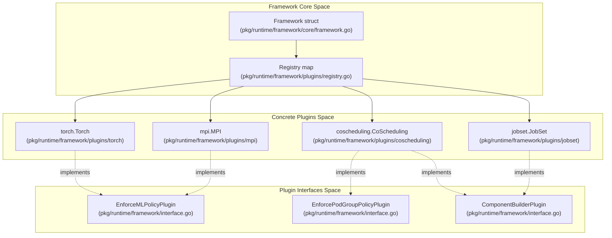
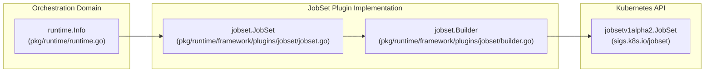

<!-- source: DeepWiki mcp.deepwiki.com · repo kubeflow/trainer · page 4 Runtime Framework and Plugins · fetched 2026-10-21 -->

# Runtime Framework and Plugins

Relevant source files

The following files were used as context for generating this wiki page:

- [pkg/runtime/core/clustertrainingruntime.go](pkg/runtime/core/clustertrainingruntime.go)
- [pkg/runtime/core/trainingruntime.go](pkg/runtime/core/trainingruntime.go)
- [pkg/runtime/framework/core/framework.go](pkg/runtime/framework/core/framework.go)
- [pkg/runtime/framework/core/framework_test.go](pkg/runtime/framework/core/framework_test.go)
- [pkg/runtime/framework/interface.go](pkg/runtime/framework/interface.go)
- [pkg/runtime/framework/plugins/coscheduling/coscheduling.go](pkg/runtime/framework/plugins/coscheduling/coscheduling.go)
- [pkg/runtime/framework/plugins/jobset/builder.go](pkg/runtime/framework/plugins/jobset/builder.go)
- [pkg/runtime/framework/plugins/jobset/jobset.go](pkg/runtime/framework/plugins/jobset/jobset.go)
- [pkg/runtime/framework/plugins/jobset/jobset_test.go](pkg/runtime/framework/plugins/jobset/jobset_test.go)
- [pkg/runtime/framework/plugins/volcano/volcano.go](pkg/runtime/framework/plugins/volcano/volcano.go)
- [pkg/runtime/interface.go](pkg/runtime/interface.go)
- [pkg/runtime/runtime.go](pkg/runtime/runtime.go)

The Runtime Framework is the core plugin-based architecture in Kubeflow Trainer that enables extensibility for different ML frameworks, scheduling policies, and orchestration patterns. This page provides a high-level overview of the runtime framework and its plugins. For detailed technical information, refer to the child sections linked below.

Sources: [pkg/runtime/framework/core/framework.go:38-173](), [pkg/runtime/framework/interface.go:30-84]()

---

## 4.1 Plugin Architecture Overview

The framework orchestrator (`Framework`) manages plugin lifecycles, registering them into specific interface buckets (`EnforceMLPolicyPlugin`, `EnforcePodGroupPolicyPlugin`, `EnforcePodSpecPlugin`, `PreComponentBuilderPlugin`, `CustomValidationPlugin`, `WatchExtensionPlugin`, `ComponentBuilderPlugin`, and `TrainJobStatusPlugin`) defined in [pkg/runtime/framework/interface.go:30-84] [pkg/runtime/framework/core/framework.go:38-49](). During reconciliation, the runtime resolves `TrainJob` parameters into a `runtime.Info` structure and runs the execution pipeline sequentially.

### Natural Language to Code Entity Mapping: Framework Core

For detailed information on plugin interfaces, the registry, and the execution pipeline, see [Plugin Architecture Overview](#4.1).

Sources: [pkg/runtime/framework/core/framework.go:38-96](), [pkg/runtime/framework/interface.go:30-84]()

---

## 4.2 ML Framework Plugins

ML framework plugins implement `EnforceMLPolicyPlugin` to inject framework-specific configurations, environment variables (such as `PET_*` for PyTorch or `JAX_*` for JAX), and bootstrap logic into trainer containers [pkg/runtime/framework/interface.go:53-56](). Supported frameworks include PyTorch, MPI, JAX, PlainML, XGBoost, and Flux.

For detailed configurations, environment variables, and framework-specific execution patterns, see [ML Framework Plugins](#4.2).

Sources: [pkg/runtime/framework/interface.go:53-56](), [pkg/runtime/framework/core/framework.go:98-107]()

---

## 4.3 JobSet and Pod Orchestration

The JobSet plugin (`jobset.JobSet`) serves as the primary component builder and watch extension plugin, mapping abstract `runtime.Info` structures into Kubernetes `JobSet` resources [pkg/runtime/framework/plugins/jobset/jobset.go:61-75](). It handles `ReplicatedJob` definitions, multi-step workflows, container initializers, and Server-Side Apply patterns.

### Natural Language to Code Entity Mapping: JobSet Orchestration

For detailed specifications on `ReplicatedJob` templates and dependency management, see [JobSet and Pod Orchestration](#4.3).

Sources: [pkg/runtime/framework/plugins/jobset/jobset.go:61-89](), [pkg/runtime/framework/plugins/jobset/builder.go:31-39]()

---

## 4.4 Gang Scheduling and PodGroups

Gang scheduling plugins (`coscheduling.CoScheduling` and `volcano.Volcano`) implement `EnforcePodGroupPolicyPlugin` and `ComponentBuilderPlugin` to configure `PodGroup` objects and scheduler annotations [pkg/runtime/framework/plugins/coscheduling/coscheduling.go:52-75](), [pkg/runtime/framework/plugins/volcano/volcano.go:58-81](). These ensure atomic scheduling of distributed training pods across Kubernetes clusters.

For details on CoScheduling, Volcano, KAI scheduler integration, and Kueue support, see [Gang Scheduling and PodGroups](#4.4).

Sources: [pkg/runtime/framework/plugins/coscheduling/coscheduling.go:52-91](), [pkg/runtime/framework/plugins/volcano/volcano.go:58-81]()

---

## 4.5 Predefined Runtime Definitions

Kubeflow Trainer provides built-in `ClusterTrainingRuntime` definitions (such as `torch-distributed`, `deepspeed-distributed`, `jax-distributed`, `mlx-distributed`, `xgboost-distributed`, and data-cache variants) along with specialized TorchTune runtime configurations for LLM fine-tuning [pkg/runtime/core/clustertrainingruntime.go:42-51]().

For a complete inventory of runtime definitions, container images, and TorchTune recipe mappings, see [Predefined Runtime Definitions](#4.5).

Sources: [pkg/runtime/core/clustertrainingruntime.go:42-51]()

---

## 4.6 TrainJob Status Server

The runtime status server (`pkg/statusserver`) collects real-time training metrics, progress, and status updates from trainer containers via an HTTP API protected by TLS and token authorization. The `TrainJobStatus` plugin injects these server credentials into trainer pods.

For details on the HTTP endpoints, `TrainerStatus` data structures, and status collection mechanisms, see [TrainJob Status Server](#4.6).

Sources: [pkg/runtime/framework/core/framework.go:175-180]()

---

