# Page: Overview

# Overview

<details>
<summary>Relevant source files</summary>

The following files were used as context for generating this wiki page:

- [ADOPTERS.md](ADOPTERS.md)
- [CONTRIBUTING.md](CONTRIBUTING.md)
- [README.md](README.md)
- [ROADMAP.md](ROADMAP.md)
- [cmd/trainer-controller-manager/Dockerfile](cmd/trainer-controller-manager/Dockerfile)

</details>


## Purpose and Scope

Kubeflow Trainer is a Kubernetes-native distributed AI platform designed for scalable training and fine-tuning of machine learning models across diverse frameworks, including PyTorch, JAX, DeepSpeed, MLX, XGBoost, and Flux [README.md:49-51](). It provides a unified, declarative API (`TrainJob`) that streamlines multi-node, multi-GPU distributed jobs and high-performance computing (HPC) workflows on Kubernetes clusters [README.md:49-57]().

The project supersedes the legacy Training Operator V1 (PyTorchJob, TFJob, MPIJob, XGBoostJob) with a unified `TrainJob` API architecture and decoupled runtime framework [README.md:121-129](). It leverages modern Kubernetes orchestration primitives like `JobSet` and `LeaderWorkerSet` (`LWS`) to manage complex distributed topologies [README.md:64-66](). 

This document provides a high-level introduction to Kubeflow Trainer's capabilities and system design. Since this is a parent page, detailed architectural information, core API definitions, and documentation resources are maintained in its child pages:
*   For detailed architectural information, see [System Architecture](#1.1).
*   For core concepts and terminology definitions, see [Key Concepts and Terminology](#1.2).
*   For documentation site structures and KEP-style design proposals, see [Documentation Site and Design Proposals](#1.3).

Sources: [README.md:49-66](), [README.md:121-129]()

## Core Capabilities

### Multi-Framework Training Support
Kubeflow Trainer abstracts framework-specific configurations through an extensible plugin architecture [README.md:49-57](). It supports high-performance communication protocols like MPI, making it ideal for large-scale training requiring fast synchronization between GPU nodes [README.md:49-57]().

| Framework | Key Capabilities |
|-----------|------------------|
| **PyTorch** | Support for DDP, `torchrun`, and TorchTune-based LLM fine-tuning [README.md:49-57](), [ROADMAP.md:48-50](). |
| **JAX** | Distributed JAX initialization with environment variable injection for coordinators [ROADMAP.md:32-32](). |
| **XGBoost** | Distributed gradient boosting using Rabit-based coordination [ROADMAP.md:33-33](). |
| **Flux** | Integration with the Flux HPC framework for complex scheduling and MPI workloads [README.md:40-42](), [ROADMAP.md:13-13](). |
| **DeepSpeed** | Optimized multi-node GPU execution with ZeRO optimizations [ROADMAP.md:53-53](). |

Sources: [README.md:49-57](), [ROADMAP.md:13-33](), [ROADMAP.md:48-53]()

### Distributed Data Cache
The platform features a distributed data cache designed to stream large-scale datasets with zero-copy transfer directly to GPU nodes [README.md:68-71](). This system maximizes GPU utilization by reducing I/O bottlenecks during training [README.md:68-71](). The implementation utilizes a Rust-based core for high-performance data handling [ROADMAP.md:46-46]().

Sources: [README.md:68-71](), [ROADMAP.md:46-46]()

### Python SDK
The Kubeflow Python SDK allows AI practitioners to develop and fine-tune models programmatically [README.md:72-74](). It supports `BuiltinTrainer` for config-driven training (e.g., TorchTune) and `CustomTrainer` for user-defined functions [README.md:72-74](). The SDK can manage local training via local backends or containerized backends like Docker and Podman [ROADMAP.md:45-45]().

Sources: [README.md:72-74](), [ROADMAP.md:45-45]()

## System Components

### Code Entity Bridge: Controller Logic
The following diagram maps high-level functional requirements to the primary entities within the controller and runtime framework.

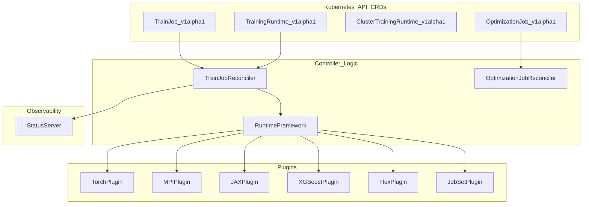
Sources: [README.md:49-74](), [ROADMAP.md:13-33]()

### Code Entity Bridge: Build and Artifacts
This diagram illustrates how the various language stacks in the repository converge into deployable artifacts via the build system.

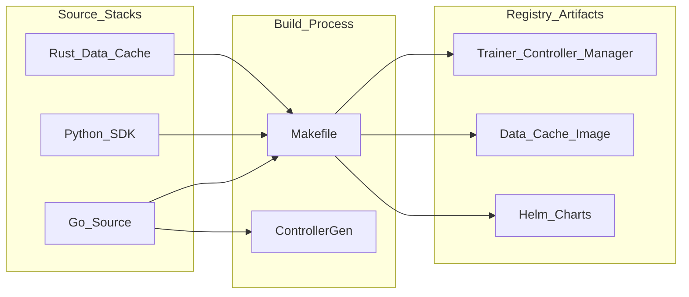
Sources: [cmd/trainer-controller-manager/Dockerfile:15-34](), [CONTRIBUTING.md:54-65]()

## Architecture Overview

### TrainJob Execution Workflow
1.  **Job Definition**: A user defines a `TrainJob` specifying the trainer and the `TrainingRuntime` (or `ClusterTrainingRuntime`) to use [README.md:72-74]().
2.  **Initialization**: Initializer containers prepare data and models [README.md:68-71]().
3.  **Orchestration**: The controller translates the `TrainJob` into a `JobSet` or `LeaderWorkerSet` resource for multi-node execution [README.md:64-66]().
4.  **Execution**: Distributed processes are launched across the allocated Pods, utilizing framework-specific plugins (e.g., Torch, JAX, XGBoost) [README.md:49-57]().
5.  **Status Reporting**: The status server collects progress and metrics, exposing them via the `TrainJobStatus` [README.md:20-22]().

Sources: [README.md:20-22](), [README.md:49-74]()

## Deployment and Ecosystem
Kubeflow Trainer is deployed via Helm or Kustomize and integrates with the broader Cloud Native AI ecosystem:
*   **Kueue**: For topology-aware scheduling and multi-cluster job dispatching [README.md:58-60](), [ROADMAP.md:9-10]().
*   **JobSet/LWS**: For managing the lifecycle of groups of Pods and replicated jobs [README.md:64-66]().
*   **Volcano/KAI Scheduler**: For gang scheduling and workload-aware placement [README.md:61-62](), [ROADMAP.md:57-61]().

Sources: [README.md:58-66](), [ROADMAP.md:9-61]()

## Next Steps

*   **System Architecture**: For detailed component interactions and runtime frameworks, see [System Architecture](#1.1).
*   **Key Concepts and Terminology**: For comprehensive definitions of core APIs, plugins, and custom resources, see [Key Concepts and Terminology](#1.2).
*   **Documentation and Proposals**: For guides on Sphinx docs and KEP-style design proposals, see [Documentation Site and Design Proposals](#1.3).
*   **Custom Resources**: For deep dives into CRD specifications, see [Custom Resources and APIs](#2).

Sources: [README.md:49-74](), [ROADMAP.md:9-61]()

---

# Page: System Architecture

# System Architecture

<details>
<summary>Relevant source files</summary>

The following files were used as context for generating this wiki page:

- [Makefile](Makefile)
- [api/python_api/kubeflow_trainer_api/models/jobset_v1alpha2_failure_policy_rule.py](api/python_api/kubeflow_trainer_api/models/jobset_v1alpha2_failure_policy_rule.py)
- [go.mod](go.mod)
- [go.sum](go.sum)
- [manifests/base/rbac/role.yaml](manifests/base/rbac/role.yaml)
- [manifests/third-party/jobset/kustomization.yaml](manifests/third-party/jobset/kustomization.yaml)
- [pkg/controller/trainjob_controller.go](pkg/controller/trainjob_controller.go)
- [pkg/runtime/framework/core/framework.go](pkg/runtime/framework/core/framework.go)
- [pkg/runtime/framework/interface.go](pkg/runtime/framework/interface.go)
- [pkg/runtime/framework/plugins/coscheduling/coscheduling.go](pkg/runtime/framework/plugins/coscheduling/coscheduling.go)
- [pkg/runtime/framework/plugins/jobset/jobset.go](pkg/runtime/framework/plugins/jobset/jobset.go)
- [pkg/runtime/framework/plugins/jobset/jobset_test.go](pkg/runtime/framework/plugins/jobset/jobset_test.go)
- [pkg/runtime/framework/plugins/volcano/volcano.go](pkg/runtime/framework/plugins/volcano/volcano.go)
- [pkg/runtime/runtime.go](pkg/runtime/runtime.go)

</details>


## Purpose and Scope

This document details the overall system architecture of Kubeflow Trainer, explaining how the control plane, runtime framework, and execution layer work together to orchestrate distributed training jobs. It covers the `TrainJob` controller reconciliation flow, the plugin-based runtime system, runtime snapshotting (KEP-2599), and the generation of Kubernetes resources.

For information about specific Custom Resource schemas and their fields, see [TrainJob API]() and [TrainingRuntime and ClusterTrainingRuntime APIs](). For details about the TrainJob lifecycle and reconciliation, see [TrainJob Lifecycle and Controller](). For plugin-specific implementation details, see [Runtime Framework and Plugins]().

Sources: [pkg/controller/trainjob_controller.go:51-141](), [pkg/runtime/framework/core/framework.go:38-96](), [pkg/runtime/runtime.go:36-61]()

## Architecture Overview

Kubeflow Trainer follows a layered architecture with clear separation between the control plane, runtime abstraction, and execution layers. The system is designed to leverage `JobSet` as the underlying orchestration engine while providing a high-level API for ML practitioners.

### Component Interaction Diagram

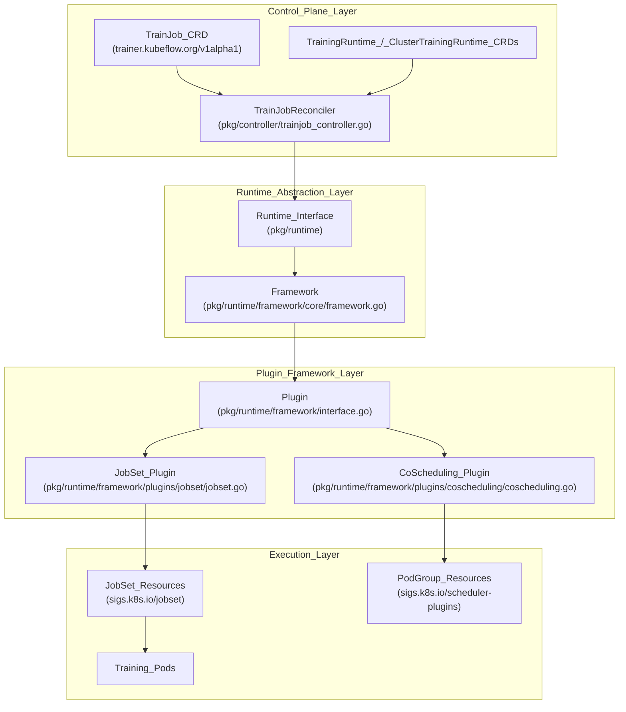

Sources: [pkg/controller/trainjob_controller.go:51-141](), [pkg/runtime/framework/core/framework.go:38-96](), [pkg/runtime/framework/interface.go:30-84]()

## Control Plane & Component Initialization

### Controller Manager and Configuration

The controller manager initializes the core control loop via `TrainJobReconciler` defined in [pkg/controller/trainjob_controller.go:51-76](). The reconciler watches `TrainJob` instances, resolves their associated runtimes, and drives reconciliation of execution objects through [pkg/controller/trainjob_controller.go:85-141]().

Sources: [pkg/controller/trainjob_controller.go:51-141]()

### Natural Language to Code Entity Mapping: Reconciliation Flow

```mermaid
graph TD
    ReconcileEntry[""pkg/controller.TrainJobReconciler.Reconcile()""] --> GetTrainJob[""r.client.Get()""]
    GetTrainJob --> CheckFinished[""trainjob.IsTrainJobFinished()""]
    CheckFinished -- "Active" --> ReconcileObjs[""pkg/controller.TrainJobReconciler.reconcileObjects()""]
    ReconcileObjs --> NewObjects[""runtime.NewObjects()""]
    NewObjects --> ApplyObjects[""r.client.Apply()""]
    CheckFinished -- "Finished" --> DeadlineCheck[""pkg/controller.TrainJobReconciler.reconcileDeadline()""]
    ApplyObjects --> DeadlineCheck
```

Sources: [pkg/controller/trainjob_controller.go:85-154]()

### Custom Resource Definitions

The control plane defines primary CRDs in the `trainer.kubeflow.org` API group as reflected in [manifests/base/rbac/role.yaml:114-136]():

| CRD | Scope | Purpose |
|-----|-------|---------|
| `TrainJob` | Namespaced | Represents a distributed training job with trainer configuration, initializers, and runtime reference. |
| `TrainingRuntime` | Namespaced | Defines namespace-scoped runtime templates with ML policies and JobSet specifications. |
| `ClusterTrainingRuntime` | Cluster | Defines cluster-wide runtime templates reusable across namespaces. |

Sources: [manifests/base/rbac/role.yaml:114-136]()

## Runtime System & Code Entity Mapping

### Natural Language to Code Entity Mapping: Runtime Representation and Info Struct

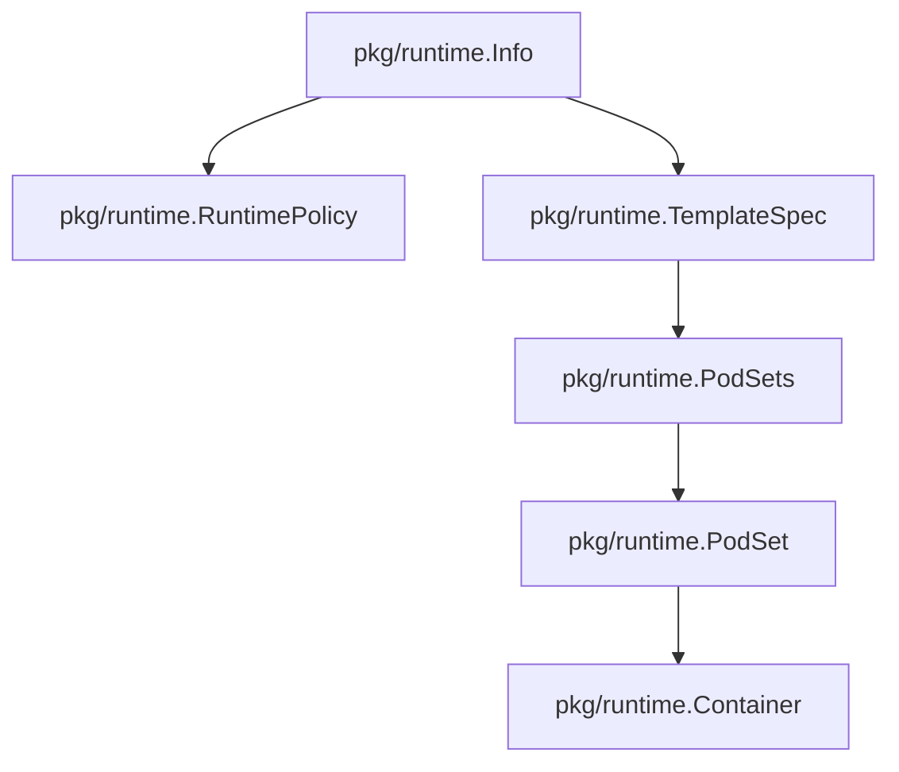

Sources: [pkg/runtime/runtime.go:36-90]()

The runtime system uses `runtime.Info` to represent the normalized execution state parsed from runtime CRDs [pkg/runtime/runtime.go:36-47](). `PodSet` structures group pod specifications and track initialization containers, application containers, volumes, and single pod resource requests [pkg/runtime/runtime.go:66-81]().

Sources: [pkg/runtime/runtime.go:36-90]()

## Plugin Framework

### Framework Architecture

The `Framework` struct manages plugin registration and execution pipelines [pkg/runtime/framework/core/framework.go:38-49](). It inspects registered factories and populates plugin slices based on interfaces implemented, such as `EnforceMLPolicyPlugin`, `EnforcePodGroupPolicyPlugin`, `PreComponentBuilderPlugin`, and `ComponentBuilderPlugin` [pkg/runtime/framework/core/framework.go:51-96]().

Sources: [pkg/runtime/framework/core/framework.go:38-96](), [pkg/runtime/framework/interface.go:30-84]()

### Concrete Plugin Roles

The framework executes a pipeline of plugins to build the final training job resources:

| Plugin Interface | Method | Role |
|------------------|--------|------|
| `EnforceMLPolicyPlugin` | `EnforceMLPolicy` | Injects framework-specific configurations (e.g., Torch, MPI, JAX parameters). |
| `EnforcePodGroupPolicyPlugin` | `EnforcePodGroupPolicy` | Configures gang-scheduling labels and annotations (e.g., `CoScheduling` labels) [pkg/runtime/framework/plugins/coscheduling/coscheduling.go:81-91](). |
| `PreComponentBuilderPlugin` | `PreBuildSync` | Consolidates `Info` with the concrete template (e.g., mapping `PodSet` counts to `JobSet` parallelism). |
| `ComponentBuilderPlugin` | `Build` | Generates actual Kubernetes objects like `JobSet` [pkg/runtime/framework/plugins/jobset/jobset.go:70] or `PodGroup` [pkg/runtime/framework/plugins/coscheduling/coscheduling.go:93-139](). |
| `TrainJobStatusPlugin` | `Status` | Aggregates status information from the underlying execution resources [pkg/runtime/framework/core/framework.go:175-178](). |

Sources: [pkg/runtime/framework/core/framework.go:98-180](), [pkg/runtime/framework/interface.go:30-84](), [pkg/runtime/framework/plugins/coscheduling/coscheduling.go:81-139]()

## Execution Layer

### Resource Generation Flow

The plugin framework generates multiple Kubernetes resources through the `ComponentBuilderPlugin` interface invoked during reconciliation via `TrainJobReconciler.reconcileObjects` [pkg/controller/trainjob_controller.go:143-154]().

```mermaid
graph TB
    TrainJobReconciler[""TrainJobReconciler.reconcileObjects()""]
    Framework[""pkg/runtime/framework/core/Framework.RunComponentBuilderPlugins()""]
    
    subgraph "Plugins_ComponentBuilderPlugin"
        JobSetPlugin[""jobset.Build()""]
        CoSchedulingPlugin[""coscheduling.Build()""]
    end
    
    Apply[""r.client.Apply()""]
    
    TrainJobReconciler --> Framework
    Framework --> JobSetPlugin
    Framework --> CoSchedulingPlugin
    
    JobSetPlugin --> Apply
    CoSchedulingPlugin --> Apply
```

Sources: [pkg/controller/trainjob_controller.go:143-154](), [pkg/runtime/framework/core/framework.go:163-173](), [pkg/runtime/framework/plugins/coscheduling/coscheduling.go:93-139]()

---

# Page: Key Concepts and Terminology

# Key Concepts and Terminology

<details>
<summary>Relevant source files</summary>

The following files were used as context for generating this wiki page:

- [api/openapi-spec/swagger.json](api/openapi-spec/swagger.json)
- [charts/kubeflow-trainer/templates/crd/trainer.kubeflow.org_trainjobs.yaml](charts/kubeflow-trainer/templates/crd/trainer.kubeflow.org_trainjobs.yaml)
- [manifests/base/crds/trainer.kubeflow.org_trainjobs.yaml](manifests/base/crds/trainer.kubeflow.org_trainjobs.yaml)
- [pkg/apis/trainer/v1alpha1/trainjob_types.go](pkg/apis/trainer/v1alpha1/trainjob_types.go)
- [pkg/apis/trainer/v1alpha1/zz_generated.deepcopy.go](pkg/apis/trainer/v1alpha1/zz_generated.deepcopy.go)
- [pkg/apis/trainer/v1alpha1/zz_generated.openapi.go](pkg/apis/trainer/v1alpha1/zz_generated.openapi.go)
- [pkg/runtime/core/core.go](pkg/runtime/core/core.go)
- [pkg/runtime/core/core_test.go](pkg/runtime/core/core_test.go)
- [pkg/runtime/core/registry.go](pkg/runtime/core/registry.go)
- [pkg/runtime/core/snapshot.go](pkg/runtime/core/snapshot.go)
- [pkg/runtime/core/snapshot_test.go](pkg/runtime/core/snapshot_test.go)
- [proposals/2170-kubeflow-trainer-v2/README.md](proposals/2170-kubeflow-trainer-v2/README.md)
- [test/integration/webhooks/trainjob_test.go](test/integration/webhooks/trainjob_test.go)

</details>


This page defines and explains the core terms used throughout the Kubeflow Trainer codebase. Coverage is focused on the meanings of API types, fields, and architectural abstractions, referencing their concrete code implementations. For full API field references, see [2.1]() (TrainJob) and [2.2]() (TrainingRuntime). For the controller lifecycle that processes these objects, see [2.3](). For plugin implementations, see [4]().

Sources: [pkg/apis/trainer/v1alpha1/trainjob_types.go:40-178](), [pkg/apis/trainer/v1alpha1/trainingruntime_types.go:43-89]()

---

## Custom Resources

Kubeflow Trainer defines four Kubernetes Custom Resource Definitions (CRDs) in the `trainer.kubeflow.org/v1alpha1` API group.

| Resource (plural) | Kind | Scope | Go type | File |
|---|---|---|---|---|
| `trainjobs` | `TrainJob` | Namespaced | `TrainJob` | [pkg/apis/trainer/v1alpha1/trainjob_types.go:40-54]() |
| `trainingruntimes` | `TrainingRuntime` | Namespaced | `TrainingRuntime` | [pkg/apis/trainer/v1alpha1/trainingruntime_types.go:79-89]() |
| `clustertrainingruntimes` | `ClusterTrainingRuntime` | Cluster | `ClusterTrainingRuntime` | [pkg/apis/trainer/v1alpha1/trainingruntime_types.go:43-53]() |
| `optimizationjobs` | `OptimizationJob` | Namespaced | `OptimizationJob` | [pkg/apis/trainer/v1alpha1/optimizationjob_types.go:34-48]() |

### CRD Relationship Map

Title: "Relationship between TrainJob and Runtime Resources"
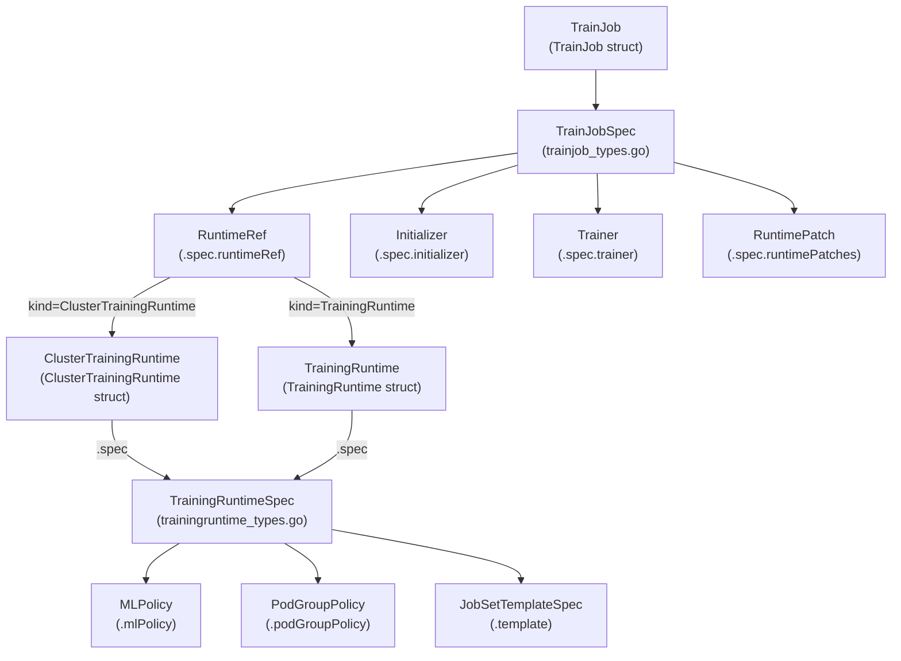
Sources: [pkg/apis/trainer/v1alpha1/trainjob_types.go:40-178](), [pkg/apis/trainer/v1alpha1/trainingruntime_types.go:43-89](), [pkg/apis/trainer/v1alpha1/zz_generated.openapi.go:36-75]()

---

## TrainJob

`TrainJob` is the primary object submitted by users. It expresses *what* to train — the container image, number of nodes, resources, and data sources — and delegates infrastructure decisions (network topology, process group configuration, scheduling) to the referenced runtime.

### TrainJobSpec Fields

| Field | Go type | Mutable after creation | Purpose |
|---|---|---|---|
| `runtimeRef` | `RuntimeRef` | No | Points to a `TrainingRuntime` or `ClusterTrainingRuntime` [pkg/apis/trainer/v1alpha1/trainjob_types.go:103-106]() |
| `trainer` | `*Trainer` | No | Training container: image, command, args, resources, env [pkg/apis/trainer/v1alpha1/trainjob_types.go:113-116]() |
| `initializer` | `*Initializer` | No | Dataset and model download configuration [pkg/apis/trainer/v1alpha1/trainjob_types.go:108-111]() |
| `runtimePatches` | `[]RuntimePatch` | Yes | SSA patches for runtime templates [pkg/apis/trainer/v1alpha1/trainjob_types.go:118-124]() |
| `suspend` | `*bool` | Yes | Pauses execution; defaults to `false` [pkg/apis/trainer/v1alpha1/trainjob_types.go:126-129]() |
| `managedBy` | `*string` | No | Identifies the reconciling controller [pkg/apis/trainer/v1alpha1/trainjob_types.go:141-152]() |
| `activeDeadlineSeconds` | `int64` | No | Max duration before termination [pkg/apis/trainer/v1alpha1/trainjob_types.go:131-139]() |

The `managedBy` field accepts two values:
- `trainer.kubeflow.org/trainjob-controller` (default)
- `kueue.x-k8s.io/multikueue` [pkg/apis/trainer/v1alpha1/trainjob_types.go:141-152]()

Sources: [pkg/apis/trainer/v1alpha1/trainjob_types.go:102-153](), [manifests/base/crds/trainer.kubeflow.org_trainjobs.yaml:49-152](), [test/integration/webhooks/trainjob_test.go:89-113]()

---

## TrainingRuntime and ClusterTrainingRuntime

A **runtime** is a reusable template that defines how a training job's Pods are structured and coordinated. It contains three main sections defined in `TrainingRuntimeSpec`:

1. **`mlPolicy`** — ML framework parameters (process count, framework settings) [pkg/apis/trainer/v1alpha1/zz_generated.openapi.go:60-62]()
2. **`podGroupPolicy`** — gang-scheduling configuration [pkg/apis/trainer/v1alpha1/zz_generated.openapi.go:59-60]()
3. **`template`** — a `JobSetTemplateSpec` describing the set of Kubernetes Jobs [pkg/apis/trainer/v1alpha1/zz_generated.openapi.go:50-50]()

`TrainingRuntime` (`pkg/runtime/core/trainingruntime.go`) is namespace-scoped, while `ClusterTrainingRuntime` (`pkg/runtime/core/clustertrainingruntime.go`) is cluster-scoped. Both use the `TrainingRuntimeSpec` Go type [pkg/apis/trainer/v1alpha1/trainingruntime_types.go:43-89]().

Sources: [pkg/runtime/core/trainingruntime.go:56-86](), [pkg/runtime/core/clustertrainingruntime.go:42-57](), [pkg/apis/trainer/v1alpha1/trainingruntime_types.go:43-89]()

---

## OptimizationJob

`OptimizationJob` (KEP-2605) is used for hyperparameter optimization. It manages a set of `TrainJob` trials to find the best configuration based on defined objectives.

### Core Optimization Concepts

*   **Objective**: Specifies the metric to track and the direction (`Minimize` or `Maximize`) [pkg/apis/trainer/v1alpha1/zz_generated.openapi.go:62-62]().
*   **SearchSpace**: Defines the range of hyperparameters using `Uniform`, `LogUniform`, or `Categorical` types [pkg/apis/trainer/v1alpha1/zz_generated.openapi.go:79-79]().
*   **SearchAlgorithm**: The algorithm used to suggest new parameters, such as `Grid` or `Random` [pkg/apis/trainer/v1alpha1/zz_generated.openapi.go:78-78]().

### OptimizationJob Orchestration Flow

Title: "OptimizationJob to TrainJob Orchestration"
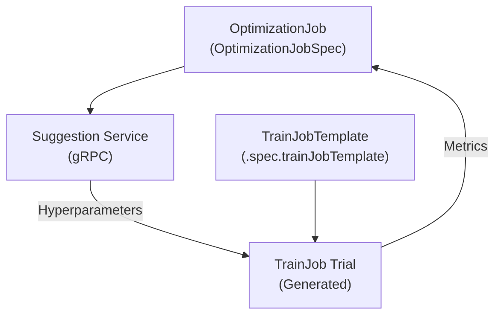
Sources: [pkg/apis/trainer/v1alpha1/optimizationjob_types.go:34-48](), [pkg/apis/trainer/v1alpha1/zz_generated.openapi.go:63-79]()

---

## mlPolicy

`MLPolicy` provides framework-specific parameters within a training runtime.

### MLPolicy Sources

| Field | Type | Description |
|---|---|---|
| `numNodes` | `*int32` | Total number of training nodes [manifests/base/crds/trainer.kubeflow.org_clustertrainingruntimes.yaml:114-119]() |
| `torch` | `*TorchMLPolicySource` | PyTorch/TorchTune settings [manifests/base/crds/trainer.kubeflow.org_clustertrainingruntimes.yaml:120-121]() |
| `mpi` | `*MPIMLPolicySource` | MPI-specific settings [manifests/base/crds/trainer.kubeflow.org_clustertrainingruntimes.yaml:80-81]() |
| `jax` | `*JAXMLPolicySource` | JAX settings [manifests/base/crds/trainer.kubeflow.org_clustertrainingruntimes.yaml:77-79]() |
| `xgboost` | `*XGBoostMLPolicySource` | XGBoost Rabit settings [pkg/apis/trainer/v1alpha1/zz_generated.openapi.go:79-79]() |
| `flux` | `*FluxMLPolicySource` | Flux HPC manager settings [manifests/base/crds/trainer.kubeflow.org_clustertrainingruntimes.yaml:64-65]() |

### MLPolicy to Plugin Dispatch

Title: "Mapping MLPolicy to Framework Plugins"
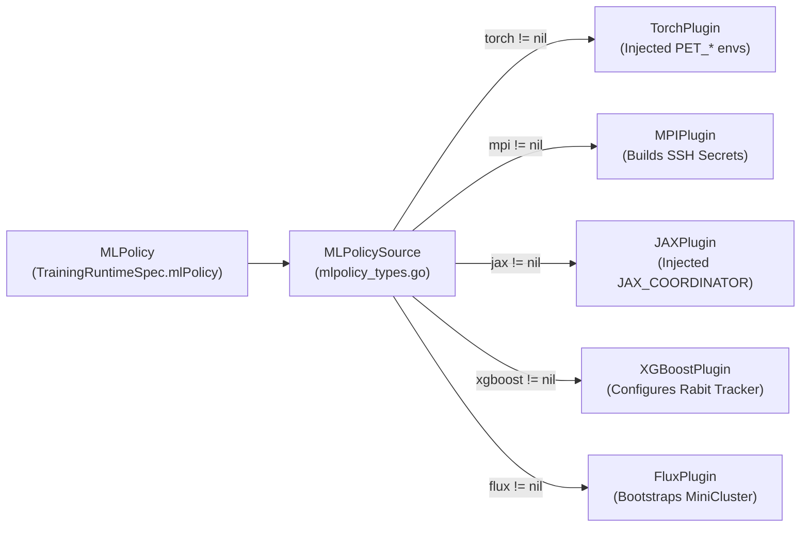
Sources: [pkg/apis/trainer/v1alpha1/zz_generated.openapi.go:54-79](), [manifests/base/crds/trainer.kubeflow.org_clustertrainingruntimes.yaml:60-121](), [pkg/apis/trainer/v1alpha1/trainjob_types.go:155-178]()

---

## ReplicatedJobs

A **replicatedJob** is a group of identical Kubernetes Jobs within a `JobSet`. Kubeflow Trainer uses reserved names to identify roles within the training workflow.

| Constant | String value | Role |
|---|---|---|
| `constants.DatasetInitializer` | `"dataset-initializer"` | Prepares data [pkg/runtime/framework/plugins/jobset/builder.go:49]() |
| `constants.ModelInitializer` | `"model-initializer"` | Prepares models [pkg/runtime/framework/plugins/jobset/builder.go:75]() |
| `constants.Node` | `"node"` | Main training worker [pkg/runtime/framework/plugins/jobset/builder.go:126]() |

Sources: [pkg/runtime/framework/plugins/jobset/builder.go:42-139]()

---

## Initializers

**Initializers** prepare data and models using the `storageUri` configuration provided in the `TrainJob` and implemented via `Builder` in `pkg/runtime/framework/plugins/jobset/builder.go`.

- **DatasetInitializer**: Configured via `TrainJob.spec.initializer.dataset`. Used for dataset initialization and pre-processing [pkg/runtime/framework/plugins/jobset/builder.go:55]().
- **ModelInitializer**: Configured via `TrainJob.spec.initializer.model`. Used for pre-trained model initialization [pkg/runtime/framework/plugins/jobset/builder.go:81]().

Sources: [pkg/runtime/framework/plugins/jobset/builder.go:42-99]()

---

## Plugin Framework

The **plugin framework** enables modular logic for framework and scheduling integration, instantiated via `core.NewTrainingRuntime` [pkg/runtime/core/trainingruntime.go:70-86]().

### Plugin Interfaces

The framework defines several interfaces for plugins to hook into the lifecycle:
- **`EnforceMLPolicy`**: Injects ML-specific configurations (e.g., environment variables) into the JobSet.
- **`ComponentBuilder`**: Creates auxiliary Kubernetes objects like Secrets or ConfigMaps via `RunComponentBuilderPlugins` [pkg/runtime/core/trainingruntime.go:112]().
- **`EnforcePodGroupPolicy`**: Configures gang-scheduling resources.
- **`CustomValidation`**: Provides additional validation logic for specific runtimes via `ValidateObjects` [pkg/runtime/core/clustertrainingruntime.go:99-140]().

### Code Entity Execution Pipeline

Title: "Code Entity Execution Pipeline for Runtimes"
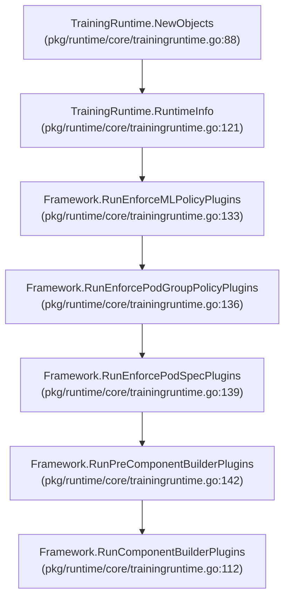
Sources: [pkg/runtime/core/trainingruntime.go:88-147]()

---

## JobSet and PodGroups

`JobSet` (`sigs.k8s.io/jobset`) is the compute orchestration primitive. The `TrainingRuntime` template embeds a `JobSetSpec` which the controller uses to create the training workload [pkg/apis/trainer/v1alpha1/zz_generated.openapi.go:52-52]().

### Gang Scheduling
`PodGroup` objects are created to ensure all pods start together. Trainer supports:
- **Coscheduling**: Uses the Kubernetes scheduler-plugins `PodGroup` API [pkg/apis/trainer/v1alpha1/zz_generated.openapi.go:42-42]().
- **Volcano**: Uses the Volcano `PodGroup` API [pkg/apis/trainer/v1alpha1/zz_generated.openapi.go:165-169]().

Sources: [pkg/apis/trainer/v1alpha1/zz_generated.openapi.go:41-78](), [pkg/apis/trainer/v1alpha1/trainingruntime_types.go:102-120]()

---

## Glossary

| Term | Definition |
|---|---|
| `TrainJob` | The primary CRD representing a training task [pkg/apis/trainer/v1alpha1/trainjob_types.go:40](). |
| `RuntimePatch` | Overrides applied to the referenced runtime [pkg/apis/trainer/v1alpha1/trainjob_types.go:118-124](). |
| `OptimizationJob` | CRD for hyperparameter optimization and trial management [pkg/apis/trainer/v1alpha1/optimizationjob_types.go:34](). |
| `PET_*` | Environment variables for distributed PyTorch injected by the Torch plugin [manifests/base/crds/trainer.kubeflow.org_clustertrainingruntimes.yaml:124-130](). |
| `ActiveDeadlineSeconds` | Field that terminates the job if it exceeds a time limit [pkg/apis/trainer/v1alpha1/trainjob_types.go:131-139](). |
| `ManagedBy` | Identifies which controller reconciles the TrainJob [pkg/apis/trainer/v1alpha1/trainjob_types.go:141-152](). |
| `MLPolicy` | Specification of ML framework parameters in a runtime [pkg/apis/trainer/v1alpha1/zz_generated.openapi.go:57-57](). |

Sources: [pkg/apis/trainer/v1alpha1/trainjob_types.go:40-153](), [pkg/apis/trainer/v1alpha1/zz_generated.openapi.go:41-79](), [manifests/base/crds/trainer.kubeflow.org_clustertrainingruntimes.yaml:124-130]()

---

# Page: Documentation Site and Design Proposals

# Documentation Site and Design Proposals

<details>
<summary>Relevant source files</summary>

The following files were used as context for generating this wiki page:

- [docs/_ext/kubeflow_topnav/topnav.html](docs/_ext/kubeflow_topnav/topnav.html)
- [docs/_static/css/custom.css](docs/_static/css/custom.css)
- [docs/_static/img/kubeflow-trainer-icon.png](docs/_static/img/kubeflow-trainer-icon.png)
- [docs/conf.py](docs/conf.py)
- [docs/contributor-guides/community.md](docs/contributor-guides/community.md)
- [docs/contributor-guides/contributing.md](docs/contributor-guides/contributing.md)
- [docs/contributor-guides/index.md](docs/contributor-guides/index.md)
- [docs/index.rst](docs/index.rst)
- [docs/operator-guides/index.md](docs/operator-guides/index.md)
- [docs/operator-guides/job-scheduling/index.md](docs/operator-guides/job-scheduling/index.md)
- [docs/operator-guides/job-scheduling/overview.md](docs/operator-guides/job-scheduling/overview.md)
- [docs/overview/index.md](docs/overview/index.md)
- [docs/user-guides/deepspeed.md](docs/user-guides/deepspeed.md)
- [docs/user-guides/flux.md](docs/user-guides/flux.md)
- [docs/user-guides/index.md](docs/user-guides/index.md)
- [docs/user-guides/jax-tpu.md](docs/user-guides/jax-tpu.md)
- [docs/user-guides/trainjob-progress.md](docs/user-guides/trainjob-progress.md)
- [proposals/2782-dra-support/README.md](proposals/2782-dra-support/README.md)

</details>


## Purpose and Scope

This section details the structure, build system, and organization of the Kubeflow Trainer documentation site located under `docs/` and the Kubernetes Enhancement Proposal (KEP)-style design documents located under `proposals/`. The documentation site is built using Sphinx with the Furo theme and custom styling, providing targeted guidance for AI practitioners, platform administrators, and contributors. Concurrently, the `proposals/` directory houses architectural design specs that drive feature development across core controllers, APIs, and plugins.

**Sources:**
- `docs/conf.py`
- `proposals/2782-dra-support/README.md`

---

## Sphinx Documentation Architecture (`docs/`)

The documentation site source is structured hierarchically to separate user guides, operator guides, contributor documentation, and archived legacy artifacts. Configuration and build scripts reside at the root of the `docs/` directory (`docs/conf.py`).

The directory layout includes:
- `docs/overview/`: General project introduction, architecture summary, and persona-based navigation [docs/overview/index.md:1-135]().
- `docs/getting-started/`: Quick start tutorials and installation guides.
- `docs/user-guides/`: Documentation for ML engineers covering PyTorch, JAX, DeepSpeed, MLX, and TorchTune. Examples include `docs/user-guides/flux.md` for Flux Framework and `docs/user-guides/deepspeed.md` for DeepSpeed.
- `docs/operator-guides/`: Guides for platform administrators on installation, runtimes, ML policies, and job scheduling [docs/operator-guides/index.md:1-100](). This includes detailed sections on job scheduling integrations like Kueue, Slurm Bridge, KAI Scheduler, Coscheduling, and Volcano [docs/operator-guides/job-scheduling/overview.md:1-47]().
- `docs/contributor-guides/`: Developer documentation, contribution workflows, and community guidelines [docs/contributor-guides/index.md:1-34](). This includes `docs/contributor-guides/contributing.md` and `docs/contributor-guides/community.md`.
- `docs/legacy-v1/`: Archived documentation for Kubeflow Training Operator v1 and migration guides to v2.

The documentation uses a custom CSS file (`docs/_static/css/custom.css`) to align with the Kubeflow SDK visual language, defining color palettes, navigation bar styles, and heading styles [docs/_static/css/custom.css:1-271](). The top navigation bar is defined in `docs/_ext/kubeflow_topnav/topnav.html` [docs/_ext/kubeflow_topnav/topnav.html:1-46]().

```mermaid
graph TD
    RootConfig["docs/conf.py"] --> IndexRst["docs/index.rst"]
    IndexRst --> Overview["docs/overview/index.md"]
    IndexRst --> UserGuides["docs/user-guides/index.md"]
    IndexRst --> OperatorGuides["docs/operator-guides/index.md"]
    IndexRst --> ContributorGuides["docs/contributor-guides/index.md"]
    IndexRst --> LegacyV1["docs/legacy-v1/index.md"]

    UserGuides --> UG_Flux["docs/user-guides/flux.md"]
    UserGuides --> UG_DeepSpeed["docs/user-guides/deepspeed.md"]
    UserGuides --> UG_JAX_TPU["docs/user-guides/jax-tpu.md"]
    UserGuides --> UG_TrainJobProgress["docs/user-guides/trainjob-progress.md"]

    OperatorGuides --> OpInst["docs/operator-guides/installation.md"]
    OperatorGuides --> OpRuntime["docs/operator-guides/runtime.md"]
    OperatorGuides --> OpSchedIndex["docs/operator-guides/job-scheduling/index.md"]

    OpSchedIndex --> OpSchedOverview["docs/operator-guides/job-scheduling/overview.md"]
    OpSchedIndex --> OpSchedKueue["Kueue (External Link)"]
    OpSchedIndex --> OpSchedSlurm["docs/operator-guides/job-scheduling/slurm-bridge.md"]
    OpSchedIndex --> OpSchedKAI["docs/operator-guides/job-scheduling/kai.md"]
    OpSchedIndex --> OpSchedCoscheduling["docs/operator-guides/job-scheduling/coscheduling.md"]
    OpSchedIndex --> OpSchedVolcano["docs/operator-guides/job-scheduling/volcano.md"]

    ContributorGuides --> CG_Contributing["docs/contributor-guides/contributing.md"]
    ContributorGuides --> CG_Community["docs/contributor-guides/community.md"]

    StyleSheet["docs/_static/css/custom.css"]
    TopNavHTML["docs/_ext/kubeflow_topnav/topnav.html"]

    IndexRst -- "Uses" --> StyleSheet
    IndexRst -- "Uses" --> TopNavHTML
```
*Diagram 1: Mapping of Sphinx documentation pages in Natural Language Space (`docs/`) to configuration and guide modules in Code Entity Space.*

**Sources:**
- `docs/conf.py`
- `docs/index.rst` [docs/index.rst:1-118]()
- `docs/overview/index.md` [docs/overview/index.md:1-135]()
- `docs/user-guides/index.md`
- `docs/user-guides/flux.md` [docs/user-guides/flux.md:1-141]()
- `docs/user-guides/deepspeed.md` [docs/user-guides/deepspeed.md:1-182]()
- `docs/user-guides/jax-tpu.md` [docs/user-guides/jax-tpu.md:1-196]()
- `docs/user-guides/trainjob-progress.md`
- `docs/operator-guides/index.md` [docs/operator-guides/index.md:1-100]()
- `docs/operator-guides/job-scheduling/index.md` [docs/operator-guides/job-scheduling/index.md:1-66]()
- `docs/operator-guides/job-scheduling/overview.md` [docs/operator-guides/job-scheduling/overview.md:1-47]()
- `docs/contributor-guides/index.md` [docs/contributor-guides/index.md:1-34]()
- `docs/contributor-guides/contributing.md` [docs/contributor-guides/contributing.md:1-4]()
- `docs/contributor-guides/community.md` [docs/contributor-guides/community.md:1-9]()
- `docs/_static/css/custom.css` [docs/_static/css/custom.css:1-271]()
- `docs/_ext/kubeflow_topnav/topnav.html` [docs/_ext/kubeflow_topnav/topnav.html:1-46]()

---

## KEP-Style Design Proposals (`proposals/`)

Feature development in Kubeflow Trainer is guided by rigorous design proposals located in the `proposals/` directory. Each proposal follows a numbered KEP (Kubernetes Enhancement Proposal) format (e.g., `proposals/2605-optimization-job-crd/`, `proposals/2782-dra-support/`), outlining the motivation, proposal specification, alternative designs, and implementation verification plans.

These proposals serve as the upstream specifications for custom resources like `OptimizationJob` and underlying control loops. For example, `proposals/2782-dra-support/README.md` details the design for Dynamic Resource Allocation (DRA) support.

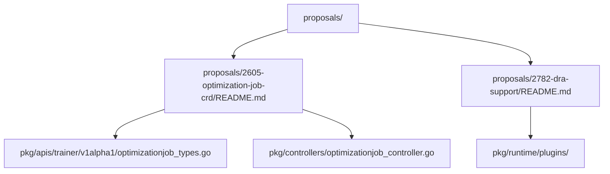
*Diagram 2: Mapping of design proposals in `proposals/` to implementation code entities in `pkg/apis/` and `pkg/controllers/`.*

**Sources:**
- `proposals/2605-optimization-job-crd/README.md`
- `proposals/2782-dra-support/README.md`

---

# Page: Custom Resources and APIs

# Custom Resources and APIs

<details>
<summary>Relevant source files</summary>

The following files were used as context for generating this wiki page:

- [api/openapi-spec/swagger.json](api/openapi-spec/swagger.json)
- [charts/kubeflow-trainer/templates/crd/trainer.kubeflow.org_trainjobs.yaml](charts/kubeflow-trainer/templates/crd/trainer.kubeflow.org_trainjobs.yaml)
- [charts/kubeflow-trainer/tests/crd/crd_test.yaml](charts/kubeflow-trainer/tests/crd/crd_test.yaml)
- [manifests/base/crds/kustomization.yaml](manifests/base/crds/kustomization.yaml)
- [manifests/base/crds/trainer.kubeflow.org_trainjobs.yaml](manifests/base/crds/trainer.kubeflow.org_trainjobs.yaml)
- [pkg/apis/trainer/v1alpha1/trainjob_types.go](pkg/apis/trainer/v1alpha1/trainjob_types.go)
- [pkg/apis/trainer/v1alpha1/zz_generated.deepcopy.go](pkg/apis/trainer/v1alpha1/zz_generated.deepcopy.go)
- [pkg/apis/trainer/v1alpha1/zz_generated.openapi.go](pkg/apis/trainer/v1alpha1/zz_generated.openapi.go)
- [test/integration/webhooks/trainjob_test.go](test/integration/webhooks/trainjob_test.go)

</details>


This page provides an overview of the Kubernetes Custom Resource Definitions (CRDs) that form the declarative API surface of Kubeflow Trainer: **TrainJob**, **TrainingRuntime**, **ClusterTrainingRuntime**, and **OptimizationJob**. These resources enable users to define distributed training jobs, execution environments, and hyperparameter optimization workflows.

As a parent page, this section summarizes high-level concepts and relationships. For detailed specifications, refer to the child pages:
- [TrainJob API](#2.1) — Detailed specification of the TrainJob CRD including spec fields, initializer configuration, trainer settings, RuntimePatches, and ActiveDeadlineSeconds lifecycle management.
- [TrainingRuntime and ClusterTrainingRuntime APIs](#2.2) — Document TrainingRuntime and ClusterTrainingRuntime CRDs, MLPolicy configurations, PodGroupPolicy, JobSet templates, and the runtime snapshot mechanism for mutable runtimes (KEP-2599).
- [TrainJob Lifecycle and Controller](#2.3) — Explain the TrainJobReconciler reconciliation loop, runtime resolution, plugin execution pipeline, object creation, deadline management, and status reporting.
- [Webhooks and Validation](#2.4) — Document admission webhooks for validation and defaulting, RuntimePatch immutability rules, and multi-manager coordination.
- [OptimizationJob API](#2.5) — Document the OptimizationJob CRD (KEP-2605) for hyperparameter optimization, including OptimizationJobSpec fields, SearchSpace types, suggestion service architecture, KUBEFLOW_TRAINER_OPT_* env injection, and status/result tracking.
- [Generated Clients and API Codegen](#2.6) — Document the generated Go clientset/informers/listers/applyconfigurations under `pkg/client`, the OpenAPI swagger spec, the generated Python API models in `api/python_api`, and the codegen scripts.

## Overview of Custom Resources

Kubeflow Trainer defines four core custom resources under the `trainer.kubeflow.org` API group:

| Resource | Scope | Purpose | Code Reference |
|----------|-------|---------|----------------|
| `TrainJob` | Namespaced | Declares training job configurations, dataset/model initializers, and trainer settings. | [`pkg/apis/trainer/v1alpha1/trainjob_types.go:40-54`]() |
| `TrainingRuntime` | Namespaced | Defines reusable runtime templates for specific ML frameworks and JobSets. | [`pkg/apis/trainer/v1alpha1/trainingruntime_types.go:79-89`]() |
| `ClusterTrainingRuntime` | Cluster | Global runtime templates accessible across all namespaces. | [`pkg/apis/trainer/v1alpha1/trainingruntime_types.go:43-53`]() |
| `OptimizationJob` | Namespaced | Orchestrates hyperparameter optimization trials by managing multiple TrainJobs. | [`manifests/base/crds/trainer.kubeflow.org_optimizationjobs.yaml:21-28`]() |

Sources: [`pkg/apis/trainer/v1alpha1/trainjob_types.go:24-54`](), [`pkg/apis/trainer/v1alpha1/trainingruntime_types.go:43-89`](), [`manifests/base/crds/trainer.kubeflow.org_optimizationjobs.yaml:21-28`]()

## Resource Relationships

The relationship between optimization jobs, train jobs, runtime templates, and underlying controller objects is structured to separate user parameters from cluster infrastructure configurations.

### Entity Relationship Diagram

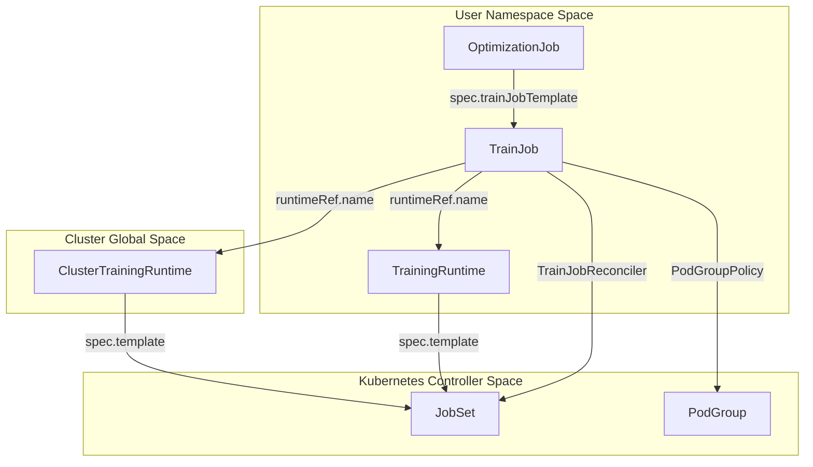

Sources: [`pkg/apis/trainer/v1alpha1/trainjob_types.go:102-106`](), [`pkg/apis/trainer/v1alpha1/trainingruntime_types.go:117-120`](), [`manifests/base/crds/trainer.kubeflow.org_optimizationjobs.yaml:50-580`]()

## API Implementation Space

To bridge natural language concepts to concrete codebase entities, the following diagram maps custom resources and validation webhooks to their corresponding Go types and test packages.

### Code Entity Map

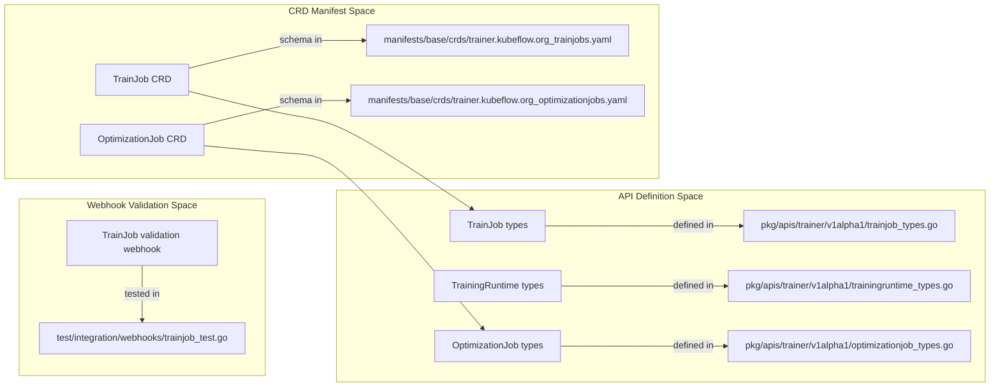

Sources: [`pkg/apis/trainer/v1alpha1/trainjob_types.go:40-54`](), [`pkg/apis/trainer/v1alpha1/trainingruntime_types.go:79-89`](), [`test/integration/webhooks/trainjob_test.go:37-43`](), [`manifests/base/crds/trainer.kubeflow.org_trainjobs.yaml:21-41`]()

## Summary of Core APIs

- **TrainJob**: Combines framework runtimes with dataset and model initialization settings, user trainer commands, runtime patches, and deadline management. For detailed specifications, see [TrainJob API](#2.1).
- **TrainingRuntime and ClusterTrainingRuntime**: Encapsulate framework-specific `MLPolicy` structures (Torch, MPI, JAX, Flux, XGBoost), gang-scheduling policies via `PodGroupPolicy`, and base `JobSet` templates. For details, see [TrainingRuntime and ClusterTrainingRuntime APIs](#2.2).
- **OptimizationJob**: Automates parameter searching using algorithms like Grid and Random search spaces (`CategoricalSpace`, `LogUniformSpace`), communicating parameter assignments via `KUBEFLOW_TRAINER_OPT_*` environment variables. For details, see [OptimizationJob API](#2.5).
- **Validation and Webhooks**: Admission controllers enforce resource immutability rules (such as `spec.runtimeRef`, `spec.initializer`, and `spec.activeDeadlineSeconds`) and validate configuration consistency. For details, see [Webhooks and Validation](#2.4).
- **Clients and Codegen**: Generated Go clientsets, informers, listers, OpenAPI schemas, and Python SDK API models under `api/python_api` and `pkg/client`. For details, see [Generated Clients and API Codegen](#2.6).

Sources: [`pkg/apis/trainer/v1alpha1/trainjob_types.go:101-153`](), [`pkg/apis/trainer/v1alpha1/trainingruntime_types.go:108-120`](), [`test/integration/webhooks/trainjob_test.go:89-164`]()

---

# Page: TrainJob API

# TrainJob API

<details>
<summary>Relevant source files</summary>

The following files were used as context for generating this wiki page:

- [api/openapi-spec/swagger.json](api/openapi-spec/swagger.json)
- [api/python_api/kubeflow_trainer_api/models/trainer_v1alpha1_pod_spec_patch.py](api/python_api/kubeflow_trainer_api/models/trainer_v1alpha1_pod_spec_patch.py)
- [charts/kubeflow-trainer/templates/crd/trainer.kubeflow.org_trainjobs.yaml](charts/kubeflow-trainer/templates/crd/trainer.kubeflow.org_trainjobs.yaml)
- [manifests/base/crds/trainer.kubeflow.org_trainjobs.yaml](manifests/base/crds/trainer.kubeflow.org_trainjobs.yaml)
- [pkg/apis/trainer/v1alpha1/trainjob_types.go](pkg/apis/trainer/v1alpha1/trainjob_types.go)
- [pkg/apis/trainer/v1alpha1/zz_generated.deepcopy.go](pkg/apis/trainer/v1alpha1/zz_generated.deepcopy.go)
- [pkg/apis/trainer/v1alpha1/zz_generated.openapi.go](pkg/apis/trainer/v1alpha1/zz_generated.openapi.go)
- [pkg/client/applyconfiguration/trainer/v1alpha1/podspecpatch.go](pkg/client/applyconfiguration/trainer/v1alpha1/podspecpatch.go)
- [test/integration/webhooks/trainjob_test.go](test/integration/webhooks/trainjob_test.go)

</details>


This page provides a detailed technical specification of the `TrainJob` custom resource, its spec fields, status definitions, immutability rules, and data structures as defined in the Kubeflow Trainer codebase.

For how the controller processes a `TrainJob` and orchestrates downstream Kubernetes resources, see [TrainJob Lifecycle and Controller](#2.3). For the underlying `TrainingRuntime` and `ClusterTrainingRuntime` resources referenced by a `TrainJob`, see [TrainingRuntime and ClusterTrainingRuntime APIs](#2.2). For admission webhook validation and defaulting rules, see [Webhooks and Validation](#2.4).

---

## Resource Identity

| Field | Value |
|---|---|
| API group | `trainer.kubeflow.org` |
| Version | `v1alpha1` |
| Kind | `TrainJob` |
| Plural | `trainjobs` |
| Singular | `trainjob` |
| Scope | Namespaced |

The Custom Resource Definition is declared in [manifests/base/crds/trainer.kubeflow.org_trainjobs.yaml:16-29](). The backing Go type definitions are defined in [pkg/apis/trainer/v1alpha1/trainjob_types.go:40-54](). Helper functions for inspecting TrainJob states and references are implemented in [pkg/util/trainjob/trainjob.go:32-51]().

**Name Constraints:** A `TrainJob` name must conform to RFC 1035 DNS label format (`[a-z]([-a-z0-9]*[a-z0-9])?`) and cannot exceed 63 characters. These rules are enforced via CEL validation expressions on the CRD schema [pkg/apis/trainer/v1alpha1/trainjob_types.go:36-37]().

Sources: [pkg/apis/trainer/v1alpha1/trainjob_types.go:25-54](), [manifests/base/crds/trainer.kubeflow.org_trainjobs.yaml:16-43](), [pkg/util/trainjob/trainjob.go:32-51]()

---

## TrainJobSpec Structure

The diagram below links the Go struct definitions (`TrainJobSpec`), OpenAPI/Python client models (`TrainerV1alpha1TrainJobSpec`), and YAML field names.

**`TrainJobSpec` — Go types, Python models, and YAML keys**

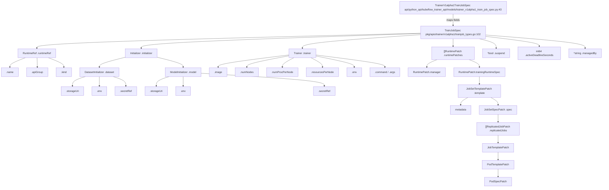

Sources: [pkg/apis/trainer/v1alpha1/trainjob_types.go:102-153](), [api/python_api/kubeflow_trainer_api/models/trainer_v1alpha1_train_job_spec.py:43-60](), [pkg/client/applyconfiguration/trainer/v1alpha1/trainjobspec.go:25-50]()

---

## Spec Fields and Configuration

### runtimeRef

`runtimeRef` is **required** and **immutable**. It identifies the template for the training runtime. Both namespaced `TrainingRuntime` (checked via `RuntimeRefIsTrainingRuntime`) and cluster-scoped `ClusterTrainingRuntime` (checked via `RuntimeRefIsClusterTrainingRuntime`) are supported [pkg/util/trainjob/trainjob.go:43-51]().

| Field | Type | Default | Required | Description |
|---|---|---|---|---|
| `name` | string | — | Yes | Name of the runtime |
| `apiGroup` | string | `trainer.kubeflow.org` | No | API group |
| `kind` | string | `ClusterTrainingRuntime` | No | Kind of runtime resource |

Sources: [pkg/apis/trainer/v1alpha1/trainjob_types.go:156-178](), [pkg/util/trainjob/trainjob.go:43-51](), [test/integration/webhooks/trainjob_test.go:93-113]()

---

### trainer

`trainer` is optional and **immutable**. It configures the training process container parameters, such as image, command, arguments, and hardware resources per node.

| Field | Type | Description |
|---|---|---|
| `image` | `*string` | Training container image |
| `command` | `[]string` | Entrypoint command |
| `args` | `[]string` | Command arguments |
| `numNodes` | `*int32` | Number of replicated nodes for distributed training |
| `resourcesPerNode` | `*corev1.ResourceRequirements` | Resource requests and limits per training Pod |
| `numProcPerNode` | `*int32` | Process count per node (e.g., GPUs per node) |

Resource requirements are merged using strategic merge patch semantics over the base runtime container definition via `MergeResourceRequirements` [pkg/util/trainingruntime/trainingruntime.go:47-65]().

Sources: [pkg/apis/trainer/v1alpha1/trainjob_types.go:113-116](), [pkg/util/trainingruntime/trainingruntime.go:47-65]()

---

### initializer

`initializer` is optional and **immutable**. It configures dataset and model initialization steps prior to running the training container.

| Field | Type | Description |
|---|---|---|
| `dataset` | `*DatasetInitializer` | Storage URI, environment variables, and secret references for dataset setup |
| `model` | `*ModelInitializer` | Storage URI, environment variables, and secret references for model setup |

The controller injects `STORAGE_URI` environment variables and configures initializer containers (such as HuggingFace or S3 downloaders) based on these properties during JobSet construction [pkg/runtime/framework/plugins/jobset/builder_test.go:66-187]().

Sources: [pkg/apis/trainer/v1alpha1/trainjob_types.go:180-222](), [pkg/runtime/framework/plugins/jobset/builder_test.go:66-187]()

---

### runtimePatches

`runtimePatches` is a list of `RuntimePatch` objects. It is the **only spec field mutable when `suspend` is `true`**. It enables external controllers (such as Kueue) or operators to inject pod-level and job-level configuration patches into replicated jobs.

Each patch is keyed by a unique `manager` string to prevent ownership collisions. 

**`PodSpecPatch` fields** (defined in [pkg/client/applyconfiguration/trainer/v1alpha1/podspecpatch.go:30-56]() and [api/python_api/kubeflow_trainer_api/models/trainer_v1alpha1_pod_spec_patch.py:46-60]()):
- `serviceAccountName`
- `volumes`
- `initContainers` / `containers` (via `ContainerPatch`)
- `imagePullSecrets`
- `securityContext`
- `nodeSelector`
- `affinity`
- `tolerations`
- `schedulingGates`
- `terminationGracePeriodSeconds`

Sources: [pkg/apis/trainer/v1alpha1/trainjob_types.go:118-124](), [pkg/client/applyconfiguration/trainer/v1alpha1/podspecpatch.go:30-56](), [api/python_api/kubeflow_trainer_api/models/trainer_v1alpha1_pod_spec_patch.py:46-60]()

---

### activeDeadlineSeconds

`activeDeadlineSeconds` is an optional, **immutable** integer specifying the maximum duration in seconds that the `TrainJob` may be active before the system terminates it. The timer resets upon resumption from suspension [pkg/apis/trainer/v1alpha1/trainjob_types.go:131-139]().

When the deadline is exceeded:
1. The controller assigns the `Failed` condition with reason `DeadlineExceeded` [pkg/apis/trainer/v1alpha1/trainjob_types.go:81-83]().
2. All running Pods are terminated [manifests/base/crds/trainer.kubeflow.org_trainjobs.yaml:56-62]().
3. The underlying `JobSet` is deleted.

Sources: [pkg/apis/trainer/v1alpha1/trainjob_types.go:131-139](), [manifests/base/crds/trainer.kubeflow.org_trainjobs.yaml:56-65]()

---

### suspend and managedBy

- `suspend`: A `*bool` defaulting to `false` [pkg/apis/trainer/v1alpha1/trainjob_types.go:126-129]() that propagates suspension down to the underlying `JobSet`.
- `managedBy`: An optional immutable string indicating the controlling entity [pkg/apis/trainer/v1alpha1/trainjob_types.go:141-152](). Permitted values are `trainer.kubeflow.org/trainjob-controller` (default) or `kueue.x-k8s.io/multikueue` for MultiKueue dispatching. External controller dispatch status is evaluated via `IsManagedByExternalController` [pkg/util/trainjob/trainjob.go:39-41]().

Sources: [pkg/apis/trainer/v1alpha1/trainjob_types.go:126-152](), [pkg/util/trainjob/trainjob.go:39-41]()

---

## TrainJobStatus

The status structure tracks conditions, individual underlying job states, and aggregated metrics from the status server. Finished states can be checked programmatically using `IsTrainJobFinished` [pkg/util/trainjob/trainjob.go:32-35]().

| Field | Type | Description |
|---|---|---|
| `conditions` | `[]metav1.Condition` | Lifecycle state transitions and reasons |
| `jobsStatus` | `[]JobStatus` | Status of underlying Job objects |
| `trainerStatus` | `*TrainerStatus` | Real-time training metrics and progress |

### Condition Types

| `type` | `status` | `reason` | Meaning |
|---|---|---|---|
| `Suspended` | `True` | `Suspended` | Job is currently suspended [pkg/apis/trainer/v1alpha1/trainjob_types.go:70]() |
| `Suspended` | `False` | `Resumed` | Job has been resumed [pkg/apis/trainer/v1alpha1/trainjob_types.go:74]() |
| `Complete` | `True` | `Complete` | Training completed successfully [pkg/apis/trainer/v1alpha1/trainjob_types.go:61]() |
| `Failed` | `True` | `DeadlineExceeded` | `activeDeadlineSeconds` limit reached [pkg/apis/trainer/v1alpha1/trainjob_types.go:83]() |
| `Failed` | `True` | `TrainingRuntimeNotSupported` | Runtime reference could not be resolved [pkg/apis/trainer/v1alpha1/trainjob_types.go:78]() |

Sources: [pkg/apis/trainer/v1alpha1/trainjob_types.go:56-84](), [pkg/util/trainjob/trainjob.go:32-35]()

---

## Field Immutability Summary

| Field | Immutable | Validation Rule |
|---|---|---|
| `spec.runtimeRef` | Yes | CEL `self == oldSelf` [pkg/apis/trainer/v1alpha1/trainjob_types.go:104]() |
| `spec.initializer` | Yes | CEL `self == oldSelf` [pkg/apis/trainer/v1alpha1/trainjob_types.go:109]() |
| `spec.trainer` | Yes | CEL `self == oldSelf` [pkg/apis/trainer/v1alpha1/trainjob_types.go:114]() |
| `spec.activeDeadlineSeconds` | Yes | CEL `self == oldSelf` [pkg/apis/trainer/v1alpha1/trainjob_types.go:138]() |
| `spec.managedBy` | Yes | CEL `self == oldSelf` [pkg/apis/trainer/v1alpha1/trainjob_types.go:150]() |
| `spec.runtimePatches` | No* | Mutable only when `suspend: true` [pkg/apis/trainer/v1alpha1/trainjob_types.go:118-124]() |

Sources: [pkg/apis/trainer/v1alpha1/trainjob_types.go:104-150]()

---

## TrainJob to Generated Resources Mapping

**Mapping `TrainJobSpec` fields to generated `JobSet` objects**

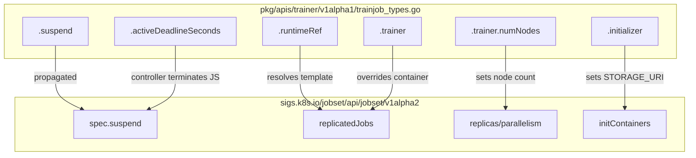

Sources: [pkg/apis/trainer/v1alpha1/trainjob_types.go:102-153](), [pkg/runtime/framework/plugins/jobset/builder_test.go:66-129]()

---

## Annotated Example: Distributed PyTorch

```yaml
apiVersion: trainer.kubeflow.org/v1alpha1
kind: TrainJob
metadata:
  name: torch-finetune
spec:
  runtimeRef:
    name: torch-distributed
    kind: ClusterTrainingRuntime

  initializer:
    dataset:
      storageUri: "hf://datasets/alpaca"
    model:
      storageUri: "hf://meta-llama/Llama-3.2-1B"

  trainer:
    image: pytorch/pytorch:2.4.0
    numNodes: 2
    numProcPerNode: 8
    resourcesPerNode:
      limits:
        nvidia.com/gpu: "8"

  activeDeadlineSeconds: 3600
```

Sources: [pkg/apis/trainer/v1alpha1/trainjob_types.go:102-153](), [test/integration/webhooks/trainjob_test.go:93-113]()

---

# Page: TrainingRuntime and ClusterTrainingRuntime APIs

# TrainingRuntime and ClusterTrainingRuntime APIs

<details>
<summary>Relevant source files</summary>

The following files were used as context for generating this wiki page:

- [api/python_api/kubeflow_trainer_api/models/trainer_v1alpha1_ml_policy.py](api/python_api/kubeflow_trainer_api/models/trainer_v1alpha1_ml_policy.py)
- [api/python_api/kubeflow_trainer_api/models/trainer_v1alpha1_ml_policy_source.py](api/python_api/kubeflow_trainer_api/models/trainer_v1alpha1_ml_policy_source.py)
- [charts/kubeflow-trainer/templates/crd/trainer.kubeflow.org_clustertrainingruntimes.yaml](charts/kubeflow-trainer/templates/crd/trainer.kubeflow.org_clustertrainingruntimes.yaml)
- [charts/kubeflow-trainer/templates/crd/trainer.kubeflow.org_trainingruntimes.yaml](charts/kubeflow-trainer/templates/crd/trainer.kubeflow.org_trainingruntimes.yaml)
- [manifests/base/crds/trainer.kubeflow.org_clustertrainingruntimes.yaml](manifests/base/crds/trainer.kubeflow.org_clustertrainingruntimes.yaml)
- [manifests/base/crds/trainer.kubeflow.org_trainingruntimes.yaml](manifests/base/crds/trainer.kubeflow.org_trainingruntimes.yaml)
- [pkg/apis/trainer/v1alpha1/trainingruntime_types.go](pkg/apis/trainer/v1alpha1/trainingruntime_types.go)
- [pkg/client/applyconfiguration/trainer/v1alpha1/mlpolicy.go](pkg/client/applyconfiguration/trainer/v1alpha1/mlpolicy.go)
- [pkg/client/applyconfiguration/trainer/v1alpha1/mlpolicysource.go](pkg/client/applyconfiguration/trainer/v1alpha1/mlpolicysource.go)
- [pkg/runtime/core/core.go](pkg/runtime/core/core.go)
- [pkg/runtime/core/core_test.go](pkg/runtime/core/core_test.go)
- [pkg/runtime/core/registry.go](pkg/runtime/core/registry.go)
- [pkg/runtime/core/snapshot.go](pkg/runtime/core/snapshot.go)
- [pkg/runtime/core/snapshot_test.go](pkg/runtime/core/snapshot_test.go)
- [proposals/2170-kubeflow-trainer-v2/README.md](proposals/2170-kubeflow-trainer-v2/README.md)
- [test/integration/webhooks/clustertrainingruntime_webhook_test.go](test/integration/webhooks/clustertrainingruntime_webhook_test.go)
- [test/integration/webhooks/trainingruntime_webhook_test.go](test/integration/webhooks/trainingruntime_webhook_test.go)

</details>


This page provides a detailed technical reference for the `TrainingRuntime` and `ClusterTrainingRuntime` Custom Resource Definitions (CRDs). It covers their scope distinction, the `TrainingRuntimeSpec` hierarchy (`mlPolicy`, `podGroupPolicy`, and `template`), framework-specific configuration rules, validation webhooks, and the runtime snapshot mechanism (KEP-2599) used to decouple training jobs from runtime mutations.

---

## Resource Overview and Scope Distinction

Both `TrainingRuntime` and `ClusterTrainingRuntime` share an identical Go spec structure (`TrainingRuntimeSpec`) defined in `pkg/apis/trainer/v1alpha1/trainingruntime_types.go` [pkg/apis/trainer/v1alpha1/trainingruntime_types.go:106-120](), but they differ in Kubernetes resource scope:

| Attribute | `TrainingRuntime` | `ClusterTrainingRuntime` |
|-----------|------------------|--------------------------|
| API Kind | `TrainingRuntime` [pkg/apis/trainer/v1alpha1/trainingruntime_types.go:27]() | `ClusterTrainingRuntime` [pkg/apis/trainer/v1alpha1/trainingruntime_types.go:29]() |
| CRD Plural | `trainingruntimes` | `clustertrainingruntimes` |
| Scope | Namespaced [pkg/apis/trainer/v1alpha1/trainingruntime_types.go:77-78]() | Cluster-scoped [pkg/apis/trainer/v1alpha1/trainingruntime_types.go:40-42]() |
| Reference Accessibility | Referencable by `TrainJob` in the *same* namespace [pkg/apis/trainer/v1alpha1/trainingruntime_types.go:77-78]() | Referencable by `TrainJob` in *any* namespace [pkg/apis/trainer/v1alpha1/trainingruntime_types.go:40-42]() |

### Diagram: Resource Scope and Code Entity Mapping

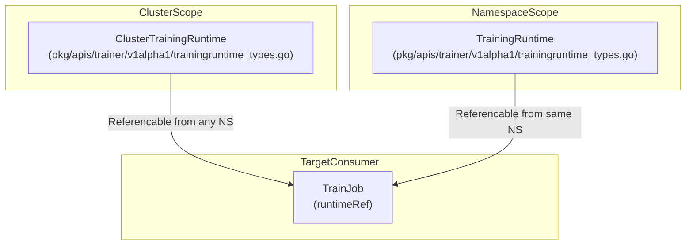

Sources: [pkg/apis/trainer/v1alpha1/trainingruntime_types.go:25-104](), [manifests/base/crds/trainer.kubeflow.org_clustertrainingruntimes.yaml:16-37](), [manifests/base/crds/trainer.kubeflow.org_trainingruntimes.yaml:16-37]().

---

## TrainingRuntimeSpec and Sub-Structures

The `TrainingRuntimeSpec` struct acts as the core blueprint for a runtime, combining model training policies, gang scheduling policies, and underlying JobSet templates [pkg/apis/trainer/v1alpha1/trainingruntime_types.go:106-120]().

```go
type TrainingRuntimeSpec struct {
	MLPolicy       *MLPolicy           `json:"mlPolicy,omitempty"`
	PodGroupPolicy *PodGroupPolicy     `json:"podGroupPolicy,omitempty"`
	Template       JobSetTemplateSpec  `json:"template,omitzero"`
}
```

### Type Hierarchy Diagram

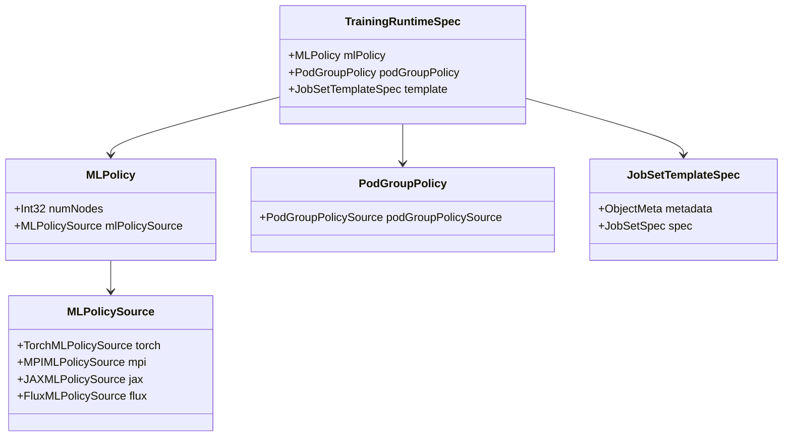

Sources: [pkg/apis/trainer/v1alpha1/trainingruntime_types.go:106-184](), [manifests/base/crds/trainer.kubeflow.org_clustertrainingruntimes.yaml:50-157]().

---

## MLPolicy Configurations

The `MLPolicy` struct governs machine learning framework parameters and selects which framework plugin initializes environment variables and orchestration hooks [pkg/apis/trainer/v1alpha1/trainingruntime_types.go:172-184]().

### Constraints and Validation
- **Mutual Exclusion:** Exactly zero or one framework policy source (`torch`, `mpi`, `jax`, `flux`, `xgboost`) can be configured within `MLPolicySource`. This is enforced via CEL validation rules in the CRD schemas [manifests/base/crds/trainer.kubeflow.org_clustertrainingruntimes.yaml:172-172]() and integration tests in [test/integration/webhooks/trainingruntime_webhook_test.go:121-191]().
- **NumNodes:** Defines the number of training nodes (defaults to `1`) [pkg/apis/trainer/v1alpha1/trainingruntime_types.go:175-178]().

Sources: [pkg/apis/trainer/v1alpha1/trainingruntime_types.go:172-184](), [test/integration/webhooks/trainingruntime_webhook_test.go:82-191]().

---

## PodGroupPolicy and Gang Scheduling

`PodGroupPolicy` enables gang scheduling via third-party schedulers and Kubernetes scheduler plugins [pkg/apis/trainer/v1alpha1/trainingruntime_types.go:135-151]().

### Supported PodGroup Sources
1. **Coscheduling (`CoschedulingPodGroupPolicySource`):** Integrates with the Kubernetes `scheduler-plugins` coscheduling plugin [pkg/apis/trainer/v1alpha1/trainingruntime_types.go:143-146](). It accepts an optional `scheduleTimeoutSeconds` (defaulting to `60` seconds) [pkg/apis/trainer/v1alpha1/trainingruntime_types.go:153-163]().
2. **Volcano (`VolcanoPodGroupPolicySource`):** Integrates with Volcano gang scheduler and supports topology-aware scheduling via `networkTopology` specifications [pkg/apis/trainer/v1alpha1/trainingruntime_types.go:148-150](), [pkg/apis/trainer/v1alpha1/trainingruntime_types.go:165-170]().

Validation logic for coscheduling timeouts is verified in integration tests [test/integration/webhooks/clustertrainingruntime_webhook_test.go:75-104]().

Sources: [pkg/apis/trainer/v1alpha1/trainingruntime_types.go:135-170](), [test/integration/webhooks/clustertrainingruntime_webhook_test.go:75-104]().

---

## JobSet Templates

The `template` field (`JobSetTemplateSpec`) defines the underlying `JobSet` resource managed by JobSet API `sigs.k8s.io/jobset/api/jobset/v1alpha2` [pkg/apis/trainer/v1alpha1/trainingruntime_types.go:122-133](). 

The `ReplicatedJob` definitions must adhere to container naming conventions (such as having a primary container named `node`) so that plugins and controllers can inject framework-specific environment variables and initializers.

Sources: [pkg/apis/trainer/v1alpha1/trainingruntime_types.go:122-133]().

---

## Runtime Snapshot Mechanism (KEP-2599)

To prevent breaking active `TrainJob` instances when underlying `TrainingRuntime` or `ClusterTrainingRuntime` objects are updated or deleted, Kubeflow Trainer implements a runtime snapshot mechanism located in `pkg/runtime/core/snapshot.go` [pkg/runtime/core/snapshot.go:1-136]().

### Implementation Details
When a `TrainJob` reconciles, the controller executes the following snapshot workflow:
1. **`getRuntimeSnapshot`**: Attempts to retrieve a ConfigMap named `<trainJob.Name>-runtime-snapshot` in the same namespace [pkg/runtime/core/snapshot.go:41-50]().
2. **Ownership Validation**: Verifies that the snapshot ConfigMap is controller-owned by the requesting `TrainJob` UID [pkg/runtime/core/snapshot.go:52-55]().
3. **YAML Unmarshaling & GVK Validation**: Unmarshals the stored YAML into the runtime object (`client.Object`) and verifies that the group, version, kind, and name match the `TrainJob`'s `runtimeRef` [pkg/runtime/core/snapshot.go:57-92]().
4. **`createRuntimeSnapshot`**: If the snapshot does not exist, the controller resolves the GroupVersionKind, serializes the active runtime specification to YAML, and applies a controlled ConfigMap using Server-Side Apply [pkg/runtime/core/snapshot.go:100-136]().

### Diagram: Runtime Snapshot Data Flow & Code Entities

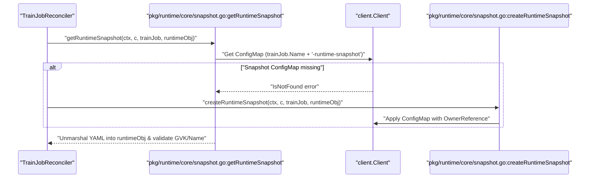

Sources: [pkg/runtime/core/snapshot.go:17-136](), [pkg/runtime/core/snapshot_test.go:40-222]().

---

## Sources

- [pkg/apis/trainer/v1alpha1/trainingruntime_types.go]()
- [pkg/runtime/core/snapshot.go]()
- [pkg/runtime/core/snapshot_test.go]()
- [test/integration/webhooks/trainingruntime_webhook_test.go]()
- [test/integration/webhooks/clustertrainingruntime_webhook_test.go]()
- [manifests/base/crds/trainer.kubeflow.org_clustertrainingruntimes.yaml]()
- [manifests/base/crds/trainer.kubeflow.org_trainingruntimes.yaml]()

---

# Page: TrainJob Lifecycle and Controller

# TrainJob Lifecycle and Controller

<details>
<summary>Relevant source files</summary>

The following files were used as context for generating this wiki page:

- [Makefile](Makefile)
- [api/python_api/kubeflow_trainer_api/models/jobset_v1alpha2_failure_policy_rule.py](api/python_api/kubeflow_trainer_api/models/jobset_v1alpha2_failure_policy_rule.py)
- [go.mod](go.mod)
- [go.sum](go.sum)
- [manifests/base/rbac/role.yaml](manifests/base/rbac/role.yaml)
- [manifests/third-party/jobset/kustomization.yaml](manifests/third-party/jobset/kustomization.yaml)
- [pkg/apply/apply.go](pkg/apply/apply.go)
- [pkg/apply/apply_test.go](pkg/apply/apply_test.go)
- [pkg/controller/clustertrainingruntime_controller.go](pkg/controller/clustertrainingruntime_controller.go)
- [pkg/controller/clustertrainingruntime_controller_test.go](pkg/controller/clustertrainingruntime_controller_test.go)
- [pkg/controller/setup.go](pkg/controller/setup.go)
- [pkg/controller/trainingruntime_controller.go](pkg/controller/trainingruntime_controller.go)
- [pkg/controller/trainingruntime_controller_test.go](pkg/controller/trainingruntime_controller_test.go)
- [pkg/controller/trainjob_controller.go](pkg/controller/trainjob_controller.go)
- [pkg/controller/trainjob_controller_test.go](pkg/controller/trainjob_controller_test.go)
- [proposals/2599-mutable-runtimes/README.md](proposals/2599-mutable-runtimes/README.md)
- [test/integration/controller/clustertrainingruntime_controller_test.go](test/integration/controller/clustertrainingruntime_controller_test.go)
- [test/integration/controller/trainingruntime_controller_test.go](test/integration/controller/trainingruntime_controller_test.go)

</details>


This page explains the technical implementation of the `TrainJob` lifecycle and its controllers in Kubeflow Trainer. It covers the `TrainJobReconciler` reconciliation loop, runtime resolution (`TrainingRuntime` and `ClusterTrainingRuntime`), the object creation pipeline via Server-Side Apply (SSA), deadline management (`ActiveDeadlineSeconds`), finalizer coordination, and status reporting.

---

## 1. Controller Architecture and Components

The controller manager runs multiple reconcilers to manage custom resources across the system. The primary reconcilers include `TrainJobReconciler`, `TrainingRuntimeReconciler`, and `ClusterTrainingRuntimeReconciler`.

### Controller Code Entities

Title: ControllerCodeArchitecture
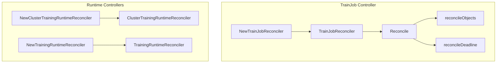
Sources: [pkg/controller/trainjob_controller.go:51-76](), [pkg/controller/clustertrainingruntime_controller.go:38-52](), [pkg/controller/trainingruntime_controller.go:38-52]()

- **`TrainJobReconciler`**: Defined in [pkg/controller/trainjob_controller.go:51-59](), responsible for reconciling `TrainJob` instances. It maintains a map of registered runtimes (`runtimes map[string]jobruntimes.Runtime`), an event `recorder`, and a `clock` for deadline calculations.
- **`ClusterTrainingRuntimeReconciler`**: Defined in [pkg/controller/clustertrainingruntime_controller.go:38-42](), handles cleanup finalizers (`constants.ResourceInUseFinalizer`) for cluster-scoped runtime templates.
- **`TrainingRuntimeReconciler`**: Defined in [pkg/controller/trainingruntime_controller.go:38-42](), manages namespace-scoped training runtimes and handles resource-in-use finalizers.

Sources: [pkg/controller/trainjob_controller.go:51-76](), [pkg/controller/clustertrainingruntime_controller.go:38-52](), [pkg/controller/trainingruntime_controller.go:38-52]()

---

## 2. Reconciliation Loop

The `TrainJobReconciler.Reconcile` method [pkg/controller/trainjob_controller.go:85-141]() implements the core control loop. It processes incoming reconciliation requests by fetching the `TrainJob`, validating its managed-by status, resolving its runtime, generating objects, and synchronizing status.

### Reconciliation Data Flow

Title: TrainJobReconciliationSequence
```mermaid
sequenceDiagram
    participant API as Kubernetes API
    participant RC as TrainJobReconciler
    participant RT as Runtime
    
    API->>RC: Reconcile(ctx, req)
    RC->>API: client.Get(ctx, NamespacedName, &trainJob)
    API-->>RC: TrainJob Resource
    
    alt IsManagedByExternalController
        RC-->>API: Skip reconciliation
    end
    
    RC->>RC: RuntimeRefToRuntimeRegistryKey(trainJob.Spec.RuntimeRef)
    RC->>RT: Lookup runtime in r.runtimes
    
    alt Runtime Not Found
        RC->>RC: setFailedCondition(TrainJobRuntimeNotSupportedReason)
    else Job Not Finished
        RC->>RT: runtime.NewObjects(ctx, &trainJob)
        RT-->>RC: []client.Object
        
        loop For each generated object
            RC->>API: client.Apply(ctx, object, FieldOwner="trainer")
        end
    end
    
    RC->>RC: setSuspendedCondition(&trainJob)
    RC->>RT: setTrainJobStatus(ctx, runtime, &trainJob)
    RC->>RC: reconcileDeadline(ctx, &trainJob)
    
    alt Status Changed
        RC->>API: client.Status().Patch(ctx, &trainJob, MergeFrom)
    end
```
Sources: [pkg/controller/trainjob_controller.go:85-141](), [pkg/controller/trainjob_controller.go:143-154]()

During reconciliation, if the `TrainJob` is managed by an external controller (such as Kueue), reconciliation is bypassed [pkg/controller/trainjob_controller.go:94-97](). Terminal jobs (where `IsTrainJobFinished` returns true) skip object reconciliation but continue updating status and deadlines [pkg/controller/trainjob_controller.go:108]().

Sources: [pkg/controller/trainjob_controller.go:85-141](), [pkg/controller/trainjob_controller.go:143-154]()

---

## 3. Runtime Resolution and Object Creation

Once a `TrainJob` is verified, its `RuntimeRef` is converted into a registry key using `jobruntimes.RuntimeRefToRuntimeRegistryKey` [pkg/controller/trainjob_controller.go:103](). The corresponding `jobruntimes.Runtime` implementation is retrieved from the controller's runtime registry [pkg/controller/trainjob_controller.go:104]().

Object creation is handled by `reconcileObjects` [pkg/controller/trainjob_controller.go:143-154]():
1. Calls `runtime.NewObjects(ctx, trainJob)` to generate the list of Kubernetes objects (`JobSet`, configmaps, secrets, etc.) [pkg/controller/trainjob_controller.go:144]().
2. Iterates through the generated objects and applies them using Server-Side Apply (SSA) via `client.Apply()`, specifying `client.FieldOwner("trainer")` and `client.ForceOwnership` [pkg/controller/trainjob_controller.go:149]().

Sources: [pkg/controller/trainjob_controller.go:103-104](), [pkg/controller/trainjob_controller.go:143-154]()

---

## 4. Deadline Management

Job timeouts and deadline enforcement are managed by `reconcileDeadline` [pkg/controller/trainjob_controller.go:156-186](). 

- **Conditions**: If `ActiveDeadlineSeconds` is zero, the job is finished, or the job is suspended, deadline reconciliation is skipped [pkg/controller/trainjob_controller.go:157]().
- **Start Time**: The start time is derived from `CreationTimestamp` or adjusted using the `Suspended` condition's `LastTransitionTime` if the job was resumed [pkg/controller/trainjob_controller.go:160-164]().
- **Evaluation**: The controller compares the current time (`r.clock.Now()`) against the calculated deadline [pkg/controller/trainjob_controller.go:168-170](). If exceeded, the `TrainJob` is marked as failed, and a requeue duration is returned [pkg/controller/trainjob_controller.go:137-139]().

Sources: [pkg/controller/trainjob_controller.go:129](), [pkg/controller/trainjob_controller.go:156-186]()

---

## 5. Status Reporting and Finalizers

Status synchronization is executed via `setTrainJobStatus` during each reconciliation cycle [pkg/controller/trainjob_controller.go:125](). It inspects child resources (such as `JobSet` status) and updates the `TrainJob` conditions and job counters. 

For runtime Custom Resources (`TrainingRuntime` and `ClusterTrainingRuntime`), controllers ensure safe deletion by intercepting deletion requests when a `constants.ResourceInUseFinalizer` is present, stripping finalizers once reference checks clear [pkg/controller/clustertrainingruntime_controller.go:68-71](), [pkg/controller/trainingruntime_controller.go:68-71]().

Sources: [pkg/controller/trainjob_controller.go:125](), [pkg/controller/clustertrainingruntime_controller.go:67-72](), [pkg/controller/trainingruntime_controller.go:67-72]()

---

# Page: Webhooks and Validation

# Webhooks and Validation

<details>
<summary>Relevant source files</summary>

The following files were used as context for generating this wiki page:

- [charts/kubeflow-trainer/templates/rbac/clusterrole.yaml](charts/kubeflow-trainer/templates/rbac/clusterrole.yaml)
- [charts/kubeflow-trainer/templates/webhook/_helpers.tpl](charts/kubeflow-trainer/templates/webhook/_helpers.tpl)
- [charts/kubeflow-trainer/templates/webhook/mutating_webhook_configuration.yaml](charts/kubeflow-trainer/templates/webhook/mutating_webhook_configuration.yaml)
- [charts/kubeflow-trainer/tests/webhook/mutating_webhook_configuration_test.yaml](charts/kubeflow-trainer/tests/webhook/mutating_webhook_configuration_test.yaml)
- [hack/e2e-run-notebook.sh](hack/e2e-run-notebook.sh)
- [manifests/base/webhook/kustomization.yaml](manifests/base/webhook/kustomization.yaml)
- [manifests/base/webhook/kustomizeconfig.yaml](manifests/base/webhook/kustomizeconfig.yaml)
- [manifests/base/webhook/manifests.yaml](manifests/base/webhook/manifests.yaml)
- [manifests/base/webhook/patch_mutating.yaml](manifests/base/webhook/patch_mutating.yaml)
- [manifests/base/webhook/patch_validating.yaml](manifests/base/webhook/patch_validating.yaml)
- [pkg/util/cert/cert_test.go](pkg/util/cert/cert_test.go)
- [pkg/util/tlsconfig/tlsconfig.go](pkg/util/tlsconfig/tlsconfig.go)
- [pkg/util/tlsconfig/tlsconfig_test.go](pkg/util/tlsconfig/tlsconfig_test.go)
- [pkg/webhooks/clustertrainingruntime_webhook.go](pkg/webhooks/clustertrainingruntime_webhook.go)
- [pkg/webhooks/clustertrainingruntime_webhook_test.go](pkg/webhooks/clustertrainingruntime_webhook_test.go)
- [pkg/webhooks/setup.go](pkg/webhooks/setup.go)
- [pkg/webhooks/trainingruntime_webhook.go](pkg/webhooks/trainingruntime_webhook.go)
- [pkg/webhooks/trainingruntime_webhook_test.go](pkg/webhooks/trainingruntime_webhook_test.go)
- [pkg/webhooks/trainjob_webhook.go](pkg/webhooks/trainjob_webhook.go)
- [pkg/webhooks/trainjob_webhook_test.go](pkg/webhooks/trainjob_webhook_test.go)

</details>


This page documents the admission webhook system for Kubeflow Trainer, covering validation logic, defaulting mechanisms, `RuntimePatch` immutability rules, multi-manager coordination, and runtime structure verifications across `TrainJob`, `TrainingRuntime`, and `ClusterTrainingRuntime` custom resources.

---

## Overview

Kubeflow Trainer implements a multi-layered admission control architecture to guarantee resource consistency, enforce runtime constraints, and manage multi-manager state coordination:

1. **CRD-Level and CEL Validation**: Basic syntax and structural validation are handled via OpenAPI V3 schema definitions and Common Expression Language (CEL) rules embedded directly in the Custom Resource Definitions.
2. **Mutating Webhook (`TrainJobDefaulter`)**: Handles resource defaulting and tracks timestamps for individual `RuntimePatch` entries to coordinate updates from external managers [pkg/webhooks/trainjob_webhook.go:39-42]().
3. **Validating Webhook (`TrainJobValidator`, `TrainingRuntimeValidator`, `ClusterTrainingRuntimeValidator`)**: Enforces structural invariants on runtime templates and delegates core validation to the plugin framework via `runtime.Runtime.ValidateObjects()` [pkg/webhooks/trainjob_webhook.go:110-121]().

The webhook server components are initialized and registered to the controller manager via `webhooks.Setup()` [pkg/webhooks/setup.go:26-37]().

Sources: [pkg/webhooks/trainjob_webhook.go:39-121](), [charts/kubeflow-trainer/templates/rbac/clusterrole.yaml:54-63]()

---

## Admission Flow and Code Entities

The following diagram bridges natural language operations to the underlying code entities during the admission request lifecycle.

**Diagram: Admission Request Pipeline**

```mermaid
flowchart TD
    subgraph K8sAPI["Kubernetes API Server"]
        REQ["AdmissionRequest"] --> CRD_CEL["CRD and CEL Validation"]
    end

    subgraph WebhookServer["Trainer Webhook Server (pkg/webhooks)"]
        CRD_CEL -->|Success| Defaulter["TrainJobDefaulter.Default\npkg/webhooks/trainjob_webhook.go"]
        Defaulter --> Validator["TrainJobValidator.Validate*\npkg/webhooks/trainjob_webhook.go"]
        REQ -.-> RTValidator["TrainingRuntimeValidator\npkg/webhooks/trainingruntime_webhook.go"]
        REQ -.-> CRTValidator["ClusterTrainingRuntimeValidator\npkg/webhooks/clustertrainingruntime_webhook.go"]
    end

    subgraph RuntimeDispatch["Runtime Core Dispatch"]
        Validator --> Registry["runtime.RuntimeRefToRuntimeRegistryKey"]
        Registry --> ValidateObjs["runtime.ValidateObjects"]
    end

    subgraph ValidationPlugins["Plugin Framework Validation"]
        ValidateObjs --> TorchVal["TorchPlugin.Validate"]
        ValidateObjs --> MPIVal["MPIPlugin.Validate"]
        ValidateObjs --> JobSetVal["JobSetPlugin.Validate"]
    end

    style Defaulter stroke-dasharray: 5 5
    style Validator stroke-dasharray: 5 5
```

Sources: [pkg/webhooks/trainjob_webhook.go:45-134](), [pkg/webhooks/trainingruntime_webhook.go:50-73](), [pkg/webhooks/clustertrainingruntime_webhook.go:35-57]()

---

## Mutating Webhook and Defaulting

The `TrainJobDefaulter` struct [pkg/webhooks/trainjob_webhook.go:39-42]() applies default values and governs multi-manager coordination rules for `TrainJob` specs.

### RuntimePatch Coordination and Immutability Rules
To support multi-manager environments where different actors (e.g., an SDK client and a model auto-scaler) patch specific components of a `TrainJob`, the webhook tracks the `Time` field for each entry in `TrainJobSpec.RuntimePatches`:

* **On Create**: Every patch in `spec.runtimePatches` receives a timestamp via the configured clock if `Time` is unassigned [pkg/webhooks/trainjob_webhook.go:64-70]().
* **On Update**: The webhook compares the incoming patch against the corresponding patch in `oldObj` using `equality.Semantic.DeepEqual` after temporarily stripping the `Time` field [pkg/webhooks/trainjob_webhook.go:73-86](). If the patch configuration remains unchanged, the existing timestamp (`old.Time`) is preserved [pkg/webhooks/trainjob_webhook.go:82-83](). If any field changes, the timestamp is updated to the current time [pkg/webhooks/trainjob_webhook.go:84-86]().

### Defaulting Implementation
The `Default` method accepts a `clock.PassiveClock` to allow deterministic testing [pkg/webhooks/trainjob_webhook.go:40-41]() and extracts the old object from `admission.Request` during `Update` operations [pkg/webhooks/trainjob_webhook.go:51-62]().

Sources: [pkg/webhooks/trainjob_webhook.go:39-92](), [pkg/webhooks/trainjob_webhook_test.go:42-196]()

---

## Validating Webhook

The validation webhooks ensure resource integrity across `TrainJob` [pkg/webhooks/trainjob_webhook.go:97](), `TrainingRuntime` [pkg/webhooks/trainingruntime_webhook.go:51](), and `ClusterTrainingRuntime` [pkg/webhooks/clustertrainingruntime_webhook.go:35]() resources.

### Runtime Resolution and Object Validation
During `TrainJob` creation or update, `TrainJobValidator` resolves the target runtime via `runtime.RuntimeRefToRuntimeRegistryKey` [pkg/webhooks/trainjob_webhook.go:114-118, 127-131]() and delegates deeper semantic checking to `runtime.ValidateObjects` [pkg/webhooks/trainjob_webhook.go:119, 132]().

### TrainingRuntime Structure Validation
`TrainingRuntimeValidator` and `ClusterTrainingRuntimeValidator` enforce strict layout constraints on the underlying `JobSet` template via `validateReplicatedJobs` [pkg/webhooks/trainingruntime_webhook.go:75-114](), [pkg/webhooks/clustertrainingruntime_webhook.go:56-62]():
* **ReplicatedJob Replicas**: For jobs marked with `constants.LabelTrainJobAncestor` (e.g., `trainer`, `model-initializer`, `dataset-initializer`), the `replicas` field must be strictly equal to `1` [pkg/webhooks/trainingruntime_webhook.go:87-90]().
* **Required Containers**: Validates that each `ReplicatedJob` contains the required container corresponding to its ancestor label, per `expectedContainerNames` [pkg/webhooks/trainingruntime_webhook.go:41-46, 92-111]().
* **Deprecation Warnings**: Issues warning messages if a runtime carries the deprecation label checked by `trainingruntime.IsSupportDeprecated` [pkg/webhooks/trainingruntime_webhook.go:65-71]().

| Ancestor Label (`constants`) | Required Container Name | Replicas Rule |
| :--- | :--- | :--- |
| `constants.AncestorTrainer` | `constants.Node` (`node`) | Must be `1` [pkg/webhooks/trainingruntime_webhook.go:88]() |
| `constants.ModelInitializer` | `constants.ModelInitializer` (`model-initializer`) | Must be `1` [pkg/webhooks/trainingruntime_webhook.go:88]() |
| `constants.DatasetInitializer` | `constants.DatasetInitializer` (`dataset-initializer`) | Must be `1` [pkg/webhooks/trainingruntime_webhook.go:88]() |

Sources: [pkg/webhooks/trainjob_webhook.go:97-138](), [pkg/webhooks/trainingruntime_webhook.go:34-114](), [pkg/webhooks/clustertrainingruntime_webhook.go:35-67](), [pkg/webhooks/trainingruntime_webhook_test.go:32-136]()

---

## Certificate Management and Manifests

Webhooks require TLS transport security. Kubeflow Trainer defines standard `MutatingWebhookConfiguration` and `ValidatingWebhookConfiguration` objects [manifests/base/webhook/manifests.yaml:16-106]().

**Diagram: Webhook Configuration Entities**

```mermaid
flowchart LR
    MutatingConfig["MutatingWebhookConfiguration\nmanifests/base/webhook/manifests.yaml"] -->|"/mutate-trainjob"| WebhookService["webhook-service\nnamespace: system"]
    ValidatingConfig["ValidatingWebhookConfiguration\nmanifests/base/webhook/manifests.yaml"] -->|"/validate-trainjob"| WebhookService
    ValidatingConfig -->|"/validate-trainingruntime"| WebhookService
    ValidatingConfig -->|"/validate-clustertrainingruntime"| WebhookService

    subgraph Handlers["Webhook Handler Registry"]
        WebhookService --- DefaulterHandler["TrainJobDefaulter"]
        WebhookService --- TrainJobVal["TrainJobValidator"]
        WebhookService --- TrVal["TrainingRuntimeValidator"]
        WebhookService --- ClTrVal["ClusterTrainingRuntimeValidator"]
    end
```

### Implementation Details
* **Registration Rules**: Configured for `CREATE` and `UPDATE` operations targeting `trainjobs`, `trainingruntimes`, and `clustertrainingruntimes` [manifests/base/webhook/manifests.yaml:16-106]().
* **Failure Policy**: Enforced as `Fail` across all webhooks to prevent admission if the controller manager is unreachable [manifests/base/webhook/manifests.yaml:28, 54, 74, 94]().
* **RBAC Privileges**: The controller manager ClusterRole includes permissions to manage `mutatingwebhookconfigurations` and `validatingwebhookconfigurations` under `admissionregistration.k8s.io` [charts/kubeflow-trainer/templates/rbac/clusterrole.yaml:54-63]().

Sources: [manifests/base/webhook/manifests.yaml:1-106](), [charts/kubeflow-trainer/templates/rbac/clusterrole.yaml:54-63]()

---

# Page: OptimizationJob API

# OptimizationJob API

<details>
<summary>Relevant source files</summary>

The following files were used as context for generating this wiki page:

- [api/python_api/kubeflow_trainer_api/models/trainer_v1alpha1_objective.py](api/python_api/kubeflow_trainer_api/models/trainer_v1alpha1_objective.py)
- [charts/kubeflow-trainer/templates/crd/trainer.kubeflow.org_optimizationjobs.yaml](charts/kubeflow-trainer/templates/crd/trainer.kubeflow.org_optimizationjobs.yaml)
- [manifests/base/crds/trainer.kubeflow.org_optimizationjobs.yaml](manifests/base/crds/trainer.kubeflow.org_optimizationjobs.yaml)
- [pkg/apis/trainer/v1alpha1/optimizationjob_types.go](pkg/apis/trainer/v1alpha1/optimizationjob_types.go)
- [pkg/client/applyconfiguration/trainer/v1alpha1/objective.go](pkg/client/applyconfiguration/trainer/v1alpha1/objective.go)
- [proposals/2605-optimization-job-crd/README.md](proposals/2605-optimization-job-crd/README.md)

</details>


## Purpose and Scope
This page documents the `OptimizationJob` API (KEP-3562/2605) for hyperparameter optimization (HPO) targeting `TrainJobs` in Kubeflow Trainer [proposals/2605-optimization-job-crd/README.md:1-27](). It details the `OptimizationJobSpec` fields, `SearchSpace` types, the stateless suggestion service architecture, `KUBEFLOW_TRAINER_OPT_*` environment variable injection, and status/result tracking.

Sources: [proposals/2605-optimization-job-crd/README.md:1-27]()

---

## System Architecture

The `OptimizationJob` architecture follows a stateless gRPC provider model. Unlike legacy systems that require a persistent database (such as Katib DB), the controller implemented by `OptimizationJob` reconstructs trial histories directly from the Kubernetes API by inspecting existing `TrainJob` resources [proposals/2605-optimization-job-crd/README.md:86-87]().

### Data Flow and Entity Mapping

The following diagram bridges high-level HPO concepts to specific code entities (`OptimizationJob`, `OptimizationJobSpec`, `TrainJobTemplateSpec`) and data injection mechanisms defined in the codebase.

**HPO Concept to Code Entity Mapping**
```mermaid
graph TD
    subgraph "OptimizationJob API [pkg/apis/trainer/v1alpha1]"
        OJ["OptimizationJob"]
        OJS["OptimizationJobSpec"]
        OJT["TrainJobTemplateSpec"]
    end

    subgraph "Suggestion Logic"
        SA["SearchAlgorithm"]
        GRPC["StatelessGRPCService"]
        OPTUNA["OptunaProvider"]
    end

    subgraph "Trial Execution [pkg/apis/trainer/v1alpha1]"
        TJ["TrainJob"]
        ENV["KUBEFLOW_TRAINER_OPT_*"]
        TJS["TrainJobStatus"]
    end

    OJ --> OJS
    OJS --> SA
    OJS --> OJT
    SA -- "RequestSuggestion" --> GRPC
    GRPC -- "Orchestrates" --> OPTUNA
    OJT -- "Instantiates" --> TJ
    TJ -- "InjectsParameters" --> ENV
    TJ -- "ReportsMetrics" --> TJS
    TJS -- "FeedbackLoop" --> OJ
```
Sources: [pkg/apis/trainer/v1alpha1/optimizationjob_types.go:35-109](), [proposals/2605-optimization-job-crd/README.md:71-87]()

---

## OptimizationJob Specification

The `OptimizationJobSpec` defines the search space, optimization objectives, and the template for the training trials. It is immutable after creation [pkg/apis/trainer/v1alpha1/optimizationjob_types.go:67-70]().

### Key Fields
| Field | Type | Description |
| :--- | :--- | :--- |
| `objectives` | `[]Objective` | List of metrics to optimize. Currently limited to 1 objective [pkg/apis/trainer/v1alpha1/optimizationjob_types.go:71-77](). |
| `searchAlgorithm` | `SearchAlgorithm` | The algorithm to use (`random`, `grid`). Defaults to `random` [pkg/apis/trainer/v1alpha1/optimizationjob_types.go:79-82](). |
| `parameters` | `[]Parameter` | The hyperparameters and their respective search spaces (Min: 1, Max: 100) [pkg/apis/trainer/v1alpha1/optimizationjob_types.go:84-90](). |
| `numTrials` | `int32` | Total number of trials to run (Default: 1, Max: 100) [pkg/apis/trainer/v1alpha1/optimizationjob_types.go:92-97](). |
| `parallelTrials` | `int32` | Max number of concurrent trials (Default: 1, Max: 100) [pkg/apis/trainer/v1alpha1/optimizationjob_types.go:99-104](). |
| `trainJobTemplate` | `TrainJobTemplateSpec` | The template `TrainJob` to be instantiated for each trial [pkg/apis/trainer/v1alpha1/optimizationjob_types.go:106-108](). |

Sources: [pkg/apis/trainer/v1alpha1/optimizationjob_types.go:70-109](), [charts/kubeflow-trainer/templates/crd/trainer.kubeflow.org_optimizationjobs.yaml:51-108]()

---

## Search Space Types

The `SearchSpace` acts as a discriminated union (`OneOf`) supporting flexible statistical distributions [pkg/apis/trainer/v1alpha1/optimizationjob_types.go:145-159]():

*   **Uniform**: Continuous uniform distribution over `[min, max]` [pkg/apis/trainer/v1alpha1/optimizationjob_types.go:167-184]().
*   **LogUniform**: Continuous log-uniform distribution where `min > 0` [pkg/apis/trainer/v1alpha1/optimizationjob_types.go:189-207]().
*   **Categorical**: Discrete set of unordered strings [pkg/apis/trainer/v1alpha1/optimizationjob_types.go:222-228]().

Sources: [pkg/apis/trainer/v1alpha1/optimizationjob_types.go:145-228](), [charts/kubeflow-trainer/templates/crd/trainer.kubeflow.org_optimizationjobs.yaml:108-178]()

---

## Parameter Injection and Suggestion Service

Suggestions are injected into the trainer containers via environment variables, avoiding modifications to container entrypoints or CLI arguments. The naming convention uses the prefix `KUBEFLOW_TRAINER_OPT_<PARAMETER_NAME>` (uppercased) [proposals/2605-optimization-job-crd/README.md:75-77]().

**Suggestion Injection Flow**
```mermaid
sequenceDiagram
    participant OptimizationJobReconciler
    participant SuggestionService as "gRPC Suggestion Service"
    participant KubernetesAPI as "Kubernetes API"

    OptimizationJobReconciler->>KubernetesAPI: List TrainJobs (Filter by OwnerRef)
    KubernetesAPI-->>OptimizationJobReconciler: Return Completed Trial Results
    OptimizationJobReconciler->>SuggestionService: GetSuggestions(History, SearchSpace)
    Note right of SuggestionService: Reconstructs state from TrainJob annotations
    SuggestionService-->>OptimizationJobReconciler: Parameter Assignments (e.g., lr=0.05)
    OptimizationJobReconciler->>KubernetesAPI: Create TrainJob (Trial)
    Note over KubernetesAPI: Injects KUBEFLOW_TRAINER_OPT_LR=0.05 into Pod spec
```
Sources: [proposals/2605-optimization-job-crd/README.md:82-87](), [pkg/apis/trainer/v1alpha1/optimizationjob_types.go:252-260]()

---

## Status and Result Tracking

The `OptimizationJobStatus` tracks the progress of the optimization experiment and the best performing parameter combinations discovered so far [pkg/apis/trainer/v1alpha1/optimizationjob_types.go:35-50]().

*   **BestTrial**: Captures the parameter assignments and metric values of the trial that achieved the optimal result based on the `ObjectiveDirection` (`Maximize` or `Minimize`) [pkg/apis/trainer/v1alpha1/optimizationjob_types.go:21-27]() [pkg/client/applyconfiguration/trainer/v1alpha1/objective.go:25-32]().
*   **Metrics Integration**: Metrics are collected from `TrainJob` resources using the `TrainJobStatus` API, providing push-based updates from the training runner [proposals/2605-optimization-job-crd/README.md:83-84]().

Sources: [pkg/apis/trainer/v1alpha1/optimizationjob_types.go:21-50](), [pkg/client/applyconfiguration/trainer/v1alpha1/objective.go:25-32](), [proposals/2605-optimization-job-crd/README.md:83-84]()

---

## Validation Rules (CEL)

The API relies on Kubernetes Common Expression Language (CEL) rules for compile-time and admission validation:
*   **Job Invariants**: `parallelTrials` must be less than or equal to `numTrials` [pkg/apis/trainer/v1alpha1/optimizationjob_types.go:68]().
*   **Algorithm Constraints**: `Grid` search requires all parameters to be `Categorical`; `Uniform` and `LogUniform` are not permitted under grid search [pkg/apis/trainer/v1alpha1/optimizationjob_types.go:69]().
*   **Space Boundaries**: For `UniformSpace` and `LogUniformSpace`, `min` must be strictly less than `max` [pkg/apis/trainer/v1alpha1/optimizationjob_types.go:166]() [pkg/apis/trainer/v1alpha1/optimizationjob_types.go:188]().
*   **Log Distribution**: For `LogUniformSpace`, `min` must be strictly greater than `0` [pkg/apis/trainer/v1alpha1/optimizationjob_types.go:187]().

Sources: [pkg/apis/trainer/v1alpha1/optimizationjob_types.go:66-70](), [charts/kubeflow-trainer/templates/crd/trainer.kubeflow.org_optimizationjobs.yaml:153-157]()

---

# Page: Generated Clients and API Codegen

# Generated Clients and API Codegen

<details>
<summary>Relevant source files</summary>

The following files were used as context for generating this wiki page:

- [api/python_api/kubeflow_trainer_api/models/__init__.py](api/python_api/kubeflow_trainer_api/models/__init__.py)
- [api/python_api/pyproject.toml](api/python_api/pyproject.toml)
- [hack/update-codegen.sh](hack/update-codegen.sh)
- [pkg/client/applyconfiguration/trainer/v1alpha1/clustertrainingruntime.go](pkg/client/applyconfiguration/trainer/v1alpha1/clustertrainingruntime.go)
- [pkg/client/applyconfiguration/trainer/v1alpha1/jobsettemplatespec.go](pkg/client/applyconfiguration/trainer/v1alpha1/jobsettemplatespec.go)
- [pkg/client/applyconfiguration/trainer/v1alpha1/mpimlpolicysource.go](pkg/client/applyconfiguration/trainer/v1alpha1/mpimlpolicysource.go)
- [pkg/client/applyconfiguration/trainer/v1alpha1/podgrouppolicy.go](pkg/client/applyconfiguration/trainer/v1alpha1/podgrouppolicy.go)
- [pkg/client/applyconfiguration/trainer/v1alpha1/podgrouppolicysource.go](pkg/client/applyconfiguration/trainer/v1alpha1/podgrouppolicysource.go)
- [pkg/client/applyconfiguration/trainer/v1alpha1/trainer.go](pkg/client/applyconfiguration/trainer/v1alpha1/trainer.go)
- [pkg/client/applyconfiguration/trainer/v1alpha1/trainingruntime.go](pkg/client/applyconfiguration/trainer/v1alpha1/trainingruntime.go)
- [pkg/client/applyconfiguration/trainer/v1alpha1/trainjob.go](pkg/client/applyconfiguration/trainer/v1alpha1/trainjob.go)
- [pkg/client/applyconfiguration/trainer/v1alpha1/volcanopodgrouppolicysource.go](pkg/client/applyconfiguration/trainer/v1alpha1/volcanopodgrouppolicysource.go)
- [pkg/client/applyconfiguration/utils.go](pkg/client/applyconfiguration/utils.go)
- [pkg/client/clientset/versioned/clientset.go](pkg/client/clientset/versioned/clientset.go)
- [pkg/client/clientset/versioned/fake/clientset_generated.go](pkg/client/clientset/versioned/fake/clientset_generated.go)
- [pkg/client/clientset/versioned/fake/doc.go](pkg/client/clientset/versioned/fake/doc.go)
- [pkg/client/clientset/versioned/fake/register.go](pkg/client/clientset/versioned/fake/register.go)
- [pkg/client/clientset/versioned/scheme/doc.go](pkg/client/clientset/versioned/scheme/doc.go)
- [pkg/client/clientset/versioned/scheme/register.go](pkg/client/clientset/versioned/scheme/register.go)
- [pkg/client/informers/externalversions/factory.go](pkg/client/informers/externalversions/factory.go)
- [pkg/client/informers/externalversions/generic.go](pkg/client/informers/externalversions/generic.go)
- [pkg/client/informers/externalversions/internalinterfaces/factory_interfaces.go](pkg/client/informers/externalversions/internalinterfaces/factory_interfaces.go)
- [pkg/client/informers/externalversions/trainer/v1alpha1/clustertrainingruntime.go](pkg/client/informers/externalversions/trainer/v1alpha1/clustertrainingruntime.go)
- [pkg/client/informers/externalversions/trainer/v1alpha1/trainingruntime.go](pkg/client/informers/externalversions/trainer/v1alpha1/trainingruntime.go)
- [pkg/client/informers/externalversions/trainer/v1alpha1/trainjob.go](pkg/client/informers/externalversions/trainer/v1alpha1/trainjob.go)

</details>


The Kubeflow Trainer codebase relies heavily on code generation to maintain consistency between its Custom Resource Definitions (CRDs) defined in Go, strongly typed Kubernetes Go clientsets, informers, listers, apply configurations, OpenAPI schemas, and Python API client models (`kubeflow_trainer_api`). 

This document details the architecture, data flows, generated packages under `pkg/client` and `api/python_api`, and the underlying code generation scripts located in the `hack/` directory.

---

## 1. Go Code Generation and Client Packages (`pkg/client`)

Kubeflow Trainer uses Kubernetes `k8s.io/code-generator` tools to automatically generate type-safe Go clients, shared informers, listers, and Server-Side Apply (SSA) configurations for all custom resources (`TrainJob`, `TrainingRuntime`, `ClusterTrainingRuntime`, and `OptimizationJob`). These generated entities reside under the `pkg/client/` directory.

### Clientset (`pkg/client/clientset/versioned`)
The versioned clientset provides programmatic access to Kubeflow Trainer custom resources over the Kubernetes REST API. 
- `Interface` [pkg/client/clientset/versioned/clientset.go:31-34]() defines methods to access discovery clients and group-version interfaces like `TrainerV1alpha1()`.
- `Clientset` [pkg/client/clientset/versioned/clientset.go:37-40]() embeds the discovery client and initializes the `trainerv1alpha1` client implementation [pkg/client/clientset/versioned/clientset.go:91-91]().
- `scheme.Register` [pkg/client/clientset/versioned/scheme/register.go:30-36]() registers `trainerv1alpha1` types into the runtime scheme so that client payloads serialize and deserialize correctly.

### Informers and Listers (`pkg/client/informers` and `pkg/client/listers`)
Informers provide event-driven caching for Kubernetes resources, reducing direct load on the Kubernetes API server.
- `GenericInformer` [pkg/client/informers/externalversions/generic.go:29-34]() defines methods to fetch a `SharedIndexInformer` and a `GenericLister` across all Trainer GVRs.
- `sharedInformerFactory` [pkg/client/informers/externalversions/factory.go:40-59]() coordinates background workers, synchronization, and custom resync intervals for Trainer resources.

### Apply Configurations (`pkg/client/applyconfiguration`)
Apply configurations facilitate Server-Side Apply (SSA) patterns for custom resources and external types (e.g., JobSet, Core v1, Volcano). 
- `ForKind` [pkg/client/applyconfiguration/utils.go:32-37]() inspects a `GroupVersionKind` and returns the corresponding apply configuration builder struct (e.g., `TrainJobApplyConfiguration`, `ClusterTrainingRuntimeApplyConfiguration`).

### Fake Clientset (`pkg/client/clientset/versioned/fake`)
To support unit testing without a live Kubernetes cluster, `NewSimpleClientset` and `NewClientset` provide mock clients backed by an object tracker or field-managed object tracker [pkg/client/clientset/versioned/fake/clientset_generated.go:34-132]().

+-------------------------------------------------------------------------+
|                  Natural Language & Conceptual Space                    |
|  "Kubeflow Trainer Go Client & Informer Framework for Unit Testing"     |
+-------------------------------------------------------------------------+
                                     |
                                     v
+-------------------------------------------------------------------------+
|                        Code Entity Space                                |
|  - versioned.NewSimpleClientset(...) [pkg/client/clientset/versioned/fake/clientset_generated.go:38-38]()
|  - sharedInformerFactory [pkg/client/informers/externalversions/factory.go:40-59]()
|  - applyconfiguration.ForKind(...) [pkg/client/applyconfiguration/utils.go:32-37]()
|  - trainerv1alpha1.TrainerV1alpha1Client [pkg/client/clientset/versioned/clientset.go:37-40]()
+-------------------------------------------------------------------------+

Title: "Go Client Architecture Mapping"
```mermaid
graph TD
  ClientCodeRequest["ClientCodeRequest"] --> VersionedClientset["versioned.Clientset"]
  VersionedClientset --> TrainerClient["TrainerV1alpha1Client"]
  TrainerClient --> TrainJobsMethod["TrainJobs()"]
  TrainerClient --> TrainingRuntimesMethod["TrainingRuntimes()"]
  TrainerClient --> ClusterTrainingRuntimesMethod["ClusterTrainingRuntimes()"]
  TrainerClient --> OptimizationJobsMethod["OptimizationJobs()"]
  
  SharedInformerFactory["SharedInformerFactory"] --> TrainJobInformer["TrainJobInformer"]
  SharedInformerFactory --> TrainingRuntimeInformer["TrainingRuntimeInformer"]
  
  ApplyConfigurationFactory["ApplyConfigurationFactory"] --> ForKindFunc["ForKind(GVK)"]
  ForKindFunc --> TrainJobApplyConfig["TrainJobApplyConfiguration"]
```

Sources:
- `hack/update-codegen.sh` [hack/update-codegen.sh:1-100]()
- `pkg/client/clientset/versioned/clientset.go` [pkg/client/clientset/versioned/clientset.go:1-120]()
- `pkg/client/clientset/versioned/scheme/register.go` [pkg/client/clientset/versioned/scheme/register.go:1-56]()
- `pkg/client/clientset/versioned/fake/clientset_generated.go` [pkg/client/clientset/versioned/fake/clientset_generated.go:1-142]()
- `pkg/client/informers/externalversions/generic.go` [pkg/client/informers/externalversions/generic.go:1-68]()
- `pkg/client/informers/externalversions/factory.go` [pkg/client/informers/externalversions/factory.go:1-186]()
- `pkg/client/applyconfiguration/utils.go` [pkg/client/applyconfiguration/utils.go:1-126]()

---

## 2. OpenAPI Specification and Swagger Generation

Kubeflow Trainer generates an OpenAPI v2 specification to document its API models and power downstream code generators (such as the Python SDK).

### OpenAPI Generation Process
1. **`openapi-gen`**: The script runs `k8s.io/kube-openapi/cmd/openapi-gen` against the core types under `pkg/apis/trainer/v1alpha1` and external dependency packages (`k8s.io/api`, `sigs.k8s.io/jobset`, `volcano.sh/apis`) [hack/update-codegen.sh:76-96](). This produces `zz_generated.openapi.go` inside `pkg/apis/trainer/v1alpha1`.
2. **Swagger JSON Compiler**: The utility script `hack/swagger/main.go` compiles the generated Go OpenAPI definitions into a single JSON file located at `api/openapi-spec/swagger.json` [hack/update-codegen.sh:98-100]().

Title: "OpenAPI and Swagger Codegen Pipeline"
```mermaid
graph LR
  APIDefs["pkg/apis/trainer/v1alpha1"] -->|"openapi-gen"| GenGo["zz_generated.openapi.go"]
  GenGo -->|"hack/swagger/main.go"| SwaggerJSON["api/openapi-spec/swagger.json"]
  SwaggerJSON -->|"OpenAPI Generator"| PythonAPI["api/python_api"]
```

Sources:
- `hack/update-codegen.sh` [hack/update-codegen.sh:1-100]()

---

## 3. Python API Models (`api/python_api`)

To allow Python clients (such as the Kubeflow SDK) to interact with Trainer CRDs and schema definitions, OpenAPI-derived Python models are maintained under `api/python_api`.

### Package Structure (`pyproject.toml`)
The Python package is defined as `kubeflow_trainer_api` and uses modern packaging standards via Hatchling [api/python_api/pyproject.toml:1-39]():
- **Metadata**: Specifies project name `kubeflow_trainer_api`, dynamic versioning, and Python `>=3.9` constraints [api/python_api/pyproject.toml:1-4]().
- **Dependencies**: Requires `pydantic>=2.10.0` for runtime data validation and serialization of Kubernetes resource schemas [api/python_api/pyproject.toml:27-27]().
- **Models**: The `kubeflow_trainer_api.models` subpackage exports auto-generated Pydantic models corresponding to Kubernetes core, batch, autoscaling, and Trainer custom resource types [api/python_api/kubeflow_trainer_api/models/__init__.py:31-35]().

+-------------------------------------------------------------------------+
|                  Natural Language & Conceptual Space                    |
|  "Python SDK Pydantic Models for Kubeflow Trainer CRDs"                 |
+-------------------------------------------------------------------------+
                                     |
                                     v
+-------------------------------------------------------------------------+
|                        Code Entity Space                                |
|  - kubeflow_trainer_api.models [api/python_api/kubeflow_trainer_api/models/__init__.py:31-35]()
|  - Hatchling build-system [api/python_api/pyproject.toml:34-36]()
|  - Pydantic dependency [api/python_api/pyproject.toml:27-27]()
+-------------------------------------------------------------------------+

Title: "Python API Model Package Mapping"
```mermaid
graph TD
  PythonAPIProject["pyproject.toml"] --> HatchlingBuild["hatchling.build"]
  PythonAPIProject --> PydanticDep["pydantic>=2.10.0"]
  ModelsInit["kubeflow_trainer_api.models"] --> AutoGenModels["IoK8sApiCoreV1Affinity"]
  ModelsInit --> TrainerModels["Trainer API Models"]
```

Sources:
- `api/python_api/pyproject.toml` [api/python_api/pyproject.toml:1-39]()
- `api/python_api/kubeflow_trainer_api/models/__init__.py` [api/python_api/kubeflow_trainer_api/models/__init__.py:1-83]()

---

## 4. Codegen Scripts and Automation (`hack/`)

Code generation tasks are automated via shell scripts and Make targets to ensure code artifacts do not drift from API type definitions.

### `hack/update-codegen.sh`
The primary script responsible for generating Go helpers, clients, informers, listers, and swagger specs:
- **Deepcopy & Defaults**: Invokes `kube::codegen::gen_helpers` on `pkg/apis` to generate `zz_generated.deepcopy.go` and `zz_generated.defaults.go` [hack/update-codegen.sh:34-38]().
- **Clientset & ApplyConfig Generation**: Configures `kube::codegen::gen_client` with external type mappings for JobSet (`sigs.k8s.io/jobset/api/jobset/v1alpha2`), core Kubernetes primitives, and Volcano scheduling specs [hack/update-codegen.sh:41-66]().
- **OpenAPI & Swagger Generation**: Executes `openapi-gen` and compiles the JSON swagger spec [hack/update-codegen.sh:68-100]().

Title: "Codegen Execution Dataflow"
```mermaid
graph TD
  Script["hack/update-codegen.sh"] -->|"1. gen_helpers"| Deepcopy["zz_generated.deepcopy.go"]
  Script -->|"2. gen_client"| ClientPkg["pkg/client/clientset/..."]
  Script -->|"3. openapi-gen"| OpenapiGen["zz_generated.openapi.go"]
  Script -->|"4. swagger/main.go"| SwaggerJSON["api/openapi-spec/swagger.json"]
  
  PyScript["hack/python-api/gen-api.sh"] -->|"OpenAPI Generator"| PyModels["api/python_api/kubeflow_trainer_api"]
```

Sources:
- `hack/update-codegen.sh` [hack/update-codegen.sh:1-100]()

---

# Page: Initializers and Data Management

# Initializers and Data Management

<details>
<summary>Relevant source files</summary>

The following files were used as context for generating this wiki page:

- [pkg/data_cache/Cargo.lock](pkg/data_cache/Cargo.lock)
- [pkg/data_cache/Cargo.toml](pkg/data_cache/Cargo.toml)
- [pkg/data_cache/cmd/head/main.rs](pkg/data_cache/cmd/head/main.rs)
- [pkg/data_cache/src/config/config.rs](pkg/data_cache/src/config/config.rs)
- [pkg/data_cache/src/head/head_service.rs](pkg/data_cache/src/head/head_service.rs)
- [pkg/data_cache/src/head/provider.rs](pkg/data_cache/src/head/provider.rs)
- [pkg/data_cache/src/head/writer.rs](pkg/data_cache/src/head/writer.rs)
- [pkg/data_cache/src/worker/worker_datasource.rs](pkg/data_cache/src/worker/worker_datasource.rs)
- [pkg/data_cache/src/worker/worker_service.rs](pkg/data_cache/src/worker/worker_service.rs)
- [pkg/data_cache/test/Cargo.lock](pkg/data_cache/test/Cargo.lock)
- [pkg/data_cache/test/Cargo.toml](pkg/data_cache/test/Cargo.toml)
- [pkg/initializers/dataset/__main__.py](pkg/initializers/dataset/__main__.py)
- [pkg/initializers/dataset/huggingface.py](pkg/initializers/dataset/huggingface.py)
- [pkg/initializers/dataset/huggingface_test.py](pkg/initializers/dataset/huggingface_test.py)
- [pkg/initializers/dataset/main_test.py](pkg/initializers/dataset/main_test.py)
- [pkg/initializers/model/__main__.py](pkg/initializers/model/__main__.py)
- [pkg/initializers/model/huggingface.py](pkg/initializers/model/huggingface.py)
- [pkg/initializers/model/main_test.py](pkg/initializers/model/main_test.py)

</details>


## Purpose and Scope

This page provides a high-level overview of the initializer subsystem and data management capabilities in Kubeflow Trainer. Initializers are specialized components responsible for preparing datasets and models prior to training execution [pkg/initializers/dataset/__main__.py:28-60](), [pkg/initializers/model/huggingface.py:30-55](), while the distributed data cache system provides zero-copy data streaming across worker nodes [pkg/data_cache/Cargo.toml:1-36]().

For detailed technical specifications, configuration parameters, and deep-dive implementation workflows, refer to the child pages:
- [Dataset and Model Initializers](#3.1)
- [Distributed Data Cache System](#3.2)

Sources: [pkg/initializers/dataset/__main__.py:28-60](), [pkg/initializers/model/huggingface.py:30-55](), [pkg/data_cache/Cargo.toml:1-36]()

---

## Dataset and Model Initializers

Dataset and model initializers parse the `STORAGE_URI` environment variable to dispatch loading operations to specific provider implementations such as HuggingFace (`HuggingFace`), S3-compatible storage (`S3`), or the cached data source (`CacheInitializer`) [pkg/initializers/dataset/__main__.py:31-56](). The entrypoint function `main()` [pkg/initializers/dataset/__main__.py:28]() inspects the URI scheme [pkg/initializers/dataset/__main__.py:35](), instantiates the corresponding provider class [pkg/initializers/dataset/__main__.py:40-50](), loads configuration from environment variables [pkg/initializers/dataset/__main__.py:59](), and executes resource downloads [pkg/initializers/dataset/__main__.py:60]() using underlying libraries like `huggingface_hub` [pkg/initializers/model/huggingface.py:49-54]().

Title: Initializer Provider Dispatch Flow
```mermaid
graph TD
    subgraph "InitializerCodeSpace"
        Main["main() pkg/initializers/dataset/__main__.py:28"]
        StorageUri["STORAGE_URI pkg/initializers/dataset/__main__.py:31"]
        Scheme["urlparse scheme pkg/initializers/dataset/__main__.py:35"]
        HFProvider["HuggingFace pkg/initializers/dataset/huggingface.py:30"]
        CacheProvider["CacheInitializer pkg/initializers/dataset/__main__.py:44"]
        S3Provider["S3 pkg/initializers/dataset/__main__.py:48"]
        Download["download_dataset() pkg/initializers/dataset/__main__.py:60"]
    end

    Main --> StorageUri
    StorageUri --> Scheme
    Scheme -->|"hf://"| HFProvider
    Scheme -->|"cache://"| CacheProvider
    Scheme -->|"s3://"| S3Provider
    HFProvider --> Download
    CacheProvider --> Download
    S3Provider --> Download
```

Sources: [pkg/initializers/dataset/__main__.py:28-60](), [pkg/initializers/dataset/main_test.py:23-88](), [pkg/initializers/model/huggingface.py:30-55]()

For comprehensive details on storage URI patterns, OpenDAL utilities, container Dockerfiles, and Python dependency management (`uv.lock`), see [Dataset and Model Initializers](#3.1).

Sources: [pkg/initializers/dataset/__main__.py:28-60](), [pkg/initializers/model/huggingface.py:30-55]()

---

## Distributed Data Cache System

The distributed data cache is a high-performance Rust subsystem [pkg/data_cache/Cargo.toml:1-36]() structured around a head-worker architecture [pkg/data_cache/src/head/head_service.rs:80](), [pkg/data_cache/src/worker/worker_service.rs:86](). It leverages the Apache Arrow Flight protocol for zero-copy data streaming [pkg/data_cache/src/head/head_service.rs:17-22](), [pkg/data_cache/src/worker/worker_service.rs:22-27]() and Apache Iceberg for table metadata processing and file scanning [pkg/data_cache/src/head/provider.rs:31-36](), [pkg/data_cache/src/worker/worker_datasource.rs:110-120](). The head service (`HeadService`) coordinates partition ranges and worker assignments [pkg/data_cache/src/head/head_service.rs:80-128](), while worker services (`WorkerService` and `WorkerDataSource`) load assigned Iceberg file subsets, assign global row ordering via `cache_index`, and serve record batches over Flight RPC [pkg/data_cache/src/worker/worker_datasource.rs:94-148](), [pkg/data_cache/src/worker/worker_service.rs:86-167]().

Title: Distributed Data Cache Entity Architecture
```mermaid
graph TD
    subgraph "DataCacheCodeSpace"
        HeadSvc["HeadService pkg/data_cache/src/head/head_service.rs:80"]
        DataFileProvider["DataFileTableProvider pkg/data_cache/src/head/provider.rs:81"]
        WorkerSvc["WorkerService pkg/data_cache/src/worker/worker_service.rs:86"]
        WorkerDS["WorkerDataSource pkg/data_cache/src/worker/worker_datasource.rs:94"]
        FlightServer["FlightService pkg/data_cache/src/worker/worker_service.rs:94"]
    end

    HeadSvc -->|"get_flight_info()"| FlightServer
    DataFileProvider -->|"TableProvider::scan()"| WorkerDS
    WorkerSvc -->|"do_get()"| WorkerDS
    WorkerDS -.->|"Iceberg StaticTable"| Iceberg["StaticTable pkg/data_cache/src/worker/worker_datasource.rs:116"]
```

Sources: [pkg/data_cache/Cargo.toml:1-36](), [pkg/data_cache/src/head/head_service.rs:80-166](), [pkg/data_cache/src/worker/worker_service.rs:86-167](), [pkg/data_cache/src/worker/worker_datasource.rs:94-148](), [pkg/data_cache/src/head/provider.rs:81-110]()

For deep-dive documentation on head-worker coordination, `cache_index` and `IndexPair` mechanics, Arrow Flight RPC protocols, and `LeaderWorkerSet` deployments, see [Distributed Data Cache System](#3.2).

Sources: [pkg/data_cache/src/head/head_service.rs:80-166](), [pkg/data_cache/src/worker/worker_service.rs:86-167](), [pkg/data_cache/Cargo.toml:1-36]()

---

# Page: Dataset and Model Initializers

# Dataset and Model Initializers

<details>
<summary>Relevant source files</summary>

The following files were used as context for generating this wiki page:

- [.github/dependabot.yml](.github/dependabot.yml)
- [api/python_api/uv.lock](api/python_api/uv.lock)
- [cmd/initializers/dataset/Dockerfile](cmd/initializers/dataset/Dockerfile)
- [cmd/initializers/dataset/pyproject.toml](cmd/initializers/dataset/pyproject.toml)
- [cmd/initializers/dataset/uv.lock](cmd/initializers/dataset/uv.lock)
- [cmd/initializers/model/Dockerfile](cmd/initializers/model/Dockerfile)
- [cmd/initializers/model/pyproject.toml](cmd/initializers/model/pyproject.toml)
- [cmd/initializers/model/uv.lock](cmd/initializers/model/uv.lock)
- [pkg/initializers/dataset/__main__.py](pkg/initializers/dataset/__main__.py)
- [pkg/initializers/dataset/huggingface.py](pkg/initializers/dataset/huggingface.py)
- [pkg/initializers/dataset/huggingface_test.py](pkg/initializers/dataset/huggingface_test.py)
- [pkg/initializers/dataset/main_test.py](pkg/initializers/dataset/main_test.py)
- [pkg/initializers/model/__main__.py](pkg/initializers/model/__main__.py)
- [pkg/initializers/model/huggingface.py](pkg/initializers/model/huggingface.py)
- [pkg/initializers/model/huggingface_test.py](pkg/initializers/model/huggingface_test.py)
- [pkg/initializers/model/main_test.py](pkg/initializers/model/main_test.py)
- [pkg/initializers/model/s3_test.py](pkg/initializers/model/s3_test.py)
- [pkg/initializers/types/types.py](pkg/initializers/types/types.py)
- [pkg/initializers/utils/opendal.py](pkg/initializers/utils/opendal.py)
- [pkg/initializers/utils/opendal_test.py](pkg/initializers/utils/opendal_test.py)
- [pkg/initializers/utils/utils.py](pkg/initializers/utils/utils.py)

</details>


## Purpose and Scope

This page explains dataset-initializer and model-initializer containers within Kubeflow Trainer. It covers their implementation, HuggingFace and S3 integration via OpenDAL, storage URI patterns, Python packaging using `uv` (`uv.lock` and `pyproject.toml`), Dockerfile definitions, and end-to-end initialization workflows.

---

## Overview

Dataset and model initializers are containerized processes executed as JobSet ReplicatedJobs within a TrainJob's execution graph. They pre-populate shared volumes with necessary datasets and model weights before training pods start. This eliminates redundant downloads across distributed nodes and guarantees that all workers use a synchronized local artifact copy.

The initializers rely on Python environments managed by `uv` for reproducible dependency resolution [cmd/initializers/dataset/Dockerfile:17-26](), [cmd/initializers/model/Dockerfile:17-26]().

**Container Images:**
- `ghcr.io/kubeflow/trainer/dataset-initializer`
- `ghcr.io/kubeflow/trainer/model-initializer`

**Key Capabilities:**
- **HuggingFace Integration:** Native `hf://` URI handling using `huggingface-hub` [pkg/initializers/dataset/__main__.py:39-44](), [cmd/initializers/dataset/pyproject.toml:6-6]().
- **S3 Support:** S3-compatible storage integration powered by OpenDAL [pkg/initializers/dataset/__main__.py:47-50](), [cmd/initializers/dataset/pyproject.toml:7-7]().
- **Storage URI Patterns:** Protocol dispatch via URI schemes (`hf://`, `s3://`, `cache://`) [pkg/initializers/dataset/__main__.py:37-57]().
- **OpenDAL Utilities:** Abstracted storage multi-cloud layer using `opendal` Python bindings [cmd/initializers/dataset/pyproject.toml:7-7](), [cmd/initializers/model/pyproject.toml:7-7]().

Sources: [cmd/initializers/dataset/Dockerfile:1-30](), [cmd/initializers/model/Dockerfile:1-30](), [pkg/initializers/dataset/__main__.py:28-63](), [pkg/initializers/types/types.py:1-80](), [cmd/initializers/dataset/pyproject.toml:1-12]()

---

## Initializer Architecture and Code Mapping

The initialization entrypoints (`pkg.initializers.dataset` and `pkg.initializers.model`) parse the `STORAGE_URI` environment variable to instantiate the correct provider class.

### Diagram: Natural Language Space to Code Entity Space for Initializers

```mermaid
graph TD
    subgraph "NaturalLanguageSpace"
        URI["Storage_URI_Input"]
        Config["Configuration_Loading"]
        Download["Artifact_Download"]
    end

    subgraph "CodeEntitySpace"
        MainD["pkg.initializers.dataset.__main__.main"]
        MainM["pkg.initializers.model.__main__.main"]
        
        subgraph "Providers"
            HF_D["pkg.initializers.dataset.huggingface.HuggingFace"]
            S3_D["pkg.initializers.dataset.s3.S3"]
            Cache_D["pkg.initializers.dataset.cache.CacheInitializer"]
            HF_M["pkg.initializers.model.huggingface.HuggingFace"]
            S3_M["pkg.initializers.model.s3.S3"]
        end

        subgraph "UtilityConstants"
            HF_SCHEME["pkg.initializers.utils.utils.HF_SCHEME"]
            S3_SCHEME["pkg.initializers.utils.utils.S3_SCHEME"]
            CACHE_SCHEME["pkg.initializers.utils.utils.CACHE_SCHEME"]
        end
    end

    URI --> MainD
    URI --> MainM
    MainD -->|"matches"| HF_SCHEME
    MainD -->|"matches"| S3_SCHEME
    MainD -->|"matches"| CACHE_SCHEME
    MainM -->|"matches"| HF_SCHEME
    MainM -->|"matches"| S3_SCHEME
    
    HF_SCHEME -- "Dataset" --> HF_D
    S3_SCHEME -- "Dataset" --> S3_D
    CACHE_SCHEME -- "Dataset" --> Cache_D
    HF_SCHEME -- "Model" --> HF_M
    S3_SCHEME -- "Model" --> S3_M
    
    Config --> HF_D
    Config --> S3_D
    Config --> Cache_D
    Config --> HF_M
    Config --> S3_M
    
    Download --> HF_D
    Download --> S3_D
    Download --> Cache_D
    Download --> HF_M
    Download --> S3_M
```

Sources: [pkg/initializers/dataset/__main__.py:31-63](), [pkg/initializers/model/__main__.py:28-57](), [pkg/initializers/types/types.py:21-80](), [pkg/initializers/utils/utils.py:1-40]()

---

## Configuration Types and Dataclasses

Initializer configurations are strongly typed Python dataclasses located in `pkg/initializers/types/types.py`.

| Class Name | Key Fields | Default `ignore_patterns` |
|------------|------------|---------------------------|
| `HuggingFaceDatasetInitializer` | `storage_uri`, `access_token` | `None` [pkg/initializers/types/types.py:22-25]() |
| `HuggingFaceModelInitializer` | `storage_uri`, `access_token` | `["*.msgpack", "*.h5", "*.bin", "*.pt", "*.pth"]` [pkg/initializers/types/types.py:42-46]() |
| `S3DatasetInitializer` | `storage_uri`, `endpoint`, `region` | `None` [pkg/initializers/types/types.py:30-37]() |
| `S3ModelInitializer` | `storage_uri`, `role_arn` | `["*.msgpack", "*.h5", "*.bin", "*.pt", "*.pth"]` [pkg/initializers/types/types.py:52-61]() |
| `CacheDatasetInitializer` | `train_job_name`, `metadata_loc`, `cluster_size` | `N/A` [pkg/initializers/types/types.py:66-80]() |

Sources: [pkg/initializers/types/types.py:15-80]()

---

## HuggingFace Integration and Workflow

The HuggingFace initializer relies on `huggingface_hub`. By default, legacy weight formats (`.bin`, `.pt`, `.pth`) are excluded during model initialization to prioritize modern formats such as `.safetensors` and `.gguf`. [pkg/initializers/types/types.py:44-46](), [pkg/initializers/model/huggingface.py:52-52]()

The `HuggingFace.download_model` method parses `storage_uri` to obtain the repository ID and triggers a snapshot download into `utils.MODEL_PATH`. [pkg/initializers/model/huggingface.py:36-55]()

### Diagram: HuggingFace Download Execution Flow

```mermaid
graph LR
    subgraph "HuggingFaceDownloadWorkflow"
        Login["huggingface_hub.login"]
        Snapshot["huggingface_hub.snapshot_download"]
    end

    subgraph "ConfigurationAndPaths"
        Token["config.access_token"]
        URI["config.storage_uri"]
        IP["config.ignore_patterns"]
        ModelPath["utils.MODEL_PATH"]
    end

    Token -->|"if_present"| Login
    Login --> Snapshot
    URI --> Snapshot
    IP --> Snapshot
    Snapshot --> ModelPath
```

Sources: [pkg/initializers/model/huggingface.py:30-56](), [pkg/initializers/model/huggingface_test.py:88-116](), [pkg/initializers/types/types.py:42-47](), [cmd/initializers/dataset/pyproject.toml:6-6]()

---

## S3 Integration and OpenDAL Utilities

For S3-compatible storage, initializers use Python bindings for `opendal` (`opendal>=0.47.6`) defined in `pyproject.toml` [cmd/initializers/dataset/pyproject.toml:7-7](). OpenDAL provides a unified storage API that handles credentials, endpoint configurations, region parameters, and streaming downloads without coupling implementation details to specific cloud provider SDKs.

Sources: [cmd/initializers/dataset/pyproject.toml:1-12](), [cmd/initializers/model/pyproject.toml:1-11]()

---

## Distributed Data Cache Integration

The `CacheInitializer` coordinates with Kubeflow Trainer's distributed data cache subsystem [pkg/initializers/dataset/__main__.py:43-46](). It uses parameters defined in `CacheDatasetInitializer` to spin up caching infrastructure.

### Diagram: Cache Initializer Mapping

```mermaid
graph TD
    subgraph "CacheLogic"
        CI["CacheInitializer.download_dataset"]
        LC["CacheInitializer.load_config"]
    end

    subgraph "Configuration"
        C_IMG["cache_image"]
        C_SIZE["cluster_size"]
        C_ROLE["iam_role"]
        MetadataLoc["metadata_loc"]
        TrainJobName["train_job_name"]
    end

    LC --> CI
    C_IMG --> CI
    C_SIZE --> CI
    C_ROLE --> CI
    MetadataLoc --> CI
    TrainJobName --> CI
```

Sources: [pkg/initializers/types/types.py:65-80](), [pkg/initializers/dataset/__main__.py:45-50]()

---

## Initialization Workflow Sequence

Entrypoint scripts follow a strict sequential lifecycle:
1. **Environment Validation:** Check that `STORAGE_URI` is present via `utils.STORAGE_URI_ENV` [pkg/initializers/dataset/__main__.py:31-35]().
2. **Scheme Parsing:** Parse `storage_uri` via `urllib.parse.urlparse` to resolve the provider scheme (`hf`, `s3`, or `cache`) [pkg/initializers/dataset/__main__.py:37-57]().
3. **Configuration Loading:** Invoke `load_config()`, mapping environment variables to dataclass attributes using `utils.get_config_from_env` [pkg/initializers/dataset/__main__.py:59-59](), [pkg/initializers/model/huggingface.py:32-34]().
4. **Execution:** Execute `download_dataset()` or `download_model()` [pkg/initializers/dataset/__main__.py:60-60]().

Sources: [pkg/initializers/dataset/__main__.py:28-63](), [pkg/initializers/dataset/main_test.py:22-101](), [pkg/initializers/model/__main__.py:28-57](), [pkg/initializers/model/huggingface.py:32-55]()

---

## Python Packaging and Dockerfiles

Both initializers use `uv` for lightning-fast dependency synchronization from pinned `uv.lock` files. 

The Dockerfiles use a multi-stage pattern or copy the locked dependencies directly into a slim Python 3.14 base image:
- `pyproject.toml` declares core dependencies such as `huggingface-hub`, `opendal`, and `kubernetes` [cmd/initializers/dataset/pyproject.toml:1-12]().
- `uv sync --locked --no-dev` installs production dependencies inside the container image [cmd/initializers/dataset/Dockerfile:26-26](), [cmd/initializers/model/Dockerfile:26-26]().

Sources: [cmd/initializers/dataset/Dockerfile:1-30](), [cmd/initializers/model/Dockerfile:1-30](), [cmd/initializers/dataset/pyproject.toml:1-12](), [cmd/initializers/model/pyproject.toml:1-11](), [cmd/initializers/dataset/uv.lock:1-12](), [cmd/initializers/model/uv.lock:1-16]()

---

# Page: Distributed Data Cache System

# Distributed Data Cache System

<details>
<summary>Relevant source files</summary>

The following files were used as context for generating this wiki page:

- [charts/kubeflow-trainer/templates/data-cache/cluster-role.yaml](charts/kubeflow-trainer/templates/data-cache/cluster-role.yaml)
- [charts/kubeflow-trainer/tests/data-cache/cluster_role_test.yaml](charts/kubeflow-trainer/tests/data-cache/cluster_role_test.yaml)
- [cmd/data_cache/Dockerfile](cmd/data_cache/Dockerfile)
- [hack/data_cache/run_with_remote_table.sh](hack/data_cache/run_with_remote_table.sh)
- [manifests/base/runtimes/data-cache/kustomization.yaml](manifests/base/runtimes/data-cache/kustomization.yaml)
- [manifests/overlays/data-cache/cluster_role.yaml](manifests/overlays/data-cache/cluster_role.yaml)
- [manifests/overlays/data-cache/kustomization.yaml](manifests/overlays/data-cache/kustomization.yaml)
- [manifests/overlays/data-cache/namespace-rbac/kustomization.yaml](manifests/overlays/data-cache/namespace-rbac/kustomization.yaml)
- [manifests/overlays/data-cache/namespace-rbac/role_binding.yaml](manifests/overlays/data-cache/namespace-rbac/role_binding.yaml)
- [manifests/overlays/data-cache/namespace-rbac/service_account.yaml](manifests/overlays/data-cache/namespace-rbac/service_account.yaml)
- [manifests/third-party/leaderworkerset/kustomization.yaml](manifests/third-party/leaderworkerset/kustomization.yaml)
- [pkg/data_cache/Cargo.lock](pkg/data_cache/Cargo.lock)
- [pkg/data_cache/Cargo.toml](pkg/data_cache/Cargo.toml)
- [pkg/data_cache/OWNERS](pkg/data_cache/OWNERS)
- [pkg/data_cache/README.md](pkg/data_cache/README.md)
- [pkg/data_cache/cmd/head/main.rs](pkg/data_cache/cmd/head/main.rs)
- [pkg/data_cache/cmd/worker/main.rs](pkg/data_cache/cmd/worker/main.rs)
- [pkg/data_cache/src/config/config.rs](pkg/data_cache/src/config/config.rs)
- [pkg/data_cache/src/head/head_service.rs](pkg/data_cache/src/head/head_service.rs)
- [pkg/data_cache/src/head/provider.rs](pkg/data_cache/src/head/provider.rs)
- [pkg/data_cache/src/head/writer.rs](pkg/data_cache/src/head/writer.rs)
- [pkg/data_cache/src/health/mod.rs](pkg/data_cache/src/health/mod.rs)
- [pkg/data_cache/src/lib.rs](pkg/data_cache/src/lib.rs)
- [pkg/data_cache/src/worker/indexable_mem_table.rs](pkg/data_cache/src/worker/indexable_mem_table.rs)
- [pkg/data_cache/src/worker/worker_datasource.rs](pkg/data_cache/src/worker/worker_datasource.rs)
- [pkg/data_cache/src/worker/worker_service.rs](pkg/data_cache/src/worker/worker_service.rs)
- [pkg/data_cache/test/Cargo.lock](pkg/data_cache/test/Cargo.lock)
- [pkg/data_cache/test/Cargo.toml](pkg/data_cache/test/Cargo.toml)
- [pkg/initializers/dataset/cache.py](pkg/initializers/dataset/cache.py)
- [pkg/initializers/dataset/cache_test.py](pkg/initializers/dataset/cache_test.py)

</details>


## Purpose and Scope

The Distributed Data Cache System is a Rust-based in-memory data serving infrastructure that enables efficient, zero-copy streaming of training data to distributed ML workloads [pkg/data_cache/src/head/head_service.rs:34-82](), [pkg/data_cache/src/worker/worker_service.rs:38-86](). The system uses the Apache Arrow Flight protocol to provide high-throughput data access from Iceberg tables to training pods, implementing a head-worker topology where a coordinator node partitions data files across worker nodes for parallel serving [pkg/data_cache/src/head/provider.rs:41-48]().

This document covers the data cache architecture, communication protocols, and data distribution algorithms. For information about dataset and model initialization, see page 3.1. For integration with TrainJob lifecycle, see page 2.3.

Sources: [pkg/data_cache/src/head/head_service.rs:34-82](), [pkg/data_cache/src/worker/worker_service.rs:38-86](), [pkg/data_cache/Cargo.toml:1-36](), [pkg/data_cache/src/head/provider.rs:41-48]()

---

## System Architecture

The data cache implements a head-worker distributed architecture where a single head node coordinates multiple worker nodes [pkg/data_cache/src/head/head_service.rs:34-47](), [pkg/data_cache/src/worker/worker_service.rs:38-51](). The system uses Apache Arrow Flight RPC for efficient data transfer and Apache DataFusion for in-memory query processing [pkg/data_cache/Cargo.toml:10-18]().

### Component Overview

Title: "System Architecture and Code Entity Mapping"

```mermaid
graph TB
    subgraph ClientLayer["Client Layer"]
        TrainingPod1["TrainingPod RANK=0"]
        TrainingPod2["TrainingPod RANK=1"]
    end
    
    subgraph HeadNode["Head Node Components"]
        HeadService["HeadService (FlightService)"]
        Distributor["Distributor (Worker Assignment)"]
        DataFileTableProvider["DataFileTableProvider (TableProvider)"]
    end
    
    subgraph WorkerNodes["Worker Node Components"]
        WorkerService1["WorkerService (FlightService)"]
        WorkerService2["WorkerService (FlightService)"]
        WorkerDataSource1["WorkerDataSource (TableProvider)"]
        WorkerDataSource2["WorkerDataSource (TableProvider)"]
    end
    
    subgraph Storage["Storage Layer"]
        IcebergMetadata["StaticTable (Iceberg Metadata)"]
        ParquetFiles["Parquet Data Files"]
    end
    
    TrainingPod1 -->|"get_flight_info"| HeadService
    TrainingPod2 -->|"get_flight_info"| HeadService
    
    HeadService --> Distributor
    Distributor --> DataFileTableProvider
    DataFileTableProvider --> IcebergMetadata
    
    Distributor -->|"do_put"| WorkerService1
    Distributor -->|"do_put"| WorkerService2
    
    WorkerService1 --> WorkerDataSource1
    WorkerService2 --> WorkerDataSource2
    WorkerDataSource1 --> ParquetFiles
    WorkerDataSource2 --> ParquetFiles
    
    HeadService -->|"FlightInfo (IndexPair tickets)"| TrainingPod1
    HeadService -->|"FlightInfo"| TrainingPod2
    
    TrainingPod1 -->|"do_get (IndexPair)"| WorkerService1
    TrainingPod2 -->|"do_get (IndexPair)"| WorkerService2
```

Sources: [pkg/data_cache/src/head/head_service.rs:55-66](), [pkg/data_cache/src/worker/worker_service.rs:61-73](), [pkg/data_cache/src/head/provider.rs:57-68](), [pkg/data_cache/src/worker/worker_datasource.rs:46-60]()

### Technology Stack

| Component | Technology | Purpose |
|-----------|------------|---------|
| RPC Protocol | Apache Arrow Flight | Zero-copy data streaming with schema negotiation [pkg/data_cache/Cargo.toml:18]() |
| Query Engine | Apache DataFusion | SQL-based in-memory data processing [pkg/data_cache/Cargo.toml:10]() |
| Table Format | Apache Iceberg | Metadata management and schema evolution [pkg/data_cache/Cargo.toml:15-16]() |
| Serialization | Bincode | Efficient binary serialization for flight tickets [pkg/data_cache/Cargo.toml:21]() |
| DNS Resolution | Hickory Resolver | Service discovery for worker nodes [pkg/data_cache/Cargo.toml:22]() |
| Web Framework | Axum | Health check endpoints and worker status routing [pkg/data_cache/Cargo.toml:23-25]() |

The two binary executables are declared in `Cargo.toml`:

| Binary | Entry Point | Role |
|--------|------------|------|
| `head` | `cmd/head/main.rs` | Coordinator node [pkg/data_cache/Cargo.toml:31-32]() |
| `worker` | `cmd/worker/main.rs` | Data serving node [pkg/data_cache/Cargo.toml:35-36]() |

Sources: [pkg/data_cache/Cargo.toml:9-25](), [pkg/data_cache/Cargo.toml:30-36](), [pkg/data_cache/test/Cargo.toml:7-16]()

---

## Head Node Components

The head node acts as the coordinator, responsible for reading Iceberg metadata, partitioning data files across workers, and directing clients to appropriate worker endpoints [pkg/data_cache/src/head/head_service.rs:34-47](), [pkg/data_cache/src/head/provider.rs:41-48]().

### HeadService (Flight Protocol)

`HeadService` implements the `FlightService` trait to handle client requests via Apache Arrow Flight protocol [pkg/data_cache/src/head/head_service.rs:34-85](). The primary operation is `get_flight_info`, which returns worker endpoints and row ranges for distributed query execution [pkg/data_cache/src/head/head_service.rs:102-128]().

Title: "HeadService Flow and Code Entities"

```mermaid
graph LR
    Client["ClientRequest"]
    HeadService["HeadService::get_flight_info"]
    PartitionCalc["get_partition_range"]
    WorkerLookup["Distributor::get_workers_to_connect"]
    Response["FlightInfo_IndexPair_Tickets"]
    
    Client --> HeadService
    HeadService --> PartitionCalc
    PartitionCalc --> WorkerLookup
    WorkerLookup --> Response
    Response --> Client
```

Sources: [pkg/data_cache/src/head/head_service.rs:84-165]()

#### Request Parameters

The `get_flight_info` method expects a `FlightDescriptor` with path parameters [pkg/data_cache/src/head/head_service.rs:110-114]():
- `path[0]`: `local_rank` - Client's partition ID (0-based) [pkg/data_cache/src/head/head_service.rs:110-111]()
- `path[1]`: `total` - Total number of partitions [pkg/data_cache/src/head/head_service.rs:112-113]()

Sources: [pkg/data_cache/src/head/head_service.rs:102-115]()

#### Response Structure

The `FlightInfo` response contains schema information, flight endpoints with worker URIs, and serialized `IndexPair` tickets representing row ranges [pkg/data_cache/src/head/head_service.rs:115-128]().

Sources: [pkg/data_cache/src/head/head_service.rs:115-128]()

### DataFileTableProvider

`DataFileTableProvider` implements the DataFusion `TableProvider` trait, reading Iceberg table metadata and producing an execution plan that partitions files across workers [pkg/data_cache/src/head/provider.rs:41-48](), [pkg/data_cache/src/head/provider.rs:111-149]().

Title: "DataFileTableProvider Scan Execution Flow"

```mermaid
graph TB
    TableProvider["DataFileTableProvider::scan"]
    IcebergScan["StaticTable::scan plan_files"]
    PartitionTasks["partition_tasks"]
    DataFileTableExec["DataFileTableExec::new"]
    
    TableProvider --> IcebergScan
    IcebergScan -->|"FileScanTaskStream"| PartitionTasks
    PartitionTasks -->|"Vec<TaskGroup>"| DataFileTableExec
```

Sources: [pkg/data_cache/src/head/provider.rs:112-149]()

#### File Partitioning Algorithm

The `partition_tasks` function implements a greedy load-balancing algorithm that sorts tasks by `record_count` in descending order and assigns each task to the worker with the minimum total records [pkg/data_cache/src/head/provider.rs:174-180]().

Sources: [pkg/data_cache/src/head/provider.rs:170-183]()

### Distributor

The `Distributor` coordinates worker node communication and manages the distribution of file assignments to workers via Arrow Flight `do_put` operations [pkg/data_cache/src/head/head_service.rs:15-16](), [pkg/data_cache/src/head/head_service.rs:42-53]().

Sources: [pkg/data_cache/src/head/head_service.rs:15-16](), [pkg/data_cache/src/head/provider.rs:152-183]()

---

## Worker Node Components

Worker nodes receive file assignments from the head node, load data into memory, and serve query results to training pods via Arrow Flight [pkg/data_cache/src/worker/worker_service.rs:38-51]().

### WorkerService (Flight Protocol)

`WorkerService` implements the `FlightService` trait with `do_put` (receive file assignments) and `do_get` (serve query results) operations [pkg/data_cache/src/worker/worker_service.rs:52-57](), [pkg/data_cache/src/worker/worker_service.rs:93-167]().

```rust
// Defined in pkg/data_cache/src/worker/worker_service.rs
pub(crate) struct WorkerService {
    metadata_loc: String,
    table_name: String,
    schema_name: String,
    ctx: Arc<SessionContext>,
}
```

Sources: [pkg/data_cache/src/worker/worker_service.rs:86-91]()

#### do_get: Query Execution

The `do_get` operation deserializes an `IndexPair` ticket and executes a SQL query on the DataFusion `memtable`, excluding the `CACHE_INDEX_COLUMN` from the result set [pkg/data_cache/src/worker/worker_service.rs:149-172]():

```sql
SELECT * EXCEPT(cache_index) FROM memtable
WHERE cache_index >= {pair.start} AND cache_index <= {pair.end}
```

Sources: [pkg/data_cache/src/worker/worker_service.rs:149-172]()

### WorkerDataSource

`WorkerDataSource` implements the DataFusion `TableProvider` trait, loading assigned files from the Iceberg table and appending a `CACHE_INDEX_COLUMN` (`cache_index`) for global row ordering [pkg/data_cache/src/worker/worker_datasource.rs:46-100](), [pkg/data_cache/src/worker/worker_datasource.rs:129-148]().

#### IndexColumnExec: Cache Index Addition

`WorkerDataSource` validates that the source schema does not already contain a column named `cache_index` before pushing the `cache_index` field of type `UInt64` into the output schema [pkg/data_cache/src/worker/worker_datasource.rs:129-140]().

Sources: [pkg/data_cache/src/worker/worker_datasource.rs:94-148]()

---

## Configuration

### Environment Variables

The system is configured through environment variables used by binaries and the `CacheInitializer` [pkg/initializers/dataset/cache.py:64-72]():

| Variable | Type | Description |
|----------|------|-------------|
| `METADATA_LOC` | String | Iceberg metadata file location (URI) [pkg/initializers/dataset/cache.py:93]() |
| `SCHEMA_NAME` | String | Iceberg schema name [pkg/initializers/dataset/cache.py:95]() |
| `TABLE_NAME` | String | Iceberg table name [pkg/initializers/dataset/cache.py:94]() |
| `RUST_LOG` | String | Logging level (default: info) [cmd/data_cache/Dockerfile:19]() |

Sources: [cmd/data_cache/Dockerfile:19-19](), [pkg/data_cache/src/worker/worker_datasource.rs:103-109](), [pkg/initializers/dataset/cache.py:64-95]()

### IndexPair Serialization

The `IndexPair` struct represents row ranges in flight tickets and is serialized using `bincode` [pkg/data_cache/src/worker/worker_service.rs:15-15](), [pkg/data_cache/src/worker/worker_service.rs:157-158]().

Sources: [pkg/data_cache/src/worker/worker_service.rs:15-15](), [pkg/data_cache/src/worker/worker_service.rs:157-158](), [pkg/data_cache/src/config/config.rs:26-29]()

---

## Deployment Architecture

### LeaderWorkerSet Integration

The system is deployed as a cluster using Kubernetes `LeaderWorkerSet` (LWS) [pkg/initializers/dataset/cache.py:174-180](). The head node runs as the leader pod, while workers run as worker pods in the same set.

Sources: [pkg/initializers/dataset/cache.py:174-180](), [manifests/third-party/leaderworkerset/kustomization.yaml:18-20]()

### Docker Deployment

The system uses a multi-stage Docker build (`rust:1.98-bookworm` builder and `debian:bookworm-slim` runtime) to produce minimal runtime images containing the `head` and `worker` binaries [cmd/data_cache/Dockerfile:15-61]().

Sources: [cmd/data_cache/Dockerfile:15-61]()

---

# Page: Runtime Framework and Plugins

# Runtime Framework and Plugins

<details>
<summary>Relevant source files</summary>

The following files were used as context for generating this wiki page:

- [pkg/runtime/core/clustertrainingruntime.go](pkg/runtime/core/clustertrainingruntime.go)
- [pkg/runtime/core/trainingruntime.go](pkg/runtime/core/trainingruntime.go)
- [pkg/runtime/framework/core/framework.go](pkg/runtime/framework/core/framework.go)
- [pkg/runtime/framework/core/framework_test.go](pkg/runtime/framework/core/framework_test.go)
- [pkg/runtime/framework/interface.go](pkg/runtime/framework/interface.go)
- [pkg/runtime/framework/plugins/coscheduling/coscheduling.go](pkg/runtime/framework/plugins/coscheduling/coscheduling.go)
- [pkg/runtime/framework/plugins/jobset/builder.go](pkg/runtime/framework/plugins/jobset/builder.go)
- [pkg/runtime/framework/plugins/jobset/jobset.go](pkg/runtime/framework/plugins/jobset/jobset.go)
- [pkg/runtime/framework/plugins/jobset/jobset_test.go](pkg/runtime/framework/plugins/jobset/jobset_test.go)
- [pkg/runtime/framework/plugins/volcano/volcano.go](pkg/runtime/framework/plugins/volcano/volcano.go)
- [pkg/runtime/interface.go](pkg/runtime/interface.go)
- [pkg/runtime/runtime.go](pkg/runtime/runtime.go)

</details>


The Runtime Framework is the core plugin-based architecture in Kubeflow Trainer that enables extensibility for different ML frameworks, scheduling policies, and orchestration patterns. This page provides a high-level overview of the runtime framework and its plugins. For detailed technical information, refer to the child sections linked below.

Sources: [pkg/runtime/framework/core/framework.go:38-173](), [pkg/runtime/framework/interface.go:30-84]()

---

## 4.1 Plugin Architecture Overview

The framework orchestrator (`Framework`) manages plugin lifecycles, registering them into specific interface buckets (`EnforceMLPolicyPlugin`, `EnforcePodGroupPolicyPlugin`, `EnforcePodSpecPlugin`, `PreComponentBuilderPlugin`, `CustomValidationPlugin`, `WatchExtensionPlugin`, `ComponentBuilderPlugin`, and `TrainJobStatusPlugin`) defined in [pkg/runtime/framework/interface.go:30-84] [pkg/runtime/framework/core/framework.go:38-49](). During reconciliation, the runtime resolves `TrainJob` parameters into a `runtime.Info` structure and runs the execution pipeline sequentially.

### Natural Language to Code Entity Mapping: Framework Core

```mermaid
graph TB
    subgraph "Framework Core Space"
        FWK["Framework struct<br/>(pkg/runtime/framework/core/framework.go)"]
        Registry["Registry map<br/>(pkg/runtime/framework/plugins/registry.go)"]
    end
    
    subgraph "Plugin Interfaces Space"
        EnforceML["EnforceMLPolicyPlugin<br/>(pkg/runtime/framework/interface.go)"]
        EnforcePG["EnforcePodGroupPolicyPlugin<br/>(pkg/runtime/framework/interface.go)"]
        CompBuilder["ComponentBuilderPlugin<br/>(pkg/runtime/framework/interface.go)"]
    end
    
    subgraph "Concrete Plugins Space"
        Torch["torch.Torch<br/>(pkg/runtime/framework/plugins/torch)"]
        MPI["mpi.MPI<br/>(pkg/runtime/framework/plugins/mpi)"]
        CoSched["coscheduling.CoScheduling<br/>(pkg/runtime/framework/plugins/coscheduling)"]
        JobSet["jobset.JobSet<br/>(pkg/runtime/framework/plugins/jobset)"]
    end
    
    FWK --> Registry
    Registry --> Torch
    Registry --> MPI
    Registry --> CoSched
    Registry --> JobSet
    
    Torch -.implements.-> EnforceML
    MPI -.implements.-> EnforceML
    CoSched -.implements.-> EnforcePG
    CoSched -.implements.-> CompBuilder
    JobSet -.implements.-> CompBuilder
```

For detailed information on plugin interfaces, the registry, and the execution pipeline, see [Plugin Architecture Overview](#4.1).

Sources: [pkg/runtime/framework/core/framework.go:38-96](), [pkg/runtime/framework/interface.go:30-84]()

---

## 4.2 ML Framework Plugins

ML framework plugins implement `EnforceMLPolicyPlugin` to inject framework-specific configurations, environment variables (such as `PET_*` for PyTorch or `JAX_*` for JAX), and bootstrap logic into trainer containers [pkg/runtime/framework/interface.go:53-56](). Supported frameworks include PyTorch, MPI, JAX, PlainML, XGBoost, and Flux.

For detailed configurations, environment variables, and framework-specific execution patterns, see [ML Framework Plugins](#4.2).

Sources: [pkg/runtime/framework/interface.go:53-56](), [pkg/runtime/framework/core/framework.go:98-107]()

---

## 4.3 JobSet and Pod Orchestration

The JobSet plugin (`jobset.JobSet`) serves as the primary component builder and watch extension plugin, mapping abstract `runtime.Info` structures into Kubernetes `JobSet` resources [pkg/runtime/framework/plugins/jobset/jobset.go:61-75](). It handles `ReplicatedJob` definitions, multi-step workflows, container initializers, and Server-Side Apply patterns.

### Natural Language to Code Entity Mapping: JobSet Orchestration

```mermaid
graph LR
    subgraph "Orchestration Domain"
        Info["runtime.Info<br/>(pkg/runtime/runtime.go)"]
    end
    
    subgraph "JobSet Plugin Implementation"
        JSPlugin["jobset.JobSet<br/>(pkg/runtime/framework/plugins/jobset/jobset.go)"]
        Builder["jobset.Builder<br/>(pkg/runtime/framework/plugins/jobset/builder.go)"]
    end
    
    subgraph "Kubernetes API"
        JobSetCRD["jobsetv1alpha2.JobSet<br/>(sigs.k8s.io/jobset)"]
    end
    
    Info --> JSPlugin
    JSPlugin --> Builder
    Builder --> JobSetCRD
```

For detailed specifications on `ReplicatedJob` templates and dependency management, see [JobSet and Pod Orchestration](#4.3).

Sources: [pkg/runtime/framework/plugins/jobset/jobset.go:61-89](), [pkg/runtime/framework/plugins/jobset/builder.go:31-39]()

---

## 4.4 Gang Scheduling and PodGroups

Gang scheduling plugins (`coscheduling.CoScheduling` and `volcano.Volcano`) implement `EnforcePodGroupPolicyPlugin` and `ComponentBuilderPlugin` to configure `PodGroup` objects and scheduler annotations [pkg/runtime/framework/plugins/coscheduling/coscheduling.go:52-75](), [pkg/runtime/framework/plugins/volcano/volcano.go:58-81](). These ensure atomic scheduling of distributed training pods across Kubernetes clusters.

For details on CoScheduling, Volcano, KAI scheduler integration, and Kueue support, see [Gang Scheduling and PodGroups](#4.4).

Sources: [pkg/runtime/framework/plugins/coscheduling/coscheduling.go:52-91](), [pkg/runtime/framework/plugins/volcano/volcano.go:58-81]()

---

## 4.5 Predefined Runtime Definitions

Kubeflow Trainer provides built-in `ClusterTrainingRuntime` definitions (such as `torch-distributed`, `deepspeed-distributed`, `jax-distributed`, `mlx-distributed`, `xgboost-distributed`, and data-cache variants) along with specialized TorchTune runtime configurations for LLM fine-tuning [pkg/runtime/core/clustertrainingruntime.go:42-51]().

For a complete inventory of runtime definitions, container images, and TorchTune recipe mappings, see [Predefined Runtime Definitions](#4.5).

Sources: [pkg/runtime/core/clustertrainingruntime.go:42-51]()

---

## 4.6 TrainJob Status Server

The runtime status server (`pkg/statusserver`) collects real-time training metrics, progress, and status updates from trainer containers via an HTTP API protected by TLS and token authorization. The `TrainJobStatus` plugin injects these server credentials into trainer pods.

For details on the HTTP endpoints, `TrainerStatus` data structures, and status collection mechanisms, see [TrainJob Status Server](#4.6).

Sources: [pkg/runtime/framework/core/framework.go:175-180]()

---

# Page: Plugin Architecture Overview

# Plugin Architecture Overview

<details>
<summary>Relevant source files</summary>

The following files were used as context for generating this wiki page:

- [pkg/runtime/core/clustertrainingruntime.go](pkg/runtime/core/clustertrainingruntime.go)
- [pkg/runtime/core/core.go](pkg/runtime/core/core.go)
- [pkg/runtime/core/core_test.go](pkg/runtime/core/core_test.go)
- [pkg/runtime/core/registry.go](pkg/runtime/core/registry.go)
- [pkg/runtime/core/snapshot.go](pkg/runtime/core/snapshot.go)
- [pkg/runtime/core/snapshot_test.go](pkg/runtime/core/snapshot_test.go)
- [pkg/runtime/core/trainingruntime.go](pkg/runtime/core/trainingruntime.go)
- [pkg/runtime/framework/core/framework_test.go](pkg/runtime/framework/core/framework_test.go)
- [pkg/runtime/framework/plugins/jobset/builder.go](pkg/runtime/framework/plugins/jobset/builder.go)
- [pkg/runtime/framework/plugins/jobset/builder_test.go](pkg/runtime/framework/plugins/jobset/builder_test.go)
- [pkg/runtime/indexer/indexer_test.go](pkg/runtime/indexer/indexer_test.go)
- [pkg/runtime/interface.go](pkg/runtime/interface.go)
- [pkg/util/trainingruntime/trainingruntime.go](pkg/util/trainingruntime/trainingruntime.go)
- [pkg/util/trainingruntime/trainingruntime_test.go](pkg/util/trainingruntime/trainingruntime_test.go)
- [pkg/util/trainjob/trainjob.go](pkg/util/trainjob/trainjob.go)
- [pkg/util/trainjob/trainjob_test.go](pkg/util/trainjob/trainjob_test.go)
- [proposals/2170-kubeflow-trainer-v2/README.md](proposals/2170-kubeflow-trainer-v2/README.md)

</details>


## Purpose and Scope

This document describes the plugin-based runtime framework that enables Kubeflow Trainer to support multiple ML frameworks, scheduling policies, and orchestration strategies through a unified extension mechanism. The plugin architecture allows the system to inject framework-specific configurations (PyTorch, MPI, JAX, XGBoost, Flux), apply gang scheduling policies, build Kubernetes resources, and validate `TrainJob` specifications without modifying core controller logic.

For information about specific ML framework plugins, see [ML Framework Plugins](). For details about predefined runtimes that use these plugins, see [Predefined Runtime Definitions](). For the overall system architecture, see [1.1. System Architecture]().

Sources: [pkg/runtime/framework/core/framework.go:38-95](), [pkg/runtime/runtime.go:36-61]()

---

## Core Architecture Components

The plugin system consists of three primary components that work together to transform a `TrainJob` specification into executable Kubernetes resources.

### Framework Orchestrator

The `core.Framework` struct defined at [pkg/runtime/framework/core/framework.go:38-49]() orchestrates plugin execution. It maintains categorized lists of plugins implementing different interfaces and executes them in a defined sequence during `TrainJob` reconciliation. It is initialized via the `core.New` function [pkg/runtime/framework/core/framework.go:51-95]() which populates these slices based on type assertions of the registered plugins.

### Runtime Info Object

The `runtime.Info` struct [pkg/runtime/runtime.go:36-47]() is a mutable state object that plugins modify during execution. It encapsulates the runtime configuration extracted from `TrainingRuntime` or `ClusterTrainingRuntime` and tracks modifications applied by plugins. The `TemplateSpec.PodSets` field [pkg/runtime/runtime.go:55-61]() provides an abstract representation of Pod specifications that plugins can modify without directly manipulating underlying `JobSet` YAML structures.

### Plugin Registry

The plugin registry stores factory functions mapped by plugin names [pkg/runtime/framework/plugins/registry.go]() (referenced in [pkg/runtime/core/trainingruntime.go:77]()). The registry is used by the `core.Framework` during initialization to instantiate all enabled plugins [pkg/runtime/framework/core/framework.go:60-65]().

Sources: [pkg/runtime/framework/core/framework.go:38-95](), [pkg/runtime/runtime.go:36-61](), [pkg/runtime/core/trainingruntime.go:70-86]()

---

## Plugin Interfaces

Plugins implement one or more interfaces defined in [pkg/runtime/framework/interface.go:30-84]() to participate in different phases of `TrainJob` processing.

### Interface Hierarchy

The following diagram maps high-level plugin interfaces to their concrete code entities and implementations in the codebase.

**PluginEntityMapping**
```mermaid
graph TB
    Plugin["framework.Plugin"]
    EnforceMLPolicy["framework.EnforceMLPolicyPlugin"]
    EnforcePodGroup["framework.EnforcePodGroupPolicyPlugin"]
    EnforcePodSpec["framework.EnforcePodSpecPlugin"]
    CustomValidation["framework.CustomValidationPlugin"]
    WatchExtension["framework.WatchExtensionPlugin"]
    PreComponentBuilder["framework.PreComponentBuilderPlugin"]
    ComponentBuilder["framework.ComponentBuilderPlugin"]
    TrainJobStatus["framework.TrainJobStatusPlugin"]
    
    Plugin --> EnforceMLPolicy
    Plugin --> EnforcePodGroup
    Plugin --> EnforcePodSpec
    Plugin --> CustomValidation
    Plugin --> WatchExtension
    Plugin --> PreComponentBuilder
    Plugin --> ComponentBuilder
    Plugin --> TrainJobStatus
    
    TorchPlugin["torch.Torch"]
    MPIPlugin["mpi.MPI"]
    JAXPlugin["jax.Jax"]
    PlainMLPlugin["plainml.PlainML"]
    XGBoostPlugin["xgboost.XGBoost"]
    FluxPlugin["flux.Flux"]
    CoSchedulingPlugin["coscheduling.CoScheduling"]
    VolcanoPlugin["volcano.Volcano"]
    JobSetPlugin["jobset.JobSet"]
    
    EnforceMLPolicy -.-> TorchPlugin
    EnforceMLPolicy -.-> MPIPlugin
    EnforceMLPolicy -.-> JAXPlugin
    EnforceMLPolicy -.-> PlainMLPlugin
    EnforceMLPolicy -.-> XGBoostPlugin
    EnforceMLPolicy -.-> FluxPlugin
    
    EnforcePodGroup -.-> CoSchedulingPlugin
    EnforcePodGroup -.-> VolcanoPlugin
    
    PreComponentBuilder -.-> JobSetPlugin
    ComponentBuilder -.-> JobSetPlugin
    ComponentBuilder -.-> CoSchedulingPlugin
    ComponentBuilder -.-> VolcanoPlugin
    ComponentBuilder -.-> MPIPlugin
    ComponentBuilder -.-> FluxPlugin
    
    CustomValidation -.-> TorchPlugin
    CustomValidation -.-> MPIPlugin
    CustomValidation -.-> JAXPlugin
    CustomValidation -.-> JobSetPlugin
    CustomValidation -.-> VolcanoPlugin
    CustomValidation -.-> XGBoostPlugin
    CustomValidation -.-> FluxPlugin
    
    WatchExtension -.-> JobSetPlugin
    WatchExtension -.-> CoSchedulingPlugin
    WatchExtension -.-> VolcanoPlugin
    WatchExtension -.-> MPIPlugin
    WatchExtension -.-> FluxPlugin
    
    TrainJobStatus -.-> JobSetPlugin
```
Sources: [pkg/runtime/framework/interface.go:30-84](), [pkg/runtime/framework/core/framework_test.go:78-133]()

### EnforceMLPolicyPlugin

Defined at [pkg/runtime/framework/interface.go:51-56](), this interface allows plugins to inject ML framework-specific configurations into the `runtime.Info` object.

- **Key Implementations**:
  - `torch.Torch`: Injects `PET_*` environment variables and configures execution parameters [pkg/runtime/framework/plugins/torch/torch.go:43-44]().
  - `mpi.MPI`: Configures MPI distributed execution parameters.

### EnforcePodGroupPolicyPlugin

Defined at [pkg/runtime/framework/interface.go:46-49](), this interface enables gang scheduling by adding appropriate labels and annotations to pods.

- **Key Implementation**:
  - `coscheduling.CoScheduling`: Adds the `scheduling.x-k8s.io/pod-group` label to `info.Scheduler.PodLabels` [pkg/runtime/framework/plugins/coscheduling/coscheduling.go:81-91]().

### EnforcePodSpecPlugin (PodNetwork & Spec Mutations)

Defined at [pkg/runtime/framework/interface.go:58-63](), this interface mutates the `PodSpec` of a `TrainJob`'s `PodSets` for pod-level settings, network configurations, and resource adjustments that are not driven directly by `MLPolicy` or `PodGroupPolicy`.

### PreComponentBuilderPlugin

Defined at [pkg/runtime/framework/interface.go:69-72](), this interface consolidates the `runtime.Info` object with the concrete runtime template before materialization.

- **Key Implementation**:
  - `jobset.JobSet`: Synchronizes abstract `PodSets` with the underlying `JobSet` template [pkg/runtime/framework/plugins/jobset/jobset.go:69]().

### ComponentBuilderPlugin

Defined at [pkg/runtime/framework/interface.go:76-79](), this interface creates Kubernetes resource `ApplyConfigurations`.

- **Key Implementations**:
  - `jobset.JobSet`: Builds the primary `JobSet` resource [pkg/runtime/framework/plugins/jobset/jobset.go:70]().
  - `coscheduling.CoScheduling`: Builds the `scheduler-plugins` `PodGroup` resource [pkg/runtime/framework/plugins/coscheduling/coscheduling.go:93-139]().

### CustomValidationPlugin

Defined at [pkg/runtime/framework/interface.go:34-37](), this interface validates `TrainJob` specifications during admission or reconciliation [pkg/runtime/framework/plugins/jobset/jobset.go:91-170]().

### WatchExtensionPlugin

Defined at [pkg/runtime/framework/interface.go:39-42](), this interface registers custom controller watches and event handlers.

Sources: [pkg/runtime/framework/interface.go:30-84](), [pkg/runtime/framework/plugins/jobset/jobset.go:68-72](), [pkg/runtime/framework/plugins/torch/torch.go:43-44](), [pkg/runtime/framework/plugins/coscheduling/coscheduling.go:59-91]()

---

## Plugin Execution Pipeline

The `core.Framework` executes plugins in a specific sequence during the `TrainJob` reconciliation loop managed by [pkg/runtime/core/trainingruntime.go:121-147]().

**PluginExecutionSequence**
```mermaid
sequenceDiagram
    participant Controller as core.TrainingRuntime
    participant Framework as core.Framework
    participant MLPlugins as EnforceMLPolicyPlugin
    participant PGPlugins as EnforcePodGroupPolicyPlugin
    participant SpecPlugins as EnforcePodSpecPlugin
    participant PreBuilders as PreComponentBuilderPlugin
    participant Builders as ComponentBuilderPlugin
    
    Controller->>Framework: RunEnforceMLPolicyPlugins(info, trainJob)
    Framework->>MLPlugins: EnforceMLPolicy(info, trainJob)
    Controller->>Framework: RunEnforcePodGroupPolicyPlugins(info, trainJob)
    Framework->>PGPlugins: EnforcePodGroupPolicy(info, trainJob)
    Controller->>Framework: RunEnforcePodSpecPlugins(info, trainJob)
    Framework->>SpecPlugins: EnforcePodSpec(podSets, trainJob)
    Controller->>Framework: RunPreComponentBuilderPlugins(info, trainJob)
    Framework->>PreBuilders: PreBuildSync(info, trainJob)
    Controller->>Framework: RunComponentBuilderPlugins(ctx, info, trainJob)
    Framework->>Builders: Build(ctx, info, trainJob)
    Builders-->>Controller: []apiruntime.ApplyConfiguration
```
Sources: [pkg/runtime/core/trainingruntime.go:121-147](), [pkg/runtime/framework/core/framework.go:98-174]()

### Execution Order Details

1. **`RunEnforceMLPolicyPlugins`**: Configures framework-specific parameters [pkg/runtime/framework/core/framework.go:100-107]().
2. **`RunEnforcePodGroupPolicyPlugins`**: Configures gang-scheduling parameters after pod counts are finalized [pkg/runtime/framework/core/framework.go:112-119]().
3. **`RunEnforcePodSpecPlugins`**: Mutates general pod spec settings and network policies [pkg/runtime/framework/core/framework.go:123-133]().
4. **`RunPreComponentBuilderPlugins`**: Synchronizes the `runtime.Info` object with the concrete template shape [pkg/runtime/framework/core/framework.go:152-159]().
5. **`RunComponentBuilderPlugins`**: Materializes Kubernetes resource apply configurations [pkg/runtime/framework/core/framework.go:163-173]().

Sources: [pkg/runtime/core/trainingruntime.go:121-147](), [pkg/runtime/framework/core/framework.go:98-174]()

---

## Runtime.Info Mutation Flow

The `runtime.Info` structure [pkg/runtime/runtime.go:36-47]() undergoes progressive modification as it flows through the pipeline.

**RuntimeInfoMutationPipeline**
```mermaid
graph TB
    NewInfo["runtime.NewInfo()"] --> MLMutate["Framework.RunEnforceMLPolicyPlugins()"]
    MLMutate --> PGMutate["Framework.RunEnforcePodGroupPolicyPlugins()"]
    PGMutate --> SpecMutate["Framework.RunEnforcePodSpecPlugins()"]
    SpecMutate --> SyncMutate["Framework.RunPreComponentBuilderPlugins()"]
    SyncMutate --> BuildMaterialize["Framework.RunComponentBuilderPlugins()"]
```
Sources: [pkg/runtime/runtime.go:178-201](), [pkg/runtime/framework/core/framework.go:98-174]()

---

## Built-in Plugins Summary

| Plugin Name | Interfaces | Primary Purpose |
|-------------|-----------|-----------------|
| `jobset.JobSet` | `ComponentBuilder`, `PreComponentBuilder`, `WatchExtension`, `CustomValidation`, `TrainJobStatus` | Orchestrates training via `JobSet`; validates initializers [pkg/runtime/framework/plugins/jobset/jobset.go:68-72](). |
| `torch.Torch` | `EnforceMLPolicy`, `CustomValidation` | Injects PyTorch-specific environment variables and handles `torchrun` setup [pkg/runtime/framework/plugins/torch/torch.go:43-44](). |
| `coscheduling.CoScheduling` | `EnforcePodGroupPolicy`, `ComponentBuilder`, `WatchExtension` | Gang scheduling via `scheduler-plugins` PodGroups [pkg/runtime/framework/plugins/coscheduling/coscheduling.go:59-61](). |
| `volcano.Volcano` | `EnforcePodGroupPolicy`, `ComponentBuilder`, `WatchExtension`, `CustomValidation` | Gang scheduling via Volcano PodGroups [pkg/runtime/framework/plugins/volcano/volcano.go:65-67](). |

Sources: [pkg/runtime/framework/plugins/jobset/jobset.go:68-72](), [pkg/runtime/framework/plugins/torch/torch.go:43-44](), [pkg/runtime/framework/plugins/coscheduling/coscheduling.go:59-61](), [pkg/runtime/framework/plugins/volcano/volcano.go:65-67]()

---

# Page: ML Framework Plugins

# ML Framework Plugins

<details>
<summary>Relevant source files</summary>

The following files were used as context for generating this wiki page:

- [pkg/constants/constants.go](pkg/constants/constants.go)
- [pkg/runtime/framework/plugins/mpi/mpi.go](pkg/runtime/framework/plugins/mpi/mpi.go)
- [pkg/runtime/framework/plugins/mpi/mpi_test.go](pkg/runtime/framework/plugins/mpi/mpi_test.go)
- [pkg/runtime/framework/plugins/plainml/plainml.go](pkg/runtime/framework/plugins/plainml/plainml.go)
- [pkg/runtime/framework/plugins/plainml/plainml_test.go](pkg/runtime/framework/plugins/plainml/plainml_test.go)
- [pkg/runtime/framework/plugins/torch/torch.go](pkg/runtime/framework/plugins/torch/torch.go)
- [pkg/runtime/framework/plugins/torch/torch_test.go](pkg/runtime/framework/plugins/torch/torch_test.go)
- [pkg/runtime/runtime_test.go](pkg/runtime/runtime_test.go)

</details>


ML Framework Plugins are specialized components that inject framework-specific configurations into training jobs. They implement the `EnforceMLPolicyPlugin` interface to configure environment variables, container ports, and other settings required by distributed training frameworks like PyTorch, MPI, JAX, XGBoost, and Flux.

This page provides a high-level overview of the ML plugin system and common patterns. For detailed implementation information, see the child pages:
- [Torch Plugin](#4.2.1) — Implementation details for PyTorch distributed training, including `PET_*` environment variables, `torchrun` integration, and `TorchTune` support.
- [MPI Plugin](#4.2.2) — Configuration for MPI-based distributed training, including SSH key generation, hostfile management, and launcher/worker orchestration.
- [JAX Plugin](#4.2.3) — Injection of JAX-specific coordination environment variables and distributed initialization settings.
- [PlainML Plugin](#4.2.4) — Fallback plugin for generic training configurations without specific framework logic.
- [XGBoost Plugin](#4.2.5) — Support for distributed XGBoost training using Rabit-based coordination and tracker configuration.
- [Flux Plugin](#4.2.6) — Integration with the Flux HPC framework for MiniCluster bootstrapping and topology-aware scheduling.

---

## Plugin Interfaces and Responsibilities

ML Framework Plugins implement several interfaces defined in the runtime framework to handle policy enforcement, validation, and auxiliary component building.

### Code Entity Association

The following diagram maps high-level plugin roles to their corresponding implementation classes and interfaces in the codebase.

**Plugin Interface Hierarchy**
```mermaid
classDiagram
    class "framework.Plugin" {
        <<interface>>
        +Name() string
    }
    
    class "framework.EnforceMLPolicyPlugin" {
        <<interface>>
        +EnforceMLPolicy(info *runtime.Info, trainJob *TrainJob) error
    }
    
    class "framework.CustomValidationPlugin" {
        <<interface>>
        +Validate(ctx, info, oldObj, newObj) (Warnings, ErrorList)
    }
    
    class "framework.ComponentBuilderPlugin" {
        <<interface>>
        +Build(ctx, info, trainJob) ([]ApplyConfiguration, error)
    }

    class "torch.Torch" {
        +Name() string
        +EnforceMLPolicy()
        +Validate()
    }
    
    class "mpi.MPI" {
        +Name() string
        +EnforceMLPolicy()
        +Validate()
        +Build()
    }

    class "plainml.PlainML" {
        +Name() string
        +EnforceMLPolicy()
    }

    class "framework.Plugin" <|-- "framework.EnforceMLPolicyPlugin"
    class "framework.Plugin" <|-- "framework.CustomValidationPlugin"
    class "framework.Plugin" <|-- "framework.ComponentBuilderPlugin"
    
    "framework.EnforceMLPolicyPlugin" <|.. "torch.Torch"
    "framework.CustomValidationPlugin" <|.. "torch.Torch"
    
    "framework.EnforceMLPolicyPlugin" <|.. "mpi.MPI"
    "framework.CustomValidationPlugin" <|.. "mpi.MPI"
    "framework.ComponentBuilderPlugin" <|.. "mpi.MPI"
    
    "framework.EnforceMLPolicyPlugin" <|.. "plainml.PlainML"
```
Sources: [pkg/runtime/framework/plugins/torch/torch.go:41-44](), [pkg/runtime/framework/plugins/mpi/mpi.go:59-62](), [pkg/runtime/framework/plugins/plainml/plainml.go:32]()

### Key Plugin Responsibilities

1. **EnforceMLPolicyPlugin**: Modifies the `runtime.Info` object to inject framework-specific configurations such as environment variables (`PET_NPROC_PER_NODE` for Torch), updating `PodSet.Count` based on `TrainJob.Spec.Trainer.NumNodes`, and adding container ports [pkg/runtime/framework/plugins/torch/torch.go:110-158](), [pkg/runtime/framework/plugins/mpi/mpi.go:111-140](), [pkg/runtime/framework/plugins/plainml/plainml.go:46-71]().
2. **CustomValidationPlugin**: Validates `TrainJob` specifications against framework requirements. For details on the Torch plugin validation, see [Torch Plugin](#4.2.1). For details on the MPI plugin validation, see [MPI Plugin](#4.2.2).
3. **ComponentBuilderPlugin**: Allows plugins to generate auxiliary Kubernetes resources. For details on how the MPI plugin builds SSH Auth secrets and hostfiles, see [MPI Plugin](#4.2.2).

Sources: [pkg/runtime/framework/plugins/torch/torch.go:41-87](), [pkg/runtime/framework/plugins/mpi/mpi.go:59-140](), [pkg/runtime/framework/plugins/plainml/plainml.go:32-71]()

---

## Plugin Execution Flow

ML Framework Plugins execute within the Framework's plugin pipeline during TrainJob reconciliation. The `TrainJobReconciler` triggers the framework to resolve `RuntimeInfo`, which in turn executes the plugins to mutate the desired state.

**Natural Language to Code Entity Mapping: Reconciliation Flow**
```mermaid
sequenceDiagram
    participant "TrainJobReconciler" as TRC
    participant "TrainingRuntime" as TR
    participant "Framework" as FW
    participant "runtime.Info" as Info
    participant "torch.Torch" as Torch
    participant "mpi.MPI" as MPI
    participant "jobset.JobSet" as JS
    
    TRC->>TR: "NewObjects(ctx, trainJob)"
    TR->>TR: "RuntimeInfo(trainJob, template, mlPolicy)"
    TR->>FW: "RunEnforceMLPolicyPlugins(info, trainJob)"
    
    Note over FW: "Loop through f.enforceMLPlugins"
    
    FW->>Torch: "EnforceMLPolicy(info, trainJob)"
    alt "MLPolicySource.Torch != nil"
        Torch->>Info: "FindPodSetByAncestor(trainer)"
        Torch->>Info: "UpsertEnvVars(PET_NNODES, etc)"
    end

    FW->>MPI: "EnforceMLPolicy(info, trainJob)"
    alt "MLPolicySource.MPI != nil"
        MPI->>Info: "UpsertVolumes(mpi-ssh-auth)"
        MPI->>Info: "UpsertVolumes(mpi-hostfile)"
    end
    
    FW->>JS: "EnforceMLPolicy(info, trainJob)"
    Note right of JS: "Synchronizes ReplicatedJob replicas"
    
    TR->>FW: "RunComponentBuilderPlugins(ctx, info, trainJob)"
```
Sources: [pkg/runtime/framework/plugins/torch/torch.go:110-180](), [pkg/runtime/framework/plugins/mpi/mpi.go:111-195]()

---

## Available ML Framework Plugins

The following table summarizes the ML Framework Plugins registered in the system:

| Plugin Name | Implements | MLPolicySource Field | Primary Use Case | Child Page |
|-------------|-----------|---------------------|------------------|------------|
| **Torch** | `EnforceMLPolicyPlugin`, `CustomValidationPlugin` | `MLPolicySource.Torch` | PyTorch DDP, DeepSpeed, TorchTune LLM fine-tuning | [Torch Plugin](#4.2.1) |
| **MPI** | `EnforceMLPolicyPlugin`, `CustomValidationPlugin`, `ComponentBuilderPlugin` | `MLPolicySource.MPI` | OpenMPI/Intel MPI distributed training | [MPI Plugin](#4.2.2) |
| **JAX** | `EnforceMLPolicyPlugin`, `CustomValidationPlugin` | `MLPolicySource.JAX` | Distributed JAX training | [JAX Plugin](#4.2.3) |
| **PlainML** | `EnforceMLPolicyPlugin` | None (fallback) | Generic trainer without framework-specific config | [PlainML Plugin](#4.2.4) |
| **XGBoost** | `EnforceMLPolicyPlugin`, `CustomValidationPlugin` | `MLPolicySource.XGBoost` | Distributed XGBoost (Rabit) | [XGBoost Plugin](#4.2.5) |
| **Flux** | `EnforceMLPolicyPlugin`, `CustomValidationPlugin`, `ComponentBuilderPlugin` | `MLPolicySource.Flux` | HPC workload support | [Flux Plugin](#4.2.6) |

Sources: [pkg/runtime/framework/plugins/torch/torch.go:41-54](), [pkg/runtime/framework/plugins/mpi/mpi.go:54-78](), [pkg/runtime/framework/plugins/plainml/plainml.go:32-44]()

---

## Runtime.Info Modification Patterns

ML Framework Plugins modify the `runtime.Info` struct through standard patterns to ensure consistent propagation of `TrainJob` settings to the underlying Kubernetes objects.

### 1. Finding Target Containers
Plugins locate the trainer container using helper methods to inject environment variables or volume mounts:
```go
trainerContainer := info.FindContainerByPodSetAncestorContainerName(
    constants.AncestorTrainer, 
    constants.Node,
)
```
Sources: [pkg/runtime/framework/plugins/torch/torch.go:140](), [pkg/runtime/framework/plugins/plainml/plainml.go:65]()

### 2. Updating Node Count
All ML plugins synchronize the `PodSet.Count` from the `TrainJob` specification to control the number of replicas in the `JobSet`:
```go
trainerPS := info.FindPodSetByAncestor(constants.AncestorTrainer)
if trainerPS != nil && trainerPS.Count != nil && trainJob.Spec.Trainer != nil && trainJob.Spec.Trainer.NumNodes != nil {
    *trainerPS.Count = *trainJob.Spec.Trainer.NumNodes
}
```
Sources: [pkg/runtime/framework/plugins/torch/torch.go:116-119](), [pkg/runtime/framework/plugins/mpi/mpi.go:117-126](), [pkg/runtime/framework/plugins/plainml/plainml.go:56-60]()

### 3. Environment Variable Injection
Plugins use `apply.UpsertEnvVars` to inject distributed training parameters:
- **Torch**: Injects `PET_NNODES`, `PET_NPROC_PER_NODE`, `PET_NODE_RANK` (via `JobCompletionIndexFieldPath`), `PET_MASTER_ADDR`, and `PET_MASTER_PORT`. For details, see [Torch Plugin](#4.2.1).
- **PlainML**: Injects user-defined environment variables from `TrainJob.Spec.Trainer.Env`. For details, see [PlainML Plugin](#4.2.4).

Sources: [pkg/runtime/framework/plugins/torch/torch.go:145-166](), [pkg/runtime/framework/plugins/plainml/plainml.go:62-68]()

---

## Auto-Calculation of numProcPerNode

The **Torch** and **MPI** plugins provide logic to automatically determine process counts based on available hardware resources.

- **Torch**: When `numProcPerNode` is set to `auto`, it calculates the value based on GPU count per node. If no GPUs are present, it falls back to calculating based on CPU resources [pkg/runtime/framework/plugins/torch/torch.go:121-135](). For detailed Torch plugin configuration, see [Torch Plugin](#4.2.1).
- **MPI**: If `numProcPerNode` is set to 1 in the runtime definition, the plugin automatically increases it to match the number of GPUs detected in the trainer's resource requirements [pkg/runtime/framework/plugins/mpi/mpi.go:131-139](). For detailed MPI plugin configuration, see [MPI Plugin](#4.2.2).

Sources: [pkg/runtime/framework/plugins/torch/torch.go:121-135](), [pkg/runtime/framework/plugins/mpi/mpi.go:131-139]()

---

# Page: Torch Plugin

# Torch Plugin

<details>
<summary>Relevant source files</summary>

The following files were used as context for generating this wiki page:

- [pkg/runtime/framework/plugins/plainml/plainml.go](pkg/runtime/framework/plugins/plainml/plainml.go)
- [pkg/runtime/framework/plugins/plainml/plainml_test.go](pkg/runtime/framework/plugins/plainml/plainml_test.go)
- [pkg/runtime/framework/plugins/torch/torch.go](pkg/runtime/framework/plugins/torch/torch.go)
- [pkg/runtime/framework/plugins/torch/torch_test.go](pkg/runtime/framework/plugins/torch/torch_test.go)
- [pkg/runtime/framework/plugins/torch/torchtune.go](pkg/runtime/framework/plugins/torch/torchtune.go)
- [pkg/runtime/framework/plugins/torch/torchtune_test.go](pkg/runtime/framework/plugins/torch/torchtune_test.go)
- [pkg/runtime/runtime_test.go](pkg/runtime/runtime_test.go)

</details>


## Purpose and Scope

The Torch Plugin configures PyTorch distributed training environments for `TrainJob` resources that use the `torch` ML policy. It sets the necessary environment variables for PyTorch's distributed training (`torchrun`), automatically calculates `nproc_per_node` based on GPU or CPU resources, supports TorchTune-based LLM fine-tuning workflows, and implements KEP-3416 for injecting `PET_*` environment variables into init or sidecar containers.

**Note**: PyTorch Elastic training is not yet supported. Support will be added when JobSet supports Elastic Jobs [pkg/runtime/framework/plugins/torch/torch.go:109-109]().

Sources: [pkg/runtime/framework/plugins/torch/torch.go:41-109]()

## Overview

The Torch Plugin (`torch.Torch` struct defined at [pkg/runtime/framework/plugins/torch/torch.go:41-41]()) is invoked during the `TrainJob` reconciliation process when a runtime specifies `mlPolicy.mlPolicySource.torch` in its configuration. The plugin performs four primary functions:

1. **Node Count Configuration**: Updates the trainer PodSet count from `trainJob.spec.trainer.numNodes` [pkg/runtime/framework/plugins/torch/torch.go:117-119]().
2. **Environment Variable Injection**: Sets PyTorch distributed environment variables (`PET_` prefix) required by `torchrun` [pkg/runtime/framework/plugins/torch/torch.go:145-166]().
3. **Resource-based nproc_per_node Detection**: Automatically determines processes per node based on GPU/CPU resources and policy configuration [pkg/runtime/framework/plugins/torch/torch.go:121-135]().
4. **TorchTune CLI Mutation & Validation**: Validates TorchTune commands, pretrained models, and configuration constraints [pkg/runtime/framework/plugins/torch/torch.go:81-84]().

The plugin modifies the `runtime.Info` object during the `EnforceMLPolicy` phase, adding environment variables to the trainer container at [pkg/runtime/framework/plugins/torch/torch.go:169-173]().

Sources: [pkg/runtime/framework/plugins/torch/torch.go:41-54](), [pkg/runtime/framework/plugins/torch/torch.go:110-174]()

## Plugin Interfaces

The Torch Plugin implements two plugin interfaces from the framework:

| Interface | Method | Purpose |
| :--- | :--- | :--- |
| `EnforceMLPolicyPlugin` | `EnforceMLPolicy(info, trainJob)` [pkg/runtime/framework/plugins/torch/torch.go:110-110]() | Configures PyTorch distributed parameters in the runtime info |
| `CustomValidationPlugin` | `Validate(ctx, runtimeInfo, oldObj, newObj)` [pkg/runtime/framework/plugins/torch/torch.go:56-56]() | Validates reserved envs and TorchTune configurations |

The plugin is registered in the plugin registry under the name `"Torch"` [pkg/runtime/framework/plugins/torch/torch.go:46-46]() and is instantiated via the `New()` factory function [pkg/runtime/framework/plugins/torch/torch.go:48-50]().

Title: "Torch Plugin Code Entity Integration"
```mermaid
graph TB
    subgraph "Framework_Layer"
        Framework["framework.PluginRegistry"]
    end
    
    subgraph "Torch_Plugin_Package"
        TorchStruct["Torch_struct<br/>(*Torch)"]
        NewFunc["New()<br/>torch.go:48"]
        EnforceMethod["EnforceMLPolicy()<br/>torch.go:110"]
        ValidateMethod["Validate()<br/>torch.go:56"]
    end
    
    subgraph "TorchTune_and_Helpers"
        ValidateTorchTune["validateTorchTune()<br/>torchtune.go:35"]
        GetRecipe["getRecipeAndConfig()<br/>torchtune.go:108"]
    end
    
    Framework -->|"instantiates"| NewFunc
    NewFunc -->|"returns"| TorchStruct
    TorchStruct -.implements.-> EnforceMethod
    TorchStruct -.implements.-> ValidateMethod
    
    ValidateMethod --> ValidateTorchTune
    ValidateTorchTune --> GetRecipe
```

Sources: [pkg/runtime/framework/plugins/torch/torch.go:41-54](), [pkg/runtime/framework/plugins/torch/torch.go:56-87](), [pkg/runtime/framework/plugins/torch/torch.go:110-174](), [pkg/runtime/framework/plugins/torch/torchtune.go:35-133]()

## Environment Variable Configuration

### PyTorch Distributed Environment Variables

The Torch Plugin sets environment variables with the `PET_` prefix (PyTorch Elastic Training) that are consumed by `torchrun`:

| Environment Variable | Source | Description |
| :--- | :--- | :--- |
| `PET_NNODES` | `trainJob.spec.trainer.numNodes` | Total number of training nodes [pkg/runtime/framework/plugins/torch/torch.go:146-148]() |
| `PET_NPROC_PER_NODE` | `trainJob.spec.trainer.numProcPerNode` or auto-detected | Number of processes per node [pkg/runtime/framework/plugins/torch/torch.go:149-151]() |
| `PET_NODE_RANK` | `metadata.annotations['batch.kubernetes.io/job-completion-index']` | Current node's rank (0-indexed) [pkg/runtime/framework/plugins/torch/torch.go:152-157]() |
| `PET_MASTER_ADDR` | `<trainjob-name>-node-0-0.<trainjob-name>` | Hostname of the master node [pkg/runtime/framework/plugins/torch/torch.go:160-162]() |
| `PET_MASTER_PORT` | `29500` (constant) | Port for distributed communication [pkg/runtime/framework/plugins/torch/torch.go:163-165]() |

These variables are inserted into the trainer container's environment using `apply.UpsertEnvVars()` at [pkg/runtime/framework/plugins/torch/torch.go:173-173]().

Title: "Environment Variable Configuration Data Flow"
```mermaid
graph LR
    subgraph "Input_Space"
        TJ["trainer.TrainJob<br/>spec.trainer"]
        RI["runtime.Info<br/>FindPodSetByAncestor"]
    end
    
    subgraph "Torch_Plugin_Execution"
        Enforce["EnforceMLPolicy()<br/>torch.go:110"]
        Upsert["apply.UpsertEnvVars()<br/>torch.go:141,173"]
    end
    
    subgraph "Output_Environment_Variables"
        EnvNN["PET_NNODES"]
        EnvNProc["PET_NPROC_PER_NODE"]
        EnvRank["PET_NODE_RANK"]
        EnvAddr["PET_MASTER_ADDR"]
        EnvPort["PET_MASTER_PORT"]
    end
    
    TJ --> Enforce
    RI --> Enforce
    Enforce --> Upsert
    Upsert --> EnvNN
    Upsert --> EnvNProc
    Upsert --> EnvRank
    Upsert --> EnvAddr
    Upsert --> EnvPort
```

Sources: [pkg/runtime/framework/plugins/torch/torch.go:110-174]()

## nproc_per_node Detection

### Calculation Logic

The `numProcPerNode` value determines how many training processes run on each node. The Torch Plugin supports automatic detection based on available hardware resources.

1. **Explicit Value**: If `trainJob.Spec.Trainer.NumProcPerNode` is set, it is used directly [pkg/runtime/framework/plugins/torch/torch.go:122-124]().
2. **"auto" (GPU-based)**: If `numProcPerNode` is `"auto"`, the plugin first checks for GPUs in the container resources using `runtime.GetNumGPUPerNode()` [pkg/runtime/framework/plugins/torch/torch.go:131-131]().
3. **"auto" (CPU-based)**: If no GPUs are found, the plugin falls back to CPU detection using `getNumCPUPerNode()` [pkg/runtime/framework/plugins/torch/torch.go:133-135]().

Sources: [pkg/runtime/framework/plugins/torch/torch.go:121-135]()

## TorchTune Support

### Validation and Recipe Selection

When the `TrainJob` uses TorchTune (detected by checking `trainJob.Spec.Trainer.Command` against `constants.TorchTuneEntrypoint` [pkg/runtime/framework/plugins/torch/torch.go:81-81]()), the plugin validates TorchTune configurations through `validateTorchTune()` [pkg/runtime/framework/plugins/torch/torchtune.go:35-35]() and selects appropriate recipes via `getRecipeAndConfig()` [pkg/runtime/framework/plugins/torch/torchtune.go:108-133]().

Key validation checks include:
* **Pretrained Models**: Ensures the model specified in `runtimeRef.name` is supported (e.g., Llama 3.2 1B/3B, Qwen 2.5 1.5B) [pkg/runtime/framework/plugins/torch/torchtune.go:42-44]().
* **Node Count Constraints**: Restricts multi-node fine-tuning appropriately depending on the model [pkg/runtime/framework/plugins/torch/torchtune.go:47-50]().
* **QLoRA Support**: Validates QLoRA applicability and resource requirements per device [pkg/runtime/framework/plugins/torch/torchtune.go:62-75]().
* **Immutable Configs**: Prevents users from overriding runtime-managed arguments in `trainer.args` such as `output_dir` or `tokenizer.path` [pkg/runtime/framework/plugins/torch/torchtune.go:91-101]().

Sources: [pkg/runtime/framework/plugins/torch/torch.go:81-84](), [pkg/runtime/framework/plugins/torch/torchtune.go:35-133]()

## KEP-3416: PET_* Env Injection into Init Containers

Proposal KEP-3416 addresses the limitation where `PET_*` environment variables were historically only injected into the main trainer container. This allows init containers or sidecars to perform preflight distributed checks (e.g., NCCL connectivity, DNS resolution of `PET_MASTER_ADDR`).

The implementation allows users to opt-in to injecting these variables into specific init or sidecar containers via `envInjection` targets defined in the `TorchMLPolicySource`. The plugin validates these targets during the `Validate` phase using `validateEnvInjectionTargets()` [pkg/runtime/framework/plugins/torch/torch.go:89-89]() to ensure specified containers exist in the runtime template [pkg/runtime/framework/plugins/torch/torch.go:63-63](), [pkg/runtime/framework/plugins/torch/torch.go:89-107]().

Title: "KEP-3416 EnvInjection Data Flow"
```mermaid
graph TD
    subgraph "Validation_Phase"
        Validate["Validate()<br/>torch.go:56"]
        CheckTargets["validateEnvInjectionTargets()<br/>torch.go:89"]
        FindContainer["info.FindContainerByPodSetName()<br/>torch.go:96"]
    end
    
    subgraph "Enforce_Phase"
        Enforce["EnforceMLPolicy()<br/>torch.go:110"]
        InjTorch["MLPolicySource.Torch.EnvInjection<br/>torch.go:91"]
        InitC["Init_Containers"]
        MainC["Main_Trainer_Container<br/>constants.Node"]
    end
    
    Validate --> CheckTargets
    CheckTargets --> FindContainer
    Enforce --> MainC
    Enforce -.-> InjTorch
    InjTorch --> InitC
```

Sources: [pkg/runtime/framework/plugins/torch/torch.go:56-107](), [pkg/runtime/framework/plugins/torch/torch.go:110-174]()

## Validation Rules

The `Validate` function ensures the `TrainJob` specification is compatible with the Torch runtime:

| Check | Code Location | Description |
| :--- | :--- | :--- |
| **Reserved Envs** | [pkg/runtime/framework/plugins/torch/torch.go:66-77]() | Rejects `TrainJob` if it contains `PET_*` environment variables in `spec.trainer.env`. |
| **Env Injection Targets** | [pkg/runtime/framework/plugins/torch/torch.go:63-63]() | Validates that containers specified for `envInjection` exist in the runtime [pkg/runtime/framework/plugins/torch/torch.go:89-107](). |
| **TorchTune Configuration** | [pkg/runtime/framework/plugins/torch/torch.go:81-84]() | Validates model support and recipe constraints [pkg/runtime/framework/plugins/torch/torchtune.go:35-104](). |

Sources: [pkg/runtime/framework/plugins/torch/torch.go:56-87](), [pkg/runtime/framework/plugins/torch/torchtune.go:35-104]()

---

# Page: MPI Plugin

# MPI Plugin

<details>
<summary>Relevant source files</summary>

The following files were used as context for generating this wiki page:

- [pkg/constants/constants.go](pkg/constants/constants.go)
- [pkg/runtime/framework/plugins/mpi/mpi.go](pkg/runtime/framework/plugins/mpi/mpi.go)
- [pkg/runtime/framework/plugins/mpi/mpi_test.go](pkg/runtime/framework/plugins/mpi/mpi_test.go)

</details>


The MPI Plugin enables MPI-based distributed training in Kubeflow Trainer by automatically configuring SSH authentication, hostfiles, and MPI-specific environment variables. It implements the framework plugin interfaces to integrate MPI runtime support into the training job lifecycle, supporting implementations like OpenMPI (with MPICH and Intel MPI planned).

For ML framework-specific configurations like PyTorch, see [Torch Plugin](). For JAX support, see [JAX Plugin](). For the overall plugin system architecture, see [Plugin Architecture Overview]().

---

## Purpose and Scope

The MPI Plugin serves as the `EnforceMLPolicyPlugin`, `ComponentBuilderPlugin`, and `WatchExtensionPlugin` for MPI-based distributed training. It handles:

- **SSH key pair generation** (ECDSA P-521) and distribution to training pods via ephemeral, immutable Secrets [pkg/runtime/framework/plugins/mpi/mpi.go:246-290]().
- **MPI hostfile creation** with pod endpoints and slot configuration via ConfigMaps [pkg/runtime/framework/plugins/mpi/mpi.go:296-326]().
- **OpenMPI environment variables** for communication setup, including `OMPI_MCA_plm_rsh_args` and `OMPI_MCA_orte_default_hostfile` [pkg/constants/constants.go:172-200]().
- **Node allocation** based on `numNodes` and `runLauncherAsNode` settings [pkg/runtime/framework/plugins/mpi/mpi.go:111-126]().
- **Volume mounting** of SSH credentials and hostfiles into launcher and worker pods [pkg/runtime/framework/plugins/mpi/mpi.go:141-212]().
- **Launcher dependency on worker readiness**, ensuring that the launcher schedules and executes only after worker nodes are fully initialized and registered in the hostfile.

Sources: [pkg/runtime/framework/plugins/mpi/mpi.go:1-327](), [pkg/constants/constants.go:132-178]()

---

## Plugin Interfaces Implementation

The MPI plugin implements four framework interfaces to participate in the TrainJob lifecycle (`pkg/runtime/framework/plugins/mpi/mpi.go`):

```mermaid
graph TB
    subgraph "Code Entity Space"
        MPI["MPI (pkg/runtime/framework/plugins/mpi/mpi.go)"]
        CustomValidation["CustomValidationPlugin"]
        EnforceML["EnforceMLPolicyPlugin"]
        WatchExtension["WatchExtensionPlugin"]
        ComponentBuilder["ComponentBuilderPlugin"]
        ValidateFunc["Validate()"]
        EnforceMLPolicyFunc["EnforceMLPolicy()"]
        ReconcilerBuildersFunc["ReconcilerBuilders()"]
        BuildFunc["Build()"]
    end

    MPI -.implements.-> CustomValidation
    MPI -.implements.-> EnforceML
    MPI -.implements.-> WatchExtension
    MPI -.implements.-> ComponentBuilder
    
    CustomValidation --> ValidateFunc
    EnforceML --> EnforceMLPolicyFunc
    WatchExtension --> ReconcilerBuildersFunc
    ComponentBuilder --> BuildFunc
```

Title: MPI Plugin Interface Implementation

| Interface | Method | Purpose |
|-----------|--------|---------|
| `CustomValidationPlugin` | `Validate()` | Validates TrainJob MPI configuration consistency and reserved envs [pkg/runtime/framework/plugins/mpi/mpi.go:82-109]() |
| `EnforceMLPolicyPlugin` | `EnforceMLPolicy()` | Injects volumes, envs, and calculates node counts in `runtime.Info` [pkg/runtime/framework/plugins/mpi/mpi.go:111-215]() |
| `WatchExtensionPlugin` | `ReconcilerBuilders()` | Extends controller watches to include MPI-specific Secrets and ConfigMaps [pkg/runtime/framework/plugins/mpi/mpi.go:217-236]() |
| `ComponentBuilderPlugin` | `Build()` | Triggers generation of SSH Secrets and Hostfile ConfigMaps [pkg/runtime/framework/plugins/mpi/mpi.go:238-244]() |

Sources: [pkg/runtime/framework/plugins/mpi/mpi.go:54-62]()

---

## MPI Struct and Registration

The MPI plugin is registered in the internal plugin registry and instantiated by the framework during reconciliation:

```mermaid
graph LR
    subgraph "Code Entity Space"
        Registry["Registry"]
        NewFunc["mpi.New() (pkg/runtime/framework/plugins/mpi/mpi.go:69)"]
        MPIStruct["MPI (pkg/runtime/framework/plugins/mpi/mpi.go:54)"]
        Framework["Framework"]
    end

    Registry -->|"mpi.Name → factory"| NewFunc
    NewFunc -->|instantiate| MPIStruct
    MPIStruct -->|registered in| Framework
```

Title: MPI Plugin Registration Flow

**Plugin Name**: `"MPI"` (constant defined at [pkg/runtime/framework/plugins/mpi/mpi.go:64]())

**Constructor Signature**:
```go
func New(_ context.Context, client client.Client, _ client.FieldIndexer, _ *configapi.Configuration) (framework.Plugin, error)
```

The `MPI` struct maintains references to the Kubernetes client and scheme to perform side-resource generation (Secrets/ConfigMaps) [pkg/runtime/framework/plugins/mpi/mpi.go:54-74]().

Sources: [pkg/runtime/framework/plugins/mpi/mpi.go:54-74](), [pkg/runtime/framework/plugins/mpi/mpi_test.go:69-74]()

---

## MPI Policy Configuration

The MPI plugin reads configuration from the `MLPolicySource.MPI` field. The behavior is influenced by the following settings:

```mermaid
graph TB
    subgraph "Code Entity Space"
        TrainingRuntime["TrainingRuntime/ClusterTrainingRuntime"]
        MLPolicy["spec.mlPolicy.mlPolicySource"]
        MPIConfig["MPIMLPolicySource"]
        NumProcPerNode["numProcPerNode"]
        MPIImplementation["mpiImplementation"]
        SSHAuthMountPath["sshAuthMountPath"]
        RunLauncherAsNode["runLauncherAsNode"]
    end

    TrainingRuntime --> MLPolicy
    MLPolicy --> MPIConfig
    MPIConfig --> NumProcPerNode
    MPIConfig --> MPIImplementation
    MPIConfig --> SSHAuthMountPath
    MPIConfig --> RunLauncherAsNode
```

Title: MPI Policy Source Configuration Hierarchy

**Configuration Fields**:

| Field | Type | Description | Default / Logic |
|-------|------|-------------|---------|
| `numProcPerNode` | `*int32` | MPI processes per node | Auto-detected from GPU count if set to 1 [pkg/runtime/framework/plugins/mpi/mpi.go:128-139]() |
| `mpiImplementation` | `MPIImplementation` | MPI implementation type | `"OpenMPI"` (MPICH/IntelMPI planned) [pkg/runtime/framework/plugins/mpi/mpi.go:52]() |
| `sshAuthMountPath` | `*string` | Mount path for SSH keys | Defaults to `/root/.ssh` if configured in runtime |
| `runLauncherAsNode` | `*bool` | Run launcher pod as a training slot | `false` [pkg/runtime/framework/plugins/mpi/mpi.go:89-94]() |

Sources: [pkg/runtime/framework/plugins/mpi/mpi.go:111-215](), [pkg/runtime/framework/plugins/mpi/mpi_test.go:112-114]()

---

## Validation Logic

### TrainJob Validation

The `Validate()` method ensures the `TrainJob` is consistent with the MPI runtime requirements and that users do not override internal MPI environment variables.

```mermaid
graph TB
    subgraph "Code Entity Space"
        ValidateFunc["MPI.Validate() (pkg/runtime/framework/plugins/mpi/mpi.go:82)"]
        CheckNil["Check MLPolicySource.MPI"]
        CheckNodes["Check NumNodes >= 2"]
        CheckLauncher["Check RunLauncherAsNode"]
        CheckPodSets["FindPodSetByName()"]
        CheckEnvs["constants.MPIReservedEnvNames"]
        AddError["field.Invalid()"]
        Return["Return field.ErrorList"]
    end

    ValidateFunc --> CheckNil
    CheckNil -->|nil| Return
    CheckNil -->|not nil| CheckNodes
    CheckNodes -->|"< 2"| CheckEnvs
    CheckNodes -->|">= 2"| CheckLauncher
    CheckLauncher -->|false| CheckEnvs
    CheckLauncher -->|true| CheckPodSets
    CheckPodSets -->|missing| AddError
    CheckPodSets -->|exist| CheckEnvs
    CheckEnvs -->|reserved present| AddError
    CheckEnvs -->|none reserved| Return
    AddError --> Return
```

Title: MPI Validation Control Flow

**Validation Rules**:
1. **PodSet Integrity**: When `runLauncherAsNode=true` and `numNodes >= 2`, the runtime **must** contain both `launcher` and `node` PodSets [pkg/runtime/framework/plugins/mpi/mpi.go:89-94]().
2. **Reserved Envs**: Users cannot set environment variables reserved for MPI internals, such as `OMPI_MCA_plm_rsh_args` or `OMPI_MCA_orte_default_hostfile` [pkg/runtime/framework/plugins/mpi/mpi.go:95-107]().

Sources: [pkg/runtime/framework/plugins/mpi/mpi.go:82-109](), [pkg/constants/constants.go:175-181]()

---

## EnforceMLPolicy Execution

`EnforceMLPolicy()` transforms the `runtime.Info` object, which eventually dictates the `JobSet` specification.

### Node Count Calculation

The plugin adjusts the worker PodSet count based on the launcher's role:
- **Standard Mode**: `numNodes` workers are created [pkg/runtime/framework/plugins/mpi/mpi.go:123]().
- **Launcher-as-Node Mode**: 1 launcher pod is created, and `numNodes-1` worker pods are created (minimum 1 worker) [pkg/runtime/framework/plugins/mpi/mpi.go:119-121]().

### NumProcPerNode Auto-Detection

If `numProcPerNode` is not provided in the `TrainJob` spec and is set to 1 in the runtime, the plugin attempts to scale it to match the number of GPUs detected in the container resources using `runtime.GetNumGPUPerNode` [pkg/runtime/framework/plugins/mpi/mpi.go:128-139]().

### Volume Injection

The plugin injects SSH and Hostfile volumes into both `launcher` and `node` PodSets:
- **SSH Auth**: Mounts a Secret containing `id_rsa`, `id_rsa.pub`, and `authorized_keys` [pkg/runtime/framework/plugins/mpi/mpi.go:153-163]().
- **Hostfile**: Mounts a ConfigMap containing the generated `hostfile` to the launcher pod only [pkg/runtime/framework/plugins/mpi/mpi.go:171-188]().

Sources: [pkg/runtime/framework/plugins/mpi/mpi.go:111-212](), [pkg/constants/constants.go:132-160]()

---

## SSH Secret and Hostfile Generation

The `Build()` phase handles the creation of sidecar Kubernetes objects required for MPI communication.

### SSH Secret Generation
The `buildSSHAuthSecret` function creates a `kubernetes.io/ssh-auth` Secret. It uses ECDSA with the P-521 curve for high-security ephemeral keys [pkg/runtime/framework/plugins/mpi/mpi.go:253](). The Secret is marked as `Immutable` to prevent accidental updates during a job's lifecycle [pkg/runtime/framework/plugins/mpi/mpi.go:275]().

### Hostfile Generation
The `buildHostfileConfigMap` generates a text file formatted for MPI:
```text
<pod-fqdn> slots=<numProcPerNode>
```
It iterates through all `PodSets` in `runtime.Info`. A PodSet is considered a "node" (slot-carrying entity) if its name is `node` or if it is the `launcher` and `runLauncherAsNode` is enabled [pkg/runtime/framework/plugins/mpi/mpi.go:296-326]().

### Launcher Dependency on Worker Readiness
In distributed MPI execution, the launcher component relies on worker pod endpoints being active and reachable via SSH. Through JobSet orchestration and hostfile generation, worker pods (`node` PodSet) are initialized and assigned network FQDNs prior to the launcher initiating the `mpirun` command. This ensures that SSH connections from the launcher succeed without connection refused errors.

```mermaid
sequenceDiagram
    participant MPI as MPI.Build() (pkg/runtime/framework/plugins/mpi/mpi.go:238)
    participant Crypto as ecdsa.GenerateKey()
    participant K8s as client.Client
    
    MPI->>K8s: Get existing SSH Secret
    alt Secret not found
        MPI->>Crypto: GenerateKey(elliptic.P521())
        Crypto-->>MPI: privateKey
        MPI->>MPI: PEM encode keys
        MPI->>K8s: Create Secret (immutable)
    end
    
    MPI->>MPI: Format hostfile string from PodSet endpoints
    MPI->>K8s: Create/Update Hostfile ConfigMap
```

Title: SSH Secret and Hostfile Generation Sequence

Sources: [pkg/runtime/framework/plugins/mpi/mpi.go:246-326](), [pkg/constants/constants.go:69-92]()

---

## Container Runtime Requirements

For the MPI plugin to function, the container images used in the `TrainingRuntime` must have OpenMPI and SSH installed. Standard Kubeflow images for DeepSpeed and MLX achieve this by layering on `mpioperator/base` [cmd/runtimes/deepspeed/Dockerfile:15](), [cmd/runtimes/mlx/Dockerfile:15]().

**Base Image Configuration**:
- Installs `openssh-server`, `openssh-client`, and `libopenmpi-dev` [cmd/runtimes/deepspeed/Dockerfile:19-22]().
- Configures an `mpiuser` with appropriate home directory permissions [cmd/runtimes/deepspeed/Dockerfile:25-34]().
- Copies standard SSH configurations (`sshd_config`, `ssh_config`) from the MPI base image [cmd/runtimes/deepspeed/Dockerfile:29-31]().

Sources: [cmd/runtimes/deepspeed/Dockerfile:15-34](), [cmd/runtimes/mlx/Dockerfile:15-34]()

---

# Page: JAX Plugin

# JAX Plugin

<details>
<summary>Relevant source files</summary>

The following files were used as context for generating this wiki page:

- [docs/user-guides/jax.md](docs/user-guides/jax.md)
- [pkg/runtime/framework/plugins/jax/jax.go](pkg/runtime/framework/plugins/jax/jax.go)
- [pkg/runtime/framework/plugins/jax/jax_test.go](pkg/runtime/framework/plugins/jax/jax_test.go)

</details>


The purpose of this page is to cover the JAX plugin implementation (`pkg/runtime/framework/plugins/jax/jax.go`) [pkg/runtime/framework/plugins/jax/jax.go:1-105](), detailing how it manages JAX-specific environment variables (`JAX_*`), `JAX_COORDINATOR_ADDRESS`, `JAX_PROCESS_ID` injection, and distributed initialization for multi-node JAX training workloads on Kubernetes.

---

## Role in the Plugin Framework

The JAX plugin is implemented in the package `pkg/runtime/framework/plugins/jax` [pkg/runtime/framework/plugins/jax/jax.go:17-17](). It defines the `Jax` struct [pkg/runtime/framework/plugins/jax/jax.go:37-37]() which implements the `framework.EnforceMLPolicyPlugin` and `framework.CustomValidationPlugin` interfaces [pkg/runtime/framework/plugins/jax/jax.go:39-40](). 

The plugin factory function `New` initializes and returns the plugin instance [pkg/runtime/framework/plugins/jax/jax.go:44-46](). The method `EnforceMLPolicy` configures the trainer container with required distributed settings [pkg/runtime/framework/plugins/jax/jax.go:56-105](), while `Validate` provides admission-time validation hooks [pkg/runtime/framework/plugins/jax/jax.go:52-54]().

**Title: JAX Plugin Architecture and Code Entity Mapping**

```mermaid
graph TD
    subgraph "Plugin Registry Space"
        Registry["pkg/runtime/framework/plugins/registry.go"]
    end
    subgraph "Code Entity Space: pkg/runtime/framework/plugins/jax/jax.go"
        NewFunc["New()"] --> Struct["Jax"]
        Struct --> EnforceImpl["framework.EnforceMLPolicyPlugin"]
        Struct --> ValidateImpl["framework.CustomValidationPlugin"]
        EnforceImpl --> EnforceMethod["EnforceMLPolicy()"]
        ValidateImpl --> ValidateMethod["Validate()"]
    end
    Registry --> NewFunc
```

Sources: [pkg/runtime/framework/plugins/jax/jax.go:37-56]()

---

## Environment Variable Injection and Data Flow

When `EnforceMLPolicy` is invoked, the JAX plugin inspects the `trainer.TrainJob` specification and the runtime info (`runtime.Info`) to set up the necessary environment variables for `jax.distributed.initialize()` [pkg/runtime/framework/plugins/jax/jax.go:56-105]().

The injected environment variables and configuration properties include:
- `JAX_NUM_PROCESSES`: Total number of JAX processes, populated from `TrainJob.Spec.Trainer.NumNodes` [pkg/runtime/framework/plugins/jax/jax.go:64-80]().
- `JAX_PROCESS_ID`: Rank of the current process, derived from the Kubernetes Job completion index (`constants.JobCompletionIndexFieldPath`) using the Downward API [pkg/runtime/framework/plugins/jax/jax.go:82-88]().
- `JAX_COORDINATOR_ADDRESS`: DNS address of the rank 0 coordinator pod inside the headless service, structured as `{TrainJob.Name}-{constants.Node}-0-0.{TrainJob.Name}:{Port}` [pkg/runtime/framework/plugins/jax/jax.go:89-97]().

**Title: JAX Environment Variable Injection Data Flow**

```mermaid
sequenceDiagram
    participant TJ as "trainer.TrainJob"
    participant JX as "jax.Jax"
    participant INFO as "runtime.Info"
    participant TC as "runtime.Container"

    TJ->>JX: "Spec.Trainer.NumNodes"
    JX->>INFO: "FindPodSetByAncestor(constants.AncestorTrainer)"
    INFO-->>JX: "trainerPS"
    JX->>INFO: "FindContainerByPodSetAncestorContainerName(...)"
    INFO-->>JX: "trainerContainer"
    JX->>TC: "UpsertEnvVars: JAX_NUM_PROCESSES"
    JX->>TC: "UpsertEnvVars: JAX_PROCESS_ID"
    JX->>TC: "UpsertEnvVars: JAX_COORDINATOR_ADDRESS"
    JX->>TC: "UpsertPort: constants.ContainerTrainerPort"
```

Sources: [pkg/runtime/framework/plugins/jax/jax.go:56-102](), [pkg/runtime/framework/plugins/jax/jax_test.go:40-205]()

---

## Distributed Initialization and Coordinator Architecture

In JAX distributed workloads, processes communicate using Single Program, Multiple Data (SPMD) primitives such as `jax.pmap`, `jax.pjit`, and `jax.experimental.shard_map` [docs/user-guides/jax.md:18-20](). 

### Distributed Lifecycle Requirements
1. **Process Mapping**: The JAX runtime typically maps one Kubernetes Pod to one JAX process (`JAX_PROCESS_ID`) [docs/user-guides/jax.md:53-55]().
2. **Coordinator Pod**: Process 0 acts as the coordinator. All other worker processes connect to its address (`JAX_COORDINATOR_ADDRESS`) during startup [docs/user-guides/jax.md:142-144]().
3. **Explicit Initialization**: Training scripts must call `jax.distributed.initialize()` exactly once before executing any JAX computations, passing the injected environment variables [docs/user-guides/jax.md:97-108]().

Sources: [docs/user-guides/jax.md:18-112]()

---

## Testing and Validation

The behavior of the JAX plugin is verified via unit tests located in `pkg/runtime/framework/plugins/jax/jax_test.go` [pkg/runtime/framework/plugins/jax/jax_test.go:1-206](). These tests validate single-node and multi-node scenarios, ensuring nil-safety when `TrainJob` or trainer PodSets are missing, and confirming exact environment variable mappings for `JAX_NUM_PROCESSES`, `JAX_PROCESS_ID`, and `JAX_COORDINATOR_ADDRESS` [pkg/runtime/framework/plugins/jax/jax_test.go:40-206]().

Sources: [pkg/runtime/framework/plugins/jax/jax_test.go:40-206]()

---

# Page: PlainML Plugin

# PlainML Plugin

<details>
<summary>Relevant source files</summary>

The following files were used as context for generating this wiki page:

- [pkg/runtime/framework/plugins/plainml/plainml.go](pkg/runtime/framework/plugins/plainml/plainml.go)
- [pkg/runtime/framework/plugins/plainml/plainml_test.go](pkg/runtime/framework/plugins/plainml/plainml_test.go)
- [pkg/runtime/framework/plugins/torch/torch.go](pkg/runtime/framework/plugins/torch/torch.go)
- [pkg/runtime/framework/plugins/torch/torch_test.go](pkg/runtime/framework/plugins/torch/torch_test.go)
- [pkg/runtime/runtime_test.go](pkg/runtime/runtime_test.go)

</details>


This page documents the `PlainML` plugin (`pkg/runtime/framework/plugins/plainml/plainml.go`): its role in the plugin framework, the conditions under which it activates, and the specific mutations it applies to `runtime.Info`. For a general overview of all plugin interfaces and how the framework dispatches through them, see [4.1 Plugin Architecture Overview](). For the framework-specific ML policy plugins that take priority over PlainML, see the [4.2.1 Torch Plugin](), [4.2.2 MPI Plugin](), [4.2.3 JAX Plugin](), and [4.2.5 XGBoost Plugin]().

---

## Overview

`PlainML` is the generic fallback `EnforceMLPolicyPlugin` defined in `pkg/runtime/framework/plugins/plainml/plainml.go`. It executes during every `TrainJob` reconciliation pipeline but only performs mutations when the `TrainingRuntime`'s `MLPolicySource` does not specify a framework-specific policy (such as `Torch`, `MPI`, or `JAX`). When active, it applies two primary mutations to the `runtime.Info` object:

1. **Node Scaling**: Updates the trainer `PodSet` replica count (`Count`) using the value from `TrainJob.Spec.Trainer.NumNodes` [pkg/runtime/framework/plugins/plainml/plainml.go:56-60]().
2. **Environment Injection**: Merges environment variables from `TrainJob.Spec.Trainer.Env` into the trainer container [pkg/runtime/framework/plugins/plainml/plainml.go:62-70]().

It does **not** implement `CustomValidationPlugin`, `ComponentBuilderPlugin`, or any other plugin interface—it focuses strictly on `EnforceMLPolicyPlugin` [pkg/runtime/framework/plugins/plainml/plainml.go:32-34]().

Sources: [pkg/runtime/framework/plugins/plainml/plainml.go:32-40](), [pkg/runtime/framework/plugins/plainml/plainml_test.go:38-45]()

---

## Code Structure

| Symbol | Location | Role |
| :--- | :--- | :--- |
| `PlainML` (struct) | [pkg/runtime/framework/plugins/plainml/plainml.go:34]() | Plugin type, implemented as a zero-value struct. |
| `Name` (const) | [pkg/runtime/framework/plugins/plainml/plainml.go:36]() | Returns the plugin identifier string: `"PlainML"`. |
| `New` | [pkg/runtime/framework/plugins/plainml/plainml.go:38-40]() | Constructor function registered with the plugin registry. |
| `EnforceMLPolicy` | [pkg/runtime/framework/plugins/plainml/plainml.go:46-71]() | Implementation of the `EnforceMLPolicyPlugin` interface. |

The struct has no fields and requires no Kubernetes client or indexer; the `New` constructor signature accepts them for interface consistency but they are ignored [pkg/runtime/framework/plugins/plainml/plainml.go:38-40]().

Sources: [pkg/runtime/framework/plugins/plainml/plainml.go:34-44]()

---

## Interface Compliance

The `PlainML` plugin satisfies the core plugin interface and the specific policy enforcement interface.

Title: PlainML Plugin Interface Hierarchy
```mermaid
classDiagram
    class Plugin {
        <<interface>>
        +Name() string
    }
    class EnforceMLPolicyPlugin {
        <<interface>>
        +EnforceMLPolicy(info *runtime.Info, trainJob *trainer.TrainJob) error
    }
    class PlainML {
        +Name() string
        +EnforceMLPolicy(info *runtime.Info, trainJob *trainer.TrainJob) error
    }
    Plugin <|-- EnforceMLPolicyPlugin
    EnforceMLPolicyPlugin <|.. PlainML
```
Sources: [pkg/runtime/framework/plugins/plainml/plainml.go:32-44](), [pkg/runtime/framework/plugins/plainml/plainml_test.go:32-35]()

---

## Activation Logic

`EnforceMLPolicy` returns early (no-op) if any framework-specific policy is detected in `runtime.Info`. This ensures that `PlainML` acts only as a fallback for generic distributed or single-node workloads [pkg/runtime/framework/plugins/plainml/plainml.go:47-53]().

Title: PlainML EnforceMLPolicy Activation Flow
```mermaid
flowchart TD
    A["PlainML.EnforceMLPolicy"] --> B{"info == nil?"}
    B -- "Yes" --> Z["Return nil"]
    B -- "No" --> C{"MLPolicySource != nil?"}
    C -- "No" --> E["plainml.PlainML Activates"]
    C -- "Yes" --> D{"Torch, MPI, or JAX set?"}
    D -- "Yes" --> Z
    D -- "No" --> E
    E --> F["Update trainerPS.Count from trainJob.Spec.Trainer.NumNodes"]
    F --> G["Upsert trainerContainer.Env from trainJob.Spec.Trainer.Env"]
    G --> H["Return nil"]
```
Sources: [pkg/runtime/framework/plugins/plainml/plainml.go:47-53](), [pkg/runtime/framework/plugins/plainml/plainml_test.go:46-99]()

---

## EnforceMLPolicy Mutations

When active, `PlainML` performs the following operations against `runtime.Info`:

### 1. Node Count Sync
The plugin calls `info.FindPodSetByAncestor(constants.AncestorTrainer)` to locate the trainer `PodSet` [pkg/runtime/framework/plugins/plainml/plainml.go:57](). If `TrainJob.Spec.Trainer.NumNodes` is provided, it overwrites `trainerPS.Count` with that value [pkg/runtime/framework/plugins/plainml/plainml.go:58-59](). This allows the `TrainJob` to scale the number of nodes defined in the `TrainingRuntime` template.

### 2. Environment Variable Upsert
The plugin calls `info.FindContainerByPodSetAncestorContainerName(constants.AncestorTrainer, constants.Node)` to locate the specific trainer container [pkg/runtime/framework/plugins/plainml/plainml.go:65](). It then uses `apply.UpsertEnvVars` to merge variables from `TrainJob.Spec.Trainer.Env` [pkg/runtime/framework/plugins/plainml/plainml.go:66-67]().

Title: PlainML Mutation Sequence on runtime.Info
```mermaid
sequenceDiagram
    participant FW as "framework.Plugin"
    participant PML as "plainml.PlainML"
    participant INFO as "runtime.Info"

    FW->>PML: "EnforceMLPolicy(info, trainJob)"
    PML->>INFO: "FindPodSetByAncestor('trainer')"
    INFO-->>PML: "trainerPS *runtime.PodSet"
    Note over PML, INFO: "trainerPS.Count = trainJob.Spec.Trainer.NumNodes"
    PML->>INFO: "FindContainerByPodSetAncestorContainerName('trainer', 'node')"
    INFO-->>PML: "trainerContainer *runtime.Container"
    Note over PML, INFO: "apply.UpsertEnvVars(trainerContainer.Env, trainJob.Spec.Trainer.Env)"
    PML-->>FW: "nil"
```
Sources: [pkg/runtime/framework/plugins/plainml/plainml.go:46-71](), [pkg/runtime/framework/plugins/plainml/plainml_test.go:101-184]()

---

## Behavior Summary Table

The following table summarizes the behavior of `EnforceMLPolicy` based on input state:

| `info` | `MLPolicySource` Framework Fields | `Trainer.NumNodes` | `Trainer.Env` | Outcome |
| :--- | :--- | :--- | :--- | :--- |
| `nil` | — | — | — | No-op [pkg/runtime/framework/plugins/plainml/plainml.go:47-49]() |
| Set | `Torch != nil` | — | — | No-op (Handled by Torch Plugin) [pkg/runtime/framework/plugins/plainml/plainml.go:50-52]() |
| Set | `MPI != nil` | — | — | No-op (Handled by MPI Plugin) [pkg/runtime/framework/plugins/plainml/plainml.go:50-52]() |
| Set | `JAX != nil` | — | — | No-op (Handled by JAX Plugin) [pkg/runtime/framework/plugins/plainml/plainml.go:50-52]() |
| Set | `nil` | `nil` | `nil` | No mutations; counts/envs from Runtime template remain |
| Set | `nil` | `200` | `nil` | Sets trainer `PodSet.Count = 200` [pkg/runtime/framework/plugins/plainml/plainml.go:59]() |
| Set | `nil` | `any` | `CONFLICT=FROM_TRAINER` | Upserts environment variable into trainer container [pkg/runtime/framework/plugins/plainml/plainml.go:66-67]() |

Sources: [pkg/runtime/framework/plugins/plainml/plainml_test.go:38-185](), [pkg/runtime/framework/plugins/plainml/plainml.go:46-71]()

---

## Precedence and Defaults

The `PlainML` plugin participates in the standard precedence chain for node counts:

1. **Highest Precedence**: `TrainJob.Spec.Trainer.NumNodes` (Applied by `PlainML` if framework-specific plugins are inactive) [pkg/runtime/framework/plugins/plainml/plainml.go:59]().
2. **Lowest Precedence**: Default value from the `TrainingRuntime` template [pkg/runtime/framework/plugins/plainml/plainml_test.go:111-114]().

This ensures that even without a specialized framework plugin, a user can override cluster-wide runtime defaults directly in their `TrainJob` specification [pkg/runtime/framework/plugins/plainml/plainml_test.go:101-134]().

Sources: [pkg/runtime/framework/plugins/plainml/plainml.go:56-60](), [pkg/runtime/framework/plugins/plainml/plainml_test.go:101-134]()

---

# Page: XGBoost Plugin

# XGBoost Plugin

<details>
<summary>Relevant source files</summary>

The following files were used as context for generating this wiki page:

- [docs/user-guides/xgboost.md](docs/user-guides/xgboost.md)
- [examples/xgboost/distributed-training/xgboost-distributed.ipynb](examples/xgboost/distributed-training/xgboost-distributed.ipynb)

</details>


The XGBoost plugin enables distributed XGBoost training within the Kubeflow Trainer framework. It facilitates coordination between distributed workers using the **Rabit** (Reliable Allreduce and Broadcast Interface) protocol by injecting necessary network configuration and environment variables into the training containers.

## Overview

The plugin is responsible for:
1. **Tracker Coordination**: Configuring the XGBoost tracker URI and port for worker synchronization [docs/user-guides/xgboost.md:12-28]().
2. **ML Policy Enforcement**: Mapping `TrainJob` specifications to the underlying `TrainingRuntime` using the `XGBoostMLPolicySource` [docs/user-guides/xgboost.md:20-25]().
3. **Environment Injection**: Automatically setting `DMLC_TRACKER_URI`, `DMLC_TRACKER_PORT`, `DMLC_TASK_ID`, and `DMLC_NUM_WORKER` environment variables to facilitate Rabit-based communication [docs/user-guides/xgboost.md:23-28]().

### Data Flow and Coordination

Distributed XGBoost relies on a "Tracker" process to coordinate workers. In the Kubeflow Trainer implementation, the plugin leverages the `JobSet` architecture to ensure that nodes can communicate via the Rabit protocol. While the plugin injects the environment variables, the user's training process uses these variables to initialize the distributed environment and start the `RabitTracker` on rank 0 [docs/user-guides/xgboost.md:22-28]().

| Entity | Role in XGBoost Plugin |
| :--- | :--- |
| `XGBoostMLPolicySource` | Defines the specific policy for XGBoost distributed training in the `MLPolicy` [docs/user-guides/xgboost.md:20-28](). |
| `TRACKER_URI` / `DMLC_TRACKER_URI` | Environment variable identifying the DNS name or IP of the coordination endpoint [docs/user-guides/xgboost.md:23-25](). |
| `TRACKER_PORT` / `DMLC_TRACKER_PORT` | Environment variable identifying the Rabit communication port [docs/user-guides/xgboost.md:23-25](). |
| `Rabit` | The underlying protocol used by XGBoost for all-reduce and broadcast operations [docs/user-guides/xgboost.md:14-18](). |

**Code Entity Mapping**

Title: "XGBoost Code Entity Mapping"
```mermaid
graph TD
    subgraph "NaturalLanguageSpace"
        ["TrainJob"]
        ["XGBoostPolicy"]
        ["RabitTracker"]
        ["JobSetOrchestration"]
    end

    subgraph "CodeEntitySpace"
        ["trainer.kubeflow.org/v1alpha1.TrainJob"]
        ["XGBoostMLPolicySource"]
        ["jobset.sigs.k8s.io.JobSet"]
        ["corev1.EnvVar"]
        ["trainer.kubeflow.org/trainjob-ancestor-step"]
    end

    ["TrainJob"] --> ["trainer.kubeflow.org/v1alpha1.TrainJob"]
    ["XGBoostPolicy"] --> ["XGBoostMLPolicySource"]
    ["RabitTracker"] --> ["corev1.EnvVar"]
    ["XGBoostMLPolicySource"] --> ["jobset.sigs.k8s.io.JobSet"]
    ["trainer.kubeflow.org/v1alpha1.TrainJob"] --> ["jobset.sigs.k8s.io.JobSet"]
    ["JobSetOrchestration"] --> ["trainer.kubeflow.org/trainjob-ancestor-step"]
```

Sources:
- [docs/user-guides/xgboost.md:12-28]()

---

## Implementation Details

The XGBoost plugin implements core interfaces to integrate with the `TrainJob` lifecycle. It follows the pattern of framework-specific plugins that mutate the `JobSet` and inject environment variables.

### Key Classes and Interfaces

| Interface | Entity | Role |
|-----------|--------|------|
| `framework.Plugin` | `XGBoost` | Base plugin registration and naming. |
| `framework.EnforceMLPolicyPlugin` | `XGBoost` | Mutates the `RuntimeInfo` based on XGBoost-specific policies. |
| `framework.CustomValidationPlugin` | `XGBoost` | Validates that `TrainJob` does not conflict with XGBoost requirements. |

### Component Interaction

The following diagram illustrates how the `XGBoost` plugin entities interact with the `Framework` and `RuntimeInfo` during the reconciliation process.

Title: "XGBoost Plugin Execution Pipeline"
```mermaid
sequenceDiagram
    participant R as "TrainJobReconciler"
    participant F as "Framework"
    participant P as "XGBoostPlugin"
    participant I as "RuntimeInfo"

    R->>F: "RunEnforceMLPolicyPlugins(info, trainJob)"
    F->>P: "EnforceMLPolicy(info, trainJob)"
    activate P
    P->>I: "FindPodSetByAncestor('trainer')"
    Note over P,I: Inject DMLC_TRACKER_URI & DMLC_TRACKER_PORT
    P-->>F: Success
    deactivate P
    F-->>R: Updated JobSet Objects
```

Sources:
- [docs/user-guides/xgboost.md:20-28]()

---

## Configuration and Environment Variables

The plugin automatically manages the lifecycle of distributed coordination variables required by the Rabit protocol.

| Environment Variable | Description | Source |
|----------------------|-------------|--------|
| `DMLC_TRACKER_URI` | The hostname/IP of the XGBoost tracker. | Injected by Plugin [docs/user-guides/xgboost.md:23-25]() |
| `DMLC_TRACKER_PORT` | The network port for Rabit communication. | Injected by Plugin [docs/user-guides/xgboost.md:23-25]() |
| `DMLC_NUM_WORKER` | Total number of workers in the distributed job. | Derived from `numNodes` [docs/user-guides/xgboost.md:23-25]() |
| `DMLC_TASK_ID` | The rank of the current worker (`0`, `1`, `2`, ...). | Injected via Index [docs/user-guides/xgboost.md:23-25]() |

### ML Policy Enforcement

The plugin ensures that the number of nodes defined in the `TrainJob` spec is propagated and that the network resolution for the tracker is correct [docs/user-guides/xgboost.md:20-46]().

1. **PodSet Identification**: It searches for the PodSet with the ancestor label `trainer` [docs/user-guides/xgboost.md:20-28]().
2. **Resource Mapping**: It maps the training nodes to the worker count [docs/user-guides/xgboost.md:34-46]().
3. **Network Resolution**: It calculates `DMLC_TRACKER_URI` based on the Service name provided by the `JobSet` [docs/user-guides/xgboost.md:23-28]().

Sources:
- [docs/user-guides/xgboost.md:20-46]()
- [examples/xgboost/distributed-training/xgboost-distributed.ipynb:53-86]()

---

## Validation Logic

The plugin performs custom validation to prevent configuration errors before resources are created on the cluster.

* **Reserved Variables**: It checks if the user has manually provided `DMLC_*` or `TRACKER_*` variables in the `TrainJob` spec to prevent conflicts with the plugin's automated injection [docs/user-guides/xgboost.md:23-28]().
* **Runtime Compatibility**: It verifies that the `mlPolicy` provided in the `TrainingRuntime` contains an `xgboost` configuration [docs/user-guides/xgboost.md:30-32]().

Sources:
- [docs/user-guides/xgboost.md:20-32]()

---

## Example ClusterTrainingRuntime

A typical `ClusterTrainingRuntime` for XGBoost defines the `mlPolicy` to use the XGBoost plugin. This configuration informs the reconciler to invoke the XGBoost plugin during object generation [docs/user-guides/xgboost.md:30-32]().

```yaml
apiVersion: trainer.kubeflow.org/v1alpha1
kind: ClusterTrainingRuntime
metadata:
  name: xgboost-distributed
  labels:
    trainer.kubeflow.org/framework: xgboost
spec:
  mlPolicy:
    numNodes: 1
    xgboost: {}
  template:
    spec:
      replicatedJobs:
        - name: node
          template:
            metadata:
              labels:
                trainer.kubeflow.org/trainjob-ancestor-step: trainer
            spec:
              template:
                spec:
                  containers:
                    - name: node
                      image: ghcr.io/kubeflow/trainer/xgboost-runtime:latest
```

Sources:
- [docs/user-guides/xgboost.md:30-32]()
- [examples/xgboost/distributed-training/xgboost-distributed.ipynb:53-142]()

---

# Page: Flux Plugin

# Flux Plugin

<details>
<summary>Relevant source files</summary>

The following files were used as context for generating this wiki page:

- [examples/flux/flux-interactive.yaml](examples/flux/flux-interactive.yaml)
- [examples/flux/flux-runtime.yaml](examples/flux/flux-runtime.yaml)
- [examples/flux/lammps-train-gpus.yaml](examples/flux/lammps-train-gpus.yaml)
- [examples/flux/lammps-train-job.yaml](examples/flux/lammps-train-job.yaml)
- [pkg/runtime/framework/plugins/flux/flux.go](pkg/runtime/framework/plugins/flux/flux.go)
- [pkg/runtime/framework/plugins/flux/flux_test.go](pkg/runtime/framework/plugins/flux/flux_test.go)
- [pkg/runtime/framework/plugins/flux/templates/entrypoint.sh](pkg/runtime/framework/plugins/flux/templates/entrypoint.sh)
- [pkg/runtime/framework/plugins/trainjobstatus/trainjobstatus.go](pkg/runtime/framework/plugins/trainjobstatus/trainjobstatus.go)

</details>


The Flux plugin enables Kubeflow Trainer to orchestrate distributed workloads using the [Flux Framework](http://flux-framework.org), a high-performance computing (HPC) resource manager and scheduler. This plugin is particularly suited for HPC-style AI workloads, such as LAMMPS or large-scale simulations, that require advanced topology-aware scheduling and a hierarchical management structure.

## Overview

The Flux plugin implements the `EnforceMLPolicyPlugin`, `ComponentBuilderPlugin`, `WatchExtensionPlugin`, and `CustomValidationPlugin` interfaces `[pkg/runtime/framework/plugins/flux/flux.go:80-83]`. It bootstraps a Flux **MiniCluster** within a Kubernetes `JobSet`, where one node acts as the Flux broker and others join the managed session via a Tree-Based Overlay Network (TBON).

### Key Capabilities
*   **FluxMLPolicySource**: Specific configuration for Flux workloads, including `NumProcPerNode` for task distribution. The plugin validates that `NumProcPerNode` is configured correctly and reserves necessary container names `[pkg/runtime/framework/plugins/flux/flux.go:103-120]`.
*   **MiniCluster Bootstrapping**: Automated injection of an init container (`flux-installer`) and an entrypoint script (`/etc/flux-config/entrypoint.sh`) to install and initialize the Flux broker and its software environment `[pkg/runtime/framework/plugins/flux/flux.go:149-162]`.
*   **Topology-Aware Scheduling**: Leverages Flux's internal scheduler (Fluxion) by loading `sched-fluxion-resource` and `sched-fluxion-qmanager` modules to manage task placement across the allocated Kubernetes Pods `[pkg/runtime/framework/plugins/flux/templates/entrypoint.sh:53-59]`.
*   **HPC Workload Support**: Optimized for frameworks that traditionally run on HPC clusters using `flux run` or `flux submit` `[pkg/runtime/framework/plugins/flux/templates/entrypoint.sh:124-125]`.

Sources: `[pkg/runtime/framework/plugins/flux/flux.go:80-120]()`, `[pkg/runtime/framework/plugins/flux/templates/entrypoint.sh:53-125]()`

---

## System Architecture and Data Flow

The Flux plugin transforms a standard `TrainJob` into a Flux-managed MiniCluster by injecting necessary volumes, environment variables, and an installer init container.

### Code Entity Space Mapping

The following diagram shows how the Flux plugin entities interact with the core Trainer framework and the resulting Kubernetes resources.

**Flux Plugin Entity Relationship**
```mermaid
graph TD
    subgraph "TrainerFramework[pkg/runtime/framework]"
        F["FrameworkOrchestrator[pkg/runtime/framework/core/framework.go:38]"]
        RT["runtime.Info[pkg/runtime/runtime.go:36]"]
    end

    subgraph "FluxPlugin[pkg/runtime/framework/plugins/flux]"
        P["FluxStruct[flux.go:87]"]
        EMP["EnforceMLPolicy()[flux.go:122]"]
        CB["Build()[flux.go:212]"]
        V["Validate()[flux.go:103]"]
        EP["entrypoint.sh[templates/entrypoint.sh]"]
        IS["init.sh[templates/init.sh]"]
        BT["broker.toml[templates/broker.toml]"]
    end

    subgraph "GeneratedResources"
        JS["JobSet(sigs.k8s.io/jobset)[pkg/runtime/framework/plugins/jobset/jobset.go:61]"]
        CM["ConfigMap(flux-entrypoint)[flux.go:229]"]
        SEC["Secret(flux-curve)[flux.go:242]"]
    end

    RT --> F
    F -->|Invoke| V
    F -->|Invoke| EMP
    F -->|Invoke| CB
    
    EMP -->|Injects| EP
    CB -->|Creates| CM
    CB -->|Creates| SEC
    CB -->|Mutates| JS
    CM -.->|Contains| IS
    CM -.->|Contains| EP
    CM -.->|Contains| BT
```
Sources: `[pkg/runtime/framework/plugins/flux/flux.go:80-97]()`, `[pkg/runtime/framework/plugins/flux/flux.go:122-152]()`, `[pkg/runtime/framework/plugins/flux/flux.go:49-56]()`, `[pkg/runtime/framework/plugins/flux/flux.go:212-248]()`, `[pkg/runtime/runtime.go:36]()`, `[pkg/runtime/framework/core/framework.go:38]()`

---

## Implementation Details

### ML Policy Enforcement
The `EnforceMLPolicy` function wraps the user's original command with the Flux entrypoint script `[pkg/runtime/framework/plugins/flux/flux.go:135-144]`. It captures the original `command` from the `TrainJob` and passes it as an argument to `/etc/flux-config/entrypoint.sh` `[pkg/runtime/framework/plugins/flux/flux.go:144]`. It also clears existing `Args` so that only the Flux entrypoint controls execution `[pkg/runtime/framework/plugins/flux/flux.go:145]`.

Sources: `[pkg/runtime/framework/plugins/flux/flux.go:122-145]()`

### Component Building & Bootstrapping
The plugin performs several mutations to the `JobSet` template during the `ComponentBuilder` phase:

1.  **Flux Installer Injection**: Injects an init container named `flux-installer` `[pkg/runtime/framework/plugins/flux/flux.go:149-150]`. This container uses a "Flux View" image to provide the Flux binaries and dependencies `[pkg/runtime/framework/plugins/flux/flux.go:151]`.
2.  **Volume Management**:
    *   **Flux Install Volume**: An `emptyDir` volume where Flux binaries are placed `[pkg/runtime/framework/plugins/flux/flux.go:155-156]`.
    *   **Flux Curve Volume**: A secret-backed volume containing a deterministic Curve certificate for inter-broker authentication `[pkg/runtime/framework/plugins/flux/flux.go:171-173]`.
    *   **Config Volume**: A ConfigMap containing the `broker.toml`, `entrypoint.sh`, and `init.sh` `[pkg/runtime/framework/plugins/flux/flux.go:229-234]`.
    *   **Shared Memory**: Automatically adds a `/dev/shm` mount to ensure MPI and Flux processes have efficient communication `[pkg/runtime/framework/plugins/flux/flux.go:190-192]`.
3.  **Deterministic Curve Generation**: The plugin generates a Curve certificate using the `TrainJob` UID as a seed for the SHA256 hash, ensuring that all pods in the same job share the same credentials for the Flux session `[pkg/runtime/framework/plugins/flux/flux.go:273-294]`.

Sources: `[pkg/runtime/framework/plugins/flux/flux.go:149-294]()`

### Entrypoint Script (`entrypoint.sh`)
The entrypoint script performs critical environment setup:
*   **Spack View Integration**: Links the Flux Python environment and sets `PYTHONPATH` and `LD_LIBRARY_PATH` `[pkg/runtime/framework/plugins/flux/templates/entrypoint.sh:20-69]`.
*   **Resource Encoding**: Generates host resources using `flux R encode` based on the hostlist `[pkg/runtime/framework/plugins/flux/templates/entrypoint.sh:84-87]`.
*   **Role-Based Execution**: 
    *   The **Lead Broker** (mainHost) executes `flux start ... flux run [User Command]` `[pkg/runtime/framework/plugins/flux/templates/entrypoint.sh:114-126]`.
    *   **Worker Nodes** execute `flux start` and wait to join the lead broker with a 15s retry loop `[pkg/runtime/framework/plugins/flux/templates/entrypoint.sh:129-148]`.

Sources: `[pkg/runtime/framework/plugins/flux/templates/entrypoint.sh:20-148]()`

---

## Execution Workflow

The bootstrapping process follows a sequence to ensure the MiniCluster is ready before the trainer code executes.

**Flux Bootstrapping Sequence**
```mermaid
sequenceDiagram
    participant K as "KubernetesKubelet"
    participant IC as "flux-installer[pkg/runtime/framework/plugins/flux/flux.go:150]"
    participant B as "FluxBroker(Lead)"
    participant W as "FluxWorkers"

    K->>IC: "Start InitContainer"
    IC->>IC: "Run init.sh (Copy binaries to /mnt/flux)"
    IC-->>K: "Exit Success"
    K->>B: "Start Broker Pod"
    K->>W: "Start Worker Pods"
    B->>B: "Setup Curve Cert from /curve [entrypoint.sh:75]"
    B->>B: "Start flux broker (Lead)"
    W->>B: "Join via TBON (Port 5555)"
    Note over B,W: "Flux MiniCluster Ready"
    B->>B: "flux run [User Command][templates/entrypoint.sh:125]"
```
Sources: `[pkg/runtime/framework/plugins/flux/templates/entrypoint.sh:75-148]()`, `[pkg/runtime/framework/plugins/flux/flux.go:149-162]()`

---

## Technical Reference

### Constants and Defaults
| Constant / Envar | Default Value / Purpose |
| :--- | :--- |
| `FLUX_VIEW_IMAGE` | Default installer image for the Spack view `[pkg/runtime/framework/plugins/flux/flux.go:73]()` |
| `FLUX_NETWORK_DEVICE` | Network interface for TBON communication `[pkg/runtime/framework/plugins/flux/flux.go:74]()` |
| `FLUX_QUEUE_POLICY` | Scheduling queue policy (e.g., fcfs) `[pkg/runtime/framework/plugins/flux/flux.go:75]()` |
| `FluxCurveVolumeName` | Volume for inter-broker authentication certs `[pkg/runtime/framework/plugins/flux/flux.go:171-173]()` |
| `FluxMemoryVolumePath`| Path for shared memory mounts `[pkg/runtime/framework/plugins/flux/flux.go:190-192]()` |

Sources: `[pkg/runtime/framework/plugins/flux/flux.go:73-75]()`, `[pkg/runtime/framework/plugins/flux/flux.go:171-192]()`

### Example Configuration
A `TrainJob` using the Flux plugin for a LAMMPS workload defines the `runtimeRef` and provides the simulation command. The plugin automatically wraps this command with `flux run`.

```yaml
apiVersion: trainer.kubeflow.org/v1alpha1
kind: TrainJob
metadata:
  name: lammps-flux
spec:
  runtimeRef:
    name: flux-distributed
  trainer:
    numNodes: 2
    numProcPerNode: 1
    image: ghcr.io/flux-framework/tutorials:gpu-lammps-hwloc
    # Command will be wrapped by entrypoint.sh
    command: [lmp_gpu, -k, "on", g, "8", "-sf", "kk", "-pk", "kokkos", "cuda/aware", "off", "newton", "on", neigh, half, -in, in.reaxff.hns]
    env:
     - name: FLUX_VIEW_IMAGE
       value: ghcr.io/converged-computing/flux-view-ubuntu:tag-jammy
```
Sources: `[examples/flux/lammps-train-gpus.yaml:30-54]()`, `[pkg/runtime/framework/plugins/flux/flux.go:144]()`

Sources: `[pkg/runtime/framework/plugins/flux/flux.go]()`, `[pkg/runtime/framework/plugins/flux/templates/entrypoint.sh]()`, `[pkg/runtime/framework/plugins/flux/templates/init.sh]()`, `[pkg/runtime/framework/plugins/flux/templates/broker.toml]()`, `[pkg/runtime/runtime.go]()`, `[pkg/runtime/framework/core/framework.go]()`

---

# Page: JobSet and Pod Orchestration

# JobSet and Pod Orchestration

<details>
<summary>Relevant source files</summary>

The following files were used as context for generating this wiki page:

- [pkg/apply/apply.go](pkg/apply/apply.go)
- [pkg/apply/apply_test.go](pkg/apply/apply_test.go)
- [pkg/runtime/framework/core/framework.go](pkg/runtime/framework/core/framework.go)
- [pkg/runtime/framework/interface.go](pkg/runtime/framework/interface.go)
- [pkg/runtime/framework/plugins/coscheduling/coscheduling.go](pkg/runtime/framework/plugins/coscheduling/coscheduling.go)
- [pkg/runtime/framework/plugins/jobset/jobset.go](pkg/runtime/framework/plugins/jobset/jobset.go)
- [pkg/runtime/framework/plugins/jobset/jobset_test.go](pkg/runtime/framework/plugins/jobset/jobset_test.go)
- [pkg/runtime/framework/plugins/volcano/volcano.go](pkg/runtime/framework/plugins/volcano/volcano.go)
- [pkg/runtime/runtime.go](pkg/runtime/runtime.go)

</details>


This document explains the `JobSet` integration within Kubeflow Trainer, focusing on how the `JobSet` plugin (`[pkg/runtime/framework/plugins/jobset/jobset.go:61-66]`) constructs `ReplicatedJob` definitions, manages multi-step training workflows, and orchestrates pod execution through Server-Side Apply (SSA) patterns.

## Overview

The `JobSet` plugin is the primary `ComponentBuilderPlugin` (`[pkg/runtime/framework/interface.go:76-79]`) responsible for generating the underlying `JobSet` resource (`sigs.k8s.io/jobset/api/jobset/v1alpha2`) that executes the training workload. It translates the high-level `TrainJob` specification and `TrainingRuntime` templates into a structured Kubernetes JobSet, handling initializers, trainer nodes, and launcher pods (for MPI/DeepSpeed).

Sources: `[pkg/runtime/framework/plugins/jobset/jobset.go:68-72]()`, `[pkg/runtime/framework/interface.go:76-79]()`

## Plugin Architecture and Interfaces

The `JobSet` struct defined in `[pkg/runtime/framework/plugins/jobset/jobset.go:61-66]()` implements multiple framework interfaces to integrate with the `TrainJobReconciler` execution pipeline:

Title: "JobSetPluginFrameworkMapping"
```mermaid
graph TB
    JobSetStruct["jobset.JobSet"]
    
    WatchExtension["framework.WatchExtensionPlugin"]
    ComponentBuilder["framework.ComponentBuilderPlugin"]
    StatusReporter["framework.TrainJobStatusPlugin"]
    CustomValidation["framework.CustomValidationPlugin"]
    PreComponentBuilder["framework.PreComponentBuilderPlugin"]
    
    JobSetStruct -.->|"implements"| WatchExtension
    JobSetStruct -.->|"implements"| ComponentBuilder
    JobSetStruct -.->|"implements"| StatusReporter
    JobSetStruct -.->|"implements"| CustomValidation
    JobSetStruct -.->|"implements"| PreComponentBuilder
    
    ReconcilerBuilders["ReconcilerBuilders()"]
    Build["Build()"]
    Status["Status()"]
    Validate["Validate()"]
    PreBuildSync["PreBuildSync()"]
    
    WatchExtension --> ReconcilerBuilders
    ComponentBuilder --> Build
    StatusReporter --> Status
    CustomValidation --> Validate
    PreComponentBuilder --> PreBuildSync
```

Sources: `[pkg/runtime/framework/plugins/jobset/jobset.go:61-89]()`, `[pkg/runtime/framework/interface.go:30-84]()`

## JobSet Multi-step Workflow

Kubeflow Trainer uses JobSet's `ReplicatedJobs` and dependency features to create a sequential or parallel execution graph. A typical distributed training job consists of initialization stages followed by the actual training stage.

Title: "JobSetReplicatedJobDependencyGraph"
```mermaid
graph TB
    subgraph "JobSetResource"
        DatasetInit["jobset.DatasetInitializer"]
        ModelInit["jobset.ModelInitializer"]
        
        TrainerNode["jobset.Node"]
        
        Launcher["jobset.Launcher"]
        
        DatasetInit -.->|"depends"| TrainerNode
        ModelInit -.->|"depends"| TrainerNode
        TrainerNode -.->|"depends"| Launcher
    end
    
    note1["Downloads data to PVC"]
    DatasetInit -.-> note1
    
    note2["Executes training processes"]
    TrainerNode -.-> note2

    note3["Triggers mpirun launcher"]
    Launcher -.-> note3
```

### Execution Roles

| ReplicatedJob Name | Code Constant | Purpose | Dependency Logic |
| :--- | :--- | :--- | :--- |
| `dataset-initializer` | `constants.DatasetInitializer` | Downloads datasets to a shared volume. | Starts immediately. |
| `model-initializer` | `constants.ModelInitializer` | Downloads model checkpoints/weights. | Starts immediately. |
| `node` | `constants.Node` | The training workers (e.g., PyTorch nodes). | Depends on initializers completion. |
| `launcher` | `constants.Launcher` | Orchestrator for MPI/DeepSpeed. | Depends on `node` pods being ready. |

Sources: `[pkg/runtime/framework/plugins/jobset/jobset.go:91-170]()`, `[pkg/runtime/framework/plugins/jobset/jobset_test.go:88-202]()`

## Construction and Merging Logic

The `Build()` function in the `JobSet` plugin (`[pkg/runtime/framework/plugins/jobset/jobset.go:69-70]()`) is responsible for merging the `TrainingRuntime` template with the user-provided `TrainJob` configuration.

### PodSet Synchronization

The plugin iterates through `info.TemplateSpec.PodSets` (defined in `[pkg/runtime/runtime.go:55-61]()`) and synchronizes them with the `ReplicatedJobs` in the JobSet `ApplyConfiguration`:
1. **Replica Count:** Setting `Parallelism` and `Completions` based on `PodSet.Count`. If the `ReplicatedJob` name is `node`, it respects the `TrainJob` trainer's `NumNodes` setting (`[pkg/runtime/framework/plugins/jobset/jobset_test.go:88-142]()`).
2. **Volume Merging:** Using `apply.UpsertVolumes` (`[pkg/apply/apply.go:49-53]()`) to merge volumes from the runtime and initializers.
3. **Container Merging:** Injecting environment variables (like `STORAGE_URI`), ports, and volume mounts into each container (`[pkg/apply/apply.go:37-59]()`).

### The Builder Pattern

The `JobSet` builder provides a fluent API for final JobSet assembly:
* **Initializer integration:** Configures initializer containers with `STORAGE_URI` and environment variables from `TrainJob.Spec.Initializer`.
* **Trainer integration:** Overrides the training container (named `node`) with user-specified images, commands, and resource requirements from `TrainJob.Spec.Trainer`.

Title: "TrainJobToJobSetDataFlowMapping"
```mermaid
graph LR
    subgraph TrainJob["trainer.TrainJob"]
        TJ_Trainer["Spec.Trainer"]
        TJ_Init["Spec.Initializer"]
    end

    subgraph Runtime["trainer.TrainingRuntime"]
        RT_Template["Spec.Template"]
    end

    subgraph Plugin["jobset.JobSet"]
        MergeLogic["jobset.Build()"]
    end

    subgraph JobSet["jobsetv1alpha2.JobSet"]
        JS_RJobs["Spec.ReplicatedJobs"]
    end

    TJ_Trainer --> MergeLogic
    TJ_Init --> MergeLogic
    RT_Template --> MergeLogic
    MergeLogic --> JS_RJobs
```

Sources: `[pkg/runtime/runtime.go:36-91]()`, `[pkg/apply/apply.go:37-84]()`, `[pkg/runtime/framework/plugins/jobset/jobset.go:69-70]()`

## Pod Network and DNS

Distributed training requires predictable network endpoints. The `JobSet` plugin generates these addresses during reconciliation.

The generated endpoints follow the pattern:
`{TrainJob.Name}-{ReplicatedJob.Name}-{ReplicaIndex}-{PodIndex}.{Subdomain}`

Example for a TrainJob named `mnist` and a node index `1`:
`mnist-node-0-1.mnist`

These endpoints are stored in `info.TemplateSpec.PodSets[].Endpoints` as an iterator (`iter.Seq[string]`), which other plugins (like Torch or MPI) consume to set `MASTER_ADDR` or generate hostfiles (`[pkg/runtime/runtime.go:77]`, `[pkg/runtime/framework/plugins/jobset/jobset_test.go:154-165]()`).

Sources: `[pkg/runtime/runtime.go:63-81]()`, `[pkg/runtime/framework/plugins/jobset/jobset_test.go:154-221]()`

## Server-Side Apply (SSA) Patterns

The `TrainJobReconciler` uses Server-Side Apply to manage the JobSet resource. This allows multiple controllers (Trainer, JobSet controller, and external managers like Kueue or Volcano) to collaborate on the same object without conflict.

* **Field Ownership:** The Trainer controller claims ownership of the JobSet using manager field validation.
* **Validation:** The plugin performs custom validation via `Validate()` (`[pkg/runtime/framework/plugins/jobset/jobset.go:91-170]()`) to ensure `RuntimePatches` do not attempt to modify immutable fields or reference non-existent `ReplicatedJobs`.
* **RBAC:** The controller manager requires extensive RBAC permissions for `jobset.x-k8s.io` resources (`[pkg/runtime/framework/plugins/jobset/jobset.go:76]()`).

Sources: `[pkg/runtime/framework/plugins/jobset/jobset.go:76-172]`, `[pkg/runtime/framework/plugins/jobset/jobset_test.go:53-100]()`

## Status Orchestration

The plugin translates JobSet's status into unified `TrainJobStatus` conditions.

| JobSet Condition | TrainJob Condition | Description |
| :--- | :--- | :--- |
| `Completed` | `TrainJobComplete` | All ReplicatedJobs finished successfully. |
| `Failed` | `TrainJobFailed` | One or more ReplicatedJobs failed. |

The plugin copies the granular status of each ReplicatedJob (Ready, Succeeded, Failed, Active) into `TrainJob.Status.JobsStatus` for observability.

Sources: `[pkg/runtime/framework/plugins/jobset/jobset.go:61-89]()`

---

# Page: Gang Scheduling and PodGroups

# Gang Scheduling and PodGroups

<details>
<summary>Relevant source files</summary>

The following files were used as context for generating this wiki page:

- [docs/operator-guides/job-scheduling/slurm-bridge.md](docs/operator-guides/job-scheduling/slurm-bridge.md)
- [examples/README.md](examples/README.md)
- [examples/yaml/01-multi-node.yaml](examples/yaml/01-multi-node.yaml)
- [examples/yaml/04-volcano-integration.yaml](examples/yaml/04-volcano-integration.yaml)
- [examples/yaml/05-multi-step.yaml](examples/yaml/05-multi-step.yaml)
- [examples/yaml/README.md](examples/yaml/README.md)
- [pkg/runtime/framework/plugins/coscheduling/coscheduling_test.go](pkg/runtime/framework/plugins/coscheduling/coscheduling_test.go)
- [pkg/runtime/framework/plugins/volcano/volcano_test.go](pkg/runtime/framework/plugins/volcano/volcano_test.go)

</details>


## Purpose and Scope

This document describes the gang scheduling support in Kubeflow Trainer through `PodGroup` resources and specialized scheduler integrations. Gang scheduling ensures that all pods in a distributed training job are scheduled together as a unit, preventing resource deadlocks and partial scheduling failures when working with expensive accelerator resources. Three gang-scheduling plugins are supported: `CoScheduling` (from Kubernetes scheduler-plugins), `Volcano`, and the `KAI` Scheduler, alongside integrations with Kueue and Slurm Bridge.

Sources: [docs/operator-guides/job-scheduling/slurm-bridge.md:1-21](), [pkg/runtime/framework/plugins/coscheduling/coscheduling_test.go:1-41]()

---

## Gang Scheduling Overview

Gang scheduling addresses a critical challenge in distributed training: ensuring that all nodes required for a training job are scheduled atomically. Without gang scheduling, partial pod scheduling can lead to resource deadlocks where some pods are scheduled but cannot proceed without others, resulting in wasted resources and training failures.

Kubeflow Trainer implements gang scheduling through the `PodGroupPolicy` specification in runtime configurations. A `PodGroup` is a scheduling primitive that groups pods together and ensures they are scheduled as a unit with a specified minimum number of members.

### Gang Scheduling Architecture

The following diagram illustrates the relationship between the `trainerv1alpha1.TrainJob` controller, runtime framework plugins, and underlying scheduling resources, bridging natural language concepts to Go code entities.

Title: Gang Scheduling Data Flow
```mermaid
graph TB
    TrainJob["trainerv1alpha1.TrainJob"]
    Runtime["TrainingRuntime / ClusterTrainingRuntime"]
    PodGroupPolicy["trainerv1alpha1.PodGroupPolicy"]
    
    subgraph "PluginLayer [pkg/runtime/framework/plugins]"
        CoSchedPlugin["coscheduling.CoScheduling"]
        VolcanoPlugin["volcano.Volcano"]
        KAIPlugin["kai.KAI"]
    end
    
    subgraph "KubernetesResources"
        PodGroupSP["schedulerpluginsv1alpha1.PodGroup"]
        PodGroupVolcano["volcanov1beta1.PodGroup"]
        Pods["corev1.Pod"]
    end
    
    subgraph "Schedulers"
        CoScheduler["scheduler-plugins CoScheduling"]
        VolcanoScheduler["Volcano Scheduler"]
        KAIScheduler["KAI Scheduler"]
    end
    
    TrainJob --> Runtime
    Runtime --> PodGroupPolicy
    
    PodGroupPolicy -->|coscheduling config| CoSchedPlugin
    PodGroupPolicy -->|volcano config| VolcanoPlugin
    PodGroupPolicy -->|kai config| KAIPlugin
    
    CoSchedPlugin -->|creates| PodGroupSP
    VolcanoPlugin -->|creates| PodGroupVolcano
    
    CoSchedPlugin -->|adds label| Pods
    VolcanoPlugin -->|adds annotation| Pods
    KAIPlugin -->|adds label| Pods
    
    PodGroupSP --> CoScheduler
    PodGroupVolcano --> VolcanoScheduler
    KAIScheduler -->|schedules| Pods
```

Sources: [examples/yaml/04-volcano-integration.yaml:37-64](), [pkg/runtime/framework/plugins/coscheduling/coscheduling_test.go:122-183]()

---

## PodGroupPolicy Configuration

The `PodGroupPolicy` field in `TrainingRuntime` and `ClusterTrainingRuntime` specs enables gang scheduling. Only one plugin configuration can be specified at a time.

### Configuration Structure

The configuration is defined in the `PodGroupPolicy` struct within the Trainer API, as demonstrated in Volcano and Slurm-enabled runtime manifests.

```yaml
apiVersion: trainer.kubeflow.org/v1alpha1
kind: ClusterTrainingRuntime
metadata:
  name: torch-distributed-gang
spec:
  mlPolicy:
    numNodes: 1
    torch: {}
  podGroupPolicy:
    # Option 1: CoScheduling plugin
    coscheduling:
      scheduleTimeoutSeconds: 60
    
    # Option 2: Volcano plugin
    volcano: {}

    # Option 3: KAI Scheduler plugin
    kai: {}
```

### CoScheduling Configuration

| Field | Type | Default | Description |
|-------|------|---------|-------------|
| `scheduleTimeoutSeconds` | `int32` | `60` | Maximum duration to schedule `PodGroup` for gang scheduling. |

### Volcano Configuration

Volcano integration supports advanced features like priority queues, resource management, and topology-aware scheduling.

| Field | Type | Description |
|-------|------|-------------|
| `Queue` | `string` | Specified via `scheduling.volcano.sh/queue-name` annotation in the runtime. |
| `PriorityClass` | `string` | Extracted from the Pod template spec within ReplicatedJobs. |

Sources: [examples/yaml/04-volcano-integration.yaml:37-49](), [pkg/runtime/framework/plugins/volcano/volcano_test.go:124-177]()

---

## CoScheduling Plugin Implementation

The `coscheduling.CoScheduling` plugin integrates with the Kubernetes `scheduler-plugins` implementation. It implements framework interfaces to inject scheduling metadata and create required resources.

### Plugin Structure

Title: CoScheduling Plugin Code Entities
```mermaid
graph TB
    Plugin["coscheduling.CoScheduling"]
    
    subgraph "Interfaces [pkg/runtime/framework]"
        EnforcePG["framework.EnforcePodGroupPolicyPlugin"]
        ComponentBuilder["framework.ComponentBuilderPlugin"]
        WatchExt["framework.WatchExtensionPlugin"]
    end
    
    subgraph "Methods"
        EnforceMethod["EnforcePodGroupPolicy()"]
        BuildMethod["Build()"]
        WatchExtMethod["ReconcilerBuilders()"]
    end
    
    subgraph "Outputs"
        PG["schedulerpluginsv1alpha1.PodGroup"]
        PodLabel["scheduling.x-k8s.io/pod-group"]
    end
    
    Plugin -.implements.-> EnforcePG
    Plugin -.implements.-> ComponentBuilder
    Plugin -.implements.-> WatchExt
    
    EnforcePG --> EnforceMethod
    ComponentBuilder --> BuildMethod
    WatchExt --> WatchExtMethod
    
    EnforceMethod --> PodLabel
    BuildMethod --> PG
```

Sources: [pkg/runtime/framework/plugins/coscheduling/coscheduling_test.go:35-41](), [pkg/runtime/framework/plugins/coscheduling/coscheduling_test.go:122-183]()

### Pod Label Assignment

The `EnforcePodGroupPolicy` method adds the required label `scheduling.x-k8s.io/pod-group` (represented by `schedulerpluginsv1alpha1.PodGroupLabel`) to the runtime scheduler object. These labels are later propagated to all training pods by the JobSet controller.

Sources: [pkg/runtime/framework/plugins/coscheduling/coscheduling_test.go:151-155]()

---

## Volcano Plugin Implementation

The `volcano.Volcano` plugin provides gang scheduling through the Volcano scheduler, with support for priority classes, resource management, and topology-aware scheduling.

### Plugin Logic and Data Flow

Title: Volcano Plugin Code Entities and Data Flow
```mermaid
graph TD
    VPlugin["volcano.Volcano"]
    Info["runtime.Info"]
    TJob["trainerv1alpha1.TrainJob"]
    
    subgraph "Build Method Logic"
        AggRes["Aggregate PodSets<br/>Total Members & Resources"]
        Annot["Extract Queue Annotation<br/>scheduling.volcano.sh/queue-name"]
        PC["Extract PriorityClassName<br/>from JobSet ReplicatedJobs"]
    end
    
    subgraph "Output Resources"
        VPG["volcanov1beta1.PodGroup"]
    end
    
    VPlugin --"uses"--> Info
    VPlugin --"uses"--> TJob
    Info --> AggRes
    Info --> Annot
    Info --> PC
    AggRes --> VPG
    Annot --> VPG
    PC --> VPG
```

Sources: [pkg/runtime/framework/plugins/volcano/volcano_test.go:43-52](), [pkg/runtime/framework/plugins/volcano/volcano_test.go:124-177]()

### Resource Aggregation

Both plugins calculate the total resource requirements for the entire gang by aggregating requests from all `PodSets` defined in the `runtime.Info` object and managing CPU/memory allocations.

Sources: [pkg/runtime/framework/plugins/volcano/volcano_test.go:90-112](), [pkg/runtime/framework/plugins/coscheduling/coscheduling_test.go:184-210]()

### Priority and Queue Management

The Volcano plugin explicitly supports:
1. **Queue Assignment**: Configured via the `scheduling.volcano.sh/queue-name` annotation on the `TrainJob` or `TrainingRuntime`.
2. **Priority Classes**: Extracts the `PriorityClassName` from the `JobSet` template and applies it to the `PodGroup` [pkg/runtime/framework/plugins/volcano/volcano_test.go:76-80]().
3. **Validation**: Validates priority classes and ensures atomic group scheduling through `volcanov1beta1.PodGroup` specifications [pkg/runtime/framework/plugins/volcano/volcano_test.go:152-173]().

Sources: [pkg/runtime/framework/plugins/volcano/volcano_test.go:76-88](), [pkg/runtime/framework/plugins/volcano/volcano_test.go:152-173]()

---

## Slurm Bridge Integration

Kubeflow Trainer supports scheduling distributed training jobs on hybrid Kubernetes and Slurm clusters using the `Slurm Bridge`. This integration utilizes the `CoScheduling` plugin's `PodGroup` API [docs/operator-guides/job-scheduling/slurm-bridge.md:3-9]().

### Workflow
1. **PodGroup Creation**: Trainer creates a `PodGroup` for the `TrainJob` and adds every generated Pod to that group [docs/operator-guides/job-scheduling/slurm-bridge.md:7-9]().
2. **Slurm Submission**: The Slurm Bridge submits the group as a single external Slurm job.
3. **Binding**: Once Slurm allocates nodes, Slurm Bridge binds the Kubernetes Pods to those specific nodes [docs/operator-guides/job-scheduling/slurm-bridge.md:8-9]().

Sources: [docs/operator-guides/job-scheduling/slurm-bridge.md:1-21]()

---

## PodGroup Lifecycle and Watches

To ensure the `TrainJob` status is updated when a `PodGroup` changes (e.g., when it becomes scheduled or fails), the plugins implement watch extensions and ownership references.

### Immutable Creation

The plugins check for the existence of the `PodGroup` before attempting creation. If it already exists, creation is skipped unless the `TrainJob` is suspended.

Sources: [pkg/runtime/framework/plugins/volcano/volcano_test.go:178-203]()

---

## Integration with Kueue and External Controllers

Kubeflow Trainer supports integration with external resource managers and queueing systems like Kueue [examples/yaml/README.md:21-21](). When a `TrainJob` is managed by an external system, the controller respects the `spec.suspend` field.

The framework provides interfaces which allow plugins to modify runtime parameters before final objects are built, ensuring scheduling metadata (like labels for KAI or annotations for Volcano) are correctly applied to the generated `JobSet`.

Sources: [examples/yaml/README.md:17-24](), [pkg/runtime/framework/plugins/volcano/volcano_test.go:178-185]()

---

# Page: Predefined Runtime Definitions

# Predefined Runtime Definitions

<details>
<summary>Relevant source files</summary>

The following files were used as context for generating this wiki page:

- [charts/kubeflow-trainer/README.md.gotmpl](charts/kubeflow-trainer/README.md.gotmpl)
- [charts/kubeflow-trainer/files/runtimes/deepspeed-distributed.yaml](charts/kubeflow-trainer/files/runtimes/deepspeed-distributed.yaml)
- [charts/kubeflow-trainer/files/runtimes/mlx-distributed.yaml](charts/kubeflow-trainer/files/runtimes/mlx-distributed.yaml)
- [charts/kubeflow-trainer/files/runtimes/torch-distributed-with-cache.yaml](charts/kubeflow-trainer/files/runtimes/torch-distributed-with-cache.yaml)
- [charts/kubeflow-trainer/files/runtimes/torch-distributed.yaml](charts/kubeflow-trainer/files/runtimes/torch-distributed.yaml)
- [charts/kubeflow-trainer/tests/runtimes/deepspeed_distributed_test.yaml](charts/kubeflow-trainer/tests/runtimes/deepspeed_distributed_test.yaml)
- [charts/kubeflow-trainer/tests/runtimes/mlx_distributed_test.yaml](charts/kubeflow-trainer/tests/runtimes/mlx_distributed_test.yaml)
- [charts/kubeflow-trainer/tests/runtimes/torch_distributed_test.yaml](charts/kubeflow-trainer/tests/runtimes/torch_distributed_test.yaml)
- [charts/kubeflow-trainer/tests/runtimes/torch_distributed_with_cache_test.yaml](charts/kubeflow-trainer/tests/runtimes/torch_distributed_with_cache_test.yaml)
- [cmd/runtimes/deepspeed/Dockerfile](cmd/runtimes/deepspeed/Dockerfile)
- [cmd/runtimes/deepspeed/requirements.txt](cmd/runtimes/deepspeed/requirements.txt)
- [cmd/runtimes/mlx/Dockerfile](cmd/runtimes/mlx/Dockerfile)
- [cmd/runtimes/mlx/requirements.txt](cmd/runtimes/mlx/requirements.txt)
- [examples/jax/image-classification/mnist.ipynb](examples/jax/image-classification/mnist.ipynb)
- [examples/pytorch/image-classification/mnist.ipynb](examples/pytorch/image-classification/mnist.ipynb)
- [manifests/base/runtimes/data-cache/torch_distributed_with_cache.yaml](manifests/base/runtimes/data-cache/torch_distributed_with_cache.yaml)
- [manifests/base/runtimes/deepspeed_distributed.yaml](manifests/base/runtimes/deepspeed_distributed.yaml)
- [manifests/base/runtimes/mlx_distributed.yaml](manifests/base/runtimes/mlx_distributed.yaml)
- [manifests/base/runtimes/torch_distributed.yaml](manifests/base/runtimes/torch_distributed.yaml)

</details>


This page provides a high-level overview of the built-in `ClusterTrainingRuntime` resources supplied by Kubeflow Trainer. These predefined configurations bundle ML framework orchestration parameters, container images, dependencies, and pod templates to support distributed training across PyTorch, DeepSpeed, MLX, JAX, XGBoost, and data-cached variants. Platform administrators can deploy these runtimes globally or adapt them for namespace-scoped use via `TrainingRuntime` objects.

For runtime API specifications, see [TrainingRuntime and ClusterTrainingRuntime APIs](#2.2). For details on the runtime reconciliation pipeline, see [TrainJob Lifecycle and Controller](#2.3).

Sources: [manifests/base/runtimes/torch_distributed.yaml:15-38](), [manifests/base/runtimes/deepspeed_distributed.yaml:15-77]()

## Overview of Predefined Runtimes

The predefined `ClusterTrainingRuntime` resources included in the codebase cover major deep learning frameworks and specialized distributed workflows:

| Runtime Name | Framework | Trainer Type | Base Image | Primary Use Case | Multi-Node Support |
|-------------|-----------|--------------|------------|------------------|-------------------|
| `torch-distributed` | PyTorch | `CustomTrainer` | `pytorch/pytorch:2.13.0-cuda13.0-cudnn9-runtime` | General PyTorch DDP training | Yes |
| `deepspeed-distributed` | DeepSpeed | `CustomTrainer` | `ghcr.io/kubeflow/trainer/deepspeed-runtime` | Large model training with ZeRO optimization | Yes (via OpenMPI) |
| `mlx-distributed` | MLX | `CustomTrainer` | `ghcr.io/kubeflow/trainer/mlx-runtime` | Apple Silicon and CUDA distributed training | Yes (via OpenMPI) |
| `jax-distributed` | JAX | `CustomTrainer` | `nvcr.io/nvidia/jax:25.10-py3` | JAX/Flax XLA parallel training | Yes |
| `xgboost-distributed` | XGBoost | `CustomTrainer` | `ghcr.io/kubeflow/trainer/xgboost-runtime` | Distributed Gradient Boosting via Rabit | Yes |
| `torchtune-llama3.2-1b` | TorchTune | `BuiltinTrainer` | `ghcr.io/kubeflow/trainer/torchtune-trainer` | LLM fine-tuning (Llama 3.2 1B) | Yes (See [TorchTune Runtime Definitions](#4.5.1)) |
| `torch-distributed-with-cache` | PyTorch | `CustomTrainer` | `pytorch/pytorch:2.13.0-cuda13.0-cudnn9-runtime` | PyTorch DDP training with zero-copy data cache | Yes |

Sources: [manifests/base/runtimes/torch_distributed.yaml:15-38](), [manifests/base/runtimes/deepspeed_distributed.yaml:15-77](), [manifests/base/runtimes/mlx_distributed.yaml:15-77](), [manifests/base/runtimes/data-cache/torch_distributed_with_cache.yaml:15-69]()

## Runtime Architecture

The following diagram maps the predefined runtime YAML definitions to their corresponding container image entities used in the cluster control plane.

### Runtime Manifest to Container Entity Mapping
```mermaid
graph TB
    subgraph "ManifestsSpace"
        TorchYAML["torch_distributed.yaml<br/>ClusterTrainingRuntime/torch-distributed"]
        DSYAML["deepspeed_distributed.yaml<br/>ClusterTrainingRuntime/deepspeed-distributed"]
        MLXYAML["mlx_distributed.yaml<br/>ClusterTrainingRuntime/mlx-distributed"]
        CacheYAML["torch_distributed_with_cache.yaml<br/>ClusterTrainingRuntime/torch-distributed-with-cache"]
    end
    
    subgraph "ContainerImages"
        PytorchImg["pytorch/pytorch:2.13.0-cuda13.0-cudnn9-runtime"]
        DeepSpeedImg["ghcr.io/kubeflow/trainer/deepspeed-runtime"]
        MLXImg["ghcr.io/kubeflow/trainer/mlx-runtime"]
        CacheImg["ghcr.io/kubeflow/trainer/dataset-initializer"]
    end
    
    TorchYAML --> PytorchImg
    DSYAML --> DeepSpeedImg
    MLXYAML --> MLXImg
    CacheYAML --> CacheImg
```

Sources: [manifests/base/runtimes/torch_distributed.yaml:15-38](), [manifests/base/runtimes/deepspeed_distributed.yaml:15-47](), [manifests/base/runtimes/mlx_distributed.yaml:15-47](), [manifests/base/runtimes/data-cache/torch_distributed_with_cache.yaml:15-44]()

## PyTorch and TorchTune Runtimes

### torch-distributed
The `torch-distributed` runtime provides foundational support for PyTorch Distributed Data Parallel (DDP) training workloads. It configures the `torch` ML policy block and uses the `pytorch/pytorch:2.13.0-cuda13.0-cudnn9-runtime` image inside a single `node` replicated job [manifests/base/runtimes/torch_distributed.yaml:18-38]().

### TorchTune Runtimes
TorchTune runtimes target parameter-efficient LLM fine-tuning using `BuiltinTrainer`. They orchestrate multi-step workflows incorporating dataset initialization, model weight preparation, and distributed training recipes. For complete details, see [TorchTune Runtime Definitions](#4.5.1).

Sources: [manifests/base/runtimes/torch_distributed.yaml:15-38]()

## MPI-based Runtimes (DeepSpeed and MLX)

The `deepspeed-distributed` and `mlx-distributed` runtimes leverage an OpenMPI architecture with SSH-based worker coordination [manifests/base/runtimes/deepspeed_distributed.yaml:24-28](), [manifests/base/runtimes/mlx_distributed.yaml:24-28](). They define separate `launcher` and `node` replicated jobs where workers run an SSH daemon (`sshd`) with readiness checks on port `2222` [manifests/base/runtimes/deepspeed_distributed.yaml:37-64](), [manifests/base/runtimes/mlx_distributed.yaml:37-64]().

### MPI Runtime Orchestration Entity Mapping
```mermaid
graph TD
    subgraph "replicatedJobsSpace"
        Launcher["deepspeed_distributed.yaml<br/>replicatedJobs[launcher]"]
        Workers["deepspeed_distributed.yaml<br/>replicatedJobs[node]"]
    end

    subgraph "CommandAndProbeConfiguration"
        SSH["/usr/sbin/sshd -De -f /home/mpiuser/.sshd_config"]
        Probe["readinessProbe: tcpSocket port: 2222"]
        Net["spec.network.publishNotReadyAddresses: true"]
    end

    Launcher --> Workers
    Workers --> SSH
    SSH --> Probe
    Launcher --> Net
```

Sources: [manifests/base/runtimes/deepspeed_distributed.yaml:37-64](), [manifests/base/runtimes/mlx_distributed.yaml:37-64]()

### deepspeed-distributed
Optimized for large-scale model training via ZeRO memory optimization. It sets `runLauncherAsNode: true` under the `mpi` MLPolicy and depends on worker readiness [manifests/base/runtimes/deepspeed_distributed.yaml:22-28](). The container environment includes `torch`, `deepspeed`, and `mpi4py` [cmd/runtimes/deepspeed/requirements.txt:1-5]().

Sources: [manifests/base/runtimes/deepspeed_distributed.yaml:15-77](), [cmd/runtimes/deepspeed/requirements.txt:1-5]()

### mlx-distributed
Provides distributed execution for MLX-based architectures using `publishNotReadyAddresses` to support peer networking [manifests/base/runtimes/mlx_distributed.yaml:31-32](). The runtime container bundles `mlx`, `mlx-data`, and `mlx-lm` libraries [cmd/runtimes/mlx/requirements.txt:1-4]().

Sources: [manifests/base/runtimes/mlx_distributed.yaml:15-77](), [cmd/runtimes/mlx/requirements.txt:1-4]()

## JAX and XGBoost Runtimes

### jax-distributed
The `jax-distributed` runtime supports XLA-parallel workloads in JAX and Flax. It coordinates processes by injecting environment variables such as `JAX_COORDINATOR_ADDRESS`, `JAX_PROCESS_ID`, and `JAX_NUM_PROCESSES` which are consumed during `jax.distributed.initialize()` [examples/jax/image-classification/mnist.ipynb:101-109]().

Sources: [examples/jax/image-classification/mnist.ipynb:101-109]()

### xgboost-distributed
The `xgboost-distributed` runtime uses XGBoost's Rabit protocol for tree-based distributed gradient boosting, mapped via the `trainer.kubeflow.org/framework: xgboost` label selector.

Sources: [manifests/base/runtimes/torch_distributed.yaml:19-20]()

## Data Cache Enhanced Runtimes

### torch-distributed-with-cache
The `torch-distributed-with-cache` runtime integrates the distributed data caching subsystem. It defines a multi-step workflow starting with a `dataset-initializer` job that provisions the cache image before initiating training [manifests/base/runtimes/data-cache/torch_distributed_with_cache.yaml:28-53]().

**Execution Flow:**
1. **dataset-initializer**: Uses the `kubeflow-trainer-cache-initializer` service account to mount storage and execute the dataset setup using `ghcr.io/kubeflow/trainer/dataset-initializer` [manifests/base/runtimes/data-cache/torch_distributed_with_cache.yaml:38-44]().
2. **node**: The PyTorch training pods which declare a dependency on the `dataset-initializer` reaching `Complete` status [manifests/base/runtimes/data-cache/torch_distributed_with_cache.yaml:50-53]().

Sources: [manifests/base/runtimes/data-cache/torch_distributed_with_cache.yaml:15-69](), [charts/kubeflow-trainer/tests/runtimes/torch_distributed_with_cache_test.yaml:44-64]()

---

# Page: TorchTune Runtime Definitions

# TorchTune Runtime Definitions

<details>
<summary>Relevant source files</summary>

The following files were used as context for generating this wiki page:

- [charts/kubeflow-trainer/tests/runtimes/torchtune_llama3_2_1B_test.yaml](charts/kubeflow-trainer/tests/runtimes/torchtune_llama3_2_1B_test.yaml)
- [charts/kubeflow-trainer/tests/runtimes/torchtune_llama3_2_3B_test.yaml](charts/kubeflow-trainer/tests/runtimes/torchtune_llama3_2_3B_test.yaml)
- [charts/kubeflow-trainer/tests/runtimes/torchtune_qwen2_5_1.5B_test.yaml](charts/kubeflow-trainer/tests/runtimes/torchtune_qwen2_5_1.5B_test.yaml)
- [charts/kubeflow-trainer/tests/runtimes/xgboost_distributed_test.yaml](charts/kubeflow-trainer/tests/runtimes/xgboost_distributed_test.yaml)
- [cmd/trainers/torchtune/Dockerfile](cmd/trainers/torchtune/Dockerfile)
- [cmd/trainers/torchtune/requirements.txt](cmd/trainers/torchtune/requirements.txt)
- [examples/torchtune/qwen2_5/qwen2.5-1.5B-with-alpaca.ipynb](examples/torchtune/qwen2_5/qwen2.5-1.5B-with-alpaca.ipynb)
- [manifests/base/runtimes/kustomization.yaml](manifests/base/runtimes/kustomization.yaml)
- [manifests/base/runtimes/torchtune/kustomization.yaml](manifests/base/runtimes/torchtune/kustomization.yaml)
- [manifests/base/runtimes/torchtune/llama3_2/llama3_2_1B.yaml](manifests/base/runtimes/torchtune/llama3_2/llama3_2_1B.yaml)
- [manifests/base/runtimes/torchtune/llama3_2/llama3_2_3B.yaml](manifests/base/runtimes/torchtune/llama3_2/llama3_2_3B.yaml)
- [manifests/base/runtimes/torchtune/qwen2_5/qwen2_5_1.5B.yaml](manifests/base/runtimes/torchtune/qwen2_5/qwen2_5_1.5B.yaml)
- [manifests/overlays/kubeflow-platform/kubeflow-trainer-roles.yaml](manifests/overlays/kubeflow-platform/kubeflow-trainer-roles.yaml)
- [manifests/overlays/kubeflow-platform/patches/remove-namespace.yaml](manifests/overlays/kubeflow-platform/patches/remove-namespace.yaml)
- [manifests/overlays/runtimes/kustomization.yaml](manifests/overlays/runtimes/kustomization.yaml)

</details>


## Purpose and Scope

This document details the predefined `ClusterTrainingRuntime` definitions for TorchTune-based LLM fine-tuning. TorchTune is a PyTorch-native library designed for authoring, fine-tuning, and experimenting with Large Language Models (LLMs). These runtime definitions provide pre-configured environments for foundational models such as Llama 3.2 (1B and 3B) and Qwen 2.5 (1.5B), utilizing a recipe-config design to streamline distributed fine-tuning on Kubernetes.

Sources: [manifests/base/runtimes/torchtune/llama3_2/llama3_2_1B.yaml:15-21](), [manifests/base/runtimes/torchtune/llama3_2/llama3_2_3B.yaml:15-21](), [manifests/base/runtimes/torchtune/qwen2_5/qwen2_5_1.5B.yaml:15-21]()

## Available TorchTune Runtimes

Kubeflow Trainer provides predefined `ClusterTrainingRuntime` resources under `manifests/base/runtimes/torchtune/` [manifests/base/runtimes/torchtune/kustomization.yaml:20]() that bundle initializers and the TorchTune trainer image:

| Runtime Name | Model | Model Size | Default Storage | GPU Requirement | Config Path |
|--------------|-------|------------|-----------------|-----------------|-------------|
| `torchtune-llama3.2-1b` | Llama 3.2 1B Instruct | ~2.3 GiB | 20Gi | 2 GPUs | `llama3_2/1B_full` |
| `torchtune-llama3.2-3b` | Llama 3.2 3B Instruct | ~12 GiB | 20Gi | 2 GPUs | `llama3_2/3B_full` |
| `torchtune-qwen2.5-1.5b` | Qwen 2.5 1.5B Instruct | ~3 GiB | 20Gi | 2 GPUs | `qwen2_5/1.5B_full` |

Sources: [manifests/base/runtimes/torchtune/llama3_2/llama3_2_1B.yaml:15-105](), [manifests/base/runtimes/torchtune/llama3_2/llama3_2_3B.yaml:15-105](), [manifests/base/runtimes/torchtune/qwen2_5/qwen2_5_1.5B.yaml:15-106](), [charts/kubeflow-trainer/tests/runtimes/torchtune_llama3_2_1B_test.yaml:42-49](), [charts/kubeflow-trainer/tests/runtimes/torchtune_llama3_2_3B_test.yaml:42-49](), [charts/kubeflow-trainer/tests/runtimes/torchtune_qwen2_5_1.5B_test.yaml:42-49]()

## Runtime Directory Structure

The runtimes are structured by model families within the base manifests repository and integrated through Kustomization:

```
manifests/base/runtimes/torchtune/
├── llama3_2/
│   ├── llama3_2_1B.yaml
│   └── llama3_2_3B.yaml
├── qwen2_5/
│   └── qwen2_5_1.5B.yaml
└── kustomization.yaml
```

The root runtime kustomization file `manifests/base/runtimes/kustomization.yaml` references the `torchtune` resource bundle [manifests/base/runtimes/kustomization.yaml:23-23]().

Sources: [manifests/base/runtimes/torchtune/kustomization.yaml:15-20](), [manifests/base/runtimes/torchtune/kustomization.yaml:20]()

## TorchTune Runtime Architecture

### Component Data Flow and Entity Mapping

The following diagram maps the `ClusterTrainingRuntime` specification fields to concrete runtime execution logic, bridging natural language concepts to code identifiers and container images.

**Title: TorchTune Runtime Entity Mapping**
```mermaid
graph TB
    subgraph "ClusterTrainingRuntime: torchtune-llama3.2-1b"
        MLP["mlPolicy (torch: {})"]
        VCP["volumeClaimPolicies (name: initializer)"]
        
        subgraph "replicatedJobs"
            DS["dataset-initializer"]
            MI["model-initializer"]
            TR["node (trainer)"]
        end
    end

    subgraph "Code Entities & Logic"
        InitImg["ghcr.io/kubeflow/trainer/dataset-initializer"]
        ModelImg["ghcr.io/kubeflow/trainer/model-initializer"]
        TuneImg["ghcr.io/kubeflow/trainer/torchtune-trainer"]
    end

    DS -->|"uses"| InitImg
    MI -->|"uses"| ModelImg
    TR -->|"uses"| TuneImg
    VCP -->|"shared via /workspace"| DS
    VCP -->|"shared via /workspace"| MI
    VCP -->|"shared via /workspace"| TR
```

Sources: [manifests/base/runtimes/torchtune/llama3_2/llama3_2_1B.yaml:21-105](), [manifests/base/runtimes/torchtune/llama3_2/llama3_2_1B.yaml:47-47](), [manifests/base/runtimes/torchtune/llama3_2/llama3_2_1B.yaml:64-64](), [manifests/base/runtimes/torchtune/llama3_2/llama3_2_1B.yaml:86-86]()

### Multi-Stage Workflow

TorchTune runtimes enforce strict job dependencies via `dependsOn` declarations in `replicatedJobs` to coordinate initialization before launching the distributed trainer [manifests/base/runtimes/torchtune/llama3_2/llama3_2_1B.yaml:71-76]().

**Title: TorchTune Execution Pipeline**
```mermaid
graph LR
    subgraph "Step 1: Initialization"
        DS["dataset-initializer"]
        MI["model-initializer"]
    end

    subgraph "Step 2: Fine-Tuning"
        Trainer["node (torchtune-trainer)"]
    end

    DS -->|"Complete"| Trainer
    MI -->|"Complete"| Trainer

    subgraph "Storage: /workspace"
        PVC["PVC: initializer"]
    end

    DS -.->|"Writes to /workspace"| PVC
    MI -.->|"Writes to /workspace"| PVC
    PVC -.->|"Reads from"| Trainer
```

Sources: [manifests/base/runtimes/torchtune/llama3_2/llama3_2_1B.yaml:71-76](), [manifests/base/runtimes/torchtune/llama3_2/llama3_2_3B.yaml:71-76]()

## Core Specification Components

### ML Policy and Torch Plugin
All TorchTune runtimes define an empty `torch` configuration under `mlPolicy` [manifests/base/runtimes/torchtune/llama3_2/llama3_2_1B.yaml:22-24](). This activates the PyTorch plugin to inject framework environment variables, handling rendezvous mechanics (`--rdzv_endpoint=localhost:29500`) [manifests/base/runtimes/torchtune/llama3_2/llama3_2_1B.yaml:90-90]().

### Shared Volume Configuration
A 20Gi `ReadWriteOnce` volume named `initializer` is provisioned via `volumeClaimPolicies` [manifests/base/runtimes/torchtune/llama3_2/llama3_2_1B.yaml:27-35](). It is mounted at `/workspace` across all containers to pass datasets and checkpoints between steps [manifests/base/runtimes/torchtune/llama3_2/llama3_2_1B.yaml:52-105]().

### Dataset Initializer Step
Executes using `ghcr.io/kubeflow/trainer/dataset-initializer` with `STORAGE_URI: hf://tatsu-lab/alpaca` [manifests/base/runtimes/torchtune/llama3_2/llama3_2_1B.yaml:46-50]().

### Model Initializer Step
Executes using `ghcr.io/kubeflow/trainer/model-initializer` to download foundational model weights into `/workspace`:
- **Llama 3.2 1B**: `hf://meta-llama/Llama-3.2-1B-Instruct` [manifests/base/runtimes/torchtune/llama3_2/llama3_2_1B.yaml:67-67]()
- **Llama 3.2 3B**: `hf://meta-llama/Llama-3.2-3B-Instruct` [manifests/base/runtimes/torchtune/llama3_2/llama3_2_3B.yaml:67-67]()
- **Qwen 2.5 1.5B**: `hf://Qwen/Qwen2.5-1.5B-Instruct` [manifests/base/runtimes/torchtune/qwen2_5/qwen2_5_1.5B.yaml:67-67]()

### Trainer Container Image
The `ghcr.io/kubeflow/trainer/torchtune-trainer` image is built on `pytorch/pytorch:2.9.1-cuda12.8-cudnn9-runtime` [cmd/trainers/torchtune/Dockerfile:15-15]() and installs `torchtune==0.6.1`, `torchao==0.15.0`, and `bitsandbytes>=0.50.2` for parameter-efficient tuning (LoRA/QLoRA) [cmd/trainers/torchtune/requirements.txt:1-3]().

Sources: [manifests/base/runtimes/torchtune/llama3_2/llama3_2_1B.yaml:22-105](), [cmd/trainers/torchtune/Dockerfile:15-27](), [cmd/trainers/torchtune/requirements.txt:1-4]()

## TorchTune Recipe Selection and Commands

The runtimes invoke `tune run` with the `full_finetune_distributed` recipe [manifests/base/runtimes/torchtune/llama3_2/llama3_2_1B.yaml:87-91]().

### Llama 3.2 Command Structure
```yaml
command:
  - tune
  - run
  - --rdzv_endpoint=localhost:29500
  - full_finetune_distributed
  - --config
  - llama3_2/1B_full
  - dataset=torchtune.datasets.instruct_dataset
  - dataset.source=parquet
  - dataset.data_dir=/workspace/dataset/data
  - output_dir=/workspace/output
  - tokenizer.path=/workspace/model/original/tokenizer.model
  - checkpointer.checkpoint_dir=/workspace/model
```
Sources: [manifests/base/runtimes/torchtune/llama3_2/llama3_2_1B.yaml:87-99]()

### Qwen 2.5 Command Structure
Qwen runtimes use the `qwen2_5/1.5B_full` configuration path and map respective tokenizer assets [manifests/base/runtimes/torchtune/qwen2_5/qwen2_5_1.5B.yaml:93-100]().

Sources: [manifests/base/runtimes/torchtune/qwen2_5/qwen2_5_1.5B.yaml:93-100]()

## Resource Configuration and Constraints

Training nodes request `nvidia.com/gpu: 2` limits by default to execute distributed routines on dual accelerators [manifests/base/runtimes/torchtune/llama3_2/llama3_2_1B.yaml:101-102](). Overlays manage image tags to ensure deployments pull the appropriate container version [manifests/overlays/runtimes/kustomization.yaml:26-33]().

Sources: [manifests/base/runtimes/torchtune/llama3_2/llama3_2_1B.yaml:100-102](), [manifests/overlays/runtimes/kustomization.yaml:26-33]()

## Python SDK Integration

Users can submit TorchTune training workflows via the Python SDK using `BuiltinTrainer` and `TorchTuneConfig`.

**Title: SDK to Runtime Association**
```mermaid
graph LR
    subgraph "Python SDK Space"
        BTC["BuiltinTrainer(config=TorchTuneConfig)"]
        TC["TrainerClient.train(runtime='torchtune-qwen2.5-1.5b')"]
    end

    subgraph "Kubernetes Entity Space"
        CTR["ClusterTrainingRuntime: torchtune-qwen2.5-1.5b"]
        TJ["TrainJob"]
    end

    TC -->|"submits"| TJ
    TJ -->|"references"| CTR
    BTC -->|"configures"| TJ
```

Sources: [examples/torchtune/qwen2_5/qwen2.5-1.5B-with-alpaca.ipynb:90-112]()

---

# Page: TrainJob Status Server

# TrainJob Status Server

<details>
<summary>Relevant source files</summary>

The following files were used as context for generating this wiki page:

- [pkg/runtime/framework/plugins/trainjobstatus/trainjobstatus_test.go](pkg/runtime/framework/plugins/trainjobstatus/trainjobstatus_test.go)
- [pkg/statusserver/auth.go](pkg/statusserver/auth.go)
- [pkg/statusserver/auth_test.go](pkg/statusserver/auth_test.go)
- [pkg/statusserver/server.go](pkg/statusserver/server.go)
- [pkg/statusserver/server_test.go](pkg/statusserver/server_test.go)
- [pkg/statusserver/setup.go](pkg/statusserver/setup.go)
- [pkg/statusserver/setup_test.go](pkg/statusserver/setup_test.go)
- [pkg/statusserver/utils_test.go](pkg/statusserver/utils_test.go)
- [test/integration/statusserver/server_test.go](test/integration/statusserver/server_test.go)
- [test/integration/statusserver/suite_test.go](test/integration/statusserver/suite_test.go)

</details>


The TrainJob Status Server is a specialized runtime component within Kubeflow Trainer (located in `pkg/statusserver`) that facilitates real-time monitoring of training progress. It provides an HTTP-based API for training processes (running within Pods) to report granular metrics, progress percentages, and estimated time remaining directly to the `TrainJob` status.

Sources: [`pkg/statusserver/server.go:1-59`](), [`pkg/statusserver/setup.go:40-62`]()

## Purpose and Architecture

While Kubernetes natively tracks Pod and Job phases, it does not capture application-level training progress (e.g., loss, accuracy, or epoch completion). The Status Server bridges this gap by allowing the trainer process to push updates. This component is integrated into the controller manager and provides visibility with zero external dependencies like Prometheus or MLFlow.

The server is initialized within the controller manager's `SetupServer` function if the `TrainJobStatus` feature gate is enabled [pkg/statusserver/setup.go:40-62]().

### Data Flow

1. **Training Process**: The user code (e.g., using the Kubeflow Trainer Python SDK or raw HTTP POST) sends an HTTPS request to the Status Server.
2. **Status Server**: Validates the request using OIDC-based token authorization via `TokenAuthorizer.Authorize` [pkg/statusserver/auth.go:31-34](), [pkg/statusserver/server.go:154-162]().
3. **Controller**: The server updates the `TrainJob` custom resource's `status.trainerStatus` field using a dedicated client with configurable rate limits [pkg/statusserver/setup.go:46-51](), [pkg/statusserver/server.go:188-190]().
4. **Persistence**: The state is reflected in the `TrainJob` status subresource, where it can be consumed by SDKs or dashboards.

### Code Entity Map: Server Initialization

The following diagram illustrates how the Status Server is constructed and registered as a `Runnable` with the `ctrl.Manager`.

```mermaid
graph TD
    subgraph "pkg/statusserver/setup.go"
        SS["SetupServer"] --> CC["createClient"]
        SS --> AS["NewProjectedServiceAccountTokenAuthorizer"]
        SS --> NS["NewServer"]
        NS --> ADD["mgr.Add"]
    end

    subgraph "pkg/statusserver/server.go"
        NS --> Srv["Server"]
        Srv --> Mux["http.NewServeMux"]
        Mux --> H["handleTrainJobRuntimeStatus"]
    end

    subgraph "pkg/statusserver/auth.go"
        AS --> P["projectedServiceAccountTokenAuthorizer"]
    end
```

Sources: [`pkg/statusserver/setup.go:40-62`](), [`pkg/statusserver/server.go:67-110`](), [`pkg/statusserver/auth.go:54-58`]()

## API Specification

The Status Server implements the `UpdateTrainJobStatus` endpoint [pkg/statusserver/server.go:87](). The request body is parsed into `trainer.UpdateTrainJobStatusRequest` [pkg/statusserver/server.go:165]() to update the `TrainerStatus` in the `TrainJob` object.

### HTTP Endpoints
The server handles route patterns using `http.NewServeMux()` [pkg/statusserver/server.go:86-88]():
* `POST /apis/trainer.kubeflow.org/v1alpha1/namespaces/{namespace}/trainjobs/{name}/status`: The primary endpoint for status updates, handled by `handleTrainJobRuntimeStatus` [pkg/statusserver/server.go:87](), [pkg/statusserver/server.go:149-197]().
* `/`: Default fallback handler [pkg/statusserver/server.go:88]().

### TrainerStatus Fields

The `TrainerStatus` struct (sent via `UpdateTrainJobStatusRequest` [pkg/statusserver/server.go:165]()) contains the actual payload of the training progress.

| Field | Type | Description |
| :--- | :--- | :--- |
| `ProgressPercentage` | `*int32` | Completion progress (0-100). |
| `EstimatedRemainingSeconds` | `*int64` | Estimated time until completion. |
| `Metrics` | `[]Metric` | List of key-value pairs for training metrics. |
| `LastUpdatedTime` | `metav1.Time` | Timestamp when the status was observed. |

Sources: [`pkg/statusserver/server.go:165-181`](), [`pkg/statusserver/utils_test.go:54-81`]()

## TrainJobStatus Plugin

The `TrainJobStatus` plugin is responsible for injecting the necessary credentials and configuration into the trainer containers so they can communicate with the Status Server.

### Credential Injection
The plugin performs the following:

1. **Environment Variables**: Injects environment variables (`KUBEFLOW_TRAINER_STATUS_URL`, `KUBEFLOW_TRAINER_STATUS_CA_CERT`, and `KUBEFLOW_TRAINER_STATUS_TOKEN`) into trainer containers [pkg/runtime/framework/plugins/trainjobstatus/trainjobstatus_test.go:110-119]().
2. **Volumes**: Creates a projected volume containing the ServiceAccount token with specific audience (`TokenAudience(namespace, name)`) and the CA certificate ConfigMap [pkg/runtime/framework/plugins/trainjobstatus/trainjobstatus_test.go:129-154]().
3. **Targeting**: The plugin specifically targets containers where the PodSet ancestor is `constants.AncestorTrainer` [pkg/runtime/framework/plugins/trainjobstatus/trainjobstatus_test.go:86-90]().

Sources: [`pkg/statusserver/utils_test.go:25-52`](), [`pkg/runtime/framework/plugins/trainjobstatus/trainjobstatus_test.go:81-159`]()

## Configuration and Deployment

The Status Server is part of the controller manager and its behavior is controlled via the `StatusServer` configuration struct [pkg/statusserver/setup.go:40]().

### Runtime Configuration

| Field | Type | Description |
| :--- | :--- | :--- |
| `Port` | `*int32` | TCP port for the status server [pkg/statusserver/setup.go:70-73](). |
| `QPS` | `*float32` | Maximum QPS for the server's dedicated K8s client [pkg/statusserver/setup.go:109-111](). |
| `Burst` | `*int32` | Maximum burst for the server's dedicated K8s client [pkg/statusserver/setup.go:112-114](). |

The server uses a dedicated Kubernetes client created via `createClient` to ensure status updates do not consume the quota of the main reconciliation loop [pkg/statusserver/setup.go:46-51](), [pkg/statusserver/setup.go:106-125]().

### Probes and Health
The server integrates with the controller manager's health check system:
* `RegisterProbes`: Adds `status-server-healthz` and `status-server-readyz` checks to the manager [pkg/statusserver/setup.go:70-82]().
* `probeChecker`: Verifies the server is accepting TLS connections by performing a TLS dial with `InsecureSkipVerify: true` [pkg/statusserver/setup.go:86-104]().

Sources: [`pkg/statusserver/setup.go:40-125`](), [`pkg/statusserver/server.go:97-105`]()

## Security and Authentication

The Status Server enforces multiple security layers to ensure only authorized trainer Pods can update a `TrainJob`.

### TLS Encryption
All communication is encrypted via HTTPS [pkg/statusserver/server.go:133-136]().
* The server uses a TLS configuration set up via `cert.SetupTLSConfig` [pkg/statusserver/setup.go:41]() and `tlsconfig.Apply` [pkg/util/tlsconfig/tlsconfig.go:32-35]().
* The server is configured with explicit timeouts (`ReadTimeout: 10s`, `WriteTimeout: 10s`, `IdleTimeout: 120s`) to prevent resource exhaustion [pkg/statusserver/server.go:44-47](), [pkg/statusserver/server.go:102-104]().
* A request body size limit of 64kB (`maxBodySize = 1 << 16`) is enforced via `bodySizeLimitMiddleware` [pkg/statusserver/server.go:49-50](), [pkg/statusserver/server.go:94]().

### Token Authorization
Requests are authorized using Projected Service Account Tokens via the `TokenAuthorizer` interface [pkg/statusserver/auth.go:31-34]().
1. **OIDC Discovery**: The `projectedServiceAccountTokenAuthorizer` discovers the cluster's OIDC issuer URL by reading the service account token at `/var/run/secrets/kubernetes.io/serviceaccount/token` [pkg/statusserver/auth.go:132-158]().
2. **Audience Validation**: The token must have an audience scoped to the specific TrainJob status endpoint: `trainer.kubeflow.org/v1alpha1/namespaces/<ns>/trainjobs/<name>/status` (generated by `TokenAudience`) [pkg/statusserver/auth.go:91-95](), [pkg/statusserver/utils_test.go:25-52]().
3. **Namespace Bound**: The authorizer verifies the token is bound to a pod in the same namespace as the TrainJob by inspecting the `kubernetes.io.namespace` claim in the decoded JWT token [pkg/statusserver/auth.go:103-113]().

Sources: [`pkg/statusserver/auth.go:31-158`](), [`pkg/statusserver/server.go:154-162`](), [`pkg/statusserver/setup.go:40-62`]()

## Implementation Detail: Entity Association

The following diagram shows the relationship between the configuration entities, interfaces, and the runtime server implementation.

```mermaid
classDiagram
    class SetupServer {
        <<function>>
        +SetupServer(mgr, cfg, tlsOpts)
    }
    class Server {
        -client.Client client
        -http.Server httpServer
        -TokenAuthorizer authorizer
        +Start(ctx)
        +handleTrainJobRuntimeStatus(w, r)
    }
    class TokenAuthorizer {
        <<interface>>
        +Init(ctx)
        +Authorize(ctx, rawIDToken, namespace, trainJobName)
    }
    class projectedServiceAccountTokenAuthorizer {
        -oidc.Provider oidcProvider
        -rest.Config config
        +Init(ctx)
        +Authorize(ctx, authHeader, namespace, trainJobName)
    }
    class probeChecker {
        <<function>>
        +probeChecker(addr)
    }

    SetupServer ..> Server : "initializes"
    SetupServer ..> projectedServiceAccountTokenAuthorizer : "creates"
    Server o-- TokenAuthorizer : "uses"
    projectedServiceAccountTokenAuthorizer ..|> TokenAuthorizer : "implements"
    SetupServer ..> probeChecker : "registers for healthz"
```

Sources: [`pkg/statusserver/setup.go:40-62`](), [`pkg/statusserver/server.go:54-59`](), [`pkg/statusserver/auth.go:31-41`](), [`pkg/statusserver/setup.go:86-104`]()

---

# Page: Python SDK and Client Usage

# Python SDK and Client Usage

<details>
<summary>Relevant source files</summary>

The following files were used as context for generating this wiki page:

- [api/python_api/pyproject.toml](api/python_api/pyproject.toml)
- [docs/user-guides/index.md](docs/user-guides/index.md)
- [docs/user-guides/trainjob-progress.md](docs/user-guides/trainjob-progress.md)

</details>


## Purpose and Scope

The Kubeflow Trainer Python SDK provides high-level APIs for programmatic interaction with the training platform, abstracting Kubernetes complexity from data scientists and ML engineers. It enables users to submit training jobs, configure distributed training, and manage LLM fine-tuning workflows without directly manipulating YAML manifests or Kubernetes resources.

The SDK includes a generated Python API client based on the OpenAPI specification [hack/python-api/gen-api.sh:44-53](), ensuring type-safe interaction with the `TrainJob` custom resource. The package is defined in `api/python_api/pyproject.toml` [api/python_api/pyproject.toml:1-11]() and depends on `pydantic` for data validation [api/python_api/pyproject.toml:27-27](). The SDK version is synchronized with the global project version [VERSION:1-1]() and managed in the package init file [api/python_api/kubeflow_trainer_api/__init__.py:16-16]().

As a parent page, this section provides a high-level overview of the Python SDK architecture and core components. For detailed technical specifications, refer to the following child pages:
- **5.1 TrainerClient API Reference**: API reference for `TrainerClient` methods including `train()`, `list_runtimes()`, `get_runtime_packages()`, `get_job_logs()`, `wait_for_job_status()`, `delete_job()`, and `ActiveDeadlineSeconds` support.
- **5.2 CustomTrainer and BuiltinTrainer**: Explain `CustomTrainer` for user-defined functions and `BuiltinTrainer` for config-driven training with `TorchTuneConfig`. Covers the `train()` API, framework selection, and `num_nodes` configuration.
- **5.3 SDK Types and Generated API Models**: Document SDK dataclasses including `Initializer`, `HuggingFaceDatasetInitializer`, `HuggingFaceModelInitializer`, `TorchTuneConfig`, `LoraConfig`, and the generated Python API client (`kubeflow_trainer_api`).
- **5.4 LLM Trainer V2 Design**: Explain LLM Trainer V2 design proposal, TorchTune integration, recipe-config abstraction, and PEFT support.
- **5.5 Local and Container Backend Configuration**: Document `LocalProcessBackendConfig` for local testing without Kubernetes, `ContainerBackendConfig` for Docker/Podman multi-node distributed training, and how to switch between backends.

Sources: [api/python_api/pyproject.toml:1-39](), [hack/python-api/gen-api.sh:41-53](), [api/python_api/kubeflow_trainer_api/__init__.py:16-16](), [VERSION:1-1]()

---

## SDK Architecture Overview

The SDK provides a layered abstraction between user code and execution environments, supporting both local development and remote Kubernetes orchestration. The core API models are generated from the `swagger.json` specification [hack/python-api/gen-api.sh:41-42]().

### System Entity Mapping

The following diagram bridges the Natural Language concepts to the specific Code Entities used in the SDK implementation.

Title: SDK to Backend Entity Mapping
```mermaid
graph TB
    subgraph "User_Code_Space"
        UserFunc["Python_Callable"]
        UserConfig["SDK_Dataclasses"]
    end
    
    subgraph "Code_Entity_Space_SDK"
        TC["TrainerClient"]
        CT["CustomTrainer"]
        BT["BuiltinTrainer"]
        TTC["TorchTuneConfig"]
        Init["Initializer"]
    end
    
    subgraph "Code_Entity_Space_Backend"
        KB["KubernetesBackend"]
        LPB["LocalProcessBackend"]
        CB["ContainerBackend"]
    end
    
    subgraph "Kubernetes_Entity_Space"
        TJ["TrainJob"]
        CTR["ClusterTrainingRuntime"]
    end
    
    UserFunc --> CT
    UserConfig --> TTC
    
    CT --> TC
    BT --> TC
    TTC --> BT
    Init --> TC
    
    TC --> KB
    TC --> LPB
    TC --> CB
    
    KB --> TJ
    TJ --> CTR
```

**Architecture Layers:**

| Layer | Components | Purpose |
|-------|-----------|---------|
| **User Code** | Training functions, configurations | Define training logic and hyperparameters. |
| **SDK Layer** | `TrainerClient`, `CustomTrainer`, `BuiltinTrainer` | High-level API abstractions for job lifecycle. |
| **Backend Layer** | `KubernetesBackend`, `LocalProcessBackend`, `ContainerBackend` | Execution environment adapters for K8s, local processes, or containers (Docker/Podman). |
| **Kubernetes** | `TrainJob`, `TrainingRuntime` | Actual training resource orchestration and scheduling via generated models. |

Sources: [api/python_api/pyproject.toml:1-11](), [hack/python-api/gen-api.sh:37-53](), [api/python_api/kubeflow_trainer_api/__init__.py:16-16]()

---

## Core SDK Components

### TrainerClient

`TrainerClient` is the primary entry point for the SDK. It handles the translation of Python objects into `TrainJob` custom resources (when using the Kubernetes backend) or local execution units.

- **Submitting Jobs**: Using the `train()` method with selected backends or runtimes [examples/torchtune/llama3_2/alpaca-trainjob-yaml.ipynb:81-126]().
- **Monitoring & Logs**: Interacting with runtime packages and retrieving real-time logs via `get_job_logs()` and `wait_for_job_status()` [examples/torchtune/llama3_2/alpaca-trainjob-yaml.ipynb:146-184]().
- **Status Updates**: Reporting custom training progress and metrics using `update_trainjob_status()` [docs/user-guides/trainjob-progress.md:143-166]().

For detailed API definitions and method signatures, see [TrainerClient API Reference](#5.1).

Sources: [examples/torchtune/llama3_2/alpaca-trainjob-yaml.ipynb:81-184](), [docs/user-guides/trainjob-progress.md:143-166]()

### Training Paradigms

The SDK supports two distinct training approaches to balance flexibility and ease of use:

Title: Training Paradigm Selection
```mermaid
graph LR
    subgraph "CustomTrainer_Entity"
        CT["CustomTrainer"]
        CTFunc["func: Callable"]
        CTPkgs["packages_to_install: List"]
        CTNodes["num_nodes: int"]
        
        CT --> CTFunc
        CT --> CTPkgs
        CT --> CTNodes
    end
    
    subgraph "BuiltinTrainer_Entity"
        BT["BuiltinTrainer"]
        BTConfig["config: TorchTuneConfig"]
        
        BT --> BTConfig
    end
    
    TrainAPI["TrainerClient.train()"]
    TrainAPI --> CT
    TrainAPI --> BT
```

1. **CustomTrainer**: Designed for users who want to submit their own Python functions. The SDK packages the function and its dependencies for distributed execution. For details, see [CustomTrainer and BuiltinTrainer](#5.2).
2. **BuiltinTrainer**: A config-driven approach for standard tasks like LLM fine-tuning. It leverages integrations like `torchtune` to run standardized recipes via `TorchTuneConfig`. For details, see [CustomTrainer and BuiltinTrainer](#5.2) and [LLM Trainer V2 Design](#5.4).

Sources: [examples/torchtune/llama3_2/alpaca-trainjob-yaml.ipynb:114-126]()

---

## SDK Types, Models, and Backends

The SDK exposes several structured dataclasses and API models (`Initializer`, `HuggingFaceDatasetInitializer`, `HuggingFaceModelInitializer`, `TorchTuneConfig`, `LoraConfig`) to configure data loading, model weights, and hyperparameter policies [api/python_api/pyproject.toml:1-11](). 

Furthermore, execution backends (`LocalProcessBackendConfig`, `ContainerBackendConfig`) allow users to test training workflows locally before deploying them onto a Kubernetes cluster. For complete type definitions, see [SDK Types and Generated API Models](#5.3) and [Local and Container Backend Configuration](#5.5).

Sources: [api/python_api/pyproject.toml:1-11]()

---

## SDK Development and Quality Assurance

The SDK is subject to automated testing and linting to ensure it correctly interfaces with the Kubernetes controller.

Title: Python SDK Development Workflow
```mermaid
graph LR
    subgraph "CI_Pipeline"
        PR["PullRequest"]
        Lint["isort_black_flake8"]
        Gen["gen-api.sh"]
        Setup["setup_container_runtime"]
    end
    
    PR --> Lint
    Lint --> Gen
    Gen --> Setup
```

1. **Code Generation**: The API models are automatically generated from OpenAPI specs using `openapi-generator-cli` [hack/python-api/gen-api.sh:46-53](). The script `gen-api.sh` ensures copyright headers are added to all generated files [hack/python-api/gen-api.sh:71-81]().
2. **Build System**: The package uses `hatchling` as the build backend [api/python_api/pyproject.toml:34-36](). Versioning is dynamic based on the `__init__.py` file [api/python_api/pyproject.toml:38-39]().
3. **Local Execution**: The SDK allows for local development through `LocalProcessBackendConfig`, `Docker`, and `Podman` backends. The `setup_container_runtime` utility handles detection of `docker` or `podman` on the host system [hack/scripts/container-runtime.sh:23-28](). For details, see [Local and Container Backend Configuration](#5.5).
4. **Linting**: The project enforces strict code style using `black`, `isort`, and `flake8` as defined in the pre-commit configuration [.pre-commit-config.yaml:25-38]().

Sources: [api/python_api/pyproject.toml:1-39](), [hack/python-api/gen-api.sh:1-81](), [.pre-commit-config.yaml:25-38]()

---

# Page: TrainerClient API Reference

# TrainerClient API Reference

<details>
<summary>Relevant source files</summary>

The following files were used as context for generating this wiki page:

- [charts/kubeflow-trainer/files/runtimes/torch-distributed-with-cache.yaml](charts/kubeflow-trainer/files/runtimes/torch-distributed-with-cache.yaml)
- [charts/kubeflow-trainer/files/runtimes/torch-distributed.yaml](charts/kubeflow-trainer/files/runtimes/torch-distributed.yaml)
- [cmd/runtimes/deepspeed/requirements.txt](cmd/runtimes/deepspeed/requirements.txt)
- [docs/user-guides/pytorch.md](docs/user-guides/pytorch.md)
- [examples/jax/image-classification/mnist.ipynb](examples/jax/image-classification/mnist.ipynb)
- [examples/pytorch/image-classification/mnist.ipynb](examples/pytorch/image-classification/mnist.ipynb)
- [manifests/base/runtimes/data-cache/torch_distributed_with_cache.yaml](manifests/base/runtimes/data-cache/torch_distributed_with_cache.yaml)
- [manifests/base/runtimes/torch_distributed.yaml](manifests/base/runtimes/torch_distributed.yaml)

</details>


## Purpose and Scope

This document provides a technical API reference for the `TrainerClient`, which is the primary entry point for the Kubeflow Trainer Python SDK. The `TrainerClient` abstracts Kubernetes-native complexities, providing a simplified interface for distributed training job submission, runtime discovery, and lifecycle management. It interacts with the `TrainJob`, `TrainingRuntime`, and `ClusterTrainingRuntime` Custom Resource Definitions (CRDs) using generated Python models and the Kubernetes API.

The SDK version and models are synchronized with the system's OpenAPI specifications, ensuring that the Python models for `TrainJob`, `MLPolicy`, and `TrainerStatus` are strictly typed and aligned with the Go-based controller logic [api/python_api/kubeflow_trainer_api/models/trainer_v1alpha1_train_job_spec.py:43-54](). The Python package `kubeflow_trainer_api` is built to support Pydantic-based validation of the training specification [api/python_api/kubeflow_trainer_api/models/trainer_v1alpha1_train_job_spec.py:56-60]().

Sources: [api/python_api/kubeflow_trainer_api/models/trainer_v1alpha1_train_job_spec.py:43-60](), [pkg/client/applyconfiguration/trainer/v1alpha1/trainjobspec.go:25-50]()

---

## Overview and Architecture Bridge

The `TrainerClient` serves as the bridge between user-defined training logic and the Kubernetes-based orchestration layer. It leverages a Python API client generated from the system's OpenAPI specifications, which includes a comprehensive set of models for Trainer-specific resources like `TrainerV1alpha1TrainJobSpec` [api/python_api/kubeflow_trainer_api/models/trainer_v1alpha1_train_job_spec.py:43-43]().

### Natural Language to Code Entity Mapping: SDK Submission

The following diagram bridges high-level user job submission actions to the underlying code entities within the Kubeflow Trainer codebase, focusing on the `v1alpha1` apply configurations and Python client models.

**Diagram: SDK Job Submission Code Entity Mapping**
```mermaid
graph TD
    subgraph "Natural_Language_Space"
        UserAction["Submit Distributed Job"]
    end

    subgraph "Code_Entity_Space"
        TClient["TrainerClient"]
        TJ_API["TrainerV1alpha1TrainJobSpec"]
        TJ_Go["TrainJobSpecApplyConfiguration"]
        TClient_Go["TrainerV1alpha1Client"]
    end

    UserAction -->|"Calls train()"| TClient
    TClient -->|"Validates via"| TJ_API
    TJ_API -->|"Marshals to"| TJ_Go
    TJ_Go -->|"Sent via"| TClient_Go
```

Sources: [api/python_api/kubeflow_trainer_api/models/trainer_v1alpha1_train_job_spec.py:43-75](), [pkg/client/applyconfiguration/trainer/v1alpha1/trainjobspec.go:25-50]()

---

## Initialization and Backend Configuration

The `TrainerClient` is initialized to target a specific execution environment. The Python API models, such as `TrainerV1alpha1TrainJobSpec`, ensure data validation against the `v1alpha1` schema using Pydantic [api/python_api/kubeflow_trainer_api/models/trainer_v1alpha1_train_job_spec.py:56-60]().

### Constructor Signature
```python
TrainerClient(
    backend: Optional[str] = "kubernetes",
    namespace: Optional[str] = "default",
    kubeconfig: Optional[str] = None,
)
```

**Backend Types:**
- `kubernetes`: Standard execution on a Kubernetes cluster using the `TrainJob` controller.
- `local-process`: Local execution for debugging.
- `docker`/`podman`: Multi-node distributed training using container runtimes.

Sources: [api/python_api/kubeflow_trainer_api/models/trainer_v1alpha1_train_job_spec.py:56-60]()

---

## Core Methods API Reference

### train()

Submits a `TrainJob` to the cluster. This method constructs a `TrainJobSpec` which is validated by `TrainerV1alpha1TrainJobSpec` [api/python_api/kubeflow_trainer_api/models/trainer_v1alpha1_train_job_spec.py:43-54]() and corresponds to the Go `TrainJobSpecApplyConfiguration` used by the controller [pkg/client/applyconfiguration/trainer/v1alpha1/trainjobspec.go:25-50]().

**Signature:**
```python
def train(
    self,
    name: str,
    trainer: Union[CustomTrainer, BuiltinTrainer],
    runtime_ref: Optional[RuntimeRef] = None,
    initializers: Optional[List[Initializer]] = None,
    active_deadline_seconds: Optional[int] = None,
) -> TrainJob
```

**Implementation Details:**
The method maps parameters to the `TrainJobSpecApplyConfiguration`. Key fields include:
- `runtimeRef`: Reference to the training runtime [pkg/client/applyconfiguration/trainer/v1alpha1/trainjobspec.go:27]().
- `trainer`: Configuration of the trainer [pkg/client/applyconfiguration/trainer/v1alpha1/trainjobspec.go:31]().
- `activeDeadlineSeconds`: Duration before termination [pkg/client/applyconfiguration/trainer/v1alpha1/trainjobspec.go:37-42]().
- `runtimePatches`: Custom patches applied to the Runtime [pkg/client/applyconfiguration/trainer/v1alpha1/trainjobspec.go:32-34]().

Sources: [pkg/client/applyconfiguration/trainer/v1alpha1/trainjobspec.go:25-117](), [api/python_api/kubeflow_trainer_api/models/trainer_v1alpha1_train_job_spec.py:43-54]()

---

### list_runtimes()

Retrieves all available training runtimes. This method aggregates results from both `TrainingRuntime` (namespaced) and `ClusterTrainingRuntime` (cluster-scoped) resources. Example runtimes include `torch-distributed` [manifests/base/runtimes/torch_distributed.yaml:18]() and `torch-distributed-with-cache` [manifests/base/runtimes/data-cache/torch_distributed_with_cache.yaml:18]().

Sources: [manifests/base/runtimes/torch_distributed.yaml:15-24](), [manifests/base/runtimes/data-cache/torch_distributed_with_cache.yaml:15-25]()

---

### get_runtime_packages()

Returns the specific configuration and metadata for available runtimes, allowing users to inspect the `mlPolicy` (e.g., `torch: {}`) [manifests/base/runtimes/torch_distributed.yaml:22-24]() or the pod templates before submission [docs/user-guides/pytorch.md:35-43]().

Sources: [manifests/base/runtimes/torch_distributed.yaml:21-38](), [docs/user-guides/pytorch.md:35-43]()

---

### get_job_logs()

Fetches logs from the underlying pods managed by the `TrainJob`. In distributed settings, this involves aggregating logs from multiple replicated jobs such as the `node` job [manifests/base/runtimes/torch_distributed.yaml:31]() or the `dataset-initializer` [manifests/base/runtimes/data-cache/torch_distributed_with_cache.yaml:29]().

**Signature:**
```python
def get_job_logs(self, name: str, follow: bool = False) -> str
```

Sources: [manifests/base/runtimes/torch_distributed.yaml:28-38](), [manifests/base/runtimes/data-cache/torch_distributed_with_cache.yaml:28-69]()

---

### wait_for_job_status()

A blocking call that watches for status transitions in the `TrainJob`. It monitors conditions and the `TrainerStatus` to determine if the job is `Succeeded`, `Failed`, or `Running`.

Sources: [docs/user-guides/pytorch.md:102-104]()

---

### delete_job()

Removes the `TrainJob` resource and its associated children.

**Signature:**
```python
def delete_job(self, name: str, opts: Optional[DeleteOptions] = None) -> None
```

Sources: [api/python_api/kubeflow_trainer_api/models/trainer_v1alpha1_train_job_spec.py:43-60]()

### Natural Language to Code Entity Mapping: Discovery and Monitoring

**Diagram: SDK Runtime Discovery Code Entity Mapping**
```mermaid
graph TD
    subgraph "Natural_Language_Space"
        DiscoverRuntime["Discover Runtimes & Packages"]
        StreamLogs["Fetch Job Logs"]
    end

    subgraph "Code_Entity_Space"
        ListRuntimesFunc["list_runtimes()"]
        GetPkgsFunc["get_runtime_packages()"]
        GetLogsFunc["get_job_logs()"]
        ClusterRuntimeCRD["ClusterTrainingRuntime"]
    end

    DiscoverRuntime --> ListRuntimesFunc
    DiscoverRuntime --> GetPkgsFunc
    ListRuntimesFunc --> ClusterRuntimeCRD
    StreamLogs --> GetLogsFunc
```

Sources: [docs/user-guides/pytorch.md:35-43](), [manifests/base/runtimes/torch_distributed.yaml:15-24]()

---

## ActiveDeadlineSeconds Support and Lifecycle Management

The `active_deadline_seconds` field provides a hard timeout for training jobs. Once reached, all running Pods are terminated and the TrainJob status becomes `Failed` with reason `DeadlineExceeded` [api/python_api/kubeflow_trainer_api/models/trainer_v1alpha1_train_job_spec.py:47](). This value is passed from the SDK to the `TrainJobSpec` [pkg/client/applyconfiguration/trainer/v1alpha1/trainjobspec.go:42]().

**Diagram: Deadline Enforcement Data Flow**
```mermaid
sequenceDiagram
    participant User as "TrainerClient"
    participant K8s as "APIServer"
    participant TJC as "TrainJobReconciler"
    participant JS as "JobSet"

    User->>K8s: train(active_deadline_seconds=3600)
    Note over K8s: "TrainJob Spec updated"
    K8s->>TJC: "Reconcile TrainJob"
    TJC->>JS: "Apply ActiveDeadlineSeconds to JobSet"
    Note over JS: "If time > 3600s"
    JS->>TJC: "Job Failed (DeadlineExceeded)"
    TJC->>K8s: "Update TrainJob Status"
```

**Implementation Details:**
- **Python SDK:** The `TrainerV1alpha1TrainJobSpec` model includes `active_deadline_seconds` as an optional integer field with an alias `activeDeadlineSeconds` [api/python_api/kubeflow_trainer_api/models/trainer_v1alpha1_train_job_spec.py:47]().
- **Go Apply Configuration:** The `WithActiveDeadlineSeconds` method allows programmatic setting of this field during resource creation [pkg/client/applyconfiguration/trainer/v1alpha1/trainjobspec.go:106-109]().

Sources: [api/python_api/kubeflow_trainer_api/models/trainer_v1alpha1_train_job_spec.py:47-54](), [pkg/client/applyconfiguration/trainer/v1alpha1/trainjobspec.go:37-42](), [pkg/client/applyconfiguration/trainer/v1alpha1/trainjobspec.go:106-109]()

---

# Page: CustomTrainer and BuiltinTrainer

# CustomTrainer and BuiltinTrainer

<details>
<summary>Relevant source files</summary>

The following files were used as context for generating this wiki page:

- [charts/kubeflow-trainer/files/runtimes/torch-distributed-with-cache.yaml](charts/kubeflow-trainer/files/runtimes/torch-distributed-with-cache.yaml)
- [charts/kubeflow-trainer/files/runtimes/torch-distributed.yaml](charts/kubeflow-trainer/files/runtimes/torch-distributed.yaml)
- [cmd/runtimes/deepspeed/requirements.txt](cmd/runtimes/deepspeed/requirements.txt)
- [docs/user-guides/index.md](docs/user-guides/index.md)
- [docs/user-guides/trainjob-progress.md](docs/user-guides/trainjob-progress.md)
- [examples/jax/image-classification/mnist.ipynb](examples/jax/image-classification/mnist.ipynb)
- [examples/pytorch/image-classification/mnist.ipynb](examples/pytorch/image-classification/mnist.ipynb)
- [manifests/base/runtimes/data-cache/torch_distributed_with_cache.yaml](manifests/base/runtimes/data-cache/torch_distributed_with_cache.yaml)
- [manifests/base/runtimes/torch_distributed.yaml](manifests/base/runtimes/torch_distributed.yaml)

</details>


## Purpose and Scope

This document describes the two primary approaches for defining training workloads in the Kubeflow Trainer Python SDK: `CustomTrainer` and `BuiltinTrainer`. These classes determine how training code, configurations, and resources are packaged and executed within a `TrainJob`.

- For information about the `TrainerClient` API that invokes these trainers, see [5.1]().
- For information about SDK types and configuration dataclasses like `TorchTuneConfig`, see [5.3]().
- For information about underlying `TrainingRuntime` definitions, see [2.2]().

Sources: [docs/user-guides/pytorch.md:144-146]()

---

## Overview

Kubeflow Trainer supports two distinct training paradigms to balance custom execution flexibility with config-driven simplicity. The choice is determined by whether you need to provide a custom Python training function/container or use pre-built fine-tuning recipes.

| Trainer Type | Description | Primary Use Case |
|--------------|-------------|------------------|
| `CustomTrainer` | User-defined Python functions or container images | General-purpose distributed training with custom code [docs/user-guides/pytorch.md:144-146]() |
| `BuiltinTrainer` | Config-driven training with pre-built trainers | LLM fine-tuning with `torchtune` recipes |

### Trainer Type Selection Flow (Natural Language to Code Entity Space)

The following diagram bridges natural language workload intents to the corresponding Python SDK classes, methods, and underlying runtime code entities:

```mermaid
graph TB
    User["User Workload Intent"] --> Decision{"Write custom training code?"}
    
    Decision -->|Yes| CustomPath["CustomTrainer (Python Callable / Image)"]
    Decision -->|No| BuiltinPath["BuiltinTrainer (TorchTuneConfig)"]
    
    CustomPath --> CustomFunc["Define Custom Python Function"]
    CustomPath --> CustomImage["Or Specify Container Image"]
    
    BuiltinPath --> BuiltinConfig["Define TorchTuneConfig Hyperparameters"]
    
    CustomFunc --> TrainerClientTrain["TrainerClient.train() Method"]
    CustomImage --> TrainerClientTrain
    BuiltinConfig --> TrainerClientTrain
    
    TrainerClientTrain --> RuntimeResolution["Runtime Resolution Pipeline"]
    RuntimeResolution --> CustomRuntime["ClusterTrainingRuntime (torch-distributed, deepspeed, jax)"]
    RuntimeResolution --> BuiltinRuntime["TorchTune ClusterTrainingRuntime (torchtune-llama3.2)"]
    
    CustomRuntime --> TrainJob["Kubernetes TrainJob CRD"]
    BuiltinRuntime --> TrainJob
```

Sources: [docs/user-guides/pytorch.md:144-146](), [docs/user-guides/builtin-trainer/index.md:1-34]()

---

## CustomTrainer

### Purpose and Use Cases

`CustomTrainer` enables users to execute arbitrary Python training functions or container images in a distributed training environment [docs/user-guides/pytorch.md:144-146](). The SDK serializes the target function, packages dependencies, and configures a `TrainJob` that executes the code across multiple nodes.

**Use CustomTrainer when:**
- Writing custom training loops for PyTorch DDP/FSDP [docs/user-guides/pytorch.md:11-19](), DeepSpeed, JAX, MLX, or XGBoost.
- Requiring full programmatic control over model architecture, optimizers, and data loaders.
- Utilizing specialized or proprietary base container images.

### Implementation and API Structure

`CustomTrainer` maps internally to `TrainerV1alpha1Trainer`, populating the `spec.trainer` field of the `TrainJob` Custom Resource. The Go controller reconciles these settings via `TrainerApplyConfiguration` [pkg/client/applyconfiguration/trainer/v1alpha1/trainjobspec.go:23-48]().

```mermaid
classDiagram
    class CustomTrainer {
        +Callable func
        +Optional~Dict~ func_args
        +Optional~List[str]~ packages_to_install
        +Optional[str] pip_index_url
        +Optional[int] num_nodes
        +Optional~Dict~ resources_per_node
    }
    
    class TrainerClient {
        +train(trainer: CustomTrainer, runtime: Runtime, initializer: Initializer) str
    }
    
    class TrainJobSpec {
        +RuntimeRefApplyConfiguration runtimeRef
        +TrainerApplyConfiguration trainer
        +InitializerApplyConfiguration initializer
    }
    
    TrainerClient --> CustomTrainer : uses
    TrainerClient --> TrainJobSpec : populates
    CustomTrainer ..> TrainJobSpec : serialized into
```

The parameters configure cluster scale and resource allocation:
- `num_nodes`: Specifies the number of distributed nodes (mapped to `numNodes` in the ML policy) [docs/user-guides/pytorch.md:95-95]().
- `resources_per_node`: Allocates CPU, memory, or GPU accelerators per worker node [docs/user-guides/pytorch.md:96-98]().
- `num_proc_per_node`: Controls the number of processes spawned per node (e.g., via `torchrun`).

Sources: [pkg/client/applyconfiguration/trainer/v1alpha1/trainjobspec.go:23-48](), [docs/user-guides/pytorch.md:74-100]()

---

## BuiltinTrainer and TorchTuneConfig

### Purpose and Use Cases

`BuiltinTrainer` provides a declarative, configuration-driven approach for LLM fine-tuning using `torchtune` recipes. Instead of writing custom training loops, users declare hyperparameters, datasets, and PEFT strategies (such as LoRA or QLoRA), allowing the predefined runtime to manage the training lifecycle.

### Dataclass Hierarchy

```mermaid
classDiagram
    class BuiltinTrainer {
        +TorchTuneConfig config
    }
    
    class TorchTuneConfig {
        +Optional~DataType~ dtype
        +Optional[int] batch_size
        +Optional[int] epochs
        +Optional~Loss~ loss
        +Optional~Union[LoraConfig]~ peft_config
        +Optional~Union[Dataset]~ dataset_preprocess_config
        +Optional[int] num_nodes
        +Optional~Dict~ resources_per_node
    }
    
    class LoraConfig {
        +Optional[bool] apply_lora_to_mlp
        +Optional[bool] apply_lora_to_output
        +Optional~List[str]~ lora_attn_modules
        +Optional[int] lora_rank
        +Optional[int] lora_alpha
        +Optional[float] lora_dropout
        +Optional[bool] quantize_base
        +Optional[bool] use_dora
    }
    
    BuiltinTrainer *-- TorchTuneConfig
    TorchTuneConfig *-- LoraConfig
```

### Validation and Recipe Resolution Rules

Admission webhooks validate TorchTune settings using `validateTorchTune()` [pkg/runtime/framework/plugins/torch/torchtune.go:35-104](). Key constraints enforced by the validation logic include:
- **Supported Models**: The runtime reference must resolve to a supported pretrained model [pkg/runtime/framework/plugins/torch/torchtune.go:40-44]().
- **Node Constraints**: For models other than `llama3_3_70b`, `numNodes` must be `1` [pkg/runtime/framework/plugins/torch/torchtune.go:46-50](). Multi-node training is not supported for LoRA fine-tuning [pkg/runtime/framework/plugins/torch/torchtune.go:79-85]().
- **Immutable Configs**: Certain configurations such as `output_dir`, `tokenizer.path`, and `checkpointer.checkpoint_dir` are managed by the runtime and cannot be overridden in `trainer.args` [pkg/runtime/framework/plugins/torch/torchtune.go:87-101]().

Recipes and configuration suffixes are dynamically resolved via `getRecipeAndConfig()` depending on `numNodes`, `numProcPerNode`, device GPU counts, and quantization flags [pkg/runtime/framework/plugins/torch/torchtune.go:108-133]().

Sources: [pkg/runtime/framework/plugins/torch/torchtune.go:35-133]()

---

## Framework Selection and Runtime Integration

Both trainer types integrate directly with `ClusterTrainingRuntime` or namespace-scoped `TrainingRuntime` objects. 

- **CustomTrainer Runtime Resolution**: Uses framework labels (e.g., `trainer.kubeflow.org/framework: torch`) to select the appropriate plugin for environment variable injection (such as `PET_*` or `torchrun` parameters).
- **BuiltinTrainer Runtime Resolution**: Selects specialized TorchTune runtimes equipped with pre-packaged recipe binaries and configuration mapping tools.

### Runtime Selection Pipeline and Code Entities

```mermaid
graph TB
    subgraph "CustomTrainer Execution Path"
        CT["CustomTrainer(func=...)"]
        CTRuntime["TrainerClient.get_runtime('torch-distributed')"]
        CTCheck{"Runtime label trainer.kubeflow.org/framework"}
        CTFramework["Framework: torch"]
        CTMLPolicy["mlPolicy.torch: Torch plugin applies env vars"]
    end
    
    subgraph "BuiltinTrainer Execution Path"
        BT["BuiltinTrainer(config=TorchTuneConfig(...))"]
        BTRuntime["TrainerClient.get_runtime('torchtune-llama3.2-1b')"]
        BTCheck{"Runtime name parsing"}
        BTModel["Model: llama3_2/1B"]
        BTMLPolicy["mlPolicy.torch.numProcPerNode: auto Torch plugin plus recipe"]
    end
    
    CT --> CTRuntime
    CTRuntime --> CTCheck
    CTCheck --> CTFramework
    CTFramework --> CTMLPolicy
    
    BT --> BTRuntime
    BTRuntime --> BTCheck
    BTCheck --> BTModel
    BTModel --> BTMLPolicy
```

Sources: [pkg/client/applyconfiguration/trainer/v1alpha1/trainjobspec.go:27-29](), [pkg/runtime/framework/plugins/torch/torchtune.go:108-133]()

---

## Comparison Summary

| Feature | CustomTrainer | BuiltinTrainer |
|---------|---------------|----------------|
| **Core Abstraction** | User-defined callable / container image [docs/user-guides/pytorch.md:144-146]() | Configuration dataclass (`TorchTuneConfig`) |
| **Code Requirement** | Python function containing training logic | Zero code (config-driven) |
| **Supported Frameworks** | PyTorch, DeepSpeed, JAX, MLX, XGBoost | `torchtune` |
| **Flexibility** | Unconstrained / Full custom loops | Restricted to supported fine-tuning recipes |

Sources: [docs/user-guides/pytorch.md:144-195]()

---

# Page: SDK Types and Generated API Models

# SDK Types and Generated API Models

<details>
<summary>Relevant source files</summary>

The following files were used as context for generating this wiki page:

- [.pre-commit-config.yaml](.pre-commit-config.yaml)
- [CHANGELOG/CHANGELOG-2.3.md](CHANGELOG/CHANGELOG-2.3.md)
- [VERSION](VERSION)
- [api/python_api/kubeflow_trainer_api/__init__.py](api/python_api/kubeflow_trainer_api/__init__.py)
- [api/python_api/kubeflow_trainer_api/models/__init__.py](api/python_api/kubeflow_trainer_api/models/__init__.py)
- [api/python_api/kubeflow_trainer_api/models/trainer_v1alpha1_train_job_spec.py](api/python_api/kubeflow_trainer_api/models/trainer_v1alpha1_train_job_spec.py)
- [charts/kubeflow-trainer/Chart.yaml](charts/kubeflow-trainer/Chart.yaml)
- [charts/kubeflow-trainer/README.md](charts/kubeflow-trainer/README.md)
- [hack/python-api/gen-api.sh](hack/python-api/gen-api.sh)
- [hack/scripts/container-runtime.sh](hack/scripts/container-runtime.sh)
- [pkg/client/applyconfiguration/trainer/v1alpha1/trainjobspec.go](pkg/client/applyconfiguration/trainer/v1alpha1/trainjobspec.go)
- [pkg/client/applyconfiguration/utils.go](pkg/client/applyconfiguration/utils.go)

</details>


## Purpose and Scope

This document provides comprehensive documentation of the Python SDK dataclasses, configuration types, and generated API client models used to configure training jobs in Kubeflow Trainer. These types define the structure for specifying runtimes, trainers, initializers, and various training parameters through the Python SDK.

The SDK types serve as a user-friendly abstraction layer over the underlying Kubernetes custom resources (`TrainJob`, `TrainingRuntime`, `ClusterTrainingRuntime`, and `OptimizationJob`). When users interact with the client, these configuration objects are serialized and translated into the appropriate Kubernetes resource specifications using the generated Python API client (`kubeflow_trainer_api`), which relies on Pydantic `^2.10.0` for validation and serialization [api/python_api/pyproject.toml:27-27]().

Sources: [pkg/client/applyconfiguration/trainer/v1alpha1/datasetinitializer.go:29-32](), [api/python_api/kubeflow_trainer_api/models/trainer_v1alpha1_dataset_initializer.py:42-44](), [api/python_api/pyproject.toml:27-27]()

---

## Core Configuration Types

### TrainJob Specification

The `TrainerV1alpha1TrainJobSpec` is the central model for defining a training job's desired state. It encapsulates the runtime reference, trainer logic, initialization steps, and lifecycle management fields.

| Field | Type | Description |
|-------|------|-------------|
| `runtime_ref` | `TrainerV1alpha1RuntimeRef` | Reference to the training runtime (e.g., `torch-distributed`). [pkg/client/applyconfiguration/utils.go:105-106]() |
| `trainer` | `TrainerV1alpha1Trainer` | Configuration of the trainer logic/framework. [pkg/client/applyconfiguration/utils.go:113-114]() |
| `initializer` | `TrainerV1alpha1Initializer` | Configuration for dataset and model setup. [pkg/client/applyconfiguration/utils.go:51-52]() |
| `active_deadline_seconds` | `int` | Duration before the system terminates the job. |
| `managed_by` | `str` | Indicates the controller managing the job (e.g., `trainer.kubeflow.org/trainjob-controller`). |
| `runtime_patches` | `List[TrainerV1alpha1RuntimePatch]` | Custom patches applied to the Runtime. [pkg/client/applyconfiguration/utils.go:103-104]() |

Sources: [pkg/client/applyconfiguration/utils.go:123-126](), [pkg/client/applyconfiguration/trainer/v1alpha1/initializer.go:21-31]()

### Initializer Dataclasses

The `Initializer` configuration aggregates dataset and model initialization logic. It is used to initialize assets and pre-process data before the main training task begins. The `DatasetInitializer` and `ModelInitializer` specifications override runtime Job templates that contain the specific ancestor step label: `trainer.kubeflow.org/trainjob-ancestor-step: dataset-initializer`.

**Initializer Structure:**

The `InitializerApplyConfiguration` contains two primary components:
- `dataset`: Configuration for dataset initialization and pre-processing [pkg/client/applyconfiguration/trainer/v1alpha1/initializer.go:27-28]().
- `model`: Configuration for pre-trained model initialization [pkg/client/applyconfiguration/trainer/v1alpha1/initializer.go:29-30]().

**Component Details:**

| Class | Field | Description |
|-------|-------|-------------|
| `DatasetInitializerApplyConfiguration` | `storageUri` | URI for the dataset provider (e.g., `s3://`, `gs://`, HuggingFace repository). [pkg/client/applyconfiguration/trainer/v1alpha1/datasetinitializer.go:33-36]() |
| `ModelInitializerApplyConfiguration` | `storageUri` | URI for the pre-trained model provider. [pkg/client/applyconfiguration/trainer/v1alpha1/modelinitializer.go:33-36]() |
| `DatasetInitializerApplyConfiguration` | `env` | List of environment variables to set in the dataset initializer container. [pkg/client/applyconfiguration/trainer/v1alpha1/datasetinitializer.go:37-39]() |
| `DatasetInitializerApplyConfiguration` | `secretRef` | Reference to a Kubernetes Secret with credentials to download assets. [pkg/client/applyconfiguration/trainer/v1alpha1/datasetinitializer.go:40-42]() |

Sources: [pkg/client/applyconfiguration/trainer/v1alpha1/datasetinitializer.go:26-43](), [pkg/client/applyconfiguration/trainer/v1alpha1/modelinitializer.go:26-43](), [pkg/client/applyconfiguration/trainer/v1alpha1/initializer.go:21-31](), [api/python_api/kubeflow_trainer_api/models/trainer_v1alpha1_dataset_initializer.py:41-48](), [api/python_api/kubeflow_trainer_api/models/trainer_v1alpha1_model_initializer.py:41-48]()

---

## Specialized Initializers and Trainer Configs

### HuggingFace Initializers

For workloads dealing with HuggingFace datasets and models, Kubeflow Trainer provides specialized initializer configuration classes:
- `HuggingFaceDatasetInitializer`: Configures data downloading directly from Hugging Face Hub, handling dataset parameters, token secrets, and revision locking.
- `HuggingFaceModelInitializer`: Configures model weights downloading, branch selections, and authentication via `secretRef`.

Sources: [pkg/client/applyconfiguration/trainer/v1alpha1/datasetinitializer.go:26-43](), [pkg/client/applyconfiguration/trainer/v1alpha1/modelinitializer.go:26-43]()

### TorchTune and LoRA Configurations

For fine-tuning Large Language Models via TorchTune integration:
- `TorchTuneConfig`: Specifies recipe selection (e.g., `lora_finetune_single_device` or distributed equivalents), dataset references, checkpoint paths, and output directories.
- `LoraConfig`: Encapsulates Low-Rank Adaptation (LoRA) parameters such as rank (`r`), alpha (`lora_alpha`), dropout, and target modules (e.g., `q_proj`, `v_proj`).

Sources: [pkg/client/applyconfiguration/trainer/v1alpha1/trainer.go:21-45]()

---

## ML Policy and Framework Sources

The `MLPolicy` defines the distribution strategy and framework-specific environment variables. It is the primary mechanism for scaling workloads.

| Policy Source | Implementation Detail |
|---------------|-----------------------|
| `Torch` | Configuration for PyTorch runtime. [pkg/client/applyconfiguration/utils.go:111-112]() |
| `MPI` | Configuration for MPI Runtime. [pkg/client/applyconfiguration/utils.go:75-76]() |
| `JAX` | Configuration for JAX Runtime (part of MLPolicySource). [pkg/client/applyconfiguration/utils.go:71-72]() |
| `XGBoost` | Configuration for XGBoost Runtime (part of MLPolicySource). [pkg/client/applyconfiguration/utils.go:71-72]() |
| `Flux` | Configuration for Flux HPC runtime. [pkg/client/applyconfiguration/utils.go:49-50]() |
| `Coscheduling` | PodGroup policy configuration for gang-scheduling timeouts. [pkg/client/applyconfiguration/trainer/v1alpha1/coschedulingpodgrouppolicysource.go:24-31]() |

Sources: [pkg/client/applyconfiguration/utils.go:69-72](), [pkg/client/applyconfiguration/trainer/v1alpha1/coschedulingpodgrouppolicysource.go:21-31]()

---

## SDK Type Relationships

### Diagram: SDK Configuration Type Hierarchy and Code Entities

This diagram bridges the Python SDK objects to the Kubernetes Custom Resources using the generated `applyconfiguration` types and Pydantic models.

```mermaid
graph TB
    subgraph "Python_SDK_Space"
        SDK_Spec["TrainerV1alpha1TrainJobSpec"]
        SDK_MLP["TrainerV1alpha1MLPolicy"]
        SDK_Init["TrainerV1alpha1Initializer"]
        SDK_DSInit["TrainerV1alpha1DatasetInitializer"]
        SDK_ModInit["TrainerV1alpha1ModelInitializer"]
    end

    subgraph "Go_Apply_Configurations"
        SpecApply["TrainJobSpecApplyConfiguration"]
        MLPApply["MLPolicyApplyConfiguration"]
        InitApply["InitializerApplyConfiguration"]
        DSInitApply["DatasetInitializerApplyConfiguration"]
        ModInitApply["ModelInitializerApplyConfiguration"]
    end

    SDK_Spec -->|"serializes_to"| SpecApply
    SDK_MLP -->|"serializes_to"| MLPApply
    SDK_Init -->|"serializes_to"| InitApply
    SDK_DSInit -->|"serializes_to"| DSInitApply
    SDK_ModInit -->|"serializes_to"| ModInitApply
    
    SpecApply -->|"WithInitializer"| InitApply
    InitApply -->|"WithDataset"| DSInitApply
    InitApply -->|"WithModel"| ModInitApply
```

Sources: [pkg/client/applyconfiguration/utils.go:123-126](), [pkg/client/applyconfiguration/trainer/v1alpha1/initializer.go:21-31](), [pkg/client/applyconfiguration/trainer/v1alpha1/datasetinitializer.go:41-42](), [pkg/client/applyconfiguration/trainer/v1alpha1/modelinitializer.go:41-42]()

---

## Configuration Flow

### Diagram: ML Policy and Initializer Data Flow

This diagram illustrates how framework-specific runtime policies and data initialization logic are partitioned in the configuration models and registered in `utils.go`.

```mermaid
graph LR
    subgraph "ML_Policy_Configuration"
        MLP["MLPolicyApplyConfiguration"]
        MLP_Src["MLPolicySourceApplyConfiguration"]
        MLP --> MLP_Src
        MLP_Src -->|"torch"| Torch["TorchMLPolicySourceApplyConfiguration"]
        MLP_Src -->|"mpi"| MPI["MPIMLPolicySourceApplyConfiguration"]
        MLP_Src -->|"flux"| Flux["FluxMLPolicySourceApplyConfiguration"]
    end

    subgraph "Initializer_Configuration"
        Init["InitializerApplyConfiguration"]
        DS["DatasetInitializerApplyConfiguration"]
        Mod["ModelInitializerApplyConfiguration"]
        Init -->|"dataset"| DS
        Init -->|"model"| Mod
    end

    subgraph "System_Input"
        User["TrainerClient.train()"]
    end

    User -->|"configures"| MLP
    User -->|"configures"| Init
```

Sources: [pkg/client/applyconfiguration/utils.go:69-72](), [pkg/client/applyconfiguration/trainer/v1alpha1/initializer.go:21-31](), [api/python_api/kubeflow_trainer_api/models/trainer_v1alpha1_dataset_initializer.py:41-48](), [pkg/client/applyconfiguration/trainer/v1alpha1/datasetinitializer.go:32-43]()

---

## Generated Python API Client

The Python SDK includes a generated API client (`kubeflow_trainer_api`) based on the OpenAPI specification under `api/python_api/`. The generation process builds Pydantic models for validation and serialization [api/python_api/pyproject.toml:27-27]().

**Key Model Components:**

The generated models include Kubernetes-native types and Trainer-specific types registered in `kubeflow_trainer_api.models`:
- `TrainerV1alpha1MLPolicy`: Aggregates distribution strategy and framework settings.
- `TrainerV1alpha1DatasetInitializer`: Configuration for data asset initialization [api/python_api/kubeflow_trainer_api/models/trainer_v1alpha1_dataset_initializer.py:41-48]().
- `TrainerV1alpha1ModelInitializer`: Configuration for pre-trained model initialization [api/python_api/kubeflow_trainer_api/models/trainer_v1alpha1_model_initializer.py:41-48]().
- `TrainerV1alpha1TrainJobSpec`: The root specification for a training job.

| Generated Model | Implementation Detail | Description |
|-----------------|-----------------------|-------------|
| `TrainerV1alpha1DatasetInitializer` | `pydantic.BaseModel` | Dataset initializer configuration [api/python_api/kubeflow_trainer_api/models/trainer_v1alpha1_dataset_initializer.py:41-48]() |
| `TrainerV1alpha1ModelInitializer` | `pydantic.BaseModel` | Model initializer configuration [api/python_api/kubeflow_trainer_api/models/trainer_v1alpha1_model_initializer.py:41-48]() |
| `IoK8sApiCoreV1EnvVar` | `pydantic.BaseModel` | Kubernetes EnvVar model [api/python_api/kubeflow_trainer_api/models/trainer_v1alpha1_dataset_initializer.py:36-36]() |
| `IoK8sApiCoreV1LocalObjectReference` | `pydantic.BaseModel` | Kubernetes LocalObjectReference [api/python_api/kubeflow_trainer_api/models/trainer_v1alpha1_dataset_initializer.py:37-37]() |

Sources: [api/python_api/pyproject.toml:27-27](), [api/python_api/kubeflow_trainer_api/models/trainer_v1alpha1_dataset_initializer.py:41-55](), [api/python_api/kubeflow_trainer_api/models/trainer_v1alpha1_model_initializer.py:41-55](), [pkg/client/applyconfiguration/utils.go:32-130]()

---

# Page: LLM Trainer V2 Design

# LLM Trainer V2 Design

<details>
<summary>Relevant source files</summary>

The following files were used as context for generating this wiki page:

- [examples/torchtune/qwen2_5/qwen2.5-1.5B-with-alpaca.ipynb](examples/torchtune/qwen2_5/qwen2.5-1.5B-with-alpaca.ipynb)
- [manifests/base/runtimes/kustomization.yaml](manifests/base/runtimes/kustomization.yaml)
- [manifests/base/runtimes/torchtune/kustomization.yaml](manifests/base/runtimes/torchtune/kustomization.yaml)
- [manifests/base/runtimes/torchtune/llama3_2/llama3_2_1B.yaml](manifests/base/runtimes/torchtune/llama3_2/llama3_2_1B.yaml)
- [manifests/base/runtimes/torchtune/llama3_2/llama3_2_3B.yaml](manifests/base/runtimes/torchtune/llama3_2/llama3_2_3B.yaml)
- [manifests/base/runtimes/torchtune/qwen2_5/qwen2_5_1.5B.yaml](manifests/base/runtimes/torchtune/qwen2_5/qwen2_5_1.5B.yaml)
- [manifests/overlays/kubeflow-platform/kubeflow-trainer-roles.yaml](manifests/overlays/kubeflow-platform/kubeflow-trainer-roles.yaml)
- [manifests/overlays/kubeflow-platform/patches/remove-namespace.yaml](manifests/overlays/kubeflow-platform/patches/remove-namespace.yaml)
- [manifests/overlays/runtimes/kustomization.yaml](manifests/overlays/runtimes/kustomization.yaml)
- [pkg/runtime/framework/plugins/torch/torchtune.go](pkg/runtime/framework/plugins/torch/torchtune.go)
- [pkg/runtime/framework/plugins/torch/torchtune_test.go](pkg/runtime/framework/plugins/torch/torchtune_test.go)

</details>


## Purpose and Scope
This document describes the design of LLM Trainer V2, which enables fine-tuning of Large Language Models (LLMs) using the Kubeflow Trainer platform. The design focuses on integrating **TorchTune** as the core fine-tuning runtime and providing a simplified Python SDK for data scientists to fine-tune LLMs without writing custom training scripts [examples/torchtune/qwen2_5/qwen2.5-1.5B-with-alpaca.ipynb:16-18]().

The V2 design leverages a multi-step execution model where model and dataset initialization are decoupled from the training process, allowing for flexible fine-tuning configurations and shared storage across distributed nodes [manifests/base/runtimes/torchtune/llama3_2/llama3_2_1B.yaml:27-105]().

Sources: [examples/torchtune/qwen2_5/qwen2.5-1.5B-with-alpaca.ipynb:16-23](), [manifests/base/runtimes/torchtune/llama3_2/llama3_2_1B.yaml:27-105]()

## Motivation and Goals
Fine-tuning LLMs on Kubernetes is challenging due to complex infrastructure requirements and the rapid evolution of techniques like LoRA, QLoRA, and FSDP. The V2 design aims to hide this complexity behind a "recipe-config" abstraction, enforced via controller-side validation and webhook admission rules [pkg/runtime/framework/plugins/torch/torchtune.go:35-104]().

### Goals
- Introduce `TrainingRuntime` and `ClusterTrainingRuntime` APIs to store blueprints for LLM fine-tuning [manifests/base/runtimes/torchtune/llama3_2/llama3_2_1B.yaml:15-21]().
- Provide a `BuiltinTrainer` in the Python SDK to support flexible LLM fine-tuning with configurable parameters [examples/torchtune/qwen2_5/qwen2.5-1.5B-with-alpaca.ipynb:100-111]().
- Create community-supported `ClusterTrainingRuntime` for foundational models including Llama 3.2 and Qwen 2.5 [manifests/base/runtimes/torchtune/kustomization.yaml:17-20]().
- Enable `TrainJob` to extend `TrainingRuntime` defaults through structured configurations [pkg/runtime/framework/plugins/torch/torchtune.go:58-60]().

Sources: [examples/torchtune/qwen2_5/qwen2.5-1.5B-with-alpaca.ipynb:90-112](), [manifests/base/runtimes/torchtune/kustomization.yaml:1-20](), [pkg/runtime/framework/plugins/torch/torchtune.go:35-104]()

## TorchTune Integration and Recipe-Config Abstraction
TorchTune is a PyTorch-native library for authoring, fine-tuning, and experimenting with LLMs. It is the primary engine for LLM Trainer V2. The Torch plugin provides admission validation (`validateTorchTune`) and dynamic configuration mapping (`getRecipeAndConfig`) [pkg/runtime/framework/plugins/torch/torchtune.go:35-133]().

### Key Concepts
1. **Recipes**: Modular native-PyTorch implementations of training logic. V2 runtimes utilize these recipes (e.g., `full_finetune_distributed`) [manifests/base/runtimes/torchtune/llama3_2/llama3_2_1B.yaml:91-91]().
2. **Configs**: Pre-defined configurations for specific models and hardware, such as `llama3_2/1B_full` or `qwen2_5/1.5B_full` [manifests/base/runtimes/torchtune/llama3_2/llama3_2_1B.yaml:93-93](), [manifests/base/runtimes/torchtune/qwen2_5/qwen2_5_1.5B.yaml:93-93]().
3. **CLI Overrides**: Parameters passed to the `tune run` command to mutate config values at runtime, such as dataset paths and output directories [manifests/base/runtimes/torchtune/llama3_2/llama3_2_1B.yaml:94-99]().
4. **Immutable Configs**: Controller validation (`validateTorchTune`) ensures that protected parameters such as `output_dir`, `tokenizer.path`, and `checkpointer.checkpoint_dir` cannot be overridden via `spec.trainer.args` [pkg/runtime/framework/plugins/torch/torchtune.go:87-101]().

Sources: [pkg/runtime/framework/plugins/torch/torchtune.go:35-133](), [manifests/base/runtimes/torchtune/llama3_2/llama3_2_1B.yaml:86-100]()

## Data Flow and Execution Architecture

The execution of an LLM Trainer V2 job follows a sequential multi-step workflow orchestrated via `replicatedJobs` and `dependsOn` fields [manifests/base/runtimes/torchtune/llama3_2/llama3_2_1B.yaml:36-77]().

### LLM Training Step-by-Step Flow
```mermaid
graph TD
    subgraph "Initialization_Phase"
        DI["dataset-initializer (ghcr.io/kubeflow/trainer/dataset-initializer)"]
        MI["model-initializer (ghcr.io/kubeflow/trainer/model-initializer)"]
    end

    subgraph "Storage"
        PVC["initializer PVC (ReadWriteOnce)"]
    end

    subgraph "Training_Phase"
        NODE["node (ghcr.io/kubeflow/trainer/torchtune-trainer)"]
    end

    DI -->|"Download to /workspace/dataset"| PVC
    MI -->|"Download to /workspace/model"| PVC
    
    PVC -->|"Mount to /workspace"| NODE
    
    DI -.->|"status: Complete"| NODE
    MI -.->|"status: Complete"| NODE
    
    NODE -->|"Execute tune run"| FIN["Fine-tuned Model in /workspace/output"]
```

Sources: [manifests/base/runtimes/torchtune/llama3_2/llama3_2_1B.yaml:37-105](), [manifests/base/runtimes/torchtune/qwen2_5/qwen2_5_1.5B.yaml:37-106]()

### Bridging Natural Language Space to Code Entity Space for TorchTune Validation
```mermaid
graph TD
    subgraph "Natural_Language_Space"
        NL_VAL["Webhook Admission Validation"]
        NL_REC["Recipe and Config Selection"]
    end

    subgraph "Code_Entity_Space"
        CE_VAL["github.com/kubeflow/trainer/v2/pkg/runtime/framework/plugins/torch.validateTorchTune"]
        CE_REC["github.com/kubeflow/trainer/v2/pkg/runtime/framework/plugins/torch.getRecipeAndConfig"]
    end

    NL_VAL --> CE_VAL
    NL_REC --> CE_REC
```

Sources: [pkg/runtime/framework/plugins/torch/torchtune.go:35-133]()

### Multi-Step Orchestration
1. **Dataset Initializer**: Downloads data from sources like HuggingFace (`hf://tatsu-lab/alpaca`) into a shared volume [manifests/base/runtimes/torchtune/llama3_2/llama3_2_1B.yaml:46-53]().
2. **Model Initializer**: Downloads the base model (`hf://meta-llama/Llama-3.2-1B-Instruct`) into the same volume [manifests/base/runtimes/torchtune/llama3_2/llama3_2_1B.yaml:63-70]().
3. **Trainer Node**: Starts only after initializers complete successfully, running `tune run` with the appropriate configuration [manifests/base/runtimes/torchtune/llama3_2/llama3_2_1B.yaml:71-91]().

Sources: [manifests/base/runtimes/torchtune/llama3_2/llama3_2_1B.yaml:37-105]()

## SDK Design and PEFT Support

### BuiltinTrainer and Config API
The Python SDK allows users to bootstrap LLM fine-tuning by referencing a runtime and providing specific configurations through `BuiltinTrainer` [examples/torchtune/qwen2_5/qwen2.5-1.5B-with-alpaca.ipynb:90-112]().

| Entity | Code Reference | Role |
|--------|----------------|------|
| `TrainerClient` | `kubeflow.trainer.TrainerClient` | Main entry point for submitting jobs [examples/torchtune/qwen2_5/qwen2.5-1.5B-with-alpaca.ipynb:68-68](). |
| `BuiltinTrainer` | `kubeflow.trainer.BuiltinTrainer` | Encapsulates framework-specific logic like `TorchTuneConfig` [examples/torchtune/qwen2_5/qwen2.5-1.5B-with-alpaca.ipynb:100-100](). |
| `Initializer` | `kubeflow.trainer.Initializer` | Configures dataset and model initializers [examples/torchtune/qwen2_5/qwen2.5-1.5B-with-alpaca.ipynb:92-99](). |

### Bridging SDK Concepts to Python Client Implementation
```mermaid
graph TD
    subgraph "Natural_Language_Space"
        SDK_CLIENT["TrainerClient SDK"]
        SDK_TRAINER["BuiltinTrainer Config"]
    end

    subgraph "Code_Entity_Space"
        CODE_CLIENT["kubeflow.trainer.TrainerClient"]
        CODE_TRAINER["kubeflow.trainer.BuiltinTrainer"]
    end

    SDK_CLIENT --> CODE_CLIENT
    SDK_TRAINER --> CODE_TRAINER
```

Sources: [examples/torchtune/qwen2_5/qwen2.5-1.5B-with-alpaca.ipynb:68-111]()

### PEFT Support
The V2 design is optimized for Parameter-Efficient Fine-Tuning:
- **LoRA/QLoRA**: Supported via `torchtune` recipes and helper functions like `isLoraConfigEnabled` and `isUseQLoraFinetune` [pkg/runtime/framework/plugins/torch/torchtune.go:111-143]().
- **Validation Rules**: `validateTorchTune` ensures that multi-node LoRA configurations are correctly rejected, and QLoRA constraints per model are verified prior to admission [pkg/runtime/framework/plugins/torch/torchtune.go:62-85]().

Sources: [pkg/runtime/framework/plugins/torch/torchtune.go:62-143](), [examples/torchtune/qwen2_5/qwen2.5-1.5B-with-alpaca.ipynb:90-112]()

## Deployment and RBAC
The LLM Trainer V2 components are deployed with specific RBAC permissions to allow users to view and manage these runtimes and jobs [manifests/overlays/kubeflow-platform/kubeflow-trainer-roles.yaml:15-108]().

### RBAC Roles and Cluster Resources
```mermaid
graph LR
    subgraph "RBAC_Roles"
        ADMIN["kubeflow-trainer-admin"]
        EDIT["kubeflow-trainer-edit"]
        VIEW["kubeflow-trainer-view"]
        CVIEW["kubeflow-trainer-view-cluster-runtimes"]
    end

    subgraph "Resources"
        TJ["TrainJobs (trainer.kubeflow.org)"]
        TR["TrainingRuntimes (trainer.kubeflow.org)"]
        CTR["ClusterTrainingRuntimes (trainer.kubeflow.org)"]
    end

    EDIT -->|"create/patch/delete"| TJ
    VIEW -->|"get/list/watch"| TJ
    VIEW -->|"get/list/watch"| TR
    CVIEW -->|"get/list/watch"| CTR
```

Sources: [manifests/overlays/kubeflow-platform/kubeflow-trainer-roles.yaml:15-108]()

---

# Page: Local and Container Backend Configuration

# Local and Container Backend Configuration

<details>
<summary>Relevant source files</summary>

The following files were used as context for generating this wiki page:

- [docs/user-guides/index.md](docs/user-guides/index.md)
- [docs/user-guides/trainjob-progress.md](docs/user-guides/trainjob-progress.md)
- [examples/local/local-container-mnist.ipynb](examples/local/local-container-mnist.ipynb)
- [examples/local/local-training-mnist.ipynb](examples/local/local-training-mnist.ipynb)
- [examples/pytorch/audio-classification/audio-classification.ipynb](examples/pytorch/audio-classification/audio-classification.ipynb)
- [examples/pytorch/data-cache/fine-tune-with-cache.ipynb](examples/pytorch/data-cache/fine-tune-with-cache.ipynb)
- [examples/pytorch/speech-recognition/speech-recognition.ipynb](examples/pytorch/speech-recognition/speech-recognition.ipynb)

</details>


## Overview and Scope

This page documents the local backend implementations in the Kubeflow Trainer Python SDK that enable training execution outside of Kubernetes. These backends support rapid development, testing, and debugging workflows on local machines without requiring a Kubernetes cluster.

The Kubeflow Trainer SDK supports two local backend implementations that provide alternatives to the default Kubernetes backend:
- **`LocalProcessBackend`**: Executes training functions in native Python subprocesses. This is the fastest way to iterate as it requires no container runtime [examples/local/local-training-mnist.ipynb:12-18]().
- **`ContainerBackend`**: Executes training functions in Docker or Podman containers for containerized testing, simulating production environments more closely [examples/local/local-container-mnist.ipynb:12-18]().

Both backends implement the same `TrainerClient` interface, allowing seamless switching between local testing and Kubernetes deployment without code changes to the training function [examples/pytorch/speech-recognition/speech-recognition.ipynb:11-14]().

Sources: [examples/local/local-training-mnist.ipynb:12-18](), [examples/local/local-container-mnist.ipynb:12-18](), [examples/pytorch/speech-recognition/speech-recognition.ipynb:11-14]()

## Backend Architecture and Switching

The following diagram illustrates how the Python SDK abstracts the execution environment through different backend configurations and how users switch between them.

### Code Entity Mapping: SDK to Execution

```mermaid
graph TB
    subgraph "Natural_Language_User_Input"
        TrainingFunc["Training Function (Python def)"]
        TrainerConfig["Trainer Configuration (Custom/Builtin)"]
    end
    
    subgraph "Code_Entity_Space_kubeflow_trainer"
        TrainerClient["TrainerClient"]
        LocalConfig["LocalProcessBackendConfig"]
        ContainerConfig["ContainerBackendConfig"]
    end
    
    subgraph "Code_Entity_Space_Backend_Logic"
        LocalBackend["LocalProcessBackend"]
        ContBackend["ContainerBackend"]
    end
    
    TrainingFunc --> TrainerConfig
    TrainerConfig --> TrainerClient
    
    LocalConfig -.->|passed_to| TrainerClient
    ContainerConfig -.->|passed_to| TrainerClient
    
    TrainerClient -->|selects| LocalBackend
    TrainerClient -->|selects| ContBackend
```

Sources: [examples/local/local-training-mnist.ipynb:150-159](), [examples/local/local-container-mnist.ipynb:186-190]()

## LocalProcessBackend Configuration

### Purpose and Use Cases

The `LocalProcessBackend` executes training functions in isolated Python subprocesses. This backend is ideal for:
- Quick testing and debugging of training logic using native Python tools [examples/local/local-training-mnist.ipynb:12-18]().
- Rapid iteration without container overhead.
- Environments where only Python 3.9+ is available [examples/local/local-training-mnist.ipynb:12-18]().

### Configuration Options

The `LocalProcessBackendConfig` class provides the following configuration:

| Parameter | Type | Default | Description |
|-----------|------|---------|-------------|
| `cleanup_venv` | `bool` | `False` | Automatically remove virtual environments after job completion [examples/local/local-training-mnist.ipynb:152-159](). |

Sources: [examples/local/local-training-mnist.ipynb:152-159]()

### Subprocess Execution Flow

When `TrainerClient.train()` is called with this backend, the SDK performs preparation, environment injection, and process spawning.

### Code Entity Mapping: Local Execution Pipeline

```mermaid
sequenceDiagram
    participant User as "User Script"
    participant Client as "TrainerClient"
    participant Backend as "LocalProcessBackend"
    participant Proc as "Python Subprocess"
    
    User->>Client: "train(fn=train_mnist)"
    Client->>Backend: "execute()"
    
    Backend->>Backend: "Prepare Env Vars (RANK=0, WORLD_SIZE=1)"
    
    Backend->>Proc: "spawn(python ...)"
    Note over Proc: "Executes user function"
    
    Proc-->>Backend: "stdout/stderr logs"
    Backend-->>Client: "status update"
    Client-->>User: "job_status"
```

Sources: [examples/local/local-training-mnist.ipynb:152-159](), [examples/pytorch/speech-recognition/speech-recognition.ipynb:110-130]()

## ContainerBackend Configuration

### Purpose and Use Cases

The `ContainerBackend` executes training functions inside Docker or Podman containers. This is useful for:
- Testing containerized workflows locally [examples/local/local-container-mnist.ipynb:8-18]().
- Simulating production environments (e.g., specific OS or driver versions).
- Validating that all dependencies are correctly captured in the container image.

### Configuration Options

The `ContainerBackendConfig` class allows for runtime selection:

| Parameter | Type | Default | Description |
|-----------|------|---------|-------------|
| `runtime` | `str` | `None` | Force specific runtime: `"docker"` or `"podman"` [examples/local/local-container-mnist.ipynb:186-188](). |

Sources: [examples/local/local-container-mnist.ipynb:186-188]()

### Container Runtime Detection

The `ContainerBackend` automatically detects available container runtimes [examples/local/local-container-mnist.ipynb:174-177](). The SDK requires specific extras for these runtimes during installation, such as `pip install kubeflow[docker]` or `pip install kubeflow[podman]` [examples/local/local-container-mnist.ipynb:38-41]().

### Runtime Detection Flow

```mermaid
flowchart TD
    Start["ContainerBackendConfig()"] --> CheckDocker{"docker available?"}
    CheckDocker -->|Yes| UseDocker["Use Docker"]
    CheckDocker -->|No| CheckPodman{"podman available?"}
    CheckPodman -->|Yes| UsePodman["Use Podman"]
    CheckPodman -->|No| Error["Raise RuntimeError"]
    
    UseDocker --> Ready["Backend Ready"]
    UsePodman --> Ready
```

Sources: [examples/local/local-container-mnist.ipynb:38-41](), [examples/local/local-container-mnist.ipynb:174-188]()

## Distributed Training Simulation

Both local backends simulate a distributed environment by injecting standard environment variables. This allows training functions written for distributed execution (using `torch.distributed`) to run locally without modification.

### Injected Environment Variables

| Variable | Value (Local) | Description |
|----------|---------------|-------------|
| `RANK` | `0` | Global process rank [examples/pytorch/speech-recognition/speech-recognition.ipynb:110-113](). |
| `LOCAL_RANK` | `0` | Rank on the local node [examples/pytorch/speech-recognition/speech-recognition.ipynb:110-111](). |
| `WORLD_SIZE` | `1` | Total number of processes [examples/pytorch/speech-recognition/speech-recognition.ipynb:110-113](). |

Sources: [examples/pytorch/speech-recognition/speech-recognition.ipynb:110-113]()

## Runtime Resolution and Data Cache Integration

When using a local backend, `client.list_runtimes()` returns runtimes compatible with the local context. For example, a `torch-distributed` runtime will report an `image='local'` and `trainer_type='CustomTrainer'` [examples/local/local-training-mnist.ipynb:191-203]().

While local backends typically run without Kubernetes resources, they can still interact with remote or locally-simulated services like the **Data Cache System**:
- Training functions can use `DataCacheDataset` to stream data via Arrow Flight [examples/pytorch/data-cache/fine-tune-with-cache.ipynb:89-96]().
- The endpoint is typically resolved via environment variables such as `TRAIN_JOB_NAME` to construct the service address (e.g., `grpc://{train_job_name}-cache-service:50051`) [examples/pytorch/data-cache/fine-tune-with-cache.ipynb:90-95]().
- The cache system utilizes Apache Arrow Flight for efficient data transfer [examples/pytorch/data-cache/fine-tune-with-cache.ipynb:80-82]().

Sources: [examples/local/local-training-mnist.ipynb:191-203](), [examples/pytorch/data-cache/fine-tune-with-cache.ipynb:80-96]()

## Limitations

| Feature | LocalProcessBackend | ContainerBackend |
|---------|---------------------|------------------|
| Multi-node simulation | ❌ No | ❌ No |
| GPU Support | ✅ Host GPU (via `cuda` or `mps`) | ✅ GPU Passthrough |
| K8s Resources (PVC, etc) | ❌ No | ❌ No |
| Package Isolation | ✅ Virtual Env | ✅ Container Image |

Sources: [examples/local/local-training-mnist.ipynb:86-91](), [examples/local/local-container-mnist.ipynb:88-90]()

---

# Page: Training Examples and Use Cases

# Training Examples and Use Cases

<details>
<summary>Relevant source files</summary>

The following files were used as context for generating this wiki page:

- [examples/README.md](examples/README.md)
- [examples/pytorch/README.md](examples/pytorch/README.md)
- [examples/yaml/01-multi-node.yaml](examples/yaml/01-multi-node.yaml)
- [examples/yaml/04-volcano-integration.yaml](examples/yaml/04-volcano-integration.yaml)
- [examples/yaml/05-multi-step.yaml](examples/yaml/05-multi-step.yaml)
- [examples/yaml/README.md](examples/yaml/README.md)

</details>


This page provides a high-level overview of practical examples demonstrating Kubeflow Trainer usage across different ML frameworks, workloads, and deployment scenarios [examples/README.md:1-3](). These examples cover distributed training with PyTorch, JAX, DeepSpeed, MLX, XGBoost, and Flux, as well as LLM fine-tuning with TorchTune [examples/README.md:8-19](). Each example shows how to use the Python SDK to submit jobs to both Kubernetes clusters and local development environments, or use YAML manifests for platform administration [examples/README.md:21-74]().

As a PARENT page, this section maintains a high-level overview of example categories. For comprehensive implementation details, see the child pages:
- **[LLM Fine-tuning with TorchTune](#6.1)** — End-to-end examples for fine-tuning Llama 3.2 and Qwen 2.5 models using TorchTune with LoRA/QLoRA.
- **[Distributed Training Examples](#6.2)** — Examples for PyTorch DDP, DeepSpeed, JAX, MLX, XGBoost, Flux, and Megatron distributed training across frameworks, plus YAML-based examples for `kubectl` users [examples/yaml/README.md:1-24]().
- **[Local Development and Testing](#6.3)** — Guide for local testing with `LocalProcessBackendConfig`, container backends, and notebook-based workflows [examples/README.md:17]().

Sources: [examples/README.md:1-19](), [examples/yaml/README.md:1-24]()

## Overview of Example Categories

Kubeflow Trainer provides examples across three primary categories, designed for AI practitioners and platform administrators [examples/README.md:21-74]():

| Category | Frameworks | Use Cases | Example Locations |
|----------|-----------|-----------|-------------------|
| **Distributed Training** | PyTorch, JAX, DeepSpeed, MLX, XGBoost, Flux, Megatron | CNN training, multi-node coordination, text summarization, HPC workloads | `examples/pytorch/`, `examples/jax/`, `examples/deepspeed/`, `examples/mlx/`, `examples/xgboost/`, `examples/flux/`, `examples/megatron/`, `examples/yaml/` [examples/README.md:8-18]() |
| **LLM Fine-tuning** | TorchTune, MLX | Llama 3.2, Qwen 2.5 with LoRA/QLoRA | `examples/torchtune/`, `examples/mlx/language-modeling/` [examples/README.md:11-12]() |
| **Local Development** | PyTorch | Rapid iteration without Kubernetes (Native Process or Container) | `examples/local/` [examples/README.md:17]() |

Sources: [examples/README.md:8-18]()

### Training Logic Mapping

The following diagram bridges the high-level training logic defined in Python code to the underlying code entities that manage the lifecycle.

Title: "Training Logic to Code Entity Mapping"
```mermaid
graph TB
    subgraph "NaturalLanguageSpace:UserTrainingLogic"
        ["train_function"] -- "Logic" --> Init["InitializeDistributedContext"]
        Init --> Data["LoadAndShardDataset"]
        Data --> Model["CreateModelDDP"]
        Model --> Train["TrainingLoop"]
    end
    
    subgraph "CodeEntitySpace:KubeflowTrainerSDK"
        SDK_T["CustomTrainer"]
        SDK_C["TrainerClient.train"]
        SDK_B["BuiltinTrainer"]
    end
    
    subgraph "CodeEntitySpace:KubernetesController"
        CRD["TrainJob"]
        JS["JobSet"]
    end

    ["train_function"] -.-> SDK_T
    SDK_T --> SDK_C
    SDK_B --> SDK_C
    SDK_C --> CRD
    CRD --> JS
```
Sources: [examples/README.md:25-58]()

## LLM Fine-tuning with TorchTune

Kubeflow Trainer provides end-to-end examples for fine-tuning Large Language Models using the `BuiltinTrainer` and `TorchTuneConfig`. These examples utilize specialized initializers for HuggingFace models and datasets.

*   **Supported Models**: Llama 3.2 (1B/3B) and Qwen 2.5 models.
*   **Key Features**: Automated dataset and model downloading via `initializer` configurations. The SDK handles `HuggingFaceDatasetInitializer` and `HuggingFaceModelInitializer` which map to specialized init-containers.
*   **Runtimes**: Specialized `ClusterTrainingRuntimes` for LoRA fine-tuning like `torchtune-llama3.2-1b`.

For details, see [LLM Fine-tuning with TorchTune](#6.1).

Sources: [examples/README.md:12]()

## Distributed Training Examples

The repository includes a variety of multi-node distributed training scenarios across major ML frameworks.

*   **PyTorch**: Demonstrates Distributed Data Parallel (DDP) using `torch.distributed` and `DistributedSampler` [examples/yaml/01-multi-node.yaml:17-21]() launched via `torchrun` [examples/yaml/01-multi-node.yaml:18]().
*   **DeepSpeed**: Shows distributed coordination for tasks like T5 fine-tuning using `deepspeed.init_distributed` and `deepspeed.initialize`.
*   **MLX**: Demonstrates distributed training on GPUs using `mx.distributed.init` with MPI backend for MNIST and Llama fine-tuning.
*   **YAML Examples**: Standalone manifests for multi-node training using `torchrun` [examples/yaml/01-multi-node.yaml:30-59]() and `kubectl` [examples/yaml/README.md:1-13]().
*   **Scheduling**: Advanced YAML examples demonstrate integration with `Volcano` for gang scheduling [examples/yaml/04-volcano-integration.yaml:15-31]() and `JobSet` for multi-step workflows [examples/yaml/05-multi-step.yaml:15-25]().

For details, see [Distributed Training Examples](#6.2).

Sources: [examples/yaml/01-multi-node.yaml:15-59](), [examples/yaml/04-volcano-integration.yaml:15-31](), [examples/yaml/05-multi-step.yaml:15-25](), [examples/yaml/README.md:1-13]()

## Local Development and Testing

To speed up the development cycle, Kubeflow Trainer supports running training jobs outside of a Kubernetes cluster using the Python SDK [examples/README.md:17]().

*   **Local Process Backend**: Runs the training function in a local Python subprocess via `LocalProcessBackendConfig`. This is used for rapid debugging of training logic without any container overhead.
*   **Container Backend**: Supports running training in local Docker or Podman containers via `ContainerBackendConfig`. This helps in testing container workflows and environment variable injection locally.

For details, see [Local Development and Testing](#6.3).

Sources: [examples/README.md:17]()

## Platform Customization and Workflows

Platform administrators can use `TrainingRuntime` and `ClusterTrainingRuntime` to customize the training environment, including sequential execution steps and scheduling policies [examples/yaml/04-volcano-integration.yaml:21-23](), [examples/yaml/05-multi-step.yaml:18-20]().

Title: "Runtime Policy to Kubernetes Object Mapping"
```mermaid
graph TD
    subgraph "NaturalLanguageSpace:AdminRequirements"
        Admin["PlatformAdmin"] -- "DefinePolicy" --> Policy["ResourceAndSchedulingConstraints"]
    end

    subgraph "CodeEntitySpace:TrainingRuntimeAPI"
        TJ["TrainJob"]
        TR["TrainingRuntime"]
        PGP["podGroupPolicy"]
        DEP["dependsOn"]
    end

    subgraph "CodeEntitySpace:Orchestration"
        SA["serviceAccountName"]
        PG["PodGroup"]
        RJ["ReplicatedJob"]
    end

    Admin --> TR
    TR --> PGP
    TR --> DEP
    PGP -- "Generates" --> PG
    DEP -- "Orchestrates" --> RJ
    TJ -- "References" --> TR
```
Sources: [examples/yaml/04-volcano-integration.yaml:21-48](), [examples/yaml/05-multi-step.yaml:18-61]()

*   **Multi-Step Workflows**: Training runtimes can define sequential execution, such as running a `dataset-initializer` before the `node` (trainer) using the `dependsOn` field in `replicatedJobs` [examples/yaml/05-multi-step.yaml:18-20](), [examples/yaml/05-multi-step.yaml:58-61]().
*   **Runtime Patches**: Customizing pods with `nodeSelector`, `tolerations`, and `serviceAccountName` for specific infrastructure requirements [examples/yaml/README.md:19-20]().

Sources: [examples/yaml/05-multi-step.yaml:15-31](), [examples/yaml/04-volcano-integration.yaml:15-23](), [examples/yaml/README.md:19-20]()

---

# Page: LLM Fine-tuning with TorchTune

# LLM Fine-tuning with TorchTune

<details>
<summary>Relevant source files</summary>

The following files were used as context for generating this wiki page:

- [examples/deepspeed/text-summarization/T5-Fine-Tuning.ipynb](examples/deepspeed/text-summarization/T5-Fine-Tuning.ipynb)
- [examples/mlx/image-classification/mnist.ipynb](examples/mlx/image-classification/mnist.ipynb)
- [examples/mlx/language-modeling/fine-tune-llama.ipynb](examples/mlx/language-modeling/fine-tune-llama.ipynb)
- [examples/pytorch/question-answering/fine-tune-distilbert.ipynb](examples/pytorch/question-answering/fine-tune-distilbert.ipynb)
- [examples/torchtune/llama3_2/alpaca-trainjob-yaml.ipynb](examples/torchtune/llama3_2/alpaca-trainjob-yaml.ipynb)
- [examples/torchtune/qwen2_5/qwen2.5-1.5B-with-alpaca.ipynb](examples/torchtune/qwen2_5/qwen2.5-1.5B-with-alpaca.ipynb)
- [manifests/base/runtimes/kustomization.yaml](manifests/base/runtimes/kustomization.yaml)
- [manifests/base/runtimes/torchtune/kustomization.yaml](manifests/base/runtimes/torchtune/kustomization.yaml)
- [manifests/base/runtimes/torchtune/llama3_2/llama3_2_1B.yaml](manifests/base/runtimes/torchtune/llama3_2/llama3_2_1B.yaml)
- [manifests/base/runtimes/torchtune/llama3_2/llama3_2_3B.yaml](manifests/base/runtimes/torchtune/llama3_2/llama3_2_3B.yaml)
- [manifests/base/runtimes/torchtune/qwen2_5/qwen2_5_1.5B.yaml](manifests/base/runtimes/torchtune/qwen2_5/qwen2_5_1.5B.yaml)
- [manifests/overlays/kubeflow-platform/kubeflow-trainer-roles.yaml](manifests/overlays/kubeflow-platform/kubeflow-trainer-roles.yaml)
- [manifests/overlays/kubeflow-platform/patches/remove-namespace.yaml](manifests/overlays/kubeflow-platform/patches/remove-namespace.yaml)
- [manifests/overlays/runtimes/kustomization.yaml](manifests/overlays/runtimes/kustomization.yaml)

</details>


This page provides comprehensive examples and documentation for fine-tuning Large Language Models (LLMs) using TorchTune with Kubeflow Trainer. TorchTune is PyTorch's native library for authoring, fine-tuning, and experimenting with LLMs.

**Scope**: This document covers end-to-end fine-tuning of Llama 3.2 (1B/3B) and Qwen 2.5 (1.5B) models using TorchTune with the `BuiltinTrainer` API and parameter-efficient fine-tuning (LoRA/QLoRA) configurations [manifests/base/runtimes/torchtune/llama3_2/llama3_2_1B.yaml:15-105](), [manifests/base/runtimes/torchtune/llama3_2/llama3_2_3B.yaml:15-105](), [examples/torchtune/llama3_2/alpaca-trainjob-yaml.ipynb:16-18](), [examples/torchtune/qwen2_5/qwen2.5-1.5B-with-alpaca.ipynb:16-18]().

## TorchTune Integration Overview

Kubeflow Trainer provides pre-configured `ClusterTrainingRuntime` resources for TorchTune that enable declarative LLM fine-tuning through the `BuiltinTrainer` API. Users specify dataset sources, model repositories, and fine-tuning configurations without writing boilerplate training code.

**Key Features**:
- **Config-driven workflows**: Fine-tune models by specifying high-level configurations via `TorchTuneConfig` rather than writing raw training loops [examples/torchtune/llama3_2/alpaca-trainjob-yaml.ipynb:114-125]().
- **Automatic recipe selection**: The system selects the appropriate TorchTune recipe (full fine-tuning, LoRA, QLoRA) based on configuration parameters [manifests/base/runtimes/torchtune/llama3_2/llama3_2_1B.yaml:87-93]().
- **Multi-step initialization**: Separates dataset download (`dataset-initializer`), model download (`model-initializer`), and training (`node`) into distinct container execution phases using `dependsOn` logic [manifests/base/runtimes/torchtune/llama3_2/llama3_2_1B.yaml:36-77]().
- **PEFT support**: Native support for Parameter-Efficient Fine-Tuning variants like LoRA and QLoRA to reduce GPU memory requirements.
- **HuggingFace integration**: Direct integration with HuggingFace Hub for fetching datasets and models via `HuggingFaceDatasetInitializer` and `HuggingFaceModelInitializer` [examples/torchtune/llama3_2/alpaca-trainjob-yaml.ipynb:105-113]().

Sources: [manifests/base/runtimes/torchtune/llama3_2/llama3_2_1B.yaml:1-105](), [examples/torchtune/llama3_2/alpaca-trainjob-yaml.ipynb:16-125]()

## Supported Models and Runtimes

The following pre-configured `ClusterTrainingRuntime` resources are available under `manifests/base/runtimes/torchtune/` for TorchTune fine-tuning:

| Runtime Name | Model | Model Size | Default Storage | Default GPUs | Config File Path |
|--------------|-------|------------|-----------------|--------------|------------------|
| `torchtune-llama3.2-1b` | `meta-llama/Llama-3.2-1B-Instruct` | 1B parameters | 20Gi | 2 | [manifests/base/runtimes/torchtune/llama3_2/llama3_2_1B.yaml:18-102]() |
| `torchtune-llama3.2-3b` | `meta-llama/Llama-3.2-3B-Instruct` | 3B parameters | 20Gi | 2 | [manifests/base/runtimes/torchtune/llama3_2/llama3_2_3B.yaml:18-102]() |
| `torchtune-qwen2.5-1.5b` | `Qwen/Qwen2.5-1.5B-Instruct` | 1.5B parameters | 20Gi | 2 | [manifests/base/runtimes/torchtune/kustomization.yaml:20-20]() |

Each runtime is pre-configured with:
- **Dataset initializer**: Downloads datasets from HuggingFace/S3 to `/workspace/dataset/data` using `ghcr.io/kubeflow/trainer/dataset-initializer` [manifests/base/runtimes/torchtune/llama3_2/llama3_2_1B.yaml:46-53]().
- **Model initializer**: Downloads pre-trained models to `/workspace/model` using `ghcr.io/kubeflow/trainer/model-initializer` [manifests/base/runtimes/torchtune/llama3_2/llama3_2_1B.yaml:63-70]().
- **Trainer container**: Executes TorchTune commands using `ghcr.io/kubeflow/trainer/torchtune-trainer` [manifests/base/runtimes/torchtune/llama3_2/llama3_2_1B.yaml:85-86]().
- **Volume claim policies**: Provisions a PersistentVolumeClaim template (`initializer`) shared across steps [manifests/base/runtimes/torchtune/llama3_2/llama3_2_1B.yaml:27-35]().

Sources: [manifests/base/runtimes/torchtune/llama3_2/llama3_2_1B.yaml:15-105](), [manifests/base/runtimes/torchtune/llama3_2/llama3_2_3B.yaml:15-105](), [manifests/base/runtimes/torchtune/kustomization.yaml:16-20]()

## TorchTune Workflow Architecture

The diagram below bridges the user's Python SDK entities (`TrainerClient`, `BuiltinTrainer`, `TorchTuneConfig`) to the underlying Kubernetes custom resources (`TrainJob`, `ClusterTrainingRuntime`) and container execution boundaries.

```mermaid
graph TB
    subgraph "NaturalLanguageSpace"
        UserScript["UserPythonScript"]
        ClientAPI["TrainerClient_train"]
        TrainerObj["BuiltinTrainer_TorchTuneConfig"]
    end
    
    subgraph "CodeEntitySpace"
        TrainJobCR["trainjobs.trainer.kubeflow.org"]
        ClusterRuntimeCR["clustertrainingruntimes.trainer.kubeflow.org"]
        JobSetController["JobSet_ReplicatedJobs"]
        DatasetInit["dataset-initializer_container"]
        ModelInit["model-initializer_container"]
        TorchTrainer["torchtune-trainer_container"]
        SharedPVC["initializer_PersistentVolumeClaim"]
    end

    UserScript -->|calls| ClientAPI
    ClientAPI -->|instantiates| TrainerObj
    TrainerObj -->|submits| TrainJobCR
    TrainJobCR -->|references| ClusterRuntimeCR
    ClusterRuntimeCR -->|generates| JobSetController
    JobSetController -->|step1_executes| DatasetInit
    JobSetController -->|step2_executes| ModelInit
    JobSetController -->|step3_executes| TorchTrainer
    DatasetInit -.->|mounts| SharedPVC
    ModelInit -.->|mounts| SharedPVC
    TorchTrainer -.->|mounts| SharedPVC
```
Sources: [examples/torchtune/llama3_2/alpaca-trainjob-yaml.ipynb:103-126](), [manifests/base/runtimes/torchtune/llama3_2/llama3_2_1B.yaml:37-105]()

**Workflow Steps**:

1. **Job Submission**: The user invokes `TrainerClient().train()` passing a `BuiltinTrainer` with a `TorchTuneConfig` [examples/torchtune/llama3_2/alpaca-trainjob-yaml.ipynb:103-126]().
2. **Runtime Resolution**: The controller resolves the specified `ClusterTrainingRuntime` (e.g., `torchtune-llama3.2-1b`) [manifests/base/runtimes/torchtune/llama3_2/llama3_2_1B.yaml:18]().
3. **JobSet Creation**: A `JobSet` object is created containing three `ReplicatedJobs`: `dataset-initializer`, `model-initializer`, and `node` [manifests/base/runtimes/torchtune/llama3_2/llama3_2_1B.yaml:36-77]().
4. **Sequential Execution**: 
   - `dataset-initializer` downloads and converts datasets to parquet [manifests/base/runtimes/torchtune/llama3_2/llama3_2_1B.yaml:37-53](), [examples/torchtune/llama3_2/alpaca-trainjob-yaml.ipynb:181-186]().
   - `model-initializer` downloads model weights [manifests/base/runtimes/torchtune/llama3_2/llama3_2_1B.yaml:54-70](), [examples/torchtune/llama3_2/alpaca-trainjob-yaml.ipynb:205-212]().
   - `node` executes `tune run` via the `torchtune-trainer` image [manifests/base/runtimes/torchtune/llama3_2/llama3_2_1B.yaml:85-93]().

Sources: [manifests/base/runtimes/torchtune/llama3_2/llama3_2_1B.yaml:36-105](), [examples/torchtune/llama3_2/alpaca-trainjob-yaml.ipynb:103-212]()

## Fine-tuning Recipes and Configurations

### Runtime Structure and Command Generation

The trainer node executes commands parameterized by the selected runtime template. The execution flow inside the training container relies on `tune` CLI commands.

```mermaid
graph TB
    subgraph "ClusterTrainingRuntime_Spec"
        MLP["mlPolicy_torch"]
        VCP["volumeClaimPolicies_initializer_20Gi"]
    end
    
    subgraph "Execution_Pipeline"
        DS["dataset-initializer"]
        MS["model-initializer"]
        TN["node_torchtune-trainer"]
    end

    MLP --> DS
    MLP --> MS
    MLP --> TN
    
    DS -->|dependsOn_Complete| MS
    MS -->|dependsOn_Complete| TN
    
    DS -.->|mounts| VCP
    MS -.->|mounts| VCP
    TN -.->|mounts| VCP
```
Sources: [manifests/base/runtimes/torchtune/llama3_2/llama3_2_1B.yaml:22-105]()

#### Trainer Node Command Construction

The trainer node command is structured as follows:

1. **Base command**: `tune run --rdzv_endpoint=localhost:29500` [manifests/base/runtimes/torchtune/llama3_2/llama3_2_1B.yaml:87-90]().
2. **Recipe**: e.g., `full_finetune_distributed` [manifests/base/runtimes/torchtune/llama3_2/llama3_2_1B.yaml:91]().
3. **Config file**: e.g., `--config llama3_2/1B_full` [manifests/base/runtimes/torchtune/llama3_2/llama3_2_1B.yaml:92-93]().
4. **Overrides**: paths to tokenizer, checkpoint directory, and dataset directory [manifests/base/runtimes/torchtune/llama3_2/llama3_2_1B.yaml:94-99]().

Sources: [manifests/base/runtimes/torchtune/llama3_2/llama3_2_1B.yaml:87-99]()

## End-to-End Examples: Fine-tuning Llama 3.2 and Qwen 2.5

### Example 1: Fine-tuning Llama 3.2 1B with Alpaca Dataset

The following Python snippet demonstrates submitting a fine-tuning job for Llama 3.2 1B using the Kubeflow SDK [examples/torchtune/llama3_2/alpaca-trainjob-yaml.ipynb:103-126]():

```python
from kubeflow.trainer import *
from kubeflow_trainer_api import models
import os

client = TrainerClient()

job_name = client.train(
    runtime="torchtune-llama3.2-1b",
    initializer=Initializer(
        dataset=HuggingFaceDatasetInitializer(
            storage_uri="hf://tatsu-lab/alpaca/data"
        ),
        model=HuggingFaceModelInitializer(
            storage_uri="hf://meta-llama/Llama-3.2-1B-Instruct",
            access_token=os.environ["HF_TOKEN"]
        )
    ),
    trainer=BuiltinTrainer(
        config=TorchTuneConfig(
            dataset_preprocess_config=TorchTuneInstructDataset(
                source=DataFormat.PARQUET, split="train[:1000]"
            ),
            resources_per_node={
                "memory": "200G",
                "gpu": 1,
            },
        )
    )
)
```
Sources: [examples/torchtune/llama3_2/alpaca-trainjob-yaml.ipynb:103-126]()

### Example 2: Fine-tuning Qwen 2.5 1.5B with Alpaca Dataset

Similarly, fine-tuning Qwen 2.5 1.5B utilizes the `torchtune-qwen2.5-1.5b` runtime [examples/torchtune/qwen2_5/qwen2.5-1.5B-with-alpaca.ipynb:90-112]():

```python
job_name = client.train(
    runtime="torchtune-qwen2.5-1.5b",
    initializer=Initializer(
        dataset=HuggingFaceDatasetInitializer(
            storage_uri="hf://tatsu-lab/alpaca/data"
        ),
        model=HuggingFaceModelInitializer(
            storage_uri="hf://Qwen/Qwen2.5-1.5B-Instruct",
        )
    ),
    trainer=BuiltinTrainer(
        config=TorchTuneConfig(
            dataset_preprocess_config=TorchTuneInstructDataset(
                source=DataFormat.PARQUET, split="train[:1000]"
            ),
            resources_per_node={
                "memory": "128G",
                "gpu": 2,
            },
        )
    )
)
```
Sources: [examples/torchtune/qwen2_5/qwen2.5-1.5B-with-alpaca.ipynb:90-112]()

## Storage and Data Flow Considerations

The `volumeClaimPolicies` template provisions a PersistentVolumeClaim named `initializer` with the following characteristics:
- **AccessMode**: `ReadWriteOnce` (mounted on a single node workspace) [manifests/base/runtimes/torchtune/llama3_2/llama3_2_1B.yaml:32]().
- **Default Size**: `20Gi` [manifests/base/runtimes/torchtune/llama3_2/llama3_2_1B.yaml:35]().
- **Mount Path**: `/workspace` across all container steps (`dataset-initializer`, `model-initializer`, `node`) [manifests/base/runtimes/torchtune/llama3_2/llama3_2_1B.yaml:51-53,68-70,103-105]().

**Workspace Directory Layout**:
```
/workspace/
├── dataset/
│   └── data/          # Processed parquet dataset files
├── model/
│   └── original/      # Pre-trained checkpoint weights and tokenizer.model
└── output/            # Fine-tuned adapter checkpoints and logs
```

Once the trainer node finishes execution, the fine-tuned artifacts reside in `/workspace/output`, which can be accessed by downstream evaluation pods mounting the same storage volume [examples/torchtune/qwen2_5/qwen2.5-1.5B-with-alpaca.ipynb:216-219]().

Sources: [manifests/base/runtimes/torchtune/llama3_2/llama3_2_1B.yaml:27-105](), [examples/torchtune/qwen2_5/qwen2.5-1.5B-with-alpaca.ipynb:216-219]()

---

# Page: Distributed Training Examples

# Distributed Training Examples

<details>
<summary>Relevant source files</summary>

The following files were used as context for generating this wiki page:

- [docs/user-guides/megatron.md](docs/user-guides/megatron.md)
- [docs/user-guides/mlx.md](docs/user-guides/mlx.md)
- [docs/user-guides/pytorch-rocm.md](docs/user-guides/pytorch-rocm.md)
- [examples/README.md](examples/README.md)
- [examples/deepspeed/text-summarization/T5-Fine-Tuning.ipynb](examples/deepspeed/text-summarization/T5-Fine-Tuning.ipynb)
- [examples/jax/tpu_smoke_test.ipynb](examples/jax/tpu_smoke_test.ipynb)
- [examples/megatron/tensor-parallelism/megatron-core-gpt-tp.ipynb](examples/megatron/tensor-parallelism/megatron-core-gpt-tp.ipynb)
- [examples/mlx/image-classification/mnist.ipynb](examples/mlx/image-classification/mnist.ipynb)
- [examples/mlx/language-modeling/fine-tune-llama.ipynb](examples/mlx/language-modeling/fine-tune-llama.ipynb)
- [examples/pytorch/question-answering/fine-tune-distilbert.ipynb](examples/pytorch/question-answering/fine-tune-distilbert.ipynb)
- [examples/torchtune/llama3_2/alpaca-trainjob-yaml.ipynb](examples/torchtune/llama3_2/alpaca-trainjob-yaml.ipynb)
- [examples/yaml/01-multi-node.yaml](examples/yaml/01-multi-node.yaml)
- [examples/yaml/04-volcano-integration.yaml](examples/yaml/04-volcano-integration.yaml)
- [examples/yaml/05-multi-step.yaml](examples/yaml/05-multi-step.yaml)
- [examples/yaml/README.md](examples/yaml/README.md)

</details>


This page documents the concrete example notebooks, YAML manifests, and training scripts provided in the Kubeflow Trainer repository. It covers PyTorch DDP, DeepSpeed, JAX, MLX, XGBoost, Flux, Megatron-Core, PyTorch on AMD ROCm, and JAX on TPU. Each example demonstrates how specific frameworks initialize distribution, which `ClusterTrainingRuntime` they target, and how the Python SDK or YAML API maps training functions onto Kubernetes.

For local (non-Kubernetes) execution of the same training functions using the `LocalProcessBackendConfig` or `ContainerBackendConfig`, see [docs/user-guides/local-development.md]() (or section 6.3). For LLM fine-tuning using the `BuiltinTrainer` and `torchtune`, see [docs/user-guides/llm-finetuning.md]() (or section 6.1).

Sources: [examples/pytorch/image-classification/mnist.ipynb:11-15](), [examples/deepspeed/text-summarization/T5-Fine-Tuning.ipynb:8-17](), [examples/mlx/language-modeling/fine-tune-llama.ipynb:8-16]()

---

## Example Overview

| Framework | Notebook / File | Task | Runtime Name | ML Policy |
|---|---|---|---|---|
| PyTorch DDP | `examples/pytorch/image-classification/mnist.ipynb` | CNN Fashion MNIST | `torch-distributed` | `torch` |
| DeepSpeed | `examples/deepspeed/text-summarization/T5-Fine-Tuning.ipynb` | T5 Fine-Tuning | `deepspeed-distributed` | `deepspeed` |
| JAX | `examples/jax/image-classification/mnist.ipynb` | MNIST Classification | `jax-distributed` | `jax` |
| MLX | `examples/mlx/language-modeling/fine-tune-llama.ipynb` | Llama 3.2 LoRA | `mlx-distributed` | `mlx` |
| XGBoost | `examples/xgboost/distributed-training/xgboost-distributed.ipynb` | Synthetic Classification | `xgboost-distributed` | `xgboost` |
| Megatron-Core | `examples/megatron/tensor-parallelism/megatron-core-gpt-tp.ipynb` | GPT with Tensor Parallelism | `torch-distributed` | `torch` |
| Flux / LAMMPS | `examples/flux/lammps-train-gpus.yaml` | Molecular Dynamics (HPC) | `flux-distributed` | `flux` |
| PyTorch ROCm | `docs/user-guides/pytorch-rocm.md` | CNN MNIST on AMD ROCm | `torch-distributed` (Patched) | `torch` |
| JAX TPU | `examples/jax/tpu_smoke_test.ipynb` | TPU Matrix Multiplication | `jax-distributed` (Patched) | `jax` |

Sources: [examples/pytorch/image-classification/mnist.ipynb:11-15](), [examples/deepspeed/text-summarization/T5-Fine-Tuning.ipynb:8-17](), [examples/mlx/language-modeling/fine-tune-llama.ipynb:8-16](), [examples/jax/image-classification/mnist.ipynb:11-13](), [examples/megatron/tensor-parallelism/megatron-core-gpt-tp.ipynb:8-16](), [examples/xgboost/distributed-training/xgboost-distributed.ipynb:7-12](), [examples/flux/lammps-train-gpus.yaml:30-43](), [docs/user-guides/pytorch-rocm.md:114-118](), [examples/jax/tpu_smoke_test.ipynb:8-12]()

---

## Common SDK Pattern and Data Flow

All Kubernetes-based examples follow the same lifecycle using the `kubeflow.trainer` SDK:

1. **List Runtimes**: `TrainerClient().list_runtimes()` retrieves available `ClusterTrainingRuntime` objects [examples/xgboost/distributed-training/xgboost-distributed.ipynb:166-184]().
2. **Submit Job**: `TrainerClient().train(trainer=CustomTrainer(...), ...)` creates the `TrainJob` custom resource [examples/README.md:26-58]().
3. **Observe**: SDK methods like `get_job_logs()` and `wait_for_job_status()` provide monitoring feedback [examples/README.md:56-57]().

The following diagram bridges the natural language space of client-side execution to concrete code entities (`TrainerClient`, `CustomTrainer`, `TrainJob`, `ClusterTrainingRuntime`) within the architecture:

Title: "SDK to Kubernetes Resource Flow"
```mermaid
flowchart TD
    NB["NotebookOrScript"]
    SDK["TrainerClient.train()"]
    TJ["TrainJob[KubernetesCRD]"]
    CTR["ClusterTrainingRuntime"]
    JS["JobSet"]
    PODS["TrainingPods"]

    NB -->|"CustomTrainer(func, num_nodes, resources_per_node)"| SDK
    SDK -->|"creates"| TJ
    TJ -->|"runtimeRef"| CTR
    CTR -->|"mlPolicy + replicatedJobs template"| JS
    JS -->|"spawns"| PODS
```
Sources: [examples/README.md:26-58](), [examples/README.md:67-72]()

---

## YAML-Based Examples for Platform Admins

For users who prefer `kubectl`, Kubeflow Trainer provides standalone YAML manifests demonstrating advanced Kubernetes features under `examples/yaml/` [examples/yaml/README.md:1-24]().

### Multi-Node and Scheduling
* **Multi-Node**: A multi-node training job configuration where the controller manager handles the distribution logic based on `runtimeRef`. The `torch-distributed` runtime uses `torchrun` and environment variables like `PET_NNODES` and `PET_NODE_RANK` [examples/yaml/01-multi-node.yaml:15-41]().
* **Runtime Patches**: Customizing Pod specifications such as `nodeSelector`, `tolerations`, service accounts, and labels via `runtimePatches` [examples/yaml/README.md:19-20]().
* **Kueue Integration**: Queue-based batch scheduling and workload management with [Kueue](https://kueue.sigs.k8s.io) [examples/yaml/README.md:21]().
* **Volcano Gang Scheduling**: Volcano ensures all pods start together to avoid deadlocks. The `podGroupPolicy` is defined on the `ClusterTrainingRuntime` [examples/yaml/04-volcano-integration.yaml:17-23](), [examples/yaml/04-volcano-integration.yaml:47-48]().
* **Multi-Step Training**: Demonstrates a `dataset-initializer` step running before the trainer using the `dependsOn` field in the `replicatedJobs` template [examples/yaml/05-multi-step.yaml:46-61](). This utilizes `storageUri` to populate `STORAGE_URI` on the initializer container [examples/yaml/05-multi-step.yaml:84-87]().
* **Data Cache Integration**: A variant of the distributed runtime that includes a pre-defined `dataset-initializer` step communicating with the Kubeflow Trainer cache system [manifests/base/runtimes/data-cache/torch_distributed_with_cache.yaml:29-53]().

Sources: [examples/yaml/01-multi-node.yaml:15-41](), [examples/yaml/README.md:17-24](), [examples/yaml/04-volcano-integration.yaml:17-48](), [examples/yaml/05-multi-step.yaml:46-87](), [manifests/base/runtimes/data-cache/torch_distributed_with_cache.yaml:29-53]()

---

## Framework Specifics

### PyTorch DDP and DeepSpeed
**Runtimes:** `torch-distributed`, `deepspeed-distributed`

Both frameworks use the `TorchPlugin` or `DeepSpeedPlugin` to inject environment variables required by `torchrun` or the DeepSpeed launcher (e.g., `LOCAL_RANK`, `RANK`, `WORLD_SIZE`) [examples/pytorch/image-classification/mnist.ipynb:114-122](), [examples/deepspeed/text-summarization/T5-Fine-Tuning.ipynb:89-90](). PyTorch examples call `torch.distributed.init_process_group` with `nccl` for GPUs or `gloo` for CPUs [examples/pytorch/image-classification/mnist.ipynb:110-115](). DeepSpeed requires `torch`, `deepspeed`, and `mpi4py` [cmd/runtimes/deepspeed/requirements.txt:1-5]().

Sources: [examples/pytorch/image-classification/mnist.ipynb:110-122](), [examples/deepspeed/text-summarization/T5-Fine-Tuning.ipynb:89-90](), [cmd/runtimes/deepspeed/requirements.txt:1-5]()

### Megatron-Core — Tensor Parallelism
**Runtime:** `torch-distributed`

Megatron-Core utilizes `torchrun` for distributed orchestration, allowing it to run natively on the standard `torch-distributed` runtime [docs/user-guides/megatron.md:28-29](). It requires manual initialization of model parallelism via `parallel_state.initialize_model_parallel`, where `tensor_model_parallel_size` is controlled by the `TP_SIZE` environment variable passed via `CustomTrainer` [docs/user-guides/megatron.md:47-55]().

Sources: [docs/user-guides/megatron.md:28-55](), [examples/megatron/tensor-parallelism/megatron-core-gpt-tp.ipynb:8-16]()

### JAX — Distributed Training and TPU Support
**Runtime:** `jax-distributed`

JAX distributed training requires explicit process coordination. The `jax-distributed` runtime manages `JAX_*` environment variables, including `JAX_COORDINATOR_ADDRESS`, `JAX_NUM_PROCESSES`, and `JAX_PROCESS_ID` [examples/jax/image-classification/mnist.ipynb:101-109](). These are passed to `jax.distributed.initialize()` to bootstrap the cluster [examples/jax/image-classification/mnist.ipynb:105-109]().

For physical **Cloud TPUs**, the SDK supports `RuntimePatch` to inject GKE-specific node selectors, topologies, and tolerations [examples/jax/tpu_smoke_test.ipynb:101-156](). The `CustomTrainer` specifies physical TPU chips via `resources_per_node` (e.g., `google.com/tpu: 4`) and sets `JAX_PLATFORMS="tpu,cpu"` [examples/jax/tpu_smoke_test.ipynb:168-196]().

Sources: [examples/jax/image-classification/mnist.ipynb:101-109](), [examples/jax/tpu_smoke_test.ipynb:101-196]()

### XGBoost — Distributed Training
**Runtime:** `xgboost-distributed`

XGBoost uses the **Rabit/Collective** protocol for distributed coordination. The runtime automatically injects `DMLC_TRACKER_URI`, `DMLC_TRACKER_PORT`, `DMLC_TASK_ID` (rank), and `DMLC_NUM_WORKER` [examples/xgboost/distributed-training/xgboost-distributed.ipynb:53-62](). Rank 0 starts the `RabitTracker` to coordinate the workers while all workers participate via `xgb.collective.CommunicatorContext` [examples/xgboost/distributed-training/xgboost-distributed.ipynb:80-92]().

Sources: [examples/xgboost/distributed-training/xgboost-distributed.ipynb:53-92]()

### MLX — Distributed & CUDA Backend
**Runtime:** `mlx-distributed`

MLX distributed training uses the OpenMPI backend via `mpirun`. The runtime automatically creates OpenMPI hostfiles, starts SSH servers on worker nodes, and exposes `mx.distributed.size()` and `mx.distributed.rank()` [docs/user-guides/mlx.md:23-30](). The `mlx-distributed` runtime installs the CUDA driver and `mlx[cuda]` package, enabling multi-node GPU fine-tuning of models like Llama with `mlx_lm` [docs/user-guides/mlx.md:32-36]().

Sources: [docs/user-guides/mlx.md:23-36](), [docs/user-guides/mlx.md:70-82]()

### Flux — HPC Workloads
**Runtime:** `flux-distributed`

The Flux plugin bootstraps a MiniCluster inside Kubernetes. For HPC workloads like LAMMPS, the `TrainJob` specifies the `flux-distributed` runtime and wraps the command in a Flux-aware environment [examples/flux/lammps-train-gpus.yaml:30-43](). It supports topology-aware scheduling and MPI communication settings [examples/flux/lammps-train-gpus.yaml:50-51]().

Sources: [examples/flux/lammps-train-gpus.yaml:30-51]()

### PyTorch on AMD ROCm
**Runtime:** `torch-distributed` (Patched)

PyTorch on AMD ROCm uses ROCm-compatible images (e.g., `rocm/pytorch`) and requests `amd.com/gpu` resources [docs/user-guides/pytorch-rocm.md:19-22](). PyTorch `torch.distributed` with the `nccl` backend works transparently on ROCm via [RCCL](https://github.com/ROCm/rccl), AMD's NCCL drop-in replacement [docs/user-guides/pytorch-rocm.md:23](). Node tolerations and resource requests are injected using `k8s_options.RuntimePatch` [docs/user-guides/pytorch-rocm.md:60-103]().

Sources: [docs/user-guides/pytorch-rocm.md:19-103]()

---

## Framework Initialization Comparison

The following diagram bridges system-level runtime controller components to specific framework initialization functions (`dist.init_process_group`, `jax.distributed.initialize`, `CommunicatorContext`, `mx.distributed.init`), illustrating how environment variables bridge the gap between Kubernetes and framework code:

Title: "Framework Initialization Comparison"
```mermaid
flowchart TD
    CTRL["TrainJobReconciler"]

    subgraph "Plugins & Environment Variables"
        TML["TorchPlugin"]
        JML["JAXPlugin"]
        XML["XGBoostPlugin"]
        MML["MLXPlugin"]
        
        TENV["PET_RANK / PET_MASTER_ADDR"]
        JENV["JAX_PROCESS_ID / JAX_COORDINATOR_ADDRESS"]
        XENV["DMLC_TASK_ID / DMLC_TRACKER_URI"]
        MENV["MPI_RANK / OMPI_COMM_WORLD_SIZE"]
    end

    CTRL --> TML
    CTRL --> JML
    CTRL --> XML
    CTRL --> MML

    TML -->|"inject"| TENV
    JML -->|"inject"| JENV
    XML -->|"inject"| XENV
    MML -->|"inject"| MENV

    TENV -->|"read by"| DINIT1["torch.distributed.init_process_group()"]
    JENV -->|"read by"| DINIT2["jax.distributed.initialize()"]
    XENV -->|"read by"| DINIT3["xgb.collective.CommunicatorContext()"]
    MENV -->|"read by"| DINIT4["mx.distributed.init(backend='mpi')"]
```
Sources: [examples/jax/image-classification/mnist.ipynb:101-109](), [examples/pytorch/image-classification/mnist.ipynb:114-122](), [examples/xgboost/distributed-training/xgboost-distributed.ipynb:88-92](), [docs/user-guides/mlx.md:178-179]()

---

# Page: Local Development and Testing

# Local Development and Testing

<details>
<summary>Relevant source files</summary>

The following files were used as context for generating this wiki page:

- [.github/workflows/gh-workflow-approve.yaml](.github/workflows/gh-workflow-approve.yaml)
- [.github/workflows/github-stale.yaml](.github/workflows/github-stale.yaml)
- [.github/workflows/template-setup-clusters/action.yaml](.github/workflows/template-setup-clusters/action.yaml)
- [examples/local/local-container-mnist.ipynb](examples/local/local-container-mnist.ipynb)
- [examples/local/local-training-mnist.ipynb](examples/local/local-training-mnist.ipynb)
- [examples/pytorch/audio-classification/audio-classification.ipynb](examples/pytorch/audio-classification/audio-classification.ipynb)
- [examples/pytorch/data-cache/fine-tune-with-cache.ipynb](examples/pytorch/data-cache/fine-tune-with-cache.ipynb)
- [examples/pytorch/speech-recognition/speech-recognition.ipynb](examples/pytorch/speech-recognition/speech-recognition.ipynb)
- [hack/e2e-setup-cluster.sh](hack/e2e-setup-cluster.sh)
- [test/e2e/e2e_test.go](test/e2e/e2e_test.go)

</details>


## Purpose and Scope

This page guides developers through local testing and validation using Kubeflow Trainer's local execution backends: `LocalProcessBackendConfig` for native Python subprocess execution, `ContainerBackendConfig` for Docker and Podman container backends, and notebook-based development workflows [examples/local/local-training-mnist.ipynb:12-18](), [examples/local/local-container-mnist.ipynb:12-18](). It details how to progress smoothly from rapid local prototyping to distributed execution on Kubernetes [examples/pytorch/speech-recognition/speech-recognition.ipynb:11-14]().

Sources: [examples/local/local-training-mnist.ipynb:12-18](), [examples/local/local-container-mnist.ipynb:12-18](), [examples/pytorch/speech-recognition/speech-recognition.ipynb:11-14]()

---

## Backend Architecture Overview

Kubeflow Trainer abstracts underlying execution environments through a unified Python SDK configuration system. The `TrainerClient` interacts with different backend drivers while keeping the training function implementation identical across environments [examples/pytorch/speech-recognition/speech-recognition.ipynb:11-14]().

- **LocalProcessBackend**: Executes training callables inside an isolated Python virtual environment subprocess [examples/local/local-training-mnist.ipynb:12-18]().
- **ContainerBackend**: Executes training jobs within Docker or Podman containers to simulate production runtimes [examples/local/local-container-mnist.ipynb:12-18]().
- **KubernetesBackend**: Default backend that compiles configuration into `TrainJob` and `JobSet` Kubernetes resources.

Diagram 1: SDK Backend Configuration Flow (Bridging Natural Language Space to Code Entity Space)

```mermaid
graph TB
    subgraph "User Code Space"
        TrainingFunc["Training Function\n(Python callable)"]
        CT["CustomTrainer\nkubeflow.trainer.CustomTrainer"]
    end

    subgraph "SDK Client Layer"
        TC["TrainerClient\nkubeflow.trainer.TrainerClient"]
        LBC["LocalProcessBackendConfig\nkubeflow.trainer.LocalProcessBackendConfig"]
        CBC["ContainerBackendConfig\nkubeflow.trainer.ContainerBackendConfig"]
        NoConfig["No backend_config\n(default)"]
    end

    subgraph "Backend Implementations"
        LocalBackend["LocalProcessBackend\nkubeflow.trainer.backend.local.LocalProcessBackend"]
        ContainerBackend["ContainerBackend\nkubeflow.trainer.backend.container.ContainerBackend"]
        K8sBackend["KubernetesBackend\nkubeflow.trainer.backend.kubernetes.KubernetesBackend"]
    end

    subgraph "Execution Targets"
        Subprocess["Python subprocess\nvirtualenv isolated"]
        DockerPodman["Container runtime\n(Docker or Podman)"]
        K8sPods["Kubernetes Pods\n(TrainJob CRD -> JobSet)"]
    end

    TrainingFunc --> CT
    CT --> TC
    TC --> LBC
    TC --> CBC
    TC --> NoConfig

    LBC --> LocalBackend
    CBC --> ContainerBackend
    NoConfig --> K8sBackend

    LocalBackend --> Subprocess
    ContainerBackend --> DockerPodman
    K8sBackend --> K8sPods
```

Sources: [examples/local/local-training-mnist.ipynb:152-177](), [examples/local/local-container-mnist.ipynb:186-209](), [examples/local/local-training-mnist.ipynb:12-18]()

---

## Local Process Backend

The `LocalProcessBackendConfig` class provides native subprocess execution with virtual environment isolation, allowing rapid iteration without container management overhead [examples/local/local-training-mnist.ipynb:12-18]().

### Configuration

```python
from kubeflow.trainer import TrainerClient, LocalProcessBackendConfig

# Configure Local Process Backend
backend_config = LocalProcessBackendConfig(
    cleanup_venv=True  # Auto-cleanup virtual environments after job completes
)
```

**LocalProcessBackendConfig Parameters**

| Parameter | Type | Default | Description |
|-----------|------|---------|-------------|
| `cleanup_venv` | `bool` | `False` | Remove virtual environment after job completes [examples/local/local-training-mnist.ipynb:155-157]() |

Sources: [examples/local/local-training-mnist.ipynb:152-157]()

### Execution Flow

The `LocalProcessBackend` creates a temporary virtual environment, installs dependencies, and manages subprocess execution.

Diagram 2: Local Process Backend Execution Sequence

```mermaid
sequenceDiagram
    participant User
    participant TrainerClient as "TrainerClient\nkubeflow.trainer.TrainerClient"
    participant LocalBackend as "LocalProcessBackend\nkubeflow.trainer.backend.local.LocalProcessBackend"
    participant VenvModule as "venv module\n(Python stdlib)"
    participant Subprocess as "subprocess.Popen"
    
    User->>TrainerClient: "client.train(trainer, runtime)"
    TrainerClient->>LocalBackend: "Invoke backend.submit_job()"
    
    LocalBackend->>VenvModule: "Create venv in temp dir"
    VenvModule-->>LocalBackend: "venv_path"
    
    LocalBackend->>Subprocess: "pip install packages_to_install"
    Note over LocalBackend,Subprocess: "Install dependencies"
    
    LocalBackend->>Subprocess: "Execute training function"
    Note over Subprocess: "Set environment variables:<br/>LOCAL_RANK=0, RANK=0,<br/>WORLD_SIZE=1"
    
    loop Training Execution
        Subprocess->>Subprocess: "Run serialized function"
        Subprocess->>LocalBackend: "Stream stdout/stderr"
        LocalBackend->>User: "client.get_job_logs()"
    end
    
    Subprocess-->>LocalBackend: "Exit code (0 or error)"
    
    alt cleanup_venv=True
        LocalBackend->>VenvModule: "Remove venv directory"
    end
    
    LocalBackend-->>TrainerClient: "Update job status"
    TrainerClient-->>User: "Job succeeded/failed"
```

Sources: [examples/local/local-training-mnist.ipynb:152-228](), [examples/local/local-training-mnist.ipynb:12-18]()

### Environment Variables

`LocalProcessBackend` injects standard distributed environment variables into the subprocess:

| Variable | Value | Purpose |
|----------|-------|---------|
| `LOCAL_RANK` | `0` | Process-local rank |
| `RANK` | `0` | Global rank |
| `WORLD_SIZE` | `1` | Total process count |

Sources: [examples/pytorch/speech-recognition/speech-recognition.ipynb:110-113](), [examples/local/local-container-mnist.ipynb:93-101]()

---

## Container Backend

`ContainerBackendConfig` executes training within Docker or Podman containers to closely simulate production container images [examples/local/local-container-mnist.ipynb:12-18]().

### Configuration

```python
from kubeflow.trainer import TrainerClient, ContainerBackendConfig

# Auto-detects Docker or Podman
backend_config = ContainerBackendConfig()
```

Diagram 3: Container Backend Detection Logic (Bridging Natural Language Space to Code Entity Space)

```mermaid
flowchart TD
    Start["ContainerBackendConfig.__init__()"]
    
    Start --> CheckRuntime{"self.runtime<br/>parameter set?"}
    
    CheckRuntime -->|"Yes"| UseSpecified["Use specified runtime"]
    CheckRuntime -->|"No"| AutoDetect["Auto-detect runtime"]
    
    AutoDetect --> CheckDocker{"shutil.which('docker')<br/>returns path?"}
    CheckDocker -->|"Yes"| UseDocker["Set runtime='docker'"]
    CheckDocker -->|"No"| CheckPodman{"shutil.which('podman')<br/>returns path?"}
    
    CheckPodman -->|"Yes"| UsePodman["Set runtime='podman'"]
    CheckPodman -->|"No"| Error["Raise RuntimeError"]
    
    UseDocker --> CreateClient["Import docker SDK"]
    UsePodman --> CreateClient2["Import podman SDK"]
    
    CreateClient --> Ready["ContainerBackend ready"]
    CreateClient2 --> Ready
```

Sources: [examples/local/local-container-mnist.ipynb:186-209]()

### Multi-Node Simulation

`ContainerBackend` supports multi-node simulation by orchestrating multiple container instances locally and passing rank configuration via environment variables [examples/local/local-container-mnist.ipynb:89-101]().

Sources: [examples/local/local-container-mnist.ipynb:89-101](), [examples/local/local-container-mnist.ipynb:12-18]()

---

## Common Development Workflow

1. **Define Training Function**: Write self-contained functions encapsulating training logic. All required libraries must be imported inside the function body to support serialization [examples/pytorch/speech-recognition/speech-recognition.ipynb:56-61]().
2. **Test with LocalProcessBackend**: Initialize `TrainerClient` with `LocalProcessBackendConfig` to rapidly verify correctness [examples/local/local-training-mnist.ipynb:152-177]().
3. **Scale to Kubernetes**: Omit `backend_config` to target a Kubernetes cluster via `TrainerClient` [examples/pytorch/speech-recognition/speech-recognition.ipynb:11-14]().

Sources: [examples/local/local-training-mnist.ipynb:59-132](), [examples/pytorch/speech-recognition/speech-recognition.ipynb:11-14]()

---

## Notebook-Based Development

Kubeflow Trainer supports interactive notebook workflows across multiple frameworks:

| Framework | Local Patterns | Code Reference |
|-----------|----------------|----------------|
| **PyTorch** | Uses `dist.init_process_group` with `gloo` or `nccl` | [examples/local/local-container-mnist.ipynb:89-101]() |
| **JAX** | Uses `jax.distributed.initialize` | [examples/pytorch/speech-recognition/speech-recognition.ipynb:110-126]() |
| **DeepSpeed** | Process discovery via environment variables | [examples/pytorch/data-cache/fine-tune-with-cache.ipynb:86-86]() |
| **MLX** | Uses `mlx.distributed.init` | [examples/pytorch/audio-classification/audio-classification.ipynb:12-15]() |
| **Data Cache** | Local simulation via `FlightClient` | [examples/pytorch/data-cache/fine-tune-with-cache.ipynb:148-156]() |

Sources: [examples/pytorch/audio-classification/audio-classification.ipynb:12-15](), [examples/pytorch/data-cache/fine-tune-with-cache.ipynb:148-156]()

---

## Backend Comparison

| Feature | LocalProcessBackend | ContainerBackend | KubernetesBackend |
|---------|---------------------|------------------|-------------------|
| **Environment** | Python subprocess | Docker/Podman | Kubernetes Pods |
| **Prerequisites** | Python 3.9+ | Docker/Podman | K8s Cluster |
| **Multi-node** | No | Yes (Simulated) | Yes (Native) |
| **Isolation** | Virtualenv | Container | Pod/Namespace |
| **Use Case** | Prototyping | Env Validation | Production |

Sources: [examples/local/local-training-mnist.ipynb:12-18](), [examples/local/local-container-mnist.ipynb:12-18]()

---

# Page: Deployment and Operations

# Deployment and Operations

<details>
<summary>Relevant source files</summary>

The following files were used as context for generating this wiki page:

- [.pre-commit-config.yaml](.pre-commit-config.yaml)
- [CHANGELOG/CHANGELOG-2.3.md](CHANGELOG/CHANGELOG-2.3.md)
- [VERSION](VERSION)
- [api/python_api/kubeflow_trainer_api/__init__.py](api/python_api/kubeflow_trainer_api/__init__.py)
- [charts/kubeflow-trainer/Chart.yaml](charts/kubeflow-trainer/Chart.yaml)
- [charts/kubeflow-trainer/README.md](charts/kubeflow-trainer/README.md)
- [charts/kubeflow-trainer/templates/manager/_helpers.tpl](charts/kubeflow-trainer/templates/manager/_helpers.tpl)
- [charts/kubeflow-trainer/templates/manager/deployment.yaml](charts/kubeflow-trainer/templates/manager/deployment.yaml)
- [charts/kubeflow-trainer/templates/manager/service.yaml](charts/kubeflow-trainer/templates/manager/service.yaml)
- [charts/kubeflow-trainer/tests/manager/deployment_test.yaml](charts/kubeflow-trainer/tests/manager/deployment_test.yaml)
- [hack/python-api/gen-api.sh](hack/python-api/gen-api.sh)
- [hack/scripts/container-runtime.sh](hack/scripts/container-runtime.sh)
- [manifests/base/manager/manager.yaml](manifests/base/manager/manager.yaml)
- [manifests/overlays/kubeflow-platform/kustomization.yaml](manifests/overlays/kubeflow-platform/kustomization.yaml)
- [manifests/overlays/kubeflow-platform/patches/jobset-controller-manager-istio.yaml](manifests/overlays/kubeflow-platform/patches/jobset-controller-manager-istio.yaml)
- [manifests/overlays/kubeflow-platform/patches/trainer-manager-istio-and-selectors.yaml](manifests/overlays/kubeflow-platform/patches/trainer-manager-istio-and-selectors.yaml)

</details>


This page provides an operational overview of installing, configuring, and managing Kubeflow Trainer in a Kubernetes cluster. As a parent page, it summarizes the core deployment architecture, Helm packaging, controller resources, and external ecosystem dependencies. 

For comprehensive deep dives and detailed operator guides, refer to the child pages:
- For Helm or Kustomize installations, values configuration, runtime enablement, dataCache setup, and RBAC roles, see [Helm Chart Installation and Configuration](#7.1).
- For controller manager settings, `controller_manager_config.yaml` options, concurrency, webhooks, certificates, and feature gates, see [Controller Manager Settings](#7.2).
- For version compatibility, sub-charts, and external scheduler integrations (JobSet, LeaderWorkerSet, Kueue, Volcano, YuniKorn), see [Ecosystem Dependencies](#7.3).

---

## What Gets Deployed

A complete Kubeflow Trainer installation deploys a set of core control plane components, admission webhooks, Custom Resource Definitions (CRDs), and optional sub-charts for job orchestration and distributed data caching [charts/kubeflow-trainer/README.md:10-45](), [charts/kubeflow-trainer/Chart.yaml:25-33]().

| Resource | Description | Code / Manifest Reference |
|---|---|---|
| `Deployment` (`kubeflow-trainer-controller-manager`) | The controller deployment managing `TrainJob`, `TrainingRuntime`, and `ClusterTrainingRuntime` | [charts/kubeflow-trainer/README.md:107-111](), [manifests/base/manager/manager.yaml:16-19]() |
| `MutatingWebhookConfiguration` / `ValidatingWebhookConfiguration` | Admission webhooks for validation and defaulting | [charts/kubeflow-trainer/README.md:130-132]() |
| `CustomResourceDefinition` (×3) | `trainjobs.trainer.kubeflow.org`, `trainingruntimes.trainer.kubeflow.org`, and `clustertrainingruntimes.trainer.kubeflow.org` | [charts/kubeflow-trainer/README.md:102]() |
| `ClusterRole` / `ClusterRoleBinding` / `ServiceAccount` | RBAC rules allowing controller manager to coordinate Jobs, Secrets, ConfigMaps, and JobSets | [charts/kubeflow-trainer/templates/manager/deployment.yaml:143](), [manifests/base/manager/manager.yaml:85]() |
| `ConfigMap` | Controller configuration rendered from `manager.config` | [charts/kubeflow-trainer/templates/manager/deployment.yaml:125-127]() |
| `Secret` | TLS serving certificates (`kubeflow-trainer-webhook-cert`) for admission webhooks | [charts/kubeflow-trainer/templates/manager/deployment.yaml:121-124](), [manifests/base/manager/manager.yaml:87-90]() |
| JobSet Sub-chart | Deploys JobSet controller dependencies (`jobset.install=true`) | [charts/kubeflow-trainer/Chart.yaml:26-29]() |
| LeaderWorkerSet Sub-chart | Deploys LWS controller when data cache is enabled (`dataCache.enabled=true`) | [charts/kubeflow-trainer/Chart.yaml:30-33]() |

For details on customizing manifests, overlays, and v2.3.0 CRD migration, see [Helm Chart Installation and Configuration](#7.1).

Sources: [charts/kubeflow-trainer/README.md:43-75](), [charts/kubeflow-trainer/Chart.yaml:25-33](), [charts/kubeflow-trainer/templates/manager/deployment.yaml:120-143](), [manifests/base/manager/manager.yaml:16-110]()

---

## Helm Chart Structure and Quick Installation

The official Helm chart is located at `charts/kubeflow-trainer/` and published to `ghcr.io/kubeflow/charts/kubeflow-trainer` [charts/kubeflow-trainer/README.md:26](). It targets Kubernetes `>= 1.31` and Helm `>= 3` [charts/kubeflow-trainer/README.md:15-16]().

Title: "Helm Chart Component Relationship"
```mermaid
graph TD
    helmChart["charts/kubeflow-trainer/"]

    subgraph CoreComponents["Core Components"]
        deployment["kubeflow-trainer-controller-manager"]
        configMap["controller_manager_config.yaml"]
        webhooks["WebhookConfigurations"]
        crds["CustomResourceDefinitions"]
    end

    subgraph OptionalSubcharts["Sub-charts"]
        jobsetSub["jobset-chart"]
        lwsSub["lws-chart"]
    end

    helmChart --> CoreComponents
    helmChart --> OptionalSubcharts
```

### Quick Install Commands

**Install released version:**
```bash
export VERSION=v2.3.0
helm install kubeflow-trainer oci://ghcr.io/kubeflow/charts/kubeflow-trainer \
    --namespace kubeflow-system \
    --create-namespace \
    --version ${VERSION#v}
```

**Install with default runtimes enabled:**
```bash
helm install kubeflow-trainer oci://ghcr.io/kubeflow/charts/kubeflow-trainer \
    --namespace kubeflow-system \
    --create-namespace \
    --version 2.3.0 \
    --set runtimes.defaultEnabled=true
```

For advanced chart values, runtime enablement, dataCache setup, and Kustomize overlays, see [Helm Chart Installation and Configuration](#7.1).

Sources: [charts/kubeflow-trainer/README.md:22-75](), [charts/kubeflow-trainer/Chart.yaml:21-33]()

---

## Controller Manager Configuration and Layout

The `kubeflow-trainer-controller-manager` container exposes endpoints for health probes, Prometheus metrics, admission webhooks, and real-time status collection [manifests/base/manager/manager.yaml:50-62]().

Title: "Controller Manager Port and Volume Wiring"
```mermaid
graph LR
    subgraph Pod["kubeflow-trainer-controller-manager Pod"]
        managerContainer["manager"]

        subgraph Ports["Container Ports"]
            portHealth["8081 health"]
            portMetrics["8443 metrics"]
            portWebhook["9443 webhook"]
            portStatus["10443 status-server"]
        end

        subgraph Mounts["Volume Mounts"]
            mountCert["/tmp/k8s-webhook-server/serving-certs"]
            mountConfig["/controller_manager_config.yaml"]
        end

        managerContainer --> portHealth
        managerContainer --> portMetrics
        managerContainer --> portWebhook
        managerContainer --> portStatus
        mountCert --> managerContainer
        mountConfig --> managerContainer
    end

    subgraph K8sResources["Kubernetes Resources"]
        secretWebhook["kubeflow-trainer-webhook-cert"]
        configmapManager["trainer-controller-manager-config"]
    end

    secretWebhook --> mountCert
    configmapManager --> mountConfig
```

For detailed breakdown of `controller_manager_config.yaml`, concurrency tuning, certificate management, status server ports, and feature gates, see [Controller Manager Settings](#7.2).

Sources: [charts/kubeflow-trainer/templates/manager/deployment.yaml:52-127](), [charts/kubeflow-trainer/templates/manager/service.yaml:27-38](), [manifests/base/manager/manager.yaml:50-108]()

---

## Ecosystem Dependencies

Kubeflow Trainer integrates tightly with external operators and scheduling frameworks to orchestrate distributed training workloads [charts/kubeflow-trainer/Chart.yaml:25-33]().

Title: "Ecosystem Dependency Integration"
```mermaid
graph TB
    subgraph HelmChart["kubeflow-trainer Helm Chart"]
        controllerManager["kubeflow-trainer-controller-manager"]
        jobsetDep["jobset-subchart"]
        lwsDep["lws-subchart"]
    end

    subgraph PreInstall["External Ecosystem"]
        kueueController["Kueue"]
        volcanoPlugin["Volcano-Scheduler"]
        istioProxy["Istio-Sidecar"]
    end

    controllerManager -->|"creates JobSet"| jobsetDep
    controllerManager -->|"creates LWS"| lwsDep
    controllerManager -->|"integrates with"| kueueController
    controllerManager -->|"PodGroup scheduling"| volcanoPlugin
    istioProxy -.->|"excludes port 9443"| controllerManager
```

For details on JobSet, LeaderWorkerSet, scheduler-plugins, Volcano, Kueue, KAI, YuniKorn integration, and legacy v1 operator migration, see [Ecosystem Dependencies](#7.3).

Sources: [charts/kubeflow-trainer/Chart.yaml:25-33](), [charts/kubeflow-trainer/README.md:86-103](), [manifests/overlays/kubeflow-platform/patches/jobset-controller-manager-istio.yaml:1-23]()

---

# Page: Helm Chart Installation and Configuration

# Helm Chart Installation and Configuration

<details>
<summary>Relevant source files</summary>

The following files were used as context for generating this wiki page:

- [.gitignore](.gitignore)
- [.pre-commit-config.yaml](.pre-commit-config.yaml)
- [CHANGELOG/CHANGELOG-2.3.md](CHANGELOG/CHANGELOG-2.3.md)
- [VERSION](VERSION)
- [api/python_api/kubeflow_trainer_api/__init__.py](api/python_api/kubeflow_trainer_api/__init__.py)
- [charts/kubeflow-trainer/Chart.yaml](charts/kubeflow-trainer/Chart.yaml)
- [charts/kubeflow-trainer/README.md](charts/kubeflow-trainer/README.md)
- [charts/kubeflow-trainer/templates/_helpers.tpl](charts/kubeflow-trainer/templates/_helpers.tpl)
- [charts/kubeflow-trainer/templates/manager/configmap.yaml](charts/kubeflow-trainer/templates/manager/configmap.yaml)
- [charts/kubeflow-trainer/templates/manager/public-configmap.yaml](charts/kubeflow-trainer/templates/manager/public-configmap.yaml)
- [charts/kubeflow-trainer/templates/rbac/clusterrole.yaml](charts/kubeflow-trainer/templates/rbac/clusterrole.yaml)
- [charts/kubeflow-trainer/templates/rbac/public_configmap_role.yaml](charts/kubeflow-trainer/templates/rbac/public_configmap_role.yaml)
- [charts/kubeflow-trainer/templates/rbac/public_configmap_role_binding.yaml](charts/kubeflow-trainer/templates/rbac/public_configmap_role_binding.yaml)
- [charts/kubeflow-trainer/templates/webhook/secret.yaml](charts/kubeflow-trainer/templates/webhook/secret.yaml)
- [charts/kubeflow-trainer/tests/manager/configmap_test.yaml](charts/kubeflow-trainer/tests/manager/configmap_test.yaml)
- [charts/kubeflow-trainer/tests/webhook/secret_test.yaml](charts/kubeflow-trainer/tests/webhook/secret_test.yaml)
- [charts/kubeflow-trainer/values.yaml](charts/kubeflow-trainer/values.yaml)
- [hack/e2e-run-notebook.sh](hack/e2e-run-notebook.sh)
- [hack/python-api/gen-api.sh](hack/python-api/gen-api.sh)
- [hack/scripts/container-runtime.sh](hack/scripts/container-runtime.sh)
- [manifests/base/rbac/kustomization.yaml](manifests/base/rbac/kustomization.yaml)
- [manifests/base/rbac/public_configmap_role.yaml](manifests/base/rbac/public_configmap_role.yaml)
- [manifests/base/rbac/public_configmap_role_binding.yaml](manifests/base/rbac/public_configmap_role_binding.yaml)
- [manifests/overlays/manager/kustomization.yaml](manifests/overlays/manager/kustomization.yaml)
- [pkg/features/features.go](pkg/features/features.go)
- [pkg/webhooks/clustertrainingruntime_webhook.go](pkg/webhooks/clustertrainingruntime_webhook.go)
- [pkg/webhooks/clustertrainingruntime_webhook_test.go](pkg/webhooks/clustertrainingruntime_webhook_test.go)
- [pkg/webhooks/setup.go](pkg/webhooks/setup.go)
- [pkg/webhooks/trainingruntime_webhook.go](pkg/webhooks/trainingruntime_webhook.go)
- [pkg/webhooks/trainingruntime_webhook_test.go](pkg/webhooks/trainingruntime_webhook_test.go)
- [pkg/webhooks/trainjob_webhook.go](pkg/webhooks/trainjob_webhook.go)
- [pkg/webhooks/trainjob_webhook_test.go](pkg/webhooks/trainjob_webhook_test.go)

</details>


This document provides detailed instructions for installing and configuring Kubeflow Trainer using the Helm chart or Kustomize. It covers installation methods, configuration options, runtime enablement, data cache setup, Kustomize overlays, RBAC roles, and CRD templates. For information about the controller manager's operational settings, see [Controller Manager Settings](7.2). For details on integrating external dependencies, see [Ecosystem Dependencies](7.3).

Sources: [charts/kubeflow-trainer/README.md:1-12](), [charts/kubeflow-trainer/values.yaml:15-34]()

---

## Prerequisites

The Helm chart and Kustomize manifests require the following prerequisites:

- **Helm**: Version 3.0 or higher [charts/kubeflow-trainer/README.md:15-15]()
- **Kubernetes**: Version 1.31 or higher [charts/kubeflow-trainer/README.md:16-16]()
- **Container Runtime**: Docker or containerd
- **Network**: Cluster networking must support pod-to-pod communication

Sources: [charts/kubeflow-trainer/README.md:13-16]()

---

## Installation Methods

### Basic Installation from OCI Registry

The Helm chart is published to GitHub Container Registry (GHCR) as an OCI artifact. Install the latest released version using:

```bash
export VERSION=v2.3.0
helm install kubeflow-trainer oci://ghcr.io/kubeflow/charts/kubeflow-trainer \
    --namespace kubeflow-system \
    --create-namespace \
    --version ${VERSION#v}
```

For development versions from the master branch, use the commit SHA-based tag [charts/kubeflow-trainer/README.md:32-40]():

```bash
helm install kubeflow-trainer oci://ghcr.io/kubeflow/charts/kubeflow-trainer \
    --namespace kubeflow-system \
    --create-namespace \
    --version 0.0.0-sha-48e7a93
```

Sources: [charts/kubeflow-trainer/README.md:20-40](), [charts/kubeflow-trainer/Chart.yaml:21-21](), [VERSION:1-1](), [api/python_api/kubeflow_trainer_api/__init__.py:16-16]()

### Installation Workflow and Code Entity Association

The following diagram bridges the natural language installation process to code entities and Helm templates (`_helpers.tpl`, `Chart.yaml`, and template files).

```mermaid
flowchart TB
    User["UserCLI"]
    HelmCLI["helm install command"]
    GHCR["OCI Registry<br/>ghcr.io/kubeflow/charts"]
    
    subgraph "Helm Chart Processing [charts/kubeflow-trainer]"
        Values["values.yaml"]
        Templates["Chart templates<br/>templates/_helpers.tpl"]
        ChartYAML["Chart.yaml dependencies"]
    end
    
    subgraph "Kubernetes Resources [templates/manager]"
        Manager["Deployment<br/>trainer-controller-manager"]
        RBAC["ClusterRole<br/>charts/kubeflow-trainer/templates/rbac/clusterrole.yaml"]
        CRDs["CustomResourceDefinitions<br/>TrainJob, TrainingRuntime"]
        Runtimes["ClusterTrainingRuntime<br/>runtimes.*"]
    end
    
    subgraph "Dependencies [Chart.yaml]"
        JobSet["JobSet<br/>jobset.install=true"]
        LWS["LeaderWorkerSet<br/>dataCache.enabled=true"]
    end
    
    User --> HelmCLI
    HelmCLI --> GHCR
    GHCR --> Values
    Values --> Templates
    ChartYAML --> Templates
    
    Templates --> Manager
    Templates --> RBAC
    Templates --> CRDs
    Templates --> Runtimes
    
    Templates --> JobSet
    Templates --> LWS
    
    Manager -.->|manages| CRDs
    Manager -.->|uses| JobSet
    Manager -.->|uses| LWS
```

Sources: [charts/kubeflow-trainer/README.md:20-40](), [charts/kubeflow-trainer/values.yaml:25-34](), [charts/kubeflow-trainer/values.yaml:164-173](), [charts/kubeflow-trainer/Chart.yaml:25-33](), [charts/kubeflow-trainer/templates/rbac/clusterrole.yaml:17-127]()

---

## Core Configuration Structure

### Values.yaml Organization

The `values.yaml` file is organized into several major sections:

| Section | Purpose | Key Configuration |
|---------|---------|-------------------|
| `nameOverride` / `fullnameOverride` | Chart naming | Override default release names [charts/kubeflow-trainer/values.yaml:19-23]() |
| `crds.enabled` | CRD Management | Control if Helm installs CRDs [charts/kubeflow-trainer/values.yaml:25-29]() |
| `jobset` | JobSet dependency | Control JobSet installation [charts/kubeflow-trainer/values.yaml:31-36]() |
| `image` | Controller image | Registry, repository, tag, pull policy [charts/kubeflow-trainer/values.yaml:41-51]() |
| `manager` | Controller deployment | Replicas, resources, scheduling [charts/kubeflow-trainer/values.yaml:54-103]() |
| `manager.config` | Controller Manager Config | Health, Metrics, Webhook, LeaderElection, Concurrency [charts/kubeflow-trainer/values.yaml:115-157]() |
| `webhook` | Webhook behavior | Failure policy configuration [charts/kubeflow-trainer/values.yaml:159-162]() |
| `dataCache` | Data cache feature | Enable cache and LWS dependency [charts/kubeflow-trainer/values.yaml:164-185]() |
| `runtimes` | Predefined runtimes | Enable specific ML frameworks [charts/kubeflow-trainer/values.yaml:190-230]() |

Sources: [charts/kubeflow-trainer/values.yaml:15-230]()

### Image Configuration

The Helm chart uses a flexible image resolution system defined in `charts/kubeflow-trainer/templates/_helpers.tpl`:

```yaml
image:
  registry: ghcr.io
  repository: kubeflow/trainer/trainer-controller-manager
  tag: ""  # Defaults to the chart version
  pullPolicy: IfNotPresent
```

If `image.tag` is left empty, it defaults to the chart version (e.g., `v2.3.0`) via the `trainer.resolveImageTag` helper function [charts/kubeflow-trainer/templates/_helpers.tpl:72-78]().

Sources: [charts/kubeflow-trainer/values.yaml:41-51](), [charts/kubeflow-trainer/templates/_helpers.tpl:72-78](), [charts/kubeflow-trainer/Chart.yaml:21-21](), [VERSION:1-1]()

---

## Manager Configuration and RBAC Roles

### Deployment Settings

The manager deployment is configured through the `manager` section [charts/kubeflow-trainer/values.yaml:54-103](). Standard Kubernetes pod settings such as `replicas`, `nodeSelector`, `affinity`, `tolerations`, and `resources` are supported [charts/kubeflow-trainer/values.yaml:56-97]().

The manager enforces a secure default `securityContext` [charts/kubeflow-trainer/values.yaml:106-113]():
- `allowPrivilegeEscalation: false`
- `runAsNonRoot: true`
- `capabilities.drop: [ALL]`
- `seccompProfile.type: RuntimeDefault`

Sources: [charts/kubeflow-trainer/values.yaml:54-113]()

### Controller Manager Configuration

The controller manager configuration is defined under `manager.config` and is used to generate the `controller_manager_config.yaml` within a `ConfigMap` [charts/kubeflow-trainer/templates/manager/configmap.yaml:25-27]().

Key operational settings include:
- **Concurrency**: Reconciliation limits for different CRDs [charts/kubeflow-trainer/values.yaml:135-139]().
  - `TrainJob.trainer.kubeflow.org`: Default 5 [charts/kubeflow-trainer/templates/manager/configmap.yaml:56-56]()
  - `TrainingRuntime.trainer.kubeflow.org`: Default 1 [charts/kubeflow-trainer/templates/manager/configmap.yaml:57-57]()
  - `ClusterTrainingRuntime.trainer.kubeflow.org`: Default 1 [charts/kubeflow-trainer/templates/manager/configmap.yaml:58-58]()
- **Leader Election**: Enabled by default to support HA deployments [charts/kubeflow-trainer/values.yaml:128-134]().
- **Status Server**: Configuration for the TrainJob status server [charts/kubeflow-trainer/values.yaml:150-156]().
  - `port`: 10443 [charts/kubeflow-trainer/values.yaml:152-152]()
  - `qps`: 5 [charts/kubeflow-trainer/values.yaml:154-154]()
  - `burst`: 10 [charts/kubeflow-trainer/values.yaml:156-156]()
- **Client Connection**: Rate limiting for the manager's Kubernetes API client [charts/kubeflow-trainer/values.yaml:145-149]().

Sources: [charts/kubeflow-trainer/values.yaml:115-157](), [charts/kubeflow-trainer/templates/manager/configmap.yaml:25-79]()

### RBAC Roles and Permissions

The chart provisions a `ClusterRole` (`charts/kubeflow-trainer/templates/rbac/clusterrole.yaml`) that grants the controller permissions over core resources, CRDs, `jobset.x-k8s.io` jobsets, scheduling podgroups, and admission webhooks [charts/kubeflow-trainer/templates/rbac/clusterrole.yaml:17-127]().

```mermaid
flowchart LR
    subgraph "RBAC Entity Space [charts/kubeflow-trainer/templates/rbac]"
        ClusterRole["ClusterRole: trainer.manager.clusterRole.name"]
        CoreAPI["Core API: configmaps, secrets, events"]
        JobSetAPI["JobSet API: jobsets"]
        TrainerAPI["Trainer API: trainjobs, trainingruntimes, clustertrainingruntimes"]
        SchedulingAPI["Scheduling API: podgroups"]
    end

    ClusterRole --> CoreAPI
    ClusterRole --> JobSetAPI
    ClusterRole --> TrainerAPI
    ClusterRole --> SchedulingAPI
```

Sources: [charts/kubeflow-trainer/templates/rbac/clusterrole.yaml:17-127]()

---

## CRD Templates and Dependency Management

### v2.3.0 CRD Management

Starting from version 2.3.0, the Trainer CRDs (`TrainJob`, `TrainingRuntime`, `ClusterTrainingRuntime`) are included directly as chart templates [charts/kubeflow-trainer/README.md:42-45](). Users can control CRD installation via `crds.enabled` [charts/kubeflow-trainer/values.yaml:25-29]():
- If `true` (default), Helm manages the CRDs as part of the release.
- If `false`, the user manages CRDs out-of-band.

Sources: [charts/kubeflow-trainer/README.md:42-45](), [charts/kubeflow-trainer/values.yaml:25-29]()

### JobSet Controller Dependency

The `JobSet` controller is a required dependency defined in `Chart.yaml` [charts/kubeflow-trainer/Chart.yaml:26-29](). 

```yaml
jobset:
  install: true  # Set to false if JobSet is already installed in the cluster
  fullnameOverride: jobset
```

Sources: [charts/kubeflow-trainer/values.yaml:31-36](), [charts/kubeflow-trainer/Chart.yaml:26-29]()

### LeaderWorkerSet for Data Cache

The distributed data cache feature depends on `LeaderWorkerSet` (LWS) [charts/kubeflow-trainer/Chart.yaml:30-33](). 

```yaml
dataCache:
  enabled: false  # Must be true to install LWS and cache components
  lws:
    install: true
```

Sources: [charts/kubeflow-trainer/values.yaml:164-173](), [charts/kubeflow-trainer/Chart.yaml:30-33]()

---

## Runtime Enablement and DataCache Setup

### Enabling ClusterTrainingRuntimes

`ClusterTrainingRuntimes` provide templates for different ML frameworks and are applied via a post-install/post-upgrade Helm hook [charts/kubeflow-trainer/README.md:49-50]().

- **Enable all default runtimes**: `--set runtimes.defaultEnabled=true` [charts/kubeflow-trainer/values.yaml:190-193]()
- **Enable specific runtimes**: 
  - `runtimes.torchDistributed.enabled`
  - `runtimes.deepspeedDistributed.enabled`
  - `runtimes.jaxDistributed.enabled`

Sources: [charts/kubeflow-trainer/README.md:47-75](), [charts/kubeflow-trainer/values.yaml:190-230]()

### Data Cache Setup

1. **Enable the feature**: Set `dataCache.enabled: true` [charts/kubeflow-trainer/values.yaml:167-167]().
2. **Configure the image**: Set `dataCache.cacheImage` parameters [charts/kubeflow-trainer/values.yaml:174-180]().
3. **Enable cache runtimes**: Set `dataCache.runtimes.torchDistributedWithCache.enabled: true` [charts/kubeflow-trainer/values.yaml:183-185]().

Sources: [charts/kubeflow-trainer/values.yaml:164-185]()

---

## Kustomize Overlays

Kubeflow Trainer supports installation via Kustomize using manifests located in `manifests/base` and overlays under `manifests/overlays/manager`.

The `manifests/overlays/manager` directory provides standard deployments including CRDs, RBAC, and the controller manager [manifests/overlays/manager/kustomization.yaml:15-28](). Image tags can be overridden directly in `kustomization.yaml`:

```yaml
images:
  - name: ghcr.io/kubeflow/trainer/trainer-controller-manager
    newTag: latest
```

Sources: [manifests/overlays/manager/kustomization.yaml:1-47]()

---

## Uninstallation

To remove the Kubeflow Trainer Helm release:

```bash
helm uninstall [RELEASE_NAME]
```

**Warning**: Helm does not delete Custom Resource Definitions (CRDs) upon uninstallation. These must be deleted manually if you wish to remove all trainer resources from the cluster [charts/kubeflow-trainer/README.md:82-82]().

Sources: [charts/kubeflow-trainer/README.md:76-84]()

---

# Page: Controller Manager Settings

# Controller Manager Settings

<details>
<summary>Relevant source files</summary>

The following files were used as context for generating this wiki page:

- [charts/kubeflow-trainer/templates/manager/_helpers.tpl](charts/kubeflow-trainer/templates/manager/_helpers.tpl)
- [charts/kubeflow-trainer/templates/manager/deployment.yaml](charts/kubeflow-trainer/templates/manager/deployment.yaml)
- [charts/kubeflow-trainer/templates/manager/service.yaml](charts/kubeflow-trainer/templates/manager/service.yaml)
- [charts/kubeflow-trainer/tests/manager/deployment_test.yaml](charts/kubeflow-trainer/tests/manager/deployment_test.yaml)
- [cmd/trainer-controller-manager/main.go](cmd/trainer-controller-manager/main.go)
- [manifests/base/manager/controller_manager_config.yaml](manifests/base/manager/controller_manager_config.yaml)
- [manifests/base/manager/kustomization.yaml](manifests/base/manager/kustomization.yaml)
- [manifests/base/manager/manager.yaml](manifests/base/manager/manager.yaml)
- [manifests/overlays/kubeflow-platform/kustomization.yaml](manifests/overlays/kubeflow-platform/kustomization.yaml)
- [manifests/overlays/kubeflow-platform/patches/jobset-controller-manager-istio.yaml](manifests/overlays/kubeflow-platform/patches/jobset-controller-manager-istio.yaml)
- [manifests/overlays/kubeflow-platform/patches/trainer-manager-istio-and-selectors.yaml](manifests/overlays/kubeflow-platform/patches/trainer-manager-istio-and-selectors.yaml)
- [pkg/apis/config/v1alpha1/configuration_types.go](pkg/apis/config/v1alpha1/configuration_types.go)
- [pkg/apis/config/v1alpha1/defaults.go](pkg/apis/config/v1alpha1/defaults.go)
- [pkg/apis/config/v1alpha1/zz_generated.deepcopy.go](pkg/apis/config/v1alpha1/zz_generated.deepcopy.go)
- [pkg/config/config.go](pkg/config/config.go)
- [pkg/config/config_test.go](pkg/config/config_test.go)
- [pkg/config/validation.go](pkg/config/validation.go)
- [pkg/metrics/setup.go](pkg/metrics/setup.go)
- [pkg/util/cert/cert.go](pkg/util/cert/cert.go)

</details>


## Purpose and Scope

This page documents the configuration options, initialization lifecycle, and operational parameters for the Kubeflow Trainer controller manager (`trainer-controller-manager`). It covers `controller_manager_config.yaml`, reconciliation concurrency limits, admission webhook settings, automated certificate management, status server networking, metrics collection, and feature gates.

Sources: [cmd/trainer-controller-manager/main.go:71-111](), [pkg/config/config.go:36-113]()

---

## Configuration Overview

The controller manager configuration is defined by the `Configuration` Go struct (`config.trainer.kubeflow.org/v1alpha1`) and is loaded at startup via the `--config` flag [cmd/trainer-controller-manager/main.go:75-78](). If no configuration file path is provided, default values are applied via `scheme.Default` [pkg/config/config.go:123-124](). Command-line feature gates override corresponding configuration file settings [cmd/trainer-controller-manager/main.go:105-111](). In Kubernetes deployments, this configuration file is projected into the manager pod via a `ConfigMap` mounted at `/controller_manager_config.yaml` [charts/kubeflow-trainer/templates/manager/deployment.yaml:125-127]().

Sources: [pkg/config/config.go:115-138](), [cmd/trainer-controller-manager/main.go:71-111](), [charts/kubeflow-trainer/templates/manager/deployment.yaml:125-127]()

### Configuration Initialization Data Flow

Title: Configuration Initialization and Validation Flow
```mermaid
graph TB
    subgraph "Code Entity Space"
        ConfigStruct["Configuration struct<br/>pkg/apis/config/v1alpha1/configuration_types.go"]
        ConfigLoad["Load()<br/>pkg/config/config.go"]
        DefaultFunc["scheme.Default()<br/>pkg/config/config.go"]
        ValidateFunc["validate()<br/>pkg/config/validation.go"]
        FromFile["fromFile()<br/>pkg/config/config.go"]
        AddTo["addTo()<br/>pkg/config/config.go"]
    end

    subgraph "System Space"
        ConfigYAML["controller_manager_config.yaml"]
        ConfigMap["ConfigMap<br/>trainer-config"]
        FileMount["--config flag path"]
    end

    ConfigYAML -->|"Helm template"| ConfigMap
    ConfigMap -->|"Volume Mount"| FileMount
    FileMount -->|"Load(scheme, configFile)"| ConfigLoad
    ConfigLoad --> FromFile
    FromFile -->|"runtime.DecodeInto"| ConfigStruct
    ConfigStruct --> DefaultFunc
    ConfigLoad --> ValidateFunc
    ConfigLoad --> AddTo
```

Sources: [pkg/config/config.go:36-138](), [pkg/apis/config/v1alpha1/configuration_types.go:29-75]()

---

## Configuration Structure

The schema supports modular configuration options for webhooks, leader election, metrics, health probes, concurrency, certificates, client connections, the status server, feature gates, and TLS options [pkg/apis/config/v1alpha1/configuration_types.go:29-75]().

| Section | Go Type | Purpose |
|---------|---------|--------------|
| `webhook` | `ControllerWebhook` | Admission webhook server binding and ports. |
| `leaderElection` | `LeaderElectionConfiguration` | High-availability lease coordination. |
| `metrics` | `ControllerMetrics` | Prometheus metrics scraping and authentication. |
| `health` | `ControllerHealth` | Health probe endpoints (`/healthz`, `/readyz`). |
| `controller` | `ControllerConfigurationSpec` | Per-resource GroupKind reconciliation concurrency. |
| `certManagement` | `CertManagement` | TLS certificate auto-generation and rotation. |
| `clientConnection` | `ClientConnection` | Kubernetes API client rate limiting (QPS and Burst). |
| `statusServer` | `StatusServer` | Runtime status reporting HTTP server settings. |
| `featureGates` | `map[string]bool` | Experimental feature toggles. |
| `tls` | `TLSOptions` | Global TLS settings across server listeners. |

Sources: [pkg/apis/config/v1alpha1/configuration_types.go:29-75](), [pkg/apis/config/v1alpha1/zz_generated.deepcopy.go:74-117]()

---

## Health and Metrics Servers

The manager exposes diagnostic endpoints for Kubernetes probes and Prometheus monitoring.

### Health Probes (`ControllerHealth`)
Health probes are configured via the `health` block [pkg/apis/config/v1alpha1/configuration_types.go:130-158]():
- `healthProbeBindAddress`: TCP address for health probes. Defaults to `:8081` [pkg/apis/config/v1alpha1/defaults.go:40-42]().
- `readinessEndpointName`: Readiness path. Defaults to `readyz` [pkg/apis/config/v1alpha1/defaults.go:43-45]().
- `livenessEndpointName`: Liveness path. Defaults to `healthz` [pkg/apis/config/v1alpha1/defaults.go:46-48]().

### Metrics Server (`ControllerMetrics`)
Metrics are served securely or insecurely via `metrics` configuration [pkg/apis/config/v1alpha1/configuration_types.go:95-117]():
- `bindAddress`: TCP address for metrics. Defaults to `:8443` [pkg/apis/config/v1alpha1/defaults.go:28-30]().
- `secureServing`: Enables HTTPS serving via `metrics.SetupServer` [pkg/apis/config/v1alpha1/defaults.go:31-33](), [pkg/metrics/setup.go:38-72]().
- `auth`: RBAC-based authentication and authorization (`MetricsAuthConfig`) using Kubernetes `TokenReview` and `SubjectAccessReview` APIs [pkg/apis/config/v1alpha1/configuration_types.go:114-128](), [pkg/metrics/setup.go:32-34]().

Sources: [pkg/config/config.go:71-76](), [pkg/apis/config/v1alpha1/defaults.go:28-48](), [pkg/metrics/setup.go:35-72]()

---

## Webhook and Certificate Management

Admission webhooks intercept create, update, and delete requests for `TrainJob`, `TrainingRuntime`, and `ClusterTrainingRuntime` resources.

### Webhook Server (`ControllerWebhook`)
- `port`: Serving port, defaulting to `9443` [pkg/apis/config/v1alpha1/defaults.go:25-27]().
- `host`: Optional bind hostname [pkg/apis/config/v1alpha1/configuration_types.go:87-93]().

### Certificate Management (`CertManagement`)
Automated TLS provisioning is handled by `cert.ManageCerts` using the `cert-controller` rotator [pkg/util/cert/cert.go:70-101]():
- `enable`: Defaults to `true` [pkg/apis/config/v1alpha1/defaults.go:52-54]().
- `webhookServiceName`: Target service name (`kubeflow-trainer-controller-manager`) [pkg/apis/config/v1alpha1/defaults.go:55-57]().
- `webhookSecretName`: Kubernetes Secret storing serving certs (`kubeflow-trainer-webhook-secret`) [pkg/apis/config/v1alpha1/defaults.go:58-60]().

### Server Setup and Certificate Data Flow

Title: Manager Component and Certificate Setup Pipeline
```mermaid
graph TD
    subgraph "Code Entity Space"
        Main["main()<br/>cmd/trainer-controller-manager/main.go"]
        ManageCerts["cert.ManageCerts()<br/>pkg/util/cert/cert.go"]
        SetupServer["metrics.SetupServer()<br/>pkg/metrics/setup.go"]
        SetupControllers["controller.SetupControllers()<br/>pkg/controller"]
        WebhookSetup["webhooks.Setup()<br/>pkg/webhooks"]
        CertsReadyChan["certsReady channel"]
    end

    subgraph "Infrastructure"
        Secret["Secret<br/>kubernetes.io/tls"]
        WebhookSvc["Service<br/>webhook-server"]
        MetricsSvc["Service<br/>monitoring-port"]
    end

    Main -->|"IsCertManagementEnabled()"| ManageCerts
    ManageCerts -->|"rotates / creates"| Secret
    Secret -->|"signals readiness"| CertsReadyChan
    CertsReadyChan -->|"triggers"| SetupManagerComponents["setupManagerComponents()"]
    SetupManagerComponents --> SetupControllers
    SetupManagerComponents --> WebhookSetup
    SetupManagerComponents --> SetupServer
    SetupServer --> MetricsSvc
```

Sources: [cmd/trainer-controller-manager/main.go:123-186](), [pkg/util/cert/cert.go:70-101](), [pkg/metrics/setup.go:35-72]()

---

## Controller Concurrency Settings

The `ControllerConfigurationSpec` defines `groupKindConcurrency`, mapping a Kubernetes `GroupKind` string (e.g., `TrainJob.trainer.kubeflow.org`) to an integer concurrency limit [pkg/apis/config/v1alpha1/configuration_types.go:160-177](). During manager initialization, these limits are injected into `ctrl.Options.Controller.GroupKindConcurrency` to regulate parallel reconciliation loops [pkg/config/config.go:105-112]().

Sources: [pkg/apis/config/v1alpha1/configuration_types.go:160-177](), [pkg/config/config.go:105-112]()

---

## TrainJob Status Server

The runtime status server (`pkg/statusserver`) listens for status updates reported by training pods [cmd/trainer-controller-manager/main.go:149-156](). It is governed by `StatusServer` configuration:
- `port`: Default `10443` [pkg/apis/config/v1alpha1/defaults.go:73-75](), [manifests/base/manager/manager.yaml:60-62]().
- `qps`: Rate limit (`5`) [pkg/apis/config/v1alpha1/defaults.go:76-78]().
- `burst`: Burst limit (`10`) [pkg/apis/config/v1alpha1/defaults.go:79-81]().

Probes are registered prior to manager startup [cmd/trainer-controller-manager/main.go:149-156]() and activated if the `TrainJobStatus` feature gate is enabled.

Sources: [pkg/apis/config/v1alpha1/defaults.go:70-82](), [cmd/trainer-controller-manager/main.go:149-156](), [manifests/base/manager/manager.yaml:60-62]()

---

## Feature Gates

Feature gates allow enabling or disabling experimental modules via a `map[string]bool` in `Configuration.FeatureGates` [pkg/apis/config/v1alpha1/configuration_types.go:67-70]():
- `TrainJobStatus`: Controls whether the TrainJob status collection and runtime status server probes are registered [cmd/trainer-controller-manager/main.go:151-156]().

Feature gates set in configuration are loaded into `utilfeature.DefaultMutableFeatureGate` and can be overridden via the `--feature-gates` command-line flag [cmd/trainer-controller-manager/main.go:99-111]().

Sources: [pkg/apis/config/v1alpha1/configuration_types.go:67-70](), [cmd/trainer-controller-manager/main.go:99-111]()

---

## Client Connection Settings

The `ClientConnection` struct configures the Kubernetes API client rate limits (`rest.Config`) via `ApplyClientConnection` [pkg/config/config.go:142-151]():
- `qps`: Queries Per Second. Defaults to `50` [pkg/apis/config/v1alpha1/defaults.go:64-66]().
- `burst`: Maximum burst requests. Defaults to `100` [pkg/apis/config/v1alpha1/defaults.go:67-69]().

Sources: [pkg/config/config.go:142-151](), [pkg/apis/config/v1alpha1/defaults.go:61-69]()

---

# Page: Ecosystem Dependencies

# Ecosystem Dependencies

<details>
<summary>Relevant source files</summary>

The following files were used as context for generating this wiki page:

- [Makefile](Makefile)
- [api/python_api/kubeflow_trainer_api/models/jobset_v1alpha2_failure_policy_rule.py](api/python_api/kubeflow_trainer_api/models/jobset_v1alpha2_failure_policy_rule.py)
- [charts/kubeflow-trainer/templates/data-cache/cluster-role.yaml](charts/kubeflow-trainer/templates/data-cache/cluster-role.yaml)
- [charts/kubeflow-trainer/tests/data-cache/cluster_role_test.yaml](charts/kubeflow-trainer/tests/data-cache/cluster_role_test.yaml)
- [docs/operator-guides/migration.md](docs/operator-guides/migration.md)
- [go.mod](go.mod)
- [go.sum](go.sum)
- [manifests/base/rbac/role.yaml](manifests/base/rbac/role.yaml)
- [manifests/base/runtimes/data-cache/kustomization.yaml](manifests/base/runtimes/data-cache/kustomization.yaml)
- [manifests/overlays/data-cache/cluster_role.yaml](manifests/overlays/data-cache/cluster_role.yaml)
- [manifests/overlays/data-cache/kustomization.yaml](manifests/overlays/data-cache/kustomization.yaml)
- [manifests/overlays/data-cache/namespace-rbac/kustomization.yaml](manifests/overlays/data-cache/namespace-rbac/kustomization.yaml)
- [manifests/overlays/data-cache/namespace-rbac/role_binding.yaml](manifests/overlays/data-cache/namespace-rbac/role_binding.yaml)
- [manifests/overlays/data-cache/namespace-rbac/service_account.yaml](manifests/overlays/data-cache/namespace-rbac/service_account.yaml)
- [manifests/third-party/jobset/kustomization.yaml](manifests/third-party/jobset/kustomization.yaml)
- [manifests/third-party/leaderworkerset/kustomization.yaml](manifests/third-party/leaderworkerset/kustomization.yaml)
- [pkg/controller/trainjob_controller.go](pkg/controller/trainjob_controller.go)

</details>


Kubeflow Trainer integrates with several Kubernetes ecosystem projects to provide job orchestration, gang scheduling, and distributed data management. This page documents these dependencies, their technical implementation via the plugin framework, their role in the training lifecycle, and the migration paths from legacy v1 operators.

---

## 1. Dependency Overview and Architecture Integration

Kubeflow Trainer relies on a required core orchestrator (`JobSet`) and optional ecosystem components for gang scheduling, advanced queuing, and data management. 

### System Integration Diagram

The following diagram maps the external ecosystem dependencies to the concrete components and code references within the `trainer-controller-manager` ecosystem.

```mermaid
graph TB
    subgraph "Core Dependencies"
        JobSet["go.mod: sigs.k8s.io/jobset v0.12.0"]
    end
    
    subgraph "Scheduler Plugins"
        SchedulerPlugins["manifests/external-crds/ scheduler-plugins"]
        Volcano["Makefile: volcano.sh/apis"]
        KAIScheduler["PodGroupPolicy Integration"]
        YuniKorn["PodGroupPolicy Integration"]
    end
    
    subgraph "Data Management"
        LWS["manifests/third-party/leaderworkerset/kustomization.yaml"]
    end
    
    subgraph "Queueing"
        Kueue["go.mod: sigs.k8s.io/controller-runtime"]
    end
    
    TrainerController["trainer-controller-manager<br/>(manifests/base/rbac/role.yaml)"] --> JobSet
    TrainerController -.->|"PodGroupPolicy"| SchedulerPlugins
    TrainerController -.->|"PodGroupPolicy"| Volcano
    TrainerController -.->|"PodGroupPolicy"| KAIScheduler
    TrainerController -.->|"PodGroupPolicy"| YuniKorn
    TrainerController -.->|"DataCache"| LWS
    JobSet -.->|"ManagedBy: Kueue"| Kueue
```

**Sources:** [go.mod:24-31](), [manifests/third-party/leaderworkerset/kustomization.yaml:19-27](), [manifests/base/rbac/role.yaml:83-113]()

---

## 2. Core Dependency: JobSet

`JobSet` is the primary orchestrator used by Kubeflow Trainer to manage groups of Pods (`ReplicatedJobs`) for multi-node and multi-step distributed execution.

### Implementation Details
The `trainer-controller-manager` resolves a `TrainingRuntime`, applies `RuntimePatches`, and generates a `JobSet` resource rather than creating Pods directly. The project depends on `sigs.k8s.io/jobset` version `v0.12.0` [go.mod:26]().

- **CRD Management**: For integration testing and deployment, CRDs are mirrored from the upstream JobSet repository's `config/components/crd/bases` directory via the `jobset-operator-crd` target [Makefile:148-151]().
- **Integration Point**: The `JobSet` resource is managed via Server-Side Apply (SSA) by the controller logic [pkg/controller/trainjob_controller.go:143-154](). The controller requires full RBAC permissions for `jobsets` in the `jobset.x-k8s.io` API group [manifests/base/rbac/role.yaml:83-93]().
- **Functionality**: JobSet handles coordinated startup, failure policies, and network naming required for multi-node distributed frameworks.

**Sources:** [go.mod:26](), [Makefile:148-151](), [pkg/controller/trainjob_controller.go:143-154](), [manifests/base/rbac/role.yaml:83-93]()

---

## 3. Gang Scheduling Dependencies

Kubeflow Trainer supports multiple gang scheduling backends to ensure all training workers are scheduled simultaneously, preventing resource deadlocks in distributed training jobs.

### Supported Schedulers

| Dependency | Module Path / Reference | CRD / Integration Target |
|------------|-------------------------|--------------------------|
| **scheduler-plugins** | `sigs.k8s.io/scheduler-plugins` [go.mod:28]() | `manifests/external-crds/scheduler-plugins` [Makefile:157]() |
| **Volcano** | `volcano.sh/apis` [go.mod:31]() | `PodGroup` via `scheduling.volcano.sh` [manifests/base/rbac/role.yaml:103]() |
| **KAI Scheduler** | Integrated via `PodGroupPolicy` | Custom scheduling extension |
| **YuniKorn** | Integrated via `PodGroupPolicy` | Queue-based gang scheduling |
| **Slurm Bridge** | Coscheduling `PodGroupPolicy` | HPC Bridge integration |

### Code Entity Mapping: Scheduling Plugins

```mermaid
classDiagram
    class Makefile {
        "Makefile"
        +scheduler-plugins-crd()
        +volcano-operator-crd()
    }
    class GoMod {
        "go.mod"
        +sigs.k8s.io/scheduler-plugins
        +volcano.sh/apis
    }
    class ExternalCRDs {
        "manifests/external-crds/"
        +scheduler-plugins/
        +volcano/
    }
    
    Makefile --> GoMod : "Evaluates versions via go list"
    Makefile --> ExternalCRDs : "Copies manifests to"
    GoMod --* SchedulerPlugins : "v0.35.4-devel"
    GoMod --* Volcano : "v1.13.1"
```

**Sources:** [go.mod:28-31](), [Makefile:143-160](), [manifests/base/rbac/role.yaml:103-113]()

---

## 4. Data Management: LeaderWorkerSet (LWS)

The Distributed Data Cache system leverages `LeaderWorkerSet` (LWS) to manage cache server groups providing high-throughput distributed data loading.

### Implementation Details
- **Purpose**: LWS provisions a "Leader" pod (coordinator) and multiple "Worker" pods (storage nodes) with stable network identities for the Rust-based data cache.
- **Integration**: Deployed via the `data-cache` overlay which layers over the standard controller installation [manifests/overlays/data-cache/kustomization.yaml:19-22]().
- **Deployment**: Uses LeaderWorkerSet version `v0.8.0` [manifests/third-party/leaderworkerset/kustomization.yaml:19-27]().
- **RBAC**: A dedicated ServiceAccount `kubeflow-trainer-cache-initializer` and associated RoleBinding are deployed to manage cache initialization [manifests/overlays/data-cache/namespace-rbac/role_binding.yaml:16-26](), [manifests/overlays/data-cache/namespace-rbac/service_account.yaml:16-19]().

**Sources:** [manifests/third-party/leaderworkerset/kustomization.yaml:19-27](), [manifests/overlays/data-cache/kustomization.yaml:19-22](), [manifests/overlays/data-cache/namespace-rbac/role_binding.yaml:16-26](), [manifests/overlays/data-cache/namespace-rbac/service_account.yaml:16-19]()

---

## 5. Advanced Integration: Kueue

Kubeflow Trainer integrates natively with Kueue for advanced cluster-level queueing, batch job scheduling, and multi-tenant resource sharing.

### Integration Flow
1. **Orchestration**: Trainer delegates workload execution to `JobSet`.
2. **Admission**: Kueue intercepts `JobSet` objects created by the Trainer controller. Because the underlying object is a `sigs.k8s.io/jobset` [go.mod:26](), Kueue manages its `suspend` field directly.
3. **Multi-Manager Coordination**: Controllers are built on `sigs.k8s.io/controller-runtime` [go.mod:25](), allowing smooth integration with external queue controllers via standard Kubernetes ownership rules and status propagation.

**Sources:** [go.mod:25-26]()

---

## 6. Migration from v1 Operators

Kubeflow Trainer v2 replaces legacy framework-specific operators (`PyTorchJob`, `TFJob`, and `MPIJob`) with unified APIs (`TrainJob`, `TrainingRuntime`, and `ClusterTrainingRuntime`).

### Migrating PyTorchJob to TrainJob

Legacy `PyTorchJob` resources defined master/worker replica specifications inline. In Kubeflow Trainer v2, these configurations are handled by referencing a cluster-level runtime (`torch-distributed`) while workload properties are passed directly to the `TrainJob` spec [docs/operator-guides/migration.md:32-89]().

```yaml
# New: TrainJob (v2)
apiVersion: trainer.kubeflow.org/v1alpha1
kind: TrainJob
metadata:
  name: pytorch-simple
spec:
  runtimeRef:
    name: torch-distributed
  trainer:
    numNodes: 2
    image: docker.io/kubeflowkatib/pytorch-mnist:v1beta1-45c5727
    command:
      - "python3"
      - "/opt/pytorch-mnist/mnist.py"
      - "--epochs=1"
```

### Migrating MPIJob to TrainJob

In legacy `MPIJob` resources, launcher and worker topologies were configured inside `mpiReplicaSpecs`. Kubeflow Trainer v2 separates the execution environment (via `ClusterTrainingRuntime`) from the workload definition (`TrainJob`) [docs/operator-guides/migration.md:91-219]().

**Sources:** [docs/operator-guides/migration.md:1-219]()

---

## 7. Build and Runtime Requirements

The project uses a standard Go toolchain and container-based integration framework:
- **Go Version**: Requires Go `1.26.0` [go.mod:3]().
- **Controller Runtime**: Built with `sigs.k8s.io/controller-runtime` v0.24.1 [go.mod:25]().
- **Kubernetes APIs**: Standardized on `k8s.io/api` v0.37.0 [go.mod:14]().
- **Tooling**: Leverages `controller-gen` v0.21.0 and `kind` for local development environments [Makefile:36-40](), [go.mod:27]().

**Sources:** [go.mod:1-31](), [Makefile:36-40]()

---

# Page: Development and Contribution

# Development and Contribution

<details>
<summary>Relevant source files</summary>

The following files were used as context for generating this wiki page:

- [.github/ISSUE_TEMPLATE/bug_report.yaml](.github/ISSUE_TEMPLATE/bug_report.yaml)
- [.github/ISSUE_TEMPLATE/config.yml](.github/ISSUE_TEMPLATE/config.yml)
- [.github/ISSUE_TEMPLATE/feature_request.yaml](.github/ISSUE_TEMPLATE/feature_request.yaml)
- [.github/PULL_REQUEST_TEMPLATE.md](.github/PULL_REQUEST_TEMPLATE.md)
- [.github/copilot-instructions.md](.github/copilot-instructions.md)
- [AGENTS.md](AGENTS.md)
- [CONTRIBUTING.md](CONTRIBUTING.md)
- [README.md](README.md)
- [cmd/trainer-controller-manager/Dockerfile](cmd/trainer-controller-manager/Dockerfile)
- [docs/README.md](docs/README.md)
- [proposals/2432-gpu-testing-on-llm-blueprints/README.md](proposals/2432-gpu-testing-on-llm-blueprints/README.md)

</details>


This document serves as the high-level overview guide for developers contributing to the Kubeflow Trainer codebase [CONTRIBUTING.md:1-3](). It covers multi-language development workflows, repository organization, build targets, testing strategies, CI/CD pipelines, release processes, and governance guidelines. 

For complete technical depth, this page links to specialized child pages for project structure, testing, CI/CD, release management, and contribution standards.

## Project Structure and Build System

Kubeflow Trainer is a multi-language project combining Go (`github.com/kubeflow/trainer/v2`) for the controller and custom resource APIs [go.mod:1-3](), Python for dataset/model initializers and the SDK [AGENTS.md:96](), and Rust for the distributed data cache service [AGENTS.md:97](). The repository layout organizes core logic into modular packages under `pkg/`, entrypoints under `cmd/`, and orchestration manifests under `charts/` and `manifests/` [AGENTS.md:40-91]().

Title: Multi-Language Component Architecture to Code Entities
```mermaid
graph TB
    subgraph "Go Components"
        Controller["cmd_trainer_controller_manager"] --> MainBin["cmd_trainer_controller_manager_main_go"]
        APIs["pkg_apis_trainer_v1alpha1"] --> CRDs["pkg_apis_trainer_v1alpha1_types_go"]
        Reconciler["pkg_controller"] --> Loop["pkg_controller_trainjob_controller_go"]
        Framework["pkg_runtime_framework"] --> Plugins["pkg_runtime_framework_interface_go"]
    end
    
    subgraph "Python Components"
        DatasetInit["cmd_initializers_dataset"] --> DSInit["cmd_initializers_dataset_main_py"]
        ModelInit["cmd_initializers_model"] --> MDInit["cmd_initializers_model_main_py"]
    end
    
    subgraph "Rust Components"
        DataCache["pkg_data_cache"] --> CacheService["pkg_data_cache_lib_rs"]
    end
    
    subgraph "Build System"
        Make["Makefile"] --> Targets["Makefile_targets"]
        GoMod["go_mod"] --> GoDeps["go_mod_file"]
    end
    
    Make -->|builds| Controller
    Make -->|builds| DatasetInit
    GoMod -->|defines deps| Controller
```
Sources: [go.mod:1-3](), [Makefile:1-50](), [AGENTS.md:40-91](), [cmd/trainer-controller-manager/Dockerfile:16-34]()

For details on Go modules, Makefile targets, code generation, linting, and boilerplate, see [Project Structure and Build System](#8.1).

## Testing Strategy

The project implements a multi-layer testing framework spanning unit, integration, and end-to-end execution across Go, Python, and Rust components [CONTRIBUTING.md:69-118](), [AGENTS.md:98-100]().

Title: Development and Code Generation Pipeline
```mermaid
graph TB
    subgraph "Development Targets Makefile"
        Gen["make_generate"] --> RunGen["controller_gen_Makefile"]
        LintManifests["make_lint_manifests"] --> RunLint["kube_linter_Makefile"]
    end
    
    subgraph "Test Automation Makefile"
        TestUnit["make_test"] --> GoTest["go_unit_tests_CONTRIBUTING_md"]
        TestIntegration["make_test_integration"] --> GoInt["go_integration_tests_CONTRIBUTING_md"]
        TestPython["make_test_python"] --> PyTest["python_unit_tests_CONTRIBUTING_md"]
        TestE2E["make_test_e2e"] --> E2E["kind_cluster_e2e_tests_CONTRIBUTING_md"]
    end
```
Sources: [Makefile:80-143](), [CONTRIBUTING.md:53-118](), [go.mod:24-30]()

For detailed documentation on unit tests, envtest integration tests, CPU/GPU E2E tests, papermill notebook testing, and multi-language suites, see [Testing Strategy](#8.2).

## CI/CD Pipeline

Continuous integration and delivery are orchestrated via GitHub Actions workflows [AGENTS.md:42](). Key automation gates include:
- Multi-platform container image builds using multi-stage Dockerfiles [cmd/trainer-controller-manager/Dockerfile:16-34]().
- Comprehensive test matrices across supported Go, Python, and Rust versions [.github/copilot-instructions.md:47-54]().
- Automated security scanning (OSV, Trivy, `govulncheck`) and lockfile validation.
- Artifact publishing to GitHub Container Registry (GHCR) and Docker Hub.

Sources: [cmd/trainer-controller-manager/Dockerfile:16-34](), [.github/copilot-instructions.md:47-54]()

For details on GitHub Actions workflows, security scanning, CVE detection, and artifact publishing, see [CI/CD Pipeline](#8.3).

## Release Process and Versioning

Releases follow semantic versioning coordinated across the Go controller, Python SDK, initializers, and runtime images [README.md:17-30](). Release automation handles version stamping, changelog generation via `git-cliff` based on Conventional Commits [CONTRIBUTING.md:130-136](), and publishing API modules to PyPI alongside container images.

Sources: [README.md:17-30](), [CONTRIBUTING.md:130-136]()

For details on release workflows, version management, changelog generation, and PyPI publishing, see [Release Process and Versioning](#8.4).

## Contributing Guidelines and Governance

Contributions must adhere to established quality gates and community standards:
- **Prerequisites**: Install Go (1.26+), Python (3.12+), Docker (23+), Kind (0.27+), and Kustomize (4.0.5+) [CONTRIBUTING.md:42-49]().
- **Pre-commit Hooks**: Run `pre-commit install` to enforce local formatting and linting gates [CONTRIBUTING.md:120-126]().
- **Commit Conventions**: Use Conventional Commits for pull request titles (`feat`, `fix`, `chore`) to automate changelog compilation [CONTRIBUTING.md:130-136]().
- **Enhancement Proposals**: Significant features require a Kubeflow Enhancement Proposal (KEP) submitted under `./proposals` [CONTRIBUTING.md:146-152]().
- **AI Policy**: AI assistant tooling may be used in accordance with the [Kubeflow AI Policy](https://www.kubeflow.org/docs/about/ai_policy) [CONTRIBUTING.md:8-11]() and repository agent guidelines (`AGENTS.md`) [AGENTS.md:7-36]().

Sources: [CONTRIBUTING.md:1-171](), [.github/PULL_REQUEST_TEMPLATE.md:1-15](), [AGENTS.md:7-36]()

For details on OWNERS files, review processes, approval workflows, code of conduct, and issue/PR templates, see [Contributing Guidelines and Governance](#8.5).

## Detailed Development Guides

For deeper technical details, see the following child pages:
- [Project Structure and Build System](#8.1) — Explain repository structure, Go modules, Makefile targets, code generation, linting/boilerplate, and multi-language components (Go, Python, Rust). Also covers the `.agents/` directory with AI agent skills.
- [Testing Strategy](#8.2) — Document unit tests, integration tests with envtest, E2E tests (CPU and GPU), notebook testing with papermill, Helm unittest, and multi-language testing (Go, Python, Rust).
- [CI/CD Pipeline](#8.3) — Explain GitHub Actions workflows, multi-platform image builds, test matrices, OSV/Trivy security scanning, govulncheck CVE detection, lockfile validation, and artifact publishing to GHCR and Docker Hub.
- [Release Process and Versioning](#8.4) — Document release workflows, version management across components, changelog generation with git-cliff, and API module publishing to PyPI.
- [Contributing Guidelines and Governance](#8.5) — Explain OWNERS file structure, approval process, contribution guidelines, code of conduct, AI policy reference, roadmap/adopters, and issue/PR templates.

---

# Page: Project Structure and Build System

# Project Structure and Build System

<details>
<summary>Relevant source files</summary>

The following files were used as context for generating this wiki page:

- [.agents/docs/api-conventions.md](.agents/docs/api-conventions.md)
- [.agents/docs/api_changes.md](.agents/docs/api_changes.md)
- [.agents/skills/add-new-crd/SKILL.md](.agents/skills/add-new-crd/SKILL.md)
- [.gitattributes](.gitattributes)
- [.golangci.yaml](.golangci.yaml)
- [Makefile](Makefile)
- [api/python_api/kubeflow_trainer_api/models/jobset_v1alpha2_failure_policy_rule.py](api/python_api/kubeflow_trainer_api/models/jobset_v1alpha2_failure_policy_rule.py)
- [go.mod](go.mod)
- [go.sum](go.sum)
- [hack/.custom-gcl.yaml](hack/.custom-gcl.yaml)
- [hack/swagger/main.go](hack/swagger/main.go)
- [manifests/base/rbac/role.yaml](manifests/base/rbac/role.yaml)
- [manifests/third-party/jobset/kustomization.yaml](manifests/third-party/jobset/kustomization.yaml)
- [pkg/controller/trainjob_controller.go](pkg/controller/trainjob_controller.go)
- [pkg/util/testing/client.go](pkg/util/testing/client.go)
- [pkg/util/testing/compare.go](pkg/util/testing/compare.go)

</details>


## Purpose and Scope

This document details the project structure and build system for Kubeflow Trainer, a multi-language distributed AI training platform on Kubernetes. It covers repository layout, Go module configuration in `go.mod` [go.mod:1-3](), Makefile target orchestration in `Makefile` [Makefile:25-33](), code generation pipelines, RBAC specifications in `manifests/base/rbac/role.yaml` [manifests/base/rbac/role.yaml:16-20](), and developer workflows including AI agent skills under `.agents/`.

Sources: `go.mod`, `Makefile`, `manifests/base/rbac/role.yaml`

## Multi-Language Project Architecture

Kubeflow Trainer integrates Go, Python, and Rust components into a unified framework. Go handles core orchestration, controllers, and Kubernetes API types (`pkg/controller/trainjob_controller.go` [pkg/controller/trainjob_controller.go:51-59]()); Python manages user-facing SDKs, dataset initializers, and model loaders; Rust powers the high-performance distributed data cache.

**Diagram: System-to-Code Architecture Mapping**
```mermaid
graph TD
    subgraph "GoModuleSpace"
        GoMod["go.mod"]
        APIs["pkg/apis/trainer/v1alpha1"]
        ClientSet["pkg/client/clientset/versioned/Clientset"]
        InformerFactory["pkg/client/informers/externalversions/sharedInformerFactory"]
    end
    subgraph "ControllerAndPluginSpace"
        Reconciler["pkg/controller/TrainJobReconciler"]
        Framework["pkg/runtime/framework/Framework"]
    end
    subgraph "BuildAndCodeGenSpace"
        CodeGenScript["hack/update-codegen.sh"]
        Makefile["Makefile"]
        PythonAPI["api/python_api"]
    end

    Makefile --> CodeGenScript
    CodeGenScript --> APIs
    CodeGenScript --> ClientSet
    CodeGenScript --> InformerFactory
    CodeGenScript --> PythonAPI
    GoMod --> APIs
    APIs --> ClientSet
    ClientSet --> InformerFactory
    Reconciler --> Framework
    Reconciler -- "Manages" --> APIs
    PythonAPI -- "Generated from" --> APIs
```
Sources: `go.mod`, `Makefile`, `pkg/controller/trainjob_controller.go`, `api/python_api/kubeflow_trainer_api/models/jobset_v1alpha2_failure_policy_rule.py`

## Go Module Structure and Dependencies

The Go module is defined in `go.mod` [go.mod:1-3]() under module path `github.com/kubeflow/trainer/v2` targeting Go 1.26.0.

### Core Dependencies

| Dependency | Version | Purpose |
|------------|---------|---------|
| `k8s.io/api` | v0.37.0 | Kubernetes API core primitives [go.mod:14-14]() |
| `k8s.io/apimachinery` | v0.37.0 | Runtime and schema management [go.mod:16-16]() |
| `k8s.io/client-go` | v0.37.0 | Kubernetes API client library [go.mod:18-18]() |
| `sigs.k8s.io/controller-runtime` | v0.24.1 | Operator control loop framework [go.mod:25-25]() |
| `sigs.k8s.io/jobset` | v0.12.0 | Multi-pod batch orchestration [go.mod:26-26]() |
| `sigs.k8s.io/scheduler-plugins` | v0.35.4-devel | Coscheduling and PodGroup policies [go.mod:28-28]() |
| `volcano.sh/apis` | v1.13.1-... | Volcano scheduler integration [go.mod:31-31]() |
| `k8s.io/code-generator` | v0.37.0 | Codegen utilities for types and clients [go.mod:19-19]() |

Sources: `go.mod`

## Makefile Build System and Tool Orchestration

The `Makefile` [Makefile:25-33]() defines environment variables, container runtimes, and local tool paths (`LOCALBIN`). Tool versions are pinned explicitly to guarantee build reproducibility.

### Tool Versions and Targets

- `CONTROLLER_GEN_VERSION`: v0.21.0 [Makefile:39-39]()
- `HELM_VERSION`: v3.18.6 [Makefile:41-41]()
- `ENVTEST_VERSION`: release-0.22 [Makefile:38-38]()
- `YQ_VERSION`: v4.45.1 [Makefile:45-45]()

Primary targets include `manifests` (invoking `controller-gen`), `lint-manifests` (invoking `kube-linter`), `jobset-operator-crd`, and `scheduler-plugins-crd` [Makefile:139-160]().

Sources: `Makefile`

## Code Generation Workflow and Client Architecture

Code generation produces Custom Resource Definitions, deepcopy functions, clientsets, informers, listers, and OpenAPI specifications.

**Diagram: Code Generation Execution Pipeline**
```mermaid
sequenceDiagram
    participant Make as "Makefile"
    participant CodegenScript as "hack/update-codegen.sh"
    participant ControllerGen as "controller-gen"
    participant OpenAPI as "openapi-gen"
    participant PythonGen as "openapi-generator"

    Make->>CodegenScript: "make generate"
    CodegenScript->>ControllerGen: "controller-gen object"
    ControllerGen-->>APIs: "zz_generated.deepcopy.go"
    CodegenScript->>CodegenScript: "hack/update-codegen.sh" (internal steps)
    CodegenScript->>OpenAPI: "openapi-gen"
    OpenAPI-->>SwaggerJSON: "api/openapi-spec/swagger.json"
    CodegenScript->>PythonGen: "openapi-generator generate"
    PythonGen-->>PythonAPI: "api/python_api/*"
    CodegenScript-->>ClientSet: "pkg/client/clientset/versioned/*"
    CodegenScript-->>InformerFactory: "pkg/client/informers/externalversions/*"

    rect rgb(250, 250, 200)
        APIs[pkg/apis/trainer/v1alpha1]
        ClientSet[pkg/client/clientset/versioned]
        InformerFactory[pkg/client/informers/externalversions]
        SwaggerJSON[api/openapi-spec/swagger.json]
        PythonAPI[api/python_api]
    end
```
Sources: `Makefile`, `api/python_api/kubeflow_trainer_api/models/jobset_v1alpha2_failure_policy_rule.py`

### Generated Clients and OpenAPI

The code generation process, triggered by `make generate` [Makefile:300-300](), executes `controller-gen` to produce `zz_generated.deepcopy.go` files for Go types. It also runs `hack/update-codegen.sh` which generates typed clientsets, scheme registries, generic informers, and shared informer factories under `pkg/client/`. Additionally, `openapi-gen` is used to create OpenAPI specifications in `api/openapi-spec/swagger.json`. This `swagger.json` is then consumed by `openapi-generator` to produce the Python API models located in `api/python_api/` [api/python_api/kubeflow_trainer_api/models/jobset_v1alpha2_failure_policy_rule.py:15-26]().

Sources: `Makefile`, `api/python_api/kubeflow_trainer_api/models/jobset_v1alpha2_failure_policy_rule.py`

## AI Agent Skills and API Conventions

The `.agents/` directory provides structured agent instructions and developer documentation. Skills under `.agents/skills/add-new-crd/SKILL.md` [.agents/skills/add-new-crd/SKILL.md:1-374]() define step-by-step procedures for adding new CRDs, covering Go type definitions with code generation markers, scheme registration, webhook and controller scaffolding, RBAC markers, testing wrappers, integration tests, and manifest generation. The `.agents/docs/api-conventions.md` [.agents/docs/api-conventions.md:1-2231]() and `.agents/docs/api_changes.md` [.agents/docs/api_changes.md:1-1561]() outline standards for API immutability, subresources, and versioning, serving as critical references for API development.

Sources: `.agents/skills/add-new-crd/SKILL.md`, `.agents/docs/api-conventions.md`, `.agents/docs/api_changes.md`

## External CRD Dependencies and Controller RBAC

Integration testing and local scaffolding rely on external CRDs fetched via Makefile targets into `manifests/external-crds/` [Makefile:145-160](). For instance, JobSet CRDs are copied from `sigs.k8s.io/jobset` [Makefile:147-152]() and scheduler-plugins CRDs from `sigs.k8s.io/scheduler-plugins` [Makefile:154-158](). The controller manager operates under the `ClusterRole` defined in `manifests/base/rbac/role.yaml` [manifests/base/rbac/role.yaml:16-20](), granting necessary permissions over core resources, JobSets (`jobset.x-k8s.io/jobsets` [manifests/base/rbac/role.yaml:83-93]()), Volcano PodGroups (`scheduling.volcano.sh/podgroups` [manifests/base/rbac/role.yaml:103-113]()), and `trainer.kubeflow.org` custom resources (`trainjobs`, `trainingruntimes`, `clustertrainingruntimes` [manifests/base/rbac/role.yaml:115-136]()).

Sources: `Makefile`, `manifests/base/rbac/role.yaml`, `manifests/third-party/jobset/kustomization.yaml`

---

# Page: Testing Strategy

# Testing Strategy

<details>
<summary>Relevant source files</summary>

The following files were used as context for generating this wiki page:

- [.github/workflows/gh-workflow-approve.yaml](.github/workflows/gh-workflow-approve.yaml)
- [.github/workflows/github-stale.yaml](.github/workflows/github-stale.yaml)
- [.github/workflows/template-setup-clusters/action.yaml](.github/workflows/template-setup-clusters/action.yaml)
- [hack/e2e-setup-cluster.sh](hack/e2e-setup-cluster.sh)
- [pkg/runtime/core/trainingruntime_test.go](pkg/runtime/core/trainingruntime_test.go)
- [pkg/util/testing/wrapper.go](pkg/util/testing/wrapper.go)
- [test/e2e/e2e_test.go](test/e2e/e2e_test.go)
- [test/e2e/suite_test.go](test/e2e/suite_test.go)
- [test/integration/controller/trainjob_controller_test.go](test/integration/controller/trainjob_controller_test.go)
- [test/integration/framework/framework.go](test/integration/framework/framework.go)
- [test/util/constants.go](test/util/constants.go)

</details>


This page documents the testing strategy for Kubeflow Trainer, including test levels, frameworks, infrastructure, and CI/CD integration. The testing approach ensures system reliability across multiple programming languages (Go, Python, Rust) and deployment scenarios (unit, `envtest` integration, CPU/GPU E2E, Helm charts, notebooks).

For information about the CI/CD pipeline configuration, see [8.3](). For build system details, see [8.1]().

---

## Test Levels and Coverage

Kubeflow Trainer implements a multi-layered testing strategy covering unit tests, integration tests, E2E tests, Helm tests, and multi-language component tests.

### Testing Pyramid

The testing strategy follows a standard pyramid structure, with a broad base of unit tests, intermediate `envtest` integration tests, Helm tests, and a focused set of E2E tests running in real Kubernetes environments.

**Testing Pyramid Architecture**
```mermaid
graph TB
    E2E["E2E_Tests<br/>test/e2e/e2e_test.go<br/>Kind clusters / Real K8s"]
    Integration["Integration_Tests<br/>test/integration/controller/trainjob_controller_test.go<br/>envtest fake API server"]
    HelmTest["Helm_Unit_Tests<br/>helm unittest framework"]
    Unit["Unit_Tests<br/>pkg/runtime/core/trainingruntime_test.go<br/>Go / Python / Rust"]
    
    Unit --> Integration
    Integration --> E2E
    HelmTest --> E2E
```

**Sources:** [test/e2e/e2e_test.go:51-133](), [test/integration/controller/trainjob_controller_test.go:43-140](), [pkg/runtime/core/trainingruntime_test.go:77-154]()

### Test Coverage by Component

| Component | Unit Tests | Integration Tests | E2E Tests | Multi-Language Support |
|-----------|-----------|------------------|-----------|------------------------|
| Go Controller & Webhooks | ✓ (`testing`) | ✓ (`envtest`) | ✓ (Kind) | Go (`go test`) |
| Go Runtime Framework | ✓ (`pkg/runtime/core`) | ✓ (`envtest`) | ✓ (Kind) | Go (`go test`) |
| Python SDK & Initializers | ✓ (`pytest`) | - | ✓ (Notebooks/Papermill) | Python (`pytest`, `uv`) |
| Rust Data Cache | ✓ (`cargo test`) | - | ✓ (Kind) | Rust (`cargo`) |
| Helm Charts | ✓ (`helm unittest`) | - | ✓ (Helm install) | YAML / Helm |

---

## Go Testing Infrastructure

### Test Frameworks and Dependencies

The Go testing stack uses Ginkgo v2, Gomega, and controller-runtime `envtest` to validate the `TrainJob` controller, webhooks, and runtime builders.

**Go Test Entity Mapping**
```mermaid
graph LR
    subgraph "Test_Frameworks"
        Ginkgo["ginkgo_v2<br/>BDD_test_framework"]
        Gomega["gomega<br/>Matcher_library"]
        Envtest["envtest<br/>sigs.k8s.io/controller-runtime/pkg/envtest"]
    end
    
    subgraph "Test_Utilities"
        Wrappers["pkg/util/testing/wrapper.go<br/>JobSetWrapper / TrainJobWrapper"]
        FrameworkInit["test/integration/framework/framework.go<br/>Framework.Init()"]
    end
    
    subgraph "External_CRDs"
        JobSetCRD["sigs.k8s.io/jobset/api/jobset/v1alpha2"]
        PodGroupCRD["sigs.k8s.io/scheduler-plugins/apis/scheduling/v1alpha1"]
        VolcanoCRD["volcano.sh/apis/pkg/apis/scheduling/v1beta1"]
    end
    
    Ginkgo --> Wrappers
    Gomega --> Wrappers
    Envtest --> JobSetCRD
    Envtest --> PodGroupCRD
    Envtest --> VolcanoCRD
    Wrappers --> FrameworkInit
```

**Sources:** [test/integration/framework/framework.go:56-75](), [pkg/util/testing/wrapper.go:37-40]()

### Unit Tests

Unit tests validate individual functions, methods, and component builders without an external API server.

**Implementation Details:**
- **Core Logic Validation**: Tests like `TestTrainingRuntimeNewObjects` in `pkg/runtime/core/trainingruntime_test.go` validate `TrainingRuntime` object construction, ensuring `JobSet` and `PodGroup` are built correctly based on `MLPolicy` [pkg/runtime/core/trainingruntime_test.go:77-154]().
- **Custom Object Building**: The `JobSetWrapper` in `pkg/util/testing/wrapper.go` provides a fluent API to build complex `JobSet` structures, including `DatasetInitializer`, `ModelInitializer`, and `Node` replicas [pkg/util/testing/wrapper.go:41-166]().

**Sources:** [pkg/runtime/core/trainingruntime_test.go:77-154](), [pkg/util/testing/wrapper.go:41-166]()

### Integration Tests with `envtest`

Integration tests simulate a Kubernetes API server using `envtest` with real CRDs for `TrainJob`, `TrainingRuntime`, and `JobSet`.

**Implementation Details:**
- **Test Framework**: The `Framework` struct in `test/integration/framework/framework.go` manages the lifecycle of the `envtest` test environment [test/integration/framework/framework.go:51-54]().
- **Environment Bootstrapping**: `Framework.Init()` loads CRDs from project manifests, including external dependencies like `scheduler-plugins`, `volcano`, and `jobset-operator` [test/integration/framework/framework.go:60-70]().
- **Manager Lifecycle**: `Framework.RunManager()` initializes the `controller-runtime` manager, sets up runtimes via `runtimecore.New`, and registers admission webhooks via `kubeflowwebhooks.Setup` [test/integration/framework/framework.go:77-125]().

**Sources:** [test/integration/framework/framework.go:51-141](), [test/integration/controller/trainjob_controller_test.go:43-60]()

---

## End-to-End Testing (CPU and GPU)

### Test Environment Setup

E2E tests execute against live Kubernetes clusters provisioned via `Kind` (Kubernetes in Docker) or GPU-enabled nodes. The setup script `hack/e2e-setup-cluster.sh` handles cluster configuration, image builds, and runtime loading.

**Cluster Provisioning Flow**
```mermaid
graph TB
    subgraph "Environment_Setup"
        SetupScript["hack/e2e-setup-cluster.sh"]
        Build["Docker_Build<br/>cmd/trainer-controller-manager/Dockerfile"]
        Load["Load_Image_To_Kind<br/>load_image_to_kind()"]
    end
    
    subgraph "GPU_Path"
        NvKind["nvkind_cluster_create<br/>GPU_OPERATOR_VERSION"]
        GPUEngine["NVIDIA_GPU_Operator<br/>TimeSlicingConfig"]
    end
    
    SetupScript --> Build
    Build --> Load
    SetupScript -.-> NvKind
    NvKind --> GPUEngine
    Load --> GoE2E["test/e2e/e2e_test.go"]
```

**Implementation Details:**
- **Image Building**: `hack/e2e-setup-cluster.sh` builds images for `trainer-controller-manager`, `dataset-initializer`, `model-initializer`, and framework runtimes (`torchtune-trainer`, `mlx-runtime`, `deepspeed-runtime`, `xgboost-runtime`) [hack/e2e-setup-cluster.sh:120-151]().
- **GPU Support**: When `CLUSTER_TYPE=gpu`, the script uses `nvkind` to provision GPU nodes and installs the NVIDIA GPU operator with time-slicing configurations [hack/e2e-setup-cluster.sh:60-112]().

**Sources:** [hack/e2e-setup-cluster.sh:17-170](), [test/e2e/e2e_test.go:40-133]()

### Go E2E Implementation

The Go E2E test suite (`test/e2e/e2e_test.go`) validates full `TrainJob` lifecycles across PyTorch, DeepSpeed, JAX, and XGBoost runtimes [test/e2e/e2e_test.go:40-173]().

**Sources:** [test/e2e/e2e_test.go:40-173]()

### Notebook Testing with Papermill

Kubeflow Trainer uses `papermill` to execute user guide notebooks as part of the E2E validation pipeline.

**Implementation Details:**
- **Dependency Setup**: The CI environment installs the Kubeflow SDK with notebook dependencies and overrides the `kubeflow_trainer_api` model package [.github/workflows/template-setup-clusters/action.yaml:58-66]().
- **Execution**: Notebooks are executed via `papermill`, verifying Python SDK interactions against a live cluster [.github/workflows/template-setup-clusters/action.yaml:68-69]().

**Sources:** [.github/workflows/template-setup-clusters/action.yaml:48-70]()

---

## Helm Chart Testing

Kubeflow Trainer includes unit tests for Helm templates using the `helm unittest` framework.

**Implementation Details:**
- **Template Validation**: Helm unit tests verify correct rendering of secrets, webhooks, and controller deployment configurations under `charts/kubeflow-trainer/tests/` [charts/kubeflow-trainer/tests/webhook/secret_test.yaml:15-36]().
- **Value Matrix Testing**: Tests assert correct output under varying `values.yaml` inputs, such as validating webhook secret creation or certificate management parameters [charts/kubeflow-trainer/tests/webhook/secret_test.yaml:25-36]().

**Sources:** [charts/kubeflow-trainer/tests/webhook/secret_test.yaml:1-36](), [charts/kubeflow-trainer/templates/webhook/secret.yaml:1-23]()

---

## Multi-Language Testing (Go, Python, Rust)

Kubeflow Trainer maintains a polyglot codebase and enforces language-specific test suites across its components:

- **Go**: Validated via `go test` for controllers, webhooks, and runtime plugins.
- **Python**: Validated via `pytest` for the Kubeflow Python SDK, custom trainers, and initialization modules.
- **Rust**: Validated via `cargo test` for the distributed data cache system, ensuring zero-copy Apache Arrow Flight data transfers.

**Sources:** [pkg/runtime/core/trainingruntime_test.go:77-154](), [test/e2e/e2e_test.go:40-173]()

---

## Summary of Test Utilities

| Utility / Helper | Purpose | Code Reference |
|----------------|---------|----------------|
| `Framework` | Manages `envtest` and controller-runtime manager lifecycle | [test/integration/framework/framework.go:51-54]() |
| `JobSetWrapper` | Fluent builder for testing JobSet generation | [pkg/util/testing/wrapper.go:37-40]() |
| `SortJobsStatus` | Sorts JobStatus slices for stable Gomega assertions | [test/util/constants.go:44-46]() |

**Sources:** [test/integration/framework/framework.go:51-54](), [pkg/util/testing/wrapper.go:37-40](), [test/util/constants.go:44-46]()

---

# Page: CI/CD Pipeline

# CI/CD Pipeline

<details>
<summary>Relevant source files</summary>

The following files were used as context for generating this wiki page:

- [.github/workflows/build-and-push-images.yaml](.github/workflows/build-and-push-images.yaml)
- [.github/workflows/check-pr-title.yaml](.github/workflows/check-pr-title.yaml)
- [.github/workflows/code-quality-check.yaml](.github/workflows/code-quality-check.yaml)
- [.github/workflows/govulncheck.yaml](.github/workflows/govulncheck.yaml)
- [.github/workflows/osv-scanner.yaml](.github/workflows/osv-scanner.yaml)
- [.github/workflows/publish-helm-charts.yaml](.github/workflows/publish-helm-charts.yaml)
- [.github/workflows/release.yaml](.github/workflows/release.yaml)
- [.github/workflows/template-publish-image/action.yaml](.github/workflows/template-publish-image/action.yaml)
- [.github/workflows/test-e2e.yaml](.github/workflows/test-e2e.yaml)
- [.github/workflows/test-go.yaml](.github/workflows/test-go.yaml)
- [.github/workflows/test-helm.yaml](.github/workflows/test-helm.yaml)
- [.github/workflows/test-python.yaml](.github/workflows/test-python.yaml)
- [.github/workflows/test-rust.yaml](.github/workflows/test-rust.yaml)
- [.github/workflows/validate-lockfile.yaml](.github/workflows/validate-lockfile.yaml)
- [.github/workflows/welcome-new-contributors.yaml](.github/workflows/welcome-new-contributors.yaml)

</details>


## Purpose and Scope

This document describes the Continuous Integration and Continuous Deployment (CI/CD) pipeline for Kubeflow Trainer, implemented using GitHub Actions workflows. The pipeline automates testing, building, security scanning, and artifact publication across Go, Python, and Rust codebases. It ensures that the distributed AI training platform remains stable across multiple Kubernetes versions and hardware architectures (CPU/GPU).

For information about the actual testing methodologies and frameworks used, see [8.2 Testing Strategy](). For details about the release process and versioning, see [8.4 Release Process and Versioning](). For build system targets and code generation, see [8.1 Project Structure and Build System]().

Sources: [.github/workflows/build-and-push-images.yaml:1-46](), [.github/workflows/test-e2e.yaml:1-27]()

---

## Workflow Architecture

The CI/CD pipeline consists of several GitHub Actions workflows that execute in response to different triggers (push, pull request, tags, schedule). These workflows handle code quality checks, multi-language testing, end-to-end validation, artifact building, and security scanning.

### Workflow Trigger Matrix

Title: "GitHub Actions Workflow Triggers"
```mermaid
graph TB
    subgraph "Event_Triggers"
        Push["Push Event<br/>master, release-*"]
        PR["Pull Request Event"]
        Tag["Tag Event<br/>v*"]
        Sched["Schedule<br/>Cron"]
    end
    
    subgraph "Quality_&_Test_Workflows"
        TestGo[".github/workflows/test-go.yaml"]
        TestPython[".github/workflows/test-python.yaml"]
        TestRust[".github/workflows/test-rust.yaml"]
        TestE2E[".github/workflows/test-e2e.yaml"]
        TestHelm[".github/workflows/test-helm.yaml"]
        CodeQual[".github/workflows/code-quality-check.yaml"]
    end

    subgraph "Security_&_Maintenance"
        OSV[".github/workflows/osv-scanner.yaml"]
        Govuln[".github/workflows/govulncheck.yaml"]
        ValLock[".github/workflows/validate-lockfile.yaml"]
    end
    
    subgraph "Build_&_Publish_Workflows"
        BuildImages[".github/workflows/build-and-push-images.yaml"]
        PublishHelm[".github/workflows/publish-helm-charts.yaml"]
        Release[".github/workflows/release.yaml"]
    end
    
    Push --> TestGo
    PR --> TestGo
    
    PR --> TestPython
    PR --> TestRust
    PR --> TestE2E
    PR --> TestHelm
    PR --> CodeQual
    PR --> ValLock
    
    Push --> BuildImages
    PR --> BuildImages
    Tag --> BuildImages
    
    Push --> PublishHelm
    Tag --> PublishHelm

    Push --> Release
    
    Sched --> OSV
    PR --> Govuln
```

Sources: [.github/workflows/build-and-push-images.yaml:17-29](), [.github/workflows/code-quality-check.yaml:17-20](), [.github/workflows/govulncheck.yaml:21-27](), [.github/workflows/osv-scanner.yaml:17-20](), [.github/workflows/publish-helm-charts.yaml:17-24](), [.github/workflows/release.yaml:17-24](), [.github/workflows/test-e2e.yaml:17-19](), [.github/workflows/test-go.yaml:17-19](), [.github/workflows/test-helm.yaml:17-20](), [.github/workflows/test-python.yaml:17-19](), [.github/workflows/test-rust.yaml:17-19](), .github/workflows/validate-lockfile.yaml, .github/workflows/welcome-new-contributors.yaml

---

## Multi-Platform Image Building and Publishing

The `build-and-push-images.yaml` workflow builds and publishes container images for all Kubeflow Trainer components using a matrix strategy. It targets multiple CPU architectures (`linux/amd64`, `linux/arm64`, and `linux/ppc64le` for the controller) to ensure compatibility across diverse Kubernetes clusters [.github/workflows/build-and-push-images.yaml:60-88]().

### Image Build Matrix

The workflow defines a matrix of components, each mapped to its specific `dockerfile` and supported `platforms`.

Title: "Component to Dockerfile Mapping"
```mermaid
graph LR
    subgraph "Code_Entity_Space"
        Controller["trainer-controller-manager"]
        ModelInit["model-initializer"]
        DatasetInit["dataset-initializer"]
        DeepSpeed["deepspeed-runtime"]
        XGBoost["xgboost-runtime"]
        MLX["mlx-runtime"]
        TorchTune["torchtune-trainer"]
        DataCache["data-cache"]
    end

    subgraph "Build_Definitions"
        DF_Ctrl["cmd/trainer-controller-manager/Dockerfile"]
        DF_MInit["cmd/initializers/model/Dockerfile"]
        DF_DInit["cmd/initializers/dataset/Dockerfile"]
        DF_DS["cmd/runtimes/deepspeed/Dockerfile"]
        DF_XG["cmd/runtimes/xgboost/Dockerfile"]
        DF_MLX["cmd/runtimes/mlx/Dockerfile"]
        DF_TT["cmd/trainers/torchtune/Dockerfile"]
        DF_DC["cmd/data_cache/Dockerfile"]
    end

    Controller --> DF_Ctrl
    ModelInit --> DF_MInit
    DatasetInit --> DF_DInit
    DeepSpeed --> DF_DS
    XGBoost --> DF_XG
    MLX --> DF_MLX
    TorchTune --> DF_TT
    DataCache --> DF_DC
```

| Component Name | Dockerfile Path | Supported Platforms |
| :--- | :--- | :--- |
| `trainer-controller-manager` | `cmd/trainer-controller-manager/Dockerfile` | `linux/amd64,linux/arm64,linux/ppc64le` |
| `model-initializer` | `cmd/initializers/model/Dockerfile` | `linux/amd64,linux/arm64` |
| `dataset-initializer` | `cmd/initializers/dataset/Dockerfile` | `linux/amd64,linux/arm64` |
| `deepspeed-runtime` | `cmd/runtimes/deepspeed/Dockerfile` | `linux/amd64,linux/arm64` |
| `xgboost-runtime` | `cmd/runtimes/xgboost/Dockerfile` | `linux/amd64,linux/arm64` |
| `mlx-runtime` | `cmd/runtimes/mlx/Dockerfile` | `linux/amd64` |
| `torchtune-trainer` | `cmd/trainers/torchtune/Dockerfile` | `linux/amd64,linux/arm64` |
| `data-cache` | `cmd/data_cache/Dockerfile` | `linux/amd64,linux/arm64` |

Sources: [.github/workflows/build-and-push-images.yaml:63-88]()

### Build and Publish Process

1. **Trigger:** The workflow triggers on pushes to `master`, `release-*` branches, version tags (`v*`), or manual dispatch [.github/workflows/build-and-push-images.yaml:17-29]().
2. **Authentication:**
   - **GHCR:** Logs into `ghcr.io` using the repository's `GITHUB_TOKEN` [.github/workflows/build-and-push-images.yaml:96-103]().
   - **Docker Hub:** Logs into `docker.io` using `DOCKERHUB_USERNAME` and `DOCKERHUB_TOKEN` secrets [.github/workflows/build-and-push-images.yaml:104-111]().
3. **Execution:** Uses the `template-publish-image` composite action which handles multi-platform support via Docker Buildx and QEMU [.github/workflows/build-and-push-images.yaml:115-124](), [.github/workflows/template-publish-image/action.yaml:86-113]().
4. **Optimization:** The composite action performs disk cleanup and moves the Docker data directory to `/mnt/docker` to prevent disk exhaustion on GitHub Runners [.github/workflows/template-publish-image/action.yaml:44-85]().
5. **Conditional Push:** Images are pushed to both `ghcr.io/kubeflow/trainer/...` and `docker.io/kubeflow/...` if `SHOULD_PUBLISH` is `true` [.github/workflows/build-and-push-images.yaml:57-60](), [.github/workflows/build-and-push-images.yaml:115-124](). On pull requests, it performs validation test builds without pushing [.github/workflows/build-and-push-images.yaml:125-135]().

Sources: [.github/workflows/build-and-push-images.yaml:17-135](), [.github/workflows/template-publish-image/action.yaml:1-113]()

---

## E2E Test Matrix and Infrastructure

The project uses a comprehensive End-to-End (E2E) testing suite that validates the controller and runtimes against multiple Kubernetes versions and hardware configurations.

### CPU and GPU E2E Matrix

The `test-e2e.yaml` workflow runs tests on Kind clusters.

- **CPU Matrix:** Tests against Kubernetes versions `1.32.3`, `1.33.1`, `1.34.0`, `1.35.0`, `1.36.1`, and `1.37.0` [.github/workflows/test-e2e.yaml:37-41]().
- **GPU Matrix:** Specifically targets version `1.33.1` using specialized runners labeled `oracle-vm-gpu-a10-2` [.github/workflows/test-e2e.yaml:77-91]().

### E2E Execution Flow

The E2E tests are driven by the `make test-e2e` and `make test-e2e-notebook` targets.

1. **Cluster Setup:** Uses the `template-setup-clusters` action to provision Kind clusters for CPU or GPU workloads [.github/workflows/test-e2e.yaml:46-51](), [.github/workflows/test-e2e.yaml:97-102]().
2. **Go E2E:** Runs the main functional test suite with automatic log dumping on failure [.github/workflows/test-e2e.yaml:52-55]().
3. **Notebook Validation:** Executes a suite of Jupyter notebooks using `papermill` to verify real-world usage of PyTorch, JAX, XGBoost, and local training backends [.github/workflows/test-e2e.yaml:56-66](), [.github/workflows/test-e2e.yaml:103-108]().
4. **Artifact Collection:** Uploads logs and output notebooks as artifacts [.github/workflows/test-e2e.yaml:68-75](), [.github/workflows/test-e2e.yaml:109-115]().

Title: "E2E Workflow Execution"
```mermaid
graph TD
    subgraph "E2E_Workflow [.github/workflows/test-e2e.yaml]"
        Setup["template-setup-clusters"]
        GoTest["make test-e2e"]
        NBTest["make test-e2e-notebook"]
        Upload["actions/upload-artifact"]
    end

    Setup --> GoTest
    GoTest --> NBTest
    NBTest --> Upload
```

Sources: [.github/workflows/test-e2e.yaml:28-115]()

---

## Language-Specific Testing

### Go CI
The `test-go.yaml` workflow performs code generation checks, linting, and testing.
- **Generate Job:** Validates that auto-generated assets (CRDs, clients) are up-to-date using `go mod tidy`, `make generate`, `make fmt`, and `make vet` [.github/workflows/test-go.yaml:43-58](). It also runs `golangci-lint` [.github/workflows/test-go.yaml:59-61]().
- **Test Job:** Runs unit tests (`make test`) and integration tests (`make test-integration`), reporting coverage to Coveralls [.github/workflows/test-go.yaml:83-96]().

Sources: [.github/workflows/test-go.yaml:22-96]()

### Python CI
The `test-python.yaml` workflow ensures Python SDK quality.
- **Pre-commit:** Runs `pre-commit` hooks for linting [.github/workflows/test-python.yaml:21-27]().
- **Test Matrix:** Runs unit and integration tests using `make test-python` and `make test-python-integration` on Python 3.12 with `astral-sh/setup-uv` caching [.github/workflows/test-python.yaml:34-60]().
- **Lockfile Validation:** The `validate-lockfile.yaml` workflow ensures that dependency lockfiles across Python components are synchronized with `pyproject.toml`.

Sources: [.github/workflows/test-python.yaml:21-60](), .github/workflows/validate-lockfile.yaml

### Rust CI
The `test-rust.yaml` workflow validates the Rust-based data cache components by setting up the Rust stable toolchain, caching with `Swatinem/rust-cache`, and running `make test-rust` [.github/workflows/test-rust.yaml:21-41]().

Sources: [.github/workflows/test-rust.yaml:21-41]()

### Helm CI
The `test-helm.yaml` workflow validates deployment charts.
- **Unit Tests:** Runs `make helm-unittest` [.github/workflows/test-helm.yaml:37-39]().
- **E2E:** Installs the controller via Helm into a Kind cluster and runs the Go E2E suite [.github/workflows/test-helm.yaml:40-48]().
- **Uninstall Verification:** Verifies that `helm uninstall` correctly removes all resources, including pre-delete cleanup hooks and checking for leaked namespaced/clustered resources [.github/workflows/test-helm.yaml:53-71]().

Sources: [.github/workflows/test-helm.yaml:25-71]()

---

## Security Scanning and Vulnerability Detection

### OSV-Scanner Vulnerability Scan
The `osv-scanner.yaml` workflow scans dependencies daily or on workflow dispatch [.github/workflows/osv-scanner.yaml:17-20]().
- **Execution:** Downloads and verifies the checksum of `osv-scanner`, scanning `go.mod` [.github/workflows/osv-scanner.yaml:39-67]().
- **SARIF Upload:** Uploads SARIF results to the GitHub Security tab [.github/workflows/osv-scanner.yaml:69-75]().
- **Automated Fixes:** Parses JSON results to identify fixable vulnerabilities, attempts `go get` and `go mod tidy` upgrades, and records applied fixes [.github/workflows/osv-scanner.yaml:76-183]().

Sources: [.github/workflows/osv-scanner.yaml:1-183]()

### Govulncheck CVE Detection
The `govulncheck.yaml` workflow runs on pull requests affecting Go source files or dependency manifests (`go.mod`, `go.sum`) [.github/workflows/govulncheck.yaml:19-27]().
- **Regression Analysis:** Scans both the PR branch and the base branch, comparing reachable vulnerabilities to isolate new regressions introduced by the PR [.github/workflows/govulncheck.yaml:47-124]().
- **Reporting:** Posts a detailed summary of new CVEs to the GitHub Step Summary and PR logs [.github/workflows/govulncheck.yaml:125-170]().

Sources: [.github/workflows/govulncheck.yaml:1-170]()

### Code Quality and Linting
The `code-quality-check.yaml` workflow enforces project standards:
- **KubeLinter:** Scans Kubernetes manifests (`make lint-manifests`) [.github/workflows/code-quality-check.yaml:41-43]().
- **Helm Lint:** Validates Helm chart syntax and structure (`make helm-lint`) [.github/workflows/code-quality-check.yaml:44-46]().
- **Boilerplate:** Ensures all files contain correct Apache 2.0 license headers (`make verify-boilerplate`) [.github/workflows/code-quality-check.yaml:47-48]().

Sources: [.github/workflows/code-quality-check.yaml:21-48]()

---

## Artifact Publishing and Release

### Release Workflow
The `release.yaml` workflow manages the official release process when the `VERSION` file is updated on `master` or `release-*` branches [.github/workflows/release.yaml:17-24]().
1. **Prepare:** Creates/updates release branches and pins image tags in Kustomize manifests to the new version [.github/workflows/release.yaml:69-120]().
2. **Build:** Builds the Python package (`kubeflow-trainer-api`) using `uv build` and validates it with `twine` [.github/workflows/release.yaml:137-144]().
3. **Tag:** Creates and pushes the git tag [.github/workflows/release.yaml:151-172]().
4. **Publish:** Publishes container images via `build-and-push-images.yaml`, publishes Helm charts via `publish-helm-charts.yaml`, and pushes the Python package to PyPI [.github/workflows/release.yaml:173-204]().

Sources: [.github/workflows/release.yaml:17-204]()

### Helm Chart Publishing
The `publish-helm-charts.yaml` workflow automates the distribution of the `kubeflow-trainer` Helm chart to OCI registries.
- **Registry:** Packages and pushes charts to `oci://ghcr.io/kubeflow/charts` [.github/workflows/publish-helm-charts.yaml:67]().
- **Versioning:** Resolves chart versions from `Chart.yaml` for tags, or generates short SHA-based versions (`0.0.0-sha-...`) for master pushes [.github/workflows/publish-helm-charts.yaml:57-63]().

Sources: [.github/workflows/publish-helm-charts.yaml:15-67]()

---

# Page: Release Process and Versioning

# Release Process and Versioning

<details>
<summary>Relevant source files</summary>

The following files were used as context for generating this wiki page:

- [.pre-commit-config.yaml](.pre-commit-config.yaml)
- [CHANGELOG/CHANGELOG-2.0.md](CHANGELOG/CHANGELOG-2.0.md)
- [CHANGELOG/CHANGELOG-2.1.md](CHANGELOG/CHANGELOG-2.1.md)
- [CHANGELOG/CHANGELOG-2.2.md](CHANGELOG/CHANGELOG-2.2.md)
- [CHANGELOG/CHANGELOG-2.3.md](CHANGELOG/CHANGELOG-2.3.md)
- [RELEASE.md](RELEASE.md)
- [VERSION](VERSION)
- [api/python_api/kubeflow_trainer_api/__init__.py](api/python_api/kubeflow_trainer_api/__init__.py)
- [charts/kubeflow-trainer/Chart.yaml](charts/kubeflow-trainer/Chart.yaml)
- [charts/kubeflow-trainer/README.md](charts/kubeflow-trainer/README.md)
- [cliff.toml](cliff.toml)
- [hack/python-api/gen-api.sh](hack/python-api/gen-api.sh)
- [hack/scripts/container-runtime.sh](hack/scripts/container-runtime.sh)
- [manifests/base/runtimes/xgboost_distributed.yaml](manifests/base/runtimes/xgboost_distributed.yaml)

</details>


This page documents the release process for Kubeflow Trainer, including versioning strategy, branch management, Python API publishing, container image distribution, Helm chart publishing, and changelog automation. The release system ensures that all components (controller manager, Python SDK, initializers, runtimes, data cache) are built, tested, and published consistently across multiple platforms and registries.

For information about the CI/CD pipeline and testing workflows, see [8.3 CI/CD Pipeline](). For contributing guidelines and code review processes, see [8.5 Contributing Guidelines and Governance]().

---

## Prerequisites

The following prerequisites are required for maintainers performing releases:

| Requirement | Description | Documentation |
|-------------|-------------|---------------|
| **Docker** | Required for changelog generation with `git-cliff` | [RELEASE.md:5-6]() |
| **GitHub Token** | Authenticate for changelog generation and repository management | [RELEASE.md:8-9]() |
| **PyPI Access** | Access to publish `kubeflow-trainer-api` via OIDC | [.github/workflows/release.yaml:191-193]() |
| **Registry Access** | Permissions to push to GHCR and Docker Hub | [.github/workflows/release.yaml:31-31]() |

Sources: [RELEASE.md:5-9](), [.github/workflows/release.yaml:31-193]()

---

## Versioning Policy

Kubeflow Trainer follows **Semantic Versioning** (SemVer) with the format `vMAJOR.MINOR.PATCH` [RELEASE.md:12-15]():

| Version Component | Description | Example |
|-------------------|-------------|---------|
| **MAJOR** | Breaking API changes or significant architectural changes | `v1.x.x` → `v2.0.0` |
| **MINOR** | New features, backwards-compatible additions | `v2.2.0` → `v2.3.0` |
| **PATCH** | Backwards-compatible bug fixes only | `v2.3.0` → `v2.3.1` |

The current version is tracked in the `VERSION` file at the repository root [VERSION:1-1]().

### Release Candidate Versions
Pre-releases follow the format `vX.Y.Z-rc.N` where `N` is the release candidate number [RELEASE.md:17-18](). The release workflow identifies these by checking if the version string contains `-rc.` via regex match in the `vars` step [.github/workflows/release.yaml:63-67]().

### Release Branches and Tags
- **Tags:** Releases are tagged as `vX.Y.Z` (e.g., `v2.3.0`) [RELEASE.md:22-22]().
- **Branches:** Release branches follow `release-X.Y` (e.g., `release-2.3`). `vX.Y.Z` releases are cut from their respective `release-X.Y` branch [RELEASE.md:24-28]().
- **Cherry-picking:** Changes intended for a release branch must be cherry-picked from `master` via PR [RELEASE.md:30-31](). The release workflow automates this if the `VERSION` file is updated on `master` [.github/workflows/release.yaml:76-93]().

Sources: [RELEASE.md:12-31](), [.github/workflows/release.yaml:63-93](), [VERSION:1-1]()

---

## Release Workflow Overview

The release process involves a manual preparation phase followed by automated CI/CD triggers defined in [.github/workflows/release.yaml]().

### Release Automation Architecture
```mermaid
graph TD
    subgraph "Manual Preparation"
        A[Update VERSION file] --> B(Run 'make release')
        B --> C{Review changes and create PR}
    end

    subgraph "Automated Workflow (.github/workflows/release.yaml)"
        C --> D{PR Merged to master or release-X.Y}
        D --> E[Ensure release-X.Y branch exists and is updated]
        E --> F[Pin release-only image references]
        F --> G[Build and validate Python package]
        G --> H[Create and push git tag vX.Y.Z]
        H --> I[Publish Python package to PyPI]
        H --> J[Publish Helm Chart to GHCR]
        H --> K[Create GitHub Release with changelog and artifacts]
    end

    style A fill:#f9f,stroke:#333,stroke-width:2px
    style B fill:#f9f,stroke:#333,stroke-width:2px
    style C fill:#f9f,stroke:#333,stroke-width:2px
```
Sources: [RELEASE.md:45-75](), [.github/workflows/release.yaml:34-204](), [cliff.toml:1-68]()

**Implementation Details:**
- **Changelog Generation:** The `make release` target uses `git-cliff` with configurations in `cliff.toml` to prepend new entries automatically to the correct minor series file [RELEASE.md:45-47](), [cliff.toml:1-68]().
- **Asset Pinning:** The automated workflow updates image tags (`newTag`) in kustomization overlays and the `CACHE_IMAGE` in the data-cache runtime to the specific release version [.github/workflows/release.yaml:99-110]().
- **Branch Management:** If the workflow is triggered on `master`, it ensures the `release-X.Y` branch exists and contains the version bump commit [.github/workflows/release.yaml:77-97]().

Sources: [RELEASE.md:45-47](), [.github/workflows/release.yaml:77-110](), [cliff.toml:1-68]()

---

## Python API Publishing

The Python API models are published as the `kubeflow-trainer-api` package [.github/workflows/release.yaml:191-199]().

### Generation and Versioning
The version for the Python package is derived from the `VERSION` file [api/python_api/kubeflow_trainer_api/__init__.py:16-16](). The `hack/python-api/gen-api.sh` script is used to regenerate models from the OpenAPI spec, injecting the current version into `__init__.py` [hack/python-api/gen-api.sh:31-69]().

### Python API Publishing Pipeline
```mermaid
graph TD
    subgraph "Code Entities"
        VERSION_File["VERSION"]
        GenAPIScript["hack/python-api/gen-api.sh"]
        PythonAPIInit["api/python_api/kubeflow_trainer_api/__init__.py"]
        PythonPackageDir["api/python_api/"]
    end

    subgraph "Release Workflow Steps"
        ReadVersion[Read VERSION]
        UpdatePythonAPI[Update Python API __version__]
        BuildPythonPackage[Build Python Package (uv build)]
        ValidatePythonPackage[Validate Python Package (uvx twine check)]
        PublishToPyPI[Publish to PyPI (pypa/gh-action-pypi-publish)]
    end

    VERSION_File --> ReadVersion
    ReadVersion --> GenAPIScript
    GenAPIScript --> UpdatePythonAPI
    UpdatePythonAPI --> PythonAPIInit
    PythonAPIInit --> PythonPackageDir
    PythonPackageDir --> BuildPythonPackage
    BuildPythonPackage --> ValidatePythonPackage
    ValidatePythonPackage --> PublishToPyPI
```
Sources: [hack/python-api/gen-api.sh:31-69](), [.github/workflows/release.yaml:121-204](), [api/python_api/kubeflow_trainer_api/__init__.py:16-16]()

**Key Steps:**
- **Package Building:** The release workflow uses `uv build api/python_api -o dist` to create distribution artifacts [.github/workflows/release.yaml:142-142]().
- **Validation:** Artifacts are checked using `uvx twine check dist/*` before publishing [.github/workflows/release.yaml:143-143](). Lockfiles are validated for sync and security regressions during PRs [.github/workflows/validate-lockfile.yaml:46-135]().
- **Publishing:** The package is uploaded to PyPI using the `pypa/gh-action-pypi-publish` action with OIDC trusted publishing [.github/workflows/release.yaml:191-204]().

Sources: [.github/workflows/release.yaml:138-204](), [.github/workflows/validate-lockfile.yaml:108-185](), [hack/python-api/gen-api.sh:65-69](), [api/python_api/kubeflow_trainer_api/__init__.py:16-16]()

---

## Helm Chart and Manifest Management

### Helm Chart Versioning
The Helm chart version is updated during the `make release` process to match the target release version [RELEASE.md:67-67](). The chart `version` in `charts/kubeflow-trainer/Chart.yaml` is set to the current release version (e.g., `2.3.0`) [charts/kubeflow-trainer/Chart.yaml:21-21](). Automated publishing is handled by the `publish-charts` job in the release workflow [.github/workflows/release.yaml:183-189]().

### Manifest Overlay Pinning
The release workflow performs automated `sed` replacements to ensure manifests point to the correct release images [.github/workflows/release.yaml:99-113]():
- `manifests/overlays/manager/kustomization.yaml` (updates `newTag` and `kubeflow_trainer_version` ConfigMap) [.github/workflows/release.yaml:101-104](), [.github/workflows/release.yaml:112-113]()
- `manifests/overlays/runtimes/kustomization.yaml` [.github/workflows/release.yaml:102-102]()
- `manifests/overlays/data-cache/kustomization.yaml` [.github/workflows/release.yaml:103-103]()
- `manifests/base/runtimes/data-cache/torch_distributed_with_cache.yaml` (updates `CACHE_IMAGE` to `data-cache:TAG`) [.github/workflows/release.yaml:108-109]()

Sources: [RELEASE.md:67-67](), [.github/workflows/release.yaml:99-189](), [charts/kubeflow-trainer/Chart.yaml:21-21]()

---

## Changelog Structure and Automation

The project uses a directory-based changelog structure under `CHANGELOG/`, with one file per minor series (e.g., `CHANGELOG-2.2.md`, `CHANGELOG-2.3.md`) [RELEASE.md:33-43]().

### Automated Generation
The `make release` target automates changelog updates using `git-cliff` configured via `cliff.toml` [RELEASE.md:45-47](), [cliff.toml:1-68](). This tool parses commit messages to group changes into sections such as features, bug fixes, and maintenance tasks.

Sources: [RELEASE.md:33-47](), [cliff.toml:1-68]()

---

## Vulnerability Management

Release cycles include automated vulnerability scanning and remediation:
- **OSV-Scanner:** Runs daily via `.github/workflows/osv-scanner.yaml` to detect vulnerabilities in Go dependencies [.github/workflows/osv-scanner.yaml:15-19]().
- **Auto-Fixer:** Attempts to automatically update vulnerable packages using `go get` and `go mod tidy`, creating Pull Requests for the fixes [.github/workflows/osv-scanner.yaml:88-194]().
- **Python Auditing:** PRs involving Python dependencies trigger `uv audit` in `.github/workflows/validate-lockfile.yaml` to compare vulnerability scans between the base and PR branches, detecting regressions in `uv.lock` files [.github/workflows/validate-lockfile.yaml:108-185]().

Sources: [.github/workflows/osv-scanner.yaml:15-194](), [.github/workflows/validate-lockfile.yaml:108-185]()

---

# Page: Contributing Guidelines and Governance

# Contributing Guidelines and Governance

<details>
<summary>Relevant source files</summary>

The following files were used as context for generating this wiki page:

- [.github/ISSUE_TEMPLATE/bug_report.yaml](.github/ISSUE_TEMPLATE/bug_report.yaml)
- [.github/ISSUE_TEMPLATE/config.yml](.github/ISSUE_TEMPLATE/config.yml)
- [.github/ISSUE_TEMPLATE/feature_request.yaml](.github/ISSUE_TEMPLATE/feature_request.yaml)
- [.github/PULL_REQUEST_TEMPLATE.md](.github/PULL_REQUEST_TEMPLATE.md)
- [.github/copilot-instructions.md](.github/copilot-instructions.md)
- [ADOPTERS.md](ADOPTERS.md)
- [AGENTS.md](AGENTS.md)
- [CODE_OF_CONDUCT.md](CODE_OF_CONDUCT.md)
- [OWNERS](OWNERS)
- [ROADMAP.md](ROADMAP.md)
- [docs/README.md](docs/README.md)
- [proposals/2432-gpu-testing-on-llm-blueprints/README.md](proposals/2432-gpu-testing-on-llm-blueprints/README.md)

</details>


This page covers the governance model, community structure, contribution process, code of conduct, AI assistant policies, roadmap milestones, project adopters, and issue/PR templates for the Kubeflow Trainer project. It defines the operational framework governing code contributions, automated checks, and architectural evolution across the polyglot codebase.

---

## Governance Model and OWNERS Structure

Kubeflow Trainer implements the standard Kubernetes governance model using the root `OWNERS` file [OWNERS:1-16](). This file establishes explicit authorization boundaries for pull request reviews and merges, partitioned into distinct tier definitions across the codebase packages like `pkg/controller/` and `pkg/apis/trainer/v1alpha1/`.

| Governance Role | `OWNERS` Field | Operational Capability | Code Scope |
|---|---|---|---|
| **Approver** | `approvers` | Executes `/approve` commands to grant final code review approval and allow merge operations [OWNERS:1]() | Core Controller & API Definitions |
| **Reviewer** | `reviewers` | Executes `/lgtm` commands to signal technical review completion; requires subsequent approver sign-off [OWNERS:10]() | Webhooks & Supporting Packages |
| **Emeritus Approver** | `emeritus_approvers` | Retains historical attribution for former project maintainers without active merge permissions [OWNERS:15]() | Historical & Advisory |

The current roster defined in the repository includes:
*   **Approvers**: `andreyvelich`, `astefanutti`, `Electronic-Waste`, `gaocegege`, `Jeffwan`, `johnugeorge`, `tenzen-y`, `terrytangyuan` [OWNERS:2-9]().
*   **Reviewers**: `akshaychitneni`, `jinchihe`, `kuizhiqing`, `robert-bell` [OWNERS:11-14]().
*   **Emeritus Approvers**: `zw0610` [OWNERS:16]().

### Diagram: Governance to Code Entity Mapping

```mermaid
flowchart TD
    OWNERS_FILE["OWNERS"] --> APPROVERS["approvers:[andreyvelich,terrytangyuan]"]
    OWNERS_FILE --> REVIEWERS["reviewers:[jinchihe,kuizhiqing]"]
    
    APPROVERS -->|"approve PR"| CONTROLLER_PKG["pkg/controller/"]
    APPROVERS -->|"approve API"| APIS_PKG["pkg/apis/trainer/v1alpha1/"]
    REVIEWERS -->|"lgtm PR"| WEBHOOK_PKG["pkg/webhooks/"]
    
    CONTROLLER_PKG --> PROW["Prow_Tide_Bot"]
    APIS_PKG --> PROW
    WEBHOOK_PKG --> PROW
```

Sources: [OWNERS:1-16](), [pkg/controller/](), [pkg/apis/trainer/v1alpha1/](), [pkg/webhooks/]()

---

## Code of Conduct and AI Policy Reference

Kubeflow Trainer adheres strictly to established community and automation standards:
*   **Code of Conduct**: The project follows the [CNCF Code of Conduct](https://github.com/cncf/foundation/blob/main/code-of-conduct.md) [CODE_OF_CONDUCT.md:3](). Violations or instances of unacceptable behavior must be reported directly to the [Kubeflow Steering Committee](https://github.com/kubeflow/community/tree/master/committee-steering) [CODE_OF_CONDUCT.md:5-6]().
*   **AI Agent and Contributor Policy**: Defined in `AGENTS.md`, AI agents and human contributors must make atomic, minimal, and reversible modifications [AGENTS.md:9-11](). Agents must run local analysis tasks using standard build orchestration via the `Makefile` before proposing commits [AGENTS.md:12](). Prohibited actions include bypassing validation tests, modifying CI/CD pipelines without authorization, and introducing unverified dependencies into `go.mod`, `pyproject.toml`, or `Cargo.toml` [AGENTS.md:18-24]().

### Diagram: Contribution Policy Enforcement to Code Execution

```mermaid
flowchart LR
    AGENTS_CFG["AGENTS.md"] -->|EnforcesRule| POLICY_CHECK["Agent_Behavior_Policy"]
    POLICY_CHECK -->|Restricts| GO_MOD["go.mod"]
    POLICY_CHECK -->|Restricts| PY_PROJECT["pyproject.toml"]
    POLICY_CHECK -->|Restricts| CARGO_toml["Cargo.toml"]
    
    MAKEFILE["Makefile"] -->|Executes| GO_TEST["go_test_pkg_controller"]
    MAKEFILE -->|Executes| PY_TEST["make_test_python"]
    MAKEFILE -->|Executes| RUST_TEST["cargo_test"]
```

Sources: [AGENTS.md:1-149](), [CODE_OF_CONDUCT.md:1-6]()

---

## Project Roadmap and Adopters

The trajectory of Kubeflow Trainer is guided by multi-year planning documents (`ROADMAP.md`) and production adoption across enterprise ecosystems (`ADOPTERS.md`).

### Roadmap Highlights
The project roadmap outlines core engineering tracks [ROADMAP.md:1-107]():
*   **Scheduling & Scalability**: First-class integration with Kueue for multi-cluster dispatching, workload-aware scheduling, and KAI Scheduler integration [ROADMAP.md:5-10]().
*   **Distributed Data Cache**: Zero-copy Apache Arrow Flight transfers, tensor caching, and Apache DataFusion integration [ROADMAP.md:24-27](), [ROADMAP.md:46]().
*   **LLM Fine-Tuning**: Builtin Trainers for TorchTune, Llama 3.2, Qwen 2.5, and automated GPU configuration requests [ROADMAP.md:28-30]().
*   **New Runtimes**: Distributed JAX, distributed XGBoost, Megatron-LM tensor parallelism, and Flux HPC framework plugins [ROADMAP.md:31-35]().

### Adopters
Organizations utilizing Kubeflow Trainer in production environments include Akuity, Alibaba Cloud, Amazon Web Services, Ant Group, Bloomberg, Bytedance, Cisco, Huawei, NVIDIA, Red Hat, and Tencent [ADOPTERS.md:1-29]().

Sources: [ROADMAP.md:1-107](), [ADOPTERS.md:1-29]()

---

## Issue and Pull Request Templates

The project enforces structured templates under `.github/` to standardize incoming bug reports, feature proposals, and pull requests.

### Bug Report Schema
Bug reports require explicit runtime parameters to enable rapid reproduction [.github/ISSUE_TEMPLATE/bug_report.yaml:1-64]():
*   `kubectl version` output [.github/ISSUE_TEMPLATE/bug_report.yaml:45]().
*   Kubeflow Trainer controller image extraction using label `app.kubernetes.io/name=kubeflow-trainer` [.github/ISSUE_TEMPLATE/bug_report.yaml:50]().
*   Python SDK version from `pip show kubeflow` [.github/ISSUE_TEMPLATE/bug_report.yaml:55]().

### Feature Request and Contribution Workflows
*   **Feature Requests**: Captured via `.github/ISSUE_TEMPLATE/feature_request.yaml`, requiring clear problem statements and rationale, with major changes redirecting to the KEP process under `proposals/` [.github/ISSUE_TEMPLATE/feature_request.yaml:1-42]().
*   **Pull Request Workflow**: PRs are validated against the checklist in `.github/PULL_REQUEST_TEMPLATE.md`, ensuring user-facing changes include documentation updates [.github/PULL_REQUEST_TEMPLATE.md:1-15]().

### Diagram: Issue and PR Template Workflow

```mermaid
graph TD
    A[User identifies Bug] --> B{Submit Bug Report};
    B --> C[bug_report.yaml];
    C --> D[Collect Environment Info];
    D --> E[Kubernetes Version];
    D --> F[Trainer Controller Image];
    D --> G[Python SDK Version];

    H[User proposes Feature] --> I{Submit Feature Request};
    I --> J[feature_request.yaml];
    J --> K[Describe Feature];
    J --> L[Provide Rationale];
    J --> M{Large Feature?};
    M -- Yes --> N[Write KEP in proposals/];
    M -- No --> O[Proceed with PR];

    P[Developer creates PR] --> Q{Open Pull Request};
    Q --> R[PULL_REQUEST_TEMPLATE.md];
    R --> S[Checklist: Docs Included?];
    S -- Yes --> T[Ready for Review];
    S -- No --> U[Update Documentation];
```

Sources: [.github/ISSUE_TEMPLATE/bug_report.yaml:1-64](), [.github/ISSUE_TEMPLATE/feature_request.yaml:1-42](), [.github/PULL_REQUEST_TEMPLATE.md:1-15]()

---

# Page: Glossary

# Glossary

<details>
<summary>Relevant source files</summary>

The following files were used as context for generating this wiki page:

- [api/openapi-spec/swagger.json](api/openapi-spec/swagger.json)
- [charts/kubeflow-trainer/templates/crd/trainer.kubeflow.org_trainjobs.yaml](charts/kubeflow-trainer/templates/crd/trainer.kubeflow.org_trainjobs.yaml)
- [manifests/base/crds/trainer.kubeflow.org_trainjobs.yaml](manifests/base/crds/trainer.kubeflow.org_trainjobs.yaml)
- [pkg/apis/trainer/v1alpha1/trainjob_types.go](pkg/apis/trainer/v1alpha1/trainjob_types.go)
- [pkg/apis/trainer/v1alpha1/zz_generated.deepcopy.go](pkg/apis/trainer/v1alpha1/zz_generated.deepcopy.go)
- [pkg/apis/trainer/v1alpha1/zz_generated.openapi.go](pkg/apis/trainer/v1alpha1/zz_generated.openapi.go)
- [pkg/constants/constants.go](pkg/constants/constants.go)
- [pkg/data_cache/Cargo.lock](pkg/data_cache/Cargo.lock)
- [pkg/data_cache/Cargo.toml](pkg/data_cache/Cargo.toml)
- [pkg/data_cache/cmd/head/main.rs](pkg/data_cache/cmd/head/main.rs)
- [pkg/data_cache/src/config/config.rs](pkg/data_cache/src/config/config.rs)
- [pkg/data_cache/src/head/head_service.rs](pkg/data_cache/src/head/head_service.rs)
- [pkg/data_cache/src/head/provider.rs](pkg/data_cache/src/head/provider.rs)
- [pkg/data_cache/src/head/writer.rs](pkg/data_cache/src/head/writer.rs)
- [pkg/data_cache/src/worker/worker_datasource.rs](pkg/data_cache/src/worker/worker_datasource.rs)
- [pkg/data_cache/src/worker/worker_service.rs](pkg/data_cache/src/worker/worker_service.rs)
- [pkg/data_cache/test/Cargo.lock](pkg/data_cache/test/Cargo.lock)
- [pkg/data_cache/test/Cargo.toml](pkg/data_cache/test/Cargo.toml)
- [pkg/runtime/framework/plugins/mpi/mpi.go](pkg/runtime/framework/plugins/mpi/mpi.go)
- [pkg/runtime/framework/plugins/mpi/mpi_test.go](pkg/runtime/framework/plugins/mpi/mpi_test.go)
- [test/integration/webhooks/trainjob_test.go](test/integration/webhooks/trainjob_test.go)

</details>


## Purpose and Scope
This page provides definitions for codebase-specific terms, jargon, abbreviations, and domain concepts used across the Kubeflow Trainer project (`https://github.com/kubeflow/trainer`). It acts as an authoritative reference linking high-level architectural ideas to their specific Go, Python, and Rust code implementations and file locations.

---

## Custom Resources and APIs

### TrainJob
The primary user-facing Custom Resource Definition (CRD) that defines a distributed training workload. It abstracts infrastructure and machine learning framework complexities by referencing a `TrainingRuntime` or `ClusterTrainingRuntime`, managing the end-to-end lifecycle including dataset/model initialization, execution coordination, and status reporting.
*   **Code Pointer:** `type TrainJob struct` [pkg/apis/trainer/v1alpha1/trainjob_types.go:40-54]()
*   **Lifecycle States:** Reconciled by `TrainJobReconciler` to manage conditions such as `Suspended`, `Complete`, and `Failed` [pkg/apis/trainer/v1alpha1/trainjob_types.go:56-65]()

Sources: [pkg/apis/trainer/v1alpha1/trainjob_types.go:40-65]()

### TrainingRuntime / ClusterTrainingRuntime
Runtime templates defining how specific machine learning jobs are instantiated on Kubernetes. A `TrainingRuntime` is namespaced, whereas a `ClusterTrainingRuntime` is cluster-scoped. Both contain `JobSet` templates, ML framework policy bindings, and container image definitions.
*   **Code Pointer (ClusterTrainingRuntime):** `type ClusterTrainingRuntime struct` [pkg/apis/trainer/v1alpha1/zz_generated.openapi.go:39-39]()
*   **Code Pointer (TrainingRuntime):** OpenAPI definitions under `pkg/apis/trainer/v1alpha1/zz_generated.openapi.go` [pkg/apis/trainer/v1alpha1/zz_generated.openapi.go:1-78]()

Sources: [pkg/apis/trainer/v1alpha1/zz_generated.openapi.go:1-78]()

### OptimizationJob
A CRD designed for Hyperparameter Optimization (HPO). It coordinates multiple `TrainJob` trial instances to explore a defined `SearchSpace` and optimize objectives using search algorithms like grid or random search.
*   **Code Pointer:** `type OptimizationJob struct` [pkg/apis/trainer/v1alpha1/zz_generated.openapi.go:64-64]()
*   **Environment Injection:** Injects trial-specific parameter assignments via `KUBEFLOW_TRAINER_OPT_*` environment variables.

Sources: [pkg/apis/trainer/v1alpha1/zz_generated.openapi.go:64-64]()

### RuntimePatch
A mechanism within the `TrainJob` specification allowing users or automated controllers to override or append settings inside a referenced training runtime without mutating the shared runtime template. Patches are keyed by a `manager` string to resolve ownership conflicts.
*   **Code Pointer:** `type RuntimePatch struct` [pkg/apis/trainer/v1alpha1/zz_generated.openapi.go:77-77]()
*   **Immutability Rules:** Enforced via OpenAPI validation to prevent unauthorized updates [manifests/base/crds/trainer.kubeflow.org_trainjobs.yaml:63-66]()

Sources: [manifests/base/crds/trainer.kubeflow.org_trainjobs.yaml:63-66](), [pkg/apis/trainer/v1alpha1/zz_generated.openapi.go:77-77]()

### ManagedBy
A field on `TrainJobSpec` indicating which controller or orchestration entity owns the lifecycle reconciliation of the resource. Valid values include `trainer.kubeflow.org/trainjob-controller` and `kueue.x-k8s.io/multikueue`.
*   **Code Pointer:** `ManagedBy` validation rule [pkg/apis/trainer/v1alpha1/trainjob_types.go:142-152]()

Sources: [pkg/apis/trainer/v1alpha1/trainjob_types.go:142-152]()

---

## Orchestration and Scheduling

### JobSet
The upstream Kubernetes SIG-Scheduling / JobSet project (`sigs.k8s.io/jobset`) integrated by Kubeflow Trainer to orchestrate groups of Kubernetes Jobs as a single atomic unit.
*   **Code Pointer:** `type JobSet struct` [pkg/apis/trainer/v1alpha1/zz_generated.openapi.go:53-53]()
*   **Validation:** Webhooks enforce container and volume mount constraints on `JobSet` templates [pkg/apis/trainer/v1alpha1/zz_generated.openapi.go:53-53]()

Sources: [pkg/apis/trainer/v1alpha1/zz_generated.openapi.go:53-53]()

### ReplicatedJob
A subcomponent of a `JobSet` specification representing a homogeneous group of jobs sharing a common pod template and replica count. Kubeflow Trainer maps different distributed roles (such as `launcher`, `node`, `dataset-initializer`) to distinct `ReplicatedJobs`.
*   **Code Pointer:** `ReplicatedJobPatch` [pkg/apis/trainer/v1alpha1/zz_generated.openapi.go:75-75]()

Sources: [pkg/apis/trainer/v1alpha1/zz_generated.openapi.go:75-75]()

### PodSet
An internal runtime abstraction representing a logical collection of pods sharing identical configurations, container specs, and scheduling requirements within the runtime plugin framework.
*   **Code Pointer:** `type PodSet struct` [pkg/apis/trainer/v1alpha1/zz_generated.openapi.go:71-71]()

Sources: [pkg/apis/trainer/v1alpha1/zz_generated.openapi.go:71-71]()

### Ancestor
A label marking (`trainer.kubeflow.org/trainjob-ancestor-step`) used to trace the origin of deployed pods and jobs back to their corresponding `TrainJob` component steps (e.g., dataset-initializer, model-initializer, or trainer).
*   **Code Pointer:** `LabelTrainJobAncestor` constant [pkg/constants/constants.go:36-41]()

Sources: [pkg/constants/constants.go:36-41]()

### LWS (LeaderWorkerSet)
An external Kubernetes controller (`sigs.k8s.io/lws`) used to manage groups of pods structured in a leader-worker topology, utilized primarily for the distributed data cache architecture.
*   **Helm Integration:** Declared as an optional or required chart dependency [charts/kubeflow-trainer/templates/crd/trainer.kubeflow.org_trainjobs.yaml:1-16]()

Sources: [charts/kubeflow-trainer/templates/crd/trainer.kubeflow.org_trainjobs.yaml:1-16]()

### KAI Scheduler / CoScheduling / Volcano
Gang scheduling integrations that ensure all pods belonging to a distributed training job or `PodGroup` are scheduled concurrently to prevent deadlocks during multi-node synchronization.
*   **Code Pointer:** Pod group policies under `pkg/apis/trainer/v1alpha1/zz_generated.openapi.go:42-42` and `pkg/apis/trainer/v1alpha1/zz_generated.openapi.go:70-70`

Sources: [pkg/apis/trainer/v1alpha1/zz_generated.openapi.go:42-42](), [pkg/apis/trainer/v1alpha1/zz_generated.openapi.go:70-70]()

### SSA (Server-Side Apply)
Kubernetes declarative patch and apply mechanism used extensively by the controller reconcilers (`r.client.Apply`) to manage ownership of generated resources like JobSets and ConfigMaps without race conditions.

Sources: [pkg/apis/trainer/v1alpha1/zz_generated.openapi.go:1-78]()

---

## Policies and Frameworks

### MLPolicy
The configuration structure defining framework-specific settings, environment variables, and execution parameters for backends such as PyTorch, MPI, JAX, XGBoost, and Flux.
*   **Code Pointer:** `type MLPolicy struct` [pkg/apis/trainer/v1alpha1/zz_generated.openapi.go:58-58]()

Sources: [pkg/apis/trainer/v1alpha1/zz_generated.openapi.go:58-58]()

### PodGroupPolicy
A policy section within training runtimes determining how pods are grouped together for admission and gang scheduling plugins (e.g., Coscheduling, Volcano).
*   **Code Pointer:** `type PodGroupPolicy struct` [pkg/apis/trainer/v1alpha1/zz_generated.openapi.go:70-70]()

Sources: [pkg/apis/trainer/v1alpha1/zz_generated.openapi.go:70-70]()

### torchrun and TorchTune
`torchrun` is the native PyTorch distributed training launcher utility. TorchTune is an official PyTorch library for easy, fast fine-tuning of large language models, supported directly via specialized runtime definitions and recipes.
*   **Code Pointer:** Torch policy source configurations [pkg/apis/trainer/v1alpha1/zz_generated.openapi.go:1-78]()

Sources: [pkg/apis/trainer/v1alpha1/zz_generated.openapi.go:1-78]()

### LoRA / QLoRA
Low-Rank Adaptation (LoRA) and Quantized LoRA (QLoRA) parameter-efficient fine-tuning techniques supported through the SDK dataclasses (`LoraConfig`) and TorchTune recipes.
*   **Code Pointer:** OpenAPI definitions for parameter configuration [pkg/apis/trainer/v1alpha1/zz_generated.openapi.go:1-78]()

Sources: [pkg/apis/trainer/v1alpha1/zz_generated.openapi.go:1-78]()

### PET_* Variables
PyTorch Elastic Trainer environment variables (`PET_NUM_NODES`, `PET_NPROC_PER_NODE`, `PET_NODE_RANK`) injected by the Torch plugin to configure distributed node communication and worker rank identification.
*   **Code Pointer:** Torch plugin validation and injection logic [pkg/apis/trainer/v1alpha1/zz_generated.openapi.go:1-78]()

Sources: [pkg/apis/trainer/v1alpha1/zz_generated.openapi.go:1-78]()

### envInjection
A configuration feature allowing arbitrary environment variables to be injected into designated container targets across the training runtime pods.
*   **Code Pointer:** `type EnvInjection struct` [pkg/apis/trainer/v1alpha1/zz_generated.openapi.go:45-45]()

Sources: [pkg/apis/trainer/v1alpha1/zz_generated.openapi.go:45-45]()

### Flux
An HPC workload manager and framework plugin enabling highly scalable job orchestration, broker configuration via `broker.toml`, and MiniCluster bootstrapping.
*   **Code Pointer:** `type FluxMLPolicySource struct` [pkg/apis/trainer/v1alpha1/zz_generated.openapi.go:47-47]()
*   **Constants:** `FluxInstallerImage`, `FluxNewtowkDevice`, `FluxQueuePolicy`, `FluxInstallerContainerName`, `FluxInstallVolumeName`, `FluxConfigVolumeName`, `FluxVolumePath`, `FluxCurveVolumeName`, `FluxCurveVolumePath`, `FluxMemoryVolumeName`, `FluxMemoryVolumePath`, `FluxSpackViewVolumeName`, `FluxSpackViewVolumePath` [pkg/constants/constants.go:94-131]()

Sources: [pkg/apis/trainer/v1alpha1/zz_generated.openapi.go:47-47](), [pkg/constants/constants.go:94-131]()

### Rabit and XGBoost Tracker
Rabit (Reliable Allreduce and Broadcast Interface) is the coordination library used by XGBoost for distributed training, driven by the XGBoost Tracker server communicating over designated `TRACKER_URI` and `TRACKER_PORT` environment variables.
*   **Code Pointer:** XGBoost policy definitions [pkg/apis/trainer/v1alpha1/zz_generated.openapi.go:1-78]()

Sources: [pkg/apis/trainer/v1alpha1/zz_generated.openapi.go:1-78]()

---

## Data, Caching, and Optimization

### Distributed Data Cache
A Rust-based high-performance data caching system leveraging Apache Arrow Flight, DataFusion, and Apache Iceberg integrations to execute zero-copy data transfers between cache workers and training pods.
*   **Code Pointer:** `kubeflow_data_cache` package [pkg/data_cache/Cargo.toml:2-3]()
*   **Head Service:** `head_service.rs` [pkg/data_cache/src/head/head_service.rs]()
*   **Worker Service:** `worker_service.rs` [pkg/data_cache/src/worker/worker_service.rs]()
*   **Cargo.lock:** Lists Rust dependencies for the data cache [pkg/data_cache/Cargo.lock:1-261]()

Sources: [pkg/data_cache/Cargo.toml:2-3](), [pkg/data_cache/src/head/head_service.rs](), [pkg/data_cache/src/worker/worker_service.rs](), [pkg/data_cache/Cargo.lock:1-261]()

### CACHE_INDEX_COLUMN and IndexPair
Internal indexing structures used by the distributed data cache to partition, map, and synchronize data row batches across workers.
*   **Code Pointer:** `worker_datasource.rs` for data source handling [pkg/data_cache/src/worker/worker_datasource.rs]()
*   **Code Pointer:** `provider.rs` for data provider logic [pkg/data_cache/src/head/provider.rs]()

Sources: [pkg/data_cache/src/worker/worker_datasource.rs](), [pkg/data_cache/src/head/provider.rs]()

### SearchSpace, ObjectiveDirection, and KUBEFLOW_TRAINER_OPT_*
Components of the OptimizationJob API. `SearchSpace` defines parameter boundaries (Uniform, LogUniform, Categorical), `ObjectiveDirection` specifies optimization goals (minimize/maximize), and `KUBEFLOW_TRAINER_OPT_*` represents the environment variables used to inject trial hyperparameters into training jobs.
*   **Code Pointer:** Optimization spec definitions [pkg/apis/trainer/v1alpha1/zz_generated.openapi.go:62-79]()

Sources: [pkg/apis/trainer/v1alpha1/zz_generated.openapi.go:62-79]()

---

## Runtime, Status, and SDK

### StatusServer
An internal HTTP/gRPC service (`pkg/statusserver`) that collects real-time training progress, metrics, and status telemetry from trainer containers during execution.
*   **Code Pointer:** Status server package structure and API definitions [pkg/apis/trainer/v1alpha1/zz_generated.openapi.go:80-85]()

Sources: [pkg/apis/trainer/v1alpha1/zz_generated.openapi.go:80-85]()

### ActiveDeadlineSeconds
A lifecycle constraint field on `TrainJobSpec` that bounds the maximum active duration of a training job. Once exceeded, the controller terminates running pods and sets the job status reason to `DeadlineExceeded`.
*   **Code Pointer:** `ActiveDeadlineSeconds` struct definition [pkg/apis/trainer/v1alpha1/trainjob_types.go:131-139]()
*   **Reason Constant:** `TrainJobDeadlineExceededReason` [pkg/apis/trainer/v1alpha1/trainjob_types.go:80-84]()

Sources: [pkg/apis/trainer/v1alpha1/trainjob_types.go:80-139]()

### TrainJobStatus plugin
A plugin component responsible for injecting status server credentials, authentication tokens, and reporting endpoints into trainer container environments.
*   **Code Pointer:** Plugin framework interfaces [pkg/apis/trainer/v1alpha1/zz_generated.openapi.go:1-78]()

Sources: [pkg/apis/trainer/v1alpha1/zz_generated.openapi.go:1-78]()

### LocalProcessBackendConfig and ContainerBackendConfig
Python SDK configuration classes allowing developers to switch execution backends between local native OS processes (`LocalProcessBackendConfig`) and multi-node containerized environments (`ContainerBackendConfig`) for testing and local development.

Sources: [pkg/apis/trainer/v1alpha1/zz_generated.openapi.go:1-78]()

---

## Testing and Development

### envtest
A controller-runtime testing utility used across integration tests (`test/integration`) to spin up a standalone control plane (etcd and kube-apiserver) without needing a full Kubernetes cluster.
*   **Code Pointer:** Webhook integration tests setup [test/integration/webhooks/trainjob_test.go:44-51]()

Sources: [test/integration/webhooks/trainjob_test.go:44-51]()

### Ginkgo and Gomega
The BDD testing framework and matcher library used extensively for writing Go integration, unit, and end-to-end test suites.
*   **Code Pointer:** Test suite structure [test/integration/webhooks/trainjob_test.go:22-23]()

Sources: [test/integration/webhooks/trainjob_test.go:22-23]()

---

## System Interaction Diagrams

### Diagram 1: TrainJob to JobSet Code Entity Mapping
```mermaid
graph TD
    subgraph "API_Space"
        TJ["TrainJob pkg/apis/trainer/v1alpha1/trainjob_types.go"]
        TR["TrainingRuntime pkg/apis/trainer/v1alpha1/zz_generated.openapi.go"]
        RP["RuntimePatch pkg/apis/trainer/v1alpha1/zz_generated.openapi.go"]
    end

    subgraph "Logic_Space"
        TJR["TrainJobReconciler pkg/controller/trainjob_controller.go"]
        JS_PLG["JobSet Plugin pkg/apis/trainer/v1alpha1/zz_generated.openapi.go"]
        T_CORE["Info pkg/apis/trainer/v1alpha1/zz_generated.openapi.go"]
    end

    subgraph "Resource_Space"
        JS["JobSet sigs.k8s.io/jobset/api/jobset/v1alpha2"]
        RJ["ReplicatedJob sigs.k8s.io/jobset/api/jobset/v1alpha2"]
    end

    TJ -->|"Refers"| TR
    TJ -->|"Applies"| RP
    TJR -->|"Invokes"| JS_PLG
    JS_PLG -->|"ValidatesAndBuilds"| JS
    T_CORE -->|"Processes"| JS
    JS -->|"Contains"| RJ
```
Sources: [pkg/apis/trainer/v1alpha1/trainjob_types.go:40-153](), [pkg/apis/trainer/v1alpha1/zz_generated.openapi.go:53-53](), [pkg/apis/trainer/v1alpha1/zz_generated.openapi.go:71-71]()

### Diagram 2: Runtime Plugin Pipeline Architecture
```mermaid
graph LR
    subgraph "Plugin_Interface_Space"
        Plugin["Plugin pkg/runtime/framework/interface.go"]
        EnforceML["EnforceMLPolicy pkg/runtime/framework/plugins/mpi/mpi.go"]
        CustomVal["Validate pkg/runtime/framework/plugins/mpi/mpi.go"]
        Build["New pkg/runtime/framework/plugins/mpi/mpi.go"]
    end

    subgraph "Execution_Core"
        Framework["Framework pkg/runtime/framework/core/framework.go"]
        RuntimeInfo["Info pkg/apis/trainer/v1alpha1/zz_generated.openapi.go"]
    end

    Plugin -->|"Implements"| EnforceML
    Plugin -->|"Implements"| CustomVal
    Plugin -->|"Implements"| Build
    Framework -->|"Executes"| RuntimeInfo
```
Sources: [pkg/runtime/framework/plugins/mpi/mpi.go:59-62](), [pkg/runtime/framework/plugins/mpi/mpi.go:69-73](), [pkg/apis/trainer/v1alpha1/zz_generated.openapi.go:1-78]()