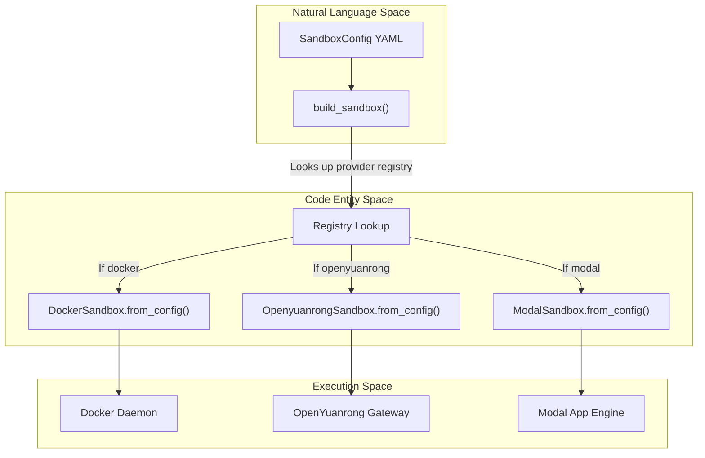
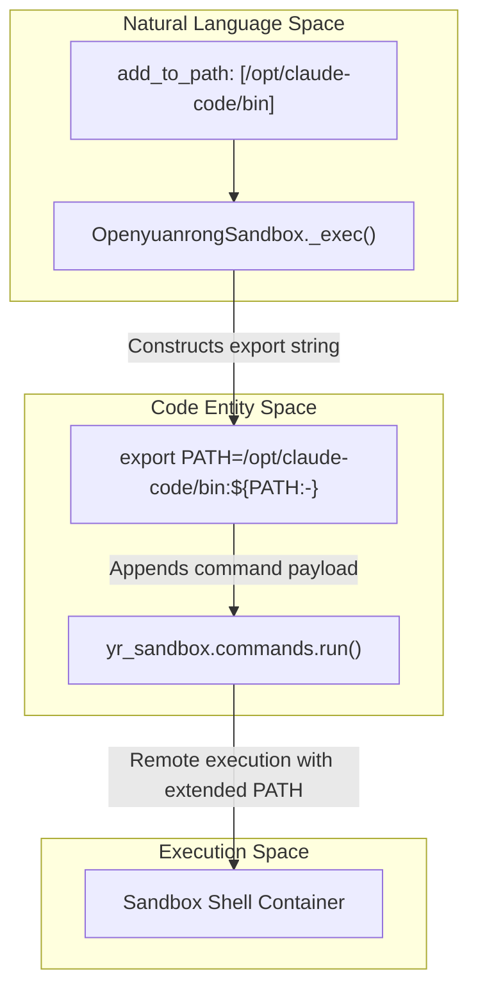

<!-- source: DeepWiki mcp.deepwiki.com · repo verl-project/uni-agent · page 4.2 Sandbox Providers · fetched 2026-10-26 -->

# Sandbox Providers

<details>
<summary>Relevant source files</summary>

The following files were used as context for generating this wiki page:

- [docs/source/quickstart/launch-sandbox.md](docs/source/quickstart/launch-sandbox.md)
- [examples/agent_aware_router/task_config_mini_swe_agent.yaml](examples/agent_aware_router/task_config_mini_swe_agent.yaml)
- [examples/claude_code_kernel_task/remote_docker.py](examples/claude_code_kernel_task/remote_docker.py)
- [examples/claude_code_swe_task/README.md](examples/claude_code_swe_task/README.md)
- [examples/claude_code_swe_task/task_config_claude_code_openyuanrong.yaml](examples/claude_code_swe_task/task_config_claude_code_openyuanrong.yaml)
- [tests/uni_agent/sandbox/test_docker_sandbox.py](tests/uni_agent/sandbox/test_docker_sandbox.py)
- [tests/uni_agent/sandbox/test_exec_error_policy.py](tests/uni_agent/sandbox/test_exec_error_policy.py)
- [tests/uni_agent/sandbox/test_executable_paths.py](tests/uni_agent/sandbox/test_executable_paths.py)
- [tests/uni_agent/sandbox/test_image_mounts.py](tests/uni_agent/sandbox/test_image_mounts.py)
- [tests/uni_agent/sandbox/test_openyuanrong_path.py](tests/uni_agent/sandbox/test_openyuanrong_path.py)
- [uni_agent/sandbox/docker.py](uni_agent/sandbox/docker.py)
- [uni_agent/sandbox/local.py](uni_agent/sandbox/local.py)
- [uni_agent/sandbox/modal.py](uni_agent/sandbox/modal.py)
- [uni_agent/sandbox/openyuanrong.py](uni_agent/sandbox/openyuanrong.py)

</details>


This page documents the concrete sandbox providers implemented in `uni_agent/sandbox/`, detailing their lifecycles, configuration contracts, image mounting strategies, and execution backends for Docker, OpenYuanrong, Modal, veFaaS, and Local execution.

---

## 1. Sandbox Provider Architecture & Registry

Uni-Agent decouples agent interaction logic from the underlying isolation boundary through the `Sandbox` abstract base class and a dynamic registry [`uni_agent/sandbox/registry.py`](). Providers are loaded lazily, ensuring that optional SDK dependencies (such as `openyuanrong-sandbox` or `modal`) are only imported when explicitly selected [docs/source/quickstart/launch-sandbox.md:18-20]().

Every provider implements a private execution primitive `_exec` that is wrapped by a shared public `exec` implementation enforcing a uniform error policy [`tests/uni_agent/sandbox/test_exec_error_policy.py:1-12]()]:
1. **Timeouts**: If a command exceeds `timeout`, it is classified via `_is_timeout_error` and returns an `ExecResult` with `exit_code = -1` [tests/uni_agent/sandbox/test_exec_error_policy.py:7-7]().
2. **Infrastructure Faults**: If a non-timeout error occurs and `is_alive()` returns `False`, the underlying exception is re-raised unchanged [tests/uni_agent/sandbox/test_exec_error_policy.py:8-9]().
3. **Command Failures**: If the sandbox remains alive, non-timeout errors downgrade gracefully to `exit_code = 127` carrying the error message on `stderr` [tests/uni_agent/sandbox/test_exec_error_policy.py:10-11]().

### Sandbox Instantiation Flow

Sources: [uni_agent/sandbox/docker.py:62-70](), [uni_agent/sandbox/openyuanrong.py:161-170](), [uni_agent/sandbox/modal.py:46-54](), [tests/uni_agent/sandbox/test_exec_error_policy.py:172-177]().

---

## 2. Docker Provider & Image Mounts

The `DockerSandbox` provider manages local or remote container execution via the Docker CLI [uni_agent/sandbox/docker.py:25-30](). It provides strict control over image pulling policies and supports advanced container features like image mounts.

### Lifecycle & Pull Policies
Upon calling `start()`, `DockerSandbox` inspects the task image and any configured image mounts according to `pull_policy` (`"always"`, `"missing"`, or `"never"`) [uni_agent/sandbox/docker.py:113-123]():
* **`missing` (Default)**: Inspects the daemon; pulls the image only if it is missing locally [docs/source/quickstart/launch-sandbox.md:57-57]().
* **`always`**: Forces a `docker pull` prior to container creation [uni_agent/sandbox/docker.py:115-116]().
* **`never`**: Fails immediately if the image is not present locally [uni_agent/sandbox/docker.py:120-121]().

The container is started in detached mode (`-d`) with its entrypoint fixed to `sleep`, accepting `runtime_timeout` as its duration argument so it automatically reaps itself upon expiration [docs/source/quickstart/launch-sandbox.md:67-74]().

### Image Mounts
Image mounts allow prebuilt tool containers (such as sidecar compilers or evaluation harnesses) to be mounted into the primary sandbox container without layer merging:
```python
config = SandboxConfig(
    provider="docker",
    image="python:3.12",
    image_mounts=[
        {"image": "<tool-image>", "mount_path": "/opt/tool"},
    ],
    executable_paths={"tool": "/opt/tool/bin/tool"},
)
```
[docs/source/quickstart/launch-sandbox.md:46-54]()

Docker image mounts require a daemon backed by the containerd image store and are passed as `--mount type=image,source=...,destination=...` flags [docs/source/quickstart/launch-sandbox.md:75-76](), [uni_agent/sandbox/docker.py:28-30]().

Sources: [docs/source/quickstart/launch-sandbox.md:38-78](), [uni_agent/sandbox/docker.py:25-164](), [tests/uni_agent/sandbox/test_docker_sandbox.py:19-160]().

---

## 3. OpenYuanrong Provider & PATH Extension

The `OpenyuanrongSandbox` provider integrates with OpenYuanrong (developed by the OpenYuanrong & Ant Akernel team) to execute commands in elastic remote sandboxes [uni_agent/sandbox/openyuanrong.py:1-5]().

### Connection & Configuration
Connection settings are parsed from environment variables (`OPENYUANRONG_SERVER_ADDRESS`, `OPENYUANRONG_TOKEN`, `OPENYUANRONG_TLS`, etc.) via `_connection_config` [uni_agent/sandbox/openyuanrong.py:46-80](). 

### Non-Destructive PATH Extension
When agents require tool executables from mounted sidecar images (e.g., Claude Code mounted at `/opt/claude-code`), the sandbox prepends `add_to_path` entries to the remote shell environment without overwriting the base system `PATH` [tests/uni_agent/sandbox/test_openyuanrong_path.py:1-3]().


Sources: [uni_agent/sandbox/openyuanrong.py:94-100](), [uni_agent/sandbox/openyuanrong.py:126-149](), [tests/uni_agent/sandbox/test_openyuanrong_path.py:61-73]().

Sources: [docs/source/quickstart/launch-sandbox.md:159-176](), [uni_agent/sandbox/openyuanrong.py:1-170](), [tests/uni_agent/sandbox/test_openyuanrong_path.py:1-92]().

---

## 4. Modal Provider

The `ModalSandbox` provider provisions on-demand isolated sandboxes using [Modal](https://modal.com) without requiring manual cluster management [docs/source/quickstart/launch-sandbox.md:121-123]().

### Implementation & Native Primitives
`ModalSandbox` looks up or creates a Modal App via `modal.App.lookup.aio` and spawns sandboxes using `modal.Sandbox.create.aio` [uni_agent/sandbox/modal.py:69-82](). When `image_mounts` are provided, Modal builds the mounted images and attaches them using `modal.Sandbox.mount_image.aio` (requiring `modal>=1.3.4`) [docs/source/quickstart/launch-sandbox.md:156-157](), [uni_agent/sandbox/modal.py:62-84]().

Unlike container backends that rely on command-line wrappers for file operations, `ModalSandbox` implements high-performance native asynchronous streaming methods:
* `read_file(path)` -> `self._require_sandbox().filesystem.read_bytes.aio(path)` [uni_agent/sandbox/modal.py:138-142]()
* `write_file(path, content)` -> `self._require_sandbox().filesystem.write_bytes.aio(data, path)` [uni_agent/sandbox/modal.py:144-149]()
* `upload_file(local, remote)` -> `self._require_sandbox().filesystem.copy_from_local.aio(...)` [uni_agent/sandbox/modal.py:151-153]()
* `download_file(remote, local)` -> `self._require_sandbox().filesystem.copy_to_local.aio(...)` [uni_agent/sandbox/modal.py:155-157]()

Sources: [docs/source/quickstart/launch-sandbox.md:121-158](), [uni_agent/sandbox/modal.py:16-162]().

---

## 5. veFaaS & Local Providers

### veFaaS
The `veFaaS` provider connects to Volcengine serverless function sandboxes (`swe-rex`) [docs/source/quickstart/launch-sandbox.md:79-87](). It supports load distribution across multiple function IDs and routes by passing comma-separated lists to environment variables (`VEFAAS_FUNCTION_ID`, `VEFAAS_FUNCTION_ROUTE`), where each sandbox randomly binds to a single pair for its lifetime [docs/source/quickstart/launch-sandbox.md:98-106]().

### Local Provider
The `local` provider executes commands directly on the host system without containerization [docs/source/quickstart/launch-sandbox.md:22-24](). 

> [!CAUTION]
> Do not use `local` for sandboxed agent tasks [docs/source/quickstart/launch-sandbox.md:26-27](). Commands executed through the `local` provider have direct access to host filesystems, environment variables, and packages [docs/source/quickstart/launch-sandbox.md:28-30](). Reserve `local` strictly for host-bound evaluations (such as HotpotQA) that do not require isolation [docs/source/quickstart/launch-sandbox.md:27-28]().

Sources: [docs/source/quickstart/launch-sandbox.md:22-120]().

---

## 6. Executable Paths and Tool Injection

To make mounted tools (such as Claude Code or custom toolchains) easily accessible to agents without hardcoding absolute paths, providers support `executable_paths` resolution [docs/source/quickstart/launch-sandbox.md:54-54]().

### Symlink Enforcement
During sandbox startup, `Sandbox._setup_executable_paths()` validates and symlinks tool binaries into `/usr/bin` (or `/usr/local/bin`) [tests/uni_agent/sandbox/test_executable_paths.py:48-58]():
1. Verifies that executable names and target paths are safe (rejecting relative paths or traversal patterns) [tests/uni_agent/sandbox/test_executable_paths.py:31-43]().
2. Executes `command -v <name>` to check for pre-existing system binaries [tests/uni_agent/sandbox/test_executable_paths.py:53-54]().
3. Creates a symbolic link via `ln -sfn <target> /usr/bin/<name>` [tests/uni_agent/sandbox/test_executable_paths.py:55-55]().
4. Verifies the link integrity using `test /usr/bin/<name> -ef <target>` [tests/uni_agent/sandbox/test_executable_paths.py:57-57]().

Sources: [docs/source/quickstart/launch-sandbox.md:54-54](), [tests/uni_agent/sandbox/test_executable_paths.py:1-96]().

---

