# Page: Overview

# Overview

<details>
<summary>Relevant source files</summary>

The following files were used as context for generating this wiki page:

- [README.md](README.md)
- [assets/uni-agent.png](assets/uni-agent.png)
- [docs/source/assets/results_claude_code_qwen3_coder_30b.svg](docs/source/assets/results_claude_code_qwen3_coder_30b.svg)
- [docs/source/benchmark/index.md](docs/source/benchmark/index.md)
- [docs/source/benchmark/inference.md](docs/source/benchmark/inference.md)
- [docs/source/benchmark/rl-training.md](docs/source/benchmark/rl-training.md)
- [docs/source/quickstart/rl-training.md](docs/source/quickstart/rl-training.md)
- [examples/quickstart/training/task_config_claude_code.yaml](examples/quickstart/training/task_config_claude_code.yaml)
- [examples/quickstart/training/train_qwen3_moe.sh](examples/quickstart/training/train_qwen3_moe.sh)
- [examples/quickstart/training/train_qwen3p5_dense.sh](examples/quickstart/training/train_qwen3p5_dense.sh)

</details>


Uni-Agent is a unified framework designed for building, running, and training long-horizon agents at scale [README.md:1-13](). It provides a robust interaction stack that bridges standard agent harnesses (such as ReAct and Claude Code) with high-performance distributed reinforcement learning via integration with the `verl` library [README.md:11-24](), [docs/source/quickstart/rl-training.md:1-4]().

## Purpose and Scope

Uni-Agent addresses the challenges of long-horizon agent tasks (such as software engineering in SWE-bench or terminal operations) by offering:
*   **Plug-and-Play Agent Harnesses:** Connect OpenAI- or Anthropic-compatible agents through the **Uni-Agent Gateway** to translate interaction trajectories into training-ready tokens [README.md:21-24]().
*   **Decoupled Architecture:** Independently customize agent logic, execution sandboxes, evaluation tasks, and reward modules [README.md:25-28]().
*   **Large-Scale Concurrent Rollouts:** Run thousands of stateful, long-horizon sessions simultaneously using pooled gateway sessions, isolated remote/local sandboxes, and asynchronous scheduling [README.md:29-32]().
*   **verl RL Integration:** Reuse the exact rollout interaction stack for scalable reinforcement learning using Group Relative Policy Optimization (GRPO) or Group-wise Sequence Policy Optimization (GSPO) objectives [README.md:67-70](), [examples/quickstart/training/train_qwen3_moe.sh:31-133]().

For detailed setup instructions, see [Getting Started & Installation](#1.1). For a deep dive into how the harness, task, sandbox, and gateway layers interact, see [Architecture Overview](#1.2).

Sources: [README.md:1-46](), [docs/source/quickstart/rl-training.md:1-10]()

## Architecture Philosophy

The core philosophy of Uni-Agent is the strict decoupling of the agent's reasoning process, the execution environment, and the training infrastructure [README.md:25-28](). 

### Conceptual Flow: From Language to Code

The following diagram illustrates how natural language agent prompts and reasoning traces map to code entities across the system.

**System Entity Mapping**
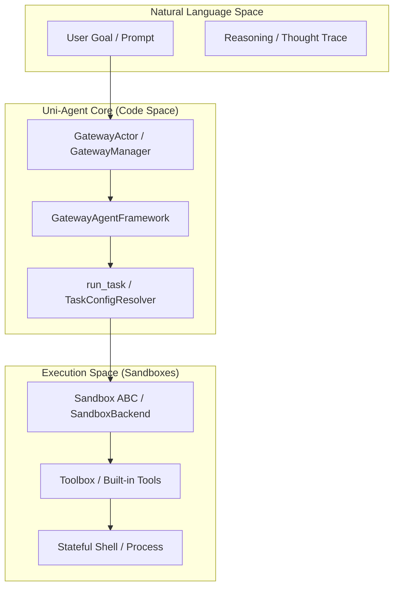
**Sources:** [README.md:21-32](), [examples/quickstart/training/train_qwen3_moe.sh:15-22]()

### Subsystem Relationships

The architecture is composed of distinct modular layers that communicate through well-defined protocol adapters and queues.

**Class Relationship Diagram**
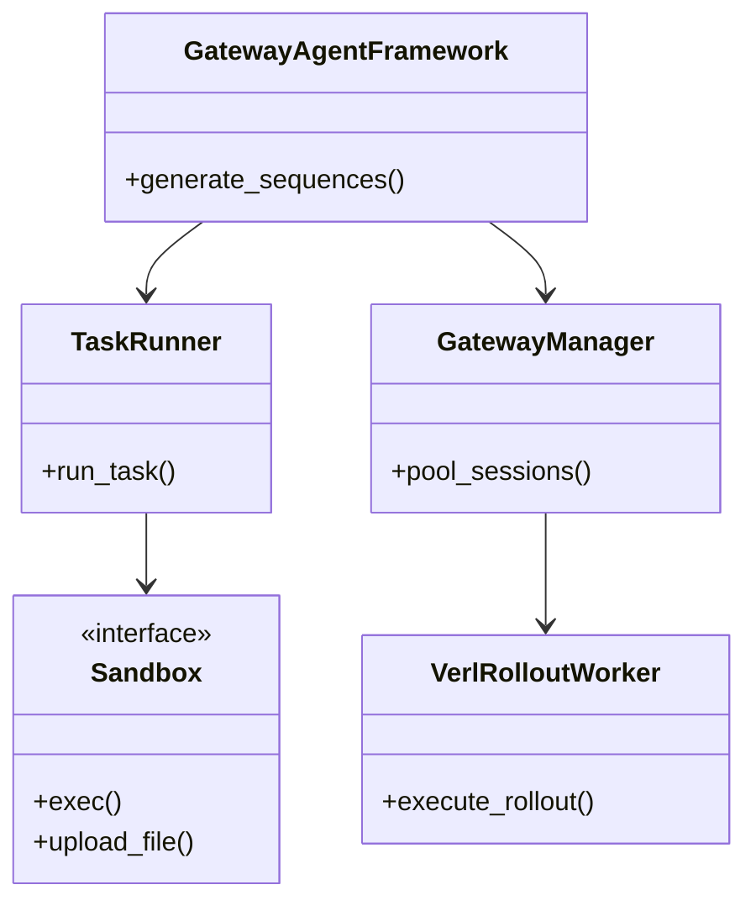
**Sources:** [README.md:25-32](), [examples/quickstart/training/train_qwen3_moe.sh:15-22]()

Sources: [README.md:21-32](), [examples/quickstart/training/train_qwen3_moe.sh:15-22]()

## Documentation Roadmap

Uni-Agent documentation is organized into focused child pages and thematic sections:

*   **[Getting Started & Installation](#1.1):** Install `uni-agent`, configure the bundled `verl` submodule, setup optional cloud provider SDKs, and execute quickstart inference and sandbox demos [README.md:37-46]().
*   **[Architecture Overview](#1.2):** Understand the decoupled layers of the harness, task, sandbox, and gateway, along with the end-to-end request and trajectory flow from agent to trainer [README.md:25-32]().
*   **Gateway (Section 2):** Overview of the OpenAI/Anthropic-compatible endpoint fronting rollout engines and collecting token-level trajectories.
*   **Agent Framework & RL Training (Section 3):** Details on rollout orchestration, PPO integration, and Megatron-parallel training scripts.
*   **Sandbox Layer (Section 4):** Execution boundaries, providers (veFaaS, Modal, Docker, Local), and built-in toolboxes.
*   **Agents (Section 5):** Implementations of ReAct, Claude Code, Mini-SWE-Agent, and Memory-augmented agents.
*   **Tasks & Rewards (Section 6):** Benchmarks including SWE-bench, KernelBench, and Harbor task integrations.
*   **Agent Aware Router (Section 7):** KV-cache-aware request distribution across inference replicas.
*   **Observability & Developer Operations (Section 8):** Logging, telemetry, CI conventions, and testing markers.
*   **Glossary (Section 9):** Definitions of core terms with code pointers.

Sources: [README.md:37-46]()

---

# Page: Getting Started & Installation

# Getting Started & Installation

<details>
<summary>Relevant source files</summary>

The following files were used as context for generating this wiki page:

- [.github/workflows/ci.yml](.github/workflows/ci.yml)
- [.gitmodules](.gitmodules)
- [docs/source/quickstart/installation.md](docs/source/quickstart/installation.md)
- [docs/source/quickstart/oracle-verification.md](docs/source/quickstart/oracle-verification.md)
- [examples/inference/README.md](examples/inference/README.md)
- [examples/inference/parallel_run_oracle.py](examples/inference/parallel_run_oracle.py)
- [examples/quickstart/oracle/task_config_oracle.yaml](examples/quickstart/oracle/task_config_oracle.yaml)
- [examples/quickstart/sandbox/demo.py](examples/quickstart/sandbox/demo.py)
- [pyproject.toml](pyproject.toml)
- [requirements-test.txt](requirements-test.txt)
- [tests/uni_agent/deployment/test_host_runtime.py](tests/uni_agent/deployment/test_host_runtime.py)
- [uni_agent/__init__.py](uni_agent/__init__.py)
- [uni_agent/version/version](uni_agent/version/version)

</details>


Uni-Agent is designed as a modular extension to the `verl` reinforcement learning framework [docs/source/quickstart/installation.md:1-6](). It provides abstractions for persistent sandboxes, multi-turn tool interaction loops, and scalable agent training. This guide details the setup process for local development, optional task/sandbox provider SDKs, Ray-based distributed execution, and running quickstart inference and sandbox demos.

---

## Installation Overview

The installation process varies depending on whether you are running non-training inference/sandbox demos or deploying to a large-scale Ray cluster for RL training [docs/source/quickstart/installation.md:1-8](). 

- **Non-training workflows:** A standard Python `3.10` to `3.12` environment [pyproject.toml:22](), [docs/source/quickstart/installation.md:5]().
- **RL training:** A compatible environment with the bundled `verl` submodule and training dependencies [docs/source/quickstart/installation.md:6]().

### Core Setup & Submodule Initialization

Uni-Agent uses `verl` as its underlying training engine via a Git submodule [.gitmodules:1-3](). Clone the repository with submodules enabled and install the core and test packages [docs/source/quickstart/installation.md:10-22](), [.github/workflows/ci.yml:29-33]():

```bash
git clone --recursive https://github.com/verl-project/uni-agent.git
cd uni-agent
pip install --no-deps -e ./verl
pip install -r requirements-test.txt
```

Sources: [docs/source/quickstart/installation.md:10-22](), [.github/workflows/ci.yml:29-50](), [.gitmodules:1-3](), [requirements-test.txt:1-9]()

---

## Optional Dependencies

Uni-Agent maintains a lightweight core [docs/source/quickstart/installation.md:26](). Additional packages must be installed depending on the target sandbox provider or evaluation benchmark suite [docs/source/quickstart/installation.md:26-62]().

### Task Dependencies

Task dependencies supply task-specific datasets, verifiers, and reward implementations [docs/source/quickstart/installation.md:26-30](). For example, install `swebench` when running SWE-bench evaluation [docs/source/quickstart/installation.md:30-37]():

```bash
pip install swebench==4.1.0
```

### Sandbox Backends

The sandbox layer supports multiple backends for executing agent actions [docs/source/quickstart/installation.md:40-62]():

| Backend | Command | Purpose |
| :--- | :--- | :--- |
| **Docker** | `docker version` [docs/source/quickstart/installation.md:46-49]() | Local containerized isolation. |
| **Modal** | `pip install modal` [docs/source/quickstart/installation.md:52-56]() | Remote serverless sandboxes with high concurrency. |
| **veFaaS** | `pip install volcengine-python-sdk swe-rex` [docs/source/quickstart/installation.md:58-62]() | Volcengine Function-as-a-Service and execution runner. |
| **Host** | (Built-in via `HostRuntime`) [tests/uni_agent/deployment/test_host_runtime.py:22]() | Local process-based bash execution. |

Sources: [docs/source/quickstart/installation.md:26-62](), [tests/uni_agent/deployment/test_host_runtime.py:1-24]()

---

## Ray Runtime Environments

For distributed Ray workloads, you can use a Runtime Environment configuration file (`runtime_env.yaml`) to inject task, sandbox, and `verl` dependencies into every Ray worker node [docs/source/quickstart/installation.md:64-67]().

### Runtime Environment Mapping

Below is a diagram bridging natural language deployment concepts to the underlying Ray job submission and `PYTHONPATH` code entities (`runtime_env.yaml`, `verl`).

Title: "Ray Environment Provisioning & Code Mapping"
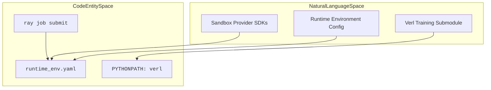
Sources: [docs/source/quickstart/installation.md:64-86]()

### Runtime Configuration Example

```yaml
working_dir: ./
excludes: ["/.git/"]
pip:
  packages:
    - "volcengine-python-sdk"
    - "swe-rex"
    - "swebench==4.1.0"
env_vars:
  PYTHONPATH: "verl"
```

Submit the job to the cluster [docs/source/quickstart/installation.md:81-85]():

```bash
ray job submit --runtime-env runtime_env.yaml -- python entrypoint.py
```

Sources: [docs/source/quickstart/installation.md:64-86]()

---

## Quickstart Demos

Uni-Agent provides standalone demo scripts to verify your sandbox installation and run oracle evaluations [examples/quickstart/sandbox/demo.py:1-171](), [examples/inference/parallel_run_oracle.py:1-122]().

### 1. Sandbox & Toolbox Demo

The sandbox demo (`examples/quickstart/sandbox/demo.py`) exercises the `Sandbox` configuration, persistent shell execution, `str_replace_editor`, and file I/O primitives [examples/quickstart/sandbox/demo.py:1-171]().

Title: "Sandbox Demo Execution Flow"
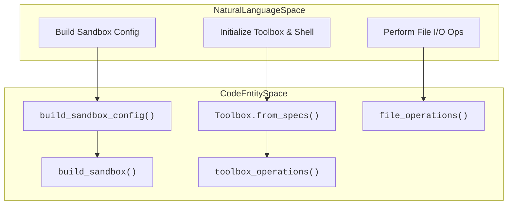
Sources: [examples/quickstart/sandbox/demo.py:29-170]()

Run the sandbox demo locally or via Modal:

```bash
SANDBOX_PROVIDER=local python examples/quickstart/sandbox/demo.py
```

### 2. Oracle Verification Demo

You can verify dataset instances against ground-truth oracle solutions using `parallel_run_oracle.py` [examples/inference/parallel_run_oracle.py:1-63]():

```bash
python examples/inference/parallel_run_oracle.py \
    --data-path ~/data/swe_agent/swe_bench_verified.parquet \
    --task-config examples/quickstart/oracle/task_config_oracle.yaml \
    --limit 4
```

This script instantiates `OracleEvalActor` across Ray workers to process parquet rows concurrently [examples/inference/parallel_run_oracle.py:30-63](), [examples/inference/parallel_run_oracle.py:121-157]().

Sources: [examples/inference/parallel_run_oracle.py:1-157](), [examples/quickstart/oracle/task_config_oracle.yaml:1-23]()

---

Sources:
- [docs/source/quickstart/installation.md:1-87]()
- [pyproject.toml:1-120]()
- [requirements-test.txt:1-9]()
- [.github/workflows/ci.yml:1-66]()
- [.gitmodules:1-3]()
- [examples/quickstart/sandbox/demo.py:1-171]()
- [examples/inference/parallel_run_oracle.py:1-157]()
- [examples/quickstart/oracle/task_config_oracle.yaml:1-23]()
- [tests/uni_agent/deployment/test_host_runtime.py:1-145]()

---

# Page: Architecture Overview

# Architecture Overview

<details>
<summary>Relevant source files</summary>

The following files were used as context for generating this wiki page:

- [README.md](README.md)
- [docs/source/assets/results_claude_code_qwen3_coder_30b.svg](docs/source/assets/results_claude_code_qwen3_coder_30b.svg)
- [docs/source/concepts/gateway-and-trajectories.md](docs/source/concepts/gateway-and-trajectories.md)
- [docs/source/quickstart/rl-training.md](docs/source/quickstart/rl-training.md)
- [examples/quickstart/training/task_config_claude_code.yaml](examples/quickstart/training/task_config_claude_code.yaml)
- [examples/quickstart/training/train_qwen3_moe.sh](examples/quickstart/training/train_qwen3_moe.sh)
- [examples/quickstart/training/train_qwen3p5_dense.sh](examples/quickstart/training/train_qwen3p5_dense.sh)
- [tests/uni_agent/framework/test_generate_sequences_on_cpu.py](tests/uni_agent/framework/test_generate_sequences_on_cpu.py)
- [tests/uni_agent/gateway/test_debug_launcher.py](tests/uni_agent/gateway/test_debug_launcher.py)
- [uni_agent/framework/framework.py](uni_agent/framework/framework.py)
- [uni_agent/gateway/gateway.py](uni_agent/gateway/gateway.py)
- [uni_agent/gateway/session/types.py](uni_agent/gateway/session/types.py)

</details>


Uni-Agent is a scalable framework designed for running and training long-horizon agents via reinforcement learning [README.md:9-14](). The system architecture decouples agent harnesses, task environments, execution sandboxes, and model serving through a gateway-centric design, bridging standard OpenAI/Anthropic agent APIs to `verl` PPO training infrastructure [README.md:21-32](), [docs/source/concepts/gateway-and-trajectories.md:1-5]().

---

## 1. The Four-Tier Architecture Stack

The architecture is partitioned into four decoupled layers, ensuring that agent harnesses, tasks, execution environments, and rollout infrastructure can be developed, scaled, and swapped independently:

1. **Agent Harness Layer**: External or built-in agent loops (e.g., ReAct, Claude Code, Mini-SWE-Agent) that interact exclusively through OpenAI or Anthropic chat/messages HTTP endpoints [README.md:21-24](), [docs/source/concepts/gateway-and-trajectories.md:38-48]().
2. **Gateway Layer**: Manages session state, handles message codecs, parses backend tool calls, and fronts rollout engines (`vLLM`, `SGLang`, or `verl` workers) without executing inference itself [docs/source/concepts/gateway-and-trajectories.md:3-5]().
3. **Task & Sandbox Layer**: Instantiates isolated container or serverless execution environments (veFaaS, Modal, Docker, Local) to execute agent-selected shell commands, edits, and evaluations [README.md:27-31](), [examples/quickstart/training/task_config_claude_code.yaml:1-8]().
4. **Agent Framework & Trainer Layer (`GatewayAgentFramework`)**: Orchestrates ray tasks (`_run_agent_runner_ray_task`), captures token-level trajectories (`Trajectory`), applies postprocessors, computes rewards (`TaskResult`), and writes finalized records to `TransferQueue` for `verl` PPO training [tests/uni_agent/framework/test_generate_sequences_on_cpu.py:112-133](), [uni_agent/framework/framework.py:112-170](), [docs/source/concepts/gateway-and-trajectories.md:32-41]().

### Component Interaction & System Architecture

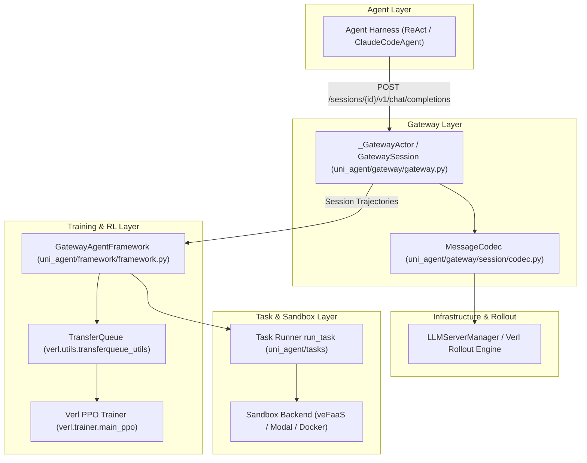

**Sources:** [README.md:21-32](), [docs/source/concepts/gateway-and-trajectories.md:3-48](), [uni_agent/framework/framework.py:112-133](), [uni_agent/gateway/gateway.py:54-93]()

---

## 2. Request and Trajectory Data Flow

When executing training rollouts or parallel evaluation, requests flow from the `verl` LLMServerManager down through the Gateway, Agent Framework, Task Runner, and back into the TransferQueue as training-ready token tensors [docs/source/concepts/gateway-and-trajectories.md:17-28]().

### End-to-End Rollout Flow

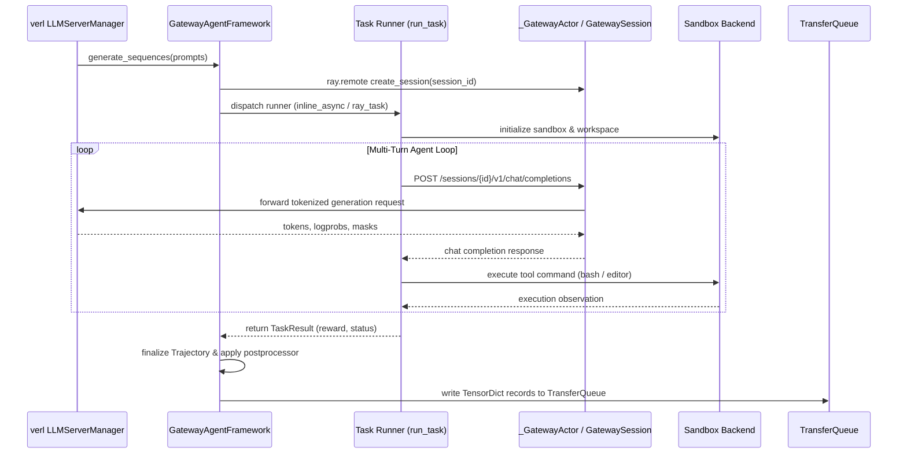

**Sources:** [docs/source/concepts/gateway-and-trajectories.md:30-74](), [uni_agent/framework/framework.py:112-170]()

---

## Code Entity Mapping

The mapping between natural language architecture components and concrete codebase entities is detailed below.

| System Concept | Code Entity | File Location | Role |
| :--- | :--- | :--- | :--- |
| **Framework Orchestrator** | `GatewayAgentFramework` | `uni_agent/framework/framework.py` | Implements `AgentFramework`, dispatches runners, and materializes `TransferQueue` batches. |
| **Ray Runner Worker** | `_run_agent_runner_ray_task` | `uni_agent/framework/framework.py` | Executes user agent runners inside isolated Ray tasks. |
| **Gateway Router Actor** | `_GatewayActor` | `uni_agent/gateway/gateway.py` | FastAPI/Ray actor managing endpoints, exception handlers, and session lifecycles. |
| **Session State & Codec** | `GatewaySession` & `MessageCodec` | `uni_agent/gateway/session/` | Manages message history, chain branching, prompt application, and tool parsing. |
| **Token Trajectory** | `Trajectory` | `uni_agent/gateway/session/types.py` | Encapsulates prompt IDs, response IDs, response masks, logprobs, and reward metrics. |
| **Sandbox Execution** | `Sandbox` / `SandboxBackend` | `uni_agent/sandbox/` | Abstract deployment interface for container and cloud execution environments. |

### Natural Language to Code Entity Space

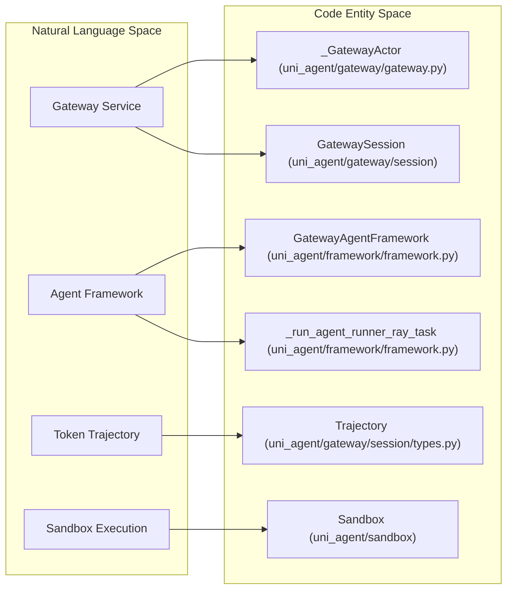

**Sources:** [uni_agent/framework/framework.py:44-134](), [uni_agent/gateway/gateway.py:54-93](), [uni_agent/gateway/session/types.py:40-79]()

---

# Page: Gateway

# Gateway

<details>
<summary>Relevant source files</summary>

The following files were used as context for generating this wiki page:

- [tests/__init__.py](tests/__init__.py)
- [tests/uni_agent/__init__.py](tests/uni_agent/__init__.py)
- [tests/uni_agent/gateway/test_debug_launcher.py](tests/uni_agent/gateway/test_debug_launcher.py)
- [uni_agent/gateway/__init__.py](uni_agent/gateway/__init__.py)
- [uni_agent/gateway/gateway.py](uni_agent/gateway/gateway.py)
- [uni_agent/gateway/manager.py](uni_agent/gateway/manager.py)
- [uni_agent/gateway/session/types.py](uni_agent/gateway/session/types.py)

</details>


The Uni-Agent Gateway is a thin FastAPI and Ray-actor-based service layer that fronts inference rollout engines (such as vLLM or SGLang) and provides OpenAI and Anthropic compatible endpoints (`[uni_agent/gateway/gateway.py:1-6]()`). It manages multi-turn agent sessions, normalizes distinct client wire formats into internal generation payloads (`[uni_agent/gateway/session/types.py:13-24]()`), and materializes token-level `Trajectory` records required for reinforcement learning training (`[uni_agent/gateway/session/types.py:41-79]()`).

As a PARENT page, this section provides a high-level overview of the gateway components. For deep technical details, refer to the child pages linked below.

---

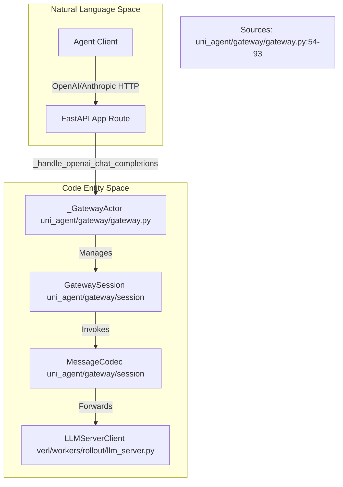

---

## 2.1 Gateway Actor, Manager & Configuration

The gateway architecture divides responsibilities between driver-side scaling management (`GatewayManager`) and worker-side request handling (`_GatewayActor` / `GatewayActor`) (`[uni_agent/gateway/gateway.py:54-61](), [uni_agent/gateway/manager.py:18-24]()`). `GatewayManager` spawns a pool of `GatewayActor` instances across available CPU nodes using Ray affinity scheduling, balances session creation load based on active session counts, and routes termination calls (`[uni_agent/gateway/manager.py:39-93]()`).

Inside each actor, a FastAPI application exposes provider-compatible routes for sessions (`[uni_agent/gateway/gateway.py:88-141]()`). Configuration options like `GatewayActorConfig` control sampling allowlists, prefix-hash coalescing, and assistant rollback behavior.

For details, see [Gateway Actor, Manager & Configuration](#2.1).

Sources: `uni_agent/gateway/gateway.py:54-141`, `uni_agent/gateway/manager.py:18-117`

---

## 2.2 Sessions, Chains & Trajectories

Stateful agent interactions are managed via `GatewaySession` instances mapped to unique `session_id` strings (`[uni_agent/gateway/gateway.py:87](), [uni_agent/gateway/session/types.py:27-38]()`). Each session supports conversation branching through `ChainState`, prefix-hashing for KV-cache optimization, and assistant response rollbacks. 

When a session finalizes, the gateway packages accumulated tokens, prompt masks, and reward metrics into a `Trajectory` record, which is subsequently consumed by the training framework (`[uni_agent/gateway/session/types.py:41-79]()`).

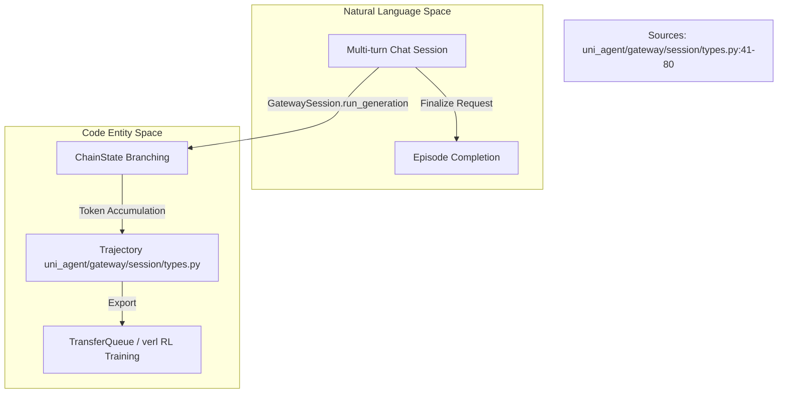

For details, see [Sessions, Chains & Trajectories](#2.2).

Sources: `uni_agent/gateway/session/types.py:41-80`

---

## 2.3 Message Codec & Tool Parsing

The `MessageCodec` class translates normalized conversation messages and tool schemas into the continuous token sequences and prompt tensors expected by underlying rollout engines (`[uni_agent/gateway/gateway.py:67-78]()`). It handles backend-specific chat templates, multimodal vision extraction, and specialized tool-call parsers for engines like sglang, vllm, and verl, complete with an internal parser cache.

For details, see [Message Codec & Tool Parsing](#2.3).

Sources: `uni_agent/gateway/gateway.py:67-78`

---

## 2.4 Protocol Adapters (OpenAI & Anthropic)

To support diverse agent frameworks without modification, the gateway implements dual protocol adapters for OpenAI chat-completions and Anthropic messages requests (`[uni_agent/gateway/gateway.py:18-29]()`). These adapters translate incoming wire formats into `InternalGenerationRequest` typed structures and format model outputs back into provider-compliant streaming Server-Sent Events (SSE) or JSON responses (`[uni_agent/gateway/gateway.py:155-159](), [uni_agent/gateway/session/types.py:13-24]()`).

For details, see [Protocol Adapters (OpenAI & Anthropic)](#2.4).

Sources: `uni_agent/gateway/gateway.py:18-29`, `uni_agent/gateway/session/types.py:13-24`

---

# Page: Gateway Actor, Manager & Configuration

# Gateway Actor, Manager & Configuration

<details>
<summary>Relevant source files</summary>

The following files were used as context for generating this wiki page:

- [tests/__init__.py](tests/__init__.py)
- [tests/uni_agent/__init__.py](tests/uni_agent/__init__.py)
- [tests/uni_agent/gateway/test_gateway_actor_on_cpu.py](tests/uni_agent/gateway/test_gateway_actor_on_cpu.py)
- [tests/uni_agent/gateway/test_gateway_manager_on_cpu.py](tests/uni_agent/gateway/test_gateway_manager_on_cpu.py)
- [tests/uni_agent/support.py](tests/uni_agent/support.py)
- [uni_agent/gateway/__init__.py](uni_agent/gateway/__init__.py)
- [uni_agent/gateway/config.py](uni_agent/gateway/config.py)
- [uni_agent/gateway/manager.py](uni_agent/gateway/manager.py)

</details>


## Purpose and Scope

This page details the core infrastructure of the Uni-Agent gateway tier: **`GatewayActor`**, **`GatewayManager`**, and **`GatewayActorConfig`**. The gateway acts as an OpenAI/Anthropic-compatible endpoint fronting rollout inference engines (`LLMServerClient`), parsing continuous tokens and tools, and managing multi-turn session states and token-level trajectory collections. 

Specifically, this documentation covers:
- Actor-level request multiplexing and session management via `_GatewayActor` and its Ray wrapper `GatewayActor` [uni_agent/gateway/__init__.py:1-7]().
- Driver-side pool coordination, CPU affinity scheduling, and load-balanced routing via `GatewayManager` [uni_agent/gateway/manager.py:18-116]().
- Actor configuration flags, validation constraints, and options governing assistant rollbacks, exact-request coalescing, and sampling parameters via `GatewayActorConfig` [uni_agent/gateway/config.py:16-83]().

---

## GatewayActor & Request Handling

The gateway actor encapsulates chat-completion execution, session lifecycles, and trajectory accumulation. It is implemented as a Ray actor (`GatewayActor`) wrapping an internal stateful engine (`_GatewayActor`) [tests/uni_agent/gateway/test_gateway_actor_on_cpu.py:93-99]().

### Request Multiplexing & Session Routing

Each gateway actor maintains a dictionary of active sessions (`_sessions`) indexed by session identifiers [tests/uni_agent/gateway/test_gateway_actor_on_cpu.py:103](). When an OpenAI chat completion request arrives (`_handle_openai_chat_completions`), the actor resolves the appropriate session, validates token capacities, and forwards sampling options to the underlying rollout backend [tests/uni_agent/gateway/test_gateway_actor_on_cpu.py:125]().

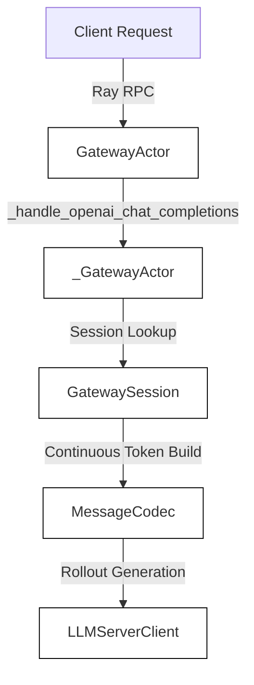
*Sources: `uni_agent/gateway/config.py`, `tests/uni_agent/gateway/test_gateway_actor_on_cpu.py`*

### Token Capacity and Clamping

The gateway enforces total trajectory token limits defined by `prompt_length` and `response_length` [uni_agent/gateway/config.py:38-40](). During generation, `max_tokens` (or `max_completion_tokens`) requested by the agent is automatically clamped to the remaining trajectory capacity:

$$\text{ClampedMaxTokens} = (\text{prompt\_length} + \text{response\_length}) - \text{TokenCount}(\text{PromptIDs})$$

If a trajectory exhausts its token budget, subsequent generation requests close without invoking the backend [tests/uni_agent/gateway/test_gateway_actor_on_cpu.py:185-190]().

Sources: `uni_agent/gateway/config.py:38-64`, `tests/uni_agent/gateway/test_gateway_actor_on_cpu.py:140-180`

---

## GatewayManager Pooling & Load-Balanced Routing

The **`GatewayManager`** runs on the Ray driver, instantiating and overseeing a pool of `GatewayActor` instances [uni_agent/gateway/manager.py:18-55]().

### Actor Placement and CPU Affinity

To prevent gateway actors from packing onto the main driver node under Ray's default scheduling policies, `GatewayManager` inspects alive cluster nodes, filters for CPU availability, and distributes actors across them using soft node-affinity strategies [uni_agent/gateway/manager.py:39-54]().

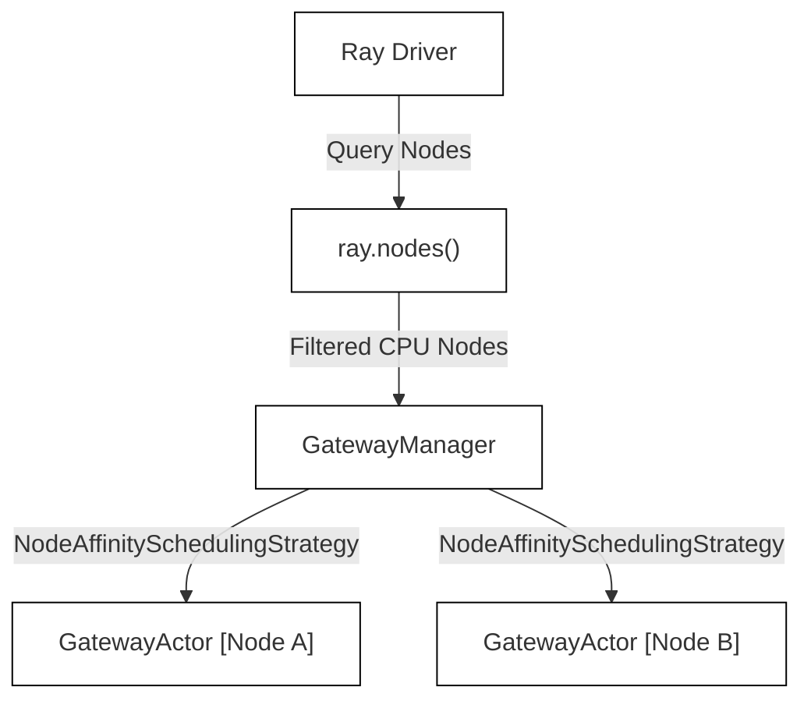
*Sources: `uni_agent/gateway/manager.py:39-55`*

### Least-Loaded Routing and Synchronization

Sessions are assigned to gateway actors via a least-loaded strategy (`_select_gateway_index`) [uni_agent/gateway/manager.py:60-64](). To avoid race conditions during bursty concurrent session creations, load counters are reserved *synchronously* before awaiting the asynchronous remote actor initialization [uni_agent/gateway/manager.py:75-92]().

| Method | Role | Code Pointer |
| :--- | :--- | :--- |
| `__init__` | Spawns `gateway_count` actors with round-robin CPU affinity | `uni_agent/gateway/manager.py:25-55` |
| `_select_gateway_index` | Selects the actor index with minimal active sessions | `uni_agent/gateway/manager.py:60-64` |
| `create_session` | Reserves slot, invokes remote actor, rolls back on failure | `uni_agent/gateway/manager.py:75-92` |
| `finalize_session` | Collects trajectories from owning actor and releases slot | `uni_agent/gateway/manager.py:94-100` |
| `abort_session` | Aborts session on owning actor and releases slot | `uni_agent/gateway/manager.py:102-108` |

Sources: `uni_agent/gateway/manager.py:18-117`, `tests/uni_agent/gateway/test_gateway_manager_on_cpu.py:48-71`

---

## GatewayActorConfig Options & Validation

The `GatewayActorConfig` dataclass defines model parameters, tokenizer wrappers, caching policies, and session flags passed down to gateway actors [uni_agent/gateway/config.py:16-47]().

### Configuration Attributes

- **`tokenizer` & `processor`**: Tokenizer and multimodal processor instances used by the message codec [uni_agent/gateway/config.py:49-50]().
- **`tool_parser_name` & `rollout_backend`**: Identifies backend-specific parsers (e.g., SGLang, vLLM) or verl registries [uni_agent/gateway/config.py:51-54]().
- **`enable_tool_parser_cache`**: Controls whether parser instances are reused within an actor-scoped codec (`True` by default) [uni_agent/gateway/config.py:25-27, 53]().
- **`enable_last_assistant_rollback`**: Permits rollbacks when the latest assistant turn is rewritten, reusing existing chain branches (`True` by default) [uni_agent/gateway/config.py:41-42, 62]().
- **`coalesce_reserved_exact_requests`**: Enables single-flight merging of exact duplicate provider-normalized requests within the same session (`True` by default) [uni_agent/gateway/config.py:43-46, 63]().
- **`prompt_length` & `response_length`**: Optional token limits enforced across the session trajectory [uni_agent/gateway/config.py:38-40, 60-61]().

### Validation Rules (`__post_init__`)

`GatewayActorConfig.__post_init__` validates argument types and value bounds, raising a `ValueError` under invalid configurations [uni_agent/gateway/config.py:65-83]().

- Boolean options (`enable_tool_parser_cache`, `enable_last_assistant_rollback`, `coalesce_reserved_exact_requests`) must be valid booleans [uni_agent/gateway/config.py:66-79]().
- `prompt_length` and `response_length` must be strictly positive integers when provided [uni_agent/gateway/config.py:80-83]().

Sources: `uni_agent/gateway/config.py:16-84`, `tests/uni_agent/gateway/test_gateway_actor_on_cpu.py:49-78`

---

## Debug Launcher & Testing Utilities

The gateway includes dedicated test suites verifying actor configuration constraints, concurrency safety, rollback mechanics, and multi-actor routing:
- **`tests/uni_agent/gateway/test_gateway_actor_on_cpu.py`**: Validates configuration validation rules, assistant rollback accounting, token clamping against trajectory limits, and singleflight request coalescing [tests/uni_agent/gateway/test_gateway_actor_on_cpu.py:46-190]().
- **`tests/uni_agent/gateway/test_gateway_manager_on_cpu.py`**: Verifies load distribution across concurrent session creations, node-affinity placement logic, and proper session finalization routing across multiple gateway actors [tests/uni_agent/gateway/test_gateway_manager_on_cpu.py:48-180]().

Sources: `tests/uni_agent/gateway/test_gateway_actor_on_cpu.py:1-190`, `tests/uni_agent/gateway/test_gateway_manager_on_cpu.py:1-180`

---

# Page: Sessions, Chains & Trajectories

# Sessions, Chains & Trajectories

<details>
<summary>Relevant source files</summary>

The following files were used as context for generating this wiki page:

- [tests/uni_agent/gateway/test_debug_launcher.py](tests/uni_agent/gateway/test_debug_launcher.py)
- [tests/uni_agent/gateway/test_session_multiple_chains_on_cpu.py](tests/uni_agent/gateway/test_session_multiple_chains_on_cpu.py)
- [uni_agent/gateway/gateway.py](uni_agent/gateway/gateway.py)
- [uni_agent/gateway/session/session.py](uni_agent/gateway/session/session.py)
- [uni_agent/gateway/session/types.py](uni_agent/gateway/session/types.py)

</details>


This page details the core state management within the Uni-Agent gateway: the `GatewaySession` lifecycle, linear `ChainState` branching, prefix hashing, assistant rollbacks, request coalescing, and token-level trajectory materialization (`Trajectory`) with strict capacity budgeting.

---

## 1. GatewaySession Lifecycle & Phases

A `GatewaySession` represents a conversation thread and execution session owned by the gateway (`[uni_agent/gateway/gateway.py:54-93]()`). Sessions progress through distinct lifecycle phases defined by `SessionPhase` (`[uni_agent/gateway/session/session.py:30-42]()`):

- **`ACTIVE`**: The session is live, accepting generation requests, appending user/assistant messages, and accumulating tokens into active trajectory chains.
- **`FINALIZED`**: All active chains have been closed, materializing final token trajectories (`Trajectory`) that are ready for training ingestion.
- **`ABORTED`**: The session was cancelled or terminated abnormally; it halts generation and discards or flags pending trajectories.

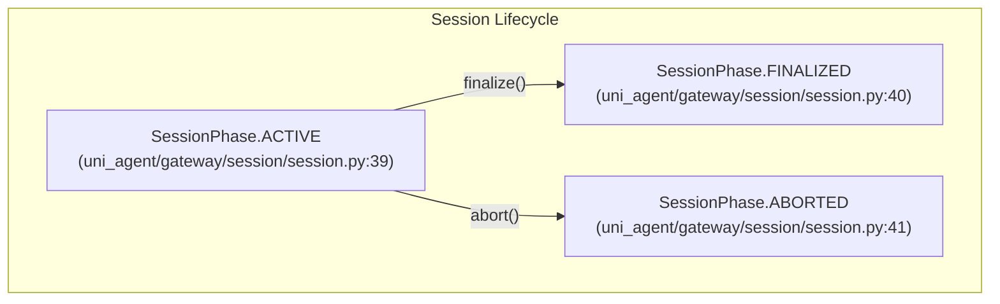
*Sources: [uni_agent/gateway/session/session.py:30-42](), [uni_agent/gateway/gateway.py:54-93]()*

---

## 2. ChainState Branching & Prefix Hashing

To support multi-turn agent execution, parallel sub-agents, or branching task explorations, a session maintains multiple linear trajectories via `ChainState` structures (`[uni_agent/gateway/session/session.py:86-101]()`).

Each chain records:
- `chain_id`: Unique integer identifier (`[uni_agent/gateway/session/session.py:89]()`).
- `message_history`: Normalized list of conversation turns (`[uni_agent/gateway/session/session.py:90]()`).
- `message_tip_hash`: Cryptographic hash representing the prefix message history tip (`[uni_agent/gateway/session/session.py:91]()`).
- `buffer`: A `TrajectoryBuffer` accumulating prompt IDs, response IDs, response masks, and log probabilities (`[uni_agent/gateway/session/session.py:45-72]()`).

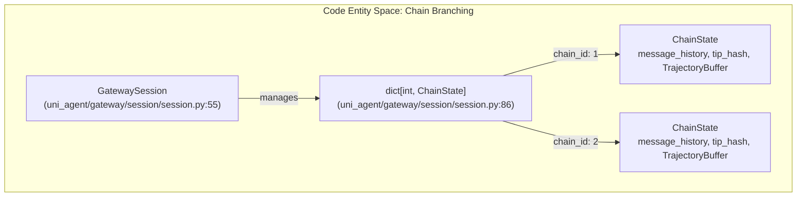
*Sources: [uni_agent/gateway/session/session.py:45-101]()*

---

## 3. Assistant Rollback & Version Tracking

When an agent encounters a tool failure, syntax error, or needs to recover from an invalid completion, `GatewaySession` supports assistant rollback (`enable_last_assistant_rollback`). 

The session snapshots lengths immediately before the latest assistant response using `LastAssistantStart` (`[uni_agent/gateway/session/session.py:75-83]()`). When a rollback is triggered during request re-encoding (`EncodedData` with `rollback_applied=True`), the gateway drops the last assistant's tokens and trainable mask marks (`response_mask == 1`), rolling back the message history to the pre-assistant tip (`[uni_agent/gateway/session/session.py:146-165]()`).

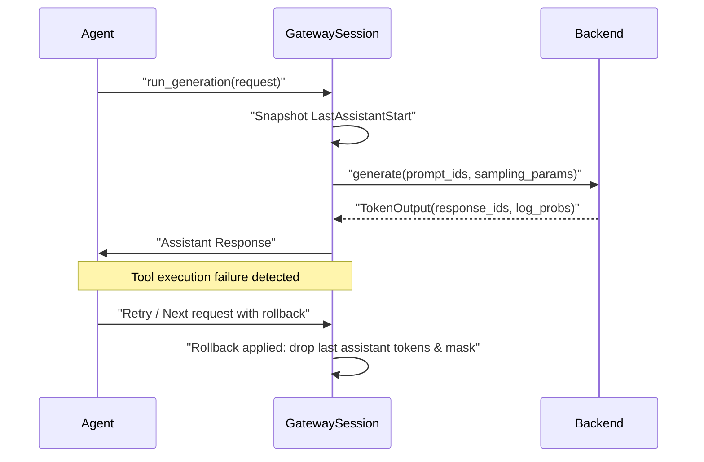
*Sources: [uni_agent/gateway/session/session.py:75-165]()*

---

## 4. Request Coalescing

To prevent duplicate concurrent generation requests (e.g., identical tool prompts or redundant parallel retries), `GatewaySession` implements request coalescing (`coalesce_reserved_exact_requests`). 

Identical incoming requests share an `InflightRequest` future (`[uni_agent/gateway/session/session.py:104-108]()`). The first request triggers backend execution while subsequent identical requests attach as waiters (`waiter_count`), receiving the identical generation outcome once committed.

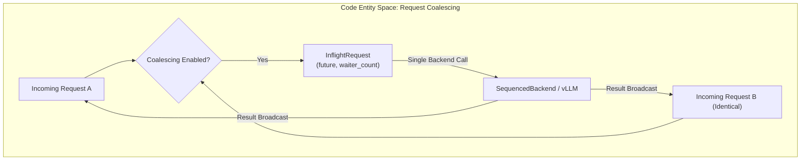
*Sources: [uni_agent/gateway/session/session.py:104-108]()*

---

## 5. Trajectory Materialization and Capacity Limits

When a session finalizes or chains complete, the gateway materializes token buffers into a structured `Trajectory` (`[uni_agent/gateway/session/types.py:41-79]()`).

Trajectories enforce strict capacity limits based on prompt and response budgets (`prompt_length` + `response_length`). As documented in `_TRAJECTORY_CAPACITY_HINT` (`[uni_agent/gateway/session/session.py:22-27]()`), exceeding capacity raises a budget exhaustion error:

```python
_TRAJECTORY_CAPACITY_HINT = (
    "The trajectory limit is prompt_length + response_length. "
    "For this event, Claude Code's output-token-limit error is misleading: increasing "
    "CLAUDE_CODE_MAX_OUTPUT_TOKENS alone will not help. Check the rollout prompt_length/response_length "
    "budget or compact context earlier; the episode may be unfinished."
)
```

| Field Name | Type | Description |
| :--- | :--- | :--- |
| `prompt_ids` | `list[int]` | Token IDs used to seed the trajectory (`[uni_agent/gateway/session/types.py:68]`). |
| `response_ids` | `list[int]` | Generated response tokens and continuation turns (`[uni_agent/gateway/session/types.py:69]`). |
| `response_mask` | `list[int]` | Per-token flags: `1` for model output, `0` for context tokens (`[uni_agent/gateway/session/types.py:70]`). |
| `response_logprobs` | `list[float]` | Token log probabilities aligned with `response_ids` (`[uni_agent/gateway/session/types.py:71]`). |
| `finished` | `bool` | Episode completion status (`[uni_agent/gateway/session/types.py:72]`). |
| `reward_score` | `float` | Scalar reward assigned by the agent framework (`[uni_agent/gateway/session/types.py:73]`). |

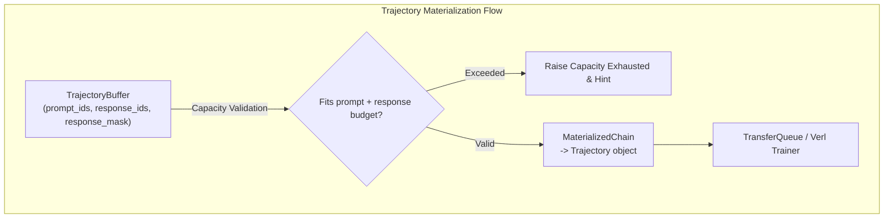
*Sources: [uni_agent/gateway/session/session.py:22-73](), [uni_agent/gateway/session/types.py:41-79]()*

---

## Sources
- `uni_agent/gateway/gateway.py`
- `uni_agent/gateway/session/session.py`
- `uni_agent/gateway/session/types.py`
- `tests/uni_agent/gateway/test_session_multiple_chains_on_cpu.py`

---

# Page: Message Codec & Tool Parsing

# Message Codec & Tool Parsing

<details>
<summary>Relevant source files</summary>

The following files were used as context for generating this wiki page:

- [tests/uni_agent/gateway/test_message_codec_continuous_token.py](tests/uni_agent/gateway/test_message_codec_continuous_token.py)
- [tests/uni_agent/gateway/test_message_codec_initialization.py](tests/uni_agent/gateway/test_message_codec_initialization.py)
- [tests/uni_agent/gateway/test_message_codec_parser_cache.py](tests/uni_agent/gateway/test_message_codec_parser_cache.py)
- [tests/uni_agent/gateway/test_message_codec_qwen3_complete.py](tests/uni_agent/gateway/test_message_codec_qwen3_complete.py)
- [tests/uni_agent/gateway/test_message_codec_tool_dispatch.py](tests/uni_agent/gateway/test_message_codec_tool_dispatch.py)
- [tests/uni_agent/tools/test_shell_channel.py](tests/uni_agent/tools/test_shell_channel.py)
- [tests/uni_agent/tools/test_toolbox_call_errors.py](tests/uni_agent/tools/test_toolbox_call_errors.py)
- [uni_agent/gateway/session/codec.py](uni_agent/gateway/session/codec.py)

</details>


## Purpose and Scope

The `MessageCodec` layer resides entirely within the model boundary [uni_agent/gateway/session/codec.py:1-5] and serves as the translation bridge between the Gateway's abstract message/tool-call representations and backend-specific tokenizer/processor/parser execution primitives. It handles chat template rendering, continuous token wiring, multimodal data extraction, backend-specific tool-call parsing across engines (`sglang`, `vllm`, and `verl`), and parser caching.

---

## 1. MessageCodec Architecture & Initialization

`MessageCodec` is initialized and owned by `_GatewayActor` (one instance per actor) and injected into `GatewaySession` instances [uni_agent/gateway/session/codec.py:74-81]. It operates statelessly regarding session history, focusing exclusively on codec operations.

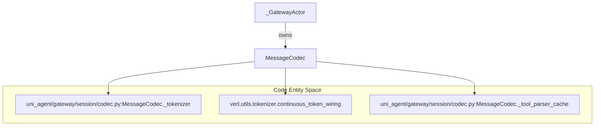
*Diagram: Architecture bridging actor ownership to `MessageCodec` components.*

Sources: `uni_agent/gateway/session/codec.py:74-135`

---

## 2. Chat Templates & Continuous Token Building

The codec manages chat template application using `verl` utilities. It extracts token suffixes for generation prompts and inter-turn separators upon initialization [uni_agent/gateway/session/codec.py:51-122]:

* `initialize_generation_prompt`: Compares tokenization with and without `add_generation_prompt=True` to isolate a stable generation suffix [uni_agent/gateway/session/codec.py:51-72].
* `initialize_turn_separator`: Determines inter-turn separators [uni_agent/gateway/session/codec.py:19].
* Continuous token wiring: Integrates `create_continuous_token_builder` for models (like DeepSeek-V4) that bypass standard template files or use specialized token layouts [uni_agent/gateway/session/codec.py:20,103-109].

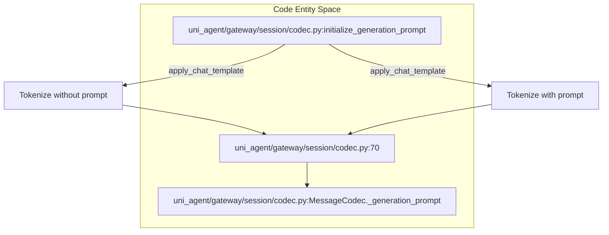
*Diagram: Generation prompt initialization flow.*

Sources: `uni_agent/gateway/session/codec.py:17-21`, `uni_agent/gateway/session/codec.py:51-72`, `uni_agent/gateway/session/codec.py:103-122`

---

## 3. Multimodal Data Extraction

For vision and multi-modal tasks, `MessageCodec` provides `extract_multi_modal_data` (invoking `_vision_info_extractor` or defaulting to `qwen_vl_utils.process_vision_info`) [uni_agent/gateway/session/codec.py:98-168]. 

* It uses `mm_processor_kwargs` shared between continuous token rendering and inference pipelines [uni_agent/gateway/session/codec.py:102,137-139].
* Defays imports of multi-modal utilities (`qwen_vl_utils`) so purely text-based workloads avoid unneeded dependencies [uni_agent/gateway/session/codec.py:158-162].

Sources: `uni_agent/gateway/session/codec.py:98-169`

---

## 4. Backend-Specific Tool-Call Parsing

`MessageCodec` handles parsing tool calls generated by models across three different rollout backends via unified dispatch (`_extract_tool_calls`):

| Backend | Tool Parser Source / Alias Map | Notes |
| :--- | :--- | :--- |
| **SGLang** | `sglang.srt.function_call.function_call_parser` | Uses aliases like `qwen3_xml` $\rightarrow$ `qwen3_coder` [uni_agent/gateway/session/codec.py:34-36]. |
| **vLLM** | `vllm.tool_parsers.ToolParserManager` | Maps `qwen`, `qwen25`, `qwen3` $\rightarrow$ `qwen3_xml` [uni_agent/gateway/session/codec.py:38-42]. Supports constructor-level tool schema binding. |
| **verl / Other** | `verl.experimental.agent_loop.tool_parser.ToolParser` | Native `verl` experiment loop parser fallback [tests/uni_agent/gateway/test_message_codec_parser_cache.py:112-137]. |

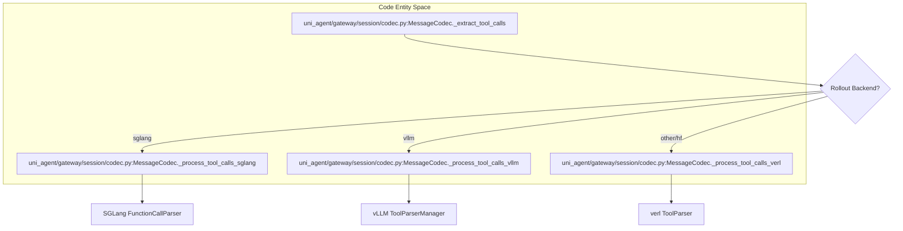
*Diagram: Backend tool parsing dispatch router.*

Finish reasons from backends are normalized via `_FINISH_REASON_MAP` to translate engine-specific statuses (`completed`, `matched_stop`, `max_tokens`, etc.) into standard gateway tokens (`stop`, `length`) [uni_agent/gateway/session/codec.py:23-32].

Sources: `uni_agent/gateway/session/codec.py:23-43`, `tests/uni_agent/gateway/test_message_codec_tool_dispatch.py:111-194`

---

## 5. Parser Cache & Schema Normalization

Because constructing backend tool parsers is computationally expensive, `MessageCodec` maintains an actor-scoped parser cache (`_tool_parser_cache`) [uni_agent/gateway/session/codec.py:126-134]:

* **Canonical Hash**: Tool schemas are normalized into a stable JSON string (`sort_keys=True`, `ensure_ascii=False`) and hashed using SHA-256 (`_canonical_tools_hash`) to ensure equivalent tool definitions share cached parser instances regardless of key ordering [uni_agent/gateway/session/codec.py:45-48].
* **Toggle**: Caching can be disabled by setting `enable_tool_parser_cache=False` for parsers requiring strict request-scoped isolation [uni_agent/gateway/session/codec.py:92,129-133].

Sources: `uni_agent/gateway/session/codec.py:45-48`, `uni_agent/gateway/session/codec.py:126-135`, `tests/uni_agent/gateway/test_message_codec_parser_cache.py:141-201`

---

# Page: Protocol Adapters (OpenAI & Anthropic)

# Protocol Adapters (OpenAI & Anthropic)

<details>
<summary>Relevant source files</summary>

The following files were used as context for generating this wiki page:

- [examples/gateway/debug_launcher.py](examples/gateway/debug_launcher.py)
- [tests/uni_agent/gateway/adapters/test_openai_adapter.py](tests/uni_agent/gateway/adapters/test_openai_adapter.py)
- [uni_agent/gateway/adapters/anthropic.py](uni_agent/gateway/adapters/anthropic.py)
- [uni_agent/gateway/adapters/openai.py](uni_agent/gateway/adapters/openai.py)
- [uni_agent/gateway/adapters/types.py](uni_agent/gateway/adapters/types.py)

</details>


The protocol adapter layer sits at the edge of the Uni-Agent Gateway, translating external API payloads from OpenAI (`POST /v1/chat/completions`) and Anthropic (`POST /v1/messages`) formats into internal generation requests (`InternalGenerationRequest`). Conversely, it serializes completed `GenerationOutcome` objects or event streams back into the corresponding wire formats expected by agent harnesses and clients.

Sources: [uni_agent/gateway/adapters/openai.py:1-4](), [uni_agent/gateway/adapters/anthropic.py:1-2]()

---

## Architecture & Data Flow

The adapter layer decouples external agent client harnesses from the internal session and message codec mechanisms. Incoming wire requests pass through protocol-specific parsing functions (`openai_to_internal` or equivalent Anthropic parsing) to produce a normalized dictionary structure consumed by `GatewayActor` and `GatewaySession`.

### Request Translation Flow

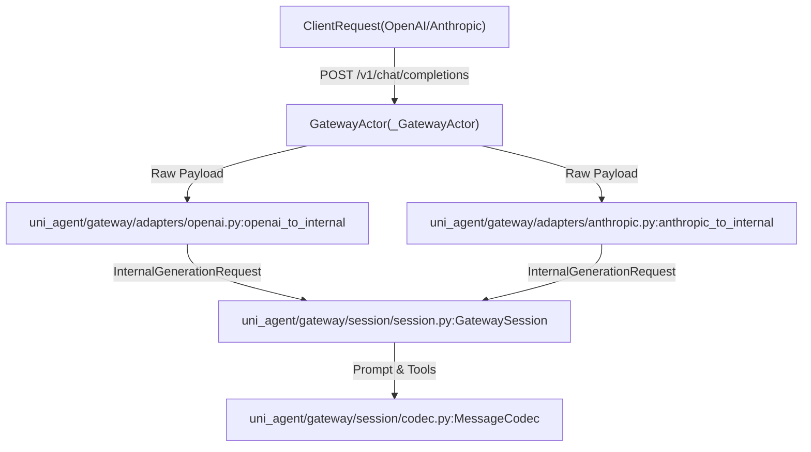

Sources: [uni_agent/gateway/adapters/openai.py:1-4](), [uni_agent/gateway/adapters/anthropic.py:1-2]()

### Response & Stream Serialization Flow

```mermaid
graph TD
    Outcome["GenerationOutcome(session.py)"] -->|"Completed Outcome"| AdapterDispatch["Adapter Dispatch Layer"]
    AdapterDispatch -->|"openai_build_response"| OpenAIJSON["OpenAI ChatCompletion JSON"]
    AdapterDispatch -->|"openai_stream_response"| OpenAISSE["OpenAI SSE StreamingResponse"]
    AdapterDispatch -->|"anthropic_build_response"| AnthropicJSON["Anthropic Message JSON"]
    AdapterDispatch -->|"anthropic_stream_response"| AnthropicSSE["Anthropic SSE StreamingResponse"]
    OpenAIJSON --> ClientOut["HTTP Client"]
    OpenAISSE --> ClientOut
    AnthropicJSON --> ClientOut
    AnthropicSSE --> ClientOut
```

Sources: [uni_agent/gateway/adapters/openai.py:78-134](), [uni_agent/gateway/adapters/anthropic.py:115-173]()

---

## OpenAI Adapter Implementation

The OpenAI adapter (`[uni_agent/gateway/adapters/openai.py]()`) processes incoming Chat Completions requests, normalizes parameters such as `max_tokens` and `max_completion_tokens`, and formats outbound non-streaming and Server-Sent Events (SSE) streaming responses.

### Key Functions and Behaviors

- **Output Limit Aliasing**: Supports both `max_tokens` and the newer `max_completion_tokens` parameter. It validates that if both are specified, they match, and enforces that limits are positive integers [tests/uni_agent/gateway/adapters/test_openai_adapter.py:14-63]().
- **Tool Argument Serialization**: `_message_to_openai_wire` serializes canonical internal dictionary tool arguments into JSON strings expected by the OpenAI wire contract [uni_agent/gateway/adapters/openai.py:53-76]().
- **Response Construction**: `openai_build_response` constructs a standard `chat.completion` envelope including generated choices, finish reasons, unique IDs (`chatcmpl-*`), and `usage` statistics [uni_agent/gateway/adapters/openai.py:78-96]().
- **Streaming Response**: `openai_stream_response` returns a FastAPI `StreamingResponse` emitting `chat.completion.chunk` events, supporting reasoning content (`reasoning_content`), text content, tool calls, final usage stats, and `[data: [DONE]]` [uni_agent/gateway/adapters/openai.py:99-134]().
- **Error Mapping**: `openai_error_body` maps internal HTTP status codes (such as `400` and `409`) to OpenAI-compatible error types (`invalid_request_error`, `conflict_error`) [uni_agent/gateway/adapters/openai.py:28-50]().

Sources: [uni_agent/gateway/adapters/openai.py:1-176](), [tests/uni_agent/gateway/adapters/test_openai_adapter.py:1-181]()

---

## Anthropic Adapter Implementation

The Anthropic adapter (`[uni_agent/gateway/adapters/anthropic.py]`) transforms Anthropic Messages API structures into internal representations and serializes `GenerationOutcome` results back into Anthropic message objects and SSE streams.

### Key Functions and Behaviors

- **Stop Reason Mapping**: `_STOP_REASON_MAP` translates internal finish reasons (`stop`, `length`, `tool_calls`) into Anthropic equivalents (`end_turn`, `max_tokens`, `tool_use`) [uni_agent/gateway/adapters/anthropic.py:23-29]().
- **Content Block Parsing**: `_outcome_to_blocks` inspects the assistant message and converts text content and tool calls into Anthropic content blocks (`type: text`, `type: tool_use`) with robust JSON argument parsing via `_tool_call_input` [uni_agent/gateway/adapters/anthropic.py:64-112]().
- **Message Response Construction**: `anthropic_build_response` generates a `message` object with randomized identifiers (`msg_*`), stop reasons, and input/output token usage [uni_agent/gateway/adapters/anthropic.py:115-125]().
- **Streaming Response**: `anthropic_stream_response` synthesizes an Anthropic-compliant event stream sequence, emitting `message_start`, `content_block_start`, `content_block_delta`, `content_block_stop`, `message_delta`, and `message_stop` events [uni_agent/gateway/adapters/anthropic.py:128-173]().
- **Error Formatting**: `anthropic_error_body` wraps error messages using `ANTHROPIC_ERROR_TYPE_BY_STATUS` [uni_agent/gateway/adapters/anthropic.py:47-61]().

Sources: [uni_agent/gateway/adapters/anthropic.py:1-173]()

---

## Types & Error Handling

Shared adapter types and request-lowering exceptions are defined in `[uni_agent/gateway/adapters/types.py]()`.

- **`MalformedRequestError`**: Inherits from `ValueError` and is raised when request lowering rejects an invalid client payload [uni_agent/gateway/adapters/types.py:13-16]().
- **TypedDict Definitions**: Includes protocol-specific type definitions such as `OpenAIChatCompletionRequest`, `OpenAIChatMessage`, `AnthropicRequest`, and `AnthropicMessage` to document expected wire structures [uni_agent/gateway/adapters/types.py:19-131]().

Sources: [uni_agent/gateway/adapters/types.py:1-131]()

---

# Page: Agent Framework & RL Training

# Agent Framework & RL Training

<details>
<summary>Relevant source files</summary>

The following files were used as context for generating this wiki page:

- [uni_agent/framework/__init__.py](uni_agent/framework/__init__.py)
- [uni_agent/framework/base.py](uni_agent/framework/base.py)
- [uni_agent/framework/entry.py](uni_agent/framework/entry.py)

</details>


Uni-Agent connects multi-turn agent interaction loops to the `verl` reinforcement learning framework. This integration allows training policies by orchestrating gateway sessions, executing sandboxed tasks, computing task rewards, and feeding finalized trajectories back into RL training algorithms via TransferQueues. 

This page provides a high-level overview of rollout orchestration and training integration. For deep technical details, refer to the child pages linked below.

```mermaid
graph TD
    subgraph "NaturalLanguageSpace"
        A["TrainerInitialization"]
        B["GatewayRollouts"]
        C["RewardComputation"]
        D["PolicyOptimization"]
    end

    subgraph "CodeEntitySpace"
        E["AgentFrameworkRolloutAdapter::create()"]
        F["GatewayAgentFramework::generate_sequences()"]
        G["AgentFrameworkWorker::generate_sequences()"]
        H["GatewayManager"]
    end

    A --> E
    E --> H
    H --> F
    B --> G
    G --> F

    style E stroke-width:2px
    style F stroke-width:2px
    style G stroke-width:2px
    style H stroke-width:2px
```
**Sources:** [uni_agent/framework/entry.py:32-160](), [uni_agent/framework/base.py:26-41]()

---

## 3.1 GatewayAgentFramework & TransferQueue

The `GatewayAgentFramework` serves as the core orchestrator for running agent episodes and publishing generated trajectories to the training queue. It manages runner dispatch modes (`inline_async` or `ray_task`), executes trajectory postprocessors, handles reward routing, and publishes finalized tensors to `verl`'s `TransferQueue`.

For details, see [GatewayAgentFramework & TransferQueue](#3.1).

**Sources:** [uni_agent/framework/base.py:26-41](), [uni_agent/framework/entry.py:96-160]()

---

## 3.2 Task Runner & Rollout Adapter

The `AgentFrameworkRolloutAdapter` implements the `verl` `agent_loop_manager_class` contract, acting as the primary bridge between the reinforcement learning trainer and the agent framework stack [uni_agent/framework/entry.py:8-13](). It manages driver-side gateway pools (`GatewayManager`), coordinates task execution paths, resolves configurations via `TaskConfigResolver`, and handles task results and trajectory masking.

For details, see [Task Runner & Rollout Adapter](#3.2).

**Sources:** [uni_agent/framework/entry.py:32-160]()

---

## 3.3 RL Training Recipes & Launch Scripts

RL training recipes configure large-scale training runs, utilizing Megatron-LM parallelism, hybrid rollout strategies (`colocate_async` vs `separate_async`), and specialized reinforcement learning algorithms such as GSPO and GRPO. These launch scripts coordinate multi-node environments, router replay caches, and NPU/GPU execution nodes.

For details, see [RL Training Recipes & Launch Scripts](#3.3).

**Sources:** [uni_agent/framework/entry.py:32-73]()

---

## 3.4 Parallel Inference & Benchmarking

Parallel inference utilities and benchmarking scripts (such as parallel evaluation drivers) enable oracle verification runs and performance evaluation of trained agent policies against standard benchmarks before deploying full RL training loops.

For details, see [Parallel Inference & Benchmarking](#3.4).

```mermaid
sequenceDiagram
    participant Trainer as "FullyAsyncPPOTrainer"
    participant Adapter as "AgentFrameworkRolloutAdapter"
    participant Worker as "AgentFrameworkWorker"
    participant Framework as "GatewayAgentFramework"
    participant TQ as "TransferQueue"

    Trainer->>Adapter: "generate_sequences(prompts)"
    Adapter->>Worker: "generate_sequences(prompts)"
    Worker->>Framework: "generate_sequences(prompts)"
    Framework->>TQ: "Publish finalized TensorDict trajectories"
```
**Sources:** [uni_agent/framework/entry.py:96-160](), [uni_agent/framework/base.py:38-41]()

---

# Page: GatewayAgentFramework & TransferQueue

# GatewayAgentFramework & TransferQueue

<details>
<summary>Relevant source files</summary>

The following files were used as context for generating this wiki page:

- [docs/source/concepts/gateway-and-trajectories.md](docs/source/concepts/gateway-and-trajectories.md)
- [tests/uni_agent/framework/test_generate_sequences_on_cpu.py](tests/uni_agent/framework/test_generate_sequences_on_cpu.py)
- [tests/uni_agent/framework/test_multi_modal_postprocess_on_cpu.py](tests/uni_agent/framework/test_multi_modal_postprocess_on_cpu.py)
- [uni_agent/framework/__init__.py](uni_agent/framework/__init__.py)
- [uni_agent/framework/base.py](uni_agent/framework/base.py)
- [uni_agent/framework/framework.py](uni_agent/framework/framework.py)

</details>


## Purpose and Scope

This page covers the technical implementation of `GatewayAgentFramework` [uni_agent/framework/framework.py:35](), the primary orchestrator that connects `verl` reinforcement learning training loops with the Uni-Agent Gateway. It details the `generate_sequences` execution pipeline, runner dispatch modes (`inline_async` and `ray_task`), trajectory postprocessing hooks, reward routing from `TaskResult` objects, multimodal token and vision input postprocessing, and final publication to the `verl` `TransferQueue`.

---

## GatewayAgentFramework Architecture & Initialization

`GatewayAgentFramework` implements the `AgentFramework` abstract base class [uni_agent/framework/base.py:26](). It is initialized from configuration dictionaries or OmegaConf structures via `GatewayAgentFramework.from_config()`, establishing connections to the `GatewayManager` and optional reward loop worker handles [tests/uni_agent/framework/test_generate_sequences_on_cpu.py:169-173]().

The framework configuration schema defines agent runners, maximum concurrency, fallback timeout policies, and optional postprocessors under `actor_rollout_ref.rollout.custom.agent_framework` [tests/uni_agent/framework/test_generate_sequences_on_cpu.py:137-163]().

```mermaid
graph TD
    A["OmegaConf Config"] --> B["GatewayAgentFramework.from_config"]
    B --> C["_RunnerConfig Validation"]
    B --> D["GatewayManager Session Pool"]
    B --> E["GatewayAgentFramework Instance"]
    E --> F["generate_sequences(prompts: TensorDict)"]

    style A fill:#fff,stroke:#000,stroke-width:1px
    style B fill:#fff,stroke:#000,stroke-width:1px
    style C fill:#fff,stroke:#000,stroke-width:1px
    style D fill:#fff,stroke:#000,stroke-width:1px
    style E fill:#fff,stroke:#000,stroke-width:1px
    style F fill:#fff,stroke:#000,stroke-width:1px
```

*Sources: [uni_agent/framework/framework.py:35](), [tests/uni_agent/framework/test_generate_sequences_on_cpu.py:137-173]()*

---

## Runner Dispatch Modes (`inline_async` vs `ray_task`)

Agent execution is managed per sample or session using configured runner routines (`runner_fqn`). The `_RunnerConfig` data class validates configuration parameters such as `dispatch_mode`, `max_concurrent_sessions`, `trajectory_selection`, and `session_timeout_seconds` [uni_agent/framework/framework.py:45-64]().

### Dispatch Strategies

1. **`inline_async`**: Executes the agent runner function directly within the framework's event loop asynchronously. This minimizes Ray object store overhead and is ideal when runners share state or execute light-weight tasks.
2. **`ray_task`**: Dispatches the runner execution to an isolated Ray remote function (`_run_agent_runner_ray_task`), passing the serialized session handle, raw prompt, and tool configurations [uni_agent/framework/framework.py:112-134]().

```mermaid
graph TD
    subgraph "NaturalLanguageSpace"
        A["AgentRolloutRequest"] --> B["DispatchDecision"]
    end

    subgraph "CodeEntitySpace"
        B -->|dispatch_mode == inline_async| C["_materialize_runner"]
        B -->|dispatch_mode == ray_task| D["_run_agent_runner_ray_task"]
        C --> E["Async Runner Execution"]
        D --> F["Ray Remote Worker"]
    end

    style A fill:#fff,stroke:#000,stroke-width:1px
    style B fill:#fff,stroke:#000,stroke-width:1px
    style C fill:#fff,stroke:#000,stroke-width:1px
    style D fill:#fff,stroke:#000,stroke-width:1px
    style E fill:#fff,stroke:#000,stroke-width:1px
    style F fill:#fff,stroke:#000,stroke-width:1px
```

*Sources: [uni_agent/framework/framework.py:45-134]()*

---

## Trajectory Postprocessors

Before trajectories are scored and published, the framework applies selection policies (`_select_session_trajectories`) and custom user-defined postprocessors (`TrajectoryPostprocessor`) [uni_agent/framework/framework.py:41](), [uni_agent/framework/framework.py:143-171]().

### Selection Policies
- **`all`**: Retains all generated trajectory paths from the session.
- **`longest`**: Selects the single trajectory with the highest token count, response mask sum, and turn count [uni_agent/framework/framework.py:152-160]().

### Postprocessor Hook Contract
If `trajectory_postprocessor_fqn` is specified in the config, the framework loads the callable and executes it with a deep copy of the `TaskResult` [docs/source/concepts/gateway-and-trajectories.md:79-110]():

```python
TrajectoryPostprocessor = Callable[..., list[Trajectory] | Awaitable[list[Trajectory]]]
```

Postprocessors must preserve token array alignment and finalized session metadata. Using `dataclasses.replace` is recommended when modifying trajectory attributes [docs/source/concepts/gateway-and-trajectories.md:112-118]().

*Sources: [uni_agent/framework/framework.py:41](), [uni_agent/framework/framework.py:143-171](), [docs/source/concepts/gateway-and-trajectories.md:65-125]*

---

## Reward Routing & TaskResult Integration

When an agent runner completes execution, it yields a `TaskResult` object containing execution status, reward values, accuracy metrics, and arbitrary metadata (`extra_info`) [tests/uni_agent/framework/test_generate_sequences_on_cpu.py:37-43]().

The framework extracts these fields and propagates them to the session trajectories:
- **Reward Scoring**: Assigns scalar reward scores to the finalized tensor representations.
- **Unfinished Episode Masking**: If `mask_unfinished_episode` is enabled and a task fails or does not complete (`finished=False`), response masks or loss masks can be zeroed out to prevent penalizing the model on incomplete trajectories.

*Sources: [tests/uni_agent/framework/test_generate_sequences_on_cpu.py:122-134](), [docs/source/concepts/gateway-and-trajectories.md:40-42]*

---

## TransferQueue Publication (`TransferQueue`)

Finalized trajectories are converted into tensordicts and published to the `verl` TransferQueue (`tq`) [uni_agent/framework/framework.py:33](). 

The framework constructs structured sequence dictionaries covering nested fields defined in `_TQ_NESTED_SEQUENCE_FIELDS` [uni_agent/framework/framework.py:173-186]():

```python
_TQ_NESTED_SEQUENCE_FIELDS = {
    "prompts",
    "responses",
    "response_mask",
    "loss_mask",
    "input_ids",
    "attention_mask",
    "position_ids",
    "rollout_log_probs",
    "routed_experts",
    "rm_scores",
    "teacher_logprobs",
    "teacher_ids",
}
```

```mermaid
graph TD
    subgraph "NaturalLanguageSpace"
        A["FinalizedTrajectories"] --> B["RewardScoring"]
    end

    subgraph "CodeEntitySpace"
        B --> C["GatewayAgentFramework._pack_tensor_dict"]
        C --> D["_TQ_NESTED_SEQUENCE_FIELDS"]
        D --> E["TensorDict Assembly"]
        E --> F["tq.put / TransferQueue Publication"]
    end

    style A fill:#fff,stroke:#000,stroke-width:1px
    style B fill:#fff,stroke:#000,stroke-width:1px
    style C fill:#fff,stroke:#000,stroke-width:1px
    style D fill:#fff,stroke:#000,stroke-width:1px
    style E fill:#fff,stroke:#000,stroke-width:1px
    style F fill:#fff,stroke:#000,stroke-width:1px
```

*Sources: [uni_agent/framework/framework.py:33](), [uni_agent/framework/framework.py:173-186]*

---

## Multimodal Postprocess Integration

For multimodal agent sessions, visual inputs (images, video tokens) require specialized tensor preparation. The framework invokes `compute_multi_modal_inputs` and `compute_position_ids` from `uni_agent.framework.multi_modal_postprocess` [uni_agent/framework/framework.py:36]().

- **`compute_multi_modal_inputs`**: Extracts pixel values, image grid dimensions (`image_grid_thw`), video grid dimensions, and sequence lengths while stripping raw text fields where necessary [tests/uni_agent/framework/test_multi_modal_postprocess_on_cpu.py:31-42]().
- **`compute_position_ids`**: Combines standard text position tracking with processor-provided vision RoPE multi-dimensional indices when multi-modal token types are present [tests/uni_agent/framework/test_multi_modal_postprocess_on_cpu.py:66-87]().

*Sources: [uni_agent/framework/framework.py:36](), [tests/uni_agent/framework/test_multi_modal_postprocess_on_cpu.py:11-87]*

---

# Page: Task Runner & Rollout Adapter

# Task Runner & Rollout Adapter

<details>
<summary>Relevant source files</summary>

The following files were used as context for generating this wiki page:

- [docs/source/concepts/task-and-reward.md](docs/source/concepts/task-and-reward.md)
- [examples/quickstart/inference/task_config_claude_code.yaml](examples/quickstart/inference/task_config_claude_code.yaml)
- [tests/uni_agent/framework/test_task_config_merge.py](tests/uni_agent/framework/test_task_config_merge.py)
- [tests/uni_agent/framework/test_task_runner.py](tests/uni_agent/framework/test_task_runner.py)
- [tests/uni_agent/tasks/test_parallel_infer_api.py](tests/uni_agent/tasks/test_parallel_infer_api.py)
- [tests/uni_agent/tasks/test_swe_prompt_preprocess.py](tests/uni_agent/tasks/test_swe_prompt_preprocess.py)
- [uni_agent/framework/entry.py](uni_agent/framework/entry.py)
- [uni_agent/framework/task_runner.py](uni_agent/framework/task_runner.py)
- [uni_agent/tasks/base.py](uni_agent/tasks/base.py)

</details>


## Purpose and Scope

This page documents the execution path linking reinforcement learning rollout infrastructure to Uni-Agent task execution. It details how training recipes invoke the framework via `AgentFrameworkRolloutAdapter`, how `TaskConfigResolver` merges static configuration files with dynamic sample metadata, how `run_task` orchestrates task execution within sandbox environments including gateway reverse-tunnel bindings, and how `TaskResult` and scoring adapters bridge task outcomes back into `verl` reward loops.

---

## 1. Trainer Integration via `AgentFrameworkRolloutAdapter`

The Uni-Agent framework interfaces with `verl` training loops through a trainer-facing extension point defined by `AgentFrameworkRolloutAdapter` [uni_agent/framework/entry.py:7-13](). Training recipes specify this class in their configuration under `actor_rollout_ref.rollout.agent.agent_loop_manager_class`.

```
classDiagram
    class AgentFrameworkRolloutAdapter {
        +create(config, llm_client, reward_loop_worker_handles) AgentFrameworkRolloutAdapter
        +generate_sequences(prompts) void
    }
    class AgentFrameworkWorker {
        +__init__(config, gateway_manager, reward_loop_worker_handles)
        +generate_sequences(prompts) void
    }
    class GatewayManager {
        +__init__(llm_client, gateway_count, gateway_actor_config)
    }
    class GatewayAgentFramework {
        +generate_sequences(prompts) void
    }

    AgentFrameworkRolloutAdapter --> AgentFrameworkWorker : "spawns ray actor"
    AgentFrameworkRolloutAdapter --> GatewayManager : "owns driver-side"
    AgentFrameworkWorker --> GatewayAgentFramework : "hosts"
```

### Key Components
* **`AgentFrameworkRolloutAdapter`**: Implements the trainer-facing contract [uni_agent/framework/entry.py:117-124](). It instantiates the driver-side `GatewayManager` and spawns the remote `AgentFrameworkWorker` [uni_agent/framework/entry.py:132-157]().
* **`build_gateway_manager`**: Reads actor configuration from `config.actor_rollout_ref.rollout.custom.agent_framework`, maps tokenizer/processor settings via `HFModelConfig` and `RolloutConfig`, constructs a `GatewayActorConfig`, and returns a pooled `GatewayManager` [uni_agent/framework/entry.py:32-73]().
* **`AgentFrameworkWorker`**: A Ray actor initialized with TransferQueue (`tq.init()`) and rollout tracing, hosting the core `AgentFramework` instance [uni_agent/framework/entry.py:96-112]().

Sources: `uni_agent/framework/entry.py`

---

## 2. Task Configuration Resolution & Merging

Before a task executes, its configuration must be resolved by combining file-based task defaults, dataset sample fields, and runtime inference endpoints.

```
classDiagram
    class TaskConfig {
        +str name
        +SandboxConfig sandbox
        +AgentConfig agent
        +list prompt
        +dict metadata
        +_render_prompt_template()
        +_resolve_agent()
    }
    class TaskConfigResolver {
        +from_file(path) TaskConfigResolver
        +resolve(sample_config, runtime_model) dict
    }
    class Task {
        +TaskConfig config
        +run() TaskResult
        +build_sandbox() Sandbox
        +build_agent() Agent
    }

    TaskConfigResolver --> TaskConfig : "builds and validates"
    Task --> TaskConfig : "initialized with"
```

### Resolution Rules
* **`TaskConfig`**: The base Pydantic model enforcing schema validation (`extra="forbid"`) across tasks, sandboxes, and polymorphic agent configurations [uni_agent/tasks/base.py:30-58]().
* **Prompt Template Rendering**: If `prompt_template` is provided, model validators render text-only message structures using Python brace-formatting against `metadata` fields [uni_agent/tasks/base.py:59-71]().
* **Endpoint Injection**: `TaskConfigResolver.resolve` injects runtime model parameters (`base_url`, `api_key`, `model_name`) into the resolved agent configuration while preserving sample overrides [tests/uni_agent/framework/test_task_config_merge.py:23-80]().

Sources: `uni_agent/tasks/base.py`, `uni_agent/framework/task_runner.py`, `tests/uni_agent/framework/test_task_config_merge.py`

---

## 3. The `run_task` Execution Path

The `run_task` function serves as the primary bridge between the framework's gateway session handles and concrete uni-agent tasks [uni_agent/framework/task_runner.py:101-121]().

```
flowchart TD
    A["run_task(session, tools_kwargs, raw_prompt)"] --> B["Extract sample_config from tools_kwargs['task']"]
    B --> C["Bind raw_prompt to sample_config['prompt']"]
    C --> D["TaskConfigResolver.resolve(sample_config, runtime_model)"]
    D --> E{"Sandbox provider == openyuanrong & proxy_port set?"}
    E -- Yes --> F["_inject_gateway_tunnel(task, session.base_url)"]
    E -- No --> G["Proceed with task dict"]
    F --> G
    G --> H["get_task(task)"]
    H --> I["task_span context manager"]
    I --> J["await task_instance.run()"]
    J --> K["Return TaskResult"]

    style A fill:#f9f,stroke:#333,stroke-width:2px
    style J fill:#f9f,stroke:#333,stroke-width:2px
```

### Reverse Tunnel Injection (`openyuanrong`)
When executing within `openyuanrong` sandboxes configured with a reverse proxy port (`sandbox_kwargs.proxy_port`), the runtime rewrites the gateway URL so internal sandbox agents communicate via the local tunnel [uni_agent/framework/task_runner.py:43-57]().
* **`_rewrite_gateway_url`**: Replaces the hostname and port with `127.0.0.1:<proxy_port>` while retaining the URL path [uni_agent/framework/task_runner.py:20-28]().
* **`_extract_upstream`**: Parses the gateway URL to establish the `upstream` routing target for the sandbox provider [uni_agent/framework/task_runner.py:31-40]().

Sources: `uni_agent/framework/task_runner.py`, `tests/uni_agent/framework/test_task_runner.py`

---

## 4. Task Results, Masking & Scoring Adapters

Upon completion of an episode, tasks return a standardized `TaskResult` object carrying scalar scores and metadata [uni_agent/tasks/base.py:91-116]().

```
classDiagram
    class TaskResult {
        +float reward
        +float accuracy
        +bool finished
        +dict extra_info
        +__post_init__() void
    }
    class ScoreAdapter {
        +score_from_runner_result(data_source, solution_str, ground_truth, extra_info) dict
    }

    TaskResult --> ScoreAdapter : "provides extra_info['runner_reward_info']"
```

### Validation and Reward Adaptation
* **`TaskResult.__post_init__`**: Validates that `reward` and `accuracy` are finite numeric values, `finished` is strictly boolean or `None`, and `extra_info` is a dictionary [uni_agent/tasks/base.py:100-116]().
* **`score_from_runner_result` (alias `compute_score`)**: Adapts managed runner results into the dictionary contract expected by `verl` `RewardLoopWorker` scorers, extracting scalar scores and evaluation metrics from `extra_info["runner_reward_info"]` [uni_agent/framework/task_runner.py:78-98]().

Sources: `uni_agent/tasks/base.py`, `uni_agent/framework/task_runner.py`

---

# Page: RL Training Recipes & Launch Scripts

# RL Training Recipes & Launch Scripts

<details>
<summary>Relevant source files</summary>

The following files were used as context for generating this wiki page:

- [README.md](README.md)
- [docs/source/assets/results_claude_code_qwen3_coder_30b.svg](docs/source/assets/results_claude_code_qwen3_coder_30b.svg)
- [docs/source/assets/results_qwen3_coder_30b.svg](docs/source/assets/results_qwen3_coder_30b.svg)
- [docs/source/quickstart/npu-training.md](docs/source/quickstart/npu-training.md)
- [docs/source/quickstart/rl-training.md](docs/source/quickstart/rl-training.md)
- [examples/claude_code_swe_task/Dockerfile.claude-code-tool](examples/claude_code_swe_task/Dockerfile.claude-code-tool)
- [examples/claude_code_swe_task/build_tool.sh](examples/claude_code_swe_task/build_tool.sh)
- [examples/claude_code_swe_task/run_train.sh](examples/claude_code_swe_task/run_train.sh)
- [examples/mini_swe_agent/run_train.sh](examples/mini_swe_agent/run_train.sh)
- [examples/quickstart/training/task_config_claude_code.yaml](examples/quickstart/training/task_config_claude_code.yaml)
- [examples/quickstart/training/train_npu_qwen3_moe.sh](examples/quickstart/training/train_npu_qwen3_moe.sh)
- [examples/quickstart/training/train_qwen3_moe.sh](examples/quickstart/training/train_qwen3_moe.sh)
- [examples/quickstart/training/train_qwen3p5_dense.sh](examples/quickstart/training/train_qwen3p5_dense.sh)
- [mkdocs.yml](mkdocs.yml)
- [tests/uni_agent/agents/test_mini_swe_agent_agent.py](tests/uni_agent/agents/test_mini_swe_agent_agent.py)
- [tests/uni_agent/sandbox/test_openyuanrong_reverse_tunnel.py](tests/uni_agent/sandbox/test_openyuanrong_reverse_tunnel.py)
- [uni_agent/agents/mini_swe_agent/agent.py](uni_agent/agents/mini_swe_agent/agent.py)

</details>


## Purpose and Scope

This wiki page details the reinforcement learning (RL) training recipes and launch scripts provided by Uni-Agent, including `train_qwen3_moe.sh`, `train_qwen3_p5_dense.sh` [README.md:67-81](), `examples/mini_swe_agent/run_train.sh` [examples/mini_swe_agent/run_train.sh:1-15]() and `train_npu_qwen3_moe.sh` [examples/quickstart/training/train_npu_qwen3_moe.sh:1-146](). It covers the underlying Megatron parallelism topologies, `colocate_async` versus `separate_async` training modes, advanced algorithm settings such as GRPO and GSPO, MoE router replay mechanisms, and NPU execution paths.

Sources: [README.md:67-81](), [examples/mini_swe_agent/run_train.sh:1-15](), [examples/quickstart/training/train_qwen3_moe.sh:1-143](), [examples/quickstart/training/train_npu_qwen3_moe.sh:1-146]()

---

## Topology Modes: `colocate_async` vs `separate_async`

Uni-Agent supports two primary asynchronous execution topologies managed via `verl`'s V1 trainer engine (`trainer.use_v1=True`) [examples/quickstart/training/train_qwen3_moe.sh:117-119]():

| Topology Mode | Description | Resource Allocation | Weight Synchronization |
| :--- | :--- | :--- | :--- |
| `colocate_async` | Actor and rollout workers share the same physical GPUs [examples/quickstart/training/train_qwen3_moe.sh:79-84](). Rollout replicas sleep or yield compute during training updates. | Total nodes defined by `NNODES` and `NGPUS_PER_NODE` [examples/quickstart/training/train_qwen3_moe.sh:82-83]() | In-memory or direct parameter bucket handoff without inter-node network transfer. |
| `separate_async` | Dedicated nodes/GPUs for generation vs. policy optimization training steps [examples/mini_swe_agent/run_train.sh:32-50](). | Separated `ROLLOUT_NNODES` and training `NNODES` pools [examples/mini_swe_agent/run_train.sh:40-49](). | Asynchronous weight transmission via Ray object store or TransferQueue. |

In `colocate_async`, `num_warmup_batches` pre-fills the rollout queue before triggering the first training gradient step [examples/quickstart/training/train_qwen3_moe.sh:85-91]().

Title: Launcher and Topology Entity Flow
```mermaid
graph TD
    subgraph LauncherSpace ["Shell Launchers"]
        SHMOE["train_qwen3_moe.sh"]
        SHMINI["examples/mini_swe_agent/run_train.sh"]
        SHNPU["train_npu_qwen3_moe.sh"]
    end

    subgraph VerlEngine ["Verl V1 Engine"]
        MAINPPO["verl.trainer.main_ppo"]
        TMODE["trainer.v1.trainer_mode"]
    end

    subgraph Topologies ["Execution Modes"]
        COLOCATE["colocate_async"]
        SEP["separate_async"]
    end

    SHMOE -->|"cli args"| MAINPPO
    SHMINI -->|"cli args"| MAINPPO
    SHNPU -->|"cli args"| MAINPPO
    MAINPPO --> TMODE
    TMODE -->|"trainer.v1.trainer_mode=colocate_async"| COLOCATE
    TMODE -->|"trainer.v1.trainer_mode=separate_async"| SEP
```
Sources: [examples/mini_swe_agent/run_train.sh:32-50](), [examples/quickstart/training/train_qwen3_moe.sh:114-120](), [examples/quickstart/training/train_npu_qwen3_moe.sh:84-89]()

Sources: [examples/mini_swe_agent/run_train.sh:32-50](), [examples/quickstart/training/train_qwen3_moe.sh:79-120](), [examples/quickstart/training/train_npu_qwen3_moe.sh:84-89]()

---

## Megatron Parallelism & Hardware Configuration

For large-scale dense and Mixture-of-Experts (MoE) models, the launch scripts configure Megatron-LM parallelism parameters to partition tensors, pipelines, contexts, and expert networks across distributed GPU/NPU clusters [examples/quickstart/training/train_qwen3_moe.sh:62-71]().

*   **Tensor Parallelism (`train_tp` / `GEN_TP`)**: Splits weight matrices across multiple accelerators [examples/quickstart/training/train_qwen3_moe.sh:63-64]().
*   **Pipeline Parallelism (`train_pp`)**: Distributes sequential transformer layers across pipeline stages [examples/quickstart/training/train_qwen3_moe.sh:65]().
*   **Context Parallelism (`train_cp`)**: Handles ultra-long context windows (up to 128K-256K tokens) by splitting sequence dimensions [examples/quickstart/training/train_qwen3_moe.sh:66]().
*   **Expert Parallelism (`train_ep`) & Expert Tensor Parallelism (`train_etp`)**: Distributes MoE expert networks across workers for models like Qwen3-Coder-30B-A3B [examples/quickstart/training/train_qwen3_moe.sh:67-68]().
*   **Mbridge (`USE_MBRIDGE`)**: Bridges vLLM rollout engines with Megatron weight updates, enabling zero-copy weight synchronization buckets (`update_weights_bucket_mb`) [examples/mini_swe_agent/run_train.sh:82-95]().

Sources: [examples/mini_swe_agent/run_train.sh:82-95](), [examples/quickstart/training/train_qwen3_moe.sh:60-78]()

---

## Algorithms & Objectives: GRPO, GSPO & Rollout Correction

The training recipes support multiple advantage estimators and loss calculation modes, configured via environmental flags and CLI arguments [examples/mini_swe_agent/run_train.sh:52-65](), [examples/quickstart/training/train_qwen3_moe.sh:30-51]().

*   **Advantage Estimator (`ADV_ESTIMATOR`)**: Defaults to group relative policy optimization (`grpo`), normalizing rewards across sampled responses per prompt [examples/mini_swe_agent/run_train.sh:53](), [examples/quickstart/training/train_qwen3_moe.sh:31]().
*   **Loss Mode (`LOSS_MODE`)**: Supports `vanilla` PPO, Group Sequence Policy Optimization (`gspo`), and token-mean loss aggregation modes [examples/mini_swe_agent/run_train.sh:63-64](), [examples/quickstart/training/train_qwen3_moe.sh:49-50]().
*   **Rollout Correction**: Configures behavior-anchor or decoupled rollout-correction parameters (`bypass_mode`, `rollout_is`, `rollout_is_threshold`, `rollout_rs`) to stabilize off-policy learning over long trajectories [examples/quickstart/training/train_qwen3_moe.sh:100-106]().

Sources: [examples/mini_swe_agent/run_train.sh:52-65](), [examples/quickstart/training/train_qwen3_moe.sh:30-51], [examples/quickstart/training/train_npu_qwen3_moe.sh:72-79]()

---

## Router Replay & Advanced Features

For MoE models, routing decisions made during rollout can diverge from training-step re-evaluations. The launcher scripts implement MoE Router Replay (`router_replay_mode`) to record and replay router logits or expert routing paths [examples/quickstart/training/train_qwen3_moe.sh:109-112]():

*   `router_replay_mode=disabled`: Standard MoE execution without replay [examples/quickstart/training/train_qwen3_moe.sh:111]().
*   `router_replay_mode=R2` / `R3`: Captures token routing selections during generation and forces identical routing during actor loss computation to eliminate gradient divergence caused by asynchronous routing changes.

Sources: [examples/quickstart/training/train_qwen3_moe.sh:109-112]()

---

## NPU Training Recipes (`train_npu_qwen3_moe.sh`)

Huawei Ascend NPU training is supported via `train_npu_qwen3_moe.sh`, which integrates the `veomni` model engine [examples/quickstart/training/train_npu_qwen3_moe.sh:117]().

Title: NPU and VeOmni Training Flow
```mermaid
graph TD
    subgraph ScriptSpace ["Launch Script"]
        NPU_SH["train_npu_qwen3_moe.sh"]
    end

    subgraph TrainerCore ["Trainer & Engine"]
        MAIN["verl.trainer.main_ppo"]
        VEOMNI["model_engine=veomni"]
    end

    subgraph HardwareNPU ["Ascend NPU Stack"]
        FUSED["fused_npu MoE Kernel"]
        USP["Ulysses Parallel Size usp_size"]
        NPU_KERNELS["NPU RMSNorm & Rotary Embeddings"]
    end

    NPU_SH -->|"ray job submit"| MAIN
    MAIN --> VEOMNI
    VEOMNI --> FUSED
    VEOMNI --> USP
    VEOMNI --> NPU_KERNELS
```
Sources: [examples/quickstart/training/train_npu_qwen3_moe.sh:84-128]()

Key NPU-specific parameters include:
*   `trainer.device=npu` [examples/quickstart/training/claude_code_swe_task/run_train.sh:121]()
*   `model_engine=veomni` [examples/quickstart/training/train_npu_qwen3_moe.sh:117]()
*   `actor_rollout_ref.actor.veomni.moe_implementation=fused_npu` [examples/quickstart/training/train_npu_qwen3_moe.sh:123]()
*   `actor_rollout_ref.actor.veomni.ulysses_parallel_size=${usp_size}` [examples/quickstart/training/train_npu_qwen3_moe.sh:121]()

Sources: [examples/quickstart/training/train_npu_qwen3_moe.sh:1-146]()

---

## Launch Script Reference & Execution Flow

All training recipes rely on Ray job submission, packaging both `verl/` and `uni_agent/` libraries through a `runtime_env.yaml` specification [examples/quickstart/training/train_qwen3_moe.sh:14-114]().

Title: Training Execution and Data Flow
```mermaid
graph TD
    subgraph Submission ["Ray Job Launcher"]
        RJOB["ray job submit --runtime-env"]
    end

    subgraph FrameworkBridge ["Agent Framework Bridge"]
        ADAPTER["uni_agent.framework.entry.AgentFrameworkRolloutAdapter"]
        RUNNER["uni_agent.framework.task_runner.run_task"]
        TQ["transfer_queue.enable=True"]
    end

    subgraph Optimization ["PPO Trainer"]
        PPO["verl.trainer.main_ppo"]
        ACTOR["Actor Policy Loss"]
    end

    RJOB -->|Invokes| PPO
    PPO -->|Rollout Phase| ADAPTER
    ADAPTER -->|Dispatches Task| RUNNER
    RUNNER -->|Publishes Trajectories| TQ
    TQ -->|Consumes Batches| ACTOR
```
Sources: [examples/mini_swe_agent/run_train.sh:118-126](), [examples/quickstart/training/train_qwen3_moe.sh:114-121](), [examples/quickstart/training/train_npu_qwen3_moe.sh:143-146]()

Sources: [examples/mini_swe_agent/run_train.sh:118-129](), [examples/quickstart/training/train_qwen3_moe.sh:114-121](), [examples/quickstart/training/train_npu_qwen3_moe.sh:143-146]()

---

# Page: Parallel Inference & Benchmarking

# Parallel Inference & Benchmarking

<details>
<summary>Relevant source files</summary>

The following files were used as context for generating this wiki page:

- [docs/source/benchmark/index.md](docs/source/benchmark/index.md)
- [docs/source/benchmark/inference.md](docs/source/benchmark/inference.md)
- [docs/source/benchmark/rl-training.md](docs/source/benchmark/rl-training.md)
- [examples/inference/parallel_infer_api.py](examples/inference/parallel_infer_api.py)
- [examples/inference/parallel_infer_verl.py](examples/inference/parallel_infer_verl.py)
- [examples/quickstart/inference/run_infer_claude_code.sh](examples/quickstart/inference/run_infer_claude_code.sh)
- [examples/quickstart/inference/run_infer_react.sh](examples/quickstart/inference/run_infer_react.sh)
- [uni_agent/agents/base.py](uni_agent/agents/base.py)
- [uni_agent/tasks/swe_rebench/task.py](uni_agent/tasks/swe_rebench/task.py)

</details>


## Purpose and Scope
This page details parallel agent inference, verification, and benchmark evaluation using Uni-Agent. It covers two primary execution paths:
1. **External API Mode** (`parallel_infer_api.py`): Direct execution against a standalone OpenAI-compatible endpoint [examples/inference/parallel_infer_api.py:1-22]().
2. **verl-Managed Rollout Mode** (`parallel_infer_verl.py`): Full integration with the verl training stack and the `TransferQueue`, routing agent rollouts through gateway sessions and the agent framework [examples/inference/parallel_infer_verl.py:1-17]().

---

## 1. Inference Entry Points & Modes

Uni-Agent provides parallel inference scripts under `examples/inference/` to evaluate agents across long-horizon benchmarks like SWE-bench, SWE-reBench, and Terminal-Bench.

### `parallel_infer_api.py` (External API Mode)
- Talks directly to a user-provided OpenAI-compatible policy server [examples/inference/parallel_infer_api.py:1-5]() without requiring GPUs on the driver.
- Uses Ray actors (`InferenceActor`) and an `asyncio.Semaphore` to manage concurrency limits across tasks [examples/inference/parallel_infer_api.py:48-53]().
- Resolves each sample's configuration via `TaskConfigResolver` and evaluates tasks using `get_task(task).run()` [examples/inference/parallel_infer_api.py:38-57]().

### `parallel_infer_verl.py` (verl Rollout Mode)
- Integrates with `verl`'s `LLMServerManager` (supporting vLLM and SGLang) to bring up the policy engine [examples/inference/parallel_infer_verl.py:7-54]().
- Routes requests through the exact training stack: `AgentFrameworkRolloutAdapter.generate_sequences` -> `TransferQueue` (TQ) -> Gateway sessions -> `uni_agent.framework.task_runner.run_task` [examples/inference/parallel_infer_verl.py:5-17]().
- Collects per-trajectory `rm_scores` written back from the trainer's TransferQueue [examples/inference/parallel_infer_verl.py:13-16]().

### Data Flow Diagram: Inference Modes
```mermaid
graph TD
    subgraph "Natural Language Space"
        DS["Dataset Parquet Files"]
        TC["Task Config YAML"]
    end

    subgraph "Code Entity Space: examples/inference/"
        PA["parallel_infer_api.py"]
        PV["parallel_infer_verl.py"]
        IA["InferenceActor"]
    end

    subgraph "Execution & Gateway"
        EX["External Policy Server<br>vLLM / SGLang / API"]
        VM["verl LLMServerManager"]
        AR["AgentFrameworkRolloutAdapter"]
        TR["uni_agent.framework.task_runner.run_task"]
    end

    DS --> PA
    TC --> PA
    DS --> PV
    TC --> PV

    PA --> IA
    IA --> EX

    PV --> VM
    VM --> AR
    AR --> TR
```
Sources: [examples/inference/parallel_infer_api.py:34-57](), [examples/inference/parallel_infer_verl.py:7-17]()

---

## 2. Oracle Verification and Task Execution

Tasks like `swe_rebench` support oracle verification runs where the agent loop is bypassed and the gold patch is applied directly to test sandbox correctness and reward computation [uni_agent/tasks/swe_rebench/task.py:64-103]().

### Task Execution Steps in `SWEREBenchTask`
1. **Git History Sanitation**: Sanitizes the `/testbed` repository state at `base_commit` using `_clean_git_history` [uni_agent/tasks/swe_rebench/task.py:52-61,97]() to remove unneeded commits, remotes, and reflog entries [uni_agent/tasks/swe_rebench/task.py:23-47]().
2. **Oracle vs Agent Execution**: 
   - If `run_oracle_solution` is enabled, applies `/tmp/gold_patch.patch` directly to `/testbed` [uni_agent/tasks/swe_rebench/task.py:99-103]().
   - Otherwise, invokes the registered agent harness (`agent.run(...)`) [uni_agent/tasks/swe_rebench/task.py:105-112]().
3. **Reward Computation**: Evaluates the sandbox state via `compute_reward` and returns a `TaskResult` containing reward, accuracy, completion status, and evaluation reports [uni_agent/tasks/swe_rebench/task.py:115-129]().

```mermaid
sequenceDiagram
    participant T as SWEREBenchTask
    participant S as SandboxBackend
    participant A as Agent
    participant R as compute_reward

    T->>S: _clean_git_history(base_commit)
    alt run_oracle_solution == True
        T->>S: write_file("/tmp/gold_patch.patch")
        T->>S: exec("git apply ...")
    else Agent Mode
        T->>A: agent.run(sandbox, messages)
        A-->>T: AgentResult
    end
    T->>R: compute_reward(sample, sandbox, eval_timeout)
    R-->>T: evaluation report & resolved status
    T-->>T: TaskResult(reward, accuracy, finished, extra_info)
```
Sources: [uni_agent/tasks/swe_rebench/task.py:52-129]()

---

## 3. Published Benchmark Results

Uni-Agent provides reproducible reference evaluations across SWE-bench Verified, SWE-bench Multilingual, and Terminal-Bench [docs/source/benchmark/inference.md:5-34]().

### SWE-Bench Verified Reference Results

| Agent | Model | Rollouts | Setting | Score |
| --- | --- | :---: | --- | ---: |
| ReAct | Qwen3-Coder-30B-A3B-Instruct | Avg@4 | 100 turns, 128K context | **49.2** |
| ReAct | Qwen3-Coder-480B-A35B-Instruct | Avg@4 | 500 turns, 256K context | **64.2** |
| ReAct | Qwen3-Coder-Next | Avg@4 | 300 turns, 128K context | **67.6** |
| ReAct | Qwen3.5-4B | Avg@1 | 100 turns, 64K context | **45.2** |
| ReAct | Qwen3.5-9B | Avg@1 | 100 turns, 64K context | **53.8** |
| ReAct | Qwen3.5-9B | Avg@1 | 200 turns, 128K context | **63.8** |
| Claude Code | Qwen3.5-9B | Avg@1 | 200 turns, 128K context | **51.0** |
| ReAct | Qwen3.5-35B-A3B | Avg@1 | 200 turns, 128K context | **68.4** |

Sources: [docs/source/benchmark/inference.md:5-17]()

### RL Training & Asynchronous Rollout Performance

Training agents via reinforcement learning (GSPO/GRPO) yields significant performance gains across long-horizon agent tasks:

| Model | Dataset | Method | Setting | Base | RL | Delta |
| --- | --- | --- | --- | ---: | ---: | ---: |
| Qwen3-30B-A3B-Instruct | R2E-Gym | GSPO | Fully Async, 100 turns, 128K | 22.2 | **36.8** | +14.6 |
| Qwen3-Coder-30B-A3B-Instruct | R2E-Gym | GSPO | Fully Async, 100 turns, 128K | 46.2 | **52.0** | +5.8 |
| Qwen3.5-9B | SWE-reBench | GRPO | Fully Async, 100 turns, 128K | 53.8 | **59.2** | +5.4 |
| Qwen3-Coder-30B-A3B-Instruct | SWE-reBench | GSPO | Colocate Async, 200 turns, 128K | 47.4 | **54.2** | +6.8 |

Sources: [docs/source/benchmark/rl-training.md:5-13]()

---

## 4. Reporting Checklist and Reproduction

When publishing benchmark results or running reproducible evaluations, ensure the following metadata is recorded:
- Exact model identifier and checkpoint revision [docs/source/benchmark/inference.md:46-48]()
- Agent implementation or harness (`ReAct`, `ClaudeCodeAgent`, etc.) [docs/source/benchmark/inference.md:49-49]()
- Sandbox backend and image configuration [docs/source/benchmark/inference.md:50-50]()
- Sampling parameters (`temperature`, `top_p`, `top_k`) and token budgets [docs/source/benchmark/inference.md:51-52]()
- Rollout count (`Avg@N` or `Pass@1`) [docs/source/benchmark/inference.md:53-53]()
- Benchmark version, split, and verifier script [docs/source/benchmark/inference.md:54-54]()

Sources: [docs/source/benchmark/inference.md:44-55](), [docs/source/benchmark/index.md:17-31]()

---
Sources:
- [examples/inference/parallel_infer_verl.py:1-164]()
- [examples/inference/parallel_infer_api.py:1-163]()
- [uni_agent/tasks/swe_rebench/task.py:1-129]()
- [docs/source/benchmark/inference.md:1-55]()
- [docs/source/benchmark/rl-training.md:1-56]()
- [docs/source/benchmark/index.md:1-36]()

---

# Page: Sandbox Layer

# Sandbox Layer

<details>
<summary>Relevant source files</summary>

The following files were used as context for generating this wiki page:

- [docs/source/concepts/sandbox.md](docs/source/concepts/sandbox.md)
- [examples/quickstart/sandbox/README.md](examples/quickstart/sandbox/README.md)
- [uni_agent/sandbox/__init__.py](uni_agent/sandbox/__init__.py)
- [uni_agent/sandbox/base.py](uni_agent/sandbox/base.py)
- [uni_agent/sandbox/registry.py](uni_agent/sandbox/registry.py)
- [uni_agent/sandbox/vefaas.py](uni_agent/sandbox/vefaas.py)

</details>


## Purpose and Scope
The sandbox layer provides the execution boundary for agent episodes within Uni-Agent. It owns the runtime lifecycle, configuration model, and a unified data plane for command execution, file transfers, and port exposure. Tasks and agents interact with a high-level `Sandbox` interface, while tools depend on the narrow `SandboxBackend` protocol [docs/source/concepts/sandbox.md:3-5](). 

This page provides a high-level overview of the sandbox control plane, configuration model, providers, and integration with tools. For detailed technical specifications, consult the child pages:
- Sandbox base classes, configuration schemas, and error policies: see [Sandbox Base, Config & Error Policy](#4.1)
- Provider implementations (OpenYuanrong, veFaaS, Modal, Docker, Local): see [Sandbox Providers](#4.2)
- Toolbox schema exposure and built-in tools: see [Toolbox & Built-in Tools](#4.3)

---

## Control Plane vs. Data Plane Architecture
The sandbox architecture cleanly separates lifecycle orchestration (control plane) from interaction operations (data plane). The control plane manages container or cloud environment provisioning, startup concurrency limits, health checks, and cleanup [docs/source/concepts/sandbox.md:80-88](). The data plane exposes portable methods for command execution, file manipulation, and stream handling [docs/source/concepts/sandbox.md:3-4]().

Diagram: Control vs Data Plane Architecture
```mermaid
graph TD
    subgraph "Control Plane"
        SC["SandboxConfig"] -->|"passed to"| BS["build_sandbox"]
        BS -->|"instantiates"| SB["Sandbox"]
        SB -->|"orchestrates"| L1["start()"]
        SB -->|"orchestrates"| L2["stop()"]
    end

    subgraph "Data Plane"
        SB -->|"implements"| BE["SandboxBackend"]
        BE -->|"runs commands"| EX["exec() / exec_shell()"]
        BE -->|"transfers data"| TF["upload() / download()"]
        BE -->|"manages state"| FS["read_file() / write_file()"]
    end
```
Sources: [uni_agent/sandbox/base.py:132-195](), [uni_agent/sandbox/registry.py:64-66](), [docs/source/concepts/sandbox.md:3-5]()

For details on base lifecycle implementations and error policies, see [Sandbox Base, Config & Error Policy](#4.1).

---

## Configuration Model
Sandboxes are configured declaratively using `SandboxConfig`, which selects the provider backend and specifies runtime parameters such as timeouts, container images, image rewriting rules, mounted filesystems, and exposed executables [docs/source/concepts/sandbox.md:9-34]().

Diagram: Sandbox Provider Resolution and Configuration
```mermaid
graph TD
    A["SandboxConfig"] -->|"provider name"| B["get_sandbox_cls()"]
    B -->|"looks up"| C["SANDBOX_REGISTRY"]
    B -->|"imports via"| D["SANDBOX_MODULES"]
    D -->|"registers with"| E["register_sandbox()"]
    C -->|"returns"| F["Sandbox subclass"]
    F -->|"instantiated via"| G["from_config()"]
```
Sources: [uni_agent/sandbox/registry.py:15-66]()

Key configuration components include:
- **`SandboxConfig`**: Defines `provider`, `runtime_timeout`, `image`, `image_map`, `image_mounts`, `executable_paths`, and `sandbox_kwargs` [uni_agent/sandbox/base.py:132-166]().
- **`ImageMap`**: Glob-based rewriting rules (supporting `**` captures) to map public dataset image names to cluster-accessible registry paths without modifying dataset parquets [docs/source/concepts/sandbox.md:36-53]().
- **`ImageMount`**: Allows mounting secondary container root filesystems at absolute paths inside the primary sandbox [uni_agent/sandbox/base.py:98-130]().

For detailed configuration parsing rules and error handling policies, see [Sandbox Base, Config & Error Policy](#4.1).

---

## Sandbox Providers
Uni-agent supports multiple execution backends through a modular registry pattern (`SANDBOX_REGISTRY` and `SANDBOX_MODULES`) [uni_agent/sandbox/registry.py:15-24](). Optional cloud SDKs are loaded lazily so that uninstalled providers do not disrupt execution on local or alternative backends [uni_agent/sandbox/registry.py:40-52]().

Supported provider backends include:
- **Local (`LocalSandbox`)**: Executes directly on the host filesystem and shell [uni_agent/sandbox/__init__.py:14]().
- **Docker (`docker`)**: Manages local container instances via Docker SDK.
- **Modal (`modal`)**: Provisions serverless cloud sandboxes on the Modal platform [docs/source/concepts/sandbox.md:14-19]().
- **veFaaS (`vefaas`)**: Integrates with Volcengine FaaS serverless infrastructure [uni_agent/sandbox/vefaas.py:26-42]().
- **OpenYuanrong (`openyuanrong`)**: Supports Yuanrong cloud infrastructure with reverse tunneling and PATH extensions.

For implementation specifics, setup instructions, and provider-unique features, see [Sandbox Providers](#4.2).

---

## Toolbox & Built-in Tools
Tools interact exclusively with the narrow `SandboxBackend` protocol, making them decoupled from lifecycle management [docs/source/concepts/sandbox.md:5](). The toolbox exposes schema definitions to agents, parses model tool calls, and routes execution to the active sandbox backend.

Built-in tools include:
- **`stateful_shell`**: Persistent bash shell wrapper maintaining working directory and environment variables across execution steps.
- **`str_replace_editor`**: File viewing, string replacement, and code editing utility.
- **`submit` and `finish`**: Episode completion markers.

For detailed schema descriptions, tool dispatch mechanics, and error handling protocols, see [Toolbox & Built-in Tools](#4.3).

---

# Page: Sandbox Base, Config & Error Policy

# Sandbox Base, Config & Error Policy

<details>
<summary>Relevant source files</summary>

The following files were used as context for generating this wiki page:

- [docs/source/concepts/sandbox.md](docs/source/concepts/sandbox.md)
- [examples/quickstart/sandbox/README.md](examples/quickstart/sandbox/README.md)
- [tests/uni_agent/sandbox/test_startup_cleanup.py](tests/uni_agent/sandbox/test_startup_cleanup.py)
- [uni_agent/sandbox/__init__.py](uni_agent/sandbox/__init__.py)
- [uni_agent/sandbox/base.py](uni_agent/sandbox/base.py)
- [uni_agent/sandbox/registry.py](uni_agent/sandbox/registry.py)
- [uni_agent/sandbox/vefaas.py](uni_agent/sandbox/vefaas.py)

</details>


## Purpose and Scope
This page details the foundation of the Uni-Agent sandbox subsystem: the abstract base classes (`Sandbox` ABC and `SandboxBackend` protocol), configuration models (`SandboxConfig`, `ImageMap`, `ImageMount`), startup concurrency controls, timeout behaviors, error policies, and file transfer primitives [uni_agent/sandbox/base.py:1-195](), [docs/source/concepts/sandbox.md:1-177](). The sandbox layer serves as the secure execution boundary for agent episodes, decoupling tool execution and data plane management from higher-level agent loops and task orchestrators.

---

## 1. Sandbox ABC & `SandboxBackend` Protocol

The sandbox architecture separates lifecycle control from data plane operations. Tools interact exclusively with the narrow `SandboxBackend` protocol, whereas tasks and agents interact with the broader `Sandbox` abstract base class (`Sandbox`), which handles provider lifecycle and high-level execution wrappers [docs/source/concepts/sandbox.md:3-6]().

```mermaid
graph TD
    subgraph "Code Entity Space"
        S[Sandbox] -->|implements| SB[SandboxBackend]
        LS[LocalSandbox] -->|inherits| S
        DS[DockerSandbox] -->|inherits| S
        MS[ModalSandbox] -->|inherits| S
        VS[VefaasSandbox] -->|inherits| S
        BS[build_sandbox] -->|instantiates| S
    end
```
*Sources: [uni_agent/sandbox/base.py:1-195](), [uni_agent/sandbox/registry.py:1-66]()*

The `Sandbox` abstract class wraps concrete backend implementations. Subclasses are expected to implement `start()`, `stop()`, and `_exec()` rather than overriding the public execution entrypoints directly [docs/source/concepts/sandbox.md:116-121]().

### Core Protocol and Base Methods
- `start()`: Initializes the sandbox instance and runtime environment.
- `stop()`: Tears down the runtime and releases underlying resources.
- `is_alive()`: Health probe returning a boolean indicating if the backend container or runtime is active [docs/source/concepts/sandbox.md:88]().
- `_exec(argv, *, timeout, workdir, env)`: Provider-specific primitive executed within the sandbox.
- `exec(argv, *, timeout, workdir, env)`: Public wrapper enforcing standard error and timeout translation policies.
- `exec_shell(script, *, timeout, workdir, env)`: Executes a shell script string by dispatching to `exec()`.
- File transfer primitives: `read_file()`, `write_file()`, `upload()`, and `download()`.

*Sources: [uni_agent/sandbox/base.py:1-195](), [docs/source/concepts/sandbox.md:3-105]()*

---

## 2. Configuration Models: `SandboxConfig`, `ImageMap`, & `ImageMount`

Sandbox construction is governed by declarative Pydantic models defined in [uni_agent/sandbox/base.py:65-195]().

```yaml
sandbox:
  provider: "docker"
  runtime_timeout: 3600.0
  image: "python:3.12"
  image_map:
    - from: "swebench/**:latest"
      to: "registry.internal/swe-bench/**:v2"
  image_mounts:
    - image: "registry.internal/toolset:1.0"
      mount_path: "/opt/tools"
  executable_paths:
    tool_cli: "/opt/tools/bin/cli"
  sandbox_kwargs:
    network_disabled: false
```

### Configuration Classes
- `SandboxConfig`: The root configuration schema holding `provider`, `runtime_timeout`, `image`, `image_map`, `image_mounts`, `executable_paths`, and provider-specific `sandbox_kwargs` [uni_agent/sandbox/base.py:132-167](). Extra fields are strictly forbidden (`extra="forbid"`).
- `ImageMap`: Handles glob-based rewriting of dataset container images (`from` -> `to`) using `**` wildcard capturing [uni_agent/sandbox/base.py:65-96](). Useful for redirecting public benchmark images (e.g., SWE-bench) to private registries or local mirrors without modifying dataset parquet files [docs/source/concepts/sandbox.md:36-52]().
- `ImageMount`: Defines secondary container images whose root filesystems are mounted at absolute non-root paths inside the sandbox (`mount_path`) [uni_agent/sandbox/base.py:98-130]().

*Sources: [uni_agent/sandbox/base.py:65-195](), [docs/source/concepts/sandbox.md:7-70]()*

---

## 3. Startup Concurrency, Timeouts & Lifecycle Management

Sandboxes are designed to be used as asynchronous context managers [docs/source/concepts/sandbox.md:73-76](). Entering the context triggers instance startup, while exiting guarantees that `stop()` is called even if execution raises an exception [docs/source/concepts/sandbox.md:76-80]().

```mermaid
graph TD
    subgraph "Code Entity Space"
        AE[Sandbox.__aenter__] -->|acquire slot| SC[SANDBOX_STARTUP_CONCURRENCY]
        SC -->|calls| RS[_run_start]
        RS -->|success| RT[Active Sandbox Context]
        RS -->|timeout or failure| CL[stop]
        RT -->|async with exit| CL
        CL -->|enforces| ST[SANDBOX_STOP_TIMEOUT]
    end
```
*Sources: [uni_agent/sandbox/base.py:1-195](), [tests/uni_agent/sandbox/test_startup_cleanup.py:1-74]()*

### Lifecycle Controls and Environment Variables
- `SANDBOX_STARTUP_TIMEOUT`: Maximum allotted time for a sandbox backend to boot (default: `600.0` seconds) [docs/source/concepts/sandbox.md:84]().
- `SANDBOX_STARTUP_CONCURRENCY`: Process-wide concurrency ceiling limiting simultaneous sandbox initializations (default: `64`) [docs/source/concepts/sandbox.md:85]().
- `SANDBOX_STOP_TIMEOUT`: Grace period enforced during cleanup `stop()` calls following startup failures or cancellations (default: `120.0` seconds) [docs/source/concepts/sandbox.md:86](). If cancellation occurs, cleanup waits for this bound to prevent hung providers from blocking execution indefinitely [docs/source/concepts/sandbox.md:86]().

*Sources: [uni_agent/sandbox/base.py:1-195](), [docs/source/concepts/sandbox.md:71-89](), [tests/uni_agent/sandbox/test_startup_cleanup.py:1-74]()*

---

## 4. Execution Error Policy

To prevent rogue agent commands from crashing an entire training episode while still surfacing real infrastructure failures, all providers adhere to a unified error policy implemented within the public `Sandbox.exec()` wrapper [docs/source/concepts/sandbox.md:106-114]().

| Error Condition | Handled Result / Action |
| :--- | :--- |
| **Command Timeout** | Captured and translated into `ExecResult(exit_code=-1, stdout=..., stderr=...)` [docs/source/concepts/sandbox.md:110](). |
| **Runtime / Command Error** (while sandbox alive) | Captured as standard failure, returned with `exit_code=127` (or corresponding nonzero exit code) [docs/source/concepts/sandbox.md:111](). |
| **Infrastructure Error** (sandbox dead/unreachable) | Re-raised immediately to signal unrecoverable backend failure [docs/source/concepts/sandbox.md:112](). |

Custom providers implement `_exec()`. Direct overrides of `exec()` are prohibited to preserve cross-provider error invariant guarantees [docs/source/concepts/sandbox.md:116-118]().

*Sources: [uni_agent/sandbox/base.py:1-195](), [docs/source/concepts/sandbox.md:106-118]()*

---

## 5. File Transfer Primitives & Data Plane

The base `Sandbox` class provides portable, fallback implementations for file read/write and directory upload/download operations using underlying archive packing primitives [uni_agent/sandbox/base.py:21-26]() (`pack_dir_to_file`, `extract_dir_from_file`, `remote_pack_command`, `remote_unpack_command`). 

Providers with native data-plane optimizations override these methods [docs/source/concepts/sandbox.md:104-105]():
- **Local Provider**: Directly accesses the host filesystem [docs/source/concepts/sandbox.md:104]().
- **Docker Provider**: Leverages host-container file copy mechanisms (`docker cp`) [docs/source/concepts/sandbox.md:104]().
- **Modal Provider**: Utilizes its native filesystem API for absolute paths [docs/source/concepts/sandbox.md:104]().

*Sources: [uni_agent/sandbox/base.py:1-26](), [docs/source/concepts/sandbox.md:90-105]()*

---

# Page: Sandbox Providers

# Sandbox Providers

<details>
<summary>Relevant source files</summary>

The following files were used as context for generating this wiki page:

- [docs/source/quickstart/launch-sandbox.md](docs/source/quickstart/launch-sandbox.md)
- [examples/agent_aware_router/task_config_mini_swe_agent.yaml](examples/agent_aware_router/task_config_mini_swe_agent.yaml)
- [examples/claude_code_kernel_task/remote_docker.py](examples/claude_code_kernel_task/remote_docker.py)
- [examples/claude_code_swe_task/README.md](examples/claude_code_swe_task/README.md)
- [examples/claude_code_swe_task/task_config_claude_code_openyuanrong.yaml](examples/claude_code_swe_task/task_config_claude_code_openyuanrong.yaml)
- [tests/uni_agent/sandbox/test_docker_sandbox.py](tests/uni_agent/sandbox/test_docker_sandbox.py)
- [tests/uni_agent/sandbox/test_exec_error_policy.py](tests/uni_agent/sandbox/test_exec_error_policy.py)
- [tests/uni_agent/sandbox/test_executable_paths.py](tests/uni_agent/sandbox/test_executable_paths.py)
- [tests/uni_agent/sandbox/test_image_mounts.py](tests/uni_agent/sandbox/test_image_mounts.py)
- [tests/uni_agent/sandbox/test_openyuanrong_path.py](tests/uni_agent/sandbox/test_openyuanrong_path.py)
- [uni_agent/sandbox/docker.py](uni_agent/sandbox/docker.py)
- [uni_agent/sandbox/local.py](uni_agent/sandbox/local.py)
- [uni_agent/sandbox/modal.py](uni_agent/sandbox/modal.py)
- [uni_agent/sandbox/openyuanrong.py](uni_agent/sandbox/openyuanrong.py)

</details>


This page documents the concrete sandbox providers implemented in `uni_agent/sandbox/`, detailing their lifecycles, configuration contracts, image mounting strategies, and execution backends for Docker, OpenYuanrong, Modal, veFaaS, and Local execution.

---

## 1. Sandbox Provider Architecture & Registry

Uni-Agent decouples agent interaction logic from the underlying isolation boundary through the `Sandbox` abstract base class and a dynamic registry [`uni_agent/sandbox/registry.py`](). Providers are loaded lazily, ensuring that optional SDK dependencies (such as `openyuanrong-sandbox` or `modal`) are only imported when explicitly selected [docs/source/quickstart/launch-sandbox.md:18-20]().

Every provider implements a private execution primitive `_exec` that is wrapped by a shared public `exec` implementation enforcing a uniform error policy [`tests/uni_agent/sandbox/test_exec_error_policy.py:1-12]()]:
1. **Timeouts**: If a command exceeds `timeout`, it is classified via `_is_timeout_error` and returns an `ExecResult` with `exit_code = -1` [tests/uni_agent/sandbox/test_exec_error_policy.py:7-7]().
2. **Infrastructure Faults**: If a non-timeout error occurs and `is_alive()` returns `False`, the underlying exception is re-raised unchanged [tests/uni_agent/sandbox/test_exec_error_policy.py:8-9]().
3. **Command Failures**: If the sandbox remains alive, non-timeout errors downgrade gracefully to `exit_code = 127` carrying the error message on `stderr` [tests/uni_agent/sandbox/test_exec_error_policy.py:10-11]().

### Sandbox Instantiation Flow
```mermaid
graph TD
    subgraph "Natural Language Space"
        A["SandboxConfig YAML"] --> B["build_sandbox()"]
    end

    subgraph "Code Entity Space"
        B -- "Looks up provider registry" --> C["Registry Lookup"]
        C -- "If docker" --> D["DockerSandbox.from_config()"]
        C -- "If openyuanrong" --> E["OpenyuanrongSandbox.from_config()"]
        C -- "If modal" --> F["ModalSandbox.from_config()"]
    end

    subgraph "Execution Space"
        D --> G["Docker Daemon"]
        E --> H["OpenYuanrong Gateway"]
        F --> I["Modal App Engine"]
    end
```
Sources: [uni_agent/sandbox/docker.py:62-70](), [uni_agent/sandbox/openyuanrong.py:161-170](), [uni_agent/sandbox/modal.py:46-54](), [tests/uni_agent/sandbox/test_exec_error_policy.py:172-177]().

---

## 2. Docker Provider & Image Mounts

The `DockerSandbox` provider manages local or remote container execution via the Docker CLI [uni_agent/sandbox/docker.py:25-30](). It provides strict control over image pulling policies and supports advanced container features like image mounts.

### Lifecycle & Pull Policies
Upon calling `start()`, `DockerSandbox` inspects the task image and any configured image mounts according to `pull_policy` (`"always"`, `"missing"`, or `"never"`) [uni_agent/sandbox/docker.py:113-123]():
* **`missing` (Default)**: Inspects the daemon; pulls the image only if it is missing locally [docs/source/quickstart/launch-sandbox.md:57-57]().
* **`always`**: Forces a `docker pull` prior to container creation [uni_agent/sandbox/docker.py:115-116]().
* **`never`**: Fails immediately if the image is not present locally [uni_agent/sandbox/docker.py:120-121]().

The container is started in detached mode (`-d`) with its entrypoint fixed to `sleep`, accepting `runtime_timeout` as its duration argument so it automatically reaps itself upon expiration [docs/source/quickstart/launch-sandbox.md:67-74]().

### Image Mounts
Image mounts allow prebuilt tool containers (such as sidecar compilers or evaluation harnesses) to be mounted into the primary sandbox container without layer merging:
```python
config = SandboxConfig(
    provider="docker",
    image="python:3.12",
    image_mounts=[
        {"image": "<tool-image>", "mount_path": "/opt/tool"},
    ],
    executable_paths={"tool": "/opt/tool/bin/tool"},
)
```
[docs/source/quickstart/launch-sandbox.md:46-54]()

Docker image mounts require a daemon backed by the containerd image store and are passed as `--mount type=image,source=...,destination=...` flags [docs/source/quickstart/launch-sandbox.md:75-76](), [uni_agent/sandbox/docker.py:28-30]().

Sources: [docs/source/quickstart/launch-sandbox.md:38-78](), [uni_agent/sandbox/docker.py:25-164](), [tests/uni_agent/sandbox/test_docker_sandbox.py:19-160]().

---

## 3. OpenYuanrong Provider & PATH Extension

The `OpenyuanrongSandbox` provider integrates with OpenYuanrong (developed by the OpenYuanrong & Ant Akernel team) to execute commands in elastic remote sandboxes [uni_agent/sandbox/openyuanrong.py:1-5]().

### Connection & Configuration
Connection settings are parsed from environment variables (`OPENYUANRONG_SERVER_ADDRESS`, `OPENYUANRONG_TOKEN`, `OPENYUANRONG_TLS`, etc.) via `_connection_config` [uni_agent/sandbox/openyuanrong.py:46-80](). 

### Non-Destructive PATH Extension
When agents require tool executables from mounted sidecar images (e.g., Claude Code mounted at `/opt/claude-code`), the sandbox prepends `add_to_path` entries to the remote shell environment without overwriting the base system `PATH` [tests/uni_agent/sandbox/test_openyuanrong_path.py:1-3]().

```mermaid
graph TD
    subgraph "Natural Language Space"
        A["add_to_path: [/opt/claude-code/bin]"] --> B["OpenyuanrongSandbox._exec()"]
    end

    subgraph "Code Entity Space"
        B -- "Constructs export string" --> C["export PATH=/opt/claude-code/bin:${PATH:-}"]
        C -- "Appends command payload" --> D["yr_sandbox.commands.run()"]
    end

    subgraph "Execution Space"
        D -- "Remote execution with extended PATH" --> E["Sandbox Shell Container"]
    end
```
Sources: [uni_agent/sandbox/openyuanrong.py:94-100](), [uni_agent/sandbox/openyuanrong.py:126-149](), [tests/uni_agent/sandbox/test_openyuanrong_path.py:61-73]().

Sources: [docs/source/quickstart/launch-sandbox.md:159-176](), [uni_agent/sandbox/openyuanrong.py:1-170](), [tests/uni_agent/sandbox/test_openyuanrong_path.py:1-92]().

---

## 4. Modal Provider

The `ModalSandbox` provider provisions on-demand isolated sandboxes using [Modal](https://modal.com) without requiring manual cluster management [docs/source/quickstart/launch-sandbox.md:121-123]().

### Implementation & Native Primitives
`ModalSandbox` looks up or creates a Modal App via `modal.App.lookup.aio` and spawns sandboxes using `modal.Sandbox.create.aio` [uni_agent/sandbox/modal.py:69-82](). When `image_mounts` are provided, Modal builds the mounted images and attaches them using `modal.Sandbox.mount_image.aio` (requiring `modal>=1.3.4`) [docs/source/quickstart/launch-sandbox.md:156-157](), [uni_agent/sandbox/modal.py:62-84]().

Unlike container backends that rely on command-line wrappers for file operations, `ModalSandbox` implements high-performance native asynchronous streaming methods:
* `read_file(path)` -> `self._require_sandbox().filesystem.read_bytes.aio(path)` [uni_agent/sandbox/modal.py:138-142]()
* `write_file(path, content)` -> `self._require_sandbox().filesystem.write_bytes.aio(data, path)` [uni_agent/sandbox/modal.py:144-149]()
* `upload_file(local, remote)` -> `self._require_sandbox().filesystem.copy_from_local.aio(...)` [uni_agent/sandbox/modal.py:151-153]()
* `download_file(remote, local)` -> `self._require_sandbox().filesystem.copy_to_local.aio(...)` [uni_agent/sandbox/modal.py:155-157]()

Sources: [docs/source/quickstart/launch-sandbox.md:121-158](), [uni_agent/sandbox/modal.py:16-162]().

---

## 5. veFaaS & Local Providers

### veFaaS
The `veFaaS` provider connects to Volcengine serverless function sandboxes (`swe-rex`) [docs/source/quickstart/launch-sandbox.md:79-87](). It supports load distribution across multiple function IDs and routes by passing comma-separated lists to environment variables (`VEFAAS_FUNCTION_ID`, `VEFAAS_FUNCTION_ROUTE`), where each sandbox randomly binds to a single pair for its lifetime [docs/source/quickstart/launch-sandbox.md:98-106]().

### Local Provider
The `local` provider executes commands directly on the host system without containerization [docs/source/quickstart/launch-sandbox.md:22-24](). 

> [!CAUTION]
> Do not use `local` for sandboxed agent tasks [docs/source/quickstart/launch-sandbox.md:26-27](). Commands executed through the `local` provider have direct access to host filesystems, environment variables, and packages [docs/source/quickstart/launch-sandbox.md:28-30](). Reserve `local` strictly for host-bound evaluations (such as HotpotQA) that do not require isolation [docs/source/quickstart/launch-sandbox.md:27-28]().

Sources: [docs/source/quickstart/launch-sandbox.md:22-120]().

---

## 6. Executable Paths and Tool Injection

To make mounted tools (such as Claude Code or custom toolchains) easily accessible to agents without hardcoding absolute paths, providers support `executable_paths` resolution [docs/source/quickstart/launch-sandbox.md:54-54]().

### Symlink Enforcement
During sandbox startup, `Sandbox._setup_executable_paths()` validates and symlinks tool binaries into `/usr/bin` (or `/usr/local/bin`) [tests/uni_agent/sandbox/test_executable_paths.py:48-58]():
1. Verifies that executable names and target paths are safe (rejecting relative paths or traversal patterns) [tests/uni_agent/sandbox/test_executable_paths.py:31-43]().
2. Executes `command -v <name>` to check for pre-existing system binaries [tests/uni_agent/sandbox/test_executable_paths.py:53-54]().
3. Creates a symbolic link via `ln -sfn <target> /usr/bin/<name>` [tests/uni_agent/sandbox/test_executable_paths.py:55-55]().
4. Verifies the link integrity using `test /usr/bin/<name> -ef <target>` [tests/uni_agent/sandbox/test_executable_paths.py:57-57]().

Sources: [docs/source/quickstart/launch-sandbox.md:54-54](), [tests/uni_agent/sandbox/test_executable_paths.py:1-96]().

---

# Page: Toolbox & Built-in Tools

# Toolbox & Built-in Tools

<details>
<summary>Relevant source files</summary>

The following files were used as context for generating this wiki page:

- [tests/uni_agent/logging/test_redaction.py](tests/uni_agent/logging/test_redaction.py)
- [tests/uni_agent/tools/test_edit_file_arguments.py](tests/uni_agent/tools/test_edit_file_arguments.py)
- [uni_agent/tools/__init__.py](uni_agent/tools/__init__.py)
- [uni_agent/tools/base.py](uni_agent/tools/base.py)
- [uni_agent/tools/edit_file.py](uni_agent/tools/edit_file.py)
- [uni_agent/tools/shell.py](uni_agent/tools/shell.py)

</details>


This page covers the toolbox schema exposure, execution framework, and built-in tools (`stateful_shell`, `str_replace_editor`, `submit`, and `finish`) within Uni-Agent. It details how host-side tools interface with sandbox backends through the data plane, manage state, and handle execution or format errors.

## Purpose and Scope

The tool layer provides host-side capabilities that allow an agent running outside the task container to interact with the sandbox environment. Each tool pairs an OpenAI-compatible JSON schema with an asynchronous execution routine (`run`) that drives the container via the `SandboxBackend` data plane [uni_agent/tools/base.py:1-9](). 

Sources: [uni_agent/tools/base.py:1-9]()

## Tool Infrastructure & Toolbox

All host-side tools inherit from the `Tool` abstract base class [uni_agent/tools/base.py:133-141](). A `Tool` encapsulates configuration parsing via Pydantic (`config_model`), argument validation (`args_model`), and schema exposure (`schema()`) [uni_agent/tools/base.py:136-169]().

The `Toolbox` class manages a collection of tools bound to a single `SandboxBackend` instance, handling dispatch, schema generation, and exception translation.

### Data Structures & Normalization
* **`ToolResult`**: Represents a normalized outcome containing a `text` observation string and a `status` (`"ok"`, `"format_error"`, `"error"`, `"timeout"`) [uni_agent/tools/base.py:30-44](). It provides observation truncation (`to_observation`) when output exceeds maximum length limits [uni_agent/tools/base.py:48-59]().
* **Schema Normalization**: Pydantic JSON schemas are normalized via `_normalize_json_schema` to remove titles, collapse optional variants, and enforce standard parameter ordering for model compatibility [uni_agent/tools/base.py:78-118]().

**Natural Language Space to Code Entity Mapping (Toolbox & Tools)**
```mermaid
graph TD
    subgraph "Natural Language Space"
        A["LLM Function Call / Tool Request"]
    end

    subgraph "Code Entity Space"
        B["Toolbox"]
        C["Tool (ABC)"]
        D["ShellTool (stateful_shell)"]
        E["EditFileTool (str_replace_editor)"]
        F["SubmitTool (submit)"]
        G["ToolResult"]
    end

    A -- "dispatches to" --> B
    B -- "invokes run()" --> C
    C <|-- D
    C <|-- E
    C <|-- F
    C -- "returns" --> G
```
Sources: [uni_agent/tools/base.py:33-59](), [uni_agent/tools/base.py:133-141](), [uni_agent/tools/__init__.py:1-19]()

Sources: [uni_agent/tools/base.py:30-169](), [uni_agent/tools/__init__.py:1-19]()

## Built-in Tools

Uni-Agent registers core built-in tools upon importing `uni_agent.tools` [uni_agent/tools/__init__.py:32-33]().

### Stateful Shell (`stateful_shell` / `shell`)
The `ShellTool` exposes a persistent shell session to the model under the name `shell` [uni_agent/tools/shell.py:1-12](). It delegates execution to a underlying `Shell` implementation:
* **`SandboxShell`**: Uses native container session handles (`backend.open_shell()`) when supported by the sandbox backend [uni_agent/tools/shell.py:61-120]().
* **`TmuxShell`**: Acts as a fallback for backends supporting only one-shot execution, managing a detached `tmux` session over `SandboxBackend.exec` [uni_agent/tools/shell.py:9-125]().

### File Editor (`str_replace_editor`)
Implemented by `EditFileTool`, this tool handles viewing (`cat -n`), creating, replacing (`str_replace`), inserting, and undoing edits on remote files [uni_agent/tools/edit_file.py:1-44](). All file I/O operations go through `sandbox.read_file` and `sandbox.write_file`, while undo history is maintained locally on the tool instance (`self._history`) rather than inside the container [uni_agent/tools/edit_file.py:3-8, 105-110]().

### Control Tools (`submit` & `finish`)
Control tools have no sandbox side effects. When the model invokes `submit` or `finish`, the ReAct rollout loop detects the sentinel call and terminates the episode [uni_agent/tools/__init__.py:17-18]().

**Tool Execution and Dispatch Flow**
```mermaid
graph TD
    subgraph "Execution Pipeline"
        A["Toolbox.call"] --> B{"Validate Arguments"}
        B -- "Invalid Format" --> C["Raise ToolCallFormatError"]
        B -- "Valid" --> D["Tool.run()"]
        D --> E{"Execution Outcome"}
        E -- "Success" --> F["Return ToolResult(status='ok')"]
        E -- "ToolError" --> G["Catch ToolError -> Observation Error"]
        E -- "Timeout/Crash" --> H["Return ToolResult(status='error')"]
    end
```
Sources: [uni_agent/tools/base.py:61-75](), [uni_agent/tools/base.py:133-141](), [uni_agent/tools/edit_file.py:130-133](), [uni_agent/tools/shell.py:71-101]()

Sources: [uni_agent/tools/edit_file.py:1-145](), [uni_agent/tools/shell.py:1-126]()

## Call-Error Handling

Tool execution errors are handled gracefully to prevent rolling episodes from crashing:
* **`ToolCallFormatError`**: Raised when tool arguments fail schema decoding or name resolution. `Toolbox.call` captures this and returns an error observation to the policy so it can self-correct [uni_agent/tools/base.py:70-75]().
* **`ToolError`**: Raised during runtime failures (e.g., refocussing or bad paths). `Toolbox.call` converts this into an `"Error: ..."` observation string for the model [uni_agent/tools/base.py:61-67]().

Sources: [uni_agent/tools/base.py:61-77]()

---

# Page: Agents

# Agents

<details>
<summary>Relevant source files</summary>

The following files were used as context for generating this wiki page:

- [docs/source/concepts/index.md](docs/source/concepts/index.md)
- [examples/mem_agent/README.md](examples/mem_agent/README.md)
- [examples/mem_agent/infer.py](examples/mem_agent/infer.py)
- [examples/mem_agent/run_infer_mem_agent.sh](examples/mem_agent/run_infer_mem_agent.sh)
- [tests/uni_agent/agents/test_react_agent.py](tests/uni_agent/agents/test_react_agent.py)
- [uni_agent/agents/mem_agent/__init__.py](uni_agent/agents/mem_agent/__init__.py)
- [uni_agent/agents/react/agent.py](uni_agent/agents/react/agent.py)
- [uni_agent/agents/registry.py](uni_agent/agents/registry.py)
- [uni_agent/tasks/hotpotqa/__init__.py](uni_agent/tasks/hotpotqa/__init__.py)
- [uni_agent/tasks/hotpotqa/preprocess.py](uni_agent/tasks/hotpotqa/preprocess.py)

</details>


This page provides an overview of the agent harnesses registered in `uni_agent.agents` and explains how they plug into the Uni-Agent Gateway for policy execution and reinforcement learning rollouts. Uni-Agent decouples the solving strategy into discrete agent implementations via a lazy-loading registry [uni_agent/agents/registry.py:1-9]().

## Agent Registry and Loading

The agent subsystem uses a centralized registry [uni_agent/agents/registry.py:18-26]() to instantiate agents dynamically based on task configurations [uni_agent/agents/registry.py:65-67](). Each agent implementation inherits from the base `Agent` class [uni_agent/agents/registry.py:13-16]() and registers itself under a unique string identifier [uni_agent/agents/registry.py:29-39](). To avoid unnecessary dependency overhead, modules are imported lazily on first use [uni_agent/agents/registry.py:42-53]().

**Diagram: Natural Language Space to Code Entity Space - Agent Registry Mapping**
```mermaid
graph TD
    subgraph "Natural Language Space"
        N1["White-box ReAct Solver"]
        N2["Anthropic Claude Code CLI"]
        N3["Black-box Mini-SWE-Agent"]
        N4["Memory-augmented QA Agent"]
    end

    subgraph "Code Entity Space"
        C1["ReActAgent @register_agent('react')"]
        C2["ClaudeCodeAgent @register_agent('claude_code')"]
        C3["MiniSweAgentAgent @register_agent('mini_swe_agent')"]
        C4["MemAgent @register_agent('mem_agent')"]
    end

    N1 --> C1
    N2 --> C2
    N3 --> C3
    N4 --> C4
```
**Sources:** [uni_agent/agents/registry.py:18-39](), [uni_agent/agents/react/agent.py:52-53]()

---

## Registered Agent Harnesses

Uni-Agent supports multiple agent paradigms, ranging from native white-box reasoning loops to complex black-box external harnesses and memory-augmented architectures.

### ReAct Agent
The `ReActAgent` is a built-in white-box agent [uni_agent/agents/react/agent.py:1-54]() that executes an iterative reason-and-act loop. It directly queries an OpenAI-compatible endpoint, parses tool calls, and dispatches them to a host-side `Toolbox` [uni_agent/agents/react/agent.py:69-95](). 
* For details, see [ReAct Agent](#5.1).

### Claude Code Agent
The `ClaudeCodeAgent` integrates the Anthropic Claude Code environment using a sidecar tool image and routes Anthropic protocol requests through the gateway [uni_agent/agents/claude_code/agent.py]() (see implementation details in child page).
* For details, see [Claude Code Agent](#5.2).

### Mini-SWE-Agent (Black-box Harness)
The `MiniSweAgentAgent` acts as a black-box harness wrapper [uni_agent/agents/mini_swe_agent/agent.py](). It builds specialized tool images, passes base64-encoded configurations over standard input, and establishes a reverse tunnel back to the gateway.
* For details, see [Mini-SWE-Agent (Black-box Harness)](#5.3).

### Mem Agent
The `MemAgent` is a specialized memory-augmented agent designed for long-context question-answering tasks [uni_agent/agents/mem_agent/agent.py]() such as HotpotQA. It reads inputs in token-bounded chunks and maintains a compact memory across steps.
* For details, see [Mem Agent](#5.4).

---

## Gateway Integration Flow

Agent harnesses interact with the execution environment and query the Uni-Agent Gateway for model completions. The following diagram illustrates how execution requests flow from the agent harness through the sandbox and gateway components.

**Diagram: Natural Language Space to Code Entity Space - Gateway and Harness Interaction**
```mermaid
graph LR
    subgraph "Execution Space"
        S1["SandboxABC"]
        S2["Toolbox"]
    end

    subgraph "Agent Harness Space"
        A1["ReActAgent.run()"]
        A2["MemAgent.run()"]
    end

    subgraph "Gateway Space"
        G1["OpenAICompatibleChatModel"]
        G2["GatewayActor"]
    end

    A1 --> S2
    A2 --> S1
    A1 --> G1
    A2 --> G1
    G1 --> G2
```
**Sources:** [uni_agent/agents/react/agent.py:58-76](), [uni_agent/agents/react/model.py]()

---

# Page: ReAct Agent

# ReAct Agent

<details>
<summary>Relevant source files</summary>

The following files were used as context for generating this wiki page:

- [docs/source/concepts/index.md](docs/source/concepts/index.md)
- [docs/source/quickstart/agent-inference.md](docs/source/quickstart/agent-inference.md)
- [examples/quickstart/inference/task_config_react.yaml](examples/quickstart/inference/task_config_react.yaml)
- [examples/quickstart/training/task_config_react.yaml](examples/quickstart/training/task_config_react.yaml)
- [tests/uni_agent/agents/test_model_config.py](tests/uni_agent/agents/test_model_config.py)
- [tests/uni_agent/agents/test_react_agent.py](tests/uni_agent/agents/test_react_agent.py)
- [tests/uni_agent/tasks/test_inference_task_routing.py](tests/uni_agent/tasks/test_inference_task_routing.py)
- [uni_agent/agents/react/agent.py](uni_agent/agents/react/agent.py)

</details>


The ReAct Agent is a built-in white-box agent implementation within Uni-Agent (`uni_agent/agents/react/agent.py`) that executes an alternating reason-and-act loop. It interacts with model endpoints via OpenAI-compatible chat completion interfaces and executes host-side tools bound inside a sandbox environment.

---

## Purpose and Scope

This page documents the internal architecture, configuration parameters, step execution loop, tool dispatch mechanics, sampling overrides, and termination criteria of the `ReActAgent`. It bridges the high-level task specification to the underlying code entities responsible for multi-turn execution.

---

## Configuration and Initialization

The ReAct agent's behavior and constraints are governed by `ReActConfig`, which extends `AgentConfig`. It defines budgets for execution steps, tool timeouts, tolerated tool errors, and model sampling overrides.

```mermaid
graph TD
    subg1["Natural Language Space"]
    NL1["Task YAML Config / Prompt"] --> NL2["Sample-Level Override"]
    
    subg2["Code Entity Space"]
    CE1["uni_agent/tasks/resolver.py:TaskConfigResolver"] --> CE2["uni_agent/agents/react/agent.py:ReActConfig"]
    CE2 --> CE3["uni_agent/agents/base.py:RequestSamplingConfig"]
    CE2 --> CE4["uni_agent/tools/toolbox.py:Toolbox.from_specs"]
    CE2 --> CE5["uni_agent/agents/react/model.py:OpenAICompatibleChatModel"]
    
    NL2 --> CE1
```

*Sources: [uni_agent/agents/react/agent.py:26-50](), [docs/source/quickstart/agent-inference.md:55-80]()*

The configuration model defines the following attributes:
- `name`: Registered under the string identifier `"react"` via `[uni_agent/agents/react/agent.py:52]`.
- `sampling_params_override`: An instance of `RequestSamplingConfig` allowing explicit control over parameters such as `temperature` and `top_p` `[uni_agent/agents/react/agent.py:30]()`.
- `tools`: A list of dictionary specifications mapping to host-side tools (e.g., `str_replace_editor`, `stateful_shell`, and finish tools) `[uni_agent/agents/react/agent.py:31-39]()`.
- `max_steps`: Maximum tool-calling turns permitted per episode (default: `50`) `[uni_agent/agents/react/agent.py:40]()`.
- `action_timeout`: Per-call timeout forwarded to individual tool executions `[uni_agent/agents/react/agent.py:41-45]()`.
- `timeout_budget`: Cumulative tool-call timeouts tolerated before early termination `[uni_agent/agents/react/agent.py:46-49]()`.

---

## The Execution Lifecycle (`run`)

When a task executes, `ReActAgent.run()` initializes the tool environment, constructs the chat model client, changes directory if a working directory is provided, and enters the step loop.

```mermaid
graph TD
    subg["ReAct Agent Execution Flow"]
    Start["uni_agent/agents/react/agent.py:ReActAgent.run"] --> InitToolbox["Toolbox.from_specs"]
    InitToolbox --> InitModel["OpenAICompatibleChatModel"]
    InitModel --> EnterBox["Toolbox.entered"]
    EnterBox --> CheckDir{"workdir provided?"}
    CheckDir -- Yes --> CdShell["Toolbox.call shell cd -- workdir"]
    CheckDir -- No --> StepLoop
    CdShell --> StepLoop["For step_idx in range(1, max_steps + 1)"]
    StepLoop --> StepCall["uni_agent/agents/react/agent.py:ReActAgent.step"]
    StepCall --> CheckStop{"stop_reason == completed?"}
    CheckStop -- No --> Terminate["Record termination_reason"]
    CheckStop -- Yes --> StepLoop
    Terminate --> CloseModel["OpenAICompatibleChatModel.aclose"]
    StepLoop -- Exhausted --> MaxSteps["termination_reason = max_steps"]
    MaxSteps --> CloseModel
    CloseModel --> ReturnResult["Return AgentResult"]
```

*Sources: [uni_agent/agents/react/agent.py:58-118]()*, [tests/uni_agent/agents/test_react_agent.py:141-157]()

---

## Step Loop and Tool Dispatch

Each turn executed by `ReActAgent.step()` consists of two primary phases: querying the policy model for thoughts and tool calls, and dispatching those tool calls through the `Toolbox`.

1. **Model Query**: The agent passes the conversation transcript and sampling parameters to `OpenAICompatibleChatModel.query()` `[uni_agent/agents/react/agent.py:132-135]()`.
2. **Token and Length Validation**: Token usage is updated in the trajectory info dictionary `[uni_agent/agents/react/agent.py:136]()`. If the `finish_reason` returned by the endpoint is `"length"`, the step returns `"token_limit"` `[uni_agent/agents/react/agent.py:149-151]`.
3. **Plain Text Completion**: If no tool calls are returned, the episode is marked as successfully completed (`"finished"`) `[uni_agent/agents/react/agent.py:153-155]()`.
4. **Tool Dispatch**: If tool calls are present, each call is iterated and executed via `Toolbox.call()` using the configured `action_timeout` `[uni_agent/agents/react/agent.py:159-163]()`.

*Sources: [uni_agent/agents/react/agent.py:120-165](), [tests/uni_agent/agents/test_react_agent.py:162-212]()*

---

## Sampling Overrides and Model Config

The ReAct agent integrates with downstream training environments and standalone inference scripts by supporting sampling parameter overrides. Unconfigured parameters delegate directly to the underlying model endpoint configuration.

- `RequestSamplingConfig` maps settings such as `temperature`, `top_p`, `top_k`, and `max_tokens` `[tests/uni_agent/agents/test_model_config.py:16-23]()`.
- In verl rollout mode, model configurations inherit base URLs dynamically injected via `TaskConfigResolver` `[docs/source/quickstart/agent-inference.md:81-88]()`.

*Sources: [uni_agent/agents/base.py](), [tests/uni_agent/agents/test_model_config.py:1-23]()*, [docs/source/quickstart/agent-inference.md:55-89]()

---

## Termination Reasons

The ReAct agent maps different runtime conditions to distinct termination outcomes stored in `AgentResult`:

- `finished`: Policy responded with plain text or called an explicit finish tool (`submit` or `finish`) `[uni_agent/agents/react/agent.py:23]`, `[uni_agent/agents/react/agent.py:153-155]()`.
- `token_limit`: Response was truncated due to exceeding token length constraints (`finish_reason == "length"`) `[uni_agent/agents/react/agent.py:149-151]()`.
- `max_steps`: The step loop exhausted `max_steps` without finishing `[uni_agent/agents/react/agent.py:99-101]()`.
- `unknown_error`: An unhandled exception interrupted the execution loop `[uni_agent/agents/react/agent.py:102-105]()`.

*Sources: [uni_agent/agents/react/agent.py:23](), [uni_agent/agents/react/agent.py:88-118](), [tests/uni_agent/agents/test_react_agent.py:132-157]()*

---

# Page: Claude Code Agent

# Claude Code Agent

<details>
<summary>Relevant source files</summary>

The following files were used as context for generating this wiki page:

- [docs/source/concepts/agent.md](docs/source/concepts/agent.md)
- [examples/agent_aware_router/task_config_mini_swe_agent.yaml](examples/agent_aware_router/task_config_mini_swe_agent.yaml)
- [examples/claude_code_kernel_task/remote_docker.py](examples/claude_code_kernel_task/remote_docker.py)
- [examples/claude_code_swe_task/Dockerfile.claude-code-tool](examples/claude_code_swe_task/Dockerfile.claude-code-tool)
- [examples/claude_code_swe_task/README.md](examples/claude_code_swe_task/README.md)
- [examples/claude_code_swe_task/build_tool.sh](examples/claude_code_swe_task/build_tool.sh)
- [examples/claude_code_swe_task/run_train.sh](examples/claude_code_swe_task/run_train.sh)
- [examples/claude_code_swe_task/task_config_claude_code_openyuanrong.yaml](examples/claude_code_swe_task/task_config_claude_code_openyuanrong.yaml)
- [tests/uni_agent/agents/test_claude_code_agent.py](tests/uni_agent/agents/test_claude_code_agent.py)
- [tests/uni_agent/sandbox/test_executable_paths.py](tests/uni_agent/sandbox/test_executable_paths.py)
- [tests/uni_agent/sandbox/test_image_mounts.py](tests/uni_agent/sandbox/test_image_mounts.py)
- [uni_agent/agents/claude_code/agent.py](uni_agent/agents/claude_code/agent.py)

</details>


## Purpose and Scope
This page details the implementation, configuration, sidecar packaging, and protocol routing of the `ClaudeCodeAgent` black-box agent harness. The `ClaudeCodeAgent` runs the native `claude` CLI inside a managed sandbox environment, routing Anthropic Messages protocol requests either directly to a vLLM backend or through the Uni-Agent Gateway during reinforcement learning training pipelines.

---

## 1. Core Architecture and Configuration

The Claude Code integration follows the black-box agent pattern where an external CLI harness manages its own internal reasoning and tool execution loops inside the sandbox. Configuration is managed via `ClaudeCodeConfig` and execution is handled by `ClaudeCodeAgent` [uni_agent/agents/claude_code/agent.py:64-95]().

### Configuration Parameters

`ClaudeCodeConfig` inherits from `AgentConfig` and exposes sandbox process controls and feature flags [uni_agent/agents/claude_code/agent.py:64-88]():
* `name`: Registered under `"claude_code"`.
* `max_turns`: Controls the `--max-turns` argument (default `80`) [uni_agent/agents/claude_code/agent.py:68]().
* `enable_web_tools`: Toggles WebFetch and WebSearch capabilities [uni_agent/agents/claude_code/agent.py:69-72]().
* `enable_subagents`: Toggles nested agent dispatch via the Agent/Task tool [uni_agent/agents/claude_code/agent.py:73-76]().
* `disable_slash_commands`: Disables native slash commands and skills for deterministic rollouts (default `True`) [uni_agent/agents/claude_code/agent.py:77-80]().
* `verbose`: Streams per-turn detail when enabled [uni_agent/agents/claude_code/agent.py:81]().
* `run_timeout`: Maximum wall-clock time limit in seconds (default `1800.0`) [uni_agent/agents/claude_code/agent.py:82-85]().
* `extra_args` and `extra_env`: Appended command-line arguments and environment variables [uni_agent/agents/claude_code/agent.py:86-87]().

### Execution Lifecycle

The agent's `run()` method processes input messages, checks for CLI installation, and launches the `claude` process via `sandbox.exec()` [uni_agent/agents/claude_code/agent.py:96-154](). 

```mermaid
graph TD
    Start["ClaudeCodeAgent.run()"] --> Parse["Message Parsing & Validation"]
    Parse --> Ensure["ClaudeCodeAgent._ensure_claude()"]
    Ensure --> GitConfig["sandbox.exec_shell(git config safe.directory)"]
    GitConfig --> Launch["sandbox.exec(argv, env, timeout, workdir)"]
    Launch --> Result["Return AgentResult(exit_code, stdout_tail, finished)"]

    style Start fill:#f9f,stroke:#333,stroke-width:2px
    style Launch fill:#f9f,stroke:#333,stroke-width:2px
```
*Sources: [uni_agent/agents/claude_code/agent.py:96-154](), [tests/uni_agent/agents/test_claude_code_agent.py:143-188]()*

---

## 2. Sidecar Tool Image & Sandbox Integration

Because execution sandboxes (such as SWE-bench containers) often do not include Node.js or npm pre-installed, the Claude Code tool is packaged as a standalone sidecar image using a multi-stage Docker build and mounted into the sandbox filesystem [examples/claude_code_swe_task/Dockerfile.claude-code-tool:1-21](), [examples/claude_code_swe_task/build_tool.sh:1-58]().

### Sidecar Tool Image Build Contract

The tool image installs the `@anthropic-ai/claude-code` npm package into a minimal `FROM scratch` container layer rooted at `/opt/claude-code` [examples/claude_code_swe_task/Dockerfile.claude-code-tool:1-21](), [examples/claude_code_swe_task/build_tool.sh:1-8]().

```mermaid
graph TD
    NodeBase["Node.js builder stage"] --> Install["npm install -g @anthropic-ai/claude-code"]
    Install --> Scratch["FROM scratch stage"]
    Scratch --> Copy["COPY --from=builder /opt/claude-code /"]
    Copy --> Mount["Mounted at /opt/claude-code in Sandbox"]
    Mount --> Link["Executable linked to /usr/bin/claude via executable_paths"]

    style NodeBase fill:#f9f,stroke:#333,stroke-width:2px
    style Mount fill:#f9f,stroke:#333,stroke-width:2px
```
*Sources: [examples/claude_code_swe_task/Dockerfile.claude-code-tool:1-21](), [examples/claude_code_swe_task/build_tool.sh:1-58](), [examples/claude_code_swe_task/task_config_claude_code_openyuanrong.yaml:1-16]*

### Sandbox Configuration & Executable Links

In task configurations, the sidecar image is declared under `sandbox.image_mounts` and linked via `sandbox.executable_paths` [examples/claude_code_swe_task/task_config_claude_code_openyuanrong.yaml:11-15]():

```yaml
sandbox:
  provider: openyuanrong
  image_mounts:
    - image: swr.cn-east-3.myhuaweicloud.com/openyuanrong/claude-code-tool:20260910
      mount_path: /opt/claude-code
  executable_paths:
    claude: /opt/claude-code/bin/claude
```
*Sources: [examples/claude_code_swe_task/task_config_claude_code_openyuanrong.yaml:11-15]()*

---

## 3. Protocol Routing & Gateway Integration

Claude Code natively speaks the **Anthropic Messages protocol** (`POST /v1/messages`), which is natively served by modern vLLM endpoints or session-scoped Uni-Agent Gateway instances during reinforcement learning training [uni_agent/agents/claude_code/agent.py:3-8]().

### Base URL Stripping Logic

Because Claude Code appends `/v1/messages` to `ANTHROPIC_BASE_URL` automatically, any OpenAI-style base URL ending in `/v1` must be stripped to its root [uni_agent/agents/claude_code/agent.py:50-61]():

```python
def _strip_v1(base_url: str) -> str:
    b = base_url.rstrip("/")
    return b[:-3].rstrip("/") if b.endswith("/v1") else b
```
*Sources: [uni_agent/agents/claude_code/agent.py:50-61]()*

This handles both direct endpoints and gateway routing:
* Direct vLLM: `http://host:8000/v1` $\rightarrow$ `http://host:8000` [uni_agent/agents/claude_code/agent.py:55-56]()
* Gateway session: `http://host:8000/sessions/<id>/v1` $\rightarrow$ `http://host:8000/sessions/<id>` [uni_agent/agents/claude_code/agent.py:56-57]()

---

## 4. Task Usage & RL Training Recipes

The `ClaudeCodeAgent` is utilized in complex software engineering benchmark tasks like SWE-bench and SWE-reBench [examples/claude_code_swe_task/task_config_claude_code_openyuanrong.yaml:1-56]().

### Prompt Structure & Prompt Templates

The agent validates that input messages contain at most one user prompt and one system message [uni_agent/agents/claude_code/agent.py:107-121](). When a `prompt_template` is defined in the task configuration, metadata fields (such as `{problem_statement}`) are expanded before launching the process [docs/source/concepts/agent.md:110-126]():

```yaml
prompt_template:
  - role: user
    content: |-
      Read the following task description and resolve the issue in the current directory.
      Task description:
      {problem_statement}
```
*Sources: [examples/claude_code_swe_task/task_config_claude_code_openyuanrong.yaml:25-34](), [docs/source/concepts/agent.md:110-126]()*

### Training Launcher Integration

In GRPO and PPO training pipelines (e.g., using Qwen3.5-9B on Ascend NPU clusters), the training script orchestrates Ray rollout workers, transfer queues, and sandbox task execution [examples/claude_code_swe_task/run_train.sh:1-125]().

```mermaid
graph TD
    Trainer["verl PPO Trainer"] --> Ray["Ray Rollout Workers"]
    Ray --> Gateway["Uni-Agent Gateway Session"]
    Gateway --> TaskRunner["run_task"]
    TaskRunner --> Sandbox["OpenYuanrong Sandbox"]
    Sandbox --> ClaudeAgent["ClaudeCodeAgent"]
    ClaudeAgent --> CLI["claude CLI"]
    CLI --> Endpoint["Anthropic Protocol Endpoint"]
    Endpoint --> Gateway

    style Trainer fill:#f9f,stroke:#333,stroke-width:2px
    style ClaudeAgent fill:#f9f,stroke:#333,stroke-width:2px
    style Gateway fill:#f9f,stroke:#333,stroke-width:2px
```
*Sources: [examples/claude_code_swe_task/run_train.sh:1-125](), [examples/claude_code_swe_task/task_config_claude_code_openyuanrong.yaml:1-56]()*

---

# Page: Mini-SWE-Agent (Black-box Harness)

# Mini-SWE-Agent (Black-box Harness)

<details>
<summary>Relevant source files</summary>

The following files were used as context for generating this wiki page:

- [examples/mini_swe_agent/Dockerfile.mini-swe-agent-tool](examples/mini_swe_agent/Dockerfile.mini-swe-agent-tool)
- [examples/mini_swe_agent/README.md](examples/mini_swe_agent/README.md)
- [examples/mini_swe_agent/build_tool.sh](examples/mini_swe_agent/build_tool.sh)
- [examples/mini_swe_agent/run_agent.py](examples/mini_swe_agent/run_agent.py)
- [examples/mini_swe_agent/run_infer_mini_swe_agent.sh](examples/mini_swe_agent/run_infer_mini_swe_agent.sh)
- [examples/mini_swe_agent/run_train.sh](examples/mini_swe_agent/run_train.sh)
- [examples/mini_swe_agent/task_config_mini_swe_agent.yaml](examples/mini_swe_agent/task_config_mini_swe_agent.yaml)
- [tests/uni_agent/agents/test_mini_swe_agent_agent.py](tests/uni_agent/agents/test_mini_swe_agent_agent.py)
- [tests/uni_agent/sandbox/test_openyuanrong_reverse_tunnel.py](tests/uni_agent/sandbox/test_openyuanrong_reverse_tunnel.py)
- [uni_agent/agents/mini_swe_agent/agent.py](uni_agent/agents/mini_swe_agent/agent.py)

</details>


This page details the implementation, architecture, and data flow of the `MiniSweAgentAgent` black-box harness (`uni_agent.agents.mini_swe_agent.agent`) [uni_agent/agents/mini_swe_agent/agent.py:1-176](). It integrates the external [mini-swe-agent](https://github.com/SWE-agent/mini-swe-agent) software engineering agent into Uni-Agent's reinforcement learning loop via containerized sidecar tool images, base64-encoded standard input configuration, secure reverse tunnels, and explicit submission status parsing.

---

## 1. Architecture & Execution Flow

The `MiniSweAgentAgent` operates as a black-box harness where the actual agent logic runs entirely within the task execution sandbox rather than the host training loop. Rollout requests orchestrated by verl and dispatched through `uni_agent.framework.task_runner.run_task` [examples/mini_swe_agent/README.md:14-26]() bind the policy gateway to an internal proxy port via a reverse tunnel.

```mermaid
flowchart TB
    sub5["verl Runtime"]
    sub5 -->|Dispatcher| A["AgentFrameworkRolloutAdapter"]
    A -->|Session per Sample| B["run_task"]
    
    sub1["Task & Sandbox Layer"]
    B --> C["TaskConfigResolver"]
    C -->|Tunnel Config| D["OpenyuanrongSandbox"]
    
    sub2["Sandbox Boundary"]
    D -->|Mounts Sidecar Tool Image| E["/opt/mini-swe-agent"]
    E -->|Stdin Base64 Payload| F["MiniSweAgentAgent.run"]
    
    sub3["In-Sandbox Execution"]
    F -->|Executes Command| G["run_agent.py"]
    G -->|LLM Requests via Tunnel| H["gateway_url"]
    
    sub4["Result & Reward Processing"]
    G -->|Stdout JSON Result| I["parse_agent_result"]
    I -->|AgentResult Output| J["TaskResult & RewardLoop"]
```

Sources: [examples/mini_swe_agent/README.md:14-26](), [examples/mini_swe_agent/run_train.sh:118-129]()

---

## 2. Tool Image Build & Sandbox Mounting

To avoid bloating task base images with Python dependencies for the agent framework, `mini-swe-agent` and its dependencies (`litellm`) are packaged into a standalone sidecar tool image using `python-build-standalone` [examples/mini_swe_agent/Dockerfile.mini-swe-agent-tool:9-37]().

### Tool Image Construction
The Dockerfile uses a multi-stage build:
1. **Builder Stage (`debian:bookworm-slim`)**: Downloads a stripped CPython build (Python 3.12.13) into `/opt/mini-swe-agent`, installs `mini-swe-agent==2.2.8` and `litellm==1.81.7`, and copies the in-sandbox entrypoint script `run_agent.py` [examples/mini_swe_agent/Dockerfile.mini-swe-agent-tool:16-40]().
2. **Final Stage (`FROM scratch`)**: Copies the root python directory, ensuring that when the image is mounted via `akernel_sdk.Mount` into the sandbox, binaries appear directly at the target path [examples/mini_swe_agent/Dockerfile.mini-swe-agent-tool:41-45]().

### Task Configuration Mapping
The sidecar tool image is mounted in the task configuration (`task_config_mini_swe_agent.yaml`) under `sandbox.image_mounts` [examples/mini_swe_agent/task_config_mini_swe_agent.yaml:32-34]():

```yaml
sandbox:
  image_mounts:
    - image: "swr.cn-east-3.myhuaweicloud.com/openyuanrong/mini-swe-agent-tool:20260910"
      mount_path: "/opt/mini-swe-agent"
agent:
  name: "mini_swe_agent"
  tool_python: "/opt/mini-swe-agent/bin/python"
  run_agent_script: "/opt/mini-swe-agent/bin/run_agent.py"
  conda_env_path: "/opt/miniconda3/envs/testbed"
```

Sources: [examples/mini_swe_agent/Dockerfile.mini-swe-agent-tool:1-45](), [examples/mini_swe_agent/task_config_mini_swe_agent.yaml:25-63](), [examples/mini_swe_agent/build_tool.sh:1-56]()

---

## 3. Host-Side Glue and Base64 Stdin Configuration

The host-side harness implementation in `uni_agent/agents/mini_swe_agent/agent.py` defines `MiniSweAgentAgent` and its configuration model `MiniSweAgentConfig` [uni_agent/agents/mini_swe_agent/agent.py:89-117]().

### Command Assembly
`build_agent_command` constructs the shell execution string passed to the sandbox [uni_agent/agents/mini_swe_agent/agent.py:33-64]():
- Unsets HTTP proxy variables to isolate sandbox network requests [uni_agent/agents/mini_swe_agent/agent.py:61]().
- Base64-encodes the JSON task configuration and pipes it to `stdin` using `printf %s ... | base64 -d` [uni_agent/agents/mini_swe_agent/agent.py:62]().
- Configures Conda environment variables (`CONDA_DEFAULT_ENV`, `CONDA_PREFIX`, and updates `PATH`) if `conda_env_path` is provided, ensuring that tools executed within `/testbed` resolve correct dependencies [uni_agent/agents/mini_swe_agent/agent.py:50-58]().

```mermaid
flowchart LR
    A["Task Config Dict"] -->|json.dumps| B["UTF-8 Bytes"]
    B -->|base64.b64encode| C["Base64 String"]
    C -->|printf %s + base64 -d| D["Stdin Stream"]
    D -->|run_agent.py| E["In-Sandbox Python Runtime"]
```

Sources: [uni_agent/agents/mini_swe_agent/agent.py:33-65](), [uni_agent/agents/mini_swe_agent/agent.py:89-164](), [tests/uni_agent/agents/test_mini_swe_agent_agent.py:71-111]()

---

## 4. Reverse Tunnel & Gateway Communication

Because remote sandboxes (such as `OpenyuanrongSandbox`) cannot directly reach the training cluster's internal network, communication relies on a reverse TCP tunnel established by the sandbox provider.

```mermaid
flowchart LR
    sub_space["Natural Language & Task Space"]
    code_space["Code Entity Space"]

    sub_space -->|"Agent Policy Requests"| code_space
    
    sub_space_node1["MiniSweAgentAgent"] -->|"Gateway URL"| code_space_node1["OpenyuanrongSandbox"]
    code_space_node1 -->|"Reverse Tunnel Proxy"| code_space_node2["127.0.0.1:proxy_port"]
    code_space_node2 -->|"Forwarded Upstream"| code_space_node3["GatewayActor / vLLM Engine"]
```

1. **Proxy Port Binding**: The task configuration specifies a `proxy_port` inside the sandbox environment (e.g., `38197`) [examples/mini_swe_agent/task_config_mini_swe_agent.yaml:35-36]().
2. **URL Rewriting**: When `uni_agent.framework.task_runner.run_task` initializes the execution, it intercepts `model.base_url` and rewrites it to point to `http://127.0.0.1:<proxy_port>` [examples/mini_swe_agent/README.md:28-33]().
3. **Transparent Routing**: The agent inside the container sends standard OpenAI-compatible requests to `http://127.0.0.1:<proxy_port>`, which the sandbox runtime securely tunnels back to the Uni-Agent Gateway [tests/uni_agent/sandbox/test_openyuanrong_reverse_tunnel.py:103-131]().

Sources: [examples/mini_swe_agent/README.md:28-41](), [examples/mini_swe_agent/task_config_mini_swe_agent.yaml:9-18](), [tests/uni_agent/sandbox/test_openyuanrong_reverse_tunnel.py:103-131]()

---

## 5. In-Sandbox Execution and Result Parsing

The in-sandbox script `examples/mini_swe_agent/run_agent.py` acts as the execution wrapper [examples/mini_swe_agent/run_agent.py:1-114]():
1. **Reads Config**: Parses the JSON configuration payload from `sys.stdin` [examples/mini_swe_agent/run_agent.py:28-32]().
2. **Initializes Environment**: Sets up `LocalEnvironment` targeting `/testbed` with configured timeouts [examples/mini_swe_agent/run_agent.py:39-57]().
3. **Configures Model**: Instantiates `LitellmModel` pointing `api_base` to the tunnel gateway URL with drop-parameter options enabled [examples/mini_swe_agent/run_agent.py:59-77]().
4. **Executes Agent**: Runs `DefaultAgent(model, env, **agent_cfg)` with the extracted task prompt [examples/mini_swe_agent/run_agent.py:79-92]().
5. **Serializes Output**: Writes result metrics, exit status, and submission patch to `sys.stdout` as a JSON string [examples/mini_swe_agent/run_agent.py:97-107]().

### Result Parsing & Exit Status Handling
The host-side helper `parse_agent_result` processes `stdout` returned by the shell execution [uni_agent/agents/mini_swe_agent/agent.py:67-87]():
- Filters out diagnostic logs or warnings emitted by `litellm`.
- Scans trailing lines in reverse to locate valid JSON objects starting with `{` [uni_agent/agents/mini_swe_agent/agent.py:76-81]().
- Falls back to parsing the entire `stdout` or returning an error structure `{"exit_status": "error", "submission": ""}` upon malformed output [uni_agent/agents/mini_swe_agent/agent.py:82-86]().

An episode is treated as successfully completed only when `exit_status == "Submitted"`. Unfinished episodes (e.g., hitting `step_limit`, timeouts, or internal errors) are identified and can be filtered out or masked from the PPO policy loss computation via `mask_unfinished_episode` [examples/mini_swe_agent/README.md:36-40](), [uni_agent/agents/mini_swe_agent/agent.py:158-164]().

Sources: [uni_agent/agents/mini_swe_agent/agent.py:67-87](), [examples/mini_swe_agent/run_agent.py:1-114](), [tests/uni_agent/agents/test_mini_swe_agent_agent.py:115-139]()

---

# Page: Mem Agent

# Mem Agent

<details>
<summary>Relevant source files</summary>

The following files were used as context for generating this wiki page:

- [docs/source/concepts/rl-insight-integration.md](docs/source/concepts/rl-insight-integration.md)
- [examples/mem_agent/dataset.py](examples/mem_agent/dataset.py)
- [examples/mem_agent/task_config.yaml](examples/mem_agent/task_config.yaml)
- [examples/mem_agent/train_mem_agent.sh](examples/mem_agent/train_mem_agent.sh)
- [tests/uni_agent/tasks/test_hotpotqa_reward.py](tests/uni_agent/tasks/test_hotpotqa_reward.py)
- [uni_agent/agents/mem_agent/agent.py](uni_agent/agents/mem_agent/agent.py)
- [uni_agent/tasks/hotpotqa/reward.py](uni_agent/tasks/hotpotqa/reward.py)
- [uni_agent/tasks/hotpotqa/task.py](uni_agent/tasks/hotpotqa/task.py)

</details>


## Purpose and Scope

Mem Agent is a memory-augmented agent implementation designed for long-context question-answering tasks (such as HotpotQA). Rather than passing massive text contexts through every model generation step, Mem Agent processes long contexts incrementally by chunking the text, iteratively updating a compact rolling memory across segments, and finally generating a boxed answer. This page details the agent implementation, PyArrow dataset preparation, HotpotQA task and normalized reward integration, and the FSDP2 training script.

Sources:
- `uni_agent/agents/mem_agent/agent.py:1-115`
- `examples/mem_agent/dataset.py:1-61`

---

## 1. Agent Implementation and Core Classes

The Mem Agent runtime is defined in `uni_agent/agents/mem_agent/agent.py` and registered under the name `"mem_agent"`. It manages state across multiple chunked context steps using structured Pydantic models.

### Core Data Structures

- `MemAgentConfig`: Configuration schema inheriting from `AgentConfig`, defining limits such as `max_steps`, `max_memorization_length`, `max_chunks`, and `max_final_response_length` [uni_agent/agents/mem_agent/agent.py:97-106]().
- `ContextTurnOutput`: Records model responses, prompt token counts, and completion token counts for a single model interaction [uni_agent/agents/mem_agent/agent.py:44-51]().
- `ContextStepOutput`: Represents an independently materialized context segment containing prompt messages, conversation history, turn steps, reward, and execution time [uni_agent/agents/mem_agent/agent.py:53-78]().
- `ContextManagerResult`: Aggregates trajectory segments, final state, run identifier, total steps, and propagates final rewards across all context segments [uni_agent/agents/mem_agent/agent.py:81-95]().

### Prompt Templates

Mem Agent relies on two primary prompt formats:
- `TEMPLATE`: Instructs the model to read a problem statement, a previous memory, and a new text chunk, producing an updated memory [uni_agent/agents/mem_agent/agent.py:24-33]().
- `TEMPLATE_FINAL_BOXED`: Instructs the model to review the final accumulated memory and output the final answer enclosed in `\boxed{}` [uni_agent/agents/mem_agent/agent.py:35-41]().

### Execution Lifecycle

The `MemAgent` class implements an `asynccontextmanager` called `context_session()` which sets up an `OpenAICompatibleChatModel`, runs the incremental chunk processing loop, records trajectory metrics, and closes the model runtime upon exit [uni_agent/agents/mem_agent/agent.py:109-168]().

```mermaid
graph TD
    sub541["Natural Language to Code Entity Space"]
    MemAgentConfig["MemAgentConfig"] --> MemAgent["MemAgent"]
    MemAgent --> ContextSession["MemAgent.context_session"]
    ContextSession --> OpenAIModel["OpenAICompatibleChatModel"]
    OpenAIModel --> StepOut["ContextStepOutput"]
    StepOut --> ContextManagerResult["ContextManagerResult"]
```
Sources:
- `uni_agent/agents/mem_agent/agent.py:24-168`

---

## 2. Dataset Preparation and PyArrow Chunking

Mem Agent loads and preprocesses training data directly from raw parquet files without intermediate dataset conversion steps.

- `HotpotQAMemAgentDataset`: Subclasses verl's `RLHFDataset` to read specific columns (`data_source`, `prompt`, `context`, `reward_model`, `extra_info`) using PyArrow with memory mapping (`pq.read_table`) [examples/mem_agent/dataset.py:18-74]().
- `large_string` Casting: To prevent string buffer overflows when concatenating massive document contexts, pyarrow string columns are cast to `large_string` [examples/mem_agent/dataset.py:75-89]().
- `build_task_config`: Splits raw document contexts into token-sized chunks via `split_context_into_token_chunks` and constructs the serialized task payload passed to `run_task` [examples/mem_agent/dataset.py:36-52]().

```mermaid
graph TD
    sub542["Natural Language to Code Entity Space"]
    ParquetFile["HotpotQA Parquet File"] --> PyArrowReader["pq.read_table"]
    PyArrowReader --> LargeStringCast["pa.large_string() casting"]
    LargeStringCast --> DatasetClass["HotpotQAMemAgentDataset"]
    DatasetClass --> TaskBuilder["build_task_config"]
    TaskBuilder --> TokenChunker["split_context_into_token_chunks"]
```
Sources:
- `examples/mem_agent/dataset.py:18-118`

---

## 3. HotpotQA Integration and Reward Computation

The HotpotQA task integration binds the chunked-memory agent execution with normalized exact-match scoring.

- `HotpotQATask`: Defined in `uni_agent/tasks/hotpotqa/task.py`, `HotpotQATask` executes the agent inside a sandbox context, extracts the final response, computes scores, and broadcasts the reward across all context chain trajectories [uni_agent/tasks/hotpotqa/task.py:23-74]().
- `compute_score`: Evaluates the generated solution against ground truths using MemAgent's specialized normalization pipeline [uni_agent/tasks/hotpotqa/reward.py:6-10]().
- `strip_string`: Normalizes LaTeX formatting, whitespace, line breaks, and decimal representations to ensure strict mathematical equivalence checking compatible with official benchmarks [uni_agent/tasks/hotpotqa/reward.py:71-89]().

```mermaid
graph TD
    sub543["Natural Language to Code Entity Space"]
    HotpotQATask["HotpotQATask.run"] --> AgentRun["MemAgent.run"]
    AgentRun --> ExtractResponse["Response Extractor"]
    ExtractResponse --> ComputeScore["compute_score"]
    ComputeScore --> StripString["strip_string"]
    StripString --> BoxedParser["last_boxed_only_string"]
    BoxedParser --> FinalReward["TaskResult Reward Broadcast"]
```
Sources:
- `uni_agent/tasks/hotpotqa/task.py:23-74`
- `uni_agent/tasks/hotpotqa/reward.py:6-90`

---

## 4. Training Script and Ray / FSDP2 Configuration

Mem Agent training is orchestrated via shell scripts leveraging verl's asynchronous trainer and FSDP2 strategy.

- `train_mem_agent.sh`: Configures environment variables, validates physical GPU or NPU availability via Ray preflight checks, and submits jobs to the Ray cluster [examples/mem_agent/train_mem_agent.sh:1-113]().
- `trainer.v1.trainer_mode=separate_async`: Employs disjoint trainer and rollout resource pools with parameter synchronization steps [examples/mem_agent/train_mem_agent.sh:40-46, 121-123]().
- `task_config.yaml`: Sets agent-specific parameters such as `max_memorization_length: 1024`, `max_chunks: 8`, `max_steps: 9`, and sampling parameter overrides [examples/mem_agent/task_config.yaml:1-14]().

Sources:
- `examples/mem_agent/train_mem_agent.sh:1-164`
- `examples/mem_agent/task_config.yaml:1-15`

---

# Page: Tasks & Rewards

# Tasks & Rewards

<details>
<summary>Relevant source files</summary>

The following files were used as context for generating this wiki page:

- [examples/quickstart/inference/task_config_swe_bench_pro.yaml](examples/quickstart/inference/task_config_swe_bench_pro.yaml)
- [uni_agent/tasks/config.py](uni_agent/tasks/config.py)
- [uni_agent/tasks/registry.py](uni_agent/tasks/registry.py)
- [uni_agent/tasks/swe_bench_pro/__init__.py](uni_agent/tasks/swe_bench_pro/__init__.py)
- [uni_agent/tasks/swe_bench_pro/preprocess.py](uni_agent/tasks/swe_bench_pro/preprocess.py)
- [uni_agent/tasks/swe_bench_pro/reward.py](uni_agent/tasks/swe_bench_pro/reward.py)
- [uni_agent/tasks/swe_bench_pro/task.py](uni_agent/tasks/swe_bench_pro/task.py)

</details>


The Tasks & Rewards system provides a unified interface for defining, configuring, preprocessing, and evaluating agent tasks across diverse domains such as software engineering, kernel optimization, information retrieval, and system administration. By decoupling task execution and reward computation from the core agent loop and rollout framework, Uni-Agent supports complex verification workflows—including gold patch application, test execution in secure sandboxes, log parsing, and trajectory scoring—through a centralized registry and configuration resolver pattern.

For deep technical details on individual benchmark families, refer to the following child pages:
- **[Task Base, Registry & Config Resolution](#6.1)** — Task/Reward base classes, registry lookup, task config YAML schema and merge semantics, dataset parquet row contract.
- **[SWE Benchmarks (SWE-bench, SWE-reBench, Pro, Multilingual)](#6.2)** — Preprocessing, task definitions and reward/grading for the SWE benchmark family, including patch evaluation and prompt preprocessing tests.
- **[KernelBench Task](#6.3)** — `kernel_bench` preprocessing, task, reward, verify snapshot tracking, trajectory processor and the `claude_code_kernel_task` sandbox image/tooling.
- **[QA, Terminal-Bench & Harbor Tasks](#6.4)** — HotpotQA reward/preprocess, `terminal_bench` task family, and Harbor integration task configs and rewards.

---

## Task Architecture & Lifecycle

The task execution framework revolves around the `Task` base class and `TaskConfig` models defined across the task subsystem [uni_agent/tasks/registry.py:1-73](). Tasks manage the end-to-end lifecycle of a sample: setting up the sandbox environment, preparing the workspace (such as resetting git repositories or setting up kernel benchmarks), running the agent or evaluating oracle solutions, and invoking domain-specific reward computation functions.

### Core Components

*   **`Task`**: The abstract base class defining the execution interface for all domain tasks.
*   **`TaskConfig`**: The Pydantic configuration model holding metadata, prompt templates, and sandbox parameters.
*   **`TASK_REGISTRY` & `TASK_MODULES`**: A central registry and lazy module loader mapping task family names to their concrete implementations [uni_agent/tasks/registry.py:19-31]().
*   **`TaskConfigResolver`**: Handles deep-merging of task YAML defaults, sample-level overrides, and runtime model bindings [uni_agent/tasks/config.py:103-137]().

**Task Registry and Execution Hierarchy**
```mermaid
classDiagram
    class TaskConfig {
        +str name
        +dict sandbox
        +dict metadata
        +list prompt
    }

    class Task {
        <<abstract>>
        +str name
        +type config_model
        +run() TaskResult
        +build_sandbox() SandboxBackend
        +build_agent() Agent
    }

    class SWEBenchProTask {
        +run() TaskResult
    }

    class TaskRegistry {
        +dict TASK_REGISTRY
        +dict TASK_MODULES
        +register_task(name)
        +get_task(config) Task
    }

    TaskConfig <-- Task : configures
    Task <|-- SWEBenchProTask : implements
    TaskRegistry ..> Task : builds
```
Sources: [uni_agent/tasks/registry.py:17-73](), [uni_agent/tasks/swe_bench_pro/task.py:58-137]()

---

## Registry Pattern & Configuration Resolution

Uni_agent uses a dynamic registry pattern to load tasks on demand, avoiding unnecessary imports of heavy domain-specific dependencies (such as benchmark evaluation harnesses or dataset loaders) until a task is explicitly invoked [uni_agent/tasks/registry.py:1-55](). 

Tasks are registered using the `@register_task` decorator [uni_agent/tasks/registry.py:34-44]() and loaded via `get_task()` from either a structured `TaskConfig` instance or a flat mapping carried in training data (`extra_info.tools_kwargs.task`) [uni_agent/tasks/registry.py:57-73](). Configuration resolution cascades defaults from task configuration files through sample metadata using `TaskConfigResolver` [uni_agent/tasks/config.py:103-137]().

**Natural Language Space to Code Entity Space: Task Loading**
```mermaid
graph TD
    subgraph "Natural Language Space (Config)"
        A["Task Name: 'swe_bench_pro'"]
        B["Task Name: 'hotpotqa'"]
        C["Task Name: 'npu_triton_kernel'"]
    end

    subgraph "Code Entity Space"
        D["get_task(config)"]
        E["get_task_cls(name)"]
        F["TASK_MODULES map"]
        G["TASK_REGISTRY"]
        H["SWEBenchProTask"]
    end

    A --> D
    B --> D
    C --> D
    D --> E
    E --> F
    F --> G
    G --> H
```
Sources: [uni_agent/tasks/registry.py:22-31](), [uni_agent/tasks/registry.py:47-73]()

---

## Preprocessing & Dataset Contracts

Before training or evaluation, raw benchmark datasets (such as ScaleAI/SWE-bench_Pro or HotpotQA) are preprocessed into Uni-Agent's native Parquet format [uni_agent/tasks/swe_bench_pro/preprocess.py:1-115](). Each row in the dataset conforms to a strict schema containing:
- `data_source`: Origin dataset identifier [uni_agent/tasks/swe_bench_pro/preprocess.py:81]()
- `prompt`: Rendered chat messages or template prompt lists [uni_agent/tasks/swe_bench_pro/preprocess.py:82]()
- `extra_info`: Nested metadata containing `tools_kwargs.task`, which serializes the task configuration, sandbox image tags, and dataset instance metadata [uni_agent/tasks/swe_bench_pro/preprocess.py:83]()

For details on preprocessing pipelines per benchmark, see:
- [SWE Benchmarks (SWE-bench, SWE-reBench, Pro, Multilingual)](#6.2)
- [KernelBench Task](#6.3)
- [QA, Terminal-Bench & Harbor Tasks](#6.4)

---

## Reward Computation & Grading

Reward computation is tightly coupled with task execution. Once an agent finishes executing actions within a sandbox (or when running in oracle mode where gold patches are applied directly), the task invokes a domain-specific `compute_reward` function [uni_agent/tasks/swe_bench_pro/task.py:99-130]().

The grading workflow typically follows these stages:
1.  **Sandbox Workspace Setup**: Writing test patches, evaluation scripts, and log parsers into the sandbox [uni_agent/tasks/swe_bench_pro/reward.py:68-80]().
2.  **Execution**: Running benchmark-specific test suites (e.g., pytest, custom bash scripts, or Triton test harnesses) with strict timeouts [uni_agent/tasks/swe_bench_pro/reward.py:91-96]().
3.  **Parsing & Grading**: Analyzing stdout/stderr logs or structured JSON outputs against required test pass/fail criteria to compute binary resolution and detailed reporting metrics [uni_agent/tasks/swe_bench_pro/reward.py:19-41]() [uni_agent/tasks/swe_bench_pro/reward.py:110-127]().

**Natural Language Space to Code Entity Space: Reward Grading**
```mermaid
graph TD
    subgraph "Natural Language Space (Evaluation Domain)"
        A["SWE-bench Pro Gold Patch Evaluation"]
        B["Kernel Performance & Correctness Verification"]
        C["QA Exact-Match Scoring"]
    end

    subgraph "Code Entity Space"
        D["compute_reward() in reward.py"]
        E["_grade() test status parser"]
        F["SandboxBackend.exec_shell()"]
        G["TaskResult(reward, accuracy, extra_info)"]
    end

    A --> D
    B --> D
    C --> D
    D --> F
    F --> E
    E --> G
```
Sources: [uni_agent/tasks/swe_bench_pro/task.py:93-137](), [uni_agent/tasks/swe_bench_pro/reward.py:19-41](), [uni_agent/tasks/swe_bench_pro/reward.py:59-135]()

---

## Benchmark Families Overview

Uni-Agent provides specialized modules for four major benchmark families:

1.  **SWE Benchmarks**: Covers standard SWE-bench, SWE-reBench, SWE-bench Pro, and Multilingual variants. Focuses on repository state restoration, git patch application, and pytest test suite validation. For details, see [SWE Benchmarks (SWE-bench, SWE-reBench, Pro, Multilingual)](#6.2).
2.  **KernelBench**: Handles Triton and NPU kernel optimization tasks, tracking verification snapshots and latency metrics. For details, see [KernelBench Task](#6.3).
3.  **QA, Terminal-Bench & Harbor**: Manages HotpotQA information retrieval tasks, Terminal-Bench command execution, and Harbor framework integrations. For details, see [QA, Terminal-Bench & Harbor Tasks](#6.4).

Sources: [uni_agent/tasks/registry.py:22-31](), [uni_agent/tasks/config.py:103-137](), [uni_agent/tasks/swe_bench_pro/task.py:1-137]()

---

# Page: Task Base, Registry & Config Resolution

# Task Base, Registry & Config Resolution

<details>
<summary>Relevant source files</summary>

The following files were used as context for generating this wiki page:

- [docs/source/concepts/task-and-reward.md](docs/source/concepts/task-and-reward.md)
- [examples/quickstart/inference/task_config_swe_bench_pro.yaml](examples/quickstart/inference/task_config_swe_bench_pro.yaml)
- [tests/uni_agent/framework/test_task_runner.py](tests/uni_agent/framework/test_task_runner.py)
- [uni_agent/framework/task_runner.py](uni_agent/framework/task_runner.py)
- [uni_agent/tasks/base.py](uni_agent/tasks/base.py)
- [uni_agent/tasks/config.py](uni_agent/tasks/config.py)
- [uni_agent/tasks/registry.py](uni_agent/tasks/registry.py)
- [uni_agent/tasks/swe_bench_pro/__init__.py](uni_agent/tasks/swe_bench_pro/__init__.py)
- [uni_agent/tasks/swe_bench_pro/preprocess.py](uni_agent/tasks/swe_bench_pro/preprocess.py)
- [uni_agent/tasks/swe_bench_pro/reward.py](uni_agent/tasks/swe_bench_pro/reward.py)
- [uni_agent/tasks/swe_bench_pro/task.py](uni_agent/tasks/swe_bench_pro/task.py)

</details>


## Purpose and Scope
This page covers the core task abstraction layer in Uni-Agent (`uni_agent.tasks`), detailing the base classes for tasks and results, the registry system for lazy loading task families, the hierarchical YAML configuration schema with merge semantics, runtime prompt template rendering, and the dataset Parquet row contract utilized during RL training and evaluation runners.

---

## 1. Task & Reward Base Classes

The top-level unit executed by inference and training runners is the `Task` abstraction [docs/source/concepts/task-and-reward.md:3](). A task owns an entire episode lifecycle: logging initialization, sandbox provisioning, agent execution against a gateway session, and reward evaluation [docs/source/concepts/task-and-reward.md:5]().

The base configuration model `TaskConfig` defines shared execution parameters, polymorphically resolving nested agent specifications and handling prompt templates [uni_agent/tasks/base.py:30-90]():

```
+-------------------------------------------------------------+
|                     TaskConfig (BaseModel)                  |
+-------------------------------------------------------------+
| - name: str (Registered task family key)                    |
| - sandbox: SandboxConfig (Execution sandbox parameters)     |
| - agent: AgentConfig (Polymorphic agent configuration)      |
| - prompt: list[dict[str, Any]] (Agent messages)             |
| - metadata: dict[str, Any] (Sample-specific attributes)     |
+-------------------------------------------------------------+
```

### Key Classes and Data Structures

*   `TaskConfig`: Pydantic base model (`extra="forbid"`) containing task metadata, sandbox configuration, polymorphic agent configuration, source messages, and sample metadata [uni_agent/tasks/base.py:30-57](). It incorporates a pre-validator `_render_prompt_template` to format runtime messages from metadata [uni_agent/tasks/base.py:59-71]() and a field validator `_resolve_agent` to convert raw dictionaries into concrete `AgentConfig` subclasses [uni_agent/tasks/base.py:73-88]().
*   `TaskResult`: Dataclass capturing the outcome of a single task episode [uni_agent/tasks/base.py:91-98](). It validates numerical `reward` and `accuracy` (ensuring finite floats or numeric strings), boolean `finished` status, and a structured `extra_info` dictionary [uni_agent/tasks/base.py:100-116]().
*   `Task`: Abstract Base Class (ABC) defining the task family contract [uni_agent/tasks/base.py:118-125](). Concrete tasks implement `run()` without arguments (relying entirely on `self.config`) and provide helper methods `build_sandbox()` and `build_agent()` to instantiate lower-layer runtimes [uni_agent/tasks/base.py:130-152]().

```mermaid
graph TD
    A["TaskConfig"] --> B["_render_prompt_template"]
    A --> C["_resolve_agent"]
    C --> D["AgentConfig Subclass"]
    E["Task ABC"] --> F["run() -> TaskResult"]
    E --> G["build_sandbox() -> Sandbox"]
    E --> H["build_agent() -> Agent"]
    
    style A fill:#fff,stroke:#333,stroke-width:2px
    style E fill:#fff,stroke:#333,stroke-width:2px
```

Sources: `uni_agent/tasks/base.py`, `docs/source/concepts/task-and-reward.md`

---

## 2. Task Registry & Registry Lookup

Uni-Agent uses a string-keyed registry pattern mirroring its agent and sandbox registries to dynamically discover and instantiate task implementations [uni_agent/tasks/registry.py:1-9]().

### Registry Components

*   `TASK_REGISTRY`: A dictionary mapping registered task family names to concrete `Task` subclasses [uni_agent/tasks/registry.py:19]().
*   `TASK_MODULES`: A mapping of task family names to their module paths for lazy import (e.g., `"swe_bench": "uni_agent.tasks.swe_bench.task"`, `"hotpotqa": "uni_agent.tasks.hotpotqa.task"`) [uni_agent/tasks/registry.py:22-31]().
*   `register_task(name)`: Class decorator that registers a `Task` subclass under a specific string identifier and stamps `cls.name` [uni_agent/tasks/registry.py:34-44]().
*   `get_task_cls(name)`: Retrieves a registered task class by name, importing the corresponding module from `TASK_MODULES` on first access [uni_agent/tasks/registry.py:47-54]().
*   `get_task(config)`: Factory function accepting either a `TaskConfig` instance or a flat mapping (serialized dataset row payload) and returning an instantiated `Task` [uni_agent/tasks/registry.py:57-73]().

```mermaid
graph TD
    subgraph "NaturalLanguageSpace"
    direction TB
    N1["TaskFamilyName (e.g., 'swe_bench_pro')"]
    N2["SerializedTaskConfigMapping"]
    end

    subgraph "CodeEntitySpace"
    direction TB
    N1 -->|get_task_cls| S1["TASK_MODULES"]
    S1 -->|import_module| S2["TASK_REGISTRY"]
    N2 -->|get_task| S3["TaskConfig Resolver"]
    S2 --> S4["SWEBenchProTask"]
    S3 --> S4
    end

    style N1 fill:#fff,stroke:#333,stroke-width:1px
    style N2 fill:#fff,stroke:#333,stroke-width:1px
    style S1 fill:#fff,stroke:#333,stroke-width:1px
    style S2 fill:#fff,stroke:#333,stroke-width:1px
    style S3 fill:#fff,stroke:#333,stroke-width:1px
    style S4 fill:#fff,stroke:#333,stroke-width:1px
```

Sources: `uni_agent/tasks/registry.py`

---

## 3. Task Configuration YAML Schema and Merge Semantics

Task configuration files (YAML) specify global task defaults across episodes [uni_agent/framework/task_runner.py:118-121](). A configuration file may contain entries for multiple task families [docs/source/concepts/task-and-reward.md:62]().

### Config Resolution and Deep Merging

The `TaskConfigResolver` loads task defaults from disk and merges them hierarchically with sample-specific configurations and runtime model bindings [uni_agent/tasks/config.py:102-137]().

```mermaid
graph TD
    CF["TaskConfigResolver.from_file()"] -->|Load YAML Index| LD["file_defaults_by_name"]
    LD -->|Resolve sample| RC["_deep_merge(file_defaults, sample_config)"]
    RC -->|Inject Runtime Model| MB["model_binding (base_url, api_key, model_name)"]
    MB -->|Final Dict| TC["Resolved Task Config Dictionary"]

    style CF fill:#fff,stroke:#333,stroke-width:1px
    style LD fill:#fff,stroke:#333,stroke-width:1px
    style RC fill:#fff,stroke:#333,stroke-width:1px
    style MB fill:#fff,stroke:#333,stroke-width:1px
    style TC fill:#fff,stroke:#333,stroke-width:1px
```

*   `_deep_merge(base, overrides)`: Recursively merges nested dictionaries without mutating the inputs; lists and scalar values are replaced by overrides [uni_agent/tasks/config.py:13-26]().
*   `render_prompt_template(metadata, prompt_template)`: Evaluates text-only chat message templates against direct task metadata fields using Python string formatting rules [uni_agent/tasks/config.py:29-81](). It enforces identifier-only placeholders, disallows conversions and formatting specs, and requires text metadata values [uni_agent/tasks/config.py:59-77]().

Sources: `uni_agent/tasks/config.py`, `docs/source/concepts/task-and-reward.md`

---

## 4. Dataset Parquet Row Contract & Task Runner Integration

During training and evaluation rolls, datasets are stored in Parquet format. Each row implements a strict contract passing serialized task payloads to the framework runner [uni_agent/framework/task_runner.py:101-126]().

### Parquet Row Schema Contract

| Column Name | Type | Description |
| :--- | :--- | :--- |
| `data_source` | `str` | Origin dataset identifier (e.g., `ScaleAI/SWE-bench_Pro`) [uni_agent/tasks/swe_bench_pro/preprocess.py:81]() |
| `prompt` | `list[dict]` | Authoritative source/dataset message list (`raw_prompt`) [docs/source/concepts/task-and-reward.md:60]() |
| `extra_info` | `dict` | Nested container holding `tools_kwargs.task` configuration [uni_agent/tasks/swe_bench_pro/preprocess.py:83]() |

### Execution Data Flow in `run_task`

When `run_task` is invoked by the framework runner, it extracts the sample configuration from `tools_kwargs.task`, injects the authoritative `raw_prompt`, resolves file-level defaults via `TaskConfigResolver`, and sets up the active gateway URL and sandbox tunnel [uni_agent/framework/task_runner.py:101-162]().

```mermaid
graph TD
    FW["Framework Rollout Worker"] -->|Invoke run_task| RT["run_task(session, raw_prompt, tools_kwargs)"]
    RT -->|Extract sample task config| SC["sample_config = tools_kwargs['task']"]
    SC -->|Override prompt| RP["sample_config['prompt'] = raw_prompt"]
    RP -->|Resolve defaults & runtime model| CR["TaskConfigResolver.resolve()"]
    CR -->|Inject gateway tunnel if Yuanrong| IT["_inject_gateway_tunnel()"]
    IT -->|Build task instance| GT["get_task(task_dict)"]
    GT -->|Execute episode| EX["task_instance.run()"]
    EX -->|Return TaskResult| TR["TaskResult(reward, accuracy, finished, extra_info)"]

    style FW fill:#fff,stroke:#333,stroke-width:1px
    style RT fill:#fff,stroke:#333,stroke-width:1px
    style SC fill:#fff,stroke:#333,stroke-width:1px
    style RP fill:#fff,stroke:#333,stroke-width:1px
    style CR fill:#fff,stroke:#333,stroke-width:1px
    style IT fill:#fff,stroke:#333,stroke-width:1px
    style GT fill:#fff,stroke:#333,stroke-width:1px
    style EX fill:#fff,stroke:#333,stroke-width:1px
    style TR fill:#fff,stroke:#333,stroke-width:1px
```

Sources: `uni_agent/framework/task_runner.py`, `uni_agent/tasks/swe_bench_pro/preprocess.py`, `docs/source/concepts/task-and-reward.md`

---

# Page: SWE Benchmarks (SWE-bench, SWE-reBench, Pro, Multilingual)

# SWE Benchmarks (SWE-bench, SWE-reBench, Pro, Multilingual)

<details>
<summary>Relevant source files</summary>

The following files were used as context for generating this wiki page:

- [examples/inference/parallel_infer_api.py](examples/inference/parallel_infer_api.py)
- [examples/quickstart/inference/task_config_react_tbench.yaml](examples/quickstart/inference/task_config_react_tbench.yaml)
- [tests/uni_agent/conftest.py](tests/uni_agent/conftest.py)
- [tests/uni_agent/tasks/test_swe_agent_error_on_cpu.py](tests/uni_agent/tasks/test_swe_agent_error_on_cpu.py)
- [tests/uni_agent/tasks/test_swe_reward_on_cpu.py](tests/uni_agent/tasks/test_swe_reward_on_cpu.py)
- [uni_agent/tasks/swe_bench/preprocess.py](uni_agent/tasks/swe_bench/preprocess.py)
- [uni_agent/tasks/swe_bench/reward.py](uni_agent/tasks/swe_bench/reward.py)
- [uni_agent/tasks/swe_bench/task.py](uni_agent/tasks/swe_bench/task.py)
- [uni_agent/tasks/swe_bench_multilingual/__init__.py](uni_agent/tasks/swe_bench_multilingual/__init__.py)
- [uni_agent/tasks/swe_bench_multilingual/preprocess.py](uni_agent/tasks/swe_bench_multilingual/preprocess.py)
- [uni_agent/tasks/swe_bench_multilingual/reward.py](uni_agent/tasks/swe_bench_multilingual/reward.py)
- [uni_agent/tasks/swe_bench_multilingual/task.py](uni_agent/tasks/swe_bench_multilingual/task.py)
- [uni_agent/tasks/swe_rebench/preprocess.py](uni_agent/tasks/swe_rebench/preprocess.py)
- [uni_agent/tasks/swe_rebench/reward.py](uni_agent/tasks/swe_rebench/reward.py)
- [uni_agent/tasks/swe_rebench/task.py](uni_agent/tasks/swe_rebench/task.py)
- [uni_agent/tasks/terminal_bench/__init__.py](uni_agent/tasks/terminal_bench/__init__.py)
- [uni_agent/tasks/terminal_bench/preprocess.py](uni_agent/tasks/terminal_bench/preprocess.py)
- [uni_agent/tasks/terminal_bench/reward.py](uni_agent/tasks/terminal_bench/reward.py)
- [uni_agent/tasks/terminal_bench/task.py](uni_agent/tasks/terminal_bench/task.py)

</details>


This page provides a technical deep dive into the preprocessing, task definitions, reward computation, and evaluation pipelines for the SWE benchmark family (`swe_bench`, `swe_rebench`, `swe_bench_multilingual`, and related SWE tasks) in Uni-Agent. It covers task lifecycles, git history sanitization, test patch injection, log parsing, and grading logic.

Sources: [uni_agent/tasks/swe_bench/task.py:1-74](), [uni_agent/tasks/swe_rebench/task.py:1-129](), [uni_agent/tasks/swe_bench_multilingual/task.py:1-99]()

---

## 1. Overview & Task Lifecycles

The SWE benchmark family evaluates agents on their ability to resolve real-world software engineering issues within sandboxed repository environments (`/testbed`). Each benchmark variant shares a common architectural pattern defined by the `Task` abstraction, featuring:
- **Task Configuration & Metadata**: Carrying dataset samples (instance metadata, base commits, gold patches, test patches, failure/success test expectations) on `TaskConfig` [uni_agent/tasks/swe_bench/task.py:16-35]().
- **Execution Modes**: Supporting both active agent rollouts (`run()`) and oracle evaluation (`run_oracle_solution: bool`), which applies the gold patch directly to score upper bounds [uni_agent/tasks/swe_bench/task.py:43-50]().
- **Sandbox Boundary**: Executing inside isolated container environments with pre-installed python/conda environments and repository checkouts.

### Task Classes

- **`SWEBenchTask`**: Standard SWE-bench lifecycle. Applies gold patch in oracle mode or delegates to the configured agent [uni_agent/tasks/swe_bench/task.py:33-60]().
- **`SWEREBenchTask`**: SWE-reBench lifecycle. Sanitizes future git history inside the sandbox before the agent runs, and uses row-carried evaluation commands [uni_agent/tasks/swe_rebench/task.py:52-114]().
- **`SWEBenchMultilingualTask`**: Multilingual SWE-bench lifecycle. Cleans tags and untracked git history while preserving build-time worktree edits across multiple programming languages (C, Go, Java, JavaScript, PHP, Ruby, Rust) [uni_agent/tasks/swe_bench_multilingual/task.py:15-79]().

Sources: [uni_agent/tasks/swe_bench/task.py:28-74](), [uni_agent/tasks/swe_rebench/task.py:76-129](), [uni_agent/tasks/swe_bench_multilingual/task.py:40-99]()

---

## 2. Preprocessing & Dataset Contracts

Dataset instances are preprocessed into Parquet files containing standardized prompts, data sources, and nested tool arguments (`tools_kwargs.task`) that configure the task instance at runtime.

### Data Flow: Preprocessing to Task Execution

```mermaid
graph TD
    subgraph "Natural Language Space"
        A["HuggingFace Dataset (SWE-bench / Multilingual)"] --> B["Problem Statement & Metadata"]
    end

    subgraph "Code Entity Space"
        B --> C["build_swe_bench_multilingual()"]
        C --> D["Parquet Dataset Row Contract"]
        D --> E["TaskConfigResolver.resolve()"]
        E --> F["SWEBenchMultilingualTaskConfig"]
        F --> G["SWEBenchMultilingualTask.run()"]
    end
```
Sources: [uni_agent/tasks/swe_bench_multilingual/preprocess.py:36-77](), [uni_agent/tasks/swe_bench_multilingual/task.py:26-42]()

---

## 3. Git History Sanitization & Environment Preparation

For benchmarks like SWE-reBench and SWE-bench Multilingual, repositories may contain future commit history or tags that could leak solutions to the agent. Tasks sanitize the git environment before agent execution.

### SWEREBench Git History Sanitization

`SWEREBenchTask` executes `_clean_git_history` to reset the repository to `base_commit`, remove remotes, prune reflogs, and run garbage collection [uni_agent/tasks/swe_rebench/task.py:23-62]().

```mermaid
graph TD
    subgraph "Code Entity Space"
        A["SWEREBenchTask.run()"] --> B["_clean_git_history()"]
        B --> C["sandbox.exec_shell()"]
        C --> D["git reset --hard base_commit"]
        C --> E["git clean -ffd"]
        C --> F["git remote remove / git gc --prune=now"]
        D & E & F --> G["Sanitized /testbed Worktree"]
    end
```
Sources: [uni_agent/tasks/swe_rebench/task.py:52-97]()

---

## 4. Reward Computation & Evaluation Pipeline

The evaluation pipeline (`compute_reward`) measures whether an agent's changes successfully pass both regression tests (`PASS_TO_PASS`) and newly introduced bug-fix tests (`FAIL_TO_PASS`).

### Reward Calculation Flow

```mermaid
graph TD
    subgraph "Natural Language Space"
        A["User Issue Description & Gold Patch"] --> B["Agent Solution / Gold Patch Applied"]
    end

    subgraph "Code Entity Space"
        B --> C["compute_reward()"]
        C --> D["_make_eval_script_list()"]
        D --> E["Bash Script Write & Execution"]
        E --> F["Test Logs (stdout / stderr)"]
        F --> G["_get_logs_eval()"]
        G --> H["parse_log_pytest / parse_log_pytest_v2"]
        H --> I["_get_eval_report()"]
        I --> J["get_eval_tests_report()"]
        J --> K["ResolvedStatus (True / False)"]
    end
```
Sources: [uni_agent/tasks/swe_bench/reward.py:24-159](), [uni_agent/tasks/swe_rebench/reward.py:26-157]()

### Script Generation and Test Patch Injection

The function `_make_eval_script_list` constructs a shell script that:
1. Activates the conda environment (`conda activate testbed`) [uni_agent/tasks/swe_bench/reward.py:38-41]().
2. Resets test files to avoid agent pollution (`git checkout base_commit <test_files>`) [uni_agent/tasks/swe_bench/reward.py:27-31]().
3. Applies the `test_patch` (gold test patch) via a heredoc [uni_agent/tasks/swe_bench/reward.py:33]().
4. Executes the test suite command (`test_cmd` + test directives) bracketed by `START_TEST_OUTPUT` and `END_TEST_OUTPUT` markers [uni_agent/tasks/swe_bench/reward.py:34-60]().
5. Reverts test file modifications afterward [uni_agent/tasks/swe_bench/reward.py:61]().

Sources: [uni_agent/tasks/swe_bench/reward.py:24-63](), [uni_agent/tasks/swe_rebench/reward.py:26-67]()

### Log Parsing & PyTest Support

Log parsers (`parse_log_pytest`, `parse_log_pytest_v2`) extract test execution outcomes (e.g., `PASSED`, `FAILED`) from test framework output, stripping ANSI escape codes and handling version-specific formatting variations [uni_agent/tasks/swe_rebench/reward.py:70-103]().

Sources: [uni_agent/tasks/swe_rebench/reward.py:70-109]()

---

## 5. Summary of Key Classes and Modules

| Module / Class | File Location | Role |
| :--- | :--- | :--- |
| `SWEBenchTask` / `SWEBenchTaskConfig` | `uni_agent/tasks/swe_bench/task.py` [uni_agent/tasks/swe_bench/task.py:16-29]() | Standard SWE-bench runner and config. |
| `SWEREBenchTask` / `SWEREBenchTaskConfig` | `uni_agent/tasks/swe_rebench/task.py` [uni_agent/tasks/swe_rebench/task.py:64-77]() | SWE-reBench runner with git history sanitization. |
| `SWEBenchMultilingualTask` | `uni_agent/tasks/swe_bench_multilingual/task.py` [uni_agent/tasks/swe_bench_multilingual/task.py:40]() | Multilingual SWE runner across multiple languages. |
| `compute_reward` | `uni_agent/tasks/swe_bench/reward.py` [uni_agent/tasks/swe_bench/reward.py:108]() | Evaluates patch resolution against test suites. |
| `parse_log_pytest_v2` | `uni_agent/tasks/swe_rebench/reward.py` [uni_agent/tasks/swe_rebench/reward.py:84]() | Robust PyTest log parser handling ANSI codes. |

Sources: [uni_agent/tasks/swe_bench/task.py:16-29](), [uni_agent/tasks/swe_rebench/task.py:64-77](), [uni_agent/tasks/swe_bench_multilingual/task.py:40](), [uni_agent/tasks/swe_bench/reward.py:108](), [uni_agent/tasks/swe_rebench/reward.py:84]()

---

# Page: KernelBench Task

# KernelBench Task

<details>
<summary>Relevant source files</summary>

The following files were used as context for generating this wiki page:

- [examples/claude_code_kernel_task/README.md](examples/claude_code_kernel_task/README.md)
- [examples/claude_code_kernel_task/__init__.py](examples/claude_code_kernel_task/__init__.py)
- [examples/claude_code_kernel_task/run_train_gpu.sh](examples/claude_code_kernel_task/run_train_gpu.sh)
- [examples/claude_code_kernel_task/runner.py](examples/claude_code_kernel_task/runner.py)
- [examples/claude_code_kernel_task/sandbox/.dockerignore](examples/claude_code_kernel_task/sandbox/.dockerignore)
- [examples/claude_code_kernel_task/sandbox/Dockerfile](examples/claude_code_kernel_task/sandbox/Dockerfile)
- [examples/claude_code_kernel_task/sandbox/README.md](examples/claude_code_kernel_task/sandbox/README.md)
- [examples/claude_code_kernel_task/sandbox/build_image.sh](examples/claude_code_kernel_task/sandbox/build_image.sh)
- [examples/claude_code_kernel_task/sandbox/rl-adaptations.patch](examples/claude_code_kernel_task/sandbox/rl-adaptations.patch)
- [examples/claude_code_kernel_task/sandbox/template/CLAUDE.md](examples/claude_code_kernel_task/sandbox/template/CLAUDE.md)
- [examples/claude_code_kernel_task/task_config_kernel_bench.yaml](examples/claude_code_kernel_task/task_config_kernel_bench.yaml)
- [examples/claude_code_kernel_task/trajectory_processor.py](examples/claude_code_kernel_task/trajectory_processor.py)
- [uni_agent/tasks/kernel_bench/preprocess.py](uni_agent/tasks/kernel_bench/preprocess.py)
- [uni_agent/tasks/kernel_bench/reward.py](uni_agent/tasks/kernel_bench/reward.py)
- [uni_agent/tasks/kernel_bench/task.py](uni_agent/tasks/kernel_bench/task.py)
- [uni_agent/tasks/kernel_bench/track_verify_snapshot.py](uni_agent/tasks/kernel_bench/track_verify_snapshot.py)

</details>


The KernelBench task package (`uni_agent.tasks.kernel_bench`) provides an end-to-end reinforcement learning and agent rollout environment for Triton operator generation and performance optimization targeting Huawei Ascend NPU hardware. It integrates the Claude Code agent (`uni_agent.agents.claude_code`) with remote Docker execution environments and custom verification scripts.

---

## 1. Preprocessing and Dataset Contract

The KernelBench task ingests DrKernel dataset parquet files (`training_*.parquet` and `validation_level*.parquet`) to generate standardized training and validation splits. Preprocessing outputs `train.parquet`, `validation.parquet`, and a `dataset_summary.json` file used by the Uni-Agent framework [examples/claude_code_kernel_task/README.md:70-82]().

Each row in the processed parquet contract supplies the raw prompt, task metadata, and operator stubs required by the task runner.

**Sources:**
- `examples/claude_code_kernel_task/README.md:70-82`

---

## 2. Task Configuration and Runner Binding

The task configuration is defined in `examples/claude_code_kernel_task/task_config_kernel_bench.yaml` under the registration name `npu_triton_kernel` [examples/claude_code_kernel_task/README.md:24-25](). The configuration specifies the remote Docker provider (`triton_remote_docker`), image tags, privileged container runtime arguments, bind mounts for Ascend drivers (`/usr/local/Ascend/driver`), and agent execution limits [examples/claude_code_kernel_task/task_config_kernel_bench.yaml:5-48]().

The task runner binds sessions to specific remote Docker hosts and Ascend NPU lock directories using the adapter defined in `examples/claude_code_kernel_task/runner.py` [examples/claude_code_kernel_task/runner.py:25-71]().

```mermaid
graph TD
    sub5["NaturalLanguage: \"Training Launch Script\""] -->|invokes| sub6["CodeEntity: examples/claude_code_kernel_task/run_train_gpu.sh"]
    sub6 -->|delegates session| sub7["CodeEntity: examples/claude_code_kernel_task/runner.py::run_triton_task"]
    sub7 -->|binds sandbox| sub8["CodeEntity: examples/claude_code_kernel_task/remote_docker.py::bind_remote_sandbox"]
    sub7 -->|invokes generic runner| sub9["CodeEntity: uni_agent.framework.task_runner::run_task"]
    sub9 -->|instantiates task| sub10["CodeEntity: uni_agent.tasks.kernel_bench.task::TritonOperatorTask"]
    sub10 -->|executes agent| sub11["CodeEntity: uni_agent.agents.claude_code"]
```

**Diagram Sources:**
- `examples/claude_code_kernel_task/README.md:1-25`
- `examples/claude_code_kernel_task/run_train_gpu.sh:91-147`
- `examples/claude_code_kernel_task/runner.py:25-72`
- `examples/claude_code_kernel_task/task_config_kernel_bench.yaml:1-58`

**Sources:**
- `examples/claude_code_kernel_task/task_config_kernel_bench.yaml:1-58`
- `examples/claude_code_kernel_task/runner.py:25-72`
- `examples/claude_code_kernel_task/README.md:24-25`

---

## 3. Sandbox Environment and Tooling

The sandbox image combines base Ascend/CANN environments with Claude Code, pinned upstream skills from CANNBot Skills (commit `49451c99df99d0dc31f2a8acb920e46e1ee52105`), and local RL adaptations [examples/claude_code_kernel_task/sandbox/README.md:1-14](). 

The build process materializes the container image via `examples/claude_code_kernel_task/sandbox/build_image.sh` and `examples/claude_code_kernel_task/sandbox/Dockerfile` [examples/claude_code_kernel_task/sandbox/build_image.sh:1-44](), [examples/claude_code_kernel_task/sandbox/Dockerfile:1-37](). Inside the container, the non-root user `claude` executes tasks with passwordless sudo access restricted to specific verification and cleanup scripts [examples/claude_code_kernel_task/sandbox/Dockerfile:10-33]().

```mermaid
graph TD
    sub12["NaturalLanguage: \"Sandbox Image Build\""] -->|runs script| sub13["CodeEntity: examples/claude_code_kernel_task/sandbox/build_image.sh"]
    sub13 -->|applies patch| sub14["CodeEntity: examples/claude_code_kernel_task/sandbox/rl-adaptations.patch"]
    sub13 -->|builds container| sub15["CodeEntity: examples/claude_code_kernel_task/sandbox/Dockerfile"]
    sub15 -->|sets up tools| sub16["CodeEntity: /opt/triton-agent-tools/verify_once.sh"]
    sub15 -->|sets up template| sub17["CodeEntity: /opt/triton-agent-template"]
```

**Diagram Sources:**
- `examples/claude_code_kernel_task/sandbox/build_image.sh:1-45`
- `examples/claude_code_kernel_task/sandbox/Dockerfile:1-38`
- `examples/claude_code_kernel_task/sandbox/rl-adaptations.patch:1-259`

**Sources:**
- `examples/claude_code_kernel_task/sandbox/Dockerfile:1-38`
- `examples/claude_code_kernel_task/sandbox/build_image.sh:1-45`
- `examples/claude_code_kernel_task/sandbox/README.md:1-14`

---

##  4. Verification, Snapshot Tracking, and Rewards

During execution, `tools/verify_once.sh` handles AST validation, correctness checking on Ascend NPUs, and latency benchmarking for fully correct implementations [examples/claude_code_kernel_task/README.md:107-108](). 

Snapshot tracking (`uni_agent/tasks/kernel_bench/track_verify_snapshot.py`) monitors assistant outputs, recording the best-performing prefix and enforcing early stopping when optimization patience thresholds are met (e.g., stopping after 7 verification attempts prior to correctness or 3 latency optimization steps post-correctness) [examples/claude_code_kernel_task/README.md:110-111]().

Rewards aggregate AST checks, compilation status, functional correctness, and speedup metrics via `uni_agent/tasks/kernel_bench/reward.py` [examples/claude_code_kernel_task/README.md:109-110]().

**Sources:**
- `examples/claude_code_kernel_task/README.md:107-111`

---

## 5. Trajectory Postprocessing

The trajectory processor (`examples/claude_code_kernel_task/trajectory_processor.py`) extracts assistant turns and crops trajectories to valid assistant boundaries without altering computed reward values [examples/claude_code_kernel_task/trajectory_processor.py:1-34]().

Key functions include:
- `process_trajectories`: Iterates over collected trajectories, validating token alignment and selecting either the best assistant prefix, all finalized prefixes, or the final prefix [examples/claude_code_kernel_task/trajectory_processor.py:23-60]().
- `assistant_spans`: Computes half-open model-token intervals using `response_mask` [examples/claude_code_kernel_task/trajectory_processor.py:63-77]().
- `crop_to_assistant_prefix`: Slices `response_ids`, `response_mask`, `response_logprobs`, and routed expert arrays up to a specified assistant boundary [examples/claude_code_kernel_task/trajectory_processor.py:80-116]().

**Sources:**
- `examples/claude_code_kernel_task/trajectory_processor.py:1-162`

---

# Page: QA, Terminal-Bench & Harbor Tasks

# QA, Terminal-Bench & Harbor Tasks

<details>
<summary>Relevant source files</summary>

The following files were used as context for generating this wiki page:

- [docs/source/quickstart/harbor-integration.md](docs/source/quickstart/harbor-integration.md)
- [examples/mem_agent/README.md](examples/mem_agent/README.md)
- [examples/mem_agent/infer.py](examples/mem_agent/infer.py)
- [examples/mem_agent/run_infer_mem_agent.sh](examples/mem_agent/run_infer_mem_agent.sh)
- [examples/quickstart/harbor/task_config.yaml](examples/quickstart/harbor/task_config.yaml)
- [examples/quickstart/harbor/task_config_glm52.yaml](examples/quickstart/harbor/task_config_glm52.yaml)
- [examples/quickstart/harbor/task_config_openhands.yaml](examples/quickstart/harbor/task_config_openhands.yaml)
- [examples/quickstart/harbor/task_config_oracle.yaml](examples/quickstart/harbor/task_config_oracle.yaml)
- [examples/quickstart/inference/task_config_react_tbench.yaml](examples/quickstart/inference/task_config_react_tbench.yaml)
- [uni_agent/agents/mem_agent/__init__.py](uni_agent/agents/mem_agent/__init__.py)
- [uni_agent/agents/registry.py](uni_agent/agents/registry.py)
- [uni_agent/tasks/harbor/preprocess.py](uni_agent/tasks/harbor/preprocess.py)
- [uni_agent/tasks/harbor/reward.py](uni_agent/tasks/harbor/reward.py)
- [uni_agent/tasks/harbor/task.py](uni_agent/tasks/harbor/task.py)
- [uni_agent/tasks/hotpotqa/__init__.py](uni_agent/tasks/hotpotqa/__init__.py)
- [uni_agent/tasks/hotpotqa/preprocess.py](uni_agent/tasks/hotpotqa/preprocess.py)
- [uni_agent/tasks/swe_bench_multilingual/task.py](uni_agent/tasks/swe_bench_multilingual/task.py)
- [uni_agent/tasks/terminal_bench/__init__.py](uni_agent/tasks/terminal_bench/__init__.py)
- [uni_agent/tasks/terminal_bench/preprocess.py](uni_agent/tasks/terminal_bench/preprocess.py)
- [uni_agent/tasks/terminal_bench/reward.py](uni_agent/tasks/terminal_bench/reward.py)
- [uni_agent/tasks/terminal_bench/task.py](uni_agent/tasks/terminal_bench/task.py)

</details>


This page provides a technical specification of the task architectures, preprocessing pipelines, execution lifecycles, and reward computation mechanisms for QA tasks (HotpotQA), the Terminal-Bench task family, and Harbor integration tasks within the Uni-Agent framework.

---

## 1. HotpotQA Task & Preprocessing

HotpotQA tasks evaluate multi-hop question answering and information retrieval capabilities. The preprocessing module transforms raw Hugging Face datasets into serialized parquet rows containing task configurations, prompts, and token-bounded context chunks [uni_agent/tasks/hotpotqa/preprocess.py:1-112]().

### Implementation and Data Flow

The preprocessing pipeline performs normalization and token-budget chunking over the dataset:

1. **Context Normalization**: `context_to_text` flattens structured HotpotQA context dictionaries (composed of document titles and sentence lists) into readable text blocks while retaining document titles [uni_agent/tasks/hotpotqa/preprocess.py:21-41]().
2. **Token Chunking**: `split_context_into_token_chunks` tokenizes the normalized text using a Hugging Face tokenizer and slices it into uniform chunks governed by `context_chunk_size` [uni_agent/tasks/hotpotqa/preprocess.py:43-53]().
3. **Example Conversion**: `process_example` extracts the question as a user prompt message, stores the ground-truth answers, and packs the chunked contexts and metadata into a task configuration dictionary [uni_agent/tasks/hotpotqa/preprocess.py:55-81]().
4. **Dataset Serialization**: `build_hotpotqa` loads the dataset split, maps `process_example` across records, and exports the result to Parquet format [uni_agent/tasks/hotpotqa/preprocess.py:84-112]().

### HotpotQA Preprocessing Code Entity Map

```mermaid
graph TD
    subgraph "Natural Language Space"
        RawDataset["HotpotQA Dataset Split"]
        Question["Multi-hop Question & Answer"]
    end

    subgraph "Code Entity Space"
        Build["build_hotpotqa"]
        Process["process_example"]
        Normalize["context_to_text"]
        Chunk["split_context_into_token_chunks"]
        Parquet["Parquet Output File"]

        Build -- "loads dataset" --> RawDataset
        Build -- "calls" --> Process
        Process -- "extracts" --> Question
        Process -- "calls" --> Normalize
        Normalize -- "feeds" --> Chunk
        Process -- "serializes config" --> Parquet
    end

    RawDataset --> Build
```
Sources: [uni_agent/tasks/hotpotqa/preprocess.py:21-112]()

---

## 2. Terminal-Bench Task Family

The Terminal-Bench task family (`terminal_bench`) manages shell-based software tasks executed within containerized or cloud sandbox environments [uni_agent/tasks/terminal_bench/task.py:1-105]().

### Configuration and Sandbox Mapping

The task lifecycle is controlled by `TerminalBenchTaskConfig`, which supports optional execution of official oracle solutions via `run_oracle_solution` [uni_agent/tasks/terminal_bench/task.py:21-27]().

Sandbox parameters (such as CPU, memory, GPU allocation, network isolation, and working directories) are dynamically resolved from metadata using `build_terminal_bench_sandbox_config` [uni_agent/tasks/terminal_bench/task.py:29-80](). This function inspects the `sandbox_config.provider` (supporting `docker` and `modal`) and appends appropriate execution flags or keyword arguments [uni_agent/tasks/terminal_bench/task.py:43-74]().

### Execution Lifecycle and Oracle Mode

When executed via `TerminalBenchTask.run`:
1. The sandbox environment is initialized, and standard logging directories (`/logs/agent`, `/logs/verifier`, `/logs/artifacts`) are prepared [uni_agent/tasks/terminal_bench/task.py:133-139]().
2. If `run_oracle_solution` is enabled, `_run_oracle` installs the solution archive into `/solution`, grants execution permissions to `/solution/solve.sh`, and executes it with environment variables resolved from metadata [uni_agent/tasks/terminal_bench/task.py:82-100]().
3. Otherwise, the configured agent harness runs against the sandbox with a strict timeout (`agent_timeout`) [uni_agent/tasks/terminal_bench/task.py:149-161]().

### Terminal-Bench Execution Flow

```mermaid
graph TD
    subgraph "Natural Language Space"
        TaskDesc["Terminal Benchmark Task"]
        OracleSol["Official Reference Solution"]
    end

    subgraph "Code Entity Space"
        TaskClass["TerminalBenchTask"]
        ConfigBuilder["build_terminal_bench_sandbox_config"]
        RunOracle["_run_oracle"]
        AgentRun["agent.run"]
        Sandbox["SandboxInstance"]

        TaskClass -- "builds config" --> ConfigBuilder
        ConfigBuilder -- "provisions" --> Sandbox
        TaskClass -- "if oracle" --> RunOracle
        TaskClass -- "if agent" --> AgentRun
        RunOracle -- "executes solve.sh" --> Sandbox
        AgentRun -- "executes shell commands" --> Sandbox
    end

    TaskDesc --> TaskClass
    OracleSol --> RunOracle
```
Sources: [uni_agent/tasks/terminal_bench/task.py:21-161]()

---

## 3. Harbor Integration Tasks & Rewards

Uni-Agent integrates the Harbor framework (`harbor`) as an external task backend, enabling support for Harbor-compatible datasets, agents, and verifiers while routing model inferences through external APIs or the Uni-Agent Gateway [docs/source/quickstart/harbor-integration.md:1-3]().

### Preprocessing Harbor Datasets

The `uni_agent.tasks.harbor.preprocess` module indexes local Harbor task directories or downloads datasets from Harbor Hub [uni_agent/tasks/harbor/preprocess.py:1-82](). 
- `download_dataset` invokes the `harbor download` CLI command to export dataset instances [uni_agent/tasks/harbor/preprocess.py:15-30]().
- `build_harbor_dataset` scans a task root for `task.toml` files, extracts `instruction.md` files as user prompts, and generates dataset rows containing task configurations [uni_agent/tasks/harbor/preprocess.py:33-82]().

### Harbor Task Configuration and Command Generation

`HarborTask` and `HarborTaskConfig` define execution settings for evaluation-only Harbor trials [uni_agent/tasks/harbor/task.py:54-185](). Note that `HarborTask` explicitly rejects Uni-Agent native sandboxes because Harbor manages its own environment backends (`docker`, `modal`, `e2b`) [uni_agent/tasks/harbor/task.py:58-75]().

The trial command is constructed via `build_harbor_trial_command`, which serializes agent parameters, timeouts, resource overrides, and keyword arguments into Harbor CLI arguments [uni_agent/tasks/harbor/task.py:99-139](). Runtime model endpoints and API keys are injected into process environment variables via `build_harbor_process_env` [uni_agent/tasks/harbor/task.py:142-152]().

### Reward Translation

Harbor verifier outputs are translated into Uni-Agent `TaskResult` objects by `task_result_from_harbor_trial` [uni_agent/tasks/harbor/reward.py:59-128](). 
- `_primary_reward` extracts the primary scalar score from Harbor's verifier rewards dictionary [uni_agent/tasks/harbor/reward.py:13-27]().
- Execution exit codes, exceptions, step summaries, timings, and stdout/stderr tails are bundled into `extra_info["eval_report"]` [uni_agent/tasks/harbor/reward.py:69-122]().

### Harbor Integration & Reward Flow

```mermaid
graph TD
    subgraph "Natural Language Space"
        HarborHub["Harbor Hub Dataset / Task Root"]
        TrialOutput["Harbor Trial Execution"]
    end

    subgraph "Code Entity Space"
        Preprocess["build_harbor_dataset"]
        TaskCfg["HarborTaskConfig"]
        BuildCmd["build_harbor_trial_command"]
        RunCLI["run_harbor_cli"]
        RewardTranslator["task_result_from_harbor_trial"]
        PrimaryReward["_primary_reward"]

        Preprocess -- "outputs parquet rows" --> TaskCfg
        TaskCfg -- "feeds" --> BuildCmd
        BuildCmd -- "generates argv" --> RunCLI
        RunCLI -- "captures trial payload" --> RewardTranslator
        RewardTranslator -- "calls" --> PrimaryReward
        PrimaryReward -- "returns scalar reward" --> TaskResult["TaskResult"]
    end

    HarborHub --> Preprocess
    TrialOutput --> RunCLI
```
Sources: [uni_agent/tasks/harbor/preprocess.py:33-82](), [uni_agent/tasks/harbor/task.py:54-185](), [uni_agent/tasks/harbor/reward.py:13-128]()

---

# Page: Agent Aware Router

# Agent Aware Router

<details>
<summary>Relevant source files</summary>

The following files were used as context for generating this wiki page:

- [docs/source/quickstart/agent-aware-router.md](docs/source/quickstart/agent-aware-router.md)
- [examples/quickstart/agent_aware_router/task_config_react.yaml](examples/quickstart/agent_aware_router/task_config_react.yaml)
- [uni_agent/agent_aware_router/balancer.py](uni_agent/agent_aware_router/balancer.py)

</details>


## Purpose and Scope

The Agent Aware Router is a KV-cache-aware load balancing system designed to distribute multi-turn agent requests across a pool of inference replicas (such as vLLM or custom rollout engines managed via Ray). In agentic workflows, prompts grow iteratively as conversation histories and tool outputs accumulate. Maximizing KV-cache locality across generation turns drastically reduces redundant prefill overhead and improves overall throughput.

This page serves as a high-level overview of the router architecture, orchestration, and component relationships. For exhaustive technical details on load balancing algorithms, state stores, collectors, and metrics parsers, refer to the child pages:
- [Balancer, Strategies & Store](#7.1) — Covers the core balancing algorithm, sticky routing, in-flight request accounting, strategy plugins, the central data store, and Ray replica integration.
- [Collectors & Metrics Parsing](#7.2) — Covers background KV-event and metrics collectors, vLLM status parsers, insight hooks, and the end-to-end test harness.

Sources: [`uni_agent/agent_aware_router/balancer.py:40-175`](), [`docs/source/quickstart/agent-aware-router.md:1-10`]().

---

## Architecture & Core Components

The router sits between incoming agent execution tasks and the underlying inference server replicas. It coordinates dynamic endpoint discovery, monitors replica resource utilization, and delegates incoming generation requests using pluggable routing strategies.

```mermaid
graph TD
    subgraph "Natural Language Space: Agent Workflows"
        A["Agent Execution Request"] --> B["Router Orchestrator"]
    end

    subgraph "Code Entity Space: Router Layer"
        B --> C["KVCAwareBalancer\nuni_agent/agent_aware_router/balancer.py"]
        C --> D["StrategyRegistry\nuni_agent/agent_aware_router/strategies.py"]
        C --> E["DataStore\nuni_agent/agent_aware_router/store.py"]
        C --> F["CollectorManager\nuni_agent/agent_aware_router/collectors.py"]
    end

    subgraph "Inference Replicas"
        C --> G["Ray Inference Replicas\nvLLM / Rollout Engines"]
    end

    style B fill:#fff,stroke:#333,stroke-width:2px
    style C fill:#fff,stroke:#333,stroke-width:2px
    style D fill:#fff,stroke:#333,stroke-width:2px
    style E fill:#fff,stroke:#333,stroke-width:2px
    style F fill:#fff,stroke:#333,stroke-width:2px
    style G fill:#fff,stroke:#333,stroke-width:2px
```
*Diagram 1: Mapping high-level agent routing requests to core classes in the code entity space.*

Sources: [`uni_agent/agent_aware_router/balancer.py:40-90`](), [`uni_agent/agent_aware_router/balancer.py:143-175`]().

---

## Request Routing & Distribution Flow

When an agent request is dispatched, the `KVCAwareBalancer` queries the active routing strategy to select the optimal replica based on prefix matching, existing cache footprints, and current load metrics.

```mermaid
sequenceDiagram
    participant Agent as "Agent Task / Client"
    participant Balancer as "KVCAwareBalancer"
    participant Strategy as "StrategyRegistry / route()"
    participant Replica as "vLLM Replica / Ray Actor"

    Agent->>Balancer: "Submit Generation Request"
    Balancer->>Strategy: "Evaluate Replica Scores"
    Strategy-->>Balancer: "Selected Replica ID"
    Balancer->>Replica: "Forward Request (HTTP/Ray)"
    Replica-->>Balancer: "Return Generation & Metrics"
    Balancer->>Agent: "Return Response"
```
*Diagram 2: Sequence flow of an agent generation request through the `KVCAwareBalancer` and routing strategies.*

Sources: [`uni_agent/agent_aware_router/balancer.py:40-89`]().

---

## Sub-Topics and Child Pages

### 7.1 Balancer, Strategies & Store
This child page details how `KVCAwareBalancer` orchestrates replica communication via Ray actors [uni_agent/agent_aware_router/balancer.py:40-98](), tracks in-flight load across workers, implements sticky session routing, and utilizes strategy plugins registered in `StrategyRegistry`. It also covers the internal `DataStore` implementation used for caching persistent state.

For details, see [Balancer, Strategies & Store](#7.1).

### 7.2 Collectors & Metrics Parsing
This child page details the background telemetry gathering mechanism provided by `CollectorManager`, how vLLM metrics and KV-events are parsed, how insight hooks hook into training telemetry, and how to execute the end-to-end router test harness.

For details, see [Collectors & Metrics Parsing](#7.2).

Sources: [`uni_agent/agent_aware_router/balancer.py:143-175`](), [`docs/source/quickstart/agent-aware-router.md:1-84`]().

---

# Page: Balancer, Strategies & Store

# Balancer, Strategies & Store

<details>
<summary>Relevant source files</summary>

The following files were used as context for generating this wiki page:

- [examples/agent_aware_router/run_infer.py](examples/agent_aware_router/run_infer.py)
- [tests/uni_agent/agent_aware_router/balancer/_helpers.py](tests/uni_agent/agent_aware_router/balancer/_helpers.py)
- [tests/uni_agent/agent_aware_router/balancer/conftest.py](tests/uni_agent/agent_aware_router/balancer/conftest.py)
- [tests/uni_agent/agent_aware_router/balancer/test_balancer_inflight.py](tests/uni_agent/agent_aware_router/balancer/test_balancer_inflight.py)
- [tests/uni_agent/agent_aware_router/balancer/test_balancer_protocol_7115.py](tests/uni_agent/agent_aware_router/balancer/test_balancer_protocol_7115.py)
- [tests/uni_agent/agent_aware_router/balancer/test_balancer_ray_integration.py](tests/uni_agent/agent_aware_router/balancer/test_balancer_ray_integration.py)
- [tests/uni_agent/agent_aware_router/balancer/test_balancer_sticky.py](tests/uni_agent/agent_aware_router/balancer/test_balancer_sticky.py)
- [tests/uni_agent/agent_aware_router/balancer/test_balancer_unit.py](tests/uni_agent/agent_aware_router/balancer/test_balancer_unit.py)
- [tests/uni_agent/agent_aware_router/e2e/test_router_e2e.py](tests/uni_agent/agent_aware_router/e2e/test_router_e2e.py)
- [tests/uni_agent/agent_aware_router/e2e/utils/simulated_sandbox.py](tests/uni_agent/agent_aware_router/e2e/utils/simulated_sandbox.py)
- [uni_agent/agent_aware_router/balancer.py](uni_agent/agent_aware_router/balancer.py)

</details>


## Purpose and Scope

This page documents the internal architecture of the agent-aware routing balancer layer (`KVCAwareBalancer`), its pluggable strategy registry, multi-tier state store (`DataStore`), sticky routing logic, in-flight accounting mechanisms, and Ray actor integration supporting vLLM replica load balancing in `uni-agent`.

---

## 1. Core Orchestrator: `KVCAwareBalancer`

The `KVCAwareBalancer` class coordinates incoming agent requests across inference replicas [uni_agent/agent_aware_router/balancer.py:40-42](). It manages replica descriptors, initializes strategy plugins, discovers ZMQ/HTTP KV-event publishers, and tracks active sessions.

### Initialization & Configuration Flow

When instantiated, the balancer performs the following initialization steps:
1. Validates that the server pool is non-empty [uni_agent/agent_aware_router/balancer.py:53-54]().
2. Fetches rollout configurations remotely from Ray replica handles using `get_rollout_config()` [uni_agent/agent_aware_router/balancer.py:90-99]().
3. Merges base configuration with rollout-level custom overrides (`custom.agent_framework.router`) via `_init_config()` [uni_agent/agent_aware_router/balancer.py:115-141]().
4. Resolves server socket addresses (`get_server_address()`) and discovers KV-event endpoints [uni_agent/agent_aware_router/balancer.py:143-174]().
5. Instantiates the primary routing strategy from the `StrategyRegistry` [uni_agent/agent_aware_router/balancer.py:64-66]().

### Diagram: Balancer and Collector Integration

```mermaid
graph TD
    subcode["Code Entity Space"]
        HB["KVCAwareBalancer"] --> SR["StrategyRegistry"]
        SR --> KVS["KVCacheAwareStrategy"]
        HB --> CM["CollectorManager"]
        HB --> DS["DataStore"]
        HB --> SH["Server Handles (Ray)"]
    end

    SH -->|get_rollout_config| HB
    SH -->|get_server_address| HB
    CM -->|refresh_metrics| DS
    KVS -->|score_replicas| HB

    style HB fill:#fff,stroke:#333,stroke-width:2px
    style SR fill:#fff,stroke:#333,stroke-width:2px
    style KVS fill:#fff,stroke:#333,stroke-width:2px
    style CM fill:#fff,stroke:#333,stroke-width:2px
    style DS fill:#fff,stroke:#333,stroke-width:2px
    style SH fill:#fff,stroke:#333,stroke-width:2px
```

Sources: `uni_agent/agent_aware_router/balancer.py`, `tests/uni_agent/agent_aware_router/balancer/test_balancer_unit.py`

---

## 2. Strategy Plugins & Registry

Strategies determine how candidate inference replicas are scored and selected for a given request.

### Strategy Architecture

| Component | Class / Symbol | Role |
| :--- | :--- | :--- |
| **Registry** | `StrategyRegistry` [uni_agent/agent_aware_router/balancer.py:33]() | Maps strategy configuration targets to strategy implementations. |
| **Primary Strategy** | `KVCacheAwareStrategy` [tests/uni_agent/agent_aware_router/balancer/test_balancer_unit.py:27]() | Evaluates KV-cache hit potential, block occupancy, and token-aware load limits. |
| **Capacity Management** | `set_capacity()` [uni_agent/agent_aware_router/balancer.py:71-72]() | Injects engine bounds (`max_num_seqs`, `max_num_batched_tokens`) into strategies. |

Sources: `uni_agent/agent_aware_router/balancer.py`, `tests/uni_agent/agent_aware_router/balancer/test_balancer_unit.py`

---

## 3. State Store Subsystem

The router maintains state through `DataStore`, which aggregates metrics across three specialized storage backends:

```mermaid
graph TD
    subcode["Code Entity Space"]
        DS["DataStore"] --> PRS["PerReplicaStore"]
        DS --> KVS["KVCacheStore"]
        DS --> PRqS["PerRequestStore"]
    end

    PRS -->|"Replica Metrics (KV %, Inflight)"| DS
    KVS -->|"Block Hashes & Prefix Hits"| DS
    PRqS -->|"Sticky Bindings & Turn Counts"| DS

    style DS fill:#fff,stroke:#333,stroke-width:2px
    style PRS fill:#fff,stroke:#333,stroke-width:2px
    style KVS fill:#fff,stroke:#333,stroke-width:2px
    style PRqS fill:#fff,stroke:#333,stroke-width:2px
```

### Store Components
- **`PerReplicaStore`**: Tracks active replica health, queue lengths, and running request gauges using `MetricKey` enums [tests/uni_agent/agent_aware_router/balancer/test_balancer_sticky.py:28-37]().
- **`KVCacheStore`**: Manages block allocations and prefix hashes for KV-cache reuse [tests/uni_agent/agent_aware_router/balancer/test_balancer_protocol_7115.py:55-65]().
- **`PerRequestStore`**: Binds long-horizon agent session IDs (`request_id`) to specific replicas for sticky routing [tests/uni_agent/agent_aware_router/balancer/test_balancer_sticky.py:52-54]().

Sources: `tests/uni_agent/agent_aware_router/balancer/conftest.py`, `tests/uni_agent/agent_aware_router/balancer/test_balancer_sticky.py`, `tests/uni_agent/agent_aware_router/balancer/test_balancer_protocol_7115.py`

---

## 4. Sticky Routing & In-Flight Accounting

### Sticky Routing Mechanics
When an agent session submits a new generation turn via `acquire_server(request_id, prompt_ids)`, the router checks if a sticky binding exists in `PerRequestStore` [tests/uni_agent/agent_aware_router/balancer/test_balancer_sticky.py:52-54]():
- If the bound replica is healthy and below load thresholds, it is reused to maximize prefix cache hits.
- If the bound replica is overloaded (e.g., KV cache usage > threshold, high waiting queue), the balancer falls back to the healthiest available replica [tests/uni_agent/agent_aware_router/balancer/test_balancer_sticky.py:56-68]().
- If the bound replica has been removed from the server pool, a re-selection occurs and binding is updated [tests/uni_agent/agent_aware_router/balancer/test_balancer_sticky.py:70-79]().

### In-Flight Token and Request Accounting
In-flight accounting tracks active execution loads:
- `acquire_server()` increments `MetricKey.INFLIGHT_COUNT` and `MetricKey.DISPATCHED_COUNT` [tests/uni_agent/agent_aware_router/balancer/test_balancer_inflight.py:28-35]().
- `release_server()` decrements active counts and records `MetricKey.COMPLETED_COUNT` [tests/uni_agent/agent_aware_router/balancer/test_balancer_inflight.py:36-39]().
- Turn values and prompt lengths are attributed to the receiving replica for capacity-aware balancing [tests/uni_agent/agent_aware_router/balancer/test_balancer_inflight.py:41-50]().

Sources: `tests/uni_agent/agent_aware_router/balancer/test_balancer_sticky.py`, `tests/uni_agent/agent_aware_router/balancer/test_balancer_inflight.py`

---

## 5. Ray Integration & veRL Protocol Compliance (#7115)

The router integrates with `veRL` through Ray remote actors initialized via `get_router_handle()` [tests/uni_agent/agent_aware_router/balancer/test_balancer_ray_integration.py:25-53]().

### Protocol Requirements
The router conforms to the `veRL` #7115 router protocol by exposing specific acquisition and release field requirements:

```python
# Conformance check snippet
assert router.require_acquire_fields.remote() == ["prompt_ids"]
assert router.require_release_fields.remote() == ["request_id"]
```
[tests/uni_agent/agent_aware_router/balancer/test_balancer_ray_integration.py:59-60]()

### Key Ray Actor Methods
| Method | Remote Signature | Description |
| :--- | :--- | :--- |
| `acquire_server` | `router.acquire_server.remote(request_id, prompt_ids)` | Selects and locks a replica for the request. |
| `release_server` | `router.release_server.remote(server_id, request_id)` | Releases replica capacity upon turn completion. |
| `get_status` | `router.get_status.remote()` | Returns operational metrics, total inflight count, and active replicas. |
| `add_servers` / `remove_servers` | `router.add_servers.remote(...)` | Dynamically mutates the active replica pool. |

Sources: `tests/uni_agent/agent_aware_router/balancer/test_balancer_ray_integration.py`, `tests/uni_agent/agent_aware_router/balancer/test_balancer_protocol_7115.py`

---

# Page: Collectors & Metrics Parsing

# Collectors & Metrics Parsing

<details>
<summary>Relevant source files</summary>

The following files were used as context for generating this wiki page:

- [docs/source/concepts/logging.md](docs/source/concepts/logging.md)
- [docs/source/quickstart/agent-aware-router.md](docs/source/quickstart/agent-aware-router.md)
- [examples/quickstart/agent_aware_router/task_config_react.yaml](examples/quickstart/agent_aware_router/task_config_react.yaml)
- [tests/uni_agent/agent_aware_router/balancer/test_balancer_protocol_7115.py](tests/uni_agent/agent_aware_router/balancer/test_balancer_protocol_7115.py)
- [tests/uni_agent/agent_aware_router/balancer/test_balancer_ray_integration.py](tests/uni_agent/agent_aware_router/balancer/test_balancer_ray_integration.py)
- [tests/uni_agent/agent_aware_router/balancer/test_balancer_sticky.py](tests/uni_agent/agent_aware_router/balancer/test_balancer_sticky.py)
- [tests/uni_agent/agent_aware_router/balancer/test_balancer_unit.py](tests/uni_agent/agent_aware_router/balancer/test_balancer_unit.py)
- [tests/uni_agent/agent_aware_router/collectors/test_vllm_kv_parser.py](tests/uni_agent/agent_aware_router/collectors/test_vllm_kv_parser.py)
- [tests/uni_agent/agent_aware_router/e2e/test_router_e2e.py](tests/uni_agent/agent_aware_router/e2e/test_router_e2e.py)
- [tests/uni_agent/agent_aware_router/e2e/utils/simulated_sandbox.py](tests/uni_agent/agent_aware_router/e2e/utils/simulated_sandbox.py)
- [tests/uni_agent/logging/test_isolation.py](tests/uni_agent/logging/test_isolation.py)
- [uni_agent/agent_aware_router/__init__.py](uni_agent/agent_aware_router/__init__.py)
- [uni_agent/agent_aware_router/collectors/collector.py](uni_agent/agent_aware_router/collectors/collector.py)
- [uni_agent/agent_aware_router/collectors/parse/basic/sticky.py](uni_agent/agent_aware_router/collectors/parse/basic/sticky.py)
- [uni_agent/agent_aware_router/collectors/parse/vllm/kv.py](uni_agent/agent_aware_router/collectors/parse/vllm/kv.py)
- [uni_agent/agent_aware_router/collectors/parse/vllm/metrics.py](uni_agent/agent_aware_router/collectors/parse/vllm/metrics.py)

</details>


### Purpose and Scope
This page details the implementation of KV-event and metrics collection, vLLM parser translation pipelines, insight hooks, and the end-to-end router test harness within the `uni_agent.agent_aware_router` subsystem. It covers how vLLM rollout replicas stream cache events and performance metrics, how raw bytes and callback statistics are ingested via the unified `Collector` class, and how the end-to-end test runner verifies routing performance under simulated execution.

Sources: `uni_agent/agent_aware_router/collectors/collector.py:1-96` [uni_agent/agent_aware_router/collectors/collector.py:1-96]()

---

## 1. Unified Collector Architecture

The `Collector` class [uni_agent/agent_aware_router/collectors/collector.py:87-96]() acts as the composition boundary combining a `Transport` layer (such as ZeroMQ or HTTP) and a stateless `Parser` implementation. It manages an asynchronous event loop running in a background thread to receive payloads, parse them into structured update objects (`KVCacheUpdate`, `MetricsUpdate`, `StickyUpdate`), and commit them to the `DataStore`.

```mermaid
graph TD
    subgraph "Transport Layer"
        A["Transport._transport"] -->|"raw bytes / callbacks"| B["Collector.start.handler"]
    end
    subgraph "Parser Layer"
        B --> C["Parser.parse"]
        C -->|"KVCacheUpdate"| D["Collector._write_kv_update"]
        C -->|"MetricsUpdate"| E["Collector._write_metrics_update"]
        C -->|"StickyUpdate"| F["Collector._write_sticky_update"]
    end
    subgraph "Store Layer"
        D --> G["DataStore"]
        E --> G
        F --> G
    end
```
*Figure 1: Collector data flow from transport subscription to datastore updates.*

Sources: `uni_agent/agent_aware_router/collectors/collector.py:87-157` [uni_agent/agent_aware_router/collectors/collector.py:87-157]()

---

## 2. KV-Event Collection & vLLM KV Parsing

vLLM inference replicas broadcast KV-cache operations (block storage, removal, and clearance) using msgpack-encoded payloads over ZeroMQ or HTTP polling endpoints. The `VLLMKVParser` parses these raw byte buffers into `KVCacheUpdate` objects while computing local chained block hashes for accurate prefix matching.

### Parsing Implementation Details
* **Payload Unpacking:** `VLLMKVParser.parse()` unpacks msgpack data and supports both single event tuples and batch replay arrays [uni_agent/agent_aware_router/collectors/parse/vllm/kv.py:56-102]().
* **Chained Hashing:** `_on_block_stored()` computes local prefix hashes using parent block references and token identifiers via `compute_hash()` [uni_agent/agent_aware_router/collectors/parse/vllm/kv.py:110-143]().
* **Layer Mapping:** Maps vLLM block storage mediums (`GPU`, `cpu`) to canonical `Layer` enumerations [uni_agent/agent_aware_router/collectors/parse/vllm/kv.py:50-51]().

```mermaid
graph TD
    subgraph "vLLM Replica"
        A["ZMQPublisher"] -->|"msgpack bytes"| B["VLLMKVParser.parse"]
    end
    subgraph "Parser Processing"
        B --> C["KVCacheEvent.from_raw"]
        C --> D["VLLMKVParser._on_block_stored"]
        D --> E["compute_hash"]
        E --> F["KVCacheUpdate.add"]
    end
    subgraph "Data Storage"
        F --> G["DataStore.add_kv_blocks"]
    end
```
*Figure 2: KV-event ingestion and hash-chaining pipeline.*

Sources: `uni_agent/agent_aware_router/collectors/parse/vllm/kv.py:35-157` [uni_agent/agent_aware_router/collectors/parse/vllm/kv.py:35-156]()

---

## 3. Metrics and Sticky Routing Parsers

In addition to KV caches, the router consumes replica health metrics and sticky session events.

### StickyParser
`StickyParser` maps balancer callback events (`StatisticEvent`) into `StickyUpdate` operations [uni_agent/agent_aware_router/collectors/parse/basic/sticky.py:15-39](). 
* `on_acquire` events translate to `put` actions binding a `request_id` to a `replica_id` [uni_agent/agent_aware_router/collectors/parse/basic/sticky.py:47-51]().
* `on_servers_removed` events trigger `invalidate_replica` cleanups [uni_agent/agent_aware_router/collectors/parse/basic/sticky.py:53-54]().

| Event Type | Action Generated | Target Store Field |
| :--- | :--- | :--- |
| `on_acquire` | `put` | Sticky Binding LRU Store |
| `on_servers_removed` | `invalidate_replica` | Replica Binding Registry |
| `on_release` | `None` (Ignored) | N/A |

Sources: `uni_agent/agent_aware_router/collectors/parse/basic/sticky.py:15-58` [uni_agent/agent_aware_router/collectors/parse/basic/sticky.py:15-57]()

---

## 4. Insight Hooks & Telemetry Integration

The collector records windowed performance deltas and emits telemetry metrics via the router's insight emitter framework. Cumulative statistics like TTFT, queue time, TPOT, and cache hit counters are tracked per replica node over sliding time intervals.

Sources: `uni_agent/agent_aware_router/collectors/collector.py:56-114` [uni_agent/agent_aware_router/collectors/collector.py:56-114]()

---

## 5. End-to-End Router Test Harness

To test the router without running full container environments, the test suite provides a simulated sandbox harness (`simulated_sandbox.py`) that executes agent loops against real vLLM replicas and a KV-cache-aware router while answering tool calls with canned observations [tests/uni_agent/agent_aware_router/e2e/utils/simulated_sandbox.py:1-14]().

```mermaid
graph TD
    subgraph "Test Suite"
        A["TestKVCAwareRouterE2E.test_kvc_aware_router_full_e2e"] --> B["_run_infer"]
    end
    subgraph "Router & vLLM Replicas"
        B --> C["run_infer.sh"]
        C --> D["KVCAwareBalancer"]
    end
    subgraph "Simulated Sandbox"
        C --> E["simulated_runner"]
        E --> F["_ObservationSampler"]
        F --> G["SessionHandle.base_url"]
    end
    subgraph "Assertions"
        B --> H["Verify rm_score & CAPACITY_TOKEN_AWARE"]
    end
```
*Figure 3: End-to-end router testing topology using simulated runtimes.*

Sources: `tests/uni_agent/agent_aware_router/e2e/utils/simulated_sandbox.py:1-110` [tests/uni_agent/agent_aware_router/e2e/utils/simulated_sandbox.py:1-110](), `tests/uni_agent/agent_aware_router/e2e/test_router_e2e.py:39-97` [tests/uni_agent/agent_aware_router/e2e/test_router_e2e.py:39-96]()

---

# Page: Observability & Developer Operations

# Observability & Developer Operations

<details>
<summary>Relevant source files</summary>

The following files were used as context for generating this wiki page:

- [.github/workflows/docs.yml](.github/workflows/docs.yml)
- [.github/workflows/pre-commit.yml](.github/workflows/pre-commit.yml)
- [.github/workflows/secrets-scan.yml](.github/workflows/secrets-scan.yml)
- [.pre-commit-config.yaml](.pre-commit-config.yaml)
- [uni_agent/logging/__init__.py](uni_agent/logging/__init__.py)
- [uni_agent/logging/context.py](uni_agent/logging/context.py)
- [uni_agent/logging/handlers.py](uni_agent/logging/handlers.py)
- [uni_agent/logging/session.py](uni_agent/logging/session.py)

</details>


This page provides a high-level overview of observability, logging infrastructure, telemetry integration, and developer operations workflows for the `uni-agent` codebase. The observability stack guarantees isolated, session-scoped execution logs and telemetry collection for reinforcement learning training, while developer operations enforce code quality, security standards, and automated documentation and testing pipelines.

For deep technical details, refer to the child pages:
- [Logging & RL-Insight](#8.1) — Session-scoped logging context, handlers, redaction/isolation guarantees, and training telemetry adapters.
- [Testing, CI & Contributing](#8.2) — Pytest conventions, CI workflows, pre-commit hooks, secrets scanning, and pull request validation.

---

## 8.1. Logging & RL-Insight

The `uni_agent.logging` package implements a unified logging system built on top of the standard library `logging` module [uni_agent/logging/__init__.py:1-4]. It manages session-scoped execution logs using context variables (`LogContext`) and asynchronous background dispatch handlers to prevent slow I/O sinks (such as network mounts or HDFS) from blocking the main asyncio event loop [uni_agent/logging/context.py:79-89, uni_agent/logging/handlers.py:52-57].

Key features include automatic sensitive text redaction (`_AlignedFormatter`) [uni_agent/logging/handlers.py:29-42], namespace isolation (`propagate=False`) [uni_agent/logging/__init__.py:3-4], and the `sample_logging` context manager which binds log IDs to concurrent execution tracks [uni_agent/logging/session.py:41-47]. Additionally, training telemetry integrates with `rl_insight` to capture rollout and reward metrics during PPO iterations.

**Logging Architecture & Context Flow**
```mermaid
graph TD
    subgraph "Natural Language Space"
        AgentExecution["Agent Execution Session"]
        TrainingRollout["PPO Training Telemetry"]
    end

    subgraph "Code Entity Space"
        ContextVar["LogContext in uni_agent/logging/context.py"]
        SampleLog["sample_logging in uni_agent/logging/session.py"]
        DispatchHandler["_LogFileDispatch in uni_agent/logging/handlers.py"]
        RedactText["_redact_sensitive_text in uni_agent/logging/handlers.py"]
    end

    AgentExecution --> SampleLog
    SampleLog --> ContextVar
    ContextVar --> DispatchHandler
    DispatchHandler --> RedactText
    TrainingRollout --> DispatchHandler
```
**Sources:** [uni_agent/logging/__init__.py:1-12](), [uni_agent/logging/context.py:79-89](), [uni_agent/logging/handlers.py:29-57](), [uni_agent/logging/session.py:41-47]()

For detailed specifications on handlers, log isolation guarantees, and RL-insight adapters, see [Logging & RL-Insight](#8.1).

---

## 8.2. Testing, CI & Contributing

The developer operations infrastructure relies on automated GitHub Actions workflows, pre-commit hook checks, and strict pull request standards to verify code correctness and security before code reaches the `main` branch.

Pre-commit hooks enforce Ruff formatting, Mypy static typing, and compilation sanity checks, explicitly excluding external submodules like `verl/` [.pre-commit-config.yaml:1-26]. Continuous integration pipelines automatically validate pull request titles, scan codebases for secrets using TruffleHog [.github/workflows/secrets-scan.yml:27-31], run pre-commit actions [.github/workflows/pre-commit.yml:37-39], and build documentation using Sphinx [.github/workflows/docs.yml:46-47].

**CI Pipeline & Validation Mapping**
```mermaid
graph TD
    subgraph "Natural Language Space"
        CodeContribution["Code Contribution / PR"]
        SecurityCheck["Credential & Secret Scanning"]
    end

    subgraph "Code Entity Space"
        PreCommitConfig[".pre-commit-config.yaml"]
        DocsWorkflow[".github/workflows/docs.yml"]
        SecretsWorkflow[".github/workflows/secrets-scan.yml"]
        PreCommitWorkflow[".github/workflows/pre-commit.yml"]
    end

    CodeContribution --> PreCommitWorkflow
    CodeContribution --> DocsWorkflow
    SecurityCheck --> SecretsWorkflow
    PreCommitWorkflow --> PreCommitConfig
```
**Sources:** [.pre-commit-config.yaml:1-25](), [.github/workflows/docs.yml:1-47](), [.github/workflows/pre-commit.yml:1-38](), [.github/workflows/secrets-scan.yml:1-30]()

For detailed documentation on pytest markers (`cpu`, `gpu`, `level0`, `level1`), CI job configurations, and contribution guidelines, see [Testing, CI & Contributing](#8.2).

---

# Page: Logging & RL-Insight

# Logging & RL-Insight

<details>
<summary>Relevant source files</summary>

The following files were used as context for generating this wiki page:

- [docs/source/concepts/logging.md](docs/source/concepts/logging.md)
- [docs/source/concepts/rl-insight-integration.md](docs/source/concepts/rl-insight-integration.md)
- [examples/mem_agent/dataset.py](examples/mem_agent/dataset.py)
- [tests/uni_agent/agent_aware_router/collectors/test_vllm_kv_parser.py](tests/uni_agent/agent_aware_router/collectors/test_vllm_kv_parser.py)
- [tests/uni_agent/logging/test_isolation.py](tests/uni_agent/logging/test_isolation.py)
- [uni_agent/agent_aware_router/__init__.py](uni_agent/agent_aware_router/__init__.py)
- [uni_agent/agent_aware_router/collectors/collector.py](uni_agent/agent_aware_router/collectors/collector.py)
- [uni_agent/agent_aware_router/collectors/parse/basic/sticky.py](uni_agent/agent_aware_router/collectors/parse/basic/sticky.py)
- [uni_agent/agent_aware_router/collectors/parse/vllm/kv.py](uni_agent/agent_aware_router/collectors/parse/vllm/kv.py)
- [uni_agent/agent_aware_router/collectors/parse/vllm/metrics.py](uni_agent/agent_aware_router/collectors/parse/vllm/metrics.py)
- [uni_agent/logging/__init__.py](uni_agent/logging/__init__.py)
- [uni_agent/logging/context.py](uni_agent/logging/context.py)
- [uni_agent/logging/handlers.py](uni_agent/logging/handlers.py)
- [uni_agent/logging/session.py](uni_agent/logging/session.py)
- [uni_agent/rl_insight/adapter.py](uni_agent/rl_insight/adapter.py)

</details>


This page documents the observability architecture of Uni-Agent, detailing the session-scoped logging context, background file dispatch handlers, namespace isolation guarantees, text redaction policies, and the `rl_insight` adapter for training telemetry.

---

## 1. Logging Architecture & Namespace Isolation

Uni-Agent encapsulates its logging infrastructure within the `uni_agent` logger namespace [uni_agent/logging/__init__.py:1-23](). To prevent interference with host applications or third-party training runtimes, the namespace mount point is configured with `propagate = False` [uni_agent/logging/session.py:15-24]().

- **Namespace Mount Point**: Retrieved via `_mount()`, establishing the root for all `uni_agent.*` child loggers [uni_agent/logging/handlers.py:1-4]().
- **Root Logger Independence**: Host root loggers and handlers remain completely untouched by Uni-Agent initialization routines [tests/uni_agent/logging/test_isolation.py:66-87](). Records do not leak past the namespace boundary [tests/uni_agent/logging/test_isolation.py:91-108]().
- **Quiet Loggers**: External high-verbosity dependencies (e.g., `httpx`, `httpcore`, `openai`, `ray`, `modal`) are pinned to `WARNING` level [uni_agent/logging/context.py:31-32]().

```mermaid
flowchart TD
    sub5["Host Code / Third Party"] -->|"Unmodified"| rootLogger["Root Logger"]
    subAgent["uni_agent.* Loggers"] -->|"propagate = False"| mountPoint["uni_agent Namespace Mount"]
    mountPoint --> consoleHandler["Console Sink Filter"]
    mountPoint --> dispatchHandler["_LogFileDispatch Handler"]
```

Sources: `uni_agent/logging/__init__.py:1-24`, `uni_agent/logging/session.py:15-24`, `uni_agent/logging/context.py:31-32`, `tests/uni_agent/logging/test_isolation.py:66-108`

---

## 2. Session-Scoped Logging & File Dispatch

Execution traces for distinct tasks or sessions are isolated implicitly via Python's `contextvars` mechanism [uni_agent/logging/context.py:1-5]().

### Classes & Functions
- `LogContext`: An immutable dataclass holding `log_id` and an optional `log_path` [uni_agent/logging/context.py:78-84]().
- `sample_logging`: A context manager (usable synchronously or asynchronously) that binds a `LogContext` and wires process-level logging handlers on first entry [uni_agent/logging/session.py:41-90]().
- `_LogFileDispatch`: A custom logging handler that formats records on the calling thread (while `ContextVar` is active) and enqueues file I/O operations to a dedicated background thread (`uni-agent-log-writer`) [uni_agent/logging/handlers.py:52-80](). This decouples slow I/O sinks (such as network-mounted filesystems) from the asyncio event loop [uni_agent/logging/handlers.py:52-57]().

```mermaid
sequenceDiagram
    autonumber
    participant App as Calling Thread
    participant SL as sample_logging
    participant Dispatch as _LogFileDispatch
    participant Writer as uni-agent-log-writer thread

    App->>SL: enter context(log_id, log_path)
    SL->>Dispatch: register(log_id, path)
    App->>Dispatch: emit(LogRecord)
    Note over Dispatch: Format record on calling thread using active ContextVar
    Dispatch->>Writer: _submit(("open"/"write", log_id, text))
    Note over Writer: Periodic batch flush to disk (UNI_AGENT_LOG_LEVEL)
    App->>SL: exit context
    SL->>Dispatch: unregister(log_id)
```

Sources: `uni_agent/logging/context.py:1-5`, `uni_agent/logging/context.py:78-84`, `uni_agent/logging/session.py:41-91`, `uni_agent/logging/handlers.py:52-80`

---

## 3. Redaction & Formatting

Log format consistency is enforced across all sinks using a compact layout [uni_agent/logging/handlers.py:29-44]().

- `_AlignedFormatter`: Extends `logging.Formatter` to normalize logger names into a fixed width (`_NAME_WIDTH = 22`) by stripping the `uni_agent.` prefix and prefixing an ellipsis (`…`) if the remaining string exceeds the column size [uni_agent/logging/context.py:15-18](), [uni_agent/logging/handlers.py:29-40]().
- **Sensitive Text Redaction**: Every formatted log record passes through `_redact_sensitive_text` to strip credentials or sensitive payloads prior to sink emission [uni_agent/logging/handlers.py:29-41]().

Sources: `uni_agent/logging/context.py:15-18`, `uni_agent/logging/handlers.py:29-41`

---

## 4. RL-Insight Telemetry Integration

Uni-Agent exports training telemetry to the `rl-insight` monitoring service via a thin normalization adapter [uni_agent/rl_insight/adapter.py:1-10](). The adapter interfaces directly with `verl`'s rollout tracing layer (`RLInsightLogger`) [uni_agent/rl_insight/adapter.py:97-99]().

### Key Components
- `init_rollout_trace_config(config)`: Reads `trainer.project_name` and `trainer.experiment_name` from configuration parameters to initialize `RolloutTraceConfig` [uni_agent/rl_insight/adapter.py:117-124]().
- `TaskSpanState`: A dataclass collecting mutable telemetry during task execution, including prompt hashes, sandbox image references, completion status, reward values, and accuracy metrics [uni_agent/rl_insight/adapter.py:127-160]().
- `task_span`: A context manager that extracts task identity from `tools_kwargs`, binds task context, tracks execution outcomes, and reports a completed `agent_task` span [uni_agent/rl_insight/adapter.py:163-198]().
- **Attribute Normalization**: `_normalize_attributes` converts complex dictionaries or lists into JSON strings and maps `None` values to empty strings to guarantee OpenTelemetry scalar compatibility [uni_agent/rl_insight/adapter.py:44-60]().

Sources: `uni_agent/rl_insight/adapter.py:1-10`, `uni_agent/rl_insight/adapter.py:44-60`, `uni_agent/rl_insight/adapter.py:97-99`, `uni_agent/rl_Insight/adapter.py:117-160`, `uni_agent/rl_insight/adapter.py:163-198`

---

## 5. Architecture & Data Flow Diagrams

### Logging Subsystem Data Flow

Diagram bridging natural language logging actions to physical code entities:

```mermaid
flowchart TD
    subgraph NaturalLanguage["Logging Subsystem (Natural Language Space)"]
        A["Context Activation"] --> B["Record Emission"]
        B --> C["Format and Redact"]
        C --> D["Background File Write"]
    end

    subgraph CodeSpace["Code Entities (Code Entity Space)"]
        E["sample_logging.__enter__\nuni_agent/logging/session.py"] --> F["_LogFileDispatch.emit\nuni_agent/logging/handlers.py"]
        F --> G["_AlignedFormatter.format\nuni_agent/logging/handlers.py"]
        G --> H["_redact_sensitive_text\nuni_agent/logging/redaction.py"]
        H --> I["uni-agent-log-writer Thread\nuni_agent/logging/handlers.py"]
    end

    A === E
    B === F
    C === G
    C === H
    D === I
```

Sources: `uni_agent/logging/session.py:41-91`, `uni_agent/logging/handlers.py:29-80`, `uni_agent/logging/redaction.py`

### RL-Insight Telemetry Flow

Diagram bridging natural language telemetry reporting to concrete adapter entities:

```mermaid
flowchart TD
    subgraph NLSpace["Telemetry & Tracking (Natural Language Space)"]
        S1["Initialize Trainer Config"] --> S2["Bind Task Span Context"]
        S2 --> S3["Execute Task & Collect Metrics"]
        S3 --> S4["Normalize Attributes"]
        S4 --> S5["Report Span via Verl Facade"]
    end

    subgraph CodeSpace["Code Entities (Code Entity Space)"]
        C1["init_rollout_trace_config\nuni_agent/rl_insight/adapter.py"] --> C2["task_span\nuni_agent/rl_insight/adapter.py"]
        C2 --> C3["TaskSpanState\nuni_agent/rl_insight/adapter.py"]
        C3 --> C4["_normalize_attributes\nuni_agent/rl_insight/adapter.py"]
        C4 --> C5["_report_span\nuni_agent/rl_insight/adapter.py"]
    end

    S1 === C1
    S2 === C2
    S3 === C3
    S4 === C4
    S5 === C5
```

Sources: `uni_agent/rl_insight/adapter.py:38-124`, `uni_agent/rl_insight/adapter.py:127-198`

---

# Page: Testing, CI & Contributing

# Testing, CI & Contributing

<details>
<summary>Relevant source files</summary>

The following files were used as context for generating this wiki page:

- [.github/ISSUE_TEMPLATE/bug-report.yml](.github/ISSUE_TEMPLATE/bug-report.yml)
- [.github/ISSUE_TEMPLATE/config.yml](.github/ISSUE_TEMPLATE/config.yml)
- [.github/ISSUE_TEMPLATE/feature-request.yml](.github/ISSUE_TEMPLATE/feature-request.yml)
- [.github/PULL_REQUEST_TEMPLATE.md](.github/PULL_REQUEST_TEMPLATE.md)
- [.github/workflows/check-pr-title.yml](.github/workflows/check-pr-title.yml)
- [.github/workflows/ci.yml](.github/workflows/ci.yml)
- [.github/workflows/docs.yml](.github/workflows/docs.yml)
- [.github/workflows/pre-commit.yml](.github/workflows/pre-commit.yml)
- [.github/workflows/secrets-scan.yml](.github/workflows/secrets-scan.yml)
- [.gitmodules](.gitmodules)
- [.pre-commit-config.yaml](.pre-commit-config.yaml)
- [CONTRIBUTING.md](CONTRIBUTING.md)
- [docs/source/assets/results_qwen3_coder_30b.svg](docs/source/assets/results_qwen3_coder_30b.svg)
- [docs/source/quickstart/npu-training.md](docs/source/quickstart/npu-training.md)
- [examples/quickstart/training/train_npu_qwen3_moe.sh](examples/quickstart/training/train_npu_qwen3_moe.sh)
- [mkdocs.yml](mkdocs.yml)
- [pyproject.toml](pyproject.toml)
- [requirements-test.txt](requirements-test.txt)
- [tests/Case_Submission_Guide_CN.md](tests/Case_Submission_Guide_CN.md)
- [tests/Case_Submission_Guide_EN.md](tests/Case_Submission_Guide_EN.md)
- [tests/special_sanity/check_pr_title.py](tests/special_sanity/check_pr_title.py)
- [tests/uni_agent/deployment/test_host_runtime.py](tests/uni_agent/deployment/test_host_runtime.py)
- [uni_agent/__init__.py](uni_agent/__init__.py)
- [uni_agent/version/version](uni_agent/version/version)

</details>


The Uni-Agent test suite ensures the reliability of the agent interaction loop, the integrity of sandbox deployment backends, and the consistency of the contribution workflow. It covers everything from low-level shell session management to Pytest marker gating, CI workflows, PR metadata validation, and documentation generation.

---

## 1. Pytest Markers & Test Suite Architecture

The Uni-Agent test suite uses custom `pytest` markers defined in `pyproject.toml` to categorize tests by backend requirements and execution tiers [pyproject.toml:113-120](). This allows continuous integration pipelines to selectively execute lightweight unit tests while deferring expensive or GPU/NPU-dependent integration tests.

### Supported Markers

*   `cpu`: Specifies tests that run on the CPU backend [pyproject.toml:115-115]() (e.g., mock agents, host runtime tests).
*   `gpu`: Specifies tests requiring a GPU backend [pyproject.toml:116-116]().
*   `npu`: Specifies tests requiring an Ascend NPU backend [pyproject.toml:117-117]().
*   `level0`: Gate-level test cases that run on every pull request and push to main [pyproject.toml:118-118]() [.github/workflows/ci.yml:56-56]().
*   `level1`: Version-level test cases representing full-scale or heavy integration checks, excluded from standard PR CI gates [pyproject.toml:119-119]() [tests/Case_Submission_Guide_EN.md:23-23]().

Sources: [pyproject.toml:113-120](), [.github/workflows/ci.yml:51-57](), [tests/Case_Submission_Guide_EN.md:15-24]()

---

## 2. CI Workflows & Automation

Continuous integration is orchestrated via GitHub Actions workflows under `.github/workflows/`. These workflows validate PR titles, execute backend unit tests, measure code coverage, and build documentation.

### Python Backend CI
The main test harness is defined in `.github/workflows/ci.yml`. It runs across multiple Python versions (`3.11`, `3.12`) on `ubuntu-latest` [sources: [.github/workflows/ci.yml:19-25]()].

```mermaid
graph TD
    subgraph "Natural Language Space"
        A["Developer pushes code or opens PR"]
        B["GitHub Actions triggers workflow"]
    end

    subgraph "Code Entity Space"
        B --> C["ci.yml checkout with submodules"]
        C --> D["pip install requirements-test.txt"]
        D --> E["Install SWE-bench editable"]
        E --> F["pytest tests/uni_agent/ -m='cpu and level0'"]
        F --> G["Upload code coverage to Codecov"]
    end
```
*Sources: [.github/workflows/ci.yml:1-66]()*

Key execution steps in `.github/workflows/ci.yml`:
1.  **Checkout**: Clones the repository with submodules enabled [.github/workflows/ci.yml:29-32]().
2.  **Dependencies**: Installs test requirements from `requirements-test.txt` and installs `SWE-bench` in editable mode [.github/workflows/ci.yml:42-50]().
3.  **Pytest Execution**: Runs gate-level CPU tests with coverage reporting [.github/workflows/ci.yml:52-56]():
    ```bash
    pytest tests/uni_agent/ -m="cpu and level0" --cov=./uni_agent/ --cov-report=xml --cov-report=term
    ```
4.  **Coverage Upload**: Forwards `coverage.xml` to Codecov [.github/workflows/ci.yml:58-66]().

### PR Title Validation
The `check-pr-metadata` workflow (`.github/workflows/check-pr-title.yml`) ensures PR titles adhere strictly to project conventions before review [sources: [.github/workflows/check-pr-title.yml:1-33]()]. It runs Python-based validation scripts against `github.event.pull_request.title` [.github/workflows/check-pr-title.yml:27-33]().

Sources: [.github/workflows/ci.yml:1-66](), [.github/workflows/check-pr-title.yml:1-33]()

---

## 3. PR Metadata & Contribution Standards

Uni-Agent enforces strict contribution standards to maintain a clean git history and automated release pipeline.

### PR Title Convention
Pull request titles must follow the format:
```text
[area] type: summary
```
*   **Areas**: `agents`, `framework`, `gateway`, `logging`, `sandbox`, `tasks`, `tools`, `training`, `app`, `docs`, `examples`, `ci`, `build`, `deps`, `misc` [.github/PULL_REQUEST_TEMPLATE.md:17-17]()
*   **Types**: `feat`, `fix`, `refactor`, `perf`, `test`, `docs`, `chore`, `revert` [.github/PULL_REQUEST_TEMPLATE.md:18-18]()
*   **Multiple Areas**: Separate with comma-space, e.g., `[agents, sandbox] feat: add isolated harness execution` [.github/PULL_REQUEST_TEMPLATE.md:19-19]()
*   **Breaking Changes**: Prefix with `[BREAKING]`, e.g., `[BREAKING][tasks] refactor: replace task config schema` [.github/PULL_REQUEST_TEMPLATE.md:20-20]()

Sources: [.github/PULL_REQUEST_TEMPLATE.md:1-31](), [tests/special_sanity/check_pr_title.py:1-46]()

---

## 4. Test Case Submission Guide

Contributors adding new test cases must adhere to the guidelines outlined in `tests/Case_Submission_Guide_EN.md`:
1.  **Directory**: All unit tests must reside under `tests/uni_agent` grouped by functional module [tests/Case_Submission_Guide_EN.md:6-7]().
2.  **Dependencies**: New runtime dependencies must be added to `requirements-test.txt` in the repository root [tests/Case_Submission_Guide_EN.md:11-11]().
3.  **Marker Decorators**: Every test function must be decorated with both a backend tag (`cpu`) and a level tag (`level0` or `level1`) [tests/Case_Submission_Guide_EN.md:15-29]():
    ```python
    import pytest

    @pytest.mark.cpu
    @pytest.mark.level0
    def test_feature_behavior():
        ...
    ```
4.  **Granularity**: Apply markers at the function level, never directly on test classes [tests/Case_Submission_Guide_EN.md:27-27]().

Sources: [tests/Case_Submission_Guide_EN.md:1-50](), [tests/Case_Submission_Guide_CN.md:1-50]()

---

## 5. Documentation Build System

Documentation is generated using **MkDocs** with the `material` theme, as configured in `mkdocs.yml` [sources: [mkdocs.yml:1-14]()].

### MkDocs Configuration Highlights
*   **Docs Directory**: Source files reside in `docs/source` [mkdocs.yml:9-9]().
*   **Output Directory**: Built HTML artifacts are written to `docs/_build/html` [mkdocs.yml:10-10]().
*   **Navigation & Extensions**: Structured navigation covers Quickstart, Concepts, and Benchmarks, with Markdown extensions supporting admonitions, code highlighting (`JetBrains Mono`), and tabular layouts [mkdocs.yml:49-96]().
*   **Hooks**: Custom build hooks are loaded from `docs/mkdocs_hooks.py` [mkdocs.yml:77-78]().

Sources: [mkdocs.yml:1-109](), [.github/workflows/docs.yml:1-47]()

---

## 6. Host Runtime & Sandbox Testing Examples

The test suite validates persistent process interactions using classes like `HostRuntime` [tests/uni_agent/deployment/test_host_runtime.py:1-145]() (`uni_agent.deployment.host.deployment.HostRuntime`).

```mermaid
graph TD
    subgraph "Natural Language Space"
        A["Agent sends command"]
        B["Agent interrupts command"]
        C["Session process terminates unexpectedly"]
    end

    subgraph "Code Entity Space"
        A --> D["HostRuntime.run_in_session()"]
        D --> E["_io_lock.acquire()"]
        E --> F["_process.stdin.write(command + marker)"]
        F --> G["_read_until_marker()"]
        
        B --> H["HostRuntime._signal_foreground_child(SIGINT)"]
        H -- "Bypasses _io_lock" --> I["Process Group Signal"]
        
        C --> J["_check_session_alive()"]
        J --> K["SessionNotInitializedError"]
    end
```
*Sources: [uni_agent/deployment/host/deployment.py:65-166](), [tests/uni_agent/deployment/test_host_runtime.py:36-145]()*

### Key Behaviors Validated in `test_host_runtime.py`
*   **State Persistence**: Verifies that environment variables exported in one `BashAction` remain visible in subsequent sequential commands [tests/uni_agent/deployment/test_host_runtime.py:38-46]().
*   **Command Serialization**: Ensures concurrent `run_in_session` calls do not interleave `stdin`/`stdout` streams [tests/uni_agent/deployment/test_host_runtime.py:51-60]().
*   **Timeout & Recovery**: Confirms that after a `CommandTimeoutError`, subsequent commands execute on a clean output stream without leftover markers [tests/uni_agent/deployment/test_host_runtime.py:65-75]().
*   **Fail-Fast on Dead Session**: Asserts that killing the underlying bash process immediately raises `SessionNotInitializedError` rather than silently respawning a shell with lost state [tests/uni_agent/deployment/test_host_runtime.py:132-145]().

Sources: [uni_agent/deployment/host/deployment.py:65-166](), [tests/uni_agent/deployment/test_host_runtime.py:1-145]()

---

# Page: Glossary

# Glossary

<details>
<summary>Relevant source files</summary>

The following files were used as context for generating this wiki page:

- [README.md](README.md)
- [docs/source/assets/results_claude_code_qwen3_coder_30b.svg](docs/source/assets/results_claude_code_qwen3_coder_30b.svg)
- [docs/source/concepts/sandbox.md](docs/source/concepts/sandbox.md)
- [docs/source/concepts/task-and-reward.md](docs/source/concepts/task-and-reward.md)
- [docs/source/quickstart/rl-training.md](docs/source/quickstart/rl-training.md)
- [examples/quickstart/training/task_config_claude_code.yaml](examples/quickstart/training/task_config_claude_code.yaml)
- [examples/quickstart/training/train_qwen3_moe.sh](examples/quickstart/training/train_qwen3_moe.sh)
- [examples/quickstart/training/train_qwen3p5_dense.sh](examples/quickstart/training/train_qwen3p5_dense.sh)
- [tests/uni_agent/framework/test_task_runner.py](tests/uni_agent/framework/test_task_runner.py)
- [tests/uni_agent/gateway/test_session_multiple_chains_on_cpu.py](tests/uni_agent/gateway/test_session_multiple_chains_on_cpu.py)
- [uni_agent/framework/task_runner.py](uni_agent/framework/task_runner.py)
- [uni_agent/gateway/session/session.py](uni_agent/gateway/session/session.py)
- [uni_agent/sandbox/__init__.py](uni_agent/sandbox/__init__.py)
- [uni_agent/sandbox/base.py](uni_agent/sandbox/base.py)
- [uni_agent/sandbox/vefaas.py](uni_agent/sandbox/vefaas.py)
- [uni_agent/tasks/base.py](uni_agent/tasks/base.py)

</details>


This glossary defines the core Uni-Agent terminology, architectural components, and technical concepts. It serves as an authoritative reference mapping high-level domain concepts to their concrete code implementations and file locations across the codebase.

---

## 1. Core Architecture & Gateway Terms

### Gateway
The **Gateway** is an OpenAI- and Anthropic-compatible HTTP endpoint fronting rollout engines and collecting token-level trajectories for reinforcement learning. It manages stateful sessions, translates external API requests into internal generation requests, and coordinates concurrent client requests [tests/uni_agent/gateway/test_session_multiple_chains_on_cpu.py:14-16]().

### Session Chain (`ChainState`)
A **session chain** (`ChainState`) represents one active linear trajectory chain within a `GatewaySession`. Sessions can branch or maintain multiple sequential turns; each chain tracks its own message history, tip hash, active tool schemas, trajectory buffer, and rollback metrics [uni_agent/gateway/session/session.py:86-102]().

### Request Coalescing
**Request coalescing** is a concurrency optimization where identical or compatible concurrent incoming requests targeting the same session state are merged (`coalesce_reserved_exact_requests`). Instead of redundant forward passes, an active generation request services multiple waiters, returning the shared result upon commit [uni_agent/gateway/session/session.py:98-108]().

### Trajectory (`Trajectory`, `TrajectoryBuffer`)
A **trajectory** is the materialized sequence of prompt tokens, response tokens, masks, and routed experts captured during an agent episode. The `TrajectoryBuffer` accumulates working tokens, model responses, response masks (`1` for model output, `0` for continuation/context), response logprobs, and per-generation version marks [uni_agent/gateway/session/session.py:45-71]().

---

## 2. Sandbox & Infrastructure Terms

### Image Mount (`ImageMount`)
An **image mount** (`ImageMount`) allows a container image's root filesystem to be mounted at an absolute, non-root path inside a sandbox [uni_agent/sandbox/base.py:98-109](). This enables black-box agent harnesses (such as Claude Code) to be packaged separately from task environments and mounted at runtime [docs/source/concepts/sandbox.md:56-67]().

### Reverse Tunnel
A **reverse tunnel** is a networking mechanism used primarily with the `openyuanrong` sandbox provider (`sandbox_kwargs.proxy_port`). It exposes an in-sandbox proxy port (`127.0.0.1:<proxy_port>`) that tunnels requests back to the session-scoped Gateway endpoint running on the host or training cluster, rewriting the agent's `model.base_url` accordingly [uni_agent/framework/task_runner.py:20-76]().

### Sandbox (`Sandbox`, `SandboxConfig`, `SandboxBackend`)
A **sandbox** is the isolated execution boundary of an agent episode. Managed by `SandboxConfig`, it owns the runtime lifecycle (start, stop, liveness) and provides a common data plane (`SandboxBackend`) for shell execution, file transfers (`upload`, `download`, `read_file`, `write_file`), and port exposure [docs/source/concepts/sandbox.md:1-102]().

---

## 3. RL Training & Framework Terms

### TransferQueue
**TransferQueue** (`transfer_queue.enable=True`) is the asynchronous data exchange pipeline connecting rollout workers (which generate agent trajectories via the Gateway and Task Runner) to the `verl` PPO trainer [examples/quickstart/training/train_qwen3_moe.sh:114-121]().

### `colocate_async`
`colocate_async` is a Ray/Megatron V1 training topology mode (`trainer.v1.trainer_mode=colocate_async`) where actor and rollout replicas are colocated on the same GPUs. Rollout replicas sleep during the training step, eliminating cross-node network overhead while maintaining fully asynchronous or pipelined rollouts [examples/quickstart/training/train_qwen3_moe.sh:79-119]().

### GSPO / GRPO
*   **GRPO (Group Relative Policy Optimization):** A reinforcement learning algorithm used for training reasoning agents without a separate value model [examples/quickstart/training/train_qwen3_moe.sh:31-31]().
*   **GSPO:** Group-level sequence policy optimization objectives configured via rollout parameters and advantage estimators in training recipes [README.md:69-69]().

---

## 4. Tasks & Execution Terms

### Task Runner (`run_task`)
The **task runner** (`run_task`) bridges the framework's gateway sessions to concrete `uni_agent` tasks. It resolves sample configurations using `TaskConfigResolver`, applies runtime model parameters and gateway reverse tunnels, invokes the task instance (`Task.run()`), and records telemetry spans [uni_agent/framework/task_runner.py:101-162]().

### Task & Task Result (`Task`, `TaskResult`)
A **Task** is the top-level unit executed by inference and training, combining prompt metadata, agent definitions, sandboxes, and reward logic. It yields a `TaskResult` containing the computed reward, accuracy, finish status, and evaluation metrics [docs/source/concepts/task-and-reward.md:1-115]().

---

## Natural Language to Code Mapping

The following diagrams bridge natural language concepts to their concrete code entities across the Gateway, Sandbox, and Task Runner subsystems.

"Gateway and Session State Architecture"
```mermaid
graph TD
    subgraph "Gateway Layer"
        A["Incoming Request"] --> B["_GatewayActor"]
        B --> C["GatewaySession"]
        C --> D["ChainState"]
        C --> E["MessageCodec"]
    end

    subgraph "Session State Entities"
        D --> D1["TrajectoryBuffer"]
        D --> D2["LastAssistantStart"]
        D --> D3["InflightRequest"]
    end

    C -- "runs generation" --> F["SequencedBackend / TokenOutput"]
```
Sources: [uni_agent/gateway/session/session.py:86-107](), [tests/uni_agent/gateway/test_session_multiple_chains_on_cpu.py:14-16]()

"Task Execution and Sandbox Infrastructure"
```mermaid
graph TD
    subgraph "Framework Layer"
        A["run_task"] --> B["TaskConfigResolver"]
        B --> C["get_task"]
    end

    subgraph "Sandbox Layer"
        C --> D["Sandbox (ABC)"]
        D --> E["SandboxConfig"]
        D --> F["ImageMount / ImageMap"]
        D --> G["SandboxBackend"]
    end

    A -- "injects tunnel" --> H["_inject_gateway_tunnel"]
```
Sources: [uni_agent/framework/task_runner.py:43-76](), [uni_agent/framework/task_runner.py:101-136](), [uni_agent/sandbox/base.py:65-159]()

---

Sources: [README.md:1-113](), [tests/uni_agent/gateway/test_session_multiple_chains_on_cpu.py:1-2196](), [uni_agent/gateway/session/session.py:1-177](), [uni_agent/sandbox/base.py:1-195](), [docs/source/concepts/sandbox.md:1-177](), [docs/source/quickstart/rl-training.md:1-326](), [uni_agent/sandbox/vefaas.py:1-175](), [examples/quickstart/training/task_config_claude_code.yaml:1-45](), [docs/source/concepts/task-and-reward.md:1-145](), [examples/quickstart/training/train_qwen3_moe.sh:1-143](), [uni_agent/sandbox/__init__.py:1-26](), [uni_agent/framework/task_runner.py:1-162]()