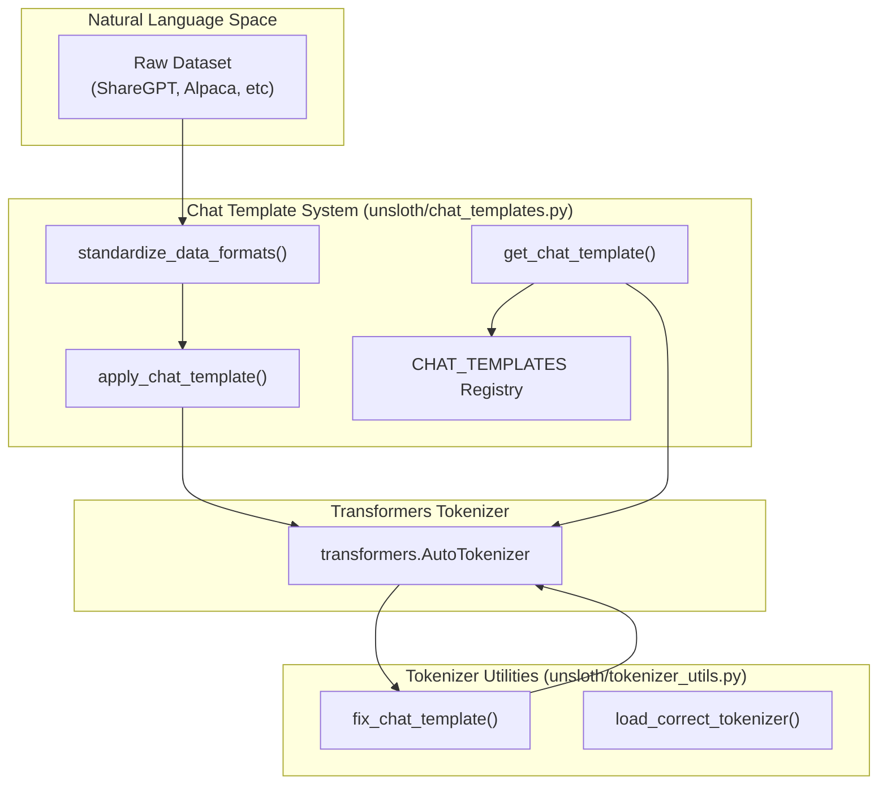
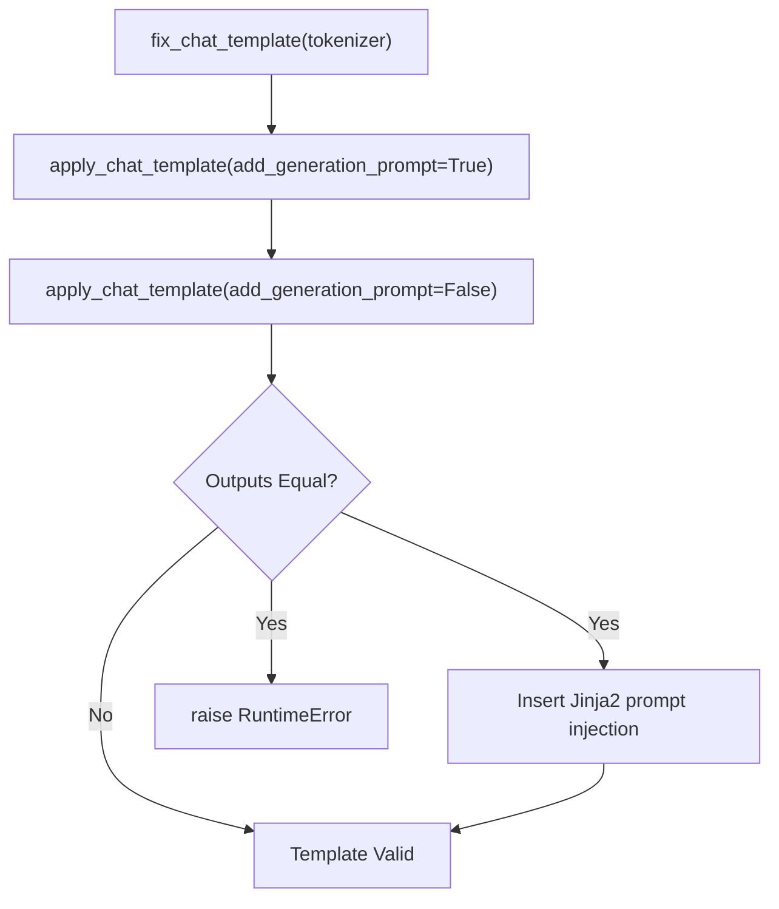
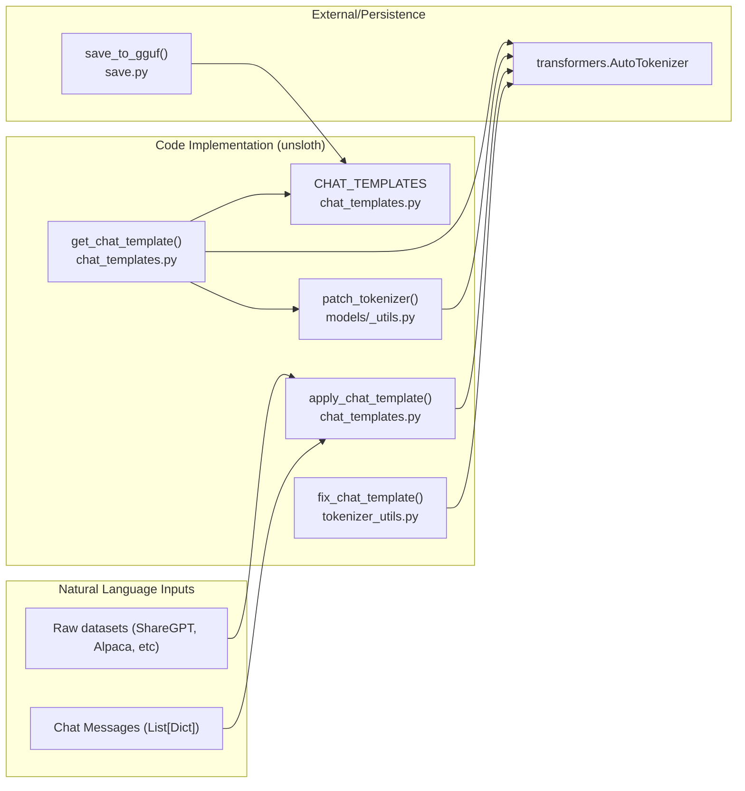

<!-- source: DeepWiki mcp.deepwiki.com · repo unslothai/unsloth · page 11.2 Chat Templates · fetched 2026-10-21 -->

# Chat Templates

Relevant source files

The following files were used as context for generating this wiki page:

- [README.md](README.md)
- [pyproject.toml](pyproject.toml)
- [studio/backend/requirements/base.txt](studio/backend/requirements/base.txt)
- [studio/backend/requirements/diffusers-pin.txt](studio/backend/requirements/diffusers-pin.txt)
- [studio/backend/tests/test_alpaca_blank_cells.py](studio/backend/tests/test_alpaca_blank_cells.py)
- [studio/backend/utils/datasets/__init__.py](studio/backend/utils/datasets/__init__.py)
- [studio/backend/utils/datasets/cells.py](studio/backend/utils/datasets/cells.py)
- [studio/backend/utils/datasets/chat_templates.py](studio/backend/utils/datasets/chat_templates.py)
- [studio/backend/utils/datasets/data_collators.py](studio/backend/utils/datasets/data_collators.py)
- [studio/backend/utils/datasets/format_conversion.py](studio/backend/utils/datasets/format_conversion.py)
- [studio/backend/utils/datasets/format_detection.py](studio/backend/utils/datasets/format_detection.py)
- [studio/backend/utils/uv_path_safety.py](studio/backend/utils/uv_path_safety.py)
- [studio/frontend/src/features/training/types/datasets.ts](studio/frontend/src/features/training/types/datasets.ts)
- [tests/_shared/installer_venv_root.py](tests/_shared/installer_venv_root.py)
- [tests/python/test_construct_chat_template_validation.py](tests/python/test_construct_chat_template_validation.py)
- [tests/python/test_e2e_no_torch_sandbox.py](tests/python/test_e2e_no_torch_sandbox.py)
- [tests/python/test_no_torch_filtering.py](tests/python/test_no_torch_filtering.py)
- [tests/python/test_studio_import_no_torch.py](tests/python/test_studio_import_no_torch.py)
- [tests/sh/test_setup_amd_fastpath_escape.sh](tests/sh/test_setup_amd_fastpath_escape.sh)
- [tests/studio/install/test_amd_fastpath_probe.py](tests/studio/install/test_amd_fastpath_probe.py)
- [tests/studio/install/test_diffusers_pin.py](tests/studio/install/test_diffusers_pin.py)
- [tests/studio/install/test_missing_kernel_arch_routing_9396.py](tests/studio/install/test_missing_kernel_arch_routing_9396.py)
- [tests/studio/install/test_studio_extra_matches_requirements.py](tests/studio/install/test_studio_extra_matches_requirements.py)
- [tests/test_fp8_pre_sm89_dequant_fallback.py](tests/test_fp8_pre_sm89_dequant_fallback.py)
- [tests/test_import_fixes_drift.py](tests/test_import_fixes_drift.py)
- [unsloth/__init__.py](unsloth/__init__.py)
- [unsloth/_gpu_init.py](unsloth/_gpu_init.py)
- [unsloth/chat_templates.py](unsloth/chat_templates.py)
- [unsloth/import_fixes.py](unsloth/import_fixes.py)
- [unsloth/kernels/fp8.py](unsloth/kernels/fp8.py)
- [unsloth/models/_utils.py](unsloth/models/_utils.py)
- [unsloth/models/llama.py](unsloth/models/llama.py)
- [unsloth/models/loader.py](unsloth/models/loader.py)
- [unsloth/models/loader_utils.py](unsloth/models/loader_utils.py)
- [unsloth/models/mapper.py](unsloth/models/mapper.py)
- [unsloth/models/mistral.py](unsloth/models/mistral.py)
- [unsloth/models/rl.py](unsloth/models/rl.py)
- [unsloth/models/rl_replacements.py](unsloth/models/rl_replacements.py)
- [unsloth/models/vision.py](unsloth/models/vision.py)
- [unsloth/save.py](unsloth/save.py)
- [unsloth/tokenizer_utils.py](unsloth/tokenizer_utils.py)

The Unsloth chat template system standardizes conversation formatting for various LLM model families and ensures seamless integration between raw conversational data, tokenizer behavior, and model inference. It handles Jinja2 template management, token synchronization, model-specific overrides, and validation to support accurate and performant chat workflows in Unsloth.

---

## Purpose and Scope

This system is responsible for:

- **Template Standardization**: Providing pre-defined Jinja2 chat templates for major model families such as Llama (3.1/3.2/4), Gemma (2/3/4), Mistral, Qwen 3, and Phi-4 [unsloth/chat_templates.py:40-1232]().
- **Special Token Synchronization**: Aligning tokenizer's special tokens (BOS, EOS, PAD) with those required or introduced by the chat templates, including adding custom tokens if needed [unsloth/chat_templates.py:1234-1430]().
- **Data Format Conversion**: Transforming various raw dataset formats (e.g., ShareGPT, Alpaca, Instruction-Output) into standardized, tokenizable conversation strings [unsloth/chat_templates.py:15-60]().
- **Inference Support**: Adding generation prompts correctly so that chat models start the assistant's response as per their required format [unsloth/tokenizer_utils.py:674-749]().
- **Model-Specific Overrides**: Allowing curated templates per model family that respect their special token schemes and conversation structure [unsloth/chat_templates.py:45-1232]().

This enables Unsloth to apply uniform chat templates while respecting the subtle differences of each model architecture, ensuring that datasets are correctly rendered and inference behaves as expected.

**Sources:** [unsloth/chat_templates.py:15-1460](), [unsloth/tokenizer_utils.py:674-749]()

---

## System Architecture

The chat template subsystem bridges natural language input data to the low-level token sequences expected by the model tokenizer and backend.

### Data Flow Overview

"Natural Language Space" to "Code Entity Space" mapping:

- `standardize_data_formats` converts heterogeneous raw data into a list of message dicts with `role` and `content` [unsloth/chat_templates.py:1435-1440]().
- `get_chat_template` looks up a named template matching the model, patches the tokenizer tokens if necessary, and applies system message expansions [unsloth/chat_templates.py:1234-1430]().
- `apply_chat_template` renders the tokenized conversation string per the chosen template [unsloth/chat_templates.py:1445-1455]().
- `fix_chat_template` validates and fixes templates to ensure prompt correctness during generation [unsloth/tokenizer_utils.py:674-749]().

**Sources:** [unsloth/chat_templates.py:15-1460](), [unsloth/tokenizer_utils.py:670-750]()

---

## Key Components and Functions

### 1. `get_chat_template(tokenizer, name)`

- Retrieves a chat template tuple from the `CHAT_TEMPLATES` dictionary based on a name [unsloth/chat_templates.py:1234-1240]().
- The tuple includes:
  - Jinja2 template string
  - EOS token(s) for chat termination
  - Whether the EOS token is custom (needs tokenizer update)
  - Ollama template string for GGUF compatibility
- If the template requires a custom EOS token (e.g., `<|im_end|>`), it adds that token to the tokenizer vocab and sets `tokenizer.eos_token` [unsloth/chat_templates.py:1250-1265]().
- System messages (`{system_message}`) inside the template are replaced with architecture-appropriate defaults [unsloth/chat_templates.py:1270-1285]().
- Calls `patch_tokenizer` to sync template special tokens across tokenizer internals [unsloth/models/_utils.py:35]().

**Sources:** [unsloth/chat_templates.py:1234-1430](), [unsloth/models/_utils.py:35-37]()

---

### 2. `apply_chat_template(dataset_or_messages, tokenizer, template_name, tokenize=True, add_generation_prompt=False)`

- Normalizes input data via `standardize_data_formats` into uniform messages with roles/content [unsloth/chat_templates.py:1435-1440]().
- Applies the chosen chat template using the tokenizer's internal `apply_chat_template` function, passing flags to control tokenization and generation prompt addition [unsloth/chat_templates.py:1445-1455]().
- Returns either string or token IDs depending on `tokenize` [unsloth/chat_templates.py:1458]().
- Supports structured chat messages or raw dataset dictionaries.

**Sources:** [unsloth/chat_templates.py:1433-1460](), [unsloth/tokenizer_utils.py:674-749]()

---

### 3. `fix_chat_template(tokenizer)`

- Validates that the currently loaded chat template supports generation prompt addition by comparing outputs when `add_generation_prompt` is `True` vs `False` [unsloth/tokenizer_utils.py:680-690]().
- If the template lacks proper `add_generation_prompt` support (leading to identical outputs), it dynamically injects a Jinja2 block to append the assistant header [unsloth/tokenizer_utils.py:700-720]().
- Ensures inference-time prompts trigger assistant response generation correctly.

**Validation Flow:**

**Sources:** [unsloth/tokenizer_utils.py:674-749]()

---

## Model-Specific Template Overrides

Unsloth maintains a comprehensive registry named `CHAT_TEMPLATES` in `unsloth/chat_templates.py` that maps model family names to their specific templates.

| Model Family | Template Name(s) | Notes and Behavior |
| :--- | :--- | :--- |
| **Llama 3.1/3.2** | `llama-3.1`, `llama-3.2` | Uses `<|begin_of_text|>`, header IDs, and role-based system/user/assistant tokens. |
| **Gemma 2/3/4** | `gemma`, `gemma4` | Conversation with `<start_of_turn>`, `<end_of_turn>`. Gemma 4 adds updated tags. |
| **Mistral v1/v3** | `mistral` | Wraps prompt in `[INST]` and `[/INST]` with role separation tags. |
| **ChatML (Generic)** | `chatml` | Uses ChatML format `<|im_start|>`, `<|im_end|>`, compatible with OpenAI chat. |
| **Phi-4** | `phi-4` | Uses `<|im_sep|>` separator between message header and message content. |
| **Qwen 3** | `qwen3` | Uses Jinja2 templates with tokens `<s>`, `<|im_start|>`, and `<|im_end|>`. |

**Sources:** [unsloth/chat_templates.py:45-1232]()

---

## Integration and Tooling Support

- **GGUF Export**: The chat template system integrates with `save_to_gguf` to export GGUF metadata with Ollama-compatible template strings using `OLLAMA_TEMPLATES` and `MODEL_TO_OLLAMA_TEMPLATE_MAPPER` [unsloth/save.py:77](), [unsloth/ollama_template_mappers.py]().
- **SentencePiece**: Ensures sentencepiece tokenizer models embed custom tokens via `fix_sentencepiece_gguf` [unsloth/tokenizer_utils.py:47]().
- **RL Training**: During RL fine-tuning (`PatchRL`), templates help wrap model generation to maintain correct inference-mode prompt application [unsloth/models/rl.py:181-198]().

---

## Summary Mapping: Natural Language to Code Entities

**Sources:** [unsloth/chat_templates.py:15-1232](), [unsloth/tokenizer_utils.py:670-750](), [unsloth/models/_utils.py:35-37](), [unsloth/save.py:77](), [unsloth/models/rl.py:181-198]()

---

