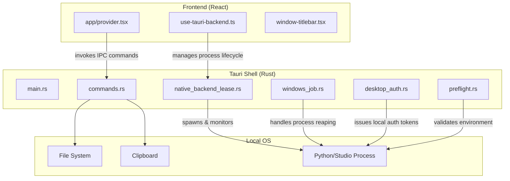
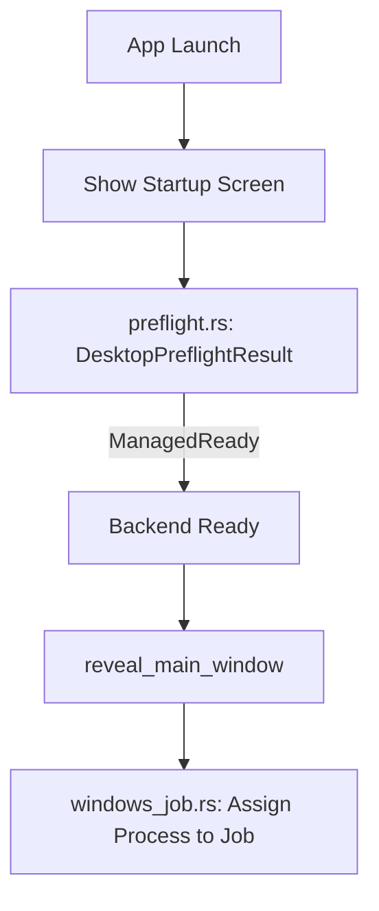

<!-- source: DeepWiki mcp.deepwiki.com · repo unslothai/unsloth · page 14 Desktop Application (Tauri) · fetched 2026-10-21 -->

# Desktop Application (Tauri)

Relevant source files

The following files were used as context for generating this wiki page:

- [studio/src-tauri/Cargo.lock](studio/src-tauri/Cargo.lock)
- [studio/src-tauri/Cargo.toml](studio/src-tauri/Cargo.toml)
- [studio/src-tauri/capabilities/default.json](studio/src-tauri/capabilities/default.json)
- [studio/src-tauri/icons/tray-icon-dark.png](studio/src-tauri/icons/tray-icon-dark.png)
- [studio/src-tauri/icons/tray-icon-light.png](studio/src-tauri/icons/tray-icon-light.png)
- [studio/src-tauri/icons/tray-icon.png](studio/src-tauri/icons/tray-icon.png)
- [studio/src-tauri/icons/tray-icon@2x.png](studio/src-tauri/icons/tray-icon@2x.png)
- [studio/src-tauri/src/macos_tray.rs](studio/src-tauri/src/macos_tray.rs)
- [studio/src-tauri/src/main.rs](studio/src-tauri/src/main.rs)

The Unsloth Desktop application is a native wrapper around the Studio web UI built using [Tauri](https://tauri.app). It provides a seamless desktop experience on Windows, macOS, and Linux by bundling the React frontend with system-native Rust components that manage backend processes, native OS integrations, authentication, window lifecycle, and an auto-update system.

This page provides a high-level overview of the Desktop Application architecture, its key responsibilities, and how these integrate the core Studio backend with the native operating system. Technical details, Rust commands, and release pipeline specifics are delegated to child pages.

---

## System Architecture

The Desktop Application is composed of two major layers:

- **Tauri Shell (Rust)**: Implements core system functions, acting as the native host. It manages the lifecycle of the Python-based Unsloth Studio backend process, issues IPC commands, handles window/tray events, and integrates native OS features.
- **Frontend (React)**: The web UI presented in a native window. The frontend communicates with the Tauri shell through strongly-typed IPC commands via `@tauri-apps/api` [studio/frontend/package.json:49]().

### Component Relationship Diagram

Sources: [studio/src-tauri/src/main.rs:1-190](), [studio/src-tauri/src/commands.rs:1-48](), [studio/src-tauri/src/process.rs:1-11]()

---

## Window and Lifecycle Management

The Tauri shell orchestrates the window lifecycle and runtime state to ensure robustness:

- **Startup Sequence**: On launch, the app performs preflight checks via `preflight.rs` to validate the managed install and backend readiness [studio/src-tauri/src/preflight.rs:78-126]().
- **Process Lifetime and Cleanup**: To avoid orphaned Python backend processes, the shell uses platform-specific subprocess reaping. On Windows, this uses `windows_job.rs` to ensure child processes are terminated when the parent exits [studio/src-tauri/src/main.rs:25]().
- **Termination Logic**: `TERMINATION_CLEANUP` serializes exit paths (tray "Quit", signal listeners, or window close) to ensure exactly one cleanup routine runs [studio/src-tauri/src/main.rs:44-51]().
- **Close-to-Tray**: Supports a preference to minimize to the system tray, managed via `CloseToTrayState` and persisted in `CLOSE_TO_TRAY_PREFERENCE_FILE` [studio/src-tauri/src/main.rs:65-70, 160-186]().
- **In-App Relaunch**: Tracks whether an app start was a login autostart or a user-initiated restart with `mark_in_app_relaunch` and related logic [studio/src-tauri/src/main.rs:73-146]().

### Lifecycle Control Flow

Sources: [studio/src-tauri/src/main.rs:130-160](), [studio/src-tauri/src/preflight.rs:78-126](), [studio/src-tauri/src/commands.rs:9-24]()

---

## Native Integrations

The desktop app extends standard web capabilities with native OS features:

| Feature              | Implementation Module        | Description                                                      |
|----------------------|-----------------------------|------------------------------------------------------------------|
| **Native File Dialogs** | `native_file_dialogs.rs`    | System-native save/open dialogs for datasets and models.        |
| **Clipboard Access**  | `native_clipboard.rs`        | Integration with `arboard` for reading/writing system clipboard files. [studio/src-tauri/Cargo.toml:39]() |
| **Process Ownership** | `desktop_backend_owner.rs`  | Manages `UNSLOTH_STUDIO_DESKTOP_OWNER_TOKEN` to secure the backend process ownership. [studio/src-tauri/src/desktop_backend_owner.rs:15-20]() |
| **Health Watchdog**   | `commands.rs`               | Monitors backend liveness with a 15-second interval and handles busy/stalled states. [studio/src-tauri/src/commands.rs:10-24]() |
| **Diagnostics**       | `diagnostics.rs`            | Aggregates logs from backend subprocesses for troubleshooting.  [studio/src-tauri/src/process.rs:1-4]() |

Sources: [studio/src-tauri/src/main.rs:15-24](), [studio/src-tauri/src/desktop_backend_owner.rs:15-57](), [studio/src-tauri/src/commands.rs:10-48]()

Additionally, the app implements platform-specific integrations such as:

- **Tray Icon and Menu**: Uses native tray icons, including dynamic theme-aware icons for macOS implemented in `macos_tray.rs` which observes system appearance changes to swap tray icons [studio/src-tauri/src/macos_tray.rs:1-193]().

---

## Update & Release Pipeline

The desktop app employs a multi-stage update and release system to keep the app and its backend current:

1. **Managed CLI Updates**: The Rust shell transparently invokes `studio update` within the managed Python environment to fetch backend updates [studio/src-tauri/src/update.rs:33-37]().
2. **Environment Isolation**: Desktop update operations avoid `PYTHONPATH` pollution by isolating environment variables [studio/src-tauri/src/update.rs:38-47]().
3. **AppImage and Environment Normalization**: Linux AppImage binaries scrub environment variables like `LD_LIBRARY_PATH` and `PATH` to avoid conflicts when spawning backend processes [studio/src-tauri/src/process.rs:19-62]().
4. **Binary Sidecars**: Supports separately updating native helper binaries such as `llama.cpp` outside the main shell release cycle.

For comprehensive coverage, see [Desktop Update and Release Pipeline](#14.2).

Sources: [studio/src-tauri/src/update.rs:26-62](), [studio/src-tauri/src/process.rs:101-114]()

---

## Detailed Sub-Pages

This section links to specialized child pages with detailed documentation on critical subsystems:

- ### [Tauri Shell and Native Integration](#14.1)
  Covers the Rust Tauri commands, native file/clipboard intents and path policy, `native_backend_lease` for backend process ownership and lifecycle, preflight checks, `desktop_auth.rs` for desktop authentication, tray icons, and the startup screen lifecycle.

- ### [Desktop Update and Release Pipeline](#14.2)
  Documents the desktop auto-update system, release workflow (`release-desktop.yml`), code signing and notarization procedures, AppImage packaging on Linux, the `publish-desktop-updater` CI workflow, and the `llama.cpp` binary update mechanism.

---

### References

- [studio/src-tauri/src/main.rs:1-190]()
- [studio/src-tauri/src/commands.rs:1-48]()
- [studio/src-tauri/src/process.rs:1-11]()
- [studio/src-tauri/src/preflight.rs:78-126]()
- [studio/src-tauri/src/desktop_backend_owner.rs:15-57]()
- [studio/src-tauri/src/update.rs:26-62]()
- [studio/src-tauri/src/macos_tray.rs:1-193]()
- [studio/src-tauri/Cargo.toml:16-45]()

---

