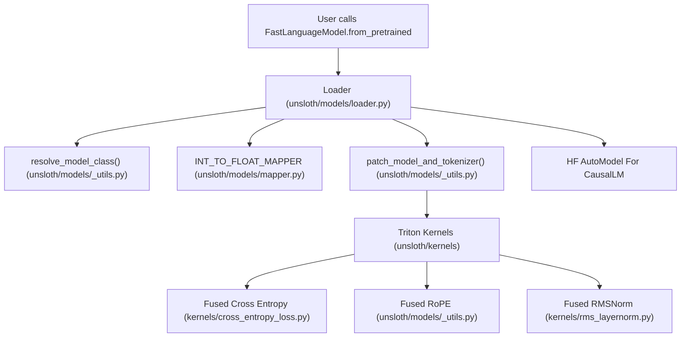
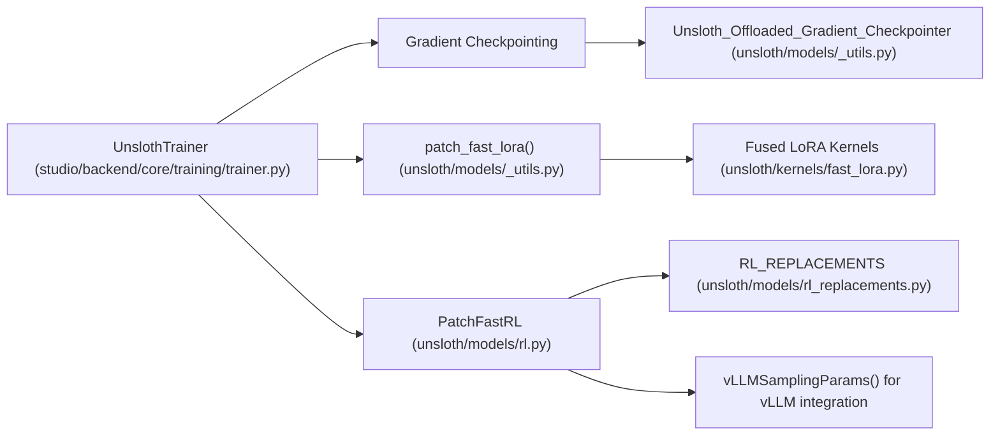

<!-- source: DeepWiki mcp.deepwiki.com · repo unslothai/unsloth · page 17 Glossary · fetched 2026-10-21 -->

# Glossary

Relevant source files

The following files were used as context for generating this wiki page:

- [README.md](README.md)
- [pyproject.toml](pyproject.toml)
- [studio/backend/core/inference/llama_cpp.py](studio/backend/core/inference/llama_cpp.py)
- [studio/backend/hub/schemas/inventory.py](studio/backend/hub/schemas/inventory.py)
- [studio/backend/hub/services/models/cache_inventory.py](studio/backend/hub/services/models/cache_inventory.py)
- [studio/backend/hub/services/models/common.py](studio/backend/hub/services/models/common.py)
- [studio/backend/hub/services/models/deletion.py](studio/backend/hub/services/models/deletion.py)
- [studio/backend/hub/services/models/gguf_variants.py](studio/backend/hub/services/models/gguf_variants.py)
- [studio/backend/hub/services/models/local_inventory.py](studio/backend/hub/services/models/local_inventory.py)
- [studio/backend/hub/tests/test_empty_variant_folder.py](studio/backend/hub/tests/test_empty_variant_folder.py)
- [studio/backend/hub/tests/test_model_services.py](studio/backend/hub/tests/test_model_services.py)
- [studio/backend/hub/utils/gguf.py](studio/backend/hub/utils/gguf.py)
- [studio/backend/hub/utils/gguf_plan.py](studio/backend/hub/utils/gguf_plan.py)
- [studio/backend/hub/utils/inventory_scan.py](studio/backend/hub/utils/inventory_scan.py)
- [studio/backend/models/inference.py](studio/backend/models/inference.py)
- [studio/backend/models/models.py](studio/backend/models/models.py)
- [studio/backend/routes/inference.py](studio/backend/routes/inference.py)
- [studio/backend/routes/models.py](studio/backend/routes/models.py)
- [studio/backend/tests/test_cached_gguf_routes.py](studio/backend/tests/test_cached_gguf_routes.py)
- [studio/backend/tests/test_scan_folder_health.py](studio/backend/tests/test_scan_folder_health.py)
- [studio/backend/utils/models/__init__.py](studio/backend/utils/models/__init__.py)
- [studio/backend/utils/models/checkpoints.py](studio/backend/utils/models/checkpoints.py)
- [studio/backend/utils/models/model_config.py](studio/backend/utils/models/model_config.py)
- [studio/frontend/src/components/app-sidebar.tsx](studio/frontend/src/components/app-sidebar.tsx)
- [studio/frontend/src/components/assistant-ui/thread.tsx](studio/frontend/src/components/assistant-ui/thread.tsx)
- [studio/frontend/src/features/chat/api/chat-adapter.ts](studio/frontend/src/features/chat/api/chat-adapter.ts)
- [studio/frontend/src/features/chat/api/chat-api.ts](studio/frontend/src/features/chat/api/chat-api.ts)
- [studio/frontend/src/features/chat/chat-page.tsx](studio/frontend/src/features/chat/chat-page.tsx)
- [studio/frontend/src/features/chat/chat-settings-sheet.tsx](studio/frontend/src/features/chat/chat-settings-sheet.tsx)
- [studio/frontend/src/features/chat/hooks/use-chat-model-runtime.ts](studio/frontend/src/features/chat/hooks/use-chat-model-runtime.ts)
- [studio/frontend/src/features/chat/index.ts](studio/frontend/src/features/chat/index.ts)
- [studio/frontend/src/features/chat/runtime-provider.tsx](studio/frontend/src/features/chat/runtime-provider.tsx)
- [studio/frontend/src/features/chat/shared-composer.tsx](studio/frontend/src/features/chat/shared-composer.tsx)
- [studio/frontend/src/features/chat/stores/chat-runtime-store.ts](studio/frontend/src/features/chat/stores/chat-runtime-store.ts)
- [studio/frontend/src/features/chat/thread-sidebar.tsx](studio/frontend/src/features/chat/thread-sidebar.tsx)
- [studio/frontend/src/features/chat/types.ts](studio/frontend/src/features/chat/types.ts)
- [studio/frontend/src/features/chat/types/api.ts](studio/frontend/src/features/chat/types/api.ts)
- [studio/frontend/src/features/hub/inventory/api.ts](studio/frontend/src/features/hub/inventory/api.ts)
- [studio/frontend/src/features/settings/tabs/chat-tab.tsx](studio/frontend/src/features/settings/tabs/chat-tab.tsx)
- [studio/frontend/src/index.css](studio/frontend/src/index.css)
- [studio/frontend/src/main.tsx](studio/frontend/src/main.tsx)
- [studio/frontend/tests/sidebar-action-rows-inert.test.ts](studio/frontend/tests/sidebar-action-rows-inert.test.ts)
- [tests/python/test_construct_chat_template_validation.py](tests/python/test_construct_chat_template_validation.py)
- [tests/test_fp8_pre_sm89_dequant_fallback.py](tests/test_fp8_pre_sm89_dequant_fallback.py)
- [tests/test_import_fixes_drift.py](tests/test_import_fixes_drift.py)
- [unsloth/__init__.py](unsloth/__init__.py)
- [unsloth/_gpu_init.py](unsloth/_gpu_init.py)
- [unsloth/chat_templates.py](unsloth/chat_templates.py)
- [unsloth/import_fixes.py](unsloth/import_fixes.py)
- [unsloth/kernels/fp8.py](unsloth/kernels/fp8.py)
- [unsloth/models/_utils.py](unsloth/models/_utils.py)
- [unsloth/models/llama.py](unsloth/models/llama.py)
- [unsloth/models/loader.py](unsloth/models/loader.py)
- [unsloth/models/loader_utils.py](unsloth/models/loader_utils.py)
- [unsloth/models/mapper.py](unsloth/models/mapper.py)
- [unsloth/models/mistral.py](unsloth/models/mistral.py)
- [unsloth/models/rl.py](unsloth/models/rl.py)
- [unsloth/models/rl_replacements.py](unsloth/models/rl_replacements.py)
- [unsloth/models/vision.py](unsloth/models/vision.py)
- [unsloth/save.py](unsloth/save.py)
- [unsloth/tokenizer_utils.py](unsloth/tokenizer_utils.py)

This page provides definitions and technical context for codebase-specific terms, jargon, and domain concepts used throughout the Unsloth library and Studio. It covers notable Unsloth-specific terminology from both the core library and Studio components with references to code implementations.

---

## Core Library Terminology

### Fast Models

The **Fast Models** are Unsloth's primary abstractions for various AI model types with optimized inference and training pipelines. These wrap standard Hugging Face and diffusers models applying runtime patches, kernel optimizations, and internal dispatch logic.

- **FastLanguageModel**: Core class for language models such as LLaMA, Qwen, Falcon, Cohere, and more. Uses sophisticated patched attention layers, LoRA integration, and model loading pipelines supporting quantization and mixed precision.  
  *Defined and loaded mainly in:* `unsloth/models/loader.py` [26-38](), [94-120]()

- **FastVisionModel**: For vision and multimodal models (e.g., LLaVA, Qwen2-VL). It integrates image processing and cross-attention pipelines for multimodal inputs with Unsloth optimizations.  
  *Defined primarily in:* `unsloth/models/vision.py` [124-125]()

- **FastSentenceTransformer**: Handles embedding models optimized for retrieval and similarity search tasks with patching and device-aware dispatch.  
  *Referenced in core utility exports:* `unsloth/models/_utils.py` [14-30]()

- **FastDiffusionModel**: Supports diffusion architectures for images and text-diffusion like DiffusionGemma with fast kernels, LoRA support, and sampling improvements.

These models automatically patch components such as attention layers and LoRA adapters with custom Triton kernels for high speed and low VRAM.

---

### Triton Kernels

Unsloth replaces many standard PyTorch operations with **Triton** fused kernels to optimize throughput and memory pressure:

- **Cross Entropy Loss**: The fused kernel avoids materializing giant logit tensors during loss computation, enabling faster training with less VRAM.  
  *See fused_cross_entropy related functions in:* `unsloth/models/_utils.py` [58-59]() and the kernels directory.

- **RoPE (Rotary Positional Embeddings)**: Efficient fused kernel applies RoPE transformations to queries and keys in an attention layer.  
  *Refer to patching logic in:* `unsloth/models/_utils.py` [41-42]()

- **RMSNorm / LayerNorm**: Custom optimized implementations replace standard PyTorch versions for layer normalizations commonly used in LLMs.  
  *Patching logic is in:* `unsloth/models/_utils.py` [49-49]()

- **SwiGLU/GeGLU Activations**: Custom fusion of activation functions employed in transformer feed-forward layers, yielding speed improvements.

- **Fast LoRA Kernels**: Special fused kernels for LoRA PEFT adapters optimize their matrix multiplications for both training and inference.  
  *Implementation pointer:* `unsloth/models/_utils.py` [73-78]()

---

### PEFT and LoRA Patching

Unsloth deeply integrates with the PEFT library for Parameter Efficient Fine-Tuning, especially focusing on LoRA adapters:

- Transparent patching replaces standard PEFT LoRA layers with Unsloth-accelerated fast kernels to speed up training and inference.

- Fast dequantization paths handle models quantized with bitsandbytes 4-bit kernels, reducing CPU bottlenecks during the forward pass.  
  *Dequantization utility:* `unsloth/models/_utils.py` [80-80]() and `unsloth/save.py` [58-63]()

- Hooks and utilities ensure correct data types in LoRA layers, gradient checkpointing compatibility, and offloading support.

---

### Model Mapping and Resolution

Unsloth maintains registries and mappings associating model identifiers with canonical Hugging Face models and class implementations:

- **INT_TO_FLOAT_MAPPER**: Maps 4-bit or quantized model names back to corresponding full precision versions to load appropriate tokenizers and configurations.  
  *Found in:* `unsloth/models/mapper.py` [22-28]()

- **Model Class Resolution**: `resolve_model_class` function determines the correct `FastXXXModel` subclass for a given architecture string.  
  *Implemented in:* `unsloth/models/_utils.py` [68-70]() and `unsloth/models/loader.py` [25-31]()

- **Model Registry System**: Maintains metadata and properties per model family, quantization support, and patch requirements.

---

## Training and Inference Concepts

### Gradient Checkpointing (GC)

A memory optimization technique that trades compute for drastically reduced VRAM by recomputing activations during backward passes:

- **Unsloth_Offloaded_Gradient_Checkpointer**: Extends gradient checkpointing by offloading stored activations to CPU or disk temporarily, allowing very large models to be fine-tuned on limited VRAM systems.  
  *Defined in:* `unsloth/models/_utils.py` [151-156]()

- **Smart Gradient Checkpointing**: Applies patches dynamically altering backward passes for best speed-memory tradeoff.  
  *Pointer:* `unsloth/models/_utils.py` [159-160]()

---

### RL Patching (TRL Integration)

Unsloth accelerates Reinforcement Learning workflows using the TRL (Transformers Reinforcement Learning) library:

- **PatchFastRL**: Provides runtime patches and replacements for TRL trainer classes to improve performance in training PPO, DPO, and GRPO RL algorithms.  
  *Exposed in:* `unsloth/models/rl.py` [12-15]() and [146-198]()

- **vLLMSamplingParams**: Wrapper to enable fast batch generation in the vLLM inference engine during RL rollout phases.  
  *Defined in:* `unsloth/models/rl.py` [86-91]()

- **UNSLOTH_GRPO_SEQ_PACKING_ON**: Environment flag enabling sequence packing optimization specifically for GRPO RL training to increase throughput.  
  *Found in:* `unsloth/models/rl_replacements.py` [58-63]()

---

### MLX Backend (Apple Silicon)

Special support for running models on Apple Silicon Macs efficiently:

- **MLX** is an Apple-developed library for optimized neural network inference on macOS arm64 hardware.

- Detection of MLX availability occurs at package import time setting `_IS_MLX` flag.  
  *Found in:* `unsloth/__init__.py` [130-148]()

- When active, Unsloth routes to MLX-specific trainers and kernels for better performance on Apple hardware.

---

## Studio and Backend Jargon

### Subprocess Orchestration

Studio backend isolates major workloads (training, inference, export) in separate Python subprocesses:

- **Worker Pattern**: Each subprocess runs its assigned command loop (e.g., `worker.py`), managing environment activation and hardware isolation.

- **Orchestrators**: Classes like `InferenceOrchestrator` or `ExportOrchestrator` manage lifecycle and communication with these worker processes to isolate compute and improve stability.

### GGUF Export Pipeline

Studio supports exporting trained or merged models to **GGUF** format for use with `llama.cpp` and Ollama:

- **save_to_gguf**: Handles quantization, merging LoRA adapters, and serialization of models into GGUF format optimized for local inference.  
  *Defined in:* `unsloth/save.py` [89-89]()

- **Allowed Quants**: Supports variety of quantization methods such as `q4_k_m`, `q5_k_m`, `iq4_xs`, etc.  
  *Registry in:* `unsloth/save.py` [135-175]()

### Inference Backends

Studio supports two main local inference backends:

- **LlamaCppBackend**: Manages a `llama-server` subprocess running the `llama.cpp` HTTP server to serve GGUF models efficiently.  
  *Implemented in:* `studio/backend/core/inference/llama_cpp.py` [4-60]()

- **InferenceOrchestrator**: Manages Transformers-based inference using GPU, controlling admission leases, concurrency, and admission policy.  
  *Found in:* `studio/backend/routes/inference.py` [20-80]()

---

## Architectural Diagrams

### Model Loading Pipeline: From Natural Language Request to Code Entities

This diagram visualizes the flow from user invocation to internal model class resolution, patching, and kernel dispatch.

Sources: [unsloth/models/loader.py:12-60](), [unsloth/models/_utils.py:68-73](), [unsloth/models/mapper.py:20-30]()

---

### Training and RL Optimization: Runtime Patching and Fast Kernels

This diagram maps the high-level training and reinforcement learning optimizations to Unsloth internal classes and patches.

Sources: [unsloth/models/_utils.py:151-166](), [unsloth/models/rl.py:12-150](), [unsloth/models/rl_replacements.py:20-90]()

---

## Technical Glossary Table

| Term                      | Definition                                                                                                                                                       | Code Pointer                                          |
| ------------------------- | ---------------------------------------------------------------------------------------------------------------------------------------------------------------- | ---------------------------------------------------- |
| **FastLanguageModel**      | Core language model wrapper class applying Unsloth patches and optimizations for various LLM architectures.                                                      | [unsloth/models/loader.py:26-38]()                    |
| **FastVisionModel**        | Wrapper for vision/multimodal transformers with patching and optimized pipelines for image-text tasks.                                                          | [unsloth/models/vision.py:124-125]()                  |
| **FastSentenceTransformer**| Wrapper for embedding models optimized for similarity and retrieval tasks.                                                                                       | [unsloth/models/_utils.py:14-30]()                     |
| **Triton Kernel**          | Custom fused GPU kernels implemented in Triton for faster compute and memory efficiency, e.g., fused CE loss, RoPE, RMSNorm, and SwiGLU/GeGLU activations.       | [unsloth/models/_utils.py:58-60]()                     |
| **LoRA (Low-Rank Adaptation)** | PEFT fine-tuning technique Unsloth accelerates with fused kernels and runtime patching.                                                                       | [unsloth/models/_utils.py:73-78]()                     |
| **INT_TO_FLOAT_MAPPER**    | Registry mapping quantized/int8/4bit model names back to their canonical full precision counterparts for loading tokenizers/configs.                             | [unsloth/models/mapper.py:22-28]()                     |
| **Gradient Checkpointing** | Memory optimization technique with offloading support to reduce VRAM usage during training via recomputation.                                                  | [unsloth/models/_utils.py:151-156]()                   |
| **PatchFastRL**            | Patch for TRL library improving RL training performance with sequence packing and runtime function replacements.                                                | [unsloth/models/rl.py:12-150]()                        |
| **vLLM**                  | High-performance inference engine for transformer models with batch generation and integrated via vLLMSamplingParams wrapper in RL workflows.                    | [unsloth/models/rl.py:86-91]()                         |
| **MLX**                  | Apple Silicon-specific ML backend enabled automatically if available for optimized model execution on macOS arm64.                                               | [unsloth/__init__.py:130-148]()                        |
| **UNSLOTH_IS_PRESENT**     | Environment flag set at Unsloth load time indicating Unsloth patches and environment modifications are active.                                                   | [unsloth/__init__.py:14-14]()                          |
| **LlamaCppBackend**        | Studio inference backend managing the `llama-server` subprocess for serving GGUF models efficiently through HTTP API.                                            | [studio/backend/core/inference/llama_cpp.py:4-60]()    |
| **InferenceOrchestrator**  | Studio backend class managing Transformer-based inference workload, GPU selection, queue admission, and concurrency.                                            | [studio/backend/routes/inference.py:17-80]()           |
| **GGUF**                   | Model file format optimized for `llama.cpp` and Ollama inference engines, supporting various quantization methods.                                              | [unsloth/save.py:89-89]()                              |
| **UNSLOTH_GRPO_SEQ_PACKING_ON** | Environment flag enabling batch sequence packing optimization to boost GRPO RL training throughput with Unsloth patches.                                   | [unsloth/models/rl_replacements.py:58-63]()           |

---

# END Glossary  

Sources:  
- [unsloth/models/_utils.py:14-80](), [unsloth/models/loader.py:12-60]()  
- [unsloth/models/mapper.py:20-30]()  
- [unsloth/models/vision.py:124-125]()  
- [unsloth/models/rl.py:12-150]()  
- [unsloth/models/rl_replacements.py:20-90]()  
- [unsloth/__init__.py:130-148]()  
- [unsloth/save.py:89-189]()  
- [studio/backend/core/inference/llama_cpp.py:4-60]()  
- [studio/backend/routes/inference.py:17-80]()