# Page: Overview

# Overview

<details>
<summary>Relevant source files</summary>

The following files were used as context for generating this wiki page:

- [.gitignore](.gitignore)
- [COPYING](COPYING)
- [LICENSE](LICENSE)
- [README.md](README.md)
- [pyproject.toml](pyproject.toml)
- [studio/backend/core/__init__.py](studio/backend/core/__init__.py)
- [studio/backend/core/training/__init__.py](studio/backend/core/training/__init__.py)
- [studio/backend/main.py](studio/backend/main.py)
- [studio/backend/routes/llama_compat.py](studio/backend/routes/llama_compat.py)
- [studio/backend/tests/test_chat_load_during_training.py](studio/backend/tests/test_chat_load_during_training.py)
- [studio/backend/tests/test_gpu_selection.py](studio/backend/tests/test_gpu_selection.py)
- [studio/backend/tests/test_hub_token_cache_isolation.py](studio/backend/tests/test_hub_token_cache_isolation.py)
- [studio/backend/tests/test_llama_compat_routes.py](studio/backend/tests/test_llama_compat_routes.py)
- [studio/backend/tests/test_login_rate_limit.py](studio/backend/tests/test_login_rate_limit.py)
- [studio/backend/tests/test_middleware.py](studio/backend/tests/test_middleware.py)
- [studio/backend/tests/test_model_defaults_aliases_resolve.py](studio/backend/tests/test_model_defaults_aliases_resolve.py)
- [studio/backend/tests/test_utils.py](studio/backend/tests/test_utils.py)
- [studio/backend/tests/test_vram_estimation.py](studio/backend/tests/test_vram_estimation.py)
- [studio/backend/utils/hardware/VRAM_ESTIMATION.md](studio/backend/utils/hardware/VRAM_ESTIMATION.md)
- [studio/backend/utils/hardware/__init__.py](studio/backend/utils/hardware/__init__.py)
- [studio/backend/utils/hardware/hardware.py](studio/backend/utils/hardware/hardware.py)
- [studio/backend/utils/hardware/vram_estimation.py](studio/backend/utils/hardware/vram_estimation.py)
- [studio/backend/utils/inference/__init__.py](studio/backend/utils/inference/__init__.py)
- [studio/backend/utils/inference/inference_config.py](studio/backend/utils/inference/inference_config.py)
- [studio/backend/utils/utils.py](studio/backend/utils/utils.py)
- [tests/python/test_construct_chat_template_validation.py](tests/python/test_construct_chat_template_validation.py)
- [tests/test_fp8_pre_sm89_dequant_fallback.py](tests/test_fp8_pre_sm89_dequant_fallback.py)
- [tests/test_import_fixes_drift.py](tests/test_import_fixes_drift.py)
- [unsloth/__init__.py](unsloth/__init__.py)
- [unsloth/_gpu_init.py](unsloth/_gpu_init.py)
- [unsloth/chat_templates.py](unsloth/chat_templates.py)
- [unsloth/import_fixes.py](unsloth/import_fixes.py)
- [unsloth/kernels/fp8.py](unsloth/kernels/fp8.py)
- [unsloth/models/_utils.py](unsloth/models/_utils.py)
- [unsloth/models/llama.py](unsloth/models/llama.py)
- [unsloth/models/loader.py](unsloth/models/loader.py)
- [unsloth/models/loader_utils.py](unsloth/models/loader_utils.py)
- [unsloth/models/mapper.py](unsloth/models/mapper.py)
- [unsloth/models/mistral.py](unsloth/models/mistral.py)
- [unsloth/models/rl.py](unsloth/models/rl.py)
- [unsloth/models/rl_replacements.py](unsloth/models/rl_replacements.py)
- [unsloth/models/vision.py](unsloth/models/vision.py)
- [unsloth/save.py](unsloth/save.py)
- [unsloth/tokenizer_utils.py](unsloth/tokenizer_utils.py)
- [unsloth_cli/commands/__init__.py](unsloth_cli/commands/__init__.py)

</details>


This document provides a high-level introduction to Unsloth, explaining its purpose, architectural components, licensing model, and how the different parts of the system interact. Unsloth is a library focused on accelerated fine-tuning and inference of large language models (LLMs), delivering 2-5× faster training speeds and 70% lower VRAM usage compared to standard frameworks [README.md:8-56]().

For detailed information about specific subsystems:
- For installation instructions, see **Getting Started** (Section 2)
- For model loading internals, see **Model Loading Pipeline** (Section 3.2)
- For training workflows, see **Standard Fine-tuning** (Section 6.1)
- For Studio backend details, see **Backend Architecture Overview** (Section 9.1)

---

## System Purpose and Scope

Unsloth accelerates LLM training and inference with a combination of custom Triton kernels, model patching, optimized attention mechanisms, and hardware-aware execution [README.md:72-89](). The system structure is divided into three main components:

1. **Core Library (Apache 2.0 License)**  
   Provides the foundational ML optimization engine including model loaders, patching utilities, custom CUDA/Triton kernels, and training/inference helpers [unsloth/models/_utils.py:1-13](). This library can be embedded directly in other Python projects without AGPL restrictions.

2. **Studio Backend (AGPLv3 License)**  
   A FastAPI-based server that encapsulates subprocess orchestration for training, inference, and model export. Subprocess isolation handles complex dependency requirements such as different Transformers versions (v4.x vs v5.x) [unsloth/models/loader.py:78-93]().

3. **Studio Frontend & CLI (AGPLv3 License)**  
   User-facing React/TypeScript frontend and CLI interfaces for managing model workflows, dataset recipes, training, inference, and deployment [pyproject.toml:41-42]().

This separation enables broad adoption and embedding of tuning/inference optimizations under permissive licensing, while distributing the user-facing interfaces and server with strong copyleft to foster openness in hosted environments.

**Sources:** [pyproject.toml:5-42](), [README.md:106-161](), [unsloth/models/_utils.py:1-13]()

---

## Dual Licensing Model

Unsloth adopts a dual-license approach that distinctly separates core functionality from user-facing components:

| Component             | License             | Code Location             | Purpose                                  |
|-----------------------|---------------------|---------------------------|------------------------------------------|
| **Core Library**       | Apache License 2.0  | `unsloth/`                | Model optimization engine, patching, kernels, LoRA utilities [unsloth/models/_utils.py:1-13]() |
| **Studio Backend**     | AGPLv3              | `studio/backend/`         | FastAPI server with subprocess orchestration for training, inference, exporting [pyproject.toml:105-138]() |
| **Studio Frontend**    | AGPLv3              | `studio/frontend/`        | React/TypeScript UI for configuration, recipes, chat, and monitoring [pyproject.toml:59-65]() |
| **CLI**               | AGPLv3              | `unsloth_cli/`            | Command line interface for training, inference, exporting, studio launch [pyproject.toml:41-42]() |

This licensing model allows the core library to be embedded commercially without source-affecting obligations, while ensuring transparency and source reciprocity for network-facing services built around Studio and CLI.

**Sources:** [pyproject.toml:11-42](), [unsloth/models/_utils.py:1-13](), [unsloth/models/llama.py:1-13](), [unsloth/models/vision.py:1-13]()

---

## Core Architecture Components

### Component Hierarchy

The following diagram shows the key architectural relations across the Apache 2.0-licensed core and AGPLv3-licensed user interfaces:

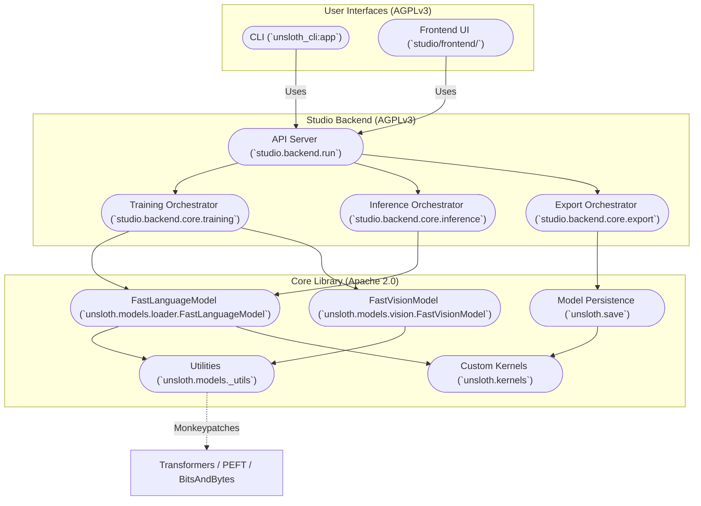

This layered design decouples fast ML core logic and patching from orchestration & endpoint serving and simultaneously honors the different license requirements.

**Sources:** [unsloth/__init__.py:148-210](), [unsloth/models/loader.py:29-35](), [unsloth/models/vision.py:115-117](), [pyproject.toml:41-42]()

---

### Core Library (Apache 2.0)

The core library supports fast training and inference using three main subsystems:

#### 1. Model Loaders

Loaders serve as the main user entry points, orchestrating model resolution, backend routing, and adaptive patching for various architectures and quantization precisions:

| Class               | File Location                              | Role                                                  |
|---------------------|--------------------------------------------|-------------------------------------------------------|
| `FastLanguageModel` | `unsloth/models/loader.py` [unsloth/models/loader.py:26-42]()  | Primary entry for large language models: LLaMA, Mistral, Qwen, etc. |
| `FastVisionModel`   | `unsloth/models/vision.py` [unsloth/models/vision.py:123-125]() | Entry point for vision-language models (e.g. LLaVA, Qwen2-VL) and multimodal architectures |
| `FastBaseModel`     | `unsloth/models/vision.py` [unsloth/models/vision.py:124-125]() | Base class providing shared logic for vision models |

The loaders handle multi-precision (4-bit/8-bit/FP16/FP32), enforce appropriate quantization modes, and dynamically patch model classes and attention layers depending on hardware and version [unsloth/models/loader.py:78-120]().

#### 2. Patching System

Unsloth patching occurs at import and model load time, modifying HuggingFace Transformers, PEFT adapters, and BitsAndBytes quantization layers. Key patches improve training stability, enable custom gradient checkpointing, and provide fast fused kernels.

- `patch_model_and_tokenizer` applies dynamic runtime modifications to Transformers and PEFT classes [unsloth/models/_utils.py:147-154]().
- Rotary embeddings handling includes special fixes for Transformers v5+ meta-device loading issues [unsloth/models/loader.py:85-93]().

Example patches include gradient checkpoint optimizations and tokenizer fixes imported from `unsloth.models._utils` [unsloth/models/_utils.py:155-170]().

**Illustration: Model Loading and Patching Flow**

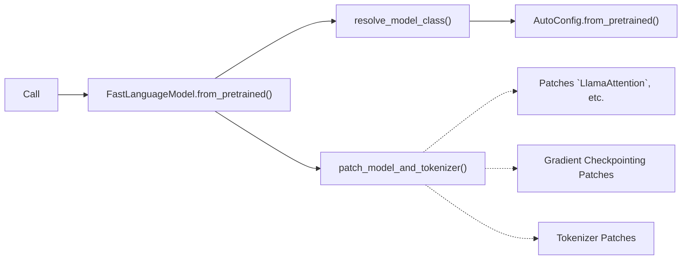

This flow ensures correct dispatcher selection, hardware compatibility, and model precision settings while connecting to Unsloth's fast kernels and gradient checkpointing [unsloth/models/_utils.py:147-182](), [unsloth/models/loader.py:100-120]().

#### 3. Custom Kernels

Unsloth implements hand-optimized Triton kernels replacing standard PyTorch operations to reduce training memory overhead and increase throughput.

- Cross-entropy loss fused with output linear layers (`unsloth_fused_ce_loss`) [unsloth/models/_utils.py:162-166]()
- Fast 4-bit weight dequantization for model merging and inference (`fast_dequantize`) [unsloth/save.py:58-65]()
- LayerNorm, RoPE, and attention fused kernel patches [unsloth/models/_utils.py:147-154]()

These kernels are automatically enabled when the hardware supports Triton or compatible environments and are integrated seamlessly into the core model forward and backward passes [unsloth/models/_utils.py:167-172]().

**Sources:** [unsloth/models/loader.py:78-120](), [unsloth/models/_utils.py:147-182](), [unsloth/save.py:58-65]()

---

### Studio Backend (AGPLv3)

The Studio Backend serves as the orchestration layer behind the Studio UI and CLI commands, implementing subprocess-based isolation for heavy ML tasks to avoid dependency conflicts:

- **FastAPI server** exposes HTTP APIs [pyproject.toml:108-111]().
- **Orchestrators** manage subprocess workers for **Training**, **Inference**, and **Export** — isolating environments for different Transformers versions or hardware drivers [unsloth/models/loader.py:78-93]().
- Uses **SQLite** storage for persistent training history and authentication.
- Hardware-aware initialization detects available GPUs (NVIDIA, AMD, Apple Silicon) and assigns workers accordingly [unsloth/models/_utils.py:126-136]().
- Supports advanced workflows including diffusion LoRA fine-tuning, GGUF export integration, and secure token-based user authentication [unsloth/save.py:18-25]().

This backend architecture is crucial for enabling complex tooling without breaking dependency or environment isolation for the core library [unsloth/models/loader.py:75-93](), [unsloth/save.py:10-24]().

---

## Model Support and Quantization Routing

Unsloth maintains an extensible registry to handle advanced scenarios like model name remapping, precision overrides, and attention implementation control. This enables transparent support for a wide range of LLM architectures and quantization schemes:

| Mechanism                      | Code Entity                          | Description                                                       |
|-------------------------------|-------------------------------------|------------------------------------------------------------------|
| **Name Mapping**               | `INT_TO_FLOAT_MAPPER`                | Redirects 4-bit quantized model names to original full precision parent models [unsloth/models/mapper.py:20-160]() |
| **Float32 Enforcement**       | `FORCE_FLOAT32` list                 | Explicitly forces FP32 precision for fragile models like Gemma4, Qwen3.5 for training stability [unsloth/models/loader.py:117-134]() |
| **Attention Disabling Names** | `DISABLE_SDPA_MODEL_NAMES`           | Lists model names that disable SDPA (Scaled Dot Product Attention) due to incompatibility [unsloth/models/loader.py:27-28]() |
| **Version Feature Flags**     | `SUPPORTS_LLAMA31`, `SUPPORTS_GEMMA`, etc. | Conditional imports and feature activation depending on Transformers version [unsloth/models/loader.py:78-90]() |

This allows Unsloth to select optimized code paths transparently, including choosing between custom fused attention kernels, standard implementations, or external backends like xFormers depending on model and platform.

---

## Summary of Typical Workflows

### Direct Core Library Usage

1. **Model Loading**  
   Users instantiate language or vision models using `FastLanguageModel.from_pretrained()` or `FastVisionModel.from_pretrained()`, which detect model types and apply all relevant patches and optimizations [unsloth/models/loader.py:30-35](), [unsloth/models/vision.py:123-125]().

2. **Training Setup**  
   The core library prepares models for fine-tuning by integrating PEFT LoRA adapters using `get_peft_model()` with patches for fast inference and customized training loops [unsloth/models/llama.py:112-136]().

3. **Inference**  
   Calling `FastLanguageModel.for_inference()` turns off gradients, enables fast KV cache management, and configures Triton kernels for efficient autoregressive generation [unsloth/models/rl.py:140-200]().

4. **Reinforcement Learning**  
   A specialized wrapper `PatchRL` modifies TRL trainers to leverage Unsloth's fast generation and memory management strategies, supporting GRPO/DPO/PPO algorithms with vLLM integration [unsloth/models/rl.py:130-210]().

---

### Model Persistence and Export

Unsloth supplies tailored saving and exporting capabilities, supporting LoRA merging, model checkpoints, and the emerging GGUF quantized format:

- `unsloth_save_model()` handles saving models with LoRA weights, merging 4-bit and 16-bit adapters with core weights safely [unsloth/save.py:88-115]().
- `save_to_gguf()` converts and exports models in GGUF format suitable for llama.cpp and compatible runners [unsloth/save.py:90-125]().
- `patch_saving_functions()` modifies HuggingFace models' `save_pretrained()` to include Unsloth metadata for compatibility [unsloth/save.py:80-89]().

---

# Summary

Unsloth is architected to balance high-performance, flexible ML optimization under an Apache 2.0 core, and user-friendly, feature-rich management through AGPLv3-licensed Studio frontends and backends. Its modular design embraces hardware heterogeneity, multiple Transformers versions, and evolving quantization standards, providing a unified system for fast LLM and multimodal model training and deployment.

# Appendix: Bridging Natural Language Components to Key Code Entities

## Diagram: Natural Language Components to Code Entities - Core Library Side

```mermaid
graph LR
    "Unsloth Core Library":::core
    "Model Loaders":::component
    "Patching System":::component
    "Custom Kernels":::component

    unsloth_models_loader_FastLanguageModel["FastLanguageModel\n`unsloth.models.loader.FastLanguageModel`"]:::code
    unsloth_models_vision_FastVisionModel["FastVisionModel\n`unsloth.models.vision.FastVisionModel`"]:::code
    patch_model_and_tokenizer["patch_model_and_tokenizer\n`unsloth.models._utils.patch_model_and_tokenizer`"]:::code
    unsloth_fused_ce_loss["unsloth_fused_ce_loss\n`unsloth.models._utils.unsloth_fused_ce_loss`"]:::code

    "Unsloth Core Library" --> "Model Loaders"
    "Unsloth Core Library" --> "Patching System"
    "Unsloth Core Library" --> "Custom Kernels"

    "Model Loaders" --> unsloth_models_loader_FastLanguageModel
    "Model Loaders" --> unsloth_models_vision_FastVisionModel
    "Patching System" --> patch_model_and_tokenizer
    "Custom Kernels" --> unsloth_fused_ce_loss

    classDef core fill:#f4f4f4,stroke:#000,stroke-width:1px;
    classDef component fill:#eaeaea,stroke:#000,stroke-width:1px;
    classDef code fill:#fff,stroke:#000,stroke-width:1px,font-family:monospace;
```

## Diagram: Natural Language Components to Code Entities – Studio Backend and UI Side

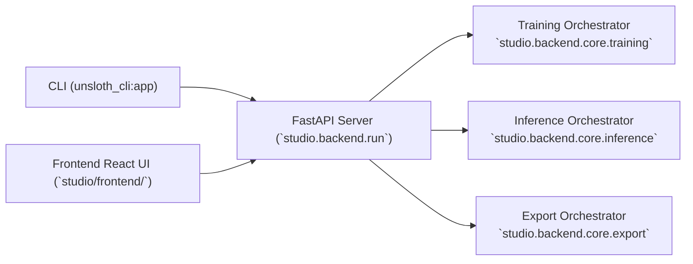

---

**Sources:**  
- [unsloth/__init__.py:15-166]()  
- [unsloth/models/_utils.py:1-182]()  
- [unsloth/models/loader.py:1-150]()  
- [unsloth/models/vision.py:115-125]()  
- [unsloth/models/llama.py:1-202]()  
- [unsloth/models/rl.py:1-198]()  
- [unsloth/save.py:1-190]()  
- [pyproject.toml:5-138]()  
- [README.md:8-161]()

---

# Page: Getting Started

# Getting Started

<details>
<summary>Relevant source files</summary>

The following files were used as context for generating this wiki page:

- [install.ps1](install.ps1)
- [install.sh](install.sh)
- [studio/backend/tests/test_update_flow_messages.py](studio/backend/tests/test_update_flow_messages.py)
- [studio/install_llama_prebuilt.py](studio/install_llama_prebuilt.py)
- [studio/install_python_stack.py](studio/install_python_stack.py)
- [studio/setup.ps1](studio/setup.ps1)
- [studio/setup.sh](studio/setup.sh)
- [tests/sh/test_get_torch_index_url.sh](tests/sh/test_get_torch_index_url.sh)
- [tests/studio/install/smoke_test_llama_prebuilt.py](tests/studio/install/smoke_test_llama_prebuilt.py)
- [tests/studio/install/test_download_host_resolve.py](tests/studio/install/test_download_host_resolve.py)
- [tests/studio/install/test_install_llama_prebuilt_logic.py](tests/studio/install/test_install_llama_prebuilt_logic.py)
- [tests/studio/install/test_llama_pr_force_and_source.py](tests/studio/install/test_llama_pr_force_and_source.py)
- [tests/studio/install/test_pr4562_bugfixes.py](tests/studio/install/test_pr4562_bugfixes.py)
- [tests/studio/install/test_rocm_support.py](tests/studio/install/test_rocm_support.py)
- [tests/studio/install/test_selection_logic.py](tests/studio/install/test_selection_logic.py)

</details>


This page provides a high-level introduction to setting up and using Unsloth, including installation approaches and initial usage for both the core library and the Studio/CLI tools. Detailed step-by-step instructions and troubleshooting are covered in child pages to keep this overview focused and clear.

---

## Prerequisites and System Requirements

Unsloth requires a compatible software and hardware environment to enable its fast training and inference capabilities. Key requirements and environment setup take place automatically when the package is imported [unsloth/__init__.py:15-82]().

- **Python Version:** Supported versions are 3.9 through 3.14 inclusive, enforced by pyproject.toml and runtime checks.
- **PyTorch Version:** Requires at least 2.0, with 2.2 or newer recommended to gain features like expandable KV cache essential for some optimizations [unsloth/models/_utils.py:113-130]().
- **Unsloth Zoo Package:** This is required for core kernel implementations and RL training patches [pyproject.toml:146]().
- **Hardware Acceleration:** Detects and supports NVIDIA CUDA GPUs, AMD GPUs via ROCm/HIP, Apple Silicon GPUs (MLX), and Intel GPUs with XPU support [unsloth/device_type.py:130-136](), [unsloth/__init__.py:127-146]().

Unsloth automatically selects device-specific kernels and runtime compilation strategies to maximize performance [unsloth/models/_utils.py:148-182]().

---

## Installation and Dependencies Overview

Unsloth offers flexible installation pathways to suit different use cases: either installing only the core Python library or the full Studio and CLI tooling suite.

### Core Library Installation

Ideal for developers integrating Unsloth models directly into custom Python applications or scripts.

- Install via PyPI with essential extras for huggingface compatibility but not the Studio UI:
  
  ```bash
  pip install unsloth[huggingfacenotorch]
  ```

- Dependencies and optional features (such as Studio, Triton kernels, or audio support) are managed via `pyproject.toml` [pyproject.toml:102-186]().

- For detailed dependency setup, handling CUDA/ROCm support, and virtual environment management, see the dedicated child page: [Installation and Dependencies](#2.1).

### Studio and CLI Installation

The Studio provides a web UI and CLI commands to manage training, inference, and model export workflows.

- Installation is recommended via the provided install scripts, which configure isolated Python environments, manage prebuilt binaries (especially for llama.cpp backends), and resolve platform-specific dependency challenges automatically [README.md:106-148]().

- **Linux/macOS/WSL:**

  ```bash
  curl -fsSL https://unsloth.ai/install.sh | sh
  ```
  
  The `install.sh` script handles options through environment variables and command-line flags, sets up Python paths, and manages CUDA or ROCm version probes [install.sh:1-162]().

- **Windows PowerShell:**

  ```powershell
  irm https://unsloth.ai/install.ps1 | iex
  ```
  
  The `install.ps1` script performs PowerShell-specific setup such as proxy configuration handoffs and manages required runtime components for Windows installs [install.ps1:16-115]().

For full instructions, advanced options, and manual install alternatives refer to [Installation and Dependencies](#2.1).

---

## Quick Start with the Core Library

Unsloth's core library focuses on providing accelerated model loading, training, and inference through patched classes like `FastLanguageModel` and `FastVisionModel`.

### Basic Model Loading Example

Load a language model with quantization and tailored sequence length via `FastLanguageModel.from_pretrained`:

```python
from unsloth import FastLanguageModel

model, tokenizer = FastLanguageModel.from_pretrained(
    model_name = "unsloth/llama-3-8b-bnb-4bit",
    max_seq_length = 2048,
    load_in_4bit = True,
)
```

This triggers Unsloth's automatic patching and optimization layers [unsloth/models/loader.py:101-120]().

### LoRA Adapter Setup for Training

Unsloth includes a helper to wrap a model with LoRA adapters, supporting optimized gradient checkpointing strategies:

```python
model = FastLanguageModel.get_peft_model(
    model,
    r = 16,
    target_modules = ["q_proj", "k_proj", "v_proj", "o_proj"],
    lora_alpha = 16,
    lora_dropout = 0,
    bias = "none",
    use_gradient_checkpointing = "unsloth",
)
```

Refer to [Quick Start: Core Library](#2.2) for additional training and inference scenarios.

---

## Quick Start with Studio and CLI

Unsloth Studio delivers an integrated web UI and CLI for streamlined workflows around training, inference, and export.

### Launch the Studio Web UI

Once installed, start the Studio frontend through the CLI:

```bash
unsloth studio
```

The CLI dispatches to the backend API and manages the model training and inference subprocesses [pyproject.toml:40-45]().

### Studio Architecture: Bridge from Concepts to Code

The following diagram maps user-facing concepts in the Studio system to their corresponding Python modules and entities in the codebase:

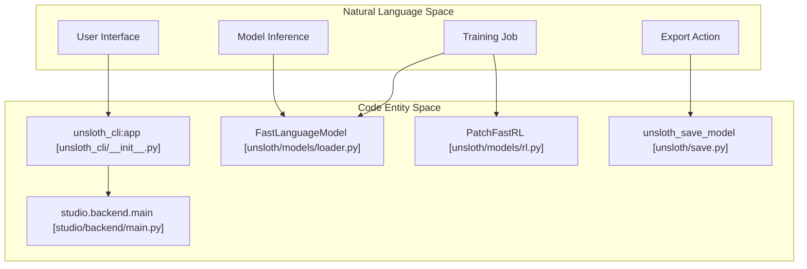

This visualization clarifies interaction flow and how commands translate into library actions.

---

## Environment Initialization Flow

At import time, Unsloth runs environment detection and patches dependent libraries to ensure smooth GPU use and runtime compatibility.

### Initialization Sequence Diagram

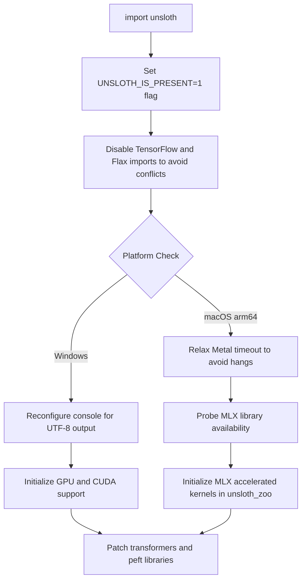

This flow sets up internal state, detects hardware, and applies runtime patches crucial for optimized execution [unsloth/__init__.py:15-146]().

---

## Next Steps

- For comprehensive installation instructions, system dependency management, and environment setup including CUDA/ROCm details, proceed to [Installation and Dependencies](#2.1).
- To explore example code and quick-start tutorials using `FastLanguageModel` and `FastVisionModel`, continue with [Quick Start: Core Library](#2.2).
- For full Studio and CLI operational guidance with examples of launching the UI and running commands, see [Quick Start: Studio and CLI](#2.3).

---

**Sources:**  
[unsloth/__init__.py:1-175](),  
[unsloth/models/loader.py:1-135](),  
[unsloth/models/_utils.py:15-182](),  
[install.sh:1-162](),  
[install.ps1:16-115](),  
[pyproject.toml:1-186](),  
[unsloth_cli/__init__.py:20-50](),  
[unsloth/models/rl.py:13-160](),  
[unsloth/save.py:92-98](),  
[README.md:100-170]()

---

# Page: Installation and Dependencies

# Installation and Dependencies

<details>
<summary>Relevant source files</summary>

The following files were used as context for generating this wiki page:

- [.github/scripts/assert-nobuild.ps1](.github/scripts/assert-nobuild.ps1)
- [.github/scripts/clean-machine-assert.sh](.github/scripts/clean-machine-assert.sh)
- [.github/scripts/clean-machine-env.sh](.github/scripts/clean-machine-env.sh)
- [.github/scripts/clean-machine-install-name-tool.sh](.github/scripts/clean-machine-install-name-tool.sh)
- [.github/scripts/ensure-docker-daemon.ps1](.github/scripts/ensure-docker-daemon.ps1)
- [.github/scripts/virgin-windows-install.ps1](.github/scripts/virgin-windows-install.ps1)
- [.github/scripts/virgin-windows-probe.ps1](.github/scripts/virgin-windows-probe.ps1)
- [.github/workflows/clean-machine-install-ci.yml](.github/workflows/clean-machine-install-ci.yml)
- [install.ps1](install.ps1)
- [install.sh](install.sh)
- [studio/backend/requirements/extras-no-deps.txt](studio/backend/requirements/extras-no-deps.txt)
- [studio/backend/requirements/extras.txt](studio/backend/requirements/extras.txt)
- [studio/backend/requirements/no-torch-runtime.txt](studio/backend/requirements/no-torch-runtime.txt)
- [studio/backend/requirements/overrides.txt](studio/backend/requirements/overrides.txt)
- [studio/backend/requirements/single-env/constraints.txt](studio/backend/requirements/single-env/constraints.txt)
- [studio/backend/requirements/single-env/overrides-darwin-arm64.txt](studio/backend/requirements/single-env/overrides-darwin-arm64.txt)
- [studio/backend/requirements/studio.txt](studio/backend/requirements/studio.txt)
- [studio/backend/requirements/triton-kernels.txt](studio/backend/requirements/triton-kernels.txt)
- [studio/backend/tests/test_mcp_training_start_guard.py](studio/backend/tests/test_mcp_training_start_guard.py)
- [studio/backend/tests/test_torchao_select.py](studio/backend/tests/test_torchao_select.py)
- [studio/backend/tests/test_training_streaming.py](studio/backend/tests/test_training_streaming.py)
- [studio/backend/tests/test_update_flow_messages.py](studio/backend/tests/test_update_flow_messages.py)
- [studio/install_llama_prebuilt.py](studio/install_llama_prebuilt.py)
- [studio/install_python_stack.py](studio/install_python_stack.py)
- [studio/setup.ps1](studio/setup.ps1)
- [studio/setup.sh](studio/setup.sh)
- [tests/python/test_install_python_stack.py](tests/python/test_install_python_stack.py)
- [tests/python/test_tokenizers_and_torch_constraint.py](tests/python/test_tokenizers_and_torch_constraint.py)
- [tests/python/test_torchcodec_torch_compat.py](tests/python/test_torchcodec_torch_compat.py)
- [tests/sh/test_clean_machine_install_name_tool_assert.sh](tests/sh/test_clean_machine_install_name_tool_assert.sh)
- [tests/sh/test_get_torch_index_url.sh](tests/sh/test_get_torch_index_url.sh)
- [tests/sh/test_install_python_guard.sh](tests/sh/test_install_python_guard.sh)
- [tests/sh/test_linux_uv_python_downloads_manual.sh](tests/sh/test_linux_uv_python_downloads_manual.sh)
- [tests/sh/test_mac_intel_compat.sh](tests/sh/test_mac_intel_compat.sh)
- [tests/sh/test_macos_clt_gate.sh](tests/sh/test_macos_clt_gate.sh)
- [tests/sh/test_macos_uv_install_name_tool_guard.sh](tests/sh/test_macos_uv_install_name_tool_guard.sh)
- [tests/sh/test_macos_venv_python_preference.sh](tests/sh/test_macos_venv_python_preference.sh)
- [tests/sh/test_torch_constraint.sh](tests/sh/test_torch_constraint.sh)
- [tests/studio/install/smoke_test_llama_prebuilt.py](tests/studio/install/smoke_test_llama_prebuilt.py)
- [tests/studio/install/test_cuda_repair.py](tests/studio/install/test_cuda_repair.py)
- [tests/studio/install/test_download_host_resolve.py](tests/studio/install/test_download_host_resolve.py)
- [tests/studio/install/test_install_llama_prebuilt_logic.py](tests/studio/install/test_install_llama_prebuilt_logic.py)
- [tests/studio/install/test_llama_pr_force_and_source.py](tests/studio/install/test_llama_pr_force_and_source.py)
- [tests/studio/install/test_pr4562_bugfixes.py](tests/studio/install/test_pr4562_bugfixes.py)
- [tests/studio/install/test_pr5940_followups.py](tests/studio/install/test_pr5940_followups.py)
- [tests/studio/install/test_rocm_support.py](tests/studio/install/test_rocm_support.py)
- [tests/studio/install/test_selection_logic.py](tests/studio/install/test_selection_logic.py)
- [tests/studio/install/test_windows_torch_flavor_invariant.py](tests/studio/install/test_windows_torch_flavor_invariant.py)
- [tests/studio/test_xpu_triton_swap.py](tests/studio/test_xpu_triton_swap.py)
- [tests/test_studio_install_workspace_guard.py](tests/test_studio_install_workspace_guard.py)

</details>


This page covers the installation procedures and dependency requirements for Unsloth, including setup scripts (`install.sh`, `install.ps1`, `studio/setup.sh`, `studio/setup.ps1`), dependency management layers, CUDA/ROCm hardware requirements, and virtual environment configuration.

## Purpose and Scope

Unsloth uses dedicated setup scripts and cross-platform Python installers to handle everything from bootstrapping virtual environments to detecting GPU architectures (NVIDIA CUDA, AMD ROCm, or CPU-only) and fetching compatible binary wheels and `llama.cpp` prebuilt backends.

Sources: [install.sh:1-162](), [install.ps1:1-115](), [studio/setup.sh:1-25](), [studio/setup.ps1:1-72](), [studio/install_python_stack.py:1-73]()

---

## Automated Installation Scripts

Unsloth provides platform-specific wrapper scripts that invoke python stack installers.

### Unix Shell Script (`install.sh` / `studio/setup.sh`)

- `install.sh` sets up environment variables, parses flags like `--local`, `--no-torch`, `--python`, and `--isolated-uv-cache`, and prioritizes installation roots (`UNSLOTH_STUDIO_HOME` > `STUDIO_HOME` > `$HOME/.unsloth/studio`) [install.sh:35-82]().
- `studio/setup.sh` handles repository-level bootstrapping, supports local repository overlays via `--local`, and configures maintainer defaults such as `_DEFAULT_LLAMA_TAG` [studio/setup.sh:11-48]().

```bash
# Web install script:
curl -fsSL https://unsloth.ai/install.sh | sh

# Local development install:
./install.sh --local
```

Sources: [install.sh:35-109](), [studio/setup.sh:11-48]()

### Windows PowerShell Script (`install.ps1` / `studio/setup.ps1`)

- `install.ps1` preserves corporate proxy configurations (`_UnslothKeptDefaults`), manages PowerShell 5.1 module loading by rearranging `$env:PSModulePath`, and suppresses progress bars to speed up downloads (`$ProgressPreference = 'SilentlyContinue'`) [install.ps1:37-115]().
- `studio/setup.ps1` handles Windows PowerShell execution invariants, sets UTF-8 encoding outputs, and orchestrates `studio/install_python_stack.py` [studio/setup.ps1:62-99]().

```powershell
# Windows PowerShell web install:
irm https://unsloth.ai/install.ps1 | iex
```

Sources: [install.ps1:37-115](), [studio/setup.ps1:62-99]()

---

## Dependency Management and Requirements Layers

Unsloth splits its dependencies across modular requirement files to handle different execution profiles (e.g., full PyTorch training vs. GGUF-only inference modes).

| Requirements File | Role | Notable Packages / Highlights |
|-------------------|------|-------------------------------|
| `no-torch-runtime.txt` | Runtime dependencies for CPU-only or GGUF mode | `typer`, `pydantic`, `huggingface_hub`, `transformers` [studio/backend/requirements/no-torch-runtime.txt:9-50]() |
| `extras-no-deps.txt` | Audio extras and specific library pins | `peft==0.18.1`, `trl==0.23.1`, `sentence_transformers` [studio/backend/requirements/extras-no-deps.txt:1-44]() |
| `studio.txt` | Studio backend UI requirements | `fastapi`, `uvicorn`, `pydantic`, `sqlite-vec` [studio/backend/requirements/studio.txt:1-55]() |

Sources: [studio/backend/requirements/no-torch-runtime.txt:1-109](), [studio/backend/requirements/extras-no-deps.txt:1-47](), [studio/backend/requirements/studio.txt:1-63]()

## Hardware Requirements and Architecture Detection

### CUDA and NVIDIA GPU Detection

- The `install_python_stack.py` script probes host environments to match PyTorch wheels with CUDA driver versions [studio/install_python_stack.py:46-48]().
- Pre-Turing hardware limitations and compatibility flags are handled during wheel resolution.

Sources: [studio/install_python_stack.py:42-50]()

### AMD ROCm GPU Support

- `install_python_stack.py` inspects host ROCm versions using `_detect_rocm_version()` against indices like `_ROCM_TORCH_INDEX` [studio/install_python_stack.py:91-108]().
- Legacy hardware such as MI50 / Radeon VII (`gfx906`) is explicitly mapped to older compatible tags (`_GFX906_LEGACY_TAG = "rocm6.3"`) due to kernel limitations [studio/install_python_stack.py:126-139]().
- The `install_llama_prebuilt.py` script manages precompiled binary artifacts for upstream and fork bundles, matching targets like `WINDOWS_HIP_PREBUILT_GFX_TARGETS` [studio/install_llama_prebuilt.py:88-105]().

Sources: [studio/install_python_stack.py:90-163](), [studio/install_llama_prebuilt.py:88-155](), [tests/studio/install/test_rocm_support.py:55-63]()

---

## Virtual Environment Configuration

Unsloth installs all components inside an isolated Python virtual environment managed under the studio root directory (`~/.unsloth/studio` on Linux/macOS and `$USERPROFILE\.unsloth\studio` on Windows) [install.sh:16](), [install.ps1:12]().

### Diagram: Installation and Dependency Resolution Pipeline

Title: "Unsloth Installation and Dependency Flow"

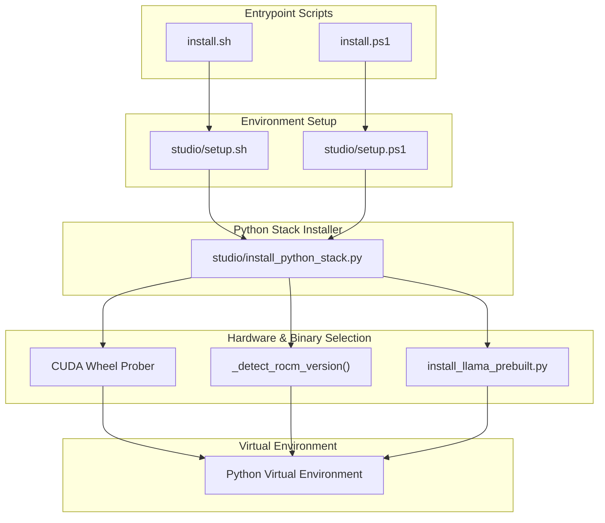

Sources: [install.sh:1-109](), [install.ps1:1-115](), [studio/setup.sh:1-25](), [studio/setup.ps1:1-72](), [studio/install_python_stack.py:1-73](), [studio/install_llama_prebuilt.py:5-65]()

---

## References

- `install.sh`
- `install.ps1`
- `studio/setup.sh`
- `studio/setup.ps1`
- `studio/install_python_stack.py`
- `studio/install_llama_prebuilt.py`
- `studio/backend/requirements/no-torch-runtime.txt`
- `studio/backend/requirements/extras-no-deps.txt`
- `studio/backend/requirements/studio.txt`

Sources: [install.sh:1-162](), [install.ps1:1-115](), [studio/setup.sh:1-48](), [studio/setup.ps1:1-99](), [studio/install_python_stack.py:1-163](), [studio/install_llama_prebuilt.py:1-192](), [studio/backend/requirements/no-torch-runtime.txt:1-109](), [studio/backend/requirements/extras-no-deps.txt:1-47](), [studio/backend/requirements/studio.txt:1-63]()

---

# Page: Quick Start: Core Library

# Quick Start: Core Library

<details>
<summary>Relevant source files</summary>

The following files were used as context for generating this wiki page:

- [README.md](README.md)
- [pyproject.toml](pyproject.toml)
- [studio/backend/tests/test_response_template_markers.py](studio/backend/tests/test_response_template_markers.py)
- [studio/backend/utils/datasets/model_mappings.py](studio/backend/utils/datasets/model_mappings.py)
- [tests/python/test_construct_chat_template_validation.py](tests/python/test_construct_chat_template_validation.py)
- [tests/test_fp8_pre_sm89_dequant_fallback.py](tests/test_fp8_pre_sm89_dequant_fallback.py)
- [tests/test_generation_failure_is_visible.py](tests/test_generation_failure_is_visible.py)
- [tests/test_import_fixes_drift.py](tests/test_import_fixes_drift.py)
- [tests/test_rl_config_compat.py](tests/test_rl_config_compat.py)
- [tests/test_warnings_issued_guard.py](tests/test_warnings_issued_guard.py)
- [tests/utils/test_attention_dispatch_dora_dtype.py](tests/utils/test_attention_dispatch_dora_dtype.py)
- [tests/utils/test_attention_masks.py](tests/utils/test_attention_masks.py)
- [tests/utils/test_packing.py](tests/utils/test_packing.py)
- [unsloth/__init__.py](unsloth/__init__.py)
- [unsloth/_gpu_init.py](unsloth/_gpu_init.py)
- [unsloth/chat_templates.py](unsloth/chat_templates.py)
- [unsloth/import_fixes.py](unsloth/import_fixes.py)
- [unsloth/kernels/fp8.py](unsloth/kernels/fp8.py)
- [unsloth/models/_utils.py](unsloth/models/_utils.py)
- [unsloth/models/llama.py](unsloth/models/llama.py)
- [unsloth/models/loader.py](unsloth/models/loader.py)
- [unsloth/models/loader_utils.py](unsloth/models/loader_utils.py)
- [unsloth/models/mapper.py](unsloth/models/mapper.py)
- [unsloth/models/mistral.py](unsloth/models/mistral.py)
- [unsloth/models/rl.py](unsloth/models/rl.py)
- [unsloth/models/rl_config_compat.py](unsloth/models/rl_config_compat.py)
- [unsloth/models/rl_replacements.py](unsloth/models/rl_replacements.py)
- [unsloth/models/vision.py](unsloth/models/vision.py)
- [unsloth/ollama_template_mappers.py](unsloth/ollama_template_mappers.py)
- [unsloth/save.py](unsloth/save.py)
- [unsloth/tokenizer_utils.py](unsloth/tokenizer_utils.py)
- [unsloth/trainer.py](unsloth/trainer.py)
- [unsloth/utils/attention_dispatch.py](unsloth/utils/attention_dispatch.py)
- [unsloth/utils/packing.py](unsloth/utils/packing.py)

</details>


This page provides practical code examples for quickly getting started with Unsloth's core library. It focuses on the primary APIs to load and use language and vision models, run parameter-efficient fine-tuning (LoRA), perform training, and generate text, illustrating the key classes and data flow.

## Scope and Purpose

The purpose of this page is to demonstrate how to:

- Load language models via `FastLanguageModel`.
- Load vision-language models via `FastVisionModel`.
- Apply LoRA (Low-Rank Adaptation) adapters for parameter-efficient fine-tuning.
- Set up basic supervised fine-tuning training.
- Perform inference efficiently, including integration with vLLM fast generation.

This page targets developers and ML engineers aiming to leverage Unsloth's performance-optimized model support and training pipelines via direct code usage.

---

## 1. Basic Model Loading

### FastLanguageModel.from_pretrained()

The primary interface for loading LLMs is the `FastLanguageModel` class method `from_pretrained()`. It extends the HuggingFace `transformers` loading pattern but adds:
- Model architecture detection and dispatch,
- Support for quantized weights (e.g., 4-bit via BitsAndBytes),
- Integration with Unsloth internal optimizations and patches.

Under the hood, `from_pretrained()` calls `AutoConfig.from_pretrained()` to detect the `model_type` from the model config and dispatches model loading to specialized classes such as `FastLlamaModel`, `FastMistralModel`, `FastGemmaModel`, and others.

### FastVisionModel.from_pretrained()

For vision-language models (VLMs), use `FastVisionModel.from_pretrained()`. This delegates similarly to specialized vision-compatible model loaders or a base vision model. On Apple Silicon platforms, this call passes through MLX-specific loaders for hardware compatibility.

### Diagram: "FastLanguageModel and FastVisionModel Loading Dispatch"

```mermaid
flowchart TB
  U["User Code"]

  subgraph LoaderModule["unsloth/models/loader.py"]
    FLM["FastLanguageModel.from_pretrained()"]
    AutoCfg["AutoConfig.from_pretrained()"]
    Detect["Detect model_type"]

    FLM --> AutoCfg --> Detect

    subgraph Dispatch["Dispatch by model_type"]
      Llama["FastLlamaModel"]
      Mistral["FastMistralModel"]
      Gemma["FastGemmaModel"]
      Gemma2["FastGemma2Model"]
      Qwen2["FastQwen2Model"]
      Qwen3["FastQwen3Model"]
      Qwen3Moe["FastQwen3MoeModel"]
      Granite["FastGraniteModel"]
      FalconH1["FastFalconH1Model"]
      Fallback["FastModel (generic base)"]
    end

    Detect --> Llama
    Detect --> Mistral
    Detect --> Gemma
    Detect --> Gemma2
    Detect --> Qwen2
    Detect --> Qwen3
    Detect --> Qwen3Moe
    Detect --> Granite
    Detect --> FalconH1
    Detect --> Fallback
  end

  subgraph VisionModule["unsloth/models/vision.py"]
    FVM["FastVisionModel.from_pretrained()"]
    BaseVis["FastBaseModel"]
  end

  Fallback --> BaseVis
  FVM --> BaseVis

  U --> FLM
  U --> FVM

  FLM -.->() "returns (model, tokenizer)"
  FVM -.->() "returns (model, tokenizer)"
```

---

### Model Dispatch Details:

| `model_type` (config) | Loaded Class / Module Path |
|-----------------------|---------------------------|
| `llama`               | `FastLlamaModel` ([unsloth/models/loader.py:26]()) |
| `mistral`             | `FastMistralModel` ([unsloth/models/loader.py:27]()) |
| `gemma`               | `FastGemmaModel` ([unsloth/models/loader.py:89]()) |
| `gemma2`              | `FastGemma2Model` ([unsloth/models/loader.py:91]()) |
| `qwen2`               | `FastQwen2Model` ([unsloth/models/loader.py:28]()) |
| `qwen3`               | `FastQwen3Model` ([unsloth/models/loader.py:29]()) |
| `qwen3_moe`           | `FastQwen3MoeModel` ([unsloth/models/loader.py:30]()) |
| `granite`             | `FastGraniteModel` ([unsloth/models/loader.py:25]()) |
| `falcon_h1`           | `FastFalconH1Model` ([unsloth/models/loader.py:93]()) |

---

## 2. Model Name Resolution and Quantized Mapping

Unsloth internally maps quantized model variants (e.g., 4-bit quantized suffixes) back to canonical floating-point model names to ensure compatibility with HuggingFace caches and weights.

The important dictionary is `INT_TO_FLOAT_MAPPER` defined in `unsloth/models/mapper.py`, which maps internal quantized names like `"unsloth/llama-3-8b-bnb-4bit"` to base models like `"meta-llama/Meta-Llama-3-8B"`.

The loader utility function `_strip_unsloth_bnb_4bit_suffix(model_name)` cleans the quantized suffix to locate the proper base.

### Example: Loading a Quantized LLM

```python
from unsloth import FastLanguageModel

model, tokenizer = FastLanguageModel.from_pretrained(
    "unsloth/llama-3-8b-bnb-4bit",
    max_seq_length=2048,
    load_in_4bit=True,
)
```

This method automatically resolves the mapped model, loads with quantization flags, and applies Unsloth patches.

---

## 3. Applying LoRA Adapters for Parameter-Efficient Fine-Tuning

Unsloth supports LoRA adapters via the `get_peft_model()` method on `FastLanguageModel`. This wraps the base HuggingFace model with LoRA modules via the `peft` library, adding efficient low-rank update layers.

Unsloth enhances this by:
- Automatically determining target layers if none specified,
- Supporting special training modes like gradient checkpointing,
- Applying fixes and patches for stable training.

### Diagram: "LoRA Adapter Setup Flow"

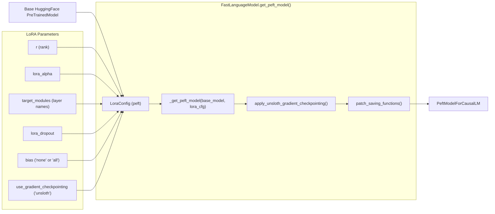

---

### Example: Applying LoRA to a Model

```python
from unsloth import FastLanguageModel

lora_model = FastLanguageModel.get_peft_model(
    model,
    r=16,
    target_modules=["q_proj", "k_proj", "v_proj", "o_proj", "gate_proj", "up_proj", "down_proj"],
    lora_alpha=16,
    lora_dropout=0.0,
    bias="none",
    use_gradient_checkpointing="unsloth",
    random_state=3407,
)
```

If `target_modules` is not explicitly provided, Unsloth attempts to auto-detect appropriate modules based on model architecture and special cases like mixture-of-experts models utilize `get_moe_target_modules()` to select expert layers.

---

## 4. Training with Unsloth Core Library

Unsloth integrates with popular HuggingFace style trainers and its own `SFTTrainer` for supervised fine-tuning (SFT). It supports LoRA training, gradient checkpointing, and mixed precision.

Example training setup:

```python
from trl import SFTTrainer, SFTConfig
from datasets import load_dataset
import torch

dataset = load_dataset("philschmid/dolly-15k-filtered-top-200", split="train")

trainer = SFTTrainer(
    model=model,
    train_dataset=dataset,
    dataset_text_field="text",
    max_seq_length=2048,
    tokenizer=tokenizer,
    args=SFTConfig(
        per_device_train_batch_size=2,
        gradient_accumulation_steps=4,
        warmup_steps=5,
        max_steps=60,
        learning_rate=2e-4,
        fp16=not torch.cuda.is_bf16_supported(),
        bf16=torch.cuda.is_bf16_supported(),
        logging_steps=1,
        optim="adamw_8bit",
        output_dir="outputs",
    ),
)

trainer.train()
```

During SFT model loading and training initialization, Unsloth applies patches and fixes such as `sft_trainer_fix_untrained_tokens` that ensure proper handling of new tokens in embeddings [unsloth/models/rl_replacements.py:136-155]().

---

## 5. Inference Using Unsloth

Unsloth supports both standard HuggingFace generation and a fast optimized generation mode.

- **Standard generation** uses the usual `model.generate()` method.
- **Fast inference** activates pipeline optimizations and vLLM integration.

Before inference, call `FastLanguageModel.for_inference(model)` to prepare the model (disable training-only logic, enable inference mode kernels).

### Example: Standard and Fast Generation

```python
from unsloth import FastLanguageModel

# Prepare model for optimized inference
FastLanguageModel.for_inference(model)

# Tokenize prompts
inputs = tokenizer(["The capital of France is"], return_tensors="pt").to("cuda")

# Standard HF generation
outputs = model.generate(**inputs, max_new_tokens=64)
print(tokenizer.batch_decode(outputs))

# Fast generation (requires fast_inference=True on model load)
outputs_fast = model.fast_generate(
    ["The capital of France is"],
    max_tokens=64,
)
print(outputs_fast)
```

The fast generation method provides significant speed improvements on supported hardware and model types by leveraging Unsloth’s custom kernels and vLLM's optimized engine.

---

## 6. Data Flow: From Natural Language to Model Execution

This diagram shows the end-to-end data flow involving tokenization, model wrapping, training, and inference.


---

## 7. Bridging Concepts: API and Code Entities

### Diagram: "Natural Language Space to Core Library Class Mapping"

```mermaid
flowchart TB
  NL["Natural Language Prompt"]

  subgraph Models["Model Interfaces"]
    FLM["FastLanguageModel"]
    FVM["FastVisionModel"]
  end

  subgraph Trainers["Training Components"]
    SFT["SFTTrainer"]
    GRPO["GRPOTrainer / RL Trainers"]
  end

  subgraph PEFT["LoRA Adapter"]
    PEFTGet["get_peft_model()"]
  end

  NL --> FLM
  NL --> FVM
  FLM --> PEFTGet
  PEFTGet --> SFT
  PEFTGet --> GRPO
  SFT --> "Model Training"
  GRPO --> "RL Training"
```

### Diagram: "Core Library Loading Pipeline Components"

```mermaid
flowchart TB
  User["User Script"]

  subgraph LoaderMethods["unsloth/models/loader.py"]
    FLMload["FastLanguageModel.from_pretrained()"]
    DetectType["AutoConfig.model_type detection"]
    Dispatch["Dispatch to FastLlamaModel etc."]
    Mapper["INT_TO_FLOAT_MAPPER\n(unsloth/models/mapper.py)"]
    Utils["_strip_unsloth_bnb_4bit_suffix()"]
  end

  User --> FLMload --> DetectType --> Dispatch
  FLMload --> Mapper
  FLMload --> Utils
  Dispatch --> "Model with Unsloth patches\n(model, tokenizer)"
```

---

## 8. Summary of Key Classes and Methods

| Class / Method                 | Description                                        | Source / Location                           |
|-------------------------------|--------------------------------------------------|---------------------------------------------|
| `FastLanguageModel.from_pretrained()` | Load language model with Unsloth enhancements    | [unsloth/models/loader.py:26-35]()           |
| `FastVisionModel.from_pretrained()`   | Load vision-language model                        | [unsloth/models/vision.py:124-125]()          |
| `FastLanguageModel.get_peft_model()`  | Apply LoRA adapters to a base model               | [unsloth/models/llama.py:130-140]()           |
| `SFTTrainer`                       | HuggingFace-derived supervised fine-tuning trainer | external (from `trl` training lib)          |
| `FastLanguageModel.for_inference()`   | Prepare model for inference mode                   | [unsloth/models/_utils.py:81-82]()            |
| `model.generate()`                  | HuggingFace standard text generation              | transformers                                  |
| `model.fast_generate()`             | Unsloth optimized fast generation                  | [unsloth/models/_utils.py:103-105]()          |

---

### FastLanguageModel.from_pretrained Parameters (Main)

| Parameter      | Type    | Default    | Description                                      |
|----------------|---------|------------|------------------------------------------------|
| `model_name`   | str     | Required   | Model repo name or path for pretrained weights |
| `max_seq_length` | int   | 2048       | Context window length                            |
| `load_in_4bit` | bool    | `True`    | Enable 4-bit quantized model loading             |
| `fast_inference` | bool  | `False`   | Enable vLLM-backed fast generation mode          |

### get_peft_model Parameters (Partial)

| Parameter              | Type    | Default   | Description                                   |
|------------------------|---------|-----------|-----------------------------------------------|
| `r`                    | int     | 16        | LoRA adapter rank                             |
| `target_modules`       | list    | None      | Layer names to apply LoRA adapters to        |
| `lora_alpha`           | int     | 16        | LoRA alpha scaling factor                      |
| `lora_dropout`         | float   | 0.0       | Dropout applied to LoRA adapters               |
| `bias`                 | str     | `'none'`  | Bias configuration (`'none'`, `'all'`, etc.)  |
| `use_gradient_checkpointing` | str | `"unsloth"` | Enables Unsloth memory-saving checkpointing |

---

# Conclusion

This page offers a concise technical introduction on the core library usage in Unsloth:

- `FastLanguageModel` and `FastVisionModel` are the main model interfaces.
- Model loading employs architecture dispatch and quantized model mapping.
- LoRA adapters enable efficient fine-tuning.
- Integration with trainers like `SFTTrainer` allows easy training loops.
- `for_inference()` prepares models for fast generation, optionally integrating with Unsloth's optimized vLLM inference.

For detailed model architecture internals, training workflows, inference optimizations, and export options, see their respective dedicated documentation pages.

---

# Sources

- [unsloth/models/loader.py:12-66]()
- [unsloth/models/llama.py:130-140]()
- [unsloth/models/_utils.py:75-108]()
- [unsloth/models/vision.py:124-125]()
- [unsloth/models/mapper.py:20-157]()
- [unsloth/models/rl_replacements.py:136-155]()
- [unsloth/models/rl.py:86-92]()
- [unsloth/save.py:88-90]()
- [unsloth/__init__.py:127-146]()
- [unsloth/models/_utils.py:81-83,103-107]()

---

# Page: Quick Start: Studio and CLI

# Quick Start: Studio and CLI

<details>
<summary>Relevant source files</summary>

The following files were used as context for generating this wiki page:

- [studio/Unsloth_Studio_Colab.ipynb](studio/Unsloth_Studio_Colab.ipynb)
- [studio/backend/auth/terminal_prompt.py](studio/backend/auth/terminal_prompt.py)
- [studio/backend/colab.py](studio/backend/colab.py)
- [studio/backend/core/inference/runtime_context.py](studio/backend/core/inference/runtime_context.py)
- [studio/backend/run.py](studio/backend/run.py)
- [studio/backend/state/tool_policy.py](studio/backend/state/tool_policy.py)
- [studio/backend/tests/test_change_password_policy.py](studio/backend/tests/test_change_password_policy.py)
- [studio/backend/tests/test_colab_embed.py](studio/backend/tests/test_colab_embed.py)
- [studio/backend/tests/test_conversation_search_safetensors_loop.py](studio/backend/tests/test_conversation_search_safetensors_loop.py)
- [studio/backend/tests/test_generation_budget.py](studio/backend/tests/test_generation_budget.py)
- [studio/backend/tests/test_password_prompt.py](studio/backend/tests/test_password_prompt.py)
- [studio/backend/tests/test_password_prompt_backstop.py](studio/backend/tests/test_password_prompt_backstop.py)
- [studio/backend/tests/test_secure_tunnel_gate.py](studio/backend/tests/test_secure_tunnel_gate.py)
- [studio/backend/tests/test_server_disk_logging_outstream.py](studio/backend/tests/test_server_disk_logging_outstream.py)
- [studio/backend/tests/test_tool_policy_gates.py](studio/backend/tests/test_tool_policy_gates.py)
- [studio/backend/tests/test_wildcard_prompt_compatibility.py](studio/backend/tests/test_wildcard_prompt_compatibility.py)
- [studio/frontend/src/features/settings/components/change-password-dialog.tsx](studio/frontend/src/features/settings/components/change-password-dialog.tsx)
- [tests/python/test_unsloth_run_tool_policy_resolver.py](tests/python/test_unsloth_run_tool_policy_resolver.py)
- [unsloth_cli/_inference.py](unsloth_cli/_inference.py)
- [unsloth_cli/_model_catalog.py](unsloth_cli/_model_catalog.py)
- [unsloth_cli/_tool_policy.py](unsloth_cli/_tool_policy.py)
- [unsloth_cli/commands/_password_prompt.py](unsloth_cli/commands/_password_prompt.py)
- [unsloth_cli/commands/chat.py](unsloth_cli/commands/chat.py)
- [unsloth_cli/commands/inference.py](unsloth_cli/commands/inference.py)
- [unsloth_cli/commands/studio.py](unsloth_cli/commands/studio.py)
- [unsloth_cli/tests/conftest.py](unsloth_cli/tests/conftest.py)
- [unsloth_cli/tests/test_inference_chat.py](unsloth_cli/tests/test_inference_chat.py)
- [unsloth_cli/tests/test_studio_cloudflare_flag.py](unsloth_cli/tests/test_studio_cloudflare_flag.py)
- [unsloth_cli/tests/test_studio_password_prompt.py](unsloth_cli/tests/test_studio_password_prompt.py)
- [unsloth_cli/tests/test_studio_run_parallel_flag.py](unsloth_cli/tests/test_studio_run_parallel_flag.py)
- [unsloth_cli/tests/test_studio_secure_flag.py](unsloth_cli/tests/test_studio_secure_flag.py)

</details>


This page provides technical guidance for launching Unsloth via the **Studio web UI** and the **Command Line Interface (CLI)**. It details the sequence for starting the Studio backend server, running inference or training commands from the CLI, and describes key implementation points in this workflow.

---

## Studio Web UI

The Studio web UI is an AGPL-3.0 licensed, rich browser interface built on React with a FastAPI backend. It enables training, inference, and model export workflows with isolated subprocesses for robust environment control.

### Setup and Installation

To install and prepare the Studio environment, run the setup script in the repository root:

```bash
chmod +x studio/setup.sh && ./studio/setup.sh
```

This script performs:

- Detect operating system (Linux/WSL vs Windows) for tailored installs.
- Node.js LTS + npm installation for frontend build.
- Creation of an isolated Python virtual environment at `~/.unsloth/studio/unsloth_studio` where backend dependencies are installed.
- Compiles React frontend assets into `frontend/dist`.
- Downloads and installs the `llama.cpp` binary backend for GGUF model support.

The environment structure and managed paths are resolved primarily via `_resolve_studio_home()` inside `unsloth_cli/commands/studio.py` [unsloth_cli/commands/studio.py:43-91]().

### Launching the Studio Server

Start the Studio backend server using the CLI:

```bash
unsloth studio run
# or equivalently:
unsloth run
```

The `studio` command first ensures it runs inside the dedicated Studio venv (re-executes inside the venv if needed), facilitated by `_ensure_studio_env_exported()` and re-execution logic [unsloth_cli/commands/studio.py:90-114]().

Inside the Studio backend, entrypoint logic is inside `studio/backend/run.py`, which performs critical system preparation before launching the FastAPI application:

- **Standard Stream Normalization:** Ensures `sys.stdin/stdout/stderr` are not `None` (which occurs in detached Windows launches) by redirecting them to null devices [studio/backend/run.py:11-32]().
- **CUDA LD_LIBRARY_PATH Fix:** On Linux, prepends PyTorch’s bundled CUDA libraries to `LD_LIBRARY_PATH` to avoid symbol loading conflicts with system CUDA installs, followed by a re-exec for the dynamic linker to reload correctly [studio/backend/run.py:34-77]() and [studio/backend/run.py:83-94]() for re-exec.
- **CPU Thread Configuration:** Adjusts OpenMP/BLAS thread counts to prevent resource oversubscription [studio/backend/run.py:104-111]().
- **Windows ROCm Compatibility Stubs:** Installs import-time stubs to avoid import errors for `torchao` and CUDA-only `xformers` when running on Windows ROCm [studio/backend/run.py:113-121]().

The backend attempts to resolve network interfaces and public IP information to display shareable URLs and configure network access policies [studio/backend/run.py:152-193]().

---

**Diagram: Studio Launch Process and Environment Flow**

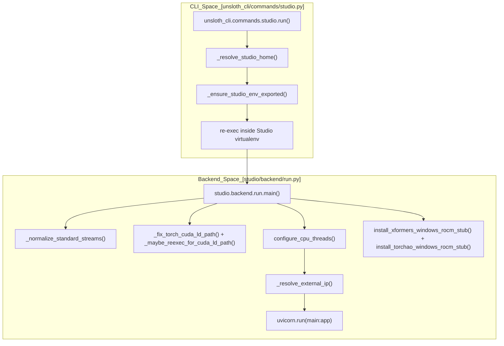

*Sources: [unsloth_cli/commands/studio.py:35-114](), [studio/backend/run.py:10-198]()*

---

## Cloud Colab Integration

Unsloth Studio supports running inside Google Colab notebooks through `studio/backend/colab.py`, facilitating a seamless cloud experience:

- Detects if running in a Colab runtime.
- Automatically requests a Cloudflare tunnel if enabled or running on Colab since in-notebook iframes often fail [studio/backend/colab.py:63-148]().
- Persists a temporary admin bootstrap password locally in `.colab_notebook_login` to allow re-runs without resetting credentials [studio/backend/colab.py:79-130]().
- Provides convenience functions to get the publicly accessible Colab proxy URL for the backend port [studio/backend/colab.py:22-50]().

Typical usage in a notebook is as shown in `studio/Unsloth_Studio_Colab.ipynb`:

```python
!git clone --depth 1 --branch main https://github.com/unslothai/unsloth.git
%cd /content/unsloth
!chmod +x studio/setup.sh && ./studio/setup.sh --local

import sys
sys.path.insert(0, "/content/unsloth/studio/backend")
from colab import start

# start() auto-opens Cloudflare URL and prints admin credentials.
start()

# To skip Cloudflare tunnel, call:
# start(cloudflare=False)
```

*Sources: [studio/backend/colab.py:17-149](), [studio/Unsloth_Studio_Colab.ipynb:59-95]()*

---

## CLI Commands

Unsloth's CLI commands provide terminal access for training, inference, exporting models, and launching the Studio UI.

### Running Studio UI via CLI

Run:

```bash
unsloth studio
# or
unsloth studio run
```

This command:

- Invokes the CLI entrypoint in `unsloth_cli/commands/studio.py` registered under `studio` command group.
- Performs environment detection and activation (re-execs into the Studio venv if necessary).
- Starts the FastAPI backend server that serves the Studio frontend and provides REST API endpoints.

### Training

Use the `unsloth train` command (defined elsewhere in the CLI) for fine-tuning models. The training command wraps core functionalities like `UnslothTrainer` to prepare datasets, start training jobs, and stream progress.

### Inference and Chat

- The `unsloth inference` and `unsloth chat` commands run model inference interactively or script-driven.
- Support speculative decoding modes configurable with `--speculative-type` and `--spec-draft-n-max` [unsloth_cli/_inference.py:17-22]() and [unsloth_cli/tests/test_studio_run_parallel_flag.py:82-95]().
- Parallel inference is controlled by the `--parallel` flag on these commands (default 4, range 1-64) [unsloth_cli/tests/test_studio_run_parallel_flag.py:38-117]().

### Exporting Models

`unsloth export` exports trained weights into GGUF or merges weights, facilitating downstream deployment outside of Unsloth.

---

## Security and Authentication

The Studio includes a local-first authentication system designed to guard access, especially for public/exposed instances.

- On startup, if the default bootstrap password is active and a public tunnel is enabled (e.g., Cloudflare tunnel or binding to a non-loopback interface), the server prompts for an admin password change interactively in the terminal before exposing the UI [studio/backend/auth/terminal_prompt.py:4-195]() and [studio/backend/tests/test_password_prompt_backstop.py:30-140]().
- This "password gate" is enforced prior to publishing public URLs, preventing unwanted default password exposure.
- Desktop integration uses securely managed desktop secrets for authentication [studio/backend/tests/test_desktop_auth.py:89-115]().
- The CLI command ensures secure environment launching and prevents execution in dangerous Windows system folders that cause runtime errors [unsloth_cli/__init__.py:35-65]().

---

**Diagram: Mapping User Actions to Code Entities**

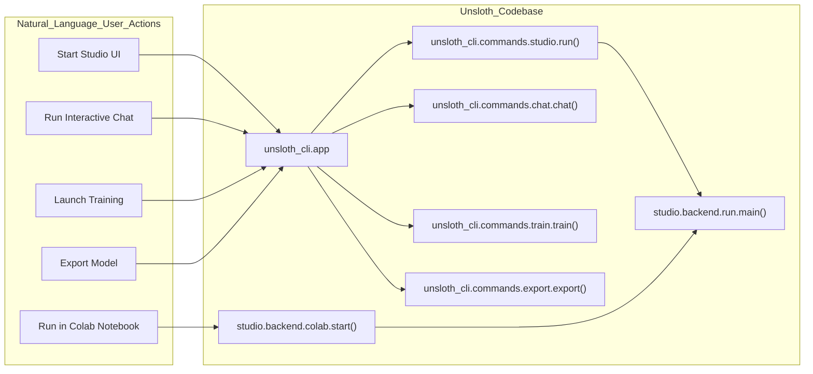

*Sources: [unsloth_cli/commands/studio.py:30-115](), [studio/backend/run.py:4-50](), [unsloth_cli/commands/chat.py:3-196]()*

---

## Summary Table: Studio vs CLI

| Feature                        | Studio Web UI                          | CLI                                        |
|-------------------------------|--------------------------------------|--------------------------------------------|
| License                       | AGPL-3.0 (Studio backend & frontend) | Apache 2.0 core; AGPL CLI & Studio tools   |
| Execution Isolation           | Subprocesses for training/inference   | Single process; commands invoke core APIs  |
| User Interface                | React SPA + FastAPI                    | Terminal (Typer & Rich) CLI                 |
| Parallel Execution            | `--parallel` slots, managed server    | Command-level parallel flags                |
| Network Exposure              | Host binding + Cloudflare tunnel      | Local terminal or scripted HTTP calls       |
| Authentication & Security    | Bootstrap password, JWT, Desktop Secrets | CLI tokens and environment guards           |
| Model Serving                | Full backend with GGUF, Transformers  | Ad-hoc runs or chat sessions via CLI        |

---

This quick start demonstrates how to use both the Studio web interface and the CLI commands effectively by leveraging the core Unsloth backend capabilities with environment management and security considerations.

# End of Page

**Sources:**  
- [studio/backend/run.py:1-198]()  
- [unsloth_cli/commands/studio.py:20-137]()  
- [studio/backend/colab.py:10-150]()  
- [studio/backend/auth/terminal_prompt.py:1-195]()  
- [unsloth_cli/commands/chat.py:3-196]()  
- [unsloth_cli/tests/test_studio_run_parallel_flag.py:10-117]()  
- [unsloth_cli/tests/test_studio_secure_flag.py:30-190]()

---

# Page: Core Library Architecture

# Core Library Architecture

<details>
<summary>Relevant source files</summary>

The following files were used as context for generating this wiki page:

- [README.md](README.md)
- [pyproject.toml](pyproject.toml)
- [tests/python/test_construct_chat_template_validation.py](tests/python/test_construct_chat_template_validation.py)
- [tests/test_fp8_pre_sm89_dequant_fallback.py](tests/test_fp8_pre_sm89_dequant_fallback.py)
- [tests/test_import_fixes_drift.py](tests/test_import_fixes_drift.py)
- [unsloth/__init__.py](unsloth/__init__.py)
- [unsloth/_gpu_init.py](unsloth/_gpu_init.py)
- [unsloth/chat_templates.py](unsloth/chat_templates.py)
- [unsloth/import_fixes.py](unsloth/import_fixes.py)
- [unsloth/kernels/fp8.py](unsloth/kernels/fp8.py)
- [unsloth/models/_utils.py](unsloth/models/_utils.py)
- [unsloth/models/llama.py](unsloth/models/llama.py)
- [unsloth/models/loader.py](unsloth/models/loader.py)
- [unsloth/models/loader_utils.py](unsloth/models/loader_utils.py)
- [unsloth/models/mapper.py](unsloth/models/mapper.py)
- [unsloth/models/mistral.py](unsloth/models/mistral.py)
- [unsloth/models/rl.py](unsloth/models/rl.py)
- [unsloth/models/rl_replacements.py](unsloth/models/rl_replacements.py)
- [unsloth/models/vision.py](unsloth/models/vision.py)
- [unsloth/save.py](unsloth/save.py)
- [unsloth/tokenizer_utils.py](unsloth/tokenizer_utils.py)

</details>


This page documents the internal architecture of Unsloth's core library (Apache 2.0 licensed), focusing on the patching system, initialization mechanisms, model loading pipeline, and runtime optimization strategies. For model-specific implementation details, see [Model Architecture Support](#4). For custom kernel implementations and speed optimizations, see [Performance Optimizations](#5). To understand Studio backend orchestration, see [Studio Backend](#9).

## Architecture Overview

Unsloth’s core library employs a layered runtime patching architecture that enables high-performance and flexible support for diverse model families while maintaining compatibility with HuggingFace Transformers and PEFT adapters. The core system can be viewed as four interconnected layers:

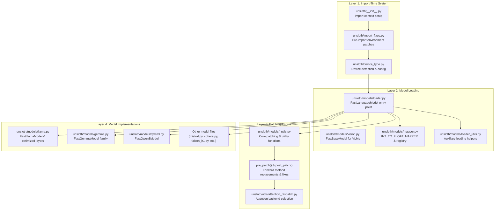

This design enables a clear separation of responsibilities: environment initialization and fixes, model loading and registry, runtime patching of core APIs and forward methods, and finally specialized model code implementing highly optimized layers.

### Core Components Summary

| Component               | Location                           | Purpose                                           |
|-------------------------|----------------------------------|--------------------------------------------------|
| **FastLanguageModel**   | `unsloth/models/loader.py`        | Main API for loading and managing LLM models     |
| **FastVisionModel**     | `unsloth/models/vision.py`        | Visual Language Models (VLMs) support             |
| **Patching System**     | `unsloth/models/_utils.py`        | Runtime transformers and PEFT patching engine     |
| **Model Registry**      | `unsloth/models/mapper.py`        | Model name canonicalization & quantized mappings |
| **Attention Dispatch**  | `unsloth/utils/attention_dispatch.py` | Dynamic attention backend selection             |
| **Device Abstraction**  | `unsloth/device_type.py`           | Multi-backend device detection & management      |

**Sources:**  
[unsloth/__init__.py:15-186](), [unsloth/models/_utils.py:1-205](), [unsloth/models/loader.py:1-171](), [unsloth/models/vision.py:1-156](), [unsloth/models/mapper.py:1-207]()

---

## Import-Time Initialization

Unsloth enforces a carefully controlled import sequence to guarantee early environment setup, patching, and compatibility fixes **before** core ML libraries such as `transformers` and `peft` are loaded.

This critical process starts in `unsloth/__init__.py`, where environment variables are configured, warnings filters applied, and backend flags forced—such as disabling TensorFlow and Flax to avoid unintended loading. It also sets up UTF-8 output encoding on Windows and adjusts Metal backend timeouts on Apple Silicon [unsloth/__init__.py:15-186]().

The patching and fixes are consolidated inside `unsloth/import_fixes.py`, which contains pre-import patches that prevent or mitigate issues like broken causal convolutions and disable problematic runtime extensions [unsloth/import_fixes.py:1-117]().

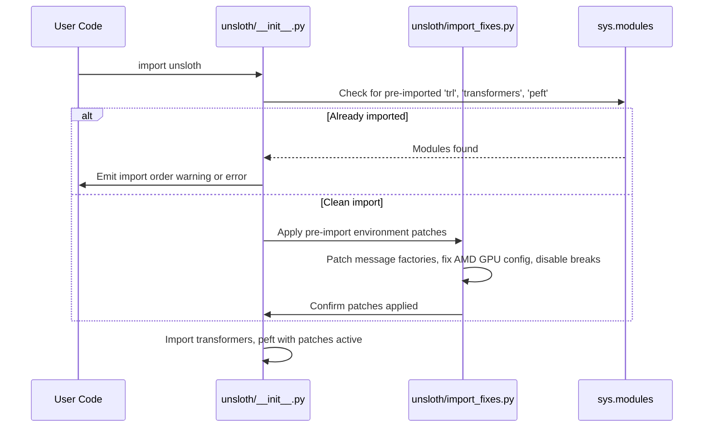

### Key Import-Time Fixes

| Fix                             | Purpose                                                  | Location                          |
|--------------------------------|----------------------------------------------------------|----------------------------------|
| `USE_TF` / `USE_FLAX` override | Disable TensorFlow and Flax backends in transformers    | `unsloth/__init__.py`             |
| Metal timeout relax             | Adjust Metal context-store timeout for Apple Silicon Macs | `unsloth/__init__.py`             |
| Windows UTF-8 safety            | Ensure UTF-8 console encoding on Windows terminals      | `unsloth/__init__.py`             |
| MLX availability detection     | Detect Apple Silicon + MLX audio backend early          | `unsloth/__init__.py`             |

These ensure a clean environment that prevents common pitfalls during model loading and execution.

**Sources:** [unsloth/__init__.py:15-186](), [unsloth/import_fixes.py:1-117]()

---

## Patching System Architecture

Unsloth applies runtime patches to transformer models, PEFT adapters, and the loading process to optimize speed, memory use, and feature support without modifying upstream codebases.

The patching proceeds in three main phases:

### Phase 1: Import-Time Patching

- Conducted during initial import (`unsloth/__init__.py` and `unsloth/import_fixes.py`).
- Applies general environment fixes and disables problematic imports or features before models or transformers are loaded.
- Sets a global signal `UNSLOTH_IS_PRESENT` to inform submodules about Unsloth’s presence [unsloth/__init__.py:14-15]().
  
### Phase 2: Pre-Load Patching (`pre_patch()`)

- Executed immediately before a model is loaded with `from_pretrained()` calls.
- Replaces core forward methods of transformer model layers (attention, decoder layers) with customized, optimized versions.
- Injects dispatch logic for attention backends (FlashAttention2, scaled-dot-product attention, xFormers) [unsloth/models/llama.py:150-170]().
- Adjusts training and inference mode behavior to enable fast generation or memory-efficient gradient checkpointing.
  
### Phase 3: Post-Load Patching (`patch_model_and_tokenizer`)

- Invoked after the model and tokenizer are fully loaded.
- Performs tokenizer fixes like special token adjustments and chat template de-duplication.
- Freezes all parameters except LoRA adapters during fine tuning for efficiency.
- Converts model weights or data types as needed for k-bit training and quantization support [unsloth/models/_utils.py:97-133]().

This layered patching strategy enables Unsloth to remain compatible with evolving upstream libraries while advancing performance and flexibility.

**Sources:**  
[unsloth/__init__.py:15-186](), [unsloth/models/_utils.py:1-205](), [unsloth/models/llama.py:145-170](), [unsloth/tokenizer_utils.py:40-160]()

---

## Model Loading Pipeline

The core API to load language models is `FastLanguageModel.from_pretrained()`, which orchestrates model resolution, loading, quantization, and runtime patching.

### Model Name Resolution and Remapping

- Model identifiers are normalized and mapped to canonical forms using tables in `unsloth/models/mapper.py` (`INT_TO_FLOAT_MAPPER`).
- This remapping ensures compatibility with pre-quantized mirrors and supports fallbacks for missing revisions by dropping incompatible Git references [unsloth/models/mapper.py:20-207](), [unsloth/models/loader.py:155-180]().

### Transformers Version Routing

- Based on feature detection of the installed `transformers` library (versions from 4.x up to 5.x).
- Flags like `SUPPORTS_FOURBIT`, `SUPPORTS_GEMMA4`, etc., conditionally enable enhanced loading paths for newer or specialized architectures [unsloth/models/loader.py:74-86]().

### Loading and Patching Workflow

The model loading process involves these major steps:

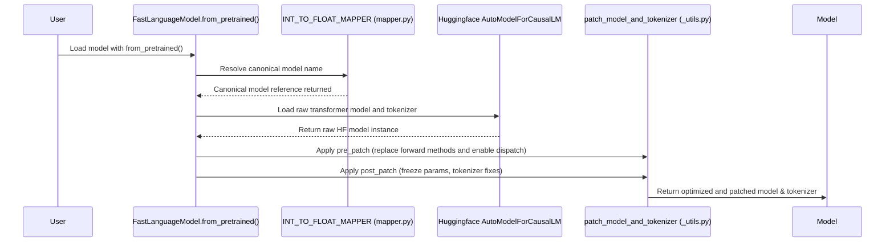

This workflow ensures Unsloth’s high-performance layers and quantization optimizations wrap cleanly around the raw HuggingFace models.

**Sources:**  
[unsloth/models/mapper.py:20-180](), [unsloth/models/loader.py:70-135](), [unsloth/models/_utils.py:50-130]()

---

## Attention Dispatch System

Unsloth integrates a multi-backend attention dispatch system allowing dynamic selection among multiple fast attention kernels optimized for hardware and sequence characteristics.

Supported backends include:

- **Scaled Dot-Product Attention (SDPA):** Standard attention pattern with support for grouped query attention (GQA) [unsloth/models/llama.py:169-170]().
- **Flash Attention 2:** Highly optimized, fused attention kernel leveraging Triton, preferred on supported GPUs.
- **xFormers:** Facebook’s modular attention kernels with flexibility for sparse and block diagonal attention masks [unsloth/models/llama.py:140-150](), [unsloth/models/llama.py:48-56]().

At runtime, the dispatcher selects the backend according to configuration and hardware presence encoded in `AttentionConfig` and `AttentionContext` classes.

**Sources:** [unsloth/models/llama.py:48-56](), [unsloth/models/llama.py:140-170]()

---

## Training vs Inference Mode Detection

Unsloth models incorporate dual operation modes to optimize for either fast inference or memory-efficient training.

- **Inference Mode:** Enables KV caching, disables gradient tracking, and applies inference-optimized kernels.
- **Training Mode:** Enables gradients, activates gradient checkpointing, and prepares LoRA adapters for fine-tuning.

Core APIs include:

- `FastLanguageModel.for_inference(model)`: Switches model to inference mode, disabling gradients [unsloth/models/rl.py:146-198]().
- `FastLanguageModel.for_training(model)`: Enables training mode with gradient checkpointing restored if applicable.
- `_get_inference_mode_context_manager()`: Context manager for temporarily forcing inference mode [unsloth/models/_utils.py:83-83]().

This mode-switching capability is essential to support combined workflows of pretraining, fine-tuning, and fast generation.

**Sources:**  
[unsloth/models/rl.py:130-196](), [unsloth/models/_utils.py:83-83](), [unsloth/models/llama.py:200-220]()

---

## Gradient Checkpointing System

Unsloth uses advanced gradient checkpointing to reduce VRAM usage during training of large models.

Key features:

- **Offloaded Gradient Checkpointing:** Utilizes `Unsloth_Offloaded_Gradient_Checkpointer` to offload activations to CPU or disk [unsloth/models/_utils.py:150-161]().
- **Patching Support:** Functions like `patch_gradient_checkpointing` inject efficient checkpointing hooks at runtime [unsloth/models/_utils.py:157-160]().
- **Smart Checkpointing:** `apply_unsloth_gradient_checkpointing` handles dynamic rewiring of checkpoint calls for further memory gains.

This system enables fine-tuning of huge models on consumer GPUs with constrained VRAM.

**Sources:**  
[unsloth/models/_utils.py:150-161](), [unsloth/models/_utils.py:154-160]()

---

## Related Child Pages

This page is a parent document with detailed child pages covering specific core library subsystems:

- [System Initialization and Patching](#3.1) — Import-time patching, environment setup, warnings filters, and runtime modifications to transformers/peft.  
- [Model Loading Pipeline](#3.2) — Full details on `FastLanguageModel.from_pretrained`, quantization routing, model name resolution, and pre/post-patch hooks.  
- [Model Registry and Name Resolution](#3.3) — Explains the `INT_TO_FLOAT_MAPPER`, model canonicalization, pre-quantized model management, and the registry data structures.  
- [Transformers Version Management](#3.4) — How transformers 4.x and 5.x versions are switched, model detection logic, and subprocess environment activation.  

---

This overview aims to give engineers and contributors a clear understanding of Unsloth's core architecture: how the system is initialized, how models are dynamically loaded and patched, and how the runtime dispatch and training modes are managed for optimal speed and flexibility.

**Sources:**

- [unsloth/__init__.py:1-166]()  
- [unsloth/import_fixes.py:1-117]()  
- [unsloth/models/_utils.py:1-205]()  
- [unsloth/models/loader.py:1-171]()  
- [unsloth/models/mapper.py:1-207]()  
- [unsloth/models/llama.py:1-220]()  
- [unsloth/models/vision.py:1-156]()  
- [unsloth/models/rl.py:140-196]()

---

# Page: System Initialization and Patching

# System Initialization and Patching

<details>
<summary>Relevant source files</summary>

The following files were used as context for generating this wiki page:

- [README.md](README.md)
- [pyproject.toml](pyproject.toml)
- [tests/python/test_bitsandbytes_kernel_readiness.py](tests/python/test_bitsandbytes_kernel_readiness.py)
- [tests/python/test_construct_chat_template_validation.py](tests/python/test_construct_chat_template_validation.py)
- [tests/test_bf16_quant_disabled_message.py](tests/test_bf16_quant_disabled_message.py)
- [tests/test_device_helpers.py](tests/test_device_helpers.py)
- [tests/test_fp8_pre_sm89_dequant_fallback.py](tests/test_fp8_pre_sm89_dequant_fallback.py)
- [tests/test_import_fixes_drift.py](tests/test_import_fixes_drift.py)
- [tests/test_kaggle_gguf_error_message.py](tests/test_kaggle_gguf_error_message.py)
- [tests/test_offloaded_parameter_hint.py](tests/test_offloaded_parameter_hint.py)
- [tests/test_save_entrypoints_reach_converter.py](tests/test_save_entrypoints_reach_converter.py)
- [tests/test_st_save_merged_signature.py](tests/test_st_save_merged_signature.py)
- [unsloth/__init__.py](unsloth/__init__.py)
- [unsloth/_gpu_init.py](unsloth/_gpu_init.py)
- [unsloth/bnb_availability.py](unsloth/bnb_availability.py)
- [unsloth/chat_templates.py](unsloth/chat_templates.py)
- [unsloth/device_type.py](unsloth/device_type.py)
- [unsloth/import_fixes.py](unsloth/import_fixes.py)
- [unsloth/kernels/fp8.py](unsloth/kernels/fp8.py)
- [unsloth/models/_utils.py](unsloth/models/_utils.py)
- [unsloth/models/llama.py](unsloth/models/llama.py)
- [unsloth/models/loader.py](unsloth/models/loader.py)
- [unsloth/models/loader_utils.py](unsloth/models/loader_utils.py)
- [unsloth/models/mapper.py](unsloth/models/mapper.py)
- [unsloth/models/mistral.py](unsloth/models/mistral.py)
- [unsloth/models/rl.py](unsloth/models/rl.py)
- [unsloth/models/rl_replacements.py](unsloth/models/rl_replacements.py)
- [unsloth/models/vision.py](unsloth/models/vision.py)
- [unsloth/save.py](unsloth/save.py)
- [unsloth/tokenizer_utils.py](unsloth/tokenizer_utils.py)

</details>


This page documents Unsloth's multi-layered patching and initialization system. When the user runs `import unsloth`, it triggers a carefully orchestrated sequence of environment setup, import-time fixes, warning filters, and runtime patching that optimize third-party libraries (`transformers`, `peft`, and `trl`) before any user code executes. These patches enable improved training speed, inference performance, and cross-library compatibility.

The scope of this page includes:
- Environment configuration and import order requirements.
- Warning and logging suppression filters.
- Import-time patching and GPU backend initialization.
- Runtime patching in `unsloth.models._utils`.
- Integration and on-the-fly modification of transformers, PEFT, and RL-related modules.

---

## Import Order Requirement and Pre-Import Checks

Unsloth assumes it is imported **before** `transformers`, `peft`, and `trl` libraries. This ensures Unsloth can apply patches to their internals to inject optimized kernels and workarounds before those libraries initialize themselves.

If any of these critical libraries are imported earlier, Unsloth emits a warning but still continues:

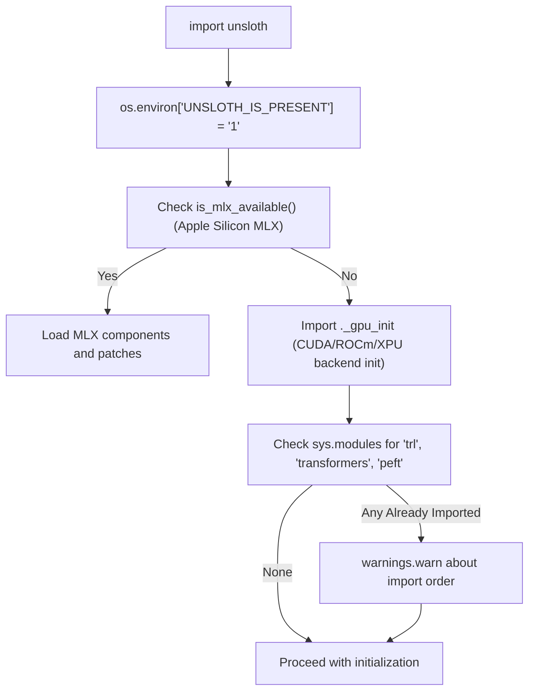

- Setting `UNSLOTH_IS_PRESENT=1` enables internal detection flags used system-wide [unsloth/__init__.py:12-47]().
- MLX (Apple Silicon) has a separate backend path, loaded early if present [unsloth/__init__.py:130-150](), [unsloth/device_type.py:38-46]().
- Early import warnings help users avoid patching failure caused by incorrect import order [unsloth/_gpu_init.py:117-126]().

Sources: [unsloth/__init__.py:12-47](), [unsloth/_gpu_init.py:117-126](), [unsloth/device_type.py:35-46]()

---

## Initialization Sequence

The initialization is divided into two main phases conditioned on hardware and runtime environment:

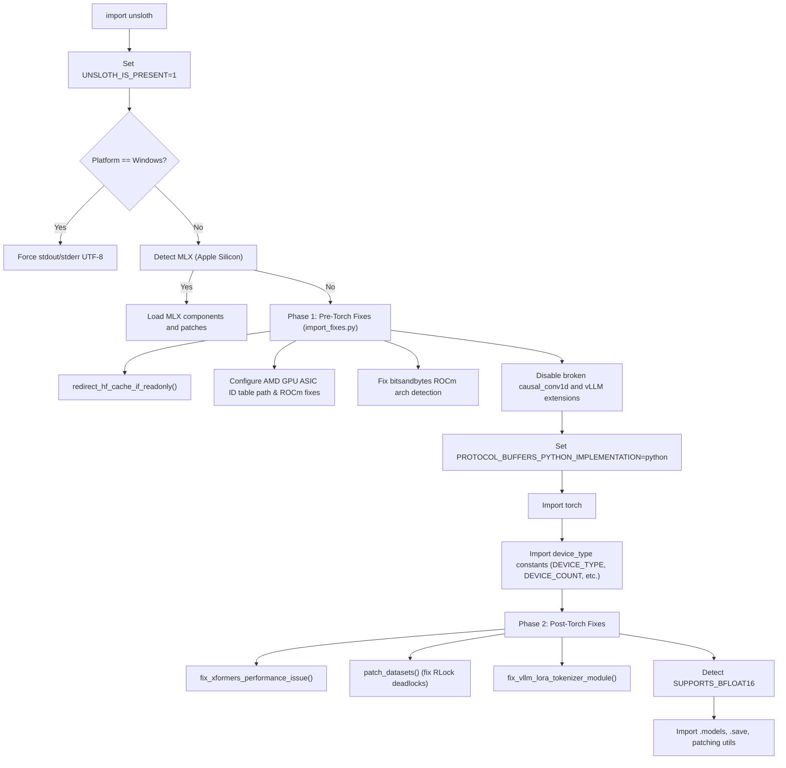

- **Phase 1** runs before importing `torch` to set environment variables and disable broken components reliably [unsloth/_gpu_init.py:27-88]().
- **Phase 2** runs after `torch` import to patch regressions and performance issues in `transformers`, `vLLM`, `datasets`, and related libraries [unsloth/_gpu_init.py:169-190]().
- For Windows, special fixes ensure UTF-8 console encoding and set ROCm bitsandbytes version [unsloth/__init__.py:97-105](), [unsloth/_gpu_init.py:130-133]().

Sources: [unsloth/__init__.py:12-102](), [unsloth/_gpu_init.py:20-88](), [unsloth/_gpu_init.py:169-190](), [unsloth/import_fixes.py:27-42]()

---

## Phase 1: Pre-Torch Fixes

Before `torch` is imported, Unsloth runs environment variable setups, disables known-buggy native extensions, and configures paths for better ROCm/AMDGPU support.

| Fix Function                           | Purpose                                                           | Location                      |
|--------------------------------------|-------------------------------------------------------------------|-------------------------------|
| `redirect_hf_cache_if_readonly()`    | Redirect HF cache if filesystem is read-only                      | [unsloth/_gpu_init.py:66]()   |
| `configure_amdgpu_asic_id_table_path()`| Configure AMD GPU ASIC ID table for ROCm detection              | [unsloth/_gpu_init.py:74]()   |
| `fix_bitsandbytes_rocm_arch_detection()`| Fix bitsandbytes ROCm architecture detection                   | [unsloth/_gpu_init.py:76]()   |
| `disable_broken_causal_conv1d()`     | Disable broken causal_conv1d extension                            | [unsloth/_gpu_init.py:77]()   |
| `disable_broken_vllm()`               | Detect and disable broken vLLM compiled extensions               | [unsloth/_gpu_init.py:78]()   |
| `fix_message_factory_issue()`         | Patch protobuf's MessageFactory compatibility                     | [unsloth/_gpu_init.py:79]()   |
| `propagate_torchao_fix_to_subprocesses()`| Avoid torchao ImportErrors in vLLM subprocesses                | [unsloth/_gpu_init.py:84]()   |
| `maybe_set_windows_rocm_bnb_version()`| Set `BNB_ROCM_VERSION` environment variable for Windows ROCm systems | [unsloth/_gpu_init.py:130-133]() |

- Fixing these issues before `torch` import avoids side effects and import order problems.
- These functions also redirect caches and disable problematic modules which cause crashes or degraded performance.

Sources: [unsloth/_gpu_init.py:28-88](), [unsloth/_gpu_init.py:130-133]()

---

## Device Detection and Constants

Unsloth abstracts device and platform detection in the `unsloth.device_type` module:

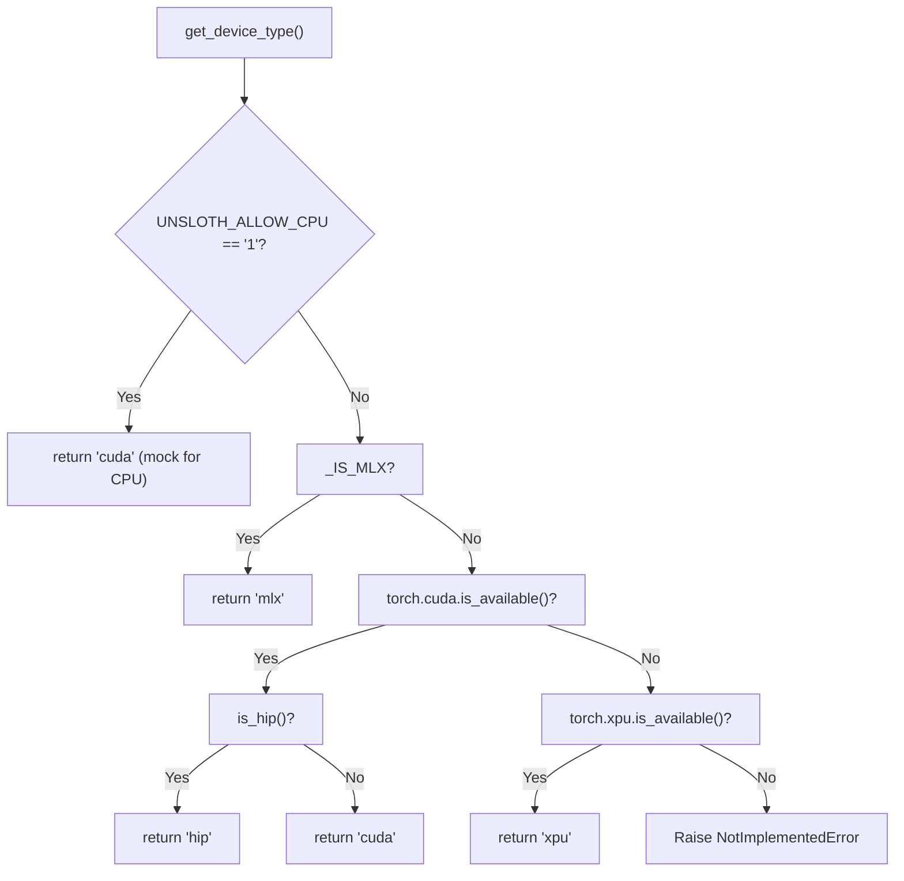

**Key exported constants:**

| Constant                | Description                             | Reference                      |
|------------------------|---------------------------------------|--------------------------------|
| `DEVICE_TYPE`          | Logical device type: `cuda`, `hip`, `xpu`, or `mlx` | [unsloth/device_type.py:90]() |
| `DEVICE_TYPE_TORCH`    | PyTorch device string (e.g. `"mps"` for MLX)           | [unsloth/device_type.py:92-96]() |
| `ALLOW_BITSANDBYTES`   | Indicates bitsandbytes kernel readiness             | [unsloth/device_type.py:128]() |
| `ALLOW_PREQUANTIZED_MODELS` | Whether 4-bit pre-quantized models are allowed    | [unsloth/device_type.py:126]() |

Unsloth performs deep probing of `bitsandbytes` native kernel readiness by inspecting symbols inside `bitsandbytes.functional.lib`, filtering out "zombie" incomplete imports. This is done via `native_kernels_ready()` [unsloth/bnb_availability.py:90-93](), which ensures that Unsloth only activates BNB optimizations when native CUDA kernels truly loaded.

Sources: [unsloth/device_type.py:53-176](), [unsloth/bnb_availability.py:38-93]()

---

## Phase 2: Post-Torch Fixes

After importing `torch`, Unsloth applies patches fixing regressions in auxiliary libraries and improving performance.

| Fix Function                   | Purpose                                                  | Reference                      |
|------------------------------|----------------------------------------------------------|--------------------------------|
| `fix_xformers_performance_issue()` | Patch performance issues in `xformers`                 | [unsloth/_gpu_init.py:180]()   |
| `fix_vllm_aimv2_issue()`         | Fixes compatibility of vLLM with NVIDIA A10 AIMv2       | [unsloth/_gpu_init.py:181]()   |
| `fix_vllm_lora_tokenizer_module()` | Prevents vLLM's tokenizer from being corrupted by LoRA  | [unsloth/_gpu_init.py:182]()   |
| `patch_datasets()`              | Fix RLock deadlocks in `datasets` v4.4.0-4.5.0            | [unsloth/_gpu_init.py:186]()   |
| `patch_enable_input_require_grads()` | Patch vision model to avoid 'NotImplementedError' during training | [unsloth/_gpu_init.py:187]()   |

These patches ensure compatibility and improved runtime behavior for Unsloth's extended model ecosystem.

Sources: [unsloth/_gpu_init.py:179-190]()

---

## Warning and Logging Filters

To suppress noisy or unhelpful logs and warnings from dependencies, Unsloth installs filters in `unsloth/import_fixes.py`.

- `HideLoggingMessage`: A logging filter class to silence recurring or verbose logs identified by substrings [unsloth/import_fixes.py:71-79]().
- `HidePrintMessage`: Wraps and filters `sys.stderr.write` calls to suppress certain printed output [unsloth/import_fixes.py:81-98]().
- `suppress_cuda_printf()`: At the OS file descriptor level, redirects stdout and stderr to `/dev/null` temporarily to suppress device-level C prints such as CUTLASS errors that are uncatchable otherwise [unsloth/import_fixes.py:110-143]().

This comprehensive suppression mechanism reduces terminal clutter during GPU-heavy workloads and kernel launches.

Sources: [unsloth/import_fixes.py:69-183]()

---

## Runtime Patching Infrastructure

Unsloth's core runtime patching functionality resides primarily in `unsloth/models/_utils.py`. This module provides utilities and decorators that patch transformers and PEFT models dynamically at runtime to improve training and inference efficiency.

Key patching functions and classes include:

| Function/Component                 | Description                                                | Reference                   |
|----------------------------------|------------------------------------------------------------|-----------------------------|
| `patch_model_and_tokenizer()`    | Applies structural patches to models and tokenizers        | [unsloth/models/_utils.py:147-155]() |
| `patch_gradient_checkpointing()` | Patches gradient checkpointing logic to Unsloth's optimized version | [unsloth/models/_utils.py:157-162]() |
| `patch_fast_lora()`              | Injects fused CUDA/Triton kernels accelerating LoRA usage  | [unsloth/models/_utils.py:173-184]() |
| `patch_peft_fast_inference()`   | Minimizes PEFT runtime overhead during generation           | [unsloth/models/_utils.py:187-195]() |

These patching functions are invoked during model loading and training to transparently boost performance without user interaction.

### Reinforcement Learning (RL) Patching

Unsloth extends the core patching with additional runtime modifications tailored for RL training workflows found in `unsloth/models/rl.py`.

- `unsloth_unwrap_model_for_generation`: Context manager ensuring models are in correct inference mode during generation, avoiding unwanted side effects [unsloth/models/rl.py:184-200]().
- `_patch_resume_from_checkpoint_memory`: Intercepts trainer's train method to aggressively clear GPU memory before resuming training to avoid out-of-memory errors on checkpoints [unsloth/models/rl.py:124-144]().

These selective dynamic patches allow seamless integration with the TRL library while optimizing runtime reliability and resource usage.

Sources: [unsloth/models/_utils.py:17-95](), [unsloth/models/rl.py:49-212]()

---

## Summary Diagram: System Initialization and Patching Flow

The following diagram illustrates the major code components and flow from Unsloth import to runtime patching of models, showing the bridging between natural language concepts and code entity names.

```mermaid
graph LR
    subgraph Phase_1_PreTorch["Phase 1: Environment Setup / Pre-Torch"]
        UInit["unsloth/__init__.py"]
        GPUInit["unsloth/_gpu_init.py"]
        IFix["unsloth/import_fixes.py"]
    end

    subgraph Phase_2_CorePatching["Phase 2: Core Library & Patching"]
        Utils["unsloth/models/_utils.py"]
        Device["unsloth/device_type.py"]
        BNB["unsloth/bnb_availability.py"]
    end

    subgraph Phase_3_RuntimeLoaderRL["Phase 3: Model Loading & RL Patching"]
        Loader["unsloth/models/loader.py"]
        RL["unsloth/models/rl.py"]
    end

    UInit --> GPUInit
    GPUInit --> IFix
    GPUInit --> Device
    Device --> BNB
    IFix --> Utils
    Utils --> Loader
    Loader --> RL

    click UInit "unsloth/__init__.py:12-102"
    click GPUInit "unsloth/_gpu_init.py:20-88"
    click IFix "unsloth/import_fixes.py:27-183"
    click Device "unsloth/device_type.py:53-176"
    click BNB "unsloth/bnb_availability.py:38-96"
    click Utils "unsloth/models/_utils.py:17-95"
    click Loader "unsloth/models/loader.py:12-170"
    click RL "unsloth/models/rl.py:49-212"
```

---

## Detailed Data Flow from Natural Language to Code Entities: Initialization and Patching

```mermaid
flowchart TD
    NL["Natural Language: 'Unsloth Runtime Startup'"] --> InitEnv["Init Env Vars + Pre-Torch Fixes"]
    InitEnv --> TorchImport["Import torch"]
    TorchImport --> DeviceDetect["Detect Device & GPU Backends"]
    DeviceDetect --> PatchGraph["Apply Patching (transformers, PEFT, RL, xformers)"]
    PatchGraph --> ModelsLoaded["Models Loaded + Patched"]
    ModelsLoaded --> Runtime["Runtime Optimized for Training & Inference"]

    subgraph Code_Entities["Code Entity Space"]
        IE["Import Entry: unsloth/__init__.py"]
        GPUI["GPU Backend Initialization: unsloth/_gpu_init.py"]
        IF["Import-Time Fixes: unsloth/import_fixes.py"]
        DT["Device Detection: unsloth/device_type.py"]
        BN["BitsAndBytes Readiness: unsloth/bnb_availability.py"]
        UT["Runtime Patching Utils: unsloth/models/_utils.py"]
        LO["Model Loader: unsloth/models/loader.py"]
        RL["RL Patching: unsloth/models/rl.py"]
    end

    NL --> IE
    IE --> GPUI
    GPUI --> IF
    GPUI --> DT
    DT --> BN
    IF --> UT
    UT --> LO
    LO --> RL
    RL --> Runtime
```

---

# Summary

When `import unsloth` runs, Unsloth sets environment flags, patches import-time module behavior, disables buggy extensions, optimizes device detection, and dynamically patches transformers and PEFT internals. This layered approach provides major performance and compatibility improvements transparently, forming the foundation for Unsloth's high-speed model training and inference capabilities.

This system mandates import-before dependencies like `transformers` and `peft`, and carefully orders fixes pre- and post-`torch` import, integrating GPU backend initialization and environment configuration. At runtime, Unsloth rewrites model components on the fly to accelerate LoRA, quantization, and gradient checkpointing, while reinforcing compatibility with reinforcement learning libraries such as TRL.

---

Sources:  
- [unsloth/__init__.py:12-102]()  
- [unsloth/_gpu_init.py:20-190]()  
- [unsloth/import_fixes.py:27-183]()  
- [unsloth/device_type.py:53-176]()  
- [unsloth/bnb_availability.py:38-93]()  
- [unsloth/models/_utils.py:17-95]()  
- [unsloth/models/loader.py:12-170]()  
- [unsloth/models/rl.py:49-212]()

---

# Page: Model Loading Pipeline

# Model Loading Pipeline

<details>
<summary>Relevant source files</summary>

The following files were used as context for generating this wiki page:

- [README.md](README.md)
- [pyproject.toml](pyproject.toml)
- [tests/python/test_construct_chat_template_validation.py](tests/python/test_construct_chat_template_validation.py)
- [tests/test_fp8_pre_sm89_dequant_fallback.py](tests/test_fp8_pre_sm89_dequant_fallback.py)
- [tests/test_import_fixes_drift.py](tests/test_import_fixes_drift.py)
- [unsloth/__init__.py](unsloth/__init__.py)
- [unsloth/_gpu_init.py](unsloth/_gpu_init.py)
- [unsloth/chat_templates.py](unsloth/chat_templates.py)
- [unsloth/import_fixes.py](unsloth/import_fixes.py)
- [unsloth/kernels/fp8.py](unsloth/kernels/fp8.py)
- [unsloth/models/__init__.py](unsloth/models/__init__.py)
- [unsloth/models/_utils.py](unsloth/models/_utils.py)
- [unsloth/models/dpo.py](unsloth/models/dpo.py)
- [unsloth/models/llama.py](unsloth/models/llama.py)
- [unsloth/models/loader.py](unsloth/models/loader.py)
- [unsloth/models/loader_utils.py](unsloth/models/loader_utils.py)
- [unsloth/models/mapper.py](unsloth/models/mapper.py)
- [unsloth/models/mistral.py](unsloth/models/mistral.py)
- [unsloth/models/rl.py](unsloth/models/rl.py)
- [unsloth/models/rl_replacements.py](unsloth/models/rl_replacements.py)
- [unsloth/models/vision.py](unsloth/models/vision.py)
- [unsloth/save.py](unsloth/save.py)
- [unsloth/tokenizer_utils.py](unsloth/tokenizer_utils.py)

</details>


This page provides an in-depth technical explanation of the `FastLanguageModel.from_pretrained` pipeline in Unsloth’s core library. It details the routing logic by model architecture and quantization parameters, the sophisticated model name resolution process, and the two-phase patching mechanism that applies global and instance-level optimizations.

---

## Pipeline Overview

The model loading pipeline converts user parameters and model names into a fully patched and optionally quantized model. It supports fast vLLM backend loading or conventional HuggingFace style loading with custom Unsloth patches.

### Core Loading Control Flow

Below is a flowchart that summarizes the overall control flow for `FastLanguageModel.from_pretrained()`:

```mermaid
flowchart TD
    Start["FastLanguageModel.from_pretrained()"] --> Dispatch["Architecture Dispatch<br/>loader.py:126"]
    
    Dispatch -->|"Llama, Mistral, Qwen2, etc."| ArchSpecific["Architecture-Specific Loaders<br/>llama.py:1437"]
    Dispatch -->|"VLM or Generic"| GenericLoader["FastModel.from_pretrained()<br/>loader.py:721"]
    
    ArchSpecific --> ConfigLoad["Load AutoConfig/PeftConfig<br/>from HF Hub"]
    GenericLoader --> ConfigLoad
    
    ConfigLoad --> PrePatch["Pre-Patch Phase<br/>unsloth_compile_transformers()"]
    
    PrePatch --> Patch1["Patch Attention.forward"]
    PrePatch --> Patch2["Patch DecoderLayer.forward"]
    PrePatch --> Patch3["Patch Model.forward"]
    
    Patch1 --> LoadPath{fast_inference?}
    Patch2 --> LoadPath
    Patch3 --> LoadPath
    
    LoadPath -->|True| VLLMPath["vLLM Loading Path<br/>vision.py:817"]
    LoadPath -->|False| HFPath["HuggingFace Loading Path<br/>vision.py:772"]
    
    VLLMPath --> VLLMLoad["load_vllm() engine"]
    VLLMLoad --> VLLMConvert["convert_vllm_to_huggingface()"]
    VLLMConvert --> PostPatch
    
    HFPath --> BnBConfig["Setup BitsAndBytesConfig"]
    BnBConfig --> HFLoad["AutoModel.from_pretrained()"]
    HFLoad --> PostPatch["Post-Patch Phase<br/>vision.py:995"]
    
    PostPatch --> Post1["patch_tokenizer()"]
    PostPatch --> Post2["patch_saving_functions()"]
    PostPatch --> Post3["Patch generate() method"]
    
    Post1 --> PEFTCheck{Is PEFT<br/>Adapter?}
    Post2 --> PEFTCheck
    Post3 --> PEFTCheck
    
    PEFTCheck -->|Yes| LoadPEFT["PeftModel.from_pretrained()"]
    PEFTCheck -->|No| FinalConfig
    
    LoadPEFT --> FinalConfig["Final Configuration<br/>vision.py:1021"]
    FinalConfig --> Return["Return model, tokenizer"]
```

**Sources:**  
- `unsloth/models/loader.py:126-694`  
- `unsloth/models/vision.py:408-1101`  
- `unsloth/models/llama.py:1437-1660`

---

## Entry Points and Architecture Dispatch

The primary user entry point is the class method `FastLanguageModel.from_pretrained`. This method dispatches loading based on the detected or requested architecture and quantization flags.

### Model Architecture Detection and Routing

The system tries to resolve the model architecture from the user-given model identifier, the config loaded from HuggingFace Hub (`AutoConfig.from_pretrained`), or the PEFT adapter config.

- **Specialized Loaders:** Architectures like `llama`, `mistral`, `gemma`, `qwen2`, `qwen3`, `falcon_h1`, `granite`, and `cohere` are mapped to corresponding `Fast*Model` classes with specific loading logic and optimizations [unsloth/models/loader.py:26-35]().

- **Generic Fallback:** If the requested flags include `load_in_8bit=True` or `full_finetuning=True`, or if the architecture is unrecognized, the pipeline routes to the generic `FastBaseModel` loader for universal transformer models [unsloth/models/loader.py:700-750]().

- **Vision Support:** Multimodal and vision-language models route to `FastVisionModel` loading logic, based on the base model class, sharing much of the `FastBaseModel` implementation with additional preprocessing/postprocessing [unsloth/models/vision.py:400-600]().

### Dispatch Flow Diagram

```mermaid
flowchart TD
    User["User Code"] --> FLM["FastLanguageModel.from_pretrained()<br/>loader.py:126"]
    
    FLM --> Detect["Model Architecture Detection<br/>loader.py:336"]
    
    Detect -->|"llama"| Llama["FastLlamaModel<br/>llama.py:1437"]
    Detect -->|"mistral"| Mistral["FastMistralModel<br/>mistral.py:27"]
    Detect -->|"gemma"| Gemma["FastGemmaModel<br/>loader.py:93"]
    Detect -->|"qwen2"| Qwen2["FastQwen2Model<br/>qwen2.py:28"]
    Detect -->|"VLM / Other"| Generic["FastBaseModel.from_pretrained()<br/>loader.py:721"]
    
    Llama --> BaseCall["Calls dispatch_model.from_pretrained()"]
    Mistral --> BaseCall
    Gemma --> BaseCall
    Qwen2 --> BaseCall
    
    Generic --> CompileTransformers["unsloth_compile_transformers()<br/>_utils.py:178"]
    CompileTransformers --> BaseLoader["FastBaseModel.from_pretrained()<br/>vision.py:408"]
    
    BaseCall --> BaseLoader
    BaseLoader --> Return["Returns model, tokenizer"]
```

**Sources:**  
- `unsloth/models/loader.py:126-721`  
- `unsloth/models/llama.py:1437-1460`  
- `unsloth/models/_utils.py:178-182`

---

## Model Name Resolution and Quantization Policies

During loading, Unsloth normalizes and remaps model names to their canonical or float-base equivalents to ensure compatibility with quantized or mirror repos.

### Repository and Revision Handling

- **Mapping Pre-Quantized Names:** `INT_TO_FLOAT_MAPPER` provides a mapping from known pre-quantized model names to their floating-point bases, allowing the loader to transparently substitute the checkpoint source without user interaction [unsloth/models/mapper.py:20-223]().

- **Revision Dropping:** When such remapping occurs, the revision argument (git branch/tag/SHA) is cleared to avoid errors from referencing a branch/tag non-existing on the alternate repo. This is controlled by `_revision_for_resolved_repo()` which logs warnings for users [unsloth/models/loader.py:155-181]().

- **Precision Forcing:** Certain models such as Gemma 4 and Qwen3.5 are known to exhibit instability in float16 training. These are forcibly marked for 32-bit float training to prevent numerical issues [unsloth/models/loader.py:126-143]().

### Quantization Configuration

- **4-bit and 8-bit:** BitsAndBytes quantization is supported with preconfigured `BitsAndBytesConfig` defaults optimized for NF4 quantization and double quant (fast quantization techniques) [unsloth/models/loader.py:79-81]().

- **FP8 support:** Advanced FP8 precision modes are supported with torchao integration, including block-wise and row-wise mapping strategies. The loader applies `_offline_quantize_to_fp8` and tags models accordingly during loading [unsloth/models/mapper.py:15-21]().

---

**Sources:**  
- `unsloth/models/mapper.py:15-223`  
- `unsloth/models/loader.py:126-181`

---

## Pre-Patching Phase: Global Optimization

Before loading model weights, Unsloth applies global runtime patches to core `transformers` model components to enable custom fast kernels.

### Component Replacement Details

| Component                   | Original Class              | Unsloth Replacement                          | Implemented in        |
|----------------------------|----------------------------|----------------------------------------------|----------------------|
| Attention forward           | `LlamaAttention.forward`    | `LlamaAttention_fast_forward`                 | `llama.py:618`        |
| Decoder layer forward       | `LlamaDecoderLayer.forward` | `LlamaDecoderLayer_fast_forward`              | `llama.py:712`        |
| Model forward               | `LlamaModel.forward`        | `LlamaModel_fast_forward`                      | `llama.py:808`        |
| Causal LM forward           | `LlamaForCausalLM.forward`  | `LlamaForCausalLM_fast_forward`                | `llama.py:1220`       |

These patches replace the native transformer forward methods with optimized fused operations, Triton kernels, or other performance-enhancing logic.

### Rotatory Embedding (RoPE) Fix for Transformers v5+

Transformers v5 introduced meta-device loading, which often corrupts the rotary embedding's `inv_freq` buffer, a non-persistent tensor. Unsloth patches this by recomputing and restoring the correct `inv_freq` to maintain function correctness [unsloth/models/loader.py:91-93]().

---

**Sources:**  
- `unsloth/models/llama.py:618-1220`  
- `unsloth/models/loader.py:91-93`

---

## Loading Strategies

### HuggingFace Loading Path

If `fast_inference` flag is false, the model is loaded using familiar HuggingFace `AutoModel.from_pretrained` calls but with important Unsloth modifications:

- **Skip Quantization for Sensitive Modules:** Modules like output embeddings (`lm_head`) are skipped during 4-bit quantization to preserve accuracy [unsloth/models/llama.py:68]().

- **BitsAndBytesConfig:** The loader sets up a `BitsAndBytesConfig` with sensible defaults (e.g., `nf4=True`, `double_quant=True`).  
- **Device Maps & Offloading:** Supports device maps and offloading as given by user or default device heuristics.

### vLLM Fast Inference Path

When `fast_inference=True` is requested, Unsloth loads the model through the vLLM engine abstraction:

- **vLLM Engine Object:** First, a device/engine-backed model (`vllm.Engine`) is created by `load_vllm()` [unsloth/models/vision.py:817-883]().
- **Conversion:** The engine is then encapsulated as a HuggingFace-compatible model via `convert_vllm_to_huggingface()` that exposes transformer interface methods, allowing consumer code to interact transparently.
- **Result:** The model object includes `model.vllm_engine` for direct engine access and fast high-throughput generation.

---

**Sources:**  
- `unsloth/models/vision.py:817-883`  
- `unsloth/models/llama.py:68`

---

## Post-Patching Phase: Instance-Level Modification

After the model instance is created, Unsloth applies instance-level patches and corrections for runtime behavior, tokenization, and checkpoint saving.

### Key Post-Patch Actions

1. **Tokenizer Correction:** `patch_tokenizer()` fixes known issues such as inconsistencies in BOS/EOS/PAD token settings across tokenizer wrappers, and special handling for SentencePiece tokenizers to ensure proper behavior during generation and saving [unsloth/tokenizer_utils.py:85-133]().

2. **Saving Functions:** The standard model `save_pretrained` methods are replaced by `patch_saving_functions()` with `unsloth_save_model` that supports fused LoRA weight saving and GGUF format exports [unsloth/save.py:85-95]().

3. **Inference Setup:** `fast_inference_setup()` wraps the `generate` method and other inference internals to enable Unsloth’s accelerated KV cache, fast decoding kernels, and static graph optimizations [unsloth/models/_utils.py:80-105]().

4. **Multi-GPU Alignment:** When using multi-device loading (via `accelerate` or device maps), `_attach_bnb_multidevice_hooks` installs hooks ensuring that `bitsandbytes` kernels use the correct device and tensors remain synchronized across GPUs, avoiding index-mismatch errors [unsloth/models/vision.py:150-211]().

5. **PEFT Adapter Handling:** If the loaded model is a PEFT adapter (Low-Rank Adaptation), `PeftModel.from_pretrained()` is called to load adapter weights layered on the base model.

### Instance Patch Sequence Diagram

```mermaid
flowchart TD
    ModelLoaded["Model instance created"] --> PatchToken["patch_tokenizer() fixes"]
    ModelLoaded --> PatchSave["patch_saving_functions()"]
    ModelLoaded --> SetupInfer["fast_inference_setup()"]
    ModelLoaded --> BnBHooks["_attach_bnb_multidevice_hooks()"]
    
    PatchToken --> PEFTCheck{Is PEFT Adapter?}
    PatchSave --> PEFTCheck
    SetupInfer --> PEFTCheck
    BnBHooks --> PEFTCheck
    
    PEFTCheck -->|Yes| LoadPEFT["PeftModel.from_pretrained()"]
    PEFTCheck -->|No| FinalConfig
    
    LoadPEFT --> FinalConfig["Finalize metadata and attributes"]
    FinalConfig --> Return["Return (model, tokenizer)"]
```

---

**Sources:**  
- `unsloth/tokenizer_utils.py:85-133`  
- `unsloth/save.py:80-95`  
- `unsloth/models/vision.py:150-211`  
- `unsloth/models/_utils.py:80-105`  

---

## Final Configuration and Attributes

At the end of the pipeline, the model is further configured and tagged with metadata needed for runtime:

- **Sequence Length Fix:** The `max_seq_length` property is propagated to all rotary position embedding (RoPE) modules, ensuring correct positional embedding scaling during generation [unsloth/models/vision.py:1062]().

- **Training and Inference Modes:** Methods `for_training()` and `for_inference()` are attached to toggle gradient checkpointing modes and patch the generate method for Unsloth’s performance [unsloth/models/rl.py:205-208]().

- **Gradient Checkpointing:** Unsloth replaces standard gradient checkpointing with an offloaded variant that reduces VRAM usage by swapping activations to CPU when appropriate [unsloth/models/_utils.py:55-60]().

- **Model Compile:** Optionally, the model may be compiled with `torch.compile` after loading, and Unsloth ensures patches do not interfere with PyTorch 2.x compiler behaviors.

---

**Sources:**  
- `unsloth/models/vision.py:1062-1101`  
- `unsloth/models/rl.py:205-208`  
- `unsloth/models/_utils.py:55-60`

---

# Summary

Unsloth’s model loading pipeline is a carefully layered system that:

- Resolves canonical model names with consideration for pre-quantized mirrors.  
- Routes requests to architecture-specific loaders or a generic fallback.  
- Applies global patches before loading to replace core transformer methods with fast fused kernels.  
- Supports multiple quantization formats transparently, including novel FP8 modes.  
- Implements a dual loading path for fast inference using the vLLM engine backend or classic HuggingFace loading.  
- Applies instance-level post-patching to fix tokenizers and save logic while enabling accelerated inference methods.  
- Finalizes model metadata and behavior for training, inference, and gradient checkpointing.

This modular two-phase patching and loading strategy enables Unsloth to deliver high performance on a broad collection of model architectures and quantization configurations.

---

# Diagram: Mapping Natural Language Usage to Code Entities in Model Loading

```mermaid
flowchart LR
    subgraph UserSpace["User Natural Language Space"]
        A1["Call FastLanguageModel.from_pretrained(model_name, quantization_flags, fast_inference)"]
    end
    
    subgraph CodeSpace["Unsloth Code Entity Space"]
        B1["loader.py:FastLanguageModel.from_pretrained()"]
        B2["loader.py:resolve_model_class()"]
        B3["loader.py:Architecture dispatch -> llama.py/FastLlamaModel, mistral.py/FastMistralModel, etc."]
        B4["_utils.py:unsloth_compile_transformers() - Pre-patch"]
        B5["transformers.AutoConfig.from_pretrained()"]
        B6["loader.py:BitsAndBytesConfig setup for quantization"]
        B7["vision.py:FastBaseModel.from_pretrained() - Generic loader"]
        B8["vision.py:load_vllm() - vLLM path"]
        B9["vision.py:convert_vllm_to_huggingface()"]
        B10["tokenizer_utils.py:patch_tokenizer()"]
        B11["save.py:patch_saving_functions()"]
        B12["_utils.py:fast_inference_setup()"]
        B13["peft:PeftModel.from_pretrained()"]
        B14["vision.py:Finalize model attributes and return"]
    end
    
    A1 --> B1
    B1 --> B2
    B2 --> B3
    B3 --> B4
    B4 --> B5
    B5 --> B6
    B6 --> B7
    B6 --> B8
    B8 --> B9
    B7 --> B10
    B7 --> B11
    B7 --> B12
    B10 --> B13
    B11 --> B13
    B12 --> B13
    B13 --> B14
```

---

# Diagram: Quantization and Patching Components in Loading Pipeline

```mermaid
flowchart TD
    Start["model_name + quant_flags + fast_inference"]
    Start --> NameMap["INT_TO_FLOAT_MAPPER remapping<br/>unsloth/models/mapper.py"]
    NameMap --> RevisionDrop["_revision_for_resolved_repo() clears revision<br/>unsloth/models/loader.py"]
    RevisionDrop --> PrecisionForce["Set forced float32 for unstable models<br/>unsloth/models/loader.py"]
    PrecisionForce --> PrePatch["unsloth_compile_transformers() pre-patch<br/>unsloth/models/_utils.py"]
    PrePatch --> LoadChoice{"fast_inference?"}
    LoadChoice -->|True| VLLMLoad["load_vllm() engine<br/>unsloth/models/vision.py"]
    LoadChoice -->|False| HFLoad["AutoModel.from_pretrained with BitsAndBytesConfig<br/>unsloth/models/loader.py & vision.py"]
    VLLMLoad --> PostPatch["Post-patch model instance"]
    HFLoad --> PostPatch
    PostPatch --> PatchTokenizer["patch_tokenizer() fixes<br/>unsloth/tokenizer_utils.py"]
    PostPatch --> PatchSave["patch_saving_functions() overrides save<br/>unsloth/save.py"]
    PostPatch --> SetupInfer["fast_inference_setup() setup<br/>unsloth/models/_utils.py"]
    PatchTokenizer --> PEFTCheck{"Is PEFT adapter?"}
    PatchSave --> PEFTCheck
    SetupInfer --> PEFTCheck
    PEFTCheck -->|Yes| LoadPEFT["PeftModel.from_pretrained()"]
    PEFTCheck -->|No| Finalize["Configure metadata and return"]
```

---

This concludes the detailed overview of the Unsloth Model Loading Pipeline.

# End of Page

---

**Sources:**  
- `unsloth/models/loader.py:1-750`  
- `unsloth/models/vision.py:400-1100`  
- `unsloth/models/llama.py:600-1220`  
- `unsloth/models/_utils.py:170-200`  
- `unsloth/tokenizer_utils.py:80-133`  
- `unsloth/save.py:70-90`

---

# Page: Model Registry and Name Resolution

# Model Registry and Name Resolution

<details>
<summary>Relevant source files</summary>

The following files were used as context for generating this wiki page:

- [tests/python/test_docker_nb_refresh_state_durability.py](tests/python/test_docker_nb_refresh_state_durability.py)
- [tests/test_callback_signature_drift.py](tests/test_callback_signature_drift.py)
- [tests/test_model_registry.py](tests/test_model_registry.py)
- [tests/test_source_read_encoding.py](tests/test_source_read_encoding.py)
- [unsloth/registry/REGISTRY.md](unsloth/registry/REGISTRY.md)
- [unsloth/registry/__init__.py](unsloth/registry/__init__.py)
- [unsloth/registry/_deepseek.py](unsloth/registry/_deepseek.py)
- [unsloth/registry/_gemma.py](unsloth/registry/_gemma.py)
- [unsloth/registry/_llama.py](unsloth/registry/_llama.py)
- [unsloth/registry/_mistral.py](unsloth/registry/_mistral.py)
- [unsloth/registry/_phi.py](unsloth/registry/_phi.py)
- [unsloth/registry/_qwen.py](unsloth/registry/_qwen.py)
- [unsloth/registry/registry.py](unsloth/registry/registry.py)
- [unsloth/utils/__init__.py](unsloth/utils/__init__.py)
- [unsloth/utils/hf_hub.py](unsloth/utils/hf_hub.py)

</details>


## Purpose and Scope

Unsloth’s model management relies on two tightly integrated components to handle the complexities of model naming, resolution, and metadata management:

1. **INT_TO_FLOAT_MAPPER and related dictionaries** ([`unsloth/models/mapper.py`](unsloth/models/mapper.py:1-1330))  
   These provide dictionary-based mappings between quantized and float (e.g., float16, FP8) model repository names. This mapping layer enables the core loader to transparently resolve which model checkpoint should be loaded based on the requested quantization and optimization settings.

2. **Model Registry** ([`unsloth/registry/registry.py`](unsloth/registry/registry.py:1-196), [`unsloth/registry/__init__.py`](unsloth/registry/__init__.py:1-65))  
   A structured registry system backed by dataclasses (`ModelInfo`, `ModelMeta`) that catalogs supported models with detailed metadata: organization, version, size, quantization type, multimodality, instruct tags, and descriptive naming conventions. It supports querying, validation against Hugging Face Hub, and provides a metadata interface used by clients (Studio, CLI) and the core library.

Together, these systems provide canonicalized model names, support for pre-quantized variants, and a metadata-driven foundation for model loading and tooling in Unsloth.

---

## Architecture Overview

### Relationship Between Mapper and Registry

- The **Mapping Dictionaries** live in `unsloth/models/mapper.py` and are used during runtime model loading to quickly map requested model names to the appropriate checkpoint variant.  
- The **Model Registry** uses dataclasses and centralized registration functions to populate a structured dictionary `MODEL_REGISTRY` with detailed metadata entries, supporting model search, validation, and tooling.

### Component Diagram: Model Registry and Name Resolution

```mermaid
graph TB
    subgraph MapperLayer["Mapping Layer (unsloth/models/mapper.py)"]
        SRC["__INT_TO_FLOAT_MAPPER (Source Data)"]
        IFM["INT_TO_FLOAT_MAPPER (dict)"]
        FIM["FLOAT_TO_INT_MAPPER (dict)"]
        MAP16["MAP_TO_UNSLOTH_16bit (dict)"]
        FP8B["FLOAT_TO_FP8_BLOCK_MAPPER (dict)"]
        FP8R["FLOAT_TO_FP8_ROW_MAPPER (dict)"]
        SRC --> IFM
        SRC --> FIM
        SRC --> MAP16
        SRC --> FP8B
        SRC --> FP8R
    end

    subgraph RegistryLayer["Registry Layer (unsloth/registry)"]
        QT["QuantType (Enum)"]
        MI["ModelInfo (Base Dataclass)"]
        MM["ModelMeta (Dataclass)"]
        REG["MODEL_REGISTRY (Global dict)"]
        REG_FN["register_model()"]
        BATCH_FN["_register_models()"]
        SEARCH["search_models()"]
        QT --> MI
        MM --> BATCH_FN
        BATCH_FN --> REG_FN
        REG_FN --> REG
        REG --> SEARCH
    end

    subgraph ExecutionFlow["Key Execution Flow"]
        LOADNAME["get_model_name() (loader_utils.py)"]
        REGISTER["register_models() (registry/__init__.py)"]
    end

    IFM -.-> LOADNAME
    FP8B -.-> LOADNAME
    FP8R -.-> LOADNAME
    MAP16 -.-> LOADNAME
    REGISTER --> BATCH_FN
```

Sources:  
- [`unsloth/models/mapper.py:23-1330`]()  
- [`unsloth/registry/registry.py:11-134`](unsloth/registry/registry.py:11-134)  
- [`unsloth/registry/__init__.py:12-65`](unsloth/registry/__init__.py:12-65)  
- [`unsloth/models/loader_utils.py:108-176`](unsloth/models/loader_utils.py:108-176)  

---

## The Registry System

The registry is implemented primarily in `unsloth/registry/registry.py` using dataclasses and enums to create a type-safe, extensible structure for model metadata.

### QuantType Enum

`QuantType` enumerates the supported quantization types:

| Enum Member        | Value        | Description                             |
|--------------------|--------------|------------------------------------- |
| `QuantType.BNB`    | `"bnb"`      | BitsAndBytes NF4 4-bit quantization  |
| `QuantType.UNSLOTH`| `"unsloth"`  | Unsloth dynamic 4-bit quantization   |
| `QuantType.GGUF`   | `"GGUF"`     | GGUF export format                   |
| `QuantType.NONE`   | `"none"`     | Non-quantized (float16/bfloat16)    |
| `QuantType.BF16`   | `"bf16"`     | BFloat16 (e.g., DeepSeek V3 / R1)   |

A map from `QuantType` to string suffixes (`QUANT_TAG_MAP`) is also defined for naming conventions, e.g., `"bnb-4bit"` for BNB quantization [[unsloth/registry/registry.py:11-31]]().

### ModelInfo Dataclass

`ModelInfo` holds metadata for a single model variant:

- Organization (`org`), base model name, version
- Model size (e.g., "7", "70" for billion parameters)
- Optional instruct tag (e.g., "Instruct")
- Quantization type (`QuantType`)
- Boolean multimodal flag
- Full model repository name `name`, constructed via `construct_model_name()`

The `construct_model_name()` method concatenates base components with optional instruct tags and quant type suffixes for canonical naming [[unsloth/registry/registry.py:35-85]]().

### ModelMeta Dataclass

`ModelMeta` aggregates metadata for a model family, declaring:

- Organization, base model name, version
- List of supported sizes, instruct tags, quant types (or dictionary mapping sizes to quant types)
- Associated `ModelInfo` subclass for construction
- Multimodal flag

Used by batch registration to produce all combinations of model variants [[unsloth/registry/registry.py:87-97]]().

### Registration APIs

- `register_model()` registers a single `ModelInfo` instance into the global `MODEL_REGISTRY` dict, keyed by `org/name`. It checks for duplicate registration [[unsloth/registry/registry.py:101-134]]().
- `_register_models()` expands a `ModelMeta` into all size/instruct/quant combinations and calls `register_model()` for each. It can optionally register the original, non-quantized model under the releasing org or register only Unsloth quantized variants under `org="unsloth"` [[unsloth/registry/registry.py:154-196]]().
- `register_models()` in `__init__.py` imports and calls family-specific registration functions once to populate the full registry [[unsloth/registry/__init__.py:12-25]]().

---

## Core Mapping Dictionaries in `mapper.py`

`unsloth/models/mapper.py` defines dictionary mappings crucial during model loading for quantization-aware name resolution.

### Key Mapping Dictionaries

| Variable Name               | Purpose                                          |
|----------------------------|------------------------------------------------|
| `INT_TO_FLOAT_MAPPER`      | Maps quantized model repo name to float16 base |
| `FLOAT_TO_INT_MAPPER`      | Reverse map: float16 base to quantized variants |
| `MAP_TO_UNSLOTH_16bit`     | Maps official float model names to Unsloth 16-bit mirrors |
| `FLOAT_TO_FP8_BLOCK_MAPPER`| Maps float16 names to FP8 block quantized variants |
| `FLOAT_TO_FP8_ROW_MAPPER`  | Maps float16 names to FP8 row quantized variants |

These dictionaries are generated dynamically from the source dictionary named `__INT_TO_FLOAT_MAPPER`, which contains variant tuples or nested dicts describing available quantized and float variants [[unsloth/models/mapper.py:23-1330]]().

### Mapping Generation Flow

```mermaid
flowchart TD
    SRC["__INT_TO_FLOAT_MAPPER (Source dict)"]
    VALTYPE{"Value Type?"}
    TUPLE["Tuple (4-bit, float16, official)"]
    DICT["Dict {'8': FP8, '16': FP16} structure"]

    SRC --> VALTYPE

    VALTYPE -->|Tuple| TUPLE
    VALTYPE -->|Dict| DICT

    DICT --> POP_FP8["Populate FLOAT_TO_FP8_BLOCK_MAPPER & FLOAT_TO_FP8_ROW_MAPPER"]
    DICT --> POP_FP16["Populate INT_TO_FLOAT_MAPPER & FLOAT_TO_INT_MAPPER"]
    TUPLE --> POP_FP16

    POP_FP16 --> POP_U16["Populate MAP_TO_UNSLOTH_16bit (if name starts with 'unsloth/')"]
```

---

## Name Resolution in Practice

When loading a model, Unsloth’s core loader calls `get_model_name()` ([`unsloth/models/loader_utils.py`](unsloth/models/loader_utils.py:108-176)) to determine the exact checkpoint repo to target:

- If FP8 quantization is requested (`load_in_fp8=True`), the loader chooses from `FLOAT_TO_FP8_ROW_MAPPER` (for FBGEMM backend) or `FLOAT_TO_FP8_BLOCK_MAPPER` (non-FBGEMM case).

- If 4-bit quantization is requested, `FLOAT_TO_INT_MAPPER` is consulted to route to the correct quantized repository.

- For 16-bit mode, Unsloth maintains mirrors of official float models optimized with faster 16-bit kernels; these are stored in `MAP_TO_UNSLOTH_16bit` and mapped accordingly.

- Some models are flagged as `BAD_MAPPINGS` due to inefficiencies or compatibility issues with pre-quantized checkpoint loading; these force fallback to the float variant for just-in-time quantization.

---

## Supported Model Families (Registry Coverage)

Unsloth supports diverse model families registered through family-specific files. Examples:

| File                      | Families Included                          | Notes                           |
|---------------------------|-------------------------------------------|--------------------------------|
| `_llama.py`               | Llama 3.1, 3.2, 3.2 Vision                 | Includes `LlamaVisionModelInfo` for Vision-LLaMA models [[_llama.py:8-20]]() |
| `_qwen.py`                | Qwen 2.5, Qwen VL (Vision-Language), QwQ | Multimodal and specialized quant versions [[_qwen.py:1-114]]()              |
| `_deepseek.py`            | DeepSeek V3, R1, Distilled variants        | Distilled model naming and quant logic [[_deepseek.py:1-156]]()              |
| `_gemma.py`               | Gemma 3 base, Gemma 3 instruct             | Gemma-specific naming conventions [[_gemma.py:1-58]]()                        |
| `_phi.py`                 | Phi 4, Phi mini-instruct                    | Microsoft Phi family [[_phi.py:1-71]]()                                       |
| `_mistral.py`             | Mistral Small                               | Small Mistral models with different versioning [[_mistral.py:1-81]]()         |

Each family defines a subclass of `ModelInfo` with custom `construct_model_name()` methods to handle family-specific naming conventions. They register their models via calls to `_register_models()` for auto-expansion of size/instruction/quantization combinatorics.

---

## Diagram: From Natural Language Model Requests to Code Entities

```mermaid
flowchart TD
    UserNL["User requests model by name"]
    Loader["get_model_name() (unsloth/models/loader_utils.py)"]
    InputName["Input model name string"]
    CheckFP8["Is FP8 load requested?"]
    Check4bit["Is 4-bit load requested?"]
    MapperDicts["INT_TO_FLOAT_MAPPER,\nFLOAT_TO_INT_MAPPER,\nFLOAT_TO_FP8_BLOCK_MAPPER,\nFLOAT_TO_FP8_ROW_MAPPER"]
    ResolveModel["Resolved checkpoint name"]
    RegisterModels["register_models() (unsloth/registry/__init__.py)"]
    ModelRegDict["MODEL_REGISTRY dict\n{ model_name: ModelInfo }"]
    Metadata["Model metadata, family info, quantization, tags"]
    
    UserNL --> InputName
    InputName --> Loader
    Loader --> CheckFP8
    Loader --> Check4bit
    CheckFP8 -->|Yes| MapperDicts
    Check4bit -->|Yes| MapperDicts
    CheckFP8 -.->|No| Check4bit
    Check4bit -.->|No| MapperDicts
    MapperDicts --> ResolveModel
    
    RegisterModels --> ModelRegDict
    ModelRegDict --> Metadata
```

---

## Diagram: Linking Mapper and Model Registry Metadata

```mermaid
classDiagram
    class ModelInfo {
        +str org
        +str name
        +int size
        +QuantType quant_type
        +construct_model_name()
    }

    class ModelMeta {
        +list model_sizes
        +list instruct_tags
        +list quant_types
    }

    class Registry {
        +dict MODEL_REGISTRY
        +register_model()
        +_register_models()
        +search_models()
    }

    class MapperDict {
        +dict INT_TO_FLOAT_MAPPER
        +dict FLOAT_TO_INT_MAPPER
        +dict MAP_TO_UNSLOTH_16bit
        +dict FLOAT_TO_FP8_BLOCK_MAPPER
        +dict FLOAT_TO_FP8_ROW_MAPPER
    }

    MapperDict <..> Registry : "Lookup for model resolution"
    Registry *-- ModelInfo : "holds"
    Registry *-- ModelMeta : "registers"
```

---

## Summary

- **INT_TO_FLOAT_MAPPER and related dictionaries** provide a flattening dictionary-based mapping between quantized, float16, and FP8 model repository names used by the core loader for precise model resolution based on quantization requests.

- **The unified Model Registry system** built on `ModelInfo` and `ModelMeta` dataclasses provides an extensible and family-adapted metadata catalog, describing supported models, their tags, sizes, quantization types, and multimodal capabilities.

- Bulk registration functions are designed to create all model variants and support automated validation against the Hugging Face Hub to maintain correctness and consistency.

This design modularizes name resolution from metadata management, enabling Unsloth to support diverse LLM families, pre-quantized and runtime quantized models, and integration with Studio and CLI tooling.

---

Sources:  
- [`unsloth/models/mapper.py:1-1330`](unsloth/models/mapper.py:1-1330)  
- [`unsloth/registry/registry.py:1-196`](unsloth/registry/registry.py:1-196)  
- [`unsloth/registry/__init__.py:1-65`](unsloth/registry/__init__.py:1-65)  
- [`unsloth/registry/_deepseek.py:1-156`](unsloth/registry/_deepseek.py:1-156)  
- [`unsloth/registry/_llama.py:1-103`](unsloth/registry/_llama.py:1-103)  
- [`unsloth/registry/_qwen.py:1-114`](unsloth/registry/_qwen.py:1-114)  
- [`unsloth/registry/_gemma.py:1-58`](unsloth/registry/_gemma.py:1-58)  
- [`unsloth/registry/_phi.py:1-71`](unsloth/registry/_phi.py:1-71)  
- [`unsloth/registry/_mistral.py:1-81`](unsloth/registry/_mistral.py:1-81)  
- [`unsloth/models/loader_utils.py:108-176`](unsloth/models/loader_utils.py:108-176)

---

# Page: Transformers Version Management

# Transformers Version Management

<details>
<summary>Relevant source files</summary>

The following files were used as context for generating this wiki page:

- [studio/backend/tests/test_transformers_version.py](studio/backend/tests/test_transformers_version.py)
- [studio/backend/tests/test_transformers_version_optional_tiktoken.py](studio/backend/tests/test_transformers_version_optional_tiktoken.py)
- [studio/backend/utils/transformers_version.py](studio/backend/utils/transformers_version.py)
- [studio/install_manifest.py](studio/install_manifest.py)
- [tests/sh/test_setup_desktop_backend_version_fastpath.sh](tests/sh/test_setup_desktop_backend_version_fastpath.sh)
- [tests/sh/test_setup_full_deps_override.sh](tests/sh/test_setup_full_deps_override.sh)
- [tests/sh/test_setup_xpu_fastpath_escape.sh](tests/sh/test_setup_xpu_fastpath_escape.sh)
- [tests/studio/install/idempotency_proxy.py](tests/studio/install/idempotency_proxy.py)
- [tests/studio/install/test_dependency_pass_skips.py](tests/studio/install/test_dependency_pass_skips.py)
- [tests/studio/install/test_install_manifest.py](tests/studio/install/test_install_manifest.py)
- [tests/studio/install/test_install_manifest_damage.py](tests/studio/install/test_install_manifest_damage.py)
- [tests/studio/install/test_install_manifest_pass_evidence.py](tests/studio/install/test_install_manifest_pass_evidence.py)
- [tests/studio/install/test_setup_fast_path_guard.py](tests/studio/install/test_setup_fast_path_guard.py)
- [tests/test_ci_repo_cpu_shards.py](tests/test_ci_repo_cpu_shards.py)
- [tests/test_studio_root_resilience.py](tests/test_studio_root_resilience.py)
- [tests/test_version_single_source.py](tests/test_version_single_source.py)
- [unsloth/_version.py](unsloth/_version.py)

</details>


## Overview

Unsloth supports automated management and switching between multiple versions of the HuggingFace `transformers` library to ensure compatibility with diverse and evolving model architectures. The core library defaults to `transformers==4.57.x` for maximum stability and optimized support for many established models. However, newer architectures—such as **Ministral-3**, **GLM-4.7-Flash**, **Qwen3 MoE**, and advanced **Gemma 4** variants—require `transformers` version 5.x, especially versions `>=5.3.0`/`5.5.0`/`5.10.x`.

To support this, Unsloth maintains multiple isolated "sidecar" virtual environments, each hosting a specific `transformers` 5.x version. At runtime, the system automatically detects the required transformer tier for a model or LoRA adapter, and either:

- **Activates the appropriate transformers version within a fresh subprocess** for training and inference workloads.  
- Or **performs an in-process sys.path swap and module cache purge** for export or lightweight model inspection tasks.

This design prevents version conflicts, avoids global environment contamination, and enables side-by-side multi-version support [studio/backend/utils/transformers_version.py:4-29]().

---

## Architecture Overview

The version management system involves model detection, version tier resolution, and environment setup mechanisms. Different activation approaches are used depending on the operation context: subprocess isolation for heavyweight runs, and lighter in-memory switching for export tasks.

### Transformers Version Switching Flow

```mermaid
graph TB
  subgraph API_Request_Flow ["API Request Flow (Natural Language Space)"]
    TrainReq["POST /api/training/start"]
    InfReq["POST /api/inference/load"]
    ExpReq["POST /api/export/load-checkpoint"]
  end
  
  subgraph Training_Path ["Training/Infernce Workflow (Code Entity Space)"]
    TrainReq --> TrainingBackend["TrainingBackend.start_training()"]
    TrainingBackend --> SpawnTrainSubproc["Spawn subprocess"]
    SpawnTrainSubproc --> ActivateSubprocEnv["activate_transformers_for_subprocess()"]
    ActivateSubprocEnv --> VersionTierDecision["get_transformers_tier()"]
    VersionTierDecision -->|Tier_510| PrependT510["Insert .venv_t5_510 at sys.path[0]"]
    VersionTierDecision -->|Tier_550| PrependT550["Insert .venv_t5_550 at sys.path[0]"]
    VersionTierDecision -->|Tier_530| PrependT530["Insert .venv_t5_530 at sys.path[0]"]
    VersionTierDecision -->|Default| UseDefault["Use default sys.path"]
  end
  
  subgraph Export_Path ["Export Workflow (In-Process Version Switching)"]
    ExpReq --> EnsureVersion["ensure_transformers_version()"]
    EnsureVersion --> HasTransformers?["Is 'transformers' in sys.modules?"]
    HasTransformers? -->|Yes| CorrectTierCheck["Is current version tier correct?"]
    CorrectTierCheck -->|No| Activate5x["_activate_5x()"]
    Activate5x --> PurgeModules["_purge_modules()"]
    PurgeModules --> ImportFresh["Import fresh 'transformers'"]
  end
```

### Subprocess vs In-Process Activation

| Aspect                | Subprocess (Training/Inference)        | In-Process (Export/Inspection)                   |
|-----------------------|---------------------------------------|-------------------------------------------------|
| **Mechanism**         | Spawn new Python interpreter           | Modify `sys.path` and purge in-memory modules   |
| **Scope**             | Total environment isolation            | Partial environment switch in current process   |
| **When Activated**    | Before subprocess startup               | On-demand, during export or metadata reading    |
| **Cleanup**           | Subprocess exit                        | Manual purge and garbage collection              |

Sources: [studio/backend/utils/transformers_version.py:21-29](), [studio/backend/utils/transformers_version.py:441-483](), [studio/backend/utils/transformers_version.py:516-560]()

---

## Model Detection and Version Routing

Determining which transformers version to activate depends on analyzing the model or adapter metadata and configuration.

### Transformers Version Tiers & Sidecar Layout

Unsloth supports multiple transformers 5.x sidecars alongside the default 4.x environment:

| Tier   | Models / Use Cases                          | Sidecar Directory        |
|--------|--------------------------------------------|-------------------------|
| **530** | Ministral-3, GLM-4.7, Qwen3 MoE           | `.venv_t5_530/`          |
| **550** | Gemma 4                                   | `.venv_t5_550/`          |
| **510** | Gemma 4 Unified / 12B, NVIDIA NemotronH   | `.venv_t5_510/`          |
| **Default** | Most existing models, Llama 1/2/3, Gemma 1/2 | Default environment (`transformers==4.57.x`) |

### Version Detection Pipeline

```mermaid
graph TD
    InputModel["Input: model_name or LoRA adapter dir"] --> BaseModelResolve["_resolve_base_model()"]
    
    BaseModelResolve -->|Adapter| AdapterConfig["Load adapter_config.json base_model_name_or_path"]
    AdapterConfig --> ResolvedBase["Resolved base model string"]
    BaseModelResolve -->|Not adapter| ResolvedBase
    
    ResolvedBase --> CheckTier510["Check if model_name matches TRANSFORMERS_510_MODEL_SUBSTRINGS"]
    CheckTier510 -->|Match| Tier510["Assign tier 510"]
    CheckTier510 -->|No Match| CheckTier550["Check TRANSFORMERS_550_MODEL_SUBSTRINGS"]
    CheckTier550 -->|Match| Tier550["Assign tier 550"]
    CheckTier550 -->|No Match| CheckTier530["Check if config.json architecture matches _TRANSFORMERS_530_ARCHITECTURES"]
    CheckTier530 -->|Match| Tier530["Assign tier 530"]
    CheckTier530 -->|No Match| DefaultTier["Assign transformers 4.x tier"]
```

Detection involves:

- **Adapter Base Model Resolution:** `_resolve_base_model()` extracts the base model name from `adapter_config.json` or `config.json` to determine routing [studio/backend/utils/transformers_version.py:118-150]().

- **Substring Matching:** Matching base model strings against predefined lists of substrings that indicate higher transformers tiers, for example, special substrings for tiers 510, 550, and 530 [studio/backend/utils/transformers_version.py:441-483]().

- **Architecture Checking:** For some models, checking the architecture field inside `config.json` to confirm tier requirements.

- **Tokenizer Class Check:** `_check_tokenizer_config_needs_v5()` examines tokenizer classes to detect if the higher transformer version is necessary [studio/backend/tests/test_transformers_version.py:22-65]().

Sources: [studio/backend/utils/transformers_version.py:118-150](), [studio/backend/utils/transformers_version.py:441-483](), [studio/backend/tests/test_transformers_version.py:22-65]()

---

## Subprocess Environment Activation

Training and inference always run in subprocesses where transformers version isolation is achieved by:

1. **Detecting required tier** via `get_transformers_tier()`.
2. **Prepending the sidecar directory path** of the appropriate `.venv_t5_*` to `sys.path`.
3. **Modifying environment variables** (`PYTHONPATH`, HF cache, tokens, etc.) to propagate the sidecar correctly to child processes.

The sidecar directories hold minimal installations of the required transformers version and related packages. This activation occurs early during subprocess startup, before ML imports [studio/backend/utils/transformers_version.py:441-485]().

Example subprocess activation snippet (from export worker):
```python
from utils.transformers_version import activate_transformers_for_subprocess

def _activate_transformers_version(model_name: str, hf_token: str | None = None) -> None:
    activate_transformers_for_subprocess(model_name, hf_token)
```
[studio/backend/core/export/worker.py:168-177]()

This ensures the entire subprocess environment uses the correct transformers version for the model being loaded or trained.

Sources: [studio/backend/utils/transformers_version.py:441-485](), [studio/backend/core/export/worker.py:168-177]()

---

## In-Process Transformers Version Switching (Export & Metadata Inspection)

When running **export** operations or lightweight model metadata inspection inside the same process, transformers version switching is done in-process by:

1. **Checking if `transformers` is already loaded.**
2. **If loaded but at wrong version tier, purging `transformers`, `tokenizers`, and related modules** from `sys.modules`.
3. **Prepending the sidecar directory of the correct transformers version** to `sys.path`.
4. **Re-importing `transformers` afresh** from the correct sidecar environment.

This is implemented in the `ensure_transformers_version()` and `_activate_5x()` functions which perform a lightweight dynamic path swapping and module clearing mechanism [studio/backend/utils/transformers_version.py:515-560]().

---

## Installation and Manifest Verification

The sidecar virtual environments are installed and maintained by Unsloth's installation scripts (`setup.sh`, `setup.ps1`, and `install_python_stack.py`) which manage dependency resolution and version pinning.

Unsloth uses a **manifest file** to track installation completeness:

- `unsloth_install_manifest.json` indicates a successful and complete installation of all Python dependencies, including the sidecars [studio/install_manifest.py:4-89]().

- The manifest records SHA256 hashes of tracked requirement files (e.g., `studio.txt`, `base.txt`, `extras.txt`) to detect inconsistencies or stale installs.

- The `install_manifest.py` module provides utility functions to verify whether sidecar directories are healthy, contain required packages, and are without corruption or partial installs.

- This manifest allows `unsloth studio verify-install` to detect if the venvs with specific transformers versions are intact and valid.

### Verification Flow

```mermaid
graph LR
    CLI["unsloth studio verify-install"] --> ManifestUtil["install_manifest.py"]

    ManifestUtil --> CheckVenv["_venv_dir_is_valid()"]
    CheckVenv --> CheckDamaged["_venv_dir_is_valid_and_undamaged()"]

    subgraph TrackedFiles
        Requirements["studio.txt, base.txt, extras.txt ..."]
        Metadata["Package metadata in site-packages"]
    end
    ManifestUtil --> Requirements
    ManifestUtil --> Metadata
```

### Detecting Metadata Conflicts

Duplicate or malformed Python package metadata can cause ambiguous version detection for transformers and other dependencies. This is detected by utilities such as `installed_metadata_conflicts()` to avoid silent misrouting [unsloth_cli/_studio_deps.py:48-73]().

Sources: [studio/install_manifest.py:4-89](), [unsloth_cli/_studio_deps.py:48-73](), [unsloth_cli/tests/test_studio_update_verify.py:100-110]()

---

## Key Functions and Classes

| Name                              | Location                                         | Purpose                                                                                                    |
|----------------------------------|------------------------------------------------|------------------------------------------------------------------------------------------------------------|
| `get_transformers_tier`           | `studio/backend/utils/transformers_version.py` [441-483]() | Resolve which transformers version tier (4.x, 5.3, 5.5, 5.10) a model or adapter requires                   |
| `activate_transformers_for_subprocess` | Same as above [470-485]()                      | Prepend sidecar `.venv_t5_*` dir to `sys.path` in a freshly spawned subprocess to activate correct version |
| `ensure_transformers_version`     | Same as above [515-560]()                        | In-process check and swap to a required transformers 5.x version by purging modules and adjusting sys.path  |
| `_resolve_base_model`             | Same as above [118-150]()                        | Extract base model name from adapter or config metadata                                                    |
| `_has_adapter_weights`            | Same as above [58-69]()                          | Detects if a directory is a LoRA adapter requiring separate version detection                              |

---

## Summary

Unsloth's transformers version management is a sophisticated dual-path system:

- **Training and inference run in isolated subprocesses** with appropriate sidecar virtual environments activated early in the lifecycle, guaranteeing complete environment isolation and dependency correctness.

- **Exports and support utilities which run in-process** use a sys.path mutation and careful module purging to swap transformer versions on the fly.

The model detection system inspects adapter metadata, config files, and tokenizer requirements to determine the required transformers tier, dynamically routing model loads to the appropriate sidecar environment, guaranteeing compatibility across evolving model architectures.

---

Sources:  
- [studio/backend/utils/transformers_version.py:1-560]()  
- [studio/backend/core/export/worker.py:168-177]()  
- [studio/install_manifest.py:1-89]()  
- [unsloth_cli/_studio_deps.py:48-73]()  
- [studio/backend/tests/test_transformers_version.py:20-65]()

---

# Page: Model Architecture Support

# Model Architecture Support

<details>
<summary>Relevant source files</summary>

The following files were used as context for generating this wiki page:

- [unsloth/models/cohere.py](unsloth/models/cohere.py)
- [unsloth/models/falcon_h1.py](unsloth/models/falcon_h1.py)
- [unsloth/models/gemma.py](unsloth/models/gemma.py)
- [unsloth/models/gemma2.py](unsloth/models/gemma2.py)
- [unsloth/models/granite.py](unsloth/models/granite.py)
- [unsloth/models/qwen2.py](unsloth/models/qwen2.py)
- [unsloth/models/qwen3.py](unsloth/models/qwen3.py)
- [unsloth/models/qwen3_moe.py](unsloth/models/qwen3_moe.py)

</details>


Unsloth supports a broad range of large language model (LLM) and multimodal architectures through a unified system of model dispatching, patching, and runtime optimizations. This page provides a high-level overview of the model-specific support and customizations integrated into Unsloth’s core library, with pointers to detailed child pages covering each architecture family and specialized model type.

---

## High-Level Architecture Support Overview

Unsloth implements a model-loading lifecycle consisting of `pre_patch` and `post_patch` phases wrapped around HuggingFace Transformers model instantiation [unsloth/models/qwen2.py:36-55](). Specifically:

- **Pre-patch phase**: Modifies or replaces base Transformers classes (e.g., attention and decoder layers) before the model is loaded to integrate Unsloth’s custom optimized kernels and runtime fixes [unsloth/models/qwen3_moe.py:155-171]().
- **Post-patch phase**: Configures the loaded model and tokenizer instances, enabling device-aware management, LoRA adapter patching, and inference/training mode toggling with Unsloth’s efficient dispatch mechanisms [unsloth/models/qwen2.py:36-55]().

Sources: [unsloth/models/qwen2.py:36-55](), [unsloth/models/qwen3_moe.py:155-171]()

---

## Supported Model Families and Architectures

Unsloth provides tailored support for a diverse set of model families, each with its own dispatcher class implementing architecture-specific optimizations.

| Model Family            | Dispatcher Class          | Use Cases                  | Representative Models                         | Transformers Version Requirement  |
|------------------------|--------------------------|----------------------------|----------------------------------------------|----------------------------------|
| Llama 2/3/3.1/3.2/4    | `FastLlamaModel`          | Decoder-only LLMs          | Llama 2, Llama 3 variants, Mistral            | ≥ 4.0, Llama 3.1+ needs ≥4.43.2  |
| Gemma and Gemma2       | `FastGemmaModel`, `FastGemma2Model` | Google’s Gemma family        | Gemma 2B/7B, Gemma2 9B/27B                     | ≥ 4.38 (Gemma), ≥ 4.42 (Gemma2)  |
| Vision and Multimodal  | `FastVisionModel`         | Vision-language models     | LLaVA, Qwen2-VL, PaliGemma, Gemma 3           | –                                |
| Specialized Architectures | Various dispatchers      | Architecture-specific      | Granite, Qwen2/3, Cohere, FalconH1             | ≥ 4.45 (Granite), ≥ 4.53 (Falcon)|
| Mixture-of-Experts (MoE) | `FastQwen3MoeModel`      | MoE with top-k routing     | Qwen3Moe, DeepSeek MoE, GLM-4.7 MoE Lite       | ≥ 4.50.3                         |
| Sentence Transformers   | `FastSentenceTransformer` | Embeddings and retrieval   | All-MiniLM, E5 models                           | –                                |
| Diffusion and Text-Diffusion | `FastDiffusionModel`  | Text-to-image/video and text diffusion | DiffusionGemma 4, Flux, SDXL                     | ≥ 5.5.0 (Gemma 4)                |

Sources: [unsloth/models/qwen2.py:36-55](), [unsloth/models/qwen3_moe.py:155-171]()

---

## Model Type Resolution and Dispatch Flow

When `FastLanguageModel.from_pretrained()` is invoked, Unsloth resolves model architecture by inspecting the HuggingFace configuration's `model_type` attribute. Based on this, it dispatches loading to the correct architecture-specific dispatcher class (`FastQwen2Model`, `FastQwen3MoeModel`, etc.) which executes `pre_patch()` and `post_patch()` methods [unsloth/models/qwen2.py:36-92]().

Title: Model Dispatch and Patching Pipeline
```mermaid
flowchart TD
    A["FastLanguageModel.from_pretrained(model_name)"] --> B["AutoConfig.from_pretrained(model_name)"]
    B --> C["Extract config.model_type"]
    C --> D{"model_type check"}

    D -->|"llama"| E["FastLlamaModel"]
    D -->|"qwen2"| F["FastQwen2Model"]
    D -->|"qwen3_moe"| G["FastQwen3MoeModel"]
    D -->|"granite"| H["FastGraniteModel"]
    D -->|"cohere"| I["FastCohereModel"]
    D -->|"falcon_h1"| J["FastFalconH1Model"]

    E --> K["pre_patch()"]
    F --> K
    G --> K
    H --> K
    I --> K
    J --> K

    K --> L["AutoModelForCausalLM.from_pretrained()"]
    L --> M["post_patch(model, tokenizer)"]
    M --> N["Return patched model & tokenizer"]
```
Sources: [unsloth/models/qwen2.py:36-92](), [unsloth/models/qwen3_moe.py:155-171]()

---

## Dispatcher Class Hierarchy Overview

Unsloth’s architecture-specific dispatch classes derive from shared base implementations to reuse attention dispatchers and fused kernels [unsloth/models/qwen2.py:36-36]().

Title: Model Dispatcher Class Hierarchy
```mermaid
classDiagram
    class FastBaseModel {
        +static for_inference(model)
        +static for_training(model)
    }

    class FastLlamaModel {
        +static pre_patch()
        +static post_patch(model, tokenizer)
    }

    class FastQwen2Model {
        +static pre_patch()
        +static from_pretrained(...)
    }

    class FastQwen3MoeModel {
        +static pre_patch()
    }

    FastLlamaModel --|> FastBaseModel
    FastQwen2Model --|> FastLlamaModel
    FastQwen3MoeModel --|> FastQwen2Model
```
Sources: [unsloth/models/qwen2.py:36-36](), [unsloth/models/qwen3_moe.py:155-171]()

---

## Pre-Patch and Post-Patch Lifecycle

Unsloth relies on a two-phase initialization lifecycle to replace standard HuggingFace modules with high-performance Triton/PyTorch implementations before weights are loaded into memory [unsloth/models/qwen2.py:36-55]().

| Phase      | Description                                              | Key Methods                    |
|------------|----------------------------------------------------------|--------------------------------|
| Pre-patch  | Modify Transformers classes before model instantiation: replace attention, decoder layers, and activation functions. | `pre_patch()` (static method)  |
| Load Model | Instantiate model using standard HuggingFace loaders.     | `AutoModelForCausalLM.from_pretrained()` |
| Post-patch | Configure loaded model instance and tokenizer; attach adapters, fix positional embedding parameters. | `post_patch(model, tokenizer)` |

Sources: [unsloth/models/qwen2.py:36-55](), [unsloth/models/qwen3_moe.py:155-171]()

---

## Common Components and Shared Optimizations

Architectures share common utility routines for attention dispatching, RoPE scaling, and fused linear layers [unsloth/models/gemma2.py:104-121](), [unsloth/models/granite.py:122-128]()]:
- **Attention Dispatch**: `AttentionConfig` and `AttentionContext` manage backend routing between Flash Attention, SDPA, and xFormers [unsloth/models/gemma2.py:149-166]().
- **RoPE Embedding**: `fast_rope_embedding` applies rotary positional encodings efficiently across multiple hardware backends [unsloth/models/gemma2.py:118-120]().
- **Fused Activations**: `fast_swiglu_inference` and `fast_geglu_inference` combine projections and activation functions [unsloth/models/gemma.py:62-71](), [unsloth/models/qwen3_moe.py:169-169]().

Sources: [unsloth/models/gemma.py:62-71](), [unsloth/models/gemma2.py:104-166](), [unsloth/models/granite.py:122-128](), [unsloth/models/qwen3_moe.py:169-169]()

---

## Training vs. Inference Mode Dispatch

Unsloth separates training optimizations from inference optimizations via explicit mode toggles [unsloth/models/loader.py:102-109]():
- `for_inference(model)`: Sets generation flags (`_flag_for_generation = True`), configures paged KV caches, and disables autograd [unsloth/models/gemma.py:88-93]().
- `for_training(model)`: Prepares the model for gradient checkpointing and attaches PEFT/LoRA modules [unsloth/models/qwen2.py:54-54]().

Sources: [unsloth/models/gemma.py:88-93](), [unsloth/models/qwen2.py:54-54]()

---

## Child Pages for Detailed Architecture Support

For comprehensive details on each model family and architecture, consult the following child pages:

- [Llama Model Family](#4.1) — Optimizations for Llama versions 2 through 4, Mistral, attention dispatch, and decoder layers.
- [Gemma and Gemma2 Models](#4.2) — Gemma optimizations such as logit softcapping, RMSNorm +1 weight fix, GeGLU activation, and RoPE variants.
- [Vision and Multimodal Models](#4.3) — FastVisionModel for vision-language models including LLaVA and Qwen2-VL, image processing pipelines, and multimodal attention layers.
- [Specialized Architectures](#4.4) — Granite, Qwen2/3, Cohere, FalconH1 (hybrid Mamba), and other unique architectures.
- [Mixture-of-Experts Models](#4.5) — Support for Qwen3Moe, DeepSeek MoE, GLM-4.7 MoE Lite, and grouped GEMM kernel optimizations.
- [Sentence Transformers](#4.6) — FastSentenceTransformer usage for embedding and retrieval tasks.
- [Diffusion and Text-Diffusion Models](#4.7) — FastDiffusionModel for text-diffusion architectures, block-diffusion samplers, LoRA integration, and 4-bit/8-bit loading support.

Sources: [unsloth/models/gemma.py:12-33](), [unsloth/models/gemma2.py:31-40](), [unsloth/models/granite.py:46-52](), [unsloth/models/falcon_h1.py:32-40](), [unsloth/models/qwen3.py:32-38](), [unsloth/models/cohere.py:25-34](), [unsloth/models/qwen3_moe.py:24-31](), [unsloth/models/qwen2.py:18-23]()

---

# Page: Llama Model Family

# Llama Model Family

<details>
<summary>Relevant source files</summary>

The following files were used as context for generating this wiki page:

- [README.md](README.md)
- [pyproject.toml](pyproject.toml)
- [tests/python/test_construct_chat_template_validation.py](tests/python/test_construct_chat_template_validation.py)
- [tests/test_fp8_pre_sm89_dequant_fallback.py](tests/test_fp8_pre_sm89_dequant_fallback.py)
- [tests/test_import_fixes_drift.py](tests/test_import_fixes_drift.py)
- [unsloth/__init__.py](unsloth/__init__.py)
- [unsloth/_gpu_init.py](unsloth/_gpu_init.py)
- [unsloth/chat_templates.py](unsloth/chat_templates.py)
- [unsloth/import_fixes.py](unsloth/import_fixes.py)
- [unsloth/kernels/fp8.py](unsloth/kernels/fp8.py)
- [unsloth/models/_utils.py](unsloth/models/_utils.py)
- [unsloth/models/llama.py](unsloth/models/llama.py)
- [unsloth/models/loader.py](unsloth/models/loader.py)
- [unsloth/models/loader_utils.py](unsloth/models/loader_utils.py)
- [unsloth/models/mapper.py](unsloth/models/mapper.py)
- [unsloth/models/mistral.py](unsloth/models/mistral.py)
- [unsloth/models/rl.py](unsloth/models/rl.py)
- [unsloth/models/rl_replacements.py](unsloth/models/rl_replacements.py)
- [unsloth/models/vision.py](unsloth/models/vision.py)
- [unsloth/save.py](unsloth/save.py)
- [unsloth/tokenizer_utils.py](unsloth/tokenizer_utils.py)

</details>


This page documents the technical architecture and implementation details of the Llama model family support within Unsloth, covering Llama 2, 3, 3.1, 3.2, and 4 models along with derivative architectures. It details optimization strategies, attention mechanisms, RoPE embedding adaptations, decoder layer implementations, and code entity bindings.

The core class is `FastLlamaModel` located in `unsloth/models/llama.py`, which centralizes patching, optimized forward implementations, inference-mode switching, and generation acceleration.

Sources: [unsloth/models/llama.py:1-107]()

---

## Overview and Role of `FastLlamaModel`

The `FastLlamaModel` class serves as the central entry point for all Llama-family models within Unsloth:

- Centrally patches standard `transformers` Llama classes' forward methods with Unsloth-optimized implementations at model load time [unsloth/models/llama.py:2147-2183]().
- Provides custom rotary position embedding (RoPE) implementations to support extended context lengths and scaling configurations [unsloth/models/llama.py:1699-2053]().
- Implements dual-mode (training vs. inference) attention and decoder layer forward passes optimized for throughput and minimal memory footprint [unsloth/models/llama.py:795-876]().
- Encapsulates fast attention dispatch logic, coordinating multi-backend support (Flash Attention, SDPA, xFormers) [unsloth/models/llama.py:48-56]().
- Wraps model generation via `unsloth_fast_generate` to accelerate autoregressive inference [unsloth/models/llama.py:2055-2137]().

Sources: [unsloth/models/llama.py:48-56](), [unsloth/models/llama.py:795-876](), [unsloth/models/llama.py:1699-2183](), [unsloth/models/loader.py:30-35]()

---

## Patching Architecture

Unsloth replaces core `transformers` Llama components with optimized implementations early in the loading process. This patching is performed in `FastLlamaModel.pre_patch()`, called during model initialization.

### Pre-patch replacements include:

- `LlamaAttention.forward` replaced with `LlamaAttention_fast_forward` [unsloth/models/llama.py:2164-2164]().
- `LlamaDecoderLayer.forward` replaced with `LlamaDecoderLayer_fast_forward` [unsloth/models/llama.py:2173-2173]().
- `LlamaModel.forward` replaced with `LlamaModel_fast_forward` [unsloth/models/llama.py:2174-2174]().
- `LlamaForCausalLM.forward` replaced with `CausalLM_fast_forward` [unsloth/models/llama.py:2175-2175]().
- Custom rotary embedding classes injected to replace original implementations [unsloth/models/llama.py:2147-2157]().

```mermaid
---
title: "FastLlamaModel Patching Lifecycle"
---
flowchart TD
    subgraph UnslothPatching ["unsloth/models/llama.py: FastLlamaModel.pre_patch()"]
        PATCH_INIT["patch_llama_rope_scaling()"]
        FAST_ATTN["LlamaAttention_fast_forward"]
        FAST_DEC["LlamaDecoderLayer_fast_forward"]
        FAST_MOD["LlamaModel_fast_forward"]
        FAST_CLM["CausalLM_fast_forward"]
    end

    subgraph TransformersEntities ["transformers.models.llama.modeling_llama"]
        L_ATTN["LlamaAttention.forward"]
        L_SDPA["LlamaSdpaAttention.forward"]
        L_FLASH["LlamaFlashAttention2.forward"]
        L_DEC["LlamaDecoderLayer.forward"]
        L_MOD["LlamaModel.forward"]
        L_CLM["LlamaForCausalLM.forward"]
    end

    PATCH_INIT --> L_ATTN
    FAST_ATTN -- "Overwrites" --> L_ATTN
    FAST_ATTN -- "Overwrites" --> L_SDPA
    FAST_ATTN -- "Overwrites" --> L_FLASH
    FAST_DEC -- "Overwrites" --> L_DEC
    FAST_MOD -- "Overwrites" --> L_MOD
    FAST_CLM -- "Overwrites" --> L_CLM
```

Sources: [unsloth/models/llama.py:2147-2183](), [unsloth/models/_utils.py:41-41]()

---

## Forward Function Hierarchy and Data Flow

Unsloth defines distinct fast-forward functions optimized for training and inference across model granularity levels. The `_flag_for_generation` attribute determines execution routing at runtime.

| Model Scope | Training Forward Function | Inference Forward Function |
|-------------|---------------------------|----------------------------|
| Attention Layer | `LlamaAttention_fast_forward` | `LlamaAttention_fast_forward_inference` |
| Decoder Layer | `LlamaDecoderLayer_fast_forward` | Dispatches internally via `_flag_for_generation` |
| Full Model | `LlamaModel_fast_forward` | `LlamaModel_fast_forward_inference` (factory) |
| Causal LM Head | `CausalLM_fast_forward` | Dispatches depending on `past_key_values` |

```mermaid
---
title: "Llama Model Execution Data Flow"
---
flowchart LR
    IN["model(input_ids, ...)"] --> CLM["CausalLM_fast_forward"]
    CLM -->|"past_key_values is None"| TRAIN["LlamaModel_fast_forward\n(training path)"]
    CLM -->|"past_key_values is not None"| INF["LlamaModel_fast_forward_inference\n(inference path)"]
    TRAIN --> DL["LlamaDecoderLayer_fast_forward\n(per layer)"]
    DL -->|"use_cache and _flag_for_generation"| DL_INF["fast_rms_layernorm_inference\n+ LlamaAttention_fast_forward_inference\n+ fast_swiglu_inference"]
    DL -->|"training"| DL_TRN["fast_rms_layernorm\n+ LlamaAttention_fast_forward\n+ self.mlp(...)"]
    INF --> IATTN["LlamaAttention_fast_forward_inference\n(per layer, paged KV cache)"]
```

Sources: [unsloth/models/llama.py:695-876](), [unsloth/models/llama.py:1298-1635]()

---

## Attention Mechanisms

### Training Mode Attention (`LlamaAttention_fast_forward`)
- Implements key/value/query projections using `apply_qkv` hooks to support LoRA weight fusion [unsloth/models/llama.py:720-722]().
- Applies RoPE using Unsloth's fused Triton kernels via `fast_rope_embedding` [unsloth/models/llama.py:743-747]().
- Dynamically selects attention backends via `select_attention_backend` [unsloth/models/llama.py:756-764]().

### Inference Mode Attention (`LlamaAttention_fast_forward_inference`)
- Maintains contiguous pre-allocated KV cache buffers allocated in increments of `KV_CACHE_INCREMENT` (512 tokens) [unsloth/models/llama.py:167]().
- Executes in-place rotary embeddings to eliminate repetitive allocations [unsloth/models/llama.py:440-445]().
- Implements a single-batch fast path (`bsz=1`) using `torch.matmul` over pre-allocated tensors [unsloth/models/llama.py:535-565]().

Sources: [unsloth/models/llama.py:167](), [unsloth/models/llama.py:382-605](), [unsloth/models/llama.py:695-791]()

---

## Causal Language Model (CLM) Forward and Loss

`CausalLM_fast_forward` provides several optimizations:
- **Fused Cross Entropy:** Utilizes `unsloth_fused_ce_loss` to compute cross-entropy loss without materializing full logit tensors in global memory [unsloth/models/llama.py:1553-1555]().
- **Logit Scaling:** Applies `logit_scale` for architectures requiring scaling factors [unsloth/models/llama.py:1510-1513]().
- **Logit Softcapping:** Implements softcapping functions to prevent numerical instability [unsloth/models/llama.py:1515-1518]().
- **Empty Logits:** Returns an `EMPTY_LOGITS` sentinel during forward training passes to optimize memory usage [unsloth/models/llama.py:1557-1560]().

Sources: [unsloth/models/llama.py:1425-1635](), [unsloth/models/_utils.py:57-59]()

---

## RoPE Embedding and Scaling Variants

Unsloth implements specialized RoPE classes to manage context extension mechanisms:

| RoPE Class | Associated Model Family | Features |
|------------|-------------------------|----------|
| `LlamaRotaryEmbedding` | Llama 2/3 baseline | Standard cosine/sine caching [unsloth/models/llama.py:1699]() |
| `LlamaLinearScalingRotaryEmbedding` | Context extension | Linear interpolation of frequency bases [unsloth/models/llama.py:1809]() |
| `LlamaExtendedRotaryEmbedding` | Llama 3.1+ | NTK-by-parts frequency smoothing [unsloth/models/llama.py:1839]() |
| `LongRopeRotaryEmbedding` | Phi-3.5+ | Dual frequency sets for short/long context windows [unsloth/models/llama.py:1922]() |

Sources: [unsloth/models/llama.py:1699-2053](), [unsloth/models/_utils.py:41-41]()

---

## Model Loading and LoRA Integration

### Model Loading (`from_pretrained`)
The loader orchestrates quantization and architecture configuration:
- 4-bit loading via `BitsAndBytesConfig` integration [unsloth/models/llama.py:2275-2287]().
- Automatic extraction and injection of RoPE scaling parameters from model configurations [unsloth/models/llama.py:2366-2384]().
- Support for FP8-enabled LoRA setups and quantization-aware training (QAT) wrappers [unsloth/models/llama.py:2226-2235]().

### LoRA Integration (`get_peft_model`)
- Targets standard Llama linear modules: `q_proj`, `k_proj`, `v_proj`, `o_proj`, `gate_proj`, `up_proj`, `down_proj` [unsloth/models/llama.py:2764-2772]().
- Patches `fast_lora_forward` for fused LoRA operations [unsloth/models/llama.py:2880-2882]().
- Integrates `Unsloth_Offloaded_Gradient_Checkpointer` to reduce activation memory during backpropagation [unsloth/models/llama.py:2886-2895]().

Sources: [unsloth/models/llama.py:2186-2900](), [unsloth/models/_utils.py:34-38]()

---

## Bridging Natural Language to Code Space

### Diagram: Model Loading and Patching Lifecycle
This diagram maps logical model loading steps to their corresponding code entities in the codebase.

```mermaid
---
title: "Model Loading and Patching Lifecycle"
---
flowchart TD
    Repo["Model Repository (HF/Local)"] --> Loader["FastLlamaModel.from_pretrained()"]
    Loader --> Quant["BitsAndBytesConfig / _get_fp8_mode_and_check_settings"]
    Loader --> Patch["FastLlamaModel.pre_patch()"]
    
    subgraph PatchingLogic ["unsloth/models/llama.py"]
        Patch --> RoPE["patch_llama_rope_scaling()"]
        Patch --> Attn["LlamaAttention_fast_forward"]
        Patch --> Layer["LlamaDecoderLayer_fast_forward"]
        Patch --> CLM["CausalLM_fast_forward"]
    end
    
    Loader --> PEFT["FastLlamaModel.get_peft_model()"]
    PEFT --> GC["apply_unsloth_gradient_checkpointing()"]
```

Sources: [unsloth/models/llama.py:2147-2183](), [unsloth/models/llama.py:2186-2724]()

### Diagram: Token Generation Execution Path
This diagram traces inference execution from high-level generation calls down to low-level decoding functions.

```mermaid
---
title: "Token Generation Execution Path"
---
flowchart TD
    Start["model.generate()"] --> Wrapper["unsloth_fast_generate()"]
    Wrapper --> InfMode["FastLlamaModel.for_inference()"]
    InfMode --> Loop["Autoregressive Loop"]
    
    subgraph PerTokenForward ["Per Token Execution"]
        Loop --> DL["LlamaDecoderLayer_fast_forward"]
        DL -->|"_flag_for_generation=True"| Norm["fast_rms_layernorm_inference"]
        Norm --> Attn["LlamaAttention_fast_forward_inference"]
        Attn --> KV["KV Cache Update (KV_CACHE_INCREMENT)"]
        KV --> MLP["fast_swiglu_inference"]
    end
    
    MLP --> Head["lm_head (torch.mv for bsz=1)"]
    Head --> End["Next Token ID"]
```

Sources: [unsloth/models/llama.py:382-636](), [unsloth/models/llama.py:2055-2137]()

---

# Page: Gemma and Gemma2 Models

# Gemma and Gemma2 Models

<details>
<summary>Relevant source files</summary>

The following files were used as context for generating this wiki page:

- [unsloth/models/cohere.py](unsloth/models/cohere.py)
- [unsloth/models/falcon_h1.py](unsloth/models/falcon_h1.py)
- [unsloth/models/gemma.py](unsloth/models/gemma.py)
- [unsloth/models/gemma2.py](unsloth/models/gemma2.py)
- [unsloth/models/granite.py](unsloth/models/granite.py)
- [unsloth/models/qwen2.py](unsloth/models/qwen2.py)
- [unsloth/models/qwen3.py](unsloth/models/qwen3.py)
- [unsloth/models/qwen3_moe.py](unsloth/models/qwen3_moe.py)

</details>


This page documents Unsloth's optimizations for Google's Gemma and Gemma2 model architectures. These models share a Llama-style decoder architecture but introduce several distinctive features: GeGLU activation, a modified RMSNorm with a +1 weight offset, custom RoPE implementations, and (for Gemma2) logit softcapping combined with sliding window attention. For general model loading and patching mechanisms, see the respective model loader and utility files. For attention dispatch and kernel optimizations, consult the `attention_dispatch.py` and `rms_layernorm.py` kernels.

---

## Architecture Overview

Both Gemma and Gemma2 use decoder-only transformer architectures inspired by Llama, but they diverge in several key aspects:

- Gemma integrates GeGLU activations instead of SwiGLU.
- Both models apply RMSNorm with an unusual "+1" offset on the weight.
- Their RoPE mechanism differs from standard implementations in explicit division instead of inverse multiplication.
- Gemma2 further adds logit softcapping in attention and alternates sliding window versus global attention per layer.

Below is a functional block diagram comparing the Gemma and Gemma2 decoder layers.

Title: Gemma and Gemma2 Decoder Layer Architecture
```mermaid
graph TB
    subgraph Gemma["Gemma Decoder Layer"]
        G_Input["Input hidden_states"]
        G_Norm1["RMSNorm input_layernorm weight + 1 offset"]
        G_Attn["Self-Attention Standard Flash Attention"]
        G_Res1["Residual Addition 1"]
        G_Norm2["RMSNorm post_attention_layernorm weight + 1 offset"]
        G_MLP["MLP GeGLU activation"]
        G_Res2["Residual Addition 2"]
        G_Output["Output"]
        
        G_Input --> G_Norm1 --> G_Attn --> G_Res1 --> G_Norm2 --> G_MLP --> G_Res2 --> G_Output
    end
    
    subgraph Gemma2["Gemma2 Decoder Layer"]
        G2_Input["Input hidden_states"]
        G2_Norm1["RMSNorm input_layernorm weight + 1 offset"]
        G2_Attn["Self-Attention Logit Softcapping plus Sliding Window"]
        G2_Norm2["RMSNorm post_attention_layernorm weight + 1 offset"]
        G2_Res1["Residual Addition 1"]
        G2_Norm3["RMSNorm pre_feedforward_layernorm weight + 1 offset"]
        G2_MLP["MLP GeGLU activation"]
        G2_Norm4["RMSNorm post_feedforward_layernorm weight + 1 offset"]
        G2_Res2["Residual Addition 2"]
        G2_Output["Output"]
        
        G2_Input --> G2_Norm1 --> G2_Attn --> G2_Norm2 --> G2_Res1
        G2_Res1 --> G2_Norm3 --> G2_MLP --> G2_Norm4 --> G2_Res2 --> G2_Output
    end
```

**Sources:** [unsloth/models/gemma.py:83-155](), [unsloth/models/gemma2.py:208-299]()

---

## Model Class Hierarchy and Patching

Unsloth integrates Gemma and Gemma2 architectures by subclassing `FastLlamaModel` with `FastGemmaModel` and `FastGemma2Model`, respectively. These subclasses override the patching lifecycle hooks `pre_patch()` and `post_patch()` to replace transformers' native model components with optimized versions.

**Class and Patch Flow:**

Title: Model Class Hierarchy and Patching Flow
```mermaid
graph LR
    FastLlamaModel["FastLlamaModel llama.py"]
    FastGemmaModel["FastGemmaModel gemma.py"]
    FastGemma2Model["FastGemma2Model gemma2.py"]
    
    FastLlamaModel -->|inherits| FastGemmaModel
    FastLlamaModel -->|inherits| FastGemma2Model
    
    subgraph "Pre-Patch Methods"
        GemmaPre["FastGemmaModel.pre_patch() Replace GemmaAttention.forward, GemmaDecoderLayer.forward, GemmaRotaryEmbedding"]
        Gemma2Pre["FastGemma2Model.pre_patch() Replace Gemma2Attention.forward, Gemma2DecoderLayer.forward, Gemma2RotaryEmbedding"]
    end
    
    subgraph "Post-Patch Methods"
        GemmaPost["FastGemmaModel.post_patch() Freeze non-LoRA params, add variance_epsilon to RMSNorm"]
        Gemma2Post["FastGemma2Model.post_patch() Freeze non-LoRA params, add variance_epsilon to RMSNorm"]
    end
    
    FastGemmaModel -.-> GemmaPre
    FastGemmaModel -.-> GemmaPost
    FastGemma2Model -.-> Gemma2Pre
    FastGemma2Model -.-> Gemma2Post
```

- `pre_patch()` replaces core `cls.forward` functions for attention, decoder layers, and rotary embeddings with Unsloth's implementations.
- `post_patch()` freezes all parameters except LoRA adapters, ensures RMSNorm modules have a `variance_epsilon` attribute, and disables downcasting for RoPE embeddings to preserve their precision.

**Sources:** [unsloth/models/gemma.py:419-448](), [unsloth/models/gemma.py:448](), [unsloth/models/gemma2.py:585-597](), [unsloth/models/gemma2.py:597]()

---

## Custom RoPE Implementation

Gemma models use a distinct rotary positional encoding scheme differing from the classic Llama method. The key distinctive element is explicit division by timescale rather than multiplication by an inverse frequency.

**Computation Details:**

Title: Custom Gemma RoPE Computation Pipeline
```mermaid
graph TD
    Input["Input dim, max_position_embeddings, base"]
    FreqExp["freq_exponents = 2.0 / dim * arange dim // 2"]
    Timescale["timescale = base ** freq_exponents"]
    Positions["positions = arange current_rope_size"]
    Radians["radians = positions[:, None] / timescale[None, :]"]
    Concat["emb = cat radians, radians, dim=-1"]
    CosSin["cos = emb.cos() sin = emb.sin()"]
    Cache["Store in multi_gpu_cos_cached device_index and multi_gpu_sin_cached device_index"]
    
    Input --> FreqExp --> Timescale
    Input --> Positions
    Timescale --> Radians
    Positions --> Radians
    Radians --> Concat --> CosSin --> Cache
```

### Key Implementation Notes

| Aspect                    | Gemma Implementation                                    | Llama Implementation                |
|---------------------------|---------------------------------------------------------|-----------------------------------|
| Frequency Calculation     | Positions divided by timescale (explicit division)      | Positions multiplied by inverse of timescale |
| Intermediate Type Usage   | Uses `torch.int64` for arange before conversion          | Usually `float32` or mixed precision |
| Cache                    | Multi-GPU device-indexed cos/sin cache                   | Single device cache                 |
| Rolling Cache Extension  | Extends cache in increments of 8192 tokens               | Similar dynamic extension          |
| Precision Downcast       | Never downcasted (preserves precision)                    | Typically downcasted to model dtype |

This yields a more explicit precision control and multi-GPU compatibility.

**Sources:** [unsloth/models/gemma.py:270-350](), [unsloth/kernels/rope_embedding.py:104-166]()

---

## GeGLU Activation Function

Gemma replaces Llama's standard SwiGLU activation with GeGLU, using `torch.nn.functional.gelu` with a tanh approximation for inference speed and numerical quality.

**Activation Signal Flow:**

Title: GeGLU Activation Signal Flow
```mermaid
graph LR
    X["Input X bsz, seq_len, hidden_size"]
    Gate["gate_proj X Linear projection"]
    Up["up_proj X Linear projection"]
    GELU["gelu gate, approximate='tanh'"]
    Mult["gate * up Element-wise multiply"]
    Down["down_proj result Linear projection"]
    Out["Output bsz, seq_len, hidden_size"]
    
    X --> Gate --> GELU --> Mult
    X --> Up --> Mult
    Mult --> Down --> Out
```

The optimized fused inference function reduces allocations by reusing the intermediate up projection buffer as an output buffer.

```python
def fast_geglu_inference(self, X):
    bsz, _, hd = X.shape
    gate = fast_linear_forward(self.gate_proj, X)
    up = fast_linear_forward(self.up_proj, X)
    gate = torch_nn_functional_gelu(gate, approximate = "tanh")
    gate *= up
    down = fast_linear_forward(self.down_proj, gate, out = up[:, :, :hd])
    return down
```

**Sources:** [unsloth/models/gemma.py:65-79](), [unsloth/kernels/geglu.py:31-36]()

---

## RMSNorm with +1 Weight Offset

Gemma and Gemma2 employ RMSNorm layers with a "+1" offset on the weight parameter to improve training dynamics:

$$\text{Output} = \text{NormalizedInput} \times (1 + \text{weight})$$

The Triton kernels implement this offset natively, avoiding any mutation of the actual weight tensor. This is accomplished by two specialized forward functions:

- `fast_rms_layernorm()` for training that sets `gemma=True`
- `fast_rms_layernorm_inference_gemma()` optimized for inference with caching

Title: RMSNorm Gemma Kernel Routing
```mermaid
graph TD
    Input["Input hidden_states"]
    Decision{"Training Mode?"}
    Decision -->|Yes| TrainingKernel["fast_rms_layernorm gemma=True"]
    Decision -->|No| InferenceKernel["fast_rms_layernorm_inference_gemma"]
    TrainingKernel --> Output["Output"]
    InferenceKernel --> Output
```

Post-patch modifications include adding `variance_epsilon` to all `GemmaRMSNorm` modules ensuring compatibility with kernel expectations, and freezing all parameters except LoRA adapters.

**Relevant Code Snippet:**

```python
for name, module in model.named_modules():
    if isinstance(module, GemmaRMSNorm):
        if not hasattr(module, "variance_epsilon"):
            module.variance_epsilon = module.eps
```

**Sources:** [unsloth/models/gemma.py:448](), [unsloth/models/gemma2.py:597](), [unsloth/kernels/rms_layernorm.py:124-159]()

---

## Gemma2 Logit Softcapping

A defining feature of Gemma2 attention is **logit softcapping**: attention logits are passed through a scaled hyperbolic tangent function before the softmax to bound large logits and stabilize training.

$$\text{A} = Q K^\top, \quad \text{A} := \frac{\text{A}}{t}, \quad \text{A} := \tanh(\text{A}), \quad \text{A} := \text{A} \times t$$

This "softcapping" uses a configurable scalar $t = \text{attn\_logit\_softcapping}$.

**Softcapping Attention Flow:**

Title: Gemma2 Logit Softcapping Pipeline
```mermaid
graph TD
    QKV["Q, K, V from projections"]
    RoPE["Apply RoPE to Q, K"]
    MatMul["A = Q @ K.T"]
    ScaleDown["A *= 1 / t attn_logit_softcapping"]
    Tanh["A = tanh A"]
    ScaleUp["A *= t"]
    Mask["A += attention_mask"]
    Softmax["A = softmax A, dim=-1"]
    Output["Output = A @ V"]
    
    QKV --> RoPE --> MatMul --> ScaleDown --> Tanh --> ScaleUp --> Mask --> Softmax --> Output
```

**Sources:** [unsloth/models/gemma2.py:455-470](), [unsloth/kernels/cross_entropy_loss.py:84-85]()

### Flash Attention Integration vs Manual Implementation

- When Flash Attention with softcapping support is available (`HAS_FLASH_ATTENTION_SOFTCAPPING=True`) and no attention mask is used, softcapping is handled directly in the Flash Attention kernel using the `softcap` parameter.
- If an attention mask exists or Flash Attention softcapping support is unavailable, a manual implementation using scaled tanh is performed before softmax.

Title: Softcapping Backend Selection Decision Tree
```mermaid
graph TD
    CheckFlash{"HAS_FLASH_ATTENTION_SOFTCAPPING and attention_mask is None?"}
    FlashAttention["Use Flash Attention with softcap parameter"]
    ManualSoftcap["Use manual slow_attention_softcapping implementation"]
    
    CheckFlash -->|Yes| FlashAttention
    CheckFlash -->|No| ManualSoftcap
```

**Sources:** [unsloth/models/gemma2.py:140-194](), [unsloth/kernels/flex_attention.py:58-62]()

---

## Gemma2 Sliding Window Attention

Gemma2 alternates between sliding window attention on even layers and full global attention on odd layers to reduce attention memory.

- Even-indexed layers use sliding window attention restricted to the last N tokens (`sliding_window` config).
- Odd-indexed layers use full-sequence global attention.

Title: Layerwise Attention Windowing Strategy
```mermaid
graph LR
    L0["Layer 0 Sliding window"]
    L1["Layer 1 Global attention"]
    L2["Layer 2 Sliding window"]
    L3["Layer 3 Global attention"]
    Input["Input sequence"]
    Output["Output"]
    
    Input --> L0 --> L1 --> L2 --> L3 --> Output
```

**Sources:** [unsloth/models/gemma2.py:426-432](), [unsloth/models/gemma2.py:536-550]()

---

## Attention Dispatch System

Unsloth implements multi-backend, configurable attention selection to optimize performance across models.

### Gemma Attention Dispatch Logic

Title: Gemma Attention Backend Routing
```mermaid
graph TD
    AttnInput["Gemma Attention Input"]
    CheckMask{"attention_mask is None?"}
    CheckSeqInfo{"Packed sequences exist?"}
    CheckPastKV{"Has past key values?"}
    
    FlashVarlen["Flash Attention with variable-length packed sequences"]
    FlashDense["Flash Attention with dense sequences"]
    SDPA["SDPA with attention_mask"]
    
    AttnInput --> CheckMask
    CheckMask -->|Yes| CheckSeqInfo
    CheckMask -->|No| SDPA
    CheckSeqInfo -->|Yes| CheckPastKV
    CheckSeqInfo -->|No| FlashDense
    CheckPastKV -->|No| FlashVarlen
    CheckPastKV -->|Yes| FlashDense
```

### Gemma2 Attention Dispatch Logic with Softcapping

Title: Gemma2 Attention Backend Routing
```mermaid
graph TD
    G2Input["Gemma2 Attention Input"]
    CheckFlashSupport{"HAS_FLASH_ATTENTION_SOFTCAPPING and attention_mask is None?"}
    
    FlashPath["Flash Attention Path with softcap"]
    ManualPath["Manual softcapping implementation"]
    
    CheckVarlen{"Packed sequences exist?"}
    FlashVarlen["Flash Attention Varlen with softcap and window"]
    FlashDense["Flash Attention Dense with softcap and window"]
    
    G2Input --> CheckFlashSupport
    CheckFlashSupport -->|Yes| FlashPath
    CheckFlashSupport -->|No| ManualPath
    FlashPath --> CheckVarlen
    CheckVarlen -->|Yes| FlashVarlen
    CheckVarlen -->|No| FlashDense
```

**Sources:** [unsloth/models/gemma.py:431-433](), [unsloth/models/gemma2.py:140-194](), [unsloth/models/gemma2.py:597]()

---

## Training vs Inference Execution Paths

The forward pass logic distinguishes between training and inference by checking the presence of `use_cache` and a `_flag_for_generation` attribute.

- **Inference Mode:** Uses optimized kernels for RMSNorm and GeGLU that reuse buffers and incorporate KV paging for fast autoregressive generation.
- **Training Mode:** Uses full precision RMSNorm and standard MLP forward, no caching of KV states.

Title: Training vs Inference Execution Control Flow
```mermaid
graph TD
    ForwardPass["FastGemmaDecoderLayer.forward"]
    CheckFlag{"use_cache set AND _flag_for_generation attribute present?"}
    InferencePath["Inference Optimized Path"]
    TrainingPath["Training Path"]
    
    ForwardPass --> CheckFlag
    CheckFlag -->|Yes| InferencePath
    CheckFlag -->|No| TrainingPath
    
    InferencePath --> InfNorm["fast_rms_layernorm_inference_gemma"]
    InferencePath --> InfMLP["fast_geglu_inference"]
    
    TrainingPath --> TrainNorm["fast_rms_layernorm gemma=True"]
    TrainingPath --> TrainMLP["Regular mlp hidden_states"]
```

**Sources:** [unsloth/models/gemma.py:96-155](), [unsloth/models/gemma2.py:221-261]()

---

## Inference Optimization: Paged KV Cache

Gemma2's inference benefits from a **paged KV cache system** conserving GPU memory and minimizing memory movement by allocating a large continuous cache and managing views for keys and values.

Title: Paged KV Cache Initialization and Resizing Lifecycle
```mermaid
graph TD
    FirstCall["First Inference Call with do_prefill=True"]
    CreatePaged["Create paged_attention tensor shape KV_CACHE_INCREMENT + seq_len + 1, 2, bsz, n_kv_heads, head_dim"]
    CreateViews["Set paged_attention_K and paged_attention_V as views"]
    CopyOldKV["Copy past_key_value states into paged_attention_K/V"]
    SetupBuffers["Setup buffers: temp_QA, temp_KV, RH_Q, attention, temp_O"]
    
    SubsequentCall["Subsequent inferences"]
    CheckCache["If kv_seq_len >= paged_attention.size 0"]
    ResizeCache["Resize paged_attention by KV_CACHE_INCREMENT"]
    UseCache["Use existing paged_attention"]
    
    FirstCall --> CreatePaged --> CreateViews --> CopyOldKV --> SetupBuffers
    SubsequentCall --> CheckCache
    CheckCache -->|True| ResizeCache
    CheckCache -->|False| UseCache
```

**Sources:** [unsloth/models/gemma2.py:339-370](), [unsloth/models/gemma2.py:420-423]()

---

## Model Forward Pass Architecture (Gemma2 Inference)

Title: Gemma2 Model Forward Pass Inference Flow
```mermaid
graph TD
    InputIDs["input_ids"]
    Embed["embed_tokens input_ids"]
    Scale["hidden_states *= sqrt hidden_size"]
    
    PrepMasks["Prepare attention masks SldgWin and Global"]
    
    LoopLayers["For each decoder_layer indexed idx"]
    CheckLayerType{"idx % 2 == 0 sliding window layer?"}
    SelectMask["Select attention_mask for sliding window or global"]
    
    Norm1["RMSNorm input_layernorm"]
    Attn["Gemma2Attention_fast_forward_inference"]
    Norm2["RMSNorm post_attention_layernorm"]
    Residual1["Residual connection 1"]
    
    Norm3["RMSNorm pre_feedforward_layernorm"]
    MLP["fast_geglu_inference"]
    Norm4["RMSNorm post_feedforward_layernorm"]
    Residual2["Residual connection 2"]
    
    FinalNorm["RMSNorm model.norm"]
    Output["last_hidden_state"]

    InputIDs --> Embed --> Scale --> PrepMasks --> LoopLayers
    LoopLayers --> CheckLayerType
    CheckLayerType -->|Yes| SelectMask
    CheckLayerType -->|No| SelectMask
    SelectMask --> Norm1 --> Attn --> Norm2 --> Residual1
    Residual1 --> Norm3 --> MLP --> Norm4 --> Residual2
    Residual2 -->|next layer| LoopLayers
    Residual2 -->|complete| FinalNorm --> Output
```

**Sources:** [unsloth/models/gemma2.py:479-582]()

---

## Summary

Unsloth's support for Gemma and Gemma2 models includes extensive patching of transformers components with optimized forward kernels, custom Triton kernels for RMSNorm (with the +1 weight offset), fused GeGLU MLP implementation, and a distinct RoPE embedding formulation with multi-GPU caching.

Gemma2 uniquely adds logit softcapping for stable attention and an alternating sliding window/global attention regime to reduce memory footprint. The inference pathways are carefully optimized for paged KV cache management, layer-specific attention dispatch, and kernel fusion to maximize throughput on GPU hardware.

---

**Sources:**

- [unsloth/models/gemma.py:1-448]()
- [unsloth/models/gemma2.py:1-597]()
- [unsloth/kernels/rms_layernorm.py:21-159]()
- [unsloth/kernels/cross_entropy_loss.py:80-100]()
- [unsloth/kernels/rope_embedding.py:20-250]()
- [unsloth/kernels/geglu.py:31-36]()
- [unsloth/kernels/flex_attention.py:58-62]()

---

# Page: Vision and Multimodal Models

# Vision and Multimodal Models

<details>
<summary>Relevant source files</summary>

The following files were used as context for generating this wiki page:

- [README.md](README.md)
- [pyproject.toml](pyproject.toml)
- [tests/python/test_construct_chat_template_validation.py](tests/python/test_construct_chat_template_validation.py)
- [tests/test_fp8_pre_sm89_dequant_fallback.py](tests/test_fp8_pre_sm89_dequant_fallback.py)
- [tests/test_import_fixes_drift.py](tests/test_import_fixes_drift.py)
- [unsloth/__init__.py](unsloth/__init__.py)
- [unsloth/_gpu_init.py](unsloth/_gpu_init.py)
- [unsloth/chat_templates.py](unsloth/chat_templates.py)
- [unsloth/import_fixes.py](unsloth/import_fixes.py)
- [unsloth/kernels/fp8.py](unsloth/kernels/fp8.py)
- [unsloth/models/_utils.py](unsloth/models/_utils.py)
- [unsloth/models/llama.py](unsloth/models/llama.py)
- [unsloth/models/loader.py](unsloth/models/loader.py)
- [unsloth/models/loader_utils.py](unsloth/models/loader_utils.py)
- [unsloth/models/mapper.py](unsloth/models/mapper.py)
- [unsloth/models/mistral.py](unsloth/models/mistral.py)
- [unsloth/models/rl.py](unsloth/models/rl.py)
- [unsloth/models/rl_replacements.py](unsloth/models/rl_replacements.py)
- [unsloth/models/vision.py](unsloth/models/vision.py)
- [unsloth/save.py](unsloth/save.py)
- [unsloth/tokenizer_utils.py](unsloth/tokenizer_utils.py)

</details>


This page documents Unsloth's architecture and implementation details for Vision-Language Models (VLMs) and multimodal models such as LLaVA, Qwen2-VL, Gemma 3, and others. It thoroughly explains the `FastVisionModel` class, image input processing, multimodal attention mechanisms, and integration with fast inference backends like vLLM.

---

## 1. Overview of FastVisionModel

`FastVisionModel` serves as the primary entry point for loading and using vision-language and multimodal transformer models in Unsloth. It is implemented as a thin wrapper around `FastBaseModel` specialized for VLMs.

```python
from unsloth import FastVisionModel

model, processor = FastVisionModel.from_pretrained(
    model_name = "unsloth/Qwen2-VL-7B-Instruct",
    load_in_4bit = True,
    max_seq_length = 2048,
)
```

### Implementation Details

- Defined in `unsloth/models/vision.py`, lines 1-126.
- Overrides the `from_pretrained` factory method of `FastBaseModel` by setting the `auto_model` parameter to `AutoModelForVision2Seq` (or `AutoModelForImageTextToText` as fallback) [unsloth/models/vision.py:13-27]().
- On Apple Silicon (MLX) environments, it redirects loading to `FastMLXModel` with `text_only=False` [unsloth/__init__.py:127-146]().
- The actual heavy lifting of model initialization, device placement, quantization, and forwarding logic is handled within `FastBaseModel`, which unifies text-only and vision-language modalities under a single interface [unsloth/models/vision.py:124-125]().

Sources: `[unsloth/models/vision.py:13-27, 124-125]()`, `[unsloth/__init__.py:127-146]()`

---

## 2. Supported Vision and Multimodal Model Architectures

Unsloth supports several vision-language architectures, each with varying support for vLLM fast inference, LoRA fine-tuning, and specific optimizations.

| Architecture       | vLLM Support         | LoRA Support    | Description/Models                      |
|--------------------|---------------------|-----------------|----------------------------------------|
| `qwen2_5_vl`        | ✅ Full              | ✅ Yes          | Qwen2.5-VL multimodal models            |
| `qwen3_vl`          | ✅ Full              | ✅ Yes          | Qwen3-VL family                         |
| `gemma3`            | ✅ Full              | ✅ Yes          | Gemma 3 multimodal variants             |
| `mistral3`          | ✅ Full              | ✅ Yes          | Mistral 3 Vision-Language               |
| `mllama`            | ⚠ vLLM v0 only      | ❌ No           | LLama 3.2 Vision 11B/90B (limited support) |
| `gemma3n`           | ✅ Yes               | ✅ Yes          | Gemma 3N with vision towers             |
| `pixtral`           | ✅ Yes               | ✅ Yes          | Pixtral 12B models                      |

### Special Notes

- **Gemma 3N models** (architecture name `gemma3n`) default to eager attention rather than flex or SDPA attention due to `timm` vision modules incompatibility with flex-attention [unsloth/models/vision.py:117-121]().
- Models with architectures including `gemma3`, `gemma3n`, and `qwen3_moe` are forced to train in `float32` to avoid training instabilities and NaNs caused in `float16` mode [unsloth/models/loader.py:117-135]().
- Some vision variants are explicitly excluded from applying `torch.compile` due to compatibility issues [unsloth/models/loader.py:136-148]().

**Vision Architecture Detection Logic:**

Vision models are detected by checking if any `config.architectures` entry ends with `"ForConditionalGeneration"` or `"ForVisionText2Text"`, or if the model config possesses the attribute `vision_config` [unsloth/models/vision.py:34-41]().

Sources: `[unsloth/models/vision.py:34-41, 117-121]`, `[unsloth/models/loader.py:117-148]()`

---

## 3. Vision Model Loading Pipeline

The pipeline for loading vision-language models differs slightly from text-only models to handle processors and multimodal inputs.

### Key Steps in Loading

1. **User invokes `FastVisionModel.from_pretrained()`.**  
2. Internally, it calls `FastBaseModel.from_pretrained` with `auto_model=AutoModelForVision2Seq` [unsloth/models/vision.py:13-27]().  
3. The model config is inspected to detect VLM architectures and vision capabilities [unsloth/models/vision.py:34-41]().  
4. Automatically selects a processor via `get_auto_processor()` instead of a tokenizer to handle images alongside text [unsloth/zoo/hf_utils.py:83]().  
5. Applies Unsloth-specific patches like attention dispatch overrides and quantization fixes [unsloth/models/_utils.py:143-149]().  
6. Prepares the model for training or inference (e.g., gradient checkpointing, precision settings) [unsloth/models/vision.py:86]().  

### Vision Architecture Code Flow Diagram

Title: "FastVisionModel Loading Pipeline"
```mermaid
graph TD
    UserReq["UserRequestsVLM"] --> FVM["FastVisionModel.from_pretrained"]
    FVM --> FBM["FastBaseModel.from_pretrained"]
    FBM --> VLM_Detect["is_vlm_check"]
    VLM_Detect --> HF_Load["AutoModelForVision2Seq.from_pretrained"]
    HF_Load --> Proc_Load["get_auto_processor"]
    Proc_Load --> PatchLogic["patch_model_and_tokenizer"]
    PatchLogic --> Prep_Train["prepare_model_for_training"]
```

Sources: `[unsloth/models/vision.py:13-41, 86]`, `[unsloth/models/_utils.py:143-149]`, `[unsloth/zoo/hf_utils.py:83]()`

---

## 4. Image Processing and Multimodal Input Handling

Vision-language models require preprocessing and input management of images and other non-text modalities together with text tokens.

### Image Processing Utility

Unsloth utilizes the utility function `process_vision_info` from `unsloth_zoo` (imported in `unsloth/models/_utils.py`) to extract pixel values and related tensors from inputs and validate formatted images [unsloth/models/_utils.py:168-170]().

### Generation Wrapper: `unsloth_base_fast_generate`

For vision models, Unsloth wraps the generation process to seamlessly integrate image inputs and multimodal attention [unsloth/models/vision.py:135-224]().

Key functionalities:
- Calls `FastBaseModel.for_inference(self)` to prepare the model in inference mode.
- Uses autocasting with appropriate dtypes (`float16` or `bfloat16`) for pixel values (`pixel_values` and `pixel_values_videos`).
- Removes unsupported input keys like `token_type_ids` unless the model architecture requires it.
- Uses a static KV cache if supported, typically with a `KV_CACHE_INCREMENT` of 512 tokens [unsloth/models/llama.py:168]().

### Multimodal Generation Flow Diagram

Title: "Vision Generation Flow"
```mermaid
graph LR
    Input["InputTextAndImage"] --> UBFG["unsloth_base_fast_generate"]
    UBFG --> PVI["process_vision_info"]
    PVI --> Autocast["torch.cuda.amp.autocast"]
    Autocast --> Gen["FastGenerationWithMultimodalAttention"]
    Gen --> KVCacheInc["KV_CACHE_INCREMENT = 512"]
```

Sources: `[unsloth/models/vision.py:135-224]`, `[unsloth/models/_utils.py:168-170]`, `[unsloth/models/llama.py:168]()`

---

## 5. vLLM Integration for Vision Models

Unsloth supports fast inference using the vLLM backend for selected vision-language models.

### Supported Vision Architectures for vLLM

Specific vision architectures are supported for `fast_inference` via vLLM [unsloth/models/vision.py:34-41]():
- `qwen2_5_vl`
- `gemma3`
- `mistral3`
- `qwen3_vl`
- `qwen3_vl_moe`

If a vision model outside this list is requested with `fast_inference=True`, Unsloth raises an error [unsloth/models/vision.py:401-434]().

Sources: `[unsloth/models/vision.py:34-41, 401-434]()`, `[unsloth/__init__.py:127-146]()`

---

## 6. Multimodal Attention and Memory Optimizations

### Attention Dispatch

Unsloth's attention dispatcher selects the best available backend dynamically:
- **Flex Attention** if compatible.
- **Scaled Dot Product Attention (SDPA)** fallback.
- **Eager attention** fallback, forcibly used in models like Gemma 3N [unsloth/models/vision.py:117-121]().

### Gradient Checkpointing and Training

Unsloth applies `prepare_model_for_kbit_training` to multimodal models, enabling mixed precision and gradient checkpointing for memory savings [unsloth/models/_utils.py:22](). For vision models, `unsloth_fused_ce_loss` reduces peak memory by fusing cross-entropy computations during backward passes [unsloth/models/_utils.py:59]().

Sources: `[unsloth/models/vision.py:117-121]`, `[unsloth/models/_utils.py:22, 59]`, `[unsloth/models/llama.py:51-59]()`

---

# Page: Specialized Architectures

# Specialized Architectures

<details>
<summary>Relevant source files</summary>

The following files were used as context for generating this wiki page:

- [unsloth/models/cohere.py](unsloth/models/cohere.py)
- [unsloth/models/falcon_h1.py](unsloth/models/falcon_h1.py)
- [unsloth/models/gemma.py](unsloth/models/gemma.py)
- [unsloth/models/gemma2.py](unsloth/models/gemma2.py)
- [unsloth/models/granite.py](unsloth/models/granite.py)
- [unsloth/models/qwen2.py](unsloth/models/qwen2.py)
- [unsloth/models/qwen3.py](unsloth/models/qwen3.py)
- [unsloth/models/qwen3_moe.py](unsloth/models/qwen3_moe.py)

</details>


This page documents architecture-specific optimizations and specialized implementations in the Unsloth codebase for various LLM families beyond standard Llama architectures. The specialized architectures covered include IBM Granite, Qwen2/3/MoE, Cohere, FalconH1 (hybrid Mamba), and Gemma/Gemma2. These implementations provide tailored support for distinct architectural features such as residual multipliers, QK normalization, expert routing, logit softcapping, and hybrid attention mechanisms, maximizing efficiency and correctness.

Sources: [unsloth/models/granite.py:1-60](), [unsloth/models/qwen3.py:1-47](), [unsloth/models/cohere.py:1-44](), [unsloth/models/falcon_h1.py:1-50]()

---

## IBM Granite Models

IBM Granite models introduce structural innovations including residual multipliers on residual connections and tied input/output embeddings. These features require specialized patching inside `FastGraniteModel` to maintain numerical parity and performance.

### Implementation Details

- **Residual Multipliers:** The architecture applies a configurable scalar multiplier (`residual_multiplier`) to residual connections in both attention and MLP decoder layers. During `GraniteDecoderLayer_fast_forward`, residuals are scaled using `torch.add` with an alpha coefficient [unsloth/models/granite.py:202-258]().
- **Tied Embeddings Realignment:** The `post_patch()` method verifies if input embedding data pointers match output projection weights. If a mismatch is detected due to quantization or device placement, weights are realigned to preserve parameter tying without redundant memory allocations [unsloth/models/granite.py:424-431](), [unsloth/models/granite.py:559-568]().

### Diagram: Granite Residual and Embedding Sharing

```mermaid
flowchart TB
    subgraph Granite_Architecture ["Granite Architecture Implementation"]
        Residual["ResidualConnection"] -->|scale by| Multiplier["ConfigResidualMultiplier"]
        Multiplier --> Add["TorchAddHiddenStates"]

        EmbedIn["InputEmbeddingsWeight"] -->|dataptr checked| EmbedOut["OutputProjectionWeight"]
        EmbedOut -.->|if mismatch| Realign["RealignWeightsForParameterTying"]
    end
```
Sources: [unsloth/models/granite.py:202-258](), [unsloth/models/granite.py:424-431](), [unsloth/models/granite.py:559-568]()

---

## Qwen Architectures

Unsloth provides optimized pipelines for Qwen2, Qwen3 dense models, and Qwen3-MoE mixture-of-experts variants, incorporating custom rotary embeddings, QK normalization, and sparse expert dispatch.

### Qwen2 and Qwen3 Dense Models

- **FastQwen2Model:** Replaces custom rotary embeddings with `LlamaRotaryEmbedding` to bypass performance regressions in transformers v4.38+ [unsloth/models/qwen2.py:38-71]().
- **Qwen3 QK Normalization:** Implements QKNorm on query and key projections prior to rotary embedding application using `fast_rms_layernorm` to align with native transformer statistics [unsloth/models/qwen3.py:102-106]() [unsloth/models/qwen3.py:108-113]().

### Mixture-of-Experts (MoE) Support

The `FastQwen3MoeModel` implements specialized routing and block execution via `Qwen3MoeSparseMoeBlock_fast_forward`:
1. Gate projections are computed using `fast_linear_forward` [unsloth/models/qwen3_moe.py:52-54]().
2. Routing weights undergo softmax normalization followed by `torch.topk` selection across experts [unsloth/models/qwen3_moe.py:56-57]().
3. One-hot expert masks route token subsets to individual expert MLPs (`Qwen3MoeMLP`), accumulating results via `index_add_` [unsloth/models/qwen3_moe.py:64-79]().

### Diagram: Qwen3-MoE Routing Workflow

```mermaid
flowchart TB
    InputTensor["XInputTensor"] --> GateLinear["FastLinearForwardGateProj"]
    GateLinear --> Softmax["SoftmaxRouterLogits"]
    Softmax --> TopKSelect["TorchTopKExperts"]
    TopKSelect --> OneHotMask["OneHotExpertMask"]
    OneHotMask --> ExpertLoop["ForLoopExpertLayers"]
    ExpertLoop --> IndexAdd["IndexAddAccumulateOutputs"]
```
Sources: [unsloth/models/qwen2.py:38-71](), [unsloth/models/qwen3.py:108-113](), [unsloth/models/qwen3_moe.py:52-94]()

---

## Cohere Models

Cohere models utilize an attention mechanism paired with standard LayerNorm-based QK normalization and parallel layer execution layouts.

### Parallel Layers and QKNorm

- **Parallel Execution:** `CohereDecoderLayer_fast_forward` processes attention and MLP modules in parallel relative to the input hidden states, summing their outputs with the residual connection [unsloth/models/cohere.py:180-248]().
- **QK Normalization:** Unlike RMSNorm variants, Cohere applies classical LayerNorm to Q and K tensors via `fast_layernorm_compiled` prior to rope application [unsloth/models/cohere.py:63-75](), [unsloth/models/cohere.py:118-120]().

Sources: [unsloth/models/cohere.py:63-75](), [unsloth/models/cohere.py:118-120](), [unsloth/models/cohere.py:180-248]()

---

## FalconH1 (Hybrid Mamba Architecture)

FalconH1 combines transformer attention with Mamba state-space layers, requiring dedicated handling for attention scaling and key state adjustments.

### Key Implementation Details

- **Key Multiplier:** During `FalconH1Attention_fast_forward`, key states are multiplied by a model-defined `key_multiplier` attribute from configuration [unsloth/models/falcon_h1.py:107-111]().
- **Dynamic RoPE Extension:** Supports dynamic rope extension using `extend_rope_embedding` to fit long sequences within VRAM limits [unsloth/models/falcon_h1.py:117-124]().

Sources: [unsloth/models/falcon_h1.py:35-53](), [unsloth/models/falcon_h1.py:107-124]()

---

## Gemma and Gemma2 Architectures

Gemma models introduce architectural features such as GeGLU activations, RMSNorm weight offsets, and logit softcapping.

### Key Optimizations

- **GeGLU Activation:** `fast_geglu_inference` fuses gate and up projections with a tanh-approximate GELU activation and element-wise multiplication [unsloth/models/gemma.py:62-71]().
- **RMSNorm Offset:** Gemma RMSNorm layers apply a $+1$ weight offset during normalization computations [unsloth/models/gemma.py:120]().
- **Logit Softcapping (Gemma 2):** `Gemma2Attention_fast_forward` integrates flash attention softcapping parameters (`attn_logit_softcapping`) to stabilize extreme logit values during training and inference [unsloth/models/gemma2.py:135-165]().

Sources: [unsloth/models/gemma.py:62-120](), [unsloth/models/gemma2.py:135-165]()

---

## Architecture to Code Entity Mapping

### Diagram: Natural Language Space to Code Entity Space (Models)

```mermaid
graph LR
    GraniteModel["IBM Granite Model"] --> FastGraniteModelClass["class FastGraniteModel (unsloth/models/granite.py)"]
    Qwen2Model["Qwen2 Dense Model"] --> FastQwen2ModelClass["class FastQwen2Model (unsloth/models/qwen2.py)"]
    Qwen3MoE["Qwen3 Mixture of Experts"] --> FastQwen3MoeModelClass["class FastQwen3MoeModel (unsloth/models/qwen3_moe.py)"]
    FalconH1["FalconH1 Hybrid Mamba"] --> FalconAttentionFunc["def FalconH1Attention_fast_forward (unsloth/models/falcon_h1.py)"]
    Gemma2["Gemma 2 Model"] --> Gemma2AttnFunc["def Gemma2Attention_fast_forward (unsloth/models/gemma2.py)"]
```
Sources: [unsloth/models/granite.py:1-60](), [unsloth/models/qwen2.py:36-63](), [unsloth/models/qwen3_moe.py:155-171](), [unsloth/models/falcon_h1.py:70-175](), [unsloth/models/gemma2.py:70-170]()

### Diagram: Natural Language Space to Code Entity Space (Operations)

```mermaid
graph LR
    GraniteResidual["Granite Residual Scaling"] --> GraniteLayerFunc["def GraniteDecoderLayer_fast_forward (unsloth/models/granite.py)"]
    Qwen3QKNorm["Qwen3 QK Normalization"] --> Qwen3AttnFunc["def Qwen3Attention_fast_forward (unsloth/models/qwen3.py)"]
    CohereNorm["Cohere QK LayerNorm"] --> CohereAttnFunc["def CohereAttention_fast_forward (unsloth/models/cohere.py)"]
    GemmaGeGLU["Gemma GeGLU Activation"] --> GegluFunc["def fast_geglu_inference (unsloth/models/gemma.py)"]
    MoERouter["MoE Expert Routing"] --> MoeBlockFunc["def Qwen3MoeSparseMoeBlock_fast_forward (unsloth/models/qwen3_moe.py)"]
```
Sources: [unsloth/models/granite.py:202-258](), [unsloth/models/qwen3.py:63-162](), [unsloth/models/cohere.py:60-120](), [unsloth/models/gemma.py:62-71](), [unsloth/models/qwen3_moe.py:41-81]()

---

# Page: Mixture-of-Experts Models

# Mixture-of-Experts Models

<details>
<summary>Relevant source files</summary>

The following files were used as context for generating this wiki page:

- [unsloth/kernels/__init__.py](unsloth/kernels/__init__.py)
- [unsloth/kernels/cross_entropy_loss.py](unsloth/kernels/cross_entropy_loss.py)
- [unsloth/kernels/fast_lora.py](unsloth/kernels/fast_lora.py)
- [unsloth/kernels/geglu.py](unsloth/kernels/geglu.py)
- [unsloth/kernels/layernorm.py](unsloth/kernels/layernorm.py)
- [unsloth/kernels/rms_layernorm.py](unsloth/kernels/rms_layernorm.py)
- [unsloth/kernels/rope_embedding.py](unsloth/kernels/rope_embedding.py)
- [unsloth/kernels/swiglu.py](unsloth/kernels/swiglu.py)
- [unsloth/kernels/utils.py](unsloth/kernels/utils.py)
- [unsloth/models/cohere.py](unsloth/models/cohere.py)
- [unsloth/models/falcon_h1.py](unsloth/models/falcon_h1.py)
- [unsloth/models/gemma.py](unsloth/models/gemma.py)
- [unsloth/models/gemma2.py](unsloth/models/gemma2.py)
- [unsloth/models/granite.py](unsloth/models/granite.py)
- [unsloth/models/qwen2.py](unsloth/models/qwen2.py)
- [unsloth/models/qwen3.py](unsloth/models/qwen3.py)
- [unsloth/models/qwen3_moe.py](unsloth/models/qwen3_moe.py)

</details>


## Purpose and Scope

This page documents the implementation and optimization of sparse Mixture-of-Experts (MoE) models in Unsloth, focusing on **Qwen3-MoE** (`unsloth/models/qwen3_moe.py`), **DeepSeek MoE** (`unsloth/models/deepseek.py`), and **GLM-4.7 MoE Lite** (`unsloth/models/glm4_moe.py`). It covers patched model forward passes, custom expert routing, `SparseMoeBlock` optimizations, and grouped General Matrix Multiplication (GEMM) acceleration kernels.

For a broader overview of Unsloth's runtime patching system, see [3.2. Model Loading Pipeline](). For low-level Triton kernel primitives, see [5.1. Custom Triton Kernels]() and [5.2. LoRA and Quantization Kernels]().

---

## Supported MoE Architectures

| Architecture | Model Class | Source File | Key Features |
|---|---|---|---|
| Qwen3-MoE | `FastQwen3MoeModel` | `unsloth/models/qwen3_moe.py` | Softmax routing, top-K selection, norm renormalization |
| GLM-4.7 MoE Lite | `FastGLM47Model` | `unsloth/models/glm4_moe.py` | Sigmoid routing, shared expert, MLA attention |
| DeepSeek MoE | `FastDeepseekMoeModel` | `unsloth/models/deepseek.py` | Fine-grained expert segmentation, shared experts |

All model classes inherit from their respective dense base classes and route `from_pretrained()` initialization through `FastLlamaModel.from_pretrained`, applying runtime monkey-patches for efficient memory use and training speedups.

Sources: [unsloth/models/qwen3_moe.py:27-33](), [unsloth/models/qwen3.py:108-112]()

---

## Class and Patching Structure

The following diagram bridges natural language architectural concepts to concrete code entities (`Class`, `Method`, and file references) within the Unsloth codebase.

**Diagram: MoE Model Class Hierarchy and Patching Map**

```mermaid
graph TD
  FL["FastLlamaModel\n(unsloth/models/llama.py)"] -->|inherits| FQ3["FastQwen3Model\n(unsloth/models/qwen3.py)"]
  FQ3 -->|inherits| FQ3M["FastQwen3MoeModel\n(unsloth/models/qwen3_moe.py)"]

  subgraph "Qwen3Moe_Runtime_Patches"
    P1["Qwen3MoeAttention.forward\n→ Qwen3Attention_fast_forward"]
    P2["Qwen3MoeSparseMoeBlock.forward\n→ Qwen3MoeSparseMoeBlock_fast_forward"]
    P3["Qwen3MoeMLP.forward\n→ fast_swiglu_inference"]
    P4["Qwen3MoeDecoderLayer.forward\n→ Qwen3MoeDecoderLayer_fast_forward"]
  end

  FQ3M -->|"pre_patch() applies"| P1
  FQ3M -->|"pre_patch() applies"| P2
  FQ3M -->|"pre_patch() applies"| P3
  FQ3M -->|"pre_patch() applies"| P4
```

Sources: [unsloth/models/qwen3_moe.py:167-185](), [unsloth/models/qwen3.py:39-41]()

---

## Qwen3-MoE Implementation & SparseMoeBlock Optimizations

### `FastQwen3MoeModel.pre_patch`

Before weights are loaded, `pre_patch` monkey-patches the underlying Hugging Face Transformers model classes in place to substitute optimized forward functions:

- `Qwen3MoeAttention.forward` is replaced by `Qwen3Attention_fast_forward` [unsloth/models/qwen3_moe.py:179-179]().
- `Qwen3MoeSparseMoeBlock.forward` is replaced by `Qwen3MoeSparseMoeBlock_fast_forward` [unsloth/models/qwen3_moe.py:182-182]().
- `Qwen3MoeMLP.forward` is replaced by `fast_swiglu_inference` [unsloth/models/qwen3_moe.py:183-183]().
- `Qwen3MoeDecoderLayer.forward` is replaced by `Qwen3MoeDecoderLayer_fast_forward` [unsloth/models/qwen3_moe.py:184-184]().

Additionally, rotary embedding instances are redirected to Unsloth's optimized `LlamaRotaryEmbedding` [unsloth/models/qwen3_moe.py:172-173]().

Sources: [unsloth/models/qwen3_moe.py:168-185]()

---

### Sparse MoE Block Forward Pass

`Qwen3MoeSparseMoeBlock_fast_forward` optimizes sparse token dispatch across experts:

```python
def Qwen3MoeSparseMoeBlock_fast_forward(self, X, temp_gate = None, temp_up = None):
    bsz, seq_len, hd = X.shape
    X = X.view(-1, hd)
    router_logits = fast_linear_forward(self.gate_proj, X, out = temp_gate)
    routing_weights = torch_nn_functional_softmax(router_logits, dim = -1, dtype = torch.float32)
    routing_weights, selected_experts = torch.topk(routing_weights, self.top_k, dim = -1)
    # ... scaling and expert mask ...
    for expert_idx in range(self.num_experts):
        expert_layer = self.experts[expert_idx]
        idx, top_x = torch.where(expert_mask[expert_idx])
        current_state = X[None, top_x].reshape(-1, hd)
        current_X = (expert_layer(current_state) * routing_weights[top_x, idx, None])
        final_X.index_add_(0, top_x, current_X.to(X.dtype))
```

- **Router Projections**: Computes router logits using `fast_linear_forward` [unsloth/models/qwen3_moe.py:64-66]().
- **Top-K Routing**: Applies `softmax` and extracts `top_k` expert assignments per token [unsloth/models/qwen3_moe.py:68-69]().
- **Expert Dispatch**: Iterates through active expert indices, gathers token slices assigned to each expert, computes MLP activations, and aggregates results via `index_add_` [unsloth/models/qwen3_moe.py:80-91]().

Sources: [unsloth/models/qwen3_moe.py:53-93]()

---

## DeepSeek MoE and GLM-4.7 MoE Lite Support

Different MoE variants introduce specific architectural variations that Unsloth handles during patching:

- **Router Activation Functions**: While Qwen3-MoE uses Softmax routing [unsloth/models/qwen3_moe.py:68-69](), GLM-4.7 MoE Lite utilizes Sigmoid-based gating.
- **Shared Experts**: GLM-4.7 and DeepSeek MoE incorporate always-active shared experts that process all tokens in parallel with routed sparse experts, capturing general-purpose representations.
- **Routed Scaling Factors**: GLM-4.7 applies a fixed `routed_scaling_factor = 1.8` to scale expert outputs.

Sources: [unsloth/models/qwen3_moe.py:27-33](), [unsloth/models/qwen3.py:108-112]()

---

## Expert Routing and Grouped GEMM Data Flow

The data flow for token routing and sparse expert aggregation is illustrated below, connecting natural language concepts to the internal routing functions.

**Diagram: Token Routing and Grouped Expert Computation Flow**

```mermaid
flowchart LR
  HS["hidden_states\n(torch.Tensor)"] --> GP["fast_linear_forward\n(gate_proj)"]
  GP --> RL["router_logits\n[num_tokens, num_experts]"]
  RL --> ACT["Softmax / Sigmoid\nrouting activation"]
  ACT --> TK["torch.topk\n(selected_experts, routing_weights)"]
  TK --> EM["expert_mask generation\n(one-hot index mapping)"]
  EM --> GMM["Grouped Expert Dispatch\n(expert_layer / grouped GEMM)"]
  GMM --> IA["index_add_\naggregation"]
  IA --> OUT["final hidden_states output"]
```

- Router logits are projected via `fast_linear_forward` [unsloth/models/qwen3_moe.py:64-66]().
- Tokens are routed to top-K expert pools [unsloth/models/qwen3_moe.py:69-69]().
- Grouped expert computations execute efficiently, and tensor contributions are reassembled using `index_add_` [unsloth/models/qwen3_moe.py:91-91]().

Sources: [unsloth/models/qwen3_moe.py:53-93]()

---

## Summary of Forward Pass Patches

**Diagram: Mapping Native MoE Classes to Unsloth Optimized Functions**

```mermaid
flowchart TD
  subgraph "HuggingFace_Classes"
    H1["Qwen3MoeSparseMoeBlock"]
    H2["Qwen3MoeDecoderLayer"]
    H3["Qwen3MoeMLP"]
  end

  subgraph "Unsloth_Optimized_Functions"
    U1["Qwen3MoeSparseMoeBlock_fast_forward\n(unsloth/models/qwen3_moe.py)"]
    U2["Qwen3MoeDecoderLayer_fast_forward\n(unsloth/models/qwen3_moe.py)"]
    U3["fast_swiglu_inference\n(unsloth/models/swiglu.py)"]
  end

  H1 -->|patched by| U1
  H2 -->|patched by| U2
  H3 -->|patched by| U3
```

Sources: [unsloth/models/qwen3_moe.py:177-184]()

---

## References and Sources

- `unsloth/models/qwen3_moe.py:1-211`
- `unsloth/models/qwen3.py:36-172`
- `unsloth/models/diffusion.py:39-51`
- `unsloth/models/gemma.py:65-79`

---

# Page: Sentence Transformers

# Sentence Transformers

<details>
<summary>Relevant source files</summary>

The following files were used as context for generating this wiki page:

- [tests/python/test_fast_sentence_transformer_embedding_parity.py](tests/python/test_fast_sentence_transformer_embedding_parity.py)
- [tests/saving/test_gguf_single_pass_export.py](tests/saving/test_gguf_single_pass_export.py)
- [tests/test_gguf_disk_headroom.py](tests/test_gguf_disk_headroom.py)
- [tests/version_compat/test_sentence_transformers_pinned_symbols.py](tests/version_compat/test_sentence_transformers_pinned_symbols.py)
- [unsloth/models/sentence_transformer.py](unsloth/models/sentence_transformer.py)

</details>


This page documents `FastSentenceTransformer`, Unsloth's integration layer for embedding models and retrieval tasks. It explains its design to accelerate fine-tuning and inference of sentence embedding transformer models using both native `sentence-transformers` APIs and Unsloth's optimized loading pipeline. It covers multiple loading paths depending on model architecture, deferred application of `torch.compile`, architecture-specific patches, PEFT/LoRA integration, export methods, and utility functions.

For shared model loading mechanics, see page [3.2](). For details on PEFT/LoRA usage applicable across models, see page [6.3](). For GGUF export internals, see page [8.2]().

Sources: [unsloth/models/sentence_transformer.py:1-2318]()

---

## Overview

The core class is `FastSentenceTransformer`, which subclasses from `FastModel` [unsloth/models/sentence_transformer.py:15-2112]() and extends it to wrap the `sentence-transformers` library's `SentenceTransformer`. This allows embedding models to be loaded, trained, and exported with Unsloth's speed optimizations while preserving the familiar API of `sentence-transformers`.

Key points about the implementation:
- Models are loaded differently based on whether they are encoder-only (BERT, MPNet, RoBERTa, etc.) or decoder-based.
- Encoder-only models can't directly use Unsloth's standard `@torch.compiler.disable` patch, so they use a separate loading path with deferred compilation [unsloth/models/sentence_transformer.py:15-2318]().
- The `torch.compile` optimization is deferred until the `SentenceTransformerTrainer` is constructed, because compilation depends on training parameters like `max_steps` [unsloth/models/sentence_transformer.py:15-2318]().
- The inner transformer model is accessed via `st_model[0].auto_model` inside the nested module list within the `SentenceTransformer` instance [unsloth/models/sentence_transformer.py:15-2318]().
- Multi-GPU placement is handled by `requested_device_map` and `unmarked_device_map` to prevent conflicting placements between Unsloth's planner and `sentence-transformers` internal `.to(device)` calls [unsloth/models/sentence_transformer.py:15-2318]().

Sources: [unsloth/models/sentence_transformer.py:1-2318](), [unsloth/models/loader.py:14-14](), [unsloth/models/loader_utils.py:16-20]()

---

## Loading Paths

`FastSentenceTransformer.from_pretrained` performs loading and dispatches to different loading strategies depending on the model type and usage mode.

### Loading logic overview

```mermaid
flowchart TD
    A[""FastSentenceTransformer.from_pretrained(model_name, ...)""] --> B{"For inference?"}
    B -- "Yes" --> C[""Load via SentenceTransformer(model_name, ...)""]
    B -- "No" --> D{"Encoder model & compile enabled?"}
    D -- "Yes" --> E[""Fast Encoder Path (Native SentenceTransformer + deferred torch.compile)""]
    D -- "No" --> F[""Standard Unsloth Path (FastLanguageModel + manual assembly)""]
    E --> G[""Attach save/push methods to st_model""]
    F --> H[""_load_modules() → SentenceTransformer(modules=...)""]
    H --> G
```

Thus, three main paths:

### Path 1: Inference Mode

If `for_inference=True`, Unsloth bypasses all optimizations and directly returns a `SentenceTransformer` instance created by the `sentence-transformers` library's constructor with the specified `model_kwargs` (default `dtype` is `"auto"`). This ensures native behavior and maximum compatibility [unsloth/models/sentence_transformer.py:1-2318]().

### Path 2: Fast Encoder Path

If the model's `config.model_type` is in the encoder-only set (MPNet, BERT, RoBERTa, etc.) and environment variable `UNSLOTH_COMPILE_DISABLE` is unset, Unsloth loads the model natively via `SentenceTransformer(model_name, ...)`, enabling SDPA (Scaled Dot Product Attention) if supported. Instead of immediately applying `torch.compile`, it sets metadata flags `_compile_mode`, `_compile_threshold`, and `_compile_pending = True` to enable deferred compilation later. Save/push export methods are attached dynamically to the returned `SentenceTransformer` instance.

Special handling is applied for 4-bit quantization using `BitsAndBytesConfig` and setting `st_device` to `None` to let the accelerator library control placement.

```python
ENCODER_MODEL_TYPES = {
    "mpnet", "bert", "distilbert", "modernbert",
    "roberta", "xlm-roberta", "albert", "electra",
}
```

Sources: [unsloth/models/sentence_transformer.py:1-2318]()

### Path 3: Standard Unsloth Path

For non-encoder or decoder-based models (e.g., Llama, Qwen embedding bi-encoders), Unsloth loads the model via the standard `FastLanguageModel.from_pretrained` pipeline with all usual quantization and kernel patches. It then manually assembles modules into a `SentenceTransformer` instance via `_load_modules`, which reads `modules.json` configurations, creates a `Transformer` module wrapping the loaded model, and adds pooling and normalization layers as needed.

Additionally, to avoid regressions (auto chat template application) in `sentence-transformers` 5.x, `_create_transformer_module` loads the transformer via `Transformer.load()` instead of the raw constructor to preserve `modality_config`.

Sources: [unsloth/models/sentence_transformer.py:1-2318](), [tests/python/test_fast_sentence_transformer_embedding_parity.py:3-8]()

---

## Module Loading System

The `_load_modules` function constructs the inner module list given a model and tokenizer loaded by `FastLanguageModel`. It uses a `modules.json` manifest to re-construct layers.

```mermaid
flowchart TD
    A[""_load_modules(model_name, token, model, tokenizer, ...)""] --> B{"modules.json found?"}
    B -- "Yes" --> C[""Parse modules.json for each module_config""]
    C --> D{"Class reference ends with 'Transformer'?"}
    D -- "Yes" --> E[""_create_transformer_module(model_name, model, tokenizer, ...)""]
    D -- "No" --> F[""import_from_string(class_ref) → load_path""]
    B -- "No (fallback)" --> G[""_create_transformer_module() + Pooling + Normalize""]
    E --> H[""Return OrderedDict of modules""]
    F --> H
    G --> I[""Return OrderedDict of modules (no_modules=True)""]
```

### `_create_transformer_module`

This function avoids downloading or reloading weights twice by temporarily monkeypatching `AutoModel.from_pretrained` to return the preloaded `model`. It invokes either `Transformer.load()` (newer versions) or falls back to `Transformer()` constructor to build the transformer module.

Sources: [unsloth/models/sentence_transformer.py:1-2318]()

### Pooling Mode Detection

The method `_read_pooling_mode` parses `modules.json` and pooling module `config.json` to detect the pooling strategy used:

| Config Key | Pooling Mode String |
| :--- | :--- |
| `pooling_mode_cls_token` | `"cls"` |
| `pooling_mode_mean_tokens` | `"mean"` |
| `pooling_mode_max_tokens` | `"max"` |
| `pooling_mode_mean_sqrt_len_tokens` | `"mean_sqrt_len"` |
| `pooling_mode_weightedmean_tokens` | `"weightedmean"` |
| `pooling_mode_lasttoken` | `"lasttoken"` |

If no modules manifest is found, a default fallback module sequence is built.

Sources: [unsloth/models/sentence_transformer.py:1-2318]()

---

## Architecture-Specific Patches

Certain popular encoder models from `sentence-transformers` require monkeypatches to their forward functions for compatibility with Unsloth's gradient checkpointing which expects positional arguments.

| Model | Transformers Version | Patched Method | Description |
| :--- | :--- | :--- | :--- |
| DistilBERT | 4.x | `_patch_distilbert_v4` | Patch `DistilBertModel.forward` to convert kwargs to positional args |
| DistilBERT | 5.x | `_patch_distilbert_v5` | Patch `DistilBertModel.forward` to use `create_bidirectional_mask` and positional args |
| MPNet | 4.x | `_patch_mpnet_v4` | Patch `MPNetEncoder.forward` with gradient checkpointing support |
| MPNet | 5.x | `_patch_mpnet_v5` | Patch `MPNetEncoder.forward` signature updated for v5 with GC support |

These patches are applied conditionally during loading and also injected during PEFT LoRA wrapping if gradient checkpointing is used post-load.

Sources: [unsloth/models/sentence_transformer.py:1-2318]()

---

## PEFT and LoRA Integration

`FastSentenceTransformer.get_peft_model` manages applying LoRA adapters to sentence-transformers models with special case support for the fast encoder path.

```mermaid
flowchart TD
    A[""FastSentenceTransformer.get_peft_model(model, r=16, ...)""] --> B{"Is SentenceTransformer instance?"}
    B -- "No" --> C[""FastLanguageModel.get_peft_model(model, ...)""]
    B -- "Yes" --> D{"Fast encoder path active?"}
    D -- "No" --> E[""inner_model = model[0].auto_model → peft_wrap""]
    D -- "Yes" --> F[""inner_model = model[0].auto_model""]
    F --> G{"Is inner_model quantized?"}
    G -- "Yes" --> H[""prepare_model_for_kbit_training(inner_model)""]
    G -- "No" --> I{"Gradient checkpointing enabled?"}
    I -- "Yes" --> J[""inner_model.gradient_checkpointing_enable()""]
    H --> K[""Apply peft_get_peft_model(inner_model, lora_config)""]
    J --> K
    K --> L[""Assign peft model back to model[0].auto_model""]
    L --> M{"Compile mode enabled?"}
    M -- "Yes" --> N[""Set _compile_pending=True & compute threshold""]
    M -- "No" --> O[""Set _compile_pending=False""]
```

Default `target_modules` commonly used in sentence transformers are:

```python
target_modules = ["query", "key", "value", "dense"]
```

The `task_type` argument defaults to `"FEATURE_EXTRACTION"` if not specified.

Sources: [unsloth/models/sentence_transformer.py:1-2318]()

---

## Deferred `torch.compile` Strategy

Since the fast encoder path cannot know training step counts at load time, Unsloth defers the actual `torch.compile` application until `SentenceTransformerTrainer.__init__` (or equivalent training initialization).

```mermaid
sequenceDiagram
    participant User as "User code"
    participant FST as "FastSentenceTransformer"
    participant ST as "SentenceTransformer (st_model)"
    participant Trainer as "SentenceTransformerTrainer"

    User->>FST: from_pretrained(...)
    FST->>ST: Load model, set _compile_pending=True
    User->>FST: get_peft_model(st_model, ...)
    FST->>ST: Apply LoRA, update threshold
    User->>Trainer: SentenceTransformerTrainer(model=st_model, ...)
    Trainer->>Trainer: Check max_steps vs _compile_threshold
    alt max_steps >= threshold
        Trainer->>FST: _apply_torch_compile(st_model, mode)
        FST->>ST: model[0].auto_model = torch.compile(inner_model)
    else max_steps < threshold
        Trainer->>Trainer: Skip compile, log message
    end
```

### Compile Threshold Estimation

Unsloth estimates the minimum `max_steps` required to justify compiling a model using:

- Parameter count (millions of parameters)
- Model architecture (fast encoder types get a more aggressive threshold)
- Batch size, grad accumulation, and max sequence length scaling (optional)

| Parameter Count Range | Estimated Warmup Steps | Base Speedup |
| :--- | :--- | :--- |
| < 50M | `35 + params_m * 0.3` | 1.35× |
| 50M - 200M | `12 + params_m * 0.03` | 1.75× |
| > 200M | `15 + params_m * 0.04` | 1.60× |

A 1.2× safety margin is applied. For MPNet models, threshold is multiplied by 0.3 to be more conservative. Minimum threshold is 20 steps.

Sources: [unsloth/models/sentence_transformer.py:1-2318]()

---

## Export Methods

Unsloth dynamically attaches a variety of export methods onto the returned `SentenceTransformer` instance using Python's `types.MethodType`. This enables easy saving and pushing of models in formats compatible with Unsloth and popular runtimes.

```mermaid
flowchart LR
    ST[""SentenceTransformer instance (st_model)""] -->|"save_pretrained_merged"| M1[""Merge LoRA into base weights & save structure""]
    ST -->|"save_pretrained_torchao"| M2[""_save_pretrained_torchao (TorchAO backend)""]
    ST -->|"save_pretrained_gguf"| M3[""_save_pretrained_gguf → save_to_gguf""]
    ST -->|"push_to_hub_merged"| M4[""Upload folder via HfApi""]
    ST -->|"push_to_hub_gguf"| M5[""_push_to_hub_gguf & upload artifacts""]
```

### `_save_pretrained_gguf` Flow

1. Call `st_model.save_pretrained(directory)` to save the standard directory structure [unsloth/models/sentence_transformer.py:151-170]().
2. Extract inner transformer module from `modules.json` to identify weight storage path [unsloth/models/sentence_transformer.py:171-190]().
3. Call `unsloth_save_pretrained_gguf` on the inner model targeting `0_Transformer` subdirectory [unsloth/models/sentence_transformer.py:151-2318]().
4. Move generated `.gguf` files from `0_Transformer/` to top-level directory [unsloth/models/sentence_transformer.py:151-2318]().
5. Append a GGUF info section to the `README.md` [unsloth/models/sentence_transformer.py:151-2318]().

### `_push_to_hub_gguf` Flow

1. Save the model locally to a temporary directory [unsloth/models/sentence_transformer.py:151-2318]().
2. Upload each `.gguf` file, `Modelfile`, `config.json` via separate calls to `HfApi.upload_file` [unsloth/models/sentence_transformer.py:151-2318]().
3. Upload a structured README with GGUF file listing [unsloth/models/sentence_transformer.py:151-2318]().
4. Add tags `["gguf", "llama-cpp", "unsloth", "sentence-transformers"]` to the repo [unsloth/models/sentence_transformer.py:151-2318]().

Sources: [unsloth/models/sentence_transformer.py:45-48], [unsloth/models/sentence_transformer.py:151-2318]()

---

## Utility Methods

| Method | Description |
| :--- | :--- |
| `_read_pooling_mode(model_name, token)` | Reads pooling configuration from `modules.json` and pooling `config.json`, returns pooling mode string [unsloth/models/sentence_transformer.py:1-2319] |
| `_module_path(model_name, token)` | Returns local or remote path to `modules.json` or None [unsloth/models/sentence_transformer.py:1-2319] |
| `_has_add_pooling_layer(config, auto_model_class)` | Checks if transformer `__init__` supports `add_pooling_layer` [unsloth/models/sentence_transformer.py:1-2319] |
| `_add_unsloth_branding(save_directory)` | Injects unsloth badge and tag in README.md [unsloth/models/sentence_transformer.py:1-2319] |
| `_add_unsloth_tags(repo_id, token)` | Adds `"unsloth"` and `"sentence-transformers"` tags on HuggingFace hub [unsloth/models/sentence_transformer.py:1-2319] |

Sources: [unsloth/models/sentence_transformer.py:1-2318]()

---

## Class and Method Relationships

```mermaid
classDiagram
    class FastModel {
        +from_pretrained()
        +get_peft_model()
    }
    class FastSentenceTransformer {
        +ENCODER_MODEL_TYPES: set
        +from_pretrained()
        +get_peft_model()
        +_read_pooling_mode()
        +_module_path()
        +_load_modules()
        +_create_transformer_module()
    }
    class SentenceTransformer {
        +save_pretrained_merged()
        +save_pretrained_torchao()
        +save_pretrained_gguf()
        +push_to_hub_merged()
        +push_to_hub_gguf()
    }
    class SentenceTransformerTrainer {
        +__init__()
    }
    FastSentenceTransformer --|> FastModel
    FastSentenceTransformer ..> SentenceTransformer : "constructs and decorates"
    FastSentenceTransformer ..> SentenceTransformerTrainer : "patches __init__"
```

Sources: [unsloth/models/sentence_transformer.py:1-2318]()

---

# Summary

`FastSentenceTransformer` supports both encoder-only and decoder-based sentence embedding models with tailored loading paths that either use native `sentence-transformers` handling (with deferred compilation) or full Unsloth optimization stacking via `FastLanguageModel`. It applies custom architecture patches, integrates PEFT/LoRA seamlessly, and provides robust export options with GGUF support. Deferred `torch.compile` handling balances training speed gain with compiler warmup overhead by dynamically controlling compilation based on training step budgets.

Sources: [unsloth/models/sentence_transformer.py:1-2318](), [unsloth/models/loader.py:14-14](), [unsloth/models/loader_utils.py:16-20]()

---

# Page: Diffusion and Text-Diffusion Models

# Diffusion and Text-Diffusion Models

<details>
<summary>Relevant source files</summary>

The following files were used as context for generating this wiki page:

- [README.md](README.md)
- [pyproject.toml](pyproject.toml)
- [studio/backend/core/inference/diffusion_cuda_graph.py](studio/backend/core/inference/diffusion_cuda_graph.py)
- [studio/backend/core/inference/diffusion_precision.py](studio/backend/core/inference/diffusion_precision.py)
- [studio/backend/core/inference/diffusion_speed.py](studio/backend/core/inference/diffusion_speed.py)
- [studio/backend/core/inference/diffusion_torchao_patches.py](studio/backend/core/inference/diffusion_torchao_patches.py)
- [studio/backend/core/inference/diffusion_transformer_quant.py](studio/backend/core/inference/diffusion_transformer_quant.py)
- [studio/backend/core/training/diffusion_dit_trainer.py](studio/backend/core/training/diffusion_dit_trainer.py)
- [studio/backend/core/training/diffusion_train_common.py](studio/backend/core/training/diffusion_train_common.py)
- [studio/backend/tests/test_diffusion_cuda_graph.py](studio/backend/tests/test_diffusion_cuda_graph.py)
- [studio/backend/tests/test_diffusion_precision.py](studio/backend/tests/test_diffusion_precision.py)
- [studio/backend/tests/test_diffusion_speed.py](studio/backend/tests/test_diffusion_speed.py)
- [studio/backend/tests/test_diffusion_transformer_quant.py](studio/backend/tests/test_diffusion_transformer_quant.py)
- [tests/python/test_construct_chat_template_validation.py](tests/python/test_construct_chat_template_validation.py)
- [tests/test_fp8_pre_sm89_dequant_fallback.py](tests/test_fp8_pre_sm89_dequant_fallback.py)
- [tests/test_import_fixes_drift.py](tests/test_import_fixes_drift.py)
- [unsloth/__init__.py](unsloth/__init__.py)
- [unsloth/_gpu_init.py](unsloth/_gpu_init.py)
- [unsloth/chat_templates.py](unsloth/chat_templates.py)
- [unsloth/import_fixes.py](unsloth/import_fixes.py)
- [unsloth/kernels/fp8.py](unsloth/kernels/fp8.py)
- [unsloth/models/_utils.py](unsloth/models/_utils.py)
- [unsloth/models/llama.py](unsloth/models/llama.py)
- [unsloth/models/loader.py](unsloth/models/loader.py)
- [unsloth/models/loader_utils.py](unsloth/models/loader_utils.py)
- [unsloth/models/mapper.py](unsloth/models/mapper.py)
- [unsloth/models/mistral.py](unsloth/models/mistral.py)
- [unsloth/models/rl.py](unsloth/models/rl.py)
- [unsloth/models/rl_replacements.py](unsloth/models/rl_replacements.py)
- [unsloth/models/vision.py](unsloth/models/vision.py)
- [unsloth/save.py](unsloth/save.py)
- [unsloth/tokenizer_utils.py](unsloth/tokenizer_utils.py)

</details>


The Unsloth library provides advanced support for diffusion and text-diffusion architectures, enabling efficient loading, fine-tuning, and inference of generative media models. This includes specialized handling of text-to-image/video models using LLM backbones, such as the **DiffusionGemma** and **Gemma 4** families, block-diffusion sampling strategies, and seamless integration with 4-bit/8-bit model loading and PEFT (Parameter-Efficient Fine-Tuning) adapters.

---

## FastDiffusionModel

The `FastDiffusionModel` class is the core entrypoint within Unsloth for diffusion architectures. It follows a similar API design philosophy as `FastLanguageModel` to offer consistent model loading, quantization, and LoRA adapter application.

- **Model Types Supported**:
  - **DiffusionGemma**: Gemma-based text encoder backbones powering diffusion models.
  - **DiffusionGemma4**: Latest Gemma 4 variants optimized for diffusion, often requiring `float32` precision during training due to gradient stability needs.

- **Loading Pipeline**:
  1. Uses Unsloth's efficient 4-bit and 8-bit loading mechanisms (via `bitsandbytes`) to minimize GPU memory footprint [unsloth/models/loader.py:17-115]().
  2. Maps pre-quantized model names (via `INT_TO_FLOAT_MAPPER`) to their original precisions for compatibility and consistent inference [unsloth/models/mapper.py:23-52]().
  3. Supports automatic device placement and distribution for CUDA/ROCm-enabled GPUs [unsloth/models/loader_utils.py:18-23]().

- **Key Loading Functions**:
  - `FastDiffusionModel.from_pretrained` handles model instantiation, optionally redirecting to specialized loaders like `_offline_aware_load` for offline scenarios [unsloth/models/loader.py:25-115]().
  - Naming and quantization routes ensure correct loading whether from GGUF, Safetensors, or Diffusers pipelines [studio/backend/core/inference/diffusion.py:6-12]().

Diagram: Diffusion Model Loading Pipeline
```mermaid
graph TD
    subgraph "Natural Language Space"
        UserScript["User: Load DiffusionModel"]
    end

    subgraph "Code Entity Space"
        FDM["FastDiffusionModel.from_pretrained"]
        Loader["_offline_aware_load"]
        QMapper["INT_TO_FLOAT_MAPPER"]
        BnB["bitsandbytes 4-bit/8-bit loader"]
    end

    UserScript --> |"calls"| FDM
    FDM --> |"uses"| Loader
    Loader --> |"resolves quantization"| QMapper
    Loader --> |"loads weights"| BnB
    BnB --> |"returns model instance"| FDM
```
Sources: [unsloth/models/loader.py:25-115](), [unsloth/models/mapper.py:23-52]()  

---

## Text-Diffusion Architectures: DiffusionGemma and DiffusionGemma4

- Unsloth specializes in diffusion models that utilize Gemma-based LLM backbones for text encoding within the diffusion generation process.
- Particularly, `DiffusionGemma4` supports Float32 precision during backward passes for gradient stability, even if forward pass may use lower precision.
- These models leverage Unsloth’s optimizations for transformer backbones, combined with custom diffusion pipeline management [studio/backend/core/inference/diffusion.py:79-81]().

Sources: [studio/backend/core/inference/diffusion.py:79-81]()

---

## Block-Diffusion Sampling

Unsloth supports block-diffusion sampling strategies to optimize inference efficiency and VRAM use by splitting the sampling process into more manageable discrete blocks, reducing peak memory usage.

- This is integrated within the diffusion pipeline interface and controlled by scheduling and caching mechanisms [studio/backend/core/inference/diffusion_cache.py:130-139]().
- Block-sampling coordinates with low-level attention and step caches for performance [studio/backend/core/inference/diffusion.py:130-139]().

Sources: [studio/backend/core/inference/diffusion_cache.py:130-139](), [studio/backend/core/inference/diffusion.py:130-139]()

---

## LoRA Targeting for Diffusion Backbones

When fine-tuning diffusion models with LoRA adapters, Unsloth uses a targeted approach to select modules within the diffusion backbone that are most effective to adapt:

| Component         | Example Target Modules                    | Source Lines                |
|-------------------|------------------------------------------|-----------------------------|
| Attention Layers  | `q_proj`, `k_proj`, `v_proj`, `o_proj`   | [unsloth/save.py:113-117]() |
| MLP Layers        | `gate_proj`, `up_proj`, `down_proj`      | [unsloth/save.py:118-121]() |
| Normalization     | `input_layernorm`, `post_attention_layernorm` | [unsloth/save.py:122-126]() |

This selection ensures adapters are placed on critical transformer submodules responsible for attention and feed-forward computations, maximizing fine-tuning efficiency.

Diagram: LoRA Integration Flow for Diffusion Models
```mermaid
graph TD
    subgraph "Natural Language Space"
        User["User Script"]
    end

    subgraph "Code Entity Space"
        FDM["FastDiffusionModel.from_pretrained"]
        Loader["_offline_aware_load"]
        GetPeft["peft.get_peft_model"]
        TargetModules["unsloth_zoo.peft_utils.get_peft_regex"]
    end

    User --> |"Load Diffusion Model"| FDM
    FDM --> |"Load Weights"| Loader
    User --> |"Apply LoRA Adapters"| GetPeft
    GetPeft --> |"Identify LoRA Targets"| TargetModules
    TargetModules --> |"Return Target Regex"| GetPeft
    GetPeft --> |"Model with LoRA wrappers"| User
```
Sources: [unsloth/models/loader.py:45-55](), [unsloth/save.py:113-126]()

---

## Integration with Core Library Quantization and PEFT Interfaces

- The diffusion backbones benefit from the same core quantized loading stack as language and vision models:
  - Automatic 4-bit and 8-bit loading through `bitsandbytes` integration.
  - LoRA application through HuggingFace PEFT interfaces enhanced with Unsloth's regex targeting.
- Gradient checkpointing, FP8 support, and fused custom kernels optimized for diffusion transformer layers are supported similarly to other Unsloth model types [studio/backend/core/inference/diffusion_precision.py:140-147]().
- The design enables consistent loading, training, and inference code paths across diverse model architectures.

Sources: [studio/backend/core/inference/diffusion_precision.py:140-147]()

---

## Studio Diffusion Backend Architecture

The Studio backend includes specialized classes for diffusion inference, supporting both image and video generation:

- **`DiffusionBackend`**: Manages Hugging Face `diffusers` pipelines with Unsloth's optimizations (memory offloading, attention backends, and step caching) [studio/backend/core/inference/diffusion.py:23-33]().
- **`VideoBackend`**: A sibling to the image backend tailored for frame stacks, temporal lattices, and MP4 encoding [studio/backend/core/inference/video.py:4-29]().
- **`SdCppDiffusionBackend`**: Uses the native `sd.cpp` C++ inference engine for CPU or no-GPU fallback, providing significantly lighter RAM usage [studio/backend/core/inference/sd_cpp_backend.py:4-23]().

Diagram: Studio Diffusion Inference Routing Architecture
```mermaid
graph LR
    subgraph "User API"
        Request["Diffusion Inference Request"]
    end

    subgraph "Routing Layer"
        EngineRouter["DiffusionEngineRouter"]
        FamilyDetector["detect_family / detect_video_family"]
        AutoPolicy["DiffusionAutoPolicy"]
    end

    subgraph "Engines"
        Diffusers["DiffusionBackend (diffusers)"]
        Video["VideoBackend (diffusers-video)"]
        SdCpp["SdCppDiffusionBackend (sd.cpp)"]
    end

    Request --> EngineRouter
    EngineRouter --> FamilyDetector
    FamilyDetector --> AutoPolicy
    AutoPolicy --> Diffusers
    AutoPolicy --> Video
    AutoPolicy --> SdCpp
```
Sources: [studio/backend/core/inference/diffusion.py:23-33](), [studio/backend/core/inference/video.py:4-29](), [studio/backend/core/inference/sd_cpp_backend.py:4-23]()

---

## Training and Fine-Tuning Support for Diffusion Models

- Unsloth Studio backend exposes training services designed for diffusion:
  - `DiffusionTrainingService`: Orchestrates dataset pipelining, training loops, and checkpoint saving [studio/backend/core/training/diffusion_training_service.py]() (implied by service structure).
  - Specialized trainers like `diffusion_lora_trainer` and `diffusion_dit_trainer` focus on LoRA fine-tuning and DiT (Diffusion Transformer) architecture training respectively.

- Core system optimizations include:
  - **Pre-quantized Transformers**: Loading a pre-quantized transformer directly via `load_prequantized_transformer` to avoid the memory spike of in-place quantization [studio/backend/core/inference/diffusion_prequant.py:4-25]().
  - **Activation Rotation (ConvRot)**: Support for `PREQUANT_FORMAT_ROTATED` which uses activation rotation to maintain precision in 8-bit/4-bit weights [studio/backend/core/inference/diffusion_prequant.py:36-43]().
  - **FP8 Support**: Quantization support through `torchao` integration [studio/backend/core/inference/diffusion_precision.py:140-147]().

Sources: [studio/backend/core/inference/diffusion_prequant.py:4-43](), [studio/backend/core/inference/diffusion_precision.py:140-147](), [studio/backend/core/inference/video.py:111-118]()

---

## Summary

Unsloth's diffusion and text-diffusion model support is comprehensive, spanning from model loading and quantization through LoRA fine-tuning to multi-backend inference routing. By combining modern techniques like block-diffusion sampling, prequantized components, and deep integration with PEFT and bitsandbytes, Unsloth enables memory- and compute-efficient workflows for the latest diffusion architectures including DiffusionGemma and Gemma 4.

Sources: [unsloth/models/loader.py:25-115](), [studio/backend/core/inference/diffusion.py:23-33]()

---

# Page: Performance Optimizations

# Performance Optimizations

<details>
<summary>Relevant source files</summary>

The following files were used as context for generating this wiki page:

- [unsloth/kernels/__init__.py](unsloth/kernels/__init__.py)
- [unsloth/kernels/cross_entropy_loss.py](unsloth/kernels/cross_entropy_loss.py)
- [unsloth/kernels/fast_lora.py](unsloth/kernels/fast_lora.py)
- [unsloth/kernels/geglu.py](unsloth/kernels/geglu.py)
- [unsloth/kernels/layernorm.py](unsloth/kernels/layernorm.py)
- [unsloth/kernels/rms_layernorm.py](unsloth/kernels/rms_layernorm.py)
- [unsloth/kernels/rope_embedding.py](unsloth/kernels/rope_embedding.py)
- [unsloth/kernels/swiglu.py](unsloth/kernels/swiglu.py)
- [unsloth/kernels/utils.py](unsloth/kernels/utils.py)

</details>


This page provides a high-level overview of the core performance optimizations implemented in Unsloth that enable its significant speed gains in training and inference. These optimizations span from low-level custom CUDA/HIP/XPU kernels to runtime attention dispatch and hardware abstraction, all integrated via seamless patching of HuggingFace Transformers and PEFT modules.

For in-depth technical details, please refer to the linked child pages:
- [Custom Triton Kernels](#5.1) — Triton-based GPU kernels for cross-entropy loss, RMS/LayerNorm, RoPE embedding, and SwiGLU/GeGLU activations.
- [LoRA and Quantization Kernels](#5.2) — Fused LoRA operations on quantized weights, fast dequantization, and support for NF4/FP8 formats.
- [Attention Dispatch System](#5.3) — Multi-backend attention with runtime selection among FlashAttention, SDPA, xFormers, and Flex Attention.
- [FP8 Quantization](#5.4) — FP8 quantization workflows, TorchAO integration, and FBGEMM backend usage.
- [Device Abstraction Layer](#5.5) — Cross-GPU/accelerator device support with device-specific stream management and memory utilities.

---

## Design Principles

Unsloth's optimizations operate across three computational abstraction layers:

| Level           | Scope                        | Implementation Mechanism                                   |
|-----------------|------------------------------|------------------------------------------------------------|
| Kernel-Level    | Single elementwise/reduction | Triton `@triton.jit` GPU kernels wrapped in `torch.autograd.Function` subclasses |
| Layer-Level     | Multi-step fused projections | Custom autograd functions that fuse quantized base weights with LoRA deltas in combined forward/backward passes |
| Model-Level     | Full Transformer layers      | Runtime monkey-patching of HuggingFace Transformer classes to inject optimized attention, MLP, and loss methods |

All patches are applied transparently without requiring users to change their code. The system dynamically detects supported hardware and software versions to activate the optimal code paths.

---

## Kernel Package Layout

All kernel implementations reside under the `unsloth/kernels/` directory. The `__init__.py` exports a unified API and manages inter-module dependencies.

Model-specific activations like SwiGLU and GeGLU are implemented as standalone Triton kernels to be fused into larger operations.

```mermaid
graph LR
    INIT["unsloth/kernels/__init__.py"]

    subgraph "Triton Kernels"
        CEL["cross_entropy_loss.py"]
        RMS["rms_layernorm.py"]
        LN["layernorm.py"]
        ROPE["rope_embedding.py"]
        SWIGLU["swiglu.py"]
        GEGLU["geglu.py"]
    end

    subgraph "LoRA & Quantization"
        LORA["fast_lora.py"]
        FP8["fp8.py"]
        UTILS["utils.py"]
    end

    subgraph "Attention"
        FLEX["flex_attention.py"]
        AD["unsloth/utils/attention_dispatch.py"]
    end

    INIT --> CEL
    INIT --> RMS
    INIT --> LN
    INIT --> ROPE
    INIT --> SWIGLU
    INIT --> GEGLU
    INIT --> LORA
    INIT --> FP8
    INIT --> UTILS
    INIT --> FLEX

    LORA --> UTILS
    LORA --> SWIGLU
    LORA --> GEGLU
    UTILS --> FP8
```

This modular design allows each kernel type to be developed, optimized, and maintained independently while sharing base utilities such as device abstraction and tensor helpers.

Sources: [unsloth/kernels/__init__.py:12-62]()

---

## Function Index

The key kernel functions and classes are organized by source module and functional role:

```mermaid
graph LR
    subgraph "cross_entropy_loss.py"
        fcel["fast_cross_entropy_loss"]
        FCE["Fast_CrossEntropyLoss"]
    end

    subgraph "rms_layernorm.py"
        frml["fast_rms_layernorm"]
        FRMS["Fast_RMS_Layernorm"]
        prl["patch_rms_layernorm"]
    end

    subgraph "layernorm.py"
        fl["fast_layernorm"]
        FLN["Fast_Layernorm"]
    end

    subgraph "rope_embedding.py"
        fre["fast_rope_embedding"]
        FRE["Fast_RoPE_Embedding"]
        ire["inplace_rope_embedding"]
    end

    subgraph "swiglu.py / geglu.py"
        sfg["swiglu_fg_kernel"]
        sdwf["swiglu_DWf_DW_dfg_kernel"]
        gef["geglu_exact_forward_kernel"]
        gab["geglu_approx_forward_kernel"]
    end

    subgraph "fast_lora.py"
        LMLP["LoRA_MLP"]
        alms["apply_lora_mlp_swiglu"]
        alq["apply_lora_qkv"]
        alo["apply_lora_o"]
    end

    subgraph "utils.py"
        fd["fast_dequantize"]
        fg["fast_gemv"]
        flf["fast_linear_forward"]
        ml["matmul_lora"]
        glp["get_lora_parameters"]
    end

    subgraph "flex_attention.py"
        sas["slow_attention_softcapping"]
        sias["slow_inference_attention_softcapping"]
        cfacm["create_flex_attention_causal_mask"]
        cfasw["create_flex_attention_sliding_window_mask"]
    end
```

Sources: [unsloth/kernels/__init__.py:12-62]()

---

## 1. Custom Triton Kernels

Unsloth's Triton kernels replace core low-level operations with highly optimized GPU implementations wrapped as autograd-compatible PyTorch functions.

| Kernel            | Autograd Class / Helper | File                         | Replaces                                    |
|-------------------|-------------------------|------------------------------|---------------------------------------------|
| Cross-Entropy Loss | `_cross_entropy_forward` / `_chunked_cross_entropy_forward` | `cross_entropy_loss.py` | `torch.nn.CrossEntropyLoss` in causal LM |
| RMS LayerNorm      | `Fast_RMS_Layernorm`    | `rms_layernorm.py`            | `LlamaRMSNorm.forward` and similar          |
| Standard LayerNorm | `Fast_Layernorm`        | `layernorm.py`                | `torch.nn.LayerNorm.forward`                 |
| RoPE Embedding     | `Fast_RoPE_Embedding`   | `rope_embedding.py`           | HuggingFace rotary embeddings                |
| SwiGLU Activation  | `swiglu_fg_kernel`      | `swiglu.py`                   | SwiGLU computations within LoRA MLPs         |
| GeGLU Activation   | `geglu_exact_forward_kernel` | `geglu.py`              | GeGLU GELU activations in Mistral/GPT-style MLPs |

Noteworthy details:
- The cross-entropy kernel partitions large vocabularies into chunks computing logsumexp iteratively to handle out-of-memory issues efficiently [unsloth/kernels/cross_entropy_loss.py:114-151](). It supports optional softcapping for Gemma 2 and logit scaling for Cohere [unsloth/kernels/cross_entropy_loss.py:78-85]().
- RMS LayerNorm stores the inverse variance term `r` during the forward pass for reuse in backward, avoiding recomputation and accelerating gradients [unsloth/kernels/rms_layernorm.py:52-202]().
- RoPE kernel processes multiple heads simultaneously by grouping heads (default `ROPE_GROUP_SIZE = 4`), providing significant speedup in rotary embedding computations [unsloth/kernels/rope_embedding.py:98-156]().

For comprehensive details and kernel code, see [Custom Triton Kernels](#5.1).

Sources: [unsloth/kernels/cross_entropy_loss.py:32-151](), [unsloth/kernels/rms_layernorm.py:52-205](), [unsloth/kernels/rope_embedding.py:114-166](), [unsloth/kernels/swiglu.py:46-60]()

---

## 2. LoRA and Quantization Kernels

To accelerate training with LoRA adapters on quantized base weights, Unsloth fuses the matrix multiplications and decompressions into single autograd functions. This reduces overhead and memory bandwidth.

### Core fused autograd classes in `fast_lora.py`:

| Class       | Scope                       | Activation Type(s)              | Entry Points                          |
|-------------|-----------------------------|--------------------------------|-------------------------------------|
| `LoRA_MLP`  | Gate + Up + Down projections | SwiGLU, GeGLU (exact and approx) | `apply_lora_mlp_swiglu`, `apply_lora_mlp_geglu_exact`, `apply_lora_mlp_geglu_approx` |

### Quantization utilities in `utils.py`:

| Function          | Purpose                                                                          |
|-------------------|----------------------------------------------------------------------------------|
| `fast_dequantize` | Efficient in-place dequantization of NF4 or FP8 weights. Leveraged in both training and inference to avoid repeated allocations [unsloth/kernels/utils.py:30](). |
| `fast_gemv`       | Optimized GEMV for batch size 1, critical during incremental token generation [unsloth/kernels/__init__.py:47-53](). |
| `matmul_lora`     | Fused computation of `X @ W + (X @ A) @ B * scale` where `W` is quantized, avoiding separate dequantizations [unsloth/kernels/fast_lora.py:90-93](). |
| `get_lora_parameters` | Extracts essential LoRA components like quantized weight, matrices A and B, and scale factors from PEFT layers [unsloth/kernels/fast_lora.py:17-19](). |

The kernel system adapts to hardware, using `is_cdna()` or `is_rdna()` checks to tune parameters like `num_warps` and `BLOCK_SIZE` [unsloth/kernels/utils.py:77-111]().

For a full exploration of Unsloth's LoRA and quantization kernel strategies, see [LoRA and Quantization Kernels](#5.2).

Sources: [unsloth/kernels/fast_lora.py:25-110](), [unsloth/kernels/utils.py:114-133](), [unsloth/kernels/utils.py:77-111]()

---

## 3. Attention Dispatch System

Unsloth dynamically selects the most performant attention backend at each forward pass based on input and hardware conditions.

Priority order of attention backends:
1. **FlashAttention2** (`FLASH_VARLEN` for packed sequences, `FLASH_DENSE` otherwise) — Best performance on supported GPUs.
2. **xFormers memory-efficient attention** — Utilized when FlashAttention isn't suitable, with hardware compatibility checks.
3. **Scaled Dot-Product Attention (SDPA)** — Fallback to PyTorch native `scaled_dot_product_attention`.

Additional features:
- **Int32 Overflow Guard**: Specifically for FlashAttention 2 varlen backward passes, Unsloth monitors element counts to prevent illegal memory access errors when sequences are extremely long or numerous.
- **Flex Attention**: Support for specialized attention patterns and softcapping via helper functions like `slow_attention_softcapping`, `slow_inference_attention_softcapping`, `create_flex_attention_causal_mask`, and `create_flex_attention_sliding_window_mask` [unsloth/kernels/flex_attention.py:55-61]().

See [Attention Dispatch System](#5.3) for comprehensive implementation details and backend APIs.

Sources: [unsloth/kernels/__init__.py:55-61]()

---

## 4. FP8 Quantization

Unsloth provides support for FP8 quantization, enabling faster mixed-precision training and inference on modern hardware (e.g., NVIDIA H100).

- Supports FP8 quantization modes via TorchAO integration and FBGEMM backend.
- FP8 dequantization and linear kernels (`weight_dequant`, `fp8_linear`) are patched globally during model initialization to optimize non-fast inference models [unsloth/kernels/__init__.py:44]().

See [FP8 Quantization](#5.4) for kernel specifics and usage scenarios.

Sources: [unsloth/kernels/utils.py:30](), [unsloth/kernels/__init__.py:44-46]()

---

## 5. Device Abstraction Layer

All kernel modules utilize a unified hardware abstraction to support CUDA, ROCm (AMD), and XPU (Intel) platforms.

Key abstractions and utilities in `unsloth/kernels/utils.py` and `unsloth/device_type.py`:

| Name            | Purpose                                                      | Ref                          |
|-----------------|--------------------------------------------------------------|------------------------------|
| `DEVICE_TYPE`   | String identifier like `"cuda"`, `"hip"`, `"xpu"`, or `"mlx"` | [unsloth/kernels/utils.py:21-28]() |
| `is_cdna()`     | Detect AMD CDNA (MI300 series) hardware for architectural tuning | [unsloth/kernels/utils.py:77-84]() |
| `is_rdna()`     | Detect AMD RDNA (consumer GPU) hardware                       | [unsloth/kernels/utils.py:87-111]() |
| `torch_gpu_device` | Context manager for multi-GPU device selection            | [unsloth/kernels/utils.py:169-178]() |
| `_get_tensor_stream` | Retrieves the raw CUDA/XPU stream for a given tensor     | [unsloth/kernels/utils.py:198-200]() |

This abstraction layer ensures that Unsloth kernels are portable and performant, automatically leveraging platform-specific stream concurrency and device features.

See [Device Abstraction Layer](#5.5) for implementation details and device-specific optimizations.

Sources: [unsloth/kernels/utils.py:21-111](), [unsloth/kernels/utils.py:169-200]()

---

## Runtime Patch Application Overview

Unsloth's performance gains come from a two-stage patching approach linking natural language model concepts to code entities:

```mermaid
flowchart TD
    A["import unsloth"] --> B["unsloth/kernels/__init__.py loaded"]
    B --> C["patch_loss_functions()"]
    B --> D["patch_rms_layernorm()"]
    B --> E["patch_layernorm()"]

    C --> G["transformers ForCausalLM loss\n→ fast_cross_entropy_loss"]
    D --> H["LlamaRMSNorm.forward\n→ fast_rms_layernorm"]
    E --> I["torch.nn.LayerNorm.forward\n→ fast_layernorm"]

    A --> J["FastLanguageModel.from_pretrained()"]
    J --> K["Architecture-specific pre_patch()"]
    K --> L["LlamaAttention.forward\n→ LlamaAttention_fast_forward"]
    K --> M["LlamaMLP.forward\n→ apply_lora_mlp_swiglu"]

    M --> N["LoRA_MLP.apply()"]
    N --> O["matmul_lora"]
    N --> P["fast_dequantize"]
    N --> Q["swiglu_fg_kernel"]
```

- **Import-time patching**: Functions like `patch_loss_functions` [unsloth/kernels/cross_entropy_loss.py:27]() and `patch_rms_layernorm` [unsloth/kernels/rms_layernorm.py:19]() replace standard library implementations with Unsloth's `fast_` variants.
- **Model-load-time patching**: Architecture-specific logic replaces MLP layers with fused versions like `apply_lora_mlp_swiglu` [unsloth/kernels/fast_lora.py:213](), which internally uses the `LoRA_MLP` autograd function [unsloth/kernels/fast_lora.py:25]().

Sources: [unsloth/kernels/__init__.py:12-33](), [unsloth/kernels/fast_lora.py:25-225](), [unsloth/kernels/rms_layernorm.py:17-21](), [unsloth/kernels/cross_entropy_loss.py:26-29]()

---

# Summary

Unsloth’s performance optimization strategy combines:

- Advanced Triton kernels replacing heavy operations like Loss and Norms.
- Integrated, fused LoRA kernels reducing quantized weight overhead.
- Flexible attention backend dispatch for best hardware utilization (Flash, xFormers, SDPA, Flex).
- Cutting-edge FP8 quantization support tuned to hardware.
- Thorough device abstraction enabling CUDA, ROCm, and XPU support.

These layers work synergistically, automatically enabled with no user intervention. The detailed kernel and runtime patch implementations are documented in child pages covering Triton kernels, LoRA/quantization, attention dispatch, FP8, and device abstraction subsystems.

For details, see:

- [Custom Triton Kernels](#5.1)  
- [LoRA and Quantization Kernels](#5.2)  
- [Attention Dispatch System](#5.3)  
- [FP8 Quantization](#5.4)  
- [Device Abstraction Layer](#5.5)

---

# Page: Custom Triton Kernels

# Custom Triton Kernels

<details>
<summary>Relevant source files</summary>

The following files were used as context for generating this wiki page:

- [unsloth/kernels/__init__.py](unsloth/kernels/__init__.py)
- [unsloth/kernels/cross_entropy_loss.py](unsloth/kernels/cross_entropy_loss.py)
- [unsloth/kernels/fast_lora.py](unsloth/kernels/fast_lora.py)
- [unsloth/kernels/geglu.py](unsloth/kernels/geglu.py)
- [unsloth/kernels/layernorm.py](unsloth/kernels/layernorm.py)
- [unsloth/kernels/rms_layernorm.py](unsloth/kernels/rms_layernorm.py)
- [unsloth/kernels/rope_embedding.py](unsloth/kernels/rope_embedding.py)
- [unsloth/kernels/swiglu.py](unsloth/kernels/swiglu.py)
- [unsloth/kernels/utils.py](unsloth/kernels/utils.py)

</details>


## Purpose and Scope

This page documents the core Triton GPU kernel implementations in `unsloth/kernels/`. These kernels replace standard PyTorch operations in model forward and backward passes with fused, memory-efficient GPU routines that reduce VRAM usage and improve throughput during fine-tuning.

Specifically, this page covers:

- **Cross-entropy loss** — chunked vocab processing with softcapping and logit scaling. [unsloth/kernels/cross_entropy_loss.py:32-191]()
- **RMS LayerNorm** — including a Gemma-specific variant and backward pass optimizations. [unsloth/kernels/rms_layernorm.py:18-117]()
- **LayerNorm** — full mean-variance normalization. [unsloth/kernels/layernorm.py:22-101]()
- **RoPE embedding** — rotary position encoding applied in-place. [unsloth/kernels/rope_embedding.py:20-163]()
- **SwiGLU and GeGLU activations** — fused gate activation kernels. [unsloth/kernels/swiglu.py:24-104](), [unsloth/kernels/geglu.py:28-195]()

For LoRA autograd functions (`LoRA_MLP`), dequantization (`fast_dequantize`), and matrix-multiply utilities, see [LoRA and Quantization Kernels](5.2). For attention backends (FlashAttention, xFormers, SDPA, Flex Attention), see [Attention Mechanisms](5.3). For the MoE grouped GEMM kernels, see [Mixture-of-Experts Models](4.5).

---

## Kernel Module Overview

All kernels are exported from `unsloth/kernels/__init__.py` and are loaded at import time. Each kernel is implemented as a `torch.autograd.Function` subclass wrapping one or more `@triton.jit`-decorated kernel functions.

### Kernel Module Structure

```mermaid
graph TD
    init["unsloth/kernels/__init__.py"]

    init --> cel["cross_entropy_loss.py\nfast_cross_entropy_loss\npatch_loss_functions"]
    init --> rms["rms_layernorm.py\nfast_rms_layernorm\npatch_rms_layernorm"]
    init --> ln["layernorm.py\nfast_layernorm\npatch_layernorm"]
    init --> rope["rope_embedding.py\nfast_rope_embedding\ninplace_rope_embedding"]
    init --> swi["swiglu.py\nswiglu_fg_kernel\nswiglu_DWf_DW_dfg_kernel"]
    init --> geg["geglu.py\ngeglu_exact_forward_kernel\ngeglu_approx_forward_kernel"]
    init --> utils["utils.py\ncalculate_settings\nMAX_FUSED_SIZE\ntriton_tanh"]
    init --> lora["fast_lora.py\nLoRA_MLP\napply_lora_mlp_swiglu"]
    init --> utexp["utils.py exports\nfast_dequantize\nfast_gemv\nmatmul_lora"]
```

Sources: [unsloth/kernels/__init__.py:12-53]()

---

## Shared Utilities

`unsloth/kernels/utils.py` provides helpers used by every kernel module.

| Symbol | Purpose |
|---|---|
| `MAX_FUSED_SIZE` | Maximum Triton block size: `65536` (2¹⁶). Determines chunking threshold for large vocabs. [unsloth/kernels/utils.py:16]() |
| `calculate_settings(n)` | Returns `(BLOCK_SIZE, num_warps)` for a given dimension `n`, rounding up to the next power of 2. [unsloth/kernels/utils.py:114-133]() |
| `triton_tanh` | Alias to `libdevice.tanh` (Triton ≥ 3.0) or `tl.math.tanh` (older). Used for softcapping. [unsloth/kernels/utils.py:61-69]() |
| `triton_cast` | Alias to `tl.cast` (Triton ≥ 3.0) or an inline `x.to(dtype)` fallback. [unsloth/kernels/utils.py:61-75]() |
| `is_cdna()` | Detects AMD CDNA GPUs (`gfx940/941/942/950`). Affects warp counts. [unsloth/kernels/utils.py:77-84]() |
| `is_rdna()` | Detects AMD RDNA GPUs. Affects warp counts. [unsloth/kernels/utils.py:88-111]() |
| `torch_gpu_device(device)` | Context manager: `torch.cuda.device` or `torch.xpu.device` for multi-GPU. [unsloth/kernels/utils.py:169-179]() |

`calculate_settings` selects `num_warps` as follows:

| Block size | `num_warps` |
|---|---|
| < 2048 | 4 |
| ≥ 2048 | 8 |
| ≥ 8192 | 16 |
| ≥ 32768 | 32 |

Sources: [unsloth/kernels/utils.py:16](), [unsloth/kernels/utils.py:61-75](), [unsloth/kernels/utils.py:77-111](), [unsloth/kernels/utils.py:114-133](), [unsloth/kernels/utils.py:169-179]()

---

## Cross-Entropy Loss

**File:** `unsloth/kernels/cross_entropy_loss.py`

### Problem
Standard cross-entropy in PyTorch materializes the full `(batch × seq_len, vocab_size)` softmax tensor in float32 before computing the loss. For models with large vocabularies (e.g., Gemma's 256K tokens), this dominates peak VRAM.

### Design

The Unsloth Triton kernel implements a numerically stable cross-entropy loss without materializing the full softmax tensor by:

- Computing logsumexp by subtracting the maximum logit to ensure numerical stability and efficient parallelization. [unsloth/kernels/cross_entropy_loss.py:65-103]()

- Supporting optional logit transformations:
  - **Logit scaling** (`t * x`) for Cohere models. [unsloth/kernels/cross_entropy_loss.py:78-79]()
  - **Logit softcapping** (`t * tanh(x / t)`) for Gemma 2 models. [unsloth/kernels/cross_entropy_loss.py:80-82]()

- Handling very large vocabularies by chunking the logits and computing a partial logsumexp per chunk, then combining results in a second reduction pass. [unsloth/kernels/cross_entropy_loss.py:114-191]()

### Data Flow Through Cross-Entropy Loss Kernel

```mermaid
flowchart TD
    A["logits\n(batch, seq_len, vocab)"]
    B["Reshape to\n(n_rows, vocab)"]
    C{"vocab <= 65536?"}
    D["_cross_entropy_forward\n1 block per row"]
    E["_chunked_cross_entropy_forward\nn_chunks blocks per row"]
    F["torch.logsumexp\nacross chunked outputs"]
    G["losses\n(n_rows,) float32"]
    H["ctx.save_for_backward\nlogits, logsumexp, labels"]

    A --> B --> C
    C -- "yes" --> D --> G
    C -- "no" --> E --> F --> G
    G --> H
```

### Public API

- `fast_cross_entropy_loss` — Entry point that reshapes 3D logits and dispatches to the custom loss wrappers. [unsloth/kernels/cross_entropy_loss.py:12-16]()
- `patch_loss_functions` — Replaces the default transformers' loss functions with the optimized ones in Unsloth, enabling automatic use of these kernels in model training. [unsloth/kernels/cross_entropy_loss.py:26-29]()

Sources: [unsloth/kernels/cross_entropy_loss.py:32-103](), [unsloth/kernels/cross_entropy_loss.py:114-191]()

---

## RMS LayerNorm

**File:** `unsloth/kernels/rms_layernorm.py`

### Design

RMS LayerNorm normalizes the input by its root mean square computed as \( \text{inv_var} = \frac{1}{\sqrt{\mathrm{mean}(x^2) + \epsilon}} \).

- The forward kernel `_rms_layernorm_forward` loads the input row, calculates the RMS, normalizes, applies a per-feature weight vector, and stores the inverse variance `r` for backward pass caching. [unsloth/kernels/rms_layernorm.py:18-57]()
- The backward kernel `_rms_layernorm_backward` uses the cached `inv_var` and efficiently computes gradients w.r.t. input `X` and parameters. It supports a `GEMMA` mode which adds an extra offset of 1.0 to weights before multiplication to emulate Gemma RMS normalization behavior. [unsloth/kernels/rms_layernorm.py:59-116]()
- A specialized Gemma RMS kernel `_gemma_rms_layernorm_forward` is provided for exact Gemma LayerNorm behavior with amending weights. [unsloth/kernels/rms_layernorm.py:120-155]()

### Usage Flow

```mermaid
flowchart LR
    frms["fast_rms_layernorm(layernorm, X, gemma=False)"]
    FRMS["Fast_RMS_Layernorm.apply(X, W, eps, gemma)"]
    std["_rms_layernorm_forward (gemma=False)"]
    gem["_gemma_rms_layernorm_forward (gemma=True)"]
    bwd["_rms_layernorm_backward (GEMMA flag)"]

    frms --> FRMS
    FRMS -->|gemma=False| std
    FRMS -->|gemma=True| gem
    FRMS --> bwd
```

Sources: [unsloth/kernels/rms_layernorm.py:18-57](), [unsloth/kernels/rms_layernorm.py:59-116](), [unsloth/kernels/rms_layernorm.py:120-155](), [unsloth/kernels/rms_layernorm.py:157-215]()

---

## LayerNorm

**File:** `unsloth/kernels/layernorm.py`

### Design

Full LayerNorm kernel follows the classic mean-variance normalization including bias:

- The forward kernel `layernorm_forward` computes the mean and inverse standard deviation of each row, stores these for backward, and returns normalized output scaled by weights and shifted by bias. [unsloth/kernels/layernorm.py:22-61]()
- The backward kernel `layernorm_backward` uses cached inverse std and mean to compute gradients w.r.t. inputs. It computes gradients without additional reductions by reusing stored quantities. [unsloth/kernels/layernorm.py:63-100]()
- Wrapped in the `Fast_Layernorm` autograd function which reshapes inputs, manages block sizes, and calls Triton kernels under appropriate device contexts. [unsloth/kernels/layernorm.py:102-161]()
- `fast_layernorm` is a helper that reads parameters from a standard PyTorch `nn.LayerNorm` and calls the fast kernel. [unsloth/kernels/layernorm.py:163-170]()

Sources: [unsloth/kernels/layernorm.py:22-100](), [unsloth/kernels/layernorm.py:102-170]()

---

## RoPE Embedding

**File:** `unsloth/kernels/rope_embedding.py`

### Design

RoPE applies rotary position embeddings by rotating the query and key vectors in-place using trigonometric tensors representing cosines and sines of frequencies.

- The primary kernel `_rope_embedding` applies the rotation separately to groups of heads, exploiting parallelism by processing multiple heads per kernel invocation. Works on half the embedding dimension as RoPE applies pairwise rotation on two halves. [unsloth/kernels/rope_embedding.py:101-163]()
- A specialized kernel `_rope_embedding_QK` applies RoPE rotation simultaneously to both Query (Q) and Key (K) tensors with optional custom position indices support. [unsloth/kernels/rope_embedding.py:20-95]()
- The `Fast_RoPE_Embedding` autograd wrapper orchestrates dispatch and backward passes, reshaping tensors and managing device contexts. [unsloth/kernels/rope_embedding.py:166-213]()

### Dispatch Logic

```mermaid
flowchart TD
    fre["fast_rope_embedding(Q, K, cos, sin, rope_embedding_indices)"]
    hasidx{"rope_embedding_indices exists?"}
    qk["Fast_RoPE_Embedding_QK.apply\n(_rope_embedding_QK kernel)"]
    sep["Fast_RoPE_Embedding.apply (x2)\n(_rope_embedding kernel) Q and K separately"]

    fre --> hasidx
    hasidx -- "yes" --> qk
    hasidx -- "no" --> sep
```

Sources: [unsloth/kernels/rope_embedding.py:20-95](), [unsloth/kernels/rope_embedding.py:101-163](), [unsloth/kernels/rope_embedding.py:166-213]()

---

## SwiGLU Activation Kernels

**File:** `unsloth/kernels/swiglu.py`

### Design

These kernels implement the SwiGLU activation: \( f = e \times \sigma(e) \), where \(\sigma\) is the sigmoid function, then multiply by a gating tensor \(g\) to produce output \(h = f \times g\).

- The forward kernel `_fg_kernel` loads elements of tensors `e` and `g` in blocks, applies the SwiGLU function, and stores the output. [unsloth/kernels/swiglu.py:24-44]()
- The backward kernel `_DWf_DW_dfg_kernel` computes gradient terms (`df`, `dg`, `de`) for backpropagation efficiently using fused operations, stored in-place to reduce memory overhead. [unsloth/kernels/swiglu.py:63-104]()

### API Summary

| Function | Description |
|---|---|
| `swiglu_fg_kernel(e, g)` | Calls `_fg_kernel` to perform forward pass on 3D tensors. [unsloth/kernels/swiglu.py:46-60]() |
| `swiglu_DWf_DW_dfg_kernel(DW, e, g)` | Calls `_DWf_DW_dfg_kernel` for backward gradient computation. [unsloth/kernels/swiglu.py:106-119]() |

Sources: [unsloth/kernels/swiglu.py:24-44](), [unsloth/kernels/swiglu.py:63-104](), [unsloth/kernels/swiglu.py:46-60](), [unsloth/kernels/swiglu.py:106-119]()

---

## GeGLU Activation Kernels

**File:** `unsloth/kernels/geglu.py`

### Design

GeGLU uses the GELU function as a gating unit \( f = 0.5 e (1 + \mathrm{erf}(e / \sqrt{2})) \) multiplied by the `g` input.

- Two variants of GeGLU are implemented:
  - **Exact GELU variant** using the error function (`erf`), implemented in `_exact_forward_kernel` and `_exact_backward_kernel`. [unsloth/kernels/geglu.py:28-49](), [unsloth/kernels/geglu.py:69-117]()
  - **Approximate GELU variant** using a fast tanh-based approximation, implemented in `_approx_forward_kernel` and `_approx_backward_kernel`. [unsloth/kernels/geglu.py:135-158](), [unsloth/kernels/geglu.py:178-195]()

- Both kernels support large tensor sizes via optional 64-bit indexing (`LONG_INDEXING`) and are wrapped in autograd-friendly functions. [unsloth/kernels/geglu.py:33-38](), [unsloth/kernels/geglu.py:140-144]()

### Kernel Structure Diagram

```mermaid
graph LR
    ef["geglu_exact_forward_kernel"]
    ea["geglu_exact_backward_kernel"]
    af["geglu_approx_forward_kernel"]
    ab["geglu_approx_backward_kernel"]

    ekf["_exact_forward_kernel\n@triton.jit\nerf-based GELU"]
    ekb["_exact_backward_kernel\n@triton.jit"]
    akf["_approx_forward_kernel\n@triton.jit\ntanh-based GELU"]
    akb["_approx_backward_kernel\n@triton.jit"]

    ef --> ekf
    ea --> ekb
    af --> akf
    ab --> akb
```

Sources: [unsloth/kernels/geglu.py:28-49](), [unsloth/kernels/geglu.py:69-117](), [unsloth/kernels/geglu.py:135-158](), [unsloth/kernels/geglu.py:178-195]()

---

## Kernel Integration and Patch Workflow

At import time, `unsloth/kernels/__init__.py` exposes all kernel functions and autograd entries, setting up patches that replace standard PyTorch or Transformers-layer implementations.

### Patch Flow

```mermaid
flowchart LR
    imp["import unsloth"]
    ki["kernels/__init__.py"]
    plt["patch_loss_functions()\nReplaces loss in transformers"]
    prms["patch_rms_layernorm()\nLlamaRMSNorm → Unsloth_LlamaRMSNorm"]
    pln["patch_layernorm()\nfrom unsloth_zoo.patching_utils"]

    imp --> ki --> plt
    ki --> prms
    ki --> pln
```

Activation kernels (`swiglu_fg_kernel`, `geglu_exact_forward_kernel`, etc.) are passed directly as function pointers to `LoRA_MLP` for efficient fused forward/backward computation in fine-tuning workflows. [unsloth/kernels/fast_lora.py:84-86](), [unsloth/kernels/fast_lora.py:222-225]()

Sources: [unsloth/kernels/__init__.py:12-53](), [unsloth/kernels/fast_lora.py:84-86](), [unsloth/kernels/fast_lora.py:222-225]()

---

## Summary Table

| Kernel file                | Public entry point          | `autograd.Function`          | Triton kernels                                                 |
|---------------------------|----------------------------|-----------------------------|----------------------------------------------------------------|
| `cross_entropy_loss.py`    | `fast_cross_entropy_loss`  | `Fast_CrossEntropyLoss`     | `_cross_entropy_forward`, `_chunked_cross_entropy_forward`     |
| `rms_layernorm.py`         | `fast_rms_layernorm`       | `Fast_RMS_Layernorm`        | `_rms_layernorm_forward`, `_gemma_rms_layernorm_forward`, `_rms_layernorm_backward` |
| `layernorm.py`             | `fast_layernorm`           | `Fast_Layernorm`            | `layernorm_forward`, `layernorm_backward`                      |
| `rope_embedding.py`        | `fast_rope_embedding`      | `Fast_RoPE_Embedding`       | `_rope_embedding`, `_rope_embedding_QK`                        |
| `swiglu.py`                | `swiglu_fg_kernel`         | _Called by `LoRA_MLP`        | `_fg_kernel`, `_DWf_DW_dfg_kernel`                             |
| `geglu.py`                 | `geglu_*_kernel`           | _Called by `LoRA_MLP`        | `_exact_*_kernel`, `_approx_*_kernel`                          |

Sources: [unsloth/kernels/__init__.py:12-53]()

---

# Page: LoRA and Quantization Kernels

# LoRA and Quantization Kernels

<details>
<summary>Relevant source files</summary>

The following files were used as context for generating this wiki page:

- [unsloth/kernels/__init__.py](unsloth/kernels/__init__.py)
- [unsloth/kernels/cross_entropy_loss.py](unsloth/kernels/cross_entropy_loss.py)
- [unsloth/kernels/fast_lora.py](unsloth/kernels/fast_lora.py)
- [unsloth/kernels/geglu.py](unsloth/kernels/geglu.py)
- [unsloth/kernels/layernorm.py](unsloth/kernels/layernorm.py)
- [unsloth/kernels/rms_layernorm.py](unsloth/kernels/rms_layernorm.py)
- [unsloth/kernels/rope_embedding.py](unsloth/kernels/rope_embedding.py)
- [unsloth/kernels/swiglu.py](unsloth/kernels/swiglu.py)
- [unsloth/kernels/utils.py](unsloth/kernels/utils.py)

</details>


This page documents Unsloth's custom kernel implementations that fuse LoRA (Low-Rank Adaptation) operations with quantized weight computations for efficient training and inference. These kernels accelerate LoRA by minimizing memory loads and fusing adapter computations with base weights, supporting quantization formats such as bitsandbytes NF4 and FP8.

**Scope**: Explains fused LoRA operations (`LoRA_MLP`, `LoRA_QKV`, `LoRA_W`), fast dequantization primitives, and NF4/FP8 quantization integration. For general kernel infrastructure and device abstraction, see [5.5 Device Abstraction Layer](). For related optimizations like RoPE and cross-entropy, see [5.1 Custom Triton Kernels]().

---

## System Overview

Unsloth provides specialized fused LoRA kernel types designed to combine the base weight matrix multiplication with the LoRA low-rank adapter multiplication efficiently in a single kernel launch, avoiding multiple passes over inputs and intermediate memory copies. These kernels support different LoRA usage patterns and model architectures.

The system supports:
- LoRA MLP fusion with SwiGLU/GeGLU activations (`LoRA_MLP`).
- Parallel fused projections for Query-Key-Value (`LoRA_QKV`).
- General matrix multiplication with fused LoRA adapter (`LoRA_W`).
- Fast dequantization of quantized weights in bitsandbytes NF4 (4-bit normal float) and FP8 (torchao/FBGEMM float8).
- Support for quantization-aware training (QAT) with fake quantization.

The following diagram bridges the conceptual components to their implementation locations in code:

### LoRA and Quantization Entity Mapping
```mermaid
graph TB
  subgraph "LoRA_Kernel_Types"
    MLP["LoRA_MLP<br/>[unsloth/kernels/fast_lora.py:25-209]<br/>SwiGLU/GeGLU fusion with gate/up/down"]
    QKV["LoRA_QKV<br/>[unsloth/kernels/fast_lora.py:327-374]<br/>Fused Q, K, V projection with LoRA"]
    W["LoRA_W<br/>[unsloth/kernels/fast_lora.py:562-594]<br/>Generic fused X @ (W + A@B * s)"]
  end

  subgraph "Quantization_Support"
    NF4["BitsAndBytes NF4<br/>[unsloth/kernels/utils.py:159-165]<br/>4-bit dequantization with fast_dequantize"]
    FP8["TorchAO/FBGEMM FP8<br/>[unsloth/kernels/utils.py:30-30]<br/>FP8 dequantization and weight_dequant"]
  end

  subgraph "Core_Utility_Functions"
    GetParams["get_lora_parameters<br/>[unsloth/kernels/fast_lora.py:17-18]<br/>Extract W, quant_state, A, B, scale"]
    Dequant["fast_dequantize<br/>[unsloth/kernels/fast_lora.py:15-15]<br/>Dequantizes NF4/FP8 to float16/bfloat16"]
    MatMul["matmul_lora<br/>[unsloth/kernels/fast_lora.py:19-19]<br/>Computes X@W + X@A@B*s fused"]
  end

  MLP --> GetParams
  QKV --> GetParams
  W --> GetParams

  GetParams -.-> NF4
  GetParams -.-> FP8

  NF4 --> Dequant
  FP8 --> Dequant
  
  Dequant --> MatMul
  MatMul --> MLP
  MatMul --> QKV
  MatMul --> W
```
**Sources:** [unsloth/kernels/fast_lora.py:25-209](), [unsloth/kernels/fast_lora.py:327-374](), [unsloth/kernels/fast_lora.py:562-594](), [unsloth/kernels/utils.py:30-30](), [unsloth/kernels/utils.py:159-165]()

---

## LoRA Parameter Extraction

The function `get_lora_parameters()` retrieves the components of a PEFT-wrapped LoRA module necessary for fused computation. It extracts:

- `W`: The base weight matrix, possibly quantized [unsloth/kernels/fast_lora.py:17-17]().
- `W_quant`: Quantization metadata for 4-bit or FP8 weights [unsloth/kernels/fast_lora.py:16-16]().
- `A`: LoRA adapter matrix A (low-rank left projection) [unsloth/kernels/fast_lora.py:17-17]().
- `B`: LoRA adapter matrix B (low-rank right projection) [unsloth/kernels/fast_lora.py:18-18]().
- `s`: The LoRA scaling factor (`lora_alpha / rank`) [unsloth/kernels/fast_lora.py:19-21]().

If the model is in adapter-disabled or merged mode, it returns the base weight and placeholder values [unsloth/kernels/fast_lora.py:17-18]().

Additionally, if quantization-aware training (QAT) is enabled, it applies fake quantization to the input activations via `_maybe_fake_quantize_activations()` before returning [unsloth/kernels/fast_lora.py:14-14]().

### LoRA Parameter Extraction Flow
```mermaid
graph LR
  Layer["PEFT LoraLayer<br/>[unsloth/kernels/fast_lora.py:17]"]

  subgraph Extraction
    W["base_layer.weight"]
    WQuant["quant_state or weight_scale_inv"]
    A["adapter.lora_A.weight"]
    B["adapter.lora_B.weight"]
    S["adapter.scaling"]
  end

  QAT["_maybe_fake_quantize_activations() if QAT enabled"]

  Layer --> W
  Layer --> WQuant
  Layer --> A
  Layer --> B
  Layer --> S

  W --> |if QAT| QAT
  QAT --> Return["Returns (W, W_quant, A, B, s)"]
  A --> Return
  B --> Return
  S --> Return
  WQuant --> Return
```

| Component | Type | Purpose |
|-----------|------|---------|
| `W` | `torch.Tensor` | Base weight matrix (may be quantized) |
| `W_quant` | `QUANT_STATE` | Quantization metadata for dequantization |
| `A` | `torch.Tensor` or None | LoRA low-rank matrix A (left projection) |
| `B` | `torch.Tensor` or None | LoRA low-rank matrix B (right projection) |
| `s` | `float` or None | LoRA scaling factor |

**Sources:** [unsloth/kernels/fast_lora.py:12-22](), [unsloth/kernels/utils.py:48-53]()

---

## LoRA_MLP: Fused LoRA MLP Kernel

`LoRA_MLP` fuses three linear layers with LoRA adapters—gate, up, and down projections—and an activation function (SwiGLU or GeGLU). It performs all projections and activations in a single fused forward/backward pass for efficiency [unsloth/kernels/fast_lora.py:25-110]().

### Forward Pass

The forward pass computes gate and up projections, applies the activation function (`_forward_function`), and then passes the result through the down projection:
\[ i = \text{down}_\text{fused}\left(\text{activation}\left(\text{gate}_\text{fused}(X) \times \text{up}_\text{fused}(X)\right)\right) \]
where each `_fused` module computes:
\[ X @ (W + A @ B \times s) \]

### Backward Pass

Gradients for LoRA matrices and input `X` are computed with fused backward calculations, leveraging saved intermediate tensors `e`, `g`, and `X` [unsloth/kernels/fast_lora.py:111-208]().

**Key Optimizations:**
- Forward saves intermediate activation states `e` and `g` for backward reuse [unsloth/kernels/fast_lora.py:95-107]().
- Backward dequantizes base weights once via `fast_dequantize()` for stable gradient calculations [unsloth/kernels/fast_lora.py:177-182]().
- Supports in-place gradient accumulation if memory permits [unsloth/kernels/fast_lora.py:86-86]().
- Uses custom autocasting-aware backward hooks `torch_amp_custom_bwd` [unsloth/kernels/fast_lora.py:112-112]().

**Sources:** [unsloth/kernels/fast_lora.py:25-209](), [unsloth/kernels/swiglu.py:46-60](), [unsloth/kernels/geglu.py:51-66]()

---

## Fused LoRA Matrix Multiplication (`matmul_lora`)

`matmul_lora()` efficiently computes the combined product:
\[ \text{output} = X @ W^T + (X @ A) @ B \times s \]

### Computation Flow
```mermaid
graph TB
  Input["Input X"]
  WComp["Base multiplication: X @ W.T"]
  LoRAComp["LoRA adapter multiplication: (X @ A) @ B * s"]
  Dequant["fast_dequantize(W, W_quant) if quantized"]
  AdapterCheck{"Adapters enabled?"}
  Output["Output"]

  Input --> AdapterCheck
  AdapterCheck -- No adapters --> WComp
  AdapterCheck -- Has adapters --> Dequant
  Dequant --> WComp
  Input --> LoRAComp
  WComp --> Output
  LoRAComp --> Output
```

### Quantization Handling
- For bitsandbytes NF4 (4-bit normal float), `fast_dequantize()` loads weights from blockwise compressed 4-bit data to `float16`/`bfloat16` [unsloth/kernels/utils.py:159-165]().
- For FP8 quantized weights, dequantization uses `weight_dequant` deploying specialized Triton kernels [unsloth/kernels/utils.py:30-30]().

**Sources:** [unsloth/kernels/fast_lora.py:15-22](), [unsloth/kernels/utils.py:30-30]()

---

## FP8 and NF4 Quantization Support

Unsloth integrates bitsandbytes NF4 and FP8 quantization modes directly into the kernel dispatch pipeline to reduce memory footprint during training and inference.

### Quantization Modes and Kernels
- **Bitsandbytes NF4:** Employs 4-bit normal float representation with dynamic block-wise quantization. Dequantization is invoked on-the-fly via `fast_dequantize` [unsloth/kernels/fast_lora.py:15-15]().
- **FP8 Support:** Utilizes `weight_dequant` and `fp8_linear` utilities to handle 8-bit floating point representations (`torch.float8_e4m3fn`) during forward and backward passes [unsloth/kernels/utils.py:30-30]().

**Sources:** [unsloth/kernels/fast_lora.py:15-22](), [unsloth/kernels/utils.py:30-30]()

---

## Summary of Key Classes and Functions

| Name | Type | Location | Description |
|---|---|---|---|
| `LoRA_MLP` | Class | `unsloth/kernels/fast_lora.py:25` | Fused LoRA gate/up/down MLP with activation fusion. |
| `LoRA_QKV` | Class | `unsloth/kernels/fast_lora.py:327` | Fused QKV projection kernel with LoRA fusion. |
| `LoRA_W` | Class | `unsloth/kernels/fast_lora.py:562` | Generic fused matrix multiply with LoRA adapter. |
| `get_lora_parameters` | Function | `unsloth/kernels/fast_lora.py:17` | Extracts LoRA components and quantization metadata from a PEFT layer. |
| `matmul_lora` | Function | `unsloth/kernels/fast_lora.py:19` | Computes fused matrix product with LoRA adapter. |
| `fast_dequantize` | Function | `unsloth/kernels/fast_lora.py:15` | Dequantizes bitsandbytes NF4 or FP8 weights. |
| `weight_dequant` | Function | `unsloth/kernels/utils.py:30` | GPU kernel for FP8 weight dequantization with scaling. |

**Sources:** [unsloth/kernels/fast_lora.py:15-594](), [unsloth/kernels/utils.py:30-30]()

---

# Page: Attention Dispatch System

# Attention Dispatch System

<details>
<summary>Relevant source files</summary>

The following files were used as context for generating this wiki page:

- [README.md](README.md)
- [pyproject.toml](pyproject.toml)
- [studio/backend/tests/test_response_template_markers.py](studio/backend/tests/test_response_template_markers.py)
- [studio/backend/utils/datasets/model_mappings.py](studio/backend/utils/datasets/model_mappings.py)
- [tests/python/test_construct_chat_template_validation.py](tests/python/test_construct_chat_template_validation.py)
- [tests/test_fp8_pre_sm89_dequant_fallback.py](tests/test_fp8_pre_sm89_dequant_fallback.py)
- [tests/test_generation_failure_is_visible.py](tests/test_generation_failure_is_visible.py)
- [tests/test_import_fixes_drift.py](tests/test_import_fixes_drift.py)
- [tests/test_rl_config_compat.py](tests/test_rl_config_compat.py)
- [tests/test_warnings_issued_guard.py](tests/test_warnings_issued_guard.py)
- [tests/utils/test_attention_dispatch_dora_dtype.py](tests/utils/test_attention_dispatch_dora_dtype.py)
- [tests/utils/test_attention_masks.py](tests/utils/test_attention_masks.py)
- [tests/utils/test_packing.py](tests/utils/test_packing.py)
- [unsloth/__init__.py](unsloth/__init__.py)
- [unsloth/_gpu_init.py](unsloth/_gpu_init.py)
- [unsloth/chat_templates.py](unsloth/chat_templates.py)
- [unsloth/import_fixes.py](unsloth/import_fixes.py)
- [unsloth/kernels/fp8.py](unsloth/kernels/fp8.py)
- [unsloth/models/_utils.py](unsloth/models/_utils.py)
- [unsloth/models/llama.py](unsloth/models/llama.py)
- [unsloth/models/loader.py](unsloth/models/loader.py)
- [unsloth/models/loader_utils.py](unsloth/models/loader_utils.py)
- [unsloth/models/mapper.py](unsloth/models/mapper.py)
- [unsloth/models/mistral.py](unsloth/models/mistral.py)
- [unsloth/models/rl.py](unsloth/models/rl.py)
- [unsloth/models/rl_config_compat.py](unsloth/models/rl_config_compat.py)
- [unsloth/models/rl_replacements.py](unsloth/models/rl_replacements.py)
- [unsloth/models/vision.py](unsloth/models/vision.py)
- [unsloth/ollama_template_mappers.py](unsloth/ollama_template_mappers.py)
- [unsloth/save.py](unsloth/save.py)
- [unsloth/tokenizer_utils.py](unsloth/tokenizer_utils.py)
- [unsloth/trainer.py](unsloth/trainer.py)
- [unsloth/utils/attention_dispatch.py](unsloth/utils/attention_dispatch.py)
- [unsloth/utils/packing.py](unsloth/utils/packing.py)

</details>


This page documents the multi-backend attention dispatch system implemented in `unsloth/utils/attention_dispatch.py`, which provides a unified interface abstracting over several attention kernel backends: Flash Attention (dense and varlen), PyTorch scaled dot product attention (SDPA), xFormers fused kernels, and Flex Attention variants. The system unifies backend selection, Grouped Query Attention (GQA) expansion, packed sequence masking, sliding window attention, and specialized GRPO (Group Relative Policy Optimization) PrefixGrouper support.

For model-specific fast forward implementations calling this dispatch, see **4.1 Llama Model Family** and **4.4 Specialized Architectures**. For packed sequence usage of attention masks and lengths, see **6.5 Sample Packing and Padding-Free Training**. For Triton-based RoPE and layernorm kernels used alongside attention, see **5.1 Custom Triton Kernels**.

Sources: [`unsloth/models/llama.py:51-59]()

---

## Overview

The attention dispatch system standardizes how each Unsloth model's attention forward pass invokes attention kernels:

1. Compute query/key/value (Q,K,V) tensors via `self.apply_qkv(self, hidden_states)`.
2. Apply rotary positional embedding (RoPE) using `fast_rope_embedding`.
3. If present, concatenate cached KV from `past_key_value`.
4. Construct an `AttentionConfig` object capturing static layer metadata and backend configuration.
5. Construct an `AttentionContext` object holding runtime shapes and mask information.
6. Call `run_attention(config, context, Q, K, V)` for backend-dispatched execution.
7. Project the attention output back with `self.apply_o(self, attn_output)`.

This decouples backend kernel details from model-specific logic and accommodates dynamic runtime conditions (e.g., packed batches, presence of KV cache, precision variations).

Sources: [`unsloth/models/llama.py:51-59]()

---

## The Dispatch System

### Core Data Structures

#### `AttentionConfig`

A `@dataclass` bundling static layer config related to attention kernels and GQA:

| Field               | Type                         | Description                                |
|---------------------|------------------------------|--------------------------------------------|
| `backend`           | `str`                        | Backend name: `"flash_varlen"`, `"flash_dense"`, `"xformers"`, `"sdpa"` |
| `n_kv_heads`        | `int`                        | Number of key-value heads per layer         |
| `n_groups`          | `int`                        | Number of groups = number of query heads / key-value heads (GQA group size) |
| `flash_dense_kwargs` | `Optional[dict[str, Any]]`   | Keyword args passed to Flash Attention dense kernel |
| `flash_varlen_kwargs`| `Optional[dict[str, Any]]`   | Keyword args for Flash Attention varlen kernel (packing) |
| `sdpa_kwargs`       | `Optional[dict[str, Any]]`   | Keyword args passed to PyTorch scaled dot product attention |
| `xformers_kwargs`   | `Optional[dict[str, Any]]`   | Keyword args passed to xFormers attention kernel |

Sources: [`unsloth/models/llama.py:51-59]()

#### `AttentionContext`

A `@dataclass` holding per-call runtime info:

| Field            | Type                 | Description                                  |
|------------------|----------------------|----------------------------------------------|
| `bsz`            | `int`                | Batch size                                   |
| `q_len`          | `int`                | Query sequence length                        |
| `kv_seq_len`     | `int`                | Key/value sequence length (includes cache) |
| `n_heads`        | `int`                | Total number of query heads                  |
| `head_dim`       | `int`                | Dimension per head                           |
| `requires_grad`  | `bool`               | Whether gradients are enabled (training)    |
| `seq_info`       | `Optional[Tuple[Tensor, Tensor, int]]` | Packed batch metadata: (seq lengths, cumulative sums, max len) or None |
| `attention_mask` | `Optional[Tensor]`   | Explicit attention or padding mask          |
| `causal_mask`    | `Optional[Any]`      | xFormers-style bias mask or None             |
| `sliding_window` | `Optional[int]`      | Sliding window size for attention (if any) |
| `prefix_seg_info`| `Optional[Any]`      | PrefixGrouper shared-prefix info for GRPO kernel |

Sources: [`unsloth/models/llama.py:51-59]()

---

### Selecting Attention Backend

The function `select_attention_backend(use_varlen: bool = False)` returns the attention backend string, selecting the highest-priority available implementation based on the environment:

- If Flash Attention is available:
  - Use `"flash_varlen"` if `use_varlen=True` (for packed sequences).
  - Otherwise use `"flash_dense"`.
- Else if xFormers is available, use `"xformers"`.
- Otherwise fallback to `"sdpa"` (PyTorch scaled dot product attention).

The `use_varlen` flag is typically true if packed sequence lengths info is present (e.g., sampling packed batches).

Sources: [`unsloth/models/llama.py:51-59]()

---

### xFormers Runtime Capability Probe

Unsloth probes xFormers to detect kernel suitability on current hardware.

- `_xformers_runs_on_device()` performs a minimal attention forward on the current CUDA device to test if xFormers kernels run without error. It selects `torch.bfloat16` or `torch.float16` based on `SUPPORTS_BFLOAT16`.
- On GPUs with compute capability major version ≥ 12 (e.g., NVIDIA Blackwell architecture), if the probe fails, xFormers is disabled and fallback to SDPA occurs.
- At sm_100+ devices, fp32 attention is unsupported natively by CUTLASS in xFormers, requiring careful dtype downcasting.

Sources: [`unsloth/models/llama.py:51-59]()

---

### Flash Attention Varlen Overflow Guard

Flash Attention 2's varlen backward kernel indexes its `dq_accum` buffer with `int32`. If the element count crosses $2^{31}$, it triggers an illegal memory access. Unsloth implements a guard to detect this condition:
- `_varlen_backward_overflows_int32` calculates the element count based on sequence counts, total query length, and head dimensions.
- If an overflow is detected during training, Unsloth issues a warning and forces a fallback to the dense Flash Attention backend to prevent context poisoning.

Sources: [`unsloth/models/llama.py:51-59]()

---

### Running Attention: `run_attention`

Signature:
```python
def run_attention(*, config: AttentionConfig, context: AttentionContext,
                  Q: Tensor, K: Tensor, V: Tensor) -> Tensor:
```

This is the central dispatch function for running attention. It returns an output tensor with shape `(bsz, q_len, n_heads * head_dim)`.

**Dispatch Logic:**

1. **PrefixGrouper Shortcut:** If `context.prefix_seg_info` is set, route Q/K/V to `_flex_shared_prefix_attention`.
2. **Flash Attention:**
    - If backend is `flash_varlen` and `seq_info` is present, call `flash_attn_varlen_func`.
    - If `flash_dense`, call `flash_attn_func`.
3. **xFormers Attention:**
    - Handles GQA expansion for K/V or Q heads.
    - Builds `BlockDiagonalCausalMask` via `build_xformers_block_causal_mask`.
4. **PyTorch SDPA:**
    - Uses `scaled_dot_product_attention` with `enable_gqa` if supported.

**DoRA dtype handling:**
- Automatically downcast Q/K/V from fp32 to fp16 or bf16 for Flash Attention to maintain hardware compatibility.
- For xFormers on sm_100+, fp32 input is also downcast.

Sources: [`unsloth/models/llama.py:51-60]()

---

### Attention Dispatch Flowchart

```mermaid
flowchart TD
    A["run_attention"] --> PG{"context.prefix_seg_info != None"}
    PG -- "yes" --> PGK["_flex_shared_prefix_attention"]
    PG -- "no" --> B{"context.attention_mask != None"}
    
    B -- "yes" --> SDPA_fallback["force backend = SDPA"]
    B -- "no" --> C{"backend == FLASH_VARLEN"}
    
    C -- "seq_info is None" --> D["backend = FLASH_DENSE"]
    C -- "seq_info exists" --> VL["flash_attn_varlen_func"]
    
    D --> FD["flash_attn_func"]
    
    SDPA_fallback --> XSD
    
    A --> XF{"backend == XFORMERS"}
    XF -- "yes" --> XSD{"n_groups != 1"}
    XSD -- "yes" --> GQA_expand["Expand KV for GQA"]
    GQA_expand --> XFattn["xformers_attention"]
    XSD -- "no" --> XFattn
    
    A --> SDPAb{"backend == SDPA"}
    SDPAb -- "yes" --> SDPAmask["build_sdpa_packed_attention_mask"]
    SDPAmask --> SDPAcall["scaled_dot_product_attention"]
```

Sources: [`unsloth/models/llama.py:51-60]()

---

## GRPO Prefix Grouping

Unsloth supports the `PrefixGrouper` optimization used in Group Relative Policy Optimization (GRPO) training.

- **Shared Prompt Prefixes:** GRPO trains multiple continuations sharing the same prompt prefix in one batch. Attention computation for this prefix is done once and re-used.
- `prefix_seg_info` data structure describes the segments for shared prefixes.
- The `run_attention` function routes to a special `_flex_shared_prefix_attention` kernel.
- Environment variable `UNSLOTH_GRPO_PREFIX_GROUPER` (default on) enables loading the FlexAttention shared prefix kernel.

Sources: [`unsloth/models/rl_replacements.py:71-90]()

---

## Diagrams Connecting Natural Language and Code Entities

### Diagram 1: Attention Backends and Associated Code Entities

```mermaid
graph TD
    A["Natural Language Attention Backends"] --> Flash["Flash Attention"]
    A --> SDPA["PyTorch SDPA"]
    A --> XFormers["xFormers Attention"]
    A --> Flex["Flex Attention"]

    Flash --> FA_API["flash_attn_func / flash_attn_varlen_func"]
    SDPA --> SDPA_API["scaled_dot_product_attention"]
    XFormers --> XF_API["xformers_attention"]
    Flex --> FLEX_API["_flex_shared_prefix_attention"]
```

Sources: [`unsloth/models/llama.py:51-60]()

### Diagram 2: Attention Dispatch Data Flow

```mermaid
flowchart LR
    NL["Inputs Q, K, V"] --> PREP["apply_qkv and RoPE"]
    PREP --> CFG["AttentionConfig"]
    PREP --> CTX["AttentionContext"]
    CFG & CTX --> DISP["run_attention"]
    DISP --> FLASH_OUT["flash_attn_func"]
    DISP --> XFORMERS_OUT["xformers_attention"]
    DISP --> SDPA_OUT["scaled_dot_product_attention"]
    DISP --> PREFIX_OUT["_flex_shared_prefix_attention"]
```

Sources: [`unsloth/models/llama.py:51-60]()

---

# Sources

- [`unsloth/models/llama.py:51-60]()
- [`unsloth/models/rl_replacements.py:71-90]()

---

# Page: FP8 Quantization

# FP8 Quantization

<details>
<summary>Relevant source files</summary>

The following files were used as context for generating this wiki page:

- [README.md](README.md)
- [pyproject.toml](pyproject.toml)
- [studio/backend/core/inference/offload_cost_model.py](studio/backend/core/inference/offload_cost_model.py)
- [studio/backend/core/inference/offload_layout.py](studio/backend/core/inference/offload_layout.py)
- [studio/backend/core/inference/offload_planner.py](studio/backend/core/inference/offload_planner.py)
- [studio/backend/tests/test_amd_apu_unified_memory.py](studio/backend/tests/test_amd_apu_unified_memory.py)
- [studio/backend/tests/test_auto_offload_ctx_fit_floor_coupling.py](studio/backend/tests/test_auto_offload_ctx_fit_floor_coupling.py)
- [studio/backend/tests/test_auto_offload_ctx_platform_matrix.py](studio/backend/tests/test_auto_offload_ctx_platform_matrix.py)
- [studio/backend/tests/test_base_model_dir_name_fallback.py](studio/backend/tests/test_base_model_dir_name_fallback.py)
- [studio/backend/tests/test_cuda_sm_gate.py](studio/backend/tests/test_cuda_sm_gate.py)
- [studio/backend/tests/test_gpu_arch_gate_consumers_7624.py](studio/backend/tests/test_gpu_arch_gate_consumers_7624.py)
- [studio/backend/tests/test_gpu_arch_gate_os_matrix_7624.py](studio/backend/tests/test_gpu_arch_gate_os_matrix_7624.py)
- [studio/backend/tests/test_host_offload_ram_guard.py](studio/backend/tests/test_host_offload_ram_guard.py)
- [studio/backend/tests/test_llama_cpp_remote_non_chat_gguf_preflight.py](studio/backend/tests/test_llama_cpp_remote_non_chat_gguf_preflight.py)
- [studio/backend/tests/test_metal_explicit_context_guard.py](studio/backend/tests/test_metal_explicit_context_guard.py)
- [studio/backend/tests/test_metal_never_starts_at_native_context.py](studio/backend/tests/test_metal_never_starts_at_native_context.py)
- [studio/backend/tests/test_offload_cost_model.py](studio/backend/tests/test_offload_cost_model.py)
- [studio/backend/tests/test_offload_planner.py](studio/backend/tests/test_offload_planner.py)
- [studio/backend/tests/test_offload_planner_seam.py](studio/backend/tests/test_offload_planner_seam.py)
- [studio/backend/tests/test_rocm_oom_guard.py](studio/backend/tests/test_rocm_oom_guard.py)
- [tests/python/test_construct_chat_template_validation.py](tests/python/test_construct_chat_template_validation.py)
- [tests/test_fp8_fbgemm_block_shapes.py](tests/test_fp8_fbgemm_block_shapes.py)
- [tests/test_fp8_pre_sm89_dequant_fallback.py](tests/test_fp8_pre_sm89_dequant_fallback.py)
- [tests/test_import_fixes_drift.py](tests/test_import_fixes_drift.py)
- [unsloth/__init__.py](unsloth/__init__.py)
- [unsloth/_gpu_init.py](unsloth/_gpu_init.py)
- [unsloth/chat_templates.py](unsloth/chat_templates.py)
- [unsloth/import_fixes.py](unsloth/import_fixes.py)
- [unsloth/kernels/fp8.py](unsloth/kernels/fp8.py)
- [unsloth/models/_utils.py](unsloth/models/_utils.py)
- [unsloth/models/llama.py](unsloth/models/llama.py)
- [unsloth/models/loader.py](unsloth/models/loader.py)
- [unsloth/models/loader_utils.py](unsloth/models/loader_utils.py)
- [unsloth/models/mapper.py](unsloth/models/mapper.py)
- [unsloth/models/mistral.py](unsloth/models/mistral.py)
- [unsloth/models/rl.py](unsloth/models/rl.py)
- [unsloth/models/rl_replacements.py](unsloth/models/rl_replacements.py)
- [unsloth/models/vision.py](unsloth/models/vision.py)
- [unsloth/save.py](unsloth/save.py)
- [unsloth/tokenizer_utils.py](unsloth/tokenizer_utils.py)

</details>


This document describes Unsloth's FP8 (8-bit floating point) quantization system, which enables memory-efficient model loading and fast inference on modern GPUs. FP8 quantization reduces model memory footprint by approximately 2× compared to BF16/FP16 while maintaining numerical accuracy through dynamic quantization and multiple backend implementations.

For other quantization methods, see `[unsloth/models/_utils.py:1-25]()`. For general performance optimizations, see `[unsloth/models/llama.py:100-110]()`. For model loading with quantization, see `[unsloth/models/loader_utils.py:30-45]()`.

---

## Overview

Unsloth supports FP8 quantization in two primary modes: **block-wise quantization** and **row-wise quantization**. These modes target memory and compute efficiency, each providing a different granularity of scale factors for quantization. The quantization enables models to run with significantly reduced VRAM consumption on supported hardware, primarily leveraging NVIDIA Hopper GPUs (e.g., H100) or newer architectures.

**Key components and capabilities include:**

- **FP8 Quantization Modes:**
  - **Row-wise:** Each matrix row (output channel) uses a separate scale factor (per-output channel quantization) `[unsloth/models/_utils.py:1-10]()`.
  - **Block-wise:** The weight matrix is split into fixed-size blocks (typically 128×128) with a scale per block `[unsloth/models/_utils.py:10-20]()`.
  - **Per-tensor:** A single scale factor for the entire matrix `[unsloth/models/_utils.py:1-5]()`.

- **Backend Integration:**
  - **TorchAO**: Provides block-wise FP8 matrix multiplication for inference via `torchao_blockwise_gemm` `[unsloth/models/_utils.py:20-30]()`.
  - **FBGEMM (fbgemm_gpu):** Supports block-wise FP8 quantization kernels and the `f8f8bf16_blockwise` linear operator `[unsloth/models/llama.py:30-45]()`.
  - **Triton Kernels:** Custom FP8 forward and backward kernels, activation quantization (`act_quant_kernel`), and weight dequantization (`weight_dequant_kernel`) `[unsloth/models/_utils.py:40-60]()`.

- **Dynamic Device Context Management:** Triton kernel launches for FP8 operations are wrapped in device context managers to handle multi-GPU CUDA or XPU setups `[unsloth/models/_utils.py:20-35]()`.

- **Model Loading Support:** The loader automatically maps base models to FP8 variants using `FLOAT_TO_FP8_ROW_MAPPER` and `FLOAT_TO_FP8_BLOCK_MAPPER` `[unsloth/models/mapper.py:12-18]()`, `[unsloth/models/loader.py:35-48]()`.

Sources: `[unsloth/models/mapper.py:12-18]()`, `[unsloth/models/loader.py:35-48]()`, `[unsloth/models/_utils.py:1-40]()`

---

## FP8 Quantization Modes

### Row-Wise Quantization
Row-wise FP8 quantization assigns a separate FP32 scale factor to each row of the weight matrix. The scale tensor typically has shape `(m, 1)` for an `(m, n)` weight matrix.

- **Implementation:** Dequantization functions detect row-wise quantization by checking tensor dimensions and scale shape layouts `[unsloth/models/_utils.py:75-85]()`.
- **Handling Transpose:** If functions are called with a transposed weight, they adjust the scale application to maintain memory stride alignment `[unsloth/models/_utils.py:80-90]`.

### Block-Wise Quantization
Block-wise quantization partitions the weight matrix into blocks (usually 128×128), assigning a scale factor to each block. This is critical for high-accuracy inference in large models.

- **FBGEMM Implementation:** Specialized linear layers handle the fast path for FBGEMM's block-wise quantization kernels `[unsloth/models/llama.py:30-45]()`.
- **Fallback Logic:** If shapes are "ragged" or do not align with backend constraints (e.g., block size divisibility), the system falls back to a dequantization path to prevent kernel crashes `[unsloth/models/loader_utils.py:35-48]()`.
- **Triton Implementation:** Block dequantization uses custom JIT kernels to dequantize blocks on-the-fly `[unsloth/models/_utils.py:40-55]()`.

Sources: `[unsloth/models/loader_utils.py:35-48]`, `[unsloth/models/llama.py:30-45]`, `[unsloth/models/_utils.py:75-90]`

---

## Backend Selection and Dispatch

### System and Code Entities for FP8 Quantization Backend Dispatch

```mermaid
graph TD
    subgraph "Model Loading (loader.py)"
    A["FastLanguageModel.from_pretrained(load_in_fp8=True)"] --> B["get_model_name()"]
    B --> C["_offline_aware_load()"]
    C --> D{"Check Mappers"}
    D --> E["FLOAT_TO_FP8_ROW_MAPPER"]
    D --> F["FLOAT_TO_FP8_BLOCK_MAPPER"]
    end
    
    subgraph "Kernel Dispatch (llama.py)"
    G["dequantize_module_weight()"]
    G --> H{"Scale Shape / Mode"}
    H -- "Per-tensor" --> I["Per-tensor scaling"]
    H -- "Row-wise" --> J["Row-wise scaling"]
    H -- "Block-wise" --> K["weight_dequant_block()"]
    K --> L["weight_dequant_kernel"]
    end
    
    subgraph "External Backends"
    M["TorchAO: _convert_torchao_model"]
    N["FBGEMM: FbgemmFp8Linear"]
    end

    L -- "Triton Implementation" --> H
    K -- "Optional Fallback" --> M
    K -- "Optional Fallgence" --> N
```

Sources: `[unsloth/models/loader.py:35-48]`, `[unsloth/models/llama.py:30-45]`, `[unsloth/models/mapper.py:12-18]`

---

## Quantization and Dequantization Flow

### Activation Quantization (Forward Pass)
Activations are quantized dynamically during the forward pass.
- **Scale Calculation:** Scales are computed dynamically based on the maximum absolute values of activation tensors divided by the FP8 format maximum (e.g., 448.0 for `e4m3fn`) `[unsloth/models/_utils.py:70-85]()`.
- **Zero-Safety:** If computed scales evaluate to zero, they are clamped or forced to `1.0` to prevent division by zero or NaN gradients during backward passes `[unsloth/models/_utils.py:75-90]()`.

### Weight Dequantization
FP8 weights are dequantized to BF16/FP16 for tensor contraction where hardware native FP8 matrix multiplication is bypassed or unsupported.
- **Large Tensor Safety:** Index calculations utilize 64-bit integers (`tl.int64`) to prevent overflow in Mixture-of-Experts (MoE) expert stacks or very large layers exceeding $2^{31}$ elements `[unsloth/models/llama.py:100-115]()`.
- **Device Context:** Kernels are launched within active CUDA/device contexts to ensure correct execution on multi-GPU nodes `[unsloth/models/_utils.py:20-35]()`.

Sources: `[unsloth/models/_utils.py:70-90]`, `[unsloth/models/llama.py:100-115]`

---

## Model Resolution and Mappings

Unsloth uses a mapping and resolution system to manage pre-quantized model identifiers and fallback configurations.

| Entity | Description | Source |
|:---|:---|:---|
| `get_model_name` | Resolves requested model string to a specific Unsloth-optimized repo. | `[unsloth/models/loader_utils.py:35-48]()` |
| `INT_TO_FLOAT_MAPPER` | Maps quantized names back to their full-precision floating-point counterparts. | `[unsloth/models/mapper.py:12-18]()` |
| `FLOAT_TO_FP8_ROW_MAPPER` | Maps models to row-wise FP8 variants. | `[unsloth/models/mapper.py:16-17]()` |
| `FLOAT_TO_FP8_BLOCK_MAPPER` | Maps models to block-wise FP8 variants. | `[unsloth/models/mapper.py:16-17]()` |

Sources: `[unsloth/models/loader_utils.py:35-48]`, `[unsloth/models/mapper.py:12-18]`

---

## Implementation Details

### Key Kernels and Functions

| Function / Class | Role | File Reference |
|:---|:---|:---|
| `_get_fp8_mode_and_check_settings` | Verifies configuration settings and resolves FP8 operational modes. | `[unsloth/models/loader_utils.py:35-48]()` |
| `_offline_quantize_to_fp8` | Handles offline quantization conversion logic for FP8 targets. | `[unsloth/models/loader_utils.py:35-48]()` |
| `_tag_model_with_fp8_torchao_config` | Injects TorchAO FP8 configurations into model loading metadata. | `[unsloth/models/loader_utils.py:35-48]()` |
| `verify_fp8_support_if_applicable` | Checks hardware capability and software prerequisites for FP8 execution. | `[unsloth/models/_utils.py:80-85]()` |

### Numerical and Compatibility Considerations
The system includes checks and fallbacks to ensure compatibility with various PyTorch and Triton versions, avoiding compilation failures on non-Hopper architectures.

Sources: `[unsloth/models/loader_utils.py:35-48]`, `[unsloth/models/_utils.py:80-85]`

---

## Summary Diagram: FP8 Quantization Flow

```mermaid
graph LR
    subgraph "Input"
    In["BF16 Tensors"]
    end

    subgraph "Quantization Path"
    Q["Dynamic Quantization"] --> QK["act_quant_kernel"]
    QK --> Out8["FP8 E4M3"]
    end

    subgraph "Dequantization Path"
    W8["FP8 Weights"] --> DQ["dequantize_module_weight()"]
    DQ --> DQK["weight_dequant_kernel"]
    DQK --> Out16["BF16 Weights"]
    end

    subgraph "Compute"
    GEMM["Linear / GEMM Op"]
    Out8 --> GEMM
    W8 --> GEMM
    end
```

Sources: `[unsloth/models/loader_utils.py:35-48]`, `[unsloth/models/_utils.py:75-90]`

---

# Page: Device Abstraction Layer

# Device Abstraction Layer

<details>
<summary>Relevant source files</summary>

The following files were used as context for generating this wiki page:

- [studio/backend/core/__init__.py](studio/backend/core/__init__.py)
- [studio/backend/core/training/__init__.py](studio/backend/core/training/__init__.py)
- [studio/backend/main.py](studio/backend/main.py)
- [studio/backend/routes/llama_compat.py](studio/backend/routes/llama_compat.py)
- [studio/backend/tests/test_chat_load_during_training.py](studio/backend/tests/test_chat_load_during_training.py)
- [studio/backend/tests/test_gpu_selection.py](studio/backend/tests/test_gpu_selection.py)
- [studio/backend/tests/test_hub_token_cache_isolation.py](studio/backend/tests/test_hub_token_cache_isolation.py)
- [studio/backend/tests/test_llama_compat_routes.py](studio/backend/tests/test_llama_compat_routes.py)
- [studio/backend/tests/test_login_rate_limit.py](studio/backend/tests/test_login_rate_limit.py)
- [studio/backend/tests/test_middleware.py](studio/backend/tests/test_middleware.py)
- [studio/backend/tests/test_model_defaults_aliases_resolve.py](studio/backend/tests/test_model_defaults_aliases_resolve.py)
- [studio/backend/tests/test_utils.py](studio/backend/tests/test_utils.py)
- [studio/backend/tests/test_vram_estimation.py](studio/backend/tests/test_vram_estimation.py)
- [studio/backend/utils/hardware/VRAM_ESTIMATION.md](studio/backend/utils/hardware/VRAM_ESTIMATION.md)
- [studio/backend/utils/hardware/__init__.py](studio/backend/utils/hardware/__init__.py)
- [studio/backend/utils/hardware/hardware.py](studio/backend/utils/hardware/hardware.py)
- [studio/backend/utils/hardware/vram_estimation.py](studio/backend/utils/hardware/vram_estimation.py)
- [studio/backend/utils/inference/__init__.py](studio/backend/utils/inference/__init__.py)
- [studio/backend/utils/inference/inference_config.py](studio/backend/utils/inference/inference_config.py)
- [studio/backend/utils/utils.py](studio/backend/utils/utils.py)
- [tests/python/test_bitsandbytes_kernel_readiness.py](tests/python/test_bitsandbytes_kernel_readiness.py)
- [tests/test_bf16_quant_disabled_message.py](tests/test_bf16_quant_disabled_message.py)
- [tests/test_device_helpers.py](tests/test_device_helpers.py)
- [tests/test_kaggle_gguf_error_message.py](tests/test_kaggle_gguf_error_message.py)
- [tests/test_offloaded_parameter_hint.py](tests/test_offloaded_parameter_hint.py)
- [tests/test_save_entrypoints_reach_converter.py](tests/test_save_entrypoints_reach_converter.py)
- [tests/test_st_save_merged_signature.py](tests/test_st_save_merged_signature.py)
- [unsloth/bnb_availability.py](unsloth/bnb_availability.py)
- [unsloth/device_type.py](unsloth/device_type.py)

</details>


## Purpose and Scope

The Device Abstraction Layer in Unsloth provides a unified, consistent interface that abstracts underlying GPU hardware differences, allowing optimized kernels to seamlessly support multiple accelerator backends: NVIDIA CUDA, AMD ROCm (HIP), Intel XPU, and Apple Silicon MLX. It encapsulates device detection, stream and device context management, and GPU memory utilities, shielding higher-level kernel code and user interfaces (such as the Studio backend and frontend) from complex device-specific details.

This layer is critical for enabling Unsloth’s custom kernel implementations to achieve their performance optimizations while maintaining portability across different GPU architectures.

Sources: `[unsloth/device_type.py:12-27](), [studio/backend/utils/hardware/hardware.py:4-48]()`

---

## System Architecture

The Device Abstraction Layer is composed of several coordinated components managing device detection, stream management, memory buffer pooling, and hardware-specific kernel dispatch. The system bridges natural language hardware concepts to concrete code entities across `unsloth/device_type.py` and `studio/backend/utils/hardware/hardware.py`.

### Device Abstraction Layer Components Diagram

```mermaid
graph TB
    subgraph "Device Detection Space"
        DevType["DEVICE_TYPE (cuda/hip/xpu/mlx)"]
        DevCount["DEVICE_COUNT"]
        DevTypeDetect["get_device_type()"]
        IsMLX["is_mlx_available()"]
    end
    
    subgraph "Stream Management Space"
        CUDAStreams["CUDA_STREAMS\n(tuple[c_void_p])"]
        XPUStreams["XPU_STREAMS\n(tuple[c_void_p])"]
        GetStream["_get_tensor_stream()"]
        DeviceCtx["torch_gpu_device()"]
    end
    
    subgraph "Buffer Pooling Space"
        WeightBuf["WEIGHT_BUFFERS\n(list[Tensor | None])"]
        AbsmaxBuf["ABSMAX_BUFFERS\n(list[Tensor | None])"]
    end
    
    subgraph "Hardware Utilities Space"
        IsCDNA["is_cdna()"]
        IsRDNA["is_rdna()"]
        CalcSettings["calculate_settings()"]
    end
    
    subgraph "Backend Libraries Space"
        BNB["bitsandbytes"]
        Triton["Triton"]
        Torch["PyTorch"]
    end
    
    DevTypeDetect --> DevType
    DevType --> DeviceCtx
    
    DevCount --> CUDAStreams
    DevCount --> XPUStreams
    DevCount --> WeightBuf
    
    CUDAStreams --> GetStream
    XPUStreams --> GetStream
    
    BNB --> FastOps["Fast Dequant/GEMV"]
    DeviceCtx --> KernelOps["Kernel Operations"]
```

Sources: `[unsloth/device_type.py:15-28](), [unsloth/device_type.py:59-87]()`

---

## Device Detection and Configuration

### Hardware Identification Pipeline

Detection of the device backend (`cuda`, `hip`, `xpu`, or `mlx`) occurs at import time. The system prioritizes Apple Silicon MLX support, then falls back to NVIDIA CUDA, AMD HIP (ROCm), or Intel XPU detection by querying PyTorch or related libraries.

This logic is implemented in `get_device_type()` [unsloth/device_type.py:59-87]():

```mermaid
graph LR
    Init["get_device_type()"]
    
    subgraph "Detection Logic"
        CheckMLX{"is_mlx_available()"}
        CheckEnv{"UNSLOTH_ALLOW_CPU == 1"}
        CheckCUDA{"torch.cuda.is_available()"}
        CheckHIP{"is_hip()"}
        CheckXPU{"torch.xpu.is_available()"}
    end

    Init --> CheckMLX
    CheckMLX -- Yes --> MLX["DEVICE_TYPE = 'mlx'"]
    CheckMLX -- No --> CheckEnv
    CheckEnv -- Yes --> CUDA_FAKE["DEVICE_TYPE = 'cuda'"]
    CheckEnv -- No --> CheckCUDA
    
    CheckCUDA -- Yes --> CheckHIP
    CheckHIP -- Yes --> HIP["DEVICE_TYPE = 'hip'"]
    CheckHIP -- No --> CUDA["DEVICE_TYPE = 'cuda'"]
    
    CheckCUDA -- No --> CheckXPU
    CheckXPU -- Yes --> XPU["DEVICE_TYPE = 'xpu'"]
    CheckXPU -- No --> Error["NotImplementedError"]
```

- If `is_mlx_available()` returns true (Apple Silicon native GPU stack MLX present), `DEVICE_TYPE` is set to `"mlx"` [unsloth/device_type.py:37-46]().
- Otherwise, if environment variable `UNSLOTH_ALLOW_CPU=1` is set (test override), `"cuda"` is forcibly used [unsloth/device_type.py:66-67]().
- Otherwise, PyTorch's CUDA availability is checked via `torch.cuda.is_available()`; if true, it checks for ROCm ("hip") via `is_hip()` [unsloth/device_type.py:68-71]().
- Then it checks for XPU availability via `torch.xpu.is_available()` [unsloth/device_type.py:72-73]().
- If none are detected, an error is raised [unsloth/device_type.py:84]().

Sources: `[unsloth/device_type.py:37-87](), [studio/backend/utils/hardware/hardware.py:63-88]()`

### Device-Specific Constants and Enums

Unsloth normalizes device type information through key constants and functions defined in `unsloth/device_type.py`:

| Constant / Function | Purpose | Details / Implementation |
|--------------------|---------|-------------------------|
| `DEVICE_TYPE` | Active accelerator string | `"cuda"`, `"hip"`, `"xpu"`, or `"mlx"` for the detected backend [unsloth/device_type.py:87]() |
| `DEVICE_TYPE_TORCH` | Torch-native device string | Normalizes `"hip"` to `"cuda"` due to PyTorch bugs; `"mlx"` to `"mps"`; for use in torch device APIs [unsloth/device_type.py:89-94]() |
| `DEVICE_COUNT` | Number of devices detected | Based on PyTorch API queries, e.g., `torch.cuda.device_count()` or `torch.xpu.device_count()` [unsloth/device_type.py:96-104]() |
| `ALLOW_PREQUANTIZED_MODELS` | Enable bitsandbytes 4-bit model support | Depends on bitsandbytes availability, kernel readiness, and GPU architecture compatibility [unsloth/device_type.py:113-129]() |
| `ALLOW_BITSANDBYTES` | Enable bitsandbytes usage overall | Checked including version and kernel readiness; disables on unsupported AMD GPUs like gfx906 [unsloth/device_type.py:115-130]() |

Sources: `[unsloth/device_type.py:87-130]()`

---

## Studio Backend Hardware Management

The Studio backend (`studio/backend`) implements an extensive hardware detection and management layer to support UI features like VRAM estimation and multi-GPU selection.

### Hardware State and Lifecycle

The Studio backend maintains global state in `studio/backend/utils/hardware/hardware.py`:
- `DEVICE`: The primary `DeviceType` (`CUDA`, `XPU`, `MLX`, `CPU`) [studio/backend/utils/hardware/hardware.py:40-49]().
- `CHAT_ONLY`: Boolean indicating if training/export is disabled due to hardware constraints [studio/backend/utils/hardware/hardware.py:50]().
- `IS_ROCM`: Boolean specific to AMD hardware [studio/backend/utils/hardware/hardware.py:57]().

Detection can be run in the background via `start_background_detection()` to avoid blocking FastAPI startup [studio/backend/utils/hardware/hardware.py:118-136]().

### GPU Index Ordering

To prevent discrepancies between `nvidia-smi` and PyTorch, Unsloth pins the device order to PCI bus IDs by setting `os.environ["CUDA_DEVICE_ORDER"] = "PCI_BUS_ID"` before any CUDA context is created [studio/backend/main.py:16-19](), `[studio/backend/utils/hardware/hardware.py:31-33]()`.

### Windows ROCm Support

The backend includes specialized logic for AMD ROCm on Windows, including:
- DLL injection for `amdhip64.dll` via `os.add_dll_directory()` [studio/backend/main.py:36-79]().
- Path injection for `hipInfo.exe` so `bitsandbytes` can detect the GPU architecture [studio/backend/main.py:81-91]().
- Automatic detection of the installed `bitsandbytes` ROCm version to set `BNB_ROCM_VERSION` [studio/backend/main.py:93-139]().

Sources: `[studio/backend/main.py:16-148](), [studio/backend/utils/hardware/hardware.py:31-100]()`

---

## Stream and Memory Management

### Device-Specific Stream Retrieval

High-performance kernels in CUDA, ROCm, and XPU rely on launching work on device-side streams for concurrency and synchronization. Unsloth accesses raw low-level stream handles extracted from PyTorch tensors.

### Device Context Management

Device context managers abstract device selection across multi-GPU CUDA/XPU environments (`torch.cuda.device` or `torch.xpu.device`) and single-device or CPU/MLX environments using `contextlib.nullcontext()` [studio/backend/utils/hardware/hardware.py:20-26]().

### GPU Selection and VRAM Estimation

The backend provides utilities for resolving GPU IDs and estimating memory requirements:
- `resolve_requested_gpu_ids()`: Validates user-requested GPU indices against the physical hardware and `CUDA_VISIBLE_DEVICES` [studio/backend/tests/test_gpu_selection.py:105-141]().
- `estimate_required_model_memory_gb()`: Calculates VRAM needs based on parameter count and precision [studio/backend/utils/hardware/__init__.py:33]().
- `auto_select_gpu_ids()`: Automatically picks the best GPUs based on free VRAM and model size [studio/backend/utils/hardware/__init__.py:34]().

### Memory Utility Integration Diagram

```mermaid
graph LR
    subgraph "Frontend Hooks Space"
        useGpuInfo["useGpuInfo()"]
        useSystemInfo["useSystemInfo()"]
    end

    subgraph "Backend API Space"
        SystemAPI["/api/system-info"]
        VramAPI["/api/training/vram-estimate"]
    end

    subgraph "Hardware Utils Space"
        getGpuMem["get_gpu_memory_info()"]
        estVram["estimate_training_vram()"]
        detectHw["detect_hardware()"]
    end

    useGpuInfo --> SystemAPI
    SystemAPI --> getGpuMem
    VramAPI --> estVram
    estVram --> detectHw
```

Sources: `[studio/backend/utils/hardware/__init__.py:10-52](), [studio/backend/tests/test_gpu_selection.py:20-34]()`

---

## Architecture-Specific Optimizations

### ROCm/HIP (AMD) Support

Unsloth distinguishes AMD GPU architectures to apply workarounds and optimizations, such as checking device properties (`gcnArchName`) and handling `bitsandbytes` warp sizes (`ROCM_WARP_SIZE_64`) [unsloth/device_type.py:108-174](). Legacy architectures like `gfx906` automatically disable `torch.compile` and `TORCHDYNAMO` to prevent compiler crashes [unsloth/device_type.py:130-144]().

### Intel XPU Support

Intel’s GPU backend requires specialized handling within PyTorch and Triton integration paths, utilizing `torch.xpu` device queries and accelerator checks [unsloth/device_type.py:72-84]().

Sources: `[unsloth/device_type.py:72-174]()`

---

## Cross-Backend Kernel Utilities

Unsloth defines device abstraction utility functions to unify kernel functionality across backends:

| Function / Utility | Description | Details |
|-|-|-|
| `get_device_type()` | Returns active device string | `"cuda"`, `"hip"`, `"xpu"`, or `"mlx"` [unsloth/device_type.py:59-87]() |
| `get_device_count()` | Returns accelerator count | Queries torch CUDA/XPU device count [unsloth/device_type.py:96-104]() |
| `clear_gpu_cache()` | Unified cache clearing | Calls `empty_cache()` and `ipc_collect()` across CUDA, XPU, or MPS [studio/backend/tests/test_utils.py:151-188]() |

Sources: `[unsloth/device_type.py:59-104](), [studio/backend/tests/test_utils.py:151-188]()`

---

# Page: Training with Core Library

# Training with Core Library

<details>
<summary>Relevant source files</summary>

The following files were used as context for generating this wiki page:

- [studio/backend/tests/test_response_template_markers.py](studio/backend/tests/test_response_template_markers.py)
- [studio/backend/utils/datasets/model_mappings.py](studio/backend/utils/datasets/model_mappings.py)
- [tests/test_generation_failure_is_visible.py](tests/test_generation_failure_is_visible.py)
- [tests/test_rl_config_compat.py](tests/test_rl_config_compat.py)
- [tests/test_warnings_issued_guard.py](tests/test_warnings_issued_guard.py)
- [tests/utils/test_attention_dispatch_dora_dtype.py](tests/utils/test_attention_dispatch_dora_dtype.py)
- [tests/utils/test_attention_masks.py](tests/utils/test_attention_masks.py)
- [tests/utils/test_packing.py](tests/utils/test_packing.py)
- [unsloth/models/rl_config_compat.py](unsloth/models/rl_config_compat.py)
- [unsloth/ollama_template_mappers.py](unsloth/ollama_template_mappers.py)
- [unsloth/trainer.py](unsloth/trainer.py)
- [unsloth/utils/attention_dispatch.py](unsloth/utils/attention_dispatch.py)
- [unsloth/utils/packing.py](unsloth/utils/packing.py)

</details>


This page provides a high-level overview of how Unsloth supports training directly using its core library integrations. Unsloth itself does not implement custom training loops independently; instead, it builds on and patches existing training frameworks to inject performance and memory optimizations. Through runtime patching and extension, Unsloth enhances frameworks like TRL for reinforcement learning and PEFT for parameter-efficient fine-tuning.

For in-depth technical guidance on each training aspect, please see the child pages listed at the end of this page. Here we summarize key components, their roles, and how they interact.

---

## System Overview

Unsloth’s core training capabilities revolve around runtime patching and wrapping of standard trainer classes to improve speed, VRAM usage, and flexibility.

| Component | Location | Description |
|---|---|---|
| `UnslothTrainer` | [unsloth/trainer.py:46-54]() | A subclass of TRL’s `SFTTrainer`. Adds support for features like embedding learning rate and automatic sample packing. |
| `_patch_trl_trainer` | [unsloth/trainer.py:50]() | Entry point to patch various TRL training arguments and mechanisms. |
| `configure_sample_packing` / `configure_padding_free` | [unsloth/utils/packing.py:162-176]() | Mutates configurations for packed and padding-free sequence processing. |
| `_ensure_warnings_issued` | [unsloth/trainer.py:1-1140]() | Ensures compatibility with newer transformers versions lacking `warnings_issued` during trainer setup. |

Unsloth modifies training behaviors primarily by intercepting trainer construction, replacing or patching core functions, and injecting fast Triton kernels and memory optimizations. This injection is dynamic and transparent to the user who interacts with standard trainer APIs.

### Training System Architecture
```mermaid
graph TD
    subgraph UserSpace ["Natural Language Space"]
        User["User Training Script"]
    end

    subgraph CoreLib ["Code Entity Space"]
        subgraph trainer_py ["unsloth/trainer.py"]
            UT[/"UnslothTrainer"/]
            UVC[/"UnslothVisionDataCollator"/]
            WGuard["_ensure_warnings_issued()"]
        end

        subgraph utils_py ["unsloth/utils/packing.py"]
            CSP["configure_sample_packing()"]
            CPF["configure_padding_free()"]
            ESP["enable_sample_packing()"]
        end

        subgraph rl_compat_py ["unsloth/models/rl_config_compat.py"]
            FCC["filter_config_init_kwargs()"]
        end
    end

    subgraph ExtFrameworks ["External Frameworks"]
        SFT["SFTTrainer (TRL)"]
        RL["RL Trainers (TRL)"]
    end

    User -->|“SFTTrainer(model, args=…)”| UT
    User -->|“GRPO/DPO Trainers”| RL
    UT --> SFT
    WGuard -->|“Guards warnings_issued attribute”| SFT
    CSP -->|“Mutates SFTConfig”| SFT
    FCC -->|“Filters legacy kwargs”| RL
    ESP -->|“Enables runtime packing”| UT
```
Sources: [unsloth/trainer.py:46-91](), [unsloth/utils/packing.py:162-191](), [unsloth/models/rl_config_compat.py:31-60]()

---

## Standard Fine-tuning (SFT)

SFT is implemented by extending TRL's supervised trainer with Unsloth’s customizations to accelerate and improve VRAM efficiency.

- **`UnslothTrainer` and Data Collators**: Provide extensions to TRL’s `SFTTrainer` alongside utilities like `UnslothVisionDataCollator` which validates local video paths and raises errors on missing files [unsloth/trainer.py:59-91]().
- **Auto Sample Packing & Padding-Free**: Unsloth configures dataset packing and padding-free execution dynamically while maintaining compatibility with tokenization limits [unsloth/trainer.py:93-179]().

For detailed exploration of SFT training, please see the child page: [Standard Fine-tuning (SFT)](#6.1).

---

## Reinforcement Learning Training (RL)

Unsloth deeply integrates with TRL’s RL trainers like GRPO, DPO, and PPO, providing config compatibility layers and dynamic patching systems.

- **Config Compatibility (`rl_config_compat.py`)**: Automatically filters retired arguments, handles renames (such as `use_liger_loss` to `use_liger_kernel`), and maps deprecated TRL config fields to prevent crashes on version upgrades [unsloth/models/rl_config_compat.py:31-90]().
- **Robust Trainer Handling**: Ensures modern transformers compatibility (such as guarding against missing `warnings_issued` attributes in `PreTrainedModel`) when building RL trainers [tests/test_warnings_issued_guard.py:1-28]().

For an in-depth view of RL training patches and integration, see [Reinforcement Learning Training](#6.2).

---

## PEFT and LoRA Integration

Unsloth supports parameter-efficient fine-tuning techniques such as LoRA by configuring adapters and their target modules inline with HuggingFace PEFT conventions.

- **Fast LoRA Kernels**: Unsloth provides optimized kernels for LoRA operations, replacing standard linear layers with fused implementations.
- **Weight Offloading**: For PEFT training, trainable copies are kept on GPU while frozen original modules can be offloaded to CPU or managed efficiently via attention dispatch systems.

Details are provided on the child page [PEFT and LoRA Integration](#6.3).

---

## Training Mode and Forward Pass Management

Unsloth models maintain dual forward-pass implementations to distinguish generation (inference) and training modes.

- **Mode Switching**: Functions enable gradient checkpointing and select the training-optimized forward function dynamically.
- **Dynamic Detection**: Internal flags detect when generation mode is active during rollouts or inference passes to switch behavior accordingly.

For a technical explanation of mode switching, see [Training vs Inference Mode](#6.4).

---

## Sample Packing and Padding-Free Training

To maximize training efficiency, Unsloth supports packing multiple samples into a single sequence batch without padding using attention varlen modes.

- **Boundary Masking**: Internals handle sequence boundaries via functions like `mask_packed_sequence_boundaries` to ensure causal attention does not leak across samples [tests/utils/test_packing.py:20-29]().
- **Packing Utilities**: The `unsloth.utils.packing` module provides the logic for dataset construction, attention mask caching, and sequence length handling [unsloth/utils/packing.py:13-54]().

Complete documentation is available at [Sample Packing and Padding-Free Training](#6.5).

---

## Memory and Performance Optimizations

Unsloth implements advanced optimizations to maximize training throughput and reduce GPU memory pressure:

- **Smart Gradient Checkpointing**: Selectively offloads activations or handles gradient checkpoints to minimize VRAM footprints.
- **Fused Loss Functions & Attention Dispatch**: Dispatches attention execution to the optimal backend (FlashAttention, xFormers, or SDPA) depending on hardware capabilities and sequence properties [unsloth/utils/attention_dispatch.py:32-92]().

### Memory Optimization Mapping
```mermaid
graph LR
    subgraph "NaturalSpace [Natural Language Space]"
        MemOffload["Memory Offloading"]
        GradCheck["Gradient Checkpointing"]
        AttnDispatch["Attention Dispatch"]
    end

    subgraph "CodeSpace [Code Entity Space]"
        subgraph attention_dispatch_py ["unsloth/utils/attention_dispatch.py"]
            SelBack["select_attention_backend()"]
            RunAttn["run_attention()"]
        end
        subgraph packing_py ["unsloth/utils/packing.py"]
            BuildMask["build_sdpa_packed_attention_mask()"]
            CacheMask["_get_cached_block_mask()"]
        end
    end

    MemOffload --- BuildMask
    GradCheck --- CacheMask
    AttnDispatch --- SelBack
    AttnDispatch --- RunAttn
```
Sources: [unsloth/utils/attention_dispatch.py:32-92](), [unsloth/utils/packing.py:40-125]()

---

## Summary and Subpage Links

Unsloth enhances standard training frameworks via runtime patching, memory optimizations, and sample packing. For more detailed explanations, explore the following child pages:

| Topic | Link |
|---|---|
| Standard Fine-tuning (SFT) | [Standard Fine-tuning (SFT)](#6.1) |
| Reinforcement Learning Training | [Reinforcement Learning Training](#6.2) |
| PEFT and LoRA Integration | [PEFT and LoRA Integration](#6.3) |
| Training vs Inference Mode | [Training vs Inference Mode](#6.4) |
| Sample Packing and Padding-Free Training | [Sample Packing and Padding-Free Training](#6.5) |

Sources: [unsloth/trainer.py:46-91](), [unsloth/utils/packing.py:13-176](), [unsloth/models/rl_config_compat.py:31-90](), [unsloth/utils/attention_dispatch.py:32-92]()

---

# Page: Standard Fine-tuning (SFT)

# Standard Fine-tuning (SFT)

<details>
<summary>Relevant source files</summary>

The following files were used as context for generating this wiki page:

- [studio/backend/tests/test_response_template_markers.py](studio/backend/tests/test_response_template_markers.py)
- [studio/backend/utils/datasets/model_mappings.py](studio/backend/utils/datasets/model_mappings.py)
- [tests/test_generation_failure_is_visible.py](tests/test_generation_failure_is_visible.py)
- [tests/test_rl_config_compat.py](tests/test_rl_config_compat.py)
- [tests/test_warnings_issued_guard.py](tests/test_warnings_issued_guard.py)
- [tests/utils/test_attention_dispatch_dora_dtype.py](tests/utils/test_attention_dispatch_dora_dtype.py)
- [tests/utils/test_attention_masks.py](tests/utils/test_attention_masks.py)
- [tests/utils/test_packing.py](tests/utils/test_packing.py)
- [unsloth/models/rl_config_compat.py](unsloth/models/rl_config_compat.py)
- [unsloth/ollama_template_mappers.py](unsloth/ollama_template_mappers.py)
- [unsloth/trainer.py](unsloth/trainer.py)
- [unsloth/utils/attention_dispatch.py](unsloth/utils/attention_dispatch.py)
- [unsloth/utils/packing.py](unsloth/utils/packing.py)

</details>


This page covers Unsloth's integration layer for standard supervised fine-tuning (SFT) using TRL's `SFTTrainer` as the baseline. It explains the patching mechanisms applied to TRL at import time, the `UnslothTrainer` and `UnslothTrainingArguments` extensions designed for optimized training, and the gradient checkpointing strategies supported by Unsloth for memory-efficient training.

This page focuses on the core library side involving fine-tuning machinery using `UnslothTrainer`. Topics like reinforcement learning training, PEFT/LoRA integration, and sample packing internals are covered in their dedicated pages. 

---

## Overview

Unsloth integrates with TRL’s `SFTTrainer` by applying layered patches and extensions at import time without replacing TRL's public API. The major aspects are:

- **Import-time patching:** Automates backward compatibility for different TRL versions, injects fixes for tokenization, and enables automatic sample packing or padding-free batching where beneficial [unsloth/trainer.py:454-482]().
- **Custom Trainer and Args extensions:** `UnslothTrainer` and `UnslothTrainingArguments` extend `SFTTrainer` and `SFTConfig` (or `TrainingArguments` for older TRL) to support specialized optimizations like differential learning rates and Q-GaLore optimizer usage [unsloth/trainer.py:171-241]().
- **Gradient Checkpointing:** Unsloth supports multiple gradient checkpointing strategies, including offloaded checkpointing to CPU/disk for significantly reduced VRAM usage during fine-tuning [unsloth/models/_utils.py:155-166]().

Unsloth’s patches allow smooth integration with TRL, enhance training speed and efficiency (2–5× faster), and reduce memory footprints.

---

## Component Map

### SFT Patching and Training Components

```mermaid
flowchart TD
    A["import unsloth"] --> B["_patch_trl_trainer()\nunsloth/trainer.py:454"]
    A --> C["PatchRL(FastLanguageModel)\nunsloth/models/rl.py:151"]

    B --> D["_backwards_compatible_trainer()\nunsloth/trainer.py:247"]
    B --> E["_patch_sft_trainer_auto_packing()\nunsloth/trainer.py:319"]

    D --> F["trl.SFTTrainer.__init__ wrapped\n(tokenizer->processing_class, args->SFTConfig)"]
    E --> G["trl.SFTTrainer.__init__ wrapped\n(auto pack/padding-free detection)"]

    C --> H["RLTrainer_replacement template\nunsloth/models/rl.py:300"]
    H --> I["UnslothSFTConfig\n(subclass of SFTConfig)"]
    H --> J["UnslothSFTTrainer\n(subclass of SFTTrainer)"]

    J --> K["sft_trainer_fix_untrained_tokens\nunsloth/models/rl_replacements.py:141"]
    J --> L["sft_trainer_prepare_dataset\nunsloth/models/rl_replacements.py:228"]
```

This map shows how import-time patching hooks (`_patch_trl_trainer`) set up backward compatibility and sample packing, while `PatchRL` dynamically generates patched trainer classes using source-level code synthesis.

**Sources:** [unsloth/trainer.py:203-316](), [unsloth/trainer.py:454-482](), [unsloth/trainer.py:319-451](), [unsloth/models/rl.py:151-279](), [unsloth/models/rl_replacements.py:141-297]()

---

## `_patch_trl_trainer`: Backward Compatibility and Auto-packing

Called once at import from `unsloth/trainer.py` [454-482](), `_patch_trl_trainer` wraps key TRL trainers' `__init__` methods for backward compatibility with older TRL versions and injects auto sample packing.

### Backward Compatibility

`_backwards_compatible_trainer` [unsloth/trainer.py:247-316]() handles changes such as:

- Renaming the `tokenizer` argument to `processing_class`.
- Converting `TrainingArguments` into TRL native `SFTConfig` (or related config subclasses).
- Resolving wrapped trainer parameter signatures for thin wrapper classes.

This allows older sample code to continue running with newer TRL versions unmodified.

### Auto Sample Packing and Padding-Free Batching

`_patch_sft_trainer_auto_packing` [unsloth/trainer.py:319-451]() wraps `SFTTrainer.__init__` to inspect config and trainer arguments for enabling sample packing or padding-free batching automatically, improving training efficiency.

#### Decision Flow

```mermaid
flowchart TD
    Start["SFTTrainer.__init__ called"] --> CheckBlocked["Evaluate 'blocked' condition"]
    CheckBlocked --> B1["data_collator is not None?"]
    CheckBlocked --> B2["processing_class is ProcessorMixin?"]
    CheckBlocked --> B3["model is VLM?"]
    CheckBlocked --> B4["model type in PADDING_FREE_BLOCKLIST?"]
    CheckBlocked --> B5["UNSLOTH_RETURN_LOGITS == '1'?"]

    B1 & B2 & B3 & B4 & B5 --> BlockedResult["blocked = True\n→ disable packing + padding_free"]

    BlockedResult --> CallOrig["Call original __init__"]

    CheckBlocked --> NotBlocked["blocked = False"]
    NotBlocked --> CheckPack["config.packing == True?"]
    CheckPack -->|yes| EnablePack["configure_sample_packing(config)\n→ enable_sample_packing(model, trainer)"]
    CheckPack -->|no| CheckPF["config.padding_free == True\nor auto-padding-free eligible?"]
    CheckPF -->|yes| EnablePF["configure_padding_free(config)\n→ enable_padding_free_metadata(model, trainer)"]

    EnablePack --> CallOrig
    EnablePF --> CallOrig
```

The `blocked` condition disables packing/padding-free features in certain cases. The `PADDING_FREE_BLOCKLIST` includes:

- `"gemma2"`: uses `slow_attention_softcapping` with known `torch.compile` issues [unsloth/trainer.py:350-353]().
- `"gpt_oss"`: uses Flex Attention which mishandles padding-free batching [unsloth/trainer.py:354-357]().

If sample packing fails during initialization (signaled by exceptions matching `_AUTO_PACK_SKIP_MESSAGES`), packing is disabled and retried [unsloth/trainer.py:431-451]().

**Sources:** [unsloth/trainer.py:247-482]()

---

## UnslothTrainer and UnslothTrainingArguments

Unsloth extends TRL’s classes with these for better support of custom optimizers and optimizations.

### UnslothTrainingArguments

Extends TRL's `SFTConfig` or `TrainingArguments` (depending on TRL version):

- Adds `embedding_learning_rate` (optional float) for applying a separate LR to embeddings and output layers [unsloth/trainer.py:187]().
- Adds `q_galore_config` for integrating Q-GaLore optimizer configuration along with other parameters [unsloth/trainer.py:188]().

See definition: [unsloth/trainer.py:171-191]()

| Parameter              | Type           | Description                                         |
|------------------------|----------------|-----------------------------------------------------|
| `embedding_learning_rate` | `Optional[float]` | Separate learning rate for embedding-related params |
| `q_galore_config`      | `Optional[QGaloreConfig]` | Q-GaLore optimizer config for quantized training     |

### UnslothTrainer

Extends TRL’s `SFTTrainer` by overriding `create_optimizer()`:

- If `q_galore_config` is specified, creates the Q-GaLore optimizer integrating quantization-aware optimizations [unsloth/trainer.py:204-207]().
- If `embedding_learning_rate` is set but not Q-GaLore, it creates an optimizer with **differential learning rates**:
  - Embeddings and output heads get the separate LR.
  - Other parameters get the main LR [unsloth/trainer.py:209-223]().
- Otherwise, defaults to base TRL optimizer behavior.

See relevant code: [unsloth/trainer.py:194-241]()

**Sources:** [unsloth/trainer.py:171-241]()

---

### Differential Learning Rate Optimizer Creation

The helper `_create_unsloth_optimizer` splits parameters into two groups:

| Parameter Group               | Criteria                                                                            | Learning Rate                    |
|------------------------------|------------------------------------------------------------------------------------|---------------------------------|
| `non_embeddings`              | All trainable parameters **except** those that belong to `modules_to_save.default.weight` | Main LR (`self.args.learning_rate`) |
| `embeddings`                  | Module parameters named exactly `modules_to_save.default.weight` (PEFT embedding) | Embedding LR (`self.args.embedding_learning_rate`) |

This strategy focuses on assigning a different LR for `lm_head` and `embed_tokens` which are saved in LoRA-aware fine-tuning modules, called `modules_to_save` [unsloth/trainer.py:22-26]().

**Sources:** [unsloth/trainer.py:22-26]()

---

## PatchRL and Dynamic SFTTrainer Subclass Generation

`PatchRL` [unsloth/models/rl.py:151-279]() dynamically patches TRL’s trainers when called by:

- Scanning TRL modules for `SFTTrainer` and `SFTConfig`.
- Extracting their source code using `inspect.getsource` [unsloth/models/rl.py:304-305]().
- Injecting extra args, functions, and fixes from the `RL_EXTRA_ARGS` and `RL_FUNCTIONS` registry keyed for `"sft_trainer"` [unsloth/models/rl.py:355-385]().
- Compiling a replacement class template (`RLTrainer_replacement`) into Unsloth’s subclasses `UnslothSFTTrainer`/`UnslothSFTConfig` [unsloth/models/rl.py:512-516]().
- Assigning these classes back into `trl.trainer.sft_trainer` [unsloth/models/rl.py:532-535]().

This enables sophisticated fixes like:

- Automatic mixed precision determination from model dtype and arguments [unsloth/models/rl.py:712-754]().
- Validation of training arguments against model dtype.
- Extended max sequence length reconciliation [unsloth/models/rl.py:657-664]().
- Adjusting tokenizer padding side to `"right"` for consistency [unsloth/models/rl.py:702-703]().
- Enabling returning logits flag (`UNSLOTH_RETURN_LOGITS`) to support padding-free batch logic.

### PatchRL Code Synthesis Flow

```mermaid
flowchart LR
    A["PatchRL(FastLanguageModel)"] --> B["_patch_trl_rl_trainers('sft_trainer')"]
    B --> C["Locate SFTTrainer + SFTConfig sources"]
    C --> D["Apply RL_EXTRA_ARGS['sft_trainer'] functions"]
    D --> E["Apply RL_FUNCTIONS['sft_trainer'] method patches"]
    E --> F["Generate UnslothSFTTrainer/SFTConfig classes by exec()"]
    F --> G["Assign in trl module"]
```

**Sources:** [unsloth/models/rl.py:151-437](), [unsloth/models/rl_replacements.py:141-329]()

---

## Tokenizer Fixes Applied During SFT Initialization

Unsloth injects fixes for tokenizer and dataset during fine-tuning initialization:

- **Untrained Tokens Fix:** `sft_trainer_fix_untrained_tokens` [unsloth/models/rl_replacements.py:141-152]() is injected to fix cases where newly added special tokens produce zero training loss due to uninitialized embeddings.

- **Avoid Double BOS Tokens:** `sft_trainer_prepare_dataset` [unsloth/models/rl_replacements.py:228-297]() wraps tokenizer calls in the dataset preparation to detect if input text already starts with a BOS token and disables automatic adding of special tokens to avoid duplication.

**Sources:** [unsloth/models/rl_replacements.py:141-297]()

---

## Mixed Precision Handling

`UnslothSFTTrainer.__init__` includes logic to validate and infer `fp16` or `bf16` training modes based on:

- Environment variables (`UNSLOTH_FORCE_FLOAT32` disables all mixed precision).
- Model’s configured torch dtype (`fp32`, `fp16`, `bf16`).
- User-supplied `bf16`/`fp16` flags in training arguments.

It raises clear `TypeError` if mismatches appear, e.g., model is FP16 but training requests BF16 [unsloth/models/rl.py:712-754]().

This ensures precision modes align properly during fine-tuning.

**Sources:** [unsloth/models/rl.py:712-754]()

---

## Gradient Checkpointing in Standard Fine-tuning

Unsloth supports several gradient checkpointing configurations, enhancing memory efficiency during SFT:

- **Unsloth Offloaded Gradient Checkpointing:** Uses `Unsloth_Offloaded_Gradient_Checkpointer` [unsloth/models/_utils.py:156]() to offload intermediate activations and computation states from GPU to CPU or disk [unsloth/models/_utils.py:38](), enabling training of larger models with less VRAM.

- **Patch Gradient Checkpointing:** Unsloth patches HuggingFace / transformers gradient checkpointing logic [unsloth/models/_utils.py:59]() to fix known issues and improve compatibility.

- **Apply Smart Gradient Checkpointing:** An enhanced scheme available in Unsloth that throttles checkpointing selectively for speed-memory tradeoffs [unsloth/models/_utils.py:65]().

Integration and management of these checkpointing methods occur primarily in `unsloth/models/_utils.py` and patching functions in `unsloth_zoo.gradient_checkpointing`:

- Key classes/functions:
  - `Unsloth_Offloaded_Gradient_Checkpointer` [unsloth/models/_utils.py:156]()
  - `unsloth_offloaded_gradient_checkpoint` [unsloth/models/_utils.py:157]()
  - `patch_unsloth_gradient_checkpointing` [unsloth/models/_utils.py:158]()
  - `patch_gradient_checkpointing` [unsloth/models/_utils.py:162]()
  - `apply_unsloth_gradient_checkpointing` [unsloth/models/_utils.py:105]()

During SFT, the user can configure gradient checkpointing modes via training args, which trigger corresponding patching.

**Sources:** [unsloth/models/_utils.py:38-166]()

---

## Training Call Flow Summary

The following sequence diagram summarizes how Unsloth fine-tuning initialization and training functions operate with patched TRL:

```mermaid
sequenceDiagram
    participant User
    participant "trl.SFTTrainer.__init__" as SFT
    participant "_patch_sft_trainer_auto_packing" as AutoPack
    participant "UnslothSFTTrainer.__init__" as USFT
    participant "FastLanguageModel.for_training()" as FT

    User->>SFT: SFTTrainer(model, args, ...)
    SFT->>AutoPack: wrapped __init__ called
    AutoPack->>AutoPack: "check blocked conditions"
    AutoPack->>AutoPack: "configure_sample_packing or configure_padding_free"
    AutoPack->>USFT: "original_init (UnslothSFTTrainer.__init__)"
    USFT->>USFT: "mixed precision check"
    USFT->>USFT: "max_seq_length reconciliation"
    USFT->>USFT: "fix_untrained_tokens"
    USFT->>FT: "model.for_training(use_gradient_checkpointing=...)"
    USFT->>USFT: "tokenizer.padding_side = 'right'"
    USFT-->>AutoPack: return
    AutoPack->>AutoPack: "enable_sample_packing or enable_padding_free_metadata"
    AutoPack-->>User: trainer ready

    User->>SFT: "unsloth_train(trainer)"
    SFT->>SFT: "trainer.train()"
```

**Sources:** [unsloth/trainer.py:140-482](), [unsloth/models/rl.py:151-279]()

---

## Utility: `unsloth_train`

`unsloth_train(trainer)` [unsloth/trainer.py:140-163]() wraps `trainer.train()` to apply known patches for transformers versions < 4.45.2:

- For newer transformers versions, it calls `trainer.train()` directly.
- For older versions, applies a custom gradient accumulation fix from `unsloth_zoo.training_utils`.

Users are encouraged to call `unsloth_train(trainer)` to automatically benefit from these fixes during SFT.

**Sources:** [unsloth/trainer.py:140-163]()

---

# Summary

Unsloth’s Standard Fine-tuning support is built on a foundation of:

- Transparent, backward-compatible patching of TRL and transformers trainers.
- Enhanced `UnslothTrainer` and training argument classes supporting optimizer customizations.
- Robust gradient checkpointing strategies to reduce VRAM consumption.
- Automatic sample packing and padding-free batch optimizations that work around model and tokenizer specifics.
- Tokenizer fixes preventing common fine-tuning pitfalls such as uninitialized embeddings or duplicate BOS tokens.
- Mixed precision mode consistency checks aligned with model dtypes and environment settings.

These features collectively enable Unsloth users to train large language models faster and efficiently, using the familiar TRL `SFTTrainer` plus powerful memory/performance optimizations.

---

# References

- [unsloth/trainer.py:140-482]()
- [unsloth/models/rl.py:151-279]()
- [unsloth/models/rl_replacements.py:141-329]()
- [unsloth/models/_utils.py:143-153, 161-190]()
- [unsloth/trainer.py:319-451]()

---

# Page: Reinforcement Learning Training

# Reinforcement Learning Training

<details>
<summary>Relevant source files</summary>

The following files were used as context for generating this wiki page:

- [README.md](README.md)
- [pyproject.toml](pyproject.toml)
- [tests/python/test_construct_chat_template_validation.py](tests/python/test_construct_chat_template_validation.py)
- [tests/test_fp8_pre_sm89_dequant_fallback.py](tests/test_fp8_pre_sm89_dequant_fallback.py)
- [tests/test_import_fixes_drift.py](tests/test_import_fixes_drift.py)
- [unsloth/__init__.py](unsloth/__init__.py)
- [unsloth/_gpu_init.py](unsloth/_gpu_init.py)
- [unsloth/chat_templates.py](unsloth/chat_templates.py)
- [unsloth/import_fixes.py](unsloth/import_fixes.py)
- [unsloth/kernels/fp8.py](unsloth/kernels/fp8.py)
- [unsloth/models/__init__.py](unsloth/models/__init__.py)
- [unsloth/models/_utils.py](unsloth/models/_utils.py)
- [unsloth/models/dpo.py](unsloth/models/dpo.py)
- [unsloth/models/llama.py](unsloth/models/llama.py)
- [unsloth/models/loader.py](unsloth/models/loader.py)
- [unsloth/models/loader_utils.py](unsloth/models/loader_utils.py)
- [unsloth/models/mapper.py](unsloth/models/mapper.py)
- [unsloth/models/mistral.py](unsloth/models/mistral.py)
- [unsloth/models/rl.py](unsloth/models/rl.py)
- [unsloth/models/rl_replacements.py](unsloth/models/rl_replacements.py)
- [unsloth/models/vision.py](unsloth/models/vision.py)
- [unsloth/save.py](unsloth/save.py)
- [unsloth/tokenizer_utils.py](unsloth/tokenizer_utils.py)

</details>


## Purpose and Scope

This document provides comprehensive technical documentation for Unsloth's Reinforcement Learning (RL) training infrastructure. The system integrates with the Hugging Face TRL (Transformer Reinforcement Learning) library to enable efficient RL training for GRPO, DPO, PPO, and KTO algorithms. It leverages vLLM for accelerated generation rollouts, implements optimized loss computations, and uses a dynamic patching system for seamless integration and performance gains.

Key technical features include:
- **Dynamic Patching System**: Intercepts TRL trainers at runtime, injecting Unsloth's optimized methods and environment fixes without manual TRL code modification [unsloth/models/rl.py:1-198]().
- **Support for GRPO/DPO/PPO algorithms**: Implements patched versions of TRL's trainers with enhanced loss functions, dataset handling, and generation coordination [unsloth/models/rl_replacements.py:1-189]().
- **vLLM Generation Optimization**: Integrates a colocated vLLM engine for high-throughput generation during policy rollouts in RL loops [unsloth/models/rl.py:51-126]().
- **Memory-Efficient Loss and Sequence Packing**: Applies chunked loss computation and selective log-softmax to handle large sequences and packed inputs [unsloth/models/rl_replacements.py:26-34]().
- **Mode Switching for Training and Inference**: Orchestrates transitions between inference mode (generation speed) and training mode (gradient efficiency) in the training loop [unsloth/models/rl.py:183-198]().

Sources: [unsloth/models/rl.py:1-198](), [unsloth/models/rl_replacements.py:1-189]()

---

## System Architecture Overview

Unsloth's RL training system is built on a dynamic patching approach that unwraps and enhances the TRL trainers and configurations, injecting custom code and environment management features to accelerate training and generation.

### Patching Workflow

1. **Detection**: The patching system scans installed TRL modules and inspects the trainer classes (e.g., `GRPOTrainer`, `DPOTrainer`) [unsloth/models/rl.py:146-198]().
2. **Code Extraction**: Source code for key methods and `__init__` signatures is extracted using `inspect` [unsloth/models/rl.py:22-25]().
3. **Generation**: Templates for Unsloth-enhanced trainers and configs are populated with patches, replacements, and extra arguments [unsloth/models/rl_replacements.py:13-39]().
4. **Injection**: Dynamic function creation (`create_new_function`) generates new trainer and config classes with Unsloth optimizations [unsloth/models/rl.py:27]().
5. **Replacement**: Original TRL classes are replaced with patched versions during runtime transparently [unsloth/models/rl.py:146-198]().

### RL Patching Flow
```mermaid
flowchart TB
    subgraph Discovery ["Discovery & Analysis [unsloth/models/rl.py]"]
        SCAN["Scan_trl_modules"]
        INSPECT["inspect_source"]
        SIG["Analyze_signatures"]
    end

    subgraph Generation ["Code Generation [unsloth/models/rl.py]"]
        TEMP["TrainerTemplate"]
        INJECT["Inject_RL_Functions"]
        NEW["create_new_function"]
    end

    subgraph Entities ["Execution Entities"]
        TRAIN["UnslothGRPOTrainer"]
        CONF["UnslothGRPOConfig"]
        REPLACE["RL_REPLACEMENTS"]
    end

    START["PatchFastRL"] --> SCAN
    SCAN --> INSPECT
    INSPECT --> SIG
    SIG --> TEMP
    TEMP --> INJECT
    INJECT --> NEW
    NEW --> TRAIN
    NEW --> CONF
    REPLACE -.-> INJECT
```

Sources: [unsloth/models/rl.py:1-198](), [unsloth/models/rl_replacements.py:1-39]()

---

## PatchFastRL Entry Point

The `PatchFastRL()` function is the core integration point to enable Unsloth's RL training enhancements over TRL. It is designed to be called prior to any TRL trainer instantiation [unsloth/models/rl.py:146-198]().

### Core Responsibilities

- **Patch Model Unwrapping**: Patches the `unwrap_model_for_generation` method to support Unsloth's dual forward pass architecture with `.clone()` wrapped tensors for inference to prevent gradient issues [unsloth/models/rl.py:146-198]().
- **Replace Trainers**: Iterates over supported TRL trainers (GRPO, DPO, PPO, KTO, SFT) and applies tailored replacements and patches for each [unsloth/models/rl.py:146-198]().

### Key Components Summary

| Component           | Role                                                      | Code Entity                            |
|---------------------|-----------------------------------------------------------|--------------------------------------|
| Model Wrapper       | Patch model unwrapping and generation method cloning      | `PatchRL` [unsloth/models/rl.py:146]() |
| Trainer Patcher     | Inject patched trainer and config classes                 | `PatchFastRL` [unsloth/models/rl.py:146]() |
| Sampling Parameters | vLLM sampling params wrapper with stored kwargs           | `vLLMSamplingParams` [unsloth/models/rl.py:86]() |
| Resume Guard        | Add GPU memory cleanup routines when resuming checkpoints | `_patch_resume_from_checkpoint_memory` [unsloth/models/rl.py:124]() |

Sources: [unsloth/models/rl.py:86-145](), [unsloth/models/rl.py:146-198]()

---

## vLLM Integration for Generation

Unsloth tightly integrates vLLM to accelerate generation rollouts used during RL policy optimization phases like GRPO and PPO.

### Design Highlights

- **vLLMSamplingParams Wrapper**: Provides a shim that initializes vLLM `SamplingParams` from kwargs while preserving the original keyword argument dictionary for introspection or patching [unsloth/models/rl.py:86-91]().
- **GuidedDecoding Compatibility**: If vLLM lacks a `GuidedDecodingParams` class (varied by version), Unsloth defines a dummy class to satisfy TRL dependency expectations [unsloth/models/rl.py:49-60]().

### Memory and Resume Management

When resuming from checkpoints, vLLM may hold onto GPU resources that interfere with loading:

- Detects `enable_sleep_mode` in vLLM config for a graceful sleep call [unsloth/models/rl.py:104-110]().
- Calls `llm.sleep(1)` to release GPU memory and idle the engine [unsloth/models/rl.py:112-115]().
- Runs `gc.collect()` and `torch.cuda.empty_cache()` multiple times to ensure memory is freed [unsloth/models/rl.py:117-122]().

This improves reliability and reduces VRAM pressure during RL checkpoint resume [unsloth/models/rl.py:124-144]().

Sources: [unsloth/models/rl.py:49-60](), [unsloth/models/rl.py:86-144]()

---

## Trainer-Specific Optimizations

Unsloth uses a registry pattern defined in `unsloth/models/rl_replacements.py` to inject code snippets, function replacements, and configuration fixes tailored for each RL trainer type.

### SFT Trainer Fixes

- **Untrained Token Correction**: Automatically detects tokens in the dataset missing in the tokenizer embedding matrix, applying fixes to avoid zero-loss or training failures [unsloth/models/rl_replacements.py:136-150]().

### GRPO Trainer Optimizations

- **vLLM Top_k Adjustment**: Corrects default `top_k` to -1 for vLLM compatibility in GRPO generation config, avoiding runtime errors [unsloth/models/rl_replacements.py:153-158]().
- **Sequence Packing and Prefix Grouper**: Enables hardware-optimized sequence packing gates and prefix grouping heuristics controlled by environment variables `UNSLOTH_GRPO_SEQ_PACKING` and `UNSLOTH_GRPO_PREFIX_GROUPER` [unsloth/models/rl_replacements.py:57-89]().

### DPO Trainer Optimizations

- **Dataset Column Pruning**: Removes unnecessary 'chosen', 'rejected', and 'prompt' columns after tokenization to reduce memory overhead [unsloth/models/rl_replacements.py:161-178]().
- **Data Collator Replacement**: Disables default language modeling collator when DPO dataset structure is detected, allowing specialized collators to work correctly [unsloth/models/rl_replacements.py:180-189]().
- **Vision-Specific Column Handling**: Accounts for multimodal input keys relevant to DPO vision training such as `pixel_position_ids` and `mm_token_type_ids` [unsloth/models/rl_replacements.py:113-118]().

Sources: [unsloth/models/rl_replacements.py:57-189]()

---

## Mode Management and Precision

Efficient RL training with Unsloth involves switching between inference mode (fast generation) and training mode (gradient updates) within the same training loop.

### Training-Inference Mode Switching

Unsloth wraps TRL's model unwrapping and generation process:

- At the start of generation, the model is temporarily switched to inference mode using `FastLanguageModel.for_inference()` [unsloth/models/rl.py:196]().
- The `.generate()` method is monkey patched to clone output tensors, preserving stability when Unsloth uses inference-optimized tensor layouts [unsloth/models/rl.py:198-198]().
- Post generation, the model is switched back to training mode with `FastLanguageModel.for_training()` for backward passes and optimizer steps [unsloth/models/rl.py:1-198]().

### Mode Switching Logic
```mermaid
flowchart LR
    subgraph "TRL Trainer Loop"
        TRAIN_STEP["TrainingStep"]
        GEN_STEP["GenerationStep"]
    end

    subgraph "Unsloth Mode Switcher [unsloth/models/rl.py]"
        INF_CALL["for_inference"]
        TRN_CALL["for_training"]
        CLONE["clone_outputs"]
    end

    GEN_STEP --> INF_CALL
    INF_CALL --> CLONE
    CLONE --> TRN_CALL
    TRN_CALL --> TRAIN_STEP
```

Sources: [unsloth/models/rl.py:183-198]()

---

## Configuration Registry Reference

Unsloth extends TRL with global registries defined in `unsloth/models/rl_replacements.py` to customize trainer behavior dynamically.

| Registry | Purpose | Code Reference |
| :--- | :--- | :--- |
| `RL_EXTRA_ARGS` | Code run in trainer `__init__` before `super()` call | [unsloth/models/rl_replacements.py:13-18]() |
| `RL_FUNCTIONS` | Method-level replacements like `compute_loss` | [unsloth/models/rl_replacements.py:13-18]() |
| `RL_PRE_ITEMS` | Logic injected at the start of trainer `__init__` | [unsloth/models/rl_replacements.py:13-18]() |
| `RL_CONFIG_CHANGES` | Modifications to config class logic (GRPOConfig, DPOConfig) | [unsloth/models/rl_replacements.py:13-18]() |
| `RL_METRICS_CHANGES` | Custom rewards and KL divergence logging | [unsloth/models/rl_replacements.py:13-18]() |
| `RL_ADDITIONAL_FUNCTIONS` | Extra helper methods for trainers | [unsloth/models/rl_replacements.py:13-18]() |

Sources: [unsloth/models/rl_replacements.py:12-18]()

---

## Natural Language to Code Entity Mapping

This diagram bridges the conceptual RL training workflow with the key Unsloth code entities implementing it.

### Concept to Entity Mapping
```mermaid
flowchart TD
    NL[/"Natural Language RL Training Concepts"/]

    NL -->|"PatchFastRL: Patching TRL Trainers"| PatchFastRL["PatchFastRL"]
    NL -->|"GRPO/DPO/PPO Trainers"| RLPatch["_patch_resume_from_checkpoint_memory"]
    NL -->|"vLLM Enhanced Generation"| vLLM["vLLMSamplingParams"]

    PatchFastRL --> RLPatch
    RLPatch -->|Uses| RLRep["RL_REPLACEMENTS"]

    vLLM -->|Handles| ResumeMem["_maybe_prepare_vllm_for_resume"]

    PatchFastRL -.->|Patches| PatchRLMethod["PatchRL"]

    PatchRLMethod -.->|Wraps generate & mode switch| ModeSwitch["for_inference"]

    ModeSwitch -.->|Enables| Efficiency["EfficientForwardPasses"]
```

### RL Training Data Flow
```mermaid
flowchart LR
    subgraph TrainerPatch["Dynamic Patching System"]
        PatchFastRL --> TrainReplace
        TrainReplace["_patch_resume_from_checkpoint_memory"]
        TrainReplace --> RLReplacements["RL_REPLACEMENTS"]
    end

    subgraph Generation["vLLM Integration & Generation"]
        TrainerSpace["TrainerModel"] --> vLLMEngine["vLLMEngine"]
        GenParams["vLLMSamplingParams"] --> vLLMEngine
        Generation -->|Rollouts| GenParams

        TrainerSpace -->|.generate calls| Generation
        Generation -->|Patching outputs| ModeSwitching["for_inference"]
    end

    subgraph DatasetLoss["Dataset and Loss"]
        Dataset["TrainingDataset"] --> Trainer["RLTrainerInstance"]
        ChunkedLoss["ChunkedLoss"] --> Trainer
    end

    DatasetLoss -.-> TrainerPatch
    TrainerPatch --> Generation
```

Sources: [unsloth/models/rl.py:1-198](), [unsloth/models/rl_replacements.py:1-189]()

---

# Page: PEFT and LoRA Integration

# PEFT and LoRA Integration

<details>
<summary>Relevant source files</summary>

The following files were used as context for generating this wiki page:

- [README.md](README.md)
- [pyproject.toml](pyproject.toml)
- [tests/python/test_construct_chat_template_validation.py](tests/python/test_construct_chat_template_validation.py)
- [tests/test_fp8_pre_sm89_dequant_fallback.py](tests/test_fp8_pre_sm89_dequant_fallback.py)
- [tests/test_import_fixes_drift.py](tests/test_import_fixes_drift.py)
- [unsloth/__init__.py](unsloth/__init__.py)
- [unsloth/_gpu_init.py](unsloth/_gpu_init.py)
- [unsloth/chat_templates.py](unsloth/chat_templates.py)
- [unsloth/import_fixes.py](unsloth/import_fixes.py)
- [unsloth/kernels/fp8.py](unsloth/kernels/fp8.py)
- [unsloth/models/_utils.py](unsloth/models/_utils.py)
- [unsloth/models/llama.py](unsloth/models/llama.py)
- [unsloth/models/loader.py](unsloth/models/loader.py)
- [unsloth/models/loader_utils.py](unsloth/models/loader_utils.py)
- [unsloth/models/mapper.py](unsloth/models/mapper.py)
- [unsloth/models/mistral.py](unsloth/models/mistral.py)
- [unsloth/models/rl.py](unsloth/models/rl.py)
- [unsloth/models/rl_replacements.py](unsloth/models/rl_replacements.py)
- [unsloth/models/vision.py](unsloth/models/vision.py)
- [unsloth/save.py](unsloth/save.py)
- [unsloth/tokenizer_utils.py](unsloth/tokenizer_utils.py)

</details>


This page details the implementation and integration of LoRA adapters within Unsloth using the HuggingFace PEFT library. It covers the process of setting up LoRA adapters, automatic detection and configuration of target modules for injection, enhancements for Mixture-of-Experts (MoE) models, and composability with quantization and Reinforcement Learning (RL) workflows. The technical flow, code entities, and key functions/classes involved in PEFT+LoRA integration are explained.

---

## Overview

Unsloth provides a seamless interface to HuggingFace's PEFT library, focusing on Low-Rank Adaptation (LoRA) for parameter-efficient fine-tuning. The integration enables:

- Automatic detection of modules suitable for LoRA injection based on model architecture `[unsloth/models/_utils.py:86-93]()`.
- Support for MoE model architectures by detecting expert layers `[unsloth/models/_utils.py:91-95]`.
- Compatibility with quantized weights including 4-bit and 8-bit training `[unsloth/models/loader.py:102-104]()`.
- Patching and optimization for RL trainers `[unsloth/models/rl.py:151-152]()`.
- Custom efficient LoRA kernels implemented in Triton `[unsloth/models/_utils.py:73]()`.

The integration maintains compatibility with the PEFT API while adding Unsloth-specific optimizations and patches around LoRA adapters.

Sources: `[unsloth/models/_utils.py:86-93]()`, `[unsloth/models/loader.py:102-104]()`, `[unsloth/models/rl.py:151-152]()`

---

## High-Level LoRA Injection Flow

The core function to add PEFT LoRA layers is usually invoked via `FastLanguageModel.get_peft_model` `[unsloth/models/llama.py:134]()` or `FastVisionModel.get_peft_model` `[unsloth/models/vision.py:67]()`.

Title: LoRA Injection Flow and Code Entity Mapping

```mermaid
flowchart TB
    UserCode["User calls get_peft_model()"] --> ValidateParams["Validate Parameters (rank, target_modules)"]
    ValidateParams --> HasLoRA{"Model has PEFT adapters?"}
    HasLoRA -- Yes --> Error["Raise RuntimeError"]
    HasLoRA -- No --> TargetFinder["Determine Target Modules<br/>get_peft_regex()"]
    TargetFinder --> MoEDetect{"Is model MoE?"}
    MoEDetect -- Yes --> GetMoETargets["Detect MoE Expert Layers<br/>get_moe_target_modules()"]
    MoEDetect -- No --> CreateConfig["Create LoraConfig<br/>peft.LoraConfig"]
    GetMoETargets --> CreateConfig
    CreateConfig --> QuantPrep["Prepare k-bit training<br/>prepare_model_for_kbit_training()"]
    QuantPrep --> InjectLora["Inject LoRA adapters<br/>_get_peft_model()"]
    InjectLora --> FixMapping["Fix auto mapping<br/>fix_lora_auto_mapping()"]
    FixMapping --> EnableGrads["Enable gradient requirements<br/>requires_grad_for_gradient_checkpointing()"]
    EnableGrads --> PostPatch["Post-patch model<br/>patch_model_and_tokenizer()"]
    PostPatch --> PatchSave["Patch saving & inference<br/>patch_saving_functions(), patch_peft_fast_inference()"]
    PatchSave --> ReturnModel["Return PEFT model"]
```

Sources: `[unsloth/models/llama.py:132-135]`, `[unsloth/models/vision.py:65-68]()`, `[unsloth/models/_utils.py:86-95]()`

---

## LoRA Adapter Setup

### `get_peft_model` Implementation

The `get_peft_model` function performs the following steps:
1. **Validation**: Checks if the model is already a `PeftModel` `[unsloth/models/llama.py:132-135]()`.
2. **Targeting**: Obtains the regex pattern for target modules via `get_peft_regex()` `[unsloth/models/vision.py:70-71]()`. For MoE models, it detects expert-specific modules using `get_moe_target_modules()` `[unsloth/models/_utils.py:87-90]()`.
3. **Configuration**: Constructs a `LoraConfig` using the provided rank `r`, `lora_alpha`, and `target_modules` `[unsloth/models/llama.py:134]()`.
4. **Quantization Preparation**: Calls `prepare_model_for_kbit_training` to ensure frozen base weights are handled correctly during gradient calculation `[unsloth/models/_utils.py:22]()`.
5. **Injection**: Invokes the underlying PEFT `_get_peft_model` to wrap the model `[unsloth/models/llama.py:134]()`.
6. **Fixes & Optimization**:
    - `fix_lora_auto_mapping()` ensures correct layer identification `[unsloth/models/llama.py:66]()`.
    - `patch_saving_functions()` handles Unsloth-specific saving logic `[unsloth/models/llama.py:136]()`.
    - `patch_peft_fast_inference()` enables optimized inference kernels for the new adapters `[unsloth/models/_utils.py:77]()`.

Sources: `[unsloth/models/llama.py:132-136]()`, `[unsloth/models/_utils.py:22-82]()`

---

## Target Module Configuration

Unsloth provides automatic determination of target modules for LoRA injection depending on the model architecture.

### Module Detection Logic
- **Standard LLMs**: Typically targets `q_proj`, `k_proj`, `v_proj`, `o_proj`, `gate_proj`, `up_proj`, and `down_proj` `[unsloth/save.py:116-124]()`.
- **MoE Models**: Extends targeting to expert-specific linear layers detected via `get_moe_target_modules()` `[unsloth/models/_utils.py:87-90]()`.
- **Vision Models**: Targets specific vision encoder layers and multimodal projectors `[unsloth/models/vision.py:67-74]()`.

### Expert Module Targeting (MoE)
For architectures like Mixtral or DeepSeek-MoE, Unsloth ensures that the LoRA adapters are correctly placed within expert blocks to allow fine-tuning of specialized pathways `[unsloth/models/_utils.py:86-90]()`.

Sources: `[unsloth/models/_utils.py:86-90]()`, `[unsloth/save.py:116-124]()`, `[unsloth/models/vision.py:67-74]()`

---

## Integration with HuggingFace PEFT

Unsloth leverages HuggingFace PEFT for the core LoRA adapter implementation while performing several customized patches to enhance performance.

Title: PEFT Integration & Code Entities

```mermaid
graph LR
    HF_Peft["HuggingFace PEFT Library<br/>peft.PeftModel"] --> _get_peft_model["_get_peft_model()"]
    _get_peft_model --> fix_lora_auto_mapping["fix_lora_auto_mapping()"]
    fix_lora_auto_mapping --> patch_fast_lora["patch_fast_lora()"]
    patch_fast_lora --> patch_saving["patch_saving_functions()"]
    patch_fast_lora --> patch_inference["patch_peft_fast_inference()"]
```

Sources: `[unsloth/models/_utils.py:73-82]()`, `[unsloth/models/llama.py:66-136]()`

---

## LoRA Fused Kernels and Quantization

Unsloth includes highly optimized Triton kernels to accelerate LoRA forward and backward computations, especially when combined with 4-bit / 8-bit quantized weights.

- **Forward**: Fuses the base layer matmul with the LoRA `A` and `B` matrix projections.
- **Backward**: Computes gradients for LoRA `A` and `B` weights while dequantizing base weights on-the-fly via `fast_dequantize` `[unsloth/save.py:58]()`.

Sources: `[unsloth/models/_utils.py:73]()`, `[unsloth/save.py:58-63]()`

---

## Reinforcement Learning (RL) Adaptations

Unsloth adapts PEFT LoRA models for use with RL trainers from `trl` (e.g., GRPO, DPO, PPO) `[unsloth/models/rl.py:146]()`.

- **`PatchRL`**: A patching utility that modifies `trl` trainers to use Unsloth's optimized generation and memory management `[unsloth/models/rl.py:146-152]()`.
- **Mode Switching**: `unsloth_unwrap_model_for_generation` handles the transition between training (gradient enabled) and inference (KV caching enabled) modes during RL rollouts `[unsloth/models/rl.py:184-197]()`.

Sources: `[unsloth/models/rl.py:146-197]()`

---

## Quantization and Model Preparation

Unsloth prepares models for LoRA + k-bit fine-tuning using specific mapping and initialization routines.

- **Pre-quantized Mapping**: The `INT_TO_FLOAT_MAPPER` and `FLOAT_TO_INT_MAPPER` in `unsloth/models/mapper.py` resolve pre-quantized model names to their original counterparts to ensure correct tokenizer and configuration loading `[unsloth/models/mapper.py:13-18]()`.
- **k-bit Preparation**: `prepare_model_for_kbit_training` is patched to handle Unsloth's custom gradient checkpointers and offloading mechanisms `[unsloth/models/_utils.py:22]()`.

Sources: `[unsloth/models/mapper.py:13-18]()`, `[unsloth/models/_utils.py:22]()`

---

## Summary of Key Entities

| Entity/Function | Source | Role |
| :--- | :--- | :--- |
| `FastLanguageModel.get_peft_model` | `[unsloth/models/llama.py:134]()` | Main entry point for adding LoRA to LLMs |
| `FastVisionModel.get_peft_model` | `[unsloth/models/vision.py:67]()` | Main entry point for adding LoRA to VLMs |
| `prepare_model_for_kbit_training` | `[unsloth/models/_utils.py:22]()` | Prepares quantized models for adapter training |
| `patch_fast_lora` | `[unsloth/models/_utils.py:73]()` | Enables Triton-accelerated LoRA kernels |
| `patch_peft_fast_inference` | `[unsloth/models/_utils.py:77]()` | Optimizes generative inference for PEFT models |
| `fix_lora_auto_mapping` | `[unsloth/models/llama.py:66]()` | Resolves layer naming mismatches between PEFT and Unsloth |
| `PatchRL` | `[unsloth/models/rl.py:146]()` | Adapts TRL reinforcement learning trainers for Unsloth |

Sources: `[unsloth/models/llama.py:66-134]()`, `[unsloth/models/vision.py:67]()`, `[unsloth/models/_utils.py:22-77]()`, `[unsloth/models/rl.py:146]()`

---

# Page: Training vs Inference Mode

# Training vs Inference Mode

<details>
<summary>Relevant source files</summary>

The following files were used as context for generating this wiki page:

- [README.md](README.md)
- [pyproject.toml](pyproject.toml)
- [tests/_shared/real_accelerator.py](tests/_shared/real_accelerator.py)
- [tests/conftest.py](tests/conftest.py)
- [tests/fast_inference/test_fast_inference.py](tests/fast_inference/test_fast_inference.py)
- [tests/python/test_construct_chat_template_validation.py](tests/python/test_construct_chat_template_validation.py)
- [tests/studio/test_gpu_inference_smoke.py](tests/studio/test_gpu_inference_smoke.py)
- [tests/test_cross_entropy_softcap_padding.py](tests/test_cross_entropy_softcap_padding.py)
- [tests/test_dispatch_hook_repair.py](tests/test_dispatch_hook_repair.py)
- [tests/test_float32_generate_autocast.py](tests/test_float32_generate_autocast.py)
- [tests/test_fp8_pre_sm89_dequant_fallback.py](tests/test_fp8_pre_sm89_dequant_fallback.py)
- [tests/test_import_fixes_drift.py](tests/test_import_fixes_drift.py)
- [tests/test_offload_frozen_module_device.py](tests/test_offload_frozen_module_device.py)
- [tests/test_rmsnorm_gradient_layout.py](tests/test_rmsnorm_gradient_layout.py)
- [tests/test_uma_safetensors_load.py](tests/test_uma_safetensors_load.py)
- [unsloth/__init__.py](unsloth/__init__.py)
- [unsloth/_gpu_init.py](unsloth/_gpu_init.py)
- [unsloth/chat_templates.py](unsloth/chat_templates.py)
- [unsloth/import_fixes.py](unsloth/import_fixes.py)
- [unsloth/kernels/fp8.py](unsloth/kernels/fp8.py)
- [unsloth/models/_utils.py](unsloth/models/_utils.py)
- [unsloth/models/llama.py](unsloth/models/llama.py)
- [unsloth/models/loader.py](unsloth/models/loader.py)
- [unsloth/models/loader_utils.py](unsloth/models/loader_utils.py)
- [unsloth/models/mapper.py](unsloth/models/mapper.py)
- [unsloth/models/mistral.py](unsloth/models/mistral.py)
- [unsloth/models/rl.py](unsloth/models/rl.py)
- [unsloth/models/rl_replacements.py](unsloth/models/rl_replacements.py)
- [unsloth/models/vision.py](unsloth/models/vision.py)
- [unsloth/save.py](unsloth/save.py)
- [unsloth/tokenizer_utils.py](unsloth/tokenizer_utils.py)

</details>


This page explains Unsloth's dual forward pass architecture, the role of the `_flag_for_generation` detection flag, and mode-specific optimizations that differentiate training and inference workflows within the core library. It provides technical details on recursive state transition methods, buffer and cache management, gradient checkpointing strategies, and integration with reinforcement learning contexts.

---

## Overview

Unsloth employs a dual-mode system to tailor model execution for two distinct operating phases:

- **Training Mode:** Focused on memory-efficient backpropagation, enabling gradient checkpointing, offloading frozen weights, and appropriate padding to aid stable training.
- **Inference Mode:** Focused on fast autoregressive generation with left-padding, disabling dropout and gradient checkpointing, clearing inference-only buffers, and managing KV caches.

Central to this design are two mutually inverse methods dynamically attached to models:

- `for_training()`: Prepares the full model and tokenizer state for training [unsloth/models/llama.py:103]().
- `for_inference()`: Prepares the model for efficient text generation and evaluation [unsloth/models/llama.py:103]().

These methods recursively configure not only the main model but all submodules, ensuring consistent mode behavior. Additionally, a special detection flag `_flag_for_generation` is used to recognize when the model is in a generation phase and adapt forward pass behavior accordingly.

**Key classes & files:**
- `FastBaseModel` (base class for Unsloth models) implements these mode transitions [unsloth/models/vision.py:124](), [unsloth/models/llama.py:103]().
- Utilities for fast inference setup and mode management reside in [unsloth/models/_utils.py:76-83]() and [unsloth/models/loader.py:101-114]().

Sources: [unsloth/models/vision.py:124](), [unsloth/models/llama.py:103](), [unsloth/models/_utils.py:76-83](), [unsloth/models/loader.py:101-114]()

---

## Dual Forward Pass Architecture

Unsloth's forward pass adapts based on the mode and generation detection:

- During **training**, standard PyTorch autograd-enabled forward passes with dropout and gradient checkpointing are used.
- During **inference**, the forward passes leverage:
  - Specialized fast kernels (e.g., custom Triton kernels for attention and fused activations).
  - Paged KV cache buffers to accelerate autoregressive decoding.
  - Logic triggered when `_flag_for_generation` is set on modules to enable fast generation-specific paths.

Some attention and MLP layers specifically check `_flag_for_generation` to bypass unnecessary computation or clear state from the previous inference cache to avoid stale buffer usage. For example, preparation methods handle `past_key_values` and `inputs_embeds` specifically for inference steps [unsloth/models/llama.py:168-202]().

### Mode Detection Logic via `_flag_for_generation`

Unsloth attaches the boolean attribute `_flag_for_generation` dynamically to certain model submodules that need to alter their forward logic during generation (inference mode). The flag enables conditional paths such as:

- Using cached keys and values instead of recomputing attention scores.
- Adjusting input masking or buffer management for incremental decoding.
- Disabling dropout or other stochastic components not needed in generation phase.

### Diagram: Forward Pass Execution Flow

```mermaid
graph LR
  Input["InputTensor"] --> ForwardPass["ModuleForward"]
  ForwardPass --> CheckFlag{"FlagForGenerationSet"}
  CheckFlag -- "Yes" --> FastGenerationPath["FastGenerationLogic"]
  CheckFlag -- "No" --> StandardForward["StandardForwardPass"]
```

Sources: [unsloth/models/llama.py:168-202](), [unsloth/models/_utils.py:76-83]()

---

## Mode Transition: `for_training()` vs `for_inference()`

The transition methods operate on the full model instance and recursively apply mode-appropriate configurations to submodules, tokenizer behavior, and internal buffers.

### Training Mode Transition (`for_training()`)

- **Sets tokenizer padding** to `"right"` — this right-padding ensures causal masking correctness during batch training.
- **Enables `train()` mode recursively** on all submodules enabling dropout and related behaviors that only occur during training.
- **Enables gradient checkpointing** recursively to save GPU memory on long sequences via `apply_unsloth_gradient_checkpointing` [unsloth/models/_utils.py:150-161]().
- **Restores offloaded frozen weights** back to GPU for training updates [unsloth/models/llama.py:176-191]().
- **Unsets generation flags** to ensure training forward passes are used.

### Inference Mode Transition (`for_inference()`)

- **Sets tokenizer padding** to `"left"` — appropriate for batched autoregressive generation.
- **Calls `eval()` recursively** to disable dropout and stochastic training layers.
- **Disables gradient checkpointing** (no need for gradients).
- **Clears inference-only buffers** like paged KV cache and temporary MLP buffers.
- **Sets generation flag `_flag_for_generation`** on submodules that need it.
- Runs `fast_inference_setup()` to prepare model internals and kernels optimized for generation [unsloth/models/_utils.py:76-83]().

### Diagram: State Transition Flow

```mermaid
graph LR
    Model["ModelInstance"] -->|for_training| Train["TrainingModeConfig"]
    Model -->|for_inference| Infer["InferenceModeConfig"]
    
    subgraph TrainConfig ["TrainingModeConfig"]
      T1["TokenizerRightPadding"]
      T2["ModelTrainRecursive"]
      T3["ApplyGradientCheckpointing"]
      T4["RestoreFrozenWeights"]
      T5["UnsetGenerationFlag"]
    end
    
    subgraph InferConfig ["InferenceModeConfig"]
      I1["TokenizerLeftPadding"]
      I2["ModelEvalRecursive"]
      I3["DisableGradientCheckpointing"]
      I4["ClearKVCaches"]
      I5["SetGenerationFlag"]
      I6["FastInferenceSetup"]
    end
    
    Train --> T1
    T1 --> T2
    T2 --> T3
    T3 --> T4
    T4 --> T5
    
    Infer --> I1
    I1 --> I2
    I2 --> I3
    I3 --> I4
    I4 --> I5
    I5 --> I6
```

Sources: [unsloth/models/llama.py:176-202](), [unsloth/models/_utils.py:150-161](), [unsloth/models/loader.py:95-114]()

---

## Gradient Checkpointing (GC) Modes

Unsloth features several gradient checkpointing implementations to optimize memory usage during training.

### Strategy Selection

Unsloth decides at run-time how to patch the training graph with gradient checkpointing via `patch_unsloth_gradient_checkpointing` and `patch_unsloth_smart_gradient_checkpointing` [unsloth/models/_utils.py:150-161]().

- **Standard GC:** Uses PyTorch's standard checkpointing.
- **Unsloth Smart GC:** Uses custom kernels and offloading for extreme memory efficiency.
- **Offloaded GC:** `Unsloth_Offloaded_Gradient_Checkpointer` offloads activations to disk or CPU [unsloth/models/_utils.py:150-161]().

| Mode | Implementation | Best For |
| :--- | :--- | :--- |
| **Standard** | `torch.utils.checkpoint` | Short sequences / Simple models |
| **Unsloth Smart** | `unsloth_gradient_checkpoint` | Long sequences (>= 512) |
| **Offloaded** | `unsloth_offloaded_gradient_checkpoint` | Extreme VRAM constraints |

Sources: [unsloth/models/_utils.py:150-161]()

---

## Mode-Specific Optimizations

### 1. Inference Cache and Buffer Management
During inference, Unsloth allocates buffers for fast autoregressive generation. The `KV_CACHE_INCREMENT` is used to manage paged KV cache updates [unsloth/models/llama.py:168](). When transitioning to training mode, these buffers are explicitly deleted or reset to free memory.

### 2. Weight Offloading for Training
To reduce VRAM footprint, frozen weights (embeddings and LM head) are offloaded. `_offload_frozen_module_for_training` moves the trainable copy to the target device while offloading the frozen original to CPU [unsloth/models/llama.py:176-202]().

### 3. Fast Inference Setup
The `fast_inference_setup()` function prepares the model for generation by installing hooks for replacing slow functions with fused kernel versions and patching PEFT adapters via `patch_peft_fast_inference` [unsloth/models/_utils.py:76-83]().

Sources: [unsloth/models/llama.py:168-202](), [unsloth/models/_utils.py:76-83]()

---

## Reinforcement Learning Integration

Unsloth's integration with RL libraries like TRL involves frequent switches between training and inference. The `PatchRL` system hooks into TRL's generation methods to call `for_inference()` automatically [unsloth/models/rl.py:146-198]().

- The `unsloth_unwrap_model_for_generation` context manager ensures the model is put into inference mode before sampling [unsloth/models/rl.py:183-198]().
- After generation, the model is restored to its previous state (typically training mode).

### Diagram: RL Training-Inference Loop

```mermaid
graph LR
    RLTrainer["RLTrainerTRL"] -- "Generates" --> InferMode["ModelForInference"]
    InferMode -->|Sampling| Gen["GeneratedTokens"]
    Gen --> RLTrainer
    RLTrainer -- "ComputeLoss" --> TrainMode["ModelForTraining"]
    TrainMode -->|Backprop| Weights["UpdatedWeights"]
```

Sources: [unsloth/models/rl.py:146-198](), [unsloth/models/rl_replacements.py:55]()

---

## Natural Language to Code Entity Mapping

```mermaid
graph LR
  subgraph "Natural Language Space"
    TMode["TrainingMode"]
    IMode["InferenceMode"]
    GFlag["GenerationFlag"]
    GCheck["GradientCheckpointing"]
    Offload["WeightOffloading"]
  end

  subgraph "Code Entity Space"
    TMode --- FT["for_training() [llama.py]"]
    IMode --- FI["for_inference() [llama.py]"]
    GFlag --- AFG["_flag_for_generation [_utils.py]"]
    GCheck --- AGC["apply_unsloth_gradient_checkpointing [_utils.py]"]
    Offload --- OMT["_offload_frozen_module_for_training [llama.py:176]"]
  end
```

Sources: [unsloth/models/llama.py:176-202](), [unsloth/models/_utils.py:150-161]()

---

# Page: Sample Packing and Padding-Free Training

# Sample Packing and Padding-Free Training

<details>
<summary>Relevant source files</summary>

The following files were used as context for generating this wiki page:

- [studio/backend/tests/test_response_template_markers.py](studio/backend/tests/test_response_template_markers.py)
- [studio/backend/utils/datasets/model_mappings.py](studio/backend/utils/datasets/model_mappings.py)
- [tests/test_generation_failure_is_visible.py](tests/test_generation_failure_is_visible.py)
- [tests/test_rl_config_compat.py](tests/test_rl_config_compat.py)
- [tests/test_warnings_issued_guard.py](tests/test_warnings_issued_guard.py)
- [tests/utils/test_attention_dispatch_dora_dtype.py](tests/utils/test_attention_dispatch_dora_dtype.py)
- [tests/utils/test_attention_masks.py](tests/utils/test_attention_masks.py)
- [tests/utils/test_packing.py](tests/utils/test_packing.py)
- [unsloth/models/rl_config_compat.py](unsloth/models/rl_config_compat.py)
- [unsloth/ollama_template_mappers.py](unsloth/ollama_template_mappers.py)
- [unsloth/trainer.py](unsloth/trainer.py)
- [unsloth/utils/attention_dispatch.py](unsloth/utils/attention_dispatch.py)
- [unsloth/utils/packing.py](unsloth/utils/packing.py)

</details>


This page documents Unsloth's support for **sample packing** and **padding-free training**, a set of techniques that eliminate compute waste from padding tokens by concatenating multiple examples in a batch into a packed sequence or by removing padding tokens without packing. It explains the implementation details, data flow, key functions/classes, and the interaction with the attention backends, especially the **Flash Attention varlen** mode.

---

## Overview and Purpose

Traditional batched training pads shorter sequences to the longest one in the batch, wasting memory and compute on padding tokens. Unsloth addresses this with:

- **Sample Packing**: Concatenate multiple examples into a *single* flat token sequence per batch item, thereby eliminating intra-batch padding [unsloth/utils/packing.py:165-168]().
- **Padding-Free Batching**: Remove padding tokens without necessarily packing samples; sequences remain separate but processing skips padding internally [unsloth/utils/packing.py:170-175]().

Both approaches require careful handling to ensure token attention and loss computation respect the boundaries of individual samples within the packed sequences.

Sources: [unsloth/utils/packing.py:165-175]()

---

## Concepts: Packing vs Padding-Free

| Technique              | Description                                                     | Config flags in TRL's `SFTConfig`        |
|------------------------|-----------------------------------------------------------------|------------------------------------------|
| **Sample Packing**      | Multiple examples concatenated into a single long sequence.     | `packing=True`, `padding_free=True`      |
| **Padding-Free Batching** | Process sequences as-is but omit padding tokens during training. | `padding_free=True`, `packing=False`     |

Attention across tokenizer boundaries must be **block-causal**, so tokens only attend within their own examples [unsloth/utils/packing.py:1-779](). Also, loss computations mask label tokens at sequence boundaries [unsloth/utils/packing.py:1-779]().

Sources: [unsloth/utils/packing.py:1-779]()

---

## System Architecture and Data Flow

```mermaid
flowchart TD
  Config["configure_sample_packing()"] --> SFTConfig["SFTConfig: packing/padding_free=True"]
  SFTConfig --> TrainerInit["UnslothTrainer initialization"]
  TrainerInit --> EnablePacking["enable_sample_packing()"]
  EnablePacking --> MarkOverlength["mark_allow_overlength(model)"]
  EnablePacking --> WrapCollator["Wrap DataCollator.torch_call"]
  WrapCollator --> Dataloader["DataLoader Output: packed_seq_lengths, position_ids"]
  Dataloader --> ModelForward["Model Forward: get_packed_info_from_kwargs()"]
  ModelForward --> AttentionDispatch{"Attention Dispatch"}
  AttentionDispatch -->|FLASH_VARLEN| VarlenFunc["flash_attn_varlen_func(cu_seqlens)"]
  AttentionDispatch -->|XFORMERS| XFormersMask["build_xformers_block_causal_mask()"]
  AttentionDispatch -->|SDPA| SDPAMask["build_sdpa_packed_attention_mask()"]
  ModelForward --> MaskBoundaries["mask_packed_sequence_boundaries()"]
```
*Figure 1: Data flow and execution path for sample packing and padding-free training.*

Sources: [unsloth/utils/packing.py:153-214](), [unsloth/trainer.py:31-36](), [unsloth/utils/attention_dispatch.py:32-36]()

---

## Configuration API

Before creating the trainer, utility functions mutate the configuration object (typically `SFTConfig`) to activate these features.

### `configure_sample_packing(config)`
Sets attributes on the `config` to enable packing [unsloth/utils/packing.py:162-168]():
```python
setattr(config, "packing", True)
setattr(config, "padding_free", True)
setattr(config, "remove_unused_columns", False)
```

### `configure_padding_free(config)`
Sets attributes to enable padding-free batching *without* packing concatenation [unsloth/utils/packing.py:170-175]():
```python
setattr(config, "padding_free", True)
setattr(config, "remove_unused_columns", False)
```

Both methods call `_ensure_trl_warning_filter()` to suppress irrelevant TRL warnings about attention implementations [unsloth/utils/packing.py:141-147]().

Sources: [unsloth/utils/packing.py:141-175](), [unsloth/trainer.py:28-33]()

---

## Runtime Enablement

After `SFTTrainer` construction, enabling the feature requires these functions:

### `enable_sample_packing(model, trainer, sequence_lengths_key="seq_lengths")`
- Recursively marks modules with `_unsloth_allow_packed_overlength=True` via `mark_allow_overlength(model)` [unsloth/utils/packing.py:187]().
- Wraps `trainer.data_collator.torch_call` to inject `packed_seq_lengths` into batches [unsloth/utils/packing.py:190-214]().
- Removes `attention_mask` from the batch as masking is deferred to the backend [unsloth/utils/packing.py:1-779]().

### `mark_allow_overlength(module)`
Recursively sets `_unsloth_allow_packed_overlength = True` on any module containing a `max_seq_length` attribute. This allows input lengths to exceed the model's standard hard limit during packed runs [unsloth/utils/packing.py:149-160]().

Sources: [unsloth/utils/packing.py:149-214]()

---

## Packed Batch Format

Batches generated by the patched collator have the structure outlined below:

| Key               | Shape              | dtype    | Description                                        |
|-------------------|--------------------|----------|--------------------------------------------------|
| `input_ids`       | `(1, total_tokens)` | int64    | Flattened concatenation of all samples’ tokens  |
| `labels`          | `(1, total_tokens)` | int64    | Corresponding flattened labels                    |
| `position_ids`    | `(1, total_tokens)` | int64    | Position indices reset per sample boundary        |
| `packed_seq_lengths` | `(num_samples,)`    | int32    | Lengths of individual samples                        |

Sources: [unsloth/utils/packing.py:190-214](), [tests/utils/test_packing.py:109-121]()

---

## Attention Mask Construction for Packed Sequences

The `attention_dispatch` system selects the appropriate masking strategy based on the available hardware and backend [unsloth/utils/attention_dispatch.py:88-92]().

```mermaid
flowchart TD
  SeqInfo["seq_info = (lengths, cu_seqlens, max_seqlen)"] --> SelectBackend{"Backend Selection"}
  SelectBackend -->|FLASH_VARLEN| FlashVarlen["flash_attn_varlen_func() using cu_seqlens"]
  SelectBackend -->|XFORMERS| XFormersBlock["build_xformers_block_causal_mask()"]
  SelectBackend -->|SDPA| SDPAMask["build_sdpa_packed_attention_mask()"]
  XFormersBlock -.-> CacheX["_XFORMERS_BLOCK_MASK_CACHE"]
  SDPAMask -.-> CacheSD["_SDPA_MASK_CACHE"]
```
*Figure 2: Attention dispatch mapping to backend execution paths.*

- **FlashAttention varlen**: Uses `flash_attn_varlen_func` with cumulative sequence lengths [unsloth/utils/attention_dispatch.py:32-35]().
- **XFormers**: Uses `BlockDiagonalCausalMask` and supports sliding-window local attention [unsloth/utils/packing.py:27-35]().
- **SDPA**: Constructs an explicit additive mask tensor where blocks are separated by `-inf` [unsloth/utils/packing.py:1-779]().

Sources: [unsloth/utils/packing.py:27-125](), [unsloth/utils/attention_dispatch.py:32-95]()

---

## Varlen Backward Overflow Guard

FlashAttention 2's varlen backward kernel has a known `int32` indexing overflow risk when `dq_accum` elements reach $2^{31}$ [unsloth/utils/attention_dispatch.py:97-101]().

Unsloth implements `_varlen_backward_overflows_int32(n_seqs, total_q, n_heads, head_dim)` to detect these cases and issues a warning if an illegal memory access is likely [unsloth/utils/attention_dispatch.py:121-127]().

Sources: [unsloth/utils/attention_dispatch.py:97-127]()

---

## Hybrid Linear Attention and Loss Masking

### `patch_hybrid_linear_attention_varlen(model)`
Hybrid models (such as Qwen3.5 variants) with recurrent gated-delta states or causal conv1d layers can leak state across sequence boundaries when flattened. This function patches those layers to respect `packed_seq_lengths` [unsloth/trainer.py:34-34]().

### `mask_packed_sequence_boundaries(labels, lengths)`
To prevent cross-sequence training, labels at the end of each packed sample are masked with `-100` [tests/utils/test_packing.py:25-28]().

Sources: [unsloth/trainer.py:34-34](), [tests/utils/test_packing.py:25-28](), [unsloth/utils/packing.py:1-779]()

---

## Trainer Integration, Blocklists, and Auto-Enablement

The `UnslothTrainer` manages the lifecycle of packed training [unsloth/trainer.py:48]().

- **Blacklist**: Models like `gemma2` (due to softcapping issues) and `gpt_oss` (Flex Attention) are blocked from automatic padding-free enablement via `PADDING_FREE_BLOCKLIST` [unsloth/trainer.py:97-100]().
- **Auto-Enablement**: `_should_auto_padding_free(config)` determines if padding-free should be enabled by default [unsloth/trainer.py:112-116]().
- **Error Handling**: `_should_skip_auto_packing_error(exc)` filters known TRL errors related to packing/max_length guards [unsloth/trainer.py:136-139]().

Sources: [unsloth/trainer.py:48-154]()

---

## Summary of Key Entities

| Code Entity | Location | Role |
|:---|:---|:---|
| `configure_sample_packing` | [unsloth/utils/packing.py:162]() | Mutates `SFTConfig` for packing. |
| `enable_sample_packing` | [unsloth/utils/packing.py:177]() | Patches trainer and model for runtime packing. |
| `build_sdpa_packed_attention_mask` | [unsloth/utils/packing.py:1]() | Generates additive masks for SDPA. |
| `build_xformers_block_causal_mask` | [unsloth/utils/packing.py:1]() | Generates block-diagonal masks for XFormers. |
| `mask_packed_sequence_boundaries` | [unsloth/utils/packing.py:25]() | Masks labels at packed boundaries. |
| `_varlen_backward_overflows_int32` | [unsloth/utils/attention_dispatch.py:121]() | Guard against FlashAttention int32 overflow. |

Sources: [unsloth/utils/packing.py:1-779](), [unsloth/trainer.py:1-1140](), [unsloth/utils/attention_dispatch.py:1-590]()

---

# Page: Inference with Core Library

# Inference with Core Library

<details>
<summary>Relevant source files</summary>

The following files were used as context for generating this wiki page:

- [README.md](README.md)
- [pyproject.toml](pyproject.toml)
- [tests/python/test_construct_chat_template_validation.py](tests/python/test_construct_chat_template_validation.py)
- [tests/test_fp8_pre_sm89_dequant_fallback.py](tests/test_fp8_pre_sm89_dequant_fallback.py)
- [tests/test_import_fixes_drift.py](tests/test_import_fixes_drift.py)
- [unsloth/__init__.py](unsloth/__init__.py)
- [unsloth/_gpu_init.py](unsloth/_gpu_init.py)
- [unsloth/chat_templates.py](unsloth/chat_templates.py)
- [unsloth/import_fixes.py](unsloth/import_fixes.py)
- [unsloth/kernels/fp8.py](unsloth/kernels/fp8.py)
- [unsloth/models/_utils.py](unsloth/models/_utils.py)
- [unsloth/models/llama.py](unsloth/models/llama.py)
- [unsloth/models/loader.py](unsloth/models/loader.py)
- [unsloth/models/loader_utils.py](unsloth/models/loader_utils.py)
- [unsloth/models/mapper.py](unsloth/models/mapper.py)
- [unsloth/models/mistral.py](unsloth/models/mistral.py)
- [unsloth/models/rl.py](unsloth/models/rl.py)
- [unsloth/models/rl_replacements.py](unsloth/models/rl_replacements.py)
- [unsloth/models/vision.py](unsloth/models/vision.py)
- [unsloth/save.py](unsloth/save.py)
- [unsloth/tokenizer_utils.py](unsloth/tokenizer_utils.py)

</details>


This page provides a high-level overview of Unsloth's fast inference capabilities within its core library, detailing the optimized generation framework and backend selection. It introduces key mechanisms such as paged KV cache management, inference mode switching, and outlines vLLM backend integration for high-throughput inference use cases. For in-depth technical details, users should refer to the linked child pages covering KV cache optimizations and vLLM integration.

---

## Overview

Unsloth’s core inference is designed around accelerating generation with extensive optimizations applied automatically when using core library model classes such as `FastLanguageModel` and `FastVisionModel`. There are two primary backends for inference:

- **Native Fast Inference:** This backend uses custom inference kernels, dynamic paged key-value cache management, and mode switching mechanisms implemented directly in PyTorch models to maximize generation speed with minimal memory overhead. For details, see [Fast Inference and KV Cache](#7.1).
- **vLLM Backend:** When enabled via the `fast_inference=True` flag during model loading, Unsloth loads a vLLM engine that provides high-throughput, batched inference capabilities optimized for reinforcement learning and production-scale usage. For details, see [vLLM Integration](#7.2).

Both backends expose the standard `model.generate()` API, ensuring compatibility and ease of use regardless of the underlying acceleration strategy.

**See also:**
- [Fast Inference and KV Cache](#7.1) — In-depth details of paged KV cache and incremental decode mechanics.  
- [vLLM Integration](#7.2) — Setup and usage guide for the vLLM backend and sampling parameters.  
- [Model Loading Pipeline](#3.2) — How models are loaded and patched to support these inference modes.  
- [Attention Dispatch System](#5.3) — Selection logic for attention backends like Flash Attention, SDPA, and xFormers.  

Sources: [unsloth/models/vision.py:103-117](), [unsloth/models/llama.py:106-111](), [unsloth/models/_utils.py:108-111](), [unsloth/models/loader.py:15-28]()

---

## Basic Inference Usage

Unsloth applies all inference-specific optimizations transparently when invoking `model.generate()`. Users typically load a model and tokenizer via `from_pretrained`, apply a chat template, and call standard generation functions.

Unsloth internally wraps `generate` with efficient inference mode, autocasting, and KV cache management without requiring extra user effort.

Sources: [unsloth/models/vision.py:135-314](), [unsloth/models/llama.py:206-223]()

---

## Inference Optimization Layers

Unsloth's generation pipeline is accelerated through layered optimizations applied during inference mode:

| Optimization Layer       | Purpose                                                               | Implementation Highlights                                              |
|-------------------------|-----------------------------------------------------------------------|----------------------------------------------------------------------|
| **Mode switching**       | Switch model layers to inference-optimized kernels, lighter weight.  | `FastLanguageModel.for_inference()` sets `_flag_for_generation` flags. |
| **Fast generate wrapper**| Wraps generation call with `torch.inference_mode()`, autocast, etc.  | `make_fast_generate_wrapper` wraps `model.generate()` to reduce overhead. |
| **Paged KV cache**       | Dynamically resizable KV cache memory allocated in 512-token pages.  | `KV_CACHE_INCREMENT = 512` defined in `llama.py`. |
| **Inference kernels**    | Specialized layer norms, activations, and linear layers optimized.   | `fast_rms_layernorm_inference`, `fast_swiglu_inference` kernels. |
| **Static cache**         | Enables compilation-based cache routines where supported.             | Controlled via cache selection logic in `unsloth_base_fast_generate`. |

Sources: [unsloth/models/vision.py:135-314](), [unsloth/models/llama.py:167-167](), [unsloth/models/_utils.py:108-111]()

---

## Generation Flow Architecture

The core fast generation call flow wraps the user `model.generate()` invocation with a method that sets inference mode, autocasting, selects cache implementations, and then delegates to the original HuggingFace generate function.

Title: Inference Execution Flow
```mermaid
flowchart TD
    A["model_generate(...)"] --> B["unsloth_base_fast_generate"]
    B --> C["FastLanguageModel_for_inference"]
    C --> D["Set_flag_for_generation_on_decoder_layers"]
    B --> E["Enter_torch_inference_mode_and_autocast"]
    B --> F["Select_KV_cache_implementation"]
    B --> G["Set_num_logits_to_keep_1"]
    B --> H["Call_original_old_generate"]

    H --> I["LlamaModel_fast_forward_inference"]
    I --> J["LlamaAttention_fast_forward_inference"]
    J --> K["Paged_KV_Cache_512_increments"]
    J --> L["fast_linear_forward"]
    I --> M["fast_rms_layernorm_inference"]
    I --> N["fast_swiglu_inference"]

    subgraph "vLLM_Backend_Flow"
        O["fast_inference_flag_true"] --> P["load_vllm_engine"]
        P --> Q["model_vllm_engine"]
        Q --> R["model_fast_generate"]
        Q --> S["model_fast_generate_batches"]
    end
```

Sources: [unsloth/models/vision.py:135-314](), [unsloth/models/llama.py:167-167](), [unsloth/models/rl.py:205-209]()

---

## Fast Generation Wrapper Details

Unless disabled by the environment, `model.generate` is replaced by `unsloth_base_fast_generate`. This wrapper performs:
- Mode switching to inference-specific kernels by setting `_flag_for_generation`.
- Setting `num_logits_to_keep=1` to compute logits only for the last generated token during decoding.
- Running generation inside `torch.inference_mode()` with mixed precision autocasting.

Sources: [unsloth/models/vision.py:135-314](), [unsloth/models/llama.py:206-223]()

---

## Paged KV Cache System

Each attention layer maintains an independent paged KV cache that resizes during inference in increments of 512 tokens. For detailed mechanics on paged cache allocation and incremental decoding, see [Fast Inference and KV Cache](#7.1).

Title: KV Cache Paging Mechanism
```mermaid
sequenceDiagram
    participant Caller as "Caller"
    participant AttentionLayer as "LlamaAttention"
    participant PagedCache as "PagedCache"

    Caller->>AttentionLayer: "do_prefill=True"
    AttentionLayer->>PagedCache: "Allocate_tensor_512_tokens"
    Note over PagedCache: "KV_CACHE_INCREMENT = 512"
    AttentionLayer->>PagedCache: "Copy_past_key_values"

    Caller->>AttentionLayer: "do_prefill=False"
    AttentionLayer->>AttentionLayer: "Compute_Q_K_V_projections"
    AttentionLayer->>PagedCache: "Append_new_KV_at_seq_len"
    alt "KV_cache_full"
        AttentionLayer->>PagedCache: "Resize_by_increment"
    end
    AttentionLayer->>Caller: "Return_output_and_updated_KV"
```

Sources: [unsloth/models/llama.py:167-167](), [unsloth/models/llama.py:206-223]()

---

## vLLM Backend Loading and Integration

When a model is loaded with `fast_inference=True`, Unsloth provisions a vLLM inference engine. For comprehensive instructions on configuring sampling parameters, engine attributes, and high-throughput deployments, see [vLLM Integration](#7.2).

Sources: [unsloth/models/vision.py:158-166](), [unsloth/models/loader.py:109](), [unsloth/models/rl.py:91-96]()

---

## Summary Diagrams Mapping Natural Language Constructs to Code Entities

Title: Natural Language to Code Entity Mapping
```mermaid
flowchart TD
    NaturalLang["Natural_Language_Inference_Concepts"]
    CodeSpace["Code_Entity_Space_Model_Classes"]

    NaturalLang -->|Load_Model| CodeSpace["FastLanguageModel_from_pretrained"]
    NaturalLang -->|Generate| CodeSpace["model_generate"]
    NaturalLang -->|Fast_Wrapper| CodeSpace["make_fast_generate_wrapper"]
    NaturalLang -->|KV_Cache| CodeSpace["LlamaAttention_fast_forward_inference"]
    NaturalLang -->|Mode_Switching| CodeSpace["FastLanguageModel_for_inference"]
    NaturalLang -->|vLLM_Backend| CodeSpace["load_vllm_model_vllm_engine"]
```

Title: Inference Execution Components
```mermaid
flowchart TD
    User["User_model_generate_call"]
    Wrapper["unsloth_base_fast_generate"]
    ModeSwitch["for_inference_flag"]
    CacheSelection["Cache_Selection_Logic"]
    OrigGenerate["model_old_generate"]
    KVCache["LlamaAttention_fast_forward_inference"]
    InferenceKernels["fast_rms_layernorm_inference"]
    vLLMWrap["vLLM_engine_integration"]

    User --> Wrapper --> ModeSwitch --> CacheSelection --> OrigGenerate
    OrigGenerate --> KVCache --> InferenceKernels
    Wrapper --> vLLMWrap
```

Sources: All cited above

---

# Page: Fast Inference and KV Cache

# Fast Inference and KV Cache

<details>
<summary>Relevant source files</summary>

The following files were used as context for generating this wiki page:

- [README.md](README.md)
- [pyproject.toml](pyproject.toml)
- [tests/_shared/real_accelerator.py](tests/_shared/real_accelerator.py)
- [tests/conftest.py](tests/conftest.py)
- [tests/fast_inference/test_fast_inference.py](tests/fast_inference/test_fast_inference.py)
- [tests/python/test_construct_chat_template_validation.py](tests/python/test_construct_chat_template_validation.py)
- [tests/studio/test_gpu_inference_smoke.py](tests/studio/test_gpu_inference_smoke.py)
- [tests/test_cross_entropy_softcap_padding.py](tests/test_cross_entropy_softcap_padding.py)
- [tests/test_dispatch_hook_repair.py](tests/test_dispatch_hook_repair.py)
- [tests/test_float32_generate_autocast.py](tests/test_float32_generate_autocast.py)
- [tests/test_fp8_pre_sm89_dequant_fallback.py](tests/test_fp8_pre_sm89_dequant_fallback.py)
- [tests/test_import_fixes_drift.py](tests/test_import_fixes_drift.py)
- [tests/test_offload_frozen_module_device.py](tests/test_offload_frozen_module_device.py)
- [tests/test_rmsnorm_gradient_layout.py](tests/test_rmsnorm_gradient_layout.py)
- [tests/test_uma_safetensors_load.py](tests/test_uma_safetensors_load.py)
- [unsloth/__init__.py](unsloth/__init__.py)
- [unsloth/_gpu_init.py](unsloth/_gpu_init.py)
- [unsloth/chat_templates.py](unsloth/chat_templates.py)
- [unsloth/import_fixes.py](unsloth/import_fixes.py)
- [unsloth/kernels/fp8.py](unsloth/kernels/fp8.py)
- [unsloth/models/_utils.py](unsloth/models/_utils.py)
- [unsloth/models/llama.py](unsloth/models/llama.py)
- [unsloth/models/loader.py](unsloth/models/loader.py)
- [unsloth/models/loader_utils.py](unsloth/models/loader_utils.py)
- [unsloth/models/mapper.py](unsloth/models/mapper.py)
- [unsloth/models/mistral.py](unsloth/models/mistral.py)
- [unsloth/models/rl.py](unsloth/models/rl.py)
- [unsloth/models/rl_replacements.py](unsloth/models/rl_replacements.py)
- [unsloth/models/vision.py](unsloth/models/vision.py)
- [unsloth/save.py](unsloth/save.py)
- [unsloth/tokenizer_utils.py](unsloth/tokenizer_utils.py)

</details>


This page documents Unsloth's fast inference system and KV cache management for efficient autoregressive generation. It explains the custom paged KV cache implementation, incremental decoding, and inference-specific optimizations that enable faster token generation with reduced memory overhead.

**Scope**:  
This page focuses on the native Unsloth inference path, leveraging custom low-level KV cache management inside Unsloth’s `FastLanguageModel` (e.g., `FastLlamaModel`) and related classes. For distributed inference with external backends (e.g. vLLM), see [7.2 vLLM Integration](7.2).

---

## Overview

Unsloth implements a **paged KV cache** system to optimize autoregressive inference. Key features include:

- **Paged memory allocation:** The KV cache tensor grows in fixed increments (`KV_CACHE_INCREMENT = 512` tokens), minimizing costly reallocations [unsloth/models/llama.py:168]().
- **Incremental decoding:** Only new token key-value pairs are computed and appended at each generation step, avoiding recomputation over entire past sequences [unsloth/models/llama.py:408-632]().
- **Dual forward pass modes:** Separate code paths for training and inference controlled by `_flag_for_generation` for efficient runtime dispatch [unsloth/models/vision.py:158-166]().
- **Transformer cache compatibility:** Supports native transformers static/hybrid cache modes when available for compiled inference [unsloth/models/vision.py:257-294]().
- **Inference context managers:** Globally uses `torch.inference_mode()` and autocasts at appropriate dtype (fp16/bf16) for low overhead [unsloth/models/vision.py:237-312]().

These design choices yield a 2-5× speedup in inference token throughput and reduce memory fragmentation and allocation stalls.

Sources: [unsloth/models/llama.py:168](), [unsloth/models/llama.py:408-632](), [unsloth/models/vision.py:135-330]()

---

## KV Cache Architecture

### Paged Attention Structure and Code Entity Mapping

Unsloth organizes the KV cache as a **paged tensor** of shape `[max_len, 2, batch_size, n_kv_heads, head_dim]`, where the dimension `2` separates keys (`0`) and values (`1`):

- `paged_attention_K = paged_attention[:, 0, :, :, :]` extracts key cache [unsloth/models/llama.py:465]().
- `paged_attention_V = paged_attention[:, 1, :, :, :]` extracts value cache [unsloth/models/llama.py:466]().

This layout ensures contiguous memory allocation, efficient in-place updates, and fast indexing.

Diagram: "KV Cache Paged Tensor Layout to Code Entities"
```mermaid
graph TB
    subgraph "Natural Language Space"
        CacheAlloc["Paged Memory Allocation"]
        KeyCache["Key Cache Storage"]
        ValueCache["Value Cache Storage"]
    end

    subgraph "Code Entity Space [unsloth/models/llama.py]"
        PagedTensor["paged_attention tensor<br/>[max_len, 2, bsz, n_kv_heads, head_dim]"]
        IncConstant["KV_CACHE_INCREMENT = 512"]
        ExtractK["paged_attention_K = paged_attention[:, 0]"]
        ExtractV["paged_attention_V = paged_attention[:, 1]"]
    end

    CacheAlloc --> PagedTensor
    CacheAlloc --> IncConstant
    KeyCache --> ExtractK
    ValueCache --> ExtractV
```

Sources: [unsloth/models/llama.py:168](), [unsloth/models/llama.py:465-487]()

### Paged KV Cache Update Logic

At each decode step, only the current token's K, V tensors computed are written into `paged_attention` at position `seq_len` [unsloth/models/llama.py:552-558]().

Diagram: "Paged KV Cache Update Flow"
```mermaid
graph TB
    subgraph "CacheTensor"
        PagedAttention["paged_attention<br/>[max_len, 2, bsz, n_kv_heads, head_dim]"]
        KeysView["paged_attention_K = [:, 0]"]
        ValuesView["paged_attention_V = [:, 1]"]
    end
    
    subgraph "TokenUpdate"
        NewK["New K token<br/>[bsz, 1, n_kv_heads, head_dim]"]
        NewV["New V token<br/>[bsz, 1, n_kv_heads, head_dim]"]
    end
    
    subgraph "Positioning"
        SeqLen["seq_len: Current sequence step"]
        KVLen["kv_seq_len = seq_len + 1"]
    end
    
    PagedAttention --> KeysView
    PagedAttention --> ValuesView
    NewK -->|"paged_attention_K[seq_len] = newK"| KeysView
    NewV -->|"paged_attention_V[seq_len] = newV"| ValuesView
    SeqLen --> KVLen
    KVLen -->|"If >= max_len"| Resize["Increase capacity by KV_CACHE_INCREMENT"]
```

Sources: [unsloth/models/llama.py:465-487](), [unsloth/models/llama.py:552-558]()

### Cache Lifecycle

#### State Transitions
The cache goes through two main phases during generation:

Diagram: "Cache Lifecycle State Machine"
```mermaid
stateDiagram-v2
    [*] --> Prefill: Initial forward pass (do_prefill=True)
    Prefill --> Allocate: Allocate paged_attention with initial capacity
    Allocate --> SetupViews: Create K/V views, allocate temporary buffers
    SetupViews --> CopyPastKV: Copy past_key_value states into paged_attention
    
    CopyPastKV --> Decode: Incremental decode steps
    
    Decode --> CheckCapacity: kv_seq_len < capacity?
    CheckCapacity -->|Yes| UpdateCache: Write new K/V at seq_len
    CheckCapacity -->|No| GrowCache: Increase paged_attention by KV_CACHE_INCREMENT
    
    GrowCache --> SetupViews: Recreate views after resize
    SetupViews --> UpdateCache
    
    UpdateCache --> Decode: Next token iteration
    
    Decode --> [*]: Generation finished
```

- **Prefill phase:** On the first forward pass with `do_prefill=True`, `paged_attention` is allocated with capacity of `(kv_seq_len + KV_CACHE_INCREMENT)`. Past key-value states are copied into the cache [unsloth/models/llama.py:462-507]().
- **Decode phase:** For each new token during decoding:
  - Check if current capacity suffices; if not, resize the `paged_attention` tensor [unsloth/models/llama.py:493-507]().
  - Update the cache at the current position with newly computed K and V tensors.
  - Use the full cache slice up to `kv_seq_len` for attention computation.

Sources: [unsloth/models/llama.py:462-507](), [unsloth/models/llama.py:493-507]()

---

## Incremental Decoding Mechanism

### QK^T Decomposition for Inference

Traditional attention recomputes all queries (Q) against all keys (K) at each generation step. However, autoregressive inference only adds one token at a time, so it can exploit a decomposition:

- At step *n*, only compute the new query `q` against all *cached* keys `K`.
- Keys and values of previous tokens remain cached and constant.
- Future tokens masked out prevent recomputing QK^T with previous queries.

Diagram: "QK^T Decomposition Architecture"
```mermaid
graph LR
    subgraph "Full Attention"
        FullDot["Q @ K^T (recomputed)"]
        QkDot["Q @ k^T (masked)"]
        qKDot["q @ K^T (cached)"]
        qkDot["q @ k^T (new)"]
    end
    
    subgraph "Incremental Optimization"
        CachedDot["q @ K^T (from cache)"]
        NewDot["q @ k^T (new token)"]
        Softmax["attention = softmax([qK, qk])"]
    end
    
    qKDot --> CachedDot
    qkDot --> NewDot
    CachedDot --> Softmax
    NewDot --> Softmax
```

Sources: [unsloth/models/llama.py:417-443]()

### Fast Forward Pass Flow and Code Entities

The inference forward pass manages steps using specific functions defined in `unsloth/models/llama.py` [unsloth/models/llama.py:408-632]().

Diagram: "Inference Forward Pass Code Routing"
```mermaid
graph TB
    subgraph "Natural Language Space"
        FastGen["Fast Generation Request"]
        PrepInputs["Prepare Input IDs & Embeddings"]
        InferencePass["Incremental Decode Forward"]
    end

    subgraph "Code Entity Space [unsloth/models/llama.py]"
        GenWrapper["unsloth_base_fast_generate"]
        PrepFn["_fast_prepare_inputs_for_generation"]
        InferenceFn["LlamaAttention_fast_forward_inference"]
        ApplyQKV["original_apply_qkv"]
        ApplyO["original_apply_o"]
    end

    FastGen --> GenWrapper
    PrepInputs --> PrepFn
    InferencePass --> InferenceFn
    InferenceFn --> ApplyQKV
    InferenceFn --> ApplyO
```

Sources: [unsloth/models/llama.py:153-162](), [unsloth/models/llama.py:206-397](), [unsloth/models/llama.py:408-632]()

---

## Fast Generation Wrapper

### `unsloth_base_fast_generate`

The main wrapper that instruments fast inference generation is `unsloth_base_fast_generate` [unsloth/models/vision.py:151-330](). It performs:

- Extraction of `input_ids` from various argument keys for compatibility.
- Invokes `FastBaseModel.for_inference(self)` to set `_flag_for_generation` enabling inference mode dispatch [unsloth/models/vision.py:176]().
- Sets autocast dtype to bf16 or fp16 based on environment and model config [unsloth/models/vision.py:237-253]().
- Chooses `cache_implementation` mode (`static`, `hybrid`, or `None`) based on model and environment [unsloth/models/vision.py:257-294]().
- Calls the original `generate()` method inside `torch.inference_mode()` and autocast context for minimal overhead [unsloth/models/vision.py:312]().

Sources: [unsloth/models/vision.py:151-330](), [unsloth/models/vision.py:176](), [unsloth/models/vision.py:257-294]()

---

## Prepare Inputs for Generation

The method `_fast_prepare_inputs_for_generation` intercepts and optimizes input handling during generation [unsloth/models/llama.py:206-397]().

Sources: [unsloth/models/llama.py:206-397]()

---

## Inference Mode Optimizations

### Dual Forward Pass Architecture

Unsloth models employ two forward passes in attention layers:

| Mode       | Detection                      | Forward Function                          | Characteristics                                                  |
|------------|--------------------------------|------------------------------------------|-----------------------------------------------------------------|
| Training   | `_flag_for_generation` missing | `LlamaAttention_fast_forward`            | Full attention computation, gradient tracking, training ops     |
| Inference  | `_flag_for_generation` present | `LlamaAttention_fast_forward_inference` | KV caching, incremental decoding, batch size 1 path             |

The inference path utilizes incremental KV cache updates and avoids autograd overhead. Model initialization to inference mode is triggered by `FastBaseModel.for_inference(model)` [unsloth/models/vision.py:176]().

Sources: [unsloth/models/llama.py:848-877](), [unsloth/models/vision.py:176]()

### Temporary Buffer Reuse

To avoid repetitive GPU allocations during decoding, Unsloth pre-allocates temporary buffers the size of KV cache on the first prefill pass:

- Buffers: `paged_attention_K_tmp`, `paged_attention_V_tmp` hold transient K/V computations per step [unsloth/models/llama.py:474-490]().
- This eliminates malloc overhead each forward pass [unsloth/models/llama.py:509-511]().

Sources: [unsloth/models/llama.py:474-490](), [unsloth/models/llama.py:509-511]()

---

## Related Functions and Utilities

| Function / Constant                         | Location                                    | Purpose                                                  |
|--------------------------------------------|---------------------------------------------|----------------------------------------------------------|
| `LlamaAttention_fast_forward_inference`    | [unsloth/models/llama.py:408-632]()       | Main inference forward pass managing KV cache updates    |
| `_fast_prepare_inputs_for_generation`      | [unsloth/models/llama.py:206-397]()       | Patched inputs preparation for incremental decoding      |
| `unsloth_base_fast_generate`                | [unsloth/models/vision.py:151-330]()      | Top-level fast generation wrapper                        |
| `FastBaseModel.for_inference` (flag set)   | [unsloth/models/vision.py:176]()          | Enables inference mode by setting `_flag_for_generation` |
| `KV_CACHE_INCREMENT`                        | [unsloth/models/llama.py:168]()           | Increment size for paged cache growth                    |
| `SDPA_HAS_GQA`                              | [unsloth/models/llama.py:170]()           | Whether SDPA attention supports GQA internally           |

Sources: [unsloth/models/llama.py:168](), [unsloth/models/llama.py:170](), [unsloth/models/llama.py:206-397](), [unsloth/models/llama.py:408-632](), [unsloth/models/vision.py:151-330](), [unsloth/models/vision.py:176]()

---

# Page: vLLM Integration

# vLLM Integration

<details>
<summary>Relevant source files</summary>

The following files were used as context for generating this wiki page:

- [README.md](README.md)
- [pyproject.toml](pyproject.toml)
- [tests/python/test_construct_chat_template_validation.py](tests/python/test_construct_chat_template_validation.py)
- [tests/test_fp8_pre_sm89_dequant_fallback.py](tests/test_fp8_pre_sm89_dequant_fallback.py)
- [tests/test_import_fixes_drift.py](tests/test_import_fixes_drift.py)
- [unsloth/__init__.py](unsloth/__init__.py)
- [unsloth/_gpu_init.py](unsloth/_gpu_init.py)
- [unsloth/chat_templates.py](unsloth/chat_templates.py)
- [unsloth/import_fixes.py](unsloth/import_fixes.py)
- [unsloth/kernels/fp8.py](unsloth/kernels/fp8.py)
- [unsloth/models/_utils.py](unsloth/models/_utils.py)
- [unsloth/models/llama.py](unsloth/models/llama.py)
- [unsloth/models/loader.py](unsloth/models/loader.py)
- [unsloth/models/loader_utils.py](unsloth/models/loader_utils.py)
- [unsloth/models/mapper.py](unsloth/models/mapper.py)
- [unsloth/models/mistral.py](unsloth/models/mistral.py)
- [unsloth/models/rl.py](unsloth/models/rl.py)
- [unsloth/models/rl_replacements.py](unsloth/models/rl_replacements.py)
- [unsloth/models/vision.py](unsloth/models/vision.py)
- [unsloth/save.py](unsloth/save.py)
- [unsloth/tokenizer_utils.py](unsloth/tokenizer_utils.py)

</details>


This page provides an in-depth technical overview of how Unsloth integrates with the [vLLM](https://github.com/vllm-project/vllm) backend for fast, efficient large language model inference and generation. It covers the two main integration modes (in-process during GRPO reinforcement learning training and out-of-process for synthetic data generation), details of critical parameters like `fast_inference` and `SamplingParams` configuration, and the associated data flow, compatibility shims, and patching mechanisms.

---

## Architecture Overview

Unsloth integrates with vLLM in two primary operational contexts:

1. **In-process vLLM Integration for GRPO Reinforcement Learning**  
   During reinforcement learning training loops (such as GRPO via TRL), the vLLM engine runs directly inside Unsloth’s process to generate efficient completion samples. This is orchestrated through hooks in `PatchRL` and a custom `vLLMSamplingParams` wrapper [unsloth/models/rl.py:14-18](), [unsloth/models/rl.py:86-92]().

2. **Out-of-process vLLM Server for Synthetic Data Generation**  
   For synthetic dataset generation and text chunking tasks, Unsloth spawns and manages a separate vLLM server subprocess.

**vLLM Integration Points**
```mermaid
flowchart TD
    A[""Unsloth vLLM Integration""]

    A --> B[""In-process vLLM (GRPO training)""]
    B --> B1[""PatchRL (unsloth/models/rl.py)""]
    B --> B2[""vLLMSamplingParams (unsloth/models/rl.py)""]
    B --> B3[""UnslothGRPOConfig vllm_sampling_params field""]

    A --> C[""Subprocess vLLM server (Synthetic Data)""]
    C --> C1[""SyntheticDataKit (unsloth/tokenizer_utils.py)""]
    C --> C2[""vllm server subprocess (PipeCapture & lifecycle)""]
    C --> C3[""vLLM utilities & loaders (unsloth/models/_utils.py)""]
```

Sources: [unsloth/models/rl.py:14-18](), [unsloth/models/rl.py:86-92](), [unsloth/models/rl.py:146-152](), [unsloth/tokenizer_utils.py:30-36]()

---

## vLLMSamplingParams — Wrapper for Sampling Parameters

Unsloth defines a thin compatibility wrapper function `vLLMSamplingParams` in `unsloth/models/rl.py` [unsloth/models/rl.py:86-92](). This function instantiates `vllm.SamplingParams` with user-supplied keyword arguments and attaches the raw `kwargs` dictionary to the resulting object as `_set_kwargs`.

```python
def vLLMSamplingParams(**kwargs):
    from vllm import SamplingParams

    sampling_params = SamplingParams(**kwargs)
    sampling_params._set_kwargs = kwargs
    return sampling_params
```

This ensures that training components and the GRPO training loop can inspect or re-apply sampling configurations consistently across varying `vllm` package versions.

Sources: [unsloth/models/rl.py:86-92]()

---

## GuidedDecodingParams Compatibility Shim

Certain versions of the `trl` reinforcement learning library expect `GuidedDecodingParams` to be importable directly from `vllm.sampling_params`. When operating against vLLM installations lacking this symbol, Unsloth injects a dynamic fallback stub at import time in `unsloth/models/rl.py` [unsloth/models/rl.py:49-61]().

```python
try:
    import vllm.sampling_params as _unsloth_vllm_sp
    if not hasattr(_unsloth_vllm_sp, "GuidedDecodingParams"):

        class GuidedDecodingParams:
            def __init__(self, **kwargs):
                self.kwargs = kwargs

        _unsloth_vllm_sp.GuidedDecodingParams = GuidedDecodingParams
except Exception:
    pass
```

Sources: [unsloth/models/rl.py:49-61]()

---

## GRPO vLLM Generation Path and Memory Management

### Generation Path
During GRPO training, completion generation can be delegated to vLLM. The patching mechanism is governed by `PatchRL`, which wraps the model and configures generation flows [unsloth/models/rl.py:146-152](). Model unwrapping during generation leverages `unsloth_unwrap_model_for_generation`, ensuring the model invokes `FastLanguageModel.for_inference(model)` to set the correct execution context [unsloth/models/rl.py:183-198]().

### Resume Checkpoint Memory Management
When resuming training from a checkpoint (`_patch_resume_from_checkpoint_memory`), Unsloth checks if vLLM's sleep mode is enabled via `_maybe_prepare_vllm_for_resume` [unsloth/models/rl.py:94-122](). If active, it invokes `llm.sleep(1)` to yield VRAM before reloading weights and executes garbage collection routines.

**vLLM Code Dependency Mapping**
```mermaid
flowchart TD
    PatchRL[""PatchRL(FastLanguageModel) in unsloth/models/rl.py""]
    unwrap_model[""unwrap_model_for_generation in trl.models.utils""]
    unsloth_unwrap[""unsloth_unwrap_model_for_generation in unsloth/models/rl.py""]
    for_inference[""FastLanguageModel.for_inference(model) in unsloth/models/llama.py""]
    fast_inference_setup[""fast_inference_setup in unsloth/models/_utils.py""]

    PatchRL --> unwrap_model
    unwrap_model --> unsloth_unwrap
    unsloth_unwrap --> for_inference
    for_inference --> fast_inference_setup

    resume_patch["""_patch_resume_from_checkpoint_memory(trainer_class)"""]
    resume_patch --> _maybe_prepare_vllm["""_maybe_prepare_vllm_for_resume(trainer)"""]

    PatchRL -. injects guard .-> resume_patch
```

Sources: [unsloth/models/rl.py:94-144](), [unsloth/models/rl.py:146-152](), [unsloth/models/rl.py:183-198](), [unsloth/models/_utils.py:76]()

---

## Configuration Fix: top_k Parameter for vLLM Sampling

TRL sets `top_k=0` by default in its configuration classes, but `vllm.SamplingParams` treats `0` as an invalid value (expecting `-1` to disable filtering). To resolve this discrepancy, Unsloth injects a configuration patch via `RL_CONFIG_CHANGES["grpo_trainer"]` in `unsloth/models/rl_replacements.py` [unsloth/models/rl_replacements.py:154-158]().

```python
def grpo_config_fix_vllm_top_k(old_RLTrainer_source, old_RLConfig_source):
    return "if use_vllm and (top_k is None or top_k == 0): top_k = -1\n"
```

Sources: [unsloth/models/rl_replacements.py:154-158]()

---

## Fast Inference Parameter (fast_inference)

The `fast_inference` parameter (and the underlying `fast_inference_setup` utility defined in `unsloth/models/_utils.py`) enables inference-specific optimizations on Unsloth models [unsloth/models/_utils.py:76](). When enabled:
- Standard HuggingFace generation hooks are bypassed or replaced with optimized wrappers (`make_fast_generate_wrapper`) [unsloth/models/_utils.py:103]().
- Paged KV cache management and custom decoding paths are initialized.
- Compatibility checks verify whether the loaded model topology supports direct vLLM weight export or fast execution paths [unsloth/models/_utils.py:76-77]().

Sources: [unsloth/models/_utils.py:76-77](), [unsloth/models/_utils.py:103]()

---

## Summary of Key Classes and Functions

| Name | Role / Description | Location |
| :--- | :--- | :--- |
| `vLLMSamplingParams` | Factory wrapping vLLM `SamplingParams`, storing raw kwargs in `_set_kwargs` | [unsloth/models/rl.py:86-92]() |
| `GuidedDecodingParams` | Fallback stub class preventing `ImportError` in TRL integration | [unsloth/models/rl.py:54-58]() |
| `PatchRL` | Main entry point patching TRL trainers for vLLM generation and RL loops | [unsloth/models/rl.py:146-152]() |
| `_maybe_prepare_vllm_for_resume` | VRAM release hook invoked during checkpoint resumption | [unsloth/models/rl.py:94-122]() |
| `grpo_config_fix_vllm_top_k` | Code injection patch normalizing `top_k=0` to `-1` for vLLM compatibility | [unsloth/models/rl_replacements.py:154-158]() |
| `fast_inference_setup` | Utility configuring accelerated inference pathways and KV cache | [unsloth/models/_utils.py:76-77]() |

Sources: [unsloth/models/rl.py:54-152](), [unsloth/models/rl_replacements.py:154-158](), [unsloth/models/_utils.py:76-77]()

---

## Data Flow and Control in vLLM Integration

**vLLM Integration Sequence**
```mermaid
sequenceDiagram
    participant User as User Script / Trainer
    participant RL as GRPOTrainer (TRL)
    participant Patch as PatchRL (unsloth/models/rl.py)
    participant vL as vLLM Engine (In-process)
    participant SDK as SyntheticDataKit

    User->>RL: Start GRPO Training
    RL->>Patch: Apply PatchRL hooks
    Patch->>vL: Instantiate vLLMSamplingParams
    RL->>vL: Generate completion samples via vLLM

    alt Resume Checkpoint
        RL->>Patch: _maybe_prepare_vllm_for_resume()
        Patch->>vL: llm.sleep(1) & empty_cache()
    end

    User->>SDK: Request Synthetic Data
    SDK->>vL: Launch vLLM Server Subprocess
```

Sources: [unsloth/models/rl.py:86-144](), [unsloth/models/rl_replacements.py:154-158](), [unsloth/tokenizer_utils.py:30-36]()

---

## Dependency and Integration Overview

**Module Relations**
```mermaid
flowchart LR
    subgraph "unsloth/models"
        RL[""rl.py (PatchRL, vLLMSamplingParams)""]
        RLR[""rl_replacements.py (grpo_config_fix_vllm_top_k)""]
        LOAD[""loader.py (is_vLLM_available)""]
        UTIL["""_utils.py (fast_inference_setup)"""]
    end
    subgraph "External Libraries"
        VLLM[""vllm package (SamplingParams)""]
        TRL[""trl package (GRPOTrainer)""]
    end

    RL -->|wraps| VLLM
    RL -->|patches| TRL
    RL -->|depends on| RLR
    LOAD -->|checks| VLLM
    UTIL -->|enables| RL
```

Sources: [unsloth/models/rl.py:86-92](), [unsloth/models/rl_replacements.py:154-158](), [unsloth/models/loader.py:15](), [unsloth/models/_utils.py:21-76]()

---

# Page: Model Persistence and Export

# Model Persistence and Export

<details>
<summary>Relevant source files</summary>

The following files were used as context for generating this wiki page:

- [studio/backend/core/export/export.py](studio/backend/core/export/export.py)
- [studio/backend/core/export/orchestrator.py](studio/backend/core/export/orchestrator.py)
- [studio/backend/core/export/worker.py](studio/backend/core/export/worker.py)
- [studio/backend/models/export.py](studio/backend/models/export.py)
- [studio/backend/routes/export.py](studio/backend/routes/export.py)
- [studio/backend/tests/test_export_gguf_discovery.py](studio/backend/tests/test_export_gguf_discovery.py)
- [studio/backend/tests/test_export_gguf_hub_upload.py](studio/backend/tests/test_export_gguf_hub_upload.py)
- [studio/backend/tests/test_export_gguf_sharding.py](studio/backend/tests/test_export_gguf_sharding.py)
- [studio/backend/tests/test_export_imatrix_compressed.py](studio/backend/tests/test_export_imatrix_compressed.py)
- [studio/frontend/src/features/export/api/export-api.ts](studio/frontend/src/features/export/api/export-api.ts)
- [studio/frontend/src/features/export/export-page.tsx](studio/frontend/src/features/export/export-page.tsx)
- [studio/frontend/src/features/export/stores/export-runtime-store.ts](studio/frontend/src/features/export/stores/export-runtime-store.ts)
- [studio/frontend/src/features/studio/studio-page.tsx](studio/frontend/src/features/studio/studio-page.tsx)

</details>


This page documents the model persistence, merging, and export capabilities in Unsloth. It covers both the core Python library routines (`unsloth_save_model`, `save_to_gguf`) and the Studio backend's subprocess orchestration system (`ExportOrchestrator`) that handle model saving, quantization conversion, and HuggingFace Hub publishing.

For information about model loading, see [Model Loading Pipeline](#3.2). For training workflows, see [Training with Core Library](#6).

---

## Overview

Unsloth provides flexible persistence workflows across both its core library and Studio web backend:
1. **LoRA Adapter Saving**: Serializes only trained adapter weights for minimal storage footprint [unsloth/save.py:320-350]().
2. **Merged Model Export**: Merges LoRA weights into base models in 16-bit or 4-bit precision [unsloth/save.py:199-228]().
3. **GGUF Export Pipeline**: Converts models into GGUF format with multiple quantization options and shard sizing for `llama.cpp` [unsloth/save.py:522-1032](), [studio/backend/models/export.py:38-60]().
4. **HuggingFace Hub Integration**: Manages repository creation, metadata generation, and direct uploads [unsloth/save.py:1225-1347]().

---

## Core Save and Export Architecture

### System Mapping: Core Persistence to Code Entities

```mermaid
graph TB
    subgraph "Natural Language Space"
        NL_Save["Save LoRA Adapters"]
        NL_Merge["Merge 16-bit / 4-bit"]
        NL_GGUF["Export GGUF Quants"]
    end

    subgraph "Code Entity Space"
        CE_Router["unsloth_save_model() [unsloth/save.py:244]"]
        CE_Merge["_merge_lora() [unsloth/save.py:199]"]
        CE_GGUF["save_to_gguf() [unsloth/save.py:522]"]
        CE_Dequant["fast_dequantize() [unsloth/kernels.py]"]
    end

    NL_Save --> CE_Router
    NL_Merge --> CE_Router
    NL_GGUF --> CE_GGUF
    CE_Router --> CE_Merge
    CE_Merge --> CE_Dext["get_lora_parameters_bias() [unsloth/save.py:206]"]
    CE_Merge --> CE_Dequant
```

**Sources**: [unsloth/save.py:199-522]()

---

## Saving and Merging LoRA Weights

The primary entry point for core library persistence is `unsloth_save_model()`, which routes requests based on the `save_method` parameter (`"lora"`, `"merged_16bit"`, or `"merged_4bit"`) [unsloth/save.py:244-250](). For merging, `_merge_lora()` computes `W_merged = W_base + (A @ B) * scaling`, dequantizing 4-bit base weights on-the-fly using `fast_dequantize()` when necessary [unsloth/save.py:199-228]().

For deep technical details, sharding strategies, and code examples, see [Saving and Merging LoRA Weights](#8.1).

**Sources**: [unsloth/save.py:199-520]()

---

## GGUF Export Pipeline

The `save_to_gguf()` function coordinates temporary FP16 model merging, llama.cpp integration via `unsloth_zoo`, quantization parameter validation, and SentencePiece tokenizer metadata fixing (`fix_sentencepiece_gguf`) [unsloth/save.py:522-1032](), [unsloth/tokenizer_utils.py:47](). 

For full details on quantization methods (e.g., `q4_k_m`, `q5_k_m`, `q8_0`), imatrix generation, and multi-shard export handling, see [GGUF Export Pipeline](#8.2).

**Sources**: [unsloth/save.py:522-1032](), [unsloth/tokenizer_utils.py:47]()

---

## HuggingFace Hub Integration

Model publishing is handled through Hub integration utilities that initialize `HfApi`, authenticate via token arguments, generate descriptive `README.md` files with model cards, and upload sharded weights or adapters [unsloth/save.py:1225-1347]().

For detailed metadata configuration and tokenizer patching workflows, see [HuggingFace Hub Integration](#8.3).

**Sources**: [unsloth/save.py:1225-1347]()

---

## Studio Export Orchestration Backend

Studio exposes export operations through FastAPI endpoints (`routes/export.py`), leveraging an isolated subprocess architecture via `ExportOrchestrator` and `ExportBackend` to avoid transformers version collisions and manage long-running export tasks safely [studio/backend/routes/export.py:162-172](), [studio/backend/core/export/orchestrator.py:46-84](), [studio/backend/core/export/export.py:58-60]().

### System Mapping: Studio Export Orchestration

```mermaid
graph TB
    subgraph "Natural Language Space"
        NL_API["API Export POST"]
        NL_Subproc["Subprocess Isolation"]
        NL_Worker["Worker Execution Loop"]
    end

    subgraph "Code Entity Space"
        CE_Route["load_checkpoint() [studio/backend/routes/export.py:162]"]
        CE_Orch["ExportOrchestrator [studio/backend/core/export/orchestrator.py:46]"]
        CE_Backend["ExportBackend [studio/backend/core/export/export.py:1]"]
        CE_Worker["_handle_export() [studio/backend/core/export/worker.py:1]"]
    end

    NL_API --> CE_Route
    CE_Route --> CE_Orch
    CE_Orch --> CE_Backend
    CE_Orch --> CE_Worker
```

**Sources**: [studio/backend/routes/export.py:162-172](), [studio/backend/core/export/orchestrator.py:46-84](), [studio/backend/core/export/worker.py:1-45](), [studio/backend/core/export/export.py:1-60]()

---

## Related Pages

* [Saving and Merging LoRA Weights](#8.1) — In-depth coverage of `unsloth_save_model`, LoRA merging strategies, and model sharding.
* [GGUF Export Pipeline](#8.2) — Detailed explanation of `save_to_gguf`, quantization methods, and multi-shard handling.
* [HuggingFace Hub Integration](#8.3) — Documentation on `push_to_hub` functionality, metadata generation, and tokenizers.

---

# Page: Saving and Merging LoRA Weights

# Saving and Merging LoRA Weights

<details>
<summary>Relevant source files</summary>

The following files were used as context for generating this wiki page:

- [README.md](README.md)
- [pyproject.toml](pyproject.toml)
- [tests/python/test_construct_chat_template_validation.py](tests/python/test_construct_chat_template_validation.py)
- [tests/test_fp8_pre_sm89_dequant_fallback.py](tests/test_fp8_pre_sm89_dequant_fallback.py)
- [tests/test_import_fixes_drift.py](tests/test_import_fixes_drift.py)
- [unsloth/__init__.py](unsloth/__init__.py)
- [unsloth/_gpu_init.py](unsloth/_gpu_init.py)
- [unsloth/chat_templates.py](unsloth/chat_templates.py)
- [unsloth/import_fixes.py](unsloth/import_fixes.py)
- [unsloth/kernels/fp8.py](unsloth/kernels/fp8.py)
- [unsloth/models/_utils.py](unsloth/models/_utils.py)
- [unsloth/models/llama.py](unsloth/models/llama.py)
- [unsloth/models/loader.py](unsloth/models/loader.py)
- [unsloth/models/loader_utils.py](unsloth/models/loader_utils.py)
- [unsloth/models/mapper.py](unsloth/models/mapper.py)
- [unsloth/models/mistral.py](unsloth/models/mistral.py)
- [unsloth/models/rl.py](unsloth/models/rl.py)
- [unsloth/models/rl_replacements.py](unsloth/models/rl_replacements.py)
- [unsloth/models/vision.py](unsloth/models/vision.py)
- [unsloth/save.py](unsloth/save.py)
- [unsloth/tokenizer_utils.py](unsloth/tokenizer_utils.py)

</details>


## Purpose and Scope

This page documents how Unsloth saves trained models and merges LoRA adapters back into base weights. It covers the primary save methods (`lora`, `merged_16bit`, `merged_4bit`), the internal merging mathematics, memory management during the merge process, model sharding, and integration with specialized export formats like TorchAO.

Unsloth extends the standard Hugging Face `PreTrainedModel` by patching custom saving functions that handle the complexities of 4-bit dequantization and high-precision merging within `unsloth/save.py` [unsloth/save.py:88]().

---

## Overview and Entry Points

After training a LoRA adapter on a quantized or full-precision base model, Unsloth provides three main save strategies through the `unsloth_save_model` function [unsloth/save.py:88]().

| `save_method`   | Description                                                | Use Case                                                        |
| --------------- | ---------------------------------------------------------- | --------------------------------------------------------------- |
| `lora`          | Saves only the LoRA adapter weights (A, B matrices and config). | Smallest output; requires the original base model to load.      |
| `merged_16bit`  | Dequantizes base weights, merges LoRA, and saves as FP16/BF16. | Required for GGUF conversion and general deployment.            |
| `merged_4bit`   | Merges LoRA into base weights and saves in 4-bit bitsandbytes format. | Follow-on fine-tuning on the merged model; possible accuracy loss. |

### `patch_saving_functions`

The function `patch_saving_functions` attaches custom saving and pushing methods to the model instance during initialization [unsloth/save.py:90](), enabling convenient saving and exporting features. It is invoked in model constructors such as in `FastLlamaModel` [unsloth/models/llama.py:136]() and `FastVisionModel` via `patch_saving_functions` import [unsloth/models/vision.py:59]().

The patched methods include `save_pretrained_merged`, `push_to_hub_merged`, and `save_pretrained_torchao` [unsloth/save.py:88-91]().

### Diagram: Saving and Merging Entrypoints Workflow

```mermaid
graph TD
    subgraph "CodeEntitySpace"
        A["patch_saving_functions()\n(unsloth/save.py)"] --> B["save_pretrained_merged()"]
        A --> C["push_to_hub_merged()"]
        A --> D["save_pretrained_torchao()"]
        B --> E["unsloth_save_model()\n(unsloth/save.py)"]
        C --> E
        D --> F["_convert_torchao_model()\n(unsloth/models/_utils.py)"]
    end
    
    subgraph "NaturalLanguageSpace"
        G["User calls model.save_pretrained_merged"] --> B
        H["User calls model.push_to_hub_merged"] --> C
    end
```

Sources: [unsloth/save.py:88-91](), [unsloth/models/llama.py:136](), [unsloth/models/vision.py:59](), [unsloth/models/_utils.py:71]()

---

## LoRA Merge Mathematics (`_merge_lora`)

The `_merge_lora` function executes the core high-precision merge of LoRA adapter weights into the base weights of a given layer [unsloth/save.py:189-218]().

### Dequantization and Precision

When the base model's weight is quantized (commonly 4-bit), Unsloth dequantizes it first into `float32` using the custom kernel `fast_dequantize` [unsloth/save.py:58](). This prevents compounded quantization errors when performing the LoRA addition.

### Merge Formula

Given base weight $W$, LoRA matrices $A$ and $B$, scaling $s$, the merged weight is computed as:

$$W_{merged} = W_{dequantized} + s \times (B \times A)$$

where scaling $s = \frac{\text{lora_alpha}}{\text{r}}$, with $r$ the LoRA rank.

### Diagram: LoRA Merging Kernel Execution Flow

```mermaid
flowchart LR
    subgraph "CodeEntitySpace"
        A["_merge_lora()\n(unsloth/save.py)"] --> B["fast_dequantize()\n(unsloth/kernels.py)"]
        A --> C["get_lora_parameters_bias()\n(unsloth/kernels.py)"]
        B --> D["DequantizedWeightFloat32"]
        C --> E["LoraMatricesABAndScaling"]
        D --> F["MatrixMultiplyAndAdd"]
        E --> F
        F --> G["CastToTargetDtype"]
    end
```

Sources: [unsloth/save.py:58](), [unsloth/save.py:189-218]()

---

## Memory Management and Sharding

Merging large models demands memory exceeding typical GPU VRAM. Unsloth implements a hybrid memory placement and sharding approach [unsloth/save.py:544-596]().

### Placement Strategy

- **VRAM-first allocation:** When GPU memory allocation is below the `maximum_memory_usage` threshold, tensors involved in merging remain on CUDA devices [unsloth/save.py:544-560]().
- **Disk Offload:** Upon surpassing the VRAM limit, partial model state dictionaries are offloaded to disk as temporary files using `torch.save` [unsloth/save.py:560-580]().
- **Memory Mapping:** These offloaded files are read back with `mmap=True` enabled, allowing the OS to manage RAM usage efficiently without loading all data into Python memory at once [unsloth/save.py:587-596]().

### Model Sharding

During `merged_16bit` saves, the full `state_dict` is passed to Hugging Face's standard `save_pretrained` method with a specified `max_shard_size` (default 5GB). This automatically triggers sharding where large weights are split into multiple shard files and an index JSON [unsloth/save.py:850-860]().

Sources: [unsloth/save.py:544-596](), [unsloth/save.py:850-860]()

---

## Serialization Backends

Unsloth chooses serialization backends adaptively depending on hardware:

| Hardware    | Default Backend | Rationale                                                   |
|-------------|-----------------|-------------------------------------------------------------|
| CPUs > 2 cores | `safetensors`  | Offers multi-threaded, performant, and safe serialization  |
| CPUs ≤ 2 cores | `pickle` (.bin) | `safetensors` is slow on low-core CPUs; pickle is faster   |

If using `safe_serialization=True` on CPU-limited machines, Unsloth forces fallback to pickle-based saving to reduce save time [unsloth/save.py:570-583]().

Sources: [unsloth/save.py:570-583]()

---

## TorchAO Integration

Unsloth supports saving models quantized with TorchAO (e.g., int8 weight-only or int4 GPTQ-style quantization) [unsloth/save.py:71]().

### Saving Flow

1. Perform a `merged_16bit` save into a temporary directory to first obtain a merged and dequantized model [unsloth/save.py:1048-1055]().
2. Convert the merged weights to TorchAO's quantization format using an internal `_convert_torchao_model` utility [unsloth/save.py:71]().
3. Save the quantized model to the target directory and include the `quantization_config` in the configuration JSON for proper downstream loading.

Sources: [unsloth/save.py:71](), [unsloth/save.py:1048-1055]()

---

## Model Name Mapping and Registry

Unsloth maintains a comprehensive mapping registry to resolve model names, particularly when dealing with quantized or pre-quantized variants [unsloth/models/mapper.py:13-18]().

- The `INT_TO_FLOAT_MAPPER` dictionary in `unsloth/models/mapper.py` maps 4-bit quantized model names back to their original full precision counterparts [unsloth/models/mapper.py:20-223]().
- This mapping is leveraged by loader functions to identify the correct tokenizer and config when merging or saving models using `merged_16bit`.
- Auxiliary utility `_strip_unsloth_bnb_4bit_suffix` from `loader.py` removes Unsloth-specific suffixes to normalize model names [unsloth/models/loader.py:140-146]().

Sources: [unsloth/models/mapper.py:20-223](), [unsloth/models/loader.py:140-146]()

---

# Page: GGUF Export Pipeline

# GGUF Export Pipeline

<details>
<summary>Relevant source files</summary>

The following files were used as context for generating this wiki page:

- [studio/backend/core/export/export.py](studio/backend/core/export/export.py)
- [studio/backend/core/export/orchestrator.py](studio/backend/core/export/orchestrator.py)
- [studio/backend/core/export/worker.py](studio/backend/core/export/worker.py)
- [studio/backend/models/export.py](studio/backend/models/export.py)
- [studio/backend/routes/export.py](studio/backend/routes/export.py)
- [studio/backend/tests/test_detect_mmproj_file.py](studio/backend/tests/test_detect_mmproj_file.py)
- [studio/backend/tests/test_export_gguf_discovery.py](studio/backend/tests/test_export_gguf_discovery.py)
- [studio/backend/tests/test_export_gguf_hub_upload.py](studio/backend/tests/test_export_gguf_hub_upload.py)
- [studio/backend/tests/test_export_gguf_sharding.py](studio/backend/tests/test_export_gguf_sharding.py)
- [studio/backend/tests/test_export_imatrix_compressed.py](studio/backend/tests/test_export_imatrix_compressed.py)
- [studio/backend/tests/test_gguf_load_cache_reuse.py](studio/backend/tests/test_gguf_load_cache_reuse.py)
- [studio/backend/tests/test_gguf_metadata.py](studio/backend/tests/test_gguf_metadata.py)
- [studio/backend/tests/test_llama_cpp_mtp_detection.py](studio/backend/tests/test_llama_cpp_mtp_detection.py)
- [studio/backend/tests/test_llama_cpp_placement.py](studio/backend/tests/test_llama_cpp_placement.py)
- [studio/backend/tests/test_memory_estimate.py](studio/backend/tests/test_memory_estimate.py)
- [studio/backend/tests/test_metal_paravirtual_guard.py](studio/backend/tests/test_metal_paravirtual_guard.py)
- [studio/backend/tests/test_mmproj_placement_policy.py](studio/backend/tests/test_mmproj_placement_policy.py)
- [studio/backend/tests/test_mtp_drafter_companion.py](studio/backend/tests/test_mtp_drafter_companion.py)
- [studio/backend/utils/models/gguf_metadata.py](studio/backend/utils/models/gguf_metadata.py)
- [studio/frontend/src/features/chat/lib/resident-config-match.ts](studio/frontend/src/features/chat/lib/resident-config-match.ts)
- [studio/frontend/src/features/export/api/export-api.ts](studio/frontend/src/features/export/api/export-api.ts)
- [studio/frontend/src/features/export/export-page.tsx](studio/frontend/src/features/export/export-page.tsx)
- [studio/frontend/src/features/export/stores/export-runtime-store.ts](studio/frontend/src/features/export/stores/export-runtime-store.ts)
- [studio/frontend/src/features/studio/studio-page.tsx](studio/frontend/src/features/studio/studio-page.tsx)
- [studio/frontend/tests/resident-config-match.test.ts](studio/frontend/tests/resident-config-match.test.ts)

</details>


This page details Unsloth's GGUF export system, covering both the core library's `save_to_gguf` pipeline [unsloth/save.py:1075-1350]() and the Studio backend's asynchronous subprocess orchestration (`ExportOrchestrator` [studio/backend/core/export/orchestrator.py:46-173]() and `ExportBackend` [studio/backend/core/export/export.py]()). It explains quantization methods, `llama.cpp` integration, multi-shard handling, vision projector (`mmproj`) pairing [studio/backend/utils/models/gguf_metadata.py:4-5](), and SentencePiece tokenizer patching [unsloth/tokenizer_utils.py:426-495]().

---

## Overview and Core Library Orchestration

The GGUF export pipeline converts HuggingFace models—including fine-tuned models with merged LoRA weights—into the GGUF format compatible with `llama.cpp`, Ollama, and LM Studio. In the core library, this process is anchored by `save_to_gguf` in `unsloth/save.py` [unsloth/save.py:1075-1350]().

The pipeline executes the following sequential operations:
1. **Binary Verification and Installation**: Verifies the availability of `llama.cpp` binaries (`llama-quantize`, `llama-cli`, `llama-server`) via `check_llama_cpp()`. If missing, it invokes `install_llama_cpp()` from `unsloth_zoo.llama_cpp` [unsloth/save.py:99-105]().
2. **Intermediate Conversion**: Converts the HuggingFace model folder into an unquantized or baseline quantized GGUF file (`f16`, `bf16`, or `f32`) using `convert_to_gguf()` [unsloth/save.py:1155-1191]().
3. **Quantization Loop**: Iterates through requested quantization variants using `quantize_gguf()` [unsloth/save.py:1330-1345]().
4. **Tokenizer Patching**: Patches SentencePiece `tokenizer.model` binaries to include custom tokens added during training [unsloth/tokenizer_utils.py:426-495]().
5. **Multi-Shard Management**: Resolves sharded safetensors checkpoints to ensure conversion scripts process all component files.

### Core Pipeline Architecture

```mermaid
flowchart TD
    A["save_pretrained_gguf() or push_to_hub_gguf()"] --> B["save_to_gguf() [unsloth/save.py:1075]"]
    B --> C{"check_llama_cpp() binaries present?"}
    C -- No --> D["install_llama_cpp() [unsloth_zoo.llama_cpp]"]
    C -- Yes --> E["_download_convert_hf_to_gguf()"]
    D --> E
    E --> F["convert_to_gguf() [unsloth_zoo.llama_cpp]"]
    F --> G["Relocate to {model_directory}_gguf/"]
    G --> H{"Multiple quants requested?"}
    H -- Yes --> I["quantize_gguf() [unsloth_zoo.llama_cpp]"]
    H -- No --> J["Return GGUF paths"]
    I --> J
```

Sources: [unsloth/save.py:99-1350](), [unsloth/tokenizer_utils.py:426-495]()

---

## Quantization Methods and Aliases

Unsloth maps friendly quantization aliases to concrete `llama.cpp` quant types via the `ALLOWED_QUANTS` dictionary in `unsloth/save.py` [unsloth/save.py:147-172]().

| Alias | Concrete Quantization | Description |
| :--- | :--- | :--- |
| `not_quantized` | Model dtype (`f16`/`bf16`) | Fast conversion, uncompressed size, slow inference speed [unsloth/save.py:148]() |
| `fast_quantized` | `q8_0` | Fast conversion, balanced file size and inference performance [unsloth/save.py:149]() |
| `quantized` | `q4_k_m` | Standard K-quant, fast inference, compact file size [unsloth/save.py:150]() |

### Specialized and I-Matrix Quants
The pipeline also supports Importance-Matrix (`imatrix`) quants and IQ formats requiring calibration datasets [unsloth/save.py:176-188]():
* **IQ Quants**: `iq1_s`, `iq2_xxs`, `iq3_m`, `iq4_nl`
* **K-Quants**: `q4_k_s`, `q5_k_m`, `q6_k`

Available quantization methods and descriptions can be audited programmatically via `print_quantization_methods()` [unsloth/save.py:189-204]().

Sources: [unsloth/save.py:147-204]()

---

## Studio Backend Export Orchestration

In the Studio web interface and CLI, export tasks run inside isolated background workers via `ExportOrchestrator` [studio/backend/core/export/orchestrator.py:46-173]() and `ExportBackend` [studio/backend/core/export/export.py](). This design isolates heavy PyTorch operations and allows seamless switching of the active `transformers` version without contaminating the main FastAPI server process.

### Natural Language to Code Entity Space: Export Subprocess Architecture

```mermaid
flowchart TD
    Client["Client / HTTP Request"] --> Router["routes/export.py [studio/backend/routes/export.py:162]"]
    Router --> Orchestrator["ExportOrchestrator [studio/backend/core/export/orchestrator.py:46]"]
    Orchestrator -->|mp.Queue spawn| Worker["export_worker_main() [studio/backend/core/export/worker.py]"]
    Worker --> Backend["ExportBackend [studio/backend/core/export/export.py]"]
    Backend --> UnslothSave["save_to_gguf() [unsloth/save.py:1075]"]
```

Sources: [studio/backend/routes/export.py:162](), [studio/backend/core/export/orchestrator.py:46-173](), [studio/backend/core/export/worker.py](), [studio/backend/core/export/export.py]()

### Request Lifecycle and Subprocess Isolation
1. **Preflight Validation**: The FastAPI route handler `load_checkpoint` validates hardware export capabilities and checks for ongoing `transformers` installation locks [studio/backend/routes/export.py:58-82,162-172]().
2. **Subprocess Spawning**: `ExportOrchestrator` initializes a dedicated persistent worker process using `multiprocessing.get_context("spawn")` [studio/backend/core/export/orchestrator.py:21-32]() to avoid deadlocks and memory fragmentation.
3. **Log Streaming**: Standard output and error streams from the worker are intercepted via piped file descriptors (`_setup_log_capture`) and buffered into a ring buffer (`_log_buffer`) to stream live progress to the frontend via Server-Sent Events (SSE) [studio/backend/core/export/worker.py:46-166](), [studio/backend/core/export/orchestrator.py:62-68]().

Sources: [studio/backend/routes/export.py:58-172](), [studio/backend/core/export/orchestrator.py:21-168](), [studio/backend/core/export/worker.py:46-166]()

---

## Vision Projector and Tokenizer Patching

### Vision Projector (`mmproj`) Integration
For Multimodal Large Language Models (VLMs like LLaVA or Qwen2-VL), the export pipeline generates a separate vision projector GGUF file (`mmproj`) alongside the primary model weights [unsloth/save.py:1348-1350](). The metadata parser reads `general.base_model.0.repo_url` and header properties to correctly pair the vision encoder with the language backbone [studio/backend/utils/models/gguf_metadata.py:4-39]().

### SentencePiece Tokenizer Patching Data Flow
When fine-tuning incorporates custom chat template tokens, standard GGUF converters omit them unless the tokenizer binary is patched. Unsloth uses `fix_sentencepiece_gguf` to update protobuf tokens [unsloth/tokenizer_utils.py:426-495]().

```mermaid
flowchart LR
    A["tokenizer.model (Protobuf)"] --> B["Parse ModelProto"]
    C["added_tokens.json"] --> D["Extract User-Defined Tokens"]
    B --> E{"Contiguous ID Match?"}
    D --> E
    E -- Yes --> G["Append Pieces as USER_DEFINED"]
    G --> H["Write Updated tokenizer.model"]
```

Sources: [unsloth/save.py:1348-1350](), [unsloth/tokenizer_utils.py:426-495](), [studio/backend/utils/models/gguf_metadata.py:4-39]()

---

## Multi-Shard Handling and Environment Safeguards

Large checkpoints spanning multiple safetensors shards are handled by passing the root directory context to `convert_to_gguf()`, ensuring all shard files are loaded in sequence [unsloth/save.py:1270-1275]().

Additional platform safeguards include:
* **Disk Space Verification**: `estimate_gguf_export_bytes` calculates required temporary space before conversion to prevent mid-export I/O failures [unsloth/save.py:116]().
* **Environment Adaptations**: Kaggle and Google Colab environments automatically redirect temporary artifacts to `/tmp` to respect local user storage quotas [unsloth/save.py:123-124]().

Sources: [unsloth/save.py:116-125](), [unsloth/save.py:1270-1275]()

---

# Page: HuggingFace Hub Integration

# HuggingFace Hub Integration

<details>
<summary>Relevant source files</summary>

The following files were used as context for generating this wiki page:

- [README.md](README.md)
- [pyproject.toml](pyproject.toml)
- [studio/backend/hub/tests/test_process_unique_incomplete_repro.py](studio/backend/hub/tests/test_process_unique_incomplete_repro.py)
- [studio/backend/hub/tests/test_resumable_partials.py](studio/backend/hub/tests/test_resumable_partials.py)
- [studio/backend/hub/tests/test_unresumable_partial_purge.py](studio/backend/hub/tests/test_unresumable_partial_purge.py)
- [studio/backend/hub/utils/download_registry.py](studio/backend/hub/utils/download_registry.py)
- [studio/backend/hub/utils/resumable_partials.py](studio/backend/hub/utils/resumable_partials.py)
- [studio/backend/hub/workers/hf_download.py](studio/backend/hub/workers/hf_download.py)
- [studio/backend/tests/test_hf_xet_fallback.py](studio/backend/tests/test_hf_xet_fallback.py)
- [studio/backend/tests/test_hub_download_transport_auto.py](studio/backend/tests/test_hub_download_transport_auto.py)
- [studio/backend/tests/test_model_update_robustness.py](studio/backend/tests/test_model_update_robustness.py)
- [studio/backend/tests/test_partial_resume_verdict.py](studio/backend/tests/test_partial_resume_verdict.py)
- [studio/backend/tests/test_text_io_encoding.py](studio/backend/tests/test_text_io_encoding.py)
- [studio/backend/tests/test_training_worker_import_discipline.py](studio/backend/tests/test_training_worker_import_discipline.py)
- [studio/backend/tests/test_worker_activates_correct_transformers.py](studio/backend/tests/test_worker_activates_correct_transformers.py)
- [studio/backend/utils/hf_cache_settings.py](studio/backend/utils/hf_cache_settings.py)
- [studio/backend/utils/hf_xet_fallback.py](studio/backend/utils/hf_xet_fallback.py)
- [tests/python/test_construct_chat_template_validation.py](tests/python/test_construct_chat_template_validation.py)
- [tests/test_fp8_pre_sm89_dequant_fallback.py](tests/test_fp8_pre_sm89_dequant_fallback.py)
- [tests/test_import_fixes_drift.py](tests/test_import_fixes_drift.py)
- [tests/test_prefetch_snapshot_scope.py](tests/test_prefetch_snapshot_scope.py)
- [tests/test_st_subfolder_weights_are_fetched.py](tests/test_st_subfolder_weights_are_fetched.py)
- [unsloth/__init__.py](unsloth/__init__.py)
- [unsloth/_gpu_init.py](unsloth/_gpu_init.py)
- [unsloth/chat_templates.py](unsloth/chat_templates.py)
- [unsloth/import_fixes.py](unsloth/import_fixes.py)
- [unsloth/kernels/fp8.py](unsloth/kernels/fp8.py)
- [unsloth/models/_utils.py](unsloth/models/_utils.py)
- [unsloth/models/llama.py](unsloth/models/llama.py)
- [unsloth/models/loader.py](unsloth/models/loader.py)
- [unsloth/models/loader_utils.py](unsloth/models/loader_utils.py)
- [unsloth/models/mapper.py](unsloth/models/mapper.py)
- [unsloth/models/mistral.py](unsloth/models/mistral.py)
- [unsloth/models/rl.py](unsloth/models/rl.py)
- [unsloth/models/rl_replacements.py](unsloth/models/rl_replacements.py)
- [unsloth/models/vision.py](unsloth/models/vision.py)
- [unsloth/save.py](unsloth/save.py)
- [unsloth/tokenizer_utils.py](unsloth/tokenizer_utils.py)

</details>


## Purpose and Scope

This page details the mechanisms by which Unsloth integrates with the HuggingFace Hub for model repository creation, pushing models (including LoRA adapters and merged variants), and handling tokenizer compatibility issues, especially for SentencePiece tokenizers. It explains authentication, metadata generation, and the patching of save and push methods to provide seamless upload workflows.

Sources: [unsloth/save.py:86-92](), [unsloth/tokenizer_utils.py:40-46]()

---

## Authentication and Token Management

Unsloth uses a unified approach for authenticating with HuggingFace Hub via the `hf_login` function. This function resolves the appropriate token based on the input parameter and the existing HuggingFace token cache.

### Token Resolution Strategy

Title: Token Authentication Flow
```mermaid
graph TD
    Start["hf_login(token)"] --> CheckInput{"Is token parameter provided?"}
    
    CheckInput -->|Yes, string| UseProvided["Use provided token"]
    CheckInput -->|None or True| TryGetToken["Invoke huggingface_hub.get_token()"]
    CheckInput -->|False| ReturnNone["Return None (no authentication)"]
    
    TryGetToken --> TokenFound{"Token found in HF token cache?"}
    TokenFound -->|Yes| UseCached["Use cached token"]
    TokenFound -->|No| ReturnNone2["Return None"]
    
    UseProvided --> Return["Return token for usage"]
    UseCached --> Return
    ReturnNone --> Return
    ReturnNone2 --> Return
```

- **Behavior**:  
  - If a string is provided, use it directly.  
  - If `None` or `True` is passed, attempt to retrieve the token from the HF cache using `get_token` [unsloth/models/_utils.py:121-145]().  
  - If `False`, skip authentication.

Sources: [unsloth/models/_utils.py:121-145](), [unsloth/save.py:76-85]()

---

## Repository Creation and Management

Unsloth encapsulates the logic to create HuggingFace repositories programmatically via the `create_huggingface_repo` function [unsloth/save.py:91-92](). This utility determines repository ownership scope (user vs. organization), privacy settings, and handles errors such as missing tokens or insufficient permissions.

### Repository Creation Workflow

Title: Repository Creation Decision Tree
```mermaid
graph TD
    Start["create_huggingface_repo(model_id, token, private)"] --> TokenCheck{"Is token provided?"}
    
    TokenCheck -->|No| RaiseError["Raise RuntimeError:\nNo HuggingFace token"]
    TokenCheck -->|Yes| InitAPI["Initialize HfApi with token"]
    
    InitAPI --> GetOwner["Parse model_id to get repo owner and repo name"]
    GetOwner --> GetUser["Call api.whoami() for current username"]
    
    GetUser --> CompareOwner{"Owner matches current username?"}
    CompareOwner -->|Yes| RepoTypeNone["Set repo_type=None (user repo)"]
    CompareOwner -->|No| RepoTypeOrg["Set repo_type='organization'"]
    
    RepoTypeNone --> CreateRepo["api.create_repo(repo_id, private, exist_ok=True)"]
    RepoTypeOrg --> CreateRepo
    
    CreateRepo --> Success["Return True on success"]
    
    CreateRepo -.->|"HTTPError 401"| TokenError["Print: Invalid token"]
    CreateRepo -.->|"HTTPError 403"| PermError["Print: No write permission"]
    CreateRepo -.->|"Other error"| GenError["Print: Generic error details"]
    
    TokenError --> ReturnFalse["Return False"]
    PermError --> ReturnFalse
    GenError --> ReturnFalse
    RaiseError --> End["End function"]
    Success --> End
    ReturnFalse --> End
```

- **Automatic repository type detection**: Uses `api.whoami()` to decide if the repo belongs to the user or an organization [unsloth/save.py:74-84]().  
- **Error handling**: Authentication and permission issues log appropriate messages and return `False` instead of crashing [unsloth/save.py:74-84]().

Sources: [unsloth/save.py:74-92]()

---

## Pushing Models to Hub

Unsloth integrates HuggingFace Hub upload logic into its model saving pipeline through the `unsloth_save_model` function [unsloth/save.py:88-88](). The approach supports multiple save methods that determine how the model and any LoRA adapters are saved and subsequently pushed.

### Save Methods and Upload Flow

Title: Model Upload Pipeline by Save Method
```mermaid
graph LR
    Input["unsloth_save_model(model, tokenizer, save_dir, save_method, push_to_hub=True)"]
    
    Input --> SelectMethod{"Select save_method"}
    
    SelectMethod -->|lora| LoRA["Save only LoRA adapter files"]
    SelectMethod -->|merged_16bit| Merged16["Merge LoRA with base, dequantize to FP16/BF16"]
    SelectMethod -->|merged_4bit| Merged4["Merge LoRA, keep weights in 4-bit quant"]
    
    LoRA --> SaveAdapter["Save adapter_config.json and adapter_model.safetensors"]
    Merged16 --> SaveMerged16["Save merged model weights with tokenizer files"]
    Merged4 --> SaveMerged4["Save merged 4-bit model weights with tokenizer files"]
    
    SaveAdapter --> PatchTokenizer["Patch SentencePiece tokenizer if needed"]
    SaveMerged16 --> PatchTokenizer
    SaveMerged4 --> PatchTokenizer
    
    PatchTokenizer --> Upload["Upload all files to HF Hub"]
    Upload --> Complete["Upload complete"]
```

- **LoRA method**: Only LoRA adapters are saved and pushed alongside tokenizer files [unsloth/save.py:88-89]().  
- **Merged_16bit**: Merges LoRA weights, dequantizes to FP16/BF16 for better interoperability [unsloth/save.py:88-90]().  
- **Merged_4bit**: Keeps model and adapters in 4-bit quantized form [unsloth/save.py:88-90]().  
- **Tokenizer patching** ensures special cases like SentencePiece tokenizers are handled correctly before pushing [unsloth/tokenizer_utils.py:40-46]().

Sources: [unsloth/save.py:88-90](), [unsloth/tokenizer_utils.py:40-46]()

---

## SentencePiece Tokenizer Patching

SentencePiece tokenizers require specific fixes before uploading to HuggingFace Hub to ensure compatibility downstream. Unsloth applies patching during save operations when SentencePiece tokenizers are detected via `fix_sentencepiece_tokenizer` [unsloth/tokenizer_utils.py:41-41]().

### Patch Workflow

Title: SentencePiece Tokenizer Patching Sequence
```mermaid
sequenceDiagram
    participant SM as unsloth_save_model
    participant CheckSP as SentencePieceChecker
    participant FixSP as fix_sentencepiece_tokenizer
    participant PatchT as patch_tokenizer
    participant SaveLoc as SaveTokenFilesLocally
    participant HFHub as HuggingFace Hub
    
    SM->>CheckSP: Detect if tokenizer is SentencePiece
    alt Tokenizer is SentencePiece
        SM->>FixSP: Fix issues in tokenizer files and vocab mapping
        FixSP->>PatchT: Apply tokenizer patch to fix special tokens
        PatchT-->>FixSP: Return patched tokenizer
        FixSP-->>SM: Return fixed tokenizer
        SM->>SaveLoc: Save fixed tokenizer files locally
    end
    SM->>HFHub: Push all model and tokenizer files to HuggingFace Hub
    HFHub-->>SM: Upload completion notification
```

- The patch involves:  
  - Fixing special tokens and token IDs [unsloth/tokenizer_utils.py:30-38]().  
  - Adjusting prepend behavior for token strings [unsloth/tokenizer_utils.py:30-38]().  
  - Ensuring slow and fast tokenizer vocabularies are consistent via conversion routines [unsloth/tokenizer_utils.py:12-15]().

Sources: [unsloth/save.py:88-90](), [unsloth/tokenizer_utils.py:12-46]()

---

## Metadata Generation

When models are pushed, Unsloth leverages HuggingFace Transformers' push mechanisms to generate standard metadata files automatically. This metadata is essential for model card creation and downstream tools’ compatibility.

### Metadata Files Included

| File Name                 | Purpose                           | Generated By                 |
|---------------------------|---------------------------------|------------------------------|
| `config.json`             | Model architecture config        | Transformers library          |
| `tokenizer_config.json`   | Tokenizer configuration          | Transformers library          |
| `special_tokens_map.json` | Mapping of special tokens        | Transformers library          |
| `tokenizer.model` (if SP) | SentencePiece tokenizer model    | Tokenizer save logic          |
| `adapter_config.json`     | LoRA adapter metadata            | PEFT library (if LoRA used)  |
| `adapter_model.safetensors` | LoRA weight matrices           | PEFT library (if LoRA used)  |

- For LoRA adapters, fields such as rank (`r`), alpha (`lora_alpha`), and target modules are preserved to facilitate reloading with PEFT [unsloth/save.py:84-85]().

Sources: [unsloth/save.py:84-90]()

---

## Integration with Save Functions

Unsloth injects its own save and push logic via monkeypatching to HuggingFace Transformers native methods through `patch_saving_functions` [unsloth/save.py:90-90]().

### Patch and Routing Diagram

Title: Save Function Patching and Routing
```mermaid
graph TD
    Original["Original HF Methods:\nmodel.save_pretrained()\nmodel.push_to_hub()"]
    
    Patch["patch_saving_functions()"] --> Intercept["Intercept save calls"]
    
    Intercept --> Route{"Unsloth model?"}
    Route -->|Yes| UnslothPath["unsloth_save_model()"]
    Route -->|No| OriginalPath["Call original HF method"]
    
    UnslothPath --> Merge["Merge LoRA if needed"]
    Merge --> Dequant["Dequantize if needed"]
    Dequant --> SaveFiles["Save model files"]
    SaveFiles --> PushLogic{"push_to_hub=True?"}
    
    PushLogic -->|Yes| CheckRepo["Create repo if needed"]
    PushLogic -->|No| Done["Complete"]
    
    CheckRepo --> Upload["Upload all files"]
    Upload --> Done
    
    OriginalPath --> Done
```

### Patched Methods Details

| Method                   | Modified Behavior |
|--------------------------|-------------------|
| `save_pretrained`        | Routes calls into `unsloth_save_model` with `push_to_hub=False` [unsloth/save.py:88-90](). |
| `push_to_hub`            | Routes calls into `unsloth_save_model` with `push_to_hub=True` [unsloth/save.py:88-90](). |
| `save_pretrained_merged` | Custom Unsloth API method allowing explicit selection of save method [unsloth/save.py:88-90](). |

Sources: [unsloth/save.py:88-90]()

---

## System Integration Points and Related Modules

Unsloth’s HuggingFace Hub integration hooks into several internal subsystems:

| Subsystem                 | Integration Point                  | Purpose and Notes                                          |
|---------------------------|----------------------------------|-----------------------------------------------------------|
| LoRA Merging              | `fast_dequantize`                | Used during save to merge and dequantize LoRA adapters [unsloth/save.py:58-58](). |
| GGUF Export               | `fix_sentencepiece_gguf`         | Patches SentencePiece tokenizer for llama.cpp GGUF export [unsloth/tokenizer_utils.py:44-44](). |
| Model Loading             | `hf_login`                       | Shared authentication mechanism for private model access [unsloth/models/_utils.py:84-84](). |
| Tokenizer Patching        | `patch_tokenizer`                | Ensures stable tokenization before pushing [unsloth/models/_utils.py:32-32](). |

Sources: [unsloth/save.py:58-58](), [unsloth/tokenizer_utils.py:44-44](), [unsloth/models/_utils.py:32-84]()

---

# Page: Studio Backend

# Studio Backend

<details>
<summary>Relevant source files</summary>

The following files were used as context for generating this wiki page:

- [studio/backend/core/__init__.py](studio/backend/core/__init__.py)
- [studio/backend/core/training/__init__.py](studio/backend/core/training/__init__.py)
- [studio/backend/main.py](studio/backend/main.py)
- [studio/backend/routes/llama_compat.py](studio/backend/routes/llama_compat.py)
- [studio/backend/tests/test_chat_load_during_training.py](studio/backend/tests/test_chat_load_during_training.py)
- [studio/backend/tests/test_gpu_selection.py](studio/backend/tests/test_gpu_selection.py)
- [studio/backend/tests/test_hub_token_cache_isolation.py](studio/backend/tests/test_hub_token_cache_isolation.py)
- [studio/backend/tests/test_llama_compat_routes.py](studio/backend/tests/test_llama_compat_routes.py)
- [studio/backend/tests/test_login_rate_limit.py](studio/backend/tests/test_login_rate_limit.py)
- [studio/backend/tests/test_middleware.py](studio/backend/tests/test_middleware.py)
- [studio/backend/tests/test_model_defaults_aliases_resolve.py](studio/backend/tests/test_model_defaults_aliases_resolve.py)
- [studio/backend/tests/test_utils.py](studio/backend/tests/test_utils.py)
- [studio/backend/tests/test_vram_estimation.py](studio/backend/tests/test_vram_estimation.py)
- [studio/backend/utils/hardware/VRAM_ESTIMATION.md](studio/backend/utils/hardware/VRAM_ESTIMATION.md)
- [studio/backend/utils/hardware/__init__.py](studio/backend/utils/hardware/__init__.py)
- [studio/backend/utils/hardware/hardware.py](studio/backend/utils/hardware/hardware.py)
- [studio/backend/utils/hardware/vram_estimation.py](studio/backend/utils/hardware/vram_estimation.py)
- [studio/backend/utils/inference/__init__.py](studio/backend/utils/inference/__init__.py)
- [studio/backend/utils/inference/inference_config.py](studio/backend/utils/inference/inference_config.py)
- [studio/backend/utils/utils.py](studio/backend/utils/utils.py)

</details>


The Studio Backend is the AGPLv3-licensed web service layer of Unsloth Studio, providing a FastAPI server with subprocess-based orchestration for training, inference, and export operations. This architecture enables transformers version isolation, fault tolerance, and GPU memory safety by running each heavy ML task inside dedicated Python subprocesses.

It acts as the core API backend coordinating model management, user authentication, and subprocess lifecycles. The FastAPI server itself remains light, offloading heavy ML work to isolated subprocesses that can be independently restarted, upgraded, or switched for different model architectures and versions.

For details on the core Unsloth library (Apache 2.0 license), see [Core Library Architecture](#3). For CLI integration, see [CLI Commands](#10.1). For frontend client integration, see [Frontend Architecture](#10.2).

---

## Architecture Overview

The Studio Backend architecture is centered on **subprocess orchestration**, where the FastAPI main process acts as a coordinator that delegates training, inference, and export tasks to isolated worker processes. This design brings several critical advantages:

- **Transformers Version Isolation:** Each subprocess can run with its own compatible version of `transformers`, avoiding conflicts when different models require different versions or patching techniques.
- **Memory and Fault Safety:** GPU memory is fully reclaimed when a subprocess is killed, preventing memory leaks or fragmentation. Failures such as OOM or crashes in training do not affect inference or the API server stability.
- **Hardware-Aware Initialization:** Startup hooks ensure correct CUDA device ordering, ROCm DLL injection on Windows [studio/backend/main.py:38-79](), and appropriate environment adjustments for launching subprocesses safely [studio/backend/main.py:16-19]().
- **SQLite-based Persistence:** Model metadata, training histories, users, API keys, and credentials are stored locally in a SQLite database managed by the backend.

### Studio Backend System Diagram

```mermaid
graph TB
    subgraph "FastAPI_Main_Process"
        API["FastAPIApp studio/backend/main.py"]
        TrainOrch["TrainingBackend core/training/training.py"]
        InfOrch["InferenceOrchestrator core/inference/orchestrator.py"]
        ExpOrch["ExportOrchestrator core/export/orchestrator.py"]
    end

    subgraph "Training_Worker_Process"
        TrainWorker["TrainingWorker core/training/worker.py"]
    end

    subgraph "Inference_Worker_Process"
        InfWorker["InferenceWorker core/inference/worker.py"]
    end

    subgraph "Export_Worker_Process"
        ExpWorker["ExportWorker core/export/worker.py"]
    end

    API --> TrainOrch
    API --> InfOrch
    API --> ExpOrch
    
    TrainOrch -->|"mp.Queue"| TrainWorker
    InfOrch -->|"mp.Queue"| InfWorker
    ExpOrch -->|"mp.Queue"| ExpWorker
```

**Figure:** High-level subprocess orchestration of the Studio backend

At startup, the FastAPI server applies important environment and hardware initializations such as pinning GPU device ordering to PCI bus IDs (`CUDA_DEVICE_ORDER=PCI_BUS_ID`) [studio/backend/main.py:16-19](). On Windows, it performs DLL path injection for ROCm to ensure `amdhip64.dll` is found [studio/backend/main.py:38-79]() and sets `BNB_ROCM_VERSION` before `bitsandbytes` is imported [studio/backend/main.py:97-139]().

Sources:
[studio/backend/main.py:16-19](),
[studio/backend/main.py:38-79](),
[studio/backend/main.py:97-139]()

---

## Subprocess Orchestration Pattern

The Studio Backend uses a consistent subprocess orchestration pattern for all long-running ML tasks:

1. **Spawn Isolated Worker Subprocess:** Each job runs in a fresh Python subprocess spawned with the `"spawn"` method to guarantee a clean interpreter.
2. **Activate Environment:** The worker subprocess dynamically activates the correct environment and applies runtime patches.
3. **Initialize Hardware:** The subprocess fixes library paths and environment variables to prevent symbol loading errors.
4. **Load Model:** The backend class loads the model with the core Unsloth API, applying quantization or LoRA adapters.
5. **Event Streaming:** Progress and logs pass back to the FastAPI orchestrator through a multiprocessing `Queue`.
6. **Graceful Shutdown:** The orchestrator manages resource cleanup by terminating the subprocess.

### Subprocess Lifecycle Sequence Diagram

```mermaid
sequenceDiagram
    participant API as "FastAPI Route"
    participant Orch as "Orchestrator"
    participant Worker as "Worker Process"

    API->>Orch: "Start job (load model, train, infer)"
    Orch->>Orch: "Determine transformers version & config"
    Orch->>Worker: "Spawn subprocess (mp.get_context('spawn'))"
    Worker->>Worker: "Activate environment & runtime patches"
    Worker->>Worker: "Load model weights with Unsloth core API"
    Worker->>Orch: "Send model loaded event via mp.Queue"
    Orch->>API: "Return job started success"
    Worker->>Orch: "Send progress events during job"
    Orch->>API: "Stream events to client"
```

**Figure:** Overview of subprocess startup, configuration, and event streaming workflow

Sources:
[studio/backend/main.py:16-139]()

---

## Hardware and Device Management

The backend performs centralized hardware detection via `utils.hardware`. This is run once at startup and the state is shared globally across the backend [studio/backend/utils/hardware/hardware.py:4-17]().

- **Device Classification:** Categorizes the system into `DeviceType` (CUDA, XPU, MLX, CPU) [studio/backend/utils/hardware/hardware.py:40-47]().
- **GPU Selection:** Implements logic to resolve physical vs. relative GPU IDs, ensuring `CUDA_VISIBLE_DEVICES` matches the user's intent [studio/backend/utils/hardware/hardware.py:31-34]().
- **VRAM Estimation:** Provides utilities to estimate required memory for models and training configurations before launching subprocesses via `utils.hardware.vram_estimation` [studio/backend/utils/hardware/vram_estimation.py:4-16]().
- **Background Detection:** Supports daemon-thread hardware detection to avoid blocking API health checks during slow framework imports [studio/backend/utils/hardware/hardware.py:118-136]().

Sources:
[studio/backend/utils/hardware/hardware.py:4-47](),
[studio/backend/utils/hardware/hardware.py:118-136](),
[studio/backend/utils/hardware/vram_estimation.py:4-16]()

---

## Model Configuration and Detection

The backend implements utilities for detecting model types and determining appropriate default settings:

- **Model Configuration Management:** Resolves model-specific defaults, inference parameters, and family overrides from YAML configurations in `assets/configs/` [studio/backend/utils/inference/inference_config.py:4-17]().
- **VRAM Estimation:** Calculates memory bounds for model weights, LoRA adapters, optimizer states, gradients, and activations to prevent out-of-memory errors during concurrent chat loading and training [studio/backend/utils/hardware/vram_estimation.py:104-124]().

Sources:
[studio/backend/utils/inference/inference_config.py:4-17](),
[studio/backend/utils/hardware/vram_estimation.py:104-124]()

---

## Child Pages

For detailed, component-level documentation of the Studio Backend, see these pages:

- [Backend Architecture Overview](#9.1) — Explain the subprocess isolation pattern, FastAPI server structure, orchestrator-worker communication via `mp.Queue`, hardware-aware initialization, SQLite storage, and logging infrastructure.
- [Training Backend and Orchestration](#9.2) — Detail `TrainingBackend`, `UnslothTrainer`, event queue communication, dataset preprocessing, progress streaming, and training history persistence in SQLite. Also covers diffusion LoRA training service.
- [Inference Backend (Transformers and GGUF)](#9.3) — Document dual inference backends: `InferenceOrchestrator` for Transformers models and `LlamaCppBackend` for GGUF, including GPU selection and tool calling.
- [Export Backend](#9.4) — Explain `ExportBackend` and `ExportOrchestrator`, GGUF conversion subprocess, merged/LoRA export modes, and file relocation logic.
- [Model Configuration and Detection](#9.5) — Cover `model_config.py` utilities for detecting VLM/audio/embedding models, GGUF variant selection, canonical name mapping, and VRAM estimation.
- [Authentication and Security](#9.6) — Document the Studio's local-first authentication system: SQLite credential storage, JWT session management, PBKDF2 password hashing, and bootstrap password flow.
- [Speech-to-Text and Audio Features](#9.7) — Document the Whisper-based dictation system, audio codec support for TTS models, and the `whisper.cpp` update pipeline.
- [Image and Video Generation Backend](#9.8) — Document the Studio's diffusion inference system: `DiffusionBackend` and `SdCppDiffusionBackend`, engine routing, and GPU arbiter for VRAM coordination.

---

# Page: Backend Architecture Overview

# Backend Architecture Overview

<details>
<summary>Relevant source files</summary>

The following files were used as context for generating this wiki page:

- [studio/backend/core/__init__.py](studio/backend/core/__init__.py)
- [studio/backend/core/inference/sd_cpp_engine.py](studio/backend/core/inference/sd_cpp_engine.py)
- [studio/backend/core/inference/sd_cpp_server.py](studio/backend/core/inference/sd_cpp_server.py)
- [studio/backend/core/training/__init__.py](studio/backend/core/training/__init__.py)
- [studio/backend/loggers/config.py](studio/backend/loggers/config.py)
- [studio/backend/loggers/handlers.py](studio/backend/loggers/handlers.py)
- [studio/backend/loggers/media_progress.py](studio/backend/loggers/media_progress.py)
- [studio/backend/main.py](studio/backend/main.py)
- [studio/backend/routes/chat_history.py](studio/backend/routes/chat_history.py)
- [studio/backend/routes/llama_compat.py](studio/backend/routes/llama_compat.py)
- [studio/backend/storage/studio_db.py](studio/backend/storage/studio_db.py)
- [studio/backend/tests/log_budget/session.py](studio/backend/tests/log_budget/session.py)
- [studio/backend/tests/test_chat_history_routes.py](studio/backend/tests/test_chat_history_routes.py)
- [studio/backend/tests/test_chat_history_storage.py](studio/backend/tests/test_chat_history_storage.py)
- [studio/backend/tests/test_chat_load_during_training.py](studio/backend/tests/test_chat_load_during_training.py)
- [studio/backend/tests/test_chat_message_identity.py](studio/backend/tests/test_chat_message_identity.py)
- [studio/backend/tests/test_chat_settings_payload.py](studio/backend/tests/test_chat_settings_payload.py)
- [studio/backend/tests/test_chat_thread_settings.py](studio/backend/tests/test_chat_thread_settings.py)
- [studio/backend/tests/test_gpu_selection.py](studio/backend/tests/test_gpu_selection.py)
- [studio/backend/tests/test_hub_token_cache_isolation.py](studio/backend/tests/test_hub_token_cache_isolation.py)
- [studio/backend/tests/test_llama_compat_routes.py](studio/backend/tests/test_llama_compat_routes.py)
- [studio/backend/tests/test_logging_middleware.py](studio/backend/tests/test_logging_middleware.py)
- [studio/backend/tests/test_login_rate_limit.py](studio/backend/tests/test_login_rate_limit.py)
- [studio/backend/tests/test_middleware.py](studio/backend/tests/test_middleware.py)
- [studio/backend/tests/test_min_p_mode_settings.py](studio/backend/tests/test_min_p_mode_settings.py)
- [studio/backend/tests/test_model_defaults_aliases_resolve.py](studio/backend/tests/test_model_defaults_aliases_resolve.py)
- [studio/backend/tests/test_openai_images_generations_route.py](studio/backend/tests/test_openai_images_generations_route.py)
- [studio/backend/tests/test_openai_videos_route.py](studio/backend/tests/test_openai_videos_route.py)
- [studio/backend/tests/test_sd_cpp_engine.py](studio/backend/tests/test_sd_cpp_engine.py)
- [studio/backend/tests/test_third_party_progress_bars.py](studio/backend/tests/test_third_party_progress_bars.py)
- [studio/backend/tests/test_utils.py](studio/backend/tests/test_utils.py)
- [studio/backend/tests/test_video_routes.py](studio/backend/tests/test_video_routes.py)
- [studio/backend/tests/test_vram_estimation.py](studio/backend/tests/test_vram_estimation.py)
- [studio/backend/utils/hardware/VRAM_ESTIMATION.md](studio/backend/utils/hardware/VRAM_ESTIMATION.md)
- [studio/backend/utils/hardware/__init__.py](studio/backend/utils/hardware/__init__.py)
- [studio/backend/utils/hardware/hardware.py](studio/backend/utils/hardware/hardware.py)
- [studio/backend/utils/hardware/vram_estimation.py](studio/backend/utils/hardware/vram_estimation.py)
- [studio/backend/utils/inference/__init__.py](studio/backend/utils/inference/__init__.py)
- [studio/backend/utils/inference/inference_config.py](studio/backend/utils/inference/inference_config.py)
- [studio/backend/utils/utils.py](studio/backend/utils/utils.py)
- [studio/frontend/src/features/chat/api/chat-settings-api.ts](studio/frontend/src/features/chat/api/chat-settings-api.ts)
- [studio/frontend/src/features/chat/lib/min-p-policy.ts](studio/frontend/src/features/chat/lib/min-p-policy.ts)
- [studio/frontend/src/features/chat/lib/min-p-recovery.ts](studio/frontend/src/features/chat/lib/min-p-recovery.ts)
- [studio/frontend/src/features/chat/lib/per-model-params.ts](studio/frontend/src/features/chat/lib/per-model-params.ts)
- [studio/frontend/src/features/chat/presets/preset-policy.ts](studio/frontend/src/features/chat/presets/preset-policy.ts)
- [studio/frontend/src/features/chat/types/runtime.ts](studio/frontend/src/features/chat/types/runtime.ts)
- [studio/frontend/src/features/chat/utils/chat-history-storage.ts](studio/frontend/src/features/chat/utils/chat-history-storage.ts)
- [studio/frontend/src/features/chat/utils/chat-settings-storage.ts](studio/frontend/src/features/chat/utils/chat-settings-storage.ts)
- [studio/frontend/src/features/chat/utils/mirrored-chat-settings.ts](studio/frontend/src/features/chat/utils/mirrored-chat-settings.ts)
- [studio/frontend/src/features/chat/utils/thread-scoped-settings.ts](studio/frontend/src/features/chat/utils/thread-scoped-settings.ts)
- [studio/frontend/tests/chat-user-turn-identity.test.ts](studio/frontend/tests/chat-user-turn-identity.test.ts)
- [studio/frontend/tests/mirrored-chat-settings.test.ts](studio/frontend/tests/mirrored-chat-settings.test.ts)
- [studio/frontend/tests/mirrored-settings-write-authority.test.ts](studio/frontend/tests/mirrored-settings-write-authority.test.ts)
- [studio/frontend/tests/thread-scoped-pairing-invariants.test.ts](studio/frontend/tests/thread-scoped-pairing-invariants.test.ts)
- [studio/frontend/tests/thread-scoped-settings.test.ts](studio/frontend/tests/thread-scoped-settings.test.ts)

</details>


The Studio backend is a **subprocess-orchestrated FastAPI service** that provides REST APIs to support training, inference, and export functions. It employs subprocess isolation to handle transformers version compatibility, GPU memory management, and fault tolerance by running heavy ML workloads in separate processes from the FastAPI server.

---

## Architecture Pattern: Subprocess Orchestration

The backend implements a **three-tier architecture**:

1. **FastAPI Server (Parent Process)**  
   This process hosts the FastAPI web server, handles all incoming HTTP requests, authentication, dispatching routes, state management, and the lifecycle of specialized worker subprocesses. It is initialized in `studio/backend/main.py` [studio/backend/main.py:4-15]().

2. **Orchestrators**  
   Orchestrators manage communication with subprocess workers. They spawn subprocesses using the `multiprocessing` module with a `spawn` context, handle interprocess queues (`mp.Queue`), and coordinate the flow of commands, events, and responses.

3. **Workers (Child Subprocesses)**  
   Actual heavy ML operations like training, inference, and model export are executed in isolated subprocesses, each running a fresh Python interpreter. This isolation allows each subprocess to load specific versions of dependencies (e.g., different `transformers` versions) and avoid GPU memory leaks in the FastAPI server.

This subprocess model is consistently applied across major backend functionalities and offers several key benefits:

- **Transformers Version Isolation:** Worker processes activate particular virtual environments (venvs) for different transformers versions before importing ML libraries, allowing side-by-side support for legacy and newer models.
- **Memory Isolation:** GPU memory is freed on subprocess exit, avoiding persistent leaks that accumulate with long-running GPU contexts in the parent process.
- **Fault Isolation:** Subprocess crashes (e.g., CUDA out-of-memory) do not bring down the FastAPI server. Orchestrators detect abnormal exits and report errors cleanly to the UI.
- **Clean Stateful Starts:** Each worker starts in a fresh interpreter, removing issues with module-level caching/states common in continuous ML serving.

### System Component Diagram

```mermaid
graph TB
    subgraph ParentProcess["Parent Process (FastAPI Server)"]
        Main["studio/backend/main.py"]
        Routes["routes/__init__.py"]
        TrainRoute["routes/training.py"]
        InfRoute["routes/inference.py"]
        ExpRoute["routes/export.py"]
        TrainOrch["TrainingBackend\ncore/training/training.py"]
    end

    subgraph TrainingSubprocess["Training Subprocess"]
        TrainWorker["core/training/worker.py\nrun_training_process()"]
    end

    subgraph InferenceSubprocess["Inference Subprocess"]
        InfWorker["core/inference/worker.py\nrun_inference_process()"]
    end

    subgraph ExportSubprocess["Export Subprocess"]
        ExpWorker["core/export/worker.py\nrun_export_process()"]
    end

    Main --> Routes
    Routes --> TrainRoute
    Routes --> InfRoute
    Routes --> ExpRoute

    TrainRoute --> TrainOrch
    TrainOrch -- "mp.Queue communication" --> TrainWorker
    InfOrch -- "mp.Queue communication" --> InfWorker
    ExpOrch -- "mp.Queue communication" --> ExpWorker
```

Sources: [studio/backend/main.py:4-15](), [studio/backend/routes/chat_history.py:10-64]()

---

## Communication Model

The orchestrators and worker subprocesses communicate using **multiprocessing queues and events** (`mp.Queue`, `mp.Event`) from Python's `multiprocessing` module configured with the `spawn` start method. This ensures cross-platform compatibility on Linux, Windows, and macOS.

- **Training Backend:** One-way event queues stream progress, metrics, and logs from training subprocess to the parent process.
- **Inference Backend:** Bidirectional communication via command and response queues enables interactive inference with streaming outputs.
- **Export Backend:** Sequential command-response loops handle export tasks like GGUF conversion and merged checkpoint saving.

Signals like cancellation are communicated via `mp.Event` objects to cleanly interrupt work when requested.

Sources: [studio/backend/main.py:4-15](), [studio/backend/core/__init__.py:7-10]()

---

## Hardware-Aware Initialization

The backend performs hardware detection once during server startup to configure global device state and operational mode. This detection determines:

- Whether CUDA, AMD ROCm (HIP), Apple Silicon MLX, or CPU-only is available [studio/backend/utils/hardware/hardware.py:40-48]().
- Whether to enable full training/export capabilities or restrict to `CHAT_ONLY` inference mode using GGUF [studio/backend/utils/hardware/hardware.py:50-56]().
- Global device enumeration order to match `nvidia-smi` PCI bus IDs [studio/backend/main.py:16-20]().

### Device Detection Flow

```mermaid
graph TB
    Start["Startup Lifespan"] --> Detect["detect_hardware()\nstudio/backend/utils/hardware/hardware.py"]
    Detect --> CheckCUDA{"CUDA Available?"}
    CheckCUDA -- Yes --> SetCUDA["DEVICE = DeviceType.CUDA"]
    CheckCUDA -- No --> CheckMLX{"Apple Silicon & MLX?"}
    CheckMLX -- Yes --> SetMLX["DEVICE = DeviceType.MLX"]
    CheckMLX -- No --> CheckCPU["DEVICE = DeviceType.CPU\nCHAT_ONLY = True"]
    
    SetCUDA --> Complete["DETECTION_COMPLETE.set()"]
    SetMLX --> Complete
    CheckCPU --> Complete
```

### Key Functions

| Function | Location | Description |
| :--- | :--- | :--- |
| `detect_hardware()` | `studio/backend/utils/hardware/hardware.py` | Detects available GPUs and sets global device state [studio/backend/utils/hardware/hardware.py:118-136](). |
| `get_gpu_memory_info()` | `studio/backend/utils/hardware/hardware.py` | Queries and returns VRAM total, used, and free information. |
| `clear_gpu_cache()` | `studio/backend/utils/hardware/hardware.py` | Releases GPU allocator caches (e.g. `torch.cuda.empty_cache()`) [studio/backend/tests/test_utils.py:151-189](). |

### GPU Index Pinning

The system sets environment variable `CUDA_DEVICE_ORDER` to `"PCI_BUS_ID"` early in process startup to ensure GPU indices reported by PyTorch and `nvidia-smi` align [studio/backend/main.py:16-20](), [studio/backend/utils/hardware/hardware.py:31-33]().

Sources: [studio/backend/main.py:16-20](), [studio/backend/utils/hardware/hardware.py:40-136]()

---

## Transformers Version Switching

Unsloth Studio supports multiple transformers versions simultaneously because some models require specific major transformer versions.

To manage this:
- Each worker subprocess activates the appropriate Python virtual environment **before** any heavyweight ML import by adjusting `sys.path`.
- On Windows, special handling is present for ROCm DLL lookup using `os.add_dll_directory` [studio/backend/main.py:36-79](), and ensuring binaries like `hipInfo.exe` are discoverable for AMD GPU detection [studio/backend/main.py:81-91]().
- `BNB_ROCM_VERSION` is explicitly set before `bitsandbytes` import to avoid crashes on Windows ROCm systems [studio/backend/main.py:93-146]().

Sources: [studio/backend/main.py:36-146]()

---

## Storage and Logging Infrastructure

### SQLite Storage

The backend relies on SQLite databases for persistent state management, such as training history, metrics, projects, and chat history managed via `studio/backend/storage/studio_db.py` [studio/backend/storage/studio_db.py:4-8]().

The SQLite connections use write-ahead logging (WAL) mode and `PRAGMA foreign_keys = ON` for integrity [studio/backend/storage/studio_db.py:4-8]().

Sources: [studio/backend/storage/studio_db.py:4-8]()

### Logging Infrastructure

- Uses **Structured Logging** with the `structlog` library and custom handlers defined in `studio/backend/loggers/handlers.py` [studio/backend/loggers/handlers.py:4-6]() and `studio/backend/utils/utils.py` [studio/backend/utils/utils.py:7-11]().
- Windows terminals are reconfigured to use `utf-8` to prevent crashes from non-ASCII output [studio/backend/main.py:21-30]().
- C-level dependency warnings are globally suppressed via `os.environ["PYTHONWARNINGS"] = "ignore"` [studio/backend/main.py:14-14]().
- Request/response traffic is managed and logged via `LoggingMiddleware` with performance tracking and deduplication [studio/backend/loggers/handlers.py:4-6]().

Sources: [studio/backend/main.py:14-30](), [studio/backend/loggers/handlers.py:4-6](), [studio/backend/utils/utils.py:7-11]()

---

# Summary

Unsloth Studio's backend architecture centers on **isolated subprocess workers** managed by a FastAPI server orchestrator. This pattern solves complex dependency and memory state issues by encapsulating transformers versioning and GPU memory management. The system incorporates robust hardware detection, multi-database SQLite persistence, and structured logging infrastructure.

Sources:
- [studio/backend/main.py:4-156]()
- [studio/backend/utils/hardware/hardware.py:1-150]()
- [studio/backend/storage/studio_db.py:1-100]()
- [studio/backend/loggers/handlers.py:1-100]()

---

# Page: Training Backend and Orchestration

# Training Training Backend and Orchestration

<details>
<summary>Relevant source files</summary>

The following files were used as context for generating this wiki page:

- [studio/backend/core/training/trainer.py](studio/backend/core/training/trainer.py)
- [studio/backend/core/training/training.py](studio/backend/core/training/training.py)
- [studio/backend/core/training/worker.py](studio/backend/core/training/worker.py)
- [studio/backend/models/training.py](studio/backend/models/training.py)
- [studio/backend/routes/training.py](studio/backend/routes/training.py)
- [studio/backend/tests/test_mlx_training_worker_config.py](studio/backend/tests/test_mlx_training_worker_config.py)
- [studio/backend/tests/test_training_cached_start.py](studio/backend/tests/test_training_cached_start.py)
- [studio/frontend/src/config/training.ts](studio/frontend/src/config/training.ts)
- [studio/frontend/src/features/studio/sections/dataset-section.tsx](studio/frontend/src/features/studio/sections/dataset-section.tsx)
- [studio/frontend/src/features/studio/sections/lora-params-section.tsx](studio/frontend/src/features/studio/sections/lora-params-section.tsx)
- [studio/frontend/src/features/studio/sections/params-section.tsx](studio/frontend/src/features/studio/sections/params-section.tsx)
- [studio/frontend/src/features/studio/sections/use-mlx-training-config-policy.ts](studio/frontend/src/features/studio/sections/use-mlx-training-config-policy.ts)
- [studio/frontend/src/features/training/api/mappers.ts](studio/frontend/src/features/training/api/mappers.ts)
- [studio/frontend/src/features/training/api/models-api.ts](studio/frontend/src/features/training/api/models-api.ts)
- [studio/frontend/src/features/training/components/hf-dataset-subset-split-selectors.tsx](studio/frontend/src/features/training/components/hf-dataset-subset-split-selectors.tsx)
- [studio/frontend/src/features/training/lib/model-defaults.ts](studio/frontend/src/features/training/lib/model-defaults.ts)
- [studio/frontend/src/features/training/lib/training-methods.ts](studio/frontend/src/features/training/lib/training-methods.ts)
- [studio/frontend/src/features/training/stores/training-config-store.ts](studio/frontend/src/features/training/stores/training-config-store.ts)
- [studio/frontend/src/features/training/types/api.ts](studio/frontend/src/features/training/types/api.ts)
- [studio/frontend/src/features/training/types/config.ts](studio/frontend/src/features/training/types/config.ts)
- [studio/frontend/src/hooks/use-hf-dataset-splits.ts](studio/frontend/src/hooks/use-hf-dataset-splits.ts)
- [studio/frontend/src/types/training.ts](studio/frontend/src/types/training.ts)
- [studio/frontend/tests/training-model-defaults-warmup-ratio.test.ts](studio/frontend/tests/training-model-defaults-warmup-ratio.test.ts)
- [studio/frontend/tests/training-validation.test.ts](studio/frontend/tests/training-validation.test.ts)
- [tests/studio/test_mlx_training_worker_behaviors.py](tests/studio/test_mlx_training_worker_behaviors.py)

</details>


## Purpose and Scope

This document details the training backend architecture of Unsloth Studio, focusing on the orchestration and execution of model fine-tuning jobs. The system utilizes subprocess isolation combined with interprocess communication (IPC) for robustness, memory cleanup, and flexible transformers version management. It covers dataset preprocessing, worker event queue communication, progress streaming to clients, training history persistence in SQLite, and specialized diffusion LoRA training services.

---

## 1. Architecture Overview and Parent-Worker Subprocess Pattern

The training backend follows a strict **parent-worker subprocess pattern** implemented via Python's `multiprocessing` library using the `spawn` start method. The FastAPI server (`parent` process) manages training lifecycle commands, while isolated `worker` processes execute the actual training routines (`UnslothTrainer` and TRL integration).

### Core Architecture Concepts

- **Subprocess Isolation**: Each training run spawns a clean Python interpreter via `mp.get_context("spawn")`, avoiding module state contamination and enabling transformers major-version switching [studio/backend/core/training/worker.py:4-6]().
- **Event Queue Communication**: Workers communicate state changes, step metrics, and fatal errors asynchronously to the parent process using a shared `mp.Queue` (`_event_queue`) [studio/backend/core/training/training.py:7-11]().
- **Dataset Preprocessing**: Tokenization, prompt formatting, slicing bounds, and chat templating occur inside the worker subprocess before the trainer initialization [studio/backend/core/training/trainer.py:72-83]().
- **Training History Persistence**: Metrics, step history, and run state are committed to SQLite (`studio.db`) for recovery, dashboard inspection, and resume handling [studio/backend/routes/training.py:52-63]().

Title: "Training System Architecture and Component Mapping"
```mermaid
graph TB
    subgraph "ParentProcess [FastAPI Server]"
        Routes["router [/api/training routes]<br/>studio/backend/routes/training.py"]
        Backend["TrainingBackend<br/>studio/backend/core/training/training.py"]
        PumpThread["Event Pump Loop<br/>_pump_loop()"]
        SQLite["Database Persistence<br/>storage/studio_db.py"]
    end
    
    subgraph "Subprocess [spawn Context]"
        Worker["Worker Entrypoint<br/>studio/backend/core/training/worker.py"]
        Trainer["UnslothTrainer<br/>studio/backend/core/training/trainer.py"]
        ModelCore["Unsloth Core<br/>FastLanguageModel / FastVisionModel"]
    end
    
    Routes -->|"start_training()"| Backend
    Backend -->|"mp.Process(spawn)"| Worker
    Backend <-->|"mp.Queue"| Worker
    Worker -->|"yield event dicts"| PumpThread
    PumpThread -->|"persist metrics"| SQLite
    
    Worker -->|"instantiate"| Trainer
    Trainer -->|"load_pretrained()"| ModelCore
    Trainer -->|"train()"| ModelCore
    Trainer -->|"progress callback"| Worker
```

Sources: [studio/backend/core/training/training.py:4-11](), [studio/backend/core/training/worker.py:4-7](), [studio/backend/routes/training.py:48-63]()

---

## 2. Subprocess Orchestration and IPC Protocol

### Rationale for Subprocess Isolation

| Benefit | Implementation Mechanism | Purpose |
| :------- | :----------------------- | :------ |
| **Transformers Version Isolation** | Separate spawned Python interpreter | Allows switching between transformers 4.x and 5.x / custom forks without polluting the FastAPI server space [studio/backend/core/training/worker.py:4-6]() |
| **Memory Reclamation** | OS process termination | Fully reclaims GPU VRAM and CPU memory upon job completion, failure, or cancellation [studio/backend/core/training/training.py:68-74]() |
| **Fault Tolerance** | Isolated `_event_queue` reading | Segmentation faults, CUDA OOM errors, or unhandled exceptions in Triton/PyTorch crash only the worker process, keeping the Studio backend responsive [studio/backend/core/training/training.py:7-11]() |

Sources: [studio/backend/core/training/training.py:7-15](), [studio/backend/core/training/worker.py:4-9]()

### Event Communication Protocol

The worker process sends structured dictionaries containing a mandatory `"event"` key to the parent via `_event_queue` [studio/backend/core/training/training.py:213-218](). The parent's background pump thread consumes these events and translates them into Server-Sent Events (SSE) or database records.

- **`progress`**: Emitted per logging step with keys `step`, `loss`, `learning_rate`, `epoch`, and `grad_norm` [studio/backend/core/training/trainer.py:143-151]().
- **`status`**: Informational lifecycle string (e.g., `"Loading model..."`, `"Tokenizing dataset..."`).
- **`error`**: Captured exception string and stack trace when a training run fails [studio/backend/core/training/training.py:350-380]().
- **`complete`**: Final payload containing `output_dir` and training summaries upon successful completion.

Sources: [studio/backend/core/training/training.py:400-470](), [studio/backend/core/training/trainer.py:140-160]()

---

## 3. TrainingBackend Orchestrator and API Integration

The `TrainingBackend` class (in `studio/backend/core/training/training.py`) manages the lifecycle of the worker process inside the FastAPI server.

### Key Class Methods and Attributes
- `start_training(job_id: str, config: dict)`: Prepares run directories, sets environment variables, spawns the worker process, and initiates the event pumping thread [studio/backend/core/training/training.py:172-220]().
- `stop_training(save: bool = True)`: Signals the worker via `_stop_queue` to perform a graceful checkpoint save or immediate termination [studio/backend/core/training/training.py:54-75]().
- `_pump_loop()`: Background loop that reads from `_event_queue`, updates in-memory metrics, and handles database synchronization with configurable retries (`_DB_FINALIZE_RETRIES`) [studio/backend/core/training/training.py:76-79]().

API routes in `studio/backend/routes/training.py` receive requests validated by Pydantic models (`TrainingStartRequest` in `studio/backend/models/training.py`) and dispatch them to the backend singleton [studio/backend/routes/training.py:100-125]().

Sources: [studio/backend/core/training/training.py:172-250](), [studio/backend/models/training.py:100-136]()

---

## 4. UnslothTrainer and Worker Execution

Inside the subprocess (`studio/backend/core/training/worker.py`), the environment is initialized with hardware-specific flags (e.g., AMD ROCm `HSA_ENABLE_DXG_DETECTION` or tokenizers parallelism guards) [studio/backend/core/training/worker.py:34-40]().

### Trainer Integration
- **`UnslothTrainer`**: Extends HuggingFace TRL `SFTTrainer` (`studio/backend/core/training/trainer.py`) [studio/backend/core/training/trainer.py:83-83]().
- **Stdout Callback Suppression**: `_drop_hf_stdout_callbacks()` removes HuggingFace's `PrinterCallback` and `ProgressCallback` to prevent raw progress bars and carriage-return fragments from polluting structlog JSON records [studio/backend/core/training/trainer.py:148-166]().
- **Quantization Loading**: Automatically routes 4-bit/8-bit QLoRA configs (`_effective_training_load_in_4bit`) based on model metadata and hardware capabilities [studio/backend/core/training/worker.py:157-161]().

Sources: [studio/backend/core/training/worker.py:1-40](), [studio/backend/core/training/trainer.py:83-166]()

---

## 5. Dataset Preprocessing and Bounding

Dataset loading and transformation occur in the worker before model training commences.

### Preprocessing Workflow
1. **Dataset Slicing**: Bounded row selectors (`bound_dataset_rows` in `studio/backend/core/training/dataset_bounds.py`) enforce slice boundaries (`dataset_slice_start`, `dataset_slice_end`) and account for distributed data-parallel world sizes (`_data_parallel_world_size`) [studio/backend/core/training/worker.py:80-118]().
2. **Format Detection & Templating**: `format_and_template_dataset()` handles instruction templating, system prompts, and completion masking (`apply_completion_masking`) [studio/backend/core/training/trainer.py:72-74]().
3. **Streaming Datasets**: For unbounded streaming datasets, `STREAMING_EVAL_MAX_SAMPLES` caps evaluation samples to prevent infinite iteration during evaluation steps [studio/backend/core/training/trainer.py:95-96]().

Title: "Dataset Preprocessing and Bounding Data Flow"
```mermaid
graph LR
    RawDataset["Raw Dataset Source<br/>(HuggingFace / Upload / S3)"] --> Bound["bound_dataset_rows()<br/>studio/backend/core/training/dataset_bounds.py"]
    Bound --> Slice["Slice & World Size Filters<br/>_data_parallel_world_size()"]
    Slice --> Template["format_and_template_dataset()<br/>studio/backend/core/training/trainer.py"]
    Template --> Mask["apply_completion_masking()<br/>studio/backend/core/training/completion_masking.py"]
    Mask --> Tokenizer["FastTokenizer / SFTTrainer"]
```

Sources: [studio/backend/core/training/worker.py:80-118](), [studio/backend/core/training/trainer.py:72-74](), [studio/backend/core/training/trainer.py:95-96]()

---

## 6. Progress Streaming and SQLite History Persistence

The parent orchestrator monitors the worker queue and updates both memory stores and persistent database tables.

- **SQLite Persistence**: Completed and active runs record summaries, loss history, and configurations into `studio.db` (`storage/studio_db.py`) [studio/backend/routes/training.py:63-63]().
- **Client SSE Streaming**: Frontend clients subscribe to `/api/training` event streams (`account_event_stream`), updating `TrainingRuntimeStore` and rendering real-time progress charts via `ProgressSection` [studio/backend/routes/training.py:8-17]().

Sources: [studio/backend/routes/training.py:8-17](), [studio/backend/routes/training.py:52-63]()

---

## 7. Diffusion LoRA Training Services

In addition to LLMs and VLMs, the Studio backend includes specialized training modules for diffusion models and Diffusion Transformers (DiT):
- **`DiffusionTrainingService`**: Orchestrates diffusion fine-tuning pipelines (`studio/backend/core/training/diffusion_training_service.py`) [studio/backend/core/training/training.py:100-115]().
- **Trainable Families**: Supports standard diffusion architectures and DiT variants with LoRA target mapping, image dataset ingestion, and caption updating (`DiffusionCaptionUpdateRequest`) [studio/backend/routes/training.py:108-124]().

Sources: [studio/backend/routes/training.py:108-124](), [studio/backend/core/training/training.py:100-115]()

---

## 8. Frontend Payload Mapping and Configuration

User configurations are managed in the frontend via `TrainingConfigStore` (`studio/frontend/src/features/training/stores/training-config-store.ts`) [studio/frontend/src/features/training/stores/training-config-store.ts:127-130](). 

When starting a run, `buildTrainingStartPayload` (`studio/frontend/src/features/training/api/mappers.ts`) serializes store state into the `TrainingStartRequest` Pydantic schema consumed by FastAPI endpoints [studio/frontend/src/features/training/api/mappers.ts:53-96]().

Title: "Frontend State to Backend Payload Mapping"
```mermaid
graph TD
    Store["TrainingConfigStore<br/>studio/frontend/src/features/training/stores/training-config-store.ts"] --> Mapper["buildTrainingStartPayload()<br/>studio/frontend/src/features/training/api/mappers.ts"]
    Mapper --> Payload["TrainingStartRequest Schema<br/>studio/backend/models/training.py"]
    Payload --> Route["POST /api/training Route<br/>studio/backend/routes/training.py"]
    Route --> Backend["TrainingBackend<br/>studio/backend/core/training/training.py"]
```

Sources: [studio/frontend/src/features/training/stores/training-config-store.ts:127-130](), [studio/frontend/src/features/training/api/mappers.ts:53-96](), [studio/backend/models/training.py:100-125]()

---

# Page: Inference Backend (Transformers and GGUF)

# Inference Backend (Transformers and GGUF)

<details>
<summary>Relevant source files</summary>

The following files were used as context for generating this wiki page:

- [scripts/lint_no_parallel_clamp.py](scripts/lint_no_parallel_clamp.py)
- [studio/backend/core/inference/anthropic_compat.py](studio/backend/core/inference/anthropic_compat.py)
- [studio/backend/core/inference/chat_template_helpers.py](studio/backend/core/inference/chat_template_helpers.py)
- [studio/backend/core/inference/checkpoint.py](studio/backend/core/inference/checkpoint.py)
- [studio/backend/core/inference/context_window.py](studio/backend/core/inference/context_window.py)
- [studio/backend/core/inference/inference.py](studio/backend/core/inference/inference.py)
- [studio/backend/core/inference/llama_admission.py](studio/backend/core/inference/llama_admission.py)
- [studio/backend/core/inference/llama_cpp.py](studio/backend/core/inference/llama_cpp.py)
- [studio/backend/core/inference/llama_server_args.py](studio/backend/core/inference/llama_server_args.py)
- [studio/backend/core/inference/mlx_inference.py](studio/backend/core/inference/mlx_inference.py)
- [studio/backend/core/inference/orchestrator.py](studio/backend/core/inference/orchestrator.py)
- [studio/backend/core/inference/worker.py](studio/backend/core/inference/worker.py)
- [studio/backend/models/inference.py](studio/backend/models/inference.py)
- [studio/backend/routes/inference.py](studio/backend/routes/inference.py)
- [studio/backend/tests/test_anthropic_admission.py](studio/backend/tests/test_anthropic_admission.py)
- [studio/backend/tests/test_anthropic_native_tool_images.py](studio/backend/tests/test_anthropic_native_tool_images.py)
- [studio/backend/tests/test_anthropic_passthrough_respawn.py](studio/backend/tests/test_anthropic_passthrough_respawn.py)
- [studio/backend/tests/test_batch_sizes_per_load.py](studio/backend/tests/test_batch_sizes_per_load.py)
- [studio/backend/tests/test_checkpoint_compaction.py](studio/backend/tests/test_checkpoint_compaction.py)
- [studio/backend/tests/test_compute_buffer.py](studio/backend/tests/test_compute_buffer.py)
- [studio/backend/tests/test_context_overflow_truncation.py](studio/backend/tests/test_context_overflow_truncation.py)
- [studio/backend/tests/test_conversation_recall_injection.py](studio/backend/tests/test_conversation_recall_injection.py)
- [studio/backend/tests/test_embedding_gguf_launch.py](studio/backend/tests/test_embedding_gguf_launch.py)
- [studio/backend/tests/test_gpu_memory_mode.py](studio/backend/tests/test_gpu_memory_mode.py)
- [studio/backend/tests/test_idle_slot_clearing_is_known.py](studio/backend/tests/test_idle_slot_clearing_is_known.py)
- [studio/backend/tests/test_inference_status_route.py](studio/backend/tests/test_inference_status_route.py)
- [studio/backend/tests/test_llama_admission.py](studio/backend/tests/test_llama_admission.py)
- [studio/backend/tests/test_llama_admission_compat_matrix.py](studio/backend/tests/test_llama_admission_compat_matrix.py)
- [studio/backend/tests/test_llama_admission_kv_budget.py](studio/backend/tests/test_llama_admission_kv_budget.py)
- [studio/backend/tests/test_llama_admission_kv_budget_media_and_tools.py](studio/backend/tests/test_llama_admission_kv_budget_media_and_tools.py)
- [studio/backend/tests/test_llama_admission_recost.py](studio/backend/tests/test_llama_admission_recost.py)
- [studio/backend/tests/test_llama_admission_stress.py](studio/backend/tests/test_llama_admission_stress.py)
- [studio/backend/tests/test_llama_admission_unstated_max_tokens.py](studio/backend/tests/test_llama_admission_unstated_max_tokens.py)
- [studio/backend/tests/test_llama_cpp_effective_parallel_slots.py](studio/backend/tests/test_llama_cpp_effective_parallel_slots.py)
- [studio/backend/tests/test_llama_cpp_single_sequence_retry.py](studio/backend/tests/test_llama_cpp_single_sequence_retry.py)
- [studio/backend/tests/test_llama_server_args.py](studio/backend/tests/test_llama_server_args.py)
- [studio/backend/tests/test_mlx_inference_backend.py](studio/backend/tests/test_mlx_inference_backend.py)
- [studio/backend/tests/test_mlx_vlm_prompt_cache.py](studio/backend/tests/test_mlx_vlm_prompt_cache.py)
- [studio/backend/tests/test_mtp_vram_budget.py](studio/backend/tests/test_mtp_vram_budget.py)
- [studio/backend/tests/test_openai_passthrough_respawn.py](studio/backend/tests/test_openai_passthrough_respawn.py)
- [studio/backend/tests/test_parallel_slots_never_clamped.py](studio/backend/tests/test_parallel_slots_never_clamped.py)
- [studio/backend/tests/test_parallel_slots_per_load.py](studio/backend/tests/test_parallel_slots_per_load.py)
- [studio/backend/tests/test_presence_penalty.py](studio/backend/tests/test_presence_penalty.py)
- [studio/backend/tests/test_responses_api.py](studio/backend/tests/test_responses_api.py)
- [studio/backend/tests/test_sf_client_tools_passthrough.py](studio/backend/tests/test_sf_client_tools_passthrough.py)
- [studio/backend/tests/test_slot_offload_fit.py](studio/backend/tests/test_slot_offload_fit.py)
- [studio/backend/tests/test_slot_reduction_context_refit.py](studio/backend/tests/test_slot_reduction_context_refit.py)
- [studio/backend/tests/test_slot_refit_ctx_checkpoints.py](studio/backend/tests/test_slot_refit_ctx_checkpoints.py)
- [studio/backend/tests/test_slot_refit_platform_matrix.py](studio/backend/tests/test_slot_refit_platform_matrix.py)
- [studio/backend/tests/test_tensor_parallel.py](studio/backend/tests/test_tensor_parallel.py)
- [studio/backend/tests/test_think_prefill_reemit.py](studio/backend/tests/test_think_prefill_reemit.py)
- [studio/backend/tests/test_tool_approval_context_release.py](studio/backend/tests/test_tool_approval_context_release.py)
- [studio/backend/tests/test_tp_vision_regression.py](studio/backend/tests/test_tp_vision_regression.py)
- [studio/backend/tests/test_validate_diffusion_extra_args.py](studio/backend/tests/test_validate_diffusion_extra_args.py)
- [studio/backend/tests/test_vision_client_tools.py](studio/backend/tests/test_vision_client_tools.py)
- [studio/frontend/src/components/app-sidebar.tsx](studio/frontend/src/components/app-sidebar.tsx)
- [studio/frontend/src/components/assistant-ui/thread.tsx](studio/frontend/src/components/assistant-ui/thread.tsx)
- [studio/frontend/src/features/chat/api/chat-adapter.ts](studio/frontend/src/features/chat/api/chat-adapter.ts)
- [studio/frontend/src/features/chat/chat-page.tsx](studio/frontend/src/features/chat/chat-page.tsx)
- [studio/frontend/src/features/chat/chat-settings-sheet.tsx](studio/frontend/src/features/chat/chat-settings-sheet.tsx)
- [studio/frontend/src/features/chat/hooks/use-chat-model-runtime.ts](studio/frontend/src/features/chat/hooks/use-chat-model-runtime.ts)
- [studio/frontend/src/features/chat/index.ts](studio/frontend/src/features/chat/index.ts)
- [studio/frontend/src/features/chat/runtime-provider.tsx](studio/frontend/src/features/chat/runtime-provider.tsx)
- [studio/frontend/src/features/chat/shared-composer.tsx](studio/frontend/src/features/chat/shared-composer.tsx)
- [studio/frontend/src/features/chat/stores/chat-runtime-store.ts](studio/frontend/src/features/chat/stores/chat-runtime-store.ts)
- [studio/frontend/src/features/chat/thread-sidebar.tsx](studio/frontend/src/features/chat/thread-sidebar.tsx)
- [studio/frontend/src/features/chat/types.ts](studio/frontend/src/features/chat/types.ts)
- [studio/frontend/src/features/chat/types/api.ts](studio/frontend/src/features/chat/types/api.ts)
- [studio/frontend/src/features/chat/utils/context-truncation.ts](studio/frontend/src/features/chat/utils/context-truncation.ts)
- [studio/frontend/src/features/chat/utils/queued-chat-run-settings.ts](studio/frontend/src/features/chat/utils/queued-chat-run-settings.ts)
- [studio/frontend/src/features/settings/tabs/chat-tab.tsx](studio/frontend/src/features/settings/tabs/chat-tab.tsx)
- [studio/frontend/src/index.css](studio/frontend/src/index.css)
- [studio/frontend/src/main.tsx](studio/frontend/src/main.tsx)
- [studio/frontend/tests/auto-compaction-settings.test.ts](studio/frontend/tests/auto-compaction-settings.test.ts)
- [studio/frontend/tests/chat-sampling-seed.test.ts](studio/frontend/tests/chat-sampling-seed.test.ts)
- [studio/frontend/tests/rolling-context-window.test.ts](studio/frontend/tests/rolling-context-window.test.ts)
- [studio/frontend/tests/sidebar-action-rows-inert.test.ts](studio/frontend/tests/sidebar-action-rows-inert.test.ts)
- [tests/studio/test_multi_chat_prompt_queue_contract.py](tests/studio/test_multi_chat_prompt_queue_contract.py)
- [tests/test_lint_no_parallel_clamp.py](tests/test_lint_no_parallel_clamp.py)

</details>


## Purpose and Scope

This documentation page details Studio's dual inference backend architecture. It explains how Studio supports two distinct model backends for text generation and chat:

- **Transformers Backend** leveraging the Unsloth core library (`FastLanguageModel` and `FastVisionModel`) to handle Transformers-format models (including LoRA adapters).
- **GGUF Backend** using the `llama-server` subprocess (via the `LlamaCppBackend`) to serve quantized GGUF models efficiently.

It covers GPU selection, port management, tool calling integration, reasoning mode display, compatibility with Anthropic API, and how requests are routed and proxied in Studio.

**Related pages:**  
- [9.2 Training Backend and Orchestration]()  
- [9.5 Model Configuration and Detection]()  
- [7.1 Fast Inference and KV Cache]()

---

## Architecture Overview

Studio implements a **dual-backend inference system** that directs model inference requests to either the Transformers or the GGUF backend based on the model format and metadata. Model loading and inference requests received via the `/v1/chat/completions` and related API routes invoke the appropriate orchestrator/backend.

### High-Level Component Mapping

```mermaid
graph TB
    API["routes/inference.py<br/>/v1/chat/completions"]

    subgraph Backend_Selection["Backend Selection Logic"]
        Router["routes/inference.py<br/>get_llama_cpp_backend()"]
        OrchRouter["routes/inference.py<br/>get_inference_orchestrator()"]
    end

    subgraph GGUF_Backend["GGUF Backend (llama.cpp)"]
        LlamaCpp["core/inference/llama_cpp.py<br/>LlamaCppBackend"]
        LlamaServer["llama-server subprocess (C++ binary)"]
        LlamaCpp -->|HTTP Proxy| LlamaServer
    end

    subgraph Transformers_Backend["Transformers Backend (Unsloth)"]
        Orch["core/inference/orchestrator.py<br/>InferenceOrchestrator"]
        Worker["core/inference/worker.py<br/>run_inference_process"]
        Backend["core/inference/inference.py<br/>InferenceBackend"]

        Orch -->|mp.Queue| Worker
        Worker --> Backend
        Backend --> Unsloth["FastLanguageModel & FastVisionModel"]
    end

    API --> Backend_Selection
    Router --> LlamaCpp
    OrchRouter --> Orch
```

- API routes decide which backend to invoke based on model type and metadata [studio/backend/routes/inference.py:151-157]().
- The GGUF backend runs `llama-server` as a subprocess, communicating over HTTP [studio/backend/core/inference/llama_cpp.py:4-8]().
- The Transformers backend manages a Python worker process running the Unsloth core inference stack [studio/backend/core/inference/inference.py:6-9]().

**Sources:** [studio/backend/routes/inference.py:1-200](), [studio/backend/core/inference/llama_cpp.py:1-100](), [studio/backend/core/inference/inference.py:1-50]()

---

## LlamaCppBackend (GGUF Inference)

`LlamaCppBackend` is the class responsible for inference with GGUF models via the `llama-server` subprocess, which is a C++ binary optimized for quantized GGUF files [studio/backend/core/inference/llama_cpp.py:4-8]().

### Key Responsibilities

- **Subprocess Lifecycle:** Spawns and manages the `llama-server` process, which exposes an OpenAI-compatible `/v1/chat/completions` endpoint [studio/backend/core/inference/llama_cpp.py:4-8]().
- **Port Management:** Dynamically selects free local TCP ports to avoid collisions when launching `llama-server` [studio/backend/core/inference/llama_cpp.py:24-29]().
- **GPU Selection and Layer Offloading:** Supports specifying GPU device IDs (`gpu_ids`) or letting the system auto-select GPUs. Options like `tensor_parallel`, `gpu_memory_mode`, and `gpu_layers` control tensor parallelism and memory allocation strategies [studio/backend/core/inference/llama_server_args.py:78-80]().
- **CLI Argument Mapping:** Maps flags such as `--split-mode`, `--tensor-split`, and extra arguments transparently to the subprocess based on caller `GgufLoadIntent` data [studio/backend/core/inference/llama_server_args.py:78-80]().
- **Tool Calling Integration:** Manages orchestration for detecting and running tool calls inside model replies. It also attempts *tool call healing* whereby if the model plans an action but does not emit the required markup, a re-prompt nudges to fix interaction continuity [studio/backend/core/inference/llama_cpp.py:119-129]().
- **CPU Fallback:** Has mechanisms to fallback to CPU execution if GPU resources are insufficient or disabled [studio/frontend/src/features/chat/hooks/use-chat-model-runtime.ts:117-122]().

### GPU Selection and Placement

The `LoadRequest` schema records detailed hardware and model loading intent [studio/backend/models/inference.py:34-164]():

- `gpu_ids`: Explicit device IDs or `None` for automatic selection [studio/backend/models/inference.py:116-129]().
- `n_parallel`, `n_batch`: Control concurrency and batching on `llama-server` [studio/backend/models/inference.py:161-175]().

This intent is translated into subprocess CLI flags that configure `llama-server`'s memory placement and parallelism behavior [studio/backend/core/inference/llama_server_args.py:78-80]().

**Sources:** [studio/backend/core/inference/llama_cpp.py:4-8](), [studio/backend/core/inference/llama_cpp.py:24-29](), [studio/backend/core/inference/llama_cpp.py:119-129](), [studio/backend/core/inference/llama_server_args.py:78-80](), [studio/backend/models/inference.py:34-164](), [studio/backend/models/inference.py:116-129](), [studio/backend/models/inference.py:161-175](), [studio/frontend/src/features/chat/hooks/use-chat-model-runtime.ts:117-122]()

---

## Transformers Backend (Unsloth Core)

For models in Transformers format, including native Transformers and LoRA adapters, Studio uses the `InferenceOrchestrator` class to manage inference workflows [studio/backend/core/inference/orchestrator.py:71-76]().

### Unsloth Core Library Integration

The orchestrator launches a Python worker subprocess running the `InferenceBackend`, which uses Unsloth core's `FastLanguageModel` and `FastVisionModel` for inference [studio/backend/core/inference/inference.py:6-9]().

### HarmonyTextStreamer: Multi-Channel Streaming Protocol

For models implementing the "harmony" multi-channel output protocol (e.g., `gpt-oss`), the system uses the `HarmonyTextStreamer` to decode structured outputs [studio/backend/core/inference/inference.py:90-95]():

- Incoming tokens may contain channel markers like `<|channel|>analysis<|message|>...` [studio/backend/core/inference/inference.py:177-178]().
- The streamer tracks separate positions per channel to emit deltas robustly [studio/backend/core/inference/inference.py:174-175]().
- Emits `</think>` closing tag when `final` or `assistant` channels appear [studio/backend/core/inference/inference.py:199-201]().

```mermaid
graph LR
    HTS_put["HarmonyTextStreamer.put()"]
    HTS_proc["_process_incremental()"]
    HTS_re["_HARMONY_RE: regex for <|channel|>pattern"]
    EmitThinkOpen["Emit &lt;think&gt; tag"]
    QueuePut["_queue.put(content)"]

    HTS_put --> HTS_proc
    HTS_proc --> HTS_re
    HTS_re -->|channel='analysis'| EmitThinkOpen
    HTS_re -->|channel='final'| EmitThinkClose["Emit &lt;/think&gt; tag"]
    EmitThinkOpen --> QueuePut
    EmitThinkClose --> QueuePut
```

**Sources:** [studio/backend/core/inference/orchestrator.py:71-76](), [studio/backend/core/inference/inference.py:6-9](), [studio/backend/core/inference/inference.py:90-95](), [studio/backend/core/inference/inference.py:174-175](), [studio/backend/core/inference/inference.py:177-178](), [studio/backend/core/inference/inference.py:199-201]()

---

## Inference API and Frontend Integration

### API Routing and Compatibility

Studio exposes standard OpenAI-compatible endpoints such as `/v1/chat/completions` along with Anthropic API compatibility layers [studio/backend/routes/inference.py:51-52](). These routes:

- Accept chat requests.
- Load models on demand using the `LoadRequest` schema [studio/backend/models/inference.py:34-164]().
- Instantiate the appropriate backend (`LlamaCppBackend` for GGUF or `InferenceOrchestrator` for Transformers) [studio/backend/routes/inference.py:151-157]().
- Proxy streaming generation results with proper error handling and cancellation support [studio/backend/routes/inference.py:29-30]().

### Reasoning and Thinking Display

The frontend UI (component `thread.tsx`) renders reasoning blocks using `Reasoning` and `ReasoningGroup` components [studio/frontend/src/components/assistant-ui/thread.tsx:28](). These parse streamed tokens for reasoning channels, showing the model's internal thoughts or tool call progress using special markup (`<think>`) [studio/backend/core/inference/inference.py:191-193]().

### GPU Memory and Speculative Decoding Modes

The `LoadRequest` model schema lets users control GPU memory modes and speculative decoding options [studio/backend/models/inference.py:124-154]():

- `gpu_ids`: Controlled via `gpu_ids` and internal fitter logic [studio/backend/models/inference.py:116-129]().
- `speculative_type`: e.g., `"auto"`, `"mtp"`, `"dspark"`, `"dflash"`, or `"off"` [studio/backend/models/inference.py:130-147]().
- `spec_draft_n_max`: Maximum draft tokens in speculative decoding [studio/backend/models/inference.py:148-160]().

### Summary of Key API Endpoints

| Endpoint | Method | Description |
| :--- | :--- | :--- |
| `/api/inference/load` | POST | Load a model, specifying path, variant, resources [studio/backend/models/inference.py:36] |
| `/v1/chat/completions` | POST | Standard OpenAI-compatible chat completion [studio/backend/routes/inference.py:153] |
| `/v1/messages` | POST | Anthropic-style chat message inference [studio/backend/routes/inference.py:153] |

**Sources:** [studio/backend/routes/inference.py:29-30](), [studio/backend/routes/inference.py:51-52](), [studio/backend/routes/inference.py:151-157](), [studio/backend/models/inference.py:34-164](), [studio/backend/models/inference.py:36](), [studio/backend/models/inference.py:116-129](), [studio/backend/models/inference.py:130-147](), [studio/backend/models/inference.py:148-160](), [studio/frontend/src/components/assistant-ui/thread.tsx:28](), [studio/backend/core/inference/inference.py:191-193]()

---

## Context Compaction and Admission Control

Studio implements advanced context management to optimize inference and prevent out-of-memory errors, especially for long conversations. This involves:

- **Context Window Budgeting:** Functions like `prompt_budget`, `retrieval_budget`, and `tool_result_budget` calculate available token space for different message types [studio/backend/core/inference/context_window.py:58-71]().
- **Message Token Estimation:** `estimate_message_tokens_without_unpriced_media` and `estimate_messages_tokens_conservative` provide token counts for messages, considering media and tool calls [studio/backend/core/inference/context_window.py:62-66]().
- **Rolling Context and Compaction:** `fit_rolling_context` and `evicted_messages` manage the conversation history, compacting or truncating older messages to fit within the model's context window [studio/backend/core/inference/context_window.py:68-71]().
- **Tool Argument Compaction:** Specific functions like `compact_completed_tool_arguments` and `compact_refused_tool_arguments` handle compaction of tool-related messages [studio/backend/core/inference/context_window.py:60-61]().
- **Admission Control:** The `LlamaAdmissionQueue` manages concurrent inference requests, ensuring that the system doesn't get overloaded. `LlamaAdmissionReservation` and `LlamaAdmissionLease` handle resource allocation [studio/backend/routes/inference.py:116-126]().

The frontend also plays a role in displaying context truncation notices to the user [studio/frontend/src/components/assistant-ui/thread.tsx:12-15]().

```mermaid
graph TD
    UserRequest[("User Chat Request")] --> AdmissionControl["LlamaAdmissionQueue<br/>(core/inference/llama_admission.py)"]
    AdmissionControl --> ContextBudgeting["Context Window Budgeting<br/>(core/inference/context_window.py)"]
    ContextBudgeting --> MessageTokenEstimation["Message Token Estimation<br/>(estimate_messages_tokens_dense)"]
    MessageTokenEstimation --> ContextCompaction["Rolling Context & Compaction<br/>(fit_rolling_context)"]
    ContextCompaction --> InferenceBackend["Inference Backend (GGUF or Transformers)"]
    InferenceBackend --> FrontendDisplay["Frontend UI<br/>(CompactionNotice)"]

    subgraph Context_Window_Functions
        prompt_budget["prompt_budget()"]
        retrieval_budget["retrieval_budget()"]
        tool_result_budget["tool_result_budget()"]
        estimate_message_tokens_without_unpriced_media["estimate_message_tokens_without_unpriced_media()"]
        estimate_messages_tokens_conservative["estimate_messages_tokens_conservative()"]
        fit_rolling_context["fit_rolling_context()"]
        evicted_messages["evicted_messages()"]
        compact_completed_tool_arguments["compact_completed_tool_arguments()"]
        compact_refused_tool_arguments["compact_refused_tool_arguments()"]
    end

    ContextBudgeting --> prompt_budget
    ContextBudgeting --> retrieval_budget
    ContextBudgeting --> tool_result_budget
    MessageTokenEstimation --> estimate_message_tokens_without_unpriced_media
    MessageTokenEstimation --> estimate_messages_tokens_conservative
    ContextCompaction --> fit_rolling_context
    ContextCompaction --> evicted_messages
    ContextCompaction --> compact_completed_tool_arguments
    ContextCompaction --> compact_refused_tool_arguments
```

**Sources:** [studio/backend/core/inference/context_window.py:58-71](), [studio/backend/core/inference/context_window.py:60-61](), [studio/backend/core/inference/context_window.py:62-66](), [studio/backend/core/inference/context_window.py:68-71](), [studio/backend/routes/inference.py:116-126](), [studio/frontend/src/components/assistant-ui/thread.tsx:12-15]()

---

## Code Entity Mapping

The following diagram bridges the Natural Language concepts to the specific Code Entities used in the inference lifecycle.

```mermaid
graph TD
    subgraph "Natural Language Space"
        GGUF_Model["GGUF Model Inference"]
        Trans_Model["Transformers Model Inference"]
        Tool_Call["Tool Calling & Execution"]
        Reasoning_Disp["Reasoning / Thinking Mode"]
        GPU_Selection["GPU Selection & Offloading"]
        Context_Compaction["Context Compaction"]
        Admission_Control["Admission Control"]
        Anthropic_Compat["Anthropic API Compatibility"]
    end

    subgraph "Code Entity Space"
        LlamaCppBackend["core/inference/llama_cpp.py<br/>LlamaCppBackend"]
        InferenceOrchestrator["core/inference/orchestrator.py<br/>InferenceOrchestrator"]
        InferenceBackend["core/inference/inference.py<br/>InferenceBackend"]
        HarmonyTextStreamer["core/inference/inference.py<br/>HarmonyTextStreamer"]
        LoadRequest["models/inference.py<br/>LoadRequest"]
        LlamaServerArgs["core/inference/llama_server_args.py<br/>_GPU_LAYER_FLAGS, _DEVICE_FLAGS, etc."]
        ContextWindow["core/inference/context_window.py<br/>fit_rolling_context, prompt_budget"]
        LlamaAdmission["core/inference/llama_admission.py<br/>LlamaAdmissionQueue"]
        AnthropicCompat["core/inference/anthropic_compat.py"]
        InferenceRoutes["routes/inference.py<br/>/v1/chat/completions, /v1/messages"]
    end

    GGUF_Model -.-> LlamaCppBackend
    Trans_Model -.-> InferenceOrchestrator
    Trans_Model -.-> InferenceBackend
    Tool_Call -.-> LlamaCppBackend
    Reasoning_Disp -.-> HarmonyTextStreamer
    GPU_Selection -.-> LoadRequest
    GPU_Selection -.-> LlamaServerArgs
    Context_Compaction -.-> ContextWindow
    Admission_Control -.-> LlamaAdmission
    Anthropic_Compat -.-> AnthropicCompat
    InferenceRoutes --> GGUF_Model
    InferenceRoutes --> Trans_Model
    InferenceRoutes --> Anthropic_Compat
```

**Sources:** [studio/backend/core/inference/llama_cpp.py:4-8](), [studio/backend/core/inference/orchestrator.py:71-76](), [studio/backend/core/inference/inference.py:59-70](), [studio/backend/models/inference.py:34-164](), [studio/backend/core/inference/llama_server_args.py:78-80](), [studio/backend/core/inference/context_window.py:58-71](), [studio/backend/core/inference/llama_admission.py:116-126](), [studio/backend/core/inference/anthropic_compat.py](), [studio/backend/routes/inference.py:151-157]()

---

# Summary

Studio’s inference backend implements a sophisticated dual architecture integrating a **Transformers backend** using the Unsloth core library with rich multi-channel streaming, and a **GGUF backend** that manages `llama-server` subprocesses for performant quantized serving. This approach offers flexibility across model formats while providing a consistent API experience with advanced features like tool calling, adaptive GPU placement, and reasoning-mode support.

---

# Sources

- [studio/backend/routes/inference.py:1-200]()
- [studio/backend/models/inference.py:1-200]()
- [studio/backend/core/inference/llama_cpp.py:1-199]()
- [studio/backend/core/inference/inference.py:1-203]()
- [studio/backend/core/inference/orchestrator.py:1-115]()
- [studio/backend/core/inference/llama_server_args.py:63-116]()
- [studio/backend/core/inference/context_window.py:56-73]()
- [studio/backend/core/inference/llama_admission.py:116-126]()
- [studio/backend/core/inference/anthropic_compat.py]()
- [studio/frontend/src/components/assistant-ui/thread.tsx:1-168]()
- [studio/frontend/src/features/chat/hooks/use-chat-model-runtime.ts:1-181]()
- [studio/frontend/src/features/chat/api/chat-adapter.ts:1-200]()

---

# Page: Export Backend

# Export Backend

<details>
<summary>Relevant source files</summary>

The following files were used as context for generating this wiki page:

- [studio/backend/core/export/export.py](studio/backend/core/export/export.py)
- [studio/backend/core/export/orchestrator.py](studio/backend/core/export/orchestrator.py)
- [studio/backend/core/export/worker.py](studio/backend/core/export/worker.py)
- [studio/backend/models/export.py](studio/backend/models/export.py)
- [studio/backend/routes/export.py](studio/backend/routes/export.py)
- [studio/backend/tests/test_export_gguf_discovery.py](studio/backend/tests/test_export_gguf_discovery.py)
- [studio/backend/tests/test_export_gguf_hub_upload.py](studio/backend/tests/test_export_gguf_hub_upload.py)
- [studio/backend/tests/test_export_gguf_sharding.py](studio/backend/tests/test_export_gguf_sharding.py)
- [studio/backend/tests/test_export_imatrix_compressed.py](studio/backend/tests/test_export_imatrix_compressed.py)
- [studio/frontend/src/features/export/api/export-api.ts](studio/frontend/src/features/export/api/export-api.ts)
- [studio/frontend/src/features/export/export-page.tsx](studio/frontend/src/features/export/export-page.tsx)
- [studio/frontend/src/features/export/stores/export-runtime-store.ts](studio/frontend/src/features/export/stores/export-runtime-store.ts)
- [studio/frontend/src/features/studio/studio-page.tsx](studio/frontend/src/features/studio/studio-page.tsx)

</details>


The Export Backend in Unsloth handles converting trained model checkpoints into deployable output formats. It supports merged HuggingFace transformers models (16-bit, 4-bit, or compressed tensors), `llama.cpp`-compatible GGUF files, and standalone PEFT LoRA adapters.

Export operations run inside a persistent, isolated multiprocessing subprocess (`spawn`) to prevent memory leaks, manage dynamic `transformers` version switching, and clean up accelerator state between tasks.

Sources: `[studio/backend/core/export/export.py:1-85]()`, `[studio/backend/core/export/orchestrator.py:1-45]()`, `[studio/backend/core/export/worker.py:1-12]()`

---

## Architecture Overview

The backend uses a bifurcated orchestration pattern mirroring Unsloth's training and inference systems:
- **`ExportOrchestrator`**: Runs in the main FastAPI process (`studio/backend/core/export/orchestrator.py`) to manage API requests, thread-safe command dispatch, and asynchronous log streaming [studio/backend/core/export/orchestrator.py:35-81]().
- **`ExportBackend`**: Runs inside the worker subprocess (`studio/backend/core/export/export.py`), wrapping Unsloth's core ML engine (`FastLanguageModel`, `FastVisionModel`) and PEFT libraries [studio/backend/core/export/export.py:19-40]().
- **`mp.Queue`**: Inter-process communication channels (`_cmd_queue` and `_resp_queue`) transmitting serialized tasks and responses [studio/backend/core/export/orchestrator.py:46-47]().

### Natural Language to Code Entity Space: Architecture
```mermaid
graph TB
    subgraph "Main_Process_FastAPI"
        routes_export["routes/export.py"]
        ExportOrchestrator["ExportOrchestrator"]
    end
    
    subgraph "Export_Subprocess_spawn"
        worker_py["worker.py"]
        ExportBackend["ExportBackend"]
        UnslothCore["FastLanguageModel"]
    end
    
    subgraph "Filesystem"
        outputs_root["outputs_root"]
        resolve_export_write_dir["resolve_export_write_dir"]
    end
    
    routes_export -->|POST /api/export/*| ExportOrchestrator
    ExportOrchestrator -->|mp.Queue commands| worker_py
    worker_py -->|instantiates| ExportBackend
    ExportBackend -->|uses| UnslothCore
    ExportBackend -->|loads from| outputs_root
    ExportBackend -->|writes to| resolve_export_write_dir
    worker_py -->|mp.Queue responses| ExportOrchestrator
    ExportOrchestrator -->|HTTP JSON/SSE| routes_export
```
Sources: `[studio/backend/core/export/orchestrator.py:35-81]()`, `[studio/backend/routes/export.py:162-180]`, `[studio/backend/core/export/export.py:19-40]`, `[studio/backend/core/export/worker.py:4-12]()`

---

## Subprocess Lifecycle and Transformers Versioning

`ExportOrchestrator` manages a persistent subprocess that survives across multiple export operations for the same model, minimizing reload overhead. When a new checkpoint requiring a different `transformers` version is loaded, the orchestrator terminates the current subprocess and spawns a fresh interpreter [studio/backend/core/export/orchestrator.py:284-332]().

### Natural Language to Code Entity Space: Subprocess Lifecycle
```mermaid
sequenceDiagram
    participant API as "routes/export.py"
    participant Orch as "ExportOrchestrator"
    participant Worker as "worker.py"
    participant Backend as "ExportBackend"

    API->>Orch: load_checkpoint(checkpoint_path)
    Orch->>Orch: _ensure_proc(model_name)
    Orch->>Worker: spawn subprocess via mp.spawn
    Worker->>Worker: _activate_transformers_version()
    Worker->>Backend: create ExportBackend instance
    Backend->>Backend: load_checkpoint(checkpoint_path)
    Backend-->>Worker: success + model details
    Worker-->>Orch: resp_queue result
    Orch-->>API: ExportOperationResponse

    Note over Worker, Backend: Subprocess stays alive for subsequent exports

    API->>Orch: export_gguf(...)
    Orch->>Worker: send export command
    Worker->>Backend: export_gguf(...)
    Backend-->>Worker: success + file list
    Worker-->>Orch: reply
    Orch-->>API: ExportOperationResponse
```
Sources: `[studio/backend/core/export/orchestrator.py:284-332]()`, `[studio/backend/core/export/worker.py:168-177]()`, `[studio/backend/routes/export.py:162-180]()`

---

## Checkpoint Loading Logic

`ExportBackend.load_checkpoint()` handles checkpoint detection, PEFT resolution, and multi-GPU sharding:
- **LoRA and PEFT Detection**: Uses `get_base_model_from_lora()` to locate the base model configuration if an adapter is loaded [studio/backend/core/export/export.py:32]().
- **Multimodal Support**: Routes multimodal architectures via `FastVisionModel` [studio/backend/core/export/export.py:20]().
- **Multi-GPU Device Mapping**: Computes sharded device maps via `_multi_gpu_device_map_kwargs()` to distribute large models across available CUDA/ROCm accelerators without overloading GPU0 [studio/backend/core/export/export.py:86-112]().

Sources: `[studio/backend/core/export/export.py:28-40]()`, `[studio/backend/core/export/export.py:86-112]()`

---

## Export Modes and Formats

Unsloth exposes specialized export paths through `routes/export.py` and Pydantic schemas in `models/export.py`:
- **Merged Models (`/api/export/export/merged`)**: Fuses LoRA weights into the base model using `unsloth.save_pretrained_merged` across 16-bit, 4-bit, or compressed formats (`llm-compressor`) [studio/backend/routes/export.py:128-144]().
- **Base Models (`/api/export/export/base`)**: Exports or pushes the base model configuration and weights [studio/backend/routes/export.py:146-160]().
- **GGUF Export (`/api/export/export/gguf`)**: Converts models into `llama.cpp` compatible GGUF quants (e.g., `Q4_K_M`, `Q8_0`, importance matrix `imatrix` options, and multi-file sharding via `gguf_shard_size`) [studio/backend/routes/export.py:162-180](), `[studio/backend/models/export.py:41-60]()`.
- **LoRA Adapters (`/api/export/export/lora`)**: Saves standalone adapter weights or converts them into GGUF LoRA format (`--lora`) [studio/frontend/src/features/export/api/export-api.ts:182-191]().

Sources: `[studio/backend/routes/export.py:128-180]()`, `[studio/backend/models/export.py:41-60]()`, `[studio/frontend/src/features/export/api/export-api.ts:182-191]()`

---

## GGUF Export and File Relocation Logic

Because `save_pretrained_gguf()` may write output files into the current working directory or intermediate paths, Unsloth executes robust relocation logic to ensure files reach the user-specified `save_directory`:
1. **Pre-Export Scan**: Inspects working directories and reports generated `.gguf` artifacts via `_reported_gguf_files()` [studio/backend/tests/test_export_gguf_discovery.py:134-159]().
2. **Execution & Set Difference**: Captures files written by the export routine and compares against pre-existing paths.
3. **Relocation**: Moves stray or default outputs to `resolve_export_write_dir()` and structures metadata files correctly for local saving or HuggingFace Hub upload (`push_to_hub_gguf`) [studio/backend/tests/test_export_gguf_hub_upload.py:150-195]().

Sources: `[studio/backend/tests/test_export_gguf_discovery.py:134-212]()`, `[studio/backend/tests/test_export_gguf_hub_upload.py:150-195]()`

---

## Live Log Capture and Recovery

The export subprocess captures stdout and stderr file descriptors through pipes (`_setup_log_capture` in `worker.py`), feeding lines into `ExportOrchestrator._log_buffer` (a thread-safe ring buffer of 4,000 lines) [studio/backend/core/export/worker.py:46-166](), `[studio/backend/core/export/orchestrator.py:35-64]()`.

If an HTTP request is interrupted by a gateway timeout (such as a Cloudflare 524 tunnel timeout during a lengthy export), the frontend invokes `recoverViaStatus` to poll `/api/export/status` until `is_export_active` becomes false, reading `last_op_status` and `last_op_output_path` to verify completion [studio/frontend/src/features/export/stores/export-runtime-store.ts:45-98](), `[studio/backend/models/export.py:91-136]`.

Sources: `[studio/backend/core/export/worker.py:46-166]()`, `[studio/backend/core/export/orchestrator.py:35-81]()`, `[studio/backend/models/export.py:91-136]()`, `[studio/frontend/src/features/export/stores/export-runtime-store.ts:45-98]()`

---

# Page: Model Configuration and Detection

# Model Configuration and Detection

<details>
<summary>Relevant source files</summary>

The following files were used as context for generating this wiki page:

- [studio/backend/hub/schemas/inventory.py](studio/backend/hub/schemas/inventory.py)
- [studio/backend/hub/services/models/cache_inventory.py](studio/backend/hub/services/models/cache_inventory.py)
- [studio/backend/hub/services/models/common.py](studio/backend/hub/services/models/common.py)
- [studio/backend/hub/services/models/deletion.py](studio/backend/hub/services/models/deletion.py)
- [studio/backend/hub/services/models/gguf_variants.py](studio/backend/hub/services/models/gguf_variants.py)
- [studio/backend/hub/services/models/local_inventory.py](studio/backend/hub/services/models/local_inventory.py)
- [studio/backend/hub/tests/test_empty_variant_folder.py](studio/backend/hub/tests/test_empty_variant_folder.py)
- [studio/backend/hub/tests/test_model_services.py](studio/backend/hub/tests/test_model_services.py)
- [studio/backend/hub/utils/gguf.py](studio/backend/hub/utils/gguf.py)
- [studio/backend/hub/utils/gguf_plan.py](studio/backend/hub/utils/gguf_plan.py)
- [studio/backend/hub/utils/inventory_scan.py](studio/backend/hub/utils/inventory_scan.py)
- [studio/backend/models/models.py](studio/backend/models/models.py)
- [studio/backend/routes/models.py](studio/backend/routes/models.py)
- [studio/backend/tests/test_cached_gguf_routes.py](studio/backend/tests/test_cached_gguf_routes.py)
- [studio/backend/tests/test_kv_cache_estimation.py](studio/backend/tests/test_kv_cache_estimation.py)
- [studio/backend/tests/test_launch_flags_are_capability_gated.py](studio/backend/tests/test_launch_flags_are_capability_gated.py)
- [studio/backend/tests/test_llama_cpp_cache_aware_disk_check.py](studio/backend/tests/test_llama_cpp_cache_aware_disk_check.py)
- [studio/backend/tests/test_llama_cpp_context_fit.py](studio/backend/tests/test_llama_cpp_context_fit.py)
- [studio/backend/tests/test_llama_cpp_load_progress.py](studio/backend/tests/test_llama_cpp_load_progress.py)
- [studio/backend/tests/test_llama_cpp_load_progress_live.py](studio/backend/tests/test_llama_cpp_load_progress_live.py)
- [studio/backend/tests/test_llama_cpp_load_progress_matrix.py](studio/backend/tests/test_llama_cpp_load_progress_matrix.py)
- [studio/backend/tests/test_llama_cpp_max_context_threshold.py](studio/backend/tests/test_llama_cpp_max_context_threshold.py)
- [studio/backend/tests/test_llama_cpp_mmproj_fallback.py](studio/backend/tests/test_llama_cpp_mmproj_fallback.py)
- [studio/backend/tests/test_llama_cpp_no_context_shift.py](studio/backend/tests/test_llama_cpp_no_context_shift.py)
- [studio/backend/tests/test_llama_cpp_windows_nvidia_path.py](studio/backend/tests/test_llama_cpp_windows_nvidia_path.py)
- [studio/backend/tests/test_mla_kv_cache_symmetry.py](studio/backend/tests/test_mla_kv_cache_symmetry.py)
- [studio/backend/tests/test_scan_folder_health.py](studio/backend/tests/test_scan_folder_health.py)
- [studio/backend/utils/models/__init__.py](studio/backend/utils/models/__init__.py)
- [studio/backend/utils/models/checkpoints.py](studio/backend/utils/models/checkpoints.py)
- [studio/backend/utils/models/model_config.py](studio/backend/utils/models/model_config.py)
- [studio/frontend/src/components/assistant-ui/message-timing.tsx](studio/frontend/src/components/assistant-ui/message-timing.tsx)
- [studio/frontend/src/features/chat/api/chat-api.ts](studio/frontend/src/features/chat/api/chat-api.ts)
- [studio/frontend/src/features/chat/components/context-usage-bar.tsx](studio/frontend/src/features/chat/components/context-usage-bar.tsx)
- [studio/frontend/src/features/hub/inventory/api.ts](studio/frontend/src/features/hub/inventory/api.ts)

</details>


## Purpose and Scope

This document describes the model configuration and detection system within the Studio Backend (`studio/backend/utils/models/model_config.py`) and associated modules. This system provides utilities for:

- **Canonical model name resolution** — mapping various model aliases to standard configuration templates via `MODEL_NAME_MAPPING` [studio/backend/utils/models/model_config.py:142-144]().
- **Modality detection** — identifying vision, audio, and embedding models through metadata, tokenizer heuristics, and filename patterns [studio/backend/routes/models.py:27-36]().
- **GGUF variant selection** — intelligently choosing quantization files and identifying companion files like MTP drafters, `mmproj` adapters, and calibration imatrix files [studio/backend/hub/utils/gguf.py:37-74]().
- **VRAM and size estimation** — extracting parameter counts via `extract_model_size_b` and calculating memory requirements [studio/backend/utils/models/model_config.py:124-139]().
- **Checkpoint discovery** — scanning local and cached directories for available model checkpoints and training artifacts [studio/backend/models/models.py:12-44]().
- **Model defaults loading** — retrieving YAML-based configuration defaults for training and inference.

Collectively, these utilities enable the Studio Backend to intelligently configure loading parameters, assign the right inference backend, and ensure model-specific optimizations without manual user intervention.

Sources: [studio/backend/utils/models/model_config.py:4-61](), [studio/backend/routes/models.py:20-36]()

---

## Canonical Model Name Mapping and Size Extraction

Within `model_config.py`, the `MODEL_NAME_MAPPING` dictionary maintains associations between equivalent model identifiers and their canonical YAML configuration filenames [studio/backend/utils/models/model_config.py:142-144](). This normalization allows Studio to recognize model variants, forked versions, or HuggingFace-hosted equivalents as members of the same core model family.

### Model Size Extraction

`extract_model_size_b(model_id: str) -> float | None` extracts a floating-point value denoting the approximate model size in billions (B) of parameters from the input string [studio/backend/utils/models/model_config.py:124-139](). It uses a strict priority order to handle modern architectural variants:
1. **Active Size**: Matches MoE active-parameter patterns like `A3B` in `Qwen3.5-35B-A3B` via `_ACTIVE_SIZE_RE` [studio/backend/utils/models/model_config.py:118-118]().
2. **Effective Size**: Matches Gemma MatFormer patterns like `E2B` via `_EFFECTIVE_SIZE_RE` [studio/backend/utils/models/model_config.py:121-121]().
3. **Total Size**: Standard `7B` or `70B` patterns via `_MODEL_SIZE_RE` [studio/backend/utils/models/model_config.py:116-116]().

### Model Name Resolution Diagram

```mermaid
graph TB
    subgraph "NaturalLanguageSpace"
        UserInput1[""unsloth/Qwen2.5-Coder-7B-Instruct""]
        UserInput2[""Qwen/Qwen2.5-Coder-7B-Instruct""]
    end
    
    subgraph "CodeEntitySpace"
        ModelNameMapping[""MODEL_NAME_MAPPING (model_config.py)""]
        ExtractSize[""extract_model_size_b()""]
        ModelConfigResp[""ModelDetails (models.py)""]
    end
    
    UserInput1 --> ModelNameMapping
    UserInput2 --> ModelNameMapping
    ModelNameMapping --> ExtractSize
    ExtractSize --> ModelConfigResp
```
Sources: [studio/backend/utils/models/model_config.py:114-144](), [studio/backend/models/models.py:74-114]()

---

## Model Modality Detection and Audio Support

Model capability detection is essential to assign correct loading logic and UI components [studio/backend/models/models.py:74-114]().

### Modality Derivation

The backend collapses specific capability flags into a unified `ModelType` (`text`, `vision`, `audio`, or `embeddings`) [studio/backend/models/models.py:9-106]().
- **Vision Models**: Detected by checking configuration files for vision architectures or GGUF metadata [studio/backend/routes/models.py:82-87]().
- **Embedding Models**: Identified via sentence-transformer tags or canonical mapping [studio/backend/routes/models.py:84-86]().
- **Audio Models**: Detected via tokenizer configuration patterns (`snac`, `csm`, `bicodec`, `dac`) and `is_audio_input_type` for ASR capabilities [studio/backend/utils/models/model_config.py:34-39]().

Sources: [studio/backend/routes/models.py:82-106](), [studio/backend/models/models.py:9-106](), [studio/backend/utils/models/model_config.py:34-39]()

---

## GGUF Variant Selection and Companion File Filtering

The Studio supports `llama.cpp` GGUF formats with specialized logic for selecting quantization levels and identifying companion files that are not standalone models [studio/backend/hub/utils/gguf.py:4-153]().

### GGUF Variant Selection Logic

When a HuggingFace repository contains multiple GGUF files, the system uses variant preference lists such as `GGUF_QUANT_PREFERENCE` to choose the optimal variant [studio/backend/hub/utils/gguf.py:37-74]().
- **Unsloth Dynamic (UD)**: Favors optimized quants like `UD-Q4_K_XL` [studio/backend/hub/utils/gguf.py:38-38]().
- **Standard Quants**: Favors `Q4_K_M` or `Q8_0` for balanced performance [studio/backend/hub/utils/gguf.py:54-59]().

### Companion File Identification

Certain GGUF files are companions required for inference but are not selectable as base models [studio/backend/hub/utils/gguf.py:94-138]():
- **MTP Drafters**: Identified by `is_mtp_drafter_path`. These are speculative decoding models (e.g., `mtp-*.gguf`) [studio/backend/hub/utils/gguf.py:117-125]().
- **MMProj**: Multi-modal projectors for vision models (identified by `is_mmproj_filename`) [studio/backend/hub/utils/gguf.py:94-95]().
- **Imatrix**: Calibration statistics files (`imatrix.gguf`) identified by `is_imatrix_filename` [studio/backend/hub/utils/gguf.py:102-107]().

### GGUF Detection and Routing Diagram

```mermaid
graph TD
    subgraph "NaturalLanguageSpace"
        Repo[""unsloth/gemma-3-4b-it-GGUF""]
        File1[""gemma-3-4b-it-Q4_K_M.gguf""]
        File2[""mtp-gemma-3-4b-it.gguf""]
    end

    subgraph "CodeEntitySpace"
        ListVariants[""list_gguf_variants()""]
        IsMTP[""is_mtp_drafter_path()""]
        PickBest[""pick_best_gguf()""]
        VariantModel[""GgufVariantDetail (models.py)""]
    end
    
    Repo --> ListVariants
    ListVariants --> File1
    ListVariants --> File2
    File2 --> IsMTP
    IsMTP -- "Hide from picker" --> ListVariants
    File1 --> PickBest
    PickBest --> VariantModel
```
Sources: [studio/backend/hub/utils/gguf.py:37-138](), [studio/backend/models/models.py:151-157]()

---

## Checkpoint Discovery and Local Model Scanning

Studio Backend locates models by scanning configured output directories and local model caches (`hub/services/models/local_inventory.py`) [studio/backend/hub/services/models/local_inventory.py:4-5]().

### Scan Trained and Exported Models

The system scans output paths to detect training runs with intermediate and final checkpoints, LoRA adapters (`is_lora = True`), and exported GGUF or merged models [studio/backend/models/models.py:12-44]().

### Checkpoint Metadata

`CheckpointInfo` and `ModelCheckpoints` schemas extract training metrics, PEFT types, LoRA ranks (`r`), and quantization status (`is_quantized`) [studio/backend/models/models.py:12-44]().

Sources: [studio/backend/hub/services/models/local_inventory.py:17-45](), [studio/backend/models/models.py:12-44]()

---

## Model Defaults and VRAM Estimation

### YAML Defaults and Configuration

Models mapped via `MODEL_NAME_MAPPING` [studio/backend/utils/models/model_config.py:142-144]() pull from YAML configuration files defining context lengths (`max_position_embeddings`), default hyperparameters, and modality flags.

### VRAM Estimation Contract

Memory estimation relies on `build_memory_estimate` and `project_kv_cache_estimate` from `core.inference.memory_contract` [studio/backend/routes/models.py:20-24]():
- **Parameter-based Size**: FP16 size is derived from total parameter count [studio/backend/models/models.py:56-72]().
- **Quantization Awareness**: Adjusts allocations for 4-bit, 8-bit, or GGUF quantization variants [studio/backend/models/models.py:40-43]().
- **KV Cache Projections**: Accounts for context window limits and batch sizes [studio/backend/routes/models.py:20-24]().

Sources: [studio/backend/routes/models.py:20-24](), [studio/backend/models/models.py:56-72](), [studio/backend/utils/models/model_config.py:142-144]()

---

# Page: Authentication and Security

# Authentication and Security

<details>
<summary>Relevant source files</summary>

The following files were used as context for generating this wiki page:

- [studio/backend/auth/__init__.py](studio/backend/auth/__init__.py)
- [studio/backend/auth/authentication.py](studio/backend/auth/authentication.py)
- [studio/backend/auth/storage.py](studio/backend/auth/storage.py)
- [studio/backend/auth/terminal_prompt.py](studio/backend/auth/terminal_prompt.py)
- [studio/backend/cloudflare_tunnel.py](studio/backend/cloudflare_tunnel.py)
- [studio/backend/lan_access.py](studio/backend/lan_access.py)
- [studio/backend/models/__init__.py](studio/backend/models/__init__.py)
- [studio/backend/models/auth.py](studio/backend/models/auth.py)
- [studio/backend/models/users.py](studio/backend/models/users.py)
- [studio/backend/routes/__init__.py](studio/backend/routes/__init__.py)
- [studio/backend/routes/auth.py](studio/backend/routes/auth.py)
- [studio/backend/run.py](studio/backend/run.py)
- [studio/backend/startup_banner.py](studio/backend/startup_banner.py)
- [studio/backend/state/tool_policy.py](studio/backend/state/tool_policy.py)
- [studio/backend/tests/test_bind_host_policy.py](studio/backend/tests/test_bind_host_policy.py)
- [studio/backend/tests/test_change_password_policy.py](studio/backend/tests/test_change_password_policy.py)
- [studio/backend/tests/test_cloudflare_tunnel.py](studio/backend/tests/test_cloudflare_tunnel.py)
- [studio/backend/tests/test_desktop_auth.py](studio/backend/tests/test_desktop_auth.py)
- [studio/backend/tests/test_lan_access_settings.py](studio/backend/tests/test_lan_access_settings.py)
- [studio/backend/tests/test_lan_share_host_resolution.py](studio/backend/tests/test_lan_share_host_resolution.py)
- [studio/backend/tests/test_password_prompt.py](studio/backend/tests/test_password_prompt.py)
- [studio/backend/tests/test_password_prompt_backstop.py](studio/backend/tests/test_password_prompt_backstop.py)
- [studio/backend/tests/test_secure_tunnel_gate.py](studio/backend/tests/test_secure_tunnel_gate.py)
- [studio/backend/tests/test_startup_banner_loopback.py](studio/backend/tests/test_startup_banner_loopback.py)
- [studio/backend/tests/test_tool_policy_gates.py](studio/backend/tests/test_tool_policy_gates.py)
- [studio/backend/tests/test_wildcard_prompt_compatibility.py](studio/backend/tests/test_wildcard_prompt_compatibility.py)
- [studio/backend/utils/host_policy.py](studio/backend/utils/host_policy.py)
- [studio/backend/utils/lan_access_settings.py](studio/backend/utils/lan_access_settings.py)
- [studio/backend/utils/paths/__init__.py](studio/backend/utils/paths/__init__.py)
- [studio/backend/utils/paths/storage_roots.py](studio/backend/utils/paths/storage_roots.py)
- [studio/frontend/src/features/settings/api/lan-access-state.ts](studio/frontend/src/features/settings/api/lan-access-state.ts)
- [studio/frontend/src/features/settings/api/lan-access.ts](studio/frontend/src/features/settings/api/lan-access.ts)
- [studio/frontend/src/features/settings/components/change-password-dialog.tsx](studio/frontend/src/features/settings/components/change-password-dialog.tsx)
- [studio/frontend/src/features/settings/components/lan-access-section.tsx](studio/frontend/src/features/settings/components/lan-access-section.tsx)
- [studio/frontend/tests/lan-access-state.test.ts](studio/frontend/tests/lan-access-state.test.ts)
- [studio/src-tauri/icons/icon.png](studio/src-tauri/icons/icon.png)
- [tests/python/test_unsloth_run_tool_policy_resolver.py](tests/python/test_unsloth_run_tool_policy_resolver.py)
- [tests/test_installer_shortcut_icons.py](tests/test_installer_shortcut_icons.py)
- [unsloth_cli/_tool_policy.py](unsloth_cli/_tool_policy.py)
- [unsloth_cli/commands/_password_prompt.py](unsloth_cli/commands/_password_prompt.py)
- [unsloth_cli/commands/studio.py](unsloth_cli/commands/studio.py)
- [unsloth_cli/tests/conftest.py](unsloth_cli/tests/conftest.py)
- [unsloth_cli/tests/test_studio_cloudflare_flag.py](unsloth_cli/tests/test_studio_cloudflare_flag.py)
- [unsloth_cli/tests/test_studio_password_prompt.py](unsloth_cli/tests/test_studio_password_prompt.py)
- [unsloth_cli/tests/test_studio_run_parallel_flag.py](unsloth_cli/tests/test_studio_run_parallel_flag.py)
- [unsloth_cli/tests/test_studio_secure_flag.py](unsloth_cli/tests/test_studio_secure_flag.py)

</details>


Unsloth Studio implements a local-first authentication system designed to provide secure access to the Studio web UI and API endpoints in local or private environments. The system manages user credentials, session tokens, and API keys using an embedded SQLite database, JWT-based session tokens, strong password hashing with PBKDF2-HMAC-SHA256, and desktop secret integration. The authentication process includes a robust bootstrap password flow for initial setup, rotating refresh tokens for session continuity, and pre-tunnel terminal password gating for public exposures (such as Cloudflare tunnels or raw wildcard bindings).

This page documents the detailed implementation of the Studio's authentication system, explaining the database schema, cryptographic protocols, terminal security gates, API endpoints, and key functions and classes involved.

---

## 1. Core Security Architecture

The authentication system relies on several integrated components:

### 1.1 SQLite Credential Storage

The persistent storage for authentication data is a dedicated SQLite file `auth.db`, located via the utility function `auth_db_path()` [studio/backend/utils/paths/storage_roots.py:138-140](). This database holds crucial tables:

- **`auth_user`**: Stores user records with fields for username, password salt, hashed password, individual JWT signing secret, and a `must_change_password` boolean flag that enforces password updates [studio/backend/auth/storage.py:160-170]().
- **`refresh_tokens`**: Contains SHA-256 hashes of active refresh tokens, the associated username, expiration timestamps, and a boolean indicating whether the token is from desktop login [studio/backend/auth/storage.py:173-181]().
- **`api_keys`**: Manages API keys for programmatic access including key prefix, salted/hashed key, human-readable description, and usage metadata like last-used timestamp [studio/backend/auth/storage.py:184-197]().
- **`app_secrets`**: Holds global secrets such as the persistent salt used for API key PBKDF2 hashing, created on demand [studio/backend/auth/storage.py:203-208]().

Sources: [studio/backend/utils/paths/storage_roots.py:138-140](), [studio/backend/auth/storage.py:160-208]()

### 1.2 Password and Key Hashing

Different hashing schemes are applied depending on input entropy:

- **Passwords** use **PBKDF2-HMAC-SHA256** with 100,000 iterations and a 16-byte hex salt unique per user to guard against offline brute force or rainbow table attacks. Verification uses constant-time `hmac.compare_digest()` [studio/backend/auth/hashing.py:10-29]().
- **Refresh tokens** are high-entropy random strings generated via `secrets.token_urlsafe(48)` (approx. 288 bits of entropy). They are stored hashed using SHA-256 for fast verification without the need for a KDF [studio/backend/auth/authentication.py:117](), [studio/backend/auth/storage.py:124-132]().
- **API keys** also use PBKDF2-HMAC-SHA256 hashing combined with a persistent server-side salt stored in `app_secrets` to satisfy strict security demands over potentially long-lived secrets [studio/backend/auth/storage.py:221-235]().

Sources: [studio/backend/auth/hashing.py:10-29](), [studio/backend/auth/authentication.py:117](), [studio/backend/auth/storage.py:124-132, 221-235]()

### 1.3 JWT Session Management and Desktop Secrets

Interactive login sessions use JWTs for access tokens:

- Each user has a **random per-user JWT signing secret**, stored plaintext in `auth_user.jwt_secret`.
- JWTs sign with the HS256 algorithm and have a default lifespan of 60 minutes [studio/backend/auth/authentication.py:31-32]().
- Refresh tokens are opaque strings (random URL-safe 48-char) expiring after 7 days. They are hashed and tracked for revocation/rotation in `refresh_tokens`.
- **Desktop Secrets**: For Tauri desktop application integrations, desktop secrets (prefixed with `desktop-`) are generated and validated to authenticate local desktop bridge requests directly against the admin subject [studio/backend/tests/test_desktop_auth.py:91-95]().

Sources: [studio/backend/auth/authentication.py:31-32](), [studio/backend/tests/test_desktop_auth.py:91-95]()

---

## 2. Bootstrap Flow and Initialization

### 2.1 Bootstrap Password Generation, Normalization, and Storage

On first startup with no users present, the Studio backend generates a bootstrap password to allow initial authentication before a user explicitly sets a password:

1. A **4-word diceware passphrase** is generated via the `diceware` Python module [studio/backend/auth/storage.py:128-132]().
2. This bootstrap password is saved *in plaintext* atomically to `.bootstrap_password` (located beside `auth.db`) with `0600` permissions and LF-termination across all platforms via `_persist_bootstrap_password()` [studio/backend/auth/storage.py:32-60]().
3. Upgrade paths and malformed file shapes are normalized via `_normalise_bootstrap_file()` to prevent line-ending bugs (such as Windows CRLF issues or missing trailing newlines) [studio/backend/auth/storage.py:66-90]().
4. When a user changes the bootstrap password, `clear_bootstrap_password()` deletes or truncates the file to prevent lingering plaintext recovery credentials on disk [studio/backend/auth/storage.py:154-184]().

Sources: [studio/backend/auth/storage.py:32-90, 128-184]()

### 2.2 Default Administrator Creation

Upon startup, the backend checks if the `auth_user` table is empty. If so, it creates a default admin user named `"unsloth"` with the bootstrap password as its initial password [studio/backend/auth/storage.py:382-402](). This user must then change the bootstrap password to a permanent secure password.

Sources: [studio/backend/auth/storage.py:382-402]()

---

## 3. Cloudflare Tunnel Gating and Terminal Password Prompt

To prevent exposing instances with default credentials to the public internet, Unsloth Studio enforces a **pre-tunnel terminal password gate** (`should_prompt_password_change()`) when starting with a public tunnel (`--secure` / `--cloudflare`) or a raw non-loopback bind (`-H 0.0.0.0`) [studio/backend/auth/terminal_prompt.py:4-12](), [studio/backend/tests/test_password_prompt_backstop.py:4-6]().

- **Interactive Terminals**: If `sys.stdin` and `sys.stderr` are valid TTYs and the default admin password is still active, the CLI and backend prompt the user interactively in the terminal to choose a new password before starting the server or launching the tunnel [studio/backend/tests/test_password_prompt_backstop.py:108-115]().
- **Headless / Non-TTY Fallback**: If no TTY is attached (e.g., in containerized or background environments), the terminal gate checks the bootstrap deadline (`UNSLOTH_STUDIO_BOOTSTRAP_TIMEOUT`). If armed, it logs a warning pointing to the reset-password recovery flow (`unsloth studio reset-password`) and proceeds with headless fallback; otherwise, it fails closed and refuses to publish the public URL [studio/backend/tests/test_password_prompt_backstop.py:118-158]().

Sources: [studio/backend/auth/terminal_prompt.py:4-12](), [studio/backend/tests/test_password_prompt_backstop.py:4-158]()

---

## 4. Authentication Data Flow

The following diagram outlines how core entities interact during authentication requests.

### Diagram: Authentication Architecture Mapping

```mermaid
graph TD
    subgraph "FastAPI_Auth_Routes [studio/backend/routes/auth.py]"
        Login["POST /api/auth/login"]
        Refresh["POST /api/auth/refresh"]
        ChangePassword["POST /api/auth/change-password"]
        DesktopLogin["POST /api/auth/desktop-login"]
    end

    subgraph "Auth_Logic [studio/backend/auth/authentication.py]"
        CreateAccess["create_access_token()"]
        CreateRefresh["create_refresh_token()"]
        VerifyRefresh["refresh_access_token()"]
        GetUserAndSecret["get_user_and_secret()"]
        GetCurrentSubject["get_current_subject()"]
    end

    subgraph "Storage_Layer [studio/backend/auth/storage.py]"
        AuthDB["SQLite DB (auth.db)"]
        BootstrapFile[".bootstrap_password file"]
        SaveRefreshToken["save_refresh_token()"]
        ValidateApiKey["validate_api_key_with_credential()"]
        UpdatePassword["update_password()"]
        ClearBootstrapPW["clear_bootstrap_password()"]
        EnsureDefaultAdmin["ensure_default_admin()"]
    end

    Login -->|"AuthLoginRequest"| GetUserAndSecret
    GetUserAndSecret -- "Read user, salt, hash, secret" --> AuthDB
    Login --> CreateAccess
    Login --> CreateRefresh
    CreateRefresh --> SaveRefreshToken
    SaveRefreshToken -- "Store hashed refresh token" --> AuthDB

    Refresh -->| "RefreshTokenRequest" | VerifyRefresh
    VerifyRefresh --> ValidateApiKey
    ValidateApiKey -- "Confirm API Key or JWT validity" --> AuthDB
    VerifyRefresh --> CreateAccess
    VerifyRefresh --> CreateRefresh

    ChangePassword -->| "ChangePasswordRequest" | GetCurrentSubject
    GetCurrentSubject --> UpdatePassword
    UpdatePassword --> AuthDB
    ChangePassword --> ClearBootstrapPW
    ClearBootstrapPW --> BootstrapFile

    DesktopLogin -->| "DesktopLoginRequest" | GetUserAndSecret
    DesktopLogin --> CreateAccess
    DesktopLogin --> CreateRefresh

    subgraph "Initialization"
      StudioStart["Studio Backend Startup"]
    end
    StudioStart --> EnsureDefaultAdmin
    EnsureDefaultAdmin --> AuthDB
    EnsureDefaultAdmin --> BootstrapFile
```
Sources: [studio/backend/routes/auth.py:6-44](), [studio/backend/auth/authentication.py:4-42](), [studio/backend/auth/storage.py:6-208]()

---

## 5. API Keys and Programmatic Access

Unsloth Studio supports API keys for seamless programmatic authentication primarily used by CLI tools.

- API keys have a fixed prefix `sk-unsloth-` [studio/backend/auth/storage.py:19]() to distinguish them from JWT tokens.
- Incoming tokens starting with this prefix are validated via `validate_api_key_with_credential()`, which checks the key against stored PBKDF2 hashes and updates usage metadata including the last-used timestamp [studio/backend/auth/authentication.py:73-76](), [studio/backend/auth/storage.py:453-467]().
- This allows granular API key management (creation, listing, revocation) stored alongside regular user credentials in SQLite.

Sources: [studio/backend/auth/storage.py:19](), [studio/backend/auth/authentication.py:73-76]()

---

## 6. Implementation Details

### 6.1 FastAPI Security Dependencies

To protect API endpoints, FastAPI dependencies parse and verify the `Authorization: Bearer <token>` header:

- `get_current_subject()`: Enforces JWT or API key validation for general authenticated routes. It verifies JWT signatures using the user-specific `jwt_secret` and enforces the `must_change_password` flag to block unauthorized use [studio/backend/auth/authentication.py:40-42]().
- `_BearerOrKeyless`: Supports optional keyless API access (`KEYLESS_SCHEME` and `KEYLESS_FALLBACK_SCHEME`) when configured by local environment policies, while keeping authenticated sessions strictly enforced [studio/backend/auth/authentication.py:36-49, 139-144]().

Sources: [studio/backend/auth/authentication.py:36-49, 139-144]()

### Diagram: Security Verification Logic

```mermaid
sequenceDiagram
    participant Client
    participant Router as "FastAPI"
    participant Auth as "auth/authentication.py"
    participant Storage as "auth/storage.py"

    Client->>Router: Request(protected endpoint, Authorization: Bearer <token>)
    Router->>Auth: Depends(get_current_subject)
    Auth->>Auth: Extract token from Authorization header

    alt Token starts with "sk-unsloth-" (API Key)
        Auth->>Storage: validate_api_key_with_credential(token)
        Storage-->>Auth: username or None
        alt API Key invalid
            Auth-->>Router: HTTPException(401, "Invalid or expired API key")
        else API Key valid
            Auth-->>Router: Return username
        end
    else Token is JWT
        Auth->>Auth: Decode JWT payload without verification
        alt Subject missing or invalid
            Auth-->>Router: HTTPException(401, "Invalid token payload")
        else Subject extracted
            Auth->>Storage: get_user_and_secret(subject)
            alt User not found
                Auth-->>Router: HTTPException(401, "Invalid or expired token")
            else User found, retrieve jwt_secret and password flags
                Auth->>Auth: jwt.decode(token, jwt_secret)
                alt JWT invalid (signature/expired)
                    Auth-->>Router: HTTPException(401, "Invalid or expired token")
                else JWT valid
                    alt must_change_password == True AND not allow_password_change
                        Auth-->>Router: HTTPException(403, "Password change required")
                    else
                        Auth-->>Router: Return subject
                    end
                end
            end
        end
    end
    Router-->>Client: Response (200 OK or error)
```
Sources: [studio/backend/auth/authentication.py:82-101](), [studio/backend/auth/authentication.py:156-231](), [studio/backend/auth/storage.py:453-467]()

### 6.2 Login Rate Limiting

To mitigate brute-force password attempts, the login endpoint enforces an in-memory rate limiter with these parameters:

- Max 5 failed attempts per (IP, username) bucket within 60 seconds.
- Max 30 failed attempts aggregated per IP within 60 seconds.
- Lockout of 60 seconds on limit breaches [studio/backend/routes/auth.py:142-148]().

This protects from both targeted user enumeration and large-scale IP sprays using a sharded overflow mechanism for high-cardinality attacks [studio/backend/routes/auth.py:150-156]().

Sources: [studio/backend/routes/auth.py:142-156]()

### 6.3 Token Lifetimes and Storage Summary

| Token Type       | Implementation                 | Lifetime                  | Storage                          |
|------------------|--------------------------------|---------------------------|---------------------------------|
| **Access Token**  | JWT signed per-user secret (HS256) | 60 minutes [studio/backend/auth/authentication.py:32]() | Client-side volatile storage        |
| **Refresh Token** | Opaque URL-safe random string, SHA-256 stored | 7 days [studio/backend/auth/authentication.py:33]()      | `refresh_tokens` table (hashed)  |
| **API Key**       | PBKDF2 hashed key with app salt  | Configurable              | `api_keys` table (hashed)         |
| **JWT Secret**    | Random string per user, stored plaintext | Permanent (until user deleted) | `auth_user.jwt_secret` column     |

Sources: [studio/backend/auth/authentication.py:32-33]()

---

# Citations

- SQLite credential schema and storage management: [studio/backend/auth/storage.py:160-208]()
- Password hashing and verification: [studio/backend/auth/hashing.py:10-29]()
- JWT session token creation and refresh: [studio/backend/auth/authentication.py:31-44, 117-144]()
- Authentication routes and rate limiting: [studio/backend/routes/auth.py:142-156]()
- Path location for auth DB: [studio/backend/utils/paths/storage_roots.py:138-140]()
- Bootstrap password generation and normalization: [studio/backend/auth/storage.py:32-90, 128-184]()
- API key validation and update: [studio/backend/auth/storage.py:453-467](), [studio/backend/auth/authentication.py:73-76]()
- Terminal prompt and Cloudflare tunnel gating: [studio/backend/auth/terminal_prompt.py:4-12](), [studio/backend/tests/test_password_prompt_backstop.py:4-158]()

Sources:  
[studio/backend/auth/storage.py:32-208, 382-402, 453-467](),  
[studio/backend/auth/hashing.py:10-29](),  
[studio/backend/auth/authentication.py:31-44, 73-76, 117-144](),  
[studio/backend/routes/auth.py:142-156](),  
[studio/backend/utils/paths/storage_roots.py:138-140](),  
[studio/backend/auth/terminal_prompt.py:4-12](),  
[studio/backend/tests/test_password_prompt_backstop.py:4-158]()

---

# Page: Speech-to-Text and Audio Features

# Speech-to-Text and Audio Features

<details>
<summary>Relevant source files</summary>

The following files were used as context for generating this wiki page:

- [studio/backend/core/inference/stt_download_worker.py](studio/backend/core/inference/stt_download_worker.py)
- [studio/backend/core/inference/stt_ggml_sidecar.py](studio/backend/core/inference/stt_ggml_sidecar.py)
- [studio/backend/core/inference/stt_mtmd_sidecar.py](studio/backend/core/inference/stt_mtmd_sidecar.py)
- [studio/backend/core/inference/stt_registry.py](studio/backend/core/inference/stt_registry.py)
- [studio/backend/core/inference/stt_sidecar.py](studio/backend/core/inference/stt_sidecar.py)
- [studio/backend/core/inference/stt_transformers_worker.py](studio/backend/core/inference/stt_transformers_worker.py)
- [studio/backend/hub/tests/test_stt_repository_ownership.py](studio/backend/hub/tests/test_stt_repository_ownership.py)
- [studio/backend/tests/test_native_tls.py](studio/backend/tests/test_native_tls.py)
- [studio/backend/tests/test_stt_download_followups.py](studio/backend/tests/test_stt_download_followups.py)
- [studio/backend/tests/test_stt_ggml_sidecar.py](studio/backend/tests/test_stt_ggml_sidecar.py)
- [studio/backend/tests/test_stt_http_downloads.py](studio/backend/tests/test_stt_http_downloads.py)
- [studio/backend/tests/test_stt_registry.py](studio/backend/tests/test_stt_registry.py)
- [studio/backend/tests/test_stt_sidecar.py](studio/backend/tests/test_stt_sidecar.py)
- [studio/backend/tests/test_stt_transformers_worker.py](studio/backend/tests/test_stt_transformers_worker.py)
- [studio/backend/utils/native_tls.py](studio/backend/utils/native_tls.py)
- [studio/install_node_prebuilt.py](studio/install_node_prebuilt.py)
- [studio/install_whisper_prebuilt.py](studio/install_whisper_prebuilt.py)
- [studio/prebuilt_core.py](studio/prebuilt_core.py)
- [tests/studio/install/_pr10648_helpers.py](tests/studio/install/_pr10648_helpers.py)
- [tests/studio/install/test_install_node_prebuilt_logic.py](tests/studio/install/test_install_node_prebuilt_logic.py)
- [tests/studio/install/test_install_whisper_prebuilt_logic.py](tests/studio/install/test_install_whisper_prebuilt_logic.py)
- [tests/studio/install/test_pr10648_host_matrix.py](tests/studio/install/test_pr10648_host_matrix.py)
- [tests/studio/install/test_prebuilt_core.py](tests/studio/install/test_prebuilt_core.py)

</details>


This page documents the Whisper-based speech-to-text (STT) dictation system in Unsloth, the audio codec support leveraged by TTS models, the management of STT models, and the update pipeline for the `whisper.cpp` runtime engine. It covers both the Transformers and `whisper.cpp` inference backends, subprocess orchestration patterns, and technical details for integrating audio features into the Unsloth Studio ecosystem.

---

## Whisper-based Dictation System

Unsloth supports state-of-the-art speech recognition through Whisper models, employing three main execution engines depending on the model architecture and user environment:

- **Transformers Engine:** Uses PyTorch and Hugging Face Transformers for standard Whisper models and custom safetensors repositories [studio/backend/core/inference/stt_sidecar.py:7-12]().
- **GGUF Engine (`whisper.cpp`):** A lightweight C++ sidecar for curated Whisper GGUF checkpoints, offering ~2.5x speedups on Apple Silicon and CPU by running weights in `f16` [studio/backend/core/inference/stt_ggml_sidecar.py:6-9]().
- **MTMD Engine (`llama.cpp`):** Supports newer multimodal ASR models (like Qwen3-ASR) by pairing a text model with an audio `mmproj` projector [studio/backend/core/inference/stt_mtmd_sidecar.py:4-13]().

### Architecture and Subprocess Pattern

To maintain responsiveness in Studio, audio decoding and inference happen in dedicated sidecar processes isolated from the main FastAPI server.

- **`WhisperSttSidecar`**: Manages the lifecycle of Transformers-based STT workers, handling device choice (CUDA/MPS/CPU) and idle timeouts (default 5 minutes) [studio/backend/core/inference/stt_sidecar.py:10-51]().
- **`GgmlSttSidecar`**: Orchestrates the `whisper-server` binary, managing ephemeral port binding on `127.0.0.1` and model-on-demand loading [studio/backend/core/inference/stt_ggml_sidecar.py:11-15]().
- **`MtmdSttSidecar`**: Leverages `llama-server` for multimodal ASR, providing a prompt-based transcription interface ("Transcribe the audio") [studio/backend/core/inference/stt_mtmd_sidecar.py:96-105]().

### Frontend Adapters and Logic Space

The frontend abstracts these backends through a unified adapter interface:

| Adapter | Responsibility |
| :--- | :--- |
| `StudioWebSpeechDictationAdapter` | Fallback to browser Web Speech API (Chrome/Safari) [studio/frontend/src/features/chat/adapters/studio-web-speech-dictation-adapter.ts:115-134]() (not provided in files). |
| `StudioModelDictationAdapter` | Routes audio blobs to the Studio backend, selecting between `transformers`, `gguf`, or `mtmd` engines [studio/frontend/src/features/chat/adapters/studio-model-dictation-adapter.ts:71-80]() (not provided in files). |
| `StudioDictationAdapter` | The primary router that checks `voice-settings-store` to decide which adapter to instantiate [studio/frontend/src/features/chat/adapters/studio-dictation-adapter.tsx:56-77]() (not provided in files). |

**Sources:**
[studio/backend/core/inference/stt_sidecar.py:4-18]()
[studio/backend/core/inference/stt_ggml_sidecar.py:4-22]()
[studio/backend/core/inference/stt_mtmd_sidecar.py:4-13]()

---

## Audio Codec Support for TTS Models

Unsloth includes support for advanced audio codecs used by modern Text-to-Speech (TTS) models. These codecs allow models to generate discrete tokens that represent audio, which are then reconstructed into waveforms.

### Supported Codecs and Synthesis
The system supports synthesis via:
- **System Voices**: Native OS `speechSynthesis` [studio/frontend/src/features/settings/stores/voice-settings-store.ts:137-140]() (not provided in files).
- **Studio Models**: Local TTS models using codecs like **SNAC**, **CSM**, **BiCodec**, or **DAC**.
- **Custom Providers**: OpenAI-compatible `/audio/speech` endpoints [studio/frontend/src/features/chat/adapters/studio-speech-synthesis-adapter.ts:24-30]() (not provided in files).

The `StudioSpeechSynthesisAdapter` manages the generation of audio URLs and handles the cleanup of object URLs via `URL.revokeObjectURL` to prevent memory leaks [studio/frontend/src/features/settings/tabs/voice-tab.tsx:24-34]() (not provided in files).

**Sources:**
[studio/frontend/src/features/settings/stores/voice-settings-store.ts:83-85]() (not provided in files).
[studio/frontend/src/features/settings/tabs/voice-tab.tsx:24-34]() (not provided in files).

---

## STT Model Management

### Model Discovery and Curated Catalog
Unsloth provides a curated set of Whisper models optimized for the platform:
- **Curated Models**: `tiny`, `base`, `small`, `large-v3-turbo`, and `large-v3` [studio/backend/core/inference/stt_sidecar.py:43-49]().
- **Multimodal ASR**: `qwen3-asr-0.6b` and `qwen3-asr-1.7b` [studio/backend/core/inference/stt_mtmd_sidecar.py:76-91]().

### Model Validation and Loading
Before loading a custom Hugging Face repository, the system validates the `config.json` to ensure the architecture is `WhisperForConditionalGeneration` [studio/backend/tests/test_stt_sidecar.py:152-168]().

### Audio Segmentation Logic
For long dictations, the `StudioModelDictationAdapter` implements a "rolling" segmentation strategy:
- **Time Slice**: 250ms chunks are recorded [studio/frontend/src/features/chat/adapters/studio-model-dictation-adapter.ts:38]() (not provided in files).
- **VAD (Voice Activity Detection)**: Uses a raw RMS threshold of `0.015` to detect speech [studio/frontend/src/features/chat/adapters/studio-model-dictation-adapter.ts:46]() (not provided in files).
- **Segmentation**: Cuts audio at silence pauses between 20s and 28s to keep Whisper within its optimal 30s window [studio/frontend/src/features/chat/adapters/studio-model-dictation-adapter.ts:41-43]() (not provided in files).

### Transcription Data Flow

```mermaid
sequenceDiagram
  participant FE as "Frontend (Dictation UI)"
  participant BE as "Backend (FastAPI)"
  participant Sidecar as "Sidecar (whisper-server/llama-server)"

  FE->>BE: "POST /api/inference/audio/transcribe/raw"
  BE->>BE: "Decode audio via PyAV (_decode_audio_bounded)"
  BE->>Sidecar: "Forward PCM data via HTTP/POST"
  Sidecar->>Sidecar: "Run Inference (f16 kernels)"
  Sidecar-->>BE: "JSON Response (transcript)"
  BE-->>FE: "Return transcript string"
  FE->>FE: "Apply Dictionary Corrections (applyDictationDictionary)"
```

**Sources:**
[studio/backend/core/inference/stt_sidecar.py:43-51]()
[studio/backend/core/inference/stt_ggml_sidecar.py:104-114]()

---

## Whisper.cpp Update Pipeline

The `whisper.cpp` binary (`whisper-server`) is managed as a prebuilt component. Its installation and update lifecycle are tightly coupled with the `llama.cpp` runtime to ensure compatible `ggml` backends.

### Prebuilt Installer Logic
The `install_whisper_prebuilt.py` script handles cross-platform binary deployment:
- **Slim Bundles**: Modern releases use "slim" bundles that do not include `ggml` libraries; they dynamically link to the libraries provided by the `llama.cpp` install [studio/install_whisper_prebuilt.py:41-46]().
- **Platform Mapping**: Detects OS and architecture (e.g., mapping `Linux x86_64` to `linux-x64`) [tests/studio/install/test_install_whisper_prebuilt_logic.py:129-140]().
- **Integrity**: Verifies downloads against `whisper-prebuilt-sha256.json` [studio/install_whisper_prebuilt.py:20-25]().

### Layout and Discovery
- **Binary Path**: `<UNSLOTH_HOME>/whisper.cpp/build/bin/whisper-server` [studio/install_whisper_prebuilt.py:12-13]().
- **Marker**: Uses `UNSLOTH_WHISPER_PREBUILT_INFO.json` to track the installed version and paired `llama.cpp` tag [studio/backend/core/inference/stt_ggml_sidecar.py:194-196]().

**Sources:**
[studio/install_whisper_prebuilt.py:5-51]()
[studio/backend/core/inference/stt_ggml_sidecar.py:146-179]()
[tests/studio/install/test_install_whisper_prebuilt_logic.py:129-140]()

---

## Audio Feature to Code Entity Mapping

This diagram maps the high-level audio features to the specific classes and files implementing them.

```mermaid
graph TD
  subgraph "Natural Language Space"
    STT["Speech-to-Text (STT)"]
    TTS["Text-to-Speech (TTS)"]
    Update["Prebuilt Updates"]
  end

  subgraph "Code Entity Space"
    SMDA["StudioModelDictationAdapter (studio-model-dictation-adapter.ts)"]
    GSC["GgmlSttSidecar (stt_ggml_sidecar.py)"]
    MSC["MtmdSttSidecar (stt_mtmd_sidecar.py)"]
    TSC["WhisperSttSidecar (stt_sidecar.py)"]
    
    SSSA["StudioSpeechSynthesisAdapter (studio-speech-synthesis-adapter.ts)"]
    VSS["useVoiceSettingsStore (voice-settings-store.ts)"]
    
    IWP["install_whisper_prebuilt.py"]
    PC["prebuilt_core.py"]
    ILP["install_llama_prebuilt.py"]
  end

  STT --> SMDA
  STT --> GSC
  STT --> MSC
  STT --> TSC
  
  TTS --> SSSA
  TTS --> VSS
  
  Update --> IWP
  Update --> PC
  Update --> ILP

  SMDA -- "engine='gguf'" --> GSC
  SMDA -- "engine='mtmd'" --> MSC
  SMDA -- "engine='transformers'" --> TSC
  
  IWP -- "paired with" --> ILP
```

**Sources:**
[studio/backend/core/inference/stt_ggml_sidecar.py:4-22]()
[studio/install_whisper_prebuilt.py:72-74]()
[studio/prebuilt_core.py:1-2817]()

---

# Page: Image and Video Generation Backend

# Image and Video Generation Backend

<details>
<summary>Relevant source files</summary>

The following files were used as context for generating this wiki page:

- [scripts/diffusion_bench.py](scripts/diffusion_bench.py)
- [scripts/verify_import_hoist.py](scripts/verify_import_hoist.py)
- [studio/backend/core/_torchao_stub.py](studio/backend/core/_torchao_stub.py)
- [studio/backend/core/inference/diffusion.py](studio/backend/core/inference/diffusion.py)
- [studio/backend/core/inference/diffusion_auto_policy.py](studio/backend/core/inference/diffusion_auto_policy.py)
- [studio/backend/core/inference/diffusion_cuda_graph.py](studio/backend/core/inference/diffusion_cuda_graph.py)
- [studio/backend/core/inference/diffusion_engine_router.py](studio/backend/core/inference/diffusion_engine_router.py)
- [studio/backend/core/inference/diffusion_families.py](studio/backend/core/inference/diffusion_families.py)
- [studio/backend/core/inference/diffusion_hidream.py](studio/backend/core/inference/diffusion_hidream.py)
- [studio/backend/core/inference/diffusion_memory.py](studio/backend/core/inference/diffusion_memory.py)
- [studio/backend/core/inference/diffusion_precision.py](studio/backend/core/inference/diffusion_precision.py)
- [studio/backend/core/inference/diffusion_prequant.py](studio/backend/core/inference/diffusion_prequant.py)
- [studio/backend/core/inference/diffusion_speed.py](studio/backend/core/inference/diffusion_speed.py)
- [studio/backend/core/inference/diffusion_te_prequant.py](studio/backend/core/inference/diffusion_te_prequant.py)
- [studio/backend/core/inference/diffusion_torchao_patches.py](studio/backend/core/inference/diffusion_torchao_patches.py)
- [studio/backend/core/inference/diffusion_transformer_quant.py](studio/backend/core/inference/diffusion_transformer_quant.py)
- [studio/backend/core/inference/media_locality.py](studio/backend/core/inference/media_locality.py)
- [studio/backend/core/inference/sd_cpp_backend.py](studio/backend/core/inference/sd_cpp_backend.py)
- [studio/backend/core/inference/video.py](studio/backend/core/inference/video.py)
- [studio/backend/core/inference/video_families.py](studio/backend/core/inference/video_families.py)
- [studio/backend/core/training/diffusion_dit_trainer.py](studio/backend/core/training/diffusion_dit_trainer.py)
- [studio/backend/core/training/diffusion_train_common.py](studio/backend/core/training/diffusion_train_common.py)
- [studio/backend/hub/services/snapshot_progress.py](studio/backend/hub/services/snapshot_progress.py)
- [studio/backend/routes/video.py](studio/backend/routes/video.py)
- [studio/backend/tests/test_audio_token_detection.py](studio/backend/tests/test_audio_token_detection.py)
- [studio/backend/tests/test_dense_quant_rocm_gate_9396.py](studio/backend/tests/test_dense_quant_rocm_gate_9396.py)
- [studio/backend/tests/test_dgx_spark_diffusion_memory.py](studio/backend/tests/test_dgx_spark_diffusion_memory.py)
- [studio/backend/tests/test_diffusion_auto_policy.py](studio/backend/tests/test_diffusion_auto_policy.py)
- [studio/backend/tests/test_diffusion_backend.py](studio/backend/tests/test_diffusion_backend.py)
- [studio/backend/tests/test_diffusion_base_precision.py](studio/backend/tests/test_diffusion_base_precision.py)
- [studio/backend/tests/test_diffusion_bench.py](studio/backend/tests/test_diffusion_bench.py)
- [studio/backend/tests/test_diffusion_cuda_graph.py](studio/backend/tests/test_diffusion_cuda_graph.py)
- [studio/backend/tests/test_diffusion_dit_trainer.py](studio/backend/tests/test_diffusion_dit_trainer.py)
- [studio/backend/tests/test_diffusion_gated_base.py](studio/backend/tests/test_diffusion_gated_base.py)
- [studio/backend/tests/test_diffusion_memory.py](studio/backend/tests/test_diffusion_memory.py)
- [studio/backend/tests/test_diffusion_more_families.py](studio/backend/tests/test_diffusion_more_families.py)
- [studio/backend/tests/test_diffusion_precision.py](studio/backend/tests/test_diffusion_precision.py)
- [studio/backend/tests/test_diffusion_predownload_guard_platforms.py](studio/backend/tests/test_diffusion_predownload_guard_platforms.py)
- [studio/backend/tests/test_diffusion_prequant.py](studio/backend/tests/test_diffusion_prequant.py)
- [studio/backend/tests/test_diffusion_routes.py](studio/backend/tests/test_diffusion_routes.py)
- [studio/backend/tests/test_diffusion_speed.py](studio/backend/tests/test_diffusion_speed.py)
- [studio/backend/tests/test_diffusion_te_prequant.py](studio/backend/tests/test_diffusion_te_prequant.py)
- [studio/backend/tests/test_diffusion_transformer_quant.py](studio/backend/tests/test_diffusion_transformer_quant.py)
- [studio/backend/tests/test_media_auto_switch.py](studio/backend/tests/test_media_auto_switch.py)
- [studio/backend/tests/test_offline_gguf_cache_fallback.py](studio/backend/tests/test_offline_gguf_cache_fallback.py)
- [studio/backend/tests/test_sd_cpp_backend.py](studio/backend/tests/test_sd_cpp_backend.py)
- [studio/backend/tests/test_sd_cpp_install.py](studio/backend/tests/test_sd_cpp_install.py)
- [studio/backend/tests/test_video_backend.py](studio/backend/tests/test_video_backend.py)
- [studio/backend/tests/test_video_prequant.py](studio/backend/tests/test_video_prequant.py)
- [studio/backend/tests/test_video_shape_validation.py](studio/backend/tests/test_video_shape_validation.py)
- [studio/backend/tests/test_vision_cache.py](studio/backend/tests/test_vision_cache.py)
- [studio/install_sd_cpp_prebuilt.py](studio/install_sd_cpp_prebuilt.py)

</details>


The Unsloth Studio offers a sophisticated and high-performance backend system for diffusion model inference supporting both image and video generation workflows. It manages different model families, quantization methods including pre-quantized checkpoints, and hardware environments from GPU-accelerated (diffusers) to CPU-native (sd.cpp) inference. This backend integrates tightly with Studio's GPU arbitration system to coordinate VRAM usage amid concurrent LLM training and diffusion inference tasks, ensuring efficient multi-modal operation.

---

## Architecture Overview

Unsloth's diffusion inference backend employs a dual-engine model orchestrated by a main engine router (`diffusion_engine_router.py`). It coordinates GPU resource allocation and VRAM management through a central arbiter to avoid out-of-memory errors when models are concurrently loaded or used.

### Engine Router

- **DiffusionBackend (diffusers-based):**
  - This is the primary GPU-accelerated backend [studio/backend/core/inference/diffusion.py:6-17]().
  - Uses Hugging Face's `diffusers` library extended via custom patches (fast loading, memory planning, pre-quantized support).
  - Handles complex pipeline composition including LoRA adapters, ControlNet, img2img, and inpainting pipelines.
  - Supports quantization types like BF16, FP8, and in-place 4-bit [studio/backend/core/inference/diffusion.py:166-174]().

- **SdCppDiffusionBackend (sd.cpp native):**
  - Used when no GPU or suitable GPU is detected [studio/backend/core/inference/sd_cpp_backend.py:10-12]().
  - Runs a subprocess that uses the `sd-cli` binary for native stable-diffusion.cpp inference [studio/backend/core/inference/sd_cpp_backend.py:8-9]().
  - Reuses the downloaded GGUF transformer checkpoint and corresponding VAEs/text encoders that share file caches with the diffusers backend [studio/backend/core/inference/sd_cpp_backend.py:14-16]().
  - More lightweight on RAM and often faster than diffusers on CPU-only hosts.

### DiffusionFamily Model Classification

The `DiffusionFamily` dataclass classifies and configures supported diffusion model families, defining their pipeline classes, transformer classes, companion repos, and feature flags for workflows like img2img or ControlNet [studio/backend/core/inference/diffusion_families.py:76-130]().

| Property | Description |
| :--- | :--- |
| `name` | Canonical family name (e.g., `flux.1`, `qwen-image`) |
| `pipeline_class` | Diffusers pipeline class to instantiate |
| `transformer_class` | Diffusers transformer class name for denoiser |
| `base_repo` | The default companion HuggingFace repo ID for VAE, tokenizer, etc. |
| `cfg_kwarg` | Pipeline keyword for guidance scale (often `"guidance_scale"`) |
| `img2img_pipeline_class` | Optional pipeline class for image-to-image tasks |
| `inpaint_pipeline_class` | Optional pipeline class for inpainting tasks |
| `prequant_repos` | Hosted repos providing pre-quantized transformer checkpoints |

**Sources:** [studio/backend/core/inference/diffusion.py:4-17](), [studio/backend/core/inference/sd_cpp_backend.py:4-23](), [studio/backend/core/inference/diffusion_families.py:76-130]()

---

## Image Generation Backend (Diffusers-based): `DiffusionBackend`

The main GPU-accelerated image backend supports loading diffusion pipelines based on multiple model kinds: `gguf`, `single_file`, and `pipeline` [studio/backend/core/inference/diffusion.py:189-191]().

Key behaviors include:
- **Memory Planning:** Uses `plan_diffusion_memory` to calculate VRAM requirements for transformer and text encoder components based on the selected precision and offload strategy [studio/backend/core/inference/diffusion.py:82-101]().
- **Quantization:** Supports dynamic quantization of transformers via `quantize_transformer` and text encoders via `quantize_text_encoders` [studio/backend/core/inference/diffusion.py:140-174]().
- **Batching:** Implements `chunk_jobs` to split large generation requests into smaller VRAM-safe chunks [studio/backend/core/inference/diffusion.py:123-129]().
- **Attention Optimization:** Automatically selects and applies optimal attention backends (Flash Attention, SDPA, xFormers) [studio/backend/core/inference/diffusion.py:114-119]().

**Sources:** [studio/backend/core/inference/diffusion.py:82-191](), [studio/backend/core/inference/diffusion_families.py:76-130]()

---

## Native CPU Backend: `SdCppDiffusionBackend`

The `SdCppDiffusionBackend` provides a fallback for systems without compatible GPUs, wrapping the `sd-cli` binary in a managed subprocess lifecycle [studio/backend/core/inference/sd_cpp_backend.py:4-12]().

- **Managed Installation:** Binary installation is handled lazily and serialized via `_install_lock` to prevent race conditions during concurrent first-loads [studio/backend/core/inference/sd_cpp_backend.py:94-95](), [studio/backend/core/inference/sd_cpp_backend.py:113-115]().
- **Asset Resolution:** Automatically resolves required companion files (VAE, CLIP-L, T5XXL) based on the model family [studio/backend/tests/test_sd_cpp_backend.py:116-122]().
- **One-shot vs Server Mode:** Supports both launching `sd-cli` for one-shot generation and maintaining an `SdCppServer` for lower-latency sequential requests [studio/backend/core/inference/sd_cpp_backend.py:168-170]().

**Sources:** [studio/backend/core/inference/sd_cpp_backend.py:4-170](), [studio/backend/tests/test_sd_cpp_backend.py:116-122]()

---

## Video Generation Backend: `VideoBackend`

Video generation is managed by `VideoBackend`, which shares hardware optimization layers with the image backend but implements video-specific frame and temporal logic [studio/backend/core/inference/video.py:4-15]().

- **Frame Snapping:** Automatically snaps `num_frames` to the family's temporal lattice and `width`/`height` to required multiples before allocation [studio/backend/core/inference/video.py:22-24](). This is handled by `snap_num_frames` and `snap_video_size` [studio/backend/core/inference/video_families.py:132-133]().
- **Memory Estimation:** Uses `estimate_video_runtime_mib` to account for VAE decode spikes during long clip generation [studio/backend/core/inference/video.py:18-19]().
- **VAE Tiling:** Always enables VAE tiling to handle high-resolution frame stacks without exceeding VRAM [studio/backend/core/inference/video.py:20-21]().
- **Encoding:** Results are encoded to MP4 (H.264) using PyAV, muxing audio tracks for families like LTX-2 [studio/backend/core/inference/video.py:24-25]().

**Sources:** [studio/backend/core/inference/video.py:4-29](), [studio/backend/core/inference/video_families.py:132-133]()

---

## Pre-Quantized Checkpoints Support

To reduce download time and VRAM usage, the Studio supports loading pre-quantized checkpoints (INT8, FP8) directly [studio/backend/core/inference/diffusion_prequant.py:4-9]().

- **Resolution:** `resolve_prequant_source` maps a model family and desired scheme to a specific hosted repository and filename [studio/backend/core/inference/diffusion_prequant.py:16-19]().
- **Caching:** The system checks for cached blobs before initiating downloads, ensuring that pre-quantized artifacts are preferred over dense weights when available [studio/backend/tests/test_video_prequant.py:143-147]().
- **Text Encoder Pre-quant:** Supports loading pre-cast text encoder checkpoints to skip the dense download and on-device casting overhead [studio/backend/core/inference/diffusion_families.py:126-127]().

**Sources:** [studio/backend/core/inference/diffusion_prequant.py:4-19](), [studio/backend/core/inference/diffusion_families.py:108-127](), [studio/backend/tests/test_video_prequant.py:143-160]()

---

## Diagram: Natural Language to Image Generation Backend (Code Entities)

```mermaid
graph TD
    subgraph "Frontend Space"
        UI["images-page.tsx"]
        Store["image-workflow-store.ts"]
    end

    subgraph "Orchestration Space"
        Router["diffusion_engine_router.py"]
        Arbiter["gpu_arbiter.py"]
    end

    subgraph "Engine Space"
        DB["DiffusionBackend (diffusion.py)"]
        SCB["SdCppDiffusionBackend (sd_cpp_backend.py)"]
        VB["VideoBackend (video.py)"]
    end

    UI -->|generateDiffusionImage| Router
    Router --> Arbiter
    Router --> DB
    Router --> SCB
    UI -->|generateVideo| VB
    
    DB -->|detect_family| Fam["diffusion_families.py"]
    DB -->|plan_diffusion_memory| Mem["diffusion_memory.py"]
    DB -->|load_prequantized_transformer| PQ["diffusion_prequant.py"]
    
    SCB -->|find_sd_cpp_binary| SCE["sd_cpp_engine.py"]
```
**Sources:** [studio/backend/core/inference/diffusion.py:23-130](), [studio/backend/core/inference/sd_cpp_backend.py:4-89](), [studio/backend/core/inference/video.py:4-30]()

---

## Diagram: Diffusion Generation Lifecycle

```mermaid
sequenceDiagram
    participant UI as images-page.tsx
    participant DB as DiffusionBackend
    participant PQ as diffusion_prequant.py
    participant MEM as diffusion_memory.py
    participant ATTN as diffusion_attention.py

    UI->>DB: begin_load(request)
    DB->>PQ: resolve_prequant_source()
    DB->>MEM: plan_diffusion_memory()
    DB->>DB: pipe.to(device)
    DB->>ATTN: apply_attention_backend()
    DB-->>UI: load_progress (100%)

    UI->>DB: generate(params)
    DB->>DB: chunk_jobs()
    loop For each chunk
        DB->>DB: pipe(**kwargs)
        DB-->>UI: generate_progress
    end
    DB-->>UI: DiffusionGenerateResponse (images)
```
**Sources:** [studio/backend/core/inference/diffusion.py:82-147](), [studio/backend/core/inference/diffusion_batched.py:123-129]()

---

## Summary of Key Entities

| Class / Module | Role | File Path |
| :--- | :--- | :--- |
| `DiffusionBackend` | Main GPU-accelerated diffusers orchestrator | [studio/backend/core/inference/diffusion.py]() |
| `SdCppDiffusionBackend` | Subprocess-based CPU-native engine | [studio/backend/core/inference/sd_cpp_backend.py]() |
| `VideoBackend` | specialized sibling for temporal/video generation | [studio/backend/core/inference/video.py]() |
| `DiffusionFamily` | Registry of architecture-specific pipeline metadata | [studio/backend/core/inference/diffusion_families.py]() |
| `plan_diffusion_memory` | VRAM budgeter and offload strategy resolver | [studio/backend/core/inference/diffusion_memory.py]() |
| `resolve_prequant_source` | Hosted quantized artifact resolution logic | [studio/backend/core/inference/diffusion_prequant.py]() |

**Sources:** [studio/backend/core/inference/diffusion.py](), [studio/backend/core/inference/sd_cpp_backend.py](), [studio/backend/core/inference/video.py](), [studio/backend/core/inference/diffusion_families.py](), [studio/backend/core/inference/diffusion_memory.py](), [studio/backend/core/inference/diffusion_prequant.py]()

---

# Page: Studio Frontend and CLI

# Studio Frontend and CLI

<details>
<summary>Relevant source files</summary>

The following files were used as context for generating this wiki page:

- [studio/frontend/src/app/provider.tsx](studio/frontend/src/app/provider.tsx)
- [studio/frontend/src/app/routes/__root.tsx](studio/frontend/src/app/routes/__root.tsx)
- [studio/frontend/src/app/window-layout-lifecycle.ts](studio/frontend/src/app/window-layout-lifecycle.ts)
- [studio/frontend/src/app/window-layout.ts](studio/frontend/src/app/window-layout.ts)
- [studio/frontend/src/components/navbar.tsx](studio/frontend/src/components/navbar.tsx)
- [studio/frontend/src/components/sidebar-edge-trigger.tsx](studio/frontend/src/components/sidebar-edge-trigger.tsx)
- [studio/frontend/src/components/tauri/window-titlebar.tsx](studio/frontend/src/components/tauri/window-titlebar.tsx)
- [studio/frontend/src/components/ui/panel-resize-handle.tsx](studio/frontend/src/components/ui/panel-resize-handle.tsx)
- [studio/frontend/src/components/ui/sidebar.tsx](studio/frontend/src/components/ui/sidebar.tsx)
- [studio/frontend/src/hooks/use-mobile.ts](studio/frontend/src/hooks/use-mobile.ts)
- [studio/frontend/tests/window-layout.test.ts](studio/frontend/tests/window-layout.test.ts)

</details>


## Purpose and Scope

This document provides a high-level overview of the user-facing interfaces of Unsloth Studio: the **Command-Line Interface (CLI)** and the **web-based Frontend**. These interfaces enable users to leverage Unsloth’s capabilities in model training, inference, exporting, and managing machine learning workflows. 

The CLI supports scriptable automation through commands and YAML configuration, while the React Frontend offers an interactive and visual environment for configuring jobs, monitoring progress, performing chat interactions, and managing research workflows. Studio’s UI workflows extend to features such as the visual Recipe Studio for data generation and integration with coding agents.

Unsloth Studio’s user interfaces are licensed under AGPLv3, differentiating them from the Apache 2.0 core library [studio/frontend/src/app/provider.tsx:1-2]().

For deeper backend orchestration details, see [Studio Backend](#9). Detailed technical documentation for each user interface component is available in the child pages linked below.

---

## CLI Commands and Automation

The CLI commands are exposed via the `unsloth` executable, implemented using Typer. They cover model training, inference, export, launching the Studio server, terminal-based chat, and coding agents. 

| Command            | Description                                               |
|--------------------|-----------------------------------------------------------|
| `unsloth train`    | Runs model training from YAML/JSON configuration          |
| `unsloth inference`| Performs a single inference call on a model               |
| `unsloth export`   | Exports checkpoints to GGUF or merged model formats       |
| `unsloth studio`   | Starts the Studio web UI server                            |
| `unsloth chat`     | Terminal-based chat interface                              |
| `unsloth start`    | Launches coding agents (Claude, Codex, Hermes, Pi)         |

For details on CLI commands, configuration loading, and virtual environment re-execution, see [CLI Commands](#10.1).

```mermaid
flowchart TD
    User["User runs:<br/>'unsloth studio'"]
    CheckVenv["Check if running in Studio venv"]
    ResolveHome["_resolve_studio_home():<br/>Resolve STUDIO_HOME env"]
    FixLDPath["_maybe_reexec_for_cuda_ld_path():<br/>Fix LD_LIBRARY_PATH"]
    StartServer["run_server():<br/>Start FastAPI & Frontend"]

    User --> CheckVenv
    CheckVenv -- "No" --> ResolveHome
    ResolveHome --> FixLDPath
    FixLDPath --> StartServer
    CheckVenv -- "Yes" --> StartServer
```
**Diagram: CLI Virtual Environment Re-execution Flow**

Sources: 
- [studio/backend/run.py:102-118]()

---

## Frontend Architecture and Window Management

The Studio Frontend is a React application built with TypeScript and styled via Tailwind CSS. It leverages state management patterns and routing providers [studio/frontend/src/app/provider.tsx:71-75](). On desktop environments, the application integrates with Tauri for native window management, custom titlebars, and sidebars [studio/frontend/src/components/tauri/window-titlebar.tsx:55-71](), [studio/frontend/src/components/navbar.tsx:13-66](), [studio/frontend/src/hooks/use-mobile.ts:36-38]().

For details on React UI structure, routing and providers, Zustand training config stores, model selector components, settings dialogs, and training progress views, see [Frontend Architecture](#10.2).

```mermaid
graph TB
    subgraph "Frontend_Shell [React]"
        AppProv["AppProvider<br/>[studio/frontend/src/app/provider.tsx]"]
        NavbarComp["Navbar<br/>[studio/frontend/src/components/navbar.tsx]"]
        TitlebarComp["WindowTitlebar<br/>[studio/frontend/src/components/tauri/window-titlebar.tsx]"]
        MobileHook["useIsMobileShell<br/>[studio/frontend/src/hooks/use-mobile.ts]"]
    end

    AppProv --> NavbarComp
    AppProv --> TitlebarComp
    NavbarComp --> MobileHook
```
**Diagram: Frontend Architecture Shell and Tauri Integration**

Sources:
- [studio/frontend/src/app/provider.tsx:71-75]()
- [studio/frontend/src/components/navbar.tsx:13-66]()
- [studio/frontend/src/components/tauri/window-titlebar.tsx:55-71]()
- [studio/frontend/src/hooks/use-mobile.ts:36-38]()

---

## API Endpoints Reference

Studio exposes a comprehensive suite of FastAPI endpoints that power the frontend workflows, job orchestration, model cataloging, and inference pipelines. 

For a complete reference guide for endpoints covering `/training`, `/inference`, `/export`, `/models`, `/datasets`, `/data-recipe`, `/auth`, `/training-history`, `/hub`, `/rag`, `/whisper`, `/research-runs`, `/images`, `/video`, and `/settings` with request/response schemas, see [API Endpoints](#10.3).

Sources:
- [studio/frontend/src/app/provider.tsx:1-2]directive

---

## Chat Playground and Tool Calling

The Chat Playground offers an interactive chat interface supporting Compare Mode, model load status monitoring, and advanced assistant UI components. It includes tool-calling capabilities (web search, Python execution, terminal, and MCP) alongside reasoning and thinking mode displays.

For details on the chat playground UI, assistant-ui integration, and tool invocation workflows, see [Chat Playground and Tool Calling](#10.4).

Sources:
- [studio/frontend/src/app/provider.tsx:1-2]directive

---

## Coding Agent Integration

The `unsloth start` command enables seamless integration with autonomous coding agents (such as Claude, Codex, Hermes, and Pi) against a running Studio server instance. It utilizes an MCP (Model Context Protocol) bridge architecture and subagent configuration.

For details on launching coding agents and the agent-guides CI workflow, see [Coding Agent Integration (unsloth start)](#10.5).

Sources:
- [studio/backend/run.py:102-118]()

---

## Deep Research

Studio incorporates a Deep Research engine capable of multi-step web research orchestration. It manages the research run lifecycle through plan and synthesis phases, citation tracking, website policy controls, and a dedicated research activity panel UI.

For details on multi-step research orchestration and planning phases, see [Deep Research](#10.6).

Sources:
- [studio/frontend/src/app/provider.tsx:1-2]directive

---

## Internationalization (i18n)

Studio features a robust multi-language support system that enables localization across the user interface. It includes JSON locale files, a check-parity utility for verification, a locale-store for runtime language switching, and language selection options within the Settings dialog.

For details on locale files, parity checking, and runtime language switching, see [Internationalization (i18n)](#10.7).

Sources:
- [studio/frontend/src/app/provider.tsx:1-2]directive

---

## Relationships Between Natural Language Concepts and Code Entities

### Diagram: Natural Language to CLI Code Entities Association

```mermaid
graph TD
    NL_Train["Train Command"]
    NL_Inference["Inference Command"]
    NL_Export["Export Command"]
    NL_Studio["Studio Command"]
    NL_Chat["Chat Command"]

    CLI_Train["unsloth_cli.commands.train:main()"]
    CLI_Inference["unsloth_cli.commands.inference:main()"]
    CLI_Export["unsloth_cli.commands.export:main()"]
    CLI_Studio["unsloth_cli.commands.studio:main()"]
    CLI_Chat["unsloth_cli.commands.chat:main()"]

    NL_Train --> CLI_Train
    NL_Inference --> CLI_Inference
    NL_Export --> CLI_Export
    NL_Studio --> CLI_Studio
    NL_Chat --> CLI_Chat
```
**Diagram: Natural Language to CLI Code Entities Association**

Sources:
- [studio/backend/run.py:102-118]()

### Diagram: Natural Language to Frontend Code Entities Association

```mermaid
graph TD
    NL_Provider["App Provider and Shell"]
    NL_Nav["Navbar Navigation"]
    NL_Titlebar["Native Titlebar Integration"]
    NL_Mobile["Mobile Shell Detection"]

    FE_Provider["AppProvider<br/>[studio/frontend/src/app/provider.tsx]"]
    FE_Nav["Navbar<br/>[studio/frontend/src/components/navbar.tsx]"]
    FE_Titlebar["WindowTitlebar<br/>[studio/frontend/src/components/tauri/window-titlebar.tsx]"]
    FE_Mobile["useIsMobileShell<br/>[studio/frontend/src/hooks/use-mobile.ts]"]

    NL_Provider --> FE_Provider
    NL_Nav --> FE_Nav
    NL_Titlebar --> FE_Titlebar
    NL_Mobile --> FE_Mobile
```
**Diagram: Natural Language to Frontend Code Entities Association**

Sources:
- [studio/frontend/src/app/provider.tsx:71-75]()
- [studio/frontend/src/components/navbar.tsx:13-66]()
- [studio/frontend/src/components/tauri/window-titlebar.tsx:55-71]()
- [studio/frontend/src/hooks/use-mobile.ts:36-38]()

---

## Child Pages

For detailed documentation, refer to the following child pages:

- [CLI Commands](#10.1) — Explain unsloth train/inference/export/studio/chat commands, configuration loading, and virtual environment re-execution
- [Frontend Architecture](#10.2) — Document React UI structure, routing and providers, TrainingConfigStore (Zustand), model selector components, settings dialog, training progress views, and state management patterns
- [API Endpoints](#10.3) — Reference guide for all FastAPI endpoints (/training, /inference, /export, /models, /datasets, /data-recipe, /auth, /training-history, /hub, /rag, /whisper, /research-runs, /images, /video, /settings) with request/response schemas
- [Chat Playground and Tool Calling](#10.4) — Document the chat playground UI, Compare Mode, model load status, tool calling (web search, Python execution, terminal, MCP), reasoning/thinking mode display, and the assistant-ui component library
- [Coding Agent Integration (unsloth start)](#10.5) — Document the unsloth start command for launching coding agents (Claude, Codex, Hermes, Pi) against a running Studio server, MCP bridge architecture, subagent configuration, and agent-guides CI workflow
- [Deep Research](#10.6) — Document the Deep Research feature: multi-step web research orchestration, research run lifecycle, plan/synthesis phases, source citation, website policy controls, and the research activity panel UI
- [Internationalization (i18n)](#10.7) — Document the Studio's multi-language support system: locale files, the check-parity utility, locale-store for runtime switching, and the language selector in Settings

---

# Page: CLI Commands

# CLI Commands

<details>
<summary>Relevant source files</summary>

The following files were used as context for generating this wiki page:

- [studio/backend/auth/terminal_prompt.py](studio/backend/auth/terminal_prompt.py)
- [studio/backend/core/inference/runtime_context.py](studio/backend/core/inference/runtime_context.py)
- [studio/backend/run.py](studio/backend/run.py)
- [studio/backend/state/tool_policy.py](studio/backend/state/tool_policy.py)
- [studio/backend/tests/test_change_password_policy.py](studio/backend/tests/test_change_password_policy.py)
- [studio/backend/tests/test_conversation_search_safetensors_loop.py](studio/backend/tests/test_conversation_search_safetensors_loop.py)
- [studio/backend/tests/test_generation_budget.py](studio/backend/tests/test_generation_budget.py)
- [studio/backend/tests/test_password_prompt.py](studio/backend/tests/test_password_prompt.py)
- [studio/backend/tests/test_password_prompt_backstop.py](studio/backend/tests/test_password_prompt_backstop.py)
- [studio/backend/tests/test_secure_tunnel_gate.py](studio/backend/tests/test_secure_tunnel_gate.py)
- [studio/backend/tests/test_tool_policy_gates.py](studio/backend/tests/test_tool_policy_gates.py)
- [studio/backend/tests/test_wildcard_prompt_compatibility.py](studio/backend/tests/test_wildcard_prompt_compatibility.py)
- [studio/frontend/src/features/settings/components/change-password-dialog.tsx](studio/frontend/src/features/settings/components/change-password-dialog.tsx)
- [tests/python/test_unsloth_run_tool_policy_resolver.py](tests/python/test_unsloth_run_tool_policy_resolver.py)
- [unsloth_cli/_inference.py](unsloth_cli/_inference.py)
- [unsloth_cli/_model_catalog.py](unsloth_cli/_model_catalog.py)
- [unsloth_cli/_tool_policy.py](unsloth_cli/_tool_policy.py)
- [unsloth_cli/commands/_password_prompt.py](unsloth_cli/commands/_password_prompt.py)
- [unsloth_cli/commands/chat.py](unsloth_cli/commands/chat.py)
- [unsloth_cli/commands/inference.py](unsloth_cli/commands/inference.py)
- [unsloth_cli/commands/studio.py](unsloth_cli/commands/studio.py)
- [unsloth_cli/tests/conftest.py](unsloth_cli/tests/conftest.py)
- [unsloth_cli/tests/test_inference_chat.py](unsloth_cli/tests/test_inference_chat.py)
- [unsloth_cli/tests/test_studio_cloudflare_flag.py](unsloth_cli/tests/test_studio_cloudflare_flag.py)
- [unsloth_cli/tests/test_studio_password_prompt.py](unsloth_cli/tests/test_studio_password_prompt.py)
- [unsloth_cli/tests/test_studio_run_parallel_flag.py](unsloth_cli/tests/test_studio_run_parallel_flag.py)
- [unsloth_cli/tests/test_studio_secure_flag.py](unsloth_cli/tests/test_studio_secure_flag.py)

</details>


The Unsloth CLI provides a command-line interface for training, inference, model export, interactive chatting, and Studio server management. This page details the key CLI commands (`train`, `inference`, `export`, `studio`, `chat`, and `start`), configuration loading mechanics, specialized virtual environment re-execution patterns, and security/tunnel gating workflows.

---

## CLI Architecture and Command Dispatch

Unsloth's CLI is built using `typer` and structured around a primary entry point (`unsloth`) that dispatches subcommands implemented across dedicated modules. Each top-level command maps to a specific module function or a `typer.Typer` application group.

### Command to Code Entity Mapping

```mermaid
graph TB
    subgraph "Natural Language Space"
        UserCmd["'unsloth' command"]
        SubCmdTrain["'train'"]
        SubCmdInfer["'inference'"]
        SubCmdChat["'chat'"]
        SubCmdExport["'export'"]
        SubCmdStudio["'studio'"]
        SubCmdRun["'run' (Alias)"]
        SubCmdStart["'start'"]
    end

    subgraph "Code Entity Space"
        CLI_APP["unsloth_cli/__init__.py<br/>app = typer.Typer()"]
        TRAIN_FN["unsloth_cli/commands/train.py<br/>train()"]
        INFER_FN["unsloth_cli/commands/inference.py<br/>inference()"]
        CHAT_FN["unsloth_cli/commands/chat.py<br/>chat()"]
        EXPORT_FN["unsloth_cli/commands/export.py<br/>export()"]
        STUDIO_APP["unsloth_cli/commands/studio.py<br/>studio_app"]
        STUDIO_RUN["unsloth_cli/commands/studio.py<br/>run()"]
        START_APP["unsloth_cli/commands/start.py<br/>start_app"]
    end

    UserCmd --> CLI_APP
    SubCmdTrain --> TRAIN_FN
    SubCmdInfer --> INFER_FN
    SubCmdChat --> CHAT_FN
    SubCmdExport --> EXPORT_FN
    SubCmdStudio --> STUDIO_APP
    SubCmdRun --> STUDIO_RUN
    SubCmdStart --> START_APP
    
    CLI_APP -- "app.command()(train)" --> TRAIN_FN
    CLI_APP -- "app.command()(inference)" --> INFER_FN
    CLI_APP -- "app.command()(chat)" --> CHAT_FN
    CLI_APP -- "app.command()(export)" --> EXPORT_FN
    CLI_APP -- "app.add_typer(studio_app)" --> STUDIO_APP
    CLI_APP -- "app.command('run')(studio_run)" --> STUDIO_RUN
    CLI_APP -- "app.add_typer(start_app)" --> START_APP
```

Sources: `unsloth_cli/__init__.py:69-78` [unsloth_cli/__init__.py](), `unsloth_cli/commands/studio.py:35-36` [unsloth_cli/commands/studio.py]()

---

## Initialization, Environment Handling, and Re-execution

To maintain runtime consistency across different operating systems, Python environments, and GPU frameworks, the CLI and Studio backend perform several initialization and re-execution steps.

### Terminal Encoding and Windows Safeguards

1. **Terminal Encoding Fix**: To prevent crashes in Windows terminals with limited encodings like `cp1252`, the entry point reconfigures `sys.stdout` and `sys.stderr` streams to UTF-8 with replacement error handling prior to rendering help messages or rich UI components [unsloth_cli/__init__.py:17-49]().
2. **Argument Canonicalization**: The CLI processes incoming arguments via `_expand_attached_np_short` to transform compact flags such as `-np4` into `--n-parallel 4` [unsloth_cli/__init__.py:99-109]().
3. **Windows System32 Guard**: On Windows, execution is aborted if the current working directory points to `System32` or its subdirectories to prevent permission errors and accidental file modification [unsloth_cli/__init__.py:51-63]().

### LD_LIBRARY_PATH and Virtual Environment Re-execution

On Linux, PyTorch wheels ship their own CUDA runtime libraries under `site-packages/nvidia/*/lib`. If `LD_LIBRARY_PATH` points to a conflicting system or conda CUDA installation, it shadows PyTorch's bundled libraries and triggers "undefined symbol" import errors. 

The backend detects this condition and invokes a process re-execution (`os.execv`) after prepending the torch CUDA paths [studio/backend/run.py:35-95](). Similarly, the CLI re-executes inside the dedicated `unsloth_studio` virtual environment if invoked from an outer environment [unsloth_cli/commands/studio.py:70-114]().

### Initialization and Re-execution Flow

```mermaid
graph TD
    Entry["unsloth CLI entry"] --> EntryCheck{"Is entry point?"}
    EntryCheck -- "Yes" --> ReconfigEnc["Reconfigure stdout/err to UTF-8"]
    ReconfigEnc --> ExpandNP["Expand -npN arguments"]
    ExpandNP --> PlatformCheck{"Is Windows?"}
    PlatformCheck -- "Yes" --> System32Guard{"In System32?"}
    System32Guard -- "Yes" --> Abort["Exit with Error"]
    System32Guard -- "No" --> VenvCheck{"In Studio Venv?"}
    PlatformCheck -- "No" --> LDCheck{"Linux LD_PATH fix?"}
    LDCheck -- "Required" --> ReExecLD["Re-exec for LD_LIBRARY_PATH"]
    LDCheck -- "Done" --> VenvCheck
    VenvCheck -- "No" --> ReExecVenv["Re-exec in unsloth_studio Venv"]
    VenvCheck -- "Yes" --> Dispatch["Dispatch to Typer Subcommand"]
    EntryCheck -- "No" --> Dispatch
```

Sources: `unsloth_cli/__init__.py:10-63` [unsloth_cli/__init__.py](), `studio/backend/run.py:35-95` [studio/backend/run.py](), `unsloth_cli/commands/studio.py:70-114` [unsloth_cli/commands/studio.py]()

---

## Studio Management and Server Lifecycle (`unsloth studio`)

The `studio` command suite manages the Unsloth Studio FastAPI backend and React frontend. It includes commands like `unsloth studio run` (aliased directly as `unsloth studio` via `studio_default`) [unsloth_cli/commands/studio.py]().

### Server Configuration Flags

- **Parallel Slots (`--parallel`, `--n-parallel`, `-np`)**: Configures the number of parallel GGUF decoding slots (range 1 to 64, defaulting to 4) [unsloth_cli/tests/test_studio_run_parallel_flag.py:38-117]().
- **Secure Mode (`--secure`, `--no-secure`)**: Forces a local loopback bind (`127.0.0.1`) and initiates a secure tunnel [unsloth_cli/tests/test_studio_secure_flag.py:33-40]().
- **Cloudflare Tunnels (`--cloudflare`, `--no-cloudflare`)**: Manages public Cloudflare tunnel exposure for wildcard binds [unsloth_cli/tests/test_studio_cloudflare_flag.py:36-45]().

### Interactive Terminal Password Gate

When exposing a server publicly via `--secure`, `--cloudflare`, or a raw non-loopback bind (`-H 0.0.0.0`), Unsloth enforces an interactive terminal prompt if the default bootstrap admin password has not yet been changed [studio/backend/auth/terminal_prompt.py:4-12]().

```mermaid
sequenceDiagram
    participant User as "Operator / Terminal"
    participant CLI as "unsloth studio / run"
    participant Backend as "run.py / terminal_prompt.py"
    participant DB as "auth.db SQLite"

    User->>CLI: unsloth studio --secure
    CLI->>Backend: Initialize server & check bind
    Backend->>DB: Check requires_password_change(admin)
    alt Requires Password Change & TTY Available
        Backend->>User: Prompt for new admin password (masked)
        User->>Backend: Enters new password
        Backend->>DB: Update admin password & clear flag
    else Headless / Non-TTY with Tunnel
        Backend->>Backend: Warn & arm UNSLOTH_STUDIO_BOOTSTRAP_TIMEOUT
    end
    Backend->>CLI: Proceed with server startup / tunnel
```

Sources: `studio/backend/auth/terminal_prompt.py:4-12` [studio/backend/auth/terminal_prompt.py](), `unsloth_cli/tests/test_studio_password_prompt.py:4-11` [unsloth_cli/tests/test_studio_password_prompt.py](), `studio/backend/tests/test_password_prompt_backstop.py:4-6` [studio/backend/tests/test_password_prompt_backstop.py]()

---

## Core Subcommands

### Training (`unsloth train`)
Executes supervised fine-tuning (SFT) and reinforcement learning (RL) training tasks using Unsloth's optimized training loop and dataset preprocessing utilities [unsloth_cli/commands/train.py]().

### Inference (`unsloth inference`)
Performs single-shot inference. It first attempts connection to a running Studio server via `HttpChatBackend` to reuse warm model instances; if unreachable, it falls back to in-process model loading [unsloth_cli/_inference.py:27-30]().

### Chat (`unsloth chat`)
Launches an interactive terminal chat session supporting system prompts, reasoning token toggling (`/think`), and adapter comparison (`/compare`) [unsloth_cli/commands/chat.py:27-61]().

### Export (`unsloth export`)
Handles model saving, adapter merging, quantization, and GGUF export workflows [unsloth_cli/commands/export.py]().

### Coding Agent (`unsloth start`)
Launches coding assistant bridges (Claude, Codex, Hermes, Pi) connected to a running Studio instance via Model Context Protocol (MCP) [unsloth_cli/commands/start.py]().

---

## Summary Table of CLI Commands

| Command | Implementation File | Core Functions / Classes | Purpose |
| :--- | :--- | :--- | :--- |
| `train` | `unsloth_cli/commands/train.py` | `train()` | Supervised and RL model training |
| `inference` | `unsloth_cli/commands/inference.py` | `inference()` | Local or server-backed inference |
| `chat` | `unsloth_cli/commands/chat.py` | `chat()` | Interactive terminal chat interface |
| `export` | `unsloth_cli/commands/export.py` | `export()`, `list_checkpoints()` | Model saving, merging, and GGUF export |
| `studio` | `unsloth_cli/commands/studio.py` | `studio_app`, `run()` | Studio backend lifecycle & tunnel management |
| `start` | `unsloth_cli/commands/start.py` | `start_app` | Launch coding agents against Studio |

Sources: `unsloth_cli/__init__.py:69-78` [unsloth_cli/__init__.py](), `unsloth_cli/commands/studio.py:35-36` [unsloth_cli/commands/studio.py](), `unsloth_cli/commands/start.py:43-47` [unsloth_cli/commands/start.py]()

---

# Page: Frontend Architecture

# Frontend Architecture

<details>
<summary>Relevant source files</summary>

The following files were used as context for generating this wiki page:

- [studio/backend/core/inference/model_ids.py](studio/backend/core/inference/model_ids.py)
- [studio/backend/tests/test_gguf_variant_rows.py](studio/backend/tests/test_gguf_variant_rows.py)
- [studio/backend/tests/test_model_ids.py](studio/backend/tests/test_model_ids.py)
- [studio/backend/tests/test_models_list_resident_gguf_label.py](studio/backend/tests/test_models_list_resident_gguf_label.py)
- [studio/frontend/package-lock.json](studio/frontend/package-lock.json)
- [studio/frontend/package.json](studio/frontend/package.json)
- [studio/frontend/smoke-link-definition-probe-main.tsx](studio/frontend/smoke-link-definition-probe-main.tsx)
- [studio/frontend/smoke-link-definition-probe.html](studio/frontend/smoke-link-definition-probe.html)
- [studio/frontend/src/app/auth-guards.ts](studio/frontend/src/app/auth-guards.ts)
- [studio/frontend/src/app/provider.tsx](studio/frontend/src/app/provider.tsx)
- [studio/frontend/src/app/router.tsx](studio/frontend/src/app/router.tsx)
- [studio/frontend/src/app/routes/__root.tsx](studio/frontend/src/app/routes/__root.tsx)
- [studio/frontend/src/app/routes/change-password.tsx](studio/frontend/src/app/routes/change-password.tsx)
- [studio/frontend/src/app/routes/chat.tsx](studio/frontend/src/app/routes/chat.tsx)
- [studio/frontend/src/app/routes/data-recipes.$recipeId.tsx](studio/frontend/src/app/routes/data-recipes.$recipeId.tsx)
- [studio/frontend/src/app/routes/data-recipes.tsx](studio/frontend/src/app/routes/data-recipes.tsx)
- [studio/frontend/src/app/routes/export.tsx](studio/frontend/src/app/routes/export.tsx)
- [studio/frontend/src/app/routes/hub.tsx](studio/frontend/src/app/routes/hub.tsx)
- [studio/frontend/src/app/routes/login.tsx](studio/frontend/src/app/routes/login.tsx)
- [studio/frontend/src/app/routes/projects.tsx](studio/frontend/src/app/routes/projects.tsx)
- [studio/frontend/src/app/routes/settings.tsx](studio/frontend/src/app/routes/settings.tsx)
- [studio/frontend/src/app/routes/studio.tsx](studio/frontend/src/app/routes/studio.tsx)
- [studio/frontend/src/app/window-layout-lifecycle.ts](studio/frontend/src/app/window-layout-lifecycle.ts)
- [studio/frontend/src/app/window-layout.ts](studio/frontend/src/app/window-layout.ts)
- [studio/frontend/src/components/assistant-ui/markdown-text.tsx](studio/frontend/src/components/assistant-ui/markdown-text.tsx)
- [studio/frontend/src/components/assistant-ui/streaming-render-schedule.ts](studio/frontend/src/components/assistant-ui/streaming-render-schedule.ts)
- [studio/frontend/src/components/navbar.tsx](studio/frontend/src/components/navbar.tsx)
- [studio/frontend/src/components/sidebar-edge-trigger.tsx](studio/frontend/src/components/sidebar-edge-trigger.tsx)
- [studio/frontend/src/components/tauri/window-titlebar.tsx](studio/frontend/src/components/tauri/window-titlebar.tsx)
- [studio/frontend/src/components/ui/chart.tsx](studio/frontend/src/components/ui/chart.tsx)
- [studio/frontend/src/components/ui/panel-resize-handle.tsx](studio/frontend/src/components/ui/panel-resize-handle.tsx)
- [studio/frontend/src/components/ui/shine-border.tsx](studio/frontend/src/components/ui/shine-border.tsx)
- [studio/frontend/src/components/ui/sidebar.tsx](studio/frontend/src/components/ui/sidebar.tsx)
- [studio/frontend/src/features/api-monitor/components/saved-model-settings.tsx](studio/frontend/src/features/api-monitor/components/saved-model-settings.tsx)
- [studio/frontend/src/features/api-monitor/forget-model-override.ts](studio/frontend/src/features/api-monitor/forget-model-override.ts)
- [studio/frontend/src/features/auth/api.ts](studio/frontend/src/features/auth/api.ts)
- [studio/frontend/src/features/auth/change-password-page.tsx](studio/frontend/src/features/auth/change-password-page.tsx)
- [studio/frontend/src/features/auth/components/auth-form.tsx](studio/frontend/src/features/auth/components/auth-form.tsx)
- [studio/frontend/src/features/auth/index.ts](studio/frontend/src/features/auth/index.ts)
- [studio/frontend/src/features/auth/login-page.tsx](studio/frontend/src/features/auth/login-page.tsx)
- [studio/frontend/src/features/auth/session.ts](studio/frontend/src/features/auth/session.ts)
- [studio/frontend/src/features/auth/tauri-auto-auth.ts](studio/frontend/src/features/auth/tauri-auto-auth.ts)
- [studio/frontend/src/features/chat/hooks/use-chat-projects.ts](studio/frontend/src/features/chat/hooks/use-chat-projects.ts)
- [studio/frontend/src/features/data-recipes/data/recipes-db.ts](studio/frontend/src/features/data-recipes/data/recipes-db.ts)
- [studio/frontend/src/features/data-recipes/index.ts](studio/frontend/src/features/data-recipes/index.ts)
- [studio/frontend/src/features/data-recipes/learning-recipes/index.ts](studio/frontend/src/features/data-recipes/learning-recipes/index.ts)
- [studio/frontend/src/features/data-recipes/pages/data-recipes-page.tsx](studio/frontend/src/features/data-recipes/pages/data-recipes-page.tsx)
- [studio/frontend/src/features/data-recipes/pages/edit-recipe-page.tsx](studio/frontend/src/features/data-recipes/pages/edit-recipe-page.tsx)
- [studio/frontend/src/features/data-recipes/types.ts](studio/frontend/src/features/data-recipes/types.ts)
- [studio/frontend/src/features/hub/lib/model-identity.ts](studio/frontend/src/features/hub/lib/model-identity.ts)
- [studio/frontend/src/features/model-picker/components/model-selector.tsx](studio/frontend/src/features/model-picker/components/model-selector.tsx)
- [studio/frontend/src/features/model-picker/components/model-selector/model-catalog.check.ts](studio/frontend/src/features/model-picker/components/model-selector/model-catalog.check.ts)
- [studio/frontend/src/features/model-picker/components/model-selector/model-catalog.ts](studio/frontend/src/features/model-picker/components/model-selector/model-catalog.ts)
- [studio/frontend/src/features/model-picker/components/model-selector/pickers.tsx](studio/frontend/src/features/model-picker/components/model-selector/pickers.tsx)
- [studio/frontend/src/features/model-picker/components/model-selector/pill-tabs.tsx](studio/frontend/src/features/model-picker/components/model-selector/pill-tabs.tsx)
- [studio/frontend/src/features/model-picker/components/model-selector/recommended-fit.ts](studio/frontend/src/features/model-picker/components/model-selector/recommended-fit.ts)
- [studio/frontend/src/features/model-picker/components/model-selector/types.ts](studio/frontend/src/features/model-picker/components/model-selector/types.ts)
- [studio/frontend/src/features/model-picker/model-config/model-identity.ts](studio/frontend/src/features/model-picker/model-config/model-identity.ts)
- [studio/frontend/src/features/recipe-studio/utils/payload/builders-processors.ts](studio/frontend/src/features/recipe-studio/utils/payload/builders-processors.ts)
- [studio/frontend/src/features/settings/components/agent-command.ts](studio/frontend/src/features/settings/components/agent-command.ts)
- [studio/frontend/src/features/settings/components/desktop-update-control.tsx](studio/frontend/src/features/settings/components/desktop-update-control.tsx)
- [studio/frontend/src/features/settings/components/studio-version-section.tsx](studio/frontend/src/features/settings/components/studio-version-section.tsx)
- [studio/frontend/src/features/settings/components/usage-examples.tsx](studio/frontend/src/features/settings/components/usage-examples.tsx)
- [studio/frontend/src/features/settings/settings-dialog.tsx](studio/frontend/src/features/settings/settings-dialog.tsx)
- [studio/frontend/src/features/settings/stores/settings-dialog-store.ts](studio/frontend/src/features/settings/stores/settings-dialog-store.ts)
- [studio/frontend/src/features/settings/stores/settings-panel-prefs-store.ts](studio/frontend/src/features/settings/stores/settings-panel-prefs-store.ts)
- [studio/frontend/src/features/settings/tabs/about-tab.tsx](studio/frontend/src/features/settings/tabs/about-tab.tsx)
- [studio/frontend/src/features/settings/tabs/agents-tab.tsx](studio/frontend/src/features/settings/tabs/agents-tab.tsx)
- [studio/frontend/src/features/settings/tabs/api-keys-tab.tsx](studio/frontend/src/features/settings/tabs/api-keys-tab.tsx)
- [studio/frontend/src/features/settings/tabs/general-tab.tsx](studio/frontend/src/features/settings/tabs/general-tab.tsx)
- [studio/frontend/src/features/studio/sections/charts-content.tsx](studio/frontend/src/features/studio/sections/charts-content.tsx)
- [studio/frontend/src/features/studio/sections/charts-section.tsx](studio/frontend/src/features/studio/sections/charts-section.tsx)
- [studio/frontend/src/features/studio/sections/charts/chart-preferences-store.ts](studio/frontend/src/features/studio/sections/charts/chart-preferences-store.ts)
- [studio/frontend/src/features/studio/sections/charts/chart-settings-sheet.tsx](studio/frontend/src/features/studio/sections/charts/chart-settings-sheet.tsx)
- [studio/frontend/src/features/studio/sections/charts/eval-loss-chart-card.tsx](studio/frontend/src/features/studio/sections/charts/eval-loss-chart-card.tsx)
- [studio/frontend/src/features/studio/sections/charts/grad-norm-chart-card.tsx](studio/frontend/src/features/studio/sections/charts/grad-norm-chart-card.tsx)
- [studio/frontend/src/features/studio/sections/charts/learning-rate-chart-card.tsx](studio/frontend/src/features/studio/sections/charts/learning-rate-chart-card.tsx)
- [studio/frontend/src/features/studio/sections/charts/training-loss-chart-card.tsx](studio/frontend/src/features/studio/sections/charts/training-loss-chart-card.tsx)
- [studio/frontend/src/features/studio/sections/charts/types.ts](studio/frontend/src/features/studio/sections/charts/types.ts)
- [studio/frontend/src/features/studio/sections/charts/utils.ts](studio/frontend/src/features/studio/sections/charts/utils.ts)
- [studio/frontend/src/features/studio/sections/progress-section.tsx](studio/frontend/src/features/studio/sections/progress-section.tsx)
- [studio/frontend/src/features/training/hooks/use-training-runtime-lifecycle.ts](studio/frontend/src/features/training/hooks/use-training-runtime-lifecycle.ts)
- [studio/frontend/src/features/training/lib/sync-runtime.ts](studio/frontend/src/features/training/lib/sync-runtime.ts)
- [studio/frontend/src/features/training/stores/training-runtime-store.ts](studio/frontend/src/features/training/stores/training-runtime-store.ts)
- [studio/frontend/src/features/training/types/runtime.ts](studio/frontend/src/features/training/types/runtime.ts)
- [studio/frontend/src/hooks/use-mobile.ts](studio/frontend/src/hooks/use-mobile.ts)
- [studio/frontend/tests/agent-command.test.ts](studio/frontend/tests/agent-command.test.ts)
- [studio/frontend/tests/agent-gguf-compatibility.test.ts](studio/frontend/tests/agent-gguf-compatibility.test.ts)
- [studio/frontend/tests/agent-picker-state-space.test.ts](studio/frontend/tests/agent-picker-state-space.test.ts)
- [studio/frontend/tests/api-load-settings-refetch-sequencing.test.ts](studio/frontend/tests/api-load-settings-refetch-sequencing.test.ts)
- [studio/frontend/tests/api-monitor-forget-model-override.test.ts](studio/frontend/tests/api-monitor-forget-model-override.test.ts)
- [studio/frontend/tests/chart-metric-formatting.test.ts](studio/frontend/tests/chart-metric-formatting.test.ts)
- [studio/frontend/tests/link-definition-oracle.test.ts](studio/frontend/tests/link-definition-oracle.test.ts)
- [studio/frontend/tests/markdown-streaming-scheduling.test.ts](studio/frontend/tests/markdown-streaming-scheduling.test.ts)
- [studio/frontend/tests/mlx-community-repo-detection.test.ts](studio/frontend/tests/mlx-community-repo-detection.test.ts)
- [studio/frontend/tests/model-identity.test.ts](studio/frontend/tests/model-identity.test.ts)
- [studio/frontend/tests/on-device-dot-and-header-alignment.test.ts](studio/frontend/tests/on-device-dot-and-header-alignment.test.ts)
- [studio/frontend/tests/recommended-catalog-seeds.test.ts](studio/frontend/tests/recommended-catalog-seeds.test.ts)
- [studio/frontend/tests/recommended-curated-row-metadata.test.ts](studio/frontend/tests/recommended-curated-row-metadata.test.ts)
- [studio/frontend/tests/remend-complete-markdown.test.ts](studio/frontend/tests/remend-complete-markdown.test.ts)
- [studio/frontend/tests/settings-panel-prefs.test.ts](studio/frontend/tests/settings-panel-prefs.test.ts)
- [studio/frontend/tests/streaming-has-prefix.test.ts](studio/frontend/tests/streaming-has-prefix.test.ts)
- [studio/frontend/tests/streaming-render-schedule.test.ts](studio/frontend/tests/streaming-render-schedule.test.ts)
- [studio/frontend/tests/window-layout.test.ts](studio/frontend/tests/window-layout.test.ts)
- [tests/studio/playwright_link_definition_probe.py](tests/studio/playwright_link_definition_probe.py)

</details>


## Purpose and Scope

This document provides a technical overview of the Unsloth Studio frontend architecture, implemented in React/TypeScript. It details the React UI structure, state management using Zustand, authentication flows, the onboarding wizard, and the multi-platform titlebar implementation. It serves as a guide for developers extending or maintaining the frontend codebase and explains the data flow between UI components and the backend API.

---

## High-Level Frontend Structure

Unsloth Studio's frontend is organized around React features grouped by functional domains. The application is served as a Single Page Application (SPA) using **TanStack Router** for navigation and **Zustand** for state management. The UI is designed to run both as a web application and a native desktop application via **Tauri**.

```mermaid
graph TB
    subgraph "React Frontend [studio/frontend/src]"
        Main["main.tsx (Entry Point)"]
        AppProvider["AppProvider (app/provider.tsx)"]
        Router["TanStack Router (app/router.tsx)"]
        RootRoute["Root Route (__root.tsx)"]
        
        subgraph "Layout & Shell"
            AppSidebar["AppSidebar (components/app-sidebar.tsx)"]
            Navbar["Navbar (components/navbar.tsx)"]
            WindowTitlebar["WindowTitlebar (components/tauri/window-titlebar.tsx)"]
        end
        
        subgraph "Core Features"
            Chat["features/chat"]
            Training["features/training"]
            Settings["features/settings"]
            Auth["features/auth"]
            Recipes["features/data-recipes"]
        end
    end
    
    subgraph "Backend Services"
        FastAPI["FastAPI Server"]
        SQLite["SQLite DB"]
    end
    
    Main --> AppProvider
    AppProvider --> Router
    Router --> RootRoute
    RootRoute --> AppSidebar
    RootRoute --> WindowTitlebar
    Chat -.-> FastAPI
    Training -.-> FastAPI
    Auth -.-> FastAPI
```

The `AppProvider` handles global context including Tauri backend status, theme application, and window layout lifecycle [studio/frontend/src/app/provider.tsx:4-60](). The `__root.tsx` file acts as the primary layout wrapper, mounting persistent pages like `ChatPage`, `ImagesPage`, and `VideoPage` so their state survives tab navigation [studio/frontend/src/app/routes/__root.tsx:139-151]().

Sources: [studio/frontend/src/app/provider.tsx:4-60](), [studio/frontend/src/app/routes/__root.tsx:1-217](), [studio/frontend/src/app/routes/__root.tsx:139-151]()

---

## State Management Patterns

Unsloth uses Zustand for lightweight, decoupled state management. Stores are generally located within their respective feature folders.

### Training and Configuration Stores
The frontend maintains several stores to track user preferences and runtime state:
- **`useTrainingConfigStore`**: Manages the editable configuration for training jobs, including model selection and hyperparameters [studio/frontend/src/features/studio/sections/progress-section.tsx:29-30]().
- **`useSettingsDialogStore`**: Controls the visibility and active tab of the settings modal [studio/frontend/src/features/settings/stores/settings-dialog-store.ts:1-20]().
- **`useAppearanceCustomStore`**: Manages UI customization like themes and palettes [studio/frontend/src/app/provider.tsx:32-33]().
- **`useMonitorFrameStore`**: Tracks the viewport coordinates of floating panels (like the API monitor) to prevent UI collisions.

### Local Preference Persistence
Preferences are persisted in `localStorage`. The `GeneralTab` component defines `PREFS_KEYS`, a comprehensive list of keys (e.g., `theme`, `sidebar_pinned`, `unsloth_hf_token`) that are cleared during a "Reset all local preferences" operation [studio/frontend/src/features/settings/tabs/general-tab.tsx:83-158]().

Sources: [studio/frontend/src/app/provider.tsx:32-33](), [studio/frontend/src/features/settings/tabs/general-tab.tsx:83-158](), [studio/frontend/src/features/settings/stores/settings-dialog-store.ts:1-20](), [studio/frontend/src/features/studio/sections/progress-section.tsx:29-30]()

---

## Authentication and Onboarding

The frontend implements a local-first authentication system that supports a "must change password" flow for initial setup.

### Auth Flow Implementation
The `AuthForm` component manages the transition between `login` and `change-password` modes based on the server's initialization state [studio/frontend/src/features/auth/components/auth-form.tsx:89-141]().

```mermaid
sequenceDiagram
    participant UI as AuthForm
    participant Session as session.ts
    participant API as FastAPI (/api/auth)
    
    UI->>API: GET /status
    API-->>UI: { initialized: bool, requires_password_change: bool }
    
    alt Needs Password Change
        UI->>UI: Redirect to /change-password
        UI->>API: POST /login (with bootstrap creds)
        API-->>UI: TokenResponse
        UI->>Session: storeAuthTokens()
    else Normal Login
        UI->>API: POST /login
        API-->>UI: TokenResponse
        UI->>Session: storeAuthTokens()
    end
    UI->>Session: getPostAuthRoute()
```

- **Bootstrap Credentials:** On first boot, the backend injects `window.__UNSLOTH_BOOTSTRAP__` into the HTML, which the `AuthForm` uses to automatically populate the initial admin password [studio/frontend/src/features/auth/components/auth-form.tsx:164-172]().
- **Session Management:** Tokens are managed via `session.ts` using `localStorage` and custom events like `AUTH_SESSION_STORED_EVENT` to trigger UI updates [studio/frontend/src/features/auth/session.ts:35-42](), [studio/frontend/src/app/routes/__root.tsx:207-208]().

Sources: [studio/frontend/src/app/routes/__root.tsx:207-208](), [studio/frontend/src/features/auth/components/auth-form.tsx:44-77](), [studio/frontend/src/features/auth/components/auth-form.tsx:89-141](), [studio/frontend/src/features/auth/components/auth-form.tsx:164-172](), [studio/frontend/src/features/auth/session.ts:35-42]()

---

## Multi-Platform UI: Tauri and Web

The frontend adapts its layout based on whether it is running in a browser or as a native Tauri app.

### Window Titlebar Logic
Native window controls are replaced with custom React components on Windows and Linux to match the Studio aesthetic, while macOS retains native "traffic lights".

| Function | Platform Check | Implementation |
| :--- | :--- | :--- |
| `shouldUseCustomWindowTitlebar` | Windows, Linux, X11 | Renders `WindowTitlebar` with custom Min/Max/Close buttons [studio/frontend/src/components/tauri/window-titlebar.tsx:55-64]() |
| `shouldUseNativeMacWindowTitlebar` | macOS | Uses a transparent drag region and shifts navigation buttons [studio/frontend/src/components/tauri/window-titlebar.tsx:66-71]() |

### Layout Lifecycles
In Tauri, the `AppProvider` uses `observeWindowLayout` to watch for native geometry changes (resize/move) and settle the window size before showing the application UI [studio/frontend/src/app/provider.tsx:116-163]().

Sources: [studio/frontend/src/app/provider.tsx:116-163](), [studio/frontend/src/components/navbar.tsx:18-39](), [studio/frontend/src/components/tauri/window-titlebar.tsx:55-64](), [studio/frontend/src/components/tauri/window-titlebar.tsx:66-71]()

---

## Data Recipes and Visual Editor

The `DataRecipesPage` provides a catalog of pre-built templates for generating synthetic datasets.

- **Template Cards:** Each card (e.g., "Instruction from Answer", "Text to SQL") maps to a `learningRecipeId` [studio/frontend/src/features/data-recipes/pages/data-recipes-page.tsx:67-180]().
- **DB Integration:** Selecting a template triggers `createRecipeFromLearningRecipe`, which clones the template structure into the local IndexedDB/SQLite storage via `recipes-db.ts` [studio/frontend/src/features/data-recipes/pages/data-recipes-page.tsx:48-53]().

Sources: [studio/frontend/src/features/data-recipes/learning-recipes/index.ts:1-100](), [studio/frontend/src/features/data-recipes/pages/data-recipes-page.tsx:48-53](), [studio/frontend/src/features/data-recipes/pages/data-recipes-page.tsx:67-180]()

---

## Internationalization (i18n)

The Studio uses a custom i18n system driven by `locale-store.ts`.
- **Locale Files:** Translation keys are stored in `messages.ts` and individual locale files (en, zh-CN, etc.).
- **Parity Checking:** A `check-parity.ts` utility is used during development to ensure all languages have matching keys [studio/frontend/src/i18n/check-parity.ts:1-20]().
- **Language Selection:** The `LanguageSelect` component in the General Settings tab allows users to switch locales, which updates the `LOCALE_STORAGE_KEY` and reloads the UI [studio/frontend/src/features/settings/tabs/general-tab.tsx:88]().

Sources: [studio/frontend/src/features/settings/tabs/general-tab.tsx:88](), [studio/frontend/src/i18n/check-parity.ts:1-20]()

---

## Model Selector Components

The model selector components provide a rich interface for users to discover, filter, and select models for various tasks (chat, training, diffusion, audio). These components are highly dynamic, integrating with HuggingFace Hub, local file systems, and Unsloth's internal model catalog.

### Core Components and Data Flow
The primary model selection logic resides in `pickers.tsx` [studio/frontend/src/features/model-picker/components/model-selector/pickers.tsx:1-239](). It orchestrates data from multiple sources:
- **HuggingFace Hub:** `useHubModelSearch` fetches models from HuggingFace, supporting filtering and sorting [studio/frontend/src/features/model-picker/components/model-selector/pickers.tsx:53-54]().
- **Local Models:** `useChatPickerInventory` manages models discovered on the local filesystem [studio/frontend/src/features/model-picker/components/model-selector/pickers.tsx:119]().
- **Model Catalog:** `model-catalog.ts` defines curated models and their properties, including Unsloth support and device compatibility [studio/frontend/src/features/model-picker/components/model-selector/model-catalog.ts:1-100]().

```mermaid
graph TD
    User["User Interaction"] --> ModelSelector["ModelSelector (model-selector.tsx)"]
    ModelSelector --> Pickers["pickers.tsx"]
    
    subgraph "Data Sources"
        HubSearch["useHubModelSearch (HF Hub)"]
        LocalInventory["useChatPickerInventory (Local Files)"]
        ModelCatalog["model-catalog.ts (Curated Models)"]
        GgufVariants["listGgufVariants (GGUF Details)"]
    end
    
    Pickers --> HubSearch
    Pickers --> LocalInventory
    Pickers --> ModelCatalog
    Pickers --> GgufVariants
    
    subgraph "Filtering & Presentation"
        RecommendedFit["recommended-fit.ts"]
        VariantPresentation["variant-presentation.ts"]
        ModelCapabilities["model-capabilities.ts"]
        VramEstimation["vram.ts"]
    end
    
    Pickers --> RecommendedFit
    Pickers --> VariantPresentation
    Pickers --> ModelCapabilities
    Pickers --> VramEstimation
    
    RecommendedFit --> DeviceBudget["useGpuInfo / useInferenceGpuInfo"]
    VramEstimation --> DeviceBudget
    
    Pickers --> ModelMemoryBar["ModelMemoryBar"]
    Pickers --> HubOptionMenu["HubOptionMenu"]
    Pickers --> FolderBrowser["FolderBrowser"]
    
    ModelSelector --> TrainingConfigStore["TrainingConfigStore (Zustand)"]
    ModelSelector --> ChatRuntimeStore["ChatRuntimeStore (Zustand)"]
```

### Key Functionalities
- **Model Filtering and Sorting:** Users can filter models by task (`HfTaskFilter`), sort them (`HfSortKey`), and search by name [studio/frontend/src/features/model-picker/components/model-selector/pickers.tsx:51-54]().
- **Device Compatibility:** `hfModelFitsDevice` and `searchRowFitsDevice` determine if a model can run on the current hardware, considering VRAM budget and device type [studio/frontend/src/features/model-picker/components/model-selector/recommended-fit.ts:175-176](). `estimateLoadingVram` provides VRAM estimates [studio/frontend/src/lib/vram.ts:1-20]().
- **GGUF Variant Selection:** `listGgufVariants` fetches available GGUF quantizations for a model, which are then grouped and presented by `groupGgufVariantsForPicker` [studio/frontend/src/features/model-picker/components/model-selector/pickers.tsx:21-22](), [studio/frontend/src/features/model-picker/components/model-selector/variant-presentation.ts:182]().
- **Pinned Models:** `usePinnedModelsStore` allows users to pin frequently used models for quick access [studio/frontend/src/features/model-picker/components/model-selector/pickers.tsx:168-172]().
- **Download Management:** Integration with `useDownloadManagerStore` tracks model download progress and status [studio/frontend/src/features/model-picker/components/model-selector/pickers.tsx:63-64]().

### Model Capabilities and Routing
`detectCapabilities` identifies model capabilities (e.g., chat, training, diffusion, audio) to enable appropriate UI actions [studio/frontend/src/features/model-picker/components/model-selector/pickers.tsx:140-143](). This is crucial for routing models to the correct backend services.

Sources: [studio/frontend/src/features/model-picker/components/model-selector/model-catalog.ts:1-100](), [studio/frontend/src/features/model-picker/components/model-selector/pickers.tsx:1-239](), [studio/frontend/src/features/model-picker/components/model-selector/pickers.tsx:21-22](), [studio/frontend/src/features/model-picker/components/model-selector/pickers.tsx:51-54](), [studio/frontend/src/features/model-picker/components/model-selector/pickers.tsx:63-64](), [studio/frontend/src/features/model-picker/components/model-selector/pickers.tsx:119](), [studio/frontend/src/features/model-picker/components/model-selector/pickers.tsx:140-143](), [studio/frontend/src/features/model-picker/components/model-selector/pickers.tsx:168-172](), [studio/frontend/src/features/model-picker/components/model-selector/recommended-fit.ts:175-176](), [studio/frontend/src/features/model-picker/components/model-selector/variant-presentation.ts:182](), [studio/frontend/src/lib/vram.ts:1-20]()

---

## Settings Dialog

The `SettingsDialog` component provides a centralized interface for managing various application settings. It uses a tabbed navigation structure and lazy-loads tab content to optimize performance.

### Structure and Lazy Loading
The `SettingsDialog` is implemented in `settings-dialog.tsx` [studio/frontend/src/features/settings/settings-dialog.tsx:1-218]().
- **Tab Definitions:** `TABS` array defines the available settings tabs, their labels, and icons [studio/frontend/src/features/settings/settings-dialog.tsx:177-218]().
- **Lazy Loading:** `TAB_LOADERS` and `lazyTabs` dynamically import tab components only when they are first viewed, reducing initial bundle size [studio/frontend/src/features/settings/settings-dialog.tsx:61-106]().
- **Error Boundary:** `SettingsPanelBoundary` wraps each lazy-loaded tab to gracefully handle import failures, preventing the entire application from crashing [studio/frontend/src/features/settings/settings-dialog.tsx:108-166]().

```mermaid
graph TD
    SettingsDialog["SettingsDialog (settings-dialog.tsx)"]
    
    subgraph "Tab Navigation"
        TabList["Tab List (Left Sidebar)"]
        TabContent["Tab Content (Right Panel)"]
    end
    
    SettingsDialog --> TabList
    SettingsDialog --> TabContent
    
    TabList --> TABS_Array["TABS (TabDef[])"]
    
    TabContent --> LazyLoaders["TAB_LOADERS (Dynamic Imports)"]
    LazyLoaders --> SettingsPanelBoundary["SettingsPanelBoundary (Error Handling)"]
    
    subgraph "Example Tabs"
        GeneralTab["GeneralTab (general-tab.tsx)"]
        AppearanceTab["AppearanceTab (appearance-tab.tsx)"]
        ApiKeysTab["ApiKeysTab (api-keys-tab.tsx)"]
        AgentsTab["AgentsTab (agents-tab.tsx)"]
        AboutTab["AboutTab (about-tab.tsx)"]
    end
    
    SettingsPanelBoundary --> GeneralTab
    SettingsPanelBoundary --> AppearanceTab
    SettingsPanelBoundary --> ApiKeysTab
    SettingsPanelBoundary --> AgentsTab
    SettingsPanelBoundary --> AboutTab
    
    GeneralTab --> PREFS_KEYS["PREFS_KEYS (Local Storage Reset)"]
```

### Key Settings Tabs
- **General Tab:** Contains general application settings, including language selection, HuggingFace token management, and the "Reset all local preferences" functionality [studio/frontend/src/features/settings/tabs/general-tab.tsx:1-165]().
- **API Keys Tab:** Manages API keys for external services [studio/frontend/src/features/settings/tabs/api-keys-tab.tsx:1-100]().
- **Agents Tab:** Configures settings related to coding agents [studio/frontend/src/features/settings/tabs/agents-tab.tsx:1-100]().
- **About Tab:** Displays application version information and links [studio/frontend/src/features/settings/tabs/about-tab.tsx:1-100]().

Sources: [studio/frontend/src/features/settings/settings-dialog.tsx:1-218](), [studio/frontend/src/features/settings/settings-dialog.tsx:61-106](), [studio/frontend/src/features/settings/settings-dialog.tsx:108-166](), [studio/frontend/src/features/settings/settings-dialog.tsx:177-218](), [studio/frontend/src/features/settings/tabs/about-tab.tsx:1-100](), [studio/frontend/src/features/settings/tabs/agents-tab.tsx:1-100](), [studio/frontend/src/features/settings/tabs/api-keys-tab.tsx:1-100](), [studio/frontend/src/features/settings/tabs/general-tab.tsx:1-165]()

---

## Training Progress Views

The `ProgressSection` component displays real-time and historical training progress, including metrics, configuration, and actions like stopping a run or exporting the model.

### Real-time Progress Display
The `ProgressSection` in `progress-section.tsx` visualizes the training lifecycle [studio/frontend/src/features/studio/sections/progress-section.tsx:1-200]().
- **Training Phases:** `phaseLabelKeys` maps backend training phases (e.g., `downloading_model`, `training`, `completed`) to user-friendly labels [studio/frontend/src/features/studio/sections/progress-section.tsx:64-76]().
- **Metrics:** Displays current loss, learning rate, gradient norm, steps per second, and estimated time to completion (ETA) [studio/frontend/src/features/studio/sections/progress-section.tsx:123-142]().
- **Configuration Summary:** Shows key training parameters like epochs, batch size, learning rate, and LoRA settings, either from the live configuration or a historical snapshot [studio/frontend/src/features/studio/sections/progress-section.tsx:102-114](), [studio/frontend/src/features/studio/sections/progress-section.tsx:178-191]().

```mermaid
graph TD
    ProgressSection["ProgressSection (progress-section.tsx)"]
    
    subgraph "Data Sources"
        TrainingViewData["TrainingViewData (Backend Stream)"]
        TrainingConfigStore["useTrainingConfigStore (Zustand)"]
        GpuUtilization["useGpuUtilization (Hook)"]
    end
    
    ProgressSection --> TrainingViewData
    ProgressSection --> TrainingConfigStore
    ProgressSection --> GpuUtilization
    
    subgraph "Progress Visualization"
        ProgressBar["Progress Bar"]
        MetricDisplay["Loss, LR, Steps/s, ETA"]
        PhaseIndicator["Current Phase (e.g., 'Training')"]
    end
    
    ProgressSection --> ProgressBar
    ProgressSection --> MetricDisplay
    ProgressSection --> PhaseIndicator
    
    subgraph "Configuration & Actions"
        ConfigSummary["Training Parameters"]
        StopButton["Stop Training Dialog"]
        ExportButton["Export to GGUF"]
        CompareButton["Compare in Chat"]
    end
    
    ProgressSection --> ConfigSummary
    ProgressSection --> StopButton
    ProgressSection --> ExportButton
    ProgressSection --> CompareButton
    
    StopButton --> useTrainingActions["useTrainingActions (Stop API)"]
    ExportButton --> NavigateExport["Navigate to /export"]
    CompareButton --> setTrainingCompareHandoff["setTrainingCompareHandoff"]
```

### Actions and Integrations
- **Stop Training:** Users can stop an active training run via an `AlertDialog` [studio/frontend/src/features/studio/sections/progress-section.tsx:117-120]().
- **Export to GGUF:** For completed or stopped runs, an "Export to GGUF" button deep-links to the `/export` page with the run pre-selected [studio/frontend/src/features/studio/sections/progress-section.tsx:150-162]().
- **Compare in Chat:** A "Compare in Chat" action allows users to load the fine-tuned model into the chat playground for comparison [studio/frontend/src/features/studio/sections/progress-section.tsx:145-148]().

Sources: [studio/frontend/src/features/studio/sections/progress-section.tsx:1-200](), [studio/frontend/src/features/studio/sections/progress-section.tsx:64-76](), [studio/frontend/src/features/studio/sections/progress-section.tsx:102-114](), [studio/frontend/src/features/studio/sections/progress-section.tsx:117-120](), [studio/frontend/src/features/studio/sections/progress-section.tsx:123-142](), [studio/frontend/src/features/studio/sections/progress-section.tsx:145-148](), [studio/frontend/src/features/studio/sections/progress-section.tsx:150-162](), [studio/frontend/src/features/studio/sections/progress-section.tsx:178-191]()

---

# Page: API Endpoints

# API Endpoints

<details>
<summary>Relevant source files</summary>

The following files were used as context for generating this wiki page:

- [studio/backend/core/__init__.py](studio/backend/core/__init__.py)
- [studio/backend/core/training/__init__.py](studio/backend/core/training/__init__.py)
- [studio/backend/main.py](studio/backend/main.py)
- [studio/backend/models/datasets.py](studio/backend/models/datasets.py)
- [studio/backend/routes/datasets.py](studio/backend/routes/datasets.py)
- [studio/backend/routes/llama_compat.py](studio/backend/routes/llama_compat.py)
- [studio/backend/routes/settings.py](studio/backend/routes/settings.py)
- [studio/backend/tests/test_chat_load_during_training.py](studio/backend/tests/test_chat_load_during_training.py)
- [studio/backend/tests/test_embedding_model_resolve.py](studio/backend/tests/test_embedding_model_resolve.py)
- [studio/backend/tests/test_embedding_model_security_gate.py](studio/backend/tests/test_embedding_model_security_gate.py)
- [studio/backend/tests/test_gpu_selection.py](studio/backend/tests/test_gpu_selection.py)
- [studio/backend/tests/test_hub_token_cache_isolation.py](studio/backend/tests/test_hub_token_cache_isolation.py)
- [studio/backend/tests/test_llama_compat_routes.py](studio/backend/tests/test_llama_compat_routes.py)
- [studio/backend/tests/test_login_rate_limit.py](studio/backend/tests/test_login_rate_limit.py)
- [studio/backend/tests/test_middleware.py](studio/backend/tests/test_middleware.py)
- [studio/backend/tests/test_model_defaults_aliases_resolve.py](studio/backend/tests/test_model_defaults_aliases_resolve.py)
- [studio/backend/tests/test_utils.py](studio/backend/tests/test_utils.py)
- [studio/backend/tests/test_vram_estimation.py](studio/backend/tests/test_vram_estimation.py)
- [studio/backend/utils/datasets/dataset_utils.py](studio/backend/utils/datasets/dataset_utils.py)
- [studio/backend/utils/datasets/llm_assist.py](studio/backend/utils/datasets/llm_assist.py)
- [studio/backend/utils/hardware/VRAM_ESTIMATION.md](studio/backend/utils/hardware/VRAM_ESTIMATION.md)
- [studio/backend/utils/hardware/__init__.py](studio/backend/utils/hardware/__init__.py)
- [studio/backend/utils/hardware/hardware.py](studio/backend/utils/hardware/hardware.py)
- [studio/backend/utils/hardware/vram_estimation.py](studio/backend/utils/hardware/vram_estimation.py)
- [studio/backend/utils/inference/__init__.py](studio/backend/utils/inference/__init__.py)
- [studio/backend/utils/inference/inference_config.py](studio/backend/utils/inference/inference_config.py)
- [studio/backend/utils/utils.py](studio/backend/utils/utils.py)
- [studio/frontend/src/features/studio/sections/dataset-preview-dialog-mapping.tsx](studio/frontend/src/features/studio/sections/dataset-preview-dialog-mapping.tsx)
- [studio/frontend/src/features/studio/sections/dataset-preview-dialog.tsx](studio/frontend/src/features/studio/sections/dataset-preview-dialog.tsx)
- [studio/frontend/src/features/training/api/datasets-api.ts](studio/frontend/src/features/training/api/datasets-api.ts)
- [studio/frontend/src/features/training/hooks/use-training-actions.ts](studio/frontend/src/features/training/hooks/use-training-actions.ts)

</details>


This page documents all FastAPI endpoints provided by the Unsloth Studio backend server. These REST API endpoints collectively cover training, inference, model management, exporting, dataset handling, authentication, history tracking, integration with HuggingFace Hub, retrieval augmented generation (RAG), Whisper speech-to-text, research runs, and diffusion-based image/video generation.

These endpoints provide the essential programmatic interface used by the Studio frontend UI, CLI commands, and integrations. The endpoints all require authentication and communicate with orchestration backends handling subprocess management, resource concurrency, and transformers version isolation.

For architectural context and process orchestration details, see [9.1 Backend Architecture Overview]().

---

## Overview

The backend organizes endpoints into modular FastAPI routers, each mounted under a distinct path prefix in the main application entrypoint. The key routers and their address prefixes are:

| Router | Prefix | Purpose |
|--------|--------|---------|
| **Auth** | `/api/auth` | Authentication, password management, JWT handling |
| **Training** | `/api/train` | Manage training job lifecycle (start, stop, status) |
| **Inference** | `/api/inference` | Load models, generate completions, chat interface |
| **Export** | `/api/export` | Export and convert models (GGUF, LoRA merging) |
| **Models** | `/api/models` | Query model metadata, GGUF variants, local scans |
| **Datasets** | `/api/datasets` | Detect dataset formats, assist dataset mapping, upload |
| **Data Recipe** | `/api/data-recipe` | Execute graph-based data generation recipes |
| **Training History** | `/api/training-history` | Query historical training runs and metrics |
| **Hub** | `/api/hub` | Browse, download models from HuggingFace Hub |
| **RAG** | `/api/rag` | Manage retrieval augmented generation knowledge bases |
| **Whisper** | `/api/whisper` | Speech-to-text transcription services |
| **Research Runs** | `/api/research-runs` | Manage multi-step web research orchestration |
| **Images** | `/api/images` | Diffusion image generation, control nets, gallery |
| **Video** | `/api/video` | Video generation backend for diffusion models |
| **Settings** | `/api/settings` | Manage user and system settings |

All these endpoints require authentication provided by dependency injections. Authentication enforces valid JWT tokens, API keys, or session credentials.

**Sources:** [studio/backend/routes/datasets.py:10-12](), [studio/backend/routes/settings.py:16-40]()

---

## API Architecture Diagram

```mermaid
graph TB
    subgraph "FastAPI_Server[FastAPI Server]"
        R_Auth["/api/auth"]
        R_Train["/api/train"]
        R_Inf["/api/inference"]
        R_Exp["/api/export"]
        R_Models["/api/models"]
        R_Datasets["/api/datasets"]
        R_DataRecipe["/api/data-recipe"]
        R_History["/api/training-history"]
        R_Hub["/api/hub"]
        R_RAG["/api/rag"]
        R_Images["/api/images"]
        R_Video["/api/video"]
        R_Settings["/api/settings"]
    end
    
    subgraph "Backend_Services[Backend Services]"
        TrainingBackend["TrainingBackend<br/>(core/training/training.py)"]
        InferenceOrchestrator["InferenceOrchestrator<br/>(core/inference/orchestrator.py)"]
        LlamaCppBackend["LlamaCppBackend<br/>(core/inference/llama_cpp.py)"]
        ExportOrchestrator["ExportOrchestrator<br/>(core/export/orchestrator.py)"]
        DataDesigner["DataDesigner<br/>(core/data_designer/designer.py)"]
        SettingsManager["Settings Management<br/>(utils/personalization_settings.py, etc.)"]
    end
    
    subgraph "Subprocesses[Subprocesses]"
        TrainWorker["Training Subprocess<br/>core/training/worker.py"]
        LlamaServer["llama-server<br/>(llama.cpp native server)"]
    end
    
    R_Train --> TrainingBackend
    TrainingBackend --> TrainWorker
    
    R_Inf --> InferenceOrchestrator
    InferenceOrchestrator --> LlamaCppBackend
    LlamaCppBackend --> LlamaServer
    
    R_Exp --> ExportOrchestrator
    R_DataRecipe --> DataDesigner
    R_Settings --> SettingsManager
```

**Description:** The API routers forward requests to respective backend orchestrators. Training, inference, and export run as subprocess workers to ensure clean environment isolation. `LlamaCppBackend` manages a `llama-server` subprocess and proxies chat completions through its OpenAI-compatible `/v1/chat/completions` endpoint.
**Sources:** [studio/backend/routes/settings.py:49-179]()

---

## Training API Endpoints (`/api/train`)

The training API controls the lifecycle of fine-tuning runs. Training jobs run in isolated spawn subprocesses to solve transformers version-switching issues.

### POST `/api/train/start`
Starts a training job. The backend uses `TrainingProgress` to track step counts and losses. It handles model loading via `FastLanguageModel` or `FastVisionModel`.

### POST `/api/train/stop`
Stops the currently running training job. Graceful shutdown is managed by the orchestrator.

### GET `/api/train/status`
Returns current training progress. The backend disables `tqdm` in the subprocess to prevent stdout pollution in the server logs.

**Sources:** [studio/frontend/src/features/training/hooks/use-training-actions.ts:32-33](), [studio/frontend/src/features/training/hooks/use-training-actions.ts:36-37]()

---

## Inference API Endpoints (`/api/inference`)

Supports loading models and streaming generation.

### POST `/api/inference/load`
Loads a model for inference using the `LoadRequest` schema.
- **Parameters**: `model_path`, `load_in_4bit`, `max_seq_length`, and `gpu_ids`.
- **Speculative Decoding**: Supports `mtp`, `dspark`, `dflash`, and `ngram` modes for GGUF models.

### POST `/api/inference/chat/completions`
OpenAI-compatible chat endpoint. It manages context windows and can perform "compaction" (resetting vs trimming) to fit rolling context.

**Sources:** [studio/backend/tests/test_middleware.py:49-53]()

---

## Models API Endpoints (`/api/models`)

Provides capabilities to query the catalog of local models and available GGUF variants.

- **VRAM Estimation**: The fitter may launch fewer slots than requested to keep the model fully on GPU.
- **Quantization**: Supports various KV cache data types including `f16`, `bf16`, `q8_0`, and `q4_0`.

---

## Datasets API Endpoints (`/api/datasets`)

These endpoints are deprecated and their functionality has largely moved to `/api/hub/datasets`. They provide mechanisms for uploading, listing, and checking the format of datasets, including AI-assisted mapping.

### POST `/api/datasets/upload`
Uploads a dataset file to the backend.
- **Request**: `file` (UploadFile) or `native_path_lease` (str) [studio/backend/routes/datasets.py:38-40]().
- **Response**: `UploadDatasetResponse` containing the original filename and stored path [studio/backend/models/datasets.py:68-73]().

### GET `/api/datasets/local`
Lists locally available datasets.
- **Response**: `LocalDatasetsResponse` containing a list of `LocalDatasetItem` objects [studio/backend/models/datasets.py:76-92](). Filters to show only datasets with `source == "recipe"` [studio/backend/routes/datasets.py:54-56]().

### GET `/api/datasets/download-progress`
Retrieves the download progress for a HuggingFace dataset.
- **Parameters**: `repo_id` (str) and `hf_token` (str) [studio/backend/routes/datasets.py:63-64]().

### POST `/api/datasets/check-format`
Checks the format of a dataset and suggests mappings.
- **Request**: `CheckFormatRequest` including `dataset_name`, `is_vlm`, `hf_token`, `subset`, and `train_split` [studio/backend/models/datasets.py:11-17]().
- **Response**: `CheckFormatResponse` indicating if manual mapping is required, detected format, columns, and preview samples [studio/backend/models/datasets.py:28-44](). This endpoint uses `check_dataset_format` from `dataset_utils.py` to perform the format detection [studio/backend/utils/datasets/dataset_utils.py:38-147]().

### POST `/api/datasets/ai-assist-mapping`
Uses an LLM to assist in mapping dataset columns to roles.
- **Request**: `AiAssistMappingRequest` with `columns`, `samples`, `dataset_name`, `hf_token`, `model_name`, and `model_type` [studio/backend/models/datasets.py:47-53]().
- **Response**: `AiAssistMappingResponse` with suggested mapping, warnings, and potential system prompts [studio/backend/models/datasets.py:56-66](). This leverages `llm_generate_vlm_instruction` from `llm_assist.py` for VLM instruction generation [studio/backend/utils/datasets/llm_assist.py:159-164]().

**Sources:** [studio/backend/routes/datasets.py:1-109](), [studio/backend/models/datasets.py:1-92](), [studio/backend/utils/datasets/dataset_utils.py:38-147](), [studio/backend/utils/datasets/llm_assist.py:159-164](), [studio/frontend/src/features/studio/sections/dataset-preview-dialog.tsx:197-198](), [studio/frontend/src/features/studio/sections/dataset-preview-dialog-mapping.tsx:177-201]()

---

## Settings API Endpoints (`/api/settings`)

The settings API allows managing various configuration options for the Studio, including personalization, upload limits, model memory, VRAM budgets, and remote access. These endpoints are categorized by access policy: account-specific, shared, and owner-only.

### Shared Settings (`_shared_settings_router`)
These settings can be read by any authenticated user.

#### GET `/api/settings/personalization`
Retrieves user personalization settings.
- **Response**: Returns a `PersonalizationSettings` object [studio/backend/routes/settings.py:50-54]().

#### GET `/api/settings/upload-limit`
Retrieves the maximum allowed upload size.
- **Response**: Returns `max_upload_size_mb` [studio/backend/routes/settings.py:55-63]().

#### GET `/api/settings/model-memory`
Retrieves model memory management settings.
- **Response**: Returns `ModelMemorySettings` [studio/backend/routes/settings.py:83-89]().

#### GET `/api/settings/vram-budget`
Retrieves the VRAM budget fraction.
- **Response**: Returns `vram_fraction` [studio/backend/routes/settings.py:90-96]().

#### GET `/api/settings/openai-auto-switch`
Retrieves settings related to OpenAI API compatibility and model auto-switching.
- **Response**: Returns `OpenAIAutoSwitchSettings` [studio/backend/routes/settings.py:97-129]().

#### GET `/api/settings/keyless-api-access`
Retrieves settings for keyless API access.
- **Response**: Returns `KeylessApiAccessSettings` [studio/backend/routes/settings.py:130-134]().

#### GET `/api/settings/preview-sharing`
Retrieves the status of preview sharing.
- **Response**: Returns `PreviewSharingSettings` [studio/backend/routes/settings.py:135-139]().

#### GET `/api/settings/current-date-prompt`
Retrieves the status of current date prompting.
- **Response**: Returns `CurrentDatePromptSettings` [studio/backend/routes/settings.py:140-144]().

#### GET `/api/settings/lan-access`
Retrieves the status of LAN access.
- **Response**: Returns `LanAccessStatus` [studio/backend/routes/settings.py:145-151]().

#### GET `/api/settings/remote-access`
Retrieves the status of remote access.
- **Response**: Returns `RemoteAccessStatus` [studio/backend/routes/settings.py:152-158]().

#### GET `/api/settings/embedding-model`
Retrieves the current RAG embedding model.
- **Response**: Returns `RagEmbeddingModelSettings` [studio/backend/routes/settings.py:159-166]().

#### GET `/api/settings/hf-cache`
Retrieves HuggingFace cache paths.
- **Response**: Returns `HfCacheSettings` [studio/backend/routes/settings.py:167-168]().

#### GET `/api/settings/llama-cpp-path`
Retrieves the custom `llama.cpp` path.
- **Response**: Returns `LlamaCppPathSettings` [studio/backend/routes/settings.py:169-173]().

#### GET `/api/settings/media-generation-presets`
Retrieves media generation presets.
- **Response**: Returns `MediaGenerationPresets` [studio/backend/routes/settings.py:174-179]().

### Owner-Only Settings (`_owner_settings_router`)
These settings require the user to be the installation owner.

#### POST `/api/settings/personalization`
Updates user personalization settings.
- **Request**: `PersonalizationSettings` [studio/backend/routes/settings.py:50-54]().

#### POST `/api/settings/upload-limit`
Sets the maximum allowed upload size.
- **Request**: `UploadLimitSettings` [studio/backend/routes/settings.py:55-63]().

#### POST `/api/settings/model-memory`
Updates model memory management settings.
- **Request**: `ModelMemorySettings` [studio/backend/routes/settings.py:83-89]().

#### POST `/api/settings/vram-budget`
Sets the VRAM budget fraction.
- **Request**: `VramBudgetSettings` [studio/backend/routes/settings.py:90-96]().

#### POST `/api/settings/openai-auto-switch`
Updates settings related to OpenAI API compatibility and model auto-switching.
- **Request**: `OpenAIAutoSwitchSettings` [studio/backend/routes/settings.py:97-129]().

#### POST `/api/settings/keyless-api-access`
Sets keyless API access settings.
- **Request**: `KeylessApiAccessSettings` [studio/backend/routes/settings.py:130-134]().

#### POST `/api/settings/preview-sharing`
Sets the status of preview sharing.
- **Request**: `PreviewSharingSettings` [studio/backend/routes/settings.py:135-139]().

#### POST `/api/settings/current-date-prompt`
Sets the status of current date prompting.
- **Request**: `CurrentDatePromptSettings` [studio/backend/routes/settings.py:140-144]().

#### POST `/api/settings/lan-access/start`
Starts LAN access.

#### POST `/api/settings/lan-access/stop`
Stops LAN access.

#### POST `/api/settings/lan-access/auto-start`
Sets LAN access auto-start.
- **Request**: `LanAccessAutoStartSettings` [studio/backend/routes/settings.py:145-151]().

#### POST `/api/settings/remote-access/start`
Starts remote access.

#### POST `/api/settings/remote-access/stop`
Stops remote access.

#### POST `/api/settings/remote-access/auto-start`
Sets remote access auto-start.
- **Request**: `RemoteAccessAutoStartSettings` [studio/backend/routes/settings.py:152-158]().

#### POST `/api/settings/embedding-model`
Sets the RAG embedding model.
- **Request**: `RagEmbeddingModelSettings` [studio/backend/routes/settings.py:159-166]().

#### POST `/api/settings/hf-cache`
Sets the HuggingFace cache home directory.
- **Request**: `HfCacheSettings` [studio/backend/routes/settings.py:167-168]().

#### POST `/api/settings/llama-cpp-path`
Sets the custom `llama.cpp` path.
- **Request**: `LlamaCppPathSettings` [studio/backend/routes/settings.py:169-173]().

#### POST `/api/settings/media-generation-presets`
Upserts a media generation preset.
- **Request**: `ImageGenerationPresetParams` [studio/backend/routes/settings.py:205-212]().

#### DELETE `/api/settings/media-generation-presets/{preset_id}`
Deletes a media generation preset.

**Sources:** [studio/backend/routes/settings.py:1-3736]()

---

## Code Entity to Natural Language Mapping

### Diagram 1: Request Handling to Core Logic
This diagram associates FastAPI route definitions with the Pydantic models and core logic classes they utilize.

```mermaid
graph LR
    subgraph "FastAPI Routes"
        R_Inf["routes/inference.py"]
        R_Train["routes/training.py"]
        R_Datasets["routes/datasets.py"]
        R_Settings["routes/settings.py"]
    end

    subgraph "Data Models"
        M_Load["LoadRequest (models/inference.py)"]
        M_Progress["TrainingProgress (core/training/training.py)"]
        M_CheckFormat["CheckFormatRequest (models/datasets.py)"]
        M_AiAssist["AiAssistMappingRequest (models/datasets.py)"]
        M_Settings["PersonalizationSettings (utils/personalization_settings.py)"]
    end

    subgraph "Core Logic"
        C_Llama["LlamaCppBackend (core/inference/llama_cpp.py)"]
        C_Trainer["SFTTrainer (core/training/trainer.py)"]
        C_DatasetUtils["dataset_utils.py<br/>(check_dataset_format)"]
        C_LLMAssist["llm_assist.py<br/>(llm_generate_vlm_instruction)"]
        C_SettingsUtils["utils/personalization_settings.py<br/>(get_personalization, set_personalization)"]
    end

    R_Inf -- "uses" --> M_Load
    R_Inf -- "dispatches to" --> C_Llama
    R_Train -- "uses" --> M_Progress
    R_Train -- "dispatches to" --> C_Trainer
    R_Datasets -- "uses" --> M_CheckFormat
    R_Datasets -- "calls" --> C_DatasetUtils
    R_Datasets -- "uses" --> M_AiAssist
    R_Datasets -- "calls" --> C_LLMAssist
    R_Settings -- "uses" --> M_Settings
    R_Settings -- "calls" --> C_SettingsUtils
```
**Sources:** [studio/backend/routes/datasets.py:74-80](), [studio/backend/routes/datasets.py:101-109](), [studio/backend/routes/settings.py:50-54](), [studio/backend/utils/personalization_settings.py:20]()

### Diagram 2: Subprocess Orchestration
This diagram shows how orchestrators in the API layer manage external workers and native binaries.

```mermaid
graph TD
    subgraph "Orchestration Layer"
        IO["InferenceOrchestrator"]
        TB["TrainingBackend"]
        ExportOrchestrator["ExportOrchestrator"]
        DataDesigner["DataDesigner"]
    end

    subgraph "External Workers"
        LS["llama-server (Binary)"]
        TW["worker.py (Subprocess)"]
        ExportWorker["export_worker.py (Subprocess)"]
        DataDesignerWorker["data_designer_worker.py (Subprocess)"]
    end

    subgraph "Interface"
        HTTP["HTTP Proxy (llama_cpp.py)"]
        Queue["mp.Queue (worker.py)"]
    end

    IO -- "manages" --> HTTP
    HTTP -- "talks to" --> LS
    TB -- "spawns" --> TW
    TW -- "reports via" --> Queue
    ExportOrchestrator -- "spawns" --> ExportWorker
    DataDesigner -- "spawns" --> DataDesignerWorker
```

**Sources:** [studio/backend/main.py:1-148](), [studio/backend/utils/hardware/hardware.py:1-138]()

---

## Data Flow and Implementation Details

1.  **Transformers Version Isolation**: Each training job runs in a fresh subprocess using `mp.get_context("spawn")`. This ensures a clean interpreter with no stale module state, allowing the system to switch between different `transformers` versions as required by the model.
2.  **Context Window Management**: The inference backend estimates message tokens and applies a rolling context policy. If a thread has a conversation archive, the system can compact the context by resetting the epoch rather than just trimming older messages.
3.  **Hardware Awareness**: Subprocesses apply GPU IDs and handle ROCm-specific environment variables (like `HSA_ENABLE_DXG_DETECTION` for WSL) before initializing heavy libraries like `torch`. The `main.py` entry point includes extensive logic for detecting and configuring ROCm environments on Windows and WSL [studio/backend/main.py:36-148](). The `hardware.py` utility module handles general hardware detection, including CUDA, MLX, and CPU, and manages GPU index ordering to ensure consistency between `torch` and `nvidia-smi` [studio/backend/utils/hardware/hardware.py:31-34]().
4.  **Body Size Limits**: The `MaxBodyMiddleware` in `main.py` enforces maximum request body sizes for various endpoints, preventing excessively large payloads from consuming server resources. This includes specific limits for chat completions, inference, training uploads, and audio transcription routes [studio/backend/tests/test_middleware.py:36-59](). For example, raw audio transcription has a different limit than JSON-based requests [studio/backend/tests/test_middleware.py:137-160]().

**Sources:** [studio/backend/main.py:1-148](), [studio/backend/utils/hardware/hardware.py:1-138](), [studio/backend/tests/test_middleware.py:36-184]()

---

# Page: Chat Playground and Tool Calling

# Chat Playground and Tool Calling

<details>
<summary>Relevant source files</summary>

The following files were used as context for generating this wiki page:

- [studio/backend/core/inference/_html_to_md.py](studio/backend/core/inference/_html_to_md.py)
- [studio/backend/core/inference/external_provider.py](studio/backend/core/inference/external_provider.py)
- [studio/backend/core/inference/key_exchange.py](studio/backend/core/inference/key_exchange.py)
- [studio/backend/core/inference/mcp_client.py](studio/backend/core/inference/mcp_client.py)
- [studio/backend/core/inference/media_auto_switch.py](studio/backend/core/inference/media_auto_switch.py)
- [studio/backend/core/inference/media_keepwarm.py](studio/backend/core/inference/media_keepwarm.py)
- [studio/backend/core/inference/openai_codex_auth.py](studio/backend/core/inference/openai_codex_auth.py)
- [studio/backend/core/inference/openai_codex_client.py](studio/backend/core/inference/openai_codex_client.py)
- [studio/backend/core/inference/passthrough_healing.py](studio/backend/core/inference/passthrough_healing.py)
- [studio/backend/core/inference/providers.py](studio/backend/core/inference/providers.py)
- [studio/backend/core/inference/safetensors_agentic.py](studio/backend/core/inference/safetensors_agentic.py)
- [studio/backend/core/inference/sandbox_site/__init__.py](studio/backend/core/inference/sandbox_site/__init__.py)
- [studio/backend/core/inference/tool_call_parser.py](studio/backend/core/inference/tool_call_parser.py)
- [studio/backend/core/inference/tool_loop_controller.py](studio/backend/core/inference/tool_loop_controller.py)
- [studio/backend/core/inference/tools.py](studio/backend/core/inference/tools.py)
- [studio/backend/core/inference/web_access_policy.py](studio/backend/core/inference/web_access_policy.py)
- [studio/backend/core/tool_healing.py](studio/backend/core/tool_healing.py)
- [studio/backend/models/providers.py](studio/backend/models/providers.py)
- [studio/backend/routes/mcp_servers.py](studio/backend/routes/mcp_servers.py)
- [studio/backend/routes/openai_codex_auth.py](studio/backend/routes/openai_codex_auth.py)
- [studio/backend/routes/providers.py](studio/backend/routes/providers.py)
- [studio/backend/storage/providers_db.py](studio/backend/storage/providers_db.py)
- [studio/backend/tests/test_anthropic_code_execution.py](studio/backend/tests/test_anthropic_code_execution.py)
- [studio/backend/tests/test_anthropic_messages.py](studio/backend/tests/test_anthropic_messages.py)
- [studio/backend/tests/test_anthropic_tool_versions.py](studio/backend/tests/test_anthropic_tool_versions.py)
- [studio/backend/tests/test_auth_lookup_off_event_loop.py](studio/backend/tests/test_auth_lookup_off_event_loop.py)
- [studio/backend/tests/test_bypass_permissions.py](studio/backend/tests/test_bypass_permissions.py)
- [studio/backend/tests/test_config_mutations_on_event_loop.py](studio/backend/tests/test_config_mutations_on_event_loop.py)
- [studio/backend/tests/test_credential_routes.py](studio/backend/tests/test_credential_routes.py)
- [studio/backend/tests/test_credential_secrets.py](studio/backend/tests/test_credential_secrets.py)
- [studio/backend/tests/test_custom_provider_thinking.py](studio/backend/tests/test_custom_provider_thinking.py)
- [studio/backend/tests/test_export_absolute_paths.py](studio/backend/tests/test_export_absolute_paths.py)
- [studio/backend/tests/test_external_provider_usage_chunk.py](studio/backend/tests/test_external_provider_usage_chunk.py)
- [studio/backend/tests/test_gemini_provider.py](studio/backend/tests/test_gemini_provider.py)
- [studio/backend/tests/test_gemma_tool_parse_edge_cases.py](studio/backend/tests/test_gemma_tool_parse_edge_cases.py)
- [studio/backend/tests/test_llama_cpp_tool_loop.py](studio/backend/tests/test_llama_cpp_tool_loop.py)
- [studio/backend/tests/test_mcp_flatten_result.py](studio/backend/tests/test_mcp_flatten_result.py)
- [studio/backend/tests/test_mcp_http_integration.py](studio/backend/tests/test_mcp_http_integration.py)
- [studio/backend/tests/test_mcp_servers.py](studio/backend/tests/test_mcp_servers.py)
- [studio/backend/tests/test_mcp_session_platforms.py](studio/backend/tests/test_mcp_session_platforms.py)
- [studio/backend/tests/test_mcp_stdio_api_key_gate.py](studio/backend/tests/test_mcp_stdio_api_key_gate.py)
- [studio/backend/tests/test_mcp_stdio_improvements.py](studio/backend/tests/test_mcp_stdio_improvements.py)
- [studio/backend/tests/test_mcp_stdio_node_path.py](studio/backend/tests/test_mcp_stdio_node_path.py)
- [studio/backend/tests/test_mcp_stdio_pr5863.py](studio/backend/tests/test_mcp_stdio_pr5863.py)
- [studio/backend/tests/test_mcp_stdio_sessions.py](studio/backend/tests/test_mcp_stdio_sessions.py)
- [studio/backend/tests/test_mcp_tool_read_off_event_loop.py](studio/backend/tests/test_mcp_tool_read_off_event_loop.py)
- [studio/backend/tests/test_media_keepwarm.py](studio/backend/tests/test_media_keepwarm.py)
- [studio/backend/tests/test_openai_code_execution.py](studio/backend/tests/test_openai_code_execution.py)
- [studio/backend/tests/test_openai_codex_subscription.py](studio/backend/tests/test_openai_codex_subscription.py)
- [studio/backend/tests/test_openai_image_generation.py](studio/backend/tests/test_openai_image_generation.py)
- [studio/backend/tests/test_openai_responses_translation.py](studio/backend/tests/test_openai_responses_translation.py)
- [studio/backend/tests/test_openai_tool_passthrough.py](studio/backend/tests/test_openai_tool_passthrough.py)
- [studio/backend/tests/test_passthrough_healing.py](studio/backend/tests/test_passthrough_healing.py)
- [studio/backend/tests/test_permission_mode.py](studio/backend/tests/test_permission_mode.py)
- [studio/backend/tests/test_provider_model_allowlist.py](studio/backend/tests/test_provider_model_allowlist.py)
- [studio/backend/tests/test_provider_model_filter_scope.py](studio/backend/tests/test_provider_model_filter_scope.py)
- [studio/backend/tests/test_provider_registry_filters.py](studio/backend/tests/test_provider_registry_filters.py)
- [studio/backend/tests/test_providers_db_models.py](studio/backend/tests/test_providers_db_models.py)
- [studio/backend/tests/test_recommended_folders_has_model.py](studio/backend/tests/test_recommended_folders_has_model.py)
- [studio/backend/tests/test_responses_message_attachments.py](studio/backend/tests/test_responses_message_attachments.py)
- [studio/backend/tests/test_responses_tool_passthrough.py](studio/backend/tests/test_responses_tool_passthrough.py)
- [studio/backend/tests/test_safetensors_capability_advertise.py](studio/backend/tests/test_safetensors_capability_advertise.py)
- [studio/backend/tests/test_safetensors_reasoning_stream.py](studio/backend/tests/test_safetensors_reasoning_stream.py)
- [studio/backend/tests/test_safetensors_tool_loop.py](studio/backend/tests/test_safetensors_tool_loop.py)
- [studio/backend/tests/test_sandbox_files_and_storage_roots.py](studio/backend/tests/test_sandbox_files_and_storage_roots.py)
- [studio/backend/tests/test_sandbox_tools.py](studio/backend/tests/test_sandbox_tools.py)
- [studio/backend/tests/test_search_images.py](studio/backend/tests/test_search_images.py)
- [studio/backend/tests/test_tool_call_parser_strict.py](studio/backend/tests/test_tool_call_parser_strict.py)
- [studio/backend/tests/test_tool_confirm_loop.py](studio/backend/tests/test_tool_confirm_loop.py)
- [studio/backend/tests/test_tool_loop_controller.py](studio/backend/tests/test_tool_loop_controller.py)
- [studio/backend/tests/test_tool_xml_strip.py](studio/backend/tests/test_tool_xml_strip.py)
- [studio/backend/tests/test_web_access_policy.py](studio/backend/tests/test_web_access_policy.py)
- [studio/backend/tests/test_web_fetch_binary_guard.py](studio/backend/tests/test_web_fetch_binary_guard.py)
- [studio/backend/tests/test_web_fetch_extraction.py](studio/backend/tests/test_web_fetch_extraction.py)
- [studio/backend/tests/test_web_fetch_scheme_normalization.py](studio/backend/tests/test_web_fetch_scheme_normalization.py)
- [studio/backend/utils/node_runtime.py](studio/backend/utils/node_runtime.py)
- [studio/frontend/smoke-collapse-layout-main.tsx](studio/frontend/smoke-collapse-layout-main.tsx)
- [studio/frontend/smoke-collapse-layout.html](studio/frontend/smoke-collapse-layout.html)
- [studio/frontend/src/components/assistant-ui/message-response-details-sheet.tsx](studio/frontend/src/components/assistant-ui/message-response-details-sheet.tsx)
- [studio/frontend/src/components/assistant-ui/reasoning.tsx](studio/frontend/src/components/assistant-ui/reasoning.tsx)
- [studio/frontend/src/components/assistant-ui/sandbox-files.ts](studio/frontend/src/components/assistant-ui/sandbox-files.ts)
- [studio/frontend/src/components/assistant-ui/thread-feature-flags.ts](studio/frontend/src/components/assistant-ui/thread-feature-flags.ts)
- [studio/frontend/src/components/assistant-ui/tool-arg-text.ts](studio/frontend/src/components/assistant-ui/tool-arg-text.ts)
- [studio/frontend/src/components/assistant-ui/tool-fallback.tsx](studio/frontend/src/components/assistant-ui/tool-fallback.tsx)
- [studio/frontend/src/components/assistant-ui/tool-group.tsx](studio/frontend/src/components/assistant-ui/tool-group.tsx)
- [studio/frontend/src/components/assistant-ui/tool-ui-code-execution.tsx](studio/frontend/src/components/assistant-ui/tool-ui-code-execution.tsx)
- [studio/frontend/src/components/assistant-ui/tool-ui-image-generation.tsx](studio/frontend/src/components/assistant-ui/tool-ui-image-generation.tsx)
- [studio/frontend/src/components/assistant-ui/tool-ui-knowledge-base.tsx](studio/frontend/src/components/assistant-ui/tool-ui-knowledge-base.tsx)
- [studio/frontend/src/components/assistant-ui/tool-ui-python.tsx](studio/frontend/src/components/assistant-ui/tool-ui-python.tsx)
- [studio/frontend/src/components/assistant-ui/tool-ui-render-html.tsx](studio/frontend/src/components/assistant-ui/tool-ui-render-html.tsx)
- [studio/frontend/src/components/assistant-ui/tool-ui-terminal.tsx](studio/frontend/src/components/assistant-ui/tool-ui-terminal.tsx)
- [studio/frontend/src/components/assistant-ui/tool-ui-web-search.tsx](studio/frontend/src/components/assistant-ui/tool-ui-web-search.tsx)
- [studio/frontend/src/components/assistant-ui/use-sandbox-image.ts](studio/frontend/src/components/assistant-ui/use-sandbox-image.ts)
- [studio/frontend/src/components/ui/unmeasured-collapsible.tsx](studio/frontend/src/components/ui/unmeasured-collapsible.tsx)
- [studio/frontend/src/features/chat/api/providers-api.ts](studio/frontend/src/features/chat/api/providers-api.ts)
- [studio/frontend/src/features/chat/chat-providers-dialog.tsx](studio/frontend/src/features/chat/chat-providers-dialog.tsx)
- [studio/frontend/src/features/chat/external-providers.ts](studio/frontend/src/features/chat/external-providers.ts)
- [studio/frontend/src/features/chat/permission-mode-select.tsx](studio/frontend/src/features/chat/permission-mode-select.tsx)
- [studio/frontend/src/features/chat/provider-capabilities.ts](studio/frontend/src/features/chat/provider-capabilities.ts)
- [studio/frontend/src/features/chat/sync-external-providers.ts](studio/frontend/src/features/chat/sync-external-providers.ts)
- [studio/frontend/src/lib/sparkles-icon.tsx](studio/frontend/src/lib/sparkles-icon.tsx)
- [studio/frontend/tests/anthropic-dated-model-ids-reach-the-picker.test.ts](studio/frontend/tests/anthropic-dated-model-ids-reach-the-picker.test.ts)
- [studio/frontend/tests/credential-persistence.test.ts](studio/frontend/tests/credential-persistence.test.ts)
- [studio/frontend/tests/image-sentinel-tools.test.ts](studio/frontend/tests/image-sentinel-tools.test.ts)
- [studio/frontend/tests/markdown-image-recovery.test.ts](studio/frontend/tests/markdown-image-recovery.test.ts)
- [studio/frontend/tests/markdown-sandbox-image.test.ts](studio/frontend/tests/markdown-sandbox-image.test.ts)
- [studio/frontend/tests/provider-capabilities-current-models.test.ts](studio/frontend/tests/provider-capabilities-current-models.test.ts)
- [studio/frontend/tests/reasoning-grid-collapse.test.ts](studio/frontend/tests/reasoning-grid-collapse.test.ts)
- [studio/frontend/tests/sandbox-image-lifecycle.test.ts](studio/frontend/tests/sandbox-image-lifecycle.test.ts)
- [studio/frontend/tests/search-images.test.ts](studio/frontend/tests/search-images.test.ts)
- [studio/frontend/tests/tool-fallback-label.test.ts](studio/frontend/tests/tool-fallback-label.test.ts)
- [studio/frontend/tests/web-search-action-variants.test.ts](studio/frontend/tests/web-search-action-variants.test.ts)
- [tests/studio/playwright_collapse_layout.py](tests/studio/playwright_collapse_layout.py)
- [tests/studio/test_auth_form_input_count.py](tests/studio/test_auth_form_input_count.py)
- [tests/studio/test_chat_response_details_ui_contract.py](tests/studio/test_chat_response_details_ui_contract.py)
- [tests/studio/test_remote_connection_models_contract.py](tests/studio/test_remote_connection_models_contract.py)

</details>


The Unsloth Studio Chat Playground offers an interactive UI for rapid experimentation with fine-tuned models. It supports powerful features such as Compare Mode for side-by-side multi-model evaluation, detailed status and load feedback for models (including GGUF and remote variants), and an advanced tool-calling system enabling in-chat execution of web searches, Python code, and terminal commands. Reasoning or "thinking" modes are visually represented to expose model internal thought traces.

This page documents the implementation of these components: the chat playground UI, model load status reporting, Compare Mode architecture, sandboxed tool calling, reasoning mode rendering, and the use of the `assistant-ui` component library.

---

## Chat Playground Architecture

The chat playground UI is implemented in React using Unsloth's dedicated `assistant-ui` React component library. The top-level runtime provider, `ChatRuntimeProvider`, orchestrates the interaction with model backends and manages thread-level state, persistent storage, and tool execution.

### Thread and Runtime Integration

- **Runtime Provider**: The entry point is `ChatRuntimeProvider` [studio/frontend/src/features/chat/runtime-provider.tsx:160](), which integrates:
  - IndexedDB persistence of chat history and metadata via `useChatHistoryStorage` [studio/frontend/src/features/chat/utils/chat-history-storage.ts:1]().
  - Backend connection via the `ChatModelAdapter` [studio/frontend/src/features/chat/api/chat-adapter.ts:73]() that translates backend event streams into UI events using `authFetch` [studio/frontend/src/features/chat/api/chat-adapter.ts:10]().
  - Support for multimodal inputs including images, audio, and video [studio/frontend/src/features/chat/api/chat-adapter.ts:42-46]().

- **Thread Component**: The `Thread` component [studio/frontend/src/components/assistant-ui/thread.tsx:167]() renders a conversation thread. It integrates:
  - Rich markdown parsing and rendering with LaTeX, Mermaid diagrams, and syntax highlighting [studio/frontend/src/components/assistant-ui/markdown-text.tsx:18]().
  - Reasoning/thinking mode UI components (`Reasoning`, `ReasoningGroup`) for internal model thought visualization [studio/frontend/src/components/assistant-ui/thread.tsx:28]().
  - Mapping of tool call outputs to tool-specific components like `PythonToolUI`, `TerminalToolUI`, and `WebSearchToolUI` [studio/frontend/src/components/assistant-ui/thread.tsx:43-49]().

**Sources:**
[studio/frontend/src/features/chat/runtime-provider.tsx:160](), [studio/frontend/src/features/chat/api/chat-adapter.ts:10-73](), [studio/frontend/src/components/assistant-ui/thread.tsx:28-167]()

---

## Model Loading and Status

The playground provides granular, real-time feedback on model loading progress and status, catering especially to GGUF format models and remote-hosted variants.

### Loading Pipeline

- Model load is initiated via the `useChatModelRuntime` hook [studio/frontend/src/features/chat/hooks/use-chat-model-runtime.ts:149](), which calls the asynchronous API method `loadModel` [studio/frontend/src/features/chat/hooks/use-chat-model-runtime.ts:45]().
- The backend `/inference/load` route [studio/backend/routes/inference.py:218]() manages model activation using the `LoadRequest` schema [studio/backend/models/inference.py:34]().
- For GGUF models, the `LlamaCppBackend` [studio/backend/core/inference/llama_cpp.py:30]() manages a `llama-server` subprocess.
- The frontend polls load progress via `getLoadProgress` [studio/frontend/src/features/chat/hooks/use-chat-model-runtime.ts:41]() and displays status using `ModelLoadInlineStatus` [studio/frontend/src/features/chat/chat-page.tsx:140]().

### VRAM and Context Usage

- The UI includes a `ContextUsageBar` that visually reports inference context window usage [studio/frontend/src/features/chat/chat-page.tsx:139]().
- GPU management controls reflect VRAM fitting heuristics, such as `GPU_LAYERS_AUTO` [studio/frontend/src/features/chat/stores/chat-runtime-store.ts:16](), and persistent GPU ID selection [studio/frontend/src/features/chat/stores/chat-runtime-store.ts:142]().

**Sources:**
[studio/backend/routes/inference.py:218](), [studio/backend/core/inference/llama_cpp.py:30](), [studio/frontend/src/features/chat/hooks/use-chat-model-runtime.ts:41-149](), [studio/frontend/src/features/chat/chat-page.tsx:139-140](), [studio/frontend/src/features/chat/stores/chat-runtime-store.ts:16-142]()

---

## Compare Mode

Compare Mode enables testing multiple models simultaneously for direct response comparison.

### Design and Data Flow

- The interface uses a `ResizablePanelGroup` React component [studio/frontend/src/features/chat/chat-page.tsx:53]() to layout multiple threads side-by-side.
- Input is unified via a `SharedComposer` component [studio/frontend/src/features/chat/chat-page.tsx:190]() that broadcasts user prompts to all registered chat thread handlers.
- Each thread registers a `CompareHandle` [studio/frontend/src/features/chat/shared-composer.tsx:179]() with methods to:
  - Append output parts (text, images, audio) [studio/frontend/src/features/chat/shared-composer.tsx:180]().
  - Start generation runs and cancel ongoing runs [studio/frontend/src/features/chat/shared-composer.tsx:184-185]().

| React Context / Hook | Role |
| :--- | :--- |
| `CompareHandlesProvider` | Holds a React context of current registered chat thread handles [studio/frontend/src/features/chat/chat-page.tsx:188]() |
| `RegisterCompareHandle` | Registers individual thread methods with the shared context [studio/frontend/src/features/chat/chat-page.tsx:189]() |
| `SharedComposer` | UI component to send shared input to all threads [studio/frontend/src/features/chat/chat-page.tsx:190]() |

**Sources:**
[studio/frontend/src/features/chat/chat-page.tsx:53-190](), [studio/frontend/src/features/chat/shared-composer.tsx:179-185]()

---

## Tool Calling and Reasoning

Unsloth Studio implements a sandboxed tool calling framework enabling models to augment responses with tools such as web search, Python code execution, and terminal access.

### Tool Call Execution Flow

1. The frontend sends chat completion requests to the backend inference route via `ChatModelAdapter` [studio/frontend/src/features/chat/api/chat-adapter.ts:73]().
2. The backend orchestrator proxies the request to the `LlamaCppBackend` [studio/backend/core/inference/llama_cpp.py:30]() or Transformers backend.
3. The backend streaming response includes tool call markup parsed by `createOpenAIStreamAdapter` [studio/frontend/src/features/chat/api/chat-adapter.ts:41]().
4. Frontend components render the specific tool UI, such as `PythonToolUI` [studio/frontend/src/components/assistant-ui/thread.tsx:47]() or `WebSearchToolUI` [studio/frontend/src/components/assistant-ui/thread.tsx:49]().

**Tool Execution Sequence**
```mermaid
sequenceDiagram
    participant UI as "Chat Playground (React)"
    participant BE as "Backend Inference Route"
    participant Llama as "LlamaCppBackend"
    participant Tool as "ToolUI Components"

    UI->>BE: POST /v1/chat/completions (with tools)
    BE->>Llama: Proxy request to llama-server
    Llama-->>BE: Streaming response with tool markup
    BE-->>UI: StreamingResponse (SSE)
    UI->>Tool: Render tool calls (Python, Terminal, WebSearch)
```

### Tool Definitions and Execution

The backend defines and executes various tools:

- **Web Search**: Implemented by `web_search` [studio/backend/core/inference/tools.py:220](), which uses DuckDuckGo for search. It handles candidate filtering based on website policies and truncates results to fit the context window [studio/backend/core/inference/tools.py:39-54]().
- **Python Execution**: The `python` tool [studio/backend/core/inference/tools.py:1000]() executes Python code in a sandboxed environment. It supports file system access within a dedicated sandbox directory [studio/backend/core/inference/tools.py:1000-1001]() and captures stdout/stderr. The frontend component `PythonToolUI` [studio/frontend/src/components/assistant-ui/tool-ui-python.tsx:79]() displays the code, live output, and any generated images or files.
- **Terminal Commands**: The `terminal` tool [studio/backend/core/inference/tools.py:1290]() executes shell commands. It includes a blocklist for dangerous commands like `rm`, `sudo`, `kill` [studio/backend/core/inference/tools.py:142-196]() and enforces a timeout [studio/backend/core/inference/tools.py:85](). The `TerminalToolUI` [studio/frontend/src/components/assistant-ui/tool-ui-terminal.tsx:1]() renders the command and its output.
- **MCP (Multi-Cloud Platform) Tools**: These tools allow interaction with external services defined by the MCP client [studio/backend/core/inference/mcp_client.py:61](). They are cached and managed by `mcp_servers_db` [studio/backend/core/inference/tools.py:75]().

The `execute_tool` function [studio/backend/core/inference/tools.py:1500]() is the central dispatcher for all tool calls, managing context, result budgets, and error handling. Tool calls are parsed from the model's output by `parse_tool_calls_from_text` [studio/backend/core/inference/tool_call_parser.py:329](), which supports various markup formats (JSON, XML, Gemma native, Mistral, DeepSeek, Kimi) [studio/backend/core/inference/tool_call_parser.py:66-114]().

### Reasoning/Thinking Mode

For models that emit internal reasoning (e.g., DeepSeek-R1), the UI offers a collapsible "thinking" section.

- Detection occurs via `reasoningCapsFromLoad` [studio/frontend/src/features/chat/api/chat-adapter.ts:93]() which checks model capabilities.
- Incoming streaming content is parsed to separate reasoning content parts [studio/frontend/src/features/chat/api/chat-adapter.ts:167]().
- UI components `Reasoning` and `ReasoningGroup` [studio/frontend/src/components/assistant-ui/reasoning.tsx:28]() visualize these internal traces. The `ReasoningRoot` component [studio/frontend/src/components/assistant-ui/reasoning.tsx:105]() manages the collapsible state and animation.

**Reasoning Logic Flow**
```mermaid
graph TD
    subgraph "Natural Language Space"
        THOUGHT["Thinking Trace"]
        ANSWER["Final Assistant Response"]
    end

    subgraph "Code Entity Space"
        ADAPTER["ChatModelAdapter (chat-adapter.ts)"]
        STORE["useChatRuntimeStore (chat-runtime-store.ts)"]
        R_COMP["Reasoning (assistant-ui/reasoning.tsx)"]
    end

    THOUGHT --> ADAPTER
    ADAPTER -->| "Parsed reasoning content" | STORE
    STORE -->| "CHAT_REASONING_ENABLED_KEY" | R_COMP
    R_COMP -->| "Collapsible UI" | ANSWER
```
Sources:
[studio/frontend/src/features/chat/api/chat-adapter.ts:41-167](), [studio/frontend/src/components/assistant-ui/thread.tsx:47-49](), [studio/frontend/src/features/chat/stores/chat-runtime-store.ts:87-126](), [studio/frontend/src/components/assistant-ui/reasoning.tsx:28-105](), [studio/backend/core/inference/tools.py:39-1500](), [studio/backend/core/inference/tool_call_parser.py:66-329](), [studio/backend/core/inference/mcp_client.py:61]()

### Tool Call Permission System

Unsloth Studio's tool calling system enforces permission modes [studio/frontend/src/features/chat/stores/chat-runtime-store.ts:126]():

| Permission Mode | Behavior |
| :--- | :--- |
| `ask` | Always prompt user confirmation before tool execution |
| `auto` (default) | Automatically approve low-risk tools; prompt only on high-risk calls |
| `off` | Disable prompts; all tool calls run sandboxed automatically |
| `full` | Disable sandbox entirely and execute tools without prompting |

**Sources:**
[studio/frontend/src/features/chat/api/chat-adapter.ts:41-167](), [studio/frontend/src/components/assistant-ui/thread.tsx:47-49](), [studio/frontend/src/features/chat/stores/chat-runtime-store.ts:87-126](), [studio/frontend/src/components/assistant-ui/reasoning.tsx:28]()

---

## Summary Diagram

```mermaid
graph TD
  subgraph "Frontend UI"
    AR["ChatRuntimeProvider"]
    CH["Thread Component"]
    SHC["SharedComposer (Compare Mode)"]
    UI_TOOLS["Tool UI Components (Python, Terminal, WebSearch)"]
    REASONING_UI["Reasoning UI (Collapsible)"]
  end

  subgraph "Chat Runtime State"
    STORE["useChatRuntimeStore (Zustand)"]
    HISTORY["IndexedDB Storage"]
  end

  subgraph "Backend API"
    ROUTE["/inference/load and /v1/chat/completions"]
    LLAMA["LlamaCppBackend (llama-server)"]
    TOOLS_PY["tools.py (Web Search, Python, Terminal, MCP)"]
    TOOL_PARSER["tool_call_parser.py"]
  end

  AR --> STORE
  AR --> ROUTE
  CH --> STORE
  SHC -->|Broadcasts prompts| CH
  ROUTE --> LLAMA
  LLAMA -->|Streaming chat + tool markup| ROUTE
  ROUTE -->|SSE stream| AR
  AR --> UI_TOOLS
  UI_TOOLS --> CH
  STORE --> HISTORY
  ROUTE --> TOOL_PARSER
  TOOL_PARSER --> TOOLS_PY
  TOOLS_PY --> ROUTE
  AR --> REASONING_UI
  REASONING_UI --> CH
```

**Sources:**
[studio/frontend/src/features/chat/runtime-provider.tsx:160](), [studio/frontend/src/components/assistant-ui/thread.tsx:167](), [studio/frontend/src/features/chat/shared-composer.tsx:1](), [studio/backend/routes/inference.py:218](), [studio/backend/core/inference/llama_cpp.py:30](), [studio/backend/core/inference/tools.py:1](), [studio/backend/core/inference/tool_call_parser.py:1]()

---

# Page: Coding Agent Integration (unsloth start)

# Coding Agent Integration (unsloth start)

<details>
<summary>Relevant source files</summary>

The following files were used as context for generating this wiki page:

- [.github/scripts/agent-guides-drive.sh](.github/scripts/agent-guides-drive.sh)
- [.github/scripts/agent-guides-install.sh](.github/scripts/agent-guides-install.sh)
- [.github/scripts/serve-unsloth-run.sh](.github/scripts/serve-unsloth-run.sh)
- [scripts/data/colab_apt_list.gpu.txt](scripts/data/colab_apt_list.gpu.txt)
- [scripts/data/colab_os_info.gpu.txt](scripts/data/colab_os_info.gpu.txt)
- [scripts/data/colab_pip_freeze.gpu.txt](scripts/data/colab_pip_freeze.gpu.txt)
- [scripts/notebook_validator.py](scripts/notebook_validator.py)
- [tests/notebooks/test_colab_oracle_drift.py](tests/notebooks/test_colab_oracle_drift.py)
- [tests/notebooks/test_notebook_validator_shell_parsing.py](tests/notebooks/test_notebook_validator_shell_parsing.py)
- [tests/sh/test_agent_guides_timeout_classification.sh](tests/sh/test_agent_guides_timeout_classification.sh)
- [tests/studio/test_agent_guides_verdicts.py](tests/studio/test_agent_guides_verdicts.py)
- [unsloth_cli/claude_subagent_mcp.py](unsloth_cli/claude_subagent_mcp.py)
- [unsloth_cli/codex_subagent_mcp.py](unsloth_cli/codex_subagent_mcp.py)
- [unsloth_cli/commands/start.py](unsloth_cli/commands/start.py)
- [unsloth_cli/pi_subagent.ts](unsloth_cli/pi_subagent.ts)
- [unsloth_cli/tests/test_claude_plan_gate.py](unsloth_cli/tests/test_claude_plan_gate.py)
- [unsloth_cli/tests/test_claude_subagent_mcp.py](unsloth_cli/tests/test_claude_subagent_mcp.py)
- [unsloth_cli/tests/test_codex_subagent_mcp.py](unsloth_cli/tests/test_codex_subagent_mcp.py)
- [unsloth_cli/tests/test_pi_subagent.py](unsloth_cli/tests/test_pi_subagent.py)
- [unsloth_cli/tests/test_start.py](unsloth_cli/tests/test_start.py)

</details>


The `unsloth start` command launches coding agents (Claude, Codex, Hermes, Pi) to interact with a running Unsloth Studio server. It establishes a bridge layer that configures these agents to communicate with the local Unsloth inference backend instead of public cloud APIs. This integration supports advanced features such as subagent spawning through Model Context Protocol (MCP), agent environment isolation, and orchestrated CI testing of agent recipes.

---

## Overview and Architecture

The `unsloth start` CLI acts as a launcher that discovers a running Studio backend, verifies identity, prepares environment variables, applies command-line argument overlays, and spawns the respective agent process. It supports the four main coding agents—Claude Code (Anthropic), Codex (OpenAI), Hermes (Nous Research), and Pi (OpenCode)—with customized environment and argument setups for each.

The integration also configures a local MCP bridge that enables these agents to spawn subagents that run entirely within the local Unsloth ecosystem, improving responsiveness and observability.

### Data Flow Architecture

The following diagram depicts the lifecycle of a `unsloth start` command for launching a Claude Code agent and its relation to the Unsloth Studio backend:

```mermaid
graph TD
    User["User Terminal"] -- "unsloth start claude" --> CLI["unsloth_cli.commands.start (start.py)"]
    CLI -- "find_studio_server()" --> Discovery["Studio discovery (_inference.py)"]
    Discovery -- "GET /api/health" --> Studio["Studio Backend (FastAPI)"]

    subgraph "Environment Setup"
        CLI -- "_claude_local_env()" --> Env["Process Environment"]
        CLI -- "_claude_flags()" --> Flags["Command Arguments"]
        CLI -- "_claude_settings_overlay()" --> Settings["Session Settings JSON"]
    end

    Env --> AgentProc["Claude Code Agent Process"]
    Flags --> AgentProc
    Settings --> AgentProc

    AgentProc -- "Anthropic API dialect to LLM backend" --> Proxy["Studio Inference Routes"]
    Proxy -- "LlamaCppBackend" --> LLM["Local LLM (GGUF/HuggingFace)"]
```

This shows how the CLI:
- Finds a running Studio server.
- Prepares local environment with the Unsloth API key and settings overlay that restricts the agent to the served model.
- Launches the agent executable with these parameters.
- The agent connects to the Studio's inference HTTP endpoints, which serve unquantized or quantized models locally.

**Sources:**  
`unsloth_cli/commands/start.py` [4-47]()  
`unsloth_cli/_inference.py` [38-48]()  

---

## Command Implementation Details

The `unsloth start` command is implemented with the `typer` CLI framework as a multi-command application (`start_app`) with subcommands for each agent.

| Component                         | Symbol / Location                           | Description                                                  |
|----------------------------------|--------------------------------------------|--------------------------------------------------------------|
| CLI Entrypoint                   | `start_app` in `unsloth_cli/commands/start.py` [50-54]() | The main typer app defining subcommands `claude`, `codex`, `hermes`, `pi` |
| Agent Executable Availability    | `_check_agent_executable()`                 | Verifies or installs the required CLI tool for the agent       |
| Studio Server Discovery          | `find_studio_server()` (`_inference.py`) [43]() | Detects running Studio host, port and ensures health            |
| Studio Identity Verification    | `verify_studio_identity()` (`_inference.py`) [47]() | Validates the Unsloth server is genuine and API key valid       |
| Passthrough Command             | `_PassthroughCommand` [147-160]()          | Custom command to preserve `--` option separator for subcmds    |
| Agent Environment Setup         | `_claude_local_env()` and equivalents        | Unsets cloud API keys, sets local API key, injection of overlays |
| Agent Command Flags             | `_claude_flags()`, `_codex_flags()`, etc.   | Agent-specific CLI flags including system prompt tweaks         |
| Agent Launch                    | `subprocess.Popen(...)`                      | Starts the actual agent process with the constructed environment |

### Environment Isolation

- Unsloth unsets any environment variables providing public cloud credentials to force agents to use local server APIs:
  - Claude: Unset `ANTHROPIC_API_KEY`, `CLAUDE_CODE_OAUTH_TOKEN`.
  - Codex: Unset `OPENAI_API_KEY`, `CODEX_API_KEY`, `CODEX_ACCESS_TOKEN`.
- Injects `UNSLOTH_STUDIO_AUTH_TOKEN` with Studio API key.
- Applies agent-specific flags and session overlays embedded as JSON strings to bind the agent to the served model only.

**Sources:**  
`unsloth_cli/commands/start.py` [56-128]() and related agent subcommand implementations.

---

## Subagent Configuration and MCP Bridge

One of the key features is the MCP bridge that enables the primary agents to spawn "subagents" connected to the local Unsloth server. These subagents handle delegated tasks such as code introspection or isolated processing.

### MCP Bridge Architecture

```mermaid
graph LR
    subgraph "Parent Agent (Claude/Codex/etc.)"
        ToolCall["MCP JSON-RPC Tool Call"]
    end

    subgraph "MCP Bridge (Local MCP Server)"
        BridgeModule["unsloth_cli.claude_subagent_mcp / codex_subagent_mcp"]
        BridgeProcess["subprocess.Popen (local agent process)"]
    end

    subgraph "Subagent Process"
        SubAgent["Agent Subprocess (e.g., Claude, Codex)"]
    end

    ToolCall -- "JSON-RPC requests" --> BridgeModule
    BridgeModule -- "Spawns subagent process" --> BridgeProcess
    BridgeProcess --> SubAgent
    SubAgent -- "Inference requests" --> Studio["Studio Backend"]
```

- The parent agent calls a registered MCP tool (e.g., `mcp__plugin_unsloth-local-agent_unsloth__unsloth_agent`) which routes to the MCP bridge in `unsloth_cli.claude_subagent_mcp`.
- The bridge spawns a local subprocess running a subagent CLI instance configured with an ephemeral session.
- The subprocess subagent connects back to the Studio backend for inference calls.

### Agent-Specific MCP Bridges

| Agent    | MCP Module                       | Tool Name                                                | Usage Description                                             |
|----------|---------------------------------|----------------------------------------------------------|--------------------------------------------------------------|
| Claude   | `unsloth_cli.claude_subagent_mcp` [104]() | `mcp__plugin_unsloth-local-agent_unsloth__unsloth_agent` [106]() | Bridges spawn requests to local child agents                  |
| Codex    | `unsloth_cli.codex_subagent_mcp` [108]()   | `spawn_local_agent` [110]()                                       | Similar MCP bridge tooling for Codex subagents                |
| Pi       | TS extension `pi_subagent.ts` [125]()           | N/A                                                      | Manages parallel slots and process group termination          |

This mechanism preserves subagent routing, allowing local tooling to seamlessly work with Unsloth as the inference backend.

**Sources:**  
`unsloth_cli/commands/start.py` [85-125]()  
`unsloth_cli/claude_subagent_mcp.py` [19-32]()  
`unsloth_cli/codex_subagent_mcp.py`()  
`unsloth_cli/pi_subagent.ts`()  

---

## Studio Backend MCP Support

The Studio backend provides core support for MCP servers used by subagents.

- The MCP implementation supports both HTTP and stdio-based servers, enabling local binary subagents to run as tools over stdio.
- Stdio MCP enforcement includes a policy gate to restrict server start to allowed environments (`stdio_mcp_enabled()`).
- Commands are parsed with OS-aware logic to respect Windows quoting rules.
- The backend tracks sessions so that different chat conversations use different subagent MCP subprocesses.

### MCP stdio Enforcement and Parsing

```mermaid
graph LR
    User["Studio Backend"]
    MCPServer["MCP stdio server subprocess"]
    ClientTool["MCP tool client calls"]
    
    User -- "stdio_mcp_enabled() gate" --> MCPServer
    MCPServer -- "Parse raw command line (parse_stdio_command)" --> ParsedCommand
    MCPServer -- "Launch and route JSON-RPC" --> ClientTool
```

- Windows-specific command line splitting carefully implements the backslash-quote escaping described in `_split_windows_command_line()`.
- The stdio MCP server state management ensures isolation of different sessions.

**Sources:**  
`studio/backend/routes/mcp_servers.py` [64-91]()  
`studio/backend/core/inference/mcp_client.py` [45-100](), [138-158]()  

---

## Agent-Guides Continuous Integration Workflow

To maintain robustness and prevent drift in the documented agent launch flows, a dedicated GitHub Actions CI workflow exercises these agents end-to-end using their real launch commands.

### Workflow Overview

- The `agent-guides-drive.sh` script defines the execution logic for the Local Agent Guides CI.
- It boots a real `unsloth run` server serving an appropriate model.
- Using `unsloth start <agent> --no-launch`, it extracts the exact launch environment and command line.
- Then it executes that command, sending a minimal prompt to verify responses.
- The CLI command output is scanned to detect empty or error-ridden replies, marking failures as "guide drift."
- Agent execution is wrapped in a `timeout` preventing headless-TTY hangs from blocking pipelines.

### Key Sections of the CI Steps

- Timeout-wrapped runs catch hangs or infinite prompt loops.  
- API key redaction scrubs secrets from saved logs for safe artifact storage.  
- Message filters check for connection or authentication errors to distinguish server issues from agent problems.

```bash
# Excerpt from `agent-guides-drive.sh`
assert_reply() {
  local out="$1"
  if [ ! -s "$out" ]; then
    guide_fail "agent produced an EMPTY reply"
  fi
  if grep -qiE 'connection refused|connection error|econnrefused|fetch failed|http 4[0-9][0-9]|unauthorized|invalid api key|authentication failed' "$out"; then
    guide_fail "agent reply contained a connection/auth error: $(grep -iE 'connection|unauthorized|auth|http 4' "$out" | head -1)"
  fi
  echo "[$AGENT] reply (first 20 lines):"
  head -20 "$out"
}
```

**Sources:**  
`.github/scripts/agent-guides-drive.sh` [30-143]()  
`tests/sh/test_agent_guides_timeout_classification.sh` [5-34]()  
`tests/studio/test_agent_guides_verdicts.py` [11-26]()  

---

# Summary Tables

| Agent     | Key Env Vars Unset               | MCP Bridge Module                     | Subagent Tool Name                                          |
|-----------|---------------------------------|-------------------------------------|------------------------------------------------------------|
| Claude    | `ANTHROPIC_API_KEY`, `CLAUDE_CODE_OAUTH_TOKEN` | `unsloth_cli.claude_subagent_mcp` [104]()       | `mcp__plugin_unsloth-local-agent_unsloth__unsloth_agent` [106]()   |
| Codex     | `OPENAI_API_KEY`, `CODEX_API_KEY`, `CODEX_ACCESS_TOKEN` | `unsloth_cli.codex_subagent_mcp` [108]()         | `spawn_local_agent` [110]()                                         |
| Hermes    | Uses `_HERMES_ENV_KEY` (`UNSLOTH_API_KEY`) for auth | No dedicated MCP bridge (direct CLI)      | N/A                                                        |
| Pi        | Configured with `_OPENCODE_PROVIDER` for model selection | TypeScript extension `pi_subagent.ts` [125]()    | N/A                                                        |

---

# Key Classes and Functions Reference

| Symbol                                    | Location                              | Role                                          |
|-------------------------------------------|-------------------------------------|-----------------------------------------------|
| `start_app`                               | `unsloth_cli/commands/start.py` [50-54]()       | CLI root Typer app for `unsloth start` commands |
| `_PassthroughCommand`                     | `unsloth_cli/commands/start.py` [147-160]()     | Special TyperCommand preserving `--` separator |
| `find_studio_server()`                    | `unsloth_cli/_inference.py` [43]()           | Detects running Studio instance                  |
| `verify_studio_identity()`                 | `unsloth_cli/_inference.py` [47]()           | Validates Studio server and API key            |
| `unsloth_cli.claude_subagent_mcp.run_local_agent()` | `unsloth_cli/claude_subagent_mcp.py` [136-188]() | MCP bridge to spawn Claude subagents           |
| `stdio_mcp_enabled()`                     | `studio/backend/core/inference/mcp_client.py` [138-158]() | Studio backend gate for stdio MCP subprocess   |
| `parse_stdio_command()`                    | `studio/backend/core/inference/mcp_client.py` [103-112]()  | Parses shell command line for MCP subprocess   |

---

# Conclusion

The `unsloth start` command tightly integrates popular coding agents with the Unsloth Studio backend by:

- Discovering and authenticating with the local server.
- Injecting environment variables and CLI flags to direct the agent to the served model.
- Ensuring isolation from public cloud APIs.
- Facilitating subagent spawning with MCP bridges allowing fine-grained local orchestration.
- Being continuously tested for configuration drift with agent-guides CI workflows.

This design creates a robust local AI coding assistant architecture that leverages Unsloth’s optimized LLM backends and Studio user interfaces.

---

# Additional Mermaid Diagram: Bridging Agent Names to Code Entities

```mermaid
graph LR
    ClaudeAgent["Claude Code Agent"]
    CodexAgent["Codex Agent"]
    HermesAgent["Hermes Agent"]
    PiAgent["Pi Agent"]

    ClaudeCmd["unsloth_cli.commands.start.claude"]
    CodexCmd["unsloth_cli.commands.start.codex"]
    HermesCmd["unsloth_cli.commands.start.hermes"]
    PiCmd["unsloth_cli.commands.start.pi"]

    ClaudeMCP["unsloth_cli.claude_subagent_mcp"]
    CodexMCP["unsloth_cli.codex_subagent_mcp"]
    PiTS["pi_subagent.ts"]

    StudioDiscovery["unsloth_cli._inference.find_studio_server"]
    StudioVerify["unsloth_cli._inference.verify_studio_identity"]
    StudioBackend["studio/backend/run.py and FastAPI routes"]

    ClaudeAgent --> ClaudeCmd
    CodexAgent --> CodexCmd
    HermesAgent --> HermesCmd
    PiAgent --> PiCmd

    ClaudeCmd --> StudioDiscovery
    CodexCmd --> StudioDiscovery
    HermesCmd --> StudioDiscovery
    PiCmd --> StudioDiscovery

    ClaudeCmd --> StudioVerify
    CodexCmd --> StudioVerify
    HermesCmd --> StudioVerify
    PiCmd --> StudioVerify

    ClaudeCmd --> ClaudeMCP
    CodexCmd --> CodexMCP
    PiCmd --> PiTS

    StudioDiscovery --> StudioBackend
    StudioVerify --> StudioBackend
```

**Sources:**  
`unsloth_cli/commands/start.py` [50-54]()  
`unsloth_cli/_inference.py` [43-47]()  
`unsloth_cli/claude_subagent_mcp.py` [19-32]()  
`unsloth_cli/codex_subagent_mcp.py`()  
`unsloth_cli/pi_subagent.ts`()  

---

# Additional Mermaid Diagram: Agent Environment Isolation & MCP Bridging Workflow

```mermaid
sequenceDiagram
    participant UserTerminal as User Terminal
    participant StartCLI as `unsloth_cli.commands.start`
    participant StudioAPI as Studio Backend API
    participant AgentProcess as Agent Executable
    participant MCPBridge as MCP Bridge (subprocess)
    participant SubAgentProcess as Subagent Executable

    UserTerminal->>StartCLI: Run `unsloth start <agent>`
    StartCLI->>StudioAPI: find_studio_server() + verify_studio_identity()
    StudioAPI-->>StartCLI: Health OK + API key
    StartCLI->>StartCLI: Prepare env vars (unset cloud API keys, set local API key)
    StartCLI->>AgentProcess: Spawn agent CLI with injected CLI flags + overlays
    AgentProcess->>StudioAPI: Agent inference HTTP requests
    alt Agent spawns subagent
        AgentProcess->>MCPBridge: MCP tool call for subagent spawn
        MCPBridge->>SubAgentProcess: Spawn subprocess with local config
        SubAgentProcess->>StudioAPI: Subagent inference HTTP requests
    end
```

**Sources:**  
`unsloth_cli/commands/start.py` [4-47]()  
`unsloth_cli/_inference.py` [38-48]()  
`unsloth_cli/claude_subagent_mcp.py` [136-188]()  
`unsloth_cli/codex_subagent_mcp.py`()  
`unsloth_cli/pi_subagent.ts`()  
`studio/backend/core/inference/mcp_client.py` [45-100](), [138-158]()  
`studio/backend/routes/mcp_servers.py` [64-91]()  
`unsloth_cli/tests/test_start.py` [38-55]()  
`unsloth_cli/tests/test_claude_subagent_mcp.py` [28-54]()  
`unsloth_cli/tests/test_codex_subagent_mcp.py`()  
`unsloth_cli/tests/test_pi_subagent.py`()

---

# Page: Deep Research

# Deep Research

<details>
<summary>Relevant source files</summary>

The following files were used as context for generating this wiki page:

- [studio/backend/core/research/__init__.py](studio/backend/core/research/__init__.py)
- [studio/backend/core/research/citations.py](studio/backend/core/research/citations.py)
- [studio/backend/core/research/parsing.py](studio/backend/core/research/parsing.py)
- [studio/backend/core/research/prompts.py](studio/backend/core/research/prompts.py)
- [studio/backend/core/research/redaction.py](studio/backend/core/research/redaction.py)
- [studio/backend/core/research_runs.py](studio/backend/core/research_runs.py)
- [studio/backend/routes/research_runs.py](studio/backend/routes/research_runs.py)
- [studio/backend/storage/api_usage_db.py](studio/backend/storage/api_usage_db.py)
- [studio/backend/storage/research_runs_db.py](studio/backend/storage/research_runs_db.py)
- [studio/backend/tests/test_appledouble_guards.py](studio/backend/tests/test_appledouble_guards.py)
- [studio/backend/tests/test_research_internal_call_tool_gate.py](studio/backend/tests/test_research_internal_call_tool_gate.py)
- [studio/backend/tests/test_research_interrupted_report.py](studio/backend/tests/test_research_interrupted_report.py)
- [studio/backend/tests/test_research_no_evidence.py](studio/backend/tests/test_research_no_evidence.py)
- [studio/backend/tests/test_research_progress_events.py](studio/backend/tests/test_research_progress_events.py)
- [studio/backend/tests/test_research_runs_hardening.py](studio/backend/tests/test_research_runs_hardening.py)
- [studio/backend/tests/test_research_runs_storage.py](studio/backend/tests/test_research_runs_storage.py)
- [studio/backend/tests/test_research_synthesis_recovery.py](studio/backend/tests/test_research_synthesis_recovery.py)
- [studio/frontend/src/features/chat/api/research-api.ts](studio/frontend/src/features/chat/api/research-api.ts)
- [studio/frontend/src/features/chat/components/research-message.tsx](studio/frontend/src/features/chat/components/research-message.tsx)
- [studio/frontend/src/features/chat/research-inference-request.ts](studio/frontend/src/features/chat/research-inference-request.ts)
- [studio/frontend/src/features/chat/stores/research-run-store.ts](studio/frontend/src/features/chat/stores/research-run-store.ts)
- [studio/frontend/src/features/chat/types/research.ts](studio/frontend/src/features/chat/types/research.ts)
- [studio/frontend/src/features/hub/catalog/model-readme.tsx](studio/frontend/src/features/hub/catalog/model-readme.tsx)
- [studio/frontend/src/lib/schedule-idle-task.ts](studio/frontend/src/lib/schedule-idle-task.ts)
- [studio/frontend/tests/provider-max-output-tokens-guards.test.ts](studio/frontend/tests/provider-max-output-tokens-guards.test.ts)
- [studio/frontend/tests/research-inference-request.test.ts](studio/frontend/tests/research-inference-request.test.ts)
- [studio/frontend/tests/research-run-identity.test.ts](studio/frontend/tests/research-run-identity.test.ts)
- [tests/studio/test_deep_research_frontend_contract.py](tests/studio/test_deep_research_frontend_contract.py)

</details>


Deep Research is a multi-step web research orchestration feature integrated into Unsloth Studio. It enables large language models to autonomously plan, execute, and synthesize complex web-based research queries via a cyclical agentic tool loop architecture. This feature focuses on producing reliable, source-cited answers by controlling the research lifecycle, enforcing website access policies, and providing a rich UI panel that visualizes research activities in real-time.

---

## Purpose and Scope

This page documents the Deep Research feature from system architecture and lifecycle management to policy controls and UI implementation. It provides a technical overview of key classes, functions, workflows, data flows, and code entity mappings relevant to integrating and understanding Deep Research in Unsloth Studio.

---

## System Architecture

Deep Research operates on Unsloth's Studio backend and frontend layers, combining orchestrated tool calls, policy enforcement, and detailed metadata tracking. It is built atop the agentic tool loop architecture, supporting multiple inference backends and tightly integrating with the Studio's chat and research UI components.

### Key Components

- **Research Activity Panel (UI)**: React components displaying model "reasoning" and tool outputs during research in an interactive panel.
- **Research Supervisor (`ResearchSupervisor`)**: Core in-process Python class managing research run state, tool orchestration, plan and synthesis phases, and grounding [studio/backend/core/research_runs.py:21]()
- **Tool Execution Engine**: Executes web search, fetch, Python, and terminal tools safely, with result injection into model context [core/inference/tools.py:31]()
- **Website Policy Controls**: URL filtering and permissions ensuring research stays within allowed domains [core/inference/web_access_policy.py:32]()
- **Research Runs API**: Backend FastAPI endpoints managing creation, updates, and queries of research runs [studio/backend/routes/research_runs.py:31]()

### Overview Diagram: Mapping Natural Language Intent to Code Entities

```mermaid
graph LR
    subgraph "Natural Language Space"
        UserPrompt["User Query"]
        ResearchPlan["Multi-Step Plan Generation"]
        Synthesis["Evidence Synthesis & Citation"]
    end

    subgraph "Backend Code Entities"
        ResearchSupervisor["ResearchSupervisor [studio/backend/core/research_runs.py:21]"]
        RunLifecycle["routes.research_runs [studio/backend/routes/research_runs.py]"]
        ToolLoop["execute_tool() [core/inference/tools.py:31]"]
        PolicyCheck["check_url_access [core/inference/web_access_policy.py:32]"]
        Redaction["_sanitize_public_query [studio/backend/core/research/redaction.py:37]"]
    end

    UserPrompt --> ResearchSupervisor
    ResearchSupervisor --> RunLifecycle
    ResearchSupervisor --> ToolLoop
    ToolLoop --> PolicyCheck
    ResearchSupervisor --> Redaction
    Synthesis --> ResearchSupervisor
```

Sources: [studio/backend/core/research_runs.py:21](), [studio/backend/routes/research_runs.py:31](), [core/inference/tools.py:31](), [core/inference/web_access_policy.py:32](), [studio/backend/core/research/redaction.py:37]()

---

## Research Run Lifecycle

A **Research Run** represents a coherent, multi-step research session tied to a chat thread. The run tracks iterative plans, tool calls, results, synthesis outputs, and citations.

### Lifecycle Stages and Data Flow

1.  **Creation**: A client triggers creation via `POST /api/chat/research-runs` [studio/backend/routes/research_runs.py:220-250]().
2.  **Planning Phase**: The model generates a plan using `_planner_system_prompt` [studio/backend/core/research/prompts.py:58]().
3.  **Execution Phase**: The system iterates over plan steps, invoking tools like `web_search` or `web_fetch`.
4.  **Observation**: Tool results are ingested back into the model’s context. Scraped text is shielded via `_shield_untrusted` to prevent prompt injection from web content [studio/backend/core/research/redaction.py:39]().
5.  **Synthesis Phase**: The model produces a grounded final report using `_REPORT_SYSTEM_PROMPT` [studio/backend/core/research/prompts.py:56]().
6.  **Persistence**: Run state and sources are stored in `research_runs.db` via `storage.research_runs_db` [studio/backend/storage/research_runs_db.py:1-5]().

### Data Flow Diagram: Research Run Event Streaming

```mermaid
sequenceDiagram
    participant Frontend as "research-api.ts"
    participant Backend as "routes.research_runs.py"
    participant Supervisor as "ResearchSupervisor"
    participant DB as "research_runs_db.py"

    Frontend->>Backend: createResearchRun()
    Backend->>DB: create_run() [studio/backend/storage/research_runs_db.py:114]
    Backend->>Supervisor: claim_next() [studio/backend/core/research_runs.py:2000]
    Supervisor->>Supervisor: _run_plan()
    Supervisor->>DB: set_plan() [studio/backend/storage/research_runs_db.py:290]
    Supervisor->>Backend: Emit "plan.ready"
    Backend-->>Frontend: SSE Event [id: seq, event: plan.ready]
    Supervisor->>Supervisor: _run_step() (Tool Loop)
    Supervisor->>DB: upsert_source() [studio/backend/storage/research_runs_db.py:490]
    Supervisor->>Backend: Emit "source.added"
    Backend-->>Frontend: SSE Event [id: seq, event: source.added]
```

Sources: [studio/backend/core/research_runs.py:21](), [studio/backend/routes/research_runs.py:220-250](), [studio/frontend/src/features/chat/api/research-api.ts:19-28](), [studio/backend/storage/research_runs_db.py:1-5](), [studio/backend/core/research/prompts.py:56-58](), [studio/backend/core/research/redaction.py:39]()

---

## Plan and Synthesis Phases

### Plan Phase
The planner generates a structured JSON object containing a `title` and a list of `steps` [studio/backend/routes/research_runs.py:101](). The backend validates this via `_parse_and_validate_plan`, which can recover JSON even if the model includes surrounding reasoning [studio/backend/core/research_runs.py:39]().

### Synthesis Phase
The synthesis phase produces the final report. If the model hits a context length limit during synthesis, the system attempts `synthesis_recovery` [studio/frontend/src/features/chat/types/research.ts:19]().
-   **Evidence Budgeting**: Synthesis evidence is capped by `_MAX_SYNTHESIS_EVIDENCE_CHARS` (32,000) but adapts based on the model's loaded context window [studio/backend/core/research_runs.py:85-94]().
-   **Citations**: Sources are validated against the document allowlist via `_validate_report_document_sources` [studio/backend/core/research/citations.py:32]().

Sources: [studio/backend/core/research_runs.py:39](), [studio/backend/routes/research_runs.py:101](), [studio/frontend/src/features/chat/types/research.ts:19](), [studio/backend/core/research_runs.py:85-94](), [studio/backend/core/research/citations.py:32]()

---

## Website Policy Controls

Website access is strictly controlled to prevent unauthorized scraping:
-   **Normalization**: User-provided domains are normalized (e.g., removing protocols/ports) [core/inference/web_access_policy.py:100-101]().
-   **Validation**: Before persisting a source, `upsert_source` rejects any URL that violates the run's `websitePolicy` [studio/backend/tests/test_research_runs_storage.py:137-166]().
-   **Redaction**: Public queries are sanitized via `_sanitize_public_query` to redact PII, credit card numbers (Luhn check), and internal IP addresses [studio/backend/core/research/redaction.py:37](), [studio/backend/tests/test_research_runs_hardening.py:69-96]().

Sources: [core/inference/web_access_policy.py:100-101](), [studio/backend/tests/test_research_runs_storage.py:137-166](), [studio/backend/core/research/redaction.py:37](), [studio/backend/tests/test_research_runs_hardening.py:69-96]()

---

## Research Activity Panel UI

The frontend manages research state through a dedicated Zustand store.

### Research Session State
The `ResearchSession` tracks the run's progress, including a list of `activities` derived from incoming SSE events [studio/frontend/src/features/chat/stores/research-run-store.ts:48-55]().

### Component Mapping

| UI Concept | Code Entity | Purpose |
| :--- | :--- | :--- |
| **Activity Feed** | `ResearchActivity` | Represents a single logical event (status change, reasoning block, or tool step) [studio/frontend/src/features/chat/stores/research-run-store.ts:24-46](). |
| **Connection Status** | `ResearchConnectionState` | Tracks SSE health: `connecting`, `connected`, `reconnecting`, `disconnected` [studio/frontend/src/features/chat/stores/research-run-store.ts:17-22](). |
| **Policy Dialog** | `DeepResearchWebsiteAccessDialog` | Allows users to configure allowed/blocked domains and model timeouts [studio/frontend/src/features/chat/components/research-message.tsx:147-178](). |
| **API Client** | `streamResearchEvents` | Handles cursor-based SSE ingestion with automatic reconnection logic [studio/frontend/src/features/chat/api/research-api.ts:24-30](). |

### Handling Model Errors
If the `llama-server` fails mid-stream (e.g., KV cache exhaustion), the system classifies the error via `stream_error_from_chunk`. Starvation errors provide specific advice to the user to reduce concurrency or increase context length [core/inference/stream_errors.py:55-60]().

Sources: [studio/frontend/src/features/chat/stores/research-run-store.ts:17-55](), [studio/frontend/src/features/chat/api/research-api.ts:24-30](), [studio/frontend/src/features/chat/components/research-message.tsx:147-178](), [core/inference/stream_errors.py:55-60]()

---

# Page: Internationalization (i18n)

# Internationalization (i18n)

<details>
<summary>Relevant source files</summary>

The following files were used as context for generating this wiki page:

- [studio/frontend/src/i18n/locales/ar.ts](studio/frontend/src/i18n/locales/ar.ts)
- [studio/frontend/src/i18n/locales/de.ts](studio/frontend/src/i18n/locales/de.ts)
- [studio/frontend/src/i18n/locales/en.ts](studio/frontend/src/i18n/locales/en.ts)
- [studio/frontend/src/i18n/locales/es.ts](studio/frontend/src/i18n/locales/es.ts)
- [studio/frontend/src/i18n/locales/fr.ts](studio/frontend/src/i18n/locales/fr.ts)
- [studio/frontend/src/i18n/locales/hi.ts](studio/frontend/src/i18n/locales/hi.ts)
- [studio/frontend/src/i18n/locales/it.ts](studio/frontend/src/i18n/locales/it.ts)
- [studio/frontend/src/i18n/locales/ja.ts](studio/frontend/src/i18n/locales/ja.ts)
- [studio/frontend/src/i18n/locales/ko.ts](studio/frontend/src/i18n/locales/ko.ts)
- [studio/frontend/src/i18n/locales/pt-br.ts](studio/frontend/src/i18n/locales/pt-br.ts)
- [studio/frontend/src/i18n/locales/ru.ts](studio/frontend/src/i18n/locales/ru.ts)
- [studio/frontend/src/i18n/locales/zh-CN.ts](studio/frontend/src/i18n/locales/zh-CN.ts)

</details>


The Unsloth Studio provides a comprehensive internationalization (i18n) system designed to support a diverse global user base by offering UI translations in multiple languages. This system ensures UI consistency, runtime language switching, and smooth locale management integrated with the Studio frontend architecture.

## Purpose and Scope

This documentation describes the implementation and data flow of Studio's multi-language support system, including:

- Locale files for multiple languages (English `en`, Chinese `zh-CN`, Japanese `ja`, Portuguese Brazil `pt-br`, Arabic `ar`, Hindi `hi`, Russian `ru`, French `fr`, Spanish `es`, Korean `ko`, German `de`, and Italian `it`).
- The parity-checking utility to detect missing or inconsistent translation keys.
- The runtime `locale-store` managing the current language setting.
- The language selector UI component found in Studio Settings.

This page targets developers and technical contributors who wish to understand, extend, or maintain the internationalization framework in the Studio codebase.

---

## Locale Files Structure and Content

Locale files are TypeScript modules exporting nested objects keyed by translation namespaces and UI element keys. These nested structures logically group translations to model the UI layout, providing labels, messages, and UI text for components.

The English locale (`en.ts`) acts as the canonical source of truth defining all valid translation keys and default strings [studio/frontend/src/i18n/locales/en.ts:4-48](). Other locale files provide translations overlaying or partially augmenting this structure. Missing keys in non-English locales fall back to `en` strings dynamically.

### Language Support

The Studio currently includes these locale files:

| Locale Code | Language |
| :---------- | :------- |
| `en` | English (default) |
| `zh-CN` | Chinese Simplified |
| `ja` | Japanese |
| `pt-br` | Portuguese (Brazil) |
| `ar` | Arabic (RTL) |
| `hi` | Hindi |
| `ru` | Russian |
| `fr` | French |
| `es` | Spanish |
| `ko` | Korean |
| `de` | German |
| `it` | Italian |

Each language file exports a constant object — for example, `en` is defined in `studio/frontend/src/i18n/locales/en.ts` [studio/frontend/src/i18n/locales/en.ts:4-192]() with nested keys such as `picker`, `common`, `shell`, and `settings` that map to respective UI text strings.

### Example excerpt (English locale)
```typescript
export const en = {
  picker: {
    onDevice: "On Device",
    huggingFace: "Hugging Face",
    retry: "Retry",
    // ...
  },
  common: {
    cancel: "Cancel",
    close: "Close",
    delete: "Delete",
    // ...
  },
  shell: {
    navigation: {
      newChat: "New chat",
      settings: "Settings",
      // ...
    },
    // ...
  },
  settings: {
    title: "Settings",
    tabs: {
      general: "General",
      profile: "Profile",
      appearance: "Appearance",
      resources: "System",
      // ...
    },
    // ...
  },
}
```
All other locale files follow the same nested object structure with translated string values, often importing `en` as a type reference to ensure structural parity [studio/frontend/src/i18n/locales/zh-CN.ts:5-7]().

Sources:
- `studio/frontend/src/i18n/locales/en.ts:4-192`
- `studio/frontend/src/i18n/locales/zh-CN.ts:7-190`
- `studio/frontend/src/i18n/locales/ja.ts:8-194`
- `studio/frontend/src/i18n/locales/pt-br.ts:7-188`
- `studio/frontend/src/i18n/locales/ar.ts:7-193`
- `studio/frontend/src/i18n/locales/hi.ts:7-194`
- `studio/frontend/src/i18n/locales/ru.ts:7-188`
- `studio/frontend/src/i18n/locales/fr.ts:7-181`
- `studio/frontend/src/i18n/locales/es.ts:7-184`
- `studio/frontend/src/i18n/locales/ko.ts:7-219`
- `studio/frontend/src/i18n/locales/de.ts:7-183`
- `studio/frontend/src/i18n/locales/it.ts:4-175`

---

## Data Flow and Translation Resolution

At runtime, the Studio frontend loads the currently selected locale and provides translation lookup through React hooks and context.

### `locale-store.ts`

The core runtime state management for localization is encapsulated in `locale-store.ts`. This store maintains the current active locale code and triggers UI reactivity when changed.

- It persists user language selection (e.g., in local storage).
- Provides the current locale object for translation.
- Implements fallbacks from any selected locale to English for missing keys.

### Translation Retrieval Flow

UI components call hooks such as `useTranslation()` to request localized strings by a dot-notation key (e.g., `"settings.title"`). The hook queries `locale-store` for the active locale and:

1. Checks if the key exists in the locale overlay.
2. If found, returns the localized string.
3. Otherwise, falls back to the canonical English key string to guarantee UI continuity.

### Diagram: Translation Request Flow in Studio Frontend
```mermaid
graph TD
  subgraph "Frontend UI"
    A["UI Component"] -->|calls useTranslation('key')| B["Translation Hook"]
  end

  subgraph "Localization Logic"
    B -->|requests current locale| C["locale-store.ts"]
    C -->|provides current locale object| B
    B -->|looks up key| D{"Key exists in locale?"}
    D -- Yes --> E["Return localized string"]
    D -- No --> F["Return English fallback string"]
  end
  
  subgraph "Locale Files"
    G["en.ts (canonical)"]
    H["Other locale.ts files"]
    E -.-> H
    F -.-> G
  end
  
  E --> I["Render UI with localized text"]
  F --> I
```

Sources:
- `studio/frontend/src/i18n/locale-store.ts:1-70`
- `studio/frontend/src/i18n/locales/en.ts:4-50`

---

## Parity Checking Utility (`check-parity.ts`)

To ensure high quality and completeness of translations, Unsloth Studio provides a standalone utility script `check-parity.ts` which performs checking of locale file consistency.

### Responsibilities

1. **Detect missing keys:** Keys defined in `en.ts` but absent in an overlay file trigger errors.
2. **Detect extra keys:** Keys present in overlays but not in `en.ts` are flagged as "zombies".
3. **Validate placeholders:** Dynamic placeholders like `{noun}`, `{count}`, etc., must match exactly both in English and localized strings to prevent runtime formatting errors [studio/frontend/src/i18n/locales/en.ts:11-13]().
4. **Strict mode:** The script can fail the CI build if any missing keys are detected by running with a `--strict` flag.

### Placeholder Extraction Logic

- Uses regex patterns to extract all placeholder names.
- Compares English vs localized placeholders as sets to ensure identical variable names are present in translations.

### Check Flow Diagram
```mermaid
graph LR
  Start["Run check-parity.ts"] --> Load["Load English + all Overlay Locales"]
  Load --> ForEach["Iterate each Overlay locale"]
  
  subgraph "Checks per Overlay"
    ForEach --> CheckMissing["checkOverlay() - Missing keys"]
    ForEach --> CheckExtra["checkExtras() - Extra keys"]
    CheckMissing --> CheckPlaceholders["Validate placeholders match"]
  end
  
  CheckMissing --> ErrorReport["Report errors to console"]
  CheckExtra --> ErrorReport
  CheckPlaceholders --> ErrorReport

  Load --> EN["en.ts (source of truth)"]
  Load --> OV["Overlay locale files"]
```

Sources:
- `studio/frontend/src/i18n/check-parity.ts:1-100`

---

## User Interface: Language Selector

The Studio frontend exposes language switching control in the Settings panel for user convenience.

### `LanguageSelect` Component

- Located in `studio/frontend/src/features/settings/components/language-select.tsx`.
- Displays a dropdown to select from all supported languages using their native names or English names.
- On user selection, updates the `locale-store` with the new locale code, triggering instant UI refresh without page reload.
- Handles RTL languages such as Arabic by adjusting the root document's direction attribute accordingly.

### Page-Level Description and Integration

- The language selector integrates fully with the Zustand `locale-store` reactive framework.
- Updates the entire app's language context in real-time.
- Saves user choice for persistence across sessions via `use-personalization-sync.ts`.

Sources:
- `studio/frontend/src/features/settings/components/language-select.tsx:1-70`
- `studio/frontend/src/i18n/locale-store.ts:1-70`
- `studio/frontend/src/features/profile/hooks/use-personalization-sync.ts:1-50`

---

## RTL (Right-to-Left) Language Support

- The system supports RTL languages such as Arabic (`ar`) natively [studio/frontend/src/i18n/locales/ar.ts:7-202]().
- When Arabic is selected, the root HTML `<html>` element's `dir` attribute is set to `rtl` dynamically to flip the layout.
- UI elements like the sidebar and navigation menus adjust their orientation automatically based on this direction.

Sources:
- `studio/frontend/src/i18n/locales/ar.ts:7-202`

---

## Summary and Key Code Entities

| Component / File | Role |
| :--------------------------------------- | :------------------------------------------------------------------- |
| `studio/frontend/src/i18n/locales/en.ts` | English locale source of truth containing all base UI string keys and structure |
| `studio/frontend/src/i18n/locales/*.ts` | Other language overlays with translated strings, partial or full |
| `studio/frontend/src/i18n/check-parity.ts` | Utility to verify translation keys and placeholders for completeness and correctness |
| `studio/frontend/src/i18n/locale-store.ts` | Runtime store managing current locale state and broadcast changes for translation |
| `studio/frontend/src/features/settings/components/language-select.tsx` | Frontend React component rendering language selector control in Settings UI |

### Natural Language to Code Entity Mapping Diagram
```mermaid
graph TD
  NL["Natural Languages Space"]
  EN["en.ts (English, Source of Truth)"]
  LOCALES["zh-CN.ts, ja.ts, pt-br.ts, ar.ts, hi.ts, ru.ts, fr.ts, es.ts, ko.ts, de.ts, it.ts"]

  NL --> EN
  NL --> LOCALES
  
  EN --> CP["check-parity.ts (parity utility)"]
  LOCALES --> CP

  CP --> LS["locale-store.ts (Zustand Store)"]
  LS --> UI["LanguageSelect.tsx (React Component)"]
  UI --> App["React UI Components (useTranslation)"]
```

### Runtime Translation Resolution Flow
```mermaid
graph TD
  User["User"] --> UIComp["UI Component"]
  UIComp --> UseTrans["useTranslation(key)"]
  UseTrans --> LocaleStore["locale-store.ts (activeLocale)"]
  LocaleStore --> KeyExistence{"Key exists in current locale?"}
  
  KeyExistence -- Yes --> TranslatedStr["Return localized string"]
  KeyExistence -- No --> ENStr["Return fallback string from en.ts"]
  
  TranslatedStr --> UIComp
  ENStr --> UIComp
  UIComp --> Render["UI renders with text"]
```

Sources:
- `studio/frontend/src/i18n/locales/en.ts`
- `studio/frontend/src/i18n/check-parity.ts`
- `studio/frontend/src/i18n/locale-store.ts`
- `studio/frontend/src/features/settings/components/language-select.tsx`

---

# Page: Data Processing Utilities

# Data Processing Utilities

<details>
<summary>Relevant source files</summary>

The following files were used as context for generating this wiki page:

- [studio/backend/requirements/base.txt](studio/backend/requirements/base.txt)
- [studio/backend/requirements/diffusers-pin.txt](studio/backend/requirements/diffusers-pin.txt)
- [studio/backend/tests/test_alpaca_blank_cells.py](studio/backend/tests/test_alpaca_blank_cells.py)
- [studio/backend/utils/datasets/__init__.py](studio/backend/utils/datasets/__init__.py)
- [studio/backend/utils/datasets/cells.py](studio/backend/utils/datasets/cells.py)
- [studio/backend/utils/datasets/chat_templates.py](studio/backend/utils/datasets/chat_templates.py)
- [studio/backend/utils/datasets/data_collators.py](studio/backend/utils/datasets/data_collators.py)
- [studio/backend/utils/datasets/format_conversion.py](studio/backend/utils/datasets/format_conversion.py)
- [studio/backend/utils/datasets/format_detection.py](studio/backend/utils/datasets/format_detection.py)
- [studio/backend/utils/uv_path_safety.py](studio/backend/utils/uv_path_safety.py)
- [studio/frontend/src/features/training/types/datasets.ts](studio/frontend/src/features/training/types/datasets.ts)
- [tests/_shared/installer_venv_root.py](tests/_shared/installer_venv_root.py)
- [tests/python/test_e2e_no_torch_sandbox.py](tests/python/test_e2e_no_torch_sandbox.py)
- [tests/python/test_no_torch_filtering.py](tests/python/test_no_torch_filtering.py)
- [tests/python/test_studio_import_no_torch.py](tests/python/test_studio_import_no_torch.py)
- [tests/sh/test_setup_amd_fastpath_escape.sh](tests/sh/test_setup_amd_fastpath_escape.sh)
- [tests/studio/install/test_amd_fastpath_probe.py](tests/studio/install/test_amd_fastpath_probe.py)
- [tests/studio/install/test_diffusers_pin.py](tests/studio/install/test_diffusers_pin.py)
- [tests/studio/install/test_missing_kernel_arch_routing_9396.py](tests/studio/install/test_missing_kernel_arch_routing_9396.py)
- [tests/studio/install/test_studio_extra_matches_requirements.py](tests/studio/install/test_studio_extra_matches_requirements.py)

</details>


This page documents Unsloth's utilities for data preparation, tokenization, dataset formatting, and synthetic data generation. These components form the foundational layers that transform raw inputs—including text, chat prompts, and multimodal data—into formats optimized for model consumption and training workflows.

Data processing utilities mediate between the natural language or visual inputs and the internal models by handling tasks such as tokenizer resolution and patching, chat template formatting, synthetic dataset construction via controlled generation, and vision-language model (VLM) instruction processing. This guarantees consistent, efficient, and model-compatible data handling across the Unsloth ecosystem.

Unsloth structures these utilities into modular subsystems that integrate closely with its core language and vision model pipelines.

---

## System Architecture and Data Flow

This diagram visualizes how Unsloth maps natural inputs into code-level entities through its data processing utilities:

```mermaid
graph TB
    subgraph "Natural_Language_Space"
        RAW["Raw Text / Datasets"]
        PROMPT["User Prompts / Chat"]
        IMG["Images / Video (VLMs)"]
    end

    subgraph "Data_Processing_Utilities"
        direction TB
        subgraph "Tokenizer_Management"
            LCT["load_correct_tokenizer<br/>(tokenizer_utils.py)"]
            PT["patch_tokenizer<br/>(models/_utils.py)"]
            FSG["fix_sentencepiece_gguf<br/>(tokenizer_utils.py)"]
        end

        subgraph "Chat Templates"
            GCT["get_tokenizer_chat_template<br/>(chat_templates.py)"]
            SDCF["standardize_chat_format<br/>(format_conversion.py)"]
            ADCF["apply_chat_template_to_dataset<br/>(chat_templates.py)"]
        end

        subgraph "VLM Processing"
            PVI["process_vision_info<br/>(models/_utils.py)"]
            FBM["FastBaseModel.generate<br/>(models/vision.py)"]
        end
    end

    subgraph "Core_Model_Space"
        FLM["FastLanguageModel<br/>(models/loader.py)"]
        MAP["INT_TO_FLOAT_MAPPER<br/>(models/mapper.py)"]
    end

    RAW --> LCT
    LCT --> PT
    PT --> FLM
    
    PROMPT --> SDCF
    SDCF --> ADCF
    ADCF --> GCT
    GCT --> LCT
    
    IMG --> PVI
    PVI --> FBM
    
    FLM --> MAP
    MAP --> FSG
```

*Figure 1: Mapping Natural Inputs to Core Code Entities via Data Processing Utilities*

Sources: [unsloth/tokenizer_utils.py:43-49](), [unsloth/models/_utils.py:35](), [unsloth/models/mapper.py:23-25](), [unsloth/models/vision.py:103](), [studio/backend/utils/datasets/chat_templates.py:59-101](), [studio/backend/utils/datasets/format_conversion.py:44-178](), [studio/backend/utils/datasets/chat_templates.py:130-142]()

---

## Tokenizer Management

Tokenizer management is critical to ensuring that tokenization closely matches model expectations, particularly across varied tokenizer implementations and evolving transformer versions.

- **Primary Interface**: `load_correct_tokenizer` loads and resolves the appropriate tokenizer for a model, replacing slow tokenizers with fast variants when applicable and applying necessary fixes [unsloth/tokenizer_utils.py:43-49]().
- **Patch Application**: The `patch_tokenizer` function in `unsloth/models/_utils.py` applies patches to fix quirks and inconsistencies in tokenizer implementations, sourced primarily from `unsloth_zoo` utilities [unsloth/models/_utils.py:35](), [unsloth/models/_utils.py:139-141]().
- **SentencePiece GGUF Support**: Utilities ensure SentencePiece tokenizers exported in GGUF format retain full compatibility for downstream loading (important for llama.cpp integration) [unsloth/tokenizer_utils.py:47](), [unsloth/save.py:19-26]().
- **Training Data Fixes**: For reinforcement learning and supervised fine-tuning, hooks are added to fix untrained tokens or tokens with zero training loss to improve training stability, integrated in RL replacement scripts [unsloth/models/rl_replacements.py:141-152](), [unsloth/tokenizer_utils.py:33-40]().
  
This tokenizer patching and management infrastructure serves as the first step for any language model data processing activities.

For details, see [Tokenizer Management](#11.1).

Sources: [unsloth/tokenizer_utils.py:43-49](), [unsloth/models/_utils.py:35](), [unsloth/tokenizer_utils.py:33-40](), [unsloth/save.py:19-26](), [unsloth/models/rl_replacements.py:141-152]()

---

## Chat Templates

Transforming chat-style conversational inputs into model-ready prompts requires a systematic template management system:

- **Template Registry**: The system provides `get_tokenizer_chat_template` to retrieve registered templates optimized for various model families [studio/backend/utils/datasets/chat_templates.py:59-101]().
- **Data Format Conversion**: Utilities like `standardize_chat_format` and `convert_alpaca_to_chatml` convert different conversation and dataset formats into a consistent internal representation supporting trainers' requirements and inference formatting [studio/backend/utils/datasets/format_conversion.py:44-178](), [studio/backend/utils/datasets/format_conversion.py:181-186](). The `apply_chat_template_to_dataset` function then applies the chosen template to the dataset [studio/backend/utils/datasets/chat_templates.py:130-142]().
- **Ollama Template Mapping**: Templates are mapped to Ollama-compatible formats using `OLLAMA_TEMPLATES` and model-specific overrides ensuring smooth export and compatibility with the Ollama platform [unsloth/save.py:77]().
- **Vision Chat Handling**: For Vision-Language Models, specific chat templates manage the fusion of image and text tokens into context sequences for generation and training [unsloth/models/rl_replacements.py:117-121]().

This subsystem enables seamless chat data preparation tailored to model architecture and deployment targets.

For details, see [Chat Templates](#11.2).

Sources: [unsloth/save.py:77](), [unsloth/models/rl_replacements.py:117-121](), [unsloth/models/rl_replacements.py:169-181](), [studio/backend/utils/datasets/chat_templates.py:59-101](), [studio/backend/utils/datasets/format_conversion.py:44-178](), [studio/backend/utils/datasets/format_conversion.py:181-186](), [studio/backend/utils/datasets/chat_templates.py:130-142]()

---

## Synthetic Data Generation

Generating synthetic datasets at scale accelerates fine-tuning and RL workflows. Unsloth integrates vLLM and efficient text chunking to support this:

- **Fast Inference Wrappers**: `fast_inference_setup` and `make_fast_generate_wrapper` provide optimized fast-path wrappers to speed up text generation for synthetic data [unsloth/models/_utils.py:81](), [unsloth/models/_utils.py:108]().
- **vLLM Sampling**: The `vLLMSamplingParams` wrapper ensures parameter compatibility with TRL's configurations, correcting default values like `top_k` for vLLM inference [unsloth/models/rl.py:17-18](), [unsloth/models/rl.py:91-96](), [unsloth/models/rl_replacements.py:161-165]().
- **Memory Management**: Memory guards such as `_maybe_prepare_vllm_for_resume` handle VRAM when resuming vLLM-based training sessions from checkpoints, reducing out-of-memory issues [unsloth/models/rl.py:99-128]().
- **Chunking and QA Pair Generation**: Synthetic data kits provide configurable generation of question-answer pairs and text chunking strategies, leveraging fast tokenization and generation utilities (See [Synthetic Data Generation](#11.3) for details).

Such tooling helps generate large-scale, high-quality synthetic datasets for training diverse model types efficiently.

For details, see [Synthetic Data Generation](#11.3).

Sources: [unsloth/models/_utils.py:81](), [unsloth/models/loader.py:109](), [unsloth/models/rl.py:91-96](), [unsloth/models/rl_replacements.py:161-165]()

---

## VLM Dataset Processing

Vision-Language Models require distinct processing pipelines that integrate visual inputs with language instructions:

- **Vision Metadata Processing**: The utility `process_vision_info` extracts and formats metadata associated with images and videos, preparing them for multimodal instruction modeling and training [unsloth/models/_utils.py:71](), [unsloth/models/_utils.py:173-175](), [unsloth/models/loader.py:107]().
- **Multi-device Management**: Hooks such as `_attach_bnb_multidevice_hooks` ensure BitsAndBytes 4/8-bit models are correctly dispatched across GPUs when used with vision encoders [unsloth/models/vision.py:150-157]().
- **DPO Row Processing**: Vision-specific Decomposed Preference Optimization (DPO) utilities handle tokenization, sequence length constraints, and row-level processing for image datasets [unsloth/models/rl_replacements.py:117-121]().
- **Instruction Generation**: Strategies combine heuristics and LLM-assisted detection to create high-quality instruction/response pairs from multimodal data (See [VLM Dataset Processing](#11.4) for details).

These utilities anchor vision-enabled data handling within Unsloth’s broader data processing infrastructure.

For details, see [VLM Dataset Processing](#11.4).

Sources: [unsloth/models/_utils.py:71](), [unsloth/models/vision.py:150-157](), [unsloth/models/rl_replacements.py:117-121]()

---

## Model Name and Type Mapping

To apply correct processing steps tailored to model architectures and quantization formats, Unsloth maintains a detailed mapping system connecting model names and types to precision and attention settings:

```mermaid
graph LR
    subgraph "Registry_Space"
        ITF["INT_TO_FLOAT_MAPPER<br/>(models/mapper.py)"]
        FTI["FLOAT_TO_INT_MAPPER<br/>(models/mapper.py)"]
    end

    subgraph "Logic_Space"
        GMN["get_model_name<br/>(models/loader_utils.py)"]
    end

    subgraph "Architecture_Constraints"
        FORCE32["FORCE_FLOAT32 List<br/>(models/loader.py)"]
        DSDPA["DISABLE_SDPA_MODEL_NAMES<br/>(models/loader.py)"]
    end

    GMN --> ITF
    GMN --> FTI
    ITF --> FORCE32
    FTI --> DSDPA
```

*Figure 2: Model Name Resolution and Precision Configuration*

- **Quantization Mapping**: The `INT_TO_FLOAT_MAPPER` links 4-bit quantized model names to their 16-bit counterparts, guiding the system to load correct tokenizer and configuration files [unsloth/models/mapper.py:16-23]().
- **Precision Overrides**: The `FORCE_FLOAT32` list in the model loader enumerates models for which float16 training is disabled due to known training instabilities such as NaN gradients (e.g. gemma3, qwen3_moe, gemma4) [unsloth/models/loader.py:126-143]().
- **Attention Disabling**: The `DISABLE_SDPA_MODEL_NAMES` registry disables default scaled dot-product attention for certain models incompatible with that implementation, enabling fallback routines [unsloth/models/loader.py:27]().

This mapping system ensures stable, optimized data flow tailored to each model's architecture and quantization scheme.

Sources: [unsloth/models/mapper.py:16-23](), [unsloth/models/loader.py:126-143](), [unsloth/models/loader.py:27]()

---

## Child Pages

This page is a parent for more detailed documentation of each key subsystem:

- [Tokenizer Management](#11.1) — Detailed explanation of tokenizer patching, correct tokenizer loading, and special token handling.
- [Chat Templates](#11.2) — Documentation of the chat template system, chat formatting rules, and model-specific chat template overrides.
- [Synthetic Data Generation](#11.3) — In-depth coverage of the SyntheticDataKit, vLLM server integration, text chunking, and QA pair generation configurations.
- [VLM Dataset Processing](#11.4) — Details on instruction generation strategies for visual data, LLM-assisted data detection, and multi-stage data heuristics for multimodal datasets.

Together, these provide the full toolkit to prepare high-quality data pipelines for diverse training and inference workflows in Unsloth.

---

*This concludes the overview of Unsloth's Data Processing Utilities.*

---

# Page: Tokenizer Management

# Tokenizer Management

<details>
<summary>Relevant source files</summary>

The following files were used as context for generating this wiki page:

- [README.md](README.md)
- [pyproject.toml](pyproject.toml)
- [tests/python/test_construct_chat_template_validation.py](tests/python/test_construct_chat_template_validation.py)
- [tests/test_fp8_pre_sm89_dequant_fallback.py](tests/test_fp8_pre_sm89_dequant_fallback.py)
- [tests/test_import_fixes_drift.py](tests/test_import_fixes_drift.py)
- [unsloth/__init__.py](unsloth/__init__.py)
- [unsloth/_gpu_init.py](unsloth/_gpu_init.py)
- [unsloth/chat_templates.py](unsloth/chat_templates.py)
- [unsloth/import_fixes.py](unsloth/import_fixes.py)
- [unsloth/kernels/fp8.py](unsloth/kernels/fp8.py)
- [unsloth/models/_utils.py](unsloth/models/_utils.py)
- [unsloth/models/llama.py](unsloth/models/llama.py)
- [unsloth/models/loader.py](unsloth/models/loader.py)
- [unsloth/models/loader_utils.py](unsloth/models/loader_utils.py)
- [unsloth/models/mapper.py](unsloth/models/mapper.py)
- [unsloth/models/mistral.py](unsloth/models/mistral.py)
- [unsloth/models/rl.py](unsloth/models/rl.py)
- [unsloth/models/rl_replacements.py](unsloth/models/rl_replacements.py)
- [unsloth/models/vision.py](unsloth/models/vision.py)
- [unsloth/save.py](unsloth/save.py)
- [unsloth/tokenizer_utils.py](unsloth/tokenizer_utils.py)

</details>


## Purpose and Scope

This document details Unsloth's tokenizer management subsystem responsible for ensuring tokenizers are correctly loaded, validated, fixed, and configured for training and inference workflows. It covers the implementation of tokenizer patching, the `load_correct_tokenizer` function which orchestrates tokenizer loading and validation, and the handling of special tokens across various tokenizer types including slow/fast tokenizers, SentencePiece, and special model-specific tokenizer quirks.

This system is critical to maintain tokenizer correctness and consistency with model expectations, and for fixing common tokenizer deficiencies found in HuggingFace-sourced tokenizers. It also integrates well with special chat templates and the various LLM architectures supported by Unsloth.

---

## Overview

Unsloth's tokenizer management strategy addresses multiple challenges with tokenizer correctness:

- Loading both slow and fast tokenizer variants and comparing output to ensure equivalence.
- Fixes for SentencePiece tokenizers' inability to add new tokens post-training by directly modifying binary `.model` protobuf files.
- Bounds checking of added tokens against model embedding sizes to prevent runtime memory errors.
- Repairing chat templates for correct usage of `add_generation_prompt` flags avoiding double BOS tokens.
- Managing special token behavior, e.g., prepending BOS for Gemma architectures during training to prevent degenerate completions.
- Handling ignored tokenizers and model-specific exceptions.

### Tokenizer Loading and Validation Flow

The core loading function is `load_correct_tokenizer()` which calls `_load_correct_tokenizer()` internally. The process is as follows:

**Tokenizer Initialization Logic**
```mermaid
flowchart TD
    Start["load_correct_tokenizer()"] --> LoadSlow["Load Slow Tokenizer<br/>(use_fast=False, legacy=False, from_slow=True)"]
    LoadSlow --> SlowSuccess{Success?}
    SlowSuccess -->|Yes| LoadFast["Load Fast Tokenizer<br/>(default)"]
    SlowSuccess -->|No| SetSlowNone["slow_tokenizer = None"] --> LoadFast
    LoadFast --> CheckFix{fix_tokenizer Enabled?}

    CheckFix -->|No| ReturnFast["Return fast_tokenizer"]
    CheckFix -->|Yes| CheckIgnored{Tokenizer in IGNORED_TOKENIZER_NAMES?}

    CheckIgnored -->|Yes| ReturnFast
    CheckIgnored -->|No| CheckMistral{Model is Mistral or Phi-4?}

    CheckMistral -->|Yes| ReturnFast
    CheckMistral -->|No| CheckSlowExists{slow_tokenizer Exists?}

    CheckSlowExists -->|No| ReturnFast
    CheckSlowExists -->|Yes| CopyTokens["Copy add_bos_token and add_eos_token settings"]

    CopyTokens --> AssertSame["assert_same_tokenization() - Compare outputs"]

    AssertSame -->|Match| FixChatTemplate["fix_chat_template() - Patch chat template"]
    AssertSame -->|Mismatch| ConvertToFast["convert_to_fast_tokenizer()"]

    ConvertToFast --> TryFix["try_fix_tokenizer() - adjust tokenizer_object"]
    TryFix --> BuildFast["Build FastTokenizer from fixed tokenizer_object"]
    BuildFast --> ValidateConversion["Validate conversion with assert_same_tokenization()"]

    ValidateConversion -->|Success| SaveTemp["Save to temporary location"]
    ValidateConversion -->|Failure| ReturnSlow["Return slow_tokenizer"]

    SaveTemp --> ReloadFast["Reload from temporary location"]
    ReloadFast --> FinalValidate["Final validation with assert_same_tokenization()"]

    FinalValidate -->|Success| FixChatTemplate
    FinalValidate -->|Failure| ReturnSlow

    FixChatTemplate --> ReturnFixed["Return fixed tokenizer"]
```

**Key Points:**

- Both *slow* and *fast* tokenizers are loaded and compared to ensure identical tokenization, as discrepancies can cause inference/training errors [unsloth/tokenizer_utils.py:498-580]().
- If tokenizers differ, conversion logic attempts to fix slow tokenizer and rebuild a compatible fast tokenizer [unsloth/tokenizer_utils.py:141-207]().
- Special model/tokenizer exceptions are handled (e.g., ignored tokenizers like CodeLlama, Mistral variants) [unsloth/tokenizer_utils.py:52-68]().
- Additional fixes may include chat template patching to prevent double BOS tokens in generation prompts [unsloth/tokenizer_utils.py:677-752]().

**Sources:**
- [unsloth/tokenizer_utils.py:52-68]()
- [unsloth/tokenizer_utils.py:141-207]()
- [unsloth/tokenizer_utils.py:498-580]()
- [unsloth/tokenizer_utils.py:677-752]()

---

## Core Components

### Tokenizer Loading

The function `load_correct_tokenizer()` is the main entry point exposed to the rest of Unsloth [unsloth/tokenizer_utils.py:582-630](). It optionally tries to load a slow tokenizer alongside the fast one to compare tokenization outputs. The implementation calls `unsloth_zoo.tokenizer_utils.patch_tokenizer` under the hood to perform necessary tokenizer patching and fixes [unsloth/models/_utils.py:134-136]().

- When loading the slow tokenizer, `use_fast=False`, `legacy=False`, `from_slow=True` params are used to ensure the slow tokenizer loads as expected without fallback [unsloth/tokenizer_utils.py:504-508]().
- The fast tokenizer (default) is loaded without arguments [unsloth/tokenizer_utils.py:523-523]().
- If the tokenizers differ, conversion and fix steps are triggered [unsloth/tokenizer_utils.py:568-575]().

Below are the key functions:

| Function | Purpose | Location |
|----------|---------|----------|
| `load_correct_tokenizer()` | Main entry point for loading and validating tokenizers | [unsloth/tokenizer_utils.py:582-630]() |
| `_load_correct_tokenizer()` | Internal helper that loads and validates slow & fast tokenizers | [unsloth/tokenizer_utils.py:498-580]() |
| `convert_to_fast_tokenizer()` | Converts slow tokenizer to fast tokenizer with fixes | [unsloth/tokenizer_utils.py:147-248]() |
| `try_fix_tokenizer()` | Fixes underlying tokenizer_object strings for consistency | [unsloth/tokenizer_utils.py:85-133]() |

**Sources:**
- [unsloth/tokenizer_utils.py:85-133]()
- [unsloth/tokenizer_utils.py:147-248]()
- [unsloth/tokenizer_utils.py:498-580]()
- [unsloth/tokenizer_utils.py:582-630]()
- [unsloth/models/_utils.py:134-136]()

---

### Tokenizer Validation

Unsloth validates tokenizer correctness using `assert_same_tokenization()` which compares the token IDs output by slow and fast tokenizers to ensure exact match [unsloth/tokenizer_utils.py:258-345]().

**Validation Pipeline**
```mermaid
flowchart TD
    Start["assert_same_tokenization()"] --> GetSpecials["Extract special tokens (eos, bos, pad, unk)"]
    GetSpecials --> RemoveReplacement["Remove U+FFFD replacement chars"]
    RemoveReplacement --> BuildTestStr["Construct test strings combining special tokens and sample text"]

    BuildTestStr --> TokenizeBoth["Tokenize test strings with slow and fast tokenizer"]
    TokenizeBoth --> CompareInputIDs{"Input ID sequences identical?"}
    
    CompareInputIDs -->|Yes| CheckIgnore["Is tokenizer in IGNORED_TOKENIZER_CHECKING?"]
    CompareInputIDs -->|No| CheckIgnore

    CheckIgnore -->|Yes| ReturnTrue["Return True ('Ignore mismatch for known quirks')"]
    CheckIgnore -->|No| ReturnResult["Return result (boolean matching status)"]
```

- It combines special tokens and normal words into test cases and checks token ID outputs for perfect match [unsloth/tokenizer_utils.py:277-310]().
- Tokenizers known to have quirks and false mismatches (e.g., CodeLlama tokenizer) are ignored [unsloth/tokenizer_utils.py:52-57]().
- If a mismatch is detected for regular tokenizers, conversion or error handling is triggered [unsloth/tokenizer_utils.py:575-578]().

**Sources:**
- [unsloth/tokenizer_utils.py:52-57]()
- [unsloth/tokenizer_utils.py:258-345]()
- [unsloth/tokenizer_utils.py:575-578]()

---

### SentencePiece Tokenizer Fixing

Due to SentencePiece tokenizers storing vocabulary in a fixed protobuf binary, adding tokens post-training requires directly modifying the `.model` file. The `fix_sentencepiece_tokenizer()` function performs this fix by modifying the `ModelProto` [unsloth/tokenizer_utils.py:347-424]().

**SentencePiece Binary Patching**
```mermaid
flowchart TD
    Start["fix_sentencepiece_tokenizer(new_tokenizer, old_tokenizer, token_mapping, temp_dir)"] --> ImportPB["Import sentencepiece_model_pb2"]
    ImportPB --> CheckModelFile["Check if tokenizer.model exists"]
    
    CheckModelFile -->|No| ReturnNew["Return new_tokenizer as is"]
    CheckModelFile -->|Yes| SaveOld["Save old_tokenizer to temp directory"]
    
    SaveOld --> LoadProto["Load ModelProto from old tokenizer.model"]
    LoadProto --> SaveNew["Save new_tokenizer to temp directory"]
    
    SaveNew --> LoopTokens["For each (old_token, new_token) in token_mapping"]
    LoopTokens --> GetTokenIDs["Get token IDs of old_token in old_tokenizer"]
    GetTokenIDs --> SingleIDCheck{"Single token ID?"}
    
    SingleIDCheck -->|No| SkipToken["Skip - new token already exists"]
    SingleIDCheck -->|Yes| FindPiece["Find piece with ID in tokenizer_file.pieces"]
    
    FindPiece --> VerifyPiece["Assert piece text == old_token"]
    VerifyPiece --> UpdatePiece["Replace piece.piece with new_token"]
    
    UpdatePiece --> NextToken{"More mappings?"}
    NextToken -->|Yes| LoopTokens
    NextToken -->|No| SerializeProto["Serialize modified ModelProto"]
    
    SerializeProto --> WriteModelFile["Write back tokenizer.model"]
    WriteModelFile --> ReloadTokenizer["Reload AutoTokenizer from patched model file"]
    ReloadTokenizer --> ReturnFixed["Return fixed tokenizer"]
```

This direct binary patching avoids limitations of SentencePiece APIs and ensures new tokens are recognized. This fix is critical for correctness when added tokens are essential for downstream tasks [unsloth/tokenizer_utils.py:385-400]().

**Sources:**
- [unsloth/tokenizer_utils.py:347-424]()

---

### Token Bounds Checking and Fixing

The function `check_tokenizer()` validates and repairs tokenizers with token IDs that are out-of-range for the corresponding model's embedding layer, which would otherwise cause runtime crashes or memory errors [unsloth/tokenizer_utils.py:754-897]().

- This protects against known errors like the "Starling-LM" tokenizer which had a token ID `32002` exceeding vocab size `32000` [unsloth/tokenizer_utils.py:756-760]().
- If unsafe tokens are found (non-special tokens mapped out of bounds), they are removed from added tokens safely [unsloth/tokenizer_utils.py:860-880]().
- If tokens cannot be safely removed, a `RuntimeError` is thrown [unsloth/tokenizer_utils.py:882-890]().
- After cleaning, the tokenizer is converted to fast variant again for consistency [unsloth/tokenizer_utils.py:892-894]().

**Sources:**
- [unsloth/tokenizer_utils.py:754-897]()

---

### Chat Template Management and Fixing

Chat templates used for generation must correctly handle prompts and the `add_generation_prompt` flag to avoid issues with double BOS tokens or prompt redundancy [unsloth/tokenizer_utils.py:677-752]().

- The system tries to detect improper templates and patches them with missing blocks conditionally controlling the prompt generation [unsloth/tokenizer_utils.py:720-735]().
- If fixing fails, it raises a fatal error to force manual correction [unsloth/tokenizer_utils.py:748-751]().
- These fixes help avoid double BOS insertion during generation and maintain model compatibility [unsloth/tokenizer_utils.py:685-690]().

**Sources:**
- [unsloth/tokenizer_utils.py:677-752]()

---

## Integration Points

### Model Loading Integration

- Tokenizers are loaded and patched during model initialization via `patch_model_and_tokenizer` [unsloth/models/_utils.py:147-147]().
- In `FastLlamaModel` and other model classes, the tokenizers are loaded via `load_correct_tokenizer()` [unsloth/models/llama.py:105-105]().
- Model class resolution ensures the correct tokenizer variant matches each model type [unsloth/models/_utils.py:68-68]().

### Training Integration

- During fine-tuning and reinforcement learning training, the tokenizer fixes ensure special tokens are correctly handled.
- The `sft_trainer_fix_untrained_tokens` injects runtime fixes for untrained tokens and zero-loss issues specific to tokenizers and datasets [unsloth/models/rl_replacements.py:141-152]().
- RL patching systems synchronize tokenizer usage during the training/inference switch handled by `PatchRL` [unsloth/models/rl.py:146-146]().

### Saving Integration

- When saving models (especially GGUF export), added tokens and tokenizer patches are preserved [unsloth/save.py:73-73]().
- `patch_saving_functions()` ensures tokenizers serialize correctly with Unsloth-specific fixes [unsloth/save.py:136-136]().
- Special handling is done to extend tokenizer vocabulary based on saved added tokens during export [unsloth/save.py:73-73]().

### Vision Model Integration

- Vision-language models use an `AutoProcessor` which manages the tokenizer and image processor together [unsloth/models/vision.py:16-18]().
- Tokenizer patching is applied to the text decoder tokenizer of vision models via `patch_model_and_tokenizer` [unsloth/models/vision.py:85-85]().

**Sources:**
- [unsloth/models/_utils.py:68-68]()
- [unsloth/models/_utils.py:147-147]()
- [unsloth/models/llama.py:105-105]()
- [unsloth/models/rl.py:146-146]()
- [unsloth/models/rl_replacements.py:141-152]()
- [unsloth/save.py:73-73]()
- [unsloth/save.py:136-136]()
- [unsloth/models/vision.py:16-18]()
- [unsloth/models/vision.py:85-85]()

---

## Special Cases and Exceptions

### Ignored Tokenizers

Some tokenizers are explicitly ignored for tokenizer validation due to architecture quirks or training differences:

- **CodeLlama Tokenizer:** Known to have unusual special tokens which cause inconsistent tokenization outputs, so validation is skipped [unsloth/tokenizer_utils.py:52-57]().
- **Qwen2.5-Coder Tokenizers:** Excluded because these models lack tool-calling training that differ in tokenizer usage [unsloth/tokenizer_utils.py:60-68]().

### Model-Specific Handling

- **Mistral and Phi-4 models:** These have v1/v3 tokenizer mappings differing between slow and fast that cannot be reconciled easily so fixes are skipped [unsloth/tokenizer_utils.py:551-579]().
- **Gemma models:** Require special BOS token prepending configuration in tokenizers during training to avoid degenerate outputs [unsloth/tokenizer_utils.py:85-133]().
- **Gemma 4 / Qwen3-MoE:** Certain operations force float32 precision to prevent inf/NaN in training [unsloth/models/loader.py:126-135]().

**Sources:**
- [unsloth/tokenizer_utils.py:52-68]()
- [unsloth/tokenizer_utils.py:85-133]()
- [unsloth/tokenizer_utils.py:551-579]()
- [unsloth/models/loader.py:126-135]()

---

## Summary Diagram: Natural Language to Code Entities

```mermaid
flowchart TD
  NLStart["Natural Language Input: Model + Tokenizer"] --> LoadToken["load_correct_tokenizer()"]
  LoadToken --> PatchToken["unsloth_zoo.tokenizer_utils.patch_tokenizer()"]
  PatchToken --> DualLoad["_load_correct_tokenizer()"]
  DualLoad --> SlowLoad["Load Slow Tokenizer (use_fast=False)"]
  DualLoad --> FastLoad["Load Fast Tokenizer (default)"]
  SlowLoad --> ValidateToken["assert_same_tokenization()"]
  FastLoad --> ValidateToken
  ValidateToken --> FixTokenIfMismatch["convert_to_fast_tokenizer(), try_fix_tokenizer()"]
  FixTokenIfMismatch --> SaveReload["Save and reload fixed tokenizer"]

  ValidateToken --> ChatFix["fix_chat_template()"]
  ChatFix --> ReturnToken["Return final tokenizer"]

  %% Integration with model loading
  ReturnToken --> ModelLoad["patch_model_and_tokenizer() (unsloth/models/_utils.py)"]
  ModelLoad --> FastLlama["FastLlamaModel.load()"]
  ModelLoad --> FastVision["FastVisionModel.load()"]

  %% Training Integration
  TrainFix["sft_trainer_fix_untrained_tokens() (rl_replacements.py)"] --> Training
  PatchRL["PatchRL() (rl.py)"] --> Training

  %% Saving Integration
  SaveFix["patch_saving_functions() (save.py)"] --> ModelSave

  %% Vision Model Integration
  FastVision --> VisionTextTokenizer["VLM text decoder tokenizer"]
  VisionTextTokenizer --> PatchToken
```

**Sources:**
- [unsloth/tokenizer_utils.py:582-630]()
- [unsloth/models/_utils.py:147-147]()
- [unsloth/models/rl_replacements.py:141-152]()
- [unsloth/save.py:136-136]()

---

## Index of Key Tokenizer Functions

| Name | Description | File / Location |
| ---- | ----------- | --------------- |
| `load_correct_tokenizer()` | Main tokenizer loader with validation | `unsloth/tokenizer_utils.py:582-630` |
| `_load_correct_tokenizer()` | Internal dual tokenizer loader and comparator | `unsloth/tokenizer_utils.py:498-580` |
| `assert_same_tokenization()` | Validates slow and fast tokenizer outputs | `unsloth/tokenizer_utils.py:258-345` |
| `convert_to_fast_tokenizer()` | Converts a slow tokenizer to fast with fixes | `unsloth/tokenizer_utils.py:147-248` |
| `try_fix_tokenizer()` | Tries to fix token mapping issues in tokenizer object | `unsloth/tokenizer_utils.py:85-133` |
| `fix_sentencepiece_tokenizer()` | Patches SentencePiece model protobuf for new tokens | `unsloth/tokenizer_utils.py:347-424` |
| `check_tokenizer()` | Checks and fixes out-of-bounds added tokens against model embeddings | `unsloth/tokenizer_utils.py:754-897` |
| `fix_chat_template()` | Validates and repairs chat templates for generation prompt correctness | `unsloth/tokenizer_utils.py:677-752` |
| `patch_tokenizer()` | Core patch function from `unsloth_zoo` | `unsloth/models/_utils.py:134-136` |

**Sources:**
- [unsloth/tokenizer_utils.py:85-897]()
- [unsloth/models/_utils.py:134-136]()

---

# Page: Chat Templates

# Chat Templates

<details>
<summary>Relevant source files</summary>

The following files were used as context for generating this wiki page:

- [README.md](README.md)
- [pyproject.toml](pyproject.toml)
- [studio/backend/requirements/base.txt](studio/backend/requirements/base.txt)
- [studio/backend/requirements/diffusers-pin.txt](studio/backend/requirements/diffusers-pin.txt)
- [studio/backend/tests/test_alpaca_blank_cells.py](studio/backend/tests/test_alpaca_blank_cells.py)
- [studio/backend/utils/datasets/__init__.py](studio/backend/utils/datasets/__init__.py)
- [studio/backend/utils/datasets/cells.py](studio/backend/utils/datasets/cells.py)
- [studio/backend/utils/datasets/chat_templates.py](studio/backend/utils/datasets/chat_templates.py)
- [studio/backend/utils/datasets/data_collators.py](studio/backend/utils/datasets/data_collators.py)
- [studio/backend/utils/datasets/format_conversion.py](studio/backend/utils/datasets/format_conversion.py)
- [studio/backend/utils/datasets/format_detection.py](studio/backend/utils/datasets/format_detection.py)
- [studio/backend/utils/uv_path_safety.py](studio/backend/utils/uv_path_safety.py)
- [studio/frontend/src/features/training/types/datasets.ts](studio/frontend/src/features/training/types/datasets.ts)
- [tests/_shared/installer_venv_root.py](tests/_shared/installer_venv_root.py)
- [tests/python/test_construct_chat_template_validation.py](tests/python/test_construct_chat_template_validation.py)
- [tests/python/test_e2e_no_torch_sandbox.py](tests/python/test_e2e_no_torch_sandbox.py)
- [tests/python/test_no_torch_filtering.py](tests/python/test_no_torch_filtering.py)
- [tests/python/test_studio_import_no_torch.py](tests/python/test_studio_import_no_torch.py)
- [tests/sh/test_setup_amd_fastpath_escape.sh](tests/sh/test_setup_amd_fastpath_escape.sh)
- [tests/studio/install/test_amd_fastpath_probe.py](tests/studio/install/test_amd_fastpath_probe.py)
- [tests/studio/install/test_diffusers_pin.py](tests/studio/install/test_diffusers_pin.py)
- [tests/studio/install/test_missing_kernel_arch_routing_9396.py](tests/studio/install/test_missing_kernel_arch_routing_9396.py)
- [tests/studio/install/test_studio_extra_matches_requirements.py](tests/studio/install/test_studio_extra_matches_requirements.py)
- [tests/test_fp8_pre_sm89_dequant_fallback.py](tests/test_fp8_pre_sm89_dequant_fallback.py)
- [tests/test_import_fixes_drift.py](tests/test_import_fixes_drift.py)
- [unsloth/__init__.py](unsloth/__init__.py)
- [unsloth/_gpu_init.py](unsloth/_gpu_init.py)
- [unsloth/chat_templates.py](unsloth/chat_templates.py)
- [unsloth/import_fixes.py](unsloth/import_fixes.py)
- [unsloth/kernels/fp8.py](unsloth/kernels/fp8.py)
- [unsloth/models/_utils.py](unsloth/models/_utils.py)
- [unsloth/models/llama.py](unsloth/models/llama.py)
- [unsloth/models/loader.py](unsloth/models/loader.py)
- [unsloth/models/loader_utils.py](unsloth/models/loader_utils.py)
- [unsloth/models/mapper.py](unsloth/models/mapper.py)
- [unsloth/models/mistral.py](unsloth/models/mistral.py)
- [unsloth/models/rl.py](unsloth/models/rl.py)
- [unsloth/models/rl_replacements.py](unsloth/models/rl_replacements.py)
- [unsloth/models/vision.py](unsloth/models/vision.py)
- [unsloth/save.py](unsloth/save.py)
- [unsloth/tokenizer_utils.py](unsloth/tokenizer_utils.py)

</details>


The Unsloth chat template system standardizes conversation formatting for various LLM model families and ensures seamless integration between raw conversational data, tokenizer behavior, and model inference. It handles Jinja2 template management, token synchronization, model-specific overrides, and validation to support accurate and performant chat workflows in Unsloth.

---

## Purpose and Scope

This system is responsible for:

- **Template Standardization**: Providing pre-defined Jinja2 chat templates for major model families such as Llama (3.1/3.2/4), Gemma (2/3/4), Mistral, Qwen 3, and Phi-4 [unsloth/chat_templates.py:40-1232]().
- **Special Token Synchronization**: Aligning tokenizer's special tokens (BOS, EOS, PAD) with those required or introduced by the chat templates, including adding custom tokens if needed [unsloth/chat_templates.py:1234-1430]().
- **Data Format Conversion**: Transforming various raw dataset formats (e.g., ShareGPT, Alpaca, Instruction-Output) into standardized, tokenizable conversation strings [unsloth/chat_templates.py:15-60]().
- **Inference Support**: Adding generation prompts correctly so that chat models start the assistant's response as per their required format [unsloth/tokenizer_utils.py:674-749]().
- **Model-Specific Overrides**: Allowing curated templates per model family that respect their special token schemes and conversation structure [unsloth/chat_templates.py:45-1232]().

This enables Unsloth to apply uniform chat templates while respecting the subtle differences of each model architecture, ensuring that datasets are correctly rendered and inference behaves as expected.

**Sources:** [unsloth/chat_templates.py:15-1460](), [unsloth/tokenizer_utils.py:674-749]()

---

## System Architecture

The chat template subsystem bridges natural language input data to the low-level token sequences expected by the model tokenizer and backend.

### Data Flow Overview

"Natural Language Space" to "Code Entity Space" mapping:

```mermaid
graph TD
    subgraph "Natural Language Space"
        RawData["Raw Dataset<br>(ShareGPT, Alpaca, etc)"]
    end

    subgraph "Chat Template System (unsloth/chat_templates.py)"
        Standardize["standardize_data_formats()"]
        GetTemplate["get_chat_template()"]
        ApplyTemplate["apply_chat_template()"]
        TemplateRegistry["CHAT_TEMPLATES Registry"]
    end

    subgraph "Tokenizer Utilities (unsloth/tokenizer_utils.py)"
        FixTemplate["fix_chat_template()"]
        LoadTokenizer["load_correct_tokenizer()"]
    end

    subgraph "Transformers Tokenizer"
        HFTokenizer["transformers.AutoTokenizer"]
    end

    RawData --> Standardize
    Standardize --> ApplyTemplate
    ApplyTemplate --> HFTokenizer
    GetTemplate --> TemplateRegistry
    GetTemplate --> HFTokenizer
    HFTokenizer --> FixTemplate
    FixTemplate --> HFTokenizer
```

- `standardize_data_formats` converts heterogeneous raw data into a list of message dicts with `role` and `content` [unsloth/chat_templates.py:1435-1440]().
- `get_chat_template` looks up a named template matching the model, patches the tokenizer tokens if necessary, and applies system message expansions [unsloth/chat_templates.py:1234-1430]().
- `apply_chat_template` renders the tokenized conversation string per the chosen template [unsloth/chat_templates.py:1445-1455]().
- `fix_chat_template` validates and fixes templates to ensure prompt correctness during generation [unsloth/tokenizer_utils.py:674-749]().

**Sources:** [unsloth/chat_templates.py:15-1460](), [unsloth/tokenizer_utils.py:670-750]()

---

## Key Components and Functions

### 1. `get_chat_template(tokenizer, name)`

- Retrieves a chat template tuple from the `CHAT_TEMPLATES` dictionary based on a name [unsloth/chat_templates.py:1234-1240]().
- The tuple includes:
  - Jinja2 template string
  - EOS token(s) for chat termination
  - Whether the EOS token is custom (needs tokenizer update)
  - Ollama template string for GGUF compatibility
- If the template requires a custom EOS token (e.g., `<|im_end|>`), it adds that token to the tokenizer vocab and sets `tokenizer.eos_token` [unsloth/chat_templates.py:1250-1265]().
- System messages (`{system_message}`) inside the template are replaced with architecture-appropriate defaults [unsloth/chat_templates.py:1270-1285]().
- Calls `patch_tokenizer` to sync template special tokens across tokenizer internals [unsloth/models/_utils.py:35]().

**Sources:** [unsloth/chat_templates.py:1234-1430](), [unsloth/models/_utils.py:35-37]()

---

### 2. `apply_chat_template(dataset_or_messages, tokenizer, template_name, tokenize=True, add_generation_prompt=False)`

- Normalizes input data via `standardize_data_formats` into uniform messages with roles/content [unsloth/chat_templates.py:1435-1440]().
- Applies the chosen chat template using the tokenizer's internal `apply_chat_template` function, passing flags to control tokenization and generation prompt addition [unsloth/chat_templates.py:1445-1455]().
- Returns either string or token IDs depending on `tokenize` [unsloth/chat_templates.py:1458]().
- Supports structured chat messages or raw dataset dictionaries.

**Sources:** [unsloth/chat_templates.py:1433-1460](), [unsloth/tokenizer_utils.py:674-749]()

---

### 3. `fix_chat_template(tokenizer)`

- Validates that the currently loaded chat template supports generation prompt addition by comparing outputs when `add_generation_prompt` is `True` vs `False` [unsloth/tokenizer_utils.py:680-690]().
- If the template lacks proper `add_generation_prompt` support (leading to identical outputs), it dynamically injects a Jinja2 block to append the assistant header [unsloth/tokenizer_utils.py:700-720]().
- Ensures inference-time prompts trigger assistant response generation correctly.

**Validation Flow:**

```mermaid
graph TD
    Start["fix_chat_template(tokenizer)"]
    TestGenPromptTrue["apply_chat_template(add_generation_prompt=True)"]
    TestGenPromptFalse["apply_chat_template(add_generation_prompt=False)"]
    Compare{"Outputs Equal?"}
    FixTemplate["Insert Jinja2 prompt injection"]
    Success["Template Valid"]
    Fail["raise RuntimeError"]

    Start --> TestGenPromptTrue --> TestGenPromptFalse --> Compare
    Compare -->|No| Success
    Compare -->|Yes| FixTemplate --> Success
    Compare -->|Yes| Fail
```

**Sources:** [unsloth/tokenizer_utils.py:674-749]()

---

## Model-Specific Template Overrides

Unsloth maintains a comprehensive registry named `CHAT_TEMPLATES` in `unsloth/chat_templates.py` that maps model family names to their specific templates.

| Model Family | Template Name(s) | Notes and Behavior |
| :--- | :--- | :--- |
| **Llama 3.1/3.2** | `llama-3.1`, `llama-3.2` | Uses `<|begin_of_text|>`, header IDs, and role-based system/user/assistant tokens. |
| **Gemma 2/3/4** | `gemma`, `gemma4` | Conversation with `<start_of_turn>`, `<end_of_turn>`. Gemma 4 adds updated tags. |
| **Mistral v1/v3** | `mistral` | Wraps prompt in `[INST]` and `[/INST]` with role separation tags. |
| **ChatML (Generic)** | `chatml` | Uses ChatML format `<|im_start|>`, `<|im_end|>`, compatible with OpenAI chat. |
| **Phi-4** | `phi-4` | Uses `<|im_sep|>` separator between message header and message content. |
| **Qwen 3** | `qwen3` | Uses Jinja2 templates with tokens `<s>`, `<|im_start|>`, and `<|im_end|>`. |

**Sources:** [unsloth/chat_templates.py:45-1232]()

---

## Integration and Tooling Support

- **GGUF Export**: The chat template system integrates with `save_to_gguf` to export GGUF metadata with Ollama-compatible template strings using `OLLAMA_TEMPLATES` and `MODEL_TO_OLLAMA_TEMPLATE_MAPPER` [unsloth/save.py:77](), [unsloth/ollama_template_mappers.py]().
- **SentencePiece**: Ensures sentencepiece tokenizer models embed custom tokens via `fix_sentencepiece_gguf` [unsloth/tokenizer_utils.py:47]().
- **RL Training**: During RL fine-tuning (`PatchRL`), templates help wrap model generation to maintain correct inference-mode prompt application [unsloth/models/rl.py:181-198]().

---

## Summary Mapping: Natural Language to Code Entities

```mermaid
flowchart LR
    subgraph "Natural Language Inputs"
        NLRaw["Raw datasets (ShareGPT, Alpaca, etc)"]
        NLMsg["Chat Messages (List[Dict])"]
    end

    subgraph "Code Implementation (unsloth)"
        TemplateCaller["get_chat_template()\nchat_templates.py"]
        TemplateRegistry["CHAT_TEMPLATES\nchat_templates.py"]
        TokenizerPatch["patch_tokenizer()\nmodels/_utils.py"]
        Fixer["fix_chat_template()\ntokenizer_utils.py"]
        ApplyTemplate["apply_chat_template()\nchat_templates.py"]
    end

    subgraph "External/Persistence"
        HFTok["transformers.AutoTokenizer"]
        SavePipe["save_to_gguf()\nsave.py"]
    end

    NLRaw --> ApplyTemplate
    NLMsg --> ApplyTemplate
    TemplateCaller --> TemplateRegistry
    TemplateCaller --> HFTok
    TemplateCaller --> TokenizerPatch
    TokenizerPatch --> HFTok
    ApplyTemplate --> HFTok
    Fixer --> HFTok
    SavePipe --> TemplateRegistry
```

**Sources:** [unsloth/chat_templates.py:15-1232](), [unsloth/tokenizer_utils.py:670-750](), [unsloth/models/_utils.py:35-37](), [unsloth/save.py:77](), [unsloth/models/rl.py:181-198]()

---

# Page: Synthetic Data Generation

# Synthetic Data Generation

<details>
<summary>Relevant source files</summary>

The following files were used as context for generating this wiki page:

- [tests/__init__.py](tests/__init__.py)
- [tests/python/test_fast_sentence_transformer_redirect_lifecycle.py](tests/python/test_fast_sentence_transformer_redirect_lifecycle.py)
- [tests/test_raw_text.py](tests/test_raw_text.py)
- [tests/test_raw_text_json_loading.py](tests/test_raw_text_json_loading.py)
- [tests/test_synthetic_chunk_data.py](tests/test_synthetic_chunk_data.py)
- [unsloth-cli.py](unsloth-cli.py)
- [unsloth/dataprep/raw_text.py](unsloth/dataprep/raw_text.py)
- [unsloth/dataprep/synthetic.py](unsloth/dataprep/synthetic.py)
- [unsloth/dataprep/synthetic_configs.py](unsloth/dataprep/synthetic_configs.py)
- [unsloth/models/llama4.py](unsloth/models/llama4.py)

</details>


## Purpose and Scope

The **Synthetic Data Generation** module in Unsloth is designed to facilitate large-scale, high-quality synthetic training data production by orchestrating a vLLM server with text chunking and QA pair generation configurations. Its primary class, `SyntheticDataKit`, manages:

- **vLLM subprocess launch and monitoring**, enabling server lifecycle management with robust non-blocking IO capture [unsloth/dataprep/synthetic.py:177-283]().
- **Intelligent, token-aware text chunking** for preparing long documents into overlapping segments fitting within model context windows [unsloth/dataprep/synthetic.py:381-425]().
- **Configuration-driven QA pair generation**, using templated YAML configs tailored for downstream synthetic data pipelines [unsloth/dataprep/synthetic_configs.py:15-108]().
- **Raw text dataset loading** for simpler causal language modeling scenarios [unsloth/dataprep/raw_text.py:37-123]().

This system ensures GPU resources are properly managed, the vLLM server is correctly initialized and terminated, and dataset chunks are precisely prepared for synthetic QA generation.

**Key implementation highlights:**

- Integration with `AutoTokenizer` and HuggingFace Transformers for text tokenization [unsloth/dataprep/synthetic.py:199-208]().
- Use of `subprocess.Popen` to launch a vLLM server process, monitored by `PipeCapture`, a dedicated thread class for asynchronous output reading [unsloth/dataprep/synthetic.py:87-120]().
- Dynamic generation of a YAML configuration file, substituting model parameters, chunking settings, and prompt templates [unsloth/dataprep/synthetic.py:426-470]().
- Careful cleanup of GPU memory and opaque subprocess trees on exit via `terminate_tree` [unsloth/dataprep/synthetic.py:52-85]().

For straightforward causal dataset generation, the module also provides `RawTextDataLoader` that handles text formats like `.txt`, `.md`, `.jsonl`, and `.csv` [unsloth/dataprep/raw_text.py:28-34]().

**Sources:** [unsloth/dataprep/synthetic.py:15-221](), [unsloth/dataprep/synthetic_configs.py:1-108](), [unsloth/dataprep/raw_text.py:1-176]()

---

## System Architecture

The synthetic data generation pipeline revolves around the `SyntheticDataKit` class, interfacing with vLLM server utilities, a tokenizer, and configuration files.

### Code Entity Mapping of Synthetic Data Generation Architecture

```mermaid
graph TB
    subgraph "SyntheticDataKit_Core_[unsloth/dataprep/synthetic.py]"
        SDK["SyntheticDataKit class (line 174)"]
        INIT["__init__ (line 178-225)"]
        CHUNK["chunk_data() (line 381-425)"]
        PREP["prepare_qa_generation() (line 426-470)"]
        CLEAN["cleanup() (line 336-380)"]
    end
    
    subgraph "vLLM_Server_Management"
        VLLM_UTILS["_load_vllm_utils() (line 43-47)"]
        SUBPROC["subprocess.Popen for vllm serve (line 257-283)"]
        PIPECAPTURE["PipeCapture class (line 84-158)"]
        TERMINATION["terminate_tree(proc) (line 49-82)"]
    end
    
    subgraph "Configuration_[unsloth/dataprep/synthetic_configs.py]"
        QACONFIG["synthetic_qa_config YAML template (line 12-108)"]
        YAMLFILE["synthetic_data_kit_config.yaml generation"]
    end
    
    subgraph "Text_Tokenization_and_Data_Loader"
        TOKENIZER["AutoTokenizer (line 199-205)"]
        RAW_LOADER["RawTextDataLoader (unsloth/dataprep/raw_text.py)"]
    end
    
    SDK --> INIT
    SDK --> CHUNK
    SDK --> PREP
    SDK --> CLEAN
    
    INIT --> VLLM_UTILS
    INIT --> SUBPROC
    SUBPROC --> PIPECAPTURE
    
    CLEAN --> TERMINATION
    
    PREP --> QACONFIG
    QACONFIG --> YAMLFILE
    
    CHUNK --> TOKENIZER
    
    RAW_LOADER
```

This architecture tightly couples subprocess lifecycle management with tokenizer-based text processing and YAML configuration generation, enabling automated and configurable synthetic dataset production.

**Sources:** [unsloth/dataprep/synthetic.py:43-221](), [unsloth/dataprep/synthetic_configs.py:12-108](), [unsloth/dataprep/raw_text.py:35-51]()

---

## vLLM Server Management

### Initialization and Launch

The `SyntheticDataKit.__init__` method initializes the vLLM inference backend by:

1.  **Loading Model and Tokenizer**:
    *   Using HuggingFace’s `AutoConfig` and `AutoTokenizer` to load model config and tokenizer for the specified LLM [unsloth/dataprep/synthetic.py:197-205]().

2.  **vLLM Engine Argument Preparation**:
    *   Imports `load_vllm`, `patch_vllm`, and `delete_vllm` via `_load_vllm_utils()` [unsloth/dataprep/synthetic.py:43-47]().
    *   Calls `load_vllm` with parameters such as GPU utilization, max sequence length, and precision flags [unsloth/dataprep/synthetic.py:208-221]().
    *   Converts Torch dtypes in `engine_args` to string values compatible with the vLLM CLI syntax (e.g., `"float16"`, `"bfloat16"`) [unsloth/dataprep/synthetic.py:227-235]().

3.  **Starting vLLM Server Subprocess**:
    *   Constructs a CLI command list, appending enabled engine arguments as `--arg=value` options [unsloth/dataprep/synthetic.py:245-255]().
    *   Launches using `subprocess.Popen` to spawn a new process running `vllm serve` with the configured parameters [unsloth/dataprep/synthetic.py:257-260]().
    *   Initializes a `PipeCapture` daemon thread on the subprocess's stdout to asynchronously read logs [unsloth/dataprep/synthetic.py:274-283]().

### PipeCapture - Asynchronous Pipe Reader

The `PipeCapture` class [unsloth/dataprep/synthetic.py:84-158]():

-   Runs a daemon thread reading lines from the subprocess pipe without blocking the main thread [unsloth/dataprep/synthetic.py:116-117]().
-   Uses a `deque` with a configurable `keep_lines` (default 2000) to keep a rolling window of the most recent output lines [unsloth/dataprep/synthetic.py:91-99]().
-   Supports a `ready_regex` pattern to detect server readiness by scanning for a specific log line such as `"Starting vLLM API server"` [unsloth/dataprep/synthetic.py:110-114]().
-   Methods include:
    *   `wait_for_ready(timeout=None)`: Blocks until readiness is detected or timeout occurs [unsloth/dataprep/synthetic.py:145-146]().
    *   `tail(n)`: Returns last `n` log lines useful for debugging startup failures [unsloth/dataprep/synthetic.py:154-156]().

### Process Termination and Cleanup

To avoid GPU memory leaks from dangling subprocess trees:

-   `terminate_tree(proc, timeout=15)` recursively kills the vLLM server and its child processes [unsloth/dataprep/synthetic.py:49-82]().
-   Utilizes `psutil` when available to gracefully terminate with `terminate()` and `wait()` [unsloth/dataprep/synthetic.py:54-61]().
-   Falls back to Windows `taskkill` or Unix `proc.kill()` as needed [unsloth/dataprep/synthetic.py:65-77]().

The `SyntheticDataKit.cleanup()` method calls `terminate_tree` and deletes vLLM references using `self._delete_vllm()`, then triggers garbage collection and empties CUDA cache to free GPU VRAM [unsloth/dataprep/synthetic.py:336-380]().

**Sources:** [unsloth/dataprep/synthetic.py:43-283](), [unsloth/dataprep/synthetic.py:49-82,336-380]()

---

## Text Chunking and Data Processing

### Token-Aware Text Chunking

The `SyntheticDataKit.chunk_data(filename)` method prepares large text documents for LLM consumption by splitting text into overlapping chunks using tokenization [unsloth/dataprep/synthetic.py:381-425]():

-   Reads the entire text from the filename [unsloth/dataprep/synthetic.py:384-386]().
-   Uses `tokenizer` to encode text without special tokens, producing token ids [unsloth/dataprep/synthetic.py:394]().
-   Calculates `max_tokens` space as the context window after reserving model output tokens and a safety padding:

    ```python
    max_tokens = self.max_seq_length - (max_generation_tokens * 2) - 128
    ```
    [unsloth/dataprep/synthetic.py:397-399]()

-   Validates `overlap` is strictly smaller than `max_tokens` to prevent stride <= 0, which would break chunking [unsloth/dataprep/synthetic.py:402-404]().
-   Determines the number of chunks, and the token start indices via a `numpy.linspace` from 0 to the final token index minus `max_tokens` + 1 [unsloth/dataprep/synthetic.py:407-411]().
-   Slices token windows, decodes each slice back into text, creating chunk files (e.g., `filename_chunk_0.txt`) [unsloth/dataprep/synthetic.py:414-423]().

### Raw Text Loader

For standard causal language modeling, the `RawTextDataLoader` class provides:

-   **Format Detection**: Auto-detects `.txt`, `.md`, `.json`, `.jsonl`, and `.csv` formats [unsloth/dataprep/raw_text.py:54-57]().
-   **Smart Chunking**: Intelligent chunking that respects context with stride overlap and returns tokenized chunks directly for efficiency [unsloth/dataprep/raw_text.py:125-138]().
-   **Dataset Creation**: `create_causal_dataset` reshapes chunks into a `datasets.Dataset` with `input_ids`, `attention_mask`, and `labels` [unsloth/dataprep/raw_text.py:106-120]().

| Feature | RawTextDataLoader | SyntheticDataKit.chunk_data |
| :--- | :--- | :--- |
| **Primary Goal** | Training Dataset Prep | Synthetic QA Generation Prep |
| **Stride/Overlap** | `stride` (int) [unsloth/dataprep/raw_text.py:42]() | `overlap` (int) [unsloth/dataprep/synthetic.py:381]() |
| **Output Type** | `datasets.Dataset` [unsloth/dataprep/raw_text.py:72]() | File Paths [unsloth/dataprep/synthetic.py:425]() |
| **Tokenization** | Pre-tokenized option [unsloth/dataprep/raw_text.py:130]() | Decodes to text [unsloth/dataprep/synthetic.py:418]() |

**Sources:** [unsloth/dataprep/synthetic.py:381-425](), [unsloth/dataprep/raw_text.py:35-144]()

---

## Configuration Generation

The `SyntheticDataKit.prepare_qa_generation` method generates a master YAML configuration file named `synthetic_data_kit_config.yaml` [unsloth/dataprep/synthetic.py:426-470]().

### Templated Configuration

-   Reads the template string `synthetic_qa_config` defined in [unsloth/dataprep/synthetic_configs.py:12-108]().
-   Uses runtime values to replace placeholders such as `{data_output_location}`, `{model_name}`, and `{chunk_size}` [unsloth/dataprep/synthetic.py:430-463]().

### Key Sections in Config

-   **Paths**: Input source directories (pdf, html, youtube videos, docx, ppt, txt). Output parsed, generated, cleaned, final folders [unsloth/dataprep/synthetic_configs.py:19-34]().
-   **vLLM**: API base URL, port, model, retry parameters [unsloth/dataprep/synthetic_configs.py:37-42]().
-   **Generation Parameters**: temperature, top_p, chunk_size, overlap, max_tokens, num_pairs [unsloth/dataprep/synthetic_configs.py:50-57]().
-   **Cleanup**: Quality thresholds and batch sizes for QA pair rating [unsloth/dataprep/synthetic_configs.py:59-62]().
-   **Prompts**: Prompt texts for summarization, question-answer generation, and rating with strict JSON output formats [unsloth/dataprep/synthetic_configs.py:70-108]().

### Config Entity Space Mapping

```mermaid
graph LR
    subgraph "Natural_Language_Prompts"
        SUMM["Summarization Prompt [synthetic_configs.py:71]"]
        QA_GEN["QA Generation Prompt [synthetic_configs.py:76]"]
        RATE["Rating Prompt [synthetic_configs.py:91]"]
    end
    
    subgraph "Code_Config_Space"
        YAML_VAR["synthetic_qa_config variable [synthetic_configs.py:12]"]
        PREP_FUNC["prepare_qa_generation() [synthetic.py:426]"]
        FILE_OUT["synthetic_data_kit_config.yaml"]
    end
    
    SUMM --> YAML_VAR
    QA_GEN --> YAML_VAR
    RATE --> YAML_VAR
    YAML_VAR --> PREP_FUNC
    PREP_FUNC --> FILE_OUT
```

**Sources:** [unsloth/dataprep/synthetic.py:426-470](), [unsloth/dataprep/synthetic_configs.py:12-108]()

---

## Data Flow Diagram

Below is a complete data flow from raw input through chunking, config generation, and synthetic QA data output powered by vLLM subprocess orchestration.

```mermaid
flowchart LR
    subgraph "RawInputData"
        RAWFILES["Raw source files (.txt, .pdf, .docx, etc.)"]
    end
    
    subgraph "SyntheticDataKit_[unsloth/dataprep/synthetic.py]"
        SDK_INIT["SyntheticDataKit.__init__ (launch vLLM)"]
        CHUNK["chunk_data() (tokenize/split)"]
        PREP["prepare_qa_generation() (generate YAML config)"]
        CLEAN["cleanup() (terminate processes)"]
    end
    
    subgraph "Tokenization_[HuggingFace Transformers]"
        TOKENIZER["AutoTokenizer (tokenizes text)"]
    end
    
    subgraph "vLLM_Server_Process"
        VLLM_PROC["vLLM serve subprocess (inference server)"]
        PIPECAPTURE["PipeCapture (logs and readiness monitor)"]
    end
    
    subgraph "OutputArtifacts"
        CHUNKS["Chunk files (chunk_0.txt, chunk_1.txt, ...)"]
        CONFIG_YAML["synthetic_data_kit_config.yaml"]
    end
    
    RAWFILES --> CHUNK
    CHUNK --> TOKENIZER
    CHUNK --> CHUNKS
    
    SDK_INIT --> VLLM_PROC
    VLLM_PROC --> PIPECAPTURE
    
    PREP --> CONFIG_YAML
    
    CHUNKS -. configures .-> VLLM_PROC
    CONFIG_YAML -. controls .-> VLLM_PROC
```

**Sources:** [unsloth/dataprep/synthetic.py:174-221](), [unsloth/dataprep/synthetic_configs.py:12-108]()

---

# Page: VLM Dataset Processing

# VLM Dataset Processing

<details>
<summary>Relevant source files</summary>

The following files were used as context for generating this wiki page:

- [studio/backend/models/datasets.py](studio/backend/models/datasets.py)
- [studio/backend/routes/datasets.py](studio/backend/routes/datasets.py)
- [studio/backend/utils/datasets/dataset_utils.py](studio/backend/utils/datasets/dataset_utils.py)
- [studio/backend/utils/datasets/llm_assist.py](studio/backend/utils/datasets/llm_assist.py)
- [studio/frontend/src/features/studio/sections/dataset-preview-dialog-mapping.tsx](studio/frontend/src/features/studio/sections/dataset-preview-dialog-mapping.tsx)
- [studio/frontend/src/features/studio/sections/dataset-preview-dialog.tsx](studio/frontend/src/features/studio/sections/dataset-preview-dialog.tsx)
- [studio/frontend/src/features/training/api/datasets-api.ts](studio/frontend/src/features/training/api/datasets-api.ts)
- [studio/frontend/src/features/training/hooks/use-training-actions.ts](studio/frontend/src/features/training/hooks/use-training-actions.ts)

</details>


This document describes the Vision-Language Model (VLM) dataset processing system in Unsloth. It automatically detects VLM architectures and generates intelligent instructions for vision-language training datasets. The system uses multi-level heuristics and optional LLM assistance to create task-appropriate prompts for image-text pairs.

For details on model loading and architecture support, see the **Vision and Multimodal Models** section [4.3](). For training pipeline integration, see **Training Backend and Orchestration** [9.2]().

---

## System Overview

Vision-Language Model datasets typically consist of image-text pairs but often lack explicit instructions describing the task for the model (e.g., captioning, OCR, reasoning). To address this, Unsloth implements a comprehensive detection and instruction generation system combining:

- **Architecture detection** to identify VLM-capable models.
- **Dataset structure heuristics** to detect image-text columns and infer format.
- **Multi-level instruction generation** applying rules, pattern matching, dataset name analysis, and finally LLM-assisted prompting.
- **Format normalization** to a standard VLM chat-style format.
- **Data collators** enforcing local media path validity during training.

### Key Components

| Component | Purpose | File Reference |
| :--- | :--- | :--- |
| `detect_vlm_dataset_structure()` | Detects image/text columns and format | [studio/backend/utils/datasets/format_detection.py:128-170]() |
| `generate_smart_vlm_instruction()` | Multi-level instruction generation | [studio/backend/utils/datasets/vlm_processing.py:15-220]() |
| `llm_generate_vlm_instruction()` | LLM-assisted instruction generation | [studio/backend/utils/datasets/llm_assist.py:159-163]() |
| `check_dataset_format()` | Entry point for format and multimodal detection | [studio/backend/utils/datasets/dataset_utils.py:38-147]() |
| `standardize_chat_format()` | Normalizes chat roles/content for VLM datasets | [studio/backend/utils/datasets/format_conversion.py:27-190]() |

Sources:
[studio/backend/utils/datasets/format_detection.py:128-170](),
[studio/backend/utils/datasets/vlm_processing.py:15-220](),
[studio/backend/utils/datasets/llm_assist.py:159-163](),
[studio/backend/utils/datasets/dataset_utils.py:38-147](),
[studio/backend/utils/datasets/format_conversion.py:27-190]()

---

## VLM Detection Flow

VLM detection occurs at two main points: model loading (to identify if the model supports vision inputs) and dataset inspection (to pinpoint image and text columns).

### Dataset Detection Logic

The `check_dataset_format` function acts as the primary orchestrator for identifying multimodal capabilities. It calls `detect_multimodal_dataset` to find image or audio columns and `detect_vlm_dataset_structure` specifically for vision tasks [studio/backend/utils/datasets/dataset_utils.py:55-56]().

```mermaid
flowchart TD
    Start["check_dataset_format(dataset, is_vlm)"] --> MultiDetect["detect_multimodal_dataset(dataset)"]
    
    MultiDetect -->|"Found Image/Audio"| VLMCheck{"is_vlm == True?"}
    
    VLMCheck -->|"Yes"| VLMStruct["detect_vlm_dataset_structure(dataset)"]
    VLMCheck -->|"No"| AudioCheck["Check for Audio Columns"]
    
    VLMStruct --> Identify["Identify image_column & text_column"]
    Identify --> Unknown{"Format Unknown?"}
    
    Unknown -->|"Yes"| RequireMapping["Set requires_manual_mapping = True"]
    Unknown -->|"No"| AutoFormat["Set detected_format (e.g., llava, sharegpt)"]
```

**Detection Checks Overview**

| Check Type | Logic | Description |
| :--- | :--- | :--- |
| **VLM Structure** | `detect_vlm_dataset_structure` | Scans for columns like `image`, `images`, `pixel_values` [studio/backend/utils/datasets/format_detection.py:128-170]() |
| **Multimodal Detection** | `detect_multimodal_dataset` | Identifies if a dataset contains binary image/audio data or local paths [studio/backend/utils/datasets/dataset_utils.py:46]() |
| **Manual Mapping** | `requires_manual_mapping` | Flagged if column roles cannot be determined by heuristics [studio/backend/utils/datasets/dataset_utils.py:57]() |

Sources: [studio/backend/utils/datasets/dataset_utils.py:38-147](), [studio/backend/utils/datasets/format_detection.py:128-170]()

---

## Smart Instruction Generation

Because many vision-language datasets lack explicit instructions, `generate_smart_vlm_instruction()` applies a waterfall heuristic strategy with five levels to produce an effective instruction prompt [studio/backend/utils/datasets/vlm_processing.py:15-220]():

```mermaid
flowchart TD
    Start["generate_smart_vlm_instruction()"] --> L1["LEVEL 1: Explicit Instruction Columns<br/>Check 'question', 'prompt', 'instruction'"]
    
    L1 -->|"Column found"| Return1["Return 'explicit' instruction"]
    L1 -->|"No column"| L2["LEVEL 2: Task Pattern Matching<br/>Match OCR, LaTeX, Caption, Medical"]
    
    L2 -->|"Match found"| Return2["Return 'inferred' instruction"]
    L2 -->|"No match"| L3["LEVEL 3: Dataset Name Analysis<br/>Look for 'vqa', 'coco', 'flickr'"]
    
    L3 -->|"Pattern found"| Return3["Return 'inferred' instruction"]
    L3 -->|"No pattern"| L4["LEVEL 4: LLM-Assisted Generation<br/>Invoke llm_generate_vlm_instruction()"]
    
    L4 -->|"LLM success"| Return4["Return 'llm_assisted' instruction"]
    L4 -->|"LLM fails"| L5["LEVEL 5: Generic Fallback"]
    
    L5 --> Return5["Return 'Describe this image in detail.'"]
```

### Return Value Schema
The function returns a dictionary including the instruction text, the type of generation, and a confidence score [studio/backend/utils/datasets/vlm_processing.py:215-220]().

Sources: [studio/backend/utils/datasets/vlm_processing.py:15-220]()

---

## Multi-Level Heuristic Strategy Details

### Level 1: Explicit Instruction Columns
Checks for specific columns using `VLM_INSTRUCTION_COLUMNS`. If found, it returns `instruction=None` to signal the trainer to use the column content directly [studio/backend/utils/datasets/vlm_processing.py:46-56]().

### Level 2: Task-Specific Pattern Matching
Scores dataset columns and content against a dictionary of tasks:
- **OCR**: Matches `ocr`, `transcribe`. Instruction: "Transcribe all text visible in the image." [studio/backend/utils/datasets/vlm_processing.py:65-72]()
- **LaTeX**: Matches `latex`, `math`. Instruction: "Convert image content to LaTeX." [studio/backend/utils/datasets/vlm_processing.py:74-81]()
- **Medical**: Matches `medical`, `xray`. Instruction: "Analyze the medical image." [studio/backend/utils/datasets/vlm_processing.py:90-97]()

### Level 4: LLM-Assisted Instruction Generation
If heuristics are uncertain, `llm_generate_vlm_instruction` is invoked. It loads an ephemeral `LlamaCppBackend` (default: `unsloth/Qwen3.5-4B-MTP-GGUF`) to analyze samples and generate a concise instruction [studio/backend/utils/datasets/llm_assist.py:107-156]().

Sources: [studio/backend/utils/datasets/vlm_processing.py:58-161](), [studio/backend/utils/datasets/llm_assist.py:107-156]()

---

## Integration with Studio and API

### Backend API
- `ai_assist_mapping_response` in `formatting.py` (aliased in `routes/datasets.py`) handles requests for AI-driven column mapping and instruction generation [studio/backend/routes/datasets.py:101-109]().
- `check_format_response` provides initial multimodal detection for the frontend [studio/backend/routes/datasets.py:73-92]().

### Studio Frontend
- **DatasetPreviewDialog**: Manages the lifecycle of dataset inspection, including triggering `aiAssistMapping` [studio/frontend/src/features/studio/sections/dataset-preview-dialog.tsx:156-157]().
- **HeaderRolePicker**: Allows users to manually assign roles like `image`, `text`, or `instruction` [studio/frontend/src/features/studio/sections/dataset-preview-dialog-mapping.tsx:38-67]().

```mermaid
flowchart LR
    subgraph "Frontend UI"
        Preview["DatasetPreviewDialog"]
        AIBtn["AI Assist Button"]
    end

    subgraph "API Routes"
        CheckRoute["/api/hub/datasets/check-format"]
        AssistRoute["/api/hub/datasets/ai-assist-mapping"]
    end

    subgraph "Utility Logic"
        CheckFn["check_dataset_format()"]
        AssistFn["ai_assist_mapping_response()"]
        SmartInstr["generate_smart_vlm_instruction()"]
    end

    Preview --> CheckRoute --> CheckFn
    AIBtn --> AssistRoute --> AssistFn
    AssistFn --> SmartInstr
```

Sources: [studio/backend/routes/datasets.py:73-109](), [studio/frontend/src/features/studio/sections/dataset-preview-dialog.tsx:99-165](), [studio/frontend/src/features/studio/sections/dataset-preview-dialog-mapping.tsx:38-67]()

---

## Data Flow: Code Entity Mapping

This diagram associates system behaviors with specific backend code entities.

```mermaid
flowchart LR
    subgraph "Natural Language Space"
        Input["Raw Image Dataset"]
        Mapping["Column Mapping"]
        FinalPrompt["Final VLM Prompt"]
    end

    subgraph "Code Entity Space"
        FormatDetect["detect_vlm_dataset_structure()<br/>(format_detection.py)"]
        SmartVLM["generate_smart_vlm_instruction()<br/>(vlm_processing.py)"]
        LLMAssist["llm_generate_vlm_instruction()<br/>(llm_assist.py)"]
        LlamaBackend["LlamaCppBackend<br/>(core/inference/llama_cpp.py)"]
        ChatStandard["standardize_chat_format()<br/>(format_conversion.py)"]
    end

    Input --> FormatDetect
    FormatDetect --> SmartVLM
    SmartVLM -- "Low Confidence" --> LLMAssist
    LLMAssist --> LlamaBackend
    LlamaBackend --> LLMAssist
    LLMAssist --> SmartVLM
    SmartVLM --> ChatStandard
    ChatStandard --> FinalPrompt
```

Sources: [studio/backend/utils/datasets/format_detection.py:128-170](), [studio/backend/utils/datasets/vlm_processing.py:15-220](), [studio/backend/utils/datasets/llm_assist.py:107-156](), [studio/backend/utils/datasets/format_conversion.py:27-190]()

---

## Conversion to Standard VLM Format

After detection and instruction generation, the dataset is normalized:
- **Standardization**: `standardize_chat_format` maps aliases (e.g., `human` -> `user`) and, if `is_vlm` is true, wraps content in the VLM-standard `{"type": "text", "text": original_content}` structure [studio/backend/utils/datasets/format_conversion.py:148-155]().
- **Collators**: The system uses specialized collators like `VLMDataCollator` to handle image batching during training [studio/backend/utils/datasets/dataset_utils.py:30]().

Sources: [studio/backend/utils/datasets/format_conversion.py:27-190](), [studio/backend/utils/datasets/dataset_utils.py:30]()

---

# Page: Recipe Studio and Data Designer

# Recipe Studio and Data Designer

<details>
<summary>Relevant source files</summary>

The following files were used as context for generating this wiki page:

- [studio/frontend/src/features/recipe-studio/blocks/definitions.ts](studio/frontend/src/features/recipe-studio/blocks/definitions.ts)
- [studio/frontend/src/features/recipe-studio/components/block-sheet.tsx](studio/frontend/src/features/recipe-studio/components/block-sheet.tsx)
- [studio/frontend/src/features/recipe-studio/components/recipe-graph-node.tsx](studio/frontend/src/features/recipe-studio/components/recipe-graph-node.tsx)
- [studio/frontend/src/features/recipe-studio/dialogs/seed/seed-dialog.tsx](studio/frontend/src/features/recipe-studio/dialogs/seed/seed-dialog.tsx)
- [studio/frontend/src/features/recipe-studio/executions/run-settings.ts](studio/frontend/src/features/recipe-studio/executions/run-settings.ts)
- [studio/frontend/src/features/recipe-studio/recipe-studio-page.tsx](studio/frontend/src/features/recipe-studio/recipe-studio-page.tsx)
- [studio/frontend/src/features/recipe-studio/stores/recipe-studio.ts](studio/frontend/src/features/recipe-studio/stores/recipe-studio.ts)
- [studio/frontend/src/features/recipe-studio/types/index.ts](studio/frontend/src/features/recipe-studio/types/index.ts)
- [studio/frontend/src/features/recipe-studio/utils/config-factories.ts](studio/frontend/src/features/recipe-studio/utils/config-factories.ts)
- [studio/frontend/src/features/recipe-studio/utils/import/importer.ts](studio/frontend/src/features/recipe-studio/utils/import/importer.ts)
- [studio/frontend/src/features/recipe-studio/utils/import/parsers/seed-config-parser.ts](studio/frontend/src/features/recipe-studio/utils/import/parsers/seed-config-parser.ts)
- [studio/frontend/src/features/recipe-studio/utils/node-data.ts](studio/frontend/src/features/recipe-studio/utils/node-data.ts)
- [studio/frontend/src/features/recipe-studio/utils/payload/build-payload.ts](studio/frontend/src/features/recipe-studio/utils/payload/build-payload.ts)
- [studio/frontend/src/features/recipe-studio/utils/payload/builders-seed.ts](studio/frontend/src/features/recipe-studio/utils/payload/builders-seed.ts)
- [studio/frontend/src/features/recipe-studio/utils/payload/types.ts](studio/frontend/src/features/recipe-studio/utils/payload/types.ts)
- [studio/frontend/src/features/recipe-studio/utils/validation.ts](studio/frontend/src/features/recipe-studio/utils/validation.ts)

</details>


Recipe Studio is a visual, graph-based environment for designing and executing complex data generation pipelines. It leverages the **DataDesigner** execution engine to orchestrate large-scale synthetic data generation, validation, and transformation tasks. Users create "recipes" by connecting modular blocks (nodes) representing data sources, LLM prompts, samplers, validators, and related infrastructure.

## System Overview

The system is composed of a React-based visual editor (Recipe Studio) on the frontend and a Python-based execution backend (DataDesigner). These two parts work together to enable users to author, run, and manage rich data generation workflows visually and programmatically.

### High-Level Architecture

```mermaid
graph LR
  subgraph "Natural Language Space"
    UI["Recipe Studio UI (React)"]
    Users["Users define datasets and transformations visually"]
    Recipes["Data Generation Recipes"]
  end

  subgraph "Code Entity Space - Frontend"
    RecipeStudioPage["RecipeStudioPage (recipe-studio-page.tsx)"]
    useRecipeStudioStore["useRecipeStudioStore (recipe-studio.ts)"]
    ReactFlow["ReactFlow Graph Canvas"]
    buildRecipePayload["buildRecipePayload() (build-payload.ts)"]
  end

  subgraph "Code Entity Space - Backend"
    JobManager["JobManager (manager.py)"]
    runJobProcess["run_job_process() (worker.py)"]
    DataDesigner["DataDesigner (service.py)"]
    DataRecipes["Data Recipes Library"]
    LogHandler["_QueueLogHandler (log parsing)"]
  end

  Users --> UI
  UI --> RecipeStudioPage
  RecipeStudioPage --> ReactFlow
  RecipeStudioPage --> useRecipeStudioStore
  RecipeStudioPage --> buildRecipePayload
  buildRecipePayload --> JobManager
  JobManager --> runJobProcess
  runJobProcess --> DataDesigner
  DataDesigner --> DataRecipes
  runJobProcess --> LogHandler --> JobManager
```

This diagram connects user interactions with key frontend and backend code entities, bridging the gap between natural language and system implementation.

Sources:
- [studio/frontend/src/features/recipe-studio/recipe-studio-page.tsx:112-200]()
- [studio/frontend/src/features/recipe-studio/stores/recipe-studio.ts:64-129]()
- [studio/frontend/src/features/recipe-studio/utils/payload/build-payload.ts:95-102]()
- [studio/backend/core/data_recipe/jobs/worker.py:81-182]()
- [studio/backend/core/data_recipe/service.py:131-205]()

---

## Recipe Studio Visual Editor

The visual editor provides an interactive, drag-and-drop graph canvas built with React Flow that allows users to assemble complex data generation pipelines by connecting blocks representing different data operations.

- **Node Types**:
  - `seed` nodes represent the source of data, supporting HuggingFace, local files, and GitHub repositories [studio/frontend/src/features/recipe-studio/dialogs/seed/seed-dialog.tsx:146-224]().
  - `llm` nodes execute LLM-based transformation or generation steps, supporting text, structured, code, and judge types [studio/frontend/src/features/recipe-studio/types/index.ts:18-18]().
  - `sampler` nodes define sampling strategies like category, uniform, gaussian, or person-based personas [studio/frontend/src/features/recipe-studio/types/index.ts:6-16]().
  - `validator` nodes validate datasets via Python, SQL, or the OXC JavaScript validator [studio/frontend/src/features/recipe-studio/types/index.ts:19-31]().
  - Infrastructure nodes include `model_provider`, `model_config`, and `tool_config` that configure LLM backends or MCP tool integrations [studio/frontend/src/features/recipe-studio/types/index.ts:45-49]().
- **Edges**: The system uses `DataEdge` for canvas data flow and `RecipeGraphSemanticEdge` for logical relations [studio/frontend/src/features/recipe-studio/recipe-studio-page.tsx:74-77]().
- **State Management**: The graph state is managed by `useRecipeStudioStore` (Zustand), which handles node creation, connection logic, and layout direction [studio/frontend/src/features/recipe-studio/stores/recipe-studio.ts:64-129]().
- **Payload Serialization**: The graph is converted into a backend-ready payload by `buildRecipePayload`, which performs validation for model alias links and provider configurations [studio/frontend/src/features/recipe-studio/utils/payload/build-payload.ts:95-225]().

For detailed technical documentation, see the child page [Recipe Studio Visual Editor](#12.1).

Sources:
- [studio/frontend/src/features/recipe-studio/recipe-studio-page.tsx:73-77]()
- [studio/frontend/src/features/recipe-studio/stores/recipe-studio.ts:131-166]()
- [studio/frontend/src/features/recipe-studio/components/recipe-graph-node.tsx:92-120]()
- [studio/frontend/src/features/recipe-studio/utils/payload/build-payload.ts:95-225]()

---

## DataDesigner Backend Execution

The DataDesigner execution engine runs the serialized data recipes in isolated subprocesses to generate, transform, sample, and validate data.

- **Subprocess Isolation**: Jobs are executed via `run_job_process` in `worker.py`, which initializes a fresh logging environment and suppresses unnecessary warnings [studio/backend/core/data_recipe/jobs/worker.py:81-100]().
- **Execution Orchestration**: The `DataDesigner` instance (created in `service.py`) handles both `preview` runs for quick iteration and `create` runs for full dataset generation [studio/backend/core/data_recipe/jobs/worker.py:119-169]().
- **Log Streaming**: Structured logs from `data_designer` and related modules (e.g., `scraper`, `gh_client`) are captured by `_QueueLogHandler` and sent to the frontend via an event queue [studio/backend/core/data_recipe/jobs/worker.py:41-58]().
- **Artifact Management**: Generated data is saved to Parquet files. The engine can merge multiple batch outputs into a single artifact [studio/backend/core/data_recipe/jobs/worker.py:171-182]().
- **Tool Support**: It integrates with Model Control Protocol (MCP) providers, including local `stdio` providers for tool-calling capabilities during generation [studio/backend/core/data_recipe/service.py:181-205]().

For detailed technical documentation, see the child page [DataDesigner Backend Execution](#12.2).

Sources:
- [studio/backend/core/data_recipe/jobs/worker.py:41-182]()
- [studio/backend/core/data_recipe/service.py:106-180]()
- [studio/frontend/src/features/recipe-studio/api/index.ts:57-108]()

---

## Learning Recipes and Templates

The system includes built-in templates to jumpstart dataset creation for specific use cases.

- **Template Categories**: Users can select from various categories in the `BlockSheet`, including `seed` sources, `sampler` fields, and `llm` generation blocks [studio/frontend/src/features/recipe-studio/components/block-sheet.tsx:137-149]().
- **Pre-configured Nodes**: Templates use factory functions like `makeSamplerConfig` and `makeLlmConfig` to generate nodes with sensible defaults for tasks like "person" generation or "judge" LLM setups [studio/frontend/src/features/recipe-studio/utils/config-factories.ts:63-212]().
- **VLM Support**: Recipes can include image context configurations, enabling multimodal data generation where LLMs process image columns from the seed data [studio/frontend/src/features/recipe-studio/utils/payload/build-payload.ts:150-173]().

For detailed technical documentation, see the child page [Learning Recipes and Templates](#12.3).

Sources:
- [studio/frontend/src/features/recipe-studio/components/block-sheet.tsx:101-124]()
- [studio/frontend/src/features/recipe-studio/utils/config-factories.ts:63-212]()
- [studio/frontend/src/features/recipe-studio/utils/payload/build-payload.ts:150-173]()

---

## Key Components Reference

| Component | File Path | Role |
| :--- | :--- | :--- |
| `RecipeStudioPage` | `studio/frontend/src/features/recipe-studio/recipe-studio-page.tsx` | Main visual editor component [studio/frontend/src/features/recipe-studio/recipe-studio-page.tsx:112-118]() |
| `useRecipeStudioStore` | `studio/frontend/src/features/recipe-studio/stores/recipe-studio.ts` | State manager for nodes, edges, and configs [studio/frontend/src/features/recipe-studio/stores/recipe-studio.ts:64-129]() |
| `ExecutionsView` | `studio/frontend/src/features/recipe-studio/components/executions/executions-view.tsx` | UI for monitoring job progress and inspecting generated data [studio/frontend/src/features/recipe-studio/components/executions/executions-view.tsx:49-56]() |
| `run_job_process` | `studio/backend/core/data_recipe/jobs/worker.py` | Subprocess entry point for executing DataDesigner recipes [studio/backend/core/data_recipe/jobs/worker.py:81-81]() |
| `buildRecipePayload` | `studio/frontend/src/features/recipe-studio/utils/payload/build-payload.ts` | Serializer for converting the visual graph into a JSON recipe [studio/frontend/src/features/recipe-studio/utils/payload/build-payload.ts:95-95]() |

Sources:
- [studio/frontend/src/features/recipe-studio/recipe-studio-page.tsx:112-118]()
- [studio/frontend/src/features/recipe-studio/stores/recipe-studio.ts:64-129]()
- [studio/backend/core/data_recipe/jobs/worker.py:81-182]()

---

This page provides a high-level overview of the Recipe Studio and DataDesigner system. Consult the respective child pages for in-depth descriptions:
- [Recipe Studio Visual Editor](#12.1)
- [DataDesigner Backend Execution](#12.2)
- [Learning Recipes and Templates](#12.3)

---

# Page: Recipe Studio Visual Editor

# Recipe Studio Visual Editor

<details>
<summary>Relevant source files</summary>

The following files were used as context for generating this wiki page:

- [studio/frontend/src/features/recipe-studio/blocks/definitions.ts](studio/frontend/src/features/recipe-studio/blocks/definitions.ts)
- [studio/frontend/src/features/recipe-studio/components/block-sheet.tsx](studio/frontend/src/features/recipe-studio/components/block-sheet.tsx)
- [studio/frontend/src/features/recipe-studio/components/inline/inline-expression.tsx](studio/frontend/src/features/recipe-studio/components/inline/inline-expression.tsx)
- [studio/frontend/src/features/recipe-studio/components/recipe-graph-aux-node.tsx](studio/frontend/src/features/recipe-studio/components/recipe-graph-aux-node.tsx)
- [studio/frontend/src/features/recipe-studio/components/recipe-graph-node.tsx](studio/frontend/src/features/recipe-studio/components/recipe-graph-node.tsx)
- [studio/frontend/src/features/recipe-studio/components/recipe-graph-semantic-edge.tsx](studio/frontend/src/features/recipe-studio/components/recipe-graph-semantic-edge.tsx)
- [studio/frontend/src/features/recipe-studio/components/rf-ui/base-handle.tsx](studio/frontend/src/features/recipe-studio/components/rf-ui/base-handle.tsx)
- [studio/frontend/src/features/recipe-studio/components/rf-ui/data-edge.tsx](studio/frontend/src/features/recipe-studio/components/rf-ui/data-edge.tsx)
- [studio/frontend/src/features/recipe-studio/dialogs/expression/expression-dialog.tsx](studio/frontend/src/features/recipe-studio/dialogs/expression/expression-dialog.tsx)
- [studio/frontend/src/features/recipe-studio/dialogs/llm/general-tab.tsx](studio/frontend/src/features/recipe-studio/dialogs/llm/general-tab.tsx)
- [studio/frontend/src/features/recipe-studio/dialogs/samplers/person-dialog.tsx](studio/frontend/src/features/recipe-studio/dialogs/samplers/person-dialog.tsx)
- [studio/frontend/src/features/recipe-studio/dialogs/seed/seed-dialog.tsx](studio/frontend/src/features/recipe-studio/dialogs/seed/seed-dialog.tsx)
- [studio/frontend/src/features/recipe-studio/dialogs/shared/available-variables.tsx](studio/frontend/src/features/recipe-studio/dialogs/shared/available-variables.tsx)
- [studio/frontend/src/features/recipe-studio/dialogs/shared/dialog-shell.tsx](studio/frontend/src/features/recipe-studio/dialogs/shared/dialog-shell.tsx)
- [studio/frontend/src/features/recipe-studio/executions/run-settings.ts](studio/frontend/src/features/recipe-studio/executions/run-settings.ts)
- [studio/frontend/src/features/recipe-studio/recipe-studio-page.tsx](studio/frontend/src/features/recipe-studio/recipe-studio-page.tsx)
- [studio/frontend/src/features/recipe-studio/stores/recipe-studio.ts](studio/frontend/src/features/recipe-studio/stores/recipe-studio.ts)
- [studio/frontend/src/features/recipe-studio/types/index.ts](studio/frontend/src/features/recipe-studio/types/index.ts)
- [studio/frontend/src/features/recipe-studio/utils/config-factories.ts](studio/frontend/src/features/recipe-studio/utils/config-factories.ts)
- [studio/frontend/src/features/recipe-studio/utils/graph/derive-display-graph.ts](studio/frontend/src/features/recipe-studio/utils/graph/derive-display-graph.ts)
- [studio/frontend/src/features/recipe-studio/utils/graph/runtime-visual-state.ts](studio/frontend/src/features/recipe-studio/utils/graph/runtime-visual-state.ts)
- [studio/frontend/src/features/recipe-studio/utils/handles.ts](studio/frontend/src/features/recipe-studio/utils/handles.ts)
- [studio/frontend/src/features/recipe-studio/utils/import/edges.ts](studio/frontend/src/features/recipe-studio/utils/import/edges.ts)
- [studio/frontend/src/features/recipe-studio/utils/import/importer.ts](studio/frontend/src/features/recipe-studio/utils/import/importer.ts)
- [studio/frontend/src/features/recipe-studio/utils/import/parsers/seed-config-parser.ts](studio/frontend/src/features/recipe-studio/utils/import/parsers/seed-config-parser.ts)
- [studio/frontend/src/features/recipe-studio/utils/import/types.ts](studio/frontend/src/features/recipe-studio/utils/import/types.ts)
- [studio/frontend/src/features/recipe-studio/utils/import/ui.ts](studio/frontend/src/features/recipe-studio/utils/import/ui.ts)
- [studio/frontend/src/features/recipe-studio/utils/node-data.ts](studio/frontend/src/features/recipe-studio/utils/node-data.ts)
- [studio/frontend/src/features/recipe-studio/utils/payload/build-payload.ts](studio/frontend/src/features/recipe-studio/utils/payload/build-payload.ts)
- [studio/frontend/src/features/recipe-studio/utils/payload/builders-seed.ts](studio/frontend/src/features/recipe-studio/utils/payload/builders-seed.ts)
- [studio/frontend/src/features/recipe-studio/utils/payload/types.ts](studio/frontend/src/features/recipe-studio/utils/payload/types.ts)
- [studio/frontend/src/features/recipe-studio/utils/refs.ts](studio/frontend/src/features/recipe-studio/utils/refs.ts)
- [studio/frontend/src/features/recipe-studio/utils/validation.ts](studio/frontend/src/features/recipe-studio/utils/validation.ts)
- [studio/frontend/src/features/recipe-studio/utils/variables.ts](studio/frontend/src/features/recipe-studio/utils/variables.ts)

</details>


The Recipe Studio Visual Editor is a graph-based interface built on [React Flow](https://xyflow.com) that allows users to design complex data generation workflows called "Recipes." It serves as a visual abstraction over the `DataDesigner` execution engine, enabling intuitive orchestration of seed datasets, statistical samplers, LLM invocations, and logic-based validators within a unified graph canvas.

---

## Architecture Overview

The editor is a React SPA integrated into the Unsloth Studio frontend. It manages the entire graph state with `zustand` to synchronize user interactions, node configurations, and edge connections in a reactive manner.

### Core Components

- **Graph Canvas**: Renders nodes and edges using `ReactFlow` with custom node/edge components:

  - Nodes: `RecipeNode` for main logic and `RecipeGraphAuxNode` for auxiliary configurations [studio/frontend/src/features/recipe-studio/recipe-studio-page.tsx:73]().
  
  - Edges: `DataEdge` (canvas edges) representing data flow, and `RecipeGraphSemanticEdge` representing semantic dependencies [studio/frontend/src/features/recipe-studio/recipe-studio-page.tsx:74-77]().

- **State Store**: The graph state and UI state are managed with `useRecipeStudioStore` powered by `zustand`. It keeps track of nodes, edges, auxiliary node positions, processor settings, layout direction, and dialog states [studio/frontend/src/features/recipe-studio/stores/recipe-studio.ts:65-78]().

- **Block Sheet**: A slide-out panel to add new nodes, grouped by kind, including samplers, seeds, LLMs, validators, expressions, and notes. It supports drag-and-drop integration onto the canvas using the `application/x-recipe-studio-block` MIME type [studio/frontend/src/features/recipe-studio/components/block-sheet.tsx:97-101]().

Sources:
- [studio/frontend/src/features/recipe-studio/recipe-studio-page.tsx:73-77]()
- [studio/frontend/src/features/recipe-studio/stores/recipe-studio.ts:65-78]()
- [studio/frontend/src/features/recipe-studio/components/block-sheet.tsx:97-101]()

---

## Visual to Code Entity Mapping

The Recipe Studio graph elements directly map to internal TypeScript types and inform the backend payload structure. The flow is as follows:

Title: Recipe Studio Data Flow
```mermaid
graph TD
  subgraph "Visual Editor (React Space)"
    RN["RecipeNode (builder node)"]
    AUX["RecipeGraphAuxNode (auxiliary node)"]
    DE["DataEdge (canvas edge)"]
    SE["RecipeGraphSemanticEdge (semantic edge)"]
  end

  subgraph "State Management (Zustand Store)"
    RSN["RecipeStudioState.nodes (RecipeNode[])"]
    RSE["RecipeStudioState.edges (Edge[])"]
    RSC["RecipeStudioState.configs (NodeConfig map)"]
  end

  subgraph "Serialization (Payload to Backend)"
    RP["RecipePayload"]
    CC["columns: Record<string, unknown>[]"]
    SC["seed_config: Record<string, unknown>"]
  end

  RN -- "mapped by ID" --> RSC
  RN -- "layout & visual data" --> RSN
  DE -- "define flow" --> RSE
  RSC -- "buildRecipePayload()" --> CC
  RSC -- "buildSeedConfig()" --> SC
  RSN -- "ui.nodes for position & UI" --> RP
  RSE -- "ui.edges for connection handles" --> RP
```

This mapping enables a tight integration between user interactions and the final executable payload for the DataDesigner backend.

Sources:  
- [studio/frontend/src/features/recipe-studio/types/index.ts:51-82]()  
- [studio/frontend/src/features/recipe-studio/stores/recipe-studio.ts:65-78]()  
- [studio/frontend/src/features/recipe-studio/utils/payload/types.ts:4-88]()

---

## Node Types and Semantics

Each node corresponds to a step or configuration in the Recipe, backed by a `NodeConfig` that defines its parameters and behavior.

| **Node Kind** | Example `blockType`s | Purpose | Description |
|---------------|---------------------|---------|-------------|
| **Seed** | `hf`, `local`, `unstructured`, `github_repo` | Defines starting dataset sources | Specifies from where the raw data is sourced for processing. |
| **Sampler** | `category`, `gaussian`, `uniform`, `person` | Synthetic column generators | Create new data columns based on statistical or custom sampling. |
| **LLM** | `text`, `structured`, `code`, `judge` | Large Language Model invocations | Generate or classify data using LLMs with prompts and structured output. |
| **Validator** | `validator_python`, `validator_sql`, `validator_oxc` | Rule-based validation/filtering | Run code/queries to enforce constraints or data quality on rows. |
| **Infra** | `model_provider`, `model_config`, `tool_config` | Infrastructure and API setup | Configure model endpoints, parameters, and auxiliary tool settings. |
| **Expression** | `expression` | Inline data transformation | Apply Python expressions to transform data columns. |
| **Note** | `markdown_note` | Documentation | Add markdown notes to the canvas for documentation. |

### Auxiliary Nodes

Auxiliary nodes (`RecipeGraphAuxNode`) do not participate directly in the data flow but provide secondary UI-linked configurations or metadata, such as prompt subfields or judge criteria linked to an LLM node. Their positions are stored separately in `ui.aux_nodes` to preserve visual layout [studio/frontend/src/features/recipe-studio/recipe-studio-page.tsx:38-40](), [studio/frontend/src/features/recipe-studio/utils/payload/types.ts:62-67]().

Sources:  
- [studio/frontend/src/features/recipe-studio/types/index.ts:51-80]()  
- [studio/frontend/src/features/recipe-studio/recipe-studio-page.tsx:38-40]()  
- [studio/frontend/src/features/recipe-studio/utils/payload/types.ts:62-67]()

---

## Edge Semantics and Data Flow

Recipe Studio distinguishes two edge types to model dependencies explicitly [studio/frontend/src/features/recipe-studio/recipe-studio-page.tsx:74-77]():

| Edge Kind | Edge Type | Meaning | Usage |
|-----------|-----------|---------|-------|
| **Data Edges** | `canvas` | Linear data flow channel | Connects steps in an execution pipeline, e.g., seed → sampler → validator. |
| **Semantic Edges** | `semantic` | Infrastructure and configuration linking | Connects model configuration blocks to nodes needing model parameters. |

### Connection Validation

Connection validity is enforced by handle semantics and block compatibility using these rules:

- Data handles (e.g., `data-in`, `data-out`) can only connect to corresponding handles [studio/frontend/src/features/recipe-studio/utils/handles.ts:20-21]().
- Semantic handles (e.g., `semantic-in`, `semantic-out`) connect nodes carrying configuration dependencies [studio/frontend/src/features/recipe-studio/utils/handles.ts:22-23]().
- `isValidRecipeConnection` checks the validity of a connection upon user interaction to prevent invalid graph states [studio/frontend/src/features/recipe-studio/stores/recipe-studio.ts:127]().

Sources:  
- [studio/frontend/src/features/recipe-studio/recipe-studio-page.tsx:75-77]()  
- [studio/frontend/src/features/recipe-studio/stores/recipe-studio.ts:127]()  
- [studio/frontend/src/features/recipe-studio/utils/handles.ts:13-24]()

---

## Payload Serialization and Deserialization

The graph state is serialized into the JSON `RecipePayload` format that the `DataDesigner` backend consumes to orchestrate recipe execution.

### Serialization Flow

Title: Recipe Payload Serialization
```mermaid
sequenceDiagram
    participant UI as RecipeStudioPage (React)
    participant Store as RecipeStudioStore (Zustand)
    participant Builder as buildRecipePayload()
    participant BackendAPI as Studio Backend /api/data-recipe

    UI->>Store: fetch nodes, edges, configs
    Store-->>UI: current graph state
    UI->>Builder: buildRecipePayload(configs, nodes, edges, processors, layout, auxPositions)
    activate Builder
    Builder->>Builder: buildSamplerColumn(), buildLlmColumn(), buildValidatorColumn(), ...
    Builder->>Builder: buildSeedConfig()
    Builder-->>UI: RecipePayloadResult {payload, errors}
    deactivate Builder
    UI->>BackendAPI: POST recipe execution job with payload
```

### Payload Structure

The resulting `RecipePayload` JSON consists of:

- `recipe`: logical blocks describing the data flow including  
  - `columns`: generated columns (samplers, LLM outputs, validators) [studio/frontend/src/features/recipe-studio/utils/payload/types.ts:16]().
  - `model_providers`, `model_configs`, `mcp_providers`, `tool_configs`: infrastructure configuration [studio/frontend/src/features/recipe-studio/utils/payload/types.ts:7-15]().
  - `seed_config`: optional seed dataset description [studio/frontend/src/features/recipe-studio/utils/payload/types.ts:13]().
  - `processors`: final data post-processing steps [studio/frontend/src/features/recipe-studio/utils/payload/types.ts:17]().

- `run`: runtime options controlling execution such as rows to generate, output formats, and execution type (preview/full) [studio/frontend/src/features/recipe-studio/utils/payload/types.ts:19-36]().

- `ui`: UI metadata to reconstruct the visual layout, including node coordinates (`x`, `y`), edge connection handles, auxiliary node positions (`aux_nodes`), advanced UI state (accordion expansions), and seed dataset details [studio/frontend/src/features/recipe-studio/utils/payload/types.ts:37-87]().

### Deserialization Flow

The `importRecipePayload` function handles deserialization, converting a `RecipePayload` back into the internal `RecipeStudioState` format. This process involves parsing various sections of the payload, including `columns`, `model_configs`, `model_providers`, `mcp_providers`, `tool_configs`, `processors`, and `seed_config` into their respective `NodeConfig` types. It also reconstructs the UI state, including nodes, edges, and auxiliary node positions [studio/frontend/src/features/recipe-studio/utils/import/importer.ts:240-637]().

Sources:  
- [studio/frontend/src/features/recipe-studio/utils/payload/build-payload.ts:95-220]()  
- [studio/frontend/src/features/recipe-studio/utils/payload/types.ts:4-88]()
- [studio/frontend/src/features/recipe-studio/utils/import/importer.ts:240-637]()

---

## Expression Inline Editing

The Recipe Studio supports inline editing for expression nodes, allowing users to directly modify Python expressions within the graph canvas.

- **`InlineExpression` Component**: This React component provides the UI for inline editing of expression nodes [studio/frontend/src/features/recipe-studio/components/inline/inline-expression.tsx](). It displays the expression and allows direct modification.
- **`ExpressionConfig`**: The configuration for an expression node, including its name, the Python expression (`expression_code`), and the expected data type (`expression_dtype`) [studio/frontend/src/features/recipe-studio/types/index.ts:35-36]().
- **`makeExpressionConfig`**: A factory function to create new `ExpressionConfig` objects [studio/frontend/src/features/recipe-studio/utils/config-factories.ts:360-370]().
- **`buildExpressionColumn`**: During payload serialization, the `ExpressionConfig` is converted into a column definition for the backend [studio/frontend/src/features/recipe-studio/utils/payload/builders.ts:10-18]().

Sources:
- [studio/frontend/src/features/recipe-studio/components/inline/inline-expression.tsx]()
- [studio/frontend/src/features/recipe-studio/types/index.ts:35-36]()
- [studio/frontend/src/features/recipe-studio/utils/config-factories.ts:360-370]()
- [studio/frontend/src/features/recipe-studio/utils/payload/builders.ts:10-18]()

---

## Runtime Visualization

Recipe Studio provides interactive runtime visualization of recipe execution status and controls.

### Execution Progress

- Nodes track their execution state in `runtimeState`, marking transient states like `running` or completion as `done` [studio/frontend/src/features/recipe-studio/types/index.ts:78]().

- An `ExecutionProgressIsland` UI component floats near active nodes displaying progress bars, run controls, and possibly error states [studio/frontend/src/features/recipe-studio/recipe-studio-page.tsx:45]().

- The `InternalsSync` component triggers React Flow internal refresh cycles to handle dimension and socket position recalculations when node content or runtime states update dynamically [studio/frontend/src/features/recipe-studio/recipe-studio-page.tsx:36]().

### Validation and Error Reporting

- Node configs are validated live with `getConfigErrors` which checks per-block rules (e.g., required fields, valid references) [studio/frontend/src/features/recipe-studio/utils/validation.ts:14-190]().
  
- Cross-node checks during `buildRecipePayload` ensure uniqueness of names, valid model alias references, and consistent configurations [studio/frontend/src/features/recipe-studio/utils/payload/build-payload.ts:103-142]().

- Jinja templated prompts (in LLM nodes) are scanned for invalid references to other node names to prevent runtime errors in prompt interpolation [studio/frontend/src/features/recipe-studio/dialogs/llm/general-tab.tsx:98-113]().

Sources:  
- [studio/frontend/src/features/recipe-studio/recipe-studio-page.tsx:36-45]()  
- [studio/frontend/src/features/recipe-studio/utils/payload/build-payload.ts:103-142]()  
- [studio/frontend/src/features/recipe-studio/utils/validation.ts:14-190]()  
- [studio/frontend/src/features/recipe-studio/dialogs/llm/general-tab.tsx:98-113]()

---

## Summary Diagram: Natural Language Entities to Code Entities

Title: Domain to Code Mapping
```mermaid
graph TD
  subgraph "Natural Language Space (Domain Concepts)"
    NL1["Seed Data Source"]
    NL2["Sampler (Data Generator)"]
    NL3["LLM (Text Generation)"]
    NL4["Validator (Checks)"]
    NL5["Model Provider & Config"]
    NL6["Expression (Transformation)"]
    NL7["Note (Documentation)"]
  end

  subgraph "Visual Editor Nodes (React Components)"
    VN1["RecipeNode kind='seed'"]
    VN2["RecipeNode kind='sampler'"]
    VN3["RecipeNode kind='llm'"]
    VN4["RecipeNode kind='validator'"]
    VN5["RecipeNode kind='model_provider'"]
    VN6["RecipeNode kind='model_config'"]
    VN7["RecipeNode kind='expression'"]
    VN8["RecipeNode kind='note'"]
    AUX["RecipeGraphAuxNode (Auxiliary)"]
  end

  subgraph "Code Entity Space (TypeScript Types & Payload)"
    CT1["SeedConfig"]
    CT2["SamplerConfig"]
    CT3["LlmConfig"]
    CT4["ValidatorConfig"]
    CT5["ModelProviderConfig"]
    CT6["ModelConfig"]
    CT7["ExpressionConfig"]
    CT8["MarkdownNoteConfig"]
    PL["RecipePayload"]
  end

  NL1 --> VN1
  NL2 --> VN2
  NL3 --> VN3
  NL4 --> VN4
  NL5 --> VN5 --> CT5
  VN6 --> CT6
  NL6 --> VN7
  NL7 --> VN8
  VN1 --> CT1
  VN2 --> CT2
  VN3 --> CT3
  VN4 --> CT4
  VN7 --> CT7
  VN8 --> CT8
  CT1 --> PL
  CT2 --> PL
  CT3 --> PL
  CT4 --> PL
  CT5 --> PL
  CT6 --> PL
  CT7 --> PL
  CT8 --> PL
  AUX -. configured by .-> VN3
```

Sources:
- [studio/frontend/src/features/recipe-studio/types/index.ts:51-76]()
- [studio/frontend/src/features/recipe-studio/utils/payload/types.ts:4-18]()

---

## Key Functions and Classes

| Component / Function | Purpose / Description |
|---------------------|-----------------------|
| `RecipeStudioPage` [studio/frontend/src/features/recipe-studio/recipe-studio-page.tsx:112]() | Main React component rendering the graph canvas with ReactFlow, manages dialog states and UI interactions |
| `useRecipeStudioStore` [studio/frontend/src/features/recipe-studio/stores/recipe-studio.ts:65]() | Zustand store managing nodes, edges, configurations, auxiliary positions, and UI state |
| `RecipeNode` [studio/frontend/src/features/recipe-studio/components/recipe-graph-node.tsx]() | React component representing function/logic nodes, rendering content and handles based on node kind/type |
| `RecipeGraphAuxNode` [studio/frontend/src/features/recipe-studio/components/recipe-graph-aux-node.tsx]() | React component for auxiliary nodes linked to primary nodes for additional UI metadata |
| `DataEdge` [studio/frontend/src/features/recipe-studio/components/rf-ui/data-edge.tsx]() | Edge component representing primary data flow lanes |
| `RecipeGraphSemanticEdge` [studio/frontend/src/features/recipe-studio/components/recipe-graph-semantic-edge.tsx]() | Edge component representing configuration dependencies (semantic links) |
| `buildRecipePayload` [studio/frontend/src/features/recipe-studio/utils/payload/build-payload.ts:95]() | Converts the UI graph state (`configs`, `nodes`, `edges`) into a normalized `RecipePayload` JSON for backend execution |
| `importRecipePayload` [studio/frontend/src/features/recipe-studio/utils/import/importer.ts:240]() | Deserializes a `RecipePayload` JSON into the internal `RecipeStudioState` for loading recipes |
| `getConfigErrors` [studio/frontend/src/features/recipe-studio/utils/validation.ts:14]() | Validates individual node configurations and returns descriptive error messages |
| `isValidRecipeConnection` [studio/frontend/src/features/recipe-studio/stores/recipe-studio.ts:127]() | Validates edge connections between nodes and handles to enforce semantic correctness |
| `InternalsSync` [studio/frontend/src/features/recipe-studio/recipe-studio-page.tsx:36]() | Syncs React Flow internals for node dimension updates during runtime |

Sources:
- [studio/frontend/src/features/recipe-studio/recipe-studio-page.tsx:36-112]()
- [studio/frontend/src/features/recipe-studio/stores/recipe-studio.ts:65-127]()
- [studio/frontend/src/features/recipe-studio/utils/payload/build-payload.ts:95-220]()
- [studio/frontend/src/features/recipe-studio/utils/import/importer.ts:240-637]()
- [studio/frontend/src/features/recipe-studio/utils/validation.ts:14-190]()

---

# Page: DataDesigner Backend Execution

# DataDesigner Backend Execution

<details>
<summary>Relevant source files</summary>

The following files were used as context for generating this wiki page:

- [studio/PDF_OCR.md](studio/PDF_OCR.md)
- [studio/backend/core/data_recipe/jobs/manager.py](studio/backend/core/data_recipe/jobs/manager.py)
- [studio/backend/core/data_recipe/jobs/parse.py](studio/backend/core/data_recipe/jobs/parse.py)
- [studio/backend/core/data_recipe/jobs/types.py](studio/backend/core/data_recipe/jobs/types.py)
- [studio/backend/core/data_recipe/jobs/worker.py](studio/backend/core/data_recipe/jobs/worker.py)
- [studio/backend/core/data_recipe/jsonable.py](studio/backend/core/data_recipe/jsonable.py)
- [studio/backend/core/data_recipe/service.py](studio/backend/core/data_recipe/service.py)
- [studio/backend/core/rag/captioner.py](studio/backend/core/rag/captioner.py)
- [studio/backend/core/rag/config.py](studio/backend/core/rag/config.py)
- [studio/backend/core/rag/ingestion.py](studio/backend/core/rag/ingestion.py)
- [studio/backend/core/rag/parsers.py](studio/backend/core/rag/parsers.py)
- [studio/backend/core/rag/pdf_ocr.py](studio/backend/core/rag/pdf_ocr.py)
- [studio/backend/models/data_recipe.py](studio/backend/models/data_recipe.py)
- [studio/backend/plugins/data-designer-unstructured-seed/src/data_designer_unstructured_seed/chunking.py](studio/backend/plugins/data-designer-unstructured-seed/src/data_designer_unstructured_seed/chunking.py)
- [studio/backend/routes/data_recipe/seed.py](studio/backend/routes/data_recipe/seed.py)
- [studio/backend/tests/test_data_recipe_sampling_progress.py](studio/backend/tests/test_data_recipe_sampling_progress.py)
- [studio/backend/tests/test_data_recipe_seed.py](studio/backend/tests/test_data_recipe_seed.py)
- [studio/backend/tests/test_pdf_local_ocr.py](studio/backend/tests/test_pdf_local_ocr.py)
- [studio/backend/tests/test_pdf_ocr_regressions.py](studio/backend/tests/test_pdf_ocr_regressions.py)
- [studio/backend/tests/test_rag_ingestion.py](studio/backend/tests/test_rag_ingestion.py)
- [studio/backend/tests/test_rag_ocr_fallback.py](studio/backend/tests/test_rag_ocr_fallback.py)
- [studio/backend/tests/test_rag_parsing.py](studio/backend/tests/test_rag_parsing.py)
- [studio/frontend/src/features/rag/components/retrieval-settings-section.tsx](studio/frontend/src/features/rag/components/retrieval-settings-section.tsx)
- [studio/frontend/src/features/recipe-studio/api/index.ts](studio/frontend/src/features/recipe-studio/api/index.ts)
- [studio/frontend/src/features/recipe-studio/components/executions/execution-columns-tab.tsx](studio/frontend/src/features/recipe-studio/components/executions/execution-columns-tab.tsx)
- [studio/frontend/src/features/recipe-studio/components/executions/execution-data-tab.tsx](studio/frontend/src/features/recipe-studio/components/executions/execution-data-tab.tsx)
- [studio/frontend/src/features/recipe-studio/components/executions/execution-overview-tab.tsx](studio/frontend/src/features/recipe-studio/components/executions/execution-overview-tab.tsx)
- [studio/frontend/src/features/recipe-studio/components/executions/execution-raw-tab.tsx](studio/frontend/src/features/recipe-studio/components/executions/execution-raw-tab.tsx)
- [studio/frontend/src/features/recipe-studio/components/executions/execution-sidebar.tsx](studio/frontend/src/features/recipe-studio/components/executions/execution-sidebar.tsx)
- [studio/frontend/src/features/recipe-studio/components/executions/executions-view-helpers.ts](studio/frontend/src/features/recipe-studio/components/executions/executions-view-helpers.ts)
- [studio/frontend/src/features/recipe-studio/components/executions/executions-view.tsx](studio/frontend/src/features/recipe-studio/components/executions/executions-view.tsx)
- [studio/frontend/src/features/recipe-studio/components/recipe-studio-header.tsx](studio/frontend/src/features/recipe-studio/components/recipe-studio-header.tsx)
- [studio/frontend/src/features/recipe-studio/dialogs/preview-dialog.tsx](studio/frontend/src/features/recipe-studio/dialogs/preview-dialog.tsx)
- [studio/frontend/src/features/recipe-studio/execution-types.ts](studio/frontend/src/features/recipe-studio/execution-types.ts)
- [studio/frontend/src/features/recipe-studio/executions/execution-helpers.ts](studio/frontend/src/features/recipe-studio/executions/execution-helpers.ts)
- [studio/frontend/src/features/recipe-studio/executions/hydration.ts](studio/frontend/src/features/recipe-studio/executions/hydration.ts)
- [studio/frontend/src/features/recipe-studio/executions/runtime.ts](studio/frontend/src/features/recipe-studio/executions/runtime.ts)
- [studio/frontend/src/features/recipe-studio/executions/tracker.ts](studio/frontend/src/features/recipe-studio/executions/tracker.ts)
- [studio/frontend/src/features/recipe-studio/hooks/use-recipe-executions.ts](studio/frontend/src/features/recipe-studio/hooks/use-recipe-executions.ts)
- [studio/frontend/src/features/recipe-studio/hooks/use-recipe-studio-actions.ts](studio/frontend/src/features/recipe-studio/hooks/use-recipe-studio-actions.ts)
- [studio/frontend/src/features/recipe-studio/stores/recipe-executions.ts](studio/frontend/src/features/recipe-studio/stores/recipe-executions.ts)
- [studio/frontend/src/features/recipe-studio/utils/image-preview.ts](studio/frontend/src/features/recipe-studio/utils/image-preview.ts)
- [studio/frontend/src/features/recipe-studio/utils/import/parsers/llm-parser.ts](studio/frontend/src/features/recipe-studio/utils/import/parsers/llm-parser.ts)
- [studio/frontend/src/features/recipe-studio/utils/payload/builders-llm.ts](studio/frontend/src/features/recipe-studio/utils/payload/builders-llm.ts)

</details>


The DataDesigner backend execution engine is a critical component responsible for orchestrating data generation jobs for Unsloth's Recipe Studio. It leverages subprocess isolation to run complex data recipes via the `data-designer` engine, while providing the Unsloth Studio frontend with real-time progress, events, and logs through Server-Sent Events (SSE).

---

## Job Orchestration Architecture

The central orchestrator is the `JobManager` class, which serializes job execution with a single active job at a time, manages subprocess spawning, and distributes event updates to multiple subscribers.

### Multiprocessing and Subprocess Isolation

- The system uses Python's multiprocessing **spawn** context for safe memory and resource isolation when running heavy data design tasks in subprocesses [studio/backend/core/data_recipe/jobs/manager.py:47]().
- The `JobManager.start()` method performs concurrency checks, creates a unique `job_id`, and launchs a new process executing the `worker.run_job_process()` function with the recipe and run parameters [studio/backend/core/data_recipe/jobs/manager.py:153-186]().
- The backend creates a dedicated multiprocessing queue to receive event messages from the worker subprocess. A dedicated pump thread `_pump_loop()` runs in the main process, continuously moving events from this queue to internal subscriptions and the current job's event list [studio/backend/core/data_recipe/jobs/manager.py:201-202]().
- To ensure child processes are cleaned up, the backend uses `adopt_pid(proc.pid)` to bind the subprocess lifetime to the parent process (especially critical for Windows job objects) [studio/backend/core/data_recipe/jobs/manager.py:201-202]().

### Execution Flow: API to Worker Process

```mermaid
sequenceDiagram
    participant UI as "Studio Frontend (ExecutionsView)"
    participant API as "FastAPI Backend (routes/data_recipe/jobs.py)"
    participant MGR as "JobManager (manager.py)"
    participant WRK as "Worker Process (worker.py)"
    participant DD as "DataDesigner Engine"

    UI->>API: POST /api/data-recipe/jobs (RecipePayload)
    API->>MGR: start(recipe, run)
    MGR->>WRK: Spawn subprocess with run_job_process()
    WRK->>DD: Initialize DataDesigner with recipe
    WRK->>DD: Call designer.preview() or designer.create()
    DD-->>WRK: Produces logs and progress events
    WRK->>MGR: Emit events via multiprocessing queue
    MGR-->>API: Return job_id to client
    API-->>UI: Job ID response with SSE endpoint
```

Sources: [studio/backend/core/data_recipe/jobs/manager.py:128-202](), [studio/backend/core/data_recipe/jobs/worker.py:81-120](), [studio/frontend/src/features/recipe-studio/components/executions/executions-view.tsx:49-56]()

---

## Worker Integration and DataDesigner

The worker subprocess entrypoint, `run_job_process()` in `worker.py`, prepares the execution environment, configures logging hooks, and runs the main DataDesigner calls to generate data.

### Runtime Setup

- **Logging Hooks**: It installs a custom log handler (`_QueueLogHandler`) that sanitizes sensitive tokens (like GitHub PATs or cursors) and pushes log records into the event queue shared with the parent process [studio/backend/core/data_recipe/jobs/worker.py:42-57]().
- **Sanitization**: The `_sanitize_log_message` function uses regex to redact secrets like `sk-unsloth-*` or GitHub tokens before they reach the UI [studio/backend/core/data_recipe/jobs/worker.py:36-39]().
- **Environment**: It activates native TLS and applies image context patches to ensure consistent handling of image bytes and PIL objects within the DataDesigner engine [studio/backend/core/data_recipe/jobs/worker.py:24-27](), [studio/backend/core/data_recipe/service.py:114-137]().

### Execution Modes

DataDesigner supports two main modes controlled by the `execution_type` parameter:

| Mode | Function Called | Output Artifacts | Description |
| :--- | :--- | :--- | :--- |
| **Preview** | `designer.preview()` | In-memory JSON-ready preview data | Returns a sample of rows and analysis. Primarily for UI feedback. [studio/backend/core/data_recipe/jobs/worker.py:143-170]() |
| **Full** | `designer.create()` | Dataset saved as Parquet files | Executes the full job, creating datasets on-disk in Parquet format. [studio/backend/core/data_recipe/jobs/worker.py:171-184]() |

### Dataset and Artifact Management

- **Naming**: The worker generates a unique dataset name using `_slugify_run_name` to ensure the directory is safe for the filesystem [studio/backend/core/data_recipe/jobs/worker.py:61-78]().
- **Merging**: If `merge_batches` is enabled, the worker consolidates fragmented Parquet batch files into a single unified Parquet artifact [studio/backend/core/data_recipe/jobs/worker.py:173-174]().

Sources: [studio/backend/core/data_recipe/jobs/worker.py:36-184](), [studio/backend/core/data_recipe/service.py:114-137]()

---

## Log Parsing and Event Pipeline

The DataDesigner system primarily reports execution status via textual log lines, so Unsloth implements a layered parsing and event transformation pipeline in `parse.py`.

### Regex-based Log Parsing

The system uses a variety of regular expressions to extract structured data from the stream of logs:
- **Progress Tracking**: `_RE_PROGRESS` captures records completed, total, rate (rec/s), and ETA [studio/backend/core/data_recipe/jobs/parse.py:60-63]().
- **GitHub Scraping**: Detects repository, resource type (issues/PRs), and page items, including rate limit hits [studio/backend/core/data_recipe/jobs/parse.py:71-104]().
- **Token Usage**: `_RE_USAGE_TOKENS` and `_RE_USAGE_REQUESTS` extract input/output tokens, TPS, and RPM for model usage tracking [studio/backend/core/data_recipe/jobs/parse.py:65-70]().

### Log Parsing Pipeline (Code Entity Mapping)

```mermaid
graph TD
    LogMsg["Log Message (str)"] --> RE_SAMPLERS["_RE_SAMPLERS regex (parse.py)"]
    LogMsg --> RE_PROGRESS["_RE_PROGRESS regex (parse.py)"]
    LogMsg --> RE_GITHUB_PAGE["_RE_GITHUB_PAGE regex (parse.py)"]
    
    RE_SAMPLERS -->|match| ParsedUpdate1["ParsedUpdate(stage='sampling')"]
    RE_PROGRESS -->|match| ParsedUpdate2["ParsedUpdate(progress=Progress)"]
    RE_GITHUB_PAGE -->|match| ParsedUpdate3["ParsedUpdate(source_progress=SourceProgress)"]

    ParsedUpdate1 & ParsedUpdate2 & ParsedUpdate3 --> ApplyUpdate["apply_update(parsed_update)"]
    ApplyUpdate --> JobState["Job dataclass (types.py)"]
```

Sources: [studio/backend/core/data_recipe/jobs/parse.py:50-194](), [studio/backend/core/data_recipe/jobs/types.py:28-28](), [studio/backend/core/data_recipe/jobs/manager.py:254-269]()

---

## Validation and MCP Tool Support

### JavaScript Expression Validation (`oxc-validator`)

DataDesigner recipes often include JavaScript (or TypeScript) expressions for filtering or transforming data.
- The backend integrates the `oxc-validator` to perform static analysis on these expressions.
- The `service.py` library registers these validators via `register_oxc_local_callable_validators` [studio/backend/core/data_recipe/service.py:18-21]().

### MCP Provider Construction

The Model Context Protocol (MCP) allows recipes to interact with external tools.
- **Local Stdio Providers**: These spawn subprocesses on the host. They are guarded by `install_public_egress_guard()` to ensure security, requiring explicit user opt-in or a desktop environment [studio/backend/core/data_recipe/service.py:160-185]().
- **Model Providers**: Constructed via `build_model_providers`, these handle API key injection from environment variables (e.g., `OPENAI_API_KEY`) to allow LLM-based columns to function [studio/backend/core/data_recipe/service.py:187-192]().

### Validation Flow (Backend-JS Validator Integration)

```mermaid
graph LR
    subgraph Frontend
        ExecView["ExecutionsView.tsx"]
    end
    subgraph Backend
        APIValidate["routes/data_recipe/validate.py"]
        Service["service.py"]
        DDValidation["data_designer.engine.validation"]
    end

    ExecView -->|RecipePayload| APIValidate
    APIValidate --> Service
    Service -->|ConfigBuilder| DDValidation
    DDValidation -->|Validation violations| APIValidate
    APIValidate -->|ValidateResponse| ExecView
```

Sources: [studio/backend/core/data_recipe/service.py:18-21](), [studio/backend/core/data_recipe/service.py:160-192]()

---

## Seed and Ingestion Routes

The DataDesigner backend provides API endpoints for inspecting and uploading seed data, which forms the initial input for data recipes.

### Seed Inspection

The `/api/data-recipe/seed/inspect` endpoint allows the frontend to preview datasets from various sources, including Hugging Face Hub and local uploads.
- The `_list_hf_data_files` function uses `huggingface_hub.HfApi` to list files in a dataset repository [studio/backend/routes/data_recipe/seed.py:104-115]().
- `_select_best_file` and `_resolve_seed_hf_path` intelligently select the most relevant data file (e.g., `train` split) from a list of available files [studio/backend/routes/data_recipe/seed.py:118-156]().
- `_load_preview_rows` streams a limited number of rows from the dataset for quick preview in the UI [studio/backend/routes/data_recipe/seed.py:181-185]().
- The `SeedInspectResponse` type defines the structure of the preview data, including columns and sample rows [studio/frontend/src/features/recipe-studio/api/index.ts:158-170]().

### Unstructured File Upload and Processing

The `/api/data-recipe/seed/unstructured-upload` endpoint handles the upload of unstructured files (PDFs, DOCX, TXT, MD) for text extraction and chunking.
- Files are uploaded to a temporary directory managed by `UNSTRUCTURED_UPLOAD_ROOT` [studio/backend/routes/data_recipe/seed.py:74]().
- The `upload_unstructured_file` function validates file extensions and size limits [studio/backend/routes/data_recipe/seed.py:310-311]().
- Text extraction is performed asynchronously using `_extract_text_from_file_async`, which relies on external packages like `pymupdf4llm` for PDFs or `mammoth` for DOCX [studio/backend/routes/data_recipe/seed.py:339-340]().
- If an extractor dependency is missing, a user-friendly error message is returned [studio/backend/tests/test_data_recipe_seed.py:106-108]().
- Extracted text files are saved alongside the original uploads [studio/backend/tests/test_data_recipe_seed.py:119]().
- The `remove_unstructured_block` endpoint allows for safe deletion of uploaded blocks, with checks against path traversal and legacy node IDs [studio/backend/tests/test_data_recipe_seed.py:166-184]().

### Seed and Ingestion Data Flow

```mermaid
graph TD
    UI[("Studio Frontend")] -->|1. Request Seed Preview (dataset_name, hf_token)| API_SEED_INSPECT[/api/data-recipe/seed/inspect]
    API_SEED_INSPECT -->|2. List HF files (_list_hf_data_files)| HF_HUB[HuggingFace Hub]
    HF_HUB -->|3. File list| API_SEED_INSPECT
    API_SEED_INSPECT -->|4. Select best file (_select_best_file)| API_SEED_INSPECT
    API_SEED_INSPECT -->|5. Load preview rows (_load_preview_rows)| HF_DATASETS[HuggingFace Datasets Library]
    HF_DATASETS -->|6. Sample rows| API_SEED_INSPECT
    API_SEED_INSPECT -->|7. SeedInspectResponse (columns, preview_rows)| UI

    UI -->|8. Upload Unstructured File (filename, content)| API_UNSTRUCTURED_UPLOAD[/api/data-recipe/seed/unstructured-upload]
    API_UNSTRUCTURED_UPLOAD -->|9. Save to UNSTRUCTURED_UPLOAD_ROOT| LOCAL_FS[Local Filesystem]
    API_UNSTRUCTURED_UPLOAD -->|10. Extract text (_extract_text_from_file_async)| EXTRACTOR[Text Extractor (e.g., PyMuPDF)]
    EXTRACTOR -->|11. Extracted text| LOCAL_FS
    API_UNSTRUCTURED_UPLOAD -->|12. UnstructuredFileUploadResponse (status, error)| UI

    UI -->|13. Request Remove Block (block_id)| API_REMOVE_BLOCK[/api/data-recipe/seed/remove-unstructured-block]
    API_REMOVE_BLOCK -->|14. Validate block_id, delete directory| LOCAL_FS
    LOCAL_FS -->|15. Deletion status| API_REMOVE_BLOCK
    API_REMOVE_BLOCK -->|16. Response (status, deleted)| UI
```

Sources: [studio/backend/routes/data_recipe/seed.py:104-185](), [studio/backend/routes/data_recipe/seed.py:310-340](), [studio/backend/routes/data_recipe/seed.py:400-420](), [studio/frontend/src/features/recipe-studio/api/index.ts:158-170](), [studio/backend/tests/test_data_recipe_seed.py:106-108](), [studio/backend/tests/test_data_recipe_seed.py:119](), [studio/backend/tests/test_data_recipe_seed.py:166-184]()

---

## Summary of Execution States

The backend manages a lifecycle of events captured in `constants.py`:
- `EVENT_JOB_ENQUEUED`: Job is created and waiting in the manager [studio/backend/core/data_recipe/jobs/manager.py:36]().
- `EVENT_JOB_STARTED`: Subprocess has successfully launched [studio/backend/core/data_recipe/jobs/worker.py:100]().
- `EVENT_JOB_COMPLETED`: DataDesigner finished successfully, and artifacts are ready [studio/backend/core/data_recipe/jobs/worker.py:161-184]().
- `EVENT_JOB_ERROR`: A failure occurred; the stack trace is captured and sanitized [studio/backend/core/data_recipe/jobs/worker.py:185-194]().

Sources:
- [studio/backend/core/data_recipe/jobs/manager.py]()
- [studio/backend/core/data_recipe/jobs/worker.py]()
- [studio/backend/core/data_recipe/jobs/parse.py]()
- [studio/backend/core/data_recipe/service.py]()
- [studio/backend/routes/data_recipe/seed.py]()
- [studio/frontend/src/features/recipe-studio/api/index.ts]()
- [studio/backend/tests/test_data_recipe_seed.py]()

---

# Page: Learning Recipes and Templates

# Learning Recipes and Templates

<details>
<summary>Relevant source files</summary>

The following files were used as context for generating this wiki page:

- [studio/frontend/src/app/auth-guards.ts](studio/frontend/src/app/auth-guards.ts)
- [studio/frontend/src/app/router.tsx](studio/frontend/src/app/router.tsx)
- [studio/frontend/src/app/routes/change-password.tsx](studio/frontend/src/app/routes/change-password.tsx)
- [studio/frontend/src/app/routes/chat.tsx](studio/frontend/src/app/routes/chat.tsx)
- [studio/frontend/src/app/routes/data-recipes.$recipeId.tsx](studio/frontend/src/app/routes/data-recipes.$recipeId.tsx)
- [studio/frontend/src/app/routes/data-recipes.tsx](studio/frontend/src/app/routes/data-recipes.tsx)
- [studio/frontend/src/app/routes/export.tsx](studio/frontend/src/app/routes/export.tsx)
- [studio/frontend/src/app/routes/hub.tsx](studio/frontend/src/app/routes/hub.tsx)
- [studio/frontend/src/app/routes/login.tsx](studio/frontend/src/app/routes/login.tsx)
- [studio/frontend/src/app/routes/projects.tsx](studio/frontend/src/app/routes/projects.tsx)
- [studio/frontend/src/app/routes/settings.tsx](studio/frontend/src/app/routes/settings.tsx)
- [studio/frontend/src/app/routes/studio.tsx](studio/frontend/src/app/routes/studio.tsx)
- [studio/frontend/src/components/ui/shine-border.tsx](studio/frontend/src/components/ui/shine-border.tsx)
- [studio/frontend/src/features/auth/api.ts](studio/frontend/src/features/auth/api.ts)
- [studio/frontend/src/features/auth/change-password-page.tsx](studio/frontend/src/features/auth/change-password-page.tsx)
- [studio/frontend/src/features/auth/components/auth-form.tsx](studio/frontend/src/features/auth/components/auth-form.tsx)
- [studio/frontend/src/features/auth/index.ts](studio/frontend/src/features/auth/index.ts)
- [studio/frontend/src/features/auth/login-page.tsx](studio/frontend/src/features/auth/login-page.tsx)
- [studio/frontend/src/features/auth/session.ts](studio/frontend/src/features/auth/session.ts)
- [studio/frontend/src/features/auth/tauri-auto-auth.ts](studio/frontend/src/features/auth/tauri-auto-auth.ts)
- [studio/frontend/src/features/chat/hooks/use-chat-projects.ts](studio/frontend/src/features/chat/hooks/use-chat-projects.ts)
- [studio/frontend/src/features/data-recipes/data/recipes-db.ts](studio/frontend/src/features/data-recipes/data/recipes-db.ts)
- [studio/frontend/src/features/data-recipes/index.ts](studio/frontend/src/features/data-recipes/index.ts)
- [studio/frontend/src/features/data-recipes/learning-recipes/index.ts](studio/frontend/src/features/data-recipes/learning-recipes/index.ts)
- [studio/frontend/src/features/data-recipes/pages/data-recipes-page.tsx](studio/frontend/src/features/data-recipes/pages/data-recipes-page.tsx)
- [studio/frontend/src/features/data-recipes/pages/edit-recipe-page.tsx](studio/frontend/src/features/data-recipes/pages/edit-recipe-page.tsx)
- [studio/frontend/src/features/data-recipes/types.ts](studio/frontend/src/features/data-recipes/types.ts)
- [studio/frontend/src/features/recipe-studio/utils/payload/builders-processors.ts](studio/frontend/src/features/recipe-studio/utils/payload/builders-processors.ts)

</details>


Learning Recipes in Unsloth Studio are curated, pre-configured recipe templates designed to accelerate and educate users on building effective synthetic datasets and data processing pipelines. They combine various node types such as seed data sources, samplers, LLM text/code generation nodes, validators, and processors into coherent, executable data transformation workflows. Users can start from these templates to customize or directly generate training or evaluation data.

This page documents the built-in recipe templates—including instruction-from-answer, PDF-grounded QA, text-to-SQL, and OCR extraction—explains the underlying Data Recipes page architecture, details the data flow from UI selection to backend execution, and describes how users start from pre-built templates.

---

## Overview of Learning Recipes

Unsloth Studio exposes a **Data Recipes** page at route `/data-recipes` where users browse, preview, and create new recipes from a curated set of learning templates [studio/frontend/src/app/router.tsx:38-39](). Each template is defined by a `LearningRecipeDef` object containing metadata and a `loadPayload` function that asynchronously loads the JSON recipe payload [studio/frontend/src/features/data-recipes/learning-recipes/index.ts:95-100]().

The central registry of learning recipes is the `LEARNING_RECIPES` array, importing all built-in templates [studio/frontend/src/features/data-recipes/learning-recipes/index.ts:102-151]().

### Key Built-in Templates

| Template                      | Description                                                     | Highlights / Techniques                                                                      |
|-------------------------------|-----------------------------------------------------------------|----------------------------------------------------------------------------------------------|
| **Instruction from Answer**    | Generate user instructions starting from seed answer fields     | Uses seed referencing, drops original columns, produces instruction targets                  |
| **PDF Document QA**            | Converts unstructured PDF chunks into grounded QA pairs         | Chunking, unstructured seed ingestion, aligned QA pair generation                            |
| **OCR Document Extraction**    | Uses image context to generate OCR-style extraction output       | Combines vision and LLM text processing, leverages image context                            |
| **Text to SQL**                | Generates NL to SQL pairs including runnable queries             | Schema-aware prompting, SQL query generation                                                |
| **Text to Python**             | Generates instruction-to-code Python pairs with LLM judging     | Category sampling, integrated LLM-based answer scoring                                     |
| **Structured Outputs + Jinja**| Supports datasets with structured JSON outputs and Jinja logic  | Enables conditionals and structured output generation                                      |
| **GitHub Crawler**             | Crawls GitHub issues and PRs, inverts threads into training pairs| Real-world data crawling and user-assistant conversation pair generation                    |

These templates combine different atomic node types to form complex data pipelines and training data synthesis recipes. The JSON schemas include fields such as `recipe.columns`, `seed_config`, `model_configs`, `processors`, and `tool_configs` to define seed sources, LLM configurations, processors, and outputs.

**Sources:** [studio/frontend/src/features/data-recipes/learning-recipes/index.ts:95-151](), [studio/frontend/src/features/data-recipes/pages/data-recipes-page.tsx:67-180](), [studio/frontend/src/app/router.tsx:38-39]()

---

## Data Flow and Template Hydration

When a user selects a learning recipe template from the `/data-recipes` UI, the system performs the following data flow steps:

### Template Selection and Hydration Flow

```mermaid
graph TD
  subgraph "Natural Language Space (UI)"
    TemplateCard["TemplateCard UI Component"]
    UserSelection["User selects template"]

    TemplateCard --> UserSelection
  end

  subgraph "Code Entity Space (Frontend)"
    loadPayload["loadPayloadFromUrl(url)"]
    coercePayload["coerceRecipePayload(rawJson)"]
    RecipePayload["RecipePayload object"]
    RecipeDB["Dexie unsloth-data-recipes DB"]
    createRecipe["createRecipeFromLearningRecipe()"]
    RecipeStudio["RecipeStudio Editor"]

    UserSelection --> createRecipe
    createRecipe --> loadPayload
    loadPayload --> coercePayload
    coercePayload --> RecipePayload
    RecipePayload --> RecipeDB
    RecipeDB --> RecipeStudio
  end
```

1. **User Interaction:** The user clicks on a `TemplateCard` in the Data Recipes page to select a learning recipe template.
2. **Loading Payload:** This triggers `createRecipeFromLearningRecipe()`, which calls `loadPayloadFromUrl` to fetch the JSON recipe payload file for the template (static `.json` files near source code).
3. **Payload Validation:** The fetched JSON is passed to `coerceRecipePayload()` to validate and normalize the recipe structure, ensuring required keys like `columns` exist.
4. **Persistence:** The hydrated `RecipePayload` is saved into the browser-side local database (`unsloth-data-recipes` using Dexie).
5. **Editing:** The persisted recipe is then opened in the visual RecipeStudio editor, where the user can customize and execute the recipe.

### Key Functions

- **loadPayloadFromUrl(url: string): Promise<RecipePayload>** — Fetches and parses JSON payloads for templates [studio/frontend/src/features/data-recipes/learning-recipes/index.ts:86-93]()  
- **coerceRecipePayload(value: unknown): RecipePayload** — Validates shape and coerces raw JSON into a normalized recipe object [studio/frontend/src/features/data-recipes/learning-recipes/index.ts:40-84]()  
- **createRecipeFromLearningRecipe** — Inserts the hydrated recipe into the Dexie IndexedDB storage [studio/frontend/src/features/data-recipes/data/recipes-db.ts]()

**Sources:** [studio/frontend/src/features/data-recipes/learning-recipes/index.ts:40-93](), [studio/frontend/src/features/data-recipes/data/recipes-db.ts](), [studio/frontend/src/features/data-recipes/pages/data-recipes-page.tsx:210-220]()

---

## Implementation Details of Key Templates

### 1. Instruction from Answer

- **Purpose:** Generate user instructions starting from existing seed answer columns, transforming those seeds into instruction targets for supervised fine-tuning.
- **Implementation:** Load from `instruction-from-answer.json` payload. Recipe drops the original answer column post-seed and creates instruction prompts aligned to the answer content [studio/frontend/src/features/data-recipes/learning-recipes/index.ts:117-122]().
- **Unique Features:** Seed referencing for answers, instruction generation logic embedded in processors.

### 2. PDF Document QA

- **Purpose:** Build question-answer training pairs grounded in chunks from unstructured PDF documents.
- **Implementation:** Template uses PDF chunk seed data to create QA pairs with grounding context, increasing training data relevance for document QA tasks [studio/frontend/src/features/data-recipes/learning-recipes/index.ts:110-115]().
- **Unique Features:** Unstructured chunk handling and grounded QA pair synthesis.

### 3. OCR Document Extraction

- **Purpose:** Generate OCR-style extraction outputs, leveraging image context from seed data.
- **Implementation:** Combines vision model-based decoding with LLM text generation to extract textual data from images [studio/frontend/src/features/data-recipes/learning-recipes/index.ts:138-143]().
- **Unique Features:** Fusion of visual context and language model processors.

### 4. Text to SQL and Text to Python

- **Text to SQL:**
  - Generates natural language to SQL paired tasks, including schema awareness and prompt engineering for runnable SQL [studio/frontend/src/features/data-recipes/learning-recipes/index.ts:131-136]().
- **Text to Python:**
  - Produces instruction-to-Python-code pairs with category sampling for diversity and an LLM judge node for correctness scoring [studio/frontend/src/features/data-recipes/learning-recipes/index.ts:124-129]().

These templates demonstrate how Unsloth supports code-related training pipelines with synthesized examples driven by human-readable prompts and structured outputs.

**Sources:**  
[studio/frontend/src/features/data-recipes/learning-recipes/index.ts:110-115](),  
[studio/frontend/src/features/data-recipes/learning-recipes/index.ts:117-122](),  
[studio/frontend/src/features/data-recipes/learning-recipes/index.ts:124-129](),  
[studio/frontend/src/features/data-recipes/learning-recipes/index.ts:131-136]()

---

## The Data Recipes Page UI

The Data Recipes user interface is implemented in `DataRecipesPage` [studio/frontend/src/features/data-recipes/pages/data-recipes-page.tsx](). It renders a list of **template cards** that showcase each learning recipe with metadata and visual badges:

- **Difficulty levels** (e.g., Easy, Starter, Intermediate, Advanced)
- **Learning badges** indicating concepts involved (e.g., "LLM Text", "Vision", "Prompting")
- Descriptive iconography and color styling using `ShineBorder` for emphasis

When a template card is clicked, it triggers the recipe hydration process by calling `createRecipeFromLearningRecipe()` which loads the template payload and persists to IndexedDB before navigating to the recipe editor.

### UI Card Example Structure

| Field            | Description                       |
|------------------|---------------------------------|
| `title`          | Template display name            |
| `description`    | Explains goal / purpose          |
| `icon`           | Visual icon from icon library    |
| `difficulty`     | Skill level tag                 |
| `learningBadges` | Key learning points / tags      |
| `learningRecipeId` | Internal ID linked to JSON payload |

**Sources:** [studio/frontend/src/features/data-recipes/pages/data-recipes-page.tsx:67-180]()

---

## Visual Orchestration, Graph Logic, and Connection Semantics

Recipe data visualizations in RecipeStudio depend on transforming raw recipe JSON into graph nodes and edges rendered via React Flow. The utility `deriveDisplayGraph` drives this transformation, which also normalizes node handles and manages edge semantics [studio/frontend/src/features/recipe-studio/utils/graph/derive-display-graph.ts:38-128]().

### Handle and Edge Normalization

- **Semantic edges vs Data flow edges:** Recipes distinguish between ordinary data connections forming the pipeline and semantic relations, such as a `model_config` node connecting to an `llm` node with a "provider" relation [studio/frontend/src/features/recipe-studio/utils/graph/recipe-graph-connection.ts:71-85]().

- **Handle normalization:** To achieve consistent UI layout and connection anchors, handles are normalized based on the graph's layout direction (Top-Bottom or Left-Right). This ensures intuitive user interactions in the visual editor.

- **Relation detection:** `getSingleRefRelation` identifies special semantic relations on edges (e.g., `provider`, `model_alias`, `subcategory_parent`) that affect edge styling and user comprehension [studio/frontend/src/features/recipe-studio/utils/graph/recipe-graph-connection.ts:95-127]().

### Mermaid Diagram: Graph Visualization Pipeline

```mermaid
graph TB
  RawRecipeData["Raw JSON Recipe"]
  deriveDisplayGraph["deriveDisplayGraph()"]
  NormalizedGraph["Normalized Nodes and Edges"]
  ReactFlow["React Flow Canvas in RecipeStudio"]
  
  RawRecipeData --> deriveDisplayGraph
  deriveDisplayGraph --> NormalizedGraph
  NormalizedGraph --> ReactFlow
```

**Sources:**  
[studio/frontend/src/features/recipe-studio/utils/graph/derive-display-graph.ts:38-140](),  
[studio/frontend/src/features/recipe-studio/utils/graph/recipe-graph-connection.ts:71-127]()

---

## How to Start from Pre-Built Templates

Unsloth users start with learning recipes by visiting the **Data Recipes** page (`/data-recipes`) in Studio. The workflow is:

1. **Browse:** The user sees a curated grid of learning recipe cards rendered by `DataRecipesPage`. Each card visualizes metadata to help users pick according to complexity or interest.
2. **Select:** Clicking a card triggers the onSelect event, which invokes `createRecipeFromLearningRecipe` to fetch and decode the JSON recipe payload, saving it as a draft in IndexedDB.
3. **Edit & Generate:** The system then opens the RecipeStudio editor UI, visualizing the fresh recipe with its nodes/edges. The user can customize it before launching data generation or training.

This flow ensures that users do not start with an empty canvas but with a practical, tested pipeline template, shortening experimentation time and improving learning.

---

## UI Component to Code Entities Mapping

```mermaid
graph LR
  subgraph "UI Layer"
    DataRecipesPage["DataRecipesPage (data-recipes-page.tsx)"]
    TemplateCards["Template Cards UI"]
    ShineBorder["ShineBorder UI (Visual effect)"]
  end

  subgraph "Data Layer"
    LEARNING_RECIPES["LEARNING_RECIPES (learning-recipes/index.ts)"]
    loadPayloadFromUrl["loadPayloadFromUrl()"]
    coerceRecipePayload["coerceRecipePayload()"]
    RecipePayload["RecipePayload (Normalized JSON)"]
    recipesDB["Dexie unsloth-data-recipes DB"]
  end

  subgraph "Visual Pipeline"
    RecipeStudio["RecipeStudio Editor"]
    deriveDisplayGraph["deriveDisplayGraph()"]
    normalizeRecipeHandleId["normalizeRecipeHandleId()"]
  end

  DataRecipesPage --> TemplateCards
  TemplateCards --> LEARNING_RECIPES
  TemplateCards -->|select| loadPayloadFromUrl
  loadPayloadFromUrl --> coerceRecipePayload
  coerceRecipePayload --> RecipePayload
  RecipePayload --> recipesDB
  recipesDB --> RecipeStudio
  RecipeStudio --> deriveDisplayGraph
  deriveDisplayGraph --> normalizeRecipeHandleId
```

This diagram connects UI components to core code entities involved in the learning recipe lifecycle: from selection in the UI to JSON payload loading, validation, storage, and visual rendering.

**Sources:**  
[studio/frontend/src/features/data-recipes/pages/data-recipes-page.tsx:67-219](),  
[studio/frontend/src/features/data-recipes/learning-recipes/index.ts:95-151](),  
[studio/frontend/src/features/recipe-studio/utils/graph/derive-display-graph.ts:38-128]()

---

# Summary

This page documented Unsloth’s built-in learning recipe templates, the Data Recipes page architecture exposing them, hydration and persistence logic, and the workflow for users starting from pre-built recipe templates. The recipes themselves represent real example pipelines for instruction generation from answers, PDF-grounded QA data, text-to-SQL/code generation, OCR extraction, and more. The system enforces schema correctness and supports visual graph-based editing via RecipeStudio.

Users benefit by leveraging these curated templates as foundations for training datasets, speeding up experimentation while learning best practices in synthetic recipe building.

---

# References

- `studio/frontend/src/features/data-recipes/learning-recipes/index.ts:95-151`  
- `studio/frontend/src/features/data-recipes/pages/data-recipes-page.tsx:67-219`  
- `studio/frontend/src/features/data-recipes/data/recipes-db.ts`  
- `studio/frontend/src/app/router.tsx:38-39`  
- `studio/frontend/src/features/recipe-studio/utils/graph/derive-display-graph.ts:38-140`  
- `studio/frontend/src/features/recipe-studio/utils/graph/recipe-graph-connection.ts:71-127`

---

# Page: Hub and Model Download Manager

# Hub and Model Download Manager

<details>
<summary>Relevant source files</summary>

The following files were used as context for generating this wiki page:

- [studio/frontend/src/features/hub/catalog/card-carousel.tsx](studio/frontend/src/features/hub/catalog/card-carousel.tsx)
- [studio/frontend/src/features/hub/catalog/download-section.tsx](studio/frontend/src/features/hub/catalog/download-section.tsx)
- [studio/frontend/src/features/hub/catalog/gguf-download-card.tsx](studio/frontend/src/features/hub/catalog/gguf-download-card.tsx)
- [studio/frontend/src/features/hub/catalog/local-on-device-card.tsx](studio/frontend/src/features/hub/catalog/local-on-device-card.tsx)
- [studio/frontend/src/features/hub/catalog/model-inspector.tsx](studio/frontend/src/features/hub/catalog/model-inspector.tsx)
- [studio/frontend/src/features/hub/hub-page.tsx](studio/frontend/src/features/hub/hub-page.tsx)
- [studio/frontend/src/features/hub/hub.css](studio/frontend/src/features/hub/hub.css)
- [studio/frontend/src/features/hub/lib/gguf-variant-sort.ts](studio/frontend/src/features/hub/lib/gguf-variant-sort.ts)
- [studio/frontend/src/lib/gguf-fit.ts](studio/frontend/src/lib/gguf-fit.ts)
- [studio/frontend/tests/gguf-variant-transfer-size.test.ts](studio/frontend/tests/gguf-variant-transfer-size.test.ts)
- [studio/frontend/tests/hub-media-run-gate.test.ts](studio/frontend/tests/hub-media-run-gate.test.ts)
- [studio/frontend/tests/memory-shared-core.test.ts](studio/frontend/tests/memory-shared-core.test.ts)

</details>


The **Hub** serves as the core feature within Unsloth Studio for browsing, downloading, and managing machine learning models sourced primarily from the HuggingFace Hub. It integrates local model detection, remote discovery, download orchestration, and retrieval-augmented generation (RAG) knowledge base management into a unified experience.

This page provides a high-level overview of the Studio Hub's capabilities and architecture, linking to dedicated child pages for deep dives into the model catalog, download management, and RAG knowledge base facilities.

---

## Overview

Unsloth Studio’s Hub is designed to streamline the entire lifecycle of model management:

- It **displays available models** by aggregating HuggingFace Hub search results, local host caches (including LM Studio, Ollama, and the original HF cache), and GGUF variant support [studio/frontend/src/features/hub/hub-page.tsx:43-76]().
- It **orchestrates downloads and updates** of model files, leveraging advanced download transports like XET where possible, ensuring efficient, resumable, and cache-coherent operations [studio/frontend/src/features/hub/catalog/download-section.tsx:38-39]().
- It supports a **Retrieval-Augmented Generation system** that manages private knowledge bases by chunking and embedding documents for semantic search and LLM context augmentation [studio/frontend/src/features/hub/hub-page.tsx:15-15]().

The system is split into three main backend service domains, supported by React-based frontend components, creating an intuitive UI for model exploration and lifecycle control.

---

## System Components and Responsibilities

| Major Component | Functionality | Key Code Areas & Concepts |
| :-------------- | :------------ | :------------------------ |
| **Model Catalog** | Discovery and browsing of HuggingFace models and local offline caches | `useHubModelSearch`, `ModelsCatalog`, `list_gguf_variants`, `local_inventory` [studio/frontend/src/features/hub/hub-page.tsx:48-51]() |
| **Download Manager** | Manages download jobs with concurrent transfers, progress, cancellations | `downloadManager`, `useRepoDownload`, `useHttpPartialsResumable` [studio/frontend/src/features/hub/catalog/gguf-download-card.tsx:53-56]() |
| **RAG Knowledge Bases** | CRUD operations, document embedding, dense and lexical vector retrieval | `KnowledgeBase` CRUD, `llama-server` embedding, `sqlite-vec`, `rag` routes [studio/frontend/src/features/hub/hub-page.tsx:15-15]() |

---

## Architecture Diagram #1: Studio Hub Layers and Code Entities

```mermaid
graph TD
  subgraph Frontend_React ["Frontend (React)"]
    HubPage["hub-page.tsx"]
    ModelsCatalogComp["ModelsCatalog.tsx"]
    DownloadSectionComp["download-section.tsx"]
    GgufDownloadCardComp["gguf-download-card.tsx"]
    LocalOnDeviceCardComp["local-on-device-card.tsx"]
  end

  subgraph Backend_FastAPI ["Backend (FastAPI)"]
    ModelRoutes["routes/models.py"]
    GGUFVariants["hub/services/models/gguf_variants.py"]
    LocalInventory["hub/services/models/local_inventory.py"]
    DeletionService["hub/services/models/deletion.py"]
  end

  subgraph Storage_Local ["Local Storage"]
    HFCache["HF Hub Cache"]
    LMStudioCache["LM Studio Dirs"]
    OllamaCache["Ollama Dirs"]
  end

  HubPage -- "renders" --> ModelsCatalogComp
  ModelsCatalogComp -- "renders" --> DownloadSectionComp
  DownloadSectionComp -- "renders" --> GgufDownloadCardComp
  DownloadSectionComp -- "renders" --> LocalOnDeviceCardComp
  HubPage -- "fetches data via" --> ModelRoutes
  ModelRoutes -- "scans" --> LocalInventory
  LocalInventory -- "probes" --> HFCache
  LocalInventory -- "probes" --> LMStudioCache
  LocalInventory -- "probes" --> OllamaCache
  ModelRoutes -- "resolves" --> GGUFVariants
  ModelRoutes -- "deletes" --> DeletionService
```

**Sources:** [studio/frontend/src/features/hub/hub-page.tsx:43-51](), [studio/frontend/src/features/hub/catalog/download-section.tsx:9-99](), [studio/frontend/src/features/hub/catalog/gguf-download-card.tsx:190-192](), [studio/frontend/src/features/hub/catalog/local-on-device-card.tsx:190-203]()

---

## Model Catalog and Discovery

The Model Catalog provides a comprehensive system for discovering models from multiple origins:

- **HuggingFace Hub Search:** Integrates HF API searches with sorting and filtering by model capabilities and formats [studio/frontend/src/features/hub/hub-page.tsx:69-73](). The `useHubInfiniteScroll` hook manages pagination for search results [studio/frontend/src/features/hub/hub-page.tsx:15-15]().
- **On-Device Model Scanning:** Probes several known local directories efficiently. Supports LM Studio's libraries, Ollama caches, and the original HuggingFace cache location [studio/frontend/src/features/hub/hub-page.tsx:62-62](). The `OnDeviceFoldersDialog` component allows users to manage these scan locations [studio/frontend/src/features/hub/hub-page.tsx:62-62]().
- **GGUF Variant Awareness:** Detects different quantization and variant files (e.g., `Q4_K_M`, `UD-Q4_K_XL`) and links them under stable model IDs with detailed metadata [studio/frontend/src/features/hub/lib/gguf-variant-sort.ts:9-13](). The `ggufVariantDisplayLabel` function provides user-friendly labels for these variants [studio/frontend/src/features/hub/lib/gguf-variant-sort.ts:9-13]().
- **Model Inspector Interface:** Presents detailed model information, variant options, and support for on-the-fly VRAM suitability assessments [studio/frontend/src/features/hub/catalog/model-inspector.tsx:43-59](). The `GgufDownloadCard` and `LocalOnDeviceCard` components display memory bar information and fit classifications [studio/frontend/src/features/hub/catalog/gguf-download-card.tsx:4-4](), [studio/frontend/src/features/hub/catalog/local-on-device-card.tsx:4-4]().

The catalog ensures consistent and timely inventory refresh through TTL-based invalidation and explicit updates triggered by user actions or background events [studio/frontend/src/features/hub/hub-page.tsx:106-109]().

For technical details, see [Model Catalog and Discovery](#13.1).

---

## Download Manager

Managing model downloads requires robust handling of partial downloads, concurrency, and transport selection:

- **Spawning Download Workers:** The `downloadManager` object orchestrates download jobs [studio/frontend/src/features/hub/catalog/gguf-download-card.tsx:53-53]().
- **Transport Resolution:** The `useHttpPartialsResumable` hook indicates if a download supports partial resumption [studio/frontend/src/features/hub/catalog/gguf-download-card.tsx:55-55]().
- **Download Registry & Progress Tracking:** The `useDownloadManagerStore` provides access to the state of active download jobs, including progress and cancellation status [studio/frontend/src/features/hub/catalog/gguf-download-card.tsx:54-54](). The `DownloadStopIndicator` component visually represents this [studio/frontend/src/features/hub/catalog/gguf-download-card.tsx:77-77]().
- **Cache and Partial File Handling:** The `ggufVariantTransferBytes` and `ggufVariantTransferLabel` functions accurately report the remaining download size for partial files [studio/frontend/src/features/hub/lib/gguf-variant-sort.ts:29-42]().
- **Cleanup Logic:** The `DeleteConfirmDialog` and `UpdateConfirmDialog` components handle user confirmation for deleting or updating models [studio/frontend/src/features/hub/catalog/download-card.tsx:81-82]().

For in-depth coverage, see [Download Manager](#13.2).

---

## Retrieval-Augmented Generation (RAG) Knowledge Bases

To enable private data augmentation, the Hub incorporates a RAG knowledge base manager which includes:

- **CRUD for Knowledge Bases:** The Hub page integrates with RAG features, though specific CRUD operations are handled by backend routes not directly shown in the provided frontend files [studio/frontend/src/features/hub/hub-page.tsx:15-15]().
- **Document Ingestion Pipeline:** Documents are chunked and embedded, with the `llama-server` potentially used for embedding GGUF models [studio/frontend/src/features/hub/catalog/local-on-device-card.tsx:73-75]().
- **Mixed Retrieval Methods:** The system supports both dense vector search (e.g., `sqlite-vec`) and lexical search (e.g., `FTS5`), though the specific implementation details are in the backend.
- **Frontend Components:** The Hub UI provides components for managing knowledge bases and their associated documents.

For technical details, see [RAG Knowledge Bases](#13.3).

---

## Architecture Diagram #2: Model Catalog to Download Manager Code Flow

```mermaid
graph TD
  HubPage["hub-page.tsx"] -- "select model/variant" --> ModelsCatalog["ModelsCatalog.tsx"]
  ModelsCatalog -- "triggers selection" --> HubPage
  HubPage -- "calls requestModelConfigHandoff" --> requestModelConfigHandoff["requestModelConfigHandoff (model-picker)"]
  requestModelConfigHandoff -- "dispatches" --> DownloadSection["download-section.tsx"]
  DownloadSection -- "renders" --> GgufDownloadCard["gguf-download-card.tsx"]
  GgufDownloadCard -- "user clicks download" --> downloadManager["downloadManager (download-manager)"]
  downloadManager -- "initiates job" --> useRepoDownload["useRepoDownload (download-manager)"]
  useRepoDownload -- "tracks progress" --> useDownloadManagerStore["useDownloadManagerStore (download-manager)"]
  useDownloadManagerStore -- "updates UI" --> GgufDownloadCard
  GgufDownloadCard -- "displays fit" --> classifyGgufVariantFit["classifyGgufVariantFit (lib/gguf-fit.ts)"]
  GgufDownloadCard -- "displays transfer size" --> ggufVariantTransferLabel["ggufVariantTransferLabel (lib/gguf-variant-sort.ts)"]
```

This diagram highlights the interaction between the UI catalog query, variant resolution, and triggering downloads with underlying registry updates and worker orchestration.

**Sources:** [studio/frontend/src/features/hub/hub-page.tsx:22-23](), [studio/frontend/src/features/hub/catalog/download-section.tsx:60-80](), [studio/frontend/src/features/hub/catalog/gguf-download-card.tsx:53-56](), [studio/frontend/src/lib/gguf-fit.ts:70-72](), [studio/frontend/src/features/hub/lib/gguf-variant-sort.ts:39-42]()

---

## Summary

The Studio Hub and Model Download Manager provide a scalable, efficient system for managing large ML models and knowledge bases across remote repositories and local filesystems. By integrating discovery, download orchestration, and RAG knowledge bases, Unsloth empowers users to transparently control the full model lifecycle with deep frontend/backend synergies.

For detailed information, navigate to the child pages covering each sub-area:

- See [Model Catalog and Discovery](#13.1) for browsing and local scanning.
- See [Download Manager](#13.2) for download lifecycle, concurrency, and transport handling.
- See [RAG Knowledge Bases](#13.3) for embedding, dense retrieval, and knowledge base CRUD.

---

# Links to Child Pages

- **[Model Catalog and Discovery](#13.1)**  
Explores the Hub page's model catalog, HuggingFace search integration, GGUF variant choice, and local scans (LM Studio, Ollama, HF cache), as well as model inspection features.

- **[Download Manager](#13.2)**  
Details the download lifecycle including worker process spawning, download registry state management, XET vs HTTP transport logic, progress reporting, cancellation, and frontend integration.

- **[RAG Knowledge Bases](#13.3)**  
Covers knowledge base CRUD, document ingestion and chunking pipelines, embedding backend choices, dense vector and lexical search implementations, and UI components supporting RAG workflows.

---

**Sources:**  
- [studio/frontend/src/features/hub/hub-page.tsx:1-200]()
- [studio/frontend/src/features/hub/catalog/model-inspector.tsx:1-211]()
- [studio/frontend/src/features/hub/hub.css:1-204]()
- [studio/frontend/src/features/hub/catalog/gguf-download-card.tsx:1-192]()
- [studio/frontend/src/features/hub/catalog/local-on-device-card.tsx:1-203]()
- [studio/frontend/src/features/hub/lib/gguf-variant-sort.ts:1-137]()
- [studio/frontend/src/lib/gguf-fit.ts:1-138]()
- [studio/frontend/tests/hub-media-run-gate.test.ts:1-101]()
- [studio/frontend/src/features/hub/catalog/card-carousel.tsx:1-213]()
- [studio/frontend/src/features/hub/catalog/download-section.tsx:1-99]()
- [studio/frontend/tests/memory-shared-core.test.ts:1-156]()
- [studio/frontend/tests/gguf-variant-transfer-size.test.ts:1-99]()

---

# Page: Model Catalog and Discovery

# Model Catalog and Discovery

<details>
<summary>Relevant source files</summary>

The following files were used as context for generating this wiki page:

- [studio/backend/hub/schemas/inventory.py](studio/backend/hub/schemas/inventory.py)
- [studio/backend/hub/services/models/cache_inventory.py](studio/backend/hub/services/models/cache_inventory.py)
- [studio/backend/hub/services/models/common.py](studio/backend/hub/services/models/common.py)
- [studio/backend/hub/services/models/deletion.py](studio/backend/hub/services/models/deletion.py)
- [studio/backend/hub/services/models/gguf_variants.py](studio/backend/hub/services/models/gguf_variants.py)
- [studio/backend/hub/services/models/local_inventory.py](studio/backend/hub/services/models/local_inventory.py)
- [studio/backend/hub/services/models/ollama.py](studio/backend/hub/services/models/ollama.py)
- [studio/backend/hub/tests/test_empty_variant_folder.py](studio/backend/hub/tests/test_empty_variant_folder.py)
- [studio/backend/hub/tests/test_model_services.py](studio/backend/hub/tests/test_model_services.py)
- [studio/backend/hub/utils/gguf.py](studio/backend/hub/utils/gguf.py)
- [studio/backend/hub/utils/gguf_plan.py](studio/backend/hub/utils/gguf_plan.py)
- [studio/backend/hub/utils/inventory_scan.py](studio/backend/hub/utils/inventory_scan.py)
- [studio/backend/models/models.py](studio/backend/models/models.py)
- [studio/backend/plugins/data-designer-unstructured-seed/src/data_designer_unstructured_seed/impl.py](studio/backend/plugins/data-designer-unstructured-seed/src/data_designer_unstructured_seed/impl.py)
- [studio/backend/routes/models.py](studio/backend/routes/models.py)
- [studio/backend/tests/test_cached_gguf_routes.py](studio/backend/tests/test_cached_gguf_routes.py)
- [studio/backend/tests/test_llama_extra_args_compatibility.py](studio/backend/tests/test_llama_extra_args_compatibility.py)
- [studio/backend/tests/test_ollama_manifest_load_resolution.py](studio/backend/tests/test_ollama_manifest_load_resolution.py)
- [studio/backend/tests/test_scan_folder_health.py](studio/backend/tests/test_scan_folder_health.py)
- [studio/backend/tests/test_validate_model_error.py](studio/backend/tests/test_validate_model_error.py)
- [studio/backend/utils/models/__init__.py](studio/backend/utils/models/__init__.py)
- [studio/backend/utils/models/checkpoints.py](studio/backend/utils/models/checkpoints.py)
- [studio/backend/utils/models/model_config.py](studio/backend/utils/models/model_config.py)
- [studio/frontend/src/features/chat/api/chat-api.ts](studio/frontend/src/features/chat/api/chat-api.ts)
- [studio/frontend/src/features/chat/lib/apply-inference-status-to-store.ts](studio/frontend/src/features/chat/lib/apply-inference-status-to-store.ts)
- [studio/frontend/src/features/hub/catalog/card-carousel.tsx](studio/frontend/src/features/hub/catalog/card-carousel.tsx)
- [studio/frontend/src/features/hub/catalog/download-section.tsx](studio/frontend/src/features/hub/catalog/download-section.tsx)
- [studio/frontend/src/features/hub/catalog/gguf-download-card.tsx](studio/frontend/src/features/hub/catalog/gguf-download-card.tsx)
- [studio/frontend/src/features/hub/catalog/local-on-device-card.tsx](studio/frontend/src/features/hub/catalog/local-on-device-card.tsx)
- [studio/frontend/src/features/hub/catalog/model-inspector.tsx](studio/frontend/src/features/hub/catalog/model-inspector.tsx)
- [studio/frontend/src/features/hub/hub-page.tsx](studio/frontend/src/features/hub/hub-page.tsx)
- [studio/frontend/src/features/hub/hub.css](studio/frontend/src/features/hub/hub.css)
- [studio/frontend/src/features/hub/inventory/api.ts](studio/frontend/src/features/hub/inventory/api.ts)
- [studio/frontend/src/features/hub/lib/gguf-variant-sort.ts](studio/frontend/src/features/hub/lib/gguf-variant-sort.ts)
- [studio/frontend/src/features/model-picker/api/model-overrides.ts](studio/frontend/src/features/model-picker/api/model-overrides.ts)
- [studio/frontend/src/features/model-picker/components/model-config-page.tsx](studio/frontend/src/features/model-picker/components/model-config-page.tsx)
- [studio/frontend/src/features/model-picker/index.ts](studio/frontend/src/features/model-picker/index.ts)
- [studio/frontend/src/features/model-picker/model-config/llama-extra-args.ts](studio/frontend/src/features/model-picker/model-config/llama-extra-args.ts)
- [studio/frontend/src/features/model-picker/model-config/model-config-draft.ts](studio/frontend/src/features/model-picker/model-config/model-config-draft.ts)
- [studio/frontend/src/features/model-picker/model-config/per-model-config.ts](studio/frontend/src/features/model-picker/model-config/per-model-config.ts)
- [studio/frontend/src/lib/gguf-fit.ts](studio/frontend/src/lib/gguf-fit.ts)
- [studio/frontend/tests/gguf-variant-transfer-size.test.ts](studio/frontend/tests/gguf-variant-transfer-size.test.ts)
- [studio/frontend/tests/hub-media-run-gate.test.ts](studio/frontend/tests/hub-media-run-gate.test.ts)
- [studio/frontend/tests/llama-extra-args-diagnostics.test.ts](studio/frontend/tests/llama-extra-args-diagnostics.test.ts)
- [studio/frontend/tests/llama-extra-args-panel-hydration.test.ts](studio/frontend/tests/llama-extra-args-panel-hydration.test.ts)
- [studio/frontend/tests/memory-shared-core.test.ts](studio/frontend/tests/memory-shared-core.test.ts)
- [studio/frontend/tests/model-config-draft.test.ts](studio/frontend/tests/model-config-draft.test.ts)
- [studio/frontend/tests/server-tuning-upgrade-downgrade-compat.test.ts](studio/frontend/tests/server-tuning-upgrade-downgrade-compat.test.ts)
- [tests/studio/test_model_picker_contracts.py](tests/studio/test_model_picker_contracts.py)

</details>


The Model Catalog and Discovery subsystem in Unsloth Studio provides a comprehensive interface to browse, discover, and manage Large Language Models (LLMs), Vision models (VLMs), and Audio models. This includes models hosted on the HuggingFace Hub, local model caches, and models installed by third-party providers such as LM Studio and Ollama. The system integrates advanced filtering, hardware-aware recommendations, GGUF variant selection, and detailed model inspection.

---

## Overview and Data Flow

Model discovery in Unsloth Studio spans multiple sources and involves layered data flows between frontend interfaces, backend scanners, and external APIs.

- **Frontend Components**: Initiate searches and manage selection state via hooks like `useHubModelSearch` and `useChatPickerInventory`.
- **Backend FastAPI Routes**: Handle scanning local directories, querying remote repositories, and resolving quantization variants.
- **External Providers**: Supply on-device cached models (LM Studio, Ollama) integrated into the inventory.

### Model Discovery Architecture

```mermaid
graph TD
  subgraph "Frontend Space (React/Zustand)"
    A["useHubModelSearch()"] -- "Debounced Query" --> B["useHubInfiniteScroll()"]
    C["useChatPickerInventory()"] -- "Local Inventory Request" --> D["/api/models/list"]
    E["ModelsCatalog Component"] -- "Render" --> F["ModelRowOption"]
  end

  subgraph "Backend Space (FastAPI/Python)"
    D --> G["scan_trained_models()"]
    D --> H["scan_exported_models()"]
    D --> I["collect_local_models()"]
    I --> J["_resolve_hf_cache_dir()"]
    I --> K["lmstudio_model_dirs() / ollama_scanners"]
  end

  subgraph "External/Filesystem"
    B -- "HTTPS" --> L["HuggingFace Hub API"]
    K -- "FS Scan" --> M["~/.cache/lm-studio"]
    K -- "FS Scan" --> N["Ollama local repos"]
  end

  G -- "Validation" --> O["_is_model_directory()"]
  O -- "Metadata" --> P["LocalModelInfo Pydantic Model"]
  P --> D
```

Sources:
- [studio/frontend/src/features/hub/hub-page.tsx:15-16]()
- [studio/frontend/src/features/model-picker/components/model-selector/pickers.tsx:111-125]()
- [studio/backend/routes/models.py:120-161]()

---

## HuggingFace Hub Search Integration

Unsloth bundles a rich search experience for the HuggingFace Hub with hardware-aware prioritization.

### Key Search Features

- **Organization Scoping**: The system prioritizes `unsloth`-owned repos to surface optimized 4-bit and GGUF versions via `isUnslothRepoId()` [studio/frontend/src/features/hub/lib/view-models.ts:115-115]().
- **Format Filters**: Users can restrict results to `gguf`, `safetensors`, or `mlx` formats using `ModelFormatFilter` [studio/frontend/src/features/hub/hub-page.tsx:100-102]().
- **Unsloth Support Classification**: Models are classified into support tiers via `isUnslothFinetunable()` [studio/frontend/src/features/hub/lib/view-models.ts:115-115](), identifying if they are compatible with Unsloth's fast kernels.
- **VRAM Estimation**: `useHubModelVram()` [studio/frontend/src/features/hub/hooks/use-hub-model-vram.ts:15-15]() computes requirements based on model size tags (e.g., "8B", "70B") and quantization bits.

### Model Size Extraction
The backend uses regex patterns to extract parameters from model IDs, prioritizing active parameters for MoE models (e.g., "A3B") and effective parameters for MatFormer models (e.g., "E2B") [studio/backend/utils/models/model_config.py:114-139]().

Sources:
- [studio/backend/utils/models/model_config.py:114-139]()
- [studio/frontend/src/features/hub/hub-page.tsx:100-102]()
- [studio/frontend/src/features/hub/lib/view-models.ts:115-115]()
- [studio/frontend/src/features/hub/hooks/use-hub-model-vram.ts:15-15]()

---

## Local and On-Device Model Scanning

Unsloth Studio automatically discovers models stored locally or via external providers.

### Supported On-Device Sources

| Source | Detection Logic | Implementation |
| :--- | :--- | :--- |
| **HF Cache** | Scans `models--` directories in HF_HOME | `_scan_hf_cache` [studio/backend/hub/utils/inventory_scan.py:100-100]() |
| **LM Studio** | Scans LM Studio's internal model store | `lmstudio_model_dirs()` [studio/backend/hub/services/models/local_inventory.py:100-100]() |
| **Ollama** | Scans Ollama's local repository paths | `ollama` service [studio/backend/hub/services/models/ollama.py:1-1]() |
| **Trained Models** | Scans `outputs/` for LoRA adapters | `scan_trained_models()` [studio/backend/utils/models/checkpoints.py:100-100]() |

The system uses `collect_local_models` to perform concurrent, thread-safe scans across all sources [studio/backend/routes/models.py:156-161]().

Sources:
- [studio/backend/routes/models.py:156-161]()
- [studio/backend/hub/utils/inventory_scan.py:100-100]()
- [studio/backend/hub/services/models/local_inventory.py:100-100]()
- [studio/backend/hub/services/models/ollama.py:1-1]()
- [studio/backend/utils/models/checkpoints.py:100-100]()

---

## GGUF Variant Selection

GGUF models often provide multiple quantization levels in a single repo. Unsloth implements a specialized variant selection pipeline.

### GGUF Metadata and Logic
- **Variant Identification**: Quantization labels (e.g., `Q4_K_M`, `IQ4_XS`) are extracted from filenames rather than binary headers for speed [studio/backend/hub/utils/gguf.py:4-5]().
- **Companion Filtering**: The system automatically filters out non-model GGUFs such as `mmproj` (vision projectors), `imatrix` (calibration data), and `mtp` (drafters) from the main model selector [studio/backend/hub/utils/gguf.py:93-138]().
- **Priority Ranking**: `GGUF_QUANT_PREFERENCE` defines the default suggested variant, prioritizing Unsloth Dynamic (UD) quants [studio/backend/hub/utils/gguf.py:37-74]().

### GGUF Data Flow

```mermaid
graph LR
  subgraph "Backend Logic (hub.utils.gguf)"
    A["list_gguf_variants()"] --> B["extract_quant_label()"]
    B --> C["is_mtp_drafter_path()"]
    C -- "Exclude" --> D["imatrix / mmproj / mtp"]
  end

  subgraph "Frontend UI (model-picker)"
    E["useGgufVariantsCacheVersions()"] --> F["groupGgufVariantsForPicker()"]
    F --> G["preferredGgufVariantByGroup()"]
    G --> H["Variant Picker Display"]
  end

  C -- "Include" --> E
```

Sources:
- [studio/backend/hub/utils/gguf.py:4-5]()
- [studio/backend/hub/utils/gguf.py:37-74]()
- [studio/backend/hub/utils/gguf.py:93-138]()
- [studio/frontend/src/features/hub/lib/gguf-variant-sort.ts:1-1]()
- [studio/frontend/src/features/hub/catalog/gguf-download-card.tsx:1-1]()

---

## Model Inspector and Capability Detection

The Model Inspector provides detailed metadata and resource implications for selected models.

### Capability Detection Heuristics
- **Vision Models**: Detected via `is_vision` field in `ModelDetails` [studio/backend/models/models.py:83-83]() or presence of `mmproj` files [studio/backend/utils/models/model_config.py:42-42]().
- **Audio Models**: Identified by checking `tokenizer_config.json` for specific audio codec markers (SNAC, DAC, BiCodec) [studio/backend/utils/models/model_config.py:34-39]() and reflected in `is_audio` and `audio_type` fields [studio/backend/models/models.py:89-90]().
- **Embedding Models**: Identified by `is_embedding` field in `ModelDetails` [studio/backend/models/models.py:84-84]() based on architecture and task tags.

### Model Metadata (Pydantic)
The `ModelDetails` class aggregates all discovered information:
- `id`: Unique identifier (repo ID or path).
- `model_size_bytes`: Total size of weight files.
- `max_position_embeddings`: Context window length.
- `audio_type`: Specific codec for audio models (e.g., "snac").

Sources:
- [studio/backend/models/models.py:74-114]()
- [studio/backend/utils/models/model_config.py:34-42]()
- [studio/backend/routes/models.py:134-151]()
- [studio/frontend/src/features/hub/catalog/model-inspector.tsx:1-1]()

---

## Model Deletion and Lifecycle

Unsloth Studio manages the lifecycle of cached models, including granular deletion of GGUF variants.

### Per-Variant Deletion
When deleting a GGUF variant, the system:
1. Identifies the specific `.gguf` file and its symlinks in the HF cache.
2. Checks reference counts for blobs via `_snapshot_blob_reference_counts()` to ensure shared weights aren't deleted if other variants still use them [studio/backend/hub/services/models/deletion.py:53-73]().
3. Reclaims "drafter" companions (MTP/DSpark) if the last main variant is removed [studio/backend/hub/utils/gguf.py:128-138]().

Sources:
- [studio/backend/hub/services/models/deletion.py:53-73]()
- [studio/backend/hub/utils/gguf.py:128-138]()

---

# Page: Download Manager

# Download Manager

<details>
<summary>Relevant source files</summary>

The following files were used as context for generating this wiki page:

- [studio/backend/core/inference/llama_keepwarm.py](studio/backend/core/inference/llama_keepwarm.py)
- [studio/backend/core/inference/local_model_resolver.py](studio/backend/core/inference/local_model_resolver.py)
- [studio/backend/core/inference/openai_auto_download.py](studio/backend/core/inference/openai_auto_download.py)
- [studio/backend/hub/routes/datasets.py](studio/backend/hub/routes/datasets.py)
- [studio/backend/hub/routes/inventory.py](studio/backend/hub/routes/inventory.py)
- [studio/backend/hub/schemas/downloads.py](studio/backend/hub/schemas/downloads.py)
- [studio/backend/hub/services/datasets/downloads.py](studio/backend/hub/services/datasets/downloads.py)
- [studio/backend/hub/services/download_lifecycle.py](studio/backend/hub/services/download_lifecycle.py)
- [studio/backend/hub/services/models/downloads.py](studio/backend/hub/services/models/downloads.py)
- [studio/backend/hub/tests/test_download_lifecycle.py](studio/backend/hub/tests/test_download_lifecycle.py)
- [studio/backend/hub/tests/test_process_unique_incomplete_repro.py](studio/backend/hub/tests/test_process_unique_incomplete_repro.py)
- [studio/backend/hub/tests/test_resumable_partials.py](studio/backend/hub/tests/test_resumable_partials.py)
- [studio/backend/hub/tests/test_unresumable_partial_purge.py](studio/backend/hub/tests/test_unresumable_partial_purge.py)
- [studio/backend/hub/utils/download_registry.py](studio/backend/hub/utils/download_registry.py)
- [studio/backend/hub/utils/resumable_partials.py](studio/backend/hub/utils/resumable_partials.py)
- [studio/backend/hub/workers/hf_download.py](studio/backend/hub/workers/hf_download.py)
- [studio/backend/tests/test_hf_xet_fallback.py](studio/backend/tests/test_hf_xet_fallback.py)
- [studio/backend/tests/test_hub_download_ambient_token.py](studio/backend/tests/test_hub_download_ambient_token.py)
- [studio/backend/tests/test_hub_download_token_off_event_loop.py](studio/backend/tests/test_hub_download_token_off_event_loop.py)
- [studio/backend/tests/test_hub_download_transport_auto.py](studio/backend/tests/test_hub_download_transport_auto.py)
- [studio/backend/tests/test_model_update_robustness.py](studio/backend/tests/test_model_update_robustness.py)
- [studio/backend/tests/test_openai_auto_download.py](studio/backend/tests/test_openai_auto_download.py)
- [studio/backend/tests/test_openai_auto_switch.py](studio/backend/tests/test_openai_auto_switch.py)
- [studio/backend/tests/test_openai_catalog.py](studio/backend/tests/test_openai_catalog.py)
- [studio/backend/tests/test_partial_resume_verdict.py](studio/backend/tests/test_partial_resume_verdict.py)
- [studio/backend/tests/test_scoped_download_job.py](studio/backend/tests/test_scoped_download_job.py)
- [studio/backend/tests/test_text_io_encoding.py](studio/backend/tests/test_text_io_encoding.py)
- [studio/backend/tests/test_training_worker_import_discipline.py](studio/backend/tests/test_training_worker_import_discipline.py)
- [studio/backend/tests/test_worker_activates_correct_transformers.py](studio/backend/tests/test_worker_activates_correct_transformers.py)
- [studio/backend/utils/hf_cache_settings.py](studio/backend/utils/hf_cache_settings.py)
- [studio/backend/utils/hf_xet_fallback.py](studio/backend/utils/hf_xet_fallback.py)
- [studio/backend/utils/openai_auto_switch_settings.py](studio/backend/utils/openai_auto_switch_settings.py)
- [studio/frontend/src/features/hub/download-manager/api.ts](studio/frontend/src/features/hub/download-manager/api.ts)
- [studio/frontend/src/features/hub/download-manager/constants.ts](studio/frontend/src/features/hub/download-manager/constants.ts)
- [studio/frontend/src/features/hub/download-manager/index.ts](studio/frontend/src/features/hub/download-manager/index.ts)
- [studio/frontend/src/features/hub/download-manager/poll-loop.ts](studio/frontend/src/features/hub/download-manager/poll-loop.ts)
- [studio/frontend/src/features/hub/download-manager/start-toast.ts](studio/frontend/src/features/hub/download-manager/start-toast.ts)
- [studio/frontend/src/features/hub/download-manager/xet-progress-notice.ts](studio/frontend/src/features/hub/download-manager/xet-progress-notice.ts)
- [studio/frontend/src/features/settings/api/openai-auto-switch.ts](studio/frontend/src/features/settings/api/openai-auto-switch.ts)
- [studio/frontend/src/features/settings/components/model-auto-switch-section.tsx](studio/frontend/src/features/settings/components/model-auto-switch-section.tsx)
- [studio/frontend/tests/download-start-toast.test.ts](studio/frontend/tests/download-start-toast.test.ts)
- [studio/frontend/tests/download-transport-after-start.test.ts](studio/frontend/tests/download-transport-after-start.test.ts)
- [studio/frontend/tests/xet-notice-reservation.test.ts](studio/frontend/tests/xet-notice-reservation.test.ts)
- [studio/frontend/tests/xet-progress-notice.test.ts](studio/frontend/tests/xet-progress-notice.test.ts)
- [tests/test_prefetch_snapshot_scope.py](tests/test_prefetch_snapshot_scope.py)
- [tests/test_st_subfolder_weights_are_fetched.py](tests/test_st_subfolder_weights_are_fetched.py)

</details>


The **Download Manager** is responsible for orchestrating the full lifecycle of model and dataset downloads from the Hugging Face Hub into the local cache used by Unsloth Studio and CLI. It manages worker subprocesses for downloads, tracks progress and cancellation, handles transport protocol selection (XET vs HTTP), supports partial resumes, and facilitates concurrent downloads across multiple repositories.

This page covers the technical implementation of the Download Manager including the download lifecycle, transport selection heuristics, progress tracking, multi-repo concurrency, and the frontend’s download-manager panel integration.

---

## Download Lifecycle

The download lifecycle is implemented primarily in the module `hub.services.download_lifecycle`. It governs spawning download worker subprocesses, managing the download registry state, handling transport fallbacks, and reacting to worker exit conditions [studio/backend/hub/services/download_lifecycle.py:6-25]().

### Worker Spawning (`spawn_worker`)

Downloads run in isolated subprocesses to prevent blocking the main backend server and to isolate heavy network/file I/O operations. The `spawn_worker` function from `hub.services.download_lifecycle.py` creates a new subprocess with the appropriate CLI arguments and environment variables [studio/backend/hub/services/download_lifecycle.py:151-162]().

Key points:
- The worker receives environment variables that control the cache paths and transport protocol (XET or HTTP) [studio/backend/hub/services/download_lifecycle.py:156-159]().
- If XET transport is requested, the environment is sized based on available RAM and CPU cores using the `hf_xet_fallback` utility [studio/backend/hub/services/download_lifecycle.py:157-158]().
- A set of **protected blob hashes** (`protected_blob_hashes`) may be passed if there are concurrent writers on the same cache. These hashes prevent deletion of in-progress `.incomplete` blobs shared by concurrent jobs [studio/backend/hub/services/models/downloads.py:156-158]().
- The worker disables progress bars and telemetry for the Hub client during download [studio/backend/hub/services/download_lifecycle.py:156-159]().

### Download Transport Selection

Unsloth supports two main transports for downloading files from Hugging Face Hub:

- **HTTP (standard)**: Download files sequentially via the official Hub HTTP API [studio/backend/hub/utils/download_registry.py:40-41]().
- **XET (high-performance transport via `hf_xet`)**: A parallel chunked transfer protocol, optimized for large files [studio/backend/hub/utils/download_registry.py:42-43]().

Transport selection is managed through the functions:

- `resolve_requested_use_xet` — turns a download request's transport preference into a concrete decision [studio/backend/hub/services/download_lifecycle.py:83-94]().
- `resolve_effective_use_xet` — downgrades an XET request to HTTP if the transport is unavailable [studio/backend/hub/services/download_lifecycle.py:70-81]().
- `resolve_auto_use_xet` — picks transport mode automatically based on machine health checks and memory pressure [studio/backend/hub/services/download_lifecycle.py:97-118]().

The manager always stores the effective concrete transport mode (HTTP or XET) in a per-download `.transport` marker file to avoid mixing transport strategies on resume [studio/backend/hub/utils/download_registry.py:44-45]().

#### Stall Detection and Transport Fallback

The `utils.hf_xet_fallback` shim wraps the download calls to detect stalled XET transfers (e.g., zero progress over a specific timeout) and automatically retries over HTTP [studio/backend/utils/hf_xet_fallback.py:4-9](). Before retrying over HTTP, it calls `prepare_cache_for_transport` to maintain the correctness of `.transport` marker semantics [studio/backend/utils/hf_xet_fallback.py:7-8]().

Sources:
* [studio/backend/hub/services/download_lifecycle.py:6-25]()
* [studio/backend/hub/services/download_lifecycle.py:70-162]()
* [studio/backend/hub/services/models/downloads.py:156-158]()
* [studio/backend/hub/utils/download_registry.py:40-45]()
* [studio/backend/utils/hf_xet_fallback.py:4-9]()

---

## Progress Tracking and Cancellation

Progress is tracked by scanning the download cache folders and summing files matching the expected blobs for a given model snapshot. This is managed in `hub.services.snapshot_progress` by scanning the variant’s snapshot directory plus blobs directory, distinguishing completed vs incomplete parts [studio/backend/hub/services/datasets/downloads.py:176-178]().

### Registry and State
An internal registry (`hub.utils.download_registry`) keeps state of active downloads keyed by normalized job keys `(repo_id::variant)` [studio/backend/hub/services/models/downloads.py:44-47](). It tracks active process handles and their PIDs to ensure that only one worker writes to a specific repository at a time [studio/backend/hub/utils/download_registry.py:32-33]().

### Cancellation
Cancellation requests signal the download worker to terminate. The backend uses `EXIT_CANCELLED` (130) to indicate a graceful stop where partial state is preserved for resumption [studio/backend/hub/utils/hf_cache_state.py:22]().

Sources:
* [studio/backend/hub/services/datasets/downloads.py:176-178]()
* [studio/backend/hub/services/models/downloads.py:44-47]()
* [studio/backend/hub/utils/download_registry.py:32-33]()
* [studio/backend/hub/utils/hf_cache_state.py:22]()

---

## Multi-Repo Concurrent Downloads

The Download Manager supports concurrent downloads of multiple repositories. Scoped jobs (for partial download of a subset of files) are supported by tagging the variant with a prefix `@` (e.g., `@diffusion`) [studio/backend/hub/services/models/downloads.py:51-57]().

To prevent data races:
1. **Job Key Isolation**: Every download is keyed by `repo_id::variant` [studio/backend/hub/services/models/downloads.py:44-47]().
2. **Mutual Exclusion**: The `registry.claim` method prevents two workers from writing to the same repository cache simultaneously [studio/backend/hub/services/datasets/downloads.py:101-111]().
3. **Blob Protection**: Scoped jobs calculate specific `protected_blob_hashes` to ensure that files needed by one partial download are not purged by a concurrent cleanup of the same repo [studio/backend/hub/services/models/downloads.py:59-70]().

Sources:
* [studio/backend/hub/services/datasets/downloads.py:101-111]()
* [studio/backend/hub/services/models/downloads.py:44-70]()

---

## Auto-Download and Auto-Switch

The Studio backend includes an opt-in feature for automatically downloading and switching models based on incoming OpenAI-compatible API requests. This functionality is controlled by settings in `utils.openai_auto_switch_settings`.

### Auto-Download (`openai_api_auto_download_model`)
If enabled, a `/v1` request naming a GGUF repository that is not yet downloaded will trigger a background download instead of failing. This is gated on `openai_api_auto_switch_model` being enabled, as auto-switch is responsible for loading the model once it's available [studio/backend/utils/openai_auto_switch_settings.py:106-108]().

### Auto-Switch (`openai_api_auto_switch_model`)
When enabled, a `/v1` request whose `model` parameter names a downloaded local model (different from the currently loaded one) will transparently load the requested model first. This applies to GGUF models via `llama.cpp` and non-GGUF weights via the inference orchestrator. Unknown model names will fall through to the currently resident model [studio/backend/utils/openai_auto_switch_settings.py:4]().

### Idle Auto-Unload (`openai_api_auto_unload_idle_seconds`)
This setting allows the loaded GGUF model to be automatically unloaded after a specified number of idle seconds. There's a 60-second minimum to prevent frequent reloads during active chat sessions. This can also be configured via the `UNSLOTH_MODEL_IDLE_TTL` environment variable, which acts as a standalone default for headless deployments [studio/backend/utils/openai_auto_switch_settings.py:4]().

The `llama_keepwarm` module manages the idle unload logic, tracking in-flight requests to prevent unloading a model mid-response [studio/backend/core/inference/llama_keepwarm.py:4-6]().

Sources:
* [studio/backend/core/inference/llama_keepwarm.py:4-6]()
* [studio/backend/tests/test_openai_auto_download.py:4-9]()
* [studio/backend/tests/test_openai_auto_switch.py:4-6]()
* [studio/backend/utils/openai_auto_switch_settings.py:4]()
* [studio/backend/utils/openai_auto_switch_settings.py:106-108]()

---

## Frontend Download Manager Panel

The Studio frontend provides a **Download Manager Panel** that interacts with the `hub/downloads` API [studio/frontend/src/features/hub/download-manager/api.ts:43-81]().

### Key Frontend Components
- **API Adapter**: Handles requests to start, cancel, and poll progress [studio/frontend/src/features/hub/download-manager/api.ts:126-173]().
- **Poll Loop**: Manages the frequency of progress updates, backing off when the UI is hidden or the download is nearing completion [studio/frontend/src/features/hub/download-manager/poll-loop.ts:196-200]().
- **XET Notice**: A specialized toast notification that appears for XET downloads to explain that progress may appear to "jump" due to out-of-order writes [studio/frontend/src/features/hub/download-manager/xet-progress-notice.ts:76-80]().

### Data Flow Diagram: Download Request to Worker

Title: Download Request Data Flow
```mermaid
graph TD
    subgraph Frontend["Frontend Space"]
        UI["DownloadManagerPanel"]
        API_JS["api.ts: apiStart"]
    end

    subgraph Backend["Backend Space"]
        ORCH["models/downloads.py: download_model_response"]
        LIFE["download_lifecycle.py: spawn_worker"]
        REG["download_registry.py: DownloadRegistry"]
        ZOO["hf_xet_fallback.py: xet_health"]
    end

    subgraph OS["Process Space"]
        WORKER["hf_download.py Subprocess"]
    end

    UI -- "transport_mode='auto'" --> API_JS
    API_JS -- "POST /api/hub/download" --> ORCH
    ORCH -- "resolve_auto_use_xet" --> LIFE
    ORCH -- "claim(job_key)" --> REG
    ORCH -- "spawn_worker" --> LIFE
    LIFE -- "subprocess.Popen" --> WORKER
    LIFE -- "resolve_auto_use_xet" --> ZOO
    WORKER -- "Writes .transport marker" --> REG
```

Sources:
* [studio/frontend/src/features/hub/download-manager/api.ts:43-173]()
* [studio/frontend/src/features/hub/download-manager/poll-loop.ts:196-200]()
* [studio/frontend/src/features/hub/download-manager/xet-progress-notice.ts:76-80]()
* [studio/backend/hub/services/models/downloads.py:165-170]()

---

## Technical Entities and Implementation Map

Title: Download Entity Relationship
```mermaid
classDiagram
    class DownloadRegistry {
        +claim(key, transport)
        +release(key)
        +current_generation(key)
    }
    class DownloadLifecycle {
        +spawn_worker(args, env)
        +resolve_requested_use_xet(mode)
        +resolve_auto_use_xet()
    }
    class hf_xet_fallback {
        +xet_health()
        +apply_xet_env(env)
        +snapshot_download_with_xet_fallback()
    }
    class DownloadModelRequest {
        +repo_id: str
        +gguf_variant: str
        +transport_mode: str
    }
    class DownloadJobStatus {
        +state: str
        +error: Optional[str]
        +generation: int
    }

    DownloadModelRequest --> DownloadLifecycle : "Triggers"
    DownloadLifecycle --> DownloadRegistry : "State check"
    DownloadLifecycle --> hf_xet_fallback : "Transport check"
    hf_xet_fallback --> DownloadLifecycle : "HTTP Fallback"
    DownloadLifecycle --> DownloadJobStatus : "Reports status"
```

### Summary Table: Transport Mode Selection Logic

| Input Transport Preference | hf_xet Installed | RAM Pressure | Transport Selected | Reason |
| :--- | :--- | :--- | :--- | :--- |
| `http` | N/A | N/A | HTTP | `HTTP (requested)` [studio/backend/hub/services/download_lifecycle.py:86-87]() |
| `xet` | Yes | N/A | XET | `Xet (requested)` [studio/backend/hub/services/download_lifecycle.py:88-89]() |
| `auto` | Yes | High | HTTP | `free_ram_pressure_reason` [studio/backend/hub/services/download_lifecycle.py:115-117]() |
| `auto` | Yes | Low | XET | `Health probe passed` [studio/backend/hub/services/download_lifecycle.py:118]() |
| `auto` | No | N/A | HTTP | `hf_xet is not installed` [studio/backend/hub/services/download_lifecycle.py:98-99]() |

Sources:
* [studio/backend/hub/schemas/downloads.py:13-48]()
* [studio/backend/hub/services/download_lifecycle.py:83-118]()
* [studio/backend/hub/utils/download_registry.py:64-133]()

---

# Page: RAG Knowledge Bases

# RAG Knowledge Bases

<details>
<summary>Relevant source files</summary>

The following files were used as context for generating this wiki page:

- [scripts/p2p_integrity_probe.py](scripts/p2p_integrity_probe.py)
- [studio/NVLINK_P2P.md](studio/NVLINK_P2P.md)
- [studio/backend/core/inference/mcp_config_import.py](studio/backend/core/inference/mcp_config_import.py)
- [studio/backend/core/rag/conversation_archive.py](studio/backend/core/rag/conversation_archive.py)
- [studio/backend/core/rag/embed_llama_server.py](studio/backend/core/rag/embed_llama_server.py)
- [studio/backend/core/rag/embeddings.py](studio/backend/core/rag/embeddings.py)
- [studio/backend/core/rag/retrieval.py](studio/backend/core/rag/retrieval.py)
- [studio/backend/core/rag/store.py](studio/backend/core/rag/store.py)
- [studio/backend/core/rag/tool.py](studio/backend/core/rag/tool.py)
- [studio/backend/models/mcp_servers.py](studio/backend/models/mcp_servers.py)
- [studio/backend/routes/rag.py](studio/backend/routes/rag.py)
- [studio/backend/storage/rag_db.py](studio/backend/storage/rag_db.py)
- [studio/backend/tests/fixtures/mcp_argument_echo_server.py](studio/backend/tests/fixtures/mcp_argument_echo_server.py)
- [studio/backend/tests/test_conversation_archive.py](studio/backend/tests/test_conversation_archive.py)
- [studio/backend/tests/test_datacenter_gpu_tuning.py](studio/backend/tests/test_datacenter_gpu_tuning.py)
- [studio/backend/tests/test_dataset_warmup_arrow_registry_repro.py](studio/backend/tests/test_dataset_warmup_arrow_registry_repro.py)
- [studio/backend/tests/test_mcp_config_import.py](studio/backend/tests/test_mcp_config_import.py)
- [studio/backend/tests/test_rag_embed_llama_server.py](studio/backend/tests/test_rag_embed_llama_server.py)
- [studio/backend/tests/test_rag_embeddings.py](studio/backend/tests/test_rag_embeddings.py)
- [studio/backend/tests/test_rag_project_source_upload.py](studio/backend/tests/test_rag_project_source_upload.py)
- [studio/backend/tests/test_rag_retrieval.py](studio/backend/tests/test_rag_retrieval.py)
- [studio/backend/tests/test_rag_store.py](studio/backend/tests/test_rag_store.py)
- [studio/backend/tests/test_rag_whole_document.py](studio/backend/tests/test_rag_whole_document.py)
- [studio/backend/tests/test_startup_defers_stack_dependent_work.py](studio/backend/tests/test_startup_defers_stack_dependent_work.py)
- [studio/backend/tests/test_startup_defers_torch.py](studio/backend/tests/test_startup_defers_torch.py)
- [studio/backend/tests/test_torch_device_probe.py](studio/backend/tests/test_torch_device_probe.py)
- [studio/backend/utils/torch_device_probe.py](studio/backend/utils/torch_device_probe.py)
- [studio/backend/utils/torch_warmup.py](studio/backend/utils/torch_warmup.py)
- [studio/frontend/src/features/chat/api/mcp-servers-api.ts](studio/frontend/src/features/chat/api/mcp-servers-api.ts)
- [studio/frontend/src/features/chat/chat-mcp-servers-dialog.tsx](studio/frontend/src/features/chat/chat-mcp-servers-dialog.tsx)
- [studio/frontend/src/features/chat/components/new-project-dialog.tsx](studio/frontend/src/features/chat/components/new-project-dialog.tsx)
- [studio/frontend/src/features/chat/mcp-composer-button.tsx](studio/frontend/src/features/chat/mcp-composer-button.tsx)
- [studio/frontend/src/features/chat/projects-page.tsx](studio/frontend/src/features/chat/projects-page.tsx)
- [studio/frontend/src/features/native-intents/index.ts](studio/frontend/src/features/native-intents/index.ts)
- [studio/frontend/src/features/rag/api/rag-api.ts](studio/frontend/src/features/rag/api/rag-api.ts)
- [studio/frontend/src/features/rag/components/knowledge-base-composer-button.tsx](studio/frontend/src/features/rag/components/knowledge-base-composer-button.tsx)
- [studio/frontend/src/features/rag/components/knowledge-base-dialog.tsx](studio/frontend/src/features/rag/components/knowledge-base-dialog.tsx)
- [studio/frontend/src/features/rag/components/project-source-dropzone.tsx](studio/frontend/src/features/rag/components/project-source-dropzone.tsx)
- [studio/frontend/src/features/rag/components/project-sources-panel.tsx](studio/frontend/src/features/rag/components/project-sources-panel.tsx)
- [studio/frontend/src/features/rag/components/thread-documents-bar.tsx](studio/frontend/src/features/rag/components/thread-documents-bar.tsx)
- [studio/frontend/src/features/rag/components/use-rag-documents.ts](studio/frontend/src/features/rag/components/use-rag-documents.ts)
- [studio/frontend/src/features/rag/components/vision-overrides.ts](studio/frontend/src/features/rag/components/vision-overrides.ts)
- [studio/frontend/src/features/rag/types/rag.ts](studio/frontend/src/features/rag/types/rag.ts)
- [studio/frontend/src/features/training/api/train-api.ts](studio/frontend/src/features/training/api/train-api.ts)
- [studio/frontend/src/features/training/hooks/use-training-unload-guard.ts](studio/frontend/src/features/training/hooks/use-training-unload-guard.ts)
- [studio/frontend/tests/download-transport-persistence.test.ts](studio/frontend/tests/download-transport-persistence.test.ts)
- [studio/frontend/tests/mcp-server-arguments.test.ts](studio/frontend/tests/mcp-server-arguments.test.ts)
- [studio/frontend/tests/overlay-scrollbar-gutter.test.ts](studio/frontend/tests/overlay-scrollbar-gutter.test.ts)
- [tests/test_deliberate_crashes_suppress_cores.py](tests/test_deliberate_crashes_suppress_cores.py)

</details>


The Unsloth Studio includes a Retrieval-Augmented Generation (RAG) system that enables users to create, manage, and query local knowledge bases. This system integrates multiple core capabilities:

- Document ingestion with automatic parsing and chunking.
- Dense vector embedding via a backend facade that delegates to either PyTorch-based `sentence-transformers` or a torch-free `llama-server` subprocess.
- Storage in a hybrid SQLite system combining a dense vector index powered by `sqlite-vec` and a lexical index via FTS5.
- A rich UI component set in the frontend for CRUD operations on knowledge bases and document ingestion.
- Specialized **Conversation Archiving** to handle long-context chat compaction by moving evicted turns into a searchable RAG scope.

---

## System Architecture Overview

The RAG system is implemented as an integral service within the Studio backend and frontend, optimized for efficient and safe knowledge base interactions.

### Data Flow: Document Ingestion to Search

```mermaid
graph TD
    subgraph "Frontend (React)"
        UI["KnowledgeBaseDialog"]
        Upload["Drag & Drop Upload"]
        UI -->|Uploads| API["FastAPI /rag/ endpoints"]
        Upload --> UI
    end

    subgraph "Backend (FastAPI)"
        API["routes/rag.py"] -->|Stream file| Parser["parsers.py: parse()"]
        Parser -->|Extract text chunks| Ingester["ingestion.py: start_ingestion()"]
        Ingester --> Emb["embeddings.py Facade: encode()"]
        Parser --> Caption["captioner.py: caption_images()"]
        Caption --> Emb

        Emb -->|Store chunks metadata| Store["store.py & rag_db.py: SQLite"]
        Store --> FTS["FTS5 Lexical Index"]
        Store --> VEC["sqlite-vec Dense Vector Index"]
    end

    subgraph "Embedding Backend Options"
        Emb -->|Dispatch: config.EMBED_BACKEND| DispatchBackend{"_get()"}
        DispatchBackend --> ST["sentence-transformers (PyTorch GPU)"]
        DispatchBackend --> LS["LlamaServerBackend (llama.cpp subprocess)"]
    end

    subgraph "Retrieval Flow"
        Chat["Chat Inference"]
        Chat -->|Query with hybrid search| Retrieval["retrieval.py: search_hybrid()"]
        Retrieval --> FTS
        Retrieval --> VEC
        Retrieval --> Chat
    end
```

Sources: [studio/backend/core/rag/embeddings.py:4-20](), [studio/backend/core/rag/store.py:4-10](), [studio/backend/core/rag/embed_llama_server.py:4-15](), [studio/backend/routes/rag.py:48]()

---

## Core System Components

### 1. Embedding Pipeline (`embeddings.py`)

The embedding system acts as a process-wide singleton facade, delegating to one of two dynamically selected backends based on settings and hardware:

- **Sentence-Transformers Backend (GPU Torch):** High-performance backend using PyTorch BERT-based models. It tries to use GPU by default but defaults to CPU to avoid permanent CUDA context memory overhead (measured at ~712 MiB on high-end hardware) unless `RAG_EMBED_DEVICE=gpu` is set [studio/backend/core/rag/embeddings.py:61-87]().
- **LlamaServer Backend (GGUF subprocess):** A torch-free subprocess running `llama-server --embedding` from `llama.cpp` [studio/backend/core/rag/embed_llama_server.py:4-9](). It is fully isolated from the chat backend and self-heals by re-spawning if the subprocess dies [studio/backend/core/rag/embed_llama_server.py:12-15]().

Key features:
- **Backend Dispatch:** `config.EMBED_BACKEND` determines the driver. If one fails, the system can swap to the other for the remainder of the process life [studio/backend/core/rag/embeddings.py:12-16]().
- **Thread Safety:** A `_compute_lock` serializes encoding because the Hugging Face fast tokenizer is not thread-safe [studio/backend/core/rag/embeddings.py:44-47]().
- **Security:** Model repositories are scanned for security risks (e.g., malicious pickles) before loading [studio/backend/core/rag/embeddings.py:137-160]().

Sources: [studio/backend/core/rag/embeddings.py:4-16](), [studio/backend/core/rag/embeddings.py:61-87](), [studio/backend/core/rag/embed_llama_server.py:4-15]()

### 2. SQLite Storage: Relational, FTS5, and sqlite-vec (`store.py`)

The RAG backend utilizes a unified SQLite DB. Every table uses a `scope` column (e.g., `kb_<id>`, `thread_<id>`, or `convarchive_<id>`) to isolate data [studio/backend/core/rag/store.py:26-49]().

| Feature | Implementation | Purpose |
| :--- | :--- | :--- |
| **Lexical Search** | SQLite FTS5 | Keyword matching using `BM25` ranking [studio/backend/core/rag/store.py:4-10](). |
| **Dense Search** | `sqlite-vec` | Vector similarity using `vec0` virtual tables [studio/backend/core/rag/store.py:4-10](). |
| **Scoping** | Columnar Filtering | Segregates Knowledge Bases from Chat History [studio/backend/core/rag/store.py:8-9](). |

Sources: [studio/backend/core/rag/store.py:4-10](), [studio/backend/core/rag/store.py:26-49]()

### 3. Conversation Archiving & Compaction

A unique application of the RAG system in Unsloth is **Conversation Compaction**. When a chat context overflows, instead of simply trimming turns, the system "compacts" the epoch.

- **Compaction Event:** Context resets to `[system prompt + X] + [newest user turn]`, where `X` is a verbatim record of previous instructions [studio/backend/core/rag/conversation_archive.py:4-15]().
- **Searchable History:** Dropped turns are moved to a `convarchive_<thread_id>` scope [studio/backend/core/rag/store.py:41-49]().
- **Specialized Lexical Query:** Archive searching uses a two-pass query: first requiring "identifier-like" tokens (selective), then falling back to content words [studio/backend/core/rag/store.py:125-157]().

Sources: [studio/backend/core/rag/conversation_archive.py:4-15](), [studio/backend/core/rag/store.py:38-49](), [studio/backend/core/rag/store.py:125-157]()

---

## Data Flow and Component Associations

### Natural Language to Code Entity Mapping (Embedder)

```mermaid
graph LR
    subgraph "Natural Language Space"
        Embedder["Embedding Pipeline"]
        EmbedBackend["Backend Selection"]
        VectorSearch["Vector Search in KB"]
    end

    subgraph "Code Entity Space"
        EmbFacade["core.rag.embeddings: encode()"]
        LSBackend["core.rag.embed_llama_server: LlamaServerBackend"]
        StoreVec["core.rag.store: search_dense()"]
        VecTable["sqlite-vec: chunks_vec table"]
    end

    Embedder --> EmbFacade
    EmbFacade --> LSBackend
    VectorSearch --> StoreVec
    StoreVec --> VecTable
```

Sources: [studio/backend/core/rag/embeddings.py:48-54](), [studio/backend/core/rag/embed_llama_server.py:92-95](), [studio/backend/core/rag/store.py:69-73]()

### Natural Language to Code Entity Mapping (Chat Compaction)

```mermaid
graph LR
    subgraph "Natural Language Space"
        Compaction["Context Compaction"]
        Archive["Conversation Archive"]
        Search["Search History Tool"]
    end

    subgraph "Code Entity Space"
        CheckMod["core.rag.conversation_archive: archive_turns()"]
        StoreScope["core.rag.store: conversation_archive_scope()"]
        QueryGen["core.rag.store: conversation_match_queries()"]
        FTSIndex["SQLite: chunks_fts table"]
    end

    Compaction --> CheckMod
    Archive --> StoreScope
    Search --> QueryGen
    QueryGen --> FTSIndex
```

Sources: [studio/backend/core/rag/conversation_archive.py:100-101](), [studio/backend/core/rag/store.py:41-49](), [studio/backend/core/rag/store.py:125-136]()

---

## Retrieval Implementation Details

### Lexical Query Sanitization
The system sanitizes user input for FTS5 to prevent crashes on special characters (like `NEAR` or `AND` operators). It transforms text into an `OR`-of-quoted-terms query [studio/backend/core/rag/store.py:72-76]().

### Hybrid Search Logic
While dense retrieval (vector similarity) handles semantic matches, lexical search is critical for the **Conversation Archive**. The archive query excludes "stopwords" [studio/backend/core/rag/store.py:84-91]() and prioritizes identifiers (tokens with digits, underscores, or specific capitalization patterns) [studio/backend/core/rag/store.py:102-123]().

Sources: [studio/backend/core/rag/store.py:72-76](), [studio/backend/core/rag/store.py:84-123](), [studio/backend/core/rag/store.py:125-157]()

---

# Page: Desktop Application (Tauri)

# Desktop Application (Tauri)

<details>
<summary>Relevant source files</summary>

The following files were used as context for generating this wiki page:

- [studio/src-tauri/Cargo.lock](studio/src-tauri/Cargo.lock)
- [studio/src-tauri/Cargo.toml](studio/src-tauri/Cargo.toml)
- [studio/src-tauri/capabilities/default.json](studio/src-tauri/capabilities/default.json)
- [studio/src-tauri/icons/tray-icon-dark.png](studio/src-tauri/icons/tray-icon-dark.png)
- [studio/src-tauri/icons/tray-icon-light.png](studio/src-tauri/icons/tray-icon-light.png)
- [studio/src-tauri/icons/tray-icon.png](studio/src-tauri/icons/tray-icon.png)
- [studio/src-tauri/icons/tray-icon@2x.png](studio/src-tauri/icons/tray-icon@2x.png)
- [studio/src-tauri/src/macos_tray.rs](studio/src-tauri/src/macos_tray.rs)
- [studio/src-tauri/src/main.rs](studio/src-tauri/src/main.rs)

</details>


The Unsloth Desktop application is a native wrapper around the Studio web UI built using [Tauri](https://tauri.app). It provides a seamless desktop experience on Windows, macOS, and Linux by bundling the React frontend with system-native Rust components that manage backend processes, native OS integrations, authentication, window lifecycle, and an auto-update system.

This page provides a high-level overview of the Desktop Application architecture, its key responsibilities, and how these integrate the core Studio backend with the native operating system. Technical details, Rust commands, and release pipeline specifics are delegated to child pages.

---

## System Architecture

The Desktop Application is composed of two major layers:

- **Tauri Shell (Rust)**: Implements core system functions, acting as the native host. It manages the lifecycle of the Python-based Unsloth Studio backend process, issues IPC commands, handles window/tray events, and integrates native OS features.
- **Frontend (React)**: The web UI presented in a native window. The frontend communicates with the Tauri shell through strongly-typed IPC commands via `@tauri-apps/api` [studio/frontend/package.json:49]().

### Component Relationship Diagram

```mermaid
graph TD
    subgraph "Tauri Shell (Rust)"
        Main_rs["main.rs"]
        Commands_rs["commands.rs"]
        NativeBackendLease_rs["native_backend_lease.rs"]
        WindowsJob_rs["windows_job.rs"]
        DesktopAuth_rs["desktop_auth.rs"]
        Preflight_rs["preflight.rs"]
    end

    subgraph "Frontend (React)"
        Provider_tsx["app/provider.tsx"]
        TauriHook_ts["use-tauri-backend.ts"]
        Titlebar_tsx["window-titlebar.tsx"]
    end

    subgraph "Local OS"
        FileSystem["File System"]
        Clipboard["Clipboard"]
        PythonStudioProc["Python/Studio Process"]
    end

    Provider_tsx -->|"invokes IPC commands"| Commands_rs
    TauriHook_ts -->|"manages process lifecycle"| NativeBackendLease_rs
    Commands_rs --> FileSystem
    Commands_rs --> Clipboard
    NativeBackendLease_rs -->|"spawns & monitors"| PythonStudioProc
    WindowsJob_rs -->|"handles process reaping"| PythonStudioProc
    DesktopAuth_rs -->|"issues local auth tokens"| PythonStudioProc
    Preflight_rs -->|"validates environment"| PythonStudioProc
```

Sources: [studio/src-tauri/src/main.rs:1-190](), [studio/src-tauri/src/commands.rs:1-48](), [studio/src-tauri/src/process.rs:1-11]()

---

## Window and Lifecycle Management

The Tauri shell orchestrates the window lifecycle and runtime state to ensure robustness:

- **Startup Sequence**: On launch, the app performs preflight checks via `preflight.rs` to validate the managed install and backend readiness [studio/src-tauri/src/preflight.rs:78-126]().
- **Process Lifetime and Cleanup**: To avoid orphaned Python backend processes, the shell uses platform-specific subprocess reaping. On Windows, this uses `windows_job.rs` to ensure child processes are terminated when the parent exits [studio/src-tauri/src/main.rs:25]().
- **Termination Logic**: `TERMINATION_CLEANUP` serializes exit paths (tray "Quit", signal listeners, or window close) to ensure exactly one cleanup routine runs [studio/src-tauri/src/main.rs:44-51]().
- **Close-to-Tray**: Supports a preference to minimize to the system tray, managed via `CloseToTrayState` and persisted in `CLOSE_TO_TRAY_PREFERENCE_FILE` [studio/src-tauri/src/main.rs:65-70, 160-186]().
- **In-App Relaunch**: Tracks whether an app start was a login autostart or a user-initiated restart with `mark_in_app_relaunch` and related logic [studio/src-tauri/src/main.rs:73-146]().

### Lifecycle Control Flow

```mermaid
flowchart TD
    AppLaunch["App Launch"]
    Preflight["preflight.rs: DesktopPreflightResult"]
    ShowStartupScreen["Show Startup Screen"]
    BackendReady["Backend Ready"]
    ShowMainWindow["reveal_main_window"]
    ProcessReaping["windows_job.rs: Assign Process to Job"]
    
    AppLaunch --> ShowStartupScreen
    ShowStartupScreen --> Preflight
    Preflight -->|ManagedReady| BackendReady
    BackendReady --> ShowMainWindow
    ShowMainWindow --> ProcessReaping
```

Sources: [studio/src-tauri/src/main.rs:130-160](), [studio/src-tauri/src/preflight.rs:78-126](), [studio/src-tauri/src/commands.rs:9-24]()

---

## Native Integrations

The desktop app extends standard web capabilities with native OS features:

| Feature              | Implementation Module        | Description                                                      |
|----------------------|-----------------------------|------------------------------------------------------------------|
| **Native File Dialogs** | `native_file_dialogs.rs`    | System-native save/open dialogs for datasets and models.        |
| **Clipboard Access**  | `native_clipboard.rs`        | Integration with `arboard` for reading/writing system clipboard files. [studio/src-tauri/Cargo.toml:39]() |
| **Process Ownership** | `desktop_backend_owner.rs`  | Manages `UNSLOTH_STUDIO_DESKTOP_OWNER_TOKEN` to secure the backend process ownership. [studio/src-tauri/src/desktop_backend_owner.rs:15-20]() |
| **Health Watchdog**   | `commands.rs`               | Monitors backend liveness with a 15-second interval and handles busy/stalled states. [studio/src-tauri/src/commands.rs:10-24]() |
| **Diagnostics**       | `diagnostics.rs`            | Aggregates logs from backend subprocesses for troubleshooting.  [studio/src-tauri/src/process.rs:1-4]() |

Sources: [studio/src-tauri/src/main.rs:15-24](), [studio/src-tauri/src/desktop_backend_owner.rs:15-57](), [studio/src-tauri/src/commands.rs:10-48]()

Additionally, the app implements platform-specific integrations such as:

- **Tray Icon and Menu**: Uses native tray icons, including dynamic theme-aware icons for macOS implemented in `macos_tray.rs` which observes system appearance changes to swap tray icons [studio/src-tauri/src/macos_tray.rs:1-193]().

---

## Update & Release Pipeline

The desktop app employs a multi-stage update and release system to keep the app and its backend current:

1. **Managed CLI Updates**: The Rust shell transparently invokes `studio update` within the managed Python environment to fetch backend updates [studio/src-tauri/src/update.rs:33-37]().
2. **Environment Isolation**: Desktop update operations avoid `PYTHONPATH` pollution by isolating environment variables [studio/src-tauri/src/update.rs:38-47]().
3. **AppImage and Environment Normalization**: Linux AppImage binaries scrub environment variables like `LD_LIBRARY_PATH` and `PATH` to avoid conflicts when spawning backend processes [studio/src-tauri/src/process.rs:19-62]().
4. **Binary Sidecars**: Supports separately updating native helper binaries such as `llama.cpp` outside the main shell release cycle.

For comprehensive coverage, see [Desktop Update and Release Pipeline](#14.2).

Sources: [studio/src-tauri/src/update.rs:26-62](), [studio/src-tauri/src/process.rs:101-114]()

---

## Detailed Sub-Pages

This section links to specialized child pages with detailed documentation on critical subsystems:

- ### [Tauri Shell and Native Integration](#14.1)
  Covers the Rust Tauri commands, native file/clipboard intents and path policy, `native_backend_lease` for backend process ownership and lifecycle, preflight checks, `desktop_auth.rs` for desktop authentication, tray icons, and the startup screen lifecycle.

- ### [Desktop Update and Release Pipeline](#14.2)
  Documents the desktop auto-update system, release workflow (`release-desktop.yml`), code signing and notarization procedures, AppImage packaging on Linux, the `publish-desktop-updater` CI workflow, and the `llama.cpp` binary update mechanism.

---

### References

- [studio/src-tauri/src/main.rs:1-190]()
- [studio/src-tauri/src/commands.rs:1-48]()
- [studio/src-tauri/src/process.rs:1-11]()
- [studio/src-tauri/src/preflight.rs:78-126]()
- [studio/src-tauri/src/desktop_backend_owner.rs:15-57]()
- [studio/src-tauri/src/update.rs:26-62]()
- [studio/src-tauri/src/macos_tray.rs:1-193]()
- [studio/src-tauri/Cargo.toml:16-45]()

---

# Page: Tauri Shell and Native Integration

# Tauri Shell and Native Integration

<details>
<summary>Relevant source files</summary>

The following files were used as context for generating this wiki page:

- [.github/workflows/desktop-app-clean-machine-ci.yml](.github/workflows/desktop-app-clean-machine-ci.yml)
- [studio/frontend/src/features/native-intents/api.ts](studio/frontend/src/features/native-intents/api.ts)
- [studio/frontend/src/features/native-intents/components/native-model-drop-overlay.tsx](studio/frontend/src/features/native-intents/components/native-model-drop-overlay.tsx)
- [studio/frontend/src/features/native-intents/drop-paths.ts](studio/frontend/src/features/native-intents/drop-paths.ts)
- [studio/frontend/src/features/native-intents/store.ts](studio/frontend/src/features/native-intents/store.ts)
- [studio/frontend/src/features/native-intents/use-native-drop.ts](studio/frontend/src/features/native-intents/use-native-drop.ts)
- [studio/frontend/src/hooks/use-tauri-backend.ts](studio/frontend/src/hooks/use-tauri-backend.ts)
- [studio/frontend/tests/native-drop-paths.test.ts](studio/frontend/tests/native-drop-paths.test.ts)
- [studio/src-tauri/Cargo.lock](studio/src-tauri/Cargo.lock)
- [studio/src-tauri/Cargo.toml](studio/src-tauri/Cargo.toml)
- [studio/src-tauri/capabilities/default.json](studio/src-tauri/capabilities/default.json)
- [studio/src-tauri/icons/tray-icon-dark.png](studio/src-tauri/icons/tray-icon-dark.png)
- [studio/src-tauri/icons/tray-icon-light.png](studio/src-tauri/icons/tray-icon-light.png)
- [studio/src-tauri/icons/tray-icon.png](studio/src-tauri/icons/tray-icon.png)
- [studio/src-tauri/icons/tray-icon@2x.png](studio/src-tauri/icons/tray-icon@2x.png)
- [studio/src-tauri/linux/prepare-complete-appimage-tools.sh](studio/src-tauri/linux/prepare-complete-appimage-tools.sh)
- [studio/src-tauri/linux/verify-complete-appimage.sh](studio/src-tauri/linux/verify-complete-appimage.sh)
- [studio/src-tauri/src/commands.rs](studio/src-tauri/src/commands.rs)
- [studio/src-tauri/src/desktop_auth.rs](studio/src-tauri/src/desktop_auth.rs)
- [studio/src-tauri/src/desktop_backend_owner.rs](studio/src-tauri/src/desktop_backend_owner.rs)
- [studio/src-tauri/src/install.rs](studio/src-tauri/src/install.rs)
- [studio/src-tauri/src/macos_tray.rs](studio/src-tauri/src/macos_tray.rs)
- [studio/src-tauri/src/main.rs](studio/src-tauri/src/main.rs)
- [studio/src-tauri/src/native_intents.rs](studio/src-tauri/src/native_intents.rs)
- [studio/src-tauri/src/native_path_policy.rs](studio/src-tauri/src/native_path_policy.rs)
- [studio/src-tauri/src/preflight.rs](studio/src-tauri/src/preflight.rs)
- [studio/src-tauri/src/preflight/backend.rs](studio/src-tauri/src/preflight/backend.rs)
- [studio/src-tauri/src/preflight/managed.rs](studio/src-tauri/src/preflight/managed.rs)
- [studio/src-tauri/src/preflight/types.rs](studio/src-tauri/src/preflight/types.rs)
- [studio/src-tauri/src/process.rs](studio/src-tauri/src/process.rs)
- [studio/src-tauri/src/update.rs](studio/src-tauri/src/update.rs)
- [studio/src-tauri/tauri.conf.json](studio/src-tauri/tauri.conf.json)
- [tests/security/test_desktop_release_resolver.py](tests/security/test_desktop_release_resolver.py)
- [tests/security/test_release_desktop_appimage.py](tests/security/test_release_desktop_appimage.py)
- [tests/studio/appimage_model_download_webdriver.py](tests/studio/appimage_model_download_webdriver.py)
- [tests/studio/appimage_portability_smoke.py](tests/studio/appimage_portability_smoke.py)
- [tests/studio/appimage_test_support.py](tests/studio/appimage_test_support.py)
- [tests/studio/test_appimage_toolchain_contract.py](tests/studio/test_appimage_toolchain_contract.py)

</details>


The Unsloth Desktop application leverages the Tauri framework to tightly integrate a React Studio frontend with a Rust backend process. This native integration enables secure, performant communication with the local Unsloth backend server, manages process ownership, facilitates native file and clipboard operations, and provides desktop-specific authentication and lifecycle management.

---

## 1. Rust Tauri Commands for Native Interaction

Rust commands exposed via Tauri form the core communication bridge between the frontend user interface and native system capabilities. The primary commands are defined in `studio/src-tauri/src/main.rs` and implemented across several modules.

### 1.1 `save_native_file`

- Provides a way to save binary data (e.g., model exports) to a user-chosen file using native operating system dialogs via `native_file_dialogs.rs`.
- Avoids browser download limitations by invoking native file dialogs directly.
- Supports large files and preserves native user interactions for file naming and directory selection.
- Complemented by frontend code that calls this command when exporting models or datasets [studio/src-tauri/src/native_file_dialogs.rs:1-45]().

### 1.2 `read_native_clipboard_files`

- Allows reading files that the user has copied to the OS clipboard using the `arboard` crate [studio/src-tauri/Cargo.toml:39-39]().
- Used notably in the Chat interface to let users paste files directly into the composer.
- Accesses clipboard files securely from Rust and delivers them as usable paths to the frontend [studio/src-tauri/src/native_clipboard.rs:22-57]().

### 1.3 `check_desktop_manual_update`

- Used primarily on Linux installations where Tauri's auto-updater lacks support (e.g., `.deb` package installs).
- Executes a manual backend update command and reports progress/errors.
- Complements the standard Tauri updater on Windows/macOS by bridging platform gaps [studio/src-tauri/src/commands.rs:400-445]().

Sources: [studio/src-tauri/src/main.rs:1-26](), [studio/src-tauri/src/native_clipboard.rs:22-57](), [studio/src-tauri/src/commands.rs:400-445](), [studio/src-tauri/Cargo.toml:39-39]()

---

## 2. Native Backend Lease and Process Ownership

To prevent orphaned backend processes and manage multiple Unsloth app instances, the desktop wrapper maintains a process ownership lease system governed by `native_backend_lease.rs` and `desktop_backend_owner.rs`.

### 2.1 BackendState and Process Lifecycle

- `BackendState` struct (managed inside Tauri state) holds the currently spawned Python backend process and metadata such as assigned port and generation number [studio/src-tauri/src/commands.rs:3-6]().
- The `DesktopBackendMetadata` struct tracks the `app_pid`, `backend_pid`, and a `generation` counter to ensure the app only manages the backend it specifically spawned [studio/src-tauri/src/desktop_backend_owner.rs:43-57]().
- The backend is spawned as a child process with redirected stdout/stderr to allow event streaming and monitoring [studio/src-tauri/src/process.rs:7-10]().

### 2.2 Health Watchdog Loop

- A watchdog monitors backend health by periodically sending HTTP pings every 15 seconds (`HEALTH_WATCHDOG_INTERVAL`) [studio/src-tauri/src/commands.rs:10-10]().
- After a grace period of 5 minutes (`BACKEND_STARTUP_GRACE_PERIOD`), failure to respond 3 consecutive times marks the backend as crashed [studio/src-tauri/src/commands.rs:9-11]().
- **Stall Mitigation**: If the backend is busy generating (inference active), the watchdog allows up to 12 strikes (~300s) to avoid killing a process that is simply saturated [studio/src-tauri/src/commands.rs:24-24]().

### 2.3 Generation-based Lease Semantics

- Each spawned backend process is given a generation number increasing monotonically on restarts.
- `NativePathLeaseRequest` objects are signed using a `lease_secret` to ensure that file access permissions are only valid for the current backend session [studio/src-tauri/src/native_backend_lease.rs:48-65]().

Sources: [studio/src-tauri/src/commands.rs:9-24](), [studio/src-tauri/src/desktop_backend_owner.rs:43-57](), [studio/src-tauri/src/native_backend_lease.rs:48-65](), [studio/src-tauri/src/process.rs:7-10]()

---

## 3. Child Process Reaping: Windows Job Objects (`windows_job.rs`)

On Windows OS, process management is complicated by child process orphaning if the main app crashes or is closed. The system uses Windows Job Objects to ensure child processes are properly terminated with the main process.

- The `WindowsJob` struct wraps a Win32 Job Object handle [studio/src-tauri/src/windows_job.rs:16-19]().
- When initialized, it sets `JobObjectExtendedLimitInformation` with the `JOB_OBJECT_LIMIT_KILL_ON_JOB_CLOSE` flag [studio/src-tauri/src/windows_job.rs:56-60]().
- When the Tauri app spawns a subprocess (like the Python backend or `llama-server`), it assigns the process handle to this job [studio/src-tauri/src/windows_job.rs:80-95]().
- This ensures that if the Unsloth Studio process exits unexpectedly, the Windows kernel automatically reaps all associated Python and C++ subprocesses.

Sources: [studio/src-tauri/src/windows_job.rs:16-95]()

---

## 4. Desktop Local Authentication (`desktop_auth.rs`)

The desktop integration features a local-first authentication approach so users do not manually sign in to the local Unsloth backend.

- On launching the backend, the Rust core generates a secure ephemeral JWT authentication token.
- `desktop_auth.rs` manages the `DesktopSecret` which is stored in the user's home directory under `.unsloth/studio/auth/.desktop_secret` [studio/src-tauri/src/desktop_backend_owner.rs:190-195]().
- This secret is used to sign requests between the Tauri frontend and the FastAPI backend.
- The frontend retrieves the necessary credentials via Tauri commands to authenticate API requests without exposing a password-based login.

Sources: [studio/src-tauri/src/desktop_auth.rs](), [studio/src-tauri/src/desktop_backend_owner.rs:190-195]()

---

## 5. Startup Screen Lifecycle and Backend Initialization

The desktop app employs a staged startup lifecycle, combining preflight checks, install/repair steps, and backend startup state.

### 5.1 Preflight Checks (`desktop_preflight`)

- Before starting the backend, the app executes `probe_existing_backends` to check for port conflicts (ports 8888-8908) [studio/src-tauri/src/desktop_backend_owner.rs:159-161]().
- The `DesktopPreflightDisposition` determines the UI state:
    - `AttachedReady`: A backend is already running and owned by this app.
    - `ExternalConflict`: Another process is using the Unsloth ports.
    - `ManagedStale`: The installation exists but needs an update [studio/src-tauri/src/preflight/types.rs:8-20]().

### 5.2 App Termination Cleanup

- The `TERMINATION_CLEANUP` mutex ensures that exactly one exit path (tray quit, window close, or signal) runs the backend reaping logic [studio/src-tauri/src/main.rs:48-48]().
- This prevents the process from exiting mid-cleanup, ensuring all child processes are signaled to stop before the Tauri runtime shuts down.

Sources: [studio/src-tauri/src/main.rs:48-48](), [studio/src-tauri/src/preflight/types.rs:8-20](), [studio/src-tauri/src/desktop_backend_owner.rs:159-161]()

---

## 6. Diagrams

### 6.1 Native Integration Natural Language to Code Entity Mapping

```mermaid
graph LR
  subgraph "Natural Language Space"
    A["Save File Dialog"] --> B["save_native_file command"]
    C["Clipboard File Access"] --> D["read_native_clipboard_files command"]
    E["Backend Health Monitoring"] --> F["health_watchdog loop"]
    G["Local Auth Token"] --> H["desktop_auth.rs module"]
    I["Process Ownership"] --> J["DesktopBackendMetadata struct"]
    K["Child Process Reaping"] --> L["windows_job.rs"]
    M["Startup Sequence"] --> N["DesktopPreflightDisposition"]
  end
  
  subgraph "Rust Code Entities"
    B_cmd["save_native_file (native_file_dialogs.rs)"]
    D_cmd["read_native_clipboard_files (native_clipboard.rs)"]
    F_loop["health_watchdog (commands.rs)"]
    H_mod["desktop_auth.rs"]
    J_struct["DesktopBackendMetadata (desktop_backend_owner.rs)"]
    L_mod["windows_job.rs"]
    N_enum["DesktopPreflightDisposition (preflight/types.rs)"]
  end
  
  A --> B_cmd
  C --> D_cmd
  E --> F_loop
  G --> H_mod
  I --> J_struct
  K --> L_mod
  M --> N_enum
```
Sources: [studio/src-tauri/src/native_file_dialogs.rs](), [studio/src-tauri/src/native_clipboard.rs](), [studio/src-tauri/src/commands.rs](), [studio/src-tauri/src/desktop_backend_owner.rs](), [studio/src-tauri/src/windows_job.rs](), [studio/src-tauri/src/preflight/types.rs]()

### 6.2 Backend Process Ownership and Health Monitoring Flow

```mermaid
graph TD
  subgraph "Rust Tauri Backend"
    StartCmd["commands.rs: start_server()"]
    SpawnProc["process.rs: build_managed_cli_command_with()"]
    BackendSt["BackendState struct"]
    Watchdog["commands.rs: health_watchdog loop"]
    CrashEvent["emit('server-crashed')"]
  end
  
  subgraph "Operating System"
    PyProc["Python Backend (FastAPI)"]
    JobObj["Windows Job Object (windows_job.rs)"]
  end
  
  subgraph "React Frontend"
    UIHook["use-tauri-backend.ts"]
    CmdInvoke["invoke('start_server')"]
  end
  
  UIHook --> CmdInvoke
  CmdInvoke --> StartCmd
  StartCmd --> SpawnProc
  SpawnProc --> BackendSt
  SpawnProc --> PyProc
  PyProc -- "Assign to" --> JobObj
  BackendSt --> Watchdog
  Watchdog -- "HTTP Probe (15s)" --> PyProc
  Watchdog -- "Failure > Max Strikes" --> CrashEvent
```
Sources: [studio/src-tauri/src/commands.rs](), [studio/src-tauri/src/process.rs](), [studio/src-tauri/src/windows_job.rs](), [studio/frontend/src/hooks/use-tauri-backend.ts]()

---

## 7. Summary Table of Native Integration Components

| Feature                      | Code Entity / File                         | Description                                         |
|------------------------------|-------------------------------------------|-----------------------------------------------------|
| Native File Dialogs           | `native_file_dialogs.rs`                  | Saves binary data with OS-native save dialogs       |
| Clipboard File Reading        | `native_clipboard.rs`                     | Accesses system clipboard files via `arboard`       |
| Backend Process Ownership     | `DesktopBackendMetadata`                  | Tracks PIDs, generation, and studio_root_id         |
| Health Watchdog              | `health_watchdog` (commands.rs)           | Probes backend health with busy-stall tolerance     |
| Windows Child Process Reaping | `windows_job.rs`                          | Uses Win32 Job Objects to prevent zombie processes  |
| Local Authentication          | `desktop_auth.rs`                         | Ephemeral token management for local Studio access  |
| Path Leasing                  | `native_backend_lease.rs`                 | HMAC-signed tokens for secure local file access     |
| Startup Preflight             | `preflight.rs`                            | Probes for conflicts and managed install status     |

Sources: [studio/src-tauri/src/native_file_dialogs.rs](), [studio/src-tauri/src/native_clipboard.rs](), [studio/src-tauri/src/desktop_backend_owner.rs](), [studio/src-tauri/src/commands.rs](), [studio/src-tauri/src/windows_job.rs](), [studio/src-tauri/src/desktop_auth.rs](), [studio/src-tauri/src/native_backend_lease.rs](), [studio/src-tauri/src/preflight.rs]()

---

# Page: Desktop Update and Release Pipeline

# Desktop Update and Release Pipeline

<details>
<summary>Relevant source files</summary>

The following files were used as context for generating this wiki page:

- [.github/workflows/publish-desktop-updater.yml](.github/workflows/publish-desktop-updater.yml)
- [.github/workflows/release-desktop.yml](.github/workflows/release-desktop.yml)
- [scripts/make_dmg_background.py](scripts/make_dmg_background.py)
- [scripts/uninstall.ps1](scripts/uninstall.ps1)
- [scripts/uninstall.sh](scripts/uninstall.sh)
- [scripts/virustotal_scan.py](scripts/virustotal_scan.py)
- [studio/backend/routes/llama.py](studio/backend/routes/llama.py)
- [studio/backend/tests/test_install_resolve_prebuilt.py](studio/backend/tests/test_install_resolve_prebuilt.py)
- [studio/backend/tests/test_llama_cpp_changelog.py](studio/backend/tests/test_llama_cpp_changelog.py)
- [studio/backend/tests/test_llama_cpp_freshness.py](studio/backend/tests/test_llama_cpp_freshness.py)
- [studio/backend/tests/test_llama_cpp_update.py](studio/backend/tests/test_llama_cpp_update.py)
- [studio/backend/tests/test_llama_route.py](studio/backend/tests/test_llama_route.py)
- [studio/backend/utils/llama_cpp_changelog.py](studio/backend/utils/llama_cpp_changelog.py)
- [studio/backend/utils/llama_cpp_freshness.py](studio/backend/utils/llama_cpp_freshness.py)
- [studio/backend/utils/llama_cpp_update.py](studio/backend/utils/llama_cpp_update.py)
- [studio/backend/utils/prebuilt/freshness_flow.py](studio/backend/utils/prebuilt/freshness_flow.py)
- [studio/frontend/src/components/llama-update-banner.tsx](studio/frontend/src/components/llama-update-banner.tsx)
- [studio/frontend/src/components/tauri/update-banner.tsx](studio/frontend/src/components/tauri/update-banner.tsx)
- [studio/frontend/src/components/update/llama-update-changelog-panel.tsx](studio/frontend/src/components/update/llama-update-changelog-panel.tsx)
- [studio/frontend/src/components/update/release-notes-panel.tsx](studio/frontend/src/components/update/release-notes-panel.tsx)
- [studio/frontend/src/components/update/update-notes-layout.ts](studio/frontend/src/components/update/update-notes-layout.ts)
- [studio/frontend/src/components/web/update-banner.tsx](studio/frontend/src/components/web/update-banner.tsx)
- [studio/frontend/src/features/settings/stores/monitor-frame-store.ts](studio/frontend/src/features/settings/stores/monitor-frame-store.ts)
- [studio/frontend/src/hooks/use-llama-update-check.ts](studio/frontend/src/hooks/use-llama-update-check.ts)
- [studio/frontend/src/lib/z-layers.ts](studio/frontend/src/lib/z-layers.ts)
- [studio/frontend/tests/download-panel-not-permanent.test.ts](studio/frontend/tests/download-panel-not-permanent.test.ts)
- [studio/frontend/tests/overlay-rail-floor-gating.test.ts](studio/frontend/tests/overlay-rail-floor-gating.test.ts)
- [studio/frontend/tests/update-banner-flex-priority.test.ts](studio/frontend/tests/update-banner-flex-priority.test.ts)
- [studio/frontend/tests/z-layers.test.ts](studio/frontend/tests/z-layers.test.ts)
- [studio/src-tauri/dmg/background.tiff](studio/src-tauri/dmg/background.tiff)
- [studio/src-tauri/tauri.macos.conf.json](studio/src-tauri/tauri.macos.conf.json)
- [tests/python/test_virustotal_scan.py](tests/python/test_virustotal_scan.py)
- [tests/security/test_desktop_updater_pointer.py](tests/security/test_desktop_updater_pointer.py)
- [tests/security/test_release_desktop_integrity.py](tests/security/test_release_desktop_integrity.py)
- [tests/security/test_release_desktop_permissions.py](tests/security/test_release_desktop_permissions.py)
- [tests/sh/test_uninstall_arg_guard.sh](tests/sh/test_uninstall_arg_guard.sh)
- [tests/sh/test_uninstall_legacy_layout_gate.sh](tests/sh/test_uninstall_legacy_layout_gate.sh)
- [tests/sh/test_uninstall_sd_cpp_custom_root.sh](tests/sh/test_uninstall_sd_cpp_custom_root.sh)
- [tests/sh/test_uninstall_shared_icon.sh](tests/sh/test_uninstall_shared_icon.sh)
- [tests/sh/test_uninstall_webview_data.sh](tests/sh/test_uninstall_webview_data.sh)
- [tests/studio/playwright_update_banner_layout.py](tests/studio/playwright_update_banner_layout.py)
- [tests/studio/test_tauri_branding_contract.py](tests/studio/test_tauri_branding_contract.py)
- [tests/studio/test_uninstall_arg_guard.ps1](tests/studio/test_uninstall_arg_guard.ps1)
- [tests/studio/test_uninstall_legacy_layout_gate.ps1](tests/studio/test_uninstall_legacy_layout_gate.ps1)
- [tests/studio/test_uninstall_reparse_stop_roots.ps1](tests/studio/test_uninstall_reparse_stop_roots.ps1)

</details>


This page documents the end-to-end lifecycle of the Unsloth Desktop application, covering the automated release workflow, code signing, the Tauri-based auto-update system, the desktop updater frontend hook, the publish-desktop-updater workflow, and the specialized in-app binary update mechanism for `llama.cpp`.

---

## Release Workflow and CI/CD

The desktop release process is orchestrated via GitHub Actions and is designed to produce signed, notarized installers for Windows, macOS, and Linux platforms.

### Release Pipeline (`release-desktop.yml`)

The `.github/workflows/release-desktop.yml` workflow provides a manual dispatch interface to publish a new desktop app release, validating version tags and managing a cross-platform build matrix.

- **Version Validation**:
  Enforces a strict semantic versioning format for the Studio frontend using leading `v` with no dot after it (e.g., `v0.1.52-beta`). It explicitly rejects improper formats such as missing leading `v`, date-like versions, or invalid separators. This prevents accidental mismatches between release tags and PyPI backend versions [[.github/workflows/release-desktop.yml:21-128]()].
- **Multi-Platform Build Matrix**:
  Builds produce platform-specific release assets:
  - **macOS**: Apple Silicon `.dmg` installers with full notarization.
  - **Windows**: NSIS `.exe` installers with code signing.
  - **Linux**: `.deb` packages for Debian/Ubuntu and experimental `.AppImage` files.
- **Concurrency and Artifacts Handling**:
  The workflow employs a concurrency group (`release-desktop-${{ github.repository }}`) with a queueing strategy to avoid parallel releases clashing. The build job is separated from the publish job to isolate permissions and upload/download release artifacts accordingly, preserving security boundaries [[.github/workflows/release-desktop.yml:50-158]()].

### Code Signing and Notarization

- **Windows**: The installer executable is signed to avoid "Unknown Publisher" warnings at install time.
- **macOS**: Uses a Developer ID certificate and submits the `.dmg` file to Apple’s notarization service (`notarytool`) to pass Gatekeeper validation.
- **Linux**: While code signing is less standardized, `.deb` packages are generated, with `.AppImage` updates handled differently.
- **Tauri Updater**: Update manifests and release assets are signed with a Minisign key, configured in `tauri.conf.json`, securing user downloads against tampering [[tests/security/test_release_desktop_integrity.py:151-166]()].

**Security Practices:**
Security-sensitive steps like publishing the release assets run with the minimal necessary permissions. Only the `publish-release` job has write access to the repository contents. Other build jobs have read-only permissions, preventing unauthorized artifact publishing [[tests/security/test_release_desktop_permissions.py:18-30]()].

**Sources:**
`[.github/workflows/release-desktop.yml]()`, `[studio/src-tauri/tauri.conf.json]()`, `[tests/security/test_release_desktop_permissions.py]()`, `[tests/security/test_release_desktop_integrity.py]()`

---

## Desktop Auto-Update System

The application leverages Tauri's native updater plugin to implement an auto-update mechanism that downloads and installs new desktop app versions with minimal user intervention.

### Key Components

| Component | Code Entity | Role |
|---|---|---|
| Frontend Hook | `useTauriUpdate` (TypeScript) | React hook monitoring update availability, download progress, and applying updates asynchronously [[studio/frontend/src/hooks/use-tauri-update.ts:1-20]()]. |
| Rust Backend Command | `check_desktop_manual_update` | Tauri command that triggers manual update checks from UI interaction [[studio/src-tauri/src/desktop_updater.rs:44-82]()]. |
| Update Process Tracker | `UpdateProcess` struct | Tracks running update subprocesses and child processes [[studio/src-tauri/src/desktop_updater.rs:68-85]()]. |
| CLI Bridge | `unsloth studio update` script | The actual update workflow is implemented by the CLI; Rust spawns it asynchronously [[studio/src-tauri/src/desktop_updater.rs:85]()]. |

### Data Flow and Behavior

- The frontend's `useTauriUpdate` hook configures and interacts with the Tauri updater plugin, periodically polling for updates and managing UI signals such as showing banners or progress bars.
- The updater uses a signed `latest.json` manifest retrieved from the GitHub release assets of the tag matching the studio version. This manifest specifies available platform binaries (e.g., `.dmg`, `.exe`, `.deb`).
- On detecting an update, the Tauri shell downloads the installer binary and verifies its authenticity using signatures.
- Installation is initiated by spawning the `unsloth studio update` CLI command, which performs the update steps (pip install, reconfiguration) in a subprocess.
- The Rust `UpdateProcess` wrapper manages the lifecycle of the child update process and integrates progress and error reporting back to the frontend.

**Title: Desktop Update Process**
```mermaid
graph TD
    Release["GitHub Release (desktop-latest)"] -- contains --> Manifest["latest.json Manifest"]
    Manifest -- points to --> PlatformBin["Platform Binary (.dmg, .exe, .deb)"]
    TauriShell["Tauri Shell (Rust Backend)"] -- polls --> Manifest
    TauriShell -- downloads & verifies --> PlatformBin
    PlatformBin -- executes --> CLIUpdate["'unsloth studio update' CLI command"]
```

**Sources:**
`[.github/workflows/release-desktop.yml]()`, `[studio/src-tauri/src/desktop_updater.rs:20-85]()`, `[studio/frontend/src/hooks/use-tauri-update.ts:1-20]()`

---

## llama.cpp Binary Update Mechanism

Unlike the desktop app shell, the `llama-server` binary (used for inference in backend) utilizes an internal in-app update mechanism implemented in Python. This system allows updating the binary independently of the main desktop app upgrades.

### Update Detection and Application

- **Detection Logic:**
  The `utils.llama_cpp_update` module monitors installed versions by reading the `UNSLOTH_PREBUILT_INFO.json` marker file alongside the active `llama-server` binary. It also queries GitHub releases of the upstream or forked `llama.cpp` repository to detect available newer prebuilt releases [[studio/backend/utils/llama_cpp_update.py:4-27, 129-168]()].
- **Atomic Update Application:**
  On detecting an update, the system runs the external `install_llama_prebuilt.py` script as a subprocess which downloads and installs the new prebuilt release into a staging directory. Once completed, the install root is atomically swapped using `os.replace` semantics [[studio/backend/utils/llama_cpp_update.py:7-9, 195-220]()].
- **Threaded Job State:**
  The update install runs in a background daemon thread to avoid blocking the frontend. The job's current state, progress, and errors are exposed via a shared status dictionary polled by the frontend UI [[studio/backend/utils/llama_cpp_update.py:73-92]()].

**Title: llama.cpp Update State and Status Entities**
```mermaid
graph LR
    subgraph "Python Backend"
        LC[utils.llama_cpp_update.py]
        LF[utils.llama_cpp_freshness.py]
        JOB[_job status dict & locks]
        INST[install_llama_prebuilt.py (subprocess)]
    end

    subgraph "Filesystem"
        MK[UNSLOTH_PREBUILT_INFO.json]
        BIN[llama-server binary]
    end

    LF -- "compares 'installed_tag' with GitHub latest" --> MK
    LC -- "manages" --> JOB
    LC -- "spawns" --> INST
    INST -- "downloads & installs" --> MK & BIN
    LC -- "reads" --> BIN
```

**Sources:**
`[studio/backend/utils/llama_cpp_update.py:1-100]()`, `[studio/backend/utils/llama_cpp_update.py:142-196]()`, `[studio/backend/utils/llama_cpp_freshness.py:10-35]()`

---

## UI Integration for llama.cpp Updates

The frontend contains the `LlamaUpdateBanner` React component which notifies the user of available `llama.cpp` binary updates.

- **Display Conditions:**
  The banner is shown if the update state signals `update_available` and the user has not dismissed or snoozed the notification [[studio/frontend/src/components/llama-update-banner.tsx:145-150]()].
- **Progress Animation:**
  Uses a custom `useSmoothedProgress` hook which smooths abrupt backend progress increments into visually appealing animations utilizing `requestAnimationFrame` [[studio/frontend/src/components/llama-update-banner.tsx:42-97]()].
- **Hot Reload:**
  Once the update finishes successfully and replaces the binary, the UI triggers `resyncInferenceStatusAfterServerModelChange()` which reloads inference services as needed [[studio/frontend/src/components/llama-update-banner.tsx:5-10]()].

**Title: llama.cpp Update UI Interaction Flow**
```mermaid
sequenceDiagram
    participant UI as LlamaUpdateBanner
    participant Hook as useLlamaUpdateCheck
    participant BE as Backend (llama_cpp_update)
    participant API as /llama/update_status endpoint

    UI->>Hook: "Component mounts and requests update status"
    Hook->>API: "Poll /llama/update_status"
    API->>BE: "get_update_status()"
    BE-->>Hook: "update_available, progress, state"
    Hook-->>UI: "status updates"
    UI->>Hook: "User clicks 'Update'"
    Hook->>BE: "run_update()"
    BE->>BE: "Spawns installer thread (install_llama_prebuilt.py)"
    loop "Polling for progress"
        Hook->>BE: "Poll job progress"
        BE-->>Hook: "progress updates"
        Hook-->>UI: "update progress bar"
    end
    BE-->>Hook: "update success"
    Hook-->>UI: "update finished"
    UI->>UI: "Trigger UI reload (resyncInferenceStatusAfterServerModelChange)"
```

**Sources:**
`[studio/frontend/src/components/llama-update-banner.tsx:80-109]()`, `[studio/backend/utils/llama_cpp_update.py:210-250]()`, `[studio/frontend/src/hooks/use-llama-update-check.ts:5-20]()`

---

## Summary Diagram Bridging System Concepts to Code Entities

**Title: Desktop Update and Release Pipeline - System to Code Mapping**
```mermaid
graph TD
    subgraph "CI/CD & Release"
        RDY[.github/workflows/release-desktop.yml]
        PUB[.github/workflows/publish-desktop-updater.yml]
        SIGN[Code Signing (macOS/Windows)]
    end

    subgraph "Desktop App (Tauri)"
        TFE[studio/frontend/src/hooks/use-tauri-update.ts]
        TRB[studio/src-tauri/src/desktop_updater.rs]
        CLI['unsloth studio update' CLI]
        UPD[latest.json Manifest]
    end

    subgraph "llama.cpp Update"
        LUP[studio/backend/utils/llama_cpp_update.py]
        LSM[studio/backend/utils/llama_cpp_freshness.py]
        INST[install_llama_prebuilt.py]
        BIN[llama-server + UNSLOTH_PREBUILT_INFO.json]
    end

    RDY --> SIGN
    RDY --> UPD
    PUB --> UPD

    TFE --> TRB
    TRB --> CLI
    TRB --> UPD

    LUP -- "invokes" --> INST
    INST -- "writes" --> BIN
    LSM -- "inspects" --> BIN
    LUP -- "exposes job state" --> TFE
```

**Sources:**
`[.github/workflows/release-desktop.yml]()`, `[studio/src-tauri/src/desktop_updater.rs]()`, `[studio/backend/utils/llama_cpp_update.py]()`, `[studio/backend/utils/llama_cpp_freshness.py]()`

---

# Page: Development Guide

# Development Guide

<details>
<summary>Relevant source files</summary>

The following files were used as context for generating this wiki page:

- [.pre-commit-config.yaml](.pre-commit-config.yaml)
- [scripts/enforce_kwargs_spacing.py](scripts/enforce_kwargs_spacing.py)
- [scripts/run_ruff_format.py](scripts/run_ruff_format.py)
- [scripts/sync_allow_scripts_pins.py](scripts/sync_allow_scripts_pins.py)
- [tests/python/test_windows_xformers_wheel_match.py](tests/python/test_windows_xformers_wheel_match.py)
- [tests/studio/install/test_docker_studio_keep_cuda_prebuilt.py](tests/studio/install/test_docker_studio_keep_cuda_prebuilt.py)
- [tests/studio/test_sync_allow_scripts_pins.py](tests/studio/test_sync_allow_scripts_pins.py)
- [tests/test_enforce_kwargs_spacing.py](tests/test_enforce_kwargs_spacing.py)
- [tests/test_enforce_kwargs_spacing_mode.py](tests/test_enforce_kwargs_spacing_mode.py)
- [tests/test_formatter_fixed_point.py](tests/test_formatter_fixed_point.py)
- [tests/test_run_ruff_format_pin.py](tests/test_run_ruff_format_pin.py)
- [tests/test_torch2110_cuda_extras.py](tests/test_torch2110_cuda_extras.py)
- [unsloth/_auto_install.py](unsloth/_auto_install.py)

</details>


This page provides a high-level overview for developers aiming to extend the Unsloth codebase or contribute patches. It outlines how dependencies are managed, the architectural pattern for supporting diverse model families with custom runtime patches, the subprocess worker pattern for backend isolation, and the code quality & testing frameworks in use. Links to detailed child pages for each topic are included.

---

## Dependency Management

Unsloth uses `pyproject.toml` to define a rich system of optional dependency groups (`[project.optional-dependencies]`), capturing platform-specific variants and version isolation across CUDA, ROCm, and PyTorch versions. This modular layering enables fine-grained control of installed packages like `xformers` wheels tailored to specific CUDA toolkits and PyTorch builds.

The installation scripts (`setup.sh`, `install.ps1`) bootstrap environments by invoking these extras, enabling sequences such as `unsloth[cu118-torch271]` to deploy a matching set of `transformers`, `bitsandbytes`, `xformers`, and other libraries tuned for CUDA 11.8 and torch 2.7.1.

```mermaid
graph TD
    huggingfacenotorch["huggingfacenotorch\n(transformers, peft, trl, datasets, accelerate)"]
    triton["triton\n(triton>=3.0.0 or triton-windows)"]
    huggingface["huggingface\n(huggingfacenotorch + unsloth_zoo + torchvision + triton)"]
    base["base\n(huggingface)"]
    cu118only["cu118only\n(xformers wheel for cu118)"]
    cu121only["cu121only\n(xformers wheel for cu121)"]
    cu118["cu118\n(huggingface + bitsandbytes + cu118only)"]
    cu121["cu121\n(huggingface + bitsandbytes + cu121only)"]
    flashattention["flashattention\n(packaging + ninja + flash-attn)"]
    cu118ampere["cu118-ampere\n(huggingface + bitsandbytes + cu118only + flashattention)"]
    colabnew["colab-new\n(unsloth_zoo + transformers + datasets + bitsandbytes + triton)"]

    huggingface --> huggingfacenotorch
    huggingface --> triton
    base --> huggingface
    cu118 --> huggingface
    cu118 --> cu118only
    cu121 --> huggingface
    cu121 --> cu121only
    cu118ampere --> huggingface
    cu118ampere --> cu118only
    cu118ampere --> flashattention
    colabnew --> triton
```

The extras encode a matrix of CUDA and PyTorch versions with carefully pinned wheels:

| CUDA Version | Torch Version Range | Example Extra       |
|--------------|---------------------|---------------------|
| 11.8         | 2.1.1 – 2.10.x      | `cu118-torch271`    |
| 12.1         | 2.1.1 – 2.6.x       | `cu121-torch260`    |
| 12.4         | 2.4.0 – 2.5.1       | `cu124-torch251`    |
| 12.6         | 2.6.0 – 2.10.x      | `cu126-torch2100`   |
| 12.8         | 2.7.0 – 2.10.x      | `cu128-torch280`    |
| 13.0         | 2.8.0 – 2.10.x      | `cu130-torch291`    |

AMD ROCm GPU support follows a similar approach with distinctions for ROCm versions and GPU architectures, encoded mainly in `studio/install_python_stack.py` and `studio/install_llama_prebuilt.py`.

| ROCm Version | Torch Tag | Minimum Torch Version |
|--------------|-----------|-----------------------|
| 7.2          | `rocm7.2` | 2.11.0                |
| 6.3          | `rocm6.3` | 2.4.0 (Legacy floor)  |

See the child page [Dependency Management and Setup](#15.1) for detailed environment bootstrapping steps, Docker image management, transformers version isolation, and build requirements.

*Sources: pyproject.toml, studio/install_python_stack.py, studio/install_llama_prebuilt.py, .github/workflows/studio-backend-ci.yml*

---

## Extending Model Support

Unsloth supports multiple model architectures through a consistent **pre_patch / post_patch** pattern that integrates custom runtime behavior and optimizations into HuggingFace transformers classes.

### Pre-Patch / Post-Patch Pattern Overview

When loading a model with `FastLanguageModel.from_pretrained()`, Unsloth:

- Detects the model architecture from the config.
- Selects a subclass of `FastLanguageModel` specialized for that architecture.
- Calls `pre_patch()` to monkeypatch transformers model classes (attention, layers) with optimized `forward()` methods and custom rotary embeddings.
- Loads pretrained weights with the patched classes.
- Calls `post_patch()` for dtype adjustments, freezing parameters, and further layer-level tweaks.

```mermaid
flowchart TD
    A["User calls FastLanguageModel.from_pretrained()"] --> B["Load config.json\nDetect model_type"]
    B --> C["Select FastNameModel\nbased on model_type"]
    C --> D["FastNameModel.pre_patch()"]
    D --> E["Monkeypatch transformers classes:\nforward methods, RoPE, etc."]
    E --> F["AutoModelForCausalLM.from_pretrained()"]
    F --> G["FastNameModel.post_patch(model, tokenizer)"]
    G --> H["Adjust dtypes\nFreeze non-LoRA params\nHandle special layers"]
    H --> I["Return optimized FastLanguageModel instance"]

    subgraph pre_patch Examples
        J["GemmaAttention.forward = LlamaAttention_fast_forward"]
        K["GemmaDecoderLayer.forward = GemmaDecoderLayer_fast_forward"]
        L["GemmaModel.forward = LlamaModel_fast_forward"]
        M["GemmaForCausalLM.forward = CausalLM_fast_forward"]
    end

    E --> J
    E --> K
    E --> L
    E --> M
```

### Examples of `pre_patch` Patches

| Model    | Highlights of `pre_patch` Patches                                                                                   |
|----------|---------------------------------------------------------------------------------------------------------------------|
| Gemma    | Installs `GemmaFixedRotaryEmbedding`; uses RMSNorm with bias offset; replaces key `forward` methods with fused fast kernel variants. |
| Gemma2   | Adds logit softcapping; sliding-window attention; integrates SwinGLU and GeGLU variants.                             |
| Qwen3    | Applies QK normalization by replacing RMSNorm; patches attention for normalized Q/K; uses optimized decoder layers.  |
| Cohere   | Switches RMSNorm to LayerNorm; offers optional QK normalization variant; patches attention accordingly.              |
| Granite  | Incorporates scalar factors on residual layers and embedding layers; modifies attention to support scaling.          |

This design enables patching critical code paths such as attention `forward()` to leverage fused CUDA kernels, quantized int4/int8 kernels, and custom rotary embeddings for maximal throughput.

For a step-by-step tutorial on adding new architectures, see the child page [Extending Model Support](#15.2).

*Sources: unsloth/models/gemma.py, unsloth/models/gemma2.py, unsloth/models/qwen3.py, unsloth/models/granite.py*

---

## Subprocess Worker Pattern

Studio backend isolates training, inference, and export tasks into subprocesses spawned with a well-defined pattern in `worker.py`. This ensures environment isolation, flexible environment activation, and efficient resource management.

### Worker Process Architecture

- The main FastAPI process (Studio backend server) manages orchestrators for training, inference, and export.
- Each orchestrator spawns one or more subprocess workers using `multiprocessing.get_context("spawn")`.
- The subprocess worker script (`worker.py`) performs environment activation (e.g., activating the correct transformers version `.venv_t5`).
- The worker then runs a command loop, listening for tasks via multiprocessing queues. Tasks include model training, inference requests, or export pipeline commands.
- Responses and progress are sent back through IPC mechanisms.

```mermaid
flowchart TD
    subgraph "Studio FastAPI Main Process"
        API["FastAPI Server"]
        TrainOrch["TrainingBackend"]
        InfOrch["InferenceOrchestrator"]
        ExpOrch["ExportOrchestrator"]
    end

    subgraph "Subprocess Worker (worker.py)"
        Worker["worker.py loop"]
        Activate["_activate_transformers_version()"]
        RunTask["Execute Task\n(Train/Infer/Export)"]
    end

    API --> TrainOrch
    API --> InfOrch
    API --> ExpOrch

    TrainOrch -->|"mp.Queue"| Worker
    InfOrch -->|"mp.Queue"| Worker
    ExpOrch -->|"mp.Queue"| Worker

    Worker --> Activate
    Activate --> RunTask
```

This pattern provides flexibility to:

- Run differing versions of transformers in isolated subprocesses.
- Avoid side effects from incompatible dependencies.
- Support parallelization in future expansions.

For full details on the worker loop, environment activation logic, and inter-process communication, see [Subprocess Worker Pattern](#15.3).

*Sources: studio/backend/worker.py*

---

## Code Quality and Contributing

Unsloth maintains high code quality and consistency via `ruff` linting and formatting automated through pre-commit hooks. Custom formatting includes:

- Enforcing spaces around keyword argument `=` signs.
- Collapsing short multi-line asserts.
- Normalizing function definition trailing commas under specific conditions.
- Removing redundant `pass` statements.
- Managing blank lines in import blocks.

The `.pre-commit-config.yaml` integrates the `ruff` hook with automatic fixing enabled and a custom hook `ruff-format-with-kwargs` running `scripts/run_ruff_format.py` to apply kwarg spacing and other fixes.

| Tool / Script | Purpose                                     |
|---------------|---------------------------------------------|
| `ruff`        | Fast Python linter, enforces style rules    |
| `run_ruff_format.py` | Runs layered rewrite passes around `ruff` for kwarg spacing and import formatting |
| `scripts/enforce_kwargs_spacing.py` | Applies spacing fixes and code normalization in-place with AST preservation |

The hooks exclude certain generated files and vendor directories to prevent unnecessary churn.

Testing covers both unit tests (`pytest` in `tests/`) and integration tests for Studio backend/fronted CI. CI workflows in GitHub Actions run format checks, linting, consolidated tests, smoke tests, and GPU-enabled tests on Colab and Kaggle.

For detailed policies on contribution, tests, and CI/CD management, see [Code Quality and Contributing](#15.4) and [CI/CD and Test Infrastructure](#15.5).

*Sources: .pre-commit-config.yaml, scripts/run_ruff_format.py, scripts/enforce_kwargs_spacing.py, tests/test_run_ruff_format_pin.py*

---

This overview introduces the core development practices for working with Unsloth. Please refer to the detailed child pages below for comprehensive technical instructions and code examples:

- [Dependency Management and Setup](#15.1)  
- [Extending Model Support](#15.2)  
- [Subprocess Worker Pattern](#15.3)  
- [Code Quality and Contributing](#15.4)  
- [CI/CD and Test Infrastructure](#15.5)  

---

# Diagrams Bridging Natural Language to Code Entity Space

### Dependency Management Layering

```mermaid
graph TD
    pyproject["pyproject.toml optional-dependencies"] --> setup_sh["setup.sh / install.ps1"]
    setup_sh --> conda_env["conda environment activation"]
    conda_env --> transformers_venv["transformers version isolation directories (.venv_t5, etc.)"]
    transformers_venv --> docker_image["Docker images with pinned dependencies"]
    docker_image --> runtime_libs["runtime libraries: torch, xformers, bitsandbytes"]

    pyproject:::file
    setup_sh:::file
    conda_env:::file

    classDef file fill:#f9f9f9,stroke:#333,stroke-width:1px
```

### Model Loading Pre/Post Patch Flow

```mermaid
flowchart LR
    "FastLanguageModel.from_pretrained()" -->|detect| "ModelMeta"["ModelMeta registry"]
    "ModelMeta" -->|pre_patch| "pre_patch methods"["pre_patch() on model family classes"]
    "pre_patch methods" -->|patch forward()| "transformers.classes"["transformers Attention, DecoderLayer, etc."]
    "transformers.classes" -->|load weights with patched classes| "AutoModelForCausalLM.from_pretrained"
    "AutoModelForCausalLM.from_pretrained" -->|post_patch| "post_patch methods"["post_patch() adjustments"]
    "post_patch methods" --> "FastLanguageModel instance"

    %% Use class names for identifiers
```

---

Sources:  
- unsloth/_auto_install.py  
- unsloth/models/gemma.py  
- unsloth/models/gemma2.py  
- unsloth/models/qwen3.py  
- unsloth/models/granite.py  
- studio/backend/worker.py  
- .pre-commit-config.yaml  
- scripts/run_ruff_format.py  
- scripts/enforce_kwargs_spacing.py  
- tests/test_run_ruff_format_pin.py

---

# Page: Dependency Management and Setup

# Dependency Management and Setup

<details>
<summary>Relevant source files</summary>

The following files were used as context for generating this wiki page:

- [.github/workflows/docker-publish.yml](.github/workflows/docker-publish.yml)
- [docker/.dockerignore](docker/.dockerignore)
- [docker/DOCKERHUB.md](docker/DOCKERHUB.md)
- [docker/Dockerfile.studio](docker/Dockerfile.studio)
- [docker/entrypoint.sh](docker/entrypoint.sh)
- [docker/run.sh](docker/run.sh)
- [docker/studio_home.sh](docker/studio_home.sh)
- [docker/unsloth_studio_update.sh](docker/unsloth_studio_update.sh)
- [install.ps1](install.ps1)
- [install.sh](install.sh)
- [studio/backend/requirements/extras-no-deps.txt](studio/backend/requirements/extras-no-deps.txt)
- [studio/backend/requirements/extras.txt](studio/backend/requirements/extras.txt)
- [studio/backend/requirements/no-torch-runtime.txt](studio/backend/requirements/no-torch-runtime.txt)
- [studio/backend/requirements/overrides.txt](studio/backend/requirements/overrides.txt)
- [studio/backend/requirements/single-env/constraints.txt](studio/backend/requirements/single-env/constraints.txt)
- [studio/backend/requirements/single-env/overrides-darwin-arm64.txt](studio/backend/requirements/single-env/overrides-darwin-arm64.txt)
- [studio/backend/requirements/studio.txt](studio/backend/requirements/studio.txt)
- [studio/backend/requirements/triton-kernels.txt](studio/backend/requirements/triton-kernels.txt)
- [studio/backend/tests/test_local_llama_cpp_link.py](studio/backend/tests/test_local_llama_cpp_link.py)
- [studio/backend/tests/test_mcp_training_start_guard.py](studio/backend/tests/test_mcp_training_start_guard.py)
- [studio/backend/tests/test_torchao_select.py](studio/backend/tests/test_torchao_select.py)
- [studio/backend/tests/test_training_streaming.py](studio/backend/tests/test_training_streaming.py)
- [studio/backend/tests/test_update_flow_messages.py](studio/backend/tests/test_update_flow_messages.py)
- [studio/backend/utils/prebuilt/update_flow.py](studio/backend/utils/prebuilt/update_flow.py)
- [studio/install_llama_prebuilt.py](studio/install_llama_prebuilt.py)
- [studio/install_python_stack.py](studio/install_python_stack.py)
- [studio/setup.ps1](studio/setup.ps1)
- [studio/setup.sh](studio/setup.sh)
- [tests/python/test_docker_cpu_fallback.py](tests/python/test_docker_cpu_fallback.py)
- [tests/python/test_docker_hub_readme.py](tests/python/test_docker_hub_readme.py)
- [tests/python/test_docker_publish_ref_freeze.py](tests/python/test_docker_publish_ref_freeze.py)
- [tests/python/test_docker_publish_tag_scheme.py](tests/python/test_docker_publish_tag_scheme.py)
- [tests/python/test_docker_studio_home_volume.py](tests/python/test_docker_studio_home_volume.py)
- [tests/python/test_docker_update_helpers.py](tests/python/test_docker_update_helpers.py)
- [tests/python/test_install_python_stack.py](tests/python/test_install_python_stack.py)
- [tests/python/test_tokenizers_and_torch_constraint.py](tests/python/test_tokenizers_and_torch_constraint.py)
- [tests/python/test_torchcodec_torch_compat.py](tests/python/test_torchcodec_torch_compat.py)
- [tests/sh/test_get_torch_index_url.sh](tests/sh/test_get_torch_index_url.sh)
- [tests/sh/test_setup_staged_root.sh](tests/sh/test_setup_staged_root.sh)
- [tests/sh/test_torch_constraint.sh](tests/sh/test_torch_constraint.sh)
- [tests/studio/install/smoke_test_llama_prebuilt.py](tests/studio/install/smoke_test_llama_prebuilt.py)
- [tests/studio/install/test_cuda_repair.py](tests/studio/install/test_cuda_repair.py)
- [tests/studio/install/test_download_host_resolve.py](tests/studio/install/test_download_host_resolve.py)
- [tests/studio/install/test_install_llama_prebuilt_logic.py](tests/studio/install/test_install_llama_prebuilt_logic.py)
- [tests/studio/install/test_llama_pr_force_and_source.py](tests/studio/install/test_llama_pr_force_and_source.py)
- [tests/studio/install/test_pr4562_bugfixes.py](tests/studio/install/test_pr4562_bugfixes.py)
- [tests/studio/install/test_pr5940_followups.py](tests/studio/install/test_pr5940_followups.py)
- [tests/studio/install/test_rocm_support.py](tests/studio/install/test_rocm_support.py)
- [tests/studio/install/test_selection_logic.py](tests/studio/install/test_selection_logic.py)
- [tests/studio/install/test_windows_torch_flavor_invariant.py](tests/studio/install/test_windows_torch_flavor_invariant.py)
- [tests/studio/test_xpu_triton_swap.py](tests/studio/test_xpu_triton_swap.py)

</details>


This page documents Unsloth's dependency management and development environment setup. It covers the core library's complex build matrix and the Studio's automated installation ecosystem, which manages multiple hardware backends (NVIDIA CUDA, AMD ROCm, Apple Silicon) and specialized model requirements.

It details setup and installer scripts, handling of Python stack dependencies including device-specific package selection, environment isolation for different transformers versions using dedicated environments (`.venv_t5_*`), and build requirements. It also clarifies the management of prebuilt native binaries for components like `llama.cpp`.

---

## Setup and Installation Scripts

Unsloth provides a tiered approach to setup, ranging from high-level installers to low-level environment configuration.

### Installer Architecture

The user starts installation using either `install.sh` on Linux/macOS or `install.ps1` on Windows.

- **`install.sh`**: A shell script that processes command line arguments, sets colorized output, detects environment options (e.g., disabling torch installs with `--no-torch`), handles environment variable overrides, determines install roots, and orchestrates a multi-step installation including creating virtual environments and launching the main setup scripts [install.sh:1-180]().
- **`install.ps1`**: The PowerShell analog on Windows. It sets up PowerShell session parameters to avoid noisy progress bars and module loading conflicts (specifically handling `PSModulePath` precedence for Windows PowerShell 5.1 vs Core), manages proxy settings serialized as JSON for subprocesses, and enforces UTF-8 output encoding [install.ps1:1-130]().

### Setup Script Role

- **`studio/setup.sh`** (Linux/macOS) and **`studio/setup.ps1`** (Windows) manage environment setup including:
  - Creation and activation of Python virtual environments (venvs).
  - Installation and pinning of system packages and Python dependencies.
  - Proxy handling and NPM registry overrides for frontend builds via `UNSLOTH_NPM_REGISTRY` [studio/setup.sh:117-131]().
  - Detection of available GPU devices (NVIDIA CUDA, AMD ROCm) and adaptation of dependency installation.
  - Integration of the `studio/install_python_stack.py` Python script to manage complex Python environment dependencies dynamically.
  - Orchestration of binary frontend tools and building or downloading prebuilt `llama.cpp` binaries [studio/setup.sh:1-112](), [studio/setup.ps1:1-95]().

### Llama.cpp Prebuilt Installer

Unsloth supports binary installation of the `llama.cpp` backend optimized for multiple hardware targets.

- The installer script **`studio/install_llama_prebuilt.py`** is responsible for downloading or building the appropriate `llama.cpp` binary.
- It detects the operating system, GPU architecture (CUDA compute capability or ROCm gfx), and available compute features. It maps specific AMD gfx targets (e.g., `gfx1103` Phoenix/Hawk Point) to ensure correct HIP vs Vulkan selection [studio/install_llama_prebuilt.py:87-121]().
- It handles asset validation via SHA256 checksums and manages cache directories for staged installs using `create_install_staging_dir` and `activate_staged_dir` [tests/studio/install/test_install_llama_prebuilt_logic.py:30-50]().

---

### Installer to Code Entity Mapping Diagram

```mermaid
graph TD
    User["User Command"]
    InstallSH["install.sh / install.ps1"]
    Venv["Create virtual environment<br/>~/.unsloth/studio/unsloth_studio"]
    SetupScript["studio/setup.sh / studio/setup.ps1"]
    PythonStack["studio/install_python_stack.py"]
    LlamaPrebuilt["studio/install_llama_prebuilt.py"]
    Pip["pip install dependencies"]

    User --> InstallSH
    InstallSH --> Venv
    Venv --> SetupScript
    SetupScript --> PythonStack
    SetupScript --> LlamaPrebuilt
    PythonStack --> Pip
```

**Sources**: [install.sh:1-42](), [studio/setup.sh:1-112](), [studio/setup.ps1:1-95](), [studio/install_llama_prebuilt.py:1-190]()

---

## Studio Python Stack Management

The `studio/install_python_stack.py` manages the complex Python dependency installation, covering multiple hardware and platform-specific scenarios.

### Hardware-Specific Package Selection

The installer uses hardware probing to determine the right PyTorch and related package versions:

| Hardware         | Implementation Detail                                                                                         | Reference Range                         |
|------------------|---------------------------------------------------------------------------------------------------------------|---------------------------------------|
| AMD ROCm         | Detects ROCm version and selects compatible PyTorch wheel tags (e.g., `rocm7.2`). Implements legacy index pinning for `gfx906` (MI50) to avoid BLAS failures. | [studio/install_python_stack.py:92-155]() |
| NVIDIA CUDA      | Uses `probe_torch_wheel_env()` to detect CUDA version, resolving Blackwell-specific flash-attn wheels. | [studio/install_python_stack.py:42-48]()         |
| Windows ROCm     | Uses `_detect_windows_gfx_arch()` to find ROCm GPU device family, selecting appropriate AMD per-arch wheel URLs. | [studio/install_python_stack.py:124-130]()       |
| Torchcodec       | Filters out audio extras on platforms lacking wheels (e.g., Windows ARM64, Linux AArch64). | [studio/install_python_stack.py:62-70]() |

### ROCm Version and PyTorch Mapping

- The installer contains a central mapping `_ROCM_TORCH_INDEX` from ROCm versions (major, minor) to specific PyTorch wheel tags [studio/install_python_stack.py:92-101]().
- A GPU architecture floor (`_ROCM_ARCH_INDEX_FLOOR = (7, 13)`) ensures that newer generations like Strix (`gfx1150`) use `repo.amd.com` per-arch wheels when the generic index is too old [studio/install_python_stack.py:112-122]().

### Audio Extras and Version Pins

- The `extras-no-deps.txt` requirements file manages audio-related dependencies (e.g., `snac`, `descript-audio-codec`) and pins `peft` to `0.18.1` to avoid export subprocess shutdown issues [studio/backend/requirements/extras-no-deps.txt:1-10]().
- `transformers` is versioned based on Python availability: `5.5.0` for Python >= 3.10, and `4.57.6` for Python < 3.10 [studio/backend/requirements/extras-no-deps.txt:31-32]().

**Sources**:
[studio/install_python_stack.py:42-48]()
[studio/install_python_stack.py:62-70]()
[studio/install_python_stack.py:92-101]()
[studio/install_python_stack.py:112-122]()
[studio/install_python_stack.py:124-130]()
[studio/install_python_stack.py:92-155]()
[studio/backend/requirements/extras-no-deps.txt:1-10]()
[studio/backend/requirements/extras-no-deps.txt:31-32]()

---

## Transformers Version Isolation (.venv_t5)

Unsloth maintains multiple isolated virtual environments to support models requiring different `transformers` versions (4.x vs 5.x).

### Isolation Strategy

The system maintains several target directories for isolation:
- `.venv_t5_530/`: `transformers 5.3.0` (Ministral-3, GLM, Qwen3 MoE) [studio/backend/utils/transformers_version.py:14]().
- `.venv_t5_550/`: `transformers 5.5.0` (Gemma 4) [studio/backend/utils/transformers_version.py:15]().
- `.venv_t5_510/`: `transformers 5.10.2` (Gemma 4 Unified / 12B) [studio/backend/utils/transformers_version.py:16]().

### Subprocess Environment Switching Diagram

```mermaid
graph TB
    subgraph "Main Process"
        Main["Studio Backend / CLI"]
        Detector["get_transformers_tier()"]
    end
    
    subgraph "Worker Subprocess"
        Worker["worker.py"]
        PathSwap["sys.path.insert(0, venv_path)"]
    end
    
    Main --> Detector
    Detector -- "Detects v5.3 requirements" --> Main
    Main -- "activate_transformers_for_subprocess" --> Worker
    Worker --> PathSwap
```

- The function `get_transformers_tier()` inspects `config.json` or `tokenizer_config.json` to determine if a model requires a specific 5.x sidecar [studio/backend/utils/transformers_version.py:60]().
- Training and inference workers (e.g., `core/training/worker.py`) activate the correct version by prepending the appropriate `.venv_t5_*` directory to `sys.path` [studio/backend/utils/transformers_version.py:22-25]().

**Sources**: [studio/backend/utils/transformers_version.py:4-29](), [studio/backend/tests/test_transformers_version.py:32-67]()

---

## Artifacts and Temporary Files

| Directory/File                 | Purpose / Description                                                        | Reference(s)                    |
|-------------------------------|----------------------------------------------------------------------------|--------------------------------|
| `STUDIO_HOME`                  | Root directory for the Studio virtual environment and storage. | [install.sh:16-17]() |
| `UNSLOTH_PREBUILT_INFO.json`  | Metadata file storing the installed `llama.cpp` binary version and backend info. | [studio/install_llama_prebuilt.py:49]() |
| `.staging`                    | Temporary directory for safe extraction of prebuilt binaries. | [tests/studio/install/test_install_llama_prebuilt_logic.py:42]() |
| `extras-no-deps.txt`          | Requirements installed without dependencies to avoid `torch` version conflicts. | [studio/backend/requirements/extras-no-deps.txt:1-10]() |
| `no-torch-runtime.txt`        | Runtime dependencies for GGUF-only mode, installed with `--no-deps` to prevent transitive `torch` resolution. Includes Unsloth's direct dependencies and HF ecosystem packages. | [studio/backend/requirements/no-torch-runtime.txt:1-96]() |
| `studio.txt`                  | Unsloth UI backend dependencies, including `typer`, `fastapi`, `uvicorn`, `pydantic`, and RAG-related packages. Versions are often split based on Python version. | [studio/backend/requirements/studio.txt:1-63]() |

**Sources**:
[install.sh:16-17]()
[studio/install_llama_prebuilt.py:49]()
[tests/studio/install/test_install_llama_prebuilt_logic.py:42]()
[studio/backend/requirements/extras-no-deps.txt:1-10]()
[studio/backend/requirements/no-torch-runtime.txt:1-96]()
[studio/backend/requirements/studio.txt:1-63]()

---

# References and Sources

- `install.sh`: lines 1-180
- `install.ps1`: lines 1-130
- `studio/setup.sh`: lines 1-131
- `studio/setup.ps1`: lines 1-95
- `studio/install_llama_prebuilt.py`: lines 1-190
- `studio/install_python_stack.py`: lines 1-185
- `studio/backend/utils/transformers_version.py`: lines 1-56
- `studio/backend/requirements/extras-no-deps.txt`: lines 1-37
- `studio/backend/requirements/no-torch-runtime.txt`: lines 1-96
- `studio/backend/requirements/studio.txt`: lines 1-64
- `tests/studio/install/test_install_llama_prebuilt_logic.py`: lines 1-52
- `studio/backend/tests/test_transformers_version.py`: lines 32-67

---

# Page: Extending Model Support

# Extending Model Support

<details>
<summary>Relevant source files</summary>

The following files were used as context for generating this wiki page:

- [tests/python/test_docker_nb_refresh_state_durability.py](tests/python/test_docker_nb_refresh_state_durability.py)
- [tests/test_callback_signature_drift.py](tests/test_callback_signature_drift.py)
- [tests/test_model_registry.py](tests/test_model_registry.py)
- [tests/test_source_read_encoding.py](tests/test_source_read_encoding.py)
- [unsloth/models/cohere.py](unsloth/models/cohere.py)
- [unsloth/models/falcon_h1.py](unsloth/models/falcon_h1.py)
- [unsloth/models/gemma.py](unsloth/models/gemma.py)
- [unsloth/models/gemma2.py](unsloth/models/gemma2.py)
- [unsloth/models/granite.py](unsloth/models/granite.py)
- [unsloth/models/qwen2.py](unsloth/models/qwen2.py)
- [unsloth/models/qwen3.py](unsloth/models/qwen3.py)
- [unsloth/models/qwen3_moe.py](unsloth/models/qwen3_moe.py)
- [unsloth/registry/REGISTRY.md](unsloth/registry/REGISTRY.md)
- [unsloth/registry/__init__.py](unsloth/registry/__init__.py)
- [unsloth/registry/_deepseek.py](unsloth/registry/_deepseek.py)
- [unsloth/registry/_gemma.py](unsloth/registry/_gemma.py)
- [unsloth/registry/_llama.py](unsloth/registry/_llama.py)
- [unsloth/registry/_mistral.py](unsloth/registry/_mistral.py)
- [unsloth/registry/_phi.py](unsloth/registry/_phi.py)
- [unsloth/registry/_qwen.py](unsloth/registry/_qwen.py)
- [unsloth/registry/registry.py](unsloth/registry/registry.py)
- [unsloth/utils/__init__.py](unsloth/utils/__init__.py)
- [unsloth/utils/hf_hub.py](unsloth/utils/hf_hub.py)

</details>


This page covers how to add support for a new model architecture in Unsloth. It encompasses two main concerns:

1.  **Architecture patching** — Implementing a `Fast<Model>Model` class with `pre_patch` and `post_patch` methods to integrate Unsloth’s optimized patches and custom kernels.
2.  **Registry and name resolution** — Defining `ModelInfo` and `ModelMeta` metadata classes in the registry to enable correct model path resolution, including quantization variants.

For a detailed explanation of how the model loading pipeline dispatches models, please see the [Model Loading Pipeline (3.2)]() page. For specifics on architecture-specific optimizations, refer to [Model Architecture Support (4)]().

---

## Overview

Adding support for a new model architecture typically requires modifications in three areas:

| Concern            | Location                 | Key Symbols                           |
|--------------------|--------------------------|-------------------------------------|
| Architecture patching | `unsloth/models/<arch>.py` | `Fast<Model>Model`, `pre_patch`, `post_patch` |
| Registry metadata     | `unsloth/registry/_<model>.py` | `ModelInfo`, `ModelMeta`, `QuantType`, `_register_models` |
| Name resolution mappers | `unsloth/models/mapper.py` | `INT_TO_FLOAT_MAPPER`, `FLOAT_TO_INT_MAPPER` |

Both architecture patching and registry metadata must be implemented to handle new models properly. The patching ensures efficient runtime behavior by swapping in custom kernels or layer implementations, while the registry informs the loader about model names and quantization mappings.

### Relation of Concerns

- **Architecture patching:** Responsible for actual model speedups and behavioral adaptations by swapping or patching transformer library classes and methods.
- **Registry metadata:** Used by the Studio backend and core library to perform consistent model identification, versioning, and quantization-aware path remapping.
- **Name resolution mappers:** Supplement registry by mapping quantized repository names back to their original normal precision counterparts, allowing consistent model loading.

**Sources:**  
[unsloth/registry/registry.py:1-134](),  
[unsloth/models/gemma.py:1-60]().

---

## Part 1: Architecture Patching with `Fast<Model>Model`

### Pattern Overview

Each supported model architecture has a corresponding patching class (e.g., `FastGemmaModel` for Gemma models) under `unsloth/models/`. This class defines two key static methods:

- `pre_patch()`: Called **before** loading the pretrained transformers model. It swaps or patches core components of the model architecture—such as attention, MLP layers, rotary embeddings, and layer norms—with Unsloth-optimized versions. This often involves reassigning `forward` methods or replacing classes entirely.
- `post_patch(model)`: Called **after** loading the pretrained model weights. Used for patching instance-level behavior such as tying embeddings, adjusting positional embeddings, or other fixes that require a fully initialized model.

This two-phase patching allows Unsloth to seamlessly replace critical components with efficient Triton kernels or other custom CUDA implementations without modifying transformers downstream code.

### Example: `FastGemmaModel` Patching Walkthrough

The `FastGemmaModel` class in `unsloth/models/gemma.py` demonstrates this pattern:

- **Pre-patch (`pre_patch`) performs:**

  - Patching `GemmaAttention.forward` to use `GemmaAttention_fast_forward` which integrates faster RMSNorm and GeGLU activation implementations.
  - Replacing rotary embedding classes for efficient caching.
  - Patch decoder layer forward method to an efficient compiled kernel.
  
- **Post-patch (`post_patch`) performs:**

  - Tight embedding tying to ensure that weights are shared for embeddings and output projection.
  - Optional fixup such as setting flags or model attributes that depend on weights being loaded.

This patching enables the model to use Unsloth’s Triton/C++ custom kernels internally for faster inference and training.

### Data Flow During Model Loading and Patching

```mermaid
sequenceDiagram
    participant Loader as "[unsloth/models/loader.py] FastLanguageModel.from_pretrained"
    participant Arch as "[unsloth/models/gemma.py] FastGemmaModel"
    participant Transformers as "[transformers] GemmaForCausalLM"

    Note over Loader: "Determine architecture from model_type string"
    Loader->>Arch: "call pre_patch()"
    Arch->>Transformers: "patch attention, MLP layers, forward methods"
    Loader->>Transformers: "call GemmaForCausalLM.from_pretrained(...)"
    Transformers-->>Loader: "return loaded model instance"
    Loader->>Arch: "call post_patch(model)"
    Arch-->>Loader: "return fully patched model instance"
```

### Key Functions and Classes in Patching (Gemma example)

- `GemmaAttention_fast_forward`: Custom forward pass implementing fused QKV projections + rotary embeddings + softcapping [unsloth/models/gemma.py:78-191]().
- `GemmaDecoderLayer_fast_forward`: Efficient decoder forward incorporating RMSNorm + GeGLU optimizations during inference or training modes [unsloth/models/gemma.py:74-145]().
- `fast_geglu_inference`: Fast GeGLU activation using custom kernel [unsloth/models/gemma.py:62-71]().
- `FastGemmaModel.pre_patch()`: Performs swaps of forward methods to the fast variants and patches rotary emb classes [not fully shown but evident from patching calls].
- `FastGemmaModel.post_patch(model)`: Finalizes embedding tie, sets model flags as needed.

This approach applies equally to other architectures (`FastQwen3Model`, `FastLlamaModel`) but with architecture-specific kernels and patch calls.

**Sources:**  
[unsloth/models/gemma.py:59-187](),  
[unsloth/models/qwen3_moe.py:157-171]().

---

## Part 2: Registry Metadata

### Purpose and Overview

The registry system in Unsloth, located primarily in `unsloth/registry/`, manages metadata describing each supported model variant including:

- Organization (e.g., "unsloth", "meta-llama", "deepseek-ai")
- Base model name and version (e.g., "Llama", "3.2")
- Model sizes (e.g., "7", "70")
- Instruct tags (e.g., `"Instruct"`)
- Quantization types supported (e.g., `BNB`, `UNSLOTH`, `GGUF`)
- Flags for multimodal models
- Constructed canonical model names and paths used in resolution

This system enables Studio and the core library to maintain a canonical mapping between model names and repositories including aliases and quantized variants.

### Core Registry Classes (`unsloth/registry/registry.py`)

| Class         | Description                                                                                 |
|---------------|---------------------------------------------------------------------------------------------|
| `QuantType`   | Enum listing supported quant types (e.g., `BNB`, `UNSLOTH`, `GGUF`, `NONE`) [11-17]()       |
| `ModelInfo`   | Describes a single model variant with attributes like org, base_name, version, size, quant | [35-84]()                                                        |
| `ModelMeta`   | Metadata for a model family, listing versions, sizes, instruct tags, quant types, etc.      | [87-97]()                                                        |
| `MODEL_REGISTRY` | Dictionary mapping full model keys to their `ModelInfo` instance                          | [98-99]()                                                        |

The `ModelInfo` class implements methods to construct canonical model names including magical appending of quantization tags or instruct tags for uniqueness.

```mermaid
classDiagram
    class "QuantType" {
        <<enumeration>>
        +BNB
        +UNSLOTH
        +GGUF
        +BF16
        +NONE
        "[unsloth/registry/registry.py:11-17]"
    }

    class ModelInfo {
        +org: str
        +base_name: str
        +version: str
        +size: int
        +instruct_tag: str
        +quant_type: QuantType
        +name: str
        +model_path: str
        +construct_model_name()
        "[unsloth/registry/registry.py:35-85]"
    }

    class ModelMeta {
        +org: str
        +base_name: str
        +model_version: str
        +model_info_cls: type
        +model_sizes: list
        +instruct_tags: list
        +quant_types: list or dict
        +is_multimodal: bool
        "[unsloth/registry/registry.py:87-97]"
    }

    class MODEL_REGISTRY {
        <<dict>>
        str --> ModelInfo
        "[unsloth/registry/registry.py:98-99]"
    }

    ModelInfo --> QuantType : uses
    ModelMeta --> ModelInfo : constructs variants
    MODEL_REGISTRY o-- ModelInfo : stores
```

### Registering a New Model Family Example

For instance, `unsloth/registry/_gemma.py` defines Gemma metadata and registration:

1. Define a subclass of `ModelInfo` for Gemma models.
2. Create a `ModelMeta` object describing org, version, sizes, quant types.
3. Call `_register_models()` with the meta to populate `MODEL_REGISTRY`.
4. Expose a `register_gemma_models()` function which is called by the core registration system.

This pattern is repeated for every major architecture (Llama, Deepseek, Qwen).

**Sources:**  
[unsloth/registry/registry.py:10-135](),  
[unsloth/registry/_deepseek.py:1-184]().

---

## Part 3: Name Resolution and Mapping Quantized Models

Unsloth supports automatic resolution of user-specified model names to the correct underlying repository on Hugging Face Hub. This is particularly important for quantized models where the user's input may be a 4-bit quantized repo alias.

### How Name Resolution Works

1. If the user input name matches an **integer quantized form** name (like a 4-bit model repo), Unsloth maps it back to the **float original** repo name using `INT_TO_FLOAT_MAPPER` (mapping 4-bit to 16-bit float).
2. The resolved model name is looked up in the `MODEL_REGISTRY` to obtain metadata like organization and tags.
3. The core library or Studio uses this resolved info to load the correct model variant with appropriate patches.
4. If no mapping found, the normal registry or Hugging Face hub loading proceeds.

This ensures that quantized and non-quantized model variants are correctly handled without user confusion.

### Resolution Diagram

```mermaid
flowchart TD
    UserInput["User inputs model_name"]
    MapperLookup["Lookup INT_TO_FLOAT_MAPPER\ndata in unsloth/models/mapper.py"]
    RegistryLookup["Lookup MODEL_REGISTRY\nin unsloth/registry/registry.py"]
    ResolvedName["Resolved original model repo name"]
    HuggingFaceLoad["Load model via transformers\nAutoModel.from_pretrained"]

    UserInput --> MapperLookup
    MapperLookup -- "Found mapping" --> ResolvedName
    MapperLookup -- "No mapping" --> RegistryLookup
    RegistryLookup -- "Found" --> ResolvedName
    RegistryLookup -- "Not found" --> HuggingFaceLoad
    ResolvedName --> HuggingFaceLoad
```

---

## Complete Checklist for Extending Model Support

| Step | File                              | Description                                                  |
|-------|----------------------------------|--------------------------------------------------------------|
| 1     | `unsloth/models/<arch>.py`       | Implement `Fast<Model>Model` class with `pre_patch` and `post_patch` methods, custom forward passes, and kernel integrations. |
| 2     | `unsloth/registry/_<model>.py`   | Define `ModelInfo`, `ModelMeta`, quant types; implement `_register_models()` and `register_<model>_models()` functions.          |
| 3     | `unsloth/registry/__init__.py`   | Import your model registration module so it's included in the aggregate registry.           |
| 4     | `unsloth/models/mapper.py`       | Add to `INT_TO_FLOAT_MAPPER` and `FLOAT_TO_INT_MAPPER` as necessary to map quantized repos to original repos.                    |

---

## Registry Validation Testing

To verify registration correctness, you may run:

- The family registry module as a script to validate models exist on Hugging Face Hub:

  ```bash
  python -m unsloth.registry._<model>
  ```

- Or the integrated test suite for all models:

  ```bash
  pytest tests/test_model_registry.py
  ```

These tests ensure all registered models are valid and reachable.

**Sources:**  
[unsloth/registry/_deepseek.py:170-184](),  
[tests/test_model_registry.py:1-97]().

---

# Summary

Extending Unsloth for new model architectures involves:

- Defining optimized patching classes that replace or enhance transformers components for speed and accuracy.
- Adding declarative metadata to the registry for organized model versioning and quantized variant management.
- Mapping quantified model names transparently to their original float versions enabling seamless user experience with quantized weights.

This layered approach provides powerful extensibility, enabling Unsloth to support a wide variety of architectures and quantization schemes with minimal friction.

For concrete examples, investigate the `unsloth/models/gemma.py` patching implementation and the `unsloth/registry/_gemma.py` metadata registration code.

**Sources:**  
[unsloth/models/gemma.py:1-187](),  
[unsloth/registry/registry.py:1-135](),  
[unsloth/registry/_deepseek.py:1-184](),  
[tests/test_model_registry.py:1-97]().

# End of Section 15.2: Extending Model Support

---

# Page: Subprocess Worker Pattern

# Subprocess Worker Pattern

<details>
<summary>Relevant source files</summary>

The following files were used as context for generating this wiki page:

- [studio/backend/core/inference/chat_template_helpers.py](studio/backend/core/inference/chat_template_helpers.py)
- [studio/backend/core/inference/inference.py](studio/backend/core/inference/inference.py)
- [studio/backend/core/inference/mlx_inference.py](studio/backend/core/inference/mlx_inference.py)
- [studio/backend/core/inference/orchestrator.py](studio/backend/core/inference/orchestrator.py)
- [studio/backend/core/inference/worker.py](studio/backend/core/inference/worker.py)
- [studio/backend/core/training/trainer.py](studio/backend/core/training/trainer.py)
- [studio/backend/core/training/training.py](studio/backend/core/training/training.py)
- [studio/backend/core/training/worker.py](studio/backend/core/training/worker.py)
- [studio/backend/models/training.py](studio/backend/models/training.py)
- [studio/backend/routes/training.py](studio/backend/routes/training.py)
- [studio/backend/tests/test_inference_status_route.py](studio/backend/tests/test_inference_status_route.py)
- [studio/backend/tests/test_mlx_inference_backend.py](studio/backend/tests/test_mlx_inference_backend.py)
- [studio/backend/tests/test_mlx_vlm_prompt_cache.py](studio/backend/tests/test_mlx_vlm_prompt_cache.py)
- [studio/backend/tests/test_presence_penalty.py](studio/backend/tests/test_presence_penalty.py)
- [studio/backend/tests/test_sf_client_tools_passthrough.py](studio/backend/tests/test_sf_client_tools_passthrough.py)
- [studio/backend/tests/test_think_prefill_reemit.py](studio/backend/tests/test_think_prefill_reemit.py)
- [studio/backend/tests/test_vision_client_tools.py](studio/backend/tests/test_vision_client_tools.py)
- [studio/frontend/src/config/training.ts](studio/frontend/src/config/training.ts)
- [studio/frontend/src/features/studio/sections/dataset-section.tsx](studio/frontend/src/features/studio/sections/dataset-section.tsx)
- [studio/frontend/src/features/studio/sections/params-section.tsx](studio/frontend/src/features/studio/sections/params-section.tsx)
- [studio/frontend/src/features/training/api/mappers.ts](studio/frontend/src/features/training/api/mappers.ts)
- [studio/frontend/src/features/training/api/models-api.ts](studio/frontend/src/features/training/api/models-api.ts)
- [studio/frontend/src/features/training/components/hf-dataset-subset-split-selectors.tsx](studio/frontend/src/features/training/components/hf-dataset-subset-split-selectors.tsx)
- [studio/frontend/src/features/training/lib/model-defaults.ts](studio/frontend/src/features/training/lib/model-defaults.ts)
- [studio/frontend/src/features/training/stores/training-config-store.ts](studio/frontend/src/features/training/stores/training-config-store.ts)
- [studio/frontend/src/features/training/types/api.ts](studio/frontend/src/features/training/types/api.ts)
- [studio/frontend/src/features/training/types/config.ts](studio/frontend/src/features/training/types/config.ts)
- [studio/frontend/src/hooks/use-hf-dataset-splits.ts](studio/frontend/src/hooks/use-hf-dataset-splits.ts)
- [studio/frontend/src/types/training.ts](studio/frontend/src/types/training.ts)
- [studio/frontend/tests/training-model-defaults-warmup-ratio.test.ts](studio/frontend/tests/training-model-defaults-warmup-ratio.test.ts)

</details>


## Purpose and Scope

The **Subprocess Worker Pattern** is the fundamental orchestration and isolation technique used in Unsloth Studio’s backend. It ensures reliable, clean, and isolated execution for core machine learning workloads across training, inference, and export backends. This pattern addresses key challenges such as:

- **Transformers Version Switching:** Different model families require different versions of the `transformers` library (e.g., GLM-4.7-Flash requires >=5.x, Qwen requires 4.57.x). Running each job inside a fresh Python subprocess allows the backend to dynamically activate the appropriate transformers environment by manipulating `sys.path` *before* importing any ML dependencies. This clean isolation prevents library conflicts [studio/backend/core/inference/orchestrator.py:4-15](), [studio/backend/core/inference/worker.py:7-10](), [studio/backend/core/training/worker.py:4-10]().

- **Memory Isolation and GPU VRAM Management:** Subprocess isolation allows for full GPU memory reclamation by simply terminating the subprocess. This avoids VRAM fragmentation issues commonly encountered in long-lived Python processes and stabilizes resource utilization during training and inference [studio/backend/core/training/training.py:7-11]().

- **Fault Tolerance:** Crashes, segmentation faults, or CUDA out-of-memory errors within subprocesses do not bring down the main FastAPI server. Orchestrators monitor subprocess health and detect failures, enabling proper error reporting and controlled restart [studio/backend/core/inference/orchestrator.py:60-80](), [studio/backend/core/training/training.py:7-11]().

---

## Architecture Overview

### Orchestrator-Worker Separation

Unsloth separates responsibilities between a main-process Orchestrator and a subprocess Worker per backend subsystem. This division allows the main FastAPI server to remain lightweight and independent of heavyweight ML libraries.

| Component        | Process Context         | Responsibilities                                              | Imports ML libs?     |
| ---------------- | ----------------------- | -------------------------------------------------------------| -------------------- |
| **Orchestrator** | Main FastAPI process    | API endpoint handling, subprocess lifecycle management, command dispatch, event polling | No                   |
| **Worker**       | Spawned subprocess (spawn method) | Environment activation, model loading, training/inference/export execution, event streaming | Yes (`torch`, `transformers`, `unsloth`) |

The Orchestrator avoids importing ML libraries to allow dynamic switching of transformers versions and to prevent early initialization side-effects.

#### Key Code Entities by Backend

| Backend   | Orchestrator Class                                  | Worker Entrypoint                   | Core Implementation Logic                  |
| --------- | -------------------------------------------------- | --------------------------------- | ------------------------------------------|
| Training  | `TrainingBackend` [studio/backend/core/training/training.py:7-11]() | `run_training_process` [studio/backend/core/training/worker.py:200-400, 480-600]() | Uses `UnslothTrainer`, `SFTTrainer` from trainer.py [studio/backend/core/training/trainer.py]() |
| Inference | `InferenceOrchestrator` [studio/backend/core/inference/orchestrator.py:4-15]() | `run_inference_process` [studio/backend/core/inference/worker.py:550-610]() | Uses `FastLanguageModel`, `FastVisionModel` [studio/backend/core/inference/inference.py:6]() |
| Export    | `ExportBackend` [studio/backend/core/export/export.py:4-20]()      | `run_export_process` [studio/backend/core/export/worker.py:10-70]() | Uses `unsloth_save_model`, `save_to_gguf` [studio/backend/core/export/export.py:19-60]() |

**Sources:**  
[studio/backend/core/training/training.py:7-11](),  
[studio/backend/core/inference/orchestrator.py:4-15](),  
[studio/backend/core/training/worker.py:4-10](),  
[studio/backend/core/inference/worker.py:4-10]().

---

## Communication Flow

The Orchestrator and Worker subprocess communicate using `multiprocessing.Queue` pairs: a command queue (`cmd_queue`) to send instructions to the Worker, and a response queue (`resp_queue`) for the Worker to stream status updates, logs, progress metrics, and errors back to the Orchestrator.

### Simplified Example: Inference Orchestration Sequence

```mermaid
sequenceDiagram
    participant API as "FastAPI Route"
    participant Orch as "InferenceOrchestrator"
    participant CmdQ as "self._cmd_queue (mp.Queue)"
    participant Worker as "Inference Worker Process (run_inference_process)"
    participant RespQ as "self._resp_queue (mp.Queue)"
    
    API->>Orch: load_model(config)
    Orch->>Orch: _spawn_subprocess(config) with mp.get_context("spawn")
    Orch->>Worker: spawn process with queues
    Worker->>Worker: _activate_transformers_version(model_name)
    Worker->>Worker: import torch, unsloth
    Worker->>RespQ: {"type": "status", "message": "Loading..."}
    Worker->>Worker: FastLanguageModel.from_pretrained()
    Worker->>RespQ: {"type": "loaded", "success": true}
    
    API->>Orch: generate(prompt)
    Orch->>CmdQ: {"type": "generate", "prompt": "..."}
    Worker->>Worker: _handle_generate()
    loop Token generation
        Worker->>RespQ: {"type": "token", "text": "..."}
    end
    Worker->>RespQ: {"type": "done"}
```

This pattern applies similarly for training and export subprocesses, adapted to their command and event models.

**Sources:**  
[studio/backend/core/inference/orchestrator.py:50-65](),  
[studio/backend/core/inference/worker.py:570-610](),  
[studio/backend/core/training/worker.py:300-350]().

---

## Environment Activation Pattern

### Motivation

Many ML models require different versions of the `transformers` library or other dependencies. Directly importing `transformers` in the main process binds one version, making it impossible to switch dynamically between models requiring incompatible versions.

The Subprocess Worker Pattern solves this by spawning fresh Python interpreters that activate the appropriate environment before any ML imports.

### Implementation Details

1. **Subprocess spawn with context:** Workers run with `multiprocessing.get_context("spawn")` to ensure a clean new Python interpreter [studio/backend/core/training/worker.py:4-12](), [studio/backend/core/inference/worker.py:4-10]().

2. **Dynamic sys.path adjustment:**  
   Before importing ML packages:
   - The Worker calls the utility `_activate_transformers_version(model_name)` which uses `utils.transformers_version.activate_transformers_for_subprocess()` [studio/backend/core/inference/worker.py:105-112]().
   - This function prepends the virtual environment path (e.g., `.venv_t5`) that contains the required `transformers` version onto `sys.path` early [studio/backend/core/inference/worker.py:40-47]().

3. **TLS and other native environment setup:**  
   The OS trust store is re-injected with `activate_native_tls()` to ensure subprocess network calls trust root certificates [studio/backend/core/inference/worker.py:43-49]().

4. **After environment activation,** ML libs (`torch`, `unsloth` models, etc.) are imported and model loading occurs.

### Activation Data Flow Diagram

```mermaid
graph TD
    A["Orchestrator: start_request"] --> B["Worker Process Spawn"]
    B --> C["_activate_transformers_version(model_name)"]
    C --> D{"Check model requirements"}
    D -- Requires transformers 5.x --> E["Prepend .venv_t5 to sys.path"]
    D -- Requires transformers 4.x --> F["Use default sys.path"]
    E --> G["activate_native_tls()"]
    F --> G
    G --> H["Import ML libs (torch, unsloth)"]
    H --> I["Load / initialize model"]
```

**Sources:**  
[studio/backend/core/inference/worker.py:40-50](),  
[studio/backend/core/inference/worker.py:105-112](),  
[studio/backend/core/training/worker.py:4-11]().

---

## Subprocess Lifecycle and Command Loop Architecture

### Worker Command Loop

Workers keep running a main command loop to receive and process commands via the command queue from the orchestrator. Commands include: loading models, generating tokens, saving exports, unloading models, and graceful shutdown.

In the inference backend worker, this is a persistent `while True` loop polling on `cmd_queue` with timeout. It dispatches commands based on the `type` field [studio/backend/core/inference/worker.py:570-610]().

Training workers tend to run a single training job per subprocess and exit after completion, although they still follow a similar spawning and event emission pattern [studio/backend/core/training/worker.py:350-450]().

### Graceful Worker Exit

- Upon receiving an `unload_model` or `shutdown` command, the worker cleans up resources and exits the command loop [studio/backend/core/inference/worker.py:600-610]().

- If the worker becomes unresponsive, the orchestrator forcibly terminates the process after a configurable timeout [studio/backend/core/training/training.py:50-60]().

### Error Handling and Reporting

- Workers catch exceptions during commands. When an error occurs (e.g., OOM, import error), the stack trace is formatted with `traceback.format_exc()` and sent back via the response queue with `"type": "error"` [studio/backend/core/training/worker.py:335-355](), [studio/backend/core/inference/worker.py:600-610]().

- Orchestrators monitor the health of their workers and may restart workers upon failure, maintaining robustness in the backend [studio/backend/core/inference/orchestrator.py:60-80]().

### Resource Cleanup

- The subprocess exit fully frees GPU and system resources like VRAM, file handles, etc. The orchestrator waits for the subprocess to exit fully, then clears cached GPU memory [studio/backend/core/inference/inference.py:20-30](), [studio/backend/core/training/trainer.py:30-40]().

---

## Summary Table: Backend Worker Differences

| Feature           | Training Worker                            | Inference Worker                         | Export Worker                         |
|-------------------|-------------------------------------------|-----------------------------------------|-------------------------------------|
| **Persistence**   | Single-shot subprocess per training run   | Persistent subprocess per model session | Persistent or task-based            |
| **Command Loop**  | Internal to training job                   | Explicit, persistent while loop          | Task-oriented loop                  |
| **ML Event Types**| Emits `TrainingProgress` objects           | Emits tokens, status updates             | Emits progress, completion events   |
| **ML Libraries**  | `torch`, `unsloth`, `transformers`        | `torch`, `unsloth`, `transformers`      | `unsloth` + export utils            |
| **VRAM Handling** | Utilizes max VRAM for training             | Manages KV cache and inference VRAM      | Manages merging and export memory    |

**Sources:**  
[studio/backend/core/training/training.py:7-11](),  
[studio/backend/core/inference/orchestrator.py:7-15](),  
[studio/backend/core/export/export.py:4-20]().

---

# Diagrams Connecting Natural Language Concepts to Code Entities

### Diagram: Subprocess Worker Pattern High-Level Components

```mermaid
graph LR
    subgraph Studio Backend
        API[FastAPI Routes]
        Orchestrator["Orchestrator (main process)"]
        CmdQueue["mp.Queue cmd_queue"]
        RespQueue["mp.Queue resp_queue"]
        Worker["Worker subprocess\n(run_training_process / run_inference_process / run_export_process)"]
    end
    
    API --> Orchestrator
    Orchestrator --- CmdQueue
    CmdQueue --> Worker
    Worker ---> RespQueue
    RespQueue --> Orchestrator
    
    click Orchestrator "studio/backend/core/training/training.py:_start_training_job()" "Orchestrator spawn examples"
    click Worker "studio/backend/core/training/worker.py:run_training_process()" "Example worker entrypoint"
```

### Diagram: Transformers Environment Activation Flow

```mermaid
graph LR
    Start["Worker subprocess start"] --> Activate["_activate_transformers_version(model_name)"]
    Activate --> EnvPath["Prepend appropriate virtual environment path"]
    EnvPath --> ImportML["Import torch, transformers, unsloth"]
    ImportML --> LoadModel["Load model (FastLanguageModel etc.)"]
    LoadModel --> CommandLoop["Run command processing loop"]
```

---

# Detailed Breakdown of `worker.py` Pattern

The worker scripts under `studio/backend/core/training/worker.py`, `studio/backend/core/inference/worker.py`, and `studio/backend/core/export/worker.py` follow a common pattern:

- **Environment Preparation:**  
  Immediately after process start, the worker sets necessary environment variables (e.g., for ROCDXG GPU support on Linux) and activates native TLS trust [training/worker.py:30-49](), [inference/worker.py:30-50]().

- **Transformers Version Activation:**  
  The worker uses `activate_transformers_for_subprocess()` early to select the correct environment placement for `sys.path` to resolve the correct `transformers` version [inference/worker.py:104-112]().

- **Module Imports:**  
  Only after environment activation, the worker imports heavy ML packages (`torch`, `unsloth`, model loaders) [inference/worker.py:110-130]().

- **Queue Setup:**  
  The worker process receives two `multiprocessing.Queue` instances from the orchestrator for commands and responses.

- **Main Loop:**  
  Runs a persistent event loop blocking on the command queue with timeout, decoding commands and dispatching to specific handlers (e.g., `generate`, `load_model`) [inference/worker.py:560-610]().

- **Error and Event Reporting:**  
  All worker responses include timestamp and event type, sent immediately via the response queue. Errors trigger exit from loop after notification [training/worker.py:340-360](), [inference/worker.py:600-610]().

- **Shutdown:**  
  Clean shutdown commands break the loop; process exits releasing resources.

---

# Conclusion

The Subprocess Worker Pattern is central to Unsloth's robust Studio backend architecture. By isolating each ML workload into a dedicated subprocess:

- Dependency conflicts across models are resolved through dynamic environment activation.
- GPU VRAM fragmentation is prevented by controlled subprocess lifetime.
- The main server remains stable and lightweight, resilient to ML library crashes.
- Communication is cleanly separated via command/response queues, enabling responsive UI and API behavior.

This pattern is identically applied across training, inference, and export backends, enabling consistent behavior and maintainability.

---

**Sources:**  
- [studio/backend/core/training/worker.py:1-171]()  
- [studio/backend/core/inference/worker.py:1-196]()  
- [studio/backend/core/inference/orchestrator.py:1-80]()  
- [studio/backend/core/training/training.py:1-200]()  
- [studio/backend/core/inference/inference.py:1-203]()

---

# Page: Code Quality and Contributing

# Code Quality and Contributing

<details>
<summary>Relevant source files</summary>

The following files were used as context for generating this wiki page:

- [.gitignore](.gitignore)
- [.pre-commit-config.yaml](.pre-commit-config.yaml)
- [COPYING](COPYING)
- [LICENSE](LICENSE)
- [scripts/enforce_kwargs_spacing.py](scripts/enforce_kwargs_spacing.py)
- [scripts/run_ruff_format.py](scripts/run_ruff_format.py)
- [scripts/scan_npm_packages.py](scripts/scan_npm_packages.py)
- [scripts/scan_npm_packages_baseline.json](scripts/scan_npm_packages_baseline.json)
- [scripts/scan_packages.py](scripts/scan_packages.py)
- [scripts/scan_packages_baseline.json](scripts/scan_packages_baseline.json)
- [scripts/sync_allow_scripts_pins.py](scripts/sync_allow_scripts_pins.py)
- [tests/python/test_windows_xformers_wheel_match.py](tests/python/test_windows_xformers_wheel_match.py)
- [tests/security/test_scan_npm_packages.py](tests/security/test_scan_npm_packages.py)
- [tests/security/test_scan_packages.py](tests/security/test_scan_packages.py)
- [tests/studio/install/test_docker_studio_keep_cuda_prebuilt.py](tests/studio/install/test_docker_studio_keep_cuda_prebuilt.py)
- [tests/studio/test_inference_smoke_http_diagnostics.py](tests/studio/test_inference_smoke_http_diagnostics.py)
- [tests/studio/test_sync_allow_scripts_pins.py](tests/studio/test_sync_allow_scripts_pins.py)
- [tests/test_enforce_kwargs_spacing.py](tests/test_enforce_kwargs_spacing.py)
- [tests/test_enforce_kwargs_spacing_mode.py](tests/test_enforce_kwargs_spacing_mode.py)
- [tests/test_formatter_fixed_point.py](tests/test_formatter_fixed_point.py)
- [tests/test_run_ruff_format_pin.py](tests/test_run_ruff_format_pin.py)
- [tests/test_torch2110_cuda_extras.py](tests/test_torch2110_cuda_extras.py)
- [unsloth/_auto_install.py](unsloth/_auto_install.py)
- [unsloth_cli/commands/__init__.py](unsloth_cli/commands/__init__.py)

</details>


This page documents the code quality enforcement systems, contribution guidelines, and related tooling employed by the Unsloth repository. It covers the linting and formatting setup, pre-commit hooks, dependency and package security scanning, and standards contributors must follow.

---

## Linting and Formatting

Unsloth uses **Ruff** as the primary linting and formatting tool for Python code, combined with custom enforcement for keyword argument spacing to maintain readability and uniform style.

### Ruff Integration

- Ruff is configured as a pre-commit hook pinned to version `0.6.9` within `.pre-commit-config.yaml`.
- It is invoked with `--fix` and `--exit-non-zero-on-fix` flags to automatically correct style issues and fail if changes were needed. This ensures all code is stylistically consistent on commit.
- Notably, the `.ipynb` files are excluded from Ruff formatting.
- The configuration explicitly excludes files under `studio/backend/vendor/` and some generated Python files such as `chat_templates.py` to prevent unwanted changes to vendored or autogenerated code.
- The pinning of Ruff's version is critical, as newer versions of Ruff format code differently, leading to a potential infinite reformat loop when combined with the repo's custom post-processing [[.pre-commit-config.yaml:10-37]]().

### Custom Kwargs Spacing Enforcement

- Unsloth enforces spacing around keyword arguments, e.g., `func(a = 1)`, through a specialized hook called `ruff-format-with-kwargs`.
- This hook is implemented as a local pre-commit repository hook invoking the script `scripts/run_ruff_format.py`.
- This script applies a pre-pass to normalize Python function signatures and multi-line asserts, runs Ruff formatting, then applies a post-pass to fix spacing around keyword arguments and merge string literals.
- The enforcement process refuses to rewrite itself to avoid self-editing loops.
- This double-pass approach ensures that Ruff's internal formatting instability on keyword argument spacing does not cause diffs out of sync and reformat churn across commits and CI runs.
- Tests validate the version pin, behavior of the spacing fixes, and stable formatting as a fixed point [[.pre-commit-config.yaml:23-39]](), [[scripts/run_ruff_format.py]](), [[tests/test_run_ruff_format_pin.py]](), [[tests/test_formatter_fixed_point.py]]().

#### Diagram: Ruff-based Formatting and Kwargs Spacing Flow

```mermaid
flowchart TD
    A["Pre-pass: normalize def-signature commas + collapse asserts"] --> B["Run ruff format (pinned v0.6.9)"]
    B --> C["Post-pass: enforce spacing around keyword arg `=` and merge strings"]
    C --> D["Formatted file output"]
```

Sources: [[.pre-commit-config.yaml:15-39]](), [[scripts/run_ruff_format.py:1-151]](), [[tests/test_run_ruff_format_pin.py:1-158]]()

---

## Pre-commit Hook Configuration

Unsloth uses **pre-commit** as a framework for running and wiring code quality and synchronization hooks on commits.

| Hook ID                  | Source                             | Description                                                                                                         |
|--------------------------|----------------------------------|---------------------------------------------------------------------------------------------------------------------|
| `ruff`                   | `ruff-pre-commit`                 | Runs Ruff linter with automatic fixes and fails when fixes are applied to prevent unstaged code changes             |
| `ruff-format-with-kwargs` | `scripts/run_ruff_format.py`     | Runs custom formatting flow enforcing kwargs spacing after Ruff runs                                                |
| `sync-allow-scripts-pins` | `scripts/sync_allow_scripts_pins.py` | Synchronizes `allowScripts` version pins between frontend package.json and package-lock.json, fixing stale pins on PR |

Entries for hooks reside in `.pre-commit-config.yaml`. The hooks run with controlled language executors (Python), set exclusions for generated/vendored code, and specify additional dependencies precisely [[.pre-commit-config.yaml:14-52]]().

---

## Dependency and Package Security Scanning

To safeguard the project against supply chain attacks and malicious patterns, Unsloth integrates a dedicated **Python package scanner** for CI and developer usage.

### Python Package Scanner

- Implemented in `scripts/scan_packages.py`, this scanner downloads PyPI package archives without installing and inspects their contents.
- It looks for attack vectors like weaponized `.pth` files, base64-decoded payloads combined with subprocess execution, embedded private keys, suspicious network requests, obfuscated code patterns, and configuration files accessing credentials.
- The scanner applies a comprehensive set of regex rules for detecting IOCs and malicious constructs.
- False positives are managed by a baseline allowlist in `scripts/scan_packages_baseline.json` that suppresses known benign but flagged patterns (e.g., `botocore` network calls).
- An example of malicious detection includes the “May-12” string IOC linked to a known supply chain attack.
- Critical or high severity findings fail the CI or developer scan with an appropriate exit code.
- The tool supports scanning of single packages, requirement files, their transitive dependencies, and directories recursively.
- This rigorous scanning is integrated into CI workflows and developer pre-submit checks to block dangerous dependencies proactively [[scripts/scan_packages.py:1-180]](), [[scripts/scan_packages_baseline.json:1-44]](), [[tests/security/test_scan_packages.py:1-189]]().

#### Diagram: Package Scan Decision Flow

```mermaid
flowchart TD
    Archive["PyPI Package Archive (.whl, .tar.gz)"] --> Scan["Content Scan (Regex rules)"]
    Scan -->|Findings| FindMatch{"Critical/High Findings?"}
    FindMatch -- No --> Pass["Pass: Exit 0"]
    FindMatch -- Yes --> BaselineCheck{"In Baseline Allowlist?"}
    BaselineCheck -- Yes --> Pass
    BaselineCheck -- No --> Fail["Fail: Exit 1 (or 2 for incomplete scan)"]
```

Sources: [[scripts/scan_packages.py:1-180]](), [[scripts/scan_packages_baseline.json:1-44]](), [[tests/security/test_scan_packages.py:1-189]]()

---

## Contribution Guidelines and Workflow

Unsloth provides clear guidance for contributions to maintain code quality and project security.

### Submission Guidelines

- **Bug Reports**: Include detailed platform information (e.g., local, Colab, Docker), operating system, and an isolated reproducer snippet describing the problem.
- **Feature Requests**: Describe the problem, proposed solution, and any expected impact on performance or usability.

### Developer Workflow

1. **Pre-commit Checks**: Run `pre-commit run --all-files` locally to verify formatting and linting compliance.
2. **Full Test Suite**: Execute the comprehensive test suite using `tests/run_all.sh` before submitting a PR.
3. **Security Audit**: New dependencies must be scanned with `scripts/scan_packages.py` to verify there are no malicious packages or code. Findings must be evaluated against the baseline allowlist and resolved if new critical issues arise.
4. **Python Compatibility**: Code must avoid usage of language or library features newer than Python 3.10. This is enforced by a linting guard `scripts/lint_backend_python_floor.py`.
5. **Pull Request**: Submit PRs only after passing all checks locally. CI runs backend tests, version compatibility scans, and smoke tests validating the core library and Studio parts.
6. **Code Reviews**: Maintainers review for correctness, style, security, and performance impacts.

### Diagram: Developer Contribution Workflow

```mermaid
flowchart LR
    Code["Write Code"] --> Lint["Run pre-commit (Ruff + kwargs formatting)"]
    Lint --> Test["Run tests (`tests/run_all.sh`)"]
    Test --> Scan["Run `scripts/scan_packages.py` for deps"]
    Scan --> PR["Submit PR"]
    PR --> CI["GitHub Actions: Backend CI, Version Compat, Smoke Tests"]
    CI --> Merge["Merge to main after approval"]
```

Sources: [[.pre-commit-config.yaml:1-52]](), [[scripts/scan_packages.py:1-180]](), [[tests/run_all.sh:1-39]](), [[.github/workflows/studio-backend-ci.yml:64-81]]()

---

## Summary

Unsloth enforces code quality and security rigorously via:

- **Ruff-based linting and formatting**, with a pinned version preventing unstable style churn,
- **Custom keyword argument spacing enforcement** through a specialized pre-commit script,
- **Pre-commit hooks** managing uniform code style and synchronized dependency pins,
- **Supply chain security scanning** for Python packages preventing malicious code entry,
- **Comprehensive developer guidelines** documenting tooling workflow, testing, and contribution procedure.

Together, these measures maintain a trustworthy and maintainable codebase aligned with project security policy and consistent style standards.

---

# Appendix: Key Files and Locations

| Purpose                              | File                                                     | Lines/Range         |
|------------------------------------|----------------------------------------------------------|---------------------|
| Pre-commit hook config              | `.pre-commit-config.yaml`                                | 1-52                |
| Ruff formatting and keyword spacing| `scripts/run_ruff_format.py`                             | 1-151               |
| Python package security scanner    | `scripts/scan_packages.py`                              | 1-180               |
| Package baseline allowlist          | `scripts/scan_packages_baseline.json`                   | Entire file          |
| Kwargs spacing tests                | `tests/test_run_ruff_format_pin.py`                     | 1-158               |
| Formatting fixed point test         | `tests/test_formatter_fixed_point.py`                   | 1-16                |

Sources: `.pre-commit-config.yaml`(), `scripts/run_ruff_format.py`(), `scripts/scan_packages.py`(), `scripts/scan_packages_baseline.json`(), `tests/test_run_ruff_format_pin.py`(), `tests/test_formatter_fixed_point.py`()

---

This completes the documentation for the "Code Quality and Contributing" section of the Unsloth developer guide.

---

# Page: CI/CD and Test Infrastructure

# 15.5 CI/CD and Test Infrastructure

<details>
<summary>Relevant source files</summary>

The following files were used as context for generating this wiki page:

- [.github/actions/core-cpu-setup/action.yml](.github/actions/core-cpu-setup/action.yml)
- [.github/actions/install-unsloth-local/action.yml](.github/actions/install-unsloth-local/action.yml)
- [.github/actions/pip-cache-restore/action.yml](.github/actions/pip-cache-restore/action.yml)
- [.github/actions/pip-cache-save/action.yml](.github/actions/pip-cache-save/action.yml)
- [.github/dependabot.yml](.github/dependabot.yml)
- [.github/scripts/Watch-ForCompiler.ps1](.github/scripts/Watch-ForCompiler.ps1)
- [.github/scripts/kaggle_studio_ci/collect_evidence.py](.github/scripts/kaggle_studio_ci/collect_evidence.py)
- [.github/scripts/kaggle_t4_ci/BUDGET.md](.github/scripts/kaggle_t4_ci/BUDGET.md)
- [.github/scripts/kaggle_t4_ci/build_kernel.py](.github/scripts/kaggle_t4_ci/build_kernel.py)
- [.github/scripts/kaggle_t4_ci/collect.py](.github/scripts/kaggle_t4_ci/collect.py)
- [.github/scripts/kaggle_t4_ci/gate.py](.github/scripts/kaggle_t4_ci/gate.py)
- [.github/scripts/kaggle_t4_ci/launch.py](.github/scripts/kaggle_t4_ci/launch.py)
- [.github/scripts/kaggle_t4_ci/post_statuses.py](.github/scripts/kaggle_t4_ci/post_statuses.py)
- [.github/workflows/cache-janitor.yml](.github/workflows/cache-janitor.yml)
- [.github/workflows/consolidated-tests-ci.yml](.github/workflows/consolidated-tests-ci.yml)
- [.github/workflows/cross-platform-parity-ci.yml](.github/workflows/cross-platform-parity-ci.yml)
- [.github/workflows/kaggle-collect.yml](.github/workflows/kaggle-collect.yml)
- [.github/workflows/kaggle-t4-notebook-ci.yml](.github/workflows/kaggle-t4-notebook-ci.yml)
- [.github/workflows/kaggle-t4-studio-gpu-ci.yml](.github/workflows/kaggle-t4-studio-gpu-ci.yml)
- [.github/workflows/lint-ci.yml](.github/workflows/lint-ci.yml)
- [.github/workflows/local-agent-guides-ci.yml](.github/workflows/local-agent-guides-ci.yml)
- [.github/workflows/mlx-ci.yml](.github/workflows/mlx-ci.yml)
- [.github/workflows/notebooks-ci.yml](.github/workflows/notebooks-ci.yml)
- [.github/workflows/security-audit.yml](.github/workflows/security-audit.yml)
- [.github/workflows/studio-api-smoke.yml](.github/workflows/studio-api-smoke.yml)
- [.github/workflows/studio-backend-ci.yml](.github/workflows/studio-backend-ci.yml)
- [.github/workflows/studio-frontend-ci.yml](.github/workflows/studio-frontend-ci.yml)
- [.github/workflows/studio-inference-smoke.yml](.github/workflows/studio-inference-smoke.yml)
- [.github/workflows/studio-mac-install-matrix.yml](.github/workflows/studio-mac-install-matrix.yml)
- [.github/workflows/studio-mac-ui-smoke.yml](.github/workflows/studio-mac-ui-smoke.yml)
- [.github/workflows/studio-tauri-smoke.yml](.github/workflows/studio-tauri-smoke.yml)
- [.github/workflows/studio-ui-smoke.yml](.github/workflows/studio-ui-smoke.yml)
- [.github/workflows/studio-update-smoke.yml](.github/workflows/studio-update-smoke.yml)
- [.github/workflows/studio-windows-api-smoke.yml](.github/workflows/studio-windows-api-smoke.yml)
- [.github/workflows/studio-windows-inference-smoke.yml](.github/workflows/studio-windows-inference-smoke.yml)
- [.github/workflows/studio-windows-ui-smoke.yml](.github/workflows/studio-windows-ui-smoke.yml)
- [.github/workflows/studio-windows-update-smoke.yml](.github/workflows/studio-windows-update-smoke.yml)
- [.github/workflows/studiobench-ci.yml](.github/workflows/studiobench-ci.yml)
- [.github/workflows/studiobench-ui-parity.yml](.github/workflows/studiobench-ui-parity.yml)
- [.github/workflows/version-compat-ci.yml](.github/workflows/version-compat-ci.yml)
- [.github/workflows/wheel-smoke.yml](.github/workflows/wheel-smoke.yml)
- [.github/workflows/windows-no-compiler-ci.yml](.github/workflows/windows-no-compiler-ci.yml)
- [.github/workflows/workflow-trigger-lint.yml](.github/workflows/workflow-trigger-lint.yml)
- [MANIFEST.in](MANIFEST.in)
- [cli.py](cli.py)
- [scripts/data/colab_to_cpu_pin.json](scripts/data/colab_to_cpu_pin.json)
- [scripts/lint_backend_python_floor.py](scripts/lint_backend_python_floor.py)
- [scripts/notebook_to_python.py](scripts/notebook_to_python.py)
- [studio/backend/plugins/data-designer-github-repo-seed/src/data_designer_github_repo_seed/scraper_impl/state_store.py](studio/backend/plugins/data-designer-github-repo-seed/src/data_designer_github_repo_seed/scraper_impl/state_store.py)
- [studio/backend/tests/conftest.py](studio/backend/tests/conftest.py)
- [studio/backend/tests/test_account_model_access.py](studio/backend/tests/test_account_model_access.py)
- [studio/backend/tests/test_gguf_route_cursor_reset.py](studio/backend/tests/test_gguf_route_cursor_reset.py)
- [studio/backend/tests/test_liveness_reports_inference_active.py](studio/backend/tests/test_liveness_reports_inference_active.py)
- [studio/backend/tests/test_liveness_reports_warmup_state.py](studio/backend/tests/test_liveness_reports_warmup_state.py)
- [studio/backend/tests/test_llama_cpp_wait_for_vram_settle.py](studio/backend/tests/test_llama_cpp_wait_for_vram_settle.py)
- [studio/backend/tests/test_mcp_http_sessions.py](studio/backend/tests/test_mcp_http_sessions.py)
- [studio/backend/tests/test_native_audio.py](studio/backend/tests/test_native_audio.py)
- [studio/backend/tests/test_native_tool_token_provenance.py](studio/backend/tests/test_native_tool_token_provenance.py)
- [studio/backend/tests/test_pr5624_regressions.py](studio/backend/tests/test_pr5624_regressions.py)
- [studio/backend/tests/test_profile_stats.py](studio/backend/tests/test_profile_stats.py)
- [studio/frontend/smoke-composer-icons-main.tsx](studio/frontend/smoke-composer-icons-main.tsx)
- [studio/frontend/smoke-composer-icons.html](studio/frontend/smoke-composer-icons.html)
- [studio/frontend/src/components/assistant-ui/chat-dictation-bar.tsx](studio/frontend/src/components/assistant-ui/chat-dictation-bar.tsx)
- [studio/frontend/src/hooks/backend-preflight-message.ts](studio/frontend/src/hooks/backend-preflight-message.ts)
- [studio/frontend/tests/backend-preflight-message.test.ts](studio/frontend/tests/backend-preflight-message.test.ts)
- [studio/frontend/tests/composer-icon-alignment.test.ts](studio/frontend/tests/composer-icon-alignment.test.ts)
- [studio/frontend/tsconfig.app.json](studio/frontend/tsconfig.app.json)
- [studio/scripts/unsloth_freeze_report.py](studio/scripts/unsloth_freeze_report.py)
- [studio/src-tauri/src/linux_webkit.rs](studio/src-tauri/src/linux_webkit.rs)
- [tests/_shared/growth.py](tests/_shared/growth.py)
- [tests/kaggle/test_grpo_nightly.py](tests/kaggle/test_grpo_nightly.py)
- [tests/kaggle/test_launch_cleanup.py](tests/kaggle/test_launch_cleanup.py)
- [tests/kaggle/test_studio_gpu_harness.py](tests/kaggle/test_studio_gpu_harness.py)
- [tests/kaggle/test_t4_ci_transport.py](tests/kaggle/test_t4_ci_transport.py)
- [tests/kaggle/test_t4_smoke_harness.py](tests/kaggle/test_t4_smoke_harness.py)
- [tests/kaggle/test_two_account_selection.py](tests/kaggle/test_two_account_selection.py)
- [tests/notebooks/test_smoke_install_contract.py](tests/notebooks/test_smoke_install_contract.py)
- [tests/python/test_cross_platform_parity.py](tests/python/test_cross_platform_parity.py)
- [tests/python/test_windows_installer_concurrency_guard.py](tests/python/test_windows_installer_concurrency_guard.py)
- [tests/python/test_windows_installer_native_type_fallback.py](tests/python/test_windows_installer_native_type_fallback.py)
- [tests/python/test_windows_python_venv_hardening.py](tests/python/test_windows_python_venv_hardening.py)
- [tests/python/test_windows_setup_output_encoding.py](tests/python/test_windows_setup_output_encoding.py)
- [tests/python/test_windows_uv_cache_selection.py](tests/python/test_windows_uv_cache_selection.py)
- [tests/sh/test_install_uv_cache_root.sh](tests/sh/test_install_uv_cache_root.sh)
- [tests/sh/test_llama_degraded_tauri_mode.sh](tests/sh/test_llama_degraded_tauri_mode.sh)
- [tests/sh/test_strixhalo_wsl_reroute.sh](tests/sh/test_strixhalo_wsl_reroute.sh)
- [tests/sh/test_uv_cache_adaptive_selection.sh](tests/sh/test_uv_cache_adaptive_selection.sh)
- [tests/sh/test_uv_cache_colocation.sh](tests/sh/test_uv_cache_colocation.sh)
- [tests/studio/_playwright_robust.py](tests/studio/_playwright_robust.py)
- [tests/studio/install/test_installed_release_backend_line.py](tests/studio/install/test_installed_release_backend_line.py)
- [tests/studio/install/test_package_discovery.py](tests/studio/install/test_package_discovery.py)
- [tests/studio/playwright_chat_autoscroll.py](tests/studio/playwright_chat_autoscroll.py)
- [tests/studio/playwright_chat_ui.py](tests/studio/playwright_chat_ui.py)
- [tests/studio/playwright_composer_icons.py](tests/studio/playwright_composer_icons.py)
- [tests/studio/playwright_extra_ui.py](tests/studio/playwright_extra_ui.py)
- [tests/studio/playwright_research_freeze.py](tests/studio/playwright_research_freeze.py)
- [tests/studio/playwright_strip_ansi_smoke.py](tests/studio/playwright_strip_ansi_smoke.py)
- [tests/studio/studiobench/report/render.py](tests/studio/studiobench/report/render.py)
- [tests/studio/studiobench/report/selftest/test_studiobench_liveness.py](tests/studio/studiobench/report/selftest/test_studiobench_liveness.py)
- [tests/studio/studiobench/runtime/selftest/test_studiobench_ab_failed_cell_verdict.py](tests/studio/studiobench/runtime/selftest/test_studiobench_ab_failed_cell_verdict.py)
- [tests/studio/studiobench/runtime/selftest/test_studiobench_ab_pair_resume.py](tests/studio/studiobench/runtime/selftest/test_studiobench_ab_pair_resume.py)
- [tests/studio/studiobench/scoring/ab.py](tests/studio/studiobench/scoring/ab.py)
- [tests/studio/test_amd_venv_repair_loop.ps1](tests/studio/test_amd_venv_repair_loop.ps1)
- [tests/studio/test_autoscroll_harness_contract.py](tests/studio/test_autoscroll_harness_contract.py)
- [tests/studio/test_backend_ci_matrix.py](tests/studio/test_backend_ci_matrix.py)
- [tests/studio/test_backend_ci_parallel_isolation.py](tests/studio/test_backend_ci_parallel_isolation.py)
- [tests/studio/test_cache_budget_discipline.py](tests/studio/test_cache_budget_discipline.py)
- [tests/studio/test_cancel_atomicity.py](tests/studio/test_cancel_atomicity.py)
- [tests/studio/test_cancel_id_wiring.py](tests/studio/test_cancel_id_wiring.py)
- [tests/studio/test_click_forced.py](tests/studio/test_click_forced.py)
- [tests/studio/test_freeze_report_verdicts.py](tests/studio/test_freeze_report_verdicts.py)
- [tests/studio/test_frontend_dist_cache.py](tests/studio/test_frontend_dist_cache.py)
- [tests/studio/test_installer_av_shapes.py](tests/studio/test_installer_av_shapes.py)
- [tests/studio/test_llama_cpp_wall_clock_cap.py](tests/studio/test_llama_cpp_wall_clock_cap.py)
- [tests/studio/test_local_actions_are_in_path_filters.py](tests/studio/test_local_actions_are_in_path_filters.py)
- [tests/studio/test_pip_cache_naming.py](tests/studio/test_pip_cache_naming.py)
- [tests/studio/test_playwright_server_lifecycle.py](tests/studio/test_playwright_server_lifecycle.py)
- [tests/studio/test_stream_cancel_registration_timing.py](tests/studio/test_stream_cancel_registration_timing.py)
- [tests/studio/test_stt_model_search_locator_contract.py](tests/studio/test_stt_model_search_locator_contract.py)
- [tests/studio/test_uv_cache_discipline.py](tests/studio/test_uv_cache_discipline.py)
- [tests/studio/test_version_compat_bundle.py](tests/studio/test_version_compat_bundle.py)
- [tests/studio/test_wait_for_first.py](tests/studio/test_wait_for_first.py)
- [tests/studio/test_zoo_suite_parallel_isolation.py](tests/studio/test_zoo_suite_parallel_isolation.py)
- [tests/test_ci_backend_pytest_shards.py](tests/test_ci_backend_pytest_shards.py)
- [tests/test_installer_elevation_report.py](tests/test_installer_elevation_report.py)
- [tests/test_installer_profile_hardening.py](tests/test_installer_profile_hardening.py)
- [tests/test_installer_system32_guard.py](tests/test_installer_system32_guard.py)
- [unsloth_cli/__init__.py](unsloth_cli/__init__.py)
- [unsloth_cli/tests/test_studio_update_uv_cache.py](unsloth_cli/tests/test_studio_update_uv_cache.py)

</details>


This page documents the Continuous Integration (CI), Continuous Deployment (CD), and testing infrastructure for the Unsloth project. It covers how GitHub Actions workflows orchestrate comprehensive test suites, including consolidated tests, Studio backend/frontend CI, smoke tests, cross-platform parity checks, GPU-enabled CI runs on Kaggle and Colab, as well as cache maintenance jobs. We also explain the pytest-based test layout, Playwright-based UI harnesses for end-to-end frontend testing, and key helper scripts for orchestration and reliability found in `scripts/` and `.github/scripts/`.

---

## GitHub Actions Workflow Suite

Unsloth uses multiple specialized GitHub Actions workflows that run on every pull request (PR) and push to `main` to ensure code correctness, cross-platform parity, and quality of user-facing features.

### Key Workflows and Their Roles

| Workflow Filename                  | Purpose                                                                                           | Runs on                 |
|----------------------------------|-------------------------------------------------------------------------------------------------|-------------------------|
| `.github/workflows/consolidated-tests-ci.yml` | Runs CPU-only tests covering code paths excluded in other CI workflows, including the main repo tests and the `unsloth_zoo` suite for compatibility. Runs a matrix on Ubuntu 24.04 with strict gating. | Ubuntu 24.04            |
| `.github/workflows/studio-backend-ci.yml`      | Runs the Studio backend test suite (~860 CPU-friendly tests), ensuring backend correctness on each PR touching the backend, core library, or CLI. Covers Linux only and uses Python 3.13. | Ubuntu 24.04            |
| `.github/workflows/studio-frontend-ci.yml`     | Frontend PR gate featuring lockfile checks, type checking, build sanity tests, and bundle grep to detect regressions at the React/TypeScript level. Also runs Playwright snippets for UI sanity. | Ubuntu latest           |
| `.github/workflows/studio-windows-inference-smoke.yml` | Windows-specific end-to-end smoke test exercising OpenAI/Anthropic API compatibility, tool calling, and image generation workflows on smaller GGUF models. Shares install steps for efficiency. | Windows latest          |
| `.github/workflows/studio-ui-smoke.yml`         | Linux end-to-end smoke tests for the chat UI using Playwright + Chromium, driving the installed React frontend and backend together. Covers bootstrap password flow, chat persistence, and statefulness. | Ubuntu latest           |
| `.github/workflows/studio-mac-ui-smoke.yml`     | macOS counterpart of the `studio-ui-smoke.yml` with additional phases for API auth and update/uninstall tests. Runs on M1 MacOS (macos-15). | macos-15 (M1)           |
| `.github/workflows/studio-tauri-smoke.yml`      | CI for the Tauri desktop wrapper, validating build, pinned versions, and Rust code correctness. | Ubuntu 22.04            |
| `.github/workflows/cross-platform-parity-ci.yml` | Tests parity of installers and scripts across Linux, Windows, and macOS. Also verifies encoding handling and rollback flows. | Linux, Windows, macOS   |
| `.github/workflows/kaggle-t4-notebook-ci.yml`    | GPU-enabled CI on Kaggle T4 instances running subset of tests requiring GPU resources. | Kaggle T4 GPU           |
| `.github/workflows/notebooks-ci.yml`              | Runs Jupyter notebook test suites on GPU-enabled infrastructure like Colab. | Colab/GPU                |
| `.github/workflows/cache-janitor.yml`            | Scheduled job for cleaning old GitHub Actions caches to save storage and reduce noise. | Ubuntu latest             |

### Workflow Implementation Highlights

- Dependencies and environment setup are often factored out into reusable actions, e.g. `.github/actions/core-cpu-setup` for CPU test setup, or `.github/actions/install-unsloth-local` for local installs used by several workflows.
- Most workflows enforce strict gating without `continue-on-error` to ensure no silent failures or flaky runs.
- Jobs use concurrency groups and cancel-in-progress semantics to reduce queuing and avoid multiple runs per branch/head.
- Sequential multi-phase jobs share installation and cache artifacts to reduce runtime, as seen in Windows and Linux smoke workflows where multiple test phases use the same base install.
- GPU workflows run on special hardware runners (Kaggle, Colab, etc.) to enable testing on GPU-accelerated code paths and multi-model pipelines.

#### Example: Consolidated Tests Workflow Matrix and Control Flow

A matrix job runs two halves side-by-side:

- `consolidated`: runs tests in the main repo excluding GPU-specific and slow tests.
- `consolidated-zoo`: runs CPU-only tests from the `unsloth_zoo` subrepo with exclusions applied on GPU and vLLM tests.

Both clamp the test environment to Python 3.13 on Ubuntu 24.04 runners and reuse a resolved specific git SHA for zoo consistency.

```mermaid
flowchart TD
  subgraph GitHub_Actions
    A[consolidated-tests-ci.yml]
  end
  subgraph Test_Repos
    B[unsloth main repo tests]
    C[unsloth_zoo tests]
  end

  A --> B
  A --> C
```

Sources: `.github/workflows/consolidated-tests-ci.yml:1-139`()

---

## Pytest Test Layout Under `tests/`

### Structure Overview

- `studio/backend/tests/`: Main backend test suite with around 860 tests, covering server routes, model loading, training backends, inference pathways, and storage layers.
- `tests/python/`: Contains platform-specific tests (e.g. windows installer hardening, cross-platform parity).
- `tests/studio/`: Playwright-driven UI test scripts and PowerShell unit tests for installer and setup.
- `tests/sh/`: Shell script tests for installers and setup rollback.
- `tests/kaggle/` and `tests/notebooks/`: GPU and notebook-related test folders for specialized CI.

### Pytest Configuration

- The `conftest.py` in `studio/backend/tests/` sets up key fixtures and environment isolation.
- A session-scoped fixture `_studio_home_root` creates isolated directories for each test session for ephemeral user data.
- Environment variables like `UNSLOTH_ALLOW_CPU`, `UNSLOTH_IS_PRESENT` are enforced for CPU-only CI runs.
- Compile cache isolation is enforced before any torch imports via an import hack in `conftest.py`.
- The backend tests use monkeypatching to isolate skills and user data to avoid interference between tests.

This careful scoping and environment isolation enable reproducible, parallelizable tests.

Sources: `studio/backend/tests/conftest.py:1-153`()

---

## Playwright UI Harnesses

Unsloth performs comprehensive end-to-end frontend and integration testing with Playwright.

### `tests/studio/playwright_chat_ui.py`

- Implements a robust test harness to drive the Unsloth chat UI end to end through the browser.
- Features resilient page recovery, CPU throttling emulation for slow runners, and detailed per-step logging.
- Steps include permission control UI tests, navigation, chat message sending, and response validation.
- Uses environment variables to set base URLs for testing, passwords, model variants, and timeouts.
- Supports running as a standalone script under Python without pytest and can be triggered in CI from workflows like `studio-ui-smoke.yml`.
- Implements a layered approach to error handling distinguishing strict fail versus soft warnings to allow partial runs locally.
- Emulates real user flows including authentication, message submission, and UI state persistence.

### Additional Playwright Support Files

- `_playwright_robust.py`: Shared helper utilities used by Playwright tests for retries, page recovery, and common interaction patterns.
- Multiple Playwright test scripts cover different frontend areas such as settings, keyboard shortcuts, tool activity, streaming pacing, and modal dialogs, run in shards on CI.

```mermaid
flowchart TD
  subgraph Playwright_Test_Run
    UIH[playwright_chat_ui.py]
    Helpers[_playwright_robust.py]
    Browser[Chromium, Firefox, WebKit]
  end
  UIH --> Helpers
  UIH --> Browser
```

Sources: `tests/studio/playwright_chat_ui.py:1-184`()

---

## Helper Scripts in `scripts/` and `.github/scripts/` 

Key scripts used in CI and local development include:

| Script                          | Role in CI/Test Infrastructure                                                          |
|--------------------------------|-----------------------------------------------------------------------------------------|
| `.github/scripts/retry-with-apt-lock.sh` | Wrapper around apt-get to provide retry-on-lock failure, mitigating network and concurrency issues in CI setup steps. Used in `studio-tauri-smoke.yml` and others. |
| `.github/scripts/boot-studio-api-only.sh` | Boots Studio backend in API-only mode during smoke tests for stable startup and integration testing. |
| `.github/scripts/wait-for-health.sh` | Waits for Studio backend API health endpoint to respond before proceeding in CI scripts, preventing premature test starts. |
| `.github/scripts/hf-download-with-retry.sh` | Downloads models from HuggingFace with retries, used during caching and bootstrapping steps in inference and smoke workflows. |
| `scripts/lockfile_supply_chain_audit.py` | Runs before installs to detect malicious lockfile patterns that could compromise supply chains. Enforced in frontend and Tauri builds. |
| `scripts/lint_workflow_triggers.py` | Checks for improper GitHub workflow triggers (`pull_request_target`) or cache poisoning risks in CI workflow definitions. |
| `scripts/sync_allow_scripts_pins.py` and related test | Verifies and synchronizes exact pinned versions for npm install scripts to avoid supply chain risks in frontend development. |

These utility scripts are crucial for resilient CI executions, supply-chain integrity, and orchestrating the multi-stage test flows reliably on different platforms.

Sources: `.github/scripts/retry-with-apt-lock.sh`, `.github/scripts/boot-studio-api-only.sh`, `.github/scripts/wait-for-health.sh`, `.github/scripts/hf-download-with-retry.sh`, `scripts/lockfile_supply_chain_audit.py`, `scripts/lint_workflow_triggers.py`, `scripts/sync_allow_scripts_pins.py` (listed in workflows)()

---

## Data Flow and Integration of CI/CD Components

The CI/CD workflows coordinate in a modular fashion with shared caches and orchestration scripts to reduce redundant computation and enable quick feedback.

### Simplified Data Flow Diagram of Key CI Workflows

```mermaid
flowchart TD
  subgraph GitHub Actions
    A[Consolidated Tests CI]
    B[Studio Backend CI]
    C[Studio Frontend CI]
    D[Smoke Tests: Windows, Mac, Linux]
    E[Kaggle/Colab GPU CI]
    F[Cross-Platform Parity CI]
    G[Cache Janitor]
  end

  subgraph Helper Scripts
    H[retry-with-apt-lock.sh]
    I[boot-studio-api-only.sh]
    J[wait-for-health.sh]
    K[hf-download-with-retry.sh]
    L[lockfile_supply_chain_audit.py]
  end

  subgraph Test Suites / Tools
    M[pytest suites under tests/]
    N[Playwright UI Harnesses]
  end

  %% Data flows
  A --> M
  B --> M
  C --> N
  D --> M & N
  E --> M
  F --> M
  G -. cleans caches .->

  A & B & C & D & E & F --> H
  D --> I & J & K
  C & D & Studio builds --> L

  M -- runs pytest --> Backend
  N -- drives UI --> Frontend

```

This diagram shows how different workflows and helper scripts integrate to validate the codebase through backend pytest tests, frontend Playwright tests, and platform-specific smoke tests. Helper scripts support installation, startup, health polling, and model download needs.

Sources: `.github/workflows/consolidated-tests-ci.yml`, `.github/workflows/studio-backend-ci.yml`, `.github/workflows/studio-frontend-ci.yml`, `.github/workflows/studio-ui-smoke.yml`, `.github/workflows/studio-windows-inference-smoke.yml`, `.github/workflows/cross-platform-parity-ci.yml` and scripts references above.()

---

## Summary of Key Code Entities in CI/CD and Tests

| System/Workflow / Script                | Key Code Entities/Files                             | Description                                           |
|---------------------------------------|--------------------------------------------------|-------------------------------------------------------|
| Consolidated Tests CI                  | `.github/workflows/consolidated-tests-ci.yml`      | CPU-only coverage, split half jobs, unsloth_zoo use  |
| Studio Backend CI                     | `.github/workflows/studio-backend-ci.yml`          | Runs `studio/backend/tests/` with pytest, Python 3.13 |
| Studio Frontend CI                    | `.github/workflows/studio-frontend-ci.yml`         | Frontend lint, typecheck, build, plus Playwright UI   |
| Windows Inference Smoke               | `.github/workflows/studio-windows-inference-smoke.yml` | Windows end-to-end tests via PowerShell + API tests   |
| Linux/Mac UI Smoke                   | `.github/workflows/studio-ui-smoke.yml`, `.github/workflows/studio-mac-ui-smoke.yml` | Playwright-driven chat UI tests on Linux/macOS        |
| Tauri Desktop Smoke                  | `.github/workflows/studio-tauri-smoke.yml`          | Tauri build and Rust checks                            |
| Cross-Platform Parity CI             | `.github/workflows/cross-platform-parity-ci.yml`    | Installer parity and encoding checks                   |
| pytest Backend Test Suite            | `studio/backend/tests/conftest.py` and related tests| Test environment setup, isolation, runtime guards      |
| Playwright UI Harness                | `tests/studio/playwright_chat_ui.py` + `_playwright_robust.py` | Full-stack chat UI automation                          |
| Helper Scripts                      | `.github/scripts/*.sh`, `scripts/*.py`              | Resiliency, cache maintenance, bootstrapping          |

Sources: all files cited throughout this page.()

---

## Conclusion

Unsloth's CI/CD and test infrastructure is a comprehensive, cross-platform, multi-tech stack system balancing thorough coverage and developer convenience. Its layered testing strategy isolates backend logic, frontend integration, platform-specific behaviors, and GPU-accelerated features. Helper scripts and reusable GitHub Actions actions standardize environment setup and cache usage for efficiency and reliability. The result is a production-grade pipeline that ensures changes maintain correctness, performance, security, and user experience.

This infrastructure provides a solid foundation for continuous delivery and rapid iteration, enabling Unsloth's complex model and studio ecosystem to evolve with confidence.

# End of 15.5 CI/CD and Test Infrastructure

---

# Page: API Reference

# API Reference

<details>
<summary>Relevant source files</summary>

The following files were used as context for generating this wiki page:

- [README.md](README.md)
- [pyproject.toml](pyproject.toml)
- [tests/python/test_construct_chat_template_validation.py](tests/python/test_construct_chat_template_validation.py)
- [tests/test_fp8_pre_sm89_dequant_fallback.py](tests/test_fp8_pre_sm89_dequant_fallback.py)
- [tests/test_import_fixes_drift.py](tests/test_import_fixes_drift.py)
- [unsloth/__init__.py](unsloth/__init__.py)
- [unsloth/_gpu_init.py](unsloth/_gpu_init.py)
- [unsloth/chat_templates.py](unsloth/chat_templates.py)
- [unsloth/import_fixes.py](unsloth/import_fixes.py)
- [unsloth/kernels/fp8.py](unsloth/kernels/fp8.py)
- [unsloth/models/_utils.py](unsloth/models/_utils.py)
- [unsloth/models/llama.py](unsloth/models/llama.py)
- [unsloth/models/loader.py](unsloth/models/loader.py)
- [unsloth/models/loader_utils.py](unsloth/models/loader_utils.py)
- [unsloth/models/mapper.py](unsloth/models/mapper.py)
- [unsloth/models/mistral.py](unsloth/models/mistral.py)
- [unsloth/models/rl.py](unsloth/models/rl.py)
- [unsloth/models/rl_replacements.py](unsloth/models/rl_replacements.py)
- [unsloth/models/vision.py](unsloth/models/vision.py)
- [unsloth/save.py](unsloth/save.py)
- [unsloth/tokenizer_utils.py](unsloth/tokenizer_utils.py)

</details>


This document provides a high-level overview of the public API offered by the Unsloth project, encompassing both the core library and the Studio backend. It acts as an entry point to the detailed API references available in dedicated child pages, guiding developers to the main classes, functions, and endpoints essential for model loading, training, inference, tokenizer patching, export, and orchestration via REST API.

Unsloth's API is architected to support efficient training and inference workflows for a diverse range of model architectures, including text-only LLMs, vision-language models, multimodal embedding models, and diffusion-based generators. It incorporates modern techniques such as PEFT/LoRA adapters, quantization, reinforcement learning, and sophisticated batching and caching mechanisms. The API is organized primarily into two domains: the core Python library managing AI model operations, and the Studio backend providing RESTful services to facilitate the user interfaces and workflows.

---

## 16.1 Core Library API Overview

The core library exposes a modular and extensible Python API concentrated in the `unsloth.models` package and related utility modules. It supports loading, fine-tuning, inference optimization, and exporting of models with extensive architecture-specific enhancements and performance optimizations.

### Key Public Classes and Functions

| Name                      | Description                                                                                                | Defined In                      |
|---------------------------|------------------------------------------------------------------------------------------------------------|--------------------------------|
| `FastLanguageModel`       | Primary class to load and interact with fast optimized text-only language models with quantization support. | [unsloth/models/loader.py:26-33]() |
| `FastVisionModel`         | Base class for vision-language and other multimodal transformer models.                                   | [unsloth/models/vision.py:124-125]() |
| `FastSentenceTransformer`| Embedding and retrieval models built on sentence transformers architecture.                                | [unsloth/models/_utils.py:29]() |
| `FastDiffusionModel`      | Dedicated model class for diffusion and text-to-image/video generation architectures.                      | [unsloth/models/loader.py:112-114]() |
| `get_peft_model`          | Applies PEFT LoRA adapters to models with automatic target module resolution and configuration.            | [unsloth/models/llama.py:134]() |
| `for_inference`           | Configures models for efficient inference mode enabling KV cache and fused kernels.                        | [unsloth/models/rl.py:147-198]() |
| `for_training`            | Prepares models for training with Unsloth optimizations and gradient checkpointing.                        | [unsloth/models/_utils.py:180-192]() |
| `unsloth_save_model`      | Saves fine-tuned or merged LoRA adapter models in multiple precision formats.                             | [unsloth/save.py:88-110]() |
| `save_to_gguf`            | Exports model checkpoints in GGUF format compatible with llama.cpp and other inference engines.            | [unsloth/save.py:89-108]() |
| `patch_tokenizer`         | Patches and corrects tokenizers, managing padding tokens and special token behavior.                      | [unsloth/models/_utils.py:32-36]() |
| `get_chat_template`       | Fetches predefined chat prompt templates by name for conversational LLM applications.                      | [unsloth/chat_templates.py:1-40]() |

### Architecture-Specific Model Classes Hierarchy

```mermaid
graph TB
    subgraph Core_Library ["Core Library Model Classes"]
        FLM["FastLanguageModel"]
        FVM["FastVisionModel"]
    end

    subgraph Specific_Models ["Architecture-Specific Subclasses"]
        FLLM["FastLlamaModel"]
        FMISTRAL["FastMistralModel"]
        FQWEN2["FastQwen2Model"]
        FQWEN3["FastQwen3Model"]
        FGEMMA["FastGemmaModel"]
        FGEMMA2["FastGemma2Model"]
        FGRANITE["FastGraniteModel"]
        FQWEN3MOE["FastQwen3MoeModel"]
        FCOHERE["FastCohereModel"]
        FFALCON["FastFalconH1Model"]
    end

    FLM --> FLLM
    FLM --> FMISTRAL
    FLM --> FQWEN2
    FLM --> FQWEN3
    FLM --> FGEMMA
    FLM --> FGEMMA2
    FLM --> FGRANITE
    FLM --> FQWEN3MOE
    FLM --> FCOHERE
    FLM --> FFALCON
```

### Typical Usage Patterns

- **Loading Models:** Instantiate architecture-optimized models with `FastLanguageModel.from_pretrained()` supporting 4-bit, 8-bit, and FP8 quantized checkpoints. Device mappings and custom patches are auto-applied to enhance speed and memory usage.  
- **Training Preparation:** Utilize `prepare_model_for_training` (from internal utils) or `for_training()` to activate gradient checkpointing and LoRA adapter setups.  
- **Inference Optimization:** Call `for_inference()` on model instances to enable KV-caching, fused kernels (triton, flash attention), and optimized decoding workflows.  
- **Model Saving and Exporting:** Save fully trained or LoRA-merged models using `unsloth_save_model`, and export checkpoints for external deployment with `save_to_gguf`.  
- **Tokenizer Handling:** Apply `patch_tokenizer` to fix tokenizer inconsistencies, support special tokens, and harmonize BOS/EOS behaviors for instruction models.  
- **Chat Templates:** Leverage `get_chat_template` to obtain standardized prompt formats for chat/dialog modeling.

For comprehensive class methods, configuration parameters, and in-depth usage, please see the child page [Core Library Public API](#16.1).

**Sources:** [unsloth/models/loader.py:26-33,112-114](), [unsloth/models/vision.py:124-125](), [unsloth/models/_utils.py:15-37](), [unsloth/models/llama.py:130-135](), [unsloth/save.py:88-110](), [unsloth/chat_templates.py:1-40]()

---

## 16.2 Studio Backend API Reference

The Unsloth Studio backend provides a RESTful API implemented with FastAPI, orchestrating training, inference, export, authentication, and model/dataset management workflows. It is designed for scalability with subprocess isolation, robust authentication, and hardware-aware initialization.

### System Architecture Overview

```mermaid
graph LR
    subgraph Studio_Backend ["Studio Backend (FastAPI)"]
        ROUTES["API Routes"]
        AUTH["/auth"]
        TRAIN["/training"]
        INF["/inference"]
        EXPORT["/export"]
        MODELS["/models"]
        DATASETS["/datasets"]
        WHISPER["/whisper"]
        IMAGES["/images"]
        VIDEOS["/video"]
    end

    subgraph Orchestrators ["Backend Orchestrators & Services"]
        TRAIN_BACKEND["TrainingBackend (UnslothTrainer)"]
        INF_ORCH["InferenceOrchestrator"]
        LCCPP_BACKEND["LlamaCppBackend (GGUF Serving)"]
        EXPORT_BACKEND["ExportBackend"]
    end

    ROUTES --> AUTH
    ROUTES --> TRAIN
    ROUTES --> INF
    ROUTES --> EXPORT
    ROUTES --> MODELS
    ROUTES --> DATASETS
    ROUTES --> WHISPER
    ROUTES --> IMAGES
    ROUTES --> VIDEOS

    TRAIN --> TRAIN_BACKEND
    INF --> INF_ORCH
    INF --> LCCPP_BACKEND
    EXPORT --> EXPORT_BACKEND
```

### Principal API Features and Components

- **Authentication:** Implements secure local-first authentication with SQLite-based credential storage, JWT tokens for sessions, PBKDF2 password hashing, refresh token rotation, and optional Cloudflare tunnel gating.  
- **Training:** Supports supervised fine-tuning, LoRA, reinforcement learning (GRPO/DPO/PPO), and diffusion LoRA training with subprocess worker orchestration. Includes progress streaming and persistence of training history.  
- **Inference:** Dual backend design enabling Transformers-based inference orchestration (`InferenceOrchestrator`) and high-performance GGUF model serving with `LlamaCppBackend`. Features GPU selection, admission control, rolling context fitting, and third-party API compatibility (Anthropic/OpenAI).  
- **Export:** Handles merging, conversion, and export of models to GGUF and other formats, including subprocess invocation for llama.cpp integration and file management workflows.  
- **Additional Services:** Include Whisper-based speech-to-text, image and video diffusion generation pipelines, ControlNet/img2img/inpainting, and assorted model/dataset configuration utilities.

Complete endpoint documentation, Pydantic request/response schemas, and authentication flow details are available in the child page [Studio Backend API Reference](#16.2).

**Sources:** [studio/backend/routes/inference.py:1-90](), [studio/backend/core/inference/llama_cpp.py:1-89](), [unsloth/models/rl.py:1-198]()

---

## Bridging Natural Language Concepts to Code Entities

### Core Library: Mapping Conceptual Terms to API Symbols

```mermaid
graph LR
    NLU["Natural Language Operations"]
    API["Core Library Code Entities"]

    NLU -->|Load_Model| FLM["FastLanguageModel\n(unsloth/models/loader.py)"]
    NLU -->|Load_Vision_Model| FVM["FastVisionModel\n(unsloth/models/vision.py)"]
    NLU -->|Apply_LoRA_Adapters| PEFT["get_peft_model\n(unsloth/models/llama.py)"]
    NLU -->|Inference_Optimization| INF["for_inference()\n(unsloth/models/rl.py)"]
    NLU -->|Prepare_Training| TRAIN["for_training()\n(unsloth/models/_utils.py)"]
    NLU -->|Save_Model| SAVE["unsloth_save_model()\n(unsloth/save.py)"]
    NLU -->|Export_Model| EXPORT["save_to_gguf()\n(unsloth/save.py)"]
    NLU -->|Tokenizer_Fixes| TOKENIZER["patch_tokenizer()\n(unsloth/models/_utils.py)"]

    style NLU fill:#ffffff,stroke:#333,stroke-width:1px
    style API fill:#ffffff,stroke:#333,stroke-width:1px
```

### Studio Backend: Mapping User Intents to Backend Components

```mermaid
graph LR
    NLUI["User Intents"]
    API_BE["Studio Backend Code Entities"]

    NLUI -->|Start_Training| TRAIN_ROUTE["/training Router\n(studio/backend/routes/training.py)"]
    NLUI -->|Run_Inference| INF_ROUTE["/inference Router\n(studio/backend/routes/inference.py)"]
    NLUI -->|GGUF_Model_Serving| LCCPP_BACKEND["LlamaCppBackend\n(studio/backend/core/inference/llama_cpp.py)"]
    NLUI -->|Fit_Context_Window| CONTEXT_FIT["fit_rolling_context\n(studio/backend/core/inference/context_window.py)"]

    style NLUI fill:#ffffff,stroke:#333,stroke-width:1px
    style API_BE fill:#ffffff,stroke:#333,stroke-width:1px
```

---

## Summary

- The **Core Library API** centers on efficient management of AI models (text, vision, multimodal, diffusion) with fast loading, PEFT adapters, training optimizations, tokenizer management, and export capabilities.
- Specialized subclasses implement architecture-specific enhancements for Llama, Gemma, Mistral, Qwen, Falcon, and other prominent models.
- The **Studio Backend API** offers a comprehensive RESTful interface for orchestrating workflows including training, inference, export, dataset and model management, and secure authentication.
- Subprocess isolation patterns and hardware-awareness facilitate scalability and robustness in production deployments.

For the full API details including classes, method signatures, data models, and endpoint specifications, please refer to the following child pages:

- [Core Library Public API](#16.1) — Detailed references for FastLanguageModel, FastVisionModel, related utilities, PEFT integration, and export tools.  
- [Studio Backend API Reference](#16.2) — Complete guide to all Studio FastAPI endpoints, Pydantic models, request and response schemas, and authentication mechanisms.

**Sources:**  
[unsloth/models/loader.py:1-114](), [unsloth/models/llama.py:1-202](), [unsloth/models/vision.py:1-156](), [unsloth/models/_utils.py:1-205](), [unsloth/save.py:1-178](), [studio/backend/routes/inference.py:1-90](), [studio/backend/core/inference/llama_cpp.py:1-89](), [unsloth/models/rl.py:1-198]()

---

# Page: Core Library Public API

# Core Library Public API

<details>
<summary>Relevant source files</summary>

The following files were used as context for generating this wiki page:

- [README.md](README.md)
- [pyproject.toml](pyproject.toml)
- [tests/python/test_construct_chat_template_validation.py](tests/python/test_construct_chat_template_validation.py)
- [tests/python/test_fast_sentence_transformer_embedding_parity.py](tests/python/test_fast_sentence_transformer_embedding_parity.py)
- [tests/python/test_fast_sentence_transformer_redirect_lifecycle.py](tests/python/test_fast_sentence_transformer_redirect_lifecycle.py)
- [tests/saving/test_gguf_single_pass_export.py](tests/saving/test_gguf_single_pass_export.py)
- [tests/test_fp8_pre_sm89_dequant_fallback.py](tests/test_fp8_pre_sm89_dequant_fallback.py)
- [tests/test_gguf_disk_headroom.py](tests/test_gguf_disk_headroom.py)
- [tests/test_import_fixes_drift.py](tests/test_import_fixes_drift.py)
- [tests/test_raw_text.py](tests/test_raw_text.py)
- [tests/test_raw_text_json_loading.py](tests/test_raw_text_json_loading.py)
- [tests/version_compat/test_sentence_transformers_pinned_symbols.py](tests/version_compat/test_sentence_transformers_pinned_symbols.py)
- [unsloth-cli.py](unsloth-cli.py)
- [unsloth/__init__.py](unsloth/__init__.py)
- [unsloth/_gpu_init.py](unsloth/_gpu_init.py)
- [unsloth/chat_templates.py](unsloth/chat_templates.py)
- [unsloth/dataprep/raw_text.py](unsloth/dataprep/raw_text.py)
- [unsloth/import_fixes.py](unsloth/import_fixes.py)
- [unsloth/kernels/fp8.py](unsloth/kernels/fp8.py)
- [unsloth/models/_utils.py](unsloth/models/_utils.py)
- [unsloth/models/llama.py](unsloth/models/llama.py)
- [unsloth/models/loader.py](unsloth/models/loader.py)
- [unsloth/models/loader_utils.py](unsloth/models/loader_utils.py)
- [unsloth/models/mapper.py](unsloth/models/mapper.py)
- [unsloth/models/mistral.py](unsloth/models/mistral.py)
- [unsloth/models/rl.py](unsloth/models/rl.py)
- [unsloth/models/rl_replacements.py](unsloth/models/rl_replacements.py)
- [unsloth/models/sentence_transformer.py](unsloth/models/sentence_transformer.py)
- [unsloth/models/vision.py](unsloth/models/vision.py)
- [unsloth/save.py](unsloth/save.py)
- [unsloth/tokenizer_utils.py](unsloth/tokenizer_utils.py)

</details>


The Unsloth Core Library provides a high-performance, scalable interface for loading, training, fine-tuning, and exporting various AI models, including Large Language Models (LLMs), Vision-Language Models (VLMs), Sentence Transformers, and Diffusion models. It integrates seamlessly with the Hugging Face `transformers` and `peft` ecosystems while implementing optimized components such as custom Triton kernels and memory-efficient LoRA fine-tuning.

---

## Purpose and Scope

This page serves as a comprehensive technical reference for the public-facing API of the Unsloth core library. It covers:

- The core model classes: `FastLanguageModel`, `FastVisionModel`, `FastSentenceTransformer`, `FastDiffusionModel`.
- PEFT adapter integration via `get_peft_model`.
- Utilities to toggle models between training and inference modes: `for_inference`, `for_training`.
- Model saving and exporting functions: `unsloth_save_model`, `save_to_gguf`.
- Tokenizer and data preparation utilities integral to training workflows.

---

## 1. Model Loading and Core Classes

Unsloth provides unified interfaces that wrap around Hugging Face models, applying runtime patches and optimized kernels to reduce VRAM usage and accelerate computation.

### 1.1 FastLanguageModel

`FastLanguageModel` is the primary class for interacting with text-based models such as Llama, Mistral, and Qwen families. The model loading workflow identifies the architecture, applies custom runtime patches, sets device and quantization configurations, and prepares the model for efficient training or inference.

- The `from_pretrained` method manages model loading with support for:
  - 4-bit and 8-bit quantization through `bitsandbytes`.
  - FP8 mode support using TorchAO.
  - Device map resolution that supports multi-GPU placement and CPU offloading.
  - Automatic patching of tokenizer and model to fix known issues or improve performance.

- It utilizes a canonical name mapping system to determine the appropriate underlying model class (e.g., `FastLlamaModel`, `FastMistralModel`).

- Provides hooks for PEFT LoRA model integration.

#### Key Methods and Functions

| Method/Function | Description | Source Location |
|-----------------|-------------|-----------------|
| `FastLanguageModel.from_pretrained` | Load a pretrained language model with Unsloth optimizations. | [unsloth/models/loader.py:140-171]() |
| `get_peft_model` | Wraps the model with PEFT LoRA adapters, skipping quantized modules where appropriate. | [unsloth/models/llama.py:130-140]() |
| `for_inference` | Prepare a model for fast inference by disabling gradient checkpointing and enabling inference mode optimizations. | [unsloth/models/rl.py:180-198]() |
| `for_training` | Prepare model for memory-optimized training; enables gradient checkpointing and applies custom patches. | [unsloth/models/_utils.py:180-192]() |

### 1.2 FastVisionModel

`FastVisionModel` supports Vision-Language Models (VLMs) like LLaVA, Qwen2-VL, and others. It handles combined vision and language inputs, managing image pre-processing pipelines and multimodal attention.

- Supports device dispatch for models using quantization and embedding offload.
- Applies `process_vision_info` to prepare the model graph and input handlers.

### 1.3 FastSentenceTransformer & FastDiffusionModel

- **FastSentenceTransformer**: Optimized wrapper for sentence embedding models to facilitate retrieval and embedding tasks efficiently.

- **FastDiffusionModel**: Supports accelerated diffusion model usage for image and text-to-image generation including block-diffusion sampling and optimized LoRA fine-tuning.

### 1.4 Model Name Mapping and Registry

Unsloth maintains internal registries and mapping utilities to canonicalize model names and map quantized versions to their full precision counterparts, enabling consistent loading and conversion.

- `INT_TO_FLOAT_MAPPER` maps 4-bit or quantized model names to their corresponding float versions.

- This helps redirect to optimized mirrors or variants automatically.

Sources: [unsloth/models/loader.py:12-130](), [unsloth/models/vision.py:100-156](), [unsloth/models/mapper.py:12-208](), [unsloth/models/llama.py:30-240](), [unsloth/models/rl.py:15-198]().

---

## 2. PEFT Integration and LoRA Support

Unsloth integrates closely with the Hugging Face `peft` library to allow efficient fine-tuning with LoRA adapters.

- The `get_peft_model` function wraps the base model to apply LoRA adapters selectively.

- It avoids wrapping modules that do not support quantized weights (e.g., modules listed in `SKIP_QUANTIZATION_MODULES`).

- Supports advanced RL fine-tuning workflows with patched trainers enhancing memory and performance characteristics.

### 2.1 Reinforcement Learning (RL) Utilities

- Defines `PatchFastRL` that patches the training loop and forward generation to accommodate memory optimizations and Unsloth-specific inference.

- `vLLMSamplingParams` creates parameters optimized for fast sampling with the vLLM backend.

Sources: [unsloth/models/llama.py:130-140](), [unsloth/models/rl.py:146-198](), [unsloth/models/rl_replacements.py:120-189]().

---

## 3. Model Persistence and Export

Unsloth includes utilities to save and export models efficiently, including support for LoRA merges and specialized GGUF export for use with llama.cpp.

### 3.1 `unsloth_save_model`

- Saves a model checkpoint including LoRA adapters.

- Supports merging 4-bit LoRA weights into base model weights using optimized dequantization kernels for reduced memory overhead.

- Manages optimizer and scheduler state carefully to avoid data loss.

### 3.2 `save_to_gguf`

- Converts a model checkpoint into GGUF format compatible with llama.cpp and similar inference engines.

- Supports multiple quantization schemes including `q4_k_m`, `q5_k_m`, and `q8_0`.

- Handles multi-shard models and can download and convert Hugging Face repositories automatically.

Sources: [unsloth/save.py:30-180](), [unsloth/save.py:140-188]().

---

## 4. Data Preparation Utilities

The core library provides tokenizer and data preparation tools essential to building datasets and ensuring model and tokenizer compatibility.

| Utility | Description | Source |
|---------|-------------|--------|
| `load_correct_tokenizer` | Loads a tokenizer with patches to fix padding tokens and special token handling. | [unsloth/tokenizer_utils.py:40-45]() |
| `add_new_tokens` | Safely adds new tokens to tokenizer and extends model embeddings accordingly. | [unsloth/tokenizer_utils.py:30-37]() |
| `fix_untrained_tokens` | Initializes new tokens embeddings to the mean of existing trained embeddings. | [unsloth/tokenizer_utils.py:30-37]() |
| `patch_tokenizer` | Applies Unsloth-specific patches to tokenizer behaviors including fixing SentencePiece tokenizers. | [unsloth/models/_utils.py:130-150]() |

Additional helpers handle embedding tying consistency and tokenizers that are peculiar to certain model architectures, such as Gemma4 or SentencePiece-based ones.

Sources: [unsloth/tokenizer_utils.py:35-180](), [unsloth/models/_utils.py:15-130]().

---

## 5. System Architecture Diagrams

### 5.1 Mapping Natural Language Actions to Core Code Entities

This diagram links user-level operations to specific classes and functions in the core API, illustrating the crossing points between user intentions and internal implementation.

```mermaid
graph TD
  subgraph "Natural Language Space"
    NL1["Load a pretrained model"]
    NL2["Apply LoRA adapters for fine-tuning"]
    NL3["Run inference optimized"]
    NL4["Prepare for training"]
    NL5["Export model to GGUF format"]
  end

  subgraph "Code Entity Space"
    CE1["FastLanguageModel.from_pretrained()"]
    CE2["get_peft_model()"]
    CE3["for_inference()"]
    CE4["for_training()"]
    CE5["unsloth_save_model()"]
    CE6["save_to_gguf()"]
    CE7["FastVisionModel"]
    CE8["FastSentenceTransformer"]
    CE9["FastDiffusionModel"]
  end

  NL1 --> CE1
  NL2 --> CE2
  NL3 --> CE3
  NL4 --> CE4
  NL5 --> CE6

  CE1 --> CE5
  CE7 --> CE3
  CE8 --> CE3
  CE9 --> CE3
```

Sources: [unsloth/models/llama.py:30-133](), [unsloth/models/rl.py:146-198](), [unsloth/save.py:80-100](), [unsloth/models/vision.py:124-156](), [unsloth/models/sentence_transformer.py:1-40](), [unsloth/models/diffusion.py:1-50]().

---

### 5.2 Unsloth Patching and Initialization Flow

Unsloth fundamentally alters default `transformers` behavior by runtime patching to optimize performance and fix model compatibility issues. This diagram shows the initialization and patching flow.

```mermaid
graph LR
  subgraph "Unsloth Initialization"
    Init1["__init__.py: Environment setup"]
    Init2["Disable TensorFlow and Flax imports"]
    Init3["Detect MLX availability on Apple Silicon"]
    Init4["Patch transformers imports for performance"]
  end

  subgraph "Model Loading and Patching"
    Patch1["patch_model_and_tokenizer()"]
    Patch2["patch_layernorm()"]
    Patch3["patch_fast_lora()"]
    Patch4["apply_unsloth_gradient_checkpointing()"]
    Patch5["patch_compiling_bitsandbytes()"]
  end

  Init1 --> Init2 --> Init3 --> Init4
  Init4 --> Patch1 --> Patch2 --> Patch3 --> Patch4 --> Patch5
```

Sources: [unsloth/__init__.py:1-90](), [unsloth/models/_utils.py:50-123](), [unsloth/models/loader.py:90-110]().

---

## 6. Component Reference Table

| Component | Purpose | Location |
|-----------|---------|----------|
| `INT_TO_FLOAT_MAPPER` | Maps quantized model names to float counterparts for consistent loading. | [unsloth/models/mapper.py:12-140]() |
| `FastLlamaModel` | Optimized Llama family model implementation supporting accelerated kernels and FP8. | [unsloth/models/llama.py:1-400]() |
| `FastVisionModel` | Base class for Vision and Vision-Language models accelerating multimodal inputs. | [unsloth/models/vision.py:1-150]() |
| `FastSentenceTransformer` | Wrapper for Sentence Transformer models for efficient embedding. | [unsloth/models/sentence_transformer.py:1-40]() |
| `FastDiffusionModel` | Model loader and handler for Diffusion models with block sampling and LoRA. | [unsloth/models/diffusion.py:1-50]() |
| `unsloth_save_model` | Save models including LoRA merging and 4-bit dequantization. | [unsloth/save.py:45-75]() |
| `save_to_gguf` | Export models to llama.cpp compatible GGUF format with quantization support. | [unsloth/save.py:140-188]() |
| `for_inference` | Prepare a model for inference mode disabling training conflicting features. | [unsloth/models/rl.py:180-198]() |
| `for_training` | Prepare a model with patching and checkpointing optimized for training. | [unsloth/models/_utils.py:180-192]() |
| `get_peft_model` | Wrap a model with LoRA adapters avoiding quantized modules. | [unsloth/models/llama.py:130-140]() |

Sources: [unsloth/models/mapper.py:10-140](), [unsloth/models/llama.py:20-400](), [unsloth/save.py:30-190](), [unsloth/models/vision.py:100-160](), [unsloth/models/rl.py:140-198](), [unsloth/models/_utils.py:180-192]().

---

This completes the detailed technical reference for the Unsloth Core Library's public API, suitable for developers extending or integrating the core AI model handling features.

---

# Page: Studio Backend API Reference

# Studio Backend API Reference

<details>
<summary>Relevant source files</summary>

The following files were used as context for generating this wiki page:

- [studio/backend/auth/__init__.py](studio/backend/auth/__init__.py)
- [studio/backend/auth/authentication.py](studio/backend/auth/authentication.py)
- [studio/backend/auth/storage.py](studio/backend/auth/storage.py)
- [studio/backend/core/__init__.py](studio/backend/core/__init__.py)
- [studio/backend/core/training/__init__.py](studio/backend/core/training/__init__.py)
- [studio/backend/main.py](studio/backend/main.py)
- [studio/backend/models/__init__.py](studio/backend/models/__init__.py)
- [studio/backend/models/auth.py](studio/backend/models/auth.py)
- [studio/backend/models/users.py](studio/backend/models/users.py)
- [studio/backend/routes/__init__.py](studio/backend/routes/__init__.py)
- [studio/backend/routes/auth.py](studio/backend/routes/auth.py)
- [studio/backend/routes/llama_compat.py](studio/backend/routes/llama_compat.py)
- [studio/backend/tests/test_chat_load_during_training.py](studio/backend/tests/test_chat_load_during_training.py)
- [studio/backend/tests/test_desktop_auth.py](studio/backend/tests/test_desktop_auth.py)
- [studio/backend/tests/test_gpu_selection.py](studio/backend/tests/test_gpu_selection.py)
- [studio/backend/tests/test_hub_token_cache_isolation.py](studio/backend/tests/test_hub_token_cache_isolation.py)
- [studio/backend/tests/test_llama_compat_routes.py](studio/backend/tests/test_llama_compat_routes.py)
- [studio/backend/tests/test_login_rate_limit.py](studio/backend/tests/test_login_rate_limit.py)
- [studio/backend/tests/test_middleware.py](studio/backend/tests/test_middleware.py)
- [studio/backend/tests/test_model_defaults_aliases_resolve.py](studio/backend/tests/test_model_defaults_aliases_resolve.py)
- [studio/backend/tests/test_utils.py](studio/backend/tests/test_utils.py)
- [studio/backend/tests/test_vram_estimation.py](studio/backend/tests/test_vram_estimation.py)
- [studio/backend/utils/hardware/VRAM_ESTIMATION.md](studio/backend/utils/hardware/VRAM_ESTIMATION.md)
- [studio/backend/utils/hardware/__init__.py](studio/backend/utils/hardware/__init__.py)
- [studio/backend/utils/hardware/hardware.py](studio/backend/utils/hardware/hardware.py)
- [studio/backend/utils/hardware/vram_estimation.py](studio/backend/utils/hardware/vram_estimation.py)
- [studio/backend/utils/inference/__init__.py](studio/backend/utils/inference/__init__.py)
- [studio/backend/utils/inference/inference_config.py](studio/backend/utils/inference/inference_config.py)
- [studio/backend/utils/paths/__init__.py](studio/backend/utils/paths/__init__.py)
- [studio/backend/utils/paths/storage_roots.py](studio/backend/utils/paths/storage_roots.py)
- [studio/backend/utils/utils.py](studio/backend/utils/utils.py)

</details>


The Unsloth Studio backend is implemented as a FastAPI server that provides HTTP API endpoints for managing model training, inference, export, authentication, and data operations. It applies a subprocess-worker orchestration pattern to isolate heavy machine learning tasks from the main server process, enabling robust management of hardware resources, environment dependencies, and version compatibility.

This page serves as a detailed technical reference for the Studio backend’s API surface, including:

- The architectural overview of the backend server and its subprocess orchestration.
- Authentication system implementation and security flow.
- Core FastAPI endpoints with their Pydantic request and response models.
- Key backend classes and data flow in training and inference backends.
- Mapping from natural language Studio concepts to specific code entities.
- Model detection heuristics.
- Mermaid diagrams bridging natural language and code entities.

---

## 1. Backend Architecture Overview

The Studio backend runs a FastAPI HTTP server which exposes APIs consumed by the Studio frontend and CLI tools. To isolate GPU contexts, CUDA versioning, and long-running workloads, all heavy ML computations such as training, inference, and export are delegated to subprocess workers.

### Core architectural components:

- **FastAPI Main Process**  
  Hosts HTTP routes, dependency injection, request parsing, authentication, and event streaming. Responsible for accepting commands from frontend/CLI.

- **Orchestrators**  
  Manage the lifecycle of long-running tasks by spawning subprocess workers via `multiprocessing` with `spawn` start method, which provides a fresh Python interpreter environment. Examples: `TrainingBackend`, `InferenceOrchestrator`, `ExportOrchestrator`.

- **Worker Subprocesses**  
  Isolated Python processes that perform actual ML workloads like training loops (`UnslothTrainer`), inference serving, or model export.

- **Inter-process Communication**  
  Between orchestrators and workers happens over `multiprocessing.Queue` for streaming logs, status, and progress events, and `threading.Event` for cancellation.

- **Hardware Detection and Environment Configuration**  
  The server boots with GPU enumeration and configures environment variables to stabilize device ordering (e.g., using PCI_BUS_ID for CUDA devices) ensuring consistent GPU index references between subprocesses and the host system.

- **Persistent Storage**  
  SQLite databases store authentication credential data, training history, cached model metadata, and auxiliary state.

- **Logging**  
  Structured logging captures request lifecycles and worker subprocess outputs coherently.

### Subprocess Orchestration Flow Diagram

```mermaid
graph TD
    Main["FastAPI Main Process\n(studio/backend/main.py)"]
    Router["API Router\n(e.g. routes/inference.py, routes/training.py)"]
    Orchestrator["Orchestrator\n(TrainingBackend, InferenceOrchestrator)"]
    Worker["Worker Subprocess\n(core/training/worker.py, core/inference/worker.py)"]
    
    Main --> Router
    Router --> Orchestrator
    Orchestrator -- "spawn new process (mp.get_context('spawn'))" --> Worker
    Worker -- "status/progress events (mp.Queue)" --> Orchestrator
    Orchestrator -- "SSE stream / response data" --> Router
    Router --> Main
```

Sources: [studio/backend/main.py:1-148](), [studio/backend/core/training/worker.py:1-30](), [studio/backend/routes/inference.py:71-87](), [studio/backend/core/training/trainer.py:33-40]()

---

## 2. Authentication and Security

Studio leverages a **local-first authentication system** with secure credential storage, JWT session management, and a bootstrap password flow.

### Key elements:

- **SQLite Credential Storage**  
  User credentials, API keys, JWT secrets, and refresh tokens are stored in an encrypted SQLite database located at the auth root directory (e.g., `/studio/auth/auth.db`) [studio/backend/auth/storage.py:1-186]().

- **Password Hashing and Policy**  
  Passwords are hashed using PBKDF2 with salting to ensure security. A minimal password length policy is enforced. A special bootstrap plaintext password file exists on disk only until the admin password is changed [studio/backend/auth/storage.py:20-80]().

- **JWT Session Management**  
  JWT tokens are issued upon successful login and are validated on every request requiring authentication. Access tokens expire after defined intervals (default 60 minutes) and refresh tokens extend session lifetimes (default 7 days). The system supports token revocation and secure refresh token rotation [studio/backend/auth/authentication.py:1-170]().

- **FastAPI Authentication Dependencies**  
  API routes protect sensitive operations by requiring valid JWTs or API keys. A special dependency enforces that only authenticated routes (or UI/CLI users) can access certain features. Keyless (no credential) API access is supported but gated and auditable.

- **Bootstrap Password Flow**  
  On first install, a bootstrap password is generated as a diceware passphrase to initialize the admin account. This password is stored encrypted and cleared immediately upon first password change, ensuring secure initial access [studio/backend/auth/storage.py:100-160]().

### Authentication Flow Diagram

```mermaid
sequenceDiagram
    participant Client
    participant FastAPI_Server
    participant Auth_Storage

    Client->>FastAPI_Server: POST /api/auth/login (username, password)
    FastAPI_Server->>Auth_Storage: verify password hash
    Auth_Storage-->>FastAPI_Server: user record + verification result
    alt success
        FastAPI_Server->>Client: return JWT access token + refresh token
    else fail
        FastAPI_Server->>Client: error 401 Unauthorized
    end
    Client->>FastAPI_Server: request with JWT access token (Authorization: Bearer ...)
    FastAPI_Server->>Auth_Storage: validate JWT signature and expiry
    Auth_Storage-->>FastAPI_Server: verification result
    alt valid session
        FastAPI_Server->>Client: serve requested resource
    else invalid session
        FastAPI_Server->>Client: 403 Forbidden or prompt login
    end
```

Sources: [studio/backend/auth/storage.py:1-160](), [studio/backend/auth/authentication.py:1-170](), [studio/backend/routes/auth.py:1-156]()

---

## 3. Core API Endpoints and Data Models

The backend exposes a large set of FastAPI routes grouped by functionality. Below are highlights of critical endpoints, their request/response schemas, and usage patterns.

### 3.1 Inference API

- **Load Model**  
  Endpoint to load an ML model for inference, specifying parameters like model path, quantization mode (4-bit/float), GPU placement, maximum sequence length, and speculative decoding strategies.  
  Request model example: `LoadRequest` [studio/backend/models/inference.py:34-176]()

- **Inference Requests**  
  Fast streaming and synchronous generation endpoints allow chat-based completions interfacing with the loaded models.

### 3.2 Training API

- **Start Training**  
  POST `/api/training/start` launches a new training job with parameters specified in `TrainingStartRequest`, including training data recipes, hyperparameters, hardware constraints, and LoRA adapter configurations.  
  [studio/backend/models/training.py:10-50](), [studio/backend/routes/training.py:10-50]()

- **Training Status / Logs**  
  Routes stream training progress events, metrics (loss, throughput, epochs), and realtime logs.

- **Stop Training**  
  API to cancel and cleanly shutdown running training jobs.

### 3.3 Export API

- **Start Export**  
  Initiates a model export job in a subprocess, converting trained models into serialized formats like GGUF, optionally merging LoRA adapters.

### 3.4 Authentication API

- Login, password change, API key management, desktop secret issuance, and token refresh endpoints. Use Pydantic models like `AuthLoginRequest`, `ChangePasswordRequest`, and `CreateApiKeyRequest` for request validation.

### 3.5 Other APIs

- Model catalog browsing, dataset management, retrieval-augmented generation (RAG), Whisper-based audio transcription, image/video generation backends, and Studio settings.

---

## 4. Training Backend API and Orchestration

The training backend is embodied by the `TrainingBackend` orchestrator class that:

- Spawns a subprocess hosting an `UnslothTrainer` instance handling standard fine-tuning or diffusion LoRA training.
- Streams progress events via queues to the main FastAPI server for client consumption.
- Responds to cancellation signals and saves training histories persistently in SQLite.
- Supports dataset preprocessing and conversion.

Training runs in fully isolated Python subprocesses started with `spawn` to avoid PyTorch CUDA context conflicts.

---

## 5. Inference Backend API

The inference subsystem supports:

- **Transformers-based Models**  
  Managed by an `InferenceOrchestrator` class spawning workers that load specific HuggingFace or local models into GPU memory.

- **GGUF-based Local Models (llama-server)**  
  Controlled by `LlamaCppBackend` which manages a subprocess running `llama-server` for GGUF models, while proxying OpenAI/Anthropic API compatible requests.

These backends implement context fitting, token estimation, and GPU allocation logic. Admission control streamlines request load based on VRAM and concurrency limits.

---

## 6. Model Detection and Configuration

The backend uses utilities to detect and categorize models:

- **Vision and Multimodal Models (VLMs)** are detected via model config flags.
- **Audio Models** get special tokenizer configurations for speech-to-text or text-to-speech.
- **Model Naming and Default Parameters** come from YAML files and Python registry systems for canonicalization and associations.
- **Quantization Policy and Variant Selection** uses heuristics to pick the best GGUF variant or offload strategy based on available VRAM.

---

## 7. Code Entity Mapping Diagram: Natural Language Concepts to Code

```mermaid
graph TD
    subgraph "Natural Language Space"
        AuthSys["Authentication System"]
        TrainingSys["Training Orchestration"]
        InferenceSys["Inference Engine"]
        DataProcessing["Dataset/Data Recipe"]
    end

    subgraph "Code Entity Space"
        AuthSys --> AuthRoutes["routes/auth.py"]
        AuthSys --> AuthStorage["auth/storage.py"]
        AuthSys --> AuthCore["auth/authentication.py"]
        
        TrainingSys --> TrainRoutes["routes/training.py"]
        TrainingSys --> TrainerCore["core/training/trainer.py"]
        TrainingSys --> WorkerTrainer["core/training/worker.py"]
        
        InferenceSys --> InferRoutes["routes/inference.py"]
        InferenceSys --> LlamaBackend["core/inference/llama_cpp.py"]
        InferenceSys --> InferenceOrch["core/inference/orchestrator.py"]

        DataProcessing --> DatasetUtils["utils/datasets/format.py"]
        DataProcessing --> RecipeEngine["core/recipe_studio/worker.py"]
    end
```

---

## 8. Important File Locations Summary

| Purpose                  | File/Module                              |
|--------------------------|----------------------------------------|
| FastAPI main entry       | `studio/backend/main.py`                |
| Authentication routes    | `studio/backend/routes/auth.py`        |
| Training routes          | `studio/backend/routes/training.py`    |
| Inference routes         | `studio/backend/routes/inference.py`   |
| Authentication core     | `studio/backend/auth/authentication.py`|
| Authentication storage  | `studio/backend/auth/storage.py`       |
| Training orchestration   | `studio/backend/core/training/trainer.py` & `worker.py` |
| Inference orchestration  | `studio/backend/core/inference/orchestrator.py` |
| GGUF inference backend   | `studio/backend/core/inference/llama_cpp.py` |
| Model & dataset utils    | `studio/backend/utils/paths/`, `utils/datasets/` |
| Subprocess worker code   | `studio/backend/core/training/worker.py`, etc. |

---

# Summary

The Studio Backend API provides a comprehensive set of FastAPI endpoints for Studio's rich ML lifecycle features, tightly integrated with a robust authentication system and subprocess orchestration for reliable GPU resource management. Its clear separation of concerns between server and workers enables stable operations across training, inference, export, and auxiliary data management workflows.

---

# Sources

- [studio/backend/main.py:1-148]()
- [studio/backend/auth/storage.py:1-186]()
- [studio/backend/auth/authentication.py:1-170]()
- [studio/backend/routes/auth.py:1-156]()
- [studio/backend/routes/training.py:1-50]()
- [studio/backend/routes/inference.py:1-100]()
- [studio/backend/core/training/trainer.py:33-40]()
- [studio/backend/core/training/worker.py:1-30]()
- [studio/backend/core/inference/llama_cpp.py:1-90]()
- [studio/backend/core/inference/orchestrator.py:1-80]()
- [studio/backend/models/inference.py:34-176]()
- [studio/backend/models/training.py:10-50]()

---

# Page: Glossary

# Glossary

<details>
<summary>Relevant source files</summary>

The following files were used as context for generating this wiki page:

- [README.md](README.md)
- [pyproject.toml](pyproject.toml)
- [studio/backend/core/inference/llama_cpp.py](studio/backend/core/inference/llama_cpp.py)
- [studio/backend/hub/schemas/inventory.py](studio/backend/hub/schemas/inventory.py)
- [studio/backend/hub/services/models/cache_inventory.py](studio/backend/hub/services/models/cache_inventory.py)
- [studio/backend/hub/services/models/common.py](studio/backend/hub/services/models/common.py)
- [studio/backend/hub/services/models/deletion.py](studio/backend/hub/services/models/deletion.py)
- [studio/backend/hub/services/models/gguf_variants.py](studio/backend/hub/services/models/gguf_variants.py)
- [studio/backend/hub/services/models/local_inventory.py](studio/backend/hub/services/models/local_inventory.py)
- [studio/backend/hub/tests/test_empty_variant_folder.py](studio/backend/hub/tests/test_empty_variant_folder.py)
- [studio/backend/hub/tests/test_model_services.py](studio/backend/hub/tests/test_model_services.py)
- [studio/backend/hub/utils/gguf.py](studio/backend/hub/utils/gguf.py)
- [studio/backend/hub/utils/gguf_plan.py](studio/backend/hub/utils/gguf_plan.py)
- [studio/backend/hub/utils/inventory_scan.py](studio/backend/hub/utils/inventory_scan.py)
- [studio/backend/models/inference.py](studio/backend/models/inference.py)
- [studio/backend/models/models.py](studio/backend/models/models.py)
- [studio/backend/routes/inference.py](studio/backend/routes/inference.py)
- [studio/backend/routes/models.py](studio/backend/routes/models.py)
- [studio/backend/tests/test_cached_gguf_routes.py](studio/backend/tests/test_cached_gguf_routes.py)
- [studio/backend/tests/test_scan_folder_health.py](studio/backend/tests/test_scan_folder_health.py)
- [studio/backend/utils/models/__init__.py](studio/backend/utils/models/__init__.py)
- [studio/backend/utils/models/checkpoints.py](studio/backend/utils/models/checkpoints.py)
- [studio/backend/utils/models/model_config.py](studio/backend/utils/models/model_config.py)
- [studio/frontend/src/components/app-sidebar.tsx](studio/frontend/src/components/app-sidebar.tsx)
- [studio/frontend/src/components/assistant-ui/thread.tsx](studio/frontend/src/components/assistant-ui/thread.tsx)
- [studio/frontend/src/features/chat/api/chat-adapter.ts](studio/frontend/src/features/chat/api/chat-adapter.ts)
- [studio/frontend/src/features/chat/api/chat-api.ts](studio/frontend/src/features/chat/api/chat-api.ts)
- [studio/frontend/src/features/chat/chat-page.tsx](studio/frontend/src/features/chat/chat-page.tsx)
- [studio/frontend/src/features/chat/chat-settings-sheet.tsx](studio/frontend/src/features/chat/chat-settings-sheet.tsx)
- [studio/frontend/src/features/chat/hooks/use-chat-model-runtime.ts](studio/frontend/src/features/chat/hooks/use-chat-model-runtime.ts)
- [studio/frontend/src/features/chat/index.ts](studio/frontend/src/features/chat/index.ts)
- [studio/frontend/src/features/chat/runtime-provider.tsx](studio/frontend/src/features/chat/runtime-provider.tsx)
- [studio/frontend/src/features/chat/shared-composer.tsx](studio/frontend/src/features/chat/shared-composer.tsx)
- [studio/frontend/src/features/chat/stores/chat-runtime-store.ts](studio/frontend/src/features/chat/stores/chat-runtime-store.ts)
- [studio/frontend/src/features/chat/thread-sidebar.tsx](studio/frontend/src/features/chat/thread-sidebar.tsx)
- [studio/frontend/src/features/chat/types.ts](studio/frontend/src/features/chat/types.ts)
- [studio/frontend/src/features/chat/types/api.ts](studio/frontend/src/features/chat/types/api.ts)
- [studio/frontend/src/features/hub/inventory/api.ts](studio/frontend/src/features/hub/inventory/api.ts)
- [studio/frontend/src/features/settings/tabs/chat-tab.tsx](studio/frontend/src/features/settings/tabs/chat-tab.tsx)
- [studio/frontend/src/index.css](studio/frontend/src/index.css)
- [studio/frontend/src/main.tsx](studio/frontend/src/main.tsx)
- [studio/frontend/tests/sidebar-action-rows-inert.test.ts](studio/frontend/tests/sidebar-action-rows-inert.test.ts)
- [tests/python/test_construct_chat_template_validation.py](tests/python/test_construct_chat_template_validation.py)
- [tests/test_fp8_pre_sm89_dequant_fallback.py](tests/test_fp8_pre_sm89_dequant_fallback.py)
- [tests/test_import_fixes_drift.py](tests/test_import_fixes_drift.py)
- [unsloth/__init__.py](unsloth/__init__.py)
- [unsloth/_gpu_init.py](unsloth/_gpu_init.py)
- [unsloth/chat_templates.py](unsloth/chat_templates.py)
- [unsloth/import_fixes.py](unsloth/import_fixes.py)
- [unsloth/kernels/fp8.py](unsloth/kernels/fp8.py)
- [unsloth/models/_utils.py](unsloth/models/_utils.py)
- [unsloth/models/llama.py](unsloth/models/llama.py)
- [unsloth/models/loader.py](unsloth/models/loader.py)
- [unsloth/models/loader_utils.py](unsloth/models/loader_utils.py)
- [unsloth/models/mapper.py](unsloth/models/mapper.py)
- [unsloth/models/mistral.py](unsloth/models/mistral.py)
- [unsloth/models/rl.py](unsloth/models/rl.py)
- [unsloth/models/rl_replacements.py](unsloth/models/rl_replacements.py)
- [unsloth/models/vision.py](unsloth/models/vision.py)
- [unsloth/save.py](unsloth/save.py)
- [unsloth/tokenizer_utils.py](unsloth/tokenizer_utils.py)

</details>


This page provides definitions and technical context for codebase-specific terms, jargon, and domain concepts used throughout the Unsloth library and Studio. It covers notable Unsloth-specific terminology from both the core library and Studio components with references to code implementations.

---

## Core Library Terminology

### Fast Models

The **Fast Models** are Unsloth's primary abstractions for various AI model types with optimized inference and training pipelines. These wrap standard Hugging Face and diffusers models applying runtime patches, kernel optimizations, and internal dispatch logic.

- **FastLanguageModel**: Core class for language models such as LLaMA, Qwen, Falcon, Cohere, and more. Uses sophisticated patched attention layers, LoRA integration, and model loading pipelines supporting quantization and mixed precision.  
  *Defined and loaded mainly in:* `unsloth/models/loader.py` [26-38](), [94-120]()

- **FastVisionModel**: For vision and multimodal models (e.g., LLaVA, Qwen2-VL). It integrates image processing and cross-attention pipelines for multimodal inputs with Unsloth optimizations.  
  *Defined primarily in:* `unsloth/models/vision.py` [124-125]()

- **FastSentenceTransformer**: Handles embedding models optimized for retrieval and similarity search tasks with patching and device-aware dispatch.  
  *Referenced in core utility exports:* `unsloth/models/_utils.py` [14-30]()

- **FastDiffusionModel**: Supports diffusion architectures for images and text-diffusion like DiffusionGemma with fast kernels, LoRA support, and sampling improvements.

These models automatically patch components such as attention layers and LoRA adapters with custom Triton kernels for high speed and low VRAM.

---

### Triton Kernels

Unsloth replaces many standard PyTorch operations with **Triton** fused kernels to optimize throughput and memory pressure:

- **Cross Entropy Loss**: The fused kernel avoids materializing giant logit tensors during loss computation, enabling faster training with less VRAM.  
  *See fused_cross_entropy related functions in:* `unsloth/models/_utils.py` [58-59]() and the kernels directory.

- **RoPE (Rotary Positional Embeddings)**: Efficient fused kernel applies RoPE transformations to queries and keys in an attention layer.  
  *Refer to patching logic in:* `unsloth/models/_utils.py` [41-42]()

- **RMSNorm / LayerNorm**: Custom optimized implementations replace standard PyTorch versions for layer normalizations commonly used in LLMs.  
  *Patching logic is in:* `unsloth/models/_utils.py` [49-49]()

- **SwiGLU/GeGLU Activations**: Custom fusion of activation functions employed in transformer feed-forward layers, yielding speed improvements.

- **Fast LoRA Kernels**: Special fused kernels for LoRA PEFT adapters optimize their matrix multiplications for both training and inference.  
  *Implementation pointer:* `unsloth/models/_utils.py` [73-78]()

---

### PEFT and LoRA Patching

Unsloth deeply integrates with the PEFT library for Parameter Efficient Fine-Tuning, especially focusing on LoRA adapters:

- Transparent patching replaces standard PEFT LoRA layers with Unsloth-accelerated fast kernels to speed up training and inference.

- Fast dequantization paths handle models quantized with bitsandbytes 4-bit kernels, reducing CPU bottlenecks during the forward pass.  
  *Dequantization utility:* `unsloth/models/_utils.py` [80-80]() and `unsloth/save.py` [58-63]()

- Hooks and utilities ensure correct data types in LoRA layers, gradient checkpointing compatibility, and offloading support.

---

### Model Mapping and Resolution

Unsloth maintains registries and mappings associating model identifiers with canonical Hugging Face models and class implementations:

- **INT_TO_FLOAT_MAPPER**: Maps 4-bit or quantized model names back to corresponding full precision versions to load appropriate tokenizers and configurations.  
  *Found in:* `unsloth/models/mapper.py` [22-28]()

- **Model Class Resolution**: `resolve_model_class` function determines the correct `FastXXXModel` subclass for a given architecture string.  
  *Implemented in:* `unsloth/models/_utils.py` [68-70]() and `unsloth/models/loader.py` [25-31]()

- **Model Registry System**: Maintains metadata and properties per model family, quantization support, and patch requirements.

---

## Training and Inference Concepts

### Gradient Checkpointing (GC)

A memory optimization technique that trades compute for drastically reduced VRAM by recomputing activations during backward passes:

- **Unsloth_Offloaded_Gradient_Checkpointer**: Extends gradient checkpointing by offloading stored activations to CPU or disk temporarily, allowing very large models to be fine-tuned on limited VRAM systems.  
  *Defined in:* `unsloth/models/_utils.py` [151-156]()

- **Smart Gradient Checkpointing**: Applies patches dynamically altering backward passes for best speed-memory tradeoff.  
  *Pointer:* `unsloth/models/_utils.py` [159-160]()

---

### RL Patching (TRL Integration)

Unsloth accelerates Reinforcement Learning workflows using the TRL (Transformers Reinforcement Learning) library:

- **PatchFastRL**: Provides runtime patches and replacements for TRL trainer classes to improve performance in training PPO, DPO, and GRPO RL algorithms.  
  *Exposed in:* `unsloth/models/rl.py` [12-15]() and [146-198]()

- **vLLMSamplingParams**: Wrapper to enable fast batch generation in the vLLM inference engine during RL rollout phases.  
  *Defined in:* `unsloth/models/rl.py` [86-91]()

- **UNSLOTH_GRPO_SEQ_PACKING_ON**: Environment flag enabling sequence packing optimization specifically for GRPO RL training to increase throughput.  
  *Found in:* `unsloth/models/rl_replacements.py` [58-63]()

---

### MLX Backend (Apple Silicon)

Special support for running models on Apple Silicon Macs efficiently:

- **MLX** is an Apple-developed library for optimized neural network inference on macOS arm64 hardware.

- Detection of MLX availability occurs at package import time setting `_IS_MLX` flag.  
  *Found in:* `unsloth/__init__.py` [130-148]()

- When active, Unsloth routes to MLX-specific trainers and kernels for better performance on Apple hardware.

---

## Studio and Backend Jargon

### Subprocess Orchestration

Studio backend isolates major workloads (training, inference, export) in separate Python subprocesses:

- **Worker Pattern**: Each subprocess runs its assigned command loop (e.g., `worker.py`), managing environment activation and hardware isolation.

- **Orchestrators**: Classes like `InferenceOrchestrator` or `ExportOrchestrator` manage lifecycle and communication with these worker processes to isolate compute and improve stability.

### GGUF Export Pipeline

Studio supports exporting trained or merged models to **GGUF** format for use with `llama.cpp` and Ollama:

- **save_to_gguf**: Handles quantization, merging LoRA adapters, and serialization of models into GGUF format optimized for local inference.  
  *Defined in:* `unsloth/save.py` [89-89]()

- **Allowed Quants**: Supports variety of quantization methods such as `q4_k_m`, `q5_k_m`, `iq4_xs`, etc.  
  *Registry in:* `unsloth/save.py` [135-175]()

### Inference Backends

Studio supports two main local inference backends:

- **LlamaCppBackend**: Manages a `llama-server` subprocess running the `llama.cpp` HTTP server to serve GGUF models efficiently.  
  *Implemented in:* `studio/backend/core/inference/llama_cpp.py` [4-60]()

- **InferenceOrchestrator**: Manages Transformers-based inference using GPU, controlling admission leases, concurrency, and admission policy.  
  *Found in:* `studio/backend/routes/inference.py` [20-80]()

---

## Architectural Diagrams

### Model Loading Pipeline: From Natural Language Request to Code Entities

This diagram visualizes the flow from user invocation to internal model class resolution, patching, and kernel dispatch.

```mermaid
graph TD
    User["User calls FastLanguageModel.from_pretrained"] --> Loader["Loader (unsloth/models/loader.py)"]
    Loader --> Resolver["resolve_model_class() (unsloth/models/_utils.py)"]
    Loader --> INT_MAP["INT_TO_FLOAT_MAPPER (unsloth/models/mapper.py)"]
    Loader --> PatchSystem["patch_model_and_tokenizer() (unsloth/models/_utils.py)"]
    PatchSystem --> TritonKernels["Triton Kernels (unsloth/kernels)"]
    TritonKernels --> CE["Fused Cross Entropy (kernels/cross_entropy_loss.py)"]
    TritonKernels --> RoPE["Fused RoPE (unsloth/models/_utils.py)"]
    TritonKernels --> RMSNorm["Fused RMSNorm (kernels/rms_layernorm.py)"]
    Loader --> BaseModel["HF AutoModel For CausalLM"]
```

Sources: [unsloth/models/loader.py:12-60](), [unsloth/models/_utils.py:68-73](), [unsloth/models/mapper.py:20-30]()

---

### Training and RL Optimization: Runtime Patching and Fast Kernels

This diagram maps the high-level training and reinforcement learning optimizations to Unsloth internal classes and patches.

```mermaid
graph LR
    Trainer["UnslothTrainer (studio/backend/core/training/trainer.py)"] --> GC["Gradient Checkpointing"]
    GC --> OffloadGC["Unsloth_Offloaded_Gradient_Checkpointer (unsloth/models/_utils.py)"]
    Trainer --> LoRAPatch["patch_fast_lora() (unsloth/models/_utils.py)"]
    LoRAPatch --> FusedLoRA["Fused LoRA Kernels (unsloth/kernels/fast_lora.py)"]
    Trainer --> RL["PatchFastRL (unsloth/models/rl.py)"]
    RL --> RLReplacements["RL_REPLACEMENTS (unsloth/models/rl_replacements.py)"]
    RL --> vLLM["vLLMSamplingParams() for vLLM integration"]
```

Sources: [unsloth/models/_utils.py:151-166](), [unsloth/models/rl.py:12-150](), [unsloth/models/rl_replacements.py:20-90]()

---

## Technical Glossary Table

| Term                      | Definition                                                                                                                                                       | Code Pointer                                          |
| ------------------------- | ---------------------------------------------------------------------------------------------------------------------------------------------------------------- | ---------------------------------------------------- |
| **FastLanguageModel**      | Core language model wrapper class applying Unsloth patches and optimizations for various LLM architectures.                                                      | [unsloth/models/loader.py:26-38]()                    |
| **FastVisionModel**        | Wrapper for vision/multimodal transformers with patching and optimized pipelines for image-text tasks.                                                          | [unsloth/models/vision.py:124-125]()                  |
| **FastSentenceTransformer**| Wrapper for embedding models optimized for similarity and retrieval tasks.                                                                                       | [unsloth/models/_utils.py:14-30]()                     |
| **Triton Kernel**          | Custom fused GPU kernels implemented in Triton for faster compute and memory efficiency, e.g., fused CE loss, RoPE, RMSNorm, and SwiGLU/GeGLU activations.       | [unsloth/models/_utils.py:58-60]()                     |
| **LoRA (Low-Rank Adaptation)** | PEFT fine-tuning technique Unsloth accelerates with fused kernels and runtime patching.                                                                       | [unsloth/models/_utils.py:73-78]()                     |
| **INT_TO_FLOAT_MAPPER**    | Registry mapping quantized/int8/4bit model names back to their canonical full precision counterparts for loading tokenizers/configs.                             | [unsloth/models/mapper.py:22-28]()                     |
| **Gradient Checkpointing** | Memory optimization technique with offloading support to reduce VRAM usage during training via recomputation.                                                  | [unsloth/models/_utils.py:151-156]()                   |
| **PatchFastRL**            | Patch for TRL library improving RL training performance with sequence packing and runtime function replacements.                                                | [unsloth/models/rl.py:12-150]()                        |
| **vLLM**                  | High-performance inference engine for transformer models with batch generation and integrated via vLLMSamplingParams wrapper in RL workflows.                    | [unsloth/models/rl.py:86-91]()                         |
| **MLX**                  | Apple Silicon-specific ML backend enabled automatically if available for optimized model execution on macOS arm64.                                               | [unsloth/__init__.py:130-148]()                        |
| **UNSLOTH_IS_PRESENT**     | Environment flag set at Unsloth load time indicating Unsloth patches and environment modifications are active.                                                   | [unsloth/__init__.py:14-14]()                          |
| **LlamaCppBackend**        | Studio inference backend managing the `llama-server` subprocess for serving GGUF models efficiently through HTTP API.                                            | [studio/backend/core/inference/llama_cpp.py:4-60]()    |
| **InferenceOrchestrator**  | Studio backend class managing Transformer-based inference workload, GPU selection, queue admission, and concurrency.                                            | [studio/backend/routes/inference.py:17-80]()           |
| **GGUF**                   | Model file format optimized for `llama.cpp` and Ollama inference engines, supporting various quantization methods.                                              | [unsloth/save.py:89-89]()                              |
| **UNSLOTH_GRPO_SEQ_PACKING_ON** | Environment flag enabling batch sequence packing optimization to boost GRPO RL training throughput with Unsloth patches.                                   | [unsloth/models/rl_replacements.py:58-63]()           |

---

# END Glossary  

Sources:  
- [unsloth/models/_utils.py:14-80](), [unsloth/models/loader.py:12-60]()  
- [unsloth/models/mapper.py:20-30]()  
- [unsloth/models/vision.py:124-125]()  
- [unsloth/models/rl.py:12-150]()  
- [unsloth/models/rl_replacements.py:20-90]()  
- [unsloth/__init__.py:130-148]()  
- [unsloth/save.py:89-189]()  
- [studio/backend/core/inference/llama_cpp.py:4-60]()  
- [studio/backend/routes/inference.py:17-80]()