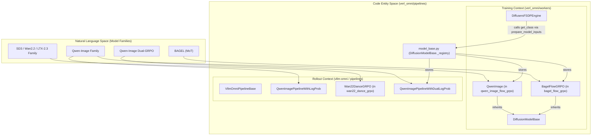
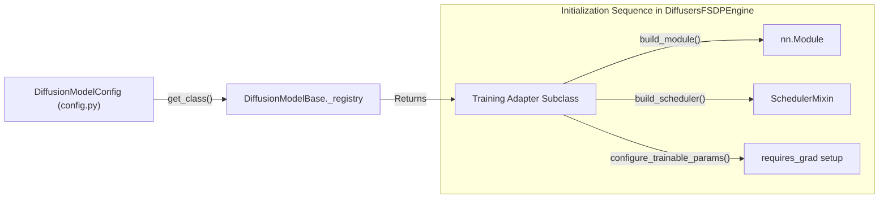

<!-- source: DeepWiki mcp.deepwiki.com · repo verl-project/verl-omni · page 5 Pipeline Adapters and Model Integration · fetched 2026-10-30 -->

# Pipeline Adapters and Model Integration

Relevant source files

The following files were used as context for generating this wiki page:

- [docs/contributing/integrating_a_diffusion_model.md](docs/contributing/integrating_a_diffusion_model.md)
- [tests/agent_loop/test_composite_agent_loop.py](tests/agent_loop/test_composite_agent_loop.py)
- [tests/gpu_smoke/run_gpu_smoke_core.sh](tests/gpu_smoke/run_gpu_smoke_core.sh)
- [verl_omni/__init__.py](verl_omni/__init__.py)
- [verl_omni/agent_loop/__init__.py](verl_omni/agent_loop/__init__.py)
- [verl_omni/agent_loop/composite_agent_loop.py](verl_omni/agent_loop/composite_agent_loop.py)
- [verl_omni/pipelines/__init__.py](verl_omni/pipelines/__init__.py)
- [verl_omni/pipelines/model_base.py](verl_omni/pipelines/model_base.py)
- [verl_omni/pipelines/qwen_image_dual_grpo/__init__.py](verl_omni/pipelines/qwen_image_dual_grpo/__init__.py)
- [verl_omni/pipelines/qwen_image_dual_grpo/vllm_omni_rollout_adapter.py](verl_omni/pipelines/qwen_image_dual_grpo/vllm_omni_rollout_adapter.py)
- [verl_omni/pipelines/qwen_image_flow_grpo/vllm_omni_rollout_adapter.py](verl_omni/pipelines/qwen_image_flow_grpo/vllm_omni_rollout_adapter.py)
- [verl_omni/pipelines/qwen_image_mix_grpo/vllm_omni_rollout_adapter.py](verl_omni/pipelines/qwen_image_mix_grpo/vllm_omni_rollout_adapter.py)
- [verl_omni/workers/rollout/vllm_rollout/vllm_omni_async_server.py](verl_omni/workers/rollout/vllm_rollout/vllm_omni_async_server.py)

The **Pipeline Adapter System** in VeRL-Omni provides a unified interface for integrating diverse diffusion and flow-matching models into the RL training loop. It abstracts the differences between model families (e.g., Qwen-Image, SD3, Wan2.2, BAGEL, LTX-2.3) and ensures that both the **Rollout Context** (running in vLLM-Omni) and the **Training Context** (running in FSDP2 or VeOmni) remain mathematically synchronized.

### Two-Context Architecture

VeRL-Omni operates across two distinct execution environments. The adapter system ensures that a model registered under a specific name behaves identically in both contexts [verl_omni/pipelines/model_base.py:31-33]():

1.  **Rollout Context (vLLM-Omni):** High-throughput sampling using continuous batching. Adapters here (subclassing `VllmOmniPipelineBase`) run the SDE/ODE loop and return latents, log-probs, and prompt embeddings [docs/contributing/integrating_a_diffusion_model.md:58-59]().
2.  **Training Context (FSDP2 / VeOmni):** Distributed gradient descent. Adapters here subclass `DiffusionModelBase` to re-run denoising steps and compute fresh log-probs for the policy gradient [verl_omni/pipelines/model_base.py:28-46]().

#### Registry and Code Entity Mapping

The system uses a string-based registry pattern to map architecture names and algorithm types to their respective adapter implementations [verl_omni/pipelines/model_base.py:48-58](). The `architecture` string must match the `_class_name` found in the model's `model_index.json` [verl_omni/pipelines/model_base.py:63-65]().

| Component | Code Entity / Base Class | Role |
| :--- | :--- | :--- |
| **Training Adapter** | `DiffusionModelBase` | Abstract base class for loading, scheduling, and forward logic [verl_omni/pipelines/model_base.py:28-46](). |
| **Rollout Adapter** | `VllmOmniPipelineBase` | Abstract base for vLLM-Omni pipelines capturing RL-required outputs [verl_omni/pipelines/model_base.py:207-213](). |
| **I2I Training Adapter** | `DiffusionI2IModelBase` | Extension for image-to-image models requiring condition injection [verl_omni/pipelines/model_base.py:189-191](). |
| **Registry Hook** | `@DiffusionModelBase.register` | Decorator to map `(architecture, algorithm)` to a subclass [verl_omni/pipelines/model_base.py:51-58](). |
| **Resolution** | `get_class_by_name` | Resolves the correct adapter class from the internal `_registry` dict [verl_omni/pipelines/model_base.py:78-98](). |

**Model Integration Flow**

**Sources:** [verl_omni/pipelines/__init__.py:15-27](), [verl_omni/pipelines/model_base.py:48-58](), [docs/contributing/integrating_a_diffusion_model.md:34-39](), [verl_omni/pipelines/qwen_image_flow_grpo/vllm_omni_rollout_adapter.py:49-60](), [verl_omni/pipelines/qwen_image_dual_grpo/vllm_omni_rollout_adapter.py:56-57]()

---

### Qwen-Image Pipeline Adapters
The Qwen-Image adapters are the primary reference for multimodal diffusion models. They support **FlowGRPO**, **MixGRPO**, **DPO**, **DiffusionNFT**, and **Dual-GRPO** [verl_omni/pipelines/__init__.py:18-24](). These adapters implement a specific "Ulysses mask patch" for `QwenImageTransformer2DModel` to enable sequence parallelism during training [verl_omni/pipelines/model_base.py:66-74](). The rollout side captures per-step log-probabilities using a custom SDE-based scheduler [verl_omni/pipelines/qwen_image_flow_grpo/vllm_omni_rollout_adapter.py:51-60](). The `QwenImagePipelineWithDualLogProb` variant additionally supports autoregressive text generation from the text encoder before DiT sampling [verl_omni/pipelines/qwen_image_dual_grpo/vllm_omni_rollout_adapter.py:57-71]().

For details, see [Qwen-Image Pipeline Adapters](#5.1).

**Sources:** [verl_omni/pipelines/__init__.py:18-24](), [verl_omni/pipelines/model_base.py:66-74](), [verl_omni/pipelines/qwen_image_flow_grpo/vllm_omni_rollout_adapter.py:51-60](), [verl_omni/pipelines/qwen_image_dual_grpo/vllm_omni_rollout_adapter.py:57-71]()

---

### BAGEL and Non-Diffusers Model Integration
While most models use the `diffusers` library, some models like **BAGEL** (Mixture-of-Transformers) require custom loading logic. The `DiffusionModelBase` provides a `build_module` hook to load models that `diffusers.AutoModel` cannot handle [verl_omni/pipelines/model_base.py:101-107](). For these cases, `NonDiffusersModelBase` provides a standalone `nn.Module` template that manages its own `from_pretrained` logic [docs/contributing/integrating_a_diffusion_model.md:16-19]().

For details, see [BAGEL and Non-Diffusers Model Integration](#5.2).

**Sources:** [verl_omni/pipelines/model_base.py:101-107](), [docs/contributing/integrating_a_diffusion_model.md:16-19]()

---

### SD3, Wan2.2, and LTX-2.3 Pipeline Adapters
These models require specific handling of time-shifting and sigma schedules. The SD3 adapter implements the `FlowGRPO` and `DPO` objectives [verl_omni/pipelines/__init__.py:25-26](). The Wan2.2 adapter enables **DanceGRPO** for video [verl_omni/pipelines/__init__.py:27-27](), and LTX-2.3 supports text-to-audio-video generation [verl_omni/pipelines/__init__.py:17-17]().

For details, see [SD3, Wan2.2, and LTX-2.3 Pipeline Adapters](#5.3).

**Sources:** [verl_omni/pipelines/__init__.py:17-27]()

---

### Experimental Stepwise and I2I Integration
The system supports experimental **step-wise** execution where the rollout loop is managed externally to allow for continuous batching [docs/contributing/integrating_a_diffusion_model.md:58-61](). This mode requires overrides for `prepare_encode` and `post_decode` [verl_omni/pipelines/qwen_image_mix_grpo/vllm_omni_rollout_adapter.py:55-72](). Additionally, the `DiffusionI2IModelBase` provides hooks for **Image-to-Image (I2I)** tasks, including `prepare_condition` for injecting VAE-encoded images into the denoising stream [verl_omni/pipelines/model_base.py:189-204]().

For details, see [Experimental Stepwise Pipelines and Image-to-Image Integration](#5.4).

**Sources:** [verl_omni/pipelines/model_base.py:189-204](), [verl_omni/pipelines/qwen_image_mix_grpo/vllm_omni_rollout_adapter.py:55-72]()

---

### Model Registration Pattern

To integrate a new model, developers must register their classes using the `@register` decorator, which maps the pair `(architecture, algorithm)` to the class [verl_omni/pipelines/model_base.py:51-58]().

**Registration Logic**

**Sources:** [verl_omni/pipelines/model_base.py:48-132](), [verl_omni/workers/rollout/vllm_rollout/vllm_omni_async_server.py:83-99](), [verl_omni/pipelines/qwen_image_flow_grpo/vllm_omni_rollout_adapter.py:49-51]()

---

