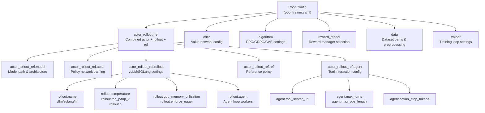
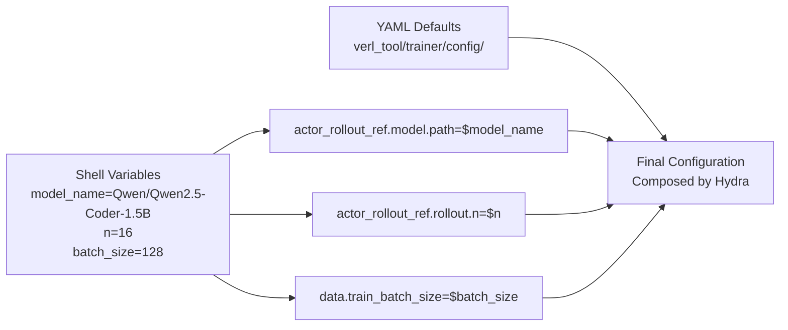
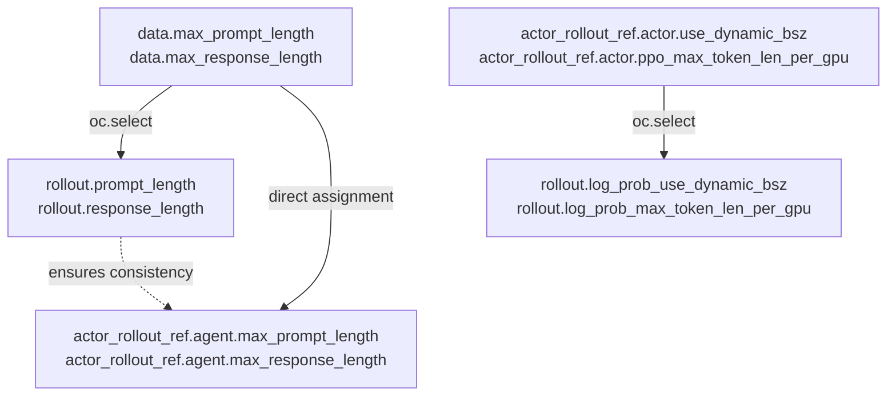

<!-- source: DeepWiki mcp.deepwiki.com · repo TIGER-AI-Lab/verl-tool · page 2.4 Configuration System · fetched 2026-10-30 -->

# Configuration System

<details>
<summary>Relevant source files</summary>

The following files were used as context for generating this wiki page:

- [examples/data_preprocess/acecoder.py](examples/data_preprocess/acecoder.py)
- [examples/train/mathcoder/train.sh](examples/train/mathcoder/train.sh)
- [examples/train/mathcoder/train_1.5b.sh](examples/train/mathcoder/train_1.5b.sh)
- [verl_tool/trainer/config/rollout/rollout.yaml](verl_tool/trainer/config/rollout/rollout.yaml)

</details>


## Purpose and Scope

This document covers VerlTool's Hydra-based configuration system, including the hierarchical configuration structure, configuration file organization, parameter override mechanisms, and cross-referencing patterns using OmegaConf. This page focuses on the configuration framework itself and how to compose and override parameters.

For information about specific training recipes and parameter tuning for different tasks, see [Training Recipes](#5). For details about the rollout and vLLM integration parameters, see [Rollout and vLLM Integration](#2.5). For agent-specific configuration parameters, see [Agent Loop System](#2.3).

---

## Hydra Configuration Framework

VerlTool uses [Hydra](https://hydra.cc) as its configuration management framework, enabling hierarchical configuration composition, command-line overrides, and structured parameter organization. The configuration system is based on YAML files located in `verl_tool/trainer/config/` and its subdirectories.

### Key Components

| Component | Purpose | Location |
|-----------|---------|----------|
| **Hydra Entrypoint** | Main entry decorated with `@hydra.main` | `verl_tool/trainer/main_ppo.py` |
| **Config Directory** | YAML configuration files | `verl_tool/trainer/config/` |
| **OmegaConf** | Dynamic configuration resolution | Used throughout configuration system |
| **Command-line Overrides** | Parameter overrides in training scripts | `examples/train/*/train*.sh` |

The main training entrypoint uses Hydra's decorator pattern to load and compose configurations:

```python
@hydra.main(config_path='config', config_name='ppo_trainer', version_base=None)
def main(config):
    # Configuration is automatically loaded and composed
    trainer = AgentRayPPOTrainer(config)
```

**Sources:** [verl_tool/trainer/main_ppo.py](), [examples/train/mathcoder/train.sh:55-126]()

---

## Configuration Hierarchy

The configuration system is organized into a hierarchical structure with the following top-level groups:



**Sources:** [verl_tool/trainer/config/]()

---

## Core Configuration Groups

### actor_rollout_ref Configuration

The `actor_rollout_ref` group combines configuration for the actor (policy network), rollout engine (vLLM/SGLang), reference policy, and agent loop. This unified structure reflects the fact that these components share the same base model and coordinate during training.

#### Structure

```yaml
actor_rollout_ref:
  model:
    path: ???                              # HuggingFace model path
    enable_gradient_checkpointing: True    # Memory optimization
    use_remove_padding: True               # Sequence packing
  
  actor:
    strategy: fsdp                         # fsdp/megatron/pp
    optim:
      lr: 1e-6                             # Actor learning rate
    ppo_mini_batch_size: 128               # PPO mini-batch size
    ppo_micro_batch_size_per_gpu: 1        # Per-GPU micro-batch
    use_dynamic_bsz: True                  # Enable sequence packing
    use_kl_loss: True                      # KL divergence loss
    kl_loss_coef: 0.0                      # KL loss coefficient
    fsdp_config:
      param_offload: True                  # CPU offloading
      optimizer_offload: True              # Optimizer offloading
  
  rollout:
    name: vllm                             # vllm/sglang/hf
    temperature: 1.0                       # Sampling temperature
    top_p: 1.0                             # Nucleus sampling
    n: 16                                  # Samples per prompt (GRPO)
    gpu_memory_utilization: 0.5            # KV cache memory fraction
    tensor_model_parallel_size: 1          # Tensor parallelism
    log_prob_micro_batch_size_per_gpu: 8   # Log prob batch size
  
  ref:
    log_prob_micro_batch_size_per_gpu: 8   # Reference log prob batch
    fsdp_config:
      param_offload: True                  # CPU offloading
  
  agent:
    tool_server_url: ???                   # HTTP endpoint for tools
    max_turns: 1                           # Maximum interaction turns
    max_obs_length: 512                    # Maximum observation tokens
    action_stop_tokens: ???                # File path with stop tokens
```

**Key Configuration Patterns:**

| Parameter | Training Value | Validation Value | Purpose |
|-----------|----------------|------------------|---------|
| `temperature` | 1.0 | 0.0 | Exploration during training, deterministic during validation |
| `n` | 16 | 1 | Multiple samples for GRPO, single sample for evaluation |
| `gpu_memory_utilization` | 0.4-0.8 | N/A | Balance between KV cache and training memory |
| `do_offload` | True (if GPU util > 0.6) | N/A | CPU offloading to prevent OOM |

**Sources:** [examples/train/mathcoder/train_1.5b.sh:69-108](), [verl_tool/trainer/config/rollout/rollout.yaml]()

---

### Rollout Configuration Deep Dive

The rollout configuration controls the inference engine (vLLM/SGLang) used for trajectory generation. This is defined in `rollout.yaml`:

#### Core Rollout Parameters

```yaml
rollout:
  # Engine selection
  name: vllm                               # vllm/sglang/hf
  mode: sync                               # sync/async (async gives 1.69x-2.06x speedup)
  
  # Sampling parameters
  temperature: 1.0                         # Exploration temperature
  top_k: -1                                # -1 for vLLM, 0 for HF
  top_p: 1.0                               # Nucleus sampling
  n: 1                                     # Number of samples per prompt
  
  # Memory configuration
  gpu_memory_utilization: 0.5              # Fraction for KV cache
  enforce_eager: False                     # Disable CUDA graphs if True
  cudagraph_capture_sizes: null            # Custom CUDA graph sizes
  free_cache_engine: True                  # Free cache after generation
  
  # Parallelism
  tensor_model_parallel_size: 2            # TP size
  data_parallel_size: 1                    # DP size
  pipeline_model_parallel_size: 1          # PP size
  
  # Batching
  max_num_batched_tokens: 8192             # Max tokens in batch
  max_num_seqs: 1024                       # Max sequences in batch
  enable_chunked_prefill: True             # Chunked prefill optimization
  enable_prefix_caching: False             # Prefix caching
  
  # Log probability computation
  log_prob_micro_batch_size_per_gpu: null  # Batch size for log prob
  log_prob_use_dynamic_bsz: false          # Dynamic batching for log prob
  log_prob_max_token_len_per_gpu: 16384    # Max tokens per GPU
```

**Sources:** [verl_tool/trainer/config/rollout/rollout.yaml:1-112]()

---

### Agent Configuration

The agent configuration within `actor_rollout_ref.agent` controls tool interaction behavior:

```yaml
actor_rollout_ref.agent:
  tool_server_url: http://host:port/get_observation
  max_turns: 1                             # Maximum interaction turns
  max_prompt_length: 1024                  # Maximum prompt tokens
  max_response_length: 3072                # Maximum response tokens
  max_obs_length: 512                      # Maximum observation tokens
  action_stop_tokens: /path/to/tokens      # File with stop tokens
  
  # Additional parameters from rollout.agent
  num_workers: 8                           # Number of agent loop workers
  default_agent_loop: verltool_agent       # Default agent loop class
  agent_loop_config_path: null             # Custom agent loop configs
```

**Action Stop Tokens:**

Action stop tokens are specified in a file (workaround for shell escaping issues) and define when to trigger tool calls:

```bash
# In training script
action_stop_tokens="\`\`\`output"
action_stop_tokens_file="$(pwd)$(mktemp)"
echo -e -n "$action_stop_tokens" | tee $action_stop_tokens_file

# Pass to config
actor_rollout_ref.agent.action_stop_tokens=$action_stop_tokens_file
```

**Sources:** [examples/train/mathcoder/train_1.5b.sh:21-22,44-49,86-92](), [verl_tool/trainer/config/rollout/rollout.yaml:200-223]()

---

### Critic Configuration

The critic network (value function) has its own configuration group:

```yaml
critic:
  model:
    path: ${actor_rollout_ref.model.path}  # Usually same as actor
  strategy: fsdp                            # Training strategy
  optim:
    lr: 1e-5                                # Critic learning rate (higher than actor)
  ppo_micro_batch_size_per_gpu: 1          # Per-GPU micro-batch
  ulysses_sequence_parallel_size: 1        # Sequence parallelism
  model:
    fsdp_config:
      fsdp_size: -1                         # FSDP world size
```

**Key Design Note:** The critic learning rate (1e-5) is typically higher than the actor learning rate (1e-6) to allow faster value function learning.

**Sources:** [examples/train/mathcoder/train_1.5b.sh:109-114]()

---

### Algorithm Configuration

Controls the advantage estimation and KL divergence:

```yaml
algorithm:
  adv_estimator: grpo                      # grpo/gae
  kl_ctrl:
    kl_coef: 0.0                           # KL coefficient (adaptive KL)
```

**Advantage Estimators:**

| Estimator | Description | Use Case |
|-----------|-------------|----------|
| `gae` | Generalized Advantage Estimation (PPO) | Standard PPO training with n=1 |
| `grpo` | Group-normalized Relative Policy Optimization | Training with n>1 samples for exploration |

**Sources:** [examples/train/mathcoder/train_1.5b.sh:9,60,115]()

---

### Reward Model Configuration

Specifies which reward manager to use:

```yaml
reward_model:
  reward_manager: mathcoder                # mathcoder/torl/acecoder/sql/pixel
  style: rule                               # rule-based or learned
  ground_truth: ""                          # Ground truth for verification
```

**Available Reward Managers:**

- `mathcoder`: Math + code hybrid tasks
- `torl`: Math reasoning with tool use
- `acecoder`: Code generation with test cases
- `sql`: SQL query execution
- `pixel_reasoner`: Vision reasoning tasks
- `deepsearch`: Web search tasks

For details on reward managers, see [Reward Management System](#6).

**Sources:** [examples/train/mathcoder/train_1.5b.sh:28,68](), [examples/data_preprocess/acecoder.py:58-61]()

---

### Data Configuration

Controls dataset loading and preprocessing:

```yaml
data:
  train_files: [path/to/train.parquet, ...]
  val_files: [path/to/val.parquet, ...]
  train_batch_size: 128                    # Training batch size
  val_batch_size: 128                      # Validation batch size
  max_prompt_length: 1024                  # Maximum prompt tokens
  max_response_length: 3072                # Maximum response tokens
  truncation: right                        # left/right truncation
```

**File Path Format:**

Training scripts use bash arrays for multiple data sources:

```bash
train_data=[$(pwd)/data/mathcoder/code_train.parquet,\
$(pwd)/data/mathcoder/math_train.parquet]
val_data=[$(pwd)/data/mathcoder/code_test.parquet,\
$(pwd)/data/math_torl/math500_test.parquet]

# Passed to config
data.train_files=$train_data
data.val_files=$val_data
```

**Sources:** [examples/train/mathcoder/train_1.5b.sh:2-7,61-67]()

---

### Trainer Configuration

Controls the training loop orchestration:

```yaml
trainer:
  logger: [console, wandb]                 # Logging backends
  project_name: mathcoder                  # Wandb project
  experiment_name: ${run_name}             # Experiment identifier
  
  # Distributed training
  n_gpus_per_node: 8                       # GPUs per node
  nnodes: 1                                # Number of nodes
  
  # Training schedule
  total_epochs: 10                         # Total training epochs
  save_freq: 10                            # Checkpoint frequency
  test_freq: 10                            # Validation frequency
  
  # Flags
  val_before_train: True                   # Validate before training
  default_hdfs_dir: null                   # HDFS checkpoint directory
  +remove_previous_ckpt_in_save: True      # Delete old checkpoints
```

**Sources:** [examples/train/mathcoder/train_1.5b.sh:116-126]()

---

## Parameter Override System

VerlTool uses Hydra's command-line override syntax to customize configurations without modifying YAML files.

### Override Syntax

```bash
python -m verl_tool.trainer.main_ppo \
    group.subgroup.parameter=value \
    +new_parameter=value \              # Add new parameter
    ~parameter_to_delete \              # Delete parameter
    ++force_override=value              # Force add even if exists
```

### Common Override Patterns



### Example Override Script

```bash
# Define variables
model_name=Qwen/Qwen2.5-Coder-1.5B
n=16
batch_size=128
lr=1e-6

# Launch with overrides
python3 -m verl_tool.trainer.main_ppo \
    actor_rollout_ref.model.path=$model_name \
    actor_rollout_ref.actor.optim.lr=$lr \
    actor_rollout_ref.rollout.n=$n \
    data.train_batch_size=$batch_size
```

**Sources:** [examples/train/mathcoder/train_1.5b.sh:59-126]()

---

## Configuration Inheritance and Cross-References

VerlTool extensively uses OmegaConf's `oc.select` to reference and inherit values between configuration groups.

### Cross-Reference Patterns

```yaml
# Reference data config from rollout config
rollout:
  prompt_length: ${oc.select:data.max_prompt_length,512}
  response_length: ${oc.select:data.max_response_length,512}

# Reference actor config from rollout config
rollout:
  log_prob_use_dynamic_bsz: ${oc.select:actor_rollout_ref.actor.use_dynamic_bsz,false}
  log_prob_max_token_len_per_gpu: ${oc.select:actor_rollout_ref.actor.ppo_max_token_len_per_gpu,16384}

# Reference global profiler config
rollout:
  profiler:
    tool: ${oc.select:global_profiler.tool,null}
    enable: ${oc.select:actor_rollout_ref.actor.profiler.enable,false}
```

### Reference Flow Diagram



**Syntax:**

```yaml
${oc.select:path.to.parameter,default_value}
```

- **First argument**: Path to reference parameter
- **Second argument**: Default value if reference doesn't exist

**Sources:** [verl_tool/trainer/config/rollout/rollout.yaml:21-25,88-92,283-298]()

---

## Environment Variables

VerlTool relies on environment variables for API keys, runtime settings, and distributed training configuration.

### Critical Environment Variables

| Variable | Purpose | Example | Set In |
|----------|---------|---------|--------|
| `SERPER_API_KEY` | Google Search API (SerperDev) | `export SERPER_API_KEY=xxx` | Training script |
| `VLLM_USE_V1` | Enable vLLM v1 API | `export VLLM_USE_V1=1` | Training script |
| `CUDA_VISIBLE_DEVICES` | GPU visibility | `export CUDA_VISIBLE_DEVICES=0,1,2,3` | Training script |
| `NCCL_DEBUG` | NCCL debugging info | `export NCCL_DEBUG=INFO` | Training script |
| `VERL_RUN_ID` | Unique run identifier | `export VERL_RUN_ID=$run_name` | Training script |
| `RAY_EXPERIMENTAL_NOSET_CUDA_VISIBLE_DEVICES` | Ray CUDA control | `export RAY_EXPERIMENTAL_NOSET_CUDA_VISIBLE_DEVICES=1` | Multi-node setup |

### Environment Setup in Training Scripts

```bash
# Set run identifier
export VERL_RUN_ID=$run_name
export NCCL_DEBUG=INFO

# For vLLM v1 API
export VLLM_USE_V1=1

# For Google Search Tool
export SERPER_API_KEY=your_api_key_here

# For multi-node training with TP >= 8
export RAY_EXPERIMENTAL_NOSET_CUDA_VISIBLE_DEVICES=1
export CUDA_VISIBLE_DEVICES=0,1,2,3,4,5,6,7
```

**Sources:** [examples/train/mathcoder/train_1.5b.sh:42-43](), [verl_tool/trainer/config/rollout/rollout.yaml:244-247]()

---

## Common Configuration Patterns

### Pattern 1: Memory-Optimized Configuration

For models that don't fit in GPU memory:

```bash
gpu_memory_utilization=0.5               # Conservative KV cache
do_offload=True                          # Enable CPU offloading
use_dynamic_bsz=True                     # Sequence packing
ppo_micro_batch_size_per_gpu=1          # Small micro-batches

python3 -m verl_tool.trainer.main_ppo \
    actor_rollout_ref.rollout.gpu_memory_utilization=$gpu_memory_utilization \
    actor_rollout_ref.actor.fsdp_config.param_offload=$do_offload \
    actor_rollout_ref.actor.fsdp_config.optimizer_offload=$do_offload \
    actor_rollout_ref.actor.use_dynamic_bsz=$use_dynamic_bsz \
    actor_rollout_ref.actor.ppo_micro_batch_size_per_gpu=$ppo_micro_batch_size_per_gpu
```

**Rule of Thumb:** If `gpu_memory_utilization > 0.6`, set `do_offload=True` to prevent OOM.

**Sources:** [examples/train/mathcoder/train_1.5b.sh:32-33,82-83]()

---

### Pattern 2: GRPO Training Configuration

For group-normalized policy optimization with exploration:

```bash
rl_alg=grpo                              # Use GRPO instead of GAE
n=16                                     # Multiple samples per prompt
temperature=1.0                          # High temperature for exploration
batch_size=128                           # Total batch size

python3 -m verl_tool.trainer.main_ppo \
    algorithm.adv_estimator=$rl_alg \
    actor_rollout_ref.rollout.n=$n \
    actor_rollout_ref.rollout.temperature=$temperature \
    data.train_batch_size=$batch_size
```

**GRPO requires `n > 1`** for group normalization to be effective.

**Sources:** [examples/train/mathcoder/train_1.5b.sh:9,12,18,60,102]()

---

### Pattern 3: Multi-Turn Tool Interaction

For tasks requiring multiple tool calls:

```bash
max_turns=3                              # Up to 3 turns
max_obs_length=512                       # Observation truncation
action_stop_tokens="\`\`\`output"       # Stop token for actions

# Create temporary file for action tokens
action_stop_tokens_file="$(pwd)$(mktemp)"
echo -e -n "$action_stop_tokens" | tee $action_stop_tokens_file

python3 -m verl_tool.trainer.main_ppo \
    actor_rollout_ref.agent.max_turns=$max_turns \
    actor_rollout_ref.agent.max_obs_length=$max_obs_length \
    actor_rollout_ref.agent.action_stop_tokens=$action_stop_tokens_file
```

**Sources:** [examples/train/mathcoder/train_1.5b.sh:21-22,91]()

---

### Pattern 4: Validation Configuration

Validation uses deterministic sampling:

```yaml
# In rollout.yaml
val_kwargs:
  temperature: 0                         # Greedy sampling
  n: 1                                   # Single sample
  do_sample: False                       # Deterministic
```

Override in script:

```bash
python3 -m verl_tool.trainer.main_ppo \
    trainer.val_before_train=True \
    trainer.test_freq=10
```

**Sources:** [examples/train/mathcoder/train_1.5b.sh:119,125](), [verl_tool/trainer/config/rollout/rollout.yaml:123-142]()

---

### Pattern 5: Tool Server Integration

Tool server must be launched before training and URL passed to config:

```bash
# Start tool server in background
host=$(hostname -I | awk '{print $1}')
port=$(shuf -i 30000-31000 -n 1)
tool_server_url=http://$host:$port/get_observation

python -m verl_tool.servers.serve \
    --host $host \
    --port $port \
    --tool_type "python_code" \
    --workers_per_tool 32 &
server_pid=$!

# Pass URL to training
python3 -m verl_tool.trainer.main_ppo \
    actor_rollout_ref.agent.tool_server_url=$tool_server_url

# Cleanup on exit
pkill -P -9 $server_pid
kill -9 $server_pid
```

**Sources:** [examples/train/mathcoder/train_1.5b.sh:48-57,86,129-130]()

---

## Configuration File Organization

```
verl_tool/trainer/config/
├── ppo_trainer.yaml              # Root config
├── actor_rollout_ref/
│   ├── default.yaml              # Combined actor+rollout+ref config
│   └── ...
├── rollout/
│   ├── rollout.yaml              # Rollout-specific settings
│   └── ...
├── algorithm/
│   ├── grpo.yaml                 # GRPO config
│   ├── gae.yaml                  # GAE/PPO config
│   └── ...
├── critic/
│   └── default.yaml              # Critic config
├── model/
│   └── default.yaml              # Model architecture config
└── trainer/
    └── default.yaml              # Trainer loop config
```

**Configuration Composition:**

Hydra automatically composes configurations from these directories based on the group names. The final configuration is the result of:

1. Loading base YAML files
2. Applying configuration group selections
3. Resolving `oc.select` references
4. Applying command-line overrides

**Sources:** [verl_tool/trainer/config/]()

---

## Advanced Configuration Features

### Skip Rollout for Debugging

```yaml
rollout:
  skip_rollout: True                     # Load cached rollout data
  skip_dump_dir: /tmp/rollout_dump       # Cache directory
```

This loads previously generated rollouts from disk, useful for debugging reward computation or policy updates without regenerating trajectories. See [Debugging and Profiling](#9.4) for more details.

**Sources:** [verl_tool/trainer/config/rollout/rollout.yaml:265-269]()

---

### Profiler Configuration

```yaml
rollout:
  profiler:
    tool: nsys                           # nsys/npu/torch
    enable: False                        # Enable profiling
    all_ranks: False                     # Profile all ranks
    ranks: [0]                           # Specific ranks to profile
    save_path: /tmp/profiles             # Profile output directory
```

For detailed profiling setup, see [Debugging and Profiling](#9.4).

**Sources:** [verl_tool/trainer/config/rollout/rollout.yaml:276-298]()

---

### Multi-Node Configuration

For distributed training across multiple nodes:

```bash
# On all nodes
export RAY_EXPERIMENTAL_NOSET_CUDA_VISIBLE_DEVICES=1
export CUDA_VISIBLE_DEVICES=0,1,2,3,4,5,6,7

# In training config
trainer.n_gpus_per_node=8
trainer.nnodes=4                         # 4 nodes total
```

For detailed multi-node setup, see [Multi-Node Training Setup](#9.5).

**Sources:** [examples/train/mathcoder/train_1.5b.sh:121-122](), [verl_tool/trainer/config/rollout/rollout.yaml:244-247]()

---

## Summary

The VerlTool configuration system provides:

1. **Hierarchical Organization**: Structured YAML configs organized by component (actor, critic, rollout, etc.)
2. **Command-Line Overrides**: Shell variable substitution for easy parameter tuning
3. **Cross-References**: OmegaConf's `oc.select` for parameter inheritance and consistency
4. **Environment Variables**: External configuration for API keys and runtime settings
5. **Composable Patterns**: Common configuration patterns for memory optimization, GRPO training, multi-turn interaction, etc.

The configuration system balances flexibility (easy to override parameters) with consistency (shared parameters via references), enabling rapid experimentation while maintaining reproducibility.

**Sources:** [examples/train/mathcoder/train_1.5b.sh](), [examples/train/mathcoder/train.sh](), [verl_tool/trainer/config/rollout/rollout.yaml]()

---

