# Page: Overview

# Overview

<details>
<summary>Relevant source files</summary>

The following files were used as context for generating this wiki page:

- [README.md](README.md)
- [assets/docs/updates/verltool_v0.6.0_upgrade.md](assets/docs/updates/verltool_v0.6.0_upgrade.md)

</details>


## Purpose and Scope

This document provides a high-level introduction to VerlTool, a unified reinforcement learning framework for training tool-using agents. It covers the system's architectural philosophy, core components, and their relationships. For detailed information on specific subsystems, refer to the following pages:

- For training configuration and orchestration: see [Core Training Framework](#2)
- For tool server implementation and routing: see [Tool Server Architecture](#3)
- For specific tool implementations: see [Tool Implementations](#4)
- For training recipes and examples: see [Training Recipes](#5)
- For evaluation and deployment: see [Evaluation and Deployment](#8)

## What is VerlTool

VerlTool is a specialized reinforcement learning training framework for tool-using agents, built as an extension layer on top of the [Verl](https://github.com/volcengine/verl) RL framework (v0.6.0). It enables training language models to interact with external tools through multi-turn interactive reasoning, using Proximal Policy Optimization (PPO) or Group Relative Policy Optimization (GRPO) algorithms.

The framework supports training across diverse domains including mathematical reasoning with code execution, database querying with SQL, web search, and multi-modal visual reasoning. VerlTool's design philosophy emphasizes modularity, security, and scalability while maintaining a remarkably concise implementation—the core agent loop logic is under 200 lines of code.

**Key Repository Information:**

| Property | Value |
|----------|-------|
| Repository | https://github.com/TIGER-AI-Lab/verl-tool |
| Core Submodule | verl v0.6.0 |
| Inference Backend | vLLM v0.11.0 (primary), SGLang (alternative) |
| Main Entry Point | [`verl_tool/trainer/main_ppo.py`](verl_tool/trainer/main_ppo.py:37-44)() |
| Agent Loop | [`verl_tool/agent_loop/verltool_agent_loop.py`](verl_tool/agent_loop/verltool_agent_loop.py:1-200)() |
| Tool Server Router | [`verl_tool/servers/serve.py`](verl_tool/servers/serve.py:1-767)() |

Sources: [README.md:1-161](), [assets/docs/updates/verltool_v0.6.0_upgrade.md:1-11]()

## Core Architectural Principles

VerlTool is built on three foundational design principles:

### 1. Tool-as-Environment Paradigm

Unlike traditional tool-calling systems where tools are treated as stateless functions, VerlTool implements a **tool-as-environment** paradigm. Each tool interaction modifies persistent environment state that is maintained across multiple reasoning turns. This enables:

- Stateful multi-turn interactions (e.g., IPython kernel sessions that preserve variable state)
- Environment state caching per `trajectory_id` for trajectory-level consistency
- Proper cleanup and resource management when trajectories complete

The environment state is managed by the tool server and persists across HTTP requests within the same trajectory.

### 2. Complete Decoupling of Actor Rollout and Environment Interaction

VerlTool achieves a clean separation between the RL training loop and tool execution through:

- **Unified Tool Server API**: All tool interactions go through HTTP POST requests to `/get_observation` endpoint
- **Consistent Hashing**: Requests with the same `trajectory_id` are routed to the same backend worker to maintain statefulness
- **Independent Scaling**: Tool server workers can be scaled independently from training workers
- **Language Agnostic**: Tools can be implemented in any language as long as they expose the HTTP API

This decoupling allows the core agent loop to remain under 200 lines while supporting arbitrary tool types.

### 3. Hybrid Training Mode

VerlTool supports training on mixed datasets where some samples require tool use and others don't. The `use_tool` field in each data sample controls whether the agent loop calls the tool server:

- **Text-only mode**: When `use_tool=False`, the agent generates responses without tool interaction
- **Tool-enabled mode**: When `use_tool=True`, the agent can make tool calls and receive observations
- **Unified training**: Both modes share the same training pipeline, enabling efficient use of diverse datasets

Sources: [README.md:42-47](), [assets/docs/updates/verltool_v0.6.0_upgrade.md:5-10]()

## System Architecture Overview

VerlTool's architecture consists of five major subsystems that work together to enable tool-integrated RL training:

### Complete System Architecture

The following diagram illustrates how all major components interact across the training, inference, tool execution, and reward computation pipelines:

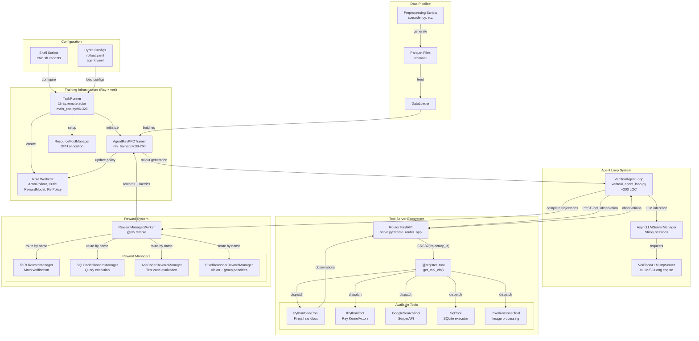

**Key Design Principles:**
- **Modularity**: Tools and reward managers are pluggable via decorators (`@register_tool`, `@register_reward_manager`)
- **Scalability**: Multi-worker tool servers, distributed Ray training, load-balanced LLM serving
- **Decoupling**: Complete separation of actor rollout from environment interaction via HTTP API
- **Statefulness**: Consistent hashing ensures trajectory-specific state persistence across requests

Sources: [verl_tool/trainer/main_ppo.py:37-414](), [verl_tool/trainer/ppo/ray_trainer.py:1-260](), [verl_tool/servers/serve.py:1-767](), [verl_tool/agent_loop/verltool_agent_loop.py:1-200]()

## Core Components

### Training Orchestration

The training process begins with [`main_ppo.py`](verl_tool/trainer/main_ppo.py:37-44)(), which uses Hydra for hierarchical configuration management. The flow proceeds through several key classes:

| Component | File Path | Class/Function | Purpose |
|-----------|-----------|----------------|---------|
| Entry Point | [`verl_tool/trainer/main_ppo.py`](verl_tool/trainer/main_ppo.py:37-44)() | `main()` | Hydra `@hydra.main()` decorator, config composition |
| Task Runner | [`verl_tool/trainer/main_ppo.py`](verl_tool/trainer/main_ppo.py:96-320)() | `TaskRunner` | `@ray.remote` actor for distributed orchestration |
| PPO Trainer | [`verl_tool/trainer/ppo/ray_trainer.py`](verl_tool/trainer/ppo/ray_trainer.py:39-260)() | `AgentRayPPOTrainer` | Extends `verl.trainer.ppo.RayPPOTrainer` |
| Custom Replacements | [`verl_tool/trainer/ppo/ray_trainer.py`](verl_tool/trainer/ppo/ray_trainer.py:24-37)() | `_mapping` dict | Replaces verl components with VerlTool versions |

**Training Orchestration Sequence**

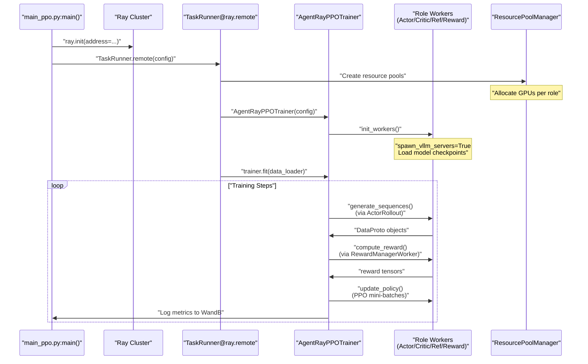

**verl Component Replacements**

VerlTool customizes verl's behavior by replacing key components in the `_mapping` dictionary at [`verl_tool/trainer/ppo/ray_trainer.py:24-37`](verl_tool/trainer/ppo/ray_trainer.py:24-37)(). This enables tool-specific features without modifying verl's core:

| Original Component | VerlTool Replacement | Purpose |
|-------------------|---------------------|---------|
| `verl.trainer.ppo.core_algos.compute_advantage` | `verl_tool.trainer.ppo.compute_advantage` | Custom advantage computation logic |
| `verl.trainer.ppo.compute_data_metrics` | `verl_tool.trainer.ppo.compute_data_metrics` | Tool-specific metric logging |
| `verl.trainer.ppo.compute_reward` | `verl_tool.trainer.ppo.compute_reward` | Reward manager integration |
| `verl.workers.rollout.vllm_rollout.VLLMHttpServer` | `verl_tool.workers.vllm_server.VerlToolvLLMHttpServer` | Async LLM server with sticky sessions |

Sources: [verl_tool/trainer/main_ppo.py:48-94](), [verl_tool/trainer/ppo/ray_trainer.py:24-260](), [README.md:1-161](), [assets/docs/updates/verltool_v0.6.0_upgrade.md:8-9]()

### Agent Loop System

The [`VerlToolAgentLoop`](verl_tool/agent_loop/verltool_agent_loop.py:1-200)() class implements multi-turn interactive reasoning between the language model and tools. The implementation is remarkably concise at under 200 lines of code, leveraging verl's agent loop abstraction.

**Core Agent Loop Interaction Flow**

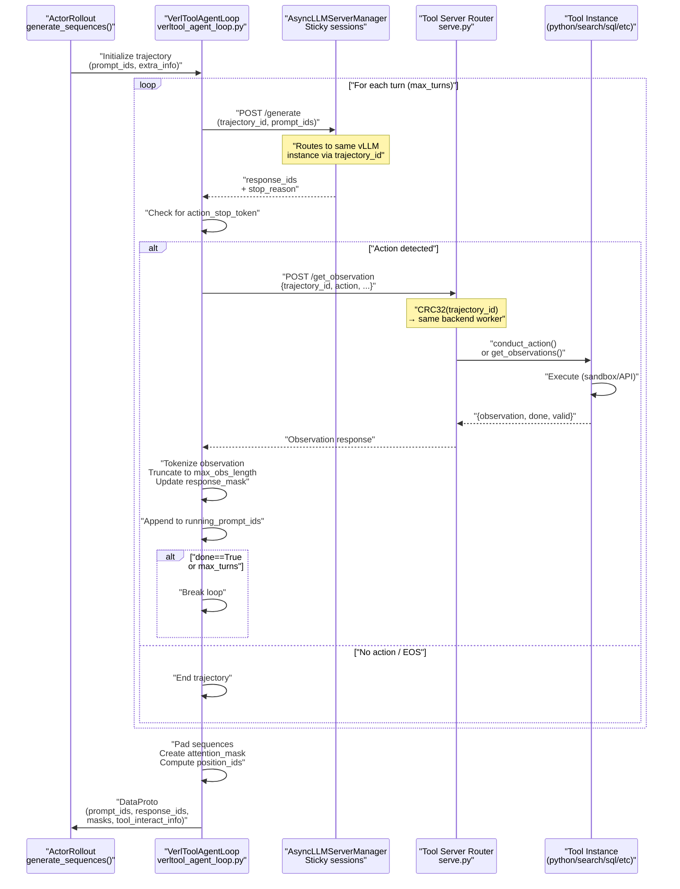

**Key Agent Loop Methods and Configuration**

The core logic is organized into these key methods in [`VerlToolAgentLoop`](verl_tool/agent_loop/verltool_agent_loop.py:50-180)():

| Method | Lines | Purpose |
|--------|-------|---------|
| `__init__()` | ~50-70 | Initialize config, tokenizer, tool server URL |
| `_generate_sequences()` | ~80-150 | Main multi-turn loop logic |
| `_post_process_observation()` | ~160-180 | Tokenize and truncate observations |

**Configuration Parameters:**

| Parameter | Config Path | Purpose | Default |
|-----------|-------------|---------|---------|
| `max_turns` | `agent.max_turns` | Maximum reasoning turns per trajectory | Task-specific |
| `action_stop_tokens` | `agent.action_stop_tokens` | Tokens signaling tool calls | Task-specific (e.g., `["</tool_call>"]`) |
| `mask_observations` | `agent.mask_observations` | Exclude observations from KL/gradient | `False` |
| `tool_server_url` | `agent.tool_server_url` | Tool server HTTP endpoint | `"http://localhost:5000"` |
| `use_tool` | Data sample field | Enable/disable tool calls per sample | `True` |
| `max_obs_length` | `agent.max_obs_length` | Maximum tokens per observation | `512` |

**Token Management:**
- `running_prompt_ids`: Accumulates tokens across turns (prompt + responses + observations)
- `response_mask`: Binary mask (0 for observations when `mask_observations=True`)
- `available_length = max_response_length - len(running_prompt_ids)`: Prevents context overflow

Sources: [verl_tool/agent_loop/verltool_agent_loop.py:1-200](), [assets/docs/updates/verltool_v0.6.0_upgrade.md:5-6](), [assets/docs/updates/verltool_v0.6.0_upgrade.md:10-10]()

### Tool Server Architecture

The tool server implements a **multi-worker router pattern** with consistent hashing for stateful tool interactions. The architecture separates routing concerns from tool execution logic.

**Tool Server Components and Routing**

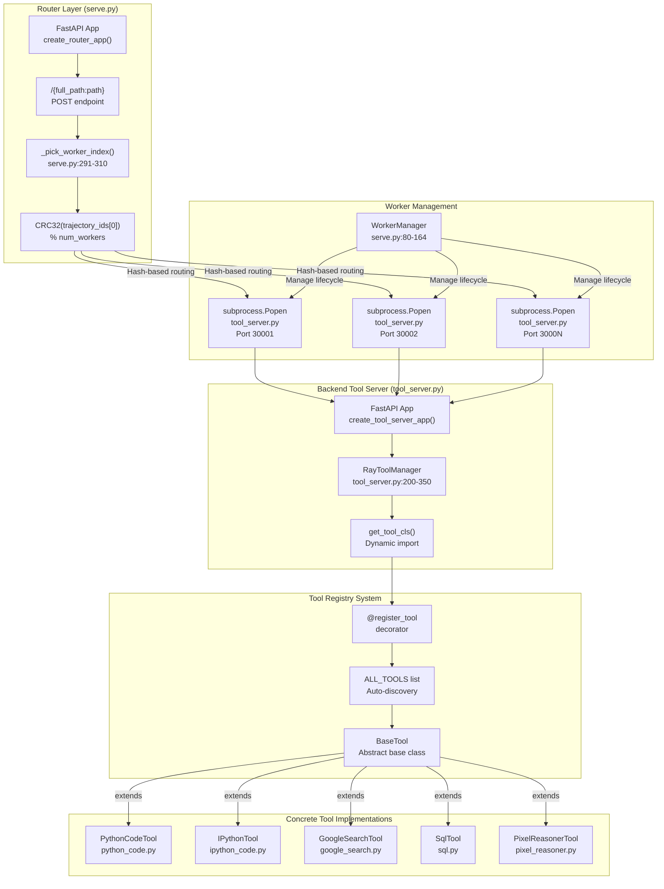

**Key Implementation Details:**

| Component | File Location | Key Method/Class | Purpose |
|-----------|---------------|------------------|---------|
| Router | [`verl_tool/servers/serve.py:213-429`](verl_tool/servers/serve.py:213-429)() | `create_router_app()` | FastAPI app with proxy handler |
| Consistent Hashing | [`verl_tool/servers/serve.py:291-310`](verl_tool/servers/serve.py:291-310)() | `_pick_worker_index()` | `crc32(trajectory_ids[0]) % num_workers` |
| Worker Manager | [`verl_tool/servers/serve.py:80-164`](verl_tool/servers/serve.py:80-164)() | `WorkerManager` | Subprocess lifecycle (SIGTERM/SIGKILL) |
| Backend Server | [`verl_tool/servers/tool_server.py:400-600`](verl_tool/servers/tool_server.py:400-600)() | `create_tool_server_app()` | Individual worker FastAPI app |
| Tool Manager | [`verl_tool/servers/tool_server.py:200-350`](verl_tool/servers/tool_server.py:200-350)() | `RayToolManager` | Ray actor pool for tool execution |
| Tool Registry | [`verl_tool/servers/tools/base_tool.py:15-30`](verl_tool/servers/tools/base_tool.py:15-30)() | `@register_tool` | Decorator for auto-discovery |

**Routing Strategies:**
- **Stateful (with trajectory_ids)**: `CRC32(trajectory_ids[0]) % num_workers` → ensures same trajectory → same backend
- **Stateless (no trajectory_ids)**: Round-robin distribution via `current_idx = (current_idx + 1) % num_workers`
- **Health Checks**: Router pings backends every 60s, removes unhealthy workers from pool

Sources: [verl_tool/servers/serve.py:1-767](), [verl_tool/servers/tool_server.py:1-600](), [verl_tool/servers/tools/base_tool.py:1-200]()

### Distributed Training Workers

VerlTool uses Ray for distributed training with multiple worker types:

| Worker Type | Role | Parallelism Strategy |
|-------------|------|---------------------|
| **ActorRollout** | Policy model for generation and training | FSDP/FSDP2 or Megatron (TP/PP/EP) |
| **Critic** | Value function estimation | FSDP/FSDP2 or Megatron |
| **RewardModel** | Model-based reward scoring (optional) | FSDP/FSDP2 or Megatron |
| **RefPolicy** | Reference policy for KL divergence | FSDP/FSDP2 or Megatron |

The `ResourcePoolManager` allocates GPUs into pools, with optional dedicated pool for reward models to prevent resource contention.

Sources: [verl_tool/trainer/main_ppo.py:112-226]()

## Training Workflow Overview

The complete training workflow integrates data preprocessing, multi-turn rollout generation, reward computation, and policy optimization. The process follows a standard RL training loop with tool-specific customizations.

**Complete Training Workflow**

```mermaid
flowchart TB
    subgraph Init["1. Initialization Phase"]
        LoadConfig["Load Hydra Config<br/>main_ppo.py:main()"]
        RayInit["ray.init()<br/>Connect to cluster"]
        SpawnRunner["TaskRunner.remote()<br/>@ray.remote actor"]
        CreateTrainer["AgentRayPPOTrainer<br/>ray_trainer.py:39-260"]
        InitWorkers["init_workers()<br/>Actor/Critic/Ref/Reward"]
        SpawnVLLM["Spawn vLLM servers<br/>spawn_vllm_servers=True"]
    end
    
    subgraph DataLoad["2. Data Loading"]
        LoadParquet["Load Parquet Dataset<br/>train.parquet"]
        CreateBatch["Create DataProto Batch<br/>prompt_ids, extra_info"]
        Sampler["DataLoader.sample()"]
    end
    
    subgraph Rollout["3. Rollout Phase"]
        GenSeq["ActorRollout.generate_sequences()"]
        AgentLoop["VerlToolAgentLoop<br/>Multi-turn execution"]
        LLMGen["vLLM Token Generation<br/>max_action_length tokens"]
        ToolCall["POST /get_observation<br/>Tool server HTTP call"]
        ObsProcess["Tokenize observation<br/>Update response_mask"]
        CheckDone["Check done or max_turns"]
    end
    
    subgraph Reward["4. Reward Computation"]
        RewardWorker["RewardManagerWorker.compute_score()"]
        ExtractAnswer["Extract answer/code<br/>Task-specific parsing"]
        Verify["Verify correctness<br/>Test cases/math_verify"]
        Penalties["Apply behavioral penalties<br/>Format/curiosity/redundancy"]
        RewardTensor["Create reward_tensor<br/>Sparse: at last token"]
    end
    
    subgraph Learn["5. Learning Phase"]
        ComputeAdv["Compute advantages<br/>GAE or GRPO"]
        PPOMiniBatch["PPO mini-batches<br/>Gradient accumulation"]
        UpdateActor["Update ActorRollout<br/>Policy gradient"]
        UpdateCritic["Update Critic<br/>Value loss"]
        KLPenalty["KL penalty vs RefPolicy"]
    end
    
    subgraph Log["6. Logging & Persistence"]
        WandB["WandB logging<br/>Metrics + accuracy"]
        SaveCkpt["Save checkpoint<br/>save_freq intervals"]
        DumpRollout["Dump rollout data<br/>trainer.rollout_data_dir"]
        Validation["Validation pass<br/>test_freq intervals"]
    end
    
    LoadConfig --> RayInit
    RayInit --> SpawnRunner
    SpawnRunner --> CreateTrainer
    CreateTrainer --> InitWorkers
    InitWorkers --> SpawnVLLM
    
    SpawnVLLM --> LoadParquet
    LoadParquet --> CreateBatch
    CreateBatch --> Sampler
    
    Sampler --> GenSeq
    GenSeq --> AgentLoop
    AgentLoop --> LLMGen
    LLMGen --> ToolCall
    ToolCall --> ObsProcess
    ObsProcess --> CheckDone
    CheckDone -->|"Continue"| LLMGen
    CheckDone -->|"Done"| RewardWorker
    
    RewardWorker --> ExtractAnswer
    ExtractAnswer --> Verify
    Verify --> Penalties
    Penalties --> RewardTensor
    
    RewardTensor --> ComputeAdv
    ComputeAdv --> PPOMiniBatch
    PPOMiniBatch --> UpdateActor
    PPOMiniBatch --> UpdateCritic
    UpdateActor --> KLPenalty
    
    KLPenalty --> WandB
    WandB --> SaveCkpt
    SaveCkpt --> DumpRollout
    DumpRollout --> Validation
    Validation -->|"Next epoch"| Sampler
```

**Key Training Loop Customizations:**

VerlTool replaces several verl components with custom implementations via the `_mapping` dictionary in [`verl_tool/trainer/ppo/ray_trainer.py:24-37`](verl_tool/trainer/ppo/ray_trainer.py:24-37)(). These replacements enable tool-specific features:

| Original verl Component | VerlTool Replacement | Key Additions |
|------------------------|----------------------|---------------|
| `verl.workers.rollout.vllm_rollout.VLLMHttpServer` | `verl_tool.workers.vllm_server.VerlToolvLLMHttpServer` | Async server with sticky sessions via `trajectory_id` |
| `verl.trainer.ppo.compute_reward` | `verl_tool.trainer.ppo.compute_reward` | Integration with `RewardManagerWorker` and task-specific managers |
| `verl.trainer.ppo.compute_data_metrics` | `verl_tool.trainer.ppo.compute_data_metrics` | Tool usage metrics: `tool_call_rate`, `verl_tool_metrics` |
| `verl.trainer.ppo.core_algos.compute_advantage` | `verl_tool.trainer.ppo.compute_advantage` | GRPO group-level normalization for n>1 samples |

**Rollout Data Persistence:**

Training trajectories are saved via [`trainer.rollout_data_dir`](verl_tool/trainer/ppo/ray_trainer.py:150-180)() for debugging and analysis:
- Path: Specified in config as `trainer.rollout_data_dir=$(pwd)/verl_step_records/$run_name`
- Format: JSON records with full trajectories, tool interactions, and rewards
- Contents: `prompt_ids`, `response_ids`, `tool_interact_info`, `reward`, `extra_info`

Sources: [verl_tool/trainer/ppo/ray_trainer.py:24-260](), [verl_tool/trainer/main_ppo.py:48-320](), [assets/docs/updates/verltool_v0.6.0_upgrade.md:9-9]()

## Key Capabilities

### Multi-Domain Training Support

VerlTool supports training across diverse domains through its modular tool and reward manager architecture:

| Domain | Tools | Reward Manager | Example Recipe | Key Features |
|--------|-------|----------------|----------------|--------------|
| **Mathematical Reasoning** | `PythonCodeTool` | `ToRLRewardManager` | [`math_tir`](examples/train/math_tir)() | Math verification via `sympy` |
| **Code Generation** | `IPythonTool` | `AceCoderRewardManager` | [`acecoder`](examples/train/acecoder)() | Test case execution |
| **Database Query** | `SqlTool` | `SQLCoderRewardManager` | [`skysql`](examples/train/skysql)() | Query execution comparison |
| **Web Search** | `GoogleSearchTool` | `DeepSearchRewardManager` | [`deepsearch`](examples/train/deepsearch)() | Multi-turn search reasoning |
| **Visual Reasoning** | `PixelReasonerTool` | `PixelReasonerRewardManager` | [`pixel_reasoner`](examples/train/pixel_reasoner)() | Image processing + group penalties |

### Rollout Mode Configuration

VerlTool supports two rollout modes with different performance characteristics:

| Mode | Config Value | Speedup | Use Case |
|------|-------------|---------|----------|
| **Synchronous** | `actor_rollout_ref.rollout.mode: "sync"` | Baseline | Simple tasks, fewer tool calls |
| **Asynchronous** | `actor_rollout_ref.rollout.mode: "async"` | 1.69x-2.06x | Tool-heavy workloads |

Async mode eliminates batching barriers by allowing trajectories to proceed independently. See [Asynchronous Rollout Mode](#2.6) for detailed configuration.

### Security and Sandboxing Layers

VerlTool implements multiple security layers for safe code execution:

| Security Layer | Implementation | File | Purpose |
|---------------|----------------|------|---------|
| **Firejail Sandbox** | `subprocess.Popen` with jail | [`verl_tool/servers/tools/python_code.py`](verl_tool/servers/tools/python_code.py:100-200)() | Isolate `PythonCodeTool` execution |
| **Resource Limits** | `timeout`, `max_memory` | [`verl_tool/servers/tools/python_code.py`](verl_tool/servers/tools/python_code.py:50-80)() | Prevent resource exhaustion |
| **Forbidden Imports** | `FORBIDDEN_IMPORTS` list | [`verl_tool/servers/tools/python_code.py`](verl_tool/servers/tools/python_code.py:30-40)() | Block dangerous modules |
| **Ray Actor Isolation** | `@ray.remote` actors | [`verl_tool/servers/tools/ipython_code.py`](verl_tool/servers/tools/ipython_code.py:50-150)() | Isolate IPython kernels |
| **SQL Transactions** | `BEGIN TRANSACTION`, `ROLLBACK` | [`verl_tool/servers/tools/sql.py`](verl_tool/servers/tools/sql.py:100-200)() | Prevent database modifications |

### Hybrid Training Mode

VerlTool supports training on mixed datasets where some samples use tools and others don't:

**Data Sample Structure:**
```python
{
    "prompt": [...],  # List of conversation turns
    "ability": "math_reasoning",
    "reward_manager": "torl",
    "use_tool": True,  # Controls tool server calls
    "extra_info": {
        "test_cases": [...],
        "ground_truth": "42"
    }
}
```

**Agent Loop Behavior:**
- When `use_tool=True`: Agent can make tool calls via HTTP POST to `/get_observation`
- When `use_tool=False`: Agent generates responses without tool interaction (standard text generation)
- Both modes share the same training pipeline and PPO update logic

This enables efficient training on diverse datasets, including non-tool tasks alongside tool-integrated tasks.

Sources: [README.md:41-47](), [assets/docs/updates/verltool_v0.6.0_upgrade.md:10-10]()

## Getting Started

To begin using VerlTool:

1. **Installation**: Follow the setup guide at [Installation and Setup](#1.4)
2. **Configuration**: Review the configuration system at [Configuration System](#2.4)
3. **Training**: Start with a training recipe at [Training Recipes](#5)
4. **Tool Server**: Launch the tool server as documented in [Tool Server Architecture](#3)

For detailed technical documentation on each subsystem, refer to the linked pages in the table of contents.

Sources: [README.md:50-60]()

---

# Page: System Architecture Overview

# System Architecture Overview

<details>
<summary>Relevant source files</summary>

The following files were used as context for generating this wiki page:

- [README.md](README.md)
- [assets/docs/tool_server.md](assets/docs/tool_server.md)
- [assets/docs/updates/verltool_v0.6.0_upgrade.md](assets/docs/updates/verltool_v0.6.0_upgrade.md)
- [pyproject.toml](pyproject.toml)
- [verl_tool/servers/serve.py](verl_tool/servers/serve.py)
- [verl_tool/trainer/main_ppo.py](verl_tool/trainer/main_ppo.py)
- [verl_tool/trainer/ppo/ray_trainer.py](verl_tool/trainer/ppo/ray_trainer.py)

</details>


## Purpose and Scope

This page provides a comprehensive overview of VerlTool's system architecture, explaining how the major subsystems interconnect to enable reinforcement learning training for tool-using language models. VerlTool is built as a unified framework on top of [verl](https://github.com/volcengine/verl), implementing a "tool-as-environment" paradigm where tools are treated as external environments that agents interact with during training.

This document covers:
- The five core subsystems and their interactions
- Key architectural components and their code implementations
- Request/response flows between subsystems
- Resource management and distributed execution patterns

For detailed information about specific subsystems, see:
- Agent loop implementation details: [Agent Loop System (VerlToolAgentLoop)](#2.3)
- Tool server internals and tool implementations: [Tool Server Architecture](#3)
- Reward computation logic: [Reward Management System](#6)
- Configuration and training workflows: [Training Recipes](#5)

---

## High-Level Architecture

VerlTool's architecture consists of five interconnected subsystems that enable distributed reinforcement learning training with tool interaction:

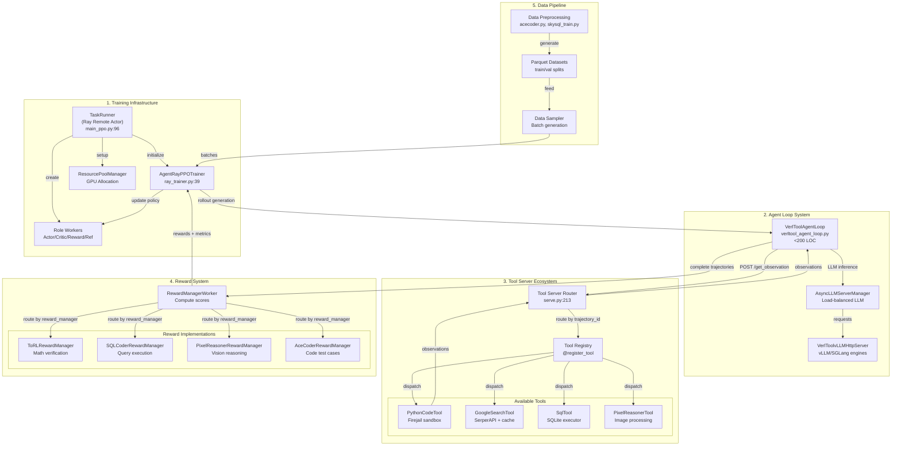

**Core Design Principles:**

1. **Complete Decoupling**: Actor rollout is completely separated from environment (tool) interaction, enabled by the tool-as-environment paradigm
2. **Modularity**: Tools, reward managers, and training components are pluggable via decorators (`@register_tool`, `@register_reward_manager`) and configuration
3. **Scalability**: Multi-worker tool servers, distributed Ray training, load-balanced LLM serving
4. **State Management**: Each trajectory maintains persistent environment state across multi-turn interactions

**Sources:** [README.md:42-48](), [verl_tool/trainer/main_ppo.py:1-100](), [verl_tool/trainer/ppo/ray_trainer.py:22-37]()

---

## Training Infrastructure Layer

### Component Overview

The training infrastructure is built on Ray for distributed execution and implements a customized PPO training loop:

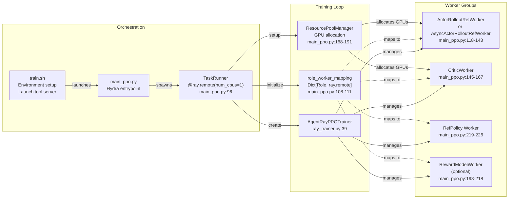

### Key Components

| Component | File Location | Purpose |
|-----------|--------------|---------|
| `TaskRunner` | [verl_tool/trainer/main_ppo.py:96-319]() | Ray remote actor that orchestrates the entire training process |
| `AgentRayPPOTrainer` | [verl_tool/trainer/ppo/ray_trainer.py:39-260]() | Extends `RayPPOTrainer` with custom validation and logging for tool interactions |
| `role_worker_mapping` | [verl_tool/trainer/main_ppo.py:108-111]() | Dictionary mapping `Role` enums to Ray remote worker classes |
| `ResourcePoolManager` | [verl_tool/trainer/main_ppo.py:168-191]() | Manages GPU allocation across different worker pools |

### Initialization Flow

The training process is initialized through the following sequence:

1. **Hydra Configuration Loading**: [verl_tool/trainer/main_ppo.py:37-44]() loads configuration using Hydra
2. **Ray Cluster Initialization**: [verl_tool/trainer/main_ppo.py:56-68]() initializes Ray with runtime environment
3. **TaskRunner Spawning**: [verl_tool/trainer/main_ppo.py:84-87]() creates a Ray remote TaskRunner actor
4. **Worker Registration**: [verl_tool/trainer/main_ppo.py:248-260]() adds workers to `role_worker_mapping`
5. **Resource Pool Setup**: [verl_tool/trainer/main_ppo.py:168-191]() configures GPU allocation
6. **Trainer Initialization**: [verl_tool/trainer/main_ppo.py:301-314]() creates the PPO trainer with all components

### Custom Replacements

VerlTool replaces several verl components with customized versions:

```python
# From verl_tool/trainer/ppo/ray_trainer.py:24-36
import verl.experimental.agent_loop
from verl_tool.agent_loop import AgentLoopManager
import verl.trainer.ppo.ray_trainer
from .reward import compute_reward, compute_reward_async
from verl_tool.workers.rollout.vllm_rollout.vllm_async_server import VerlToolvLLMHttpServer

verl.experimental.agent_loop.AgentLoopManager = AgentLoopManager
verl.trainer.ppo.ray_trainer.compute_reward = compute_reward
verl.trainer.ppo.ray_trainer.compute_reward_async = compute_reward_async
verl.workers.rollout.vllm_rollout.vllm_async_server.vLLMHttpServer = VerlToolvLLMHttpServer
```

**Sources:** [verl_tool/trainer/main_ppo.py:1-319](), [verl_tool/trainer/ppo/ray_trainer.py:1-260]()

---

## Agent Loop System

### Architecture

The agent loop orchestrates multi-turn interactions between the language model and tools:

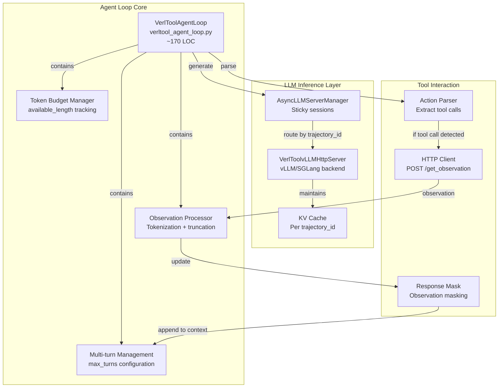

### Request/Response Protocol

**LLM Generation Request:**
```python
# Sent from AgentLoop to AsyncLLMServerManager
{
    "trajectory_id": str,
    "prompt_ids": List[int],
    "max_new_tokens": int,
    "temperature": float,
    # ... other sampling params
}
```

**Tool Server Request:**
```python
# POST /get_observation
{
    "trajectory_ids": List[str],
    "actions": List[str],
    "finish": List[bool],
    "is_last_step": List[bool],
    "extra_fields": List[dict]
}
```

**Tool Server Response:**
```python
{
    "observations": List[str],
    "dones": List[bool],
    "valids": List[bool],
    "processing_time_ms": float
}
```

### Key Features

| Feature | Implementation | Purpose |
|---------|---------------|---------|
| **Sticky Sessions** | `trajectory_id` routing | Maintains KV cache efficiency across turns |
| **Token Management** | `available_length = max_response_length - len(running_prompt_ids)` | Prevents context overflow |
| **Response Masking** | Observations marked with 0 in `response_mask` | Excludes observations from gradient computation |
| **Action Detection** | Pattern matching on `action_stop_token` | Identifies tool call completion |
| **Multimodal Support** | Processor integration (e.g., Qwen2VL) | Handles image inputs in observations |

**Sources:** [assets/docs/updates/verltool_v0.6.0_upgrade.md:5-6](), [assets/docs/tool_server.md:1-108]()

---

## Tool Server Ecosystem

### Multi-Layer Architecture

The tool server implements a sophisticated routing architecture to handle high concurrency:

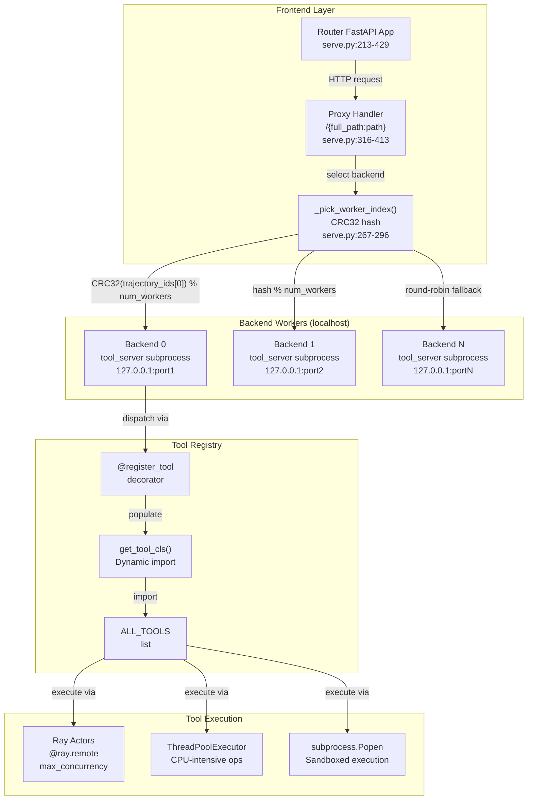

### Routing Logic

The tool server uses **consistent hashing** to ensure stateful routing:

```python
# From serve.py:267-296
def _pick_worker_index(body_bytes: bytes) -> int:
    """
    Select a worker index based on request body.
    
    Uses consistent hashing on trajectory_ids[0] if available,
    otherwise falls back to round-robin.
    """
    if not body_bytes:
        return next(app.state.counter) % num_workers
    
    try:
        data = json.loads(body_bytes)
    except (json.JSONDecodeError, UnicodeDecodeError):
        return next(app.state.counter) % num_workers
    
    if isinstance(data, dict):
        trajectory_ids = data.get("trajectory_ids")
        if isinstance(trajectory_ids, list) and len(trajectory_ids) > 0:
            # Use CRC32 for consistent hashing
            tid_str = str(trajectory_ids[0])
            hash_value = zlib.crc32(tid_str.encode("utf-8")) & 0xFFFFFFFF
            return hash_value % num_workers
    
    return next(app.state.counter) % num_workers
```

### Worker Management

The `WorkerManager` class handles the lifecycle of backend worker subprocesses:

| Component | Location | Responsibility |
|-----------|----------|----------------|
| `WorkerManager` | [verl_tool/servers/serve.py:433-547]() | Manages backend worker lifecycle |
| `_start_backend_server()` | [verl_tool/servers/serve.py:83-156]() | Spawns individual backend subprocess |
| `_wait_for_workers_ready()` | [verl_tool/servers/serve.py:159-210]() | Health checks with timeout |
| `shutdown()` | [verl_tool/servers/serve.py:514-540]() | Graceful termination with SIGTERM/SIGKILL |

### Configuration Constants

```python
# From serve.py:30-40
MAX_CONCURRENCY_PER_UVI_WORKER = 256
ROUTER_BACKLOG = 8192
HEALTH_CHECK_TIMEOUT = 60.0
HEALTH_CHECK_INTERVAL = 0.5
SUBPROCESS_TERMINATE_TIMEOUT = 10
MAX_CONNECTIONS_PER_UVI_WORKER = 512
KEEPALIVE_EXPIRY_PER_UVI_WORKER = 300
```

**Sources:** [verl_tool/servers/serve.py:1-767](), [assets/docs/tool_server.md:1-108]()

---

## Reward System

### Registry and Dispatch

The reward system uses a plugin architecture similar to the tool system:

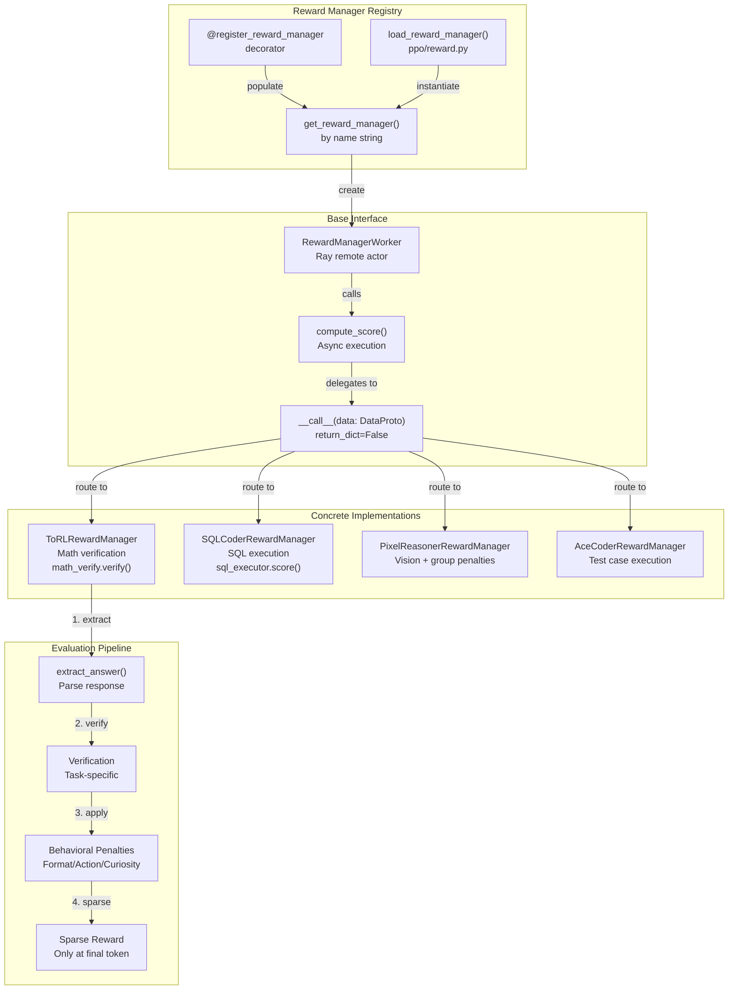

### Reward Tensor Structure

All reward managers return rewards following the same structure:

```python
# Reward tensor is sparse: only placed at valid_response_length - 1
reward_tensor = torch.zeros(batch_size, max_response_length)
for i, valid_length in enumerate(valid_response_lengths):
    reward_tensor[i, valid_length - 1] = computed_reward[i]

# Optional extra info for logging
reward_extra_info = {
    "accuracy": List[float],
    "response_length": List[int],
    "tool_call_rate": List[float],
    "penalties_applied": List[dict],
    # ... task-specific metrics
}
```

### Validation Metrics Processing

The trainer aggregates validation metrics across multiple samples per prompt:

```python
# From ray_trainer.py:186
data_src2var2metric2val = process_validation_metrics(
    data_sources, 
    sample_uids, 
    reward_extra_infos_dict
)

# Produces metrics like:
# val-core/{data_source}/acc/best@16
# val-core/{data_source}/acc/mean@16
# val-core/{data_source}/acc/maj@16
# val-aux/{data_source}/reward/mean@1
```

**Sources:** [verl_tool/trainer/ppo/ray_trainer.py:39-260]()

---

## Data Pipeline

### Data Flow Architecture

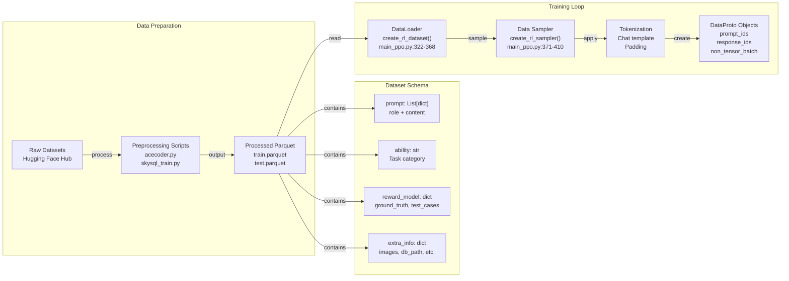

### Standard Data Schema

All datasets follow a standardized schema:

| Field | Type | Purpose | Example |
|-------|------|---------|---------|
| `prompt` | `List[dict]` | Conversation history | `[{"role": "user", "content": "..."}]` |
| `ability` | `str` | Task category for routing | `"code_generation"`, `"math_reasoning"` |
| `reward_model` | `dict` | Reward computation config | `{"style": "rule", "ground_truth": "42"}` |
| `extra_info` | `dict` | Task-specific metadata | `{"test_cases": [...], "images": [...]}` |
| `use_tool` | `bool` | Enable tool calling | `true` / `false` |

### DataProto Structure

The `DataProto` class encapsulates both tensor and non-tensor data:

```python
# Tensor batch (on GPU)
batch = {
    "input_ids": torch.Tensor,        # Tokenized prompts
    "attention_mask": torch.Tensor,   # Attention mask
    "prompts": torch.Tensor,          # Prompt-only tokens
    "responses": torch.Tensor,        # Generated responses
    "response_mask": torch.Tensor,    # Mask for gradients
    "token_level_scores": torch.Tensor  # Rewards
}

# Non-tensor batch (CPU)
non_tensor_batch = {
    "uid": np.ndarray,                # Unique identifiers
    "reward_model": np.ndarray,       # Reward config per sample
    "extra_info": np.ndarray,         # Task-specific data
    "tool_interact_info": np.ndarray, # Tool interaction history
    "traj_stop_reason": np.ndarray,   # How trajectory ended
    "verl_tool_metrics": np.ndarray   # Tool usage metrics
}
```

**Sources:** [verl_tool/trainer/main_ppo.py:322-410]()

---

## Configuration System

### Hydra Configuration Hierarchy

VerlTool uses Hydra for hierarchical configuration management:

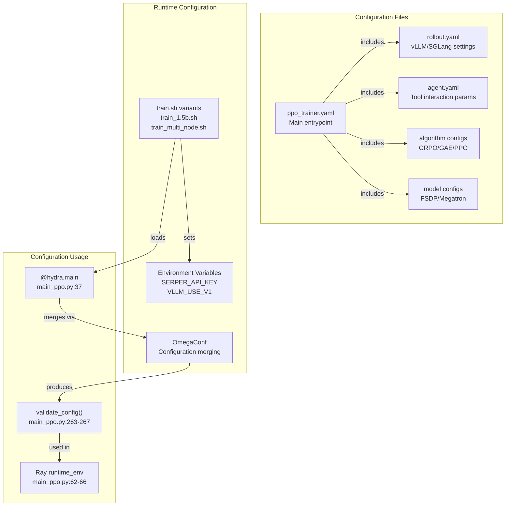

### Key Configuration Sections

| Section | File Pattern | Key Parameters |
|---------|-------------|----------------|
| **Rollout** | `rollout.yaml` | `mode`, `val_kwargs.n`, `val_kwargs.temperature`, `agent.tool_server_url` |
| **Agent** | `agent.yaml` | `max_turns`, `action_stop_token`, `mask_observations`, `enable_mtrl` |
| **Algorithm** | `algorithm/*.yaml` | `use_kl_in_reward`, `kl_penalty`, `grpo_group_norm` |
| **Model** | `model/*.yaml` | `path`, `strategy` (fsdp/megatron), `fsdp_config` |
| **Trainer** | `trainer/*.yaml` | `n_gpus_per_node`, `nnodes`, `save_freq`, `test_freq` |

### Cross-Reference Example

Configuration sections can reference each other using OmegaConf's `oc.select`:

```yaml
# In rollout.yaml
rollout:
  agent:
    tool_server_url: ${oc.select:data.tool_server_url,null}
    max_turns: ${oc.select:data.max_turns,3}
    
# In data.yaml
data:
  tool_server_url: "http://localhost:5000"
  max_turns: 5
```

**Sources:** [verl_tool/trainer/main_ppo.py:37-68]()

---

## Integration Points

### Training to Tool Server Flow

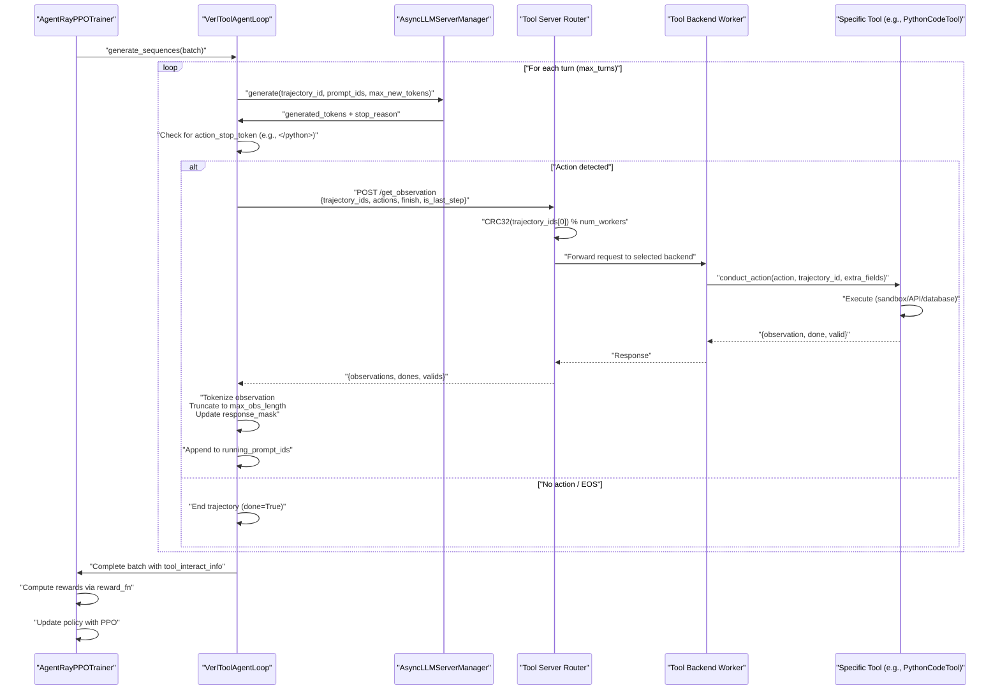

### Key Integration Points

1. **Agent Loop → Tool Server**: HTTP POST to `/get_observation` with trajectory IDs and actions
2. **Tool Server → Backend**: Consistent hashing routes to same worker per trajectory
3. **Backend → Tool**: Method dispatch via `conduct_action()` or `get_observations()`
4. **Tool → Environment**: State stored in `env_cache[trajectory_id]`
5. **Agent Loop → Reward**: Complete trajectories with `tool_interact_info` passed to reward manager

**Sources:** [verl_tool/servers/serve.py:316-413](), [assets/docs/tool_server.md:8-30]()

---

## File Structure Overview

### Core Module Organization

```
verl_tool/
├── agent_loop/
│   └── verltool_agent_loop.py          # <200 LOC agent loop implementation
├── trainer/
│   ├── main_ppo.py                      # Hydra entrypoint, TaskRunner
│   └── ppo/
│       ├── ray_trainer.py               # AgentRayPPOTrainer, custom replacements
│       └── reward.py                    # load_reward_manager()
├── servers/
│   ├── serve.py                         # Multi-worker router with consistent hashing
│   ├── tool_server.py                   # Backend worker implementation
│   └── tools/
│       ├── base_tool.py                 # BaseTool abstract class
│       ├── python_code_tool.py          # Firejail sandbox execution
│       ├── google_search_tool.py        # SerperAPI + caching
│       ├── sql_tool.py                  # SQLite execution
│       └── pixel_reasoner_tool.py       # Image processing tool
└── workers/
    └── rollout/
        └── vllm_rollout/
            └── vllm_async_server.py     # VerlToolvLLMHttpServer

examples/
└── train/
    ├── math_tir/                        # Math reasoning training
    ├── acecoder/                        # Code generation training
    ├── skysql/                          # SQL training
    └── pixel_reasoner/                  # Vision task training
```

### Key File Purposes

| File | Purpose | Key Classes/Functions |
|------|---------|----------------------|
| `verl_tool/agent_loop/verltool_agent_loop.py` | Multi-turn agent loop logic | `VerlToolAgentLoop`, `AgentLoopManager` |
| `verl_tool/trainer/main_ppo.py` | Training orchestration | `TaskRunner`, `run_ppo()`, `create_rl_dataset()` |
| `verl_tool/trainer/ppo/ray_trainer.py` | Custom PPO trainer | `AgentRayPPOTrainer`, `_validate()`, `_log_rollout_data()` |
| `verl_tool/servers/serve.py` | Tool server router | `create_router_app()`, `WorkerManager`, `_pick_worker_index()` |
| `verl_tool/servers/tool_server.py` | Backend tool server | Tool dispatching and execution |

**Sources:** [README.md:1-162](), [assets/docs/updates/verltool_v0.6.0_upgrade.md:1-11]()

---

## Summary

VerlTool's architecture achieves complete decoupling of reinforcement learning training from tool interaction through:

1. **Tool-as-Environment Paradigm**: Tools are treated as external environments with persistent state
2. **Consistent Hashing**: Ensures trajectory-to-worker affinity for stateful interactions
3. **Modular Plugin System**: Tools and reward managers are independently extensible
4. **Distributed Execution**: Ray-based training infrastructure with multi-GPU support
5. **Unified Data Pipeline**: Standardized schema across diverse task types

This architecture enables training language models to use tools effectively while maintaining scalability, modularity, and ease of extension. The system supports both synchronous and asynchronous rollout modes, with the async mode providing 1.69x-2.06x speedup for tool-intensive workloads.

For deeper dives into specific components:
- Agent loop implementation: [Agent Loop System (VerlToolAgentLoop)](#2.3)
- Tool development: [Tool Implementations](#4)
- Reward computation: [Reward Management System](#6)
- Training workflows: [Training Recipes](#5)

**Sources:** [README.md:42-48](), [assets/docs/updates/verltool_v0.6.0_upgrade.md:1-11](), [pyproject.toml:1-83]()

---

# Page: Key Features and Capabilities

# Key Features and Capabilities

<details>
<summary>Relevant source files</summary>

The following files were used as context for generating this wiki page:

- [README.md](README.md)
- [assets/docs/updates/verltool_v0.6.0_upgrade.md](assets/docs/updates/verltool_v0.6.0_upgrade.md)

</details>


## Overview

VerlTool is a unified tool-agent training framework built on top of verl (v0.6.0), designed to simplify the development and training of reinforcement learning agents that interact with external tools. The framework provides a complete solution for training agents that can use tools like code execution environments, search APIs, databases, and image processing utilities.

This page documents VerlTool's core features and capabilities, including its architectural innovations, training modes, tool system design, and deployment options. For implementation details of specific components, see the referenced pages throughout this document.

Sources: [README.md:1-47](), [assets/docs/updates/verltool_v0.6.0_upgrade.md:1-12]()

---

## Core Architectural Features

### Complete Decoupling of Rollout and Environment Interaction

VerlTool achieves complete separation between actor rollout (policy generation) and environment interaction (tool execution) through a unified HTTP-based Tool Server API. This design enables:

- **Independent Tool Development**: Tools can be developed, tested, and debugged independently of the training loop
- **Easy Tool Addition**: New tools require only a Python file implementing the `BaseTool` interface
- **Flexible Deployment**: Tool servers can run on different machines than training workers

**Tool Registration Pattern**:
```python
@register_tool(name="python_code")
class PythonCodeTool(BaseTool):
    def conduct_action(self, trajectory_id, action, extra_fields):
        # Tool implementation
        return observation, done, valid
```

**Agent Loop → Tool Server Communication**:
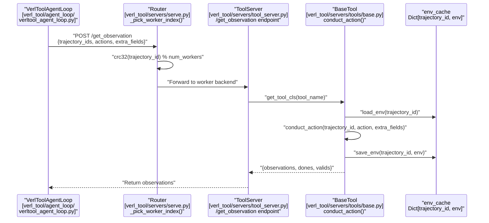

Sources: [README.md:43-46](), [verl_tool/servers/serve.py](), [verl_tool/servers/tool_server.py](), [verl_tool/servers/tools/base.py]()

### Tool-as-Environment Paradigm

VerlTool treats each tool interaction as an environment state transition. Unlike traditional RL environments that reset between episodes, VerlTool's tool environments maintain persistent state across multiple turns within a trajectory.

**State Management**:
- **Environment Cache**: `env_cache: Dict[trajectory_id, env]` stores environment state per trajectory
- **Trajectory ID Routing**: Consistent hashing ensures same trajectory → same worker for state consistency
- **Persistent State**: Tools like `IPythonTool` maintain kernel state across turns
- **Cleanup**: Environments are deleted when `done=True` or on explicit finish signals

**Example: Multi-Turn IPython Execution**
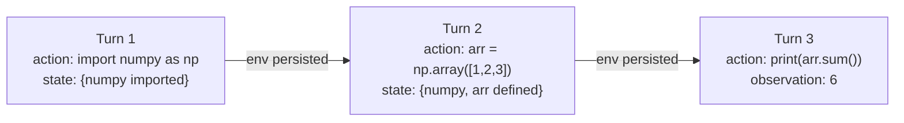

Sources: [README.md:44](), [verl_tool/servers/tool_server.py](), [verl_tool/agent_loop/verltool_agent_loop.py]()

### Compact Agent Loop Implementation

VerlTool consolidates all agent-tool interaction logic into a single file with the main loop under 200 lines of code. This is achieved through careful abstraction and the tool-as-environment design.

**Agent Loop Architecture**:
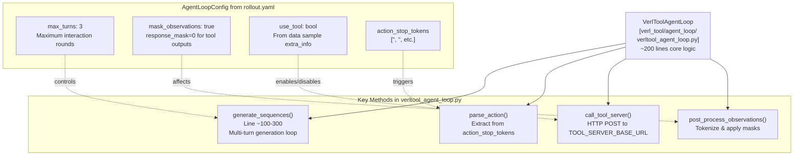

**Core Loop Structure** [verl_tool/agent_loop/verltool_agent_loop.py:100-300]():
1. Generate tokens until action stop token
2. Parse action from generated text
3. Call tool server with action
4. Append observation to prompt
5. Repeat until done or max_turns reached

Sources: [assets/docs/updates/verltool_v0.6.0_upgrade.md:5](), [verl_tool/agent_loop/verltool_agent_loop.py]()

---

## Training Capabilities

### Multi-Modal Support

VerlTool supports both text-only language models and multi-modal vision-language models through flexible data handling and tokenization.

**Supported Model Types**:

| Model Type | Example Models | Training Recipe | Key Configuration |
|------------|---------------|-----------------|-------------------|
| **Text-Only** | Qwen2.5-Math, DeepSeek-Math | `examples/train/math_tir/` | Standard vLLM rollout |
| **Vision-Language** | Qwen2VL, Qwen2.5-Omni | `examples/train/pixel_reasoner/` | Multi-modal data loader, image token handling |

**Multi-Modal Data Flow**:
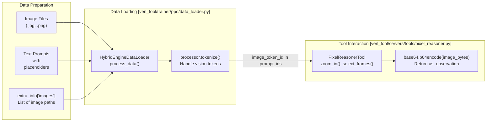

Sources: [assets/docs/updates/verltool_v0.6.0_upgrade.md:6](), [examples/train/pixel_reasoner/](), [examples/train/math_tir/]()

### Hybrid Training with use_tool Field

VerlTool supports training on mixed datasets where only a subset of samples require tool usage. This is controlled through the `use_tool` field in data samples.

**Hybrid Training Behavior**:
```python
# In dataset preparation
data_sample = {
    "prompt": "Solve: 2 + 2 = ?",
    "use_tool": False  # Agent operates in text-only mode
}

data_sample = {
    "prompt": "Write code to compute factorial(10)",
    "use_tool": True   # Agent can call tool server
}
```

**Agent Loop Decision Flow**:
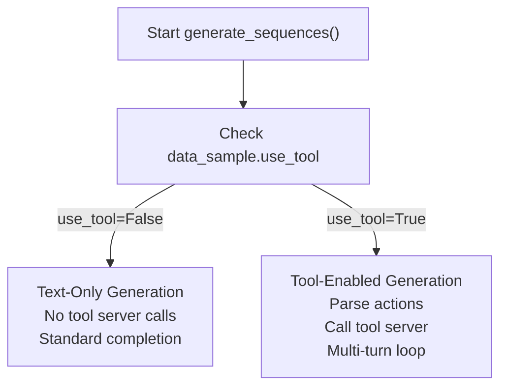

This feature enables:
- Training on datasets where not all problems benefit from tools
- Gradual curriculum from text-only to tool-using behaviors
- Mixed-capability models that adapt based on problem requirements

Sources: [assets/docs/updates/verltool_v0.6.0_upgrade.md:10](), [verl_tool/agent_loop/verltool_agent_loop.py]()

### Asynchronous Rollout Mode

VerlTool provides trajectory-level asynchronous rollout that processes each trajectory independently, enabling tool calls as soon as generation completes rather than waiting for the entire batch.

**Synchronous vs Asynchronous Rollout**:

| Mode | Configuration | Behavior | Performance (3 turns) |
|------|--------------|----------|----------------------|
| **Sync** | `actor_rollout_ref.rollout.mode='sync'` | Wait for all trajectories before tool calls | 194s (baseline) |
| **Async** | `actor_rollout_ref.rollout.mode='async'` | Independent trajectory processing | 94s (**2.06x faster**) |

**Async Rollout Architecture**:
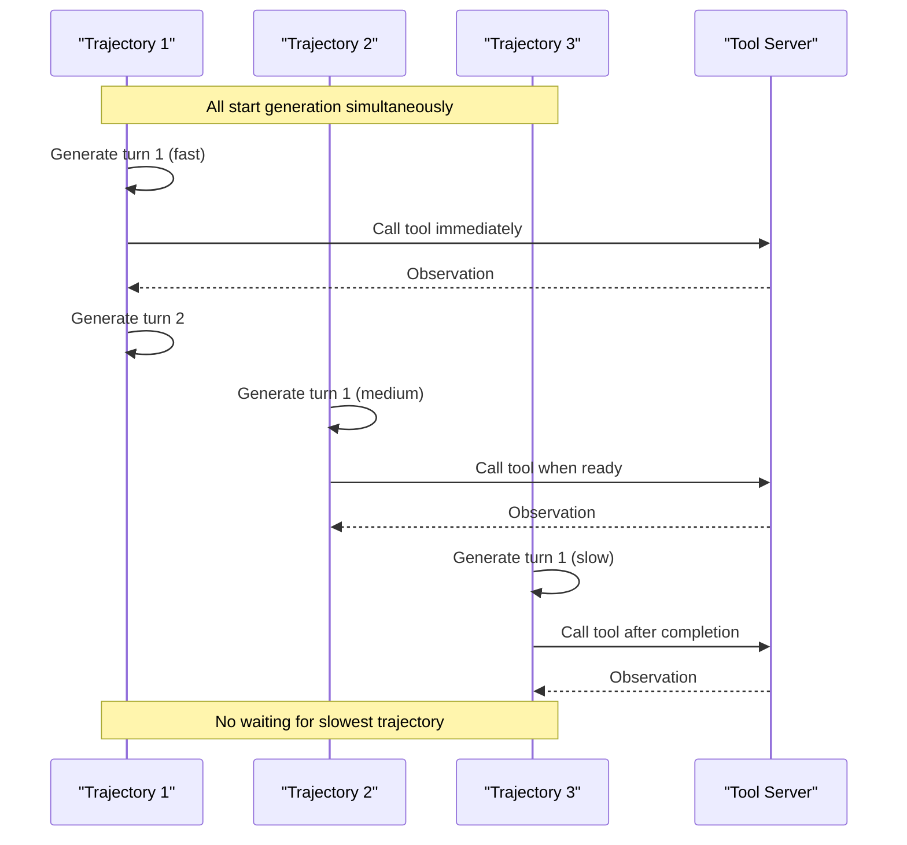

**Performance Benefits**:
- **2x+ speedup** for tool-heavy workloads with multiple turns
- Eliminates idle time waiting for slowest trajectory in batch
- Scales better with heterogeneous problem difficulties

**Note**: Use `use_ray=False` (default) for tool server when using async rollout due to Ray's concurrent request handling overhead.

Sources: [assets/docs/asyncRL.md:1-18](), [README.md:35]()

### Distributed Training Support

VerlTool inherits verl's distributed training capabilities and extends them with tool-specific resource management.

**Supported Parallelism Strategies**:

| Strategy | Configuration | Use Case | Models Supported |
|----------|--------------|----------|------------------|
| **FSDP** | `fsdp_config` in Hydra | Shard parameters across GPUs | 1.5B-7B models |
| **FSDP2** | `fsdp_config.fsdp_type='fsdp2'` | Improved FSDP with better memory | 7B-13B models |
| **Megatron** | `megatron` config section | Tensor/pipeline parallelism | 13B-70B+ models |

**Resource Pool Management**:
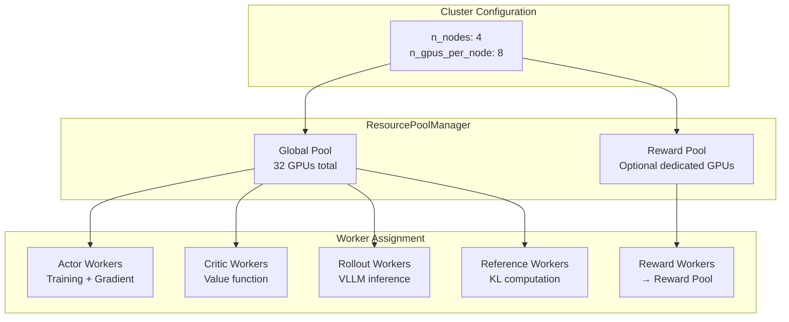

**Memory Optimization Features**:
- **Parameter Offloading**: Move parameters to CPU when not in use
- **Optimizer Offloading**: Offload optimizer states to CPU
- **Gradient Checkpointing**: Recompute activations to save memory
- **Dynamic Batch Sizing**: Adapt to variable sequence lengths

Sources: [README.md:43-46](), [verl_tool/trainer/ppo/ray_trainer.py]()

---

## Tool System Features

### Tool Extensibility via @register_tool

VerlTool provides a decorator-based registration system that makes adding new tools straightforward.

**Tool Registration and Discovery**:
```mermaid
graph TB
    subgraph "Tool Implementation [verl_tool/servers/tools/]"
        BaseTool["BaseTool<br/>[verl_tool/servers/tools/base.py]<br/>Abstract base class"]
        register_tool["@register_tool(name='python_code')<br/>[verl_tool/servers/tools/base.py:20-30]"]
        CustomTool["PythonCodeTool<br/>[verl_tool/servers/tools/python_code.py]<br/>class PythonCodeTool(BaseTool)"]
    end
    
    subgraph "Tool Server [verl_tool/servers/tool_server.py]"
        TOOL_REGISTRY["TOOL_REGISTRY: Dict[str, Type[BaseTool]]<br/>Global registry dict"]
        get_tool_cls["get_tool_cls(tool_name: str)<br/>Returns ToolClass from registry"]
        RayToolManager["RayToolManager<br/>manage_tools() with max_concurrency"]
    end
    
    subgraph "BaseTool Methods"
        conduct_action["conduct_action(trajectory_id, action, extra_fields)<br/>Returns (observation, done, valid)"]
        load_save_env["load_env() / save_env()<br/>env_cache[trajectory_id]"]
        parse_action["parse_action(action: str)<br/>Extract from XML tags"]
    end
    
    BaseTool --> register_tool
    register_tool --> CustomTool
    CustomTool --> conduct_action
    CustomTool --> load_save_env
    CustomTool --> parse_action
    
    CustomTool -.->|"Populates at import time"| TOOL_REGISTRY
    TOOL_REGISTRY --> get_tool_cls
    get_tool_cls --> RayToolManager
```

**Example Tool Implementation**:
```python
# verl_tool/servers/tools/example_tool.py
from verl_tool.servers.tools.base import BaseTool, register_tool

@register_tool(name="example_tool")
class ExampleTool(BaseTool):
    def conduct_action(self, trajectory_id: str, action: str, extra_fields: dict):
        # Load environment state
        env = self.load_env(trajectory_id)
        
        # Execute action
        observation = self.execute(action, env)
        
        # Update state
        env['history'].append((action, observation))
        self.save_env(trajectory_id, env)
        
        # Return (observation, done, valid)
        return observation, False, True
```

**Tool Discovery**: Tool server automatically discovers all tools decorated with `@register_tool` through Python's import system.

Sources: [verl_tool/servers/tools/base.py](), [verl_tool/servers/tool_server.py](), [README.md:43]()

### Security and Sandboxing

VerlTool implements defense-in-depth security for code execution tools through multiple isolation layers.

**Security Architecture by Tool Type**:

```mermaid
graph TB
    subgraph "PythonCodeTool [verl_tool/servers/tools/python_code.py]"
        firejail["firejail --noprofile --seccomp<br/>subprocess.run() in sandbox"]
        temp_dir["tempfile.mkdtemp()<br/>Isolated execution directory"]
        resource_limits["resource.setrlimit(RLIMIT_AS, 4GB)<br/>timeout=30s in subprocess"]
    end
    
    subgraph "IPythonTool [verl_tool/servers/tools/ipython_code.py]"
        KernelActor["@ray.remote KernelActor<br/>jupyter_client.KernelManager"]
        kernel_cache["self.kernel_cache: LRUCache(1024)<br/>Keyed by trajectory_id"]
        forbidden_check["check_forbidden_imports()<br/>Block: os, subprocess, socket"]
    end
    
    subgraph "SqlTool [verl_tool/servers/tools/sql.py]"
        read_only["sqlite3.connect(uri='file:...?mode=ro')<br/>Read-only connections"]
        progress_handler["conn.set_progress_handler(callback, N)<br/>Timeout enforcement"]
        transaction["conn.rollback()<br/>Prevent writes"]
    end
    
    subgraph "Input Validation (BaseTool)"
        sanitize["clean_output(text)<br/>Remove ANSI codes"]
        parse_action["parse_action(action)<br/>Extract from XML tags"]
        validate["validate() method<br/>Pre-execution checks"]
    end
```

**Security Layers**:

| Layer | PythonCodeTool | IPythonTool | SqlTool |
|-------|---------------|-------------|---------|
| **Process Isolation** | Firejail sandbox | Ray actor isolation | SQLite process |
| **Resource Limits** | 4GB RAM, CPU timeout | Kernel-level limits | Progress handler timeout |
| **Filesystem Access** | Isolated /tmp | Standard Python restrictions | N/A |
| **Network Access** | Blocked by seccomp | Restricted | N/A |
| **Input Validation** | Forbidden imports check | Forbidden imports check | SQL injection prevention |

**Output Sanitization**:
- Clean traceback paths to remove system information
- Truncate observations by `max_obs_length`
- Format with XML-style tags `<result>...</result>`

Sources: [verl_tool/servers/tools/python_code.py](), [verl_tool/servers/tools/ipython_code.py](), [verl_tool/servers/tools/sql.py]()

### Tool Server Multi-Worker Architecture

VerlTool's tool server uses a router + multi-worker pattern for high concurrency and sticky routing.

**Tool Server Components**:
```mermaid
graph TB
    subgraph "Router [verl_tool/servers/serve.py]"
        FastAPIRouter["app = FastAPI()<br/>uvicorn.run(app, port=30000)"]
        pick_worker["_pick_worker_index(trajectory_ids)<br/>crc32(traj_id[0]) % num_workers"]
        proxy["@app.api_route('/{full_path:path}')<br/>Forward to backend workers"]
    end
    
    subgraph "Worker Pool"
        Worker1["subprocess.Popen()<br/>tool_server.py --port 30001"]
        Worker2["subprocess.Popen()<br/>tool_server.py --port 30002"]
        WorkerN["subprocess.Popen()<br/>tool_server.py --port 3000N"]
    end
    
    subgraph "Worker Manager [serve.py:start_tool_server()]"
        spawn_workers["for i in range(num_processes):<br/>    subprocess.Popen(['python', 'tool_server.py'])"]
        backend_urls["backend_urls = [f'http://127.0.0.1:{base_port+i}']"]
    end
    
    FastAPIRouter --> pick_worker
    pick_worker --> proxy
    proxy --> Worker1
    proxy --> Worker2
    proxy --> WorkerN
    
    spawn_workers --> Worker1
    spawn_workers --> Worker2
    spawn_workers --> WorkerN
    
    spawn_workers --> backend_urls
    backend_urls -.->|"Used by _pick_worker"| pick_worker
```

**Routing Strategy**:
- **Sticky Routing**: Same `trajectory_id` → same worker for state consistency
- **Load Balancing**: Different trajectories distributed across workers
- **Fallback**: Round-robin for requests without `trajectory_id` (e.g., cleanup)

**Typical Configuration**: 512 workers per tool server (configurable via `--num_processes`)

Sources: [verl_tool/servers/serve.py](), [scripts/start_tool_server.sh]()

---

## Inference and Deployment Features

### Fast Inference Backends

VerlTool supports multiple high-performance inference backends for policy rollout.

**Supported Backends**:

| Backend | Version | Use Case | Configuration |
|---------|---------|----------|---------------|
| **vLLM** | v0.11.0 | Primary backend, best performance | `rollout.backend='vllm'` |
| **SGLang** | Latest | Alternative backend, RadixAttention | `rollout.backend='sglang'` |

**Inference Engine Integration**:
```mermaid
graph LR
    subgraph "Rollout Workers [verl_tool/trainer/ppo/ray_trainer.py]"
        TaskRunner["TaskRunner<br/>@ray.remote decorator<br/>manages rollout workers"]
        model_update["update_weight()<br/>Sync parameters from actor"]
    end
    
    subgraph "vLLM Engine [rollout.backend='vllm']"
        VLLMWorker["vLLM.LLM.generate()<br/>Token generation API"]
        ContinuousBatch["Continuous Batching<br/>Dynamic request scheduling"]
        PagedAttention["PagedAttention<br/>KV cache paging"]
    end
    
    subgraph "SGLang Engine [rollout.backend='sglang']"
        SGLangWorker["sglang.Engine.generate()<br/>Token generation API"]
        RadixAttention["RadixAttention<br/>Automatic prefix sharing"]
    end
    
    TaskRunner --> model_update
    model_update --> VLLMWorker
    model_update --> SGLangWorker
    
    VLLMWorker --> ContinuousBatch
    VLLMWorker --> PagedAttention
    
    SGLangWorker --> RadixAttention
```

**Performance Optimizations**:
- **Continuous Batching**: Dynamic batch sizing for variable-length sequences
- **PagedAttention** (vLLM): Efficient KV cache management
- **RadixAttention** (SGLang): Automatic prefix sharing
- **Tensor Parallelism**: Split attention computation across GPUs

Sources: [README.md:134](), [verl_tool/trainer/ppo/ray_trainer.py]()

### OpenAI-Compatible Evaluation API

VerlTool provides an OpenAI API-compatible inference service for easy evaluation and deployment.

**API Endpoints**:

| Endpoint | Method | Purpose | Request Key Fields |
|----------|--------|---------|-------------------|
| `/v1/chat/completions` | POST | Chat-style multi-turn inference | `messages`, `model`, `temperature` |
| `/v1/completions` | POST | Single-turn completion | `prompt`, `model`, `max_tokens` |
| `/health` | GET | Service health check | None |

**Evaluation Service Architecture**:
```mermaid
graph TB
    subgraph "Client"
        User["User / Benchmark Script"]
        openai_client["OpenAI SDK<br/>openai.ChatCompletion.create()"]
    end
    
    subgraph "ModelService [evaluation/serve.py]"
        FastAPI["app = FastAPI()<br/>@app.post('/v1/chat/completions')"]
        ModelService_class["ModelService<br/>self.agent_loop: VerlToolAgentLoop"]
        vllm_generate["self.vllm.generate()<br/>Token generation"]
    end
    
    subgraph "Tool Server [verl_tool/servers/tool_server.py]"
        tool_endpoint["@app.post('/get_observation')<br/>Batch tool execution"]
        TOOL_REGISTRY["get_tool_cls(tool_name)<br/>Route to registered tools"]
    end
    
    User --> openai_client
    openai_client -->|"POST /v1/chat/completions"| FastAPI
    FastAPI --> ModelService_class
    ModelService_class --> vllm_generate
    ModelService_class -->|"HTTP POST /get_observation"| tool_endpoint
    tool_endpoint --> TOOL_REGISTRY
    TOOL_REGISTRY -.->|"observations"| ModelService_class
    ModelService_class -.->|"JSON response"| FastAPI
    FastAPI -.->|"response"| openai_client
```

**Request Format**:
```json
{
  "model": "trained-model-path",
  "messages": [
    {"role": "user", "content": "Write code to solve: 2 + 2"}
  ],
  "temperature": 0.7,
  "max_tokens": 2048
}
```

**Response Includes**:
- Generated text with all tool interactions
- Token usage statistics
- Internal tool call logs (if enabled)

Sources: [README.md:46](), [evaluation/serve.py]()

### Multi-Turn Interaction Support

VerlTool natively supports multi-turn interactive loops between the agent and tools, essential for complex reasoning tasks.

**Multi-Turn Configuration**:

| Parameter | Location | Purpose | Example Values |
|-----------|----------|---------|----------------|
| `max_turns` | `config/rollout.yaml` | Maximum interaction rounds | 1-10 turns |
| `action_stop_tokens` | Rollout config | Tokens indicating tool calls | `["</tool_call>", "</action>"]` |
| `mask_observations` | Rollout config | Hide tool outputs during training | `true/false` |

**Multi-Turn Flow Example (Math Problem)**:
```mermaid
sequenceDiagram
    participant Agent as "Policy Model"
    participant Loop as "VerlToolAgentLoop"
    participant Tool as "PythonCodeTool"
    
    Note over Agent,Tool: Turn 1: Generate approach
    Agent->>Loop: "Let me solve 8! using code<br/><tool_call>python_code</tool_call>"
    Loop->>Tool: Execute code
    Tool-->>Loop: "<result>NameError: factorial not defined</result>"
    Loop->>Agent: Append observation to prompt
    
    Note over Agent,Tool: Turn 2: Fix error
    Agent->>Loop: "I need to import math<br/><tool_call>import math; math.factorial(8)</tool_call>"
    Loop->>Tool: Execute code
    Tool-->>Loop: "<result>40320</result>"
    Loop->>Agent: Append observation to prompt
    
    Note over Agent,Tool: Turn 3: Provide answer
    Agent->>Loop: "The answer is 40320<br/><finish></finish>"
    Loop->>Loop: Mark trajectory as done
```

**Turn Management**:
- Agent can terminate early with explicit finish signals
- Observations are tokenized and truncated by `max_obs_length`
- Environment state persists across turns via `trajectory_id`

Sources: [verl_tool/agent_loop/verltool_agent_loop.py](), [README.md:45]()

---

## Data and Configuration Features

### Tokens-In/Tokens-Out Design

VerlTool enforces strict token-level inputs and outputs to prevent off-policy issues caused by tokenization inconsistencies.

**Design Principle**:
- **Never detokenize-retokenize**: Pass token IDs directly between components
- **Avoid string manipulation**: Work with token arrays, not decoded strings
- **Consistent tokenization**: Use same tokenizer throughout pipeline

**Implementation in Agent Loop** [verl_tool/agent_loop/verltool_agent_loop.py]():
```python
# Correct: Pass token IDs
prompt_token_ids = torch.cat([prompt_ids, observation_ids], dim=-1)

# Incorrect: Detokenize and retokenize
# prompt_text = tokenizer.decode(prompt_ids)  # ❌ Causes off-policy
# prompt_text += observation_text
# prompt_token_ids = tokenizer.encode(prompt_text)
```

**Benefits**:
- Prevents off-policy data from tokenization mismatches
- Maintains exact token alignment for PPO updates
- Enables precise masking of observations vs. generations

Sources: [assets/docs/updates/verltool_v0.6.0_upgrade.md:7](), [verl_tool/agent_loop/verltool_agent_loop.py]()

### Rollout Data Logging

VerlTool provides comprehensive logging of all rollout data for debugging, analysis, and offline learning.

**Logged Information**:

| Data Type | Content | Storage Location | Format |
|-----------|---------|-----------------|--------|
| **Step Records** | Prompts, actions, observations, rewards | `trainer.rollout_data_dir` | JSONL |
| **Tool Interactions** | Full tool call history per trajectory | Step records | Nested JSON |
| **Token Sequences** | Generated token IDs and masks | Step records | Arrays |
| **Metadata** | Trajectory IDs, turns, done flags | Step records | JSON fields |

**Configuration** [examples/train/math_tir/train_math_tir.sh]():
```bash
trainer.rollout_data_dir=$(pwd)/verl_step_records/$run_name
```

**Logged Data Structure**:
```json
{
  "trajectory_id": "batch_0_sample_5",
  "turn": 2,
  "prompt_ids": [...],
  "response_ids": [...],
  "action": "<tool_call>python_code</tool_call>...",
  "observation": "<result>42</result>",
  "reward": 1.0,
  "done": true,
  "tool_interact_info": {
    "num_turns": 2,
    "tools_used": ["python_code"]
  }
}
```

**Use Cases**:
- Debugging tool interaction issues
- Analyzing reward distributions
- Offline RL training from logged data
- Performance profiling

Sources: [assets/docs/updates/verltool_v0.6.0_upgrade.md:9](), [verl_tool/trainer/ppo/ray_trainer.py]()

### Hydra-Based Configuration System

VerlTool uses Hydra for hierarchical configuration management with support for command-line overrides and configuration composition.

**Configuration Hierarchy**:
```mermaid
graph TB
    subgraph "Base Configuration Files"
        config_yaml["config.yaml<br/>defaults: [data, model, actor_rollout_ref, trainer]"]
        data_yaml["data.yaml<br/>train_files, val_files, batch_size"]
        model_yaml["model.yaml<br/>model.path, model.tokenizer_path"]
    end
    
    subgraph "Training Configuration Files"
        actor_rollout_ref["actor_rollout_ref.yaml<br/>actor, rollout, ref configs"]
        rollout_yaml["rollout.yaml<br/>backend, max_turns, mask_observations"]
        trainer_yaml["trainer.yaml<br/>total_epochs, save_freq, optimizer"]
    end
    
    subgraph "Tool Configuration in rollout.yaml"
        agent_config["agent_loop:<br/>  class_path: VerlToolAgentLoop<br/>  init_args:<br/>    tool_server_base_url: ${TOOL_SERVER_BASE_URL}<br/>    action_stop_tokens: ['</python>', '</search>']<br/>    max_turns: 3"]
    end
    
    config_yaml --> data_yaml
    config_yaml --> model_yaml
    config_yaml --> actor_rollout_ref
    config_yaml --> trainer_yaml
    
    actor_rollout_ref --> rollout_yaml
    rollout_yaml --> agent_config
```

**Key Configuration Files by Component**:

| Component | Config File | Key Settings |
|-----------|------------|--------------|
| **Agent Loop** | `config/rollout.yaml` | `max_turns`, `mask_observations`, `use_tool` |
| **Tool Server** | `agent_config` in rollout | `tool_server_base_url`, `action_stop_tokens` |
| **Distributed Training** | `actor_rollout_ref.yaml` | `n_gpus`, `fsdp_config`, `megatron` |
| **Reward** | `trainer.yaml` | `reward_manager_name`, penalty weights |

**Command-Line Overrides**:
```bash
python main_ppo.py \
    data.train_files=/path/to/train.parquet \
    actor_rollout_ref.rollout.max_turns=5 \
    actor_rollout_ref.rollout.mode=async \
    trainer.total_epochs=10
```

Sources: [verl_tool/trainer/ppo/main_ppo.py](), [examples/train/math_tir/config/]()

---

## Summary of Key Capabilities

VerlTool provides a comprehensive framework for tool-agent RL training with the following key capabilities:

**Architectural Innovations**:
- Complete decoupling of rollout and environment via HTTP-based tool server
- Tool-as-environment paradigm with persistent state management
- Compact agent loop implementation (<200 lines)

**Training Features**:
- Multi-modal support (text-only and vision-language models)
- Hybrid training with per-sample `use_tool` control
- Asynchronous rollout mode (2x+ speedup)
- Distributed training with FSDP/Megatron

**Tool System**:
- Easy tool addition via `@register_tool` decorator
- Defense-in-depth security (Firejail, Ray actors, read-only SQL)
- Multi-worker architecture with sticky routing

**Deployment**:
- Fast inference with vLLM/SGLang backends
- OpenAI-compatible API for evaluation
- Multi-turn interaction support

**Data & Configuration**:
- Tokens-in/tokens-out design for off-policy prevention
- Comprehensive rollout data logging
- Hydra-based hierarchical configuration

For detailed information on specific features, see the referenced pages:
- System Architecture: [System Architecture Overview](#1.1)
- Tool-as-Environment: [Tool-as-Environment Paradigm](#1.3)
- Training Framework: [Core Training Framework](#2)
- Tool Implementations: [Tool Implementations](#4)
- Training Examples: [Training Recipes](#5)

Sources: [README.md:1-47](), [assets/docs/updates/verltool_v0.6.0_upgrade.md:1-12](), [assets/docs/asyncRL.md:1-18]()

### Training Recipe Catalog

| Recipe | Primary Tools | Domain | Recipe Path | Key Features |
|--------|--------------|--------|-------------|--------------|
| **Math Tool-Integrated RL** | `PythonCodeTool` | Mathematical reasoning | `examples/train/math_tir/` | Text-only, code execution with test cases, curriculum learning support |
| **AceCoder** | `IPythonTool` | Competitive programming | `examples/train/acecoder/` | Persistent IPython kernels, multi-problem datasets, LeetCode/CodeForces support |
| **Search R1** | `SearchRetrievalTool` | Web research | `examples/train/search_r1/` | Document retrieval, custom search backend integration |
| **DeepSearch** | `GoogleSearchTool` | Web research with Google | `examples/train/deepsearch/` | Google/Serper API integration, snippet processing, summarization |
| **NL2SQL (SkysSQL)** | `SqlTool` | Database querying | `examples/train/skysql/` | SQL execution, result comparison, Spider/Bird dataset support |
| **Pixel-Reasoner** | `PixelReasonerTool` | Visual reasoning | `examples/train/pixel_reasoner/` | Multi-modal GRPO, image processing, frame selection |
| **SWE** | `SandboxR2ETool` | Software engineering | `examples/train/swe/` | Repository interaction, code modification, SWE-bench tasks |
| **MCP Integration** | MCP protocol tools | External tool ecosystems | `examples/train/mcp_tut/`, `examples/train/mcp_universe/` | Model Context Protocol, extensible tool interfaces |

Sources: [examples/train/README.md:1-13](), [README.md:5-10]()

---

## Recipe Architecture and Tool Dependencies

The following diagram maps each training recipe to its primary tool dependencies and core components:

```mermaid
graph TB
    subgraph "Text-Only Recipes"
        MATH["math_tir<br/>examples/train/math_tir/"]
        ACECODER["acecoder<br/>examples/train/acecoder/"]
        SEARCHR1["search_r1<br/>examples/train/search_r1/"]
        DEEPSEARCH["deepsearch<br/>examples/train/deepsearch/"]
        SQL["skysql<br/>examples/train/skysql/"]
        SWE["swe<br/>examples/train/swe/"]
    end
    
    subgraph "Multi-Modal Recipes"
        PIXEL["pixel_reasoner<br/>examples/train/pixel_reasoner/"]
    end
    
    subgraph "Tool Implementations"
        PYCODE["PythonCodeTool<br/>verl_tool/servers/tools/python_code.py"]
        IPYTHON["IPythonTool<br/>verl_tool/servers/tools/ipython_code.py"]
        SEARCH["SearchRetrievalTool<br/>verl_tool/servers/tools/search_retrieval.py"]
        GOOGLE["GoogleSearchTool<br/>verl_tool/servers/tools/google_search.py"]
        SQLTOOL["SqlTool<br/>verl_tool/servers/tools/sql.py"]
        PIXELTOOL["PixelReasonerTool<br/>verl_tool/servers/tools/pixel_reasoner.py"]
        SANDBOX["SandboxR2ETool<br/>verl_tool/servers/tools/sandbox_r2e.py"]
    end
    
    subgraph "Reward Managers"
        MATHRM["MathCoderRewardManager<br/>verl_tool/reward/mathcoder.py"]
        ACECODERM["AceCoderRewardManager<br/>verl_tool/reward/acecoder.py"]
        TORLRM["ToRLRewardManager<br/>verl_tool/reward/torl.py"]
        SQLRM["SQLCoderRewardManager<br/>verl_tool/reward/sqlcoder.py"]
        PIXELRM["PixelReasonerRewardManager<br/>verl_tool/reward/pixel_reasoner.py"]
    end
    
    MATH -->|uses| PYCODE
    MATH -->|scored by| MATHRM
    MATH -->|variant| TORLRM
    
    ACECODER -->|uses| IPYTHON
    ACECODER -->|scored by| ACECODERM
    
    SEARCHR1 -->|uses| SEARCH
    DEEPSEARCH -->|uses| GOOGLE
    
    SQL -->|uses| SQLTOOL
    SQL -->|scored by| SQLRM
    
    PIXEL -->|uses| PIXELTOOL
    PIXEL -->|scored by| PIXELRM
    
    SWE -->|uses| SANDBOX
```

**Recipe Component Mapping**

Each training recipe consists of three main components that work together:

1. **Training Script**: Orchestrates the training loop, launches tool servers, and configures distributed training
2. **Tool Implementation**: Executes actions and returns observations to the agent
3. **Reward Manager**: Evaluates agent outputs and assigns rewards for RL updates

Sources: [examples/train/README.md:1-13](), [README.md:43-46]()

---

## Recipe Categories

### Text-Only Recipes

Text-only recipes train agents using vLLM or SGLang inference engines without multi-modal data. These recipes are simpler to configure and have lower resource requirements.

#### Code Execution Recipes

**Math Tool-Integrated RL** ([examples/train/math_tir/]())
- **Purpose**: Train models to solve mathematical problems using Python code execution
- **Key Components**:
  - Training entrypoint: `examples/train/math_tir/train_math_tir.sh`
  - Data preprocessing: `examples/train/math_tir/data/preprocess_math.py`
  - Tool: `PythonCodeTool` with Firejail sandboxing
  - Reward Manager: `MathCoderRewardManager` with test case verification
- **Supported Datasets**: GSM8K, MATH, NumGLUE
- **Training Features**: Curriculum learning, test case generation, format penalty system

**AceCoder** ([examples/train/acecoder/]())
- **Purpose**: Train models for competitive programming problems with persistent execution environments
- **Key Components**:
  - Training entrypoint: `examples/train/acecoder/train_acecoder.sh`
  - Data preprocessing: `examples/train/acecoder/data/acecoder.py`
  - Tool: `IPythonTool` with Ray-managed kernel actors
  - Reward Manager: `AceCoderRewardManager` with comprehensive test validation
- **Supported Datasets**: CodeForces, AtCoder, LeetCode problems
- **Training Features**: Multi-test case validation, persistent kernel state, pass@k evaluation

**ToRL Variant**
- **Purpose**: Alternative math training approach with different reward computation
- **Reward Manager**: `ToRLRewardManager` (see [verl_tool/reward/torl.py]())
- **Difference**: Uses alternative test case generation and verification strategies

#### Search and Retrieval Recipes

**Search R1** ([examples/train/search_r1/]())
- **Purpose**: Train models to retrieve and reason over documents from custom search backends
- **Key Components**:
  - Tool: `SearchRetrievalTool` for document retrieval
  - Supports custom document corpora and retrieval backends
- **Use Case**: Domain-specific search where Google is not available or appropriate

**DeepSearch** ([examples/train/deepsearch/]())
- **Purpose**: Train models to use Google Search via Serper API for open-domain question answering
- **Key Components**:
  - Training entrypoint: `examples/train/deepsearch/train_deepsearch.sh`
  - Tool: `GoogleSearchTool` with AsyncLRU caching
  - Supports both snippet-only and full-text retrieval modes
- **Training Features**: Search query optimization, snippet summarization, multi-hop reasoning

#### Database Interaction Recipes

**NL2SQL (SkysSQL)** ([examples/train/skysql/]())
- **Purpose**: Train models to generate SQL queries from natural language questions
- **Key Components**:
  - Training entrypoint: `examples/train/skysql/train_skysql.sh`
  - Data preprocessing: `examples/train/skysql/data/preprocess_skysql.py`
  - Tool: `SqlTool` with database connection management
  - Reward Manager: `SQLCoderRewardManager` with query result comparison
- **Supported Datasets**: Spider, Bird, WikiSQL
- **Training Features**: Query execution validation, result set comparison, read-only enforcement

#### Software Engineering Recipes

**SWE** ([examples/train/swe/]())
- **Purpose**: Train models to solve software engineering tasks with repository interaction
- **Key Components**:
  - Tool: `SandboxR2ETool` for repository manipulation
  - Supports SWE-bench style tasks
- **Training Features**: File editing, test execution, patch generation

### Multi-Modal Recipes

Multi-modal recipes train agents that process images or videos alongside text. These recipes require additional configuration for multi-modal data handling.

**Pixel-Reasoner** ([examples/train/pixel_reasoner/]())
- **Purpose**: Train vision-language models to solve visual reasoning tasks using image processing tools
- **Key Components**:
  - Training entrypoint: `examples/train/pixel_reasoner/train_pixel_reasoner.sh`
  - Tool: `PixelReasonerTool` for image cropping and frame selection
  - Reward Manager: `PixelReasonerRewardManager` with group penalties
- **Supported Models**: Qwen2VL, Qwen2.5Omni
- **Training Features**: GRPO with curiosity and redundancy penalties, multi-frame processing, MTRL configuration

Sources: [examples/train/README.md:3-11](), [assets/docs/updates/verltool_v0.6.0_upgrade.md:6]()

---

## Recipe File Structure Pattern

Each training recipe follows a consistent directory structure:

```mermaid
graph TB
    RECIPE["Recipe Directory<br/>examples/train/{recipe_name}/"]
    
    TRAIN["train_{recipe_name}.sh<br/>Main training script"]
    README["README.md<br/>Recipe documentation"]
    CONFIG["config/<br/>Hydra configuration files"]
    DATA["data/<br/>Dataset preprocessing"]
    
    TRAINSH["Training entrypoint<br/>Launches tool server<br/>Calls main_ppo.py"]
    ROLLOUT["rollout.yaml<br/>Agent loop config<br/>Tool server URLs<br/>MTRL settings"]
    PREPROCESS["preprocess_{dataset}.py<br/>Convert raw data<br/>Add system prompts"]
    
    RECIPE --> TRAIN
    RECIPE --> README
    RECIPE --> CONFIG
    RECIPE --> DATA
    
    TRAIN -.->|structure| TRAINSH
    CONFIG --> ROLLOUT
    DATA --> PREPROCESS
```

**Common Files Across All Recipes**:

| File/Directory | Purpose | Example Reference |
|---------------|---------|------------------|
| `train_*.sh` | Shell script that launches tool server and starts training | `examples/train/math_tir/train_math_tir.sh` |
| `README.md` | Recipe-specific documentation with setup instructions | `examples/train/math_tir/README.md` |
| `config/rollout.yaml` | Hydra configuration for agent loop and tools | Recipe-specific rollout configs |
| `data/preprocess_*.py` | Dataset preprocessing and formatting scripts | `examples/train/math_tir/data/preprocess_math.py` |
| `data/*.parquet` | Preprocessed training data in Parquet format | Generated by preprocessing scripts |

Sources: [examples/train/README.md:1-13]()

---

## Training Script Execution Pattern

All training recipes follow a common execution pattern that can be understood through their shell scripts:

```mermaid
sequenceDiagram
    participant User
    participant TrainScript as "train_*.sh"
    participant ToolServer as "Tool Server<br/>start_tool_server.sh"
    participant MainPPO as "main_ppo.py"
    participant TaskRunner as "TaskRunner<br/>Ray Actor"
    participant AgentLoop as "VerlToolAgentLoop"
    
    User->>TrainScript: Execute training script
    TrainScript->>TrainScript: Set environment variables<br/>TOOL_SERVER_BASE_URL, etc.
    TrainScript->>ToolServer: Launch tool server<br/>--tool_names --use_ray
    ToolServer-->>TrainScript: Server ready on ports
    
    TrainScript->>MainPPO: python main_ppo.py<br/>with Hydra configs
    MainPPO->>TaskRunner: Initialize distributed training
    TaskRunner->>AgentLoop: Create agent loop instance
    
    loop Training Steps
        AgentLoop->>ToolServer: POST /get_observation
        ToolServer-->>AgentLoop: Return observations
        AgentLoop->>TaskRunner: Complete trajectories
        TaskRunner->>TaskRunner: Compute rewards & update
    end
    
    MainPPO-->>TrainScript: Training complete
    TrainScript->>ToolServer: Cleanup tool server
```

**Key Execution Steps**:

1. **Environment Setup**: Training scripts set environment variables for tool server URLs and configuration paths
2. **Tool Server Launch**: `start_tool_server.sh` initializes tool workers (typically 512 per tool type)
3. **Training Initialization**: `main_ppo.py` sets up Ray cluster and creates `TaskRunner`
4. **Agent Loop Creation**: `VerlToolAgentLoop` is instantiated with tool server URLs
5. **Training Loop**: Multi-turn interactions between agent and tools with reward computation
6. **Cleanup**: Tool server is shut down after training completion

Sources: [examples/train/README.md:1-13]()

---

## Choosing the Right Recipe

### Selection Criteria

| If Your Task Involves... | Recommended Recipe | Key Considerations |
|-------------------------|-------------------|-------------------|
| Mathematical problem solving with code | **Math Tool-Integrated RL** | Use `curriculum_learning=true` for progressive difficulty |
| Competitive programming problems | **AceCoder** | Requires persistent kernel state via `IPythonTool` |
| Web research and fact-finding | **DeepSearch** | Configure Serper API key, choose snippet vs full-text mode |
| Custom document retrieval | **Search R1** | Requires preparing custom document corpus |
| Natural language to SQL queries | **NL2SQL** | Prepare database schemas and ground truth queries |
| Visual reasoning with images/videos | **Pixel-Reasoner** | Requires multi-modal model support (Qwen2VL/Qwen2.5Omni) |
| Software repository manipulation | **SWE** | Still in development, use for SWE-bench style tasks |

### Customization Points

All recipes can be customized through:

1. **Tool Configuration**: Modify tool behavior in `verl_tool/servers/tools/*.py`
2. **Reward Logic**: Implement custom reward managers in `verl_tool/reward/`
3. **Agent Behavior**: Adjust `rollout.yaml` parameters (max_turns, observation masking, etc.)
4. **Dataset Format**: Preprocess data following the pattern in `data/preprocess_*.py`
5. **Training Hyperparameters**: Modify Hydra configs in `config/` directories

Sources: [README.md:43-46]()

---

## Hybrid Training Support

VerlTool supports hybrid training where some samples use tools and others do not. This is configured through the dataset:

**Dataset Field**: `use_tool` (boolean)
- When `use_tool=True`: Agent loop enables tool calling and interacts with tool server
- When `use_tool=False`: Agent loop operates as standard text generation without tool interaction

**Configuration Location**: Set during data preprocessing in `data/preprocess_*.py` scripts

This feature allows training on mixed datasets where only a subset of problems benefit from tool use, improving model flexibility.

Sources: [assets/docs/updates/verltool_v0.6.0_upgrade.md:10]()

---

## MCP Integration Recipes

The Model Context Protocol (MCP) recipes demonstrate integration with external tool ecosystems:

**MCP Tutorial** ([examples/train/mcp_tut/]())
- Provides step-by-step guide for training MCP-compatible agents
- Documentation: `examples/train/mcp_tut/mcp_agent_tutorial.md`
- Demonstrates tool protocol abstraction

**MCP Universe** ([examples/train/mcp_universe/]())
- Evaluation suite for MCP-Universe benchmark
- Uses `MCPInterfaceTool` for protocol-based tool interaction
- Shows how to integrate arbitrary MCP-compliant tools

These recipes demonstrate VerlTool's extensibility beyond built-in tools.

Sources: [examples/train/README.md:12-13]()

---

## Recipe Maintenance and Updates

VerlTool's recipe collection follows modular design principles:

- **Core Agent Logic**: All tool interaction logic consolidated in [verl_tool/agent_loop/verltool_agent_loop.py]() (<200 lines)
- **Tool Independence**: Each tool can be developed and tested independently in `verl_tool/servers/tools/`
- **Reward Modularity**: Reward managers are registered via `@register_reward_manager` decorator
- **Version Compatibility**: Recipes are updated to support verl 0.6.0 and vLLM 0.11.0

When the underlying `verl` submodule is updated, recipes benefit from framework improvements while maintaining backward compatibility through the stable agent loop interface.

Sources: [assets/docs/updates/verltool_v0.6.0_upgrade.md:5]()

---

## Next Steps

- For detailed setup and execution instructions for specific recipes, see [Training Recipes](#5)
- For understanding the training framework that orchestrates these recipes, see [Core Training Framework](#2)
- For implementing custom tools, see [Tool Implementations](#4)
- For creating custom reward logic, see [Reward Management System](#6)
- For installation and environment setup, see [Installation and Setup](#1.4)

---

# Page: Tool-as-Environment Paradigm

# Tool-as-Environment Paradigm

<details>
<summary>Relevant source files</summary>

The following files were used as context for generating this wiki page:

- [README.md](README.md)
- [assets/docs/updates/verltool_v0.6.0_upgrade.md](assets/docs/updates/verltool_v0.6.0_upgrade.md)
- [verl_tool/servers/ray_utils.py](verl_tool/servers/ray_utils.py)
- [verl_tool/servers/tools/base.py](verl_tool/servers/tools/base.py)
- [verl_tool/servers/tools/finish.py](verl_tool/servers/tools/finish.py)
- [verl_tool/servers/tools/search_retrieval.py](verl_tool/servers/tools/search_retrieval.py)

</details>


## Purpose and Scope

This document explains VerlTool's **tool-as-environment paradigm**, a fundamental design principle that treats each tool as a stateful environment with persistent state across multi-turn interactions. This page covers:

- The philosophy of complete decoupling between actor rollout and environment interaction
- How environment states are stored, loaded, and managed per trajectory
- The `env_cache` system and its lifecycle operations
- Cross-tool state coordination via `FinishTool`

For the multi-turn agent loop that orchestrates environment interactions, see [Agent Loop System](#2.3). For specific tool implementations, see [Tool Implementations](#4).

---

## Core Design Philosophy

### Environment as Stateful Context

In VerlTool, each tool is treated as an **environment** in the reinforcement learning sense. Unlike stateless function calls, tools maintain persistent state that evolves across multiple turns of interaction:

```
Trajectory 1 (turn 1) → Environment State Updated → saved to env_cache
Trajectory 1 (turn 2) → Load Previous State → Execute → Update → Save
Trajectory 1 (turn 3) → Load Previous State → Execute → Update → Save
...
Trajectory 1 (final)  → FinishTool cleans up all tool states for this trajectory
```

Each trajectory has its own isolated environment state, enabling:
- **State persistence**: Previous observations, execution history, and metadata are preserved
- **Contextual execution**: Tools can access prior interactions to inform current actions
- **Multi-turn reasoning**: Agents can build on previous tool outputs
- **Safe parallelization**: Independent trajectories never interfere with each other

**Sources**: [README.md:44-46](), [verl_tool/servers/tools/base.py:47-103]()

---

## Complete Decoupling Architecture

VerlTool achieves **complete decoupling** between the actor rollout (policy generation) and environment interaction (tool execution). This is a critical design principle that enables:

1. **Independent scaling**: Tool servers can run on different machines from the training cluster
2. **Asynchronous execution**: Rollout generation doesn't block on tool execution
3. **Clean separation of concerns**: Training code never directly calls tool code
4. **Flexible deployment**: Tools can be upgraded without touching training infrastructure

```mermaid
graph TB
    subgraph "Actor Rollout (Training Cluster)"
        Agent["VerlToolAgentLoop<br/>(Agent Logic)"]
        VLLM["vLLM/SGLang<br/>(LLM Inference)"]
    end
    
    subgraph "Environment Interaction (Tool Server)"
        ToolRouter["Tool Server Router<br/>(Load Balancer)"]
        RayToolMgr["RayToolManager<br/>(Execution Engine)"]
        
        subgraph "env_cache Storage"
            Cache1["Trajectory A<br/>env_cache"]
            Cache2["Trajectory B<br/>env_cache"]
            CacheN["Trajectory N<br/>env_cache"]
        end
        
        subgraph "Tool Implementations"
            PythonTool["PythonCodeTool<br/>has env_cache"]
            SearchTool["GoogleSearchTool<br/>has env_cache"]
            SQLTool["SqlTool<br/>has env_cache"]
        end
    end
    
    Agent -->|"HTTP POST /get_observation<br/>{trajectory_id, action}"| ToolRouter
    ToolRouter -->|"CRC32(trajectory_id) % num_workers"| RayToolMgr
    RayToolMgr -->|"dispatch by priority"| PythonTool
    RayToolMgr -->|"dispatch by priority"| SearchTool
    RayToolMgr -->|"dispatch by priority"| SQLTool
    
    PythonTool -->|"load_env(trajectory_id)"| Cache1
    SearchTool -->|"load_env(trajectory_id)"| Cache2
    SQLTool -->|"load_env(trajectory_id)"| CacheN
    
    Cache1 -->|"return env dict"| PythonTool
    PythonTool -->|"save_env(trajectory_id, env)"| Cache1
    
    PythonTool -->|"observation, done, valid"| RayToolMgr
    SearchTool -->|"observation, done, valid"| RayToolMgr
    SQLTool -->|"observation, done, valid"| RayToolMgr
    
    RayToolMgr -->|"HTTP Response"| ToolRouter
    ToolRouter -->|"observation"| Agent
    Agent -->|"continue or finish"| VLLM
```

**Key Interface**: The HTTP `/get_observation` endpoint is the **only** communication channel between actor rollout and tool execution. The request payload contains:
- `trajectory_id`: Unique identifier for environment isolation
- `action`: LLM-generated text containing tool invocation
- `extra_field`: Additional metadata (e.g., `is_last_step`)

**Sources**: [README.md:44](), [verl_tool/servers/ray_utils.py:325-383]()

---

## Environment State Structure

Each tool maintains an `env_cache` dictionary mapping `trajectory_id` to environment state. The state structure is defined in `BaseTool`:

### State Schema

| Field | Type | Description |
|-------|------|-------------|
| `trajectory_id` | `str` | Unique identifier for this trajectory |
| `metadata` | `dict` | Contains `turns` (int) - number of interactions so far |
| `previous_obs` | `list[dict]` | History of all interactions in this trajectory |

Each entry in `previous_obs` contains:

| Field | Type | Description |
|-------|------|-------------|
| `action` | `str` | The parsed action that was executed |
| `is_valid` | `bool` | Whether the action was valid |
| `observation` | `str/dict` | The result returned by the tool |
| `extra_field` | `dict` | Additional metadata passed with the action |
| `**kwargs` | `Any` | Tool-specific fields (e.g., `execution_result`, `error`) |

**Example State**:
```python
{
    "trajectory_id": "traj_12345_0",
    "metadata": {
        "turns": 2
    },
    "previous_obs": [
        {
            "action": "print('Hello')",
            "is_valid": True,
            "observation": "Hello\n",
            "extra_field": {"some_metadata": "value"},
            "execution_result": "Hello\n"
        },
        {
            "action": "x = 5 + 3",
            "is_valid": True,
            "observation": "",
            "extra_field": {},
            "execution_result": ""
        }
    ]
}
```

**Sources**: [verl_tool/servers/tools/base.py:62-95]()

---

## Environment Lifecycle Operations

The `BaseTool` class defines four fundamental operations for environment state management:

```mermaid
stateDiagram-v2
    [*] --> NoEnv: "trajectory begins"
    
    NoEnv --> EnvExists: "load_env() creates<br/>default env if not exists"
    
    EnvExists --> EnvUpdated: "conduct_action() calls<br/>update_env()"
    
    EnvUpdated --> EnvExists: "save_env() persists<br/>to env_cache"
    
    EnvExists --> [*]: "delete_env() on<br/>is_last_step=True"
    
    note right of NoEnv
        First call to load_env()
        returns empty env with
        turns=0, previous_obs=[]
    end note
    
    note right of EnvUpdated
        Increments turns,
        appends to previous_obs
    end note
```

### 1. `load_env(trajectory_id)`

Retrieves environment state from `env_cache`. If the trajectory doesn't exist, returns a default empty environment:

```python
def load_env(self, trajectory_id):
    env = self.env_cache.get(trajectory_id)
    if env == None:
        env = {
            "trajectory_id": trajectory_id,
            "metadata": {"turns": 0},
            "previous_obs": [],
        }
    return env
```

**When called**: At the start of every `conduct_action()` call.

**Sources**: [verl_tool/servers/tools/base.py:62-75]()

### 2. `save_env(trajectory_id, env)`

Persists the current environment state back to `env_cache`:

```python
def save_env(self, trajectory_id, env):
    self.env_cache[trajectory_id] = env
```

**When called**: After updating the environment in `conduct_action()`.

**Sources**: [verl_tool/servers/tools/base.py:77-81]()

### 3. `update_env(trajectory_id, env, action, is_valid, extra_field, observation, **kwargs)`

Modifies environment state by:
- Incrementing the turn counter
- Appending the current interaction to `previous_obs`

```python
def update_env(self, trajectory_id, env, action, is_valid, extra_field, observation, **kwargs):
    env["metadata"]["turns"] += 1
    env["previous_obs"].append({
        "action": action,
        "is_valid": is_valid,
        "observation": observation,
        "extra_field": extra_field,
        **kwargs
    })
```

**When called**: After executing an action but before saving.

**Sources**: [verl_tool/servers/tools/base.py:83-94]()

### 4. `delete_env(trajectory_id)`

Removes environment state from `env_cache`:

```python
def delete_env(self, trajectory_id):
    self.env_cache.pop(trajectory_id, None)
```

**When called**: 
- When `extra_field['is_last_step'] == True` in `maybe_cleanup_env()`
- By `FinishTool` for cross-tool cleanup

**Sources**: [verl_tool/servers/tools/base.py:96-100](), [verl_tool/servers/tools/base.py:157-169]()

---

## Standard Tool Execution Pattern

Every tool follows this pattern in its `conduct_action()` method:

```mermaid
graph TB
    Start["conduct_action(trajectory_id, action, extra_field)"]
    
    Parse["1. parse_action(action)<br/>→ parsed_action, is_valid"]
    
    Load["2. load_env(trajectory_id)<br/>→ env dict"]
    
    Execute["3. Execute tool-specific logic<br/>(e.g., run code, call API)<br/>→ observation, done, valid"]
    
    Update["4. update_env(trajectory_id, env,<br/>parsed_action, is_valid,<br/>extra_field, observation)"]
    
    Save["5. save_env(trajectory_id, env)"]
    
    Return["6. return (observation, done, valid)"]
    
    Start --> Parse
    Parse --> Load
    Load --> Execute
    Execute --> Update
    Update --> Save
    Save --> Return
    
    note right of Load
        If trajectory_id not in env_cache,
        creates default env with turns=0
    end note
    
    note right of Update
        Increments turns counter,
        appends to previous_obs list
    end note
```

**Example Implementation** (from `SearchRetrievalTool`):

```python
def conduct_action(self, trajectory_id, action, extra_field):
    # Step 1: Parse action
    parsed_query, is_valid = self._parse_search_query(action)
    
    # Step 2: Load environment
    env = self.load_env(trajectory_id)
    
    # Step 3: Execute tool logic
    if is_valid:
        search_results = self._batch_search([parsed_query])
        observation = f'\n\n<information>{formatted_results}</information>\n\n'
        done = False
        valid = True
    else:
        observation = ""
        done = False
        valid = False
    
    # Step 4: Update environment
    self.update_env(trajectory_id, env, parsed_query, is_valid, extra_field, observation)
    
    # Step 5: Save environment
    self.save_env(trajectory_id, env)
    
    # Step 6: Return results
    return observation, done, valid
```

**Sources**: [verl_tool/servers/tools/base.py:132-155](), [verl_tool/servers/tools/search_retrieval.py:116-166]()

---

## Batch Processing with Environment Management

Tools support batch processing via `get_observations()`, which internally calls `conduct_action()` for each trajectory while maintaining independent environment states:

```mermaid
graph LR
    subgraph "Input Batch"
        TID1["trajectory_id[0]"]
        TID2["trajectory_id[1]"]
        TIDN["trajectory_id[N]"]
        
        A1["action[0]"]
        A2["action[1]"]
        AN["action[N]"]
    end
    
    subgraph "Parallel Execution via ThreadPoolExecutor"
        Exec1["conduct_action(tid[0], action[0], extra[0])"]
        Exec2["conduct_action(tid[1], action[1], extra[1])"]
        ExecN["conduct_action(tid[N], action[N], extra[N])"]
    end
    
    subgraph "env_cache (Isolated States)"
        Cache1["env_cache['tid[0]']<br/>turns=X, previous_obs=[...]"]
        Cache2["env_cache['tid[1]']<br/>turns=Y, previous_obs=[...]"]
        CacheN["env_cache['tid[N]']<br/>turns=Z, previous_obs=[...]"]
    end
    
    subgraph "Output Batch"
        O1["obs[0], done[0], valid[0]"]
        O2["obs[1], done[1], valid[1]"]
        ON["obs[N], done[N], valid[N]"]
    end
    
    TID1 --> Exec1
    TID2 --> Exec2
    TIDN --> ExecN
    
    A1 --> Exec1
    A2 --> Exec2
    AN --> ExecN
    
    Exec1 --> Cache1
    Exec2 --> Cache2
    ExecN --> CacheN
    
    Cache1 --> Exec1
    Cache2 --> Exec2
    CacheN --> ExecN
    
    Exec1 --> O1
    Exec2 --> O2
    ExecN --> ON
```

**Implementation Details**:

| Condition | Strategy | Max Workers |
|-----------|----------|-------------|
| `len(trajectory_ids) <= 4` | Sequential execution (for loop) | 1 |
| `len(trajectory_ids) > 4` | Parallel via `ThreadPoolExecutor` | `min(num_workers, len(trajectory_ids))` |

The `maybe_cleanup_env()` method is called after batch processing to delete environments for trajectories marked with `is_last_step=True`:

```python
def maybe_cleanup_env(self, trajectory_ids, actions, extra_fields):
    for i in range(len(trajectory_ids)):
        if extra_fields[i].get('is_last_step', False):
            if self.has_env(trajectory_ids[i]):
                self.delete_env(trajectory_ids[i])
```

**Sources**: [verl_tool/servers/tools/base.py:171-198](), [verl_tool/servers/tools/base.py:157-169]()

---

## Cross-Tool State Management via FinishTool

The `FinishTool` is a special tool that coordinates environment cleanup across **all** registered tools. This is necessary because:

1. A trajectory may interact with multiple tools (e.g., search → code execution → SQL)
2. Each tool maintains its own `env_cache` for that trajectory
3. When a trajectory completes, all tool states must be cleaned up

### FinishTool Architecture

```mermaid
graph TB
    subgraph "Agent Marks Trajectory Complete"
        Agent["VerlToolAgentLoop<br/>extra_field['finish']=True"]
    end
    
    subgraph "FinishTool Initialization"
        Init["FinishTool.__init__(<br/>other_tools={<br/>  'python': PythonCodeTool,<br/>  'google_search': GoogleSearchTool,<br/>  'sql': SqlTool<br/>})"]
    end
    
    subgraph "Cleanup Logic"
        Conduct["conduct_action(trajectory_id, ...)"]
        
        Loop["for tool_type, tool in other_tools.items()"]
        
        CheckRay{"isinstance(tool,<br/>ray.ActorHandle)?"}
        
        RayClean["ray.get(tool.has_env.remote(trajectory_id))<br/>ray.get(tool.delete_env.remote(trajectory_id))"]
        
        DirectClean["tool.has_env(trajectory_id)<br/>tool.delete_env(trajectory_id)"]
        
        Return["return ('', True, True)"]
    end
    
    Agent -->|"HTTP POST<br/>/get_observation"| Conduct
    Init -->|"stores other_tools"| Conduct
    
    Conduct --> Loop
    Loop --> CheckRay
    
    CheckRay -->|"Yes (Ray Actor)"| RayClean
    CheckRay -->|"No (Local Instance)"| DirectClean
    
    RayClean --> Loop
    DirectClean --> Loop
    
    Loop -->|"all tools cleaned"| Return
```

**Key Implementation Details**:

The `FinishTool` is initialized with references to all other tools in the system:

```python
@register_tool
class FinishTool(BaseTool):
    def __init__(self, num_workers=1, other_tools:dict = {}):
        super().__init__(num_workers)
        self.other_tools = other_tools  # Dictionary of tool_type -> tool_instance
```

During cleanup, it handles both Ray actors and local tool instances:

```python
def conduct_action(self, trajectory_id, action, extra_data):
    # Clean up environments for all tools
    for tool_type, tool in self.other_tools.items():
        if isinstance(tool, ray.actor.ActorHandle):
            # Ray actor - use remote calls
            has_env = ray.get(tool.has_env.remote(trajectory_id))
            if has_env:
                ray.get(tool.delete_env.remote(trajectory_id))
        else:
            # Local instance - direct method calls
            if tool.has_env(trajectory_id):
                tool.delete_env(trajectory_id)
    
    return "", True, True  # Empty observation, done=True, valid=True
```

**When FinishTool is invoked**:
- Explicitly when `extra_field['finish'] == True`
- Implicitly when agent loop sets `is_last_step=True`

**Sources**: [verl_tool/servers/tools/finish.py:1-48](), [verl_tool/servers/ray_utils.py:93-98]()

---

## Consistent Hashing for Stateful Routing

To ensure the same trajectory always reaches the same tool worker (and thus accesses the same `env_cache`), VerlTool uses **consistent hashing** on `trajectory_id`:

### Routing Mechanism

```mermaid
graph TB
    subgraph "Frontend Router (serve.py)"
        Request["HTTP POST /get_observation<br/>{trajectory_ids: [tid1, tid2, ...],<br/>actions: [...], extra_fields: [...]}"]
        
        PickWorker["_pick_worker_index(trajectory_ids)<br/>→ worker_index"]
        
        Hash["worker_index =<br/>CRC32(trajectory_ids[0]) % num_workers"]
        
        Proxy["Proxy to Backend Worker<br/>http://127.0.0.1:backend_ports[worker_index]"]
    end
    
    subgraph "Backend Workers"
        B0["Worker 0<br/>Port 10000<br/>RayToolManager<br/>with env_cache"]
        
        B1["Worker 1<br/>Port 10001<br/>RayToolManager<br/>with env_cache"]
        
        BN["Worker N<br/>Port 1000N<br/>RayToolManager<br/>with env_cache"]
    end
    
    Request --> PickWorker
    PickWorker --> Hash
    Hash --> Proxy
    
    Proxy -->|"if worker_index==0"| B0
    Proxy -->|"if worker_index==1"| B1
    Proxy -->|"if worker_index==N"| BN
    
    note right of Hash
        Deterministic mapping:
        Same trajectory_id always
        routes to same worker
    end note
```

**Key Properties**:

| Property | Implementation | Benefit |
|----------|---------------|---------|
| **Determinism** | `CRC32(trajectory_id) % num_workers` | Same trajectory always reaches same worker |
| **Load Balancing** | Hash distributes trajectories evenly | Workers have roughly equal load |
| **State Locality** | Worker maintains `env_cache` in memory | Fast access, no distributed state |
| **Fault Tolerance** | Frontend retries on worker failure | Graceful degradation |

**Why This Matters**:

Without consistent hashing, trajectory turn 2 might route to a different worker than turn 1, resulting in:
- `load_env()` returns empty state (no previous observations)
- Loss of multi-turn context
- Broken agent reasoning

With consistent hashing:
- Turn 1: `tid_123` → Worker 0 → Creates env, saves to Worker 0's `env_cache`
- Turn 2: `tid_123` → Worker 0 → Loads existing env, updates, saves
- Turn 3: `tid_123` → Worker 0 → Loads updated env, continues

**Sources**: [verl_tool/servers/ray_utils.py:176-209](), [verl_tool/servers/ray_utils.py:211-233]()

---

## Environment State in Ray Distributed Execution

When using `RayToolManager`, each tool is instantiated as a **Ray remote actor** with `max_concurrency=workers_per_tool`. This creates multiple worker processes for each tool, but **within** each Ray actor, there is a single `env_cache` dictionary.

### Ray Actor Environment Architecture

```mermaid
graph TB
    subgraph "RayToolManager"
        Mgr["RayToolManager<br/>dispatches actions"]
    end
    
    subgraph "Ray Cluster - PythonCodeTool"
        Actor1["Ray Actor 1<br/>@ray.remote(max_concurrency=512)<br/>env_cache = {<br/>  'tid_1': {...},<br/>  'tid_2': {...},<br/>  ...<br/>}"]
    end
    
    subgraph "Ray Cluster - GoogleSearchTool"
        Actor2["Ray Actor 2<br/>@ray.remote(max_concurrency=512)<br/>env_cache = {<br/>  'tid_100': {...},<br/>  'tid_101': {...},<br/>  ...<br/>}"]
    end
    
    subgraph "Ray Cluster - SqlTool"
        Actor3["Ray Actor 3<br/>@ray.remote(max_concurrency=512)<br/>env_cache = {<br/>  'tid_200': {...},<br/>  'tid_201': {...},<br/>  ...<br/>}"]
    end
    
    Mgr -->|"route python actions"| Actor1
    Mgr -->|"route search actions"| Actor2
    Mgr -->|"route SQL actions"| Actor3
    
    Actor1 -->|"concurrent execution<br/>up to 512 tasks"| Actor1
    Actor2 -->|"concurrent execution<br/>up to 512 tasks"| Actor2
    Actor3 -->|"concurrent execution<br/>up to 512 tasks"| Actor3
```

**Initialization Code**:

```python
def _initialize_tools(self):
    for tool_type in ordered_tools:
        tool_cls = get_tool_cls(tool_type)
        
        # Create Ray remote actor with max_concurrency
        tool_instance = ray.remote(
            max_concurrency=self.config.workers_per_tool
        )(tool_cls).remote()
        
        self.tools[tool_type] = tool_instance
```

**Concurrency Model**:

- `max_concurrency=512` means the Ray actor can process up to 512 concurrent `conduct_action()` calls
- Each call operates on a different `trajectory_id`, so there's no state contention
- The `env_cache` dictionary is **not** thread-safe, but Python's GIL protects against race conditions for dictionary operations
- For CPU-intensive tools, internal `ThreadPoolExecutor` provides parallelism within a single `conduct_action()` call

**Sources**: [verl_tool/servers/ray_utils.py:68-103](), [verl_tool/servers/ray_utils.py:76-78]()

---

## Design Benefits and Trade-offs

### Benefits

| Benefit | Explanation |
|---------|-------------|
| **Contextual Tool Use** | Tools access previous interactions, enabling stateful behaviors (e.g., IPython history, search refinement) |
| **Clean Abstraction** | Training code never touches tool code; all interaction via HTTP API |
| **Horizontal Scaling** | Add more tool server workers without changing training setup |
| **Isolated Testing** | Each tool can be tested independently with mock trajectories |
| **Fault Isolation** | Tool server crashes don't affect training cluster |
| **Multi-Tool Trajectories** | Single trajectory can use multiple tools; each maintains separate state |

### Trade-offs

| Trade-off | Consideration |
|-----------|---------------|
| **Memory Overhead** | Each active trajectory stores state in RAM; long trajectories accumulate `previous_obs` |
| **Cleanup Required** | Must explicitly delete environments via `FinishTool` or `is_last_step` flag |
| **Network Latency** | HTTP round-trips add overhead compared to in-process calls |
| **State Locality** | Consistent hashing ties trajectories to specific workers; worker failure loses state |
| **No Persistence** | `env_cache` is in-memory only; server restarts lose all trajectory states |

**Mitigation Strategies**:

1. **Memory**: Set reasonable limits on `previous_obs` length in tool implementations
2. **Cleanup**: Agent loop always sets `is_last_step=True` on final turn
3. **Latency**: Use async rollout mode to hide tool execution latency (see [Asynchronous Rollout Mode](#2.6))
4. **Fault Tolerance**: Frontend router retries failed requests; trajectories auto-restart
5. **Persistence**: Not needed for RL training (states are temporary); could add Redis for long-running deployments

**Sources**: [README.md:44-47](), [verl_tool/servers/tools/base.py:1-207]()

---

## Summary

The tool-as-environment paradigm provides a **clean, scalable architecture** for multi-turn tool-agent RL training:

1. **State Management**: `env_cache` dictionary maps `trajectory_id` to environment state
2. **Lifecycle Operations**: `load_env()`, `save_env()`, `update_env()`, `delete_env()`
3. **Stateful Routing**: Consistent hashing ensures trajectory continuity
4. **Cross-Tool Cleanup**: `FinishTool` coordinates environment deletion
5. **Distributed Execution**: Ray actors provide concurrent processing with state isolation

This design enables VerlTool to train agents on complex multi-turn tasks while maintaining **complete separation** between the RL training infrastructure and tool execution environment.

**Sources**: [README.md:44-46](), [verl_tool/servers/tools/base.py:41-207](), [verl_tool/servers/tools/finish.py:9-48](), [verl_tool/servers/ray_utils.py:18-462]()

---

# Page: Installation and Setup

# Installation and Setup

<details>
<summary>Relevant source files</summary>

The following files were used as context for generating this wiki page:

- [README.md](README.md)
- [assets/docs/tool_server.md](assets/docs/tool_server.md)
- [assets/docs/updates/verltool_v0.6.0_upgrade.md](assets/docs/updates/verltool_v0.6.0_upgrade.md)
- [pyproject.toml](pyproject.toml)

</details>


This page provides installation instructions, dependency management, and initial configuration steps for setting up VerlTool. It covers system requirements, installation via `pyproject.toml`, verl submodule initialization, and tool server setup.

For training-specific configuration, see page 2.4 (Configuration System). For detailed training workflows, see pages 5.1-5.6 (Training Recipes).

---

## System Requirements

### Hardware Requirements

| Component | Minimum | Recommended |
|-----------|---------|-------------|
| **GPU** | 1x NVIDIA GPU (40GB+ VRAM) | 8x A100/H100 (80GB) |
| **CPU** | 16 cores | 32+ cores (for tool server) |
| **RAM** | 64 GB | 128+ GB |
| **Disk** | 100 GB | 500+ GB (checkpoints, logs) |
| **Network** | 1 Gbps | 10+ Gbps (multi-node) |

### Software Requirements

| Software | Version | Purpose |
|----------|---------|---------|
| **Python** | ≥3.10 | Core runtime (see [pyproject.toml:6]()) |
| **CUDA** | 11.8+ or 12.1+ | GPU acceleration |
| **PyTorch** | 2.0+ | Deep learning framework |
| **Ray** | Latest | Distributed execution |
| **Firejail** | Latest | Code sandboxing (optional) |
| **Git** | Any | Submodule management |

**Sources**: [README.md:1-61](), [pyproject.toml:6]()
</thinking>

## Installation Overview

```mermaid
graph TB
    subgraph "Installation Steps"
        CLONE["git clone verl-tool"]
        SUBMOD["git submodule update --init"]
        BASE["pip install -e ."]
        VERL["Install verl from submodule"]
        OPT["Install optional dependencies"]
        TOOLS["Install tool-specific packages"]
    end
    
    subgraph "Dependency Groups"
        CORE["Core: fire, transformers,<br/>tensorboard, ipython"]
        VLLM["vllm: vllm<=0.11.0"]
        TORL["torl: math-verify"]
        ACE["acecoder: AceCoder repo"]
        SEARCH["search_tool: google-api-python-client,<br/>bs4, langid, pdfplumber"]
        SQL["sql_tool: sqlparse"]
        MCP["mcp_tool: mcp[cli],<br/>PyYAML, datasets"]
        PYCODE["python_code_dep:<br/>numpy, scipy, sympy,<br/>matplotlib, pandas"]
    end
    
    subgraph "Verification"
        TEST["Test imports:<br/>verl_tool, verl"]
        TOOL["Test tool server:<br/>python -m verl_tool.servers.serve"]
        TRAIN["Run smoke test training"]
    end
    
    CLONE --> SUBMOD
    SUBMOD --> BASE
    BASE --> VERL
    VERL --> OPT
    OPT --> TOOLS
    
    BASE --> CORE
    OPT --> VLLM
    OPT --> TORL
    OPT --> ACE
    OPT --> SEARCH
    OPT --> SQL
    OPT --> MCP
    OPT --> PYCODE
    
    TOOLS --> TEST
    TEST --> TOOL
    TOOL --> TRAIN
```

**Sources**: [README.md:17](), [pyproject.toml:1-83]()
</old_str>
<new_str>
## Installation Dependency Graph

```mermaid
graph TB
    CLONE["1. git clone<br/>TIGER-AI-Lab/verl-tool"]
    SUBMOD["2. git submodule update<br/>--init --recursive"]
    BASE["3. pip install -e .<br/>Installs: pyproject.toml"]
    VERL["4. cd verl && pip install -e ."]
    RAY["5. pip install ray[default]"]
    OPT["6. pip install -e .[extras]"]
    VERIFY["7. Verify installation"]
    
    subgraph "Core Dependencies [pyproject.toml:7-20]"
        FIRE["fire>=0.7.0"]
        TRANS["transformers"]
        IPYTHON["ipython"]
        QWEN["qwen_vl_utils>=0.0.14"]
        AIOFILES["aiofiles"]
    end
    
    subgraph "Optional Extras [pyproject.toml:25-83]"
        VLLM["vllm: vllm<=0.11.0"]
        TORL["torl: math-verify"]
        ACE["acecoder: AceCoder@dev"]
        SEARCH["search_tool: bs4, pdfplumber"]
        SQL["sql_tool: sqlparse"]
        MCP["mcp_tool: mcp[cli]"]
        PYCODE["python_code_dep:<br/>numpy, scipy, sympy"]
    end
    
    subgraph "Verification Steps"
        IMPORT["python -c 'import verl_tool'"]
        SERVER["python -m verl_tool.servers.serve"]
        TEST["python -m verl_tool.servers.tests.test_*"]
    end
    
    CLONE --> SUBMOD
    SUBMOD --> BASE
    BASE --> VERL
    VERL --> RAY
    RAY --> OPT
    OPT --> VERIFY
    
    BASE --> FIRE
    BASE --> TRANS
    BASE --> IPYTHON
    BASE --> QWEN
    BASE --> AIOFILES
    
    OPT --> VLLM
    OPT --> TORL
    OPT --> ACE
    OPT --> SEARCH
    OPT --> SQL
    OPT --> MCP
    OPT --> PYCODE
    
    VERIFY --> IMPORT
    VERIFY --> SERVER
    VERIFY --> TEST
    
    style CLONE fill:#e1f5ff
    style BASE fill:#fff4e1
    style VERL fill:#ffe1f5
    style OPT fill:#e1ffe1
```

**Sources**: [README.md:17](), [pyproject.toml:1-83](), [assets/docs/tool_server.md:34-44]()

---

## Installation Overview

```mermaid
graph TB
    subgraph "Installation Steps"
        CLONE["git clone verl-tool"]
        SUBMOD["git submodule update --init"]
        BASE["pip install -e ."]
        VERL["Install verl from submodule"]
        OPT["Install optional dependencies"]
        TOOLS["Install tool-specific packages"]
    end
    
    subgraph "Dependency Groups"
        CORE["Core: fire, transformers,<br/>tensorboard, ipython"]
        VLLM["vllm: vllm<=0.11.0"]
        TORL["torl: math-verify"]
        ACE["acecoder: AceCoder repo"]
        SEARCH["search_tool: google-api-python-client,<br/>bs4, langid, pdfplumber"]
        SQL["sql_tool: sqlparse"]
        MCP["mcp_tool: mcp[cli],<br/>PyYAML, datasets"]
        PYCODE["python_code_dep:<br/>numpy, scipy, sympy,<br/>matplotlib, pandas"]
    end
    
    subgraph "Verification"
        TEST["Test imports:<br/>verl_tool, verl"]
        TOOL["Test tool server:<br/>python -m verl_tool.servers.serve"]
        TRAIN["Run smoke test training"]
    end
    
    CLONE --> SUBMOD
    SUBMOD --> BASE
    BASE --> VERL
    VERL --> OPT
    OPT --> TOOLS
    
    BASE --> CORE
    OPT --> VLLM
    OPT --> TORL
    OPT --> ACE
    OPT --> SEARCH
    OPT --> SQL
    OPT --> MCP
    OPT --> PYCODE
    
    TOOLS --> TEST
    TEST --> TOOL
    TOOL --> TRAIN
```

**Sources**: [README.md:17](), [pyproject.toml:1-83]()

---

## Step 1: Clone Repository and Initialize Submodules

VerlTool uses the `verl` framework as a Git submodule, currently pinned to version **0.6.0**. The submodule must be initialized before installation.

```bash
# Clone the repository
git clone https://github.com/TIGER-AI-Lab/verl-tool.git
cd verl-tool

# Initialize and update the verl submodule
git submodule update --init --recursive

# Verify submodule is at correct version
cd verl && git log --oneline -1
# Should show commit corresponding to verl v0.6.0
cd ..
```

The `verl` submodule is located at `verl/` and provides the base PPO trainer infrastructure that VerlTool extends via [verl_tool/trainer/ppo/ray_trainer.py]().

**Sources**: [README.md:31](), [assets/docs/updates/verltool_v0.6.0_upgrade.md:3-8]()

---

## Step 2: Install Core Dependencies

Install the base VerlTool package and its core dependencies defined in [pyproject.toml:7-20]().

```bash
# Install verl-tool in editable mode
pip install -e .
```

### Core Dependencies [pyproject.toml:7-20]()

| Package | Version | Used By | Purpose |
|---------|---------|---------|---------|
| `fire` | >=0.7.0 | Training scripts | CLI argument parsing |
| `transformers` | Latest | Model loading | Tokenizers and models |
| `ipython` | Latest | `IPythonTool` | Code execution |
| `qwen_vl_utils` | >=0.0.14 | Multi-modal | Image/audio encoding |
| `func_timeout` | Latest | Tool execution | Timeout enforcement |
| `aiofiles` | Latest | Tool server | Async file I/O |
| `tensorboard` | Latest | Training | Logging |
| `psutils` | >=3.3.9 | System monitoring | Process utilities |

**Sources**: [pyproject.toml:7-20]()

---

## Step 3: Install verl Framework

Install the verl framework from the submodule. This provides the base `RayPPOTrainer` that `AgentRayPPOTrainer` extends.

```bash
# Install verl from submodule
cd verl
pip install -e .
cd ..

# Verify verl installation
python -c "import verl; print(verl.__version__)"
# Should output version >= 0.6.0
```

### VerlTool Customizations [verl_tool/trainer/ppo/ray_trainer.py]()

VerlTool extends verl through `AgentRayPPOTrainer`, which provides:
- Agent loop integration via `VerlToolAgentLoop` (see page 2.3)
- Custom rollout generation with tool interaction support
- Validation logging with tool-specific metrics
- Rollout data dumping via `trainer.rollout_data_dir`

The customizations are implemented through runtime patching in [verl_tool/trainer/ppo/ray_trainer.py](), which replaces specific verl modules with VerlTool implementations.

**Sources**: [README.md:31](), [assets/docs/updates/verltool_v0.6.0_upgrade.md:5-8]()

---

## Step 4: Install Optional Dependencies by Use Case

VerlTool organizes optional dependencies into logical groups defined in [pyproject.toml:25-83](). Install only what you need for your training recipe.

### Dependency Installation Matrix

| Training Recipe | Required Groups | Installation Command | Key Components |
|----------------|-----------------|---------------------|----------------|
| **ToRL (Math)** | `vllm`, `torl`, `python_code_dep` | `pip install -e ".[vllm,torl,python_code_dep]"` | `ToRLRewardManager`, `PythonCodeTool` |
| **AceCoder** | `vllm`, `acecoder`, `python_code_dep` | `pip install -e ".[vllm,acecoder,python_code_dep]"` | `AceCoderRewardManager`, `PythonCodeTool` |
| **DeepSearch** | `vllm`, `search_tool` | `pip install -e ".[vllm,search_tool]"` | `GoogleSearchTool` |
| **SQLCoder** | `vllm`, `sql_tool` | `pip install -e ".[vllm,sql_tool]"` | `SqlTool`, `SQLCoderRewardManager` |
| **Pixel-Reasoner** | `vllm`, `python_code_dep` | `pip install -e ".[vllm,python_code_dep]"` | `PixelReasonerTool`, `PixelReasonerRewardManager` |
| **MCP Tools** | `vllm`, `mcp_tool` | `pip install -e ".[vllm,mcp_tool]"` | `MCPTool` |

### Optional Dependency Groups [pyproject.toml:25-83]()

#### vllm: Fast Inference Engine

```bash
pip install -e ".[vllm]"
# Installs: vllm<=0.11.0
```

Used by `VerlToolvLLMHttpServer` and `AsyncLLMServerManager` for rollout generation. See page 2.5 for details.

#### torl: Math Verification

```bash
pip install -e ".[torl,python_code_dep]"
# torl: math-verify
# python_code_dep: numpy, scipy, sympy, matplotlib, pandas, etc.
```

Used by `ToRLRewardManager` for mathematical answer verification. See page 6.2.

#### acecoder: Code Test Execution

```bash
pip install -e ".[acecoder,python_code_dep]"
# Installs: AceCoder@dev from GitHub
```

Used by `AceCoderRewardManager` for test case evaluation. See page 6.2.

#### search_tool: Web Search

```bash
pip install -e ".[search_tool]"
# Installs: google-api-python-client, bs4, langid, pdfplumber, nltk
```

Used by `GoogleSearchTool` and `SearchRetrievalTool`. See page 4.3.

#### sql_tool: SQL Execution

```bash
pip install -e ".[sql_tool]"
# Installs: sqlparse
```

Used by `SqlTool` and `SQLCoderRewardManager`. See page 4.4.

#### mcp_tool: Model Context Protocol

```bash
pip install -e ".[mcp_tool]"
# Installs: mcp[cli], PyYAML, datasets, pyarrow, mcp-server-fetch
```

Enables MCP-based tool integration. See page 4.5.

**Sources**: [pyproject.toml:25-83]()

---

## Step 5: Install Ray for Distributed Execution

VerlTool uses Ray for distributed tool execution and training orchestration. Ray must be installed separately.

```bash
# Install Ray
pip install ray[default]

# For multi-node training, install Ray cluster utilities
pip install ray[default,tune]

# Verify Ray installation
python -c "import ray; ray.init(); print(ray.cluster_resources()); ray.shutdown()"
```

### Ray Usage in VerlTool

```mermaid
graph TB
    subgraph "Training Infrastructure"
        TaskRunner["TaskRunner<br/>(Ray remote actor)"]
        PPOTrainer["AgentRayPPOTrainer"]
        RoleWorkers["Actor/Critic/Ref Workers"]
    end
    
    subgraph "Tool Server [verl_tool/servers/ray_utils.py]"
        RTM["RayToolManager"]
        ToolActors["Tool Ray Actors<br/>max_concurrency=workers_per_tool"]
    end
    
    subgraph "Agent Loop"
        AgentLoop["VerlToolAgentLoop"]
        RewardWorker["RewardManagerWorker<br/>(Ray remote)"]
    end
    
    TaskRunner --> PPOTrainer
    PPOTrainer --> RoleWorkers
    PPOTrainer --> AgentLoop
    
    AgentLoop --> RTM
    RTM --> ToolActors
    
    AgentLoop --> RewardWorker
    
    style RTM fill:#e1f5ff
    style TaskRunner fill:#fff4e1
```

**Sources**: [verl_tool/servers/ray_utils.py:18-463](), [README.md:44-47]()

---

## Step 6: Install Code Sandboxing (Optional but Recommended)

For safe execution of generated code, install Firejail for sandboxing Python code execution.

```bash
# On Ubuntu/Debian
sudo apt-get install firejail

# On CentOS/RHEL
sudo yum install firejail

# Verify installation
firejail --version
```

Firejail is used by `PythonCodeTool` to execute code with resource limits. Without Firejail, code execution will still work but without sandbox protection. See page 4.1 for details on sandbox configuration.

**Sources**: [verl_tool/servers/tools/python_code_tool.py]()

---

## Verification and Testing

### Verify Core Installation

```bash
# Test VerlTool imports
python -c "from verl_tool.agent_loop.verltool_agent_loop import VerlToolAgentLoop; print('✓')"

# Test verl imports
python -c "from verl.trainer.ppo.ray_trainer import RayPPOTrainer; print('✓')"

# Test vLLM (if installed)
python -c "from vllm import LLM; print('✓')"

# Test Ray
python -c "import ray; ray.init(); print('✓'); ray.shutdown()"
```

### Test Tool Server

Start a tool server with the `python_code` tool to verify tool infrastructure:

```bash
# Launch tool server
python -m verl_tool.servers.serve \
    --host localhost \
    --port 5000 \
    --tool_type python_code \
    --workers_per_tool 512 \
    --use_ray True \
    --max_concurrent_requests 1024 \
    --router_workers 8 \
    --log_level info &

# Wait for server startup
sleep 5

# Test the server
python -m verl_tool.servers.tests.test_python_code_tool \
    --url http://localhost:5000/get_observation
```

Expected output:
```
2025-06-05 14:28:24,037 - __main__ - INFO - Available Tools:
2025-06-05 14:28:24,037 - __main__ - INFO -   - python_code: active 🟢
2025-06-05 14:28:24,037 - __main__ - INFO -   - finish: active 🟢
INFO:     Uvicorn running on http://localhost:5000 (Press CTRL+C to quit)
```

**Sources**: [assets/docs/tool_server.md:34-66](), [assets/docs/tool_server.md:68-80]()

---

## Tool Server Architecture

### Component Mapping to Code Entities

```mermaid
graph TB
    subgraph "Tool Server Entrypoint"
        SERVE["python -m verl_tool.servers.serve<br/>[verl_tool/servers/serve.py]"]
        ARGS["--host, --port, --tool_type<br/>--workers_per_tool, --use_ray"]
    end
    
    subgraph "Frontend [verl_tool/servers/serve.py]"
        ROUTER["Router FastAPI App"]
        PROXY["/_pick_worker_index()<br/>CRC32(trajectory_id)"]
    end
    
    subgraph "Backend Workers [subprocess]"
        W1["Backend 0: localhost:30001"]
        W2["Backend 1: localhost:30002"]
        WN["Backend N: localhost:3000N"]
    end
    
    subgraph "Tool Execution [verl_tool/servers/ray_utils.py]"
        RTM["RayToolManager<br/>@ray.remote"]
        ACTORS["Tool Ray Actors<br/>max_concurrency=workers_per_tool"]
    end
    
    subgraph "Tool Registry [verl_tool/servers/tools/]"
        REG["@register_tool decorator<br/>get_tool_cls()"]
        TOOLS["PythonCodeTool<br/>IPythonTool<br/>GoogleSearchTool<br/>SqlTool, etc."]
    end
    
    subgraph "Training Process"
        AGENT["VerlToolAgentLoop"]
        HTTP["requests.post()"]
    end
    
    AGENT -->|"POST /get_observation"| HTTP
    HTTP --> SERVE
    SERVE --> ARGS
    SERVE --> ROUTER
    ROUTER --> PROXY
    
    PROXY -->|"hash % num_workers"| W1
    PROXY -->|"hash % num_workers"| W2
    PROXY -->|"hash % num_workers"| WN
    
    W1 --> RTM
    W2 --> RTM
    WN --> RTM
    
    RTM --> ACTORS
    ACTORS --> REG
    REG --> TOOLS
    
    style SERVE fill:#e1f5ff
    style RTM fill:#fff4e1
    style REG fill:#ffe1f5
```

### Tool Server Configuration Parameters

| Parameter | Default | Description | Code Reference |
|-----------|---------|-------------|----------------|
| `--host` | `localhost` | Server bind address | [verl_tool/servers/serve.py]() |
| `--port` | `5000` | Server port | [verl_tool/servers/serve.py]() |
| `--tool_type` | Required | Comma-separated tool names | See [verl_tool/servers/tools/]() |
| `--workers_per_tool` | `128` | Ray actor max concurrency | [verl_tool/servers/ray_utils.py]() |
| `--use_ray` | `False` | Enable Ray-based execution | [verl_tool/servers/ray_utils.py:18-463]() |
| `--max_concurrent_requests` | `1024` | Max simultaneous requests | [verl_tool/servers/serve.py]() |
| `--router_workers` | `8` | Backend worker processes | [verl_tool/servers/serve.py]() |
| `--log_level` | `info` | Logging verbosity | Standard Python logging |

### Ray Configuration Warning

From [verl_tool/servers/ray_utils.py:77-78]():

> **Warning**: Set `workers_per_tool` to at least 4× CPU cores for optimal performance.

**Sources**: [assets/docs/tool_server.md:34-44](), [verl_tool/servers/ray_utils.py:77-78]()

---

## Repository Structure

### Directory Organization

```
verl-tool/
├── verl/                      # Submodule (verl v0.6.0)
├── verl_tool/                 # VerlTool codebase
│   ├── agent_loop/            # VerlToolAgentLoop (<200 LOC)
│   ├── servers/               # Tool server infrastructure
│   │   ├── serve.py           # Tool server router
│   │   ├── ray_utils.py       # RayToolManager
│   │   └── tools/             # Tool implementations
│   ├── trainer/               # Training customizations
│   │   └── ppo/               # AgentRayPPOTrainer, reward managers
│   └── data/                  # Data preprocessing scripts
├── examples/train/            # Training recipes
│   ├── math_tir/              # Math + tool reasoning
│   ├── acecoder/              # Code generation
│   ├── search_r1/             # Web search
│   ├── skysql/                # SQL queries
│   └── pixel_reasoner/        # Vision tasks
├── configs/                   # Hydra YAML configs
└── pyproject.toml             # Dependency specification
```

### Environment Variables

Set these environment variables before training:

```bash
# Required
export CUDA_VISIBLE_DEVICES=0,1,2,3,4,5,6,7  # GPUs to use

# Optional (for WandB logging)
export WANDB_API_KEY=your_key_here
export WANDB_PROJECT=verl-tool

# Optional (for Google Search)
export SERPER_API_KEY=your_key_here

# Optional (for multi-node)
export RAY_ADDRESS=auto  # Connect to existing Ray cluster
```

### Minimal Training Example

```bash
# 1. Start tool server
python -m verl_tool.servers.serve \
    --host localhost --port 5000 \
    --tool_type python_code \
    --workers_per_tool 512 \
    --use_ray True &

# 2. Wait for server startup
sleep 10

# 3. Run training
python verl_tool/trainer/main_ppo.py \
    actor_rollout_ref.model.path=meta-llama/Llama-3.1-8B-Instruct \
    data.train_files=[path/to/train.parquet] \
    data.val_files=[path/to/val.parquet] \
    trainer.total_epochs=10 \
    agent.enable_agent=true \
    agent.max_turns=8 \
    agent.tool_server_url=http://localhost:5000 \
    +reward_manager.name=torl
```

For complete training examples, see pages 5.1-5.6 (Training Recipes).

**Sources**: [assets/docs/updates/verltool_v0.6.0_upgrade.md:5-10](), [README.md:51-60]()

---

## Configuration System Preview

VerlTool uses Hydra for configuration management. Key config files are located in `configs/`:

| Config File | Purpose | Key Parameters |
|------------|---------|----------------|
| `actor.yaml` | Actor model config | `model.path`, `learning_rate`, FSDP settings |
| `rollout.yaml` | Inference config | vLLM/SGLang settings, generation params |
| `agent.yaml` | Agent loop config | `enable_agent`, `max_turns`, `tool_server_url` |
| `critic.yaml` | Critic model config | Learning rate, FSDP settings |

Example Hydra override syntax:
```bash
# Override single value
actor_rollout_ref.model.path=meta-llama/Llama-3.1-8B-Instruct

# Override nested config
agent.enable_agent=true agent.max_turns=8

# Add new key (use + prefix)
+reward_manager.name=torl

# Override list
data.train_files=[file1.parquet,file2.parquet]
```

For detailed configuration documentation, see page 2.4 (Configuration System).

**Sources**: [assets/docs/updates/verltool_v0.6.0_upgrade.md:9]()

---

## Troubleshooting

### Submodule Not Initialized

**Symptoms**: `ImportError: No module named 'verl'`

**Solution**:
```bash
git submodule update --init --recursive
cd verl && pip install -e . && cd ..
```

### Ray Not Connecting

**Symptoms**: Training hangs during rollout

**Solution**:
```bash
# Check Ray cluster status
ray status

# Verify tool server
curl http://localhost:5000/health

# Check logs
tail -f tool_server.log

# Increase workers_per_tool (should be 4× CPU cores)
```

### vLLM Version Mismatch

**Symptoms**: `AttributeError` or version conflicts

**Solution**:
```bash
pip uninstall vllm -y
pip install "vllm<=0.11.0"
python -c "import vllm; print(vllm.__version__)"
```

### CUDA Out of Memory

**Symptoms**: `CUDA out of memory` errors

**Solution**:
```bash
# Reduce batch size
actor_rollout_ref.rollout.n_mbs=4

# Enable gradient checkpointing
actor.model.gradient_checkpointing=true

# Reduce vLLM memory usage
actor_rollout_ref.rollout.gpu_memory_utilization=0.85
```

**Sources**: [assets/docs/tool_server.md:34-108](), [verl_tool/servers/ray_utils.py:77-78]()

---

## Next Steps

After completing installation and verification:

1. **Explore Training Recipes**: Review complete training examples in [Training Recipes](#4)
2. **Understand Agent Loop**: Learn how multi-turn tool interaction works in [Agent Loop System](#2.3)
3. **Configure Tool Server**: Deep dive into tool implementations in [Tool Server Framework](#3)
4. **Set Up Data Pipeline**: Prepare datasets using guides in [Data Preprocessing Pipeline](#6)
5. **Launch Training**: Follow training guides starting with [ToRL](#4.2) or [AceCoder](#4.3)

**Sources**: [README.md:50-59]()

---

# Page: Core Training Framework

# Core Training Framework

<details>
<summary>Relevant source files</summary>

The following files were used as context for generating this wiki page:

- [verl_tool/agent_loop/agent_loop.py](verl_tool/agent_loop/agent_loop.py)
- [verl_tool/agent_loop/verltool_agent_loop.py](verl_tool/agent_loop/verltool_agent_loop.py)
- [verl_tool/servers/serve.py](verl_tool/servers/serve.py)
- [verl_tool/servers/tests/test_python_code_tool.py](verl_tool/servers/tests/test_python_code_tool.py)
- [verl_tool/servers/tools/ipython_code.py](verl_tool/servers/tools/ipython_code.py)
- [verl_tool/servers/tools/utils/ipython_tool.py](verl_tool/servers/tools/utils/ipython_tool.py)
- [verl_tool/trainer/config/verltool/agent.yaml](verl_tool/trainer/config/verltool/agent.yaml)
- [verl_tool/trainer/main_ppo.py](verl_tool/trainer/main_ppo.py)
- [verl_tool/trainer/ppo/metric_util.py](verl_tool/trainer/ppo/metric_util.py)
- [verl_tool/trainer/ppo/ray_trainer.py](verl_tool/trainer/ppo/ray_trainer.py)
- [verl_tool/workers/reward_manager/torl.py](verl_tool/workers/reward_manager/torl.py)
- [verl_tool/workers/rollout/vllm_rollout/vllm_async_server.py](verl_tool/workers/rollout/vllm_rollout/vllm_async_server.py)

</details>


This document describes the core PPO training infrastructure in verl-tool, including the orchestration layer, trainer customizations, worker initialization, and distributed execution flow. It covers the entry point ([main_ppo.py]()), the custom `AgentRayPPOTrainer` implementation, and the runtime patching system that extends the base verl framework.

For multi-turn agent interactions and tool calling logic, see [Agent Loop System (page 2.3)](#2.3). For configuration management and YAML structure, see [Configuration System (page 2.4)](#2.4). For rollout generation details, see [Rollout and vLLM Integration (page 2.5)](#2.5). For async rollout specifics, see [Asynchronous Rollout Mode (page 2.6)](#2.6). For resource management, see [Resource Management and Distributed Training (page 2.7)](#2.7). For reward computation specifics, see [Reward Management System (page 6)](#6).

---

## Training Architecture Overview

The training framework is built on three layers: (1) **Entry Point** via `main_ppo.py` with Hydra configuration, (2) **Ray Remote TaskRunner** that initializes workers and coordinates training, and (3) **AgentRayPPOTrainer** that extends verl's `RayPPOTrainer` with tool-augmented RL capabilities.

```mermaid
graph TB
    subgraph "Entry Layer"
        MAIN["main_ppo.py<br/>@hydra.main"]
        HYDRA["Hydra Config<br/>config/ppo_trainer"]
    end
    
    subgraph "Orchestration Layer"
        TASK["TaskRunner<br/>@ray.remote(num_cpus=1)"]
        RPM["ResourcePoolManager<br/>GPU allocation"]
        ROLES["role_worker_mapping<br/>Dict[Role -> RemoteClass]"]
    end
    
    subgraph "Training Layer"
        TRAINER["AgentRayPPOTrainer<br/>extends RayPPOTrainer"]
        PATCH["Runtime Patching<br/>Module overrides"]
    end
    
    subgraph "Worker Layer"
        AR["ActorRolloutRefWorker<br/>FSDP/Megatron"]
        CR["CriticWorker<br/>FSDP/Megatron"]
        REF["RefPolicy<br/>Optional"]
        RM["RewardModelWorker<br/>Optional"]
    end
    
    subgraph "Data Layer"
        DS["RLHFDataset<br/>Parquet files"]
        SAMP["Sampler<br/>Random/Sequential/Curriculum"]
        COLL["collate_fn<br/>Batch assembly"]
    end
    
    MAIN --> HYDRA
    MAIN --> TASK
    TASK --> RPM
    TASK --> ROLES
    TASK --> TRAINER
    ROLES --> AR
    ROLES --> CR
    ROLES --> REF
    ROLES --> RM
    TRAINER --> AR
    TRAINER --> CR
    TRAINER --> REF
    TRAINER --> RM
    DS --> SAMP
    SAMP --> COLL
    COLL --> TRAINER
    PATCH -.-> TRAINER
```

**Diagram: Training Framework Layered Architecture**

Sources: [verl_tool/trainer/main_ppo.py:1-416](), [verl_tool/trainer/ppo/ray_trainer.py:1-260]()

---

## Entry Point and TaskRunner

The training process begins with `main_ppo.py`, which uses Hydra for configuration management and spawns a Ray remote `TaskRunner` to orchestrate distributed training.

### main() and run_ppo()

The `main()` function is decorated with `@hydra.main` to load configuration from YAML files. It calls `run_ppo()`, which initializes Ray if not already running and spawns a `TaskRunner` remote actor.

| Function | Location | Purpose |
|----------|----------|---------|
| `main()` | [verl_tool/trainer/main_ppo.py:37-44]() | Hydra entry point |
| `run_ppo()` | [verl_tool/trainer/main_ppo.py:48-93]() | Initialize Ray cluster |
| `TaskRunner.run()` | [verl_tool/trainer/main_ppo.py:227-319]() | Main training workflow |

Ray initialization includes setting up runtime environment variables and merging default PPO environment settings:

```mermaid
sequenceDiagram
    participant M as main()
    participant R as run_ppo()
    participant T as TaskRunner.remote()
    participant TR as TaskRunner.run()
    
    M->>R: config from Hydra
    R->>R: Check ray.is_initialized()
    alt Ray not initialized
        R->>R: Merge default runtime_env<br/>with config overrides
        R->>R: ray.init(**ray_init_kwargs)
    end
    R->>T: Create remote TaskRunner
    T->>TR: runner.run.remote(config)
    TR->>TR: Setup workers & datasets
    TR->>TR: trainer.init_workers()
    TR->>TR: trainer.fit()
```

**Diagram: Entry Point Execution Flow**

Sources: [verl_tool/trainer/main_ppo.py:37-93]()

### TaskRunner Class

`TaskRunner` is a Ray remote actor (`@ray.remote(num_cpus=1)`) that encapsulates the training setup logic. It maintains two key mappings:

1. **`role_worker_mapping`**: Maps `Role` enums to Ray remote worker classes
2. **`mapping`**: Maps `Role` enums to resource pool IDs for GPU allocation

```mermaid
graph LR
    subgraph "TaskRunner Initialization Methods"
        AAR["add_actor_rollout_worker()<br/>ActorRolloutRefWorker"]
        AC["add_critic_worker()<br/>CriticWorker"]
        ARM["add_reward_model_worker()<br/>RewardModelWorker"]
        ARP["add_ref_policy_worker()<br/>RefPolicyWorker"]
        IRM["init_resource_pool_mgr()<br/>ResourcePoolManager"]
    end
    
    subgraph "Role to Worker Mapping"
        RWM["role_worker_mapping<br/>Dict[Role, RemoteClass]"]
    end
    
    subgraph "Role to Resource Pool Mapping"
        M["mapping<br/>Dict[Role, pool_id]"]
    end
    
    AAR --> RWM
    AC --> RWM
    ARM --> RWM
    ARP --> RWM
    IRM --> M
    RWM --> RPM["ResourcePoolManager"]
    M --> RPM
```

**Diagram: TaskRunner Worker Registration**

The `run()` method orchestrates the complete setup:

1. Add workers based on configuration (actor/rollout, critic, reward model, reference policy)
2. Validate configuration for KL divergence and critic requirements
3. Load tokenizer and processor from model checkpoint
4. Initialize reward managers for training and validation
5. Create datasets and samplers
6. Instantiate `AgentRayPPOTrainer` with all components
7. Call `trainer.init_workers()` and `trainer.fit()`

Sources: [verl_tool/trainer/main_ppo.py:96-320]()

---

## AgentRayPPOTrainer

`AgentRayPPOTrainer` extends verl's `RayPPOTrainer` with custom validation logic and rollout data logging tailored for tool-augmented RL.

### Class Definition and Inheritance

```mermaid
classDiagram
    class RayPPOTrainer {
        <<verl.trainer.ppo.ray_trainer>>
        +config
        +tokenizer
        +reward_fn
        +fit()
        +_validate()
    }
    
    class AgentRayPPOTrainer {
        <<verl_tool.trainer.ppo.ray_trainer>>
        +_validate()
        +_log_rollout_data()
    }
    
    RayPPOTrainer <|-- AgentRayPPOTrainer
```

**Diagram: AgentRayPPOTrainer Class Hierarchy**

Sources: [verl_tool/trainer/ppo/ray_trainer.py:39-260]()

### Custom Validation (_validate)

The `_validate()` method implements evaluation logic for tool-augmented RL. It differs from the base implementation by:

1. **Collecting tool interaction data**: Captures `tool_interact_info`, `traj_stop_reason`, and `verl_tool_metrics` from batch metadata
2. **Multi-sample validation**: Repeats each test batch `n` times for statistical robustness
3. **Logging generations**: Optionally dumps inputs, outputs, ground truths, and scores to disk
4. **Processing metrics**: Groups metrics by data source and computes mean/majority/best aggregations

Key workflow:

```mermaid
graph TD
    VL["_validate()"]
    VL --> LOOP["For each test batch"]
    LOOP --> REPEAT["Repeat batch n times<br/>interleave=True"]
    REPEAT --> GEN["Generate sequences<br/>actor_rollout_wg or<br/>async_rollout_manager"]
    GEN --> REWARD["Compute rewards<br/>val_reward_fn"]
    REWARD --> COLLECT["Collect tool_interact_info<br/>traj_stop_reason<br/>verl_tool_metrics"]
    COLLECT --> STORE["Store inputs, outputs,<br/>scores, turns"]
    STORE --> LOOP
    LOOP --> DUMP["Dump generations to<br/>validation_data_dir"]
    DUMP --> PROCESS["Process validation metrics<br/>Group by data_source"]
    PROCESS --> RETURN["Return metric_dict"]
```

**Diagram: Validation Workflow**

Tool interaction data handling ([verl_tool/trainer/ppo/ray_trainer.py:132-152]()):
- Extracts `tool_interact_info` from `non_tensor_batch`
- Crops image data to first 50 characters for logging efficiency
- Appends `traj_stop_reason` and `verl_tool_metrics` to extra info dict
- Removes these fields after dumping to avoid bloating metrics

Sources: [verl_tool/trainer/ppo/ray_trainer.py:41-210]()

### Rollout Data Logging (_log_rollout_data)

The `_log_rollout_data()` method dumps rollout trajectories to disk for debugging and analysis. It captures:

| Field | Source | Processing |
|-------|--------|------------|
| `inputs` | `batch["prompts"]` | Decode with tokenizer |
| `outputs` | `batch["responses"]` | Decode with tokenizer |
| `scores` | `batch["token_level_scores"]` | Sum over time dimension |
| `ground_truths` | `non_tensor_batch["reward_model"]["ground_truth"]` | Direct extraction |
| `tool_interact_info` | `non_tensor_batch["tool_interact_info"]` | Crop images to 50 chars |
| `traj_stop_reason` | `non_tensor_batch["traj_stop_reason"]` | Direct extraction |
| `verl_tool_metrics` | `non_tensor_batch["verl_tool_metrics"]` | Direct extraction |

The method uses `marked_timer` for profiling and delegates to `_dump_generations()` helper.

Sources: [verl_tool/trainer/ppo/ray_trainer.py:212-260]()

---

## Runtime Patching System

A critical design pattern in verl-tool is **runtime module patching**, which allows customization of verl's base framework without forking the entire codebase.

### Patch Application

The patching occurs at module import time in [verl_tool/trainer/ppo/ray_trainer.py:22-36]():

```mermaid
graph TB
    subgraph "Import Phase"
        I1["import verl.experimental.agent_loop"]
        I2["import verl.trainer.ppo.ray_trainer"]
        I3["import verl.workers.rollout.vllm_rollout.vllm_async_server"]
    end
    
    subgraph "verl_tool Implementations"
        ALM["AgentLoopManager<br/>verl_tool.agent_loop"]
        CR["compute_reward<br/>compute_reward_async<br/>verl_tool.trainer.ppo.reward"]
        CDM["compute_data_metrics<br/>process_validation_metrics<br/>verl_tool.trainer.ppo.metric_util"]
        VLLM["VerlToolvLLMHttpServer<br/>verl_tool.workers.rollout.vllm_rollout"]
    end
    
    subgraph "Monkey Patching"
        P1["verl.experimental.agent_loop.AgentLoopManager = AgentLoopManager"]
        P2["verl.trainer.ppo.ray_trainer.compute_reward = compute_reward"]
        P3["verl.trainer.ppo.ray_trainer.compute_reward_async = compute_reward_async"]
        P4["verl.trainer.ppo.ray_trainer.compute_data_metrics = compute_data_metrics"]
        P5["verl.trainer.ppo.ray_trainer.process_validation_metrics = process_validation_metrics"]
        P6["verl.workers.rollout.vllm_rollout.vllm_async_server.vLLMHttpServer = VerlToolvLLMHttpServer"]
    end
    
    I1 --> P1
    I2 --> P2
    I2 --> P3
    I2 --> P4
    I2 --> P5
    I3 --> P6
    ALM --> P1
    CR --> P2
    CR --> P3
    CDM --> P4
    CDM --> P5
    VLLM --> P6
```

**Diagram: Runtime Module Patching Flow**

### Patched Components

| Module Path | Original | Replacement | Purpose |
|------------|----------|-------------|---------|
| `verl.experimental.agent_loop` | `AgentLoopManager` | `verl_tool.agent_loop.AgentLoopManager` | Multi-turn tool interaction |
| `verl.trainer.ppo.ray_trainer` | `compute_reward` | `verl_tool.trainer.ppo.reward.compute_reward` | Tool-aware reward computation |
| `verl.trainer.ppo.ray_trainer` | `compute_reward_async` | `verl_tool.trainer.ppo.reward.compute_reward_async` | Async reward computation |
| `verl.trainer.ppo.ray_trainer` | `compute_data_metrics` | `verl_tool.trainer.ppo.metric_util.compute_data_metrics` | Tool interaction metrics |
| `verl.trainer.ppo.ray_trainer` | `process_validation_metrics` | `verl_tool.trainer.ppo.metric_util.process_validation_metrics` | Validation metric processing |
| `verl.workers.rollout.vllm_rollout.vllm_async_server` | `vLLMHttpServer` | `verl_tool.workers.rollout.vllm_rollout.vllm_async_server.VerlToolvLLMHttpServer` | Custom vLLM server with tool support |

This approach enables:
- **Non-invasive customization**: verl framework remains unchanged
- **Modular overrides**: Only specific functions/classes are replaced
- **Transparent integration**: Calling code uses standard verl interfaces

Sources: [verl_tool/trainer/ppo/ray_trainer.py:22-37]()

---

## Worker Role Registration

The `TaskRunner` dynamically registers worker roles based on configuration. Each role is associated with a Ray remote class and a resource pool.

### Worker Addition Methods

#### Actor Rollout Worker
[verl_tool/trainer/main_ppo.py:112-143]()

Supports FSDP and Megatron strategies. Chooses between synchronous (`ActorRolloutRefWorker`) and asynchronous (`AsyncActorRolloutRefWorker`) based on `config.actor_rollout_ref.rollout.mode`.

```python
# Pseudocode representation
if config.actor_rollout_ref.actor.strategy in {"fsdp", "fsdp2"}:
    from verl.workers.fsdp_workers import ActorRolloutRefWorker, AsyncActorRolloutRefWorker
elif config.actor_rollout_ref.actor.strategy == "megatron":
    from verl.workers.megatron_workers import ActorRolloutRefWorker, AsyncActorRolloutRefWorker
    
actor_rollout_cls = AsyncActorRolloutRefWorker if mode == "async" else ActorRolloutRefWorker
role_worker_mapping[Role.ActorRollout] = ray.remote(actor_rollout_cls)
```

#### Critic Worker
[verl_tool/trainer/main_ppo.py:145-166]()

Supports FSDP and Megatron strategies. Configuration flag `use_legacy_worker_impl` controls whether to use old or new worker implementation.

#### Reward Model Worker
[verl_tool/trainer/main_ppo.py:193-218]()

Optional worker enabled via `config.reward_model.enable`. Can use dedicated resource pool (`reward_pool`) if `config.reward_model.enable_resource_pool` is True.

#### Reference Policy Worker
[verl_tool/trainer/main_ppo.py:219-225]()

Added only if KL divergence is used (`config.algorithm.use_kl_in_reward` or `config.actor_rollout_ref.actor.use_kl_loss`).

Sources: [verl_tool/trainer/main_ppo.py:112-225]()

---

## Dataset and Sampler Creation

The training framework supports flexible dataset and sampler creation through factory functions.

### create_rl_dataset()

[verl_tool/trainer/main_ppo.py:322-368]()

Supports three dataset types:

1. **Custom Dataset**: Load via `load_extern_type()` if `config.data.custom_cls.path` is set
2. **DynamicGenDataset**: Use for on-the-fly data generation if `config.data.datagen.path` is set
3. **RLHFDataset**: Default dataset implementation for parquet files

```mermaid
graph TD
    CREATE["create_rl_dataset()"]
    CREATE --> CHECK1{"custom_cls path<br/>defined?"}
    CHECK1 -->|Yes| CUSTOM["Load custom dataset class<br/>via load_extern_type()"]
    CHECK1 -->|No| CHECK2{"datagen path<br/>defined and is_train?"}
    CHECK2 -->|Yes| DYNAMIC["DynamicGenDataset"]
    CHECK2 -->|No| DEFAULT["RLHFDataset"]
    CUSTOM --> INST["Instantiate with:<br/>data_files, tokenizer,<br/>processor, config"]
    DYNAMIC --> INST
    DEFAULT --> INST
```

**Diagram: Dataset Selection Logic**

### create_rl_sampler()

[verl_tool/trainer/main_ppo.py:371-410]()

Supports three sampler types:

1. **Curriculum Sampler**: Custom sampler loaded via `load_extern_type()` if `config.data.sampler.class_path` is set
   - **Constraint**: Requires `dataloader_num_workers=0` to prevent data caching
2. **RandomSampler**: Used if `config.data.shuffle=True`
3. **SequentialSampler**: Used if `config.data.shuffle=False`

| Sampler Type | Condition | Requirement |
|--------------|-----------|-------------|
| Custom/Curriculum | `sampler.class_path != None` | `dataloader_num_workers=0` |
| RandomSampler | `shuffle=True` | Generator with fixed seed |
| SequentialSampler | `shuffle=False` | Default behavior |

Sources: [verl_tool/trainer/main_ppo.py:322-410]()

---

## Reward Function Initialization

Reward functions are initialized via `load_reward_manager()` from `verl_tool.trainer.ppo.reward`:

```python
# Training reward function
reward_fn = load_reward_manager(
    config, tokenizer, num_examine=0, **config.reward_model.get("reward_kwargs", {})
)

# Validation reward function (examines 1 sample for debugging)
val_reward_fn = load_reward_manager(
    config, tokenizer, num_examine=1, **config.reward_model.get("reward_kwargs", {})
)
```

The `num_examine` parameter controls how many samples to print for debugging. Training uses 0, validation uses 1.

Sources: [verl_tool/trainer/main_ppo.py:284-289]()

---

## Training Initialization Sequence

The complete initialization sequence executed by `TaskRunner.run()`:

```mermaid
sequenceDiagram
    participant TR as TaskRunner.run()
    participant W as Worker Registration
    participant DS as Dataset/Sampler
    participant T as AgentRayPPOTrainer
    participant FIT as trainer.fit()
    
    TR->>TR: Print config & resolve<br/>OmegaConf
    TR->>W: add_actor_rollout_worker()
    TR->>W: add_critic_worker()
    TR->>W: add_reward_model_worker()
    TR->>W: add_ref_policy_worker()
    TR->>TR: validate_config()
    TR->>TR: copy_to_local(model_path)
    TR->>TR: Load tokenizer & processor
    TR->>TR: load_reward_manager(train)
    TR->>TR: load_reward_manager(val)
    TR->>TR: init_resource_pool_mgr()
    TR->>DS: create_rl_dataset(train)
    TR->>DS: create_rl_dataset(val)
    TR->>DS: create_rl_sampler(train)
    TR->>T: Instantiate AgentRayPPOTrainer
    T->>T: init_workers()
    T->>FIT: fit()
```

**Diagram: Complete Training Initialization Sequence**

Sources: [verl_tool/trainer/main_ppo.py:227-319]()

---

## Key Configuration Domains

The training framework accepts configuration through multiple domains:

| Domain | Config Section | Key Parameters |
|--------|----------------|----------------|
| Ray | `ray_kwargs.ray_init` | `num_cpus`, `runtime_env` |
| Trainer | `trainer` | `n_gpus_per_node`, `nnodes`, `total_epochs` |
| Actor | `actor_rollout_ref.actor` | `strategy`, `learning_rate`, `use_kl_loss` |
| Rollout | `actor_rollout_ref.rollout` | `mode`, `name`, `val_kwargs` |
| Critic | `critic` | `strategy`, `learning_rate` |
| Reward Model | `reward_model` | `enable`, `strategy`, `enable_resource_pool` |
| Data | `data` | `train_files`, `val_files`, `shuffle`, `sampler` |
| Algorithm | `algorithm` | `use_kl_in_reward`, `kl_coef` |

For detailed configuration structure and YAML examples, see [Configuration System](#2.4).

Sources: [verl_tool/trainer/main_ppo.py:37-319]()

---

## Next Steps

This document covered the core training framework entry point and orchestration. For deeper understanding of specific components:

- **Agent Loop Implementation**: See [Agent Loop System](#2.3) for multi-turn tool interaction
- **Configuration Management**: See [Configuration System](#2.4) for YAML structure and Hydra overrides
- **Distributed Training**: See [Distributed Training with FSDP](#2.5) for parallelism strategies
- **Rollout Engines**: See [vLLM Integration and Rollout](#2.6) for inference optimization
- **Async Execution**: See [Asynchronous Rollout Mode](#2.7) for trajectory-level async RL
- **Resource Management**: See [Resource Pool Management](#2.9) for GPU allocation strategies

---

# Page: PPO Training Orchestration (main_ppo.py)

# PPO Training Orchestration (main_ppo.py)

<details>
<summary>Relevant source files</summary>

The following files were used as context for generating this wiki page:

- [examples/data_preprocess/acecoder.py](examples/data_preprocess/acecoder.py)
- [examples/train/mathcoder/train.sh](examples/train/mathcoder/train.sh)
- [examples/train/mathcoder/train_1.5b.sh](examples/train/mathcoder/train_1.5b.sh)
- [verl_tool/servers/serve.py](verl_tool/servers/serve.py)
- [verl_tool/trainer/main_ppo.py](verl_tool/trainer/main_ppo.py)
- [verl_tool/trainer/ppo/ray_trainer.py](verl_tool/trainer/ppo/ray_trainer.py)

</details>


## Purpose and Scope

This document covers the main entry point for PPO/GRPO training in VerlTool, specifically the `main_ppo.py` module. This orchestration layer handles:

- Hydra-based configuration management and command-line overrides
- Ray cluster initialization and distributed resource allocation
- Worker initialization for actor, critic, reward model, and reference policy
- Dataset loading and reward manager instantiation
- Integration with the tool server for agent-based training

For details on the custom PPO trainer implementation with validation and rollout logging, see [2.2](#2.2). For agent loop and multi-turn interaction mechanics, see [2.3](#2.3). For configuration structure details, see [2.4](#2.4).

---

## Entry Point and Configuration Flow

The `main_ppo.py` module serves as the primary entry point for training, using Hydra for configuration management.

```mermaid
graph TB
    CLI["Command Line Invocation<br/>python -m verl_tool.trainer.main_ppo"]
    Hydra["@hydra.main decorator<br/>config_path='config'<br/>config_name='ppo_trainer'"]
    MainFunc["main(config)"]
    RunPPO["run_ppo(config)"]
    
    RayInit["Ray Cluster Initialization<br/>ray.init(**ray_init_kwargs)"]
    TaskRunnerSpawn["TaskRunner.remote()<br/>@ray.remote(num_cpus=1)"]
    TaskRunnerRun["runner.run.remote(config)"]
    
    CLI --> Hydra
    Hydra --> MainFunc
    MainFunc --> RunPPO
    RunPPO --> RayInit
    RayInit --> TaskRunnerSpawn
    TaskRunnerSpawn --> TaskRunnerRun
    
    style Hydra fill:#f9f9f9
    style TaskRunnerSpawn fill:#f9f9f9
```

**Configuration Resolution Process:**

| Step | Action | Location |
|------|--------|----------|
| 1 | Load base config from YAML | `config_path="config"`, `config_name="ppo_trainer"` |
| 2 | Apply command-line overrides | Shell script parameters (e.g., `data.train_files=$train_data`) |
| 3 | Resolve symbolic values | `OmegaConf.resolve(config)` |
| 4 | Validate configuration | `validate_config()` checks for consistency |

The `@hydra.main` decorator at [verl_tool/trainer/main_ppo.py:37]() provides automatic configuration composition and command-line override capabilities. Training scripts like [examples/train/mathcoder/train.sh:59-126]() demonstrate extensive parameter overrides.

**Sources:** [verl_tool/trainer/main_ppo.py:1-44](), [examples/train/mathcoder/train.sh:59-126]()

---

## Ray Cluster Initialization

The `run_ppo()` function initializes the Ray cluster with custom runtime environment settings.

```mermaid
graph TB
    CheckRay{"ray.is_initialized()?"}
    GetDefaults["get_ppo_ray_runtime_env()<br/>Default environment variables"]
    MergeConfig["Merge with config.ray_kwargs"]
    RayInit["ray.init(**ray_init_kwargs)"]
    SpawnTaskRunner["Spawn TaskRunner<br/>Ray remote actor"]
    
    CheckRay -->|No| GetDefaults
    CheckRay -->|Yes| SpawnTaskRunner
    GetDefaults --> MergeConfig
    MergeConfig --> RayInit
    RayInit --> SpawnTaskRunner
    
    subgraph "Runtime Environment"
        EnvVars["Environment Variables:<br/>TOKENIZERS_PARALLELISM<br/>NCCL_DEBUG<br/>VLLM_LOGGING_LEVEL<br/>VLLM_ALLOW_RUNTIME_LORA_UPDATING"]
    end
    
    GetDefaults -.-> EnvVars
```

**Key initialization parameters:**

- **`runtime_env`**: Environment variables for tokenizers, NCCL, and vLLM settings
- **`num_cpus`**: Obtained from `config.ray_kwargs.ray_init` 
- **Ray dashboard**: Automatically available for monitoring distributed execution

The runtime environment is merged at [verl_tool/trainer/main_ppo.py:62-68](), combining default settings from `get_ppo_ray_runtime_env()` with user-provided overrides.

**Sources:** [verl_tool/trainer/main_ppo.py:47-94]()

---

## TaskRunner Architecture

The `TaskRunner` is a Ray remote actor that encapsulates the entire training workflow. It runs on a single CPU core (not the head node) to avoid resource contention.

```mermaid
graph TB
    TaskRunner["@ray.remote(num_cpus=1)<br/>class TaskRunner"]
    
    subgraph "Instance Attributes"
        RoleWorkerMapping["role_worker_mapping: dict<br/>Role → Ray remote worker class"]
        Mapping["mapping: dict<br/>Role → resource pool ID"]
    end
    
    subgraph "Worker Addition Methods"
        AddActor["add_actor_rollout_worker(config)<br/>FSDP/Megatron strategies"]
        AddCritic["add_critic_worker(config)<br/>Value function estimation"]
        AddReward["add_reward_model_worker(config)<br/>Optional, if enabled"]
        AddRef["add_ref_policy_worker(config)<br/>If KL divergence needed"]
    end
    
    subgraph "Resource Management"
        InitResources["init_resource_pool_mgr(config)<br/>ResourcePoolManager"]
        GlobalPool["global_pool<br/>n_gpus × n_nodes"]
        RewardPool["reward_pool (optional)<br/>Dedicated GPU pool"]
    end
    
    subgraph "Main Execution"
        RunMethod["run(config)<br/>Main training workflow"]
    end
    
    TaskRunner --> RoleWorkerMapping
    TaskRunner --> Mapping
    TaskRunner --> AddActor
    TaskRunner --> AddCritic
    TaskRunner --> AddReward
    TaskRunner --> AddRef
    TaskRunner --> InitResources
    
    InitResources --> GlobalPool
    InitResources --> RewardPool
    
    AddActor --> RunMethod
    AddCritic --> RunMethod
    AddReward --> RunMethod
    AddRef --> RunMethod
    InitResources --> RunMethod
    
    style TaskRunner fill:#f9f9f9
```

**Worker Role Mapping Table:**

| Role | Worker Class | Strategy Options | Resource Pool |
|------|-------------|------------------|---------------|
| `Role.ActorRollout` | `ActorRolloutRefWorker` or `AsyncActorRolloutRefWorker` | `fsdp`, `fsdp2`, `megatron` | `global_pool` |
| `Role.Critic` | `CriticWorker` | `fsdp`, `fsdp2`, `megatron` | `global_pool` |
| `Role.RewardModel` | `RewardModelWorker` | `fsdp`, `fsdp2`, `megatron` | `reward_pool` or `global_pool` |
| `Role.RefPolicy` | Same as actor worker class | Same as actor | `global_pool` |

The `TaskRunner` class is defined at [verl_tool/trainer/main_ppo.py:96-111]() and acts as the central coordinator for distributed training.

**Sources:** [verl_tool/trainer/main_ppo.py:96-320]()

---

## Worker Initialization Flow

The `TaskRunner.run()` method orchestrates worker initialization in a specific sequence:

```mermaid
sequenceDiagram
    participant Run as TaskRunner.run()
    participant AddActor as add_actor_rollout_worker()
    participant AddCritic as add_critic_worker()
    participant AddReward as add_reward_model_worker()
    participant AddRef as add_ref_policy_worker()
    participant Resources as init_resource_pool_mgr()
    participant Trainer as RayPPOTrainer
    
    Run->>AddActor: Select worker class based on strategy
    Note over AddActor: fsdp/fsdp2: ActorRolloutRefWorker<br/>megatron: ActorRolloutRefWorker<br/>async mode: AsyncActorRolloutRefWorker
    AddActor-->>Run: ray.remote(worker_cls)
    
    Run->>AddCritic: Select critic worker
    Note over AddCritic: CriticWorker (FSDP/Megatron variants)
    AddCritic-->>Run: ray.remote(CriticWorker)
    
    Run->>AddReward: If reward_model.enable
    Note over AddReward: RewardModelWorker (optional)
    AddReward-->>Run: ray.remote(RewardModelWorker)
    
    Run->>AddRef: If use_kl_in_reward or use_kl_loss
    Note over AddRef: Reference policy for KL divergence
    AddRef-->>Run: Same worker class as actor
    
    Run->>Resources: Create resource pools
    Note over Resources: global_pool + reward_pool (optional)
    Resources-->>Run: ResourcePoolManager
    
    Run->>Trainer: Initialize RayPPOTrainer
    Trainer->>Trainer: init_workers()
    Note over Trainer: Spawn distributed workers<br/>across Ray cluster
```

**Actor Rollout Worker Selection:**

The actor worker class depends on two configuration parameters:

1. **Strategy** (`config.actor_rollout_ref.actor.strategy`):
   - `fsdp` or `fsdp2`: Uses FSDP-based workers from [verl.workers.fsdp_workers]()
   - `megatron`: Uses Megatron-based workers from [verl.workers.megatron_workers]()

2. **Rollout Mode** (`config.actor_rollout_ref.rollout.mode`):
   - `async`: Uses `AsyncActorRolloutRefWorker` for trajectory-level async rollout
   - Default: Uses synchronous `ActorRolloutRefWorker`

The logic at [verl_tool/trainer/main_ppo.py:112-143]() implements this selection.

**Sources:** [verl_tool/trainer/main_ppo.py:112-260]()

---

## Resource Pool Management

The `ResourcePoolManager` allocates GPUs into pools and maps worker roles to pools.

```mermaid
graph TB
    subgraph "Resource Pool Specification"
        GlobalSpec["global_pool:<br/>[n_gpus_per_node] × n_nodes"]
        RewardSpec["reward_pool (optional):<br/>[reward_n_gpus_per_node] × reward_nnodes"]
    end
    
    subgraph "ResourcePoolManager"
        PoolMgr["ResourcePoolManager<br/>resource_pool_spec + mapping"]
    end
    
    subgraph "Role to Pool Mapping"
        ActorMap["Role.ActorRollout → global_pool"]
        CriticMap["Role.Critic → global_pool"]
        RefMap["Role.RefPolicy → global_pool"]
        RewardMap["Role.RewardModel → reward_pool<br/>(or global_pool if not dedicated)"]
    end
    
    GlobalSpec --> PoolMgr
    RewardSpec --> PoolMgr
    
    PoolMgr --> ActorMap
    PoolMgr --> CriticMap
    PoolMgr --> RefMap
    PoolMgr --> RewardMap
    
    style PoolMgr fill:#f9f9f9
```

**Resource Pool Configuration:**

| Pool ID | GPU Allocation | When Used | Config Parameters |
|---------|---------------|-----------|-------------------|
| `global_pool` | `trainer.n_gpus_per_node × trainer.nnodes` | Always | Required for all training |
| `reward_pool` | `reward_model.n_gpus_per_node × reward_model.nnodes` | If `reward_model.enable_resource_pool=True` | Prevents reward model from competing with actor/critic |

The dedicated reward pool at [verl_tool/trainer/main_ppo.py:177-217]() prevents resource contention when using model-based reward functions. If disabled, the reward model shares the global pool.

**Example from training script:**

```bash
# Global pool: 8 GPUs per node × 1 node = 8 GPUs total
trainer.n_gpus_per_node=8
trainer.nnodes=1

# No dedicated reward pool (uses rule-based rewards)
# reward_model.enable_resource_pool not set
```

**Sources:** [verl_tool/trainer/main_ppo.py:168-191]()

---

## Dataset and Reward Manager Loading

The `TaskRunner.run()` method loads datasets and reward managers before initializing the trainer.

```mermaid
graph TB
    subgraph "Model Loading"
        CopyToLocal["copy_to_local(model.path)<br/>Download from HDFS/remote"]
        LoadTokenizer["hf_tokenizer(local_path)<br/>trust_remote_code"]
        LoadProcessor["hf_processor(local_path)<br/>For multimodal models"]
    end
    
    subgraph "Reward Manager Loading"
        LoadRewardTrain["load_reward_manager()<br/>num_examine=0<br/>Training rewards"]
        LoadRewardVal["load_reward_manager()<br/>num_examine=1<br/>Validation rewards"]
    end
    
    subgraph "Dataset Creation"
        CreateTrain["create_rl_dataset()<br/>train_files, tokenizer, processor"]
        CreateVal["create_rl_dataset()<br/>val_files, tokenizer, processor"]
        CreateSampler["create_rl_sampler()<br/>Curriculum or random"]
    end
    
    subgraph "Dataset Class Selection"
        CheckCustom{"custom_cls.path?"}
        CheckDatagen{"datagen.path?"}
        UseRLHF["RLHFDataset<br/>(default)"]
        UseDynamic["DynamicGenDataset<br/>(on-the-fly generation)"]
        UseCustom["Custom Dataset Class<br/>(user-defined)"]
    end
    
    CopyToLocal --> LoadTokenizer
    CopyToLocal --> LoadProcessor
    
    LoadTokenizer --> LoadRewardTrain
    LoadTokenizer --> LoadRewardVal
    LoadTokenizer --> CreateTrain
    LoadTokenizer --> CreateVal
    
    CreateTrain --> CheckCustom
    CheckCustom -->|Yes| UseCustom
    CheckCustom -->|No| CheckDatagen
    CheckDatagen -->|Yes| UseDynamic
    CheckDatagen -->|No| UseRLHF
    
    CreateTrain --> CreateSampler
    
    style UseRLHF fill:#f9f9f9
```

**Dataset Creation Logic:**

The `create_rl_dataset()` function at [verl_tool/trainer/main_ppo.py:322-368]() implements a flexible dataset loading system:

1. **Custom Dataset Class**: If `data.custom_cls.path` is specified, loads a user-defined dataset class
2. **Dynamic Generation**: If `data.datagen.path` is specified and `is_train=True`, uses `DynamicGenDataset` for on-the-fly data generation
3. **Default**: Uses `RLHFDataset` for standard parquet file loading

**Reward Manager Loading:**

The reward manager is loaded twice at [verl_tool/trainer/main_ppo.py:284-289]():
- **Training**: `num_examine=0` (no detailed logging during training)
- **Validation**: `num_examine=1` (logs first sample for inspection)

Reward manager types (e.g., `mathcoder`, `acecoder`, `sqlcoder`) are specified via `reward_model.reward_manager` config parameter and loaded by the `load_reward_manager()` function (see [6.1](#6.1) for details).

**Sources:** [verl_tool/trainer/main_ppo.py:269-320](), [verl_tool/trainer/main_ppo.py:322-410]()

---

## Training Invocation

After all components are initialized, the training process begins:

```mermaid
graph TB
    subgraph "Trainer Initialization"
        CreateTrainer["RayPPOTrainer(<br/>config, tokenizer, processor,<br/>role_worker_mapping,<br/>resource_pool_manager,<br/>ray_worker_group_cls,<br/>reward_fn, val_reward_fn,<br/>train_dataset, val_dataset,<br/>collate_fn, train_sampler)"]
    end
    
    subgraph "Worker Initialization"
        InitWorkers["trainer.init_workers()<br/>Spawn distributed Ray actors"]
        
        subgraph "Worker Types"
            SpawnActor["Actor/Rollout Workers<br/>Policy model + VLLM"]
            SpawnCritic["Critic Workers<br/>Value function"]
            SpawnReward["Reward Model Workers<br/>(if enabled)"]
            SpawnRef["Reference Policy Workers<br/>(if KL enabled)"]
        end
    end
    
    subgraph "Training Loop"
        Fit["trainer.fit()<br/>Main training loop"]
        
        subgraph "Training Phases"
            Rollout["Rollout Phase<br/>Generate trajectories"]
            Reward["Reward Computation<br/>Score responses"]
            Learn["Learning Phase<br/>PPO/GRPO updates"]
            Validate["Validation Phase<br/>Periodic evaluation"]
        end
    end
    
    CreateTrainer --> InitWorkers
    InitWorkers --> SpawnActor
    InitWorkers --> SpawnCritic
    InitWorkers --> SpawnReward
    InitWorkers --> SpawnRef
    
    InitWorkers --> Fit
    Fit --> Rollout
    Rollout --> Reward
    Reward --> Learn
    Learn --> Validate
    Validate -.->|Next epoch| Rollout
    
    style CreateTrainer fill:#f9f9f9
    style Fit fill:#f9f9f9
```

**Trainer Initialization Parameters:**

| Parameter | Type | Description |
|-----------|------|-------------|
| `config` | OmegaConf | Complete training configuration |
| `tokenizer` | Tokenizer | HuggingFace tokenizer |
| `processor` | Processor | Multimodal processor (or None) |
| `role_worker_mapping` | dict | Role → Ray remote worker class |
| `resource_pool_manager` | ResourcePoolManager | GPU pool allocator |
| `ray_worker_group_cls` | class | RayWorkerGroup class |
| `reward_fn` | callable | Training reward function |
| `val_reward_fn` | callable | Validation reward function |
| `train_dataset` | Dataset | Training data |
| `val_dataset` | Dataset | Validation data |
| `collate_fn` | callable | Batch collation function |
| `train_sampler` | Sampler | Training data sampler |

The trainer is instantiated at [verl_tool/trainer/main_ppo.py:301-314]() and training begins with `trainer.fit()` at [verl_tool/trainer/main_ppo.py:319]().

**Sources:** [verl_tool/trainer/main_ppo.py:301-320]()

---

## Integration with Tool Server

Training scripts launch the tool server in the background before starting training, passing the server URL to the agent configuration.

```mermaid
graph LR
    subgraph "Training Script Workflow"
        StartServer["Start Tool Server<br/>python -m verl_tool.servers.serve<br/>--host $host --port $port<br/>--tool_type python_code"]
        GetURL["Capture Server URL<br/>tool_server_url=http://$host:$port/get_observation"]
        StartTraining["Start Training<br/>python -m verl_tool.trainer.main_ppo<br/>actor_rollout_ref.agent.tool_server_url=$tool_server_url"]
        Cleanup["Cleanup<br/>pkill -P -9 $server_pid"]
    end
    
    subgraph "Tool Server"
        Router["Multi-worker Router<br/>serve.py"]
        Workers["Backend Workers<br/>tool_server.py"]
    end
    
    subgraph "Agent Loop"
        AgentLoop["VerlToolAgentLoop<br/>generate_sequences()"]
        HTTPClient["HTTP POST<br/>to tool_server_url"]
    end
    
    StartServer --> Router
    Router --> Workers
    StartServer --> GetURL
    GetURL --> StartTraining
    
    StartTraining --> AgentLoop
    AgentLoop --> HTTPClient
    HTTPClient --> Router
    
    StartTraining --> Cleanup
    
    style StartServer fill:#f9f9f9
    style AgentLoop fill:#f9f9f9
```

**Tool Server Launch Pattern** (from [examples/train/mathcoder/train.sh:48-57]()):

```bash
# 1. Determine host and port
host=$(hostname -I | awk '{print $1}')
port=$(shuf -i 30000-31000 -n 1)
tool_server_url=http://$host:$port/get_observation

# 2. Launch tool server in background
python -m verl_tool.servers.serve \
    --host $host --port $port \
    --tool_type "python_code" \
    --workers_per_tool 32 &
server_pid=$!

# 3. Pass URL to training
python3 -m verl_tool.trainer.main_ppo \
    actor_rollout_ref.agent.tool_server_url=$tool_server_url \
    # ... other parameters ...
```

**Agent Configuration Parameters:**

| Parameter | Type | Description | Example Value |
|-----------|------|-------------|---------------|
| `tool_server_url` | str | HTTP endpoint for tool execution | `http://10.0.0.1:30001/get_observation` |
| `max_prompt_length` | int | Maximum input token length | `1024` |
| `max_response_length` | int | Maximum generation length per turn | `3072` |
| `max_obs_length` | int | Maximum observation token length | `512` |
| `max_turns` | int | Maximum interaction turns | `1` or `5` |
| `action_stop_tokens` | str | Path to file with stop token strings | `/tmp/action_stop_tokens.txt` |

The agent configuration is passed to the `VerlToolAgentLoop` which uses it to control multi-turn generation and tool interaction. See [2.3](#2.3) for details on agent loop mechanics.

**Sources:** [examples/train/mathcoder/train.sh:48-92](), [examples/train/mathcoder/train_1.5b.sh:48-92]()

---

## Configuration Structure

The main configuration is organized into several top-level sections, all managed through Hydra.

**Primary Configuration Sections:**

| Section | Purpose | Key Parameters |
|---------|---------|----------------|
| `data` | Dataset configuration | `train_files`, `val_files`, `train_batch_size`, `max_prompt_length`, `max_response_length` |
| `algorithm` | RL algorithm settings | `adv_estimator` (gae/grpo), `kl_ctrl.kl_coef` |
| `actor_rollout_ref` | Actor, rollout, and reference policy | `model.path`, `actor.strategy`, `rollout.name` (vllm/sglang), `agent.*` |
| `critic` | Value function model | `strategy`, `model.path`, `optim.lr` |
| `reward_model` | Reward computation | `reward_manager`, `enable`, `enable_resource_pool` |
| `trainer` | Training loop control | `n_gpus_per_node`, `nnodes`, `total_epochs`, `save_freq`, `test_freq` |

**Actor Rollout Ref Subsections:**

```mermaid
graph TB
    ActorRolloutRef["actor_rollout_ref"]
    
    Model["model:<br/>path, enable_gradient_checkpointing,<br/>use_remove_padding"]
    Actor["actor:<br/>strategy, optim.lr, ppo_mini_batch_size,<br/>use_kl_loss, fsdp_config.*"]
    Rollout["rollout:<br/>name (vllm/sglang), temperature, top_p,<br/>n, gpu_memory_utilization,<br/>tensor_model_parallel_size"]
    Agent["agent:<br/>tool_server_url, max_turns,<br/>max_obs_length, action_stop_tokens"]
    Ref["ref:<br/>log_prob_micro_batch_size_per_gpu,<br/>fsdp_config.param_offload"]
    
    ActorRolloutRef --> Model
    ActorRolloutRef --> Actor
    ActorRolloutRef --> Rollout
    ActorRolloutRef --> Agent
    ActorRolloutRef --> Ref
    
    style ActorRolloutRef fill:#f9f9f9
```

**FSDP Configuration Parameters:**

| Parameter | Purpose | Typical Value |
|-----------|---------|---------------|
| `fsdp_config.param_offload` | Offload parameters to CPU | `True` (for memory savings) |
| `fsdp_config.optimizer_offload` | Offload optimizer states to CPU | `True` (for memory savings) |
| `fsdp_config.fsdp_size` | FSDP shard size | `-1` (auto-detect) |
| `ulysses_sequence_parallel_size` | Sequence parallelism degree | `1` (disabled) or `2`/`4` |

**Memory Optimization Settings:**

Training scripts typically set:
- `gpu_memory_utilization=0.5` to `0.8`: Controls VLLM memory allocation
- `do_offload=True`: Enables parameter/optimizer CPU offloading
- `use_dynamic_bsz=True`: Adaptive batch sizing for variable sequence lengths

**Example Configuration Override Pattern:**

```bash
python3 -m verl_tool.trainer.main_ppo \
    algorithm.adv_estimator=grpo \
    data.train_files=[file1.parquet,file2.parquet] \
    actor_rollout_ref.model.path=Qwen/Qwen2.5-Math-7B \
    actor_rollout_ref.actor.strategy=fsdp \
    actor_rollout_ref.rollout.name=vllm \
    actor_rollout_ref.agent.tool_server_url=$tool_server_url \
    trainer.n_gpus_per_node=8 \
    trainer.total_epochs=10
```

For detailed configuration schema, see [2.4](#2.4).

**Sources:** [examples/train/mathcoder/train.sh:55-126](), [examples/train/mathcoder/train_1.5b.sh:59-126]()

---

## Execution Flow Summary

```mermaid
flowchart TB
    Start["Training Script Invocation<br/>(train.sh)"]
    LaunchServer["Launch Tool Server<br/>(background process)"]
    MainPPO["python -m verl_tool.trainer.main_ppo<br/>(with Hydra config overrides)"]
    
    subgraph "main_ppo.py Entry"
        Hydra["@hydra.main<br/>Load and merge config"]
        RunPPO["run_ppo(config)"]
        RayInit["Initialize Ray cluster<br/>(if not already initialized)"]
        SpawnTask["Spawn TaskRunner.remote()"]
    end
    
    subgraph "TaskRunner.run()"
        AddWorkers["Add worker classes:<br/>ActorRollout, Critic,<br/>RewardModel, RefPolicy"]
        InitResources["Initialize ResourcePoolManager"]
        LoadModel["Load model, tokenizer, processor"]
        LoadData["Load train/val datasets"]
        LoadReward["Load reward managers"]
        CreateTrainer["Create RayPPOTrainer instance"]
        InitWorkerActors["trainer.init_workers()<br/>Spawn Ray actors"]
        StartFit["trainer.fit()<br/>Begin training loop"]
    end
    
    subgraph "Training Loop (RayPPOTrainer)"
        TrainEpoch["For each epoch..."]
        RolloutPhase["Rollout: Generate trajectories<br/>(with tool interactions)"]
        RewardPhase["Compute rewards<br/>(using reward manager)"]
        LearnPhase["Update policy & value<br/>(PPO/GRPO algorithm)"]
        ValPhase["Validation<br/>(periodic)"]
        SaveCkpt["Save checkpoint<br/>(periodic)"]
    end
    
    Cleanup["Cleanup:<br/>Kill tool server process"]
    
    Start --> LaunchServer
    LaunchServer --> MainPPO
    MainPPO --> Hydra
    Hydra --> RunPPO
    RunPPO --> RayInit
    RayInit --> SpawnTask
    SpawnTask --> AddWorkers
    
    AddWorkers --> InitResources
    InitResources --> LoadModel
    LoadModel --> LoadData
    LoadData --> LoadReward
    LoadReward --> CreateTrainer
    CreateTrainer --> InitWorkerActors
    InitWorkerActors --> StartFit
    
    StartFit --> TrainEpoch
    TrainEpoch --> RolloutPhase
    RolloutPhase --> RewardPhase
    RewardPhase --> LearnPhase
    LearnPhase --> ValPhase
    ValPhase --> SaveCkpt
    SaveCkpt -.->|Next epoch| TrainEpoch
    
    SaveCkpt --> Cleanup
    
    style MainPPO fill:#f9f9f9
    style CreateTrainer fill:#f9f9f9
    style StartFit fill:#f9f9f9
```

**Key Orchestration Points:**

1. **Tool Server Launch**: Must be running before training starts, URL passed via config
2. **Ray Initialization**: Only happens once, subsequent calls detect existing cluster
3. **TaskRunner Isolation**: Runs on single CPU to avoid head node scheduling
4. **Worker Initialization**: Deferred until `init_workers()` call to allow configuration validation
5. **Training Loop**: Controlled by `RayPPOTrainer.fit()`, see [2.2](#2.2) for details

**Sources:** [verl_tool/trainer/main_ppo.py:1-415](), [examples/train/mathcoder/train.sh:1-131]()

---

# Page: AgentRayPPOTrainer and Custom Training Loop

# AgentRayPPOTrainer and Custom Training Loop

<details>
<summary>Relevant source files</summary>

The following files were used as context for generating this wiki page:

- [verl_tool/agent_loop/agent_loop.py](verl_tool/agent_loop/agent_loop.py)
- [verl_tool/agent_loop/verltool_agent_loop.py](verl_tool/agent_loop/verltool_agent_loop.py)
- [verl_tool/servers/serve.py](verl_tool/servers/serve.py)
- [verl_tool/servers/tests/test_python_code_tool.py](verl_tool/servers/tests/test_python_code_tool.py)
- [verl_tool/servers/tools/ipython_code.py](verl_tool/servers/tools/ipython_code.py)
- [verl_tool/servers/tools/utils/ipython_tool.py](verl_tool/servers/tools/utils/ipython_tool.py)
- [verl_tool/trainer/config/verltool/agent.yaml](verl_tool/trainer/config/verltool/agent.yaml)
- [verl_tool/trainer/main_ppo.py](verl_tool/trainer/main_ppo.py)
- [verl_tool/trainer/ppo/metric_util.py](verl_tool/trainer/ppo/metric_util.py)
- [verl_tool/trainer/ppo/ray_trainer.py](verl_tool/trainer/ppo/ray_trainer.py)
- [verl_tool/workers/reward_manager/torl.py](verl_tool/workers/reward_manager/torl.py)
- [verl_tool/workers/rollout/vllm_rollout/vllm_async_server.py](verl_tool/workers/rollout/vllm_rollout/vllm_async_server.py)

</details>


This document details the `AgentRayPPOTrainer` class, which extends verl's `RayPPOTrainer` to support tool-agent training workflows. This page focuses on the custom validation logic, reward computation, and data logging mechanisms that enable multi-turn tool interactions during PPO training.

For information about the overall training orchestration and Ray cluster setup, see [PPO Training Orchestration](#2.1). For details about the multi-turn agent loop implementation, see [Agent Loop System](#2.3).

---

## Overview and Component Replacement Strategy

`AgentRayPPOTrainer` is defined in [verl_tool/trainer/ppo/ray_trainer.py:39]() and serves as the main training coordinator for tool-agent RL. Rather than subclassing every verl component, VerlTool uses a **monkey-patching strategy** to replace specific verl implementations at module import time.

The replacement logic occurs in [verl_tool/trainer/ppo/ray_trainer.py:24-36]():

```python
import verl.experimental.agent_loop
from verl_tool.agent_loop import AgentLoopManager
import verl.trainer.ppo.ray_trainer
from .reward import compute_reward, compute_reward_async
from verl_tool.workers.rollout.vllm_rollout.vllm_async_server import VerlToolvLLMHttpServer
import verl.workers.rollout.vllm_rollout.vllm_async_server
from .metric_util import compute_data_metrics, process_validation_metrics

verl.experimental.agent_loop.AgentLoopManager = AgentLoopManager
verl.trainer.ppo.ray_trainer.compute_reward = compute_reward
verl.trainer.ppo.ray_trainer.compute_reward_async = compute_reward_async
verl.trainer.ppo.ray_trainer.compute_data_metrics = compute_data_metrics
verl.trainer.ppo.ray_trainer.process_validation_metrics = process_validation_metrics
verl.workers.rollout.vllm_rollout.vllm_async_server.vLLMHttpServer = VerlToolvLLMHttpServer
```

This approach allows VerlTool to inject tool-specific logic while maintaining compatibility with verl's distributed training infrastructure.

### Component Replacement Diagram

```mermaid
graph TB
    subgraph "VerlTool Custom Components"
        ART["AgentRayPPOTrainer<br/>(ray_trainer.py:39)"]
        ALM["AgentLoopManager<br/>(agent_loop)"]
        CR["compute_reward<br/>(reward.py)"]
        CRA["compute_reward_async<br/>(reward.py)"]
        CDM["compute_data_metrics<br/>(metric_util.py)"]
        PVM["process_validation_metrics<br/>(metric_util.py)"]
        VTHS["VerlToolvLLMHttpServer<br/>(vllm_async_server.py)"]
    end
    
    subgraph "Verl Base Components"
        RPT["RayPPOTrainer<br/>(verl.trainer.ppo.ray_trainer)"]
        VALM["verl.experimental.agent_loop.AgentLoopManager"]
        VCR["verl.trainer.ppo.ray_trainer.compute_reward"]
        VCRA["verl.trainer.ppo.ray_trainer.compute_reward_async"]
        VCDM["verl.trainer.ppo.ray_trainer.compute_data_metrics"]
        VPVM["verl.trainer.ppo.ray_trainer.process_validation_metrics"]
        VHS["verl.workers.rollout.vllm_rollout.vllm_async_server.vLLMHttpServer"]
    end
    
    ART -->|"extends"| RPT
    ALM -->|"replaces"| VALM
    CR -->|"replaces"| VCR
    CRA -->|"replaces"| VCRA
    CDM -->|"replaces"| VCDM
    PVM -->|"replaces"| VPVM
    VTHS -->|"replaces"| VHS
```

**Sources:** [verl_tool/trainer/ppo/ray_trainer.py:1-37]()

---

## AgentRayPPOTrainer Class Structure

The `AgentRayPPOTrainer` class inherits from `RayPPOTrainer` and overrides two key methods:

| Method | Purpose | Lines |
|--------|---------|-------|
| `_validate()` | Executes validation loops, computes metrics, and logs tool interactions | [41-210]() |
| `_log_rollout_data()` | Logs training rollout data including tool interactions to disk | [212-260]() |

Both methods handle **tool interaction metadata** (`tool_interact_info`, `traj_stop_reason`, `verl_tool_metrics`) which are not present in standard verl training.

### Instantiation in Training Pipeline

The trainer is instantiated in [verl_tool/trainer/main_ppo.py:301-314]() within the `TaskRunner.run()` method:

```python
trainer = RayPPOTrainer(  # Actually AgentRayPPOTrainer due to import alias
    config=config,
    tokenizer=tokenizer,
    processor=processor,
    role_worker_mapping=self.role_worker_mapping,
    resource_pool_manager=resource_pool_manager,
    ray_worker_group_cls=ray_worker_group_cls,
    reward_fn=reward_fn,
    val_reward_fn=val_reward_fn,
    train_dataset=train_dataset,
    val_dataset=val_dataset,
    collate_fn=collate_fn,
    train_sampler=train_sampler,
)
```

Note that the import alias is set in [verl_tool/trainer/main_ppo.py:29]():
```python
from verl_tool.trainer.ppo.ray_trainer import AgentRayPPOTrainer as RayPPOTrainer
```

**Sources:** [verl_tool/trainer/ppo/ray_trainer.py:39](), [verl_tool/trainer/main_ppo.py:29](), [verl_tool/trainer/main_ppo.py:301-314]()

---

## Custom Validation Logic

The `_validate()` method implements a comprehensive validation workflow that differs from standard RL validation in several ways:

1. **Repeated Sampling**: Each validation batch is repeated `n` times (configured via `config.actor_rollout_ref.rollout.val_kwargs.n`) to compute statistical metrics like pass@k
2. **Tool Interaction Tracking**: Captures and logs all tool calls, observations, and trajectory termination reasons
3. **Multi-Source Metrics**: Aggregates metrics across different data sources and computes pass@1, pass@8, majority vote, and best-of-n statistics

### Validation Workflow Diagram

```mermaid
sequenceDiagram
    participant VAL as "_validate()"
    participant DL as "val_dataloader"
    participant GEN as "actor_rollout_wg.generate_sequences()"
    participant ASYNC as "async_rollout_manager.generate_sequences()"
    participant RF as "val_reward_fn()"
    participant PVM as "process_validation_metrics()"
    participant DUMP as "_dump_generations()"
    
    VAL->>DL: "Iterate test batches"
    DL-->>VAL: "test_data"
    VAL->>VAL: "DataProto.from_single_dict(test_data)"
    VAL->>VAL: "test_batch.repeat(n times)"
    
    alt "Synchronous Rollout"
        VAL->>GEN: "generate_sequences(test_gen_batch_padded)"
        GEN-->>VAL: "test_output_gen_batch_padded"
    else "Asynchronous Rollout"
        VAL->>ASYNC: "generate_sequences(test_gen_batch_padded)"
        ASYNC-->>VAL: "test_output_gen_batch_padded"
    end
    
    VAL->>VAL: "unpad_dataproto()"
    VAL->>VAL: "test_batch.union(test_output_gen_batch)"
    VAL->>RF: "val_reward_fn(test_batch, return_dict=True)"
    RF-->>VAL: "{'reward_tensor': ..., 'reward_extra_info': ...}"
    
    VAL->>VAL: "Extract tool_interact_info, traj_stop_reason, verl_tool_metrics"
    VAL->>DUMP: "_dump_generations(inputs, outputs, gts, scores, reward_extra_infos_dict)"
    VAL->>PVM: "process_validation_metrics(data_sources, sample_uids, reward_extra_infos_dict)"
    PVM-->>VAL: "data_src2var2metric2val"
    VAL-->>VAL: "Return metric_dict"
```

**Sources:** [verl_tool/trainer/ppo/ray_trainer.py:41-210]()

### Validation Method Key Steps

#### 1. Batch Preparation and Repetition

[verl_tool/trainer/ppo/ray_trainer.py:53-64]() handles batch preparation:

- Converts test data to `DataProto` format
- Assigns unique IDs (`uid`) if not present
- Repeats each sample `n` times with `interleave=True` to ensure statistical robustness

#### 2. Generation with Mode Detection

[verl_tool/trainer/ppo/ray_trainer.py:95-106]() supports both synchronous and asynchronous rollout modes:

```python
size_divisor = (
    self.actor_rollout_wg.world_size
    if not self.async_rollout_mode
    else self.config.actor_rollout_ref.rollout.agent.num_workers
)
test_gen_batch_padded, pad_size = pad_dataproto_to_divisor(test_gen_batch, size_divisor)
if not self.async_rollout_mode:
    test_output_gen_batch_padded = self.actor_rollout_wg.generate_sequences(test_gen_batch_padded)
else:
    test_output_gen_batch_padded = self.async_rollout_manager.generate_sequences(test_gen_batch_padded)
```

The `size_divisor` ensures batch size is divisible by the number of parallel workers for efficient distributed generation.

#### 3. Reward Computation with Extra Info

[verl_tool/trainer/ppo/ray_trainer.py:119-152]() computes rewards and extracts tool-specific metadata:

- Calls `val_reward_fn(test_batch, return_dict=True)` to get reward tensor and extra info
- Extracts `tool_interact_info` containing all tool calls and observations
- Collects `traj_stop_reason` indicating why each trajectory terminated
- Gathers `verl_tool_metrics` with custom metrics like action counts

The `tool_interact_info` is truncated for logging ([verl_tool/trainer/ppo/ray_trainer.py:137-142]()):

```python
for tool_interact in tool_interact_info:
    if "image" in tool_interact:
        if isinstance(tool_interact['image'], list):
            tool_interact['image'] = [x[:50] for x in tool_interact['image']]
        elif isinstance(tool_interact['image'], str):
            tool_interact['image'] = tool_interact['image'][:50]
```

#### 4. Metric Processing and Aggregation

[verl_tool/trainer/ppo/ray_trainer.py:186-208]() processes validation metrics:

- Groups metrics by `data_source` (e.g., "gsm8k", "MATH")
- Computes pass@k metrics for different k values
- Separates core metrics (e.g., accuracy) from auxiliary metrics
- Calculates turn statistics (min/max/mean) if available

The metric aggregation produces a nested dictionary structure:
```
data_src2var2metric2val = {
    "gsm8k": {
        "acc": {
            "mean@1": 0.85,
            "mean@8": 0.92,
            "maj@8": 0.88,
            "best@8": 0.95
        }
    }
}
```

**Sources:** [verl_tool/trainer/ppo/ray_trainer.py:41-210]()

---

## Custom Rollout Data Logging

The `_log_rollout_data()` method extends the base class logging to handle tool-specific metadata during training rollouts.

### Logging Workflow

```mermaid
graph TB
    LRD["_log_rollout_data()"]
    DECODE["Decode inputs/outputs<br/>(ray_trainer.py:224-226)"]
    SCORES["Extract scores<br/>(ray_trainer.py:227)"]
    TOOL["Extract tool_interact_info<br/>(ray_trainer.py:237-251)"]
    TRUNCATE["Truncate image data<br/>(ray_trainer.py:242-246)"]
    DUMP["_dump_generations()<br/>(ray_trainer.py:253-260)"]
    
    LRD --> DECODE
    LRD --> SCORES
    LRD --> TOOL
    TOOL --> TRUNCATE
    DECODE --> DUMP
    SCORES --> DUMP
    TOOL --> DUMP
```

**Sources:** [verl_tool/trainer/ppo/ray_trainer.py:212-260]()

### Key Logging Features

#### 1. Attention Mask-Based Decoding

[verl_tool/trainer/ppo/ray_trainer.py:223-226]() uses attention masks to properly decode inputs and outputs:

```python
inputs_attention_masks = batch.batch['attention_mask'][:, :batch.batch['prompts'].shape[1]]
outputs_attention_masks = batch.batch['attention_mask'][:, batch.batch['prompts'].shape[1]:]
inputs = [self.tokenizer.decode(batch.batch["prompts"][i][inputs_attention_masks[i]==1], skip_special_tokens=False) for i in range(batch.batch["prompts"].shape[0])]
outputs = [self.tokenizer.decode(batch.batch["responses"][i][outputs_attention_masks[i]==1], skip_special_tokens=False) for i in range(batch.batch["responses"].shape[0])]
```

This ensures that padding tokens are excluded from the decoded text.

#### 2. Tool Interaction Metadata Handling

[verl_tool/trainer/ppo/ray_trainer.py:237-251]() extracts and prepares tool interaction info:

- Converts numpy arrays to lists for JSON serialization
- Truncates image data to prevent excessive log file sizes
- Includes trajectory stop reasons and custom metrics

The truncation logic prevents multi-modal data from bloating log files while preserving enough information for debugging.

#### 3. Request ID Tracking

[verl_tool/trainer/ppo/ray_trainer.py:231-235]() includes request IDs if available, which enables tracing specific trajectories through the distributed system:

```python
if "request_id" in batch.non_tensor_batch:
    reward_extra_infos_dict.setdefault(
        "request_id",
        batch.non_tensor_batch["request_id"].tolist(),
    )
```

**Sources:** [verl_tool/trainer/ppo/ray_trainer.py:212-260]()

---

## Integration with Training Pipeline

The following diagram shows how `AgentRayPPOTrainer` integrates with the overall training workflow:

```mermaid
graph TB
    MAIN["main_ppo.py:main()"]
    RUNPPO["run_ppo()<br/>(main_ppo.py:48)"]
    RAYINIT["ray.init()<br/>(main_ppo.py:68)"]
    TR["TaskRunner<br/>(main_ppo.py:96)"]
    TRRUN["TaskRunner.run()<br/>(main_ppo.py:227)"]
    
    subgraph "Worker Setup"
        AAR["add_actor_rollout_worker<br/>(main_ppo.py:112)"]
        ACR["add_critic_worker<br/>(main_ppo.py:145)"]
        ARM["add_reward_model_worker<br/>(main_ppo.py:193)"]
        ARP["add_ref_policy_worker<br/>(main_ppo.py:219)"]
    end
    
    subgraph "Resource Management"
        IRPM["init_resource_pool_mgr<br/>(main_ppo.py:168)"]
    end
    
    subgraph "Data and Reward"
        CRD["create_rl_dataset<br/>(main_ppo.py:322)"]
        CRS["create_rl_sampler<br/>(main_ppo.py:371)"]
        LRM["load_reward_manager<br/>(main_ppo.py:284)"]
    end
    
    ARPT["AgentRayPPOTrainer<br/>(main_ppo.py:301)"]
    INIT["trainer.init_workers()<br/>(main_ppo.py:316)"]
    FIT["trainer.fit()<br/>(main_ppo.py:319)"]
    
    MAIN --> RUNPPO
    RUNPPO --> RAYINIT
    RUNPPO --> TR
    TR --> TRRUN
    TRRUN --> AAR
    TRRUN --> ACR
    TRRUN --> ARM
    TRRUN --> ARP
    TRRUN --> IRPM
    TRRUN --> CRD
    TRRUN --> CRS
    TRRUN --> LRM
    TRRUN --> ARPT
    ARPT --> INIT
    ARPT --> FIT
```

**Sources:** [verl_tool/trainer/main_ppo.py:37-320]()

### Trainer Initialization Parameters

The `AgentRayPPOTrainer` is initialized with the following key parameters ([verl_tool/trainer/main_ppo.py:301-314]()):

| Parameter | Type | Description |
|-----------|------|-------------|
| `config` | OmegaConf | Hydra configuration object |
| `tokenizer` | Tokenizer | HuggingFace tokenizer for text processing |
| `processor` | Processor | Optional processor for multi-modal models |
| `role_worker_mapping` | dict | Maps Role enums to Ray remote worker classes |
| `resource_pool_manager` | ResourcePoolManager | Manages GPU resource allocation across workers |
| `ray_worker_group_cls` | type | Ray worker group class for distributed execution |
| `reward_fn` | callable | Training reward function |
| `val_reward_fn` | callable | Validation reward function |
| `train_dataset` | Dataset | Training dataset |
| `val_dataset` | Dataset | Validation dataset |
| `collate_fn` | callable | Batch collation function |
| `train_sampler` | Sampler | Training data sampler |

---

## Reward Function Integration

The reward computation is handled by replaced functions that integrate with VerlTool's reward manager system. The replacement occurs in [verl_tool/trainer/ppo/ray_trainer.py:32-33]():

```python
verl.trainer.ppo.ray_trainer.compute_reward = compute_reward
verl.trainer.ppo.ray_trainer.compute_reward_async = compute_reward_async
```

These custom reward functions are defined in separate reward module files and support:

- **Domain-specific reward managers** (registered via `@register_reward_manager` decorator)
- **Asynchronous reward computation** for better parallelization
- **Extra reward information** returned as dictionaries for logging

During validation, the reward function is called with `return_dict=True` ([verl_tool/trainer/ppo/ray_trainer.py:122]()):

```python
result = self.val_reward_fn(test_batch, return_dict=True)
reward_tensor = result["reward_tensor"]
```

This returns both the reward tensor and additional metadata like format errors, curiosity penalties, and action redundancy metrics. For detailed information about reward computation, see [Reward Management System](#6).

**Sources:** [verl_tool/trainer/ppo/ray_trainer.py:27-33]()

---

## Validation Data Directory Structure

When `config.trainer.validation_data_dir` is set, validation generations are saved to disk with the following structure:

```
validation_data_dir/
├── step_0000/
│   ├── generations.jsonl
│   └── metadata.json
├── step_0100/
│   ├── generations.jsonl
│   └── metadata.json
└── ...
```

Each `generations.jsonl` file contains entries with:

```json
{
  "input": "Question: ...",
  "output": "Solution: ...",
  "ground_truth": "42",
  "score": 1.0,
  "uid": "abc-123",
  "tool_interact_info": [...],
  "traj_stop_reason": "done",
  "verl_tool_metrics": {...}
}
```

The presence of `tool_interact_info` makes it possible to replay and analyze tool-agent interactions for debugging and visualization purposes.

**Sources:** [verl_tool/trainer/ppo/ray_trainer.py:163-172]()

---

## Summary

`AgentRayPPOTrainer` serves as the central training coordinator that:

1. **Extends verl's `RayPPOTrainer`** while maintaining compatibility with distributed training infrastructure
2. **Uses monkey-patching** to inject tool-specific logic into verl modules
3. **Implements custom validation** with repeated sampling, tool interaction tracking, and comprehensive metrics
4. **Handles tool metadata** throughout the training and validation loops
5. **Logs rollout data** with attention to multi-modal data and tool interactions

The class is designed to be minimal (only 2 method overrides) while achieving maximum integration with the VerlTool ecosystem. The majority of the tool-agent logic is handled by the `AgentLoopManager` (see [Agent Loop System](#2.3)) and domain-specific reward managers (see [Reward Management System](#6)).

**Sources:** [verl_tool/trainer/ppo/ray_trainer.py:1-260](), [verl_tool/trainer/main_ppo.py:1-415]()

---

# Page: Agent Loop System (VerlToolAgentLoop)

# Agent Loop System (VerlToolAgentLoop)

<details>
<summary>Relevant source files</summary>

The following files were used as context for generating this wiki page:

- [README.md](README.md)
- [assets/docs/updates/verltool_v0.6.0_upgrade.md](assets/docs/updates/verltool_v0.6.0_upgrade.md)
- [verl_tool/agent_loop/agent_loop.py](verl_tool/agent_loop/agent_loop.py)
- [verl_tool/agent_loop/verltool_agent_loop.py](verl_tool/agent_loop/verltool_agent_loop.py)
- [verl_tool/servers/tests/test_python_code_tool.py](verl_tool/servers/tests/test_python_code_tool.py)
- [verl_tool/servers/tools/ipython_code.py](verl_tool/servers/tools/ipython_code.py)
- [verl_tool/servers/tools/utils/ipython_tool.py](verl_tool/servers/tools/utils/ipython_tool.py)
- [verl_tool/trainer/config/verltool/agent.yaml](verl_tool/trainer/config/verltool/agent.yaml)
- [verl_tool/trainer/ppo/metric_util.py](verl_tool/trainer/ppo/metric_util.py)
- [verl_tool/workers/reward_manager/torl.py](verl_tool/workers/reward_manager/torl.py)
- [verl_tool/workers/rollout/vllm_rollout/vllm_async_server.py](verl_tool/workers/rollout/vllm_rollout/vllm_async_server.py)

</details>


## Purpose and Scope

The `VerlToolAgentLoop` class [verl_tool/agent_loop/verltool_agent_loop.py:140-141]() orchestrates multi-turn interactions between language models and tool environments during RL training. Following verl's agent loop abstraction design, the entire agentic logic is concentrated in a single file with the core `run()` method [verl_tool/agent_loop/verltool_agent_loop.py:451-689]() implementing the main loop in approximately 238 lines.

**Core Responsibilities:**

| Component | Method | Description |
|-----------|--------|-------------|
| LLM Generation | `AsyncLLMServerManager.generate()` | Request tokens from vLLM servers with sticky sessions |
| Action Detection | Lines 555-564 | Parse `action_stop_tokens` (e.g., `</python>`, `</tool_call>`) |
| Tool Communication | `interact_with_tool_server()` | HTTP POST to tool server with retry logic |
| Observation Processing | Lines 585-673 | Tokenize, truncate, and wrap observations with MTRL separators |
| Context Tracking | Lines 511-516 | Calculate `available_length` to prevent context overflow |
| Mask Management | Lines 669-672 | Mark observation tokens with `response_mask=0` for loss exclusion |

**Key Design Principle:** The agent loop maintains strict token-level consistency ("tokens-in, tokens-out") to avoid off-policy issues from retokenization [assets/docs/updates/verltool_v0.6.0_upgrade.md:7]().

**Related Pages:**
- AgentRayPPOTrainer integration: [2.2](#2.2)
- Tool server routing: [3.1](#3.1)
- Reward computation flow: [6](#6)
- Multi-modal processing: [9.1](#9.1)

**Sources:** [verl_tool/agent_loop/verltool_agent_loop.py:140-689](), [assets/docs/updates/verltool_v0.6.0_upgrade.md:1-11]()

---

## Architecture Overview

The agent loop system consists of three main components: the base infrastructure, the VerlTool implementation, and supporting managers.

### Class Hierarchy

**Agent Loop Class Structure with Key Methods**

```mermaid
classDiagram
    class AgentLoopBase {
        <<abstract>>
        +config: DictConfig
        +server_manager: AsyncLLMServerManager
        +tokenizer: AutoTokenizer
        +processor: AutoProcessor
        +init_class(config, tokenizer, processor)$ Line 210
        +run(sampling_params, kwargs)* async AgentLoopOutput Line 224
    }
    
    class VerlToolAgentLoop {
        +agent_config: AgentActorConfig
        +max_turns: int
        +max_obs_length: int
        +action_stop_tokens: list~str~
        +enable_mtrl: bool
        +_session: ClientSession
        +_session_lock: Lock
        +__init__() Line 147
        +init_class()$ Line 154-224
        +run()$ Line 451-689
        +interact_with_tool_server() Line 366-428
        +send_batch_requests_async() Line 336-364
        +close_traj_tool_threads() Line 431-448
        +get_session()$ Line 226-253
        +aclose_session()$ Line 256-260
        -_aiohttp_request() Line 262-333
    }
    
    class AsyncLLMServerManager {
        +server_handles: list~ActorHandle~
        +weighted_serveres: list
        +request_id_to_server: LRUCache
        +__init__() Line 57
        +generate() Line 87-115
        -_choose_server() Line 76-85
    }
    
    class AgentActorConfig {
        +enable_agent: bool
        +max_turns: int
        +val_max_turns: int
        +max_obs_length: int
        +max_action_length: int
        +tool_server_url: str
        +action_stop_tokens: list
        +mask_observations: bool
        +enable_mtrl: bool
        +mtrl_sep: str
        +rollout_mode: str
        +max_concurrent_trajectories: int
        +tool_call_timeout: int
        +tool_call_max_retries: int
    }
    
    class AgentLoopOutput {
        +prompt_ids: list~int~
        +response_ids: list~int~
        +response_mask: list~int~
        +response_logprobs: list~float~
        +multi_modal_data: dict
        +reward_score: float
        +num_turns: int
        +metrics: AgentLoopMetrics
        +extra_fields: dict
    }
    
    class AgentLoopWorker {
        +config: DictConfig
        +server_manager: AsyncLLMServerManager
        +tokenizer: AutoTokenizer
        +processor: AutoProcessor
        +reward_manager_worker: RewardManagerWorker
        +__init__() Line 382
        +generate_sequences() Line 430-501
        -_run_agent_loop() Line 503-650
        -_postprocess() Line 652-745
    }
    
    AgentLoopBase <|-- VerlToolAgentLoop : inherits
    AgentLoopWorker --> AsyncLLMServerManager : uses
    AgentLoopWorker --> VerlToolAgentLoop : instantiates via hydra Line 522-529
    VerlToolAgentLoop --> AgentActorConfig : configured by Line 160-168
    VerlToolAgentLoop --> AgentLoopOutput : returns Line 708
    VerlToolAgentLoop --> AsyncLLMServerManager : calls generate() Line 521-527
```

**Sources:** [verl_tool/agent_loop/verltool_agent_loop.py:74-113](), [verl_tool/agent_loop/verltool_agent_loop.py:140-689](), [verl_tool/agent_loop/agent_loop.py:50-115](), [verl_tool/agent_loop/agent_loop.py:180-234](), [verl_tool/agent_loop/agent_loop.py:378-501]()

### Registration and Instantiation

**Agent Loop Registry and Hydra Instantiation Flow**

The `@register("verltool_agent")` decorator [verl_tool/agent_loop/verltool_agent_loop.py:140]() populates the global `_agent_loop_registry` dict [verl_tool/agent_loop/agent_loop.py:242]():

```python
# Registration decorator at agent_loop.py:245-252
def register(agent_name: str):
    def decorator(subclass: type[AgentLoopBase]) -> type[AgentLoopBase]:
        fqdn = f"{subclass.__module__}.{subclass.__qualname__}"
        _agent_loop_registry[agent_name] = {"_target_": fqdn}
        return subclass
    return decorator

# Applied as: @register("verltool_agent")
# Results in: _agent_loop_registry["verltool_agent"] = {
#     "_target_": "verl_tool.agent_loop.verltool_agent_loop.VerlToolAgentLoop"
# }
```

**Instantiation Flow During Rollout**

```mermaid
graph TB
    CONFIG["agent.yaml Line 1-90<br/>default_agent_loop: verltool_agent"]
    BATCH["DataProto.non_tensor_batch['agent_name']<br/>Per-sample agent loop selector"]
    WORKER["AgentLoopWorker.generate_sequences()<br/>Line 430"]
    RUN["_run_agent_loop(agent_name='verltool_agent')<br/>Line 503-510"]
    ASSERT["assert agent_name in _agent_loop_registry<br/>Line 518-520"]
    REG["_agent_loop_registry lookup<br/>Line 522"]
    HYDRA["hydra.utils.instantiate(config=agent_loop_config)<br/>Line 523-529"]
    INIT["VerlToolAgentLoop.__init__()<br/>Line 147-152"]
    SHARED["VerlToolAgentLoop.init_class()<br/>Line 154-224 (shared state)"]
    INSTANCE["VerlToolAgentLoop instance"]
    EXECUTE["instance.run(sampling_params, **kwargs)<br/>Line 531"]
    
    CONFIG -->|"default fallback"| BATCH
    BATCH -->|"for i in range(len(batch))"| WORKER
    WORKER -->|"asyncio.create_task"| RUN
    RUN --> ASSERT
    ASSERT --> REG
    REG --> HYDRA
    HYDRA --> INIT
    INIT -->|"calls once per class"| SHARED
    SHARED --> INSTANCE
    INSTANCE --> EXECUTE
```

**Constructor Arguments Passed by Hydra**

```python
# AgentLoopWorker._run_agent_loop() at agent_loop.py:522-529
agent_loop = hydra.utils.instantiate(
    config=agent_loop_config,  # {"_target_": "verl_tool...VerlToolAgentLoop"}
    trainer_config=_DummyConfig(config=self.config),  # Full trainer config
    server_manager=self.server_manager,  # AsyncLLMServerManager instance
    tokenizer=self.tokenizer,  # AutoTokenizer
    processor=self.processor,  # AutoProcessor (or None)
)
```

This registry pattern enables flexible agent loop selection per sample, allowing mixed-mode training (e.g., some samples with tools, others without) by setting different `agent_name` values in the dataset.

**Sources:** [verl_tool/agent_loop/agent_loop.py:245-253](), [verl_tool/agent_loop/agent_loop.py:503-531](), [verl_tool/agent_loop/verltool_agent_loop.py:140](), [verl_tool/agent_loop/verltool_agent_loop.py:147-152]()

---

## Configuration System

The `AgentActorConfig` dataclass [verl_tool/agent_loop/verltool_agent_loop.py:74-113]() centralizes all agent loop parameters:

| Parameter | Type | Description |
|-----------|------|-------------|
| `enable_agent` | bool | Whether to use tools (False = single-turn generation) |
| `max_turns` | int | Maximum tool interaction turns |
| `val_max_turns` | int | Maximum turns during validation |
| `max_obs_length` | int | Token limit for observations (default: 512) |
| `max_action_length` | int | Token limit for actions |
| `tool_server_url` | str | HTTP endpoint for tool execution |
| `action_stop_tokens` | list | Tokens that signal end of action (e.g., `</tool_call>`) |
| `mask_observations` | bool | Whether to exclude observations from loss computation |
| `enable_mtrl` | bool | Enable Multi-Turn RL with special formatting |
| `mtrl_sep` | str | Separator template for observation wrapping |
| `truncate_obs_side` | str | Which side to truncate (`left`/`right`/`middle`) |
| `max_concurrent_trajectories` | int | Global concurrency limit for async rollout |
| `tool_call_timeout` | int | Timeout in seconds for tool calls |

Configuration is initialized in `init_class()` [verl_tool/agent_loop/verltool_agent_loop.py:154-224](), which merges YAML settings with runtime parameters:

```python
# Example initialization flow
agent_config = AgentActorConfig()
for key in rollout_config.agent.keys():
    if key in agent_config.__dict__.keys():
        setattr(agent_config, key, rollout_config.agent[key])
```

**Sources:** [verl_tool/agent_loop/verltool_agent_loop.py:74-113](), [verl_tool/agent_loop/verltool_agent_loop.py:154-224](), [verl_tool/trainer/config/verltool/agent.yaml:1-90]()

---

## Multi-Turn Execution Flow

The core execution logic resides in the `run()` method [verl_tool/agent_loop/verltool_agent_loop.py:451-689](). Each trajectory executes up to `max_turns` iterations of: generate → parse → call tool → append observation → repeat.

### High-Level Sequence Diagram

**Multi-Turn Execution in `VerlToolAgentLoop.run()`**

```mermaid
sequenceDiagram
    participant Worker as "AgentLoopWorker"
    participant Loop as "VerlToolAgentLoop.run()"
    participant Mgr as "AsyncLLMServerManager.generate()"
    participant VLLM as "VerlToolvLLMHttpServer"
    participant ToolSrv as "Tool Server POST /get_observation"
    
    Worker->>Loop: "run(sampling_params, raw_prompt_ids, use_tool, ...)"
    Loop->>Loop: "Initialize running_prompt_ids = prompt_ids.copy()"
    
    loop "for step in range(max_turns + 1)"
        Note over Loop: "Line 511: available_length = max_response_length - len(running_prompt_ids) + len(prompt_ids)"
        Loop->>Loop: "Line 512: max_tokens_for_this_turn = min(max_action_length, available_length)"
        
        Loop->>Mgr: "generate(request_id, running_prompt_ids, agent_sampling_params)"
        Mgr->>VLLM: "generate(prompt_ids, sampling_params)"
        VLLM-->>Mgr: "VerlToolTokenOutput(token_ids, text, finish_reason, stop_reason)"
        Mgr-->>Loop: "TokenOutput"
        
        Loop->>Loop: "Lines 533-535: running_prompt_ids.extend(gen_ids), response_mask.extend([1]*len(gen_ids))"
        
        alt "finish_reason==stop and action_stop_token in stop_reason"
            Loop->>Loop: "Line 563: action_text = gen_text.split(action_stop_token)[0] + action_stop_token"
            Loop->>ToolSrv: "interact_with_tool_server(trajectory_id, action_text, do_action=True, extra_fields)"
            ToolSrv-->>Loop: "tool_results: {obs, reward, done, valid, ...}"
            
            Loop->>Loop: "Lines 644-656: Tokenize obs_text, truncate if > max_obs_length"
            Loop->>Loop: "Line 668: running_prompt_ids.extend(obs_token_ids)"
            Loop->>Loop: "Lines 669-672: response_mask.extend([0]*len(obs_token_ids)) if mask_observations"
            
            alt "done==1 or step==max_turns"
                Loop->>Loop: "Break loop"
            end
        else "No action stop token detected"
            Loop->>Loop: "Line 552: is_traj_finished = True, break"
        end
    end
    
    Loop-->>Worker: "AgentLoopOutput(prompt_ids, response_ids, response_mask, metrics, extra_fields)"
```

**Sources:** [verl_tool/agent_loop/verltool_agent_loop.py:451-689](), [verl_tool/agent_loop/verltool_agent_loop.py:509-689]()

### Detailed Turn-Level Logic

Each turn in the `run()` method follows this six-step pattern [verl_tool/agent_loop/verltool_agent_loop.py:509-689]():

**Step-by-Step Turn Execution**

```mermaid
graph TD
    TURN_START["Turn N Start<br/>Line 509: for step in range(max_turns + 1)"]
    
    CALC["Step 1: Calculate Available Length<br/>Line 511: available_length = max_response_length - len(running_prompt_ids) + len(prompt_ids)<br/>Line 512: max_tokens_for_this_turn = min(max_action_length, available_length)"]
    
    CHECK_LENGTH{"available_length > 0?"}
    STOP_OVERFLOW["traj_stop_reason = 'max_model_len_exceeded'<br/>Line 515-516: break"]
    
    GENERATE["Step 2: Generate Tokens<br/>Line 521-527: await server_manager.generate()<br/>Returns: VerlToolTokenOutput(token_ids, text, finish_reason, stop_reason)"]
    
    APPEND_GEN["Line 533-535:<br/>running_prompt_ids.extend(gen_ids)<br/>response_mask.extend([1] * len(gen_ids))<br/>response_logprobs.extend(gen_logprobs)"]
    
    PARSE["Step 3: Parse Action<br/>Line 555-564: Check finish_reason=='stop'<br/>and stop_reason in action_stop_tokens<br/>Extract: action_text = gen_text.split(action_stop_token)[0]"]
    
    CHECK_ACTION{"do_action=True?<br/>(action stop token found)"}
    FINISH["is_traj_finished=True<br/>Line 551-552: break"]
    
    TOOL_CALL["Step 4: Call Tool Server<br/>Line 575-581: await interact_with_tool_server()<br/>POST /get_observation<br/>Returns: tool_results dict"]
    
    PROCESS_OBS["Step 5: Process Observation<br/>Line 586: obs_text = tool_results['obs']<br/>Line 644-656: Tokenize and truncate obs_text<br/>Line 658-659: Wrap with MTRL separators if enabled"]
    
    UPDATE["Step 6: Update Running Context<br/>Line 668: running_prompt_ids.extend(obs_token_ids)<br/>Line 669-672: response_mask.extend([0 or 1] * len(obs_token_ids))"]
    
    CHECK_DONE{"done==1 or step==max_turns?<br/>Line 687-688"}
    
    TURN_START --> CALC
    CALC --> CHECK_LENGTH
    CHECK_LENGTH -->|"No"| STOP_OVERFLOW
    CHECK_LENGTH -->|"Yes"| GENERATE
    GENERATE --> APPEND_GEN
    APPEND_GEN --> PARSE
    PARSE --> CHECK_ACTION
    CHECK_ACTION -->|"No"| FINISH
    CHECK_ACTION -->|"Yes"| TOOL_CALL
    TOOL_CALL --> PROCESS_OBS
    PROCESS_OBS --> UPDATE
    UPDATE --> CHECK_DONE
    CHECK_DONE -->|"Yes"| FINISH
    CHECK_DONE -->|"No"| TURN_START
```

**Code Examples for Each Step**

1. **Available Length Calculation** (prevents context overflow)
   ```python
   # Line 511-516
   available_length = max(max_response_length - len(running_prompt_ids) + len(prompt_ids), 0)
   max_tokens_for_this_turn = min(max_action_length, available_length)
   if max_tokens_for_this_turn <= 0:
       traj_stop_reason = "max_model_len_exceeded"
       break
   ```

2. **Token Generation** (with sticky session for prefix caching)
   ```python
   # Line 521-527
   output = await self.server_manager.generate(
       request_id=request_id,  # Same across turns for sticky session
       prompt_ids=running_prompt_ids,
       sampling_params=agent_sampling_params,
       image_data=running_image_data,
       audio_data=running_audio_data,
   )
   ```

3. **Action Parsing** (detect action stop tokens)
   ```python
   # Line 558-564
   if finish_reason == "stop" and stop_reason:
       for action_stop_token in self.action_stop_tokens:
           if action_stop_token in stop_reason:
               do_action = True
               action_text = gen_text.split(action_stop_token)[0] + action_stop_token
               break
   ```

4. **Tool Server Call** (HTTP POST with trajectory_id for state tracking)
   ```python
   # Line 575-581
   tool_results = await self.interact_with_tool_server(
       traj_id=request_id,
       action=action_text,
       do_action=do_action,
       extra_fields=extra_fields,
       is_last_step=is_last_step,
   )
   # Returns: {obs, reward, done, valid, processing_time_ms, ...}
   ```

5. **Observation Processing** (tokenize, truncate, wrap)
   ```python
   # Line 644-659
   obs_token_ids = self.tokenizer.encode(obs_text)
   if max_obs_length < len(obs_token_ids):
       # Truncate based on truncate_obs_side setting
       obs_token_ids = obs_token_ids[-max_obs_length:]
   if self.enable_mtrl:
       obs_token_ids = self.mtrl_sep_prefix_ids + obs_token_ids + self.mtrl_sep_suffix_ids
   ```

6. **Context Update** (append with loss masking)
   ```python
   # Line 668-672
   running_prompt_ids.extend(obs_token_ids)
   if self.agent_config.mask_observations:
       response_mask.extend([0] * len(obs_token_ids))  # Exclude from loss
   else:
       response_mask.extend([1] * len(obs_token_ids))
   ```

**Sources:** [verl_tool/agent_loop/verltool_agent_loop.py:509-689]()

---

## Token Management and Context Window

The agent loop implements sophisticated token management to prevent exceeding model context limits while maintaining multi-turn coherence.

### Dynamic Context Window Calculation

```mermaid
graph TD
    START["Start Turn N"]
    CALC["available_length = max_response_length - len(running_prompt_ids) + len(prompt_ids)"]
    CHECK{"available_length > 0?"}
    GENERATE["max_tokens = min(max_action_length, available_length)"]
    STOP["Stop: max_model_len_exceeded"]
    
    START --> CALC
    CALC --> CHECK
    CHECK -->|"Yes"| GENERATE
    CHECK -->|"No"| STOP
```

The key insight [verl_tool/agent_loop/verltool_agent_loop.py:511-516]() is tracking the total length relative to the original prompt:

```python
previous_length = len(running_prompt_ids)
available_length = max(max_response_length - len(running_prompt_ids) + len(prompt_ids), 0)
max_tokens_for_this_turn = min(max_action_length, available_length)
if max_tokens_for_this_turn <= 0:
    traj_stop_reason = "max_model_len_exceeded"
    break
```

This ensures:
- Total sequence length never exceeds `prompt_length + response_length` (configured in rollout config)
- Each turn gets at most `max_action_length` tokens
- Graceful termination when context is exhausted

**Sources:** [verl_tool/agent_loop/verltool_agent_loop.py:509-518]()

### Observation Truncation Strategies

When observations exceed `max_obs_length`, the agent loop supports three truncation modes [verl_tool/agent_loop/verltool_agent_loop.py:645-656]():

| Mode | Behavior | Use Case |
|------|----------|----------|
| `left` | Keep last N tokens + `...(truncated)` suffix | Recent output most relevant |
| `right` | Keep first N tokens + `(truncated)...` prefix | Early output most relevant |
| `middle` | Keep first N/2 + `...(truncated)...` + last N/2 | Both ends important |

```python
if self.agent_config.truncate_obs_side == 'left':
    obs_token_ids = obs_token_ids[-max_obs_length:]
    obs_token_ids.extend(self.tokenizer.encode("...(truncated)"))
elif self.agent_config.truncate_obs_side == 'middle':
    half_len = max_obs_length // 2
    obs_token_ids = (
        obs_token_ids[:half_len] + 
        self.tokenizer.encode("...(truncated)...") + 
        obs_token_ids[-half_len:]
    )
```

**Multi-modal Protection:** For Qwen2VL/Omni models, truncation avoids splitting image/audio placeholder tokens [verl_tool/agent_loop/verltool_agent_loop.py:602-612]():

```python
if obs_token_ids[max_obs_length] in self.non_truncate_token_ids:
    truncation_index = max_obs_length - 1
    while truncation_index > 0 and obs_token_ids[truncation_index] in self.non_truncate_token_ids:
        truncation_index -= 1
    obs_token_ids = obs_token_ids[:truncation_index]
```

**Sources:** [verl_tool/agent_loop/verltool_agent_loop.py:601-656](), [verl_tool/agent_loop/verltool_agent_loop.py:206-219]()

---

## Tool Server Communication

The agent loop communicates with the tool server via HTTP POST requests using `aiohttp` with connection pooling and retry logic.

### HTTP Client Architecture

**Tool Server Communication Stack**

```mermaid
graph TB
    subgraph "VerlToolAgentLoop Class Attributes"
        SESSION["_session: aiohttp.ClientSession<br/>(shared across all instances)"]
        LOCK["_session_lock: asyncio.Lock<br/>(for thread-safe init)"]
    end
    
    subgraph "ClientSession Configuration"
        TIMEOUT["ClientTimeout(total=tool_call_timeout)"]
        CONNECTOR["TCPConnector<br/>limit=max_concurrent_trajectories<br/>limit_per_host=max_concurrent_trajectories<br/>ttl_dns_cache=300<br/>family=socket.AF_INET"]
        TRACE["TraceConfig with hooks:<br/>on_connection_queued_start/end<br/>on_connection_create_start/end<br/>on_request_start/end"]
    end
    
    subgraph "Request Processing"
        SANITIZE["sanitize_request(batch_data)<br/>Line 118-138: Remove nulls,<br/>encode PIL.Image to base64"]
        METHOD["_aiohttp_request(payload)<br/>Lines 262-333"]
        RETRY["for attempt in range(max_retries + 1)"]
        POST["session.post(tool_server_url, json=payload)"]
    end
    
    subgraph "Tool Server Endpoint"
        ENDPOINT["POST /get_observation"]
        ROUTER["serve.py Router<br/>Hash trajectory_ids to workers"]
        WORKER["tool_server.py Worker<br/>RayToolManager.conduct_action()"]
    end
    
    SESSION --> TIMEOUT
    SESSION --> CONNECTOR
    SESSION --> TRACE
    LOCK --> SESSION
    
    METHOD --> SANITIZE
    SANITIZE --> RETRY
    RETRY --> POST
    POST --> ENDPOINT
    ENDPOINT --> ROUTER
    ROUTER --> WORKER
```

**Sources:** [verl_tool/agent_loop/verltool_agent_loop.py:143-145](), [verl_tool/agent_loop/verltool_agent_loop.py:226-260](), [verl_tool/agent_loop/verltool_agent_loop.py:262-333](), [verl_tool/agent_loop/verltool_agent_loop.py:118-138]()

### Session Management

A single shared `ClientSession` is created lazily and reused across all trajectories [verl_tool/agent_loop/verltool_agent_loop.py:226-253]():

```python
@classmethod
async def get_session(cls, timeout_seconds: float) -> aiohttp.ClientSession:
    if cls._session is None or cls._session.closed:
        async with cls._session_lock:
            if cls._session is None or cls._session.closed:
                timeout = aiohttp.ClientTimeout(total=timeout_seconds)
                cls._session = aiohttp.ClientSession(
                    timeout=timeout,
                    connector=aiohttp.TCPConnector(
                        limit=cls.session_limit,  # max_concurrent_trajectories
                        limit_per_host=cls.session_limit,
                        ttl_dns_cache=300,
                        family=socket.AF_INET,
                    ),
                    trace_configs=[trace_config]
                )
    return cls._session
```

**Key Features:**
- **Double-checked locking** for thread-safe lazy initialization
- **Connection pooling** with configurable limits (`max_concurrent_trajectories`)
- **DNS caching** (300s TTL) to reduce latency
- **Request tracing** for performance profiling

**Sources:** [verl_tool/agent_loop/verltool_agent_loop.py:226-260]()

### Request/Response Format

The `interact_with_tool_server()` method [verl_tool/agent_loop/verltool_agent_loop.py:366-428]() constructs the payload:

```python
# Lines 374-381
batch_data = {
    "trajectory_ids": [traj_id],
    "actions": [action],
    "finish": [not do_action],  # True = cleanup only, no tool execution
    "is_last_step": [is_last_step],
}
if extra_fields is not None:
    batch_data['extra_fields'] = [extra_fields]  # Contains images, audio, stdin
```

**Tool Server Response Structure** [verl_tool/agent_loop/verltool_agent_loop.py:384-428]():

| Field | Type | Description |
|-------|------|-------------|
| `observations` | list[str \| dict] | Tool output (string or `{obs, reward, image, audio}`) |
| `dones` | list[int] | 1 if trajectory should terminate, 0 otherwise |
| `valids` | list[int] | 1 if action was valid, 0 if parsing/execution failed |
| `processing_time_ms` | float | Server-side processing time |
| `success` | bool | Whether request succeeded (False for timeouts/errors) |
| `X-Process-Time` | float | Header timing from tool server |
| `client_queued_ms` | float | Client-side queue time (from trace hooks) |
| `client_conn_create_ms` | float | Connection establishment time |
| `response_read_ms` | float | Time to read response JSON |
| `response_size_mb` | float | Response payload size |

**Observation Formats:**

```python
# String observation (Lines 396-401)
obs = "Execution completed successfully"
tool_interact_info = {
    'obs': obs,
    'reward': None,
}

# Dict observation (Lines 402-410)
obs = {
    'obs': "Output: 42",
    'reward': 1.0,
    'image': ["data:image/png;base64,..."],
    'metrics': {'code_success': True}
}
tool_interact_info = {
    'obs': obs['obs'],
    'reward': obs['reward'],
    # Additional fields copied from obs dict
}
```

**Sources:** [verl_tool/agent_loop/verltool_agent_loop.py:366-428]()

### Retry and Error Handling

The `_aiohttp_request()` method [verl_tool/agent_loop/verltool_agent_loop.py:262-333]() implements robust retry logic:

```python
for attempt in range(max_retries + 1):
    try:
        async with session.post(url, json=payload) as resp:
            resp.raise_for_status()
            resp_data = await resp.json()
            break
    except asyncio.TimeoutError:
        resp_data = {
            "observations": [f"Tool call timeout after {timeout_seconds} seconds."],
            "dones": [1],
            "valids": [0],
            "success": False
        }
    except aiohttp.ClientConnectorError as e:
        resp_data = {
            "observations": [f"Tool server connection error: {e}."],
            "dones": [1],
            "valids": [0],
            "success": False
        }
    await asyncio.sleep(1)  # Backoff between retries
```

Failed requests return synthetic observations marked as `valid=0` and `done=1` to terminate the trajectory gracefully.

**Sources:** [verl_tool/agent_loop/verltool_agent_loop.py:262-333]()

---

## Observation Processing and Masking

### Response Mask Structure

The `response_mask` list tracks which tokens contribute to PPO loss computation:

```python
# Line 504: Initialize
response_mask = []

# Lines 533-535: During LLM generation
gen_ids = output.token_ids
running_prompt_ids.extend(gen_ids)
response_mask.extend([1] * len(gen_ids))  # Train on all generated tokens

# Lines 668-673: During observation appending
running_prompt_ids.extend(obs_token_ids)
if self.agent_config.mask_observations:
    response_mask.extend([0] * len(obs_token_ids))  # Exclude from loss
else:
    response_mask.extend([1] * len(obs_token_ids))  # Include in loss (rare)
```

**Example Multi-Turn Token Sequence:**

```
Sequence:     [LLM action 1] [obs 1] [LLM action 2] [obs 2] [padding]
Token IDs:    [1523, 42, 89] [  10 ] [67, 88, 102 ] [ 201 ] [0, 0, 0]
response_mask:[   1,  1,  1] [  0  ] [ 1,  1,   1 ] [  0  ] [0, 0, 0]
              └─── train ───┘ └─ 0 ─┘ └──── train ──┘ └─ 0 ─┘ └─ pad ─┘
```

The mask prevents training on deterministic tool outputs, focusing gradients only on policy actions. This improves sample efficiency by avoiding overfitting to tool behavior.

**Sources:** [verl_tool/agent_loop/verltool_agent_loop.py:504](), [verl_tool/agent_loop/verltool_agent_loop.py:533-535](), [verl_tool/agent_loop/verltool_agent_loop.py:668-673]()

### Multi-Turn RL (MTRL) Mode

When `enable_mtrl=True`, observations are wrapped in special role separators [verl_tool/agent_loop/verltool_agent_loop.py:180-186]():

```python
# Default MTRL separator (user role)
messages = [{"role": "system", "content": "{obs}"}]
mtrl_sep = turn_end_token + "\n" + tokenizer.apply_chat_template(messages, ...)
mtrl_sep = mtrl_sep.replace("system", mtrl_role)  # e.g., "user"

# Split into prefix and suffix
mtrl_sep_prefix, mtrl_sep_suffix = mtrl_sep.split("{obs}")
# Result: "<|im_end|>\n<|im_start|>user\n{obs}<|im_end|>\n<|im_start|>assistant\n"
```

Observations are then tokenized with this wrapper [verl_tool/agent_loop/verltool_agent_loop.py:658-659]():

```python
if self.enable_mtrl:
    obs_token_ids = self.mtrl_sep_prefix_ids + obs_token_ids + self.mtrl_sep_suffix_ids
```

This maintains proper role structure in the conversation history, ensuring the model sees observations as coming from a user/system role rather than being part of its own generation.

**Sources:** [verl_tool/agent_loop/verltool_agent_loop.py:180-188](), [verl_tool/agent_loop/verltool_agent_loop.py:658-659]()

---

## Multi-Modal Data Handling

The agent loop supports images and audio through processor-based encoding. Multi-modal data flows through three stages: input encoding, observation augmentation, and output construction.

### Image Processing Pipeline

**Multi-Modal Image Token Flow**

```mermaid
graph LR
    INPUT["Dataset image_data:<br/>list[PIL.Image]"]
    ENCODE["encode_image_url(img)<br/>Lines 455, 568:<br/>PIL.Image → base64 data URL"]
    TOOL["Tool returns:<br/>{'image': [base64_url, ...]}"]
    DECODE["decode_image_url(img_url)<br/>Line 589:<br/>base64 → PIL.Image"]
    ACCUMULATE["running_image_data.extend()<br/>Line 590"]
    PLACEHOLDER["obs_text.replace(&lt;image&gt;,<br/>self.qwen_image_placeholder)<br/>Line 599"]
    PROCESSOR["self.processor(text=[obs_text],<br/>images=decoded_images)<br/>Line 600"]
    TOKENS["obs_token_ids"]
    TRUNCATE["Protected truncation:<br/>avoid splitting non_truncate_token_ids<br/>Lines 602-610"]
    
    INPUT --> ENCODE
    ENCODE --> TOOL
    TOOL --> DECODE
    DECODE --> ACCUMULATE
    ACCUMULATE --> PLACEHOLDER
    PLACEHOLDER --> PROCESSOR
    PROCESSOR --> TOKENS
    TOKENS --> TRUNCATE
```

**Qwen Image Placeholder Tokens:**

```python
# Lines 207-208: Class attribute initialization
self.qwen_image_placeholder = "<|vision_start|><|image_pad|><|vision_end|>"
self.non_truncate_token_ids = [
    self.tokenizer.convert_tokens_to_ids(tok) 
    for tok in ["<|vision_start|>", "<|image_pad|>", "<|vision_end|>", ...]
]
```

**Sources:** [verl_tool/agent_loop/verltool_agent_loop.py:454-456](), [verl_tool/agent_loop/verltool_agent_loop.py:568-570](), [verl_tool/agent_loop/verltool_agent_loop.py:587-612](), [verl_tool/agent_loop/verltool_agent_loop.py:207-219]()

### Handling Tool-Returned Images

When tools return images in observations [verl_tool/agent_loop/verltool_agent_loop.py:587-612]():

1. **Extract Images:** `tool_results['image']` contains base64-encoded image URLs
2. **Decode:** `decode_image_url()` converts to PIL.Image objects
3. **Accumulate:** `running_image_data.extend(decoded_images)`
4. **Insert Placeholders:** Replace `<image>` tags with Qwen-specific tokens:
   ```python
   obs_text = obs_text.replace("<image>", self.qwen_image_placeholder)
   # qwen_image_placeholder = "<|vision_start|><|image_pad|><|vision_end|>"
   ```
5. **Process:** `processor(text=[obs_text], images=decoded_images)` handles tokenization

### Audio Processing (Qwen2.5-Omni)

Audio processing follows the image pipeline with Qwen-specific placeholders [verl_tool/agent_loop/verltool_agent_loop.py:613-642]():

```python
# Lines 613-625: Audio observation handling
if tool_results.get('audio', None):
    audios = tool_results['audio'] if isinstance(tool_results['audio'], list) else [tool_results['audio']]
    decoded_audios = [decode_image_url(audio_url) for audio_url in audios]
    running_audio_data.extend(decoded_audios)
    
    # Count and insert <audio> tags if missing
    num_audio_tags = obs_text.count("<audio>")
    if num_audio_tags < len(decoded_audios):
        obs_text += "<audio>" * (len(decoded_audios) - num_audio_tags)
    
    # Replace with Qwen2.5-Omni placeholder
    obs_text = obs_text.replace("<audio>", self.qwen_audio_placeholder)
    # qwen_audio_placeholder = "<|audio_bos|><|AUDIO|><|audio_eos|>" (Line 209)
    
    # Apply MTRL wrapping if enabled
    if self.enable_mtrl:
        obs_text = self.mtrl_sep.format(obs=obs_text)
    
    # Tokenize with audio
    obs_token_ids = self.processor(
        text=[obs_text], 
        audio=decoded_audios, 
        return_tensors="pt"
    )["input_ids"].squeeze(0).tolist()
    
    # Lines 631-642: Protected truncation (same as image handling)
```

**Qwen2.5-Omni Processor Detection:**

The agent loop detects the processor type in `AgentLoopWorker._run_agent_loop()` [verl_tool/agent_loop/agent_loop.py:602-615]():

```python
if (self.processor is not None 
    and "Qwen2_5OmniProcessor" in self.processor.__class__.__name__):
    # Handle audio inputs
    multi_modal_inputs = self.processor(text=[current_text], audio=audios, return_tensors="pt")
```

### Token Deduplication for vLLM

The vLLM engine replicates image/audio placeholder tokens based on multi-modal input dimensions. The `_qwen2_5_dedup_multimodal_tokens()` function [verl_tool/workers/rollout/vllm_rollout/vllm_async_server.py:106-155]() prevents double replication:

```python
# Line 63: Called before vLLM generation
prompt_ids = _qwen2_5_dedup_multimodal_tokens(prompt_ids, self.model_config.processor)

# Lines 106-155: Deduplication logic
def _qwen2_5_dedup_multimodal_tokens(prompt_ids: list[int], processor):
    """
    Transform:
      <|vision_start|><|image_pad|><|image_pad|>...<|vision_end|>
    To:
      <|vision_start|><|image_pad|><|vision_end|>
    
    vLLM will replicate <|image_pad|> based on pixel_values dimensions.
    Same for <|AUDIO|> tokens with audio_data.
    """
    if processor is None:
        return prompt_ids
    
    # Detect processor type
    is_qwen2vl = "Qwen2VLImageProcessor" in processor.image_processor.__class__.__name__
    is_qwen2_5_omni = "Qwen2_5OmniProcessor" in processor.__class__.__name__
    
    if is_qwen2vl or is_qwen2_5_omni:
        prompt_ids = np.array(prompt_ids)
        mask = np.ones(len(prompt_ids), dtype=bool)
        
        # Get image_token_id
        if is_qwen2vl:
            image_token_id = processor.image_token_id
        else:
            image_token_id = processor.tokenizer.image_token_id
        
        # Deduplicate consecutive image tokens
        is_image_token = prompt_ids == image_token_id
        mask[1:] &= ~(is_image_token[1:] & is_image_token[:-1])
        
        # For Qwen2.5-Omni, also deduplicate audio tokens
        if is_qwen2_5_omni:
            audio_token_id = processor.tokenizer.audio_token_id
            is_audio_token = prompt_ids == audio_token_id
            mask[1:] &= ~(is_audio_token[1:] & is_audio_token[:-1])
        
        return prompt_ids[mask].tolist()
    else:
        return prompt_ids
```

**Sources:** [verl_tool/workers/rollout/vllm_rollout/vllm_async_server.py:63](), [verl_tool/workers/rollout/vllm_rollout/vllm_async_server.py:106-155]()

---

## Output Format and Post-Processing

The agent loop returns an `AgentLoopOutput` dataclass [verl_tool/agent_loop/agent_loop.py:126-147]() containing:

| Field | Type | Description |
|-------|------|-------------|
| `prompt_ids` | list[int] | Original prompt tokens (unpadded) |
| `response_ids` | list[int] | Generated + observation tokens (unpadded) |
| `response_mask` | list[int] | 1 for LLM tokens, 0 for obs/padding |
| `response_logprobs` | list[float] | Log probabilities for each response token |
| `multi_modal_data` | dict | Images/audio accumulated during execution |
| `reward_score` | float | Optional pre-computed reward |
| `num_turns` | int | Number of tool interaction turns |
| `metrics` | AgentLoopMetrics | Timing metrics (generate_sequences, tool_calls) |
| `extra_fields` | dict | Extensible metadata (stats, trajectories) |

### Padding and Tensor Conversion

The `AgentLoopWorker._postprocess()` method [verl_tool/agent_loop/agent_loop.py:552-594]() converts raw outputs to padded tensors:

```python
# Left-pad prompts
self.tokenizer.padding_side = "left"
prompt_output = self.tokenizer.pad(
    {"input_ids": output.prompt_ids},
    padding="max_length",
    max_length=config.rollout.prompt_length,
    return_tensors="pt",
)

# Right-pad responses
self.tokenizer.padding_side = "right"
response_output = self.tokenizer.pad(
    {"input_ids": output.response_ids},
    padding="max_length",
    max_length=config.rollout.response_length,
    return_tensors="pt",
)

# Compute position IDs
position_ids = compute_position_id_with_mask(attention_mask)
```

### Statistics Tracking

The `run()` method initializes `stats_dict` [verl_tool/agent_loop/verltool_agent_loop.py:463-475]() to track trajectory metrics:

```python
# Lines 463-475
stats_dict = {
    "num_turns": 0,                  # Incremented at line 537
    "empty_responses": 0,            # Incremented at line 541 if gen_text.strip() == ""
    "valid_action": 0,               # Incremented at line 664 from tool_results['valid_action']
    "action_lengths": [],            # Appended at line 538 with len(gen_ids)
    "action_logps": [],              # Appended at line 539 with np.mean(gen_logprobs)
    "obs_lengths": [],               # Appended at line 661 with len(obs_token_ids)
    "rewards": [],                   # Appended at line 663 from tool_results['reward']
    "tool_interact_info": [],        # Appended at line 665 with full tool_results dict
    "is_traj_finished": False,       # Set at line 551, 682, 692
    "valid_traj": 1,                 # Modified at line 698-704 for overlong trajs
    "retokenization_diff": []        # Appended at line 680 if retokenization enabled
}
```

These stats are inserted into `AgentLoopOutput.extra_fields["verl_tool_metrics"]` [verl_tool/agent_loop/verltool_agent_loop.py:708]() and aggregated by `compute_data_metrics()` [verl_tool/trainer/ppo/metric_util.py:36-46]():

```python
# Lines 36-46 in metric_util.py
verl_tool_metrics = batch.non_tensor_batch.get("verl_tool_metrics", [])
all_keys = []
for x in verl_tool_metrics:
    all_keys.extend(list(x.keys()))
all_keys = set(all_keys)
for key in all_keys:
    values = np.array([float(m[key]) for m in verl_tool_metrics if key in m])
    result[f"verl_tool/{key}/mean"] = values.mean()
    result[f"verl_tool/{key}/max"] = values.max()
    result[f"verl_tool/{key}/min"] = values.min()
```

**Logged Metrics Examples:**
- `verl_tool/num_turns/mean`: Average tool interactions per trajectory
- `verl_tool/action_lengths/max`: Longest action in batch
- `verl_tool/valid_action/mean`: Fraction of valid tool calls
- `verl_tool/rewards/mean`: Average per-turn rewards from tools

**Sources:** [verl_tool/agent_loop/verltool_agent_loop.py:463-475](), [verl_tool/agent_loop/verltool_agent_loop.py:537-665](), [verl_tool/agent_loop/verltool_agent_loop.py:708](), [verl_tool/trainer/ppo/metric_util.py:36-46]()

---

## Key Design Decisions

### 1. Asynchronous-First Architecture

All tool calls use `async`/`await` [verl_tool/agent_loop/verltool_agent_loop.py:451](), enabling trajectory-level parallelism (see [2.6](#2.6)). This achieves 1.69x-2.06x speedup over synchronous execution.

### 2. Sticky Session for Prefix Caching

The `AsyncLLMServerManager` uses LRU caching to route requests from the same `trajectory_id` to the same vLLM server [verl_tool/agent_loop/agent_loop.py:74-85](), enabling automatic prefix caching:

```python
if request_id in self.request_id_to_server:
    return self.request_id_to_server[request_id]  # Cache hit
```

### 3. Observation Masking by Default

`mask_observations=True` (default) prevents training on deterministic tool outputs [verl_tool/agent_loop/verltool_agent_loop.py:669-672](), focusing gradients only on the policy's actions. This improves sample efficiency.

### 4. Token-In Token-Out Consistency

The agent loop strictly maintains token-level consistency [assets/docs/updates/verltool_v0.6.0_upgrade.md:7]() to avoid off-policy issues from retokenization. All tokens are tracked from generation through observation processing.

### 5. Graceful Degradation on Tool Failures

Failed tool calls return synthetic observations with `valid=0` and `done=1` [verl_tool/agent_loop/verltool_agent_loop.py:312-326](), allowing training to continue rather than crashing on transient errors.

**Sources:** [verl_tool/agent_loop/verltool_agent_loop.py:451](), [verl_tool/agent_loop/agent_loop.py:74-85](), [verl_tool/agent_loop/verltool_agent_loop.py:669-672](), [assets/docs/updates/verltool_v0.6.0_upgrade.md:1-11]()

---

# Page: Configuration System

# Configuration System

<details>
<summary>Relevant source files</summary>

The following files were used as context for generating this wiki page:

- [examples/data_preprocess/acecoder.py](examples/data_preprocess/acecoder.py)
- [examples/train/mathcoder/train.sh](examples/train/mathcoder/train.sh)
- [examples/train/mathcoder/train_1.5b.sh](examples/train/mathcoder/train_1.5b.sh)
- [verl_tool/trainer/config/rollout/rollout.yaml](verl_tool/trainer/config/rollout/rollout.yaml)

</details>


## Purpose and Scope

This document covers VerlTool's Hydra-based configuration system, including the hierarchical configuration structure, configuration file organization, parameter override mechanisms, and cross-referencing patterns using OmegaConf. This page focuses on the configuration framework itself and how to compose and override parameters.

For information about specific training recipes and parameter tuning for different tasks, see [Training Recipes](#5). For details about the rollout and vLLM integration parameters, see [Rollout and vLLM Integration](#2.5). For agent-specific configuration parameters, see [Agent Loop System](#2.3).

---

## Hydra Configuration Framework

VerlTool uses [Hydra](https://hydra.cc) as its configuration management framework, enabling hierarchical configuration composition, command-line overrides, and structured parameter organization. The configuration system is based on YAML files located in `verl_tool/trainer/config/` and its subdirectories.

### Key Components

| Component | Purpose | Location |
|-----------|---------|----------|
| **Hydra Entrypoint** | Main entry decorated with `@hydra.main` | `verl_tool/trainer/main_ppo.py` |
| **Config Directory** | YAML configuration files | `verl_tool/trainer/config/` |
| **OmegaConf** | Dynamic configuration resolution | Used throughout configuration system |
| **Command-line Overrides** | Parameter overrides in training scripts | `examples/train/*/train*.sh` |

The main training entrypoint uses Hydra's decorator pattern to load and compose configurations:

```python
@hydra.main(config_path='config', config_name='ppo_trainer', version_base=None)
def main(config):
    # Configuration is automatically loaded and composed
    trainer = AgentRayPPOTrainer(config)
```

**Sources:** [verl_tool/trainer/main_ppo.py](), [examples/train/mathcoder/train.sh:55-126]()

---

## Configuration Hierarchy

The configuration system is organized into a hierarchical structure with the following top-level groups:

```mermaid
graph TB
    Root["Root Config<br/>(ppo_trainer.yaml)"]
    
    Actor["actor_rollout_ref<br/>Combined actor + rollout + ref"]
    Critic["critic<br/>Value network config"]
    Algorithm["algorithm<br/>PPO/GRPO/GAE settings"]
    RewardModel["reward_model<br/>Reward manager selection"]
    Data["data<br/>Dataset paths & preprocessing"]
    Trainer["trainer<br/>Training loop settings"]
    
    ActorModel["actor_rollout_ref.model<br/>Model path & architecture"]
    ActorActor["actor_rollout_ref.actor<br/>Policy network training"]
    ActorRollout["actor_rollout_ref.rollout<br/>vLLM/SGLang settings"]
    ActorRef["actor_rollout_ref.ref<br/>Reference policy"]
    ActorAgent["actor_rollout_ref.agent<br/>Tool interaction config"]
    
    RolloutEngine["rollout.name<br/>vllm/sglang/hf"]
    RolloutSampling["rollout.temperature<br/>rollout.top_p/top_k<br/>rollout.n"]
    RolloutMemory["rollout.gpu_memory_utilization<br/>rollout.enforce_eager"]
    RolloutAgent["rollout.agent<br/>Agent loop workers"]
    
    AgentURL["agent.tool_server_url"]
    AgentTurns["agent.max_turns<br/>agent.max_obs_length"]
    AgentTokens["agent.action_stop_tokens"]
    
    Root --> Actor
    Root --> Critic
    Root --> Algorithm
    Root --> RewardModel
    Root --> Data
    Root --> Trainer
    
    Actor --> ActorModel
    Actor --> ActorActor
    Actor --> ActorRollout
    Actor --> ActorRef
    Actor --> ActorAgent
    
    ActorRollout --> RolloutEngine
    ActorRollout --> RolloutSampling
    ActorRollout --> RolloutMemory
    ActorRollout --> RolloutAgent
    
    ActorAgent --> AgentURL
    ActorAgent --> AgentTurns
    ActorAgent --> AgentTokens
```

**Sources:** [verl_tool/trainer/config/]()

---

## Core Configuration Groups

### actor_rollout_ref Configuration

The `actor_rollout_ref` group combines configuration for the actor (policy network), rollout engine (vLLM/SGLang), reference policy, and agent loop. This unified structure reflects the fact that these components share the same base model and coordinate during training.

#### Structure

```yaml
actor_rollout_ref:
  model:
    path: ???                              # HuggingFace model path
    enable_gradient_checkpointing: True    # Memory optimization
    use_remove_padding: True               # Sequence packing
  
  actor:
    strategy: fsdp                         # fsdp/megatron/pp
    optim:
      lr: 1e-6                             # Actor learning rate
    ppo_mini_batch_size: 128               # PPO mini-batch size
    ppo_micro_batch_size_per_gpu: 1        # Per-GPU micro-batch
    use_dynamic_bsz: True                  # Enable sequence packing
    use_kl_loss: True                      # KL divergence loss
    kl_loss_coef: 0.0                      # KL loss coefficient
    fsdp_config:
      param_offload: True                  # CPU offloading
      optimizer_offload: True              # Optimizer offloading
  
  rollout:
    name: vllm                             # vllm/sglang/hf
    temperature: 1.0                       # Sampling temperature
    top_p: 1.0                             # Nucleus sampling
    n: 16                                  # Samples per prompt (GRPO)
    gpu_memory_utilization: 0.5            # KV cache memory fraction
    tensor_model_parallel_size: 1          # Tensor parallelism
    log_prob_micro_batch_size_per_gpu: 8   # Log prob batch size
  
  ref:
    log_prob_micro_batch_size_per_gpu: 8   # Reference log prob batch
    fsdp_config:
      param_offload: True                  # CPU offloading
  
  agent:
    tool_server_url: ???                   # HTTP endpoint for tools
    max_turns: 1                           # Maximum interaction turns
    max_obs_length: 512                    # Maximum observation tokens
    action_stop_tokens: ???                # File path with stop tokens
```

**Key Configuration Patterns:**

| Parameter | Training Value | Validation Value | Purpose |
|-----------|----------------|------------------|---------|
| `temperature` | 1.0 | 0.0 | Exploration during training, deterministic during validation |
| `n` | 16 | 1 | Multiple samples for GRPO, single sample for evaluation |
| `gpu_memory_utilization` | 0.4-0.8 | N/A | Balance between KV cache and training memory |
| `do_offload` | True (if GPU util > 0.6) | N/A | CPU offloading to prevent OOM |

**Sources:** [examples/train/mathcoder/train_1.5b.sh:69-108](), [verl_tool/trainer/config/rollout/rollout.yaml]()

---

### Rollout Configuration Deep Dive

The rollout configuration controls the inference engine (vLLM/SGLang) used for trajectory generation. This is defined in `rollout.yaml`:

#### Core Rollout Parameters

```yaml
rollout:
  # Engine selection
  name: vllm                               # vllm/sglang/hf
  mode: sync                               # sync/async (async gives 1.69x-2.06x speedup)
  
  # Sampling parameters
  temperature: 1.0                         # Exploration temperature
  top_k: -1                                # -1 for vLLM, 0 for HF
  top_p: 1.0                               # Nucleus sampling
  n: 1                                     # Number of samples per prompt
  
  # Memory configuration
  gpu_memory_utilization: 0.5              # Fraction for KV cache
  enforce_eager: False                     # Disable CUDA graphs if True
  cudagraph_capture_sizes: null            # Custom CUDA graph sizes
  free_cache_engine: True                  # Free cache after generation
  
  # Parallelism
  tensor_model_parallel_size: 2            # TP size
  data_parallel_size: 1                    # DP size
  pipeline_model_parallel_size: 1          # PP size
  
  # Batching
  max_num_batched_tokens: 8192             # Max tokens in batch
  max_num_seqs: 1024                       # Max sequences in batch
  enable_chunked_prefill: True             # Chunked prefill optimization
  enable_prefix_caching: False             # Prefix caching
  
  # Log probability computation
  log_prob_micro_batch_size_per_gpu: null  # Batch size for log prob
  log_prob_use_dynamic_bsz: false          # Dynamic batching for log prob
  log_prob_max_token_len_per_gpu: 16384    # Max tokens per GPU
```

**Sources:** [verl_tool/trainer/config/rollout/rollout.yaml:1-112]()

---

### Agent Configuration

The agent configuration within `actor_rollout_ref.agent` controls tool interaction behavior:

```yaml
actor_rollout_ref.agent:
  tool_server_url: http://host:port/get_observation
  max_turns: 1                             # Maximum interaction turns
  max_prompt_length: 1024                  # Maximum prompt tokens
  max_response_length: 3072                # Maximum response tokens
  max_obs_length: 512                      # Maximum observation tokens
  action_stop_tokens: /path/to/tokens      # File with stop tokens
  
  # Additional parameters from rollout.agent
  num_workers: 8                           # Number of agent loop workers
  default_agent_loop: verltool_agent       # Default agent loop class
  agent_loop_config_path: null             # Custom agent loop configs
```

**Action Stop Tokens:**

Action stop tokens are specified in a file (workaround for shell escaping issues) and define when to trigger tool calls:

```bash
# In training script
action_stop_tokens="\`\`\`output"
action_stop_tokens_file="$(pwd)$(mktemp)"
echo -e -n "$action_stop_tokens" | tee $action_stop_tokens_file

# Pass to config
actor_rollout_ref.agent.action_stop_tokens=$action_stop_tokens_file
```

**Sources:** [examples/train/mathcoder/train_1.5b.sh:21-22,44-49,86-92](), [verl_tool/trainer/config/rollout/rollout.yaml:200-223]()

---

### Critic Configuration

The critic network (value function) has its own configuration group:

```yaml
critic:
  model:
    path: ${actor_rollout_ref.model.path}  # Usually same as actor
  strategy: fsdp                            # Training strategy
  optim:
    lr: 1e-5                                # Critic learning rate (higher than actor)
  ppo_micro_batch_size_per_gpu: 1          # Per-GPU micro-batch
  ulysses_sequence_parallel_size: 1        # Sequence parallelism
  model:
    fsdp_config:
      fsdp_size: -1                         # FSDP world size
```

**Key Design Note:** The critic learning rate (1e-5) is typically higher than the actor learning rate (1e-6) to allow faster value function learning.

**Sources:** [examples/train/mathcoder/train_1.5b.sh:109-114]()

---

### Algorithm Configuration

Controls the advantage estimation and KL divergence:

```yaml
algorithm:
  adv_estimator: grpo                      # grpo/gae
  kl_ctrl:
    kl_coef: 0.0                           # KL coefficient (adaptive KL)
```

**Advantage Estimators:**

| Estimator | Description | Use Case |
|-----------|-------------|----------|
| `gae` | Generalized Advantage Estimation (PPO) | Standard PPO training with n=1 |
| `grpo` | Group-normalized Relative Policy Optimization | Training with n>1 samples for exploration |

**Sources:** [examples/train/mathcoder/train_1.5b.sh:9,60,115]()

---

### Reward Model Configuration

Specifies which reward manager to use:

```yaml
reward_model:
  reward_manager: mathcoder                # mathcoder/torl/acecoder/sql/pixel
  style: rule                               # rule-based or learned
  ground_truth: ""                          # Ground truth for verification
```

**Available Reward Managers:**

- `mathcoder`: Math + code hybrid tasks
- `torl`: Math reasoning with tool use
- `acecoder`: Code generation with test cases
- `sql`: SQL query execution
- `pixel_reasoner`: Vision reasoning tasks
- `deepsearch`: Web search tasks

For details on reward managers, see [Reward Management System](#6).

**Sources:** [examples/train/mathcoder/train_1.5b.sh:28,68](), [examples/data_preprocess/acecoder.py:58-61]()

---

### Data Configuration

Controls dataset loading and preprocessing:

```yaml
data:
  train_files: [path/to/train.parquet, ...]
  val_files: [path/to/val.parquet, ...]
  train_batch_size: 128                    # Training batch size
  val_batch_size: 128                      # Validation batch size
  max_prompt_length: 1024                  # Maximum prompt tokens
  max_response_length: 3072                # Maximum response tokens
  truncation: right                        # left/right truncation
```

**File Path Format:**

Training scripts use bash arrays for multiple data sources:

```bash
train_data=[$(pwd)/data/mathcoder/code_train.parquet,\
$(pwd)/data/mathcoder/math_train.parquet]
val_data=[$(pwd)/data/mathcoder/code_test.parquet,\
$(pwd)/data/math_torl/math500_test.parquet]

# Passed to config
data.train_files=$train_data
data.val_files=$val_data
```

**Sources:** [examples/train/mathcoder/train_1.5b.sh:2-7,61-67]()

---

### Trainer Configuration

Controls the training loop orchestration:

```yaml
trainer:
  logger: [console, wandb]                 # Logging backends
  project_name: mathcoder                  # Wandb project
  experiment_name: ${run_name}             # Experiment identifier
  
  # Distributed training
  n_gpus_per_node: 8                       # GPUs per node
  nnodes: 1                                # Number of nodes
  
  # Training schedule
  total_epochs: 10                         # Total training epochs
  save_freq: 10                            # Checkpoint frequency
  test_freq: 10                            # Validation frequency
  
  # Flags
  val_before_train: True                   # Validate before training
  default_hdfs_dir: null                   # HDFS checkpoint directory
  +remove_previous_ckpt_in_save: True      # Delete old checkpoints
```

**Sources:** [examples/train/mathcoder/train_1.5b.sh:116-126]()

---

## Parameter Override System

VerlTool uses Hydra's command-line override syntax to customize configurations without modifying YAML files.

### Override Syntax

```bash
python -m verl_tool.trainer.main_ppo \
    group.subgroup.parameter=value \
    +new_parameter=value \              # Add new parameter
    ~parameter_to_delete \              # Delete parameter
    ++force_override=value              # Force add even if exists
```

### Common Override Patterns

```mermaid
graph LR
    ShellVars["Shell Variables<br/>model_name=Qwen/Qwen2.5-Coder-1.5B<br/>n=16<br/>batch_size=128"]
    
    Override1["actor_rollout_ref.model.path=$model_name"]
    Override2["actor_rollout_ref.rollout.n=$n"]
    Override3["data.train_batch_size=$batch_size"]
    
    Config["Final Configuration<br/>Composed by Hydra"]
    
    YAMLDefaults["YAML Defaults<br/>verl_tool/trainer/config/"]
    
    ShellVars --> Override1
    ShellVars --> Override2
    ShellVars --> Override3
    
    YAMLDefaults --> Config
    Override1 --> Config
    Override2 --> Config
    Override3 --> Config
```

### Example Override Script

```bash
# Define variables
model_name=Qwen/Qwen2.5-Coder-1.5B
n=16
batch_size=128
lr=1e-6

# Launch with overrides
python3 -m verl_tool.trainer.main_ppo \
    actor_rollout_ref.model.path=$model_name \
    actor_rollout_ref.actor.optim.lr=$lr \
    actor_rollout_ref.rollout.n=$n \
    data.train_batch_size=$batch_size
```

**Sources:** [examples/train/mathcoder/train_1.5b.sh:59-126]()

---

## Configuration Inheritance and Cross-References

VerlTool extensively uses OmegaConf's `oc.select` to reference and inherit values between configuration groups.

### Cross-Reference Patterns

```yaml
# Reference data config from rollout config
rollout:
  prompt_length: ${oc.select:data.max_prompt_length,512}
  response_length: ${oc.select:data.max_response_length,512}

# Reference actor config from rollout config
rollout:
  log_prob_use_dynamic_bsz: ${oc.select:actor_rollout_ref.actor.use_dynamic_bsz,false}
  log_prob_max_token_len_per_gpu: ${oc.select:actor_rollout_ref.actor.ppo_max_token_len_per_gpu,16384}

# Reference global profiler config
rollout:
  profiler:
    tool: ${oc.select:global_profiler.tool,null}
    enable: ${oc.select:actor_rollout_ref.actor.profiler.enable,false}
```

### Reference Flow Diagram

```mermaid
graph TB
    DataConfig["data.max_prompt_length<br/>data.max_response_length"]
    
    ActorConfig["actor_rollout_ref.actor.use_dynamic_bsz<br/>actor_rollout_ref.actor.ppo_max_token_len_per_gpu"]
    
    RolloutConfig["rollout.prompt_length<br/>rollout.response_length"]
    RolloutLogProb["rollout.log_prob_use_dynamic_bsz<br/>rollout.log_prob_max_token_len_per_gpu"]
    
    AgentConfig["actor_rollout_ref.agent.max_prompt_length<br/>actor_rollout_ref.agent.max_response_length"]
    
    DataConfig -->|"oc.select"| RolloutConfig
    DataConfig -->|"direct assignment"| AgentConfig
    ActorConfig -->|"oc.select"| RolloutLogProb
    
    RolloutConfig -.->|"ensures consistency"| AgentConfig
```

**Syntax:**

```yaml
${oc.select:path.to.parameter,default_value}
```

- **First argument**: Path to reference parameter
- **Second argument**: Default value if reference doesn't exist

**Sources:** [verl_tool/trainer/config/rollout/rollout.yaml:21-25,88-92,283-298]()

---

## Environment Variables

VerlTool relies on environment variables for API keys, runtime settings, and distributed training configuration.

### Critical Environment Variables

| Variable | Purpose | Example | Set In |
|----------|---------|---------|--------|
| `SERPER_API_KEY` | Google Search API (SerperDev) | `export SERPER_API_KEY=xxx` | Training script |
| `VLLM_USE_V1` | Enable vLLM v1 API | `export VLLM_USE_V1=1` | Training script |
| `CUDA_VISIBLE_DEVICES` | GPU visibility | `export CUDA_VISIBLE_DEVICES=0,1,2,3` | Training script |
| `NCCL_DEBUG` | NCCL debugging info | `export NCCL_DEBUG=INFO` | Training script |
| `VERL_RUN_ID` | Unique run identifier | `export VERL_RUN_ID=$run_name` | Training script |
| `RAY_EXPERIMENTAL_NOSET_CUDA_VISIBLE_DEVICES` | Ray CUDA control | `export RAY_EXPERIMENTAL_NOSET_CUDA_VISIBLE_DEVICES=1` | Multi-node setup |

### Environment Setup in Training Scripts

```bash
# Set run identifier
export VERL_RUN_ID=$run_name
export NCCL_DEBUG=INFO

# For vLLM v1 API
export VLLM_USE_V1=1

# For Google Search Tool
export SERPER_API_KEY=your_api_key_here

# For multi-node training with TP >= 8
export RAY_EXPERIMENTAL_NOSET_CUDA_VISIBLE_DEVICES=1
export CUDA_VISIBLE_DEVICES=0,1,2,3,4,5,6,7
```

**Sources:** [examples/train/mathcoder/train_1.5b.sh:42-43](), [verl_tool/trainer/config/rollout/rollout.yaml:244-247]()

---

## Common Configuration Patterns

### Pattern 1: Memory-Optimized Configuration

For models that don't fit in GPU memory:

```bash
gpu_memory_utilization=0.5               # Conservative KV cache
do_offload=True                          # Enable CPU offloading
use_dynamic_bsz=True                     # Sequence packing
ppo_micro_batch_size_per_gpu=1          # Small micro-batches

python3 -m verl_tool.trainer.main_ppo \
    actor_rollout_ref.rollout.gpu_memory_utilization=$gpu_memory_utilization \
    actor_rollout_ref.actor.fsdp_config.param_offload=$do_offload \
    actor_rollout_ref.actor.fsdp_config.optimizer_offload=$do_offload \
    actor_rollout_ref.actor.use_dynamic_bsz=$use_dynamic_bsz \
    actor_rollout_ref.actor.ppo_micro_batch_size_per_gpu=$ppo_micro_batch_size_per_gpu
```

**Rule of Thumb:** If `gpu_memory_utilization > 0.6`, set `do_offload=True` to prevent OOM.

**Sources:** [examples/train/mathcoder/train_1.5b.sh:32-33,82-83]()

---

### Pattern 2: GRPO Training Configuration

For group-normalized policy optimization with exploration:

```bash
rl_alg=grpo                              # Use GRPO instead of GAE
n=16                                     # Multiple samples per prompt
temperature=1.0                          # High temperature for exploration
batch_size=128                           # Total batch size

python3 -m verl_tool.trainer.main_ppo \
    algorithm.adv_estimator=$rl_alg \
    actor_rollout_ref.rollout.n=$n \
    actor_rollout_ref.rollout.temperature=$temperature \
    data.train_batch_size=$batch_size
```

**GRPO requires `n > 1`** for group normalization to be effective.

**Sources:** [examples/train/mathcoder/train_1.5b.sh:9,12,18,60,102]()

---

### Pattern 3: Multi-Turn Tool Interaction

For tasks requiring multiple tool calls:

```bash
max_turns=3                              # Up to 3 turns
max_obs_length=512                       # Observation truncation
action_stop_tokens="\`\`\`output"       # Stop token for actions

# Create temporary file for action tokens
action_stop_tokens_file="$(pwd)$(mktemp)"
echo -e -n "$action_stop_tokens" | tee $action_stop_tokens_file

python3 -m verl_tool.trainer.main_ppo \
    actor_rollout_ref.agent.max_turns=$max_turns \
    actor_rollout_ref.agent.max_obs_length=$max_obs_length \
    actor_rollout_ref.agent.action_stop_tokens=$action_stop_tokens_file
```

**Sources:** [examples/train/mathcoder/train_1.5b.sh:21-22,91]()

---

### Pattern 4: Validation Configuration

Validation uses deterministic sampling:

```yaml
# In rollout.yaml
val_kwargs:
  temperature: 0                         # Greedy sampling
  n: 1                                   # Single sample
  do_sample: False                       # Deterministic
```

Override in script:

```bash
python3 -m verl_tool.trainer.main_ppo \
    trainer.val_before_train=True \
    trainer.test_freq=10
```

**Sources:** [examples/train/mathcoder/train_1.5b.sh:119,125](), [verl_tool/trainer/config/rollout/rollout.yaml:123-142]()

---

### Pattern 5: Tool Server Integration

Tool server must be launched before training and URL passed to config:

```bash
# Start tool server in background
host=$(hostname -I | awk '{print $1}')
port=$(shuf -i 30000-31000 -n 1)
tool_server_url=http://$host:$port/get_observation

python -m verl_tool.servers.serve \
    --host $host \
    --port $port \
    --tool_type "python_code" \
    --workers_per_tool 32 &
server_pid=$!

# Pass URL to training
python3 -m verl_tool.trainer.main_ppo \
    actor_rollout_ref.agent.tool_server_url=$tool_server_url

# Cleanup on exit
pkill -P -9 $server_pid
kill -9 $server_pid
```

**Sources:** [examples/train/mathcoder/train_1.5b.sh:48-57,86,129-130]()

---

## Configuration File Organization

```
verl_tool/trainer/config/
├── ppo_trainer.yaml              # Root config
├── actor_rollout_ref/
│   ├── default.yaml              # Combined actor+rollout+ref config
│   └── ...
├── rollout/
│   ├── rollout.yaml              # Rollout-specific settings
│   └── ...
├── algorithm/
│   ├── grpo.yaml                 # GRPO config
│   ├── gae.yaml                  # GAE/PPO config
│   └── ...
├── critic/
│   └── default.yaml              # Critic config
├── model/
│   └── default.yaml              # Model architecture config
└── trainer/
    └── default.yaml              # Trainer loop config
```

**Configuration Composition:**

Hydra automatically composes configurations from these directories based on the group names. The final configuration is the result of:

1. Loading base YAML files
2. Applying configuration group selections
3. Resolving `oc.select` references
4. Applying command-line overrides

**Sources:** [verl_tool/trainer/config/]()

---

## Advanced Configuration Features

### Skip Rollout for Debugging

```yaml
rollout:
  skip_rollout: True                     # Load cached rollout data
  skip_dump_dir: /tmp/rollout_dump       # Cache directory
```

This loads previously generated rollouts from disk, useful for debugging reward computation or policy updates without regenerating trajectories. See [Debugging and Profiling](#9.4) for more details.

**Sources:** [verl_tool/trainer/config/rollout/rollout.yaml:265-269]()

---

### Profiler Configuration

```yaml
rollout:
  profiler:
    tool: nsys                           # nsys/npu/torch
    enable: False                        # Enable profiling
    all_ranks: False                     # Profile all ranks
    ranks: [0]                           # Specific ranks to profile
    save_path: /tmp/profiles             # Profile output directory
```

For detailed profiling setup, see [Debugging and Profiling](#9.4).

**Sources:** [verl_tool/trainer/config/rollout/rollout.yaml:276-298]()

---

### Multi-Node Configuration

For distributed training across multiple nodes:

```bash
# On all nodes
export RAY_EXPERIMENTAL_NOSET_CUDA_VISIBLE_DEVICES=1
export CUDA_VISIBLE_DEVICES=0,1,2,3,4,5,6,7

# In training config
trainer.n_gpus_per_node=8
trainer.nnodes=4                         # 4 nodes total
```

For detailed multi-node setup, see [Multi-Node Training Setup](#9.5).

**Sources:** [examples/train/mathcoder/train_1.5b.sh:121-122](), [verl_tool/trainer/config/rollout/rollout.yaml:244-247]()

---

## Summary

The VerlTool configuration system provides:

1. **Hierarchical Organization**: Structured YAML configs organized by component (actor, critic, rollout, etc.)
2. **Command-Line Overrides**: Shell variable substitution for easy parameter tuning
3. **Cross-References**: OmegaConf's `oc.select` for parameter inheritance and consistency
4. **Environment Variables**: External configuration for API keys and runtime settings
5. **Composable Patterns**: Common configuration patterns for memory optimization, GRPO training, multi-turn interaction, etc.

The configuration system balances flexibility (easy to override parameters) with consistency (shared parameters via references), enabling rapid experimentation while maintaining reproducibility.

**Sources:** [examples/train/mathcoder/train_1.5b.sh](), [examples/train/mathcoder/train.sh](), [verl_tool/trainer/config/rollout/rollout.yaml]()

---

# Page: Rollout and vLLM Integration

# Rollout and vLLM Integration

<details>
<summary>Relevant source files</summary>

The following files were used as context for generating this wiki page:

- [verl_tool/agent_loop/agent_loop.py](verl_tool/agent_loop/agent_loop.py)
- [verl_tool/agent_loop/verltool_agent_loop.py](verl_tool/agent_loop/verltool_agent_loop.py)
- [verl_tool/servers/serve.py](verl_tool/servers/serve.py)
- [verl_tool/servers/tests/test_python_code_tool.py](verl_tool/servers/tests/test_python_code_tool.py)
- [verl_tool/servers/tools/ipython_code.py](verl_tool/servers/tools/ipython_code.py)
- [verl_tool/servers/tools/utils/ipython_tool.py](verl_tool/servers/tools/utils/ipython_tool.py)
- [verl_tool/trainer/config/rollout/rollout.yaml](verl_tool/trainer/config/rollout/rollout.yaml)
- [verl_tool/trainer/config/verltool/agent.yaml](verl_tool/trainer/config/verltool/agent.yaml)
- [verl_tool/trainer/main_ppo.py](verl_tool/trainer/main_ppo.py)
- [verl_tool/trainer/ppo/metric_util.py](verl_tool/trainer/ppo/metric_util.py)
- [verl_tool/trainer/ppo/ray_trainer.py](verl_tool/trainer/ppo/ray_trainer.py)
- [verl_tool/workers/reward_manager/torl.py](verl_tool/workers/reward_manager/torl.py)
- [verl_tool/workers/rollout/vllm_rollout/vllm_async_server.py](verl_tool/workers/rollout/vllm_rollout/vllm_async_server.py)

</details>


This page documents the vLLM rollout engine integration in VerlTool, which provides fast inference for token generation during agent loop execution. The rollout system manages multiple vLLM server instances, handles load balancing with sticky sessions, and supports both text-only and multi-modal generation.

For information about the agent loop that calls the rollout engine, see [Agent Loop System (VerlToolAgentLoop)](#2.3). For details on asynchronous rollout optimization, see [Asynchronous Rollout Mode](#2.6).

## System Overview

The rollout system consists of three main components:

1. **AsyncLLMServerManager** - Manages multiple vLLM server instances with load balancing and sticky session support
2. **VerlToolvLLMHttpServer** - Ray actor wrapping vLLM's AsyncEngine for token generation
3. **Agent Loop Integration** - Interface between agent loop and vLLM servers for multi-turn generation

```mermaid
graph TB
    subgraph "Agent Loop Worker"
        AgentLoop["VerlToolAgentLoop"]
        ServerManager["AsyncLLMServerManager"]
    end
    
    subgraph "vLLM Server Pool"
        Server1["VerlToolvLLMHttpServer<br/>(Ray Actor 1)"]
        Server2["VerlToolvLLMHttpServer<br/>(Ray Actor 2)"]
        ServerN["VerlToolvLLMHttpServer<br/>(Ray Actor N)"]
    end
    
    subgraph "Load Balancing"
        LRUCache["LRUCache<br/>request_id → server"]
        Heap["Min Heap<br/>weighted_servers"]
    end
    
    subgraph "vLLM Engine"
        AsyncEngine["AsyncLLMEngine"]
        TPWorkers["TP Workers<br/>(tensor_parallel_size)"]
    end
    
    AgentLoop -->|"generate(request_id, prompt_ids, sampling_params)"| ServerManager
    ServerManager --> LRUCache
    ServerManager --> Heap
    
    LRUCache -->|"cache hit"| Server1
    Heap -->|"cache miss<br/>least loaded"| Server2
    
    Server1 --> AsyncEngine
    Server2 --> AsyncEngine
    ServerN --> AsyncEngine
    
    AsyncEngine --> TPWorkers
    
    Server1 -->|"VerlToolTokenOutput"| AgentLoop
    
    style ServerManager fill:#f9f9f9
    style AsyncEngine fill:#f9f9f9
```

**Sources:** [verl_tool/agent_loop/agent_loop.py:50-116](), [verl_tool/workers/rollout/vllm_rollout/vllm_async_server.py:25-103]()

## AsyncLLMServerManager - Server Management and Load Balancing

The `AsyncLLMServerManager` class manages multiple vLLM server instances and implements load balancing with sticky session support for multi-turn conversations.

### Architecture

```mermaid
graph TB
    subgraph "AsyncLLMServerManager"
        Constructor["__init__(config, server_handles, max_cache_size)"]
        ChooseServer["_choose_server(request_id)"]
        GenerateMethod["generate(request_id, prompt_ids, sampling_params)"]
    end
    
    subgraph "Data Structures"
        ServerHandles["server_handles: list[ActorHandle]"]
        WeightedServers["weighted_servers: min heap<br/>[[load, (hash, server)], ...]"]
        RequestCache["request_id_to_server: LRUCache<br/>{request_id: server}"]
    end
    
    subgraph "Load Balancing Logic"
        CheckCache{"request_id in cache?"}
        GetCached["Return cached server"]
        GetLeastLoaded["Pop min heap<br/>increment load<br/>add to cache"]
    end
    
    Constructor --> ServerHandles
    Constructor --> WeightedServers
    Constructor --> RequestCache
    
    GenerateMethod --> ChooseServer
    ChooseServer --> CheckCache
    CheckCache -->|"Yes"| GetCached
    CheckCache -->|"No"| GetLeastLoaded
    
    GetCached --> RequestCache
    GetLeastLoaded --> WeightedServers
    GetLeastLoaded --> RequestCache
    
    style AsyncLLMServerManager fill:#f9f9f9
    style WeightedServers fill:#f9f9f9
```

### Key Implementation Details

**Sticky Session Support:**
The manager uses an LRU cache to map `request_id` to server handles, ensuring that all turns of a multi-turn conversation are routed to the same server. This enables vLLM's automatic prefix caching to work effectively.

[verl_tool/agent_loop/agent_loop.py:74-85]()

```python
def _choose_server(self, request_id: str) -> ray.actor.ActorHandle:
    if request_id in self.request_id_to_server:
        return self.request_id_to_server[request_id]
    
    # Least requests load balancing using min heap
    server = self.weighted_serveres[0][1][1]
    self.weighted_serveres[0][0] += 1
    heapq.heapreplace(self.weighted_serveres, self.weighted_serveres[0])
    self.request_id_to_server[request_id] = server
    return server
```

**Load Balancing:**
A min heap tracks the load on each server (number of active requests). When a new `request_id` is encountered, the server with the least load is selected.

[verl_tool/agent_loop/agent_loop.py:69-71]()

### Generate Method

The `generate` method is the primary interface for token generation:

```python
async def generate(
    self,
    request_id: str,
    *,
    prompt_ids: list[int],
    sampling_params: dict[str, Any],
    image_data: Optional[list[Any]] = None,
    audio_data: Optional[list[Any]] = None,
) -> TokenOutput
```

**Sources:** [verl_tool/agent_loop/agent_loop.py:50-116]()

## VerlToolvLLMHttpServer - vLLM Server Implementation

The `VerlToolvLLMHttpServer` is a Ray actor that wraps vLLM's `AsyncLLMEngine` and provides token-in-token-out generation.

### Server Initialization

```mermaid
graph TB
    subgraph "VerlToolvLLMHttpServer Initialization"
        Init["__init__(config, model_config, rollout_mode, ...)"]
        SuperInit["super().__init__(...)<br/>vLLMHttpServerBase"]
        EngineInit["Initialize AsyncLLMEngine<br/>with TP workers"]
    end
    
    subgraph "Configuration"
        RolloutConfig["RolloutConfig:<br/>- max_model_len<br/>- response_length<br/>- dtype<br/>- gpu_memory_utilization"]
        ModelConfig["HFModelConfig:<br/>- path<br/>- lora_rank<br/>- processor"]
        ParallelConfig["Parallelism:<br/>- tensor_model_parallel_size<br/>- pipeline_model_parallel_size<br/>- expert_parallel_size"]
    end
    
    subgraph "vLLM Engine"
        AsyncEngine["AsyncLLMEngine"]
        TPWorkers["Tensor Parallel Workers"]
        KVCache["KV Cache<br/>(gpu_memory_utilization)"]
    end
    
    Init --> SuperInit
    SuperInit --> RolloutConfig
    SuperInit --> ModelConfig
    SuperInit --> ParallelConfig
    
    SuperInit --> EngineInit
    EngineInit --> AsyncEngine
    AsyncEngine --> TPWorkers
    AsyncEngine --> KVCache
    
    style VerlToolvLLMHttpServer fill:#f9f9f9
    style AsyncEngine fill:#f9f9f9
```

### Generate Method

The `generate` method implements token-in-token-out generation with support for multi-modal data:

[verl_tool/workers/rollout/vllm_rollout/vllm_async_server.py:48-103]()

**Key Steps:**

1. **Token Limit Enforcement:** Ensures `max_tokens` does not exceed `max_model_len - len(prompt_ids)`
2. **Multi-modal Token Deduplication:** Processes Qwen2.5-VL/Omni tokens to avoid duplication
3. **LoRA Support:** Checks if LoRA is loaded and adds `LoRARequest` if applicable
4. **Async Generation:** Streams tokens from vLLM engine
5. **Response Assembly:** Extracts token_ids, log_probs, finish_reason, stop_reason

```python
async def generate(
    self,
    prompt_ids: list[int],
    sampling_params: dict[str, Any],
    request_id: str,
    image_data: Optional[list[Any]] = None,
    audio_data: Optional[list[Any]] = None,
) -> VerlToolTokenOutput:
    # Enforce token limit
    max_tokens = min(
        self.config.max_model_len - len(prompt_ids),
        sampling_params.get("max_tokens", self.config.response_length)
    )
    
    # Deduplicate multi-modal tokens for Qwen models
    prompt_ids = _qwen2_5_dedup_multimodal_tokens(prompt_ids, self.model_config.processor)
    
    # Create prompt with multi-modal data
    multi_modal_data = {}
    if image_data:
        multi_modal_data["image"] = image_data
    if audio_data:
        multi_modal_data["audio"] = audio_data
    
    # Generate
    generator = self.engine.generate(
        prompt=prompt, sampling_params=sampling_params, request_id=request_id
    )
    
    # Stream and return final output
    async for output in generator:
        final_res = output
    
    return VerlToolTokenOutput(...)
```

**Sources:** [verl_tool/workers/rollout/vllm_rollout/vllm_async_server.py:25-156]()

## Token Generation Flow

The following diagram shows the complete flow from agent loop through vLLM to token output:

```mermaid
sequenceDiagram
    participant AgentLoop as VerlToolAgentLoop
    participant ServerMgr as AsyncLLMServerManager
    participant vLLMServer as VerlToolvLLMHttpServer
    participant Engine as AsyncLLMEngine
    participant TP as TP Workers
    
    AgentLoop->>ServerMgr: generate(request_id, prompt_ids, sampling_params)
    Note over ServerMgr: _choose_server(request_id)<br/>Check LRU cache or select least loaded
    
    ServerMgr->>vLLMServer: generate.remote(...)
    Note over vLLMServer: Enforce max_tokens limit<br/>Deduplicate multi-modal tokens
    
    vLLMServer->>vLLMServer: Create TokensPrompt with multi_modal_data
    vLLMServer->>vLLMServer: Create SamplingParams(temperature, top_p, ...)
    
    alt LoRA enabled
        vLLMServer->>Engine: list_loras()
        Engine-->>vLLMServer: loaded_loras
        vLLMServer->>vLLMServer: Create LoRARequest if loaded
    end
    
    vLLMServer->>Engine: engine.generate(prompt, sampling_params, request_id, lora_request)
    Engine->>TP: Forward pass with TP workers
    
    loop Token Generation
        TP-->>Engine: Generated token(s)
        Engine-->>vLLMServer: RequestOutput (streaming)
    end
    
    Note over vLLMServer: Extract final RequestOutput
    vLLMServer->>vLLMServer: Build VerlToolTokenOutput:<br/>- token_ids<br/>- log_probs<br/>- finish_reason<br/>- stop_reason<br/>- text
    
    vLLMServer-->>ServerMgr: VerlToolTokenOutput
    ServerMgr-->>AgentLoop: VerlToolTokenOutput
    
    AgentLoop->>AgentLoop: Process output:<br/>- Extend running_prompt_ids<br/>- Update response_mask<br/>- Check stop conditions
```

**Sources:** [verl_tool/agent_loop/verltool_agent_loop.py:520-548](), [verl_tool/workers/rollout/vllm_rollout/vllm_async_server.py:48-103](), [verl_tool/agent_loop/agent_loop.py:87-115]()

## Sampling Parameters and Configuration

### Agent Sampling Parameters

The agent loop constructs sampling parameters for each generation turn:

[verl_tool/agent_loop/verltool_agent_loop.py:492-498]()

| Parameter | Default | Description |
|-----------|---------|-------------|
| `n` | 1 | Number of completions (already handled by input replication) |
| `stop` | `action_stop_tokens` | Stop tokens for action boundaries (e.g., `</tool_call>`) |
| `include_stop_str_in_output` | `True` | Include stop string in output for action parsing |
| `logprobs` | `False` | Whether to return log probabilities per token |
| `max_tokens` | Dynamic | Computed based on available length and turn constraints |

**Dynamic Token Limit:**
The `max_tokens` for each turn is computed to respect both the action length limit and the overall response length budget:

[verl_tool/agent_loop/verltool_agent_loop.py:510-517]()

```python
available_length = max(max_response_length - len(running_prompt_ids) + len(prompt_ids), 0)
max_tokens_for_this_turn = min(max_action_length, available_length)

if max_tokens_for_this_turn <= 0:
    traj_stop_reason = "max_model_len_exceeded"
    break

agent_sampling_params["max_tokens"] = max_tokens_for_this_turn
```

### vLLM Sampling Parameters

The vLLM server converts agent sampling parameters to vLLM's `SamplingParams`:

[verl_tool/workers/rollout/vllm_rollout/vllm_async_server.py:58-62]()

| Parameter | Default | Source | Description |
|-----------|---------|--------|-------------|
| `max_tokens` | `response_length` | Computed dynamically | Maximum tokens to generate |
| `logprobs` | `None` | `agent_config.logprobs` | Number of log probabilities to return (0 or None) |
| `repetition_penalty` | 1.0 | `config.repetition_penalty` | Penalty for token repetition |
| `temperature` | 1.0 | `rollout.temperature` | Sampling temperature |
| `top_p` | 1.0 | `rollout.top_p` | Nucleus sampling threshold |
| `stop` | `[]` | `action_stop_tokens` | Stop sequences |

**Sources:** [verl_tool/agent_loop/verltool_agent_loop.py:492-498](), [verl_tool/workers/rollout/vllm_rollout/vllm_async_server.py:48-62](), [verl_tool/trainer/config/rollout/rollout.yaml:10-17]()

## Multi-modal Data Support

The vLLM integration supports multi-modal inputs (images and audio) through vLLM's multi-modal API.

### Multi-modal Token Deduplication

For Qwen2.5-VL and Qwen2.5-Omni models, the system deduplicates consecutive multi-modal tokens because vLLM will replicate them based on the actual data:

[verl_tool/workers/rollout/vllm_rollout/vllm_async_server.py:106-156]()

**Image Token Deduplication:**
```
<|vision_start|><|image_pad|><|image_pad|>...<|image_pad|><|vision_end|>
=>
<|vision_start|><|image_pad|><|vision_end|>
```

**Audio Token Deduplication:**
```
<|audio_bos|><|AUDIO|><|AUDIO|>...<|AUDIO|><|audio_eos|>
=>
<|audio_bos|><|AUDIO|><|audio_eos|>
```

### Multi-modal Data Flow

```mermaid
graph TB
    subgraph "Agent Loop"
        PrepareData["Prepare multi_modal_data<br/>from dataset/tool output"]
        EncodeImages["encode_image_url(image)"]
        EncodeAudio["encode_audio_data(audio)"]
    end
    
    subgraph "vLLM Server"
        ReceiveData["Receive image_data, audio_data"]
        CreateDict["Create multi_modal_data dict"]
        BuildPrompt["TokensPrompt(<br/>prompt_token_ids=prompt_ids,<br/>multi_modal_data=multi_modal_data)"]
    end
    
    subgraph "vLLM Engine"
        ProcessMM["Process multi-modal inputs"]
        GenerateTokens["Generate with multi-modal context"]
    end
    
    PrepareData --> EncodeImages
    PrepareData --> EncodeAudio
    
    EncodeImages --> ReceiveData
    EncodeAudio --> ReceiveData
    
    ReceiveData --> CreateDict
    CreateDict --> BuildPrompt
    
    BuildPrompt --> ProcessMM
    ProcessMM --> GenerateTokens
    
    style PrepareData fill:#f9f9f9
    style BuildPrompt fill:#f9f9f9
```

**Agent Loop Integration:**
The agent loop encodes images and audio before sending to vLLM:

[verl_tool/agent_loop/verltool_agent_loop.py:454-458]()

```python
image_data = multi_modal_data.get("image")
encoded_image_data = [encode_image_url(img) for img in image_data] if image_data is not None else None
audio_data = multi_modal_data.get("audio")
encoded_audio_data = [encode_audio_data(audio) for audio in audio_data] if audio_data is not None else None
```

**vLLM Server Processing:**
The server constructs the prompt with multi-modal data:

[verl_tool/workers/rollout/vllm_rollout/vllm_async_server.py:65-72]()

```python
multi_modal_data: dict[str, Any] = {}
if image_data:
    multi_modal_data["image"] = image_data
if audio_data:
    multi_modal_data["audio"] = audio_data

prompt = TokensPrompt(
    prompt_token_ids=prompt_ids, multi_modal_data=multi_modal_data or None
)
```

**Sources:** [verl_tool/workers/rollout/vllm_rollout/vllm_async_server.py:48-156](), [verl_tool/agent_loop/verltool_agent_loop.py:454-458]()

## vLLM Configuration Options

The following table summarizes key vLLM configuration parameters from the rollout config:

| Parameter | Default | Location | Description |
|-----------|---------|----------|-------------|
| `max_model_len` | `null` | `rollout.max_model_len` | Maximum sequence length for vLLM engine |
| `response_length` | 512 | `rollout.response_length` | Default max tokens per response |
| `prompt_length` | 512 | `rollout.prompt_length` | Expected prompt length for padding |
| `dtype` | `bfloat16` | `rollout.dtype` | Model parameter data type |
| `gpu_memory_utilization` | 0.5 | `rollout.gpu_memory_utilization` | Fraction of GPU memory for KV cache |
| `tensor_model_parallel_size` | 2 | `rollout.tensor_model_parallel_size` | Tensor parallelism size |
| `pipeline_model_parallel_size` | 1 | `rollout.pipeline_model_parallel_size` | Pipeline parallelism size |
| `expert_parallel_size` | 1 | `rollout.expert_parallel_size` | Expert parallelism size (MoE models) |
| `max_num_batched_tokens` | 8192 | `rollout.max_num_batched_tokens` | Maximum tokens in a batch |
| `max_num_seqs` | 1024 | `rollout.max_num_seqs` | Maximum concurrent sequences |
| `enable_chunked_prefill` | `True` | `rollout.enable_chunked_prefill` | Enable chunked prefill for higher throughput |
| `enable_prefix_caching` | `False` | `rollout.enable_prefix_caching` | Enable KV cache prefix sharing |
| `enforce_eager` | `False` | `rollout.enforce_eager` | Disable CUDA graph (degrades performance) |
| `free_cache_engine` | `True` | `rollout.free_cache_engine` | Free KV cache after generation |
| `temperature` | 1.0 | `rollout.temperature` | Sampling temperature |
| `top_p` | 1.0 | `rollout.top_p` | Nucleus sampling threshold |

### Agent-Specific Configuration

Agent loop configuration parameters that affect vLLM usage:

| Parameter | Default | Location | Description |
|-----------|---------|----------|-------------|
| `max_response_length` | Same as `data.max_response_length` | `agent.max_response_length` | Maximum response length for agent |
| `train_max_response_length` | Same as `max_response_length` | `agent.train_max_response_length` | Training max response length |
| `val_max_response_length` | Same as `max_response_length` | `agent.val_max_response_length` | Validation max response length |
| `max_action_length` | `null` | `agent.max_action_length` | Maximum tokens per action (defaults to max_response_length) |
| `max_turns` | 1 | `agent.max_turns` | Maximum conversation turns |
| `val_max_turns` | 0 | `agent.val_max_turns` | Validation max turns (0 = same as max_turns) |
| `action_stop_tokens` | `null` | `agent.action_stop_tokens` | File path containing stop tokens for actions |
| `logprobs` | `False` | `agent.logprobs` | Whether to compute log probabilities |

**Sources:** [verl_tool/trainer/config/rollout/rollout.yaml:1-299](), [verl_tool/trainer/config/verltool/agent.yaml:1-90](), [verl_tool/agent_loop/verltool_agent_loop.py:155-204]()

## vLLM Engine Memory Management

The vLLM engine manages GPU memory for KV cache and model weights:

```mermaid
graph TB
    subgraph "GPU Memory Allocation"
        TotalMem["Total GPU Memory"]
        ModelWeights["Model Weights<br/>(FSDP/Megatron sharded)"]
        KVCache["KV Cache<br/>(gpu_memory_utilization × available)"]
        Activation["Activation Memory"]
        Overhead["Framework Overhead"]
    end
    
    subgraph "vLLM Configuration"
        MemUtil["gpu_memory_utilization: 0.5"]
        MaxSeqs["max_num_seqs: 1024"]
        MaxTokens["max_num_batched_tokens: 8192"]
        ChunkedPrefill["enable_chunked_prefill: True"]
    end
    
    subgraph "Memory Optimization"
        FreeCache["free_cache_engine: True<br/>Free after generation"]
        PrefixCache["enable_prefix_caching: False<br/>Share KV blocks"]
    end
    
    TotalMem --> ModelWeights
    TotalMem --> KVCache
    TotalMem --> Activation
    TotalMem --> Overhead
    
    MemUtil --> KVCache
    MaxSeqs --> KVCache
    MaxTokens --> KVCache
    ChunkedPrefill --> KVCache
    
    FreeCache --> KVCache
    PrefixCache --> KVCache
    
    style KVCache fill:#f9f9f9
    style MemUtil fill:#f9f9f9
```

**Key Considerations:**

1. **gpu_memory_utilization:** Controls the fraction of available GPU memory (after model weights) allocated to KV cache. Lower values leave more room for activation memory during training updates.

2. **free_cache_engine:** When `True`, the KV cache is freed after each rollout phase to make room for training. This is essential for memory-efficient training.

3. **enable_chunked_prefill:** Allows processing prompts in chunks, improving throughput by better utilizing KV cache space when processing variable-length sequences.

4. **max_num_seqs and max_num_batched_tokens:** Control batch size limits. Higher values increase throughput but require more KV cache memory.

**Sources:** [verl_tool/trainer/config/rollout/rollout.yaml:29-72](), [verl_tool/workers/rollout/vllm_rollout/vllm_async_server.py:44-46]()

---

# Page: Asynchronous Rollout Mode

# Asynchronous Rollout Mode

<details>
<summary>Relevant source files</summary>

The following files were used as context for generating this wiki page:

- [assets/docs/asyncRL.md](assets/docs/asyncRL.md)
- [assets/imgs/wechat_group.jpg](assets/imgs/wechat_group.jpg)
- [verl_tool/servers/serve.py](verl_tool/servers/serve.py)
- [verl_tool/trainer/main_ppo.py](verl_tool/trainer/main_ppo.py)
- [verl_tool/trainer/ppo/ray_trainer.py](verl_tool/trainer/ppo/ray_trainer.py)

</details>


## Overview

This page documents VerlTool's asynchronous rollout mode, a trajectory-level parallelization strategy that significantly accelerates multi-turn agent interactions during policy optimization. Asynchronous rollout mode achieves 1.69x-2.06x speedup over synchronous rollout by eliminating batching barriers between turn generations and tool executions.

For general training infrastructure, see [Core Training Framework](#2). For the agent loop implementation that handles multi-turn interactions, see [Agent Loop System (VerlToolAgentLoop)](#2.3). For rollout generation mechanics, see [Rollout and vLLM Integration](#2.5).

**Scope**: This page covers the configuration, architecture, performance characteristics, and implementation details of asynchronous rollout mode for PPO training with tool-integrated agents.

---

## Synchronous vs Asynchronous Rollout Modes

VerlTool supports two rollout execution modes controlled by the configuration parameter `actor_rollout_ref.rollout.mode`:

### Synchronous Rollout (`mode='sync'`)

In synchronous mode (default), the rollout engine processes the entire batch in lockstep:

1. Generate first turn for **all** trajectories in the batch
2. Wait for all generations to complete
3. Make tool calls for all trajectories that produced actions
4. Wait for all tool observations to return
5. Generate second turn for all trajectories
6. Repeat until max turns reached

This creates significant idle time: fast trajectories (e.g., those that finish in 1 turn) must wait for slow trajectories (e.g., those requiring 3 turns with complex tool executions) before the batch can proceed.

### Asynchronous Rollout (`mode='async'`)

In asynchronous mode, each trajectory is processed independently:

1. Generate first turn for trajectory `i`
2. Immediately make tool call for trajectory `i` if action is produced
3. While waiting for observation, start generating for trajectory `i+1`
4. When observation returns for trajectory `i`, immediately continue generation
5. No synchronization barriers between trajectories

This eliminates batching barriers and allows the system to maximize GPU utilization by keeping the vLLM engine continuously busy.

**Sources**: [assets/docs/asyncRL.md:1-19]()

---

## Architecture Comparison

The following diagram illustrates the execution flow differences between sync and async modes:

```mermaid
graph TB
    subgraph "Synchronous Rollout (mode='sync')"
        SyncBatch["Batch of N trajectories<br/>(e.g., N=2048)"]
        SyncTurn1["Generate Turn 1 for ALL N"]
        SyncWait1["⏳ Wait for slowest trajectory"]
        SyncTool1["Tool calls for ALL N<br/>(HTTP POST /get_observation)"]
        SyncWait2["⏳ Wait for slowest tool execution"]
        SyncTurn2["Generate Turn 2 for ALL N"]
        SyncWait3["⏳ Barrier between turns"]
        
        SyncBatch --> SyncTurn1
        SyncTurn1 --> SyncWait1
        SyncWait1 --> SyncTool1
        SyncTool1 --> SyncWait2
        SyncWait2 --> SyncTurn2
        SyncTurn2 --> SyncWait3
    end
    
    subgraph "Asynchronous Rollout (mode='async')"
        AsyncBatch["Batch of N trajectories"]
        AsyncWorkers["num_workers async workers<br/>(configured pool size)"]
        AsyncTraj1["Worker 1: Traj i<br/>Gen → Tool → Gen → Done"]
        AsyncTraj2["Worker 2: Traj j<br/>Gen → Tool → Gen → Gen → Done"]
        AsyncTraj3["Worker 3: Traj k<br/>Gen → Done (1 turn)"]
        AsyncVLLM["Shared vLLM Server<br/>Sticky session routing"]
        AsyncToolServer["Tool Server<br/>Consistent hashing"]
        
        AsyncBatch --> AsyncWorkers
        AsyncWorkers --> AsyncTraj1
        AsyncWorkers --> AsyncTraj2
        AsyncWorkers --> AsyncTraj3
        
        AsyncTraj1 -.->|LLM requests| AsyncVLLM
        AsyncTraj2 -.->|LLM requests| AsyncVLLM
        AsyncTraj3 -.->|LLM requests| AsyncVLLM
        
        AsyncTraj1 -.->|Tool calls| AsyncToolServer
        AsyncTraj2 -.->|Tool calls| AsyncToolServer
    end
    
    Note1["⚠️ Sync mode: Idle time when<br/>fast trajectories wait for slow ones"]
    Note2["✅ Async mode: Continuous GPU<br/>utilization, no batching barriers"]
    
    SyncWait1 -.-> Note1
    AsyncWorkers -.-> Note2
```

**Key Architectural Differences**:

| Aspect | Synchronous Mode | Asynchronous Mode |
|--------|------------------|-------------------|
| **Batching** | Entire batch processed together | Per-trajectory independent processing |
| **Barrier Points** | After each turn generation and tool execution | No barriers |
| **Worker Model** | Single worker group processes batch | Worker pool with configurable concurrency |
| **GPU Utilization** | Bursty (idle during tool calls) | Continuous (overlaps generation & tools) |
| **vLLM Engine** | Batch inference | Individual inference with sticky sessions |

**Sources**: [assets/docs/asyncRL.md:1-19](), [verl_tool/trainer/ppo/ray_trainer.py:95-106]()

---

## Performance Characteristics

### Benchmark Results

For a 1.5B parameter Qwen-Math model training on 4 H100 GPUs with a batch size of 2048 trajectories:

| Max Turns | Async Rollout Time (s) | Sync Rollout Time (s) | Speedup Factor |
|-----------|------------------------|----------------------|----------------|
| 1         | **75**                 | 127                  | **1.69x**      |
| 3         | **94**                 | 194                  | **2.06x**      |

**Observations**:
- Speedup increases with the number of turns (1.69x → 2.06x)
- Greater benefit for multi-turn scenarios where tool execution latency compounds
- Rollout time includes only generation and tool interaction, excluding PPO update steps

### Why Speedup Increases with Turns

The speedup factor grows with `max_turns` because:

1. **Compounding Idle Time**: In sync mode, each turn adds a synchronization barrier. With 3 turns, there are 6 barriers (3 generation + 3 tool execution), amplifying idle time.

2. **Trajectory Length Variance**: Different trajectories finish at different turns:
   - Some complete in 1 turn (e.g., simple math problems)
   - Others require 3 turns (e.g., complex code generation with debugging)
   - Sync mode forces all to wait for the longest trajectory at each turn

3. **Tool Execution Variability**: Tool execution times vary significantly:
   - Code execution: 0.5-10 seconds depending on complexity
   - Search queries: 1-3 seconds depending on network and caching
   - Async mode allows fast tools to complete while slow ones execute

**Sources**: [assets/docs/asyncRL.md:7-15]()

---

## Configuration

### Enabling Asynchronous Rollout

Set the rollout mode in your Hydra configuration file or via command-line override:

```yaml
# config/rollout.yaml
actor_rollout_ref:
  rollout:
    mode: 'async'  # 'sync' (default) or 'async'
    
    # Async-specific configuration
    agent:
      num_workers: 16  # Number of concurrent async workers
                       # Higher = more parallelism, but more memory
```

**Command-line override**:
```bash
python -m verl_tool.trainer.main_ppo \
    actor_rollout_ref.rollout.mode=async \
    actor_rollout_ref.rollout.agent.num_workers=16
```

### Worker Configuration

The `num_workers` parameter controls the degree of parallelism:

- **Too low** (e.g., 4): Underutilizes GPU, limits concurrency
- **Optimal** (e.g., 16-32): Balances throughput and memory
- **Too high** (e.g., 128): Excessive memory overhead, context switches

**Recommended formula**:
```
num_workers = min(batch_size / 128, num_gpus * 8)
```

For batch_size=2048 on 4 GPUs: `num_workers = min(2048/128, 4*8) = min(16, 32) = 16`

**Sources**: [verl_tool/trainer/ppo/ray_trainer.py:95-98]()

---

## Implementation Details

### Worker Class Selection

The training script dynamically selects the appropriate worker class based on the configured mode:

```
verl_tool/trainer/main_ppo.py:
- Lines 112-143: add_actor_rollout_worker() method
  - For FSDP strategy:
    - Sync: ActorRolloutRefWorker
    - Async: AsyncActorRolloutRefWorker
  - For Megatron strategy:
    - Sync: ActorRolloutRefWorker  
    - Async: AsyncActorRolloutRefWorker
```

The selection logic:

```python
# Simplified from main_ppo.py:119-122
actor_rollout_cls = (
    AsyncActorRolloutRefWorker 
    if config.actor_rollout_ref.rollout.mode == "async"
    else ActorRolloutRefWorker
)
```

### Generation Flow in Async Mode

The following sequence diagram shows how async rollout processes trajectories:

```mermaid
sequenceDiagram
    participant Trainer as AgentRayPPOTrainer
    participant AsyncMgr as async_rollout_manager
    participant Worker1 as Async Worker 1
    participant Worker2 as Async Worker 2
    participant VLLM as vLLM HTTP Server
    participant ToolSrv as Tool Server
    
    Note over Trainer: Batch of 2048 trajectories
    
    Trainer->>AsyncMgr: generate_sequences(batch)
    
    par Trajectory i (Worker 1)
        AsyncMgr->>Worker1: Process trajectory i
        Worker1->>VLLM: Generate turn 1<br/>(trajectory_id=i)
        VLLM-->>Worker1: Response + stop_reason
        
        alt Action detected
            Worker1->>ToolSrv: POST /get_observation<br/>(trajectory_id=i)
            ToolSrv-->>Worker1: Observation
            Worker1->>VLLM: Generate turn 2<br/>(trajectory_id=i)
            VLLM-->>Worker1: Response
        end
        
        Worker1->>AsyncMgr: Complete trajectory i
    and Trajectory j (Worker 2)
        AsyncMgr->>Worker2: Process trajectory j
        Worker2->>VLLM: Generate turn 1<br/>(trajectory_id=j)
        VLLM-->>Worker2: Response
        Worker2->>ToolSrv: POST /get_observation<br/>(trajectory_id=j)
        Note over Worker2: Long tool execution...
        ToolSrv-->>Worker2: Observation (slow)
        Worker2->>VLLM: Generate turn 2
        VLLM-->>Worker2: Response
        Worker2->>AsyncMgr: Complete trajectory j
    end
    
    Note over Worker1,Worker2: No synchronization barriers<br/>between workers
    
    AsyncMgr->>Trainer: All trajectories complete
```

**Key Implementation Points**:

1. **Sticky Sessions**: Each worker maintains the same `trajectory_id` across LLM requests, enabling vLLM's KV cache reuse via `AsyncLLMServerManager` routing.

2. **Consistent Hashing**: Tool server routes requests by `trajectory_id` using CRC32 hash to ensure stateful tool environments are preserved across turns.

3. **Worker Independence**: Workers do not communicate with each other; coordination happens only at the manager level for batch completion.

**Sources**: [verl_tool/trainer/ppo/ray_trainer.py:95-106]()

---

## Trainer Integration

### Generation Method Selection

The `AgentRayPPOTrainer` class conditionally invokes different generation methods based on the rollout mode:

```
verl_tool/trainer/ppo/ray_trainer.py:
- Lines 95-98: Training generation logic
  - If self.async_rollout_mode: self.async_rollout_manager.generate_sequences()
  - Else: self.actor_rollout_wg.generate_sequences()
  
- Lines 100-103: Validation generation logic  
  - Same conditional logic for validation batches
```

### Batch Size Considerations

The batch is divided among workers differently in each mode:

**Synchronous Mode**:
```
size_divisor = self.actor_rollout_wg.world_size
# Example: world_size=4 GPUs, batch must be divisible by 4
```

**Asynchronous Mode**:
```
size_divisor = self.config.actor_rollout_ref.rollout.agent.num_workers
# Example: num_workers=16, batch must be divisible by 16
```

The trainer handles padding automatically via `pad_dataproto_to_divisor()` to ensure divisibility.

**Sources**: [verl_tool/trainer/ppo/ray_trainer.py:95-106]()

---

## Best Practices

### When to Use Async Mode

✅ **Use async rollout when**:
- Multi-turn interactions (max_turns ≥ 2)
- Tools have variable execution times (e.g., code execution with timeouts)
- Large batch sizes (≥ 1024 trajectories)
- Tool execution time is comparable to generation time

❌ **Avoid async rollout when**:
- Single-turn generation only (max_turns = 1, minimal benefit)
- Very small batches (< 128, overhead dominates)
- Debugging (sync mode is easier to trace)

### Tool Server Configuration

**Critical**: Set `use_ray=False` when launching the tool server for async rollout:

```bash
python -m verl_tool.servers.serve \
    --use_ray False \
    --max_concurrent_requests 1024 \
    --uvi_workers 4
```

**Rationale**: Ray's actor model introduces serialization overhead and queue contention under high concurrency, degrading performance with multiple simultaneous requests from async workers.

**Sources**: [assets/docs/asyncRL.md:18-19]()

---

## Limitations and Known Issues

### Ray-Based Tool Server Performance

The current Ray-based tool server implementation (`RayToolManager`) exhibits performance degradation with async rollout due to:

1. **Serialization Overhead**: Ray uses pickle for inter-actor communication, adding latency for each tool call
2. **Queue Contention**: Multiple async workers hitting the same Ray actor create head-of-line blocking
3. **Actor Scheduling**: Ray's scheduling decisions may not align with the urgency of tool requests

**Workaround**: Use the HTTP-based tool server (`serve.py`) with `use_ray=False`, which uses FastAPI + uvicorn workers for better concurrency handling.

### Memory Considerations

Async mode requires additional memory:
- Each worker maintains its own trajectory state
- KV cache entries for concurrent trajectories in vLLM
- Tool server environments for concurrent executions

**Estimate**: ~10-20% more memory than sync mode for typical workloads.

### Debugging Complexity

Async mode complicates debugging because:
- Trajectory execution is interleaved and non-deterministic
- Logs from different trajectories are mixed
- Reproducing specific failure scenarios requires trajectory ID filtering

**Tip**: Use `trainer.rollout_data_dir` to dump per-trajectory logs with `trajectory_id` metadata for post-hoc analysis.

**Sources**: [assets/docs/asyncRL.md:18-19](), [verl_tool/servers/serve.py:1-767]()

---

## Monitoring and Profiling

### Key Metrics to Track

When evaluating async rollout performance, monitor:

| Metric | Description | Target |
|--------|-------------|--------|
| `rollout_time` | Total time for batch generation | < 100s for 2048 traj |
| `tool_call_rate` | % of trajectories using tools | Domain-dependent |
| `avg_turns_per_traj` | Average turns before completion | Match expected for task |
| `vllm_utilization` | GPU utilization during rollout | > 80% in async mode |
| `worker_idle_time` | Time workers spend waiting | < 10% in async mode |

### Profiling Async Rollout

Enable profiling in the configuration:

```yaml
global_profiler:
  tool: 'nsys'  # or 'torch_profiler'
  steps: [5, 10]  # Profile these training steps
```

This generates timeline traces showing:
- Worker concurrency patterns
- vLLM request queueing
- Tool server request handling
- Idle time vs active time per worker

**Sources**: [verl_tool/trainer/ppo/ray_trainer.py:95-106]()

---

## Summary

Asynchronous rollout mode is a trajectory-level parallelization strategy that delivers significant speedups (1.69x-2.06x) for multi-turn agent training by eliminating synchronization barriers between generation and tool execution. The architecture uses independent worker pools with sticky vLLM sessions and consistent tool server hashing to maintain trajectory state while maximizing GPU utilization. Enable async mode by setting `actor_rollout_ref.rollout.mode='async'` and configuring `num_workers` appropriately for your batch size and hardware.

**Sources**: [assets/docs/asyncRL.md:1-19](), [verl_tool/trainer/main_ppo.py:112-143](), [verl_tool/trainer/ppo/ray_trainer.py:95-106]()

---

# Page: Resource Management and Distributed Training

# Resource Pool Management

<details>
<summary>Relevant source files</summary>

The following files were used as context for generating this wiki page:

- [verl_tool/servers/serve.py](verl_tool/servers/serve.py)
- [verl_tool/trainer/config/rollout/rollout.yaml](verl_tool/trainer/config/rollout/rollout.yaml)
- [verl_tool/trainer/main_ppo.py](verl_tool/trainer/main_ppo.py)
- [verl_tool/trainer/ppo/ray_trainer.py](verl_tool/trainer/ppo/ray_trainer.py)

</details>


The Resource Pool Management system controls GPU allocation and distribution across different worker roles in distributed PPO training. It enables flexible resource partitioning, including support for dedicated reward model pools that run on separate hardware from the main training workers.

For information about how workers are initialized and executed, see [Core Training Framework](#2). For details on reward model workers specifically, see [Reward Management System](#5).

## Purpose and Scope

The ResourcePoolManager system addresses the challenge of efficiently allocating limited GPU resources across multiple worker types in distributed RL training. Key responsibilities include:

- **GPU allocation per role**: Mapping worker roles (actor, critic, reward model, reference policy) to GPU pools
- **Multi-node resource specification**: Defining GPU counts per node across multiple machines
- **Dedicated resource pools**: Supporting separate hardware pools for computationally expensive components (e.g., reward models)
- **Dynamic role registration**: Allowing conditional worker instantiation based on configuration

This system operates at the cluster initialization phase and defines the resource constraints under which all training workers execute.

Sources: [verl_tool/trainer/main_ppo.py:168-191]()

## Architecture Overview

The resource pool system consists of three core components that work together during trainer initialization:

```mermaid
graph TB
    subgraph "Configuration Layer"
        TC["trainer config<br/>n_gpus_per_node<br/>nnodes"]
        RMC["reward_model config<br/>enable_resource_pool<br/>n_gpus_per_node<br/>nnodes"]
    end
    
    subgraph "ResourcePoolManager"
        SPEC["resource_pool_spec<br/>{pool_id: [gpus_per_node]}"]
        MAP["mapping<br/>{Role: pool_id}"]
        RPM["ResourcePoolManager<br/>(from verl)"]
    end
    
    subgraph "Worker Roles"
        AR["Role.ActorRollout"]
        CR["Role.Critic"]
        RM["Role.RewardModel"]
        REF["Role.RefPolicy"]
    end
    
    subgraph "Resource Pools"
        GP["global_pool<br/>[8, 8] GPUs per node"]
        RP["reward_pool<br/>[4, 4] GPUs per node"]
    end
    
    TC --> SPEC
    RMC --> SPEC
    
    SPEC --> RPM
    MAP --> RPM
    
    AR --> MAP
    CR --> MAP
    RM --> MAP
    REF --> MAP
    
    MAP -.->|"maps to"| GP
    MAP -.->|"maps to"| RP
    
    RPM --> GP
    RPM --> RP
```

**Diagram: Resource Pool Management Architecture**

The `ResourcePoolManager` is instantiated in the `init_resource_pool_mgr` method and passed to the `RayPPOTrainer` constructor, where it controls GPU allocation for all worker groups.

Sources: [verl_tool/trainer/main_ppo.py:168-191](), [verl_tool/trainer/main_ppo.py:301-319]()

## Resource Pool Specification

Resource pools are defined using a dictionary structure where each pool ID maps to a list of GPU counts per node:

```python
resource_pool_spec = {
    "global_pool": [n_gpus_per_node] * nnodes,
    "reward_pool": [reward_gpus_per_node] * reward_nnodes,  # optional
}
```

### Global Pool Configuration

The global pool is always created and contains the primary training resources:

| Configuration Parameter | Source | Description |
|------------------------|--------|-------------|
| `n_gpus_per_node` | `config.trainer.n_gpus_per_node` | GPUs available per node for training |
| `nnodes` | `config.trainer.nnodes` | Number of nodes in the cluster |

**Example**: With `n_gpus_per_node=8` and `nnodes=2`, the global pool spec is `[8, 8]`, indicating 8 GPUs on each of 2 nodes.

Sources: [verl_tool/trainer/main_ppo.py:173-175]()

### Optional Reward Pool Configuration

When `config.reward_model.enable_resource_pool=True`, a separate reward pool is created:

| Configuration Parameter | Source | Description |
|------------------------|--------|-------------|
| `enable_resource_pool` | `config.reward_model.enable_resource_pool` | Enable dedicated reward model pool |
| `n_gpus_per_node` | `config.reward_model.n_gpus_per_node` | GPUs per node for reward models |
| `nnodes` | `config.reward_model.nnodes` | Number of nodes for reward models |

**Validation**: The system enforces that `n_gpus_per_node > 0` and `nnodes > 0` when the reward pool is enabled, raising `ValueError` otherwise.

Sources: [verl_tool/trainer/main_ppo.py:177-184]()

## Role-to-Pool Mapping

The `mapping` dictionary associates each `Role` enum value with a pool ID string. This mapping is constructed during worker initialization:

```mermaid
graph LR
    subgraph "Role Enum"
        AR["Role.ActorRollout"]
        CR["Role.Critic"]
        RM["Role.RewardModel"]
        REF["Role.RefPolicy"]
    end
    
    subgraph "Mapping Dictionary"
        M["self.mapping"]
    end
    
    subgraph "Pool IDs"
        GP["global_pool"]
        RP["reward_pool"]
    end
    
    AR --> M
    CR --> M
    RM --> M
    REF --> M
    
    M -.->|"default"| GP
    M -.->|"when enable_resource_pool"| RP
```

**Diagram: Role-to-Pool Mapping Flow**

### Default Mappings

All roles default to `global_pool`:

```python
self.mapping[Role.ActorRollout] = "global_pool"
self.mapping[Role.Critic] = "global_pool"
```

Sources: [verl_tool/trainer/main_ppo.py:186-187]()

### Conditional Reward Model Mapping

The reward model role mapping depends on the `enable_resource_pool` configuration:

```python
if config.reward_model.enable_resource_pool:
    self.mapping[Role.RewardModel] = "reward_pool"
else:
    self.mapping[Role.RewardModel] = "global_pool"
```

This allows reward models to either share the global pool (when disabled) or use dedicated hardware (when enabled).

Sources: [verl_tool/trainer/main_ppo.py:214-217]()

### Reference Policy Mapping

When KL divergence is used (either in rewards or actor loss), the reference policy is registered:

```python
if config.algorithm.use_kl_in_reward or config.actor_rollout_ref.actor.use_kl_loss:
    self.role_worker_mapping[Role.RefPolicy] = ray.remote(ref_policy_cls)
    self.mapping[Role.RefPolicy] = "global_pool"
```

Reference policies always use the global pool since they are read-only and typically loaded on the same nodes as the actor.

Sources: [verl_tool/trainer/main_ppo.py:223-225]()

## Worker Role Registration

Before the resource pool manager is initialized, worker classes are registered in `role_worker_mapping`. This dictionary maps `Role` enums to Ray remote actor classes:

```mermaid
sequenceDiagram
    participant TR as TaskRunner
    participant Config as Configuration
    participant RWM as role_worker_mapping
    participant RPM as ResourcePoolManager
    
    TR->>TR: add_actor_rollout_worker(config)
    TR->>RWM: Role.ActorRollout = ray.remote(ActorRolloutCls)
    
    TR->>TR: add_critic_worker(config)
    TR->>RWM: Role.Critic = ray.remote(CriticWorker)
    
    TR->>TR: add_reward_model_worker(config)
    alt reward_model.enable
        TR->>RWM: Role.RewardModel = ray.remote(RewardModelWorker)
    end
    
    TR->>TR: add_ref_policy_worker(config)
    alt use_kl_in_reward or use_kl_loss
        TR->>RWM: Role.RefPolicy = ray.remote(RefPolicyCls)
    end
    
    TR->>TR: init_resource_pool_mgr(config)
    TR->>RPM: Create with spec and mapping
    
    TR->>TR: RayPPOTrainer(role_worker_mapping, resource_pool_manager)
```

**Diagram: Worker Registration and Resource Pool Initialization Sequence**

### Worker Class Selection

Different worker implementations are selected based on the parallelism strategy:

| Role | FSDP Strategy | Megatron Strategy |
|------|--------------|-------------------|
| ActorRollout | `ActorRolloutRefWorker` or `AsyncActorRolloutRefWorker` | `ActorRolloutRefWorker` or `AsyncActorRolloutRefWorker` |
| Critic | `CriticWorker` (fsdp_workers) | `CriticWorker` (megatron_workers) |
| RewardModel | `RewardModelWorker` (fsdp_workers) | `RewardModelWorker` (megatron_workers) |

The async variant of actor rollout workers is selected when `config.actor_rollout_ref.rollout.mode == "async"`.

Sources: [verl_tool/trainer/main_ppo.py:112-143](), [verl_tool/trainer/main_ppo.py:145-166](), [verl_tool/trainer/main_ppo.py:193-217]()

## Dedicated Reward Model Pools

Dedicated reward model pools enable running reward computation on separate hardware from the main training loop. This is critical when:

- Reward models are large and would compete for GPU memory with actors/critics
- Reward computation is slow and would bottleneck training if sharing resources
- Multi-node setups want to dedicate specific nodes to reward computation

### Configuration Example

To enable a dedicated reward pool with 2 nodes, each with 4 GPUs:

```yaml
reward_model:
  enable: true
  enable_resource_pool: true
  n_gpus_per_node: 4
  nnodes: 2
  strategy: fsdp  # or megatron
```

This creates a resource pool spec:

```python
resource_pool_spec = {
    "global_pool": [8, 8, 8, 8],      # 4 nodes × 8 GPUs for training
    "reward_pool": [4, 4],             # 2 nodes × 4 GPUs for rewards
}
```

### GPU Allocation Strategy

The resource pool manager ensures that:

1. **No GPU overlap**: Reward pool nodes are physically separate from global pool nodes
2. **Independent scaling**: Reward pool can scale independently of training pool
3. **Dedicated memory**: Each pool has isolated GPU memory, preventing OOM errors from cross-contamination

This separation is particularly important for training recipes like AceCoder and SQLCoder where reward computation involves executing code or SQL queries in addition to model inference.

Sources: [verl_tool/trainer/main_ppo.py:177-184]()

## Integration with RayPPOTrainer

The `ResourcePoolManager` is passed to the `RayPPOTrainer` constructor where it controls worker group initialization:

```python
trainer = RayPPOTrainer(
    config=config,
    tokenizer=tokenizer,
    processor=processor,
    role_worker_mapping=self.role_worker_mapping,
    resource_pool_manager=resource_pool_manager,  # GPU allocation
    ray_worker_group_cls=ray_worker_group_cls,
    reward_fn=reward_fn,
    val_reward_fn=val_reward_fn,
    train_dataset=train_dataset,
    val_dataset=val_dataset,
    collate_fn=collate_fn,
    train_sampler=train_sampler,
)
```

### Worker Group Creation

When `trainer.init_workers()` is called, the resource pool manager is used to:

1. **Allocate GPUs**: Assign specific GPU IDs to each worker based on role and pool
2. **Create Ray actors**: Instantiate remote workers with proper resource constraints
3. **Set placement groups**: Ensure workers are placed on correct nodes based on pool specs

The base `verl` framework's `ResourcePoolManager` class handles the low-level Ray placement group creation and GPU assignment logic.

Sources: [verl_tool/trainer/main_ppo.py:301-319]()

## Configuration Flow

The complete flow from configuration to GPU allocation:

```mermaid
graph TB
    subgraph "1. Configuration Files"
        YAML["config/ppo_trainer.yaml<br/>trainer.n_gpus_per_node<br/>trainer.nnodes<br/>reward_model.enable_resource_pool"]
        SHELL["train.sh<br/>Environment overrides"]
    end
    
    subgraph "2. Hydra Config System"
        HYDRA["OmegaConf.resolve(config)"]
    end
    
    subgraph "3. TaskRunner.run()"
        WORKERS["Add workers to<br/>role_worker_mapping"]
        INIT_RPM["init_resource_pool_mgr()<br/>Create spec and mapping"]
    end
    
    subgraph "4. ResourcePoolManager"
        SPEC["Pool Spec:<br/>global_pool: [8,8]<br/>reward_pool: [4,4]"]
        MAP["Role Mapping:<br/>ActorRollout -> global_pool<br/>Critic -> global_pool<br/>RewardModel -> reward_pool"]
        RPM_OBJ["ResourcePoolManager instance"]
    end
    
    subgraph "5. RayPPOTrainer"
        TRAINER["RayPPOTrainer.__init__()"]
        INIT_W["trainer.init_workers()"]
    end
    
    subgraph "6. Ray Worker Groups"
        ACTOR_WG["ActorRollout WorkerGroup<br/>GPUs: 0-7 on nodes 0-1"]
        CRITIC_WG["Critic WorkerGroup<br/>GPUs: 0-7 on nodes 0-1"]
        REWARD_WG["RewardModel WorkerGroup<br/>GPUs: 0-3 on nodes 2-3"]
    end
    
    YAML --> HYDRA
    SHELL --> HYDRA
    HYDRA --> WORKERS
    
    WORKERS --> INIT_RPM
    INIT_RPM --> SPEC
    INIT_RPM --> MAP
    SPEC --> RPM_OBJ
    MAP --> RPM_OBJ
    
    RPM_OBJ --> TRAINER
    TRAINER --> INIT_W
    
    INIT_W --> ACTOR_WG
    INIT_W --> CRITIC_WG
    INIT_W --> REWARD_WG
```

**Diagram: End-to-End Configuration and GPU Allocation Flow**

Sources: [verl_tool/trainer/main_ppo.py:227-319]()

## Multi-Node Resource Specifications

In multi-node setups, the resource pool spec defines GPU availability per node as a list:

### Example 1: Homogeneous Cluster

4 nodes, each with 8 GPUs:
```python
resource_pool_spec = {
    "global_pool": [8, 8, 8, 8],
}
```

### Example 2: Heterogeneous Cluster

Mixed GPU counts across nodes:
```python
resource_pool_spec = {
    "global_pool": [8, 8, 4, 4],  # 2 nodes with 8 GPUs, 2 nodes with 4 GPUs
}
```

### Example 3: Separate Training and Reward Nodes

6 nodes total: 4 for training, 2 for rewards:
```python
resource_pool_spec = {
    "global_pool": [8, 8, 8, 8],      # Nodes 0-3: training
    "reward_pool": [8, 8],             # Nodes 4-5: rewards
}
```

The list length must match the `nnodes` configuration parameter for each pool. Ray uses this information to create placement groups that ensure workers are scheduled on the correct physical nodes.

Sources: [verl_tool/trainer/main_ppo.py:173-184]()

## Validation and Error Handling

The resource pool initialization includes validation to prevent misconfiguration:

### Required Validations

```python
if config.reward_model.enable_resource_pool:
    if config.reward_model.n_gpus_per_node <= 0:
        raise ValueError("config.reward_model.n_gpus_per_node must be greater than 0")
    if config.reward_model.nnodes <= 0:
        raise ValueError("config.reward_model.nnodes must be greater than 0")
```

### Common Configuration Errors

| Error | Cause | Solution |
|-------|-------|----------|
| `ValueError: n_gpus_per_node must be greater than 0` | Invalid GPU count | Set `reward_model.n_gpus_per_node > 0` |
| `ValueError: nnodes must be greater than 0` | Invalid node count | Set `reward_model.nnodes > 0` |
| Ray scheduling failure | Insufficient physical GPUs | Ensure cluster has enough GPUs to satisfy all pool specs |

Sources: [verl_tool/trainer/main_ppo.py:178-181]()

## Usage in Training Scripts

Training scripts configure resource pools through Hydra command-line overrides:

### Basic Setup (Single Pool)

```bash
python3 -m verl_tool.trainer.main_ppo \
    trainer.n_gpus_per_node=8 \
    trainer.nnodes=2
```

This creates a global pool with 16 total GPUs (2 nodes × 8 GPUs).

### Advanced Setup (Dedicated Reward Pool)

```bash
python3 -m verl_tool.trainer.main_ppo \
    trainer.n_gpus_per_node=8 \
    trainer.nnodes=4 \
    reward_model.enable=true \
    reward_model.enable_resource_pool=true \
    reward_model.n_gpus_per_node=4 \
    reward_model.nnodes=2
```

This creates:
- Global pool: 32 GPUs (4 nodes × 8 GPUs) for actor, critic, and reference policy
- Reward pool: 8 GPUs (2 nodes × 4 GPUs) for reward model inference

Sources: [verl_tool/trainer/main_ppo.py:168-191]()

## Summary

The Resource Pool Management system provides fine-grained control over GPU allocation in distributed PPO training. Key features include:

- **Flexible pool definitions**: Support for arbitrary GPU counts per node across multiple nodes
- **Role-based allocation**: Automatic mapping of worker roles to appropriate resource pools
- **Dedicated reward pools**: Optional isolation of reward model computation on separate hardware
- **Validation and safety**: Error checking to prevent misconfiguration before training starts
- **Ray integration**: Seamless interaction with Ray's placement group system for distributed execution

This system is initialized once during trainer setup and remains constant throughout training, ensuring predictable resource allocation and preventing GPU contention between different worker types.

Sources: [verl_tool/trainer/main_ppo.py:168-191](), [verl_tool/trainer/main_ppo.py:227-319]()

---

# Page: Tool Server Architecture

# Tool Server Architecture

<details>
<summary>Relevant source files</summary>

The following files were used as context for generating this wiki page:

- [assets/docs/tool_server.md](assets/docs/tool_server.md)
- [pyproject.toml](pyproject.toml)
- [verl_tool/servers/ray_utils.py](verl_tool/servers/ray_utils.py)
- [verl_tool/servers/serve.py](verl_tool/servers/serve.py)
- [verl_tool/servers/tools/base.py](verl_tool/servers/tools/base.py)
- [verl_tool/servers/tools/finish.py](verl_tool/servers/tools/finish.py)
- [verl_tool/servers/tools/search_retrieval.py](verl_tool/servers/tools/search_retrieval.py)
- [verl_tool/trainer/main_ppo.py](verl_tool/trainer/main_ppo.py)
- [verl_tool/trainer/ppo/ray_trainer.py](verl_tool/trainer/ppo/ray_trainer.py)

</details>


This document describes the multi-worker tool server infrastructure that enables distributed tool execution for agent training. The tool server implements a three-tier architecture: a FastAPI router for load balancing, multiple backend workers for request handling, and a tool execution layer supporting both direct and Ray-based distributed processing.

For information about specific tool implementations (Python execution, search, SQL, etc.), see [Tool Implementations](#4). For details on how the agent loop communicates with the tool server during training, see [Agent Loop System](#2.3).

---

## Architecture Overview

The tool server consists of three primary layers: a frontend router for request distribution, backend workers for concurrent request handling, and a tool execution layer with pluggable tool implementations.

### Three-Tier System Architecture

```mermaid
graph TB
    subgraph "Frontend Layer"
        Router["create_router_app()<br/>FastAPI Router"]
        Hash["_pick_worker_index()<br/>Consistent Hashing"]
    end
    
    subgraph "Backend Layer"
        WM["WorkerManager<br/>Subprocess Management"]
        W1["Worker 0<br/>tool_server.py<br/>Port 30000"]
        W2["Worker 1<br/>tool_server.py<br/>Port 30001"]
        WN["Worker N<br/>tool_server.py<br/>Port 30999"]
    end
    
    subgraph "Tool Execution Layer"
        ToolServer["ToolServer Class<br/>get_observations()"]
        RTM["RayToolManager<br/>process_actions()"]
        DM["DirectManager<br/>get_observations()"]
    end
    
    subgraph "Tool Registry"
        Registry["registered_tools<br/>Dict"]
        Base["BaseTool<br/>Base Class"]
        Python["PythonCodeTool<br/>@register_tool"]
        Search["SearchRetrievalTool<br/>@register_tool"]
        SQL["SqlTool<br/>@register_tool"]
        Finish["FinishTool<br/>@register_tool"]
    end
    
    Router -->|"HTTP POST<br/>/get_observation"| Hash
    Hash -->|"hash(trajectory_ids[0])<br/>% num_workers"| W1
    Hash --> W2
    Hash --> WN
    
    WM -->|"_start_backend_server()"| W1
    WM -->|"subprocess.Popen"| W2
    WM -->|"manages"| WN
    
    W1 -->|"use_ray=True"| RTM
    W1 -->|"use_ray=False"| DM
    
    RTM -->|"_identify_tool_for_action()"| Registry
    DM -->|"identify_tool_for_action()"| Registry
    
    Registry -->|"get_tool_cls()"| Base
    Base -->|"decorated by"| Python
    Base -->|"decorated by"| Search
    Base -->|"decorated by"| SQL
    Base -->|"decorated by"| Finish
    
    Python -->|"conduct_action()"| ToolServer
    Search -->|"conduct_action()"| ToolServer
    SQL -->|"conduct_action()"| ToolServer
```

**Sources:** [verl_tool/servers/serve.py:213-429](), [verl_tool/servers/tool_server.py](), [verl_tool/servers/tools/base.py:1-207](), [verl_tool/servers/ray_utils.py:18-463]()

---

## Request Routing and Load Balancing

The tool server implements consistent hashing to route requests from the same trajectory to the same backend worker, enabling efficient caching and state management.

### Router Implementation

The router is created by `create_router_app()` and implements a proxy pattern that forwards requests to backend workers.

```mermaid
sequenceDiagram
    participant Agent as "Agent Loop"
    participant Router as "Router<br/>port 5000"
    participant Hash as "_pick_worker_index()"
    participant W1 as "Worker 1<br/>port 30000"
    participant W2 as "Worker 2<br/>port 30001"
    
    Agent->>Router: "POST /get_observation<br/>{trajectory_ids, actions}"
    Router->>Hash: "body_bytes"
    Hash->>Hash: "json.loads(body_bytes)"
    Hash->>Hash: "zlib.crc32(trajectory_ids[0])"
    Hash->>Hash: "hash_value % num_workers"
    Hash-->>Router: "worker_idx = 0"
    
    Router->>W1: "httpx.request()<br/>forward request"
    W1-->>Router: "response"
    Router-->>Agent: "forward response"
    
    Note over Agent,Router: "Same trajectory_id → Same worker"
    
    Agent->>Router: "POST /get_observation<br/>{trajectory_ids: ['traj_1'], ...}"
    Router->>Hash: "hash('traj_1') % 2 = 0"
    Router->>W1: "routed to Worker 1 again"
```

**Sources:** [verl_tool/servers/serve.py:267-296](), [verl_tool/servers/serve.py:312-413]()

### Worker Lifecycle Management

The `WorkerManager` class manages backend worker subprocesses, handling startup, health checks, and graceful shutdown.

| Component | Responsibility | Key Methods |
|-----------|---------------|-------------|
| `WorkerManager` | Subprocess lifecycle | `start_workers()`, `shutdown()`, `check_workers_alive()` |
| `_start_backend_server()` | Spawn worker process | Creates `subprocess.Popen` with configuration |
| `_wait_for_workers_ready()` | Health validation | Polls `/health` endpoint with timeout |
| `_find_free_ports()` | Port allocation | Finds `N` available TCP ports for workers |

**Sources:** [verl_tool/servers/serve.py:433-548](), [verl_tool/servers/serve.py:83-156](), [verl_tool/servers/serve.py:159-210]()

### Routing Configuration

The router supports several configuration parameters that affect load balancing behavior:

```python
# Configuration constants from serve.py
MAX_CONCURRENCY_PER_UVI_WORKER = 256  # Max concurrent requests per worker
ROUTER_BACKLOG = 8192                 # Connection backlog queue size
MAX_CONNECTIONS_PER_UVI_WORKER = 512  # HTTP connection pool size
KEEPALIVE_EXPIRY_PER_UVI_WORKER = 300 # Keep-alive timeout (seconds)
```

The main entry point `main()` accepts parameters:
- `uvi_workers`: Number of backend worker processes
- `router_workers`: Number of router processes (for handling connections)
- `max_concurrent_requests`: Total concurrent request capacity
- `enable_hashing`: Whether to use consistent hashing (default: `True`)

**Sources:** [verl_tool/servers/serve.py:30-40](), [verl_tool/servers/serve.py:556-763]()

---

## Tool Registry and Discovery

Tools are automatically discovered from the `verl_tool/servers/tools/` directory and registered via the `@register_tool` decorator.

### Tool Discovery Mechanism

```mermaid
graph LR
    subgraph "Discovery Process"
        Init["Module Init<br/>base.py:200-207"]
        Scan["Scan Directory<br/>Path(__file__).parent"]
        Import["importlib.import_module<br/>get_tool_cls()"]
    end
    
    subgraph "Registration"
        Decorator["@register_tool<br/>decorator"]
        Dict["registered_tools<br/>global dict"]
        AllTools["ALL_TOOLS<br/>list of names"]
    end
    
    subgraph "Tool Classes"
        Base["BaseTool<br/>tool_type='base'"]
        Impl["Tool Implementations<br/>python_code, ipython_code, etc."]
    end
    
    Init --> Scan
    Scan -->|"file.stem not in excluding_files"| AllTools
    Import -->|"@register_tool applied"| Decorator
    Decorator -->|"registered_tools[tool_type] = cls"| Dict
    
    Base -.->|"inherits from"| Impl
    Impl -->|"decorated by"| Decorator
```

**Sources:** [verl_tool/servers/tools/base.py:14-28](), [verl_tool/servers/tools/base.py:31-38](), [verl_tool/servers/tools/base.py:200-207]()

### BaseTool Interface

All tools inherit from `BaseTool` and implement a standard interface:

| Method | Purpose | Required |
|--------|---------|----------|
| `parse_action(action)` | Extract action from raw string | Yes |
| `conduct_action(trajectory_id, action, extra_field)` | Execute action, return observation | Yes |
| `get_observations(trajectory_ids, actions, extra_fields)` | Batch processing entry point | No (default uses ThreadPoolExecutor) |
| `get_usage_inst()` | Return usage instructions | No |
| `get_action_priority(action, extra_field)` | Return priority for tool matching | No (default: 0 if valid, -1 if invalid) |

**Sources:** [verl_tool/servers/tools/base.py:41-199]()

### Tool Priority and Action Matching

The tool server uses a priority system to determine which tool handles each action:

```mermaid
graph TD
    Start["Action String"]
    
    Finish{"extra_field.finish == True?"}
    Priority["Call get_action_priority()<br/>for each tool"]
    Select["Select tool with<br/>highest priority > -1"]
    Invalid["No tool matched<br/>done_if_invalid applies"]
    
    Execute["Tool.conduct_action()"]
    
    Start --> Finish
    Finish -->|"Yes"| FinishTool["FinishTool<br/>cleanup environments"]
    Finish -->|"No"| Priority
    Priority --> Select
    Select -->|"priority > -1"| Execute
    Select -->|"all priority == -1"| Invalid
    
    FinishTool --> Done["observation='', done=True"]
    Invalid --> Response["observation='', done=done_if_invalid, valid=False"]
    Execute --> Result["observation, done, valid"]
```

**Sources:** [verl_tool/servers/tools/base.py:118-130](), [verl_tool/servers/tools/search_retrieval.py:95-114](), [verl_tool/servers/tools/finish.py:1-48]()

---

## Tool Execution Strategies

The tool server supports two execution modes: direct execution with ThreadPoolExecutor and distributed execution with Ray actors.

### Execution Mode Comparison

| Feature | Direct Mode (`use_ray=False`) | Ray Mode (`use_ray=True`) |
|---------|------------------------------|---------------------------|
| Concurrency Control | `ThreadPoolExecutor(max_workers=workers_per_tool)` | `ray.remote(max_concurrency=workers_per_tool)` |
| State Isolation | Shared `env_cache` within worker | Isolated Ray actor per tool type |
| Scalability | Limited by worker process threads | Distributed across Ray cluster |
| Latency | Lower for small batches | Lower for large batches |
| Resource Limits | Per-worker process limits | Global cluster-wide enforcement |
| Recommended Use | `workers_per_tool <= 32` | `workers_per_tool >= 32` |

**Sources:** [verl_tool/servers/tools/base.py:171-198](), [verl_tool/servers/ray_utils.py:18-463]()

### Ray-Based Execution Architecture

When `use_ray=True`, the `RayToolManager` creates Ray actors for each tool type with configurable concurrency limits:

```mermaid
graph TB
    subgraph "RayToolManager"
        RTM["RayToolManager<br/>process_actions()"]
        Identify["_identify_tool_types_batch()<br/>action → tool_type mapping"]
        Group["_group_actions_by_tool()<br/>batch by tool_type"]
        Process["_process_tool_group_batch()<br/>parallel execution"]
    end
    
    subgraph "Ray Actors"
        Actor1["@ray.remote(max_concurrency=512)<br/>PythonCodeTool Actor"]
        Actor2["@ray.remote(max_concurrency=512)<br/>IPythonTool Actor"]
        Actor3["@ray.remote(max_concurrency=512)<br/>SearchRetrievalTool Actor"]
    end
    
    subgraph "Tool Methods"
        GetObs["get_observations.remote()<br/>batch processing"]
        Conduct["conduct_action.remote()<br/>individual processing"]
    end
    
    RTM --> Identify
    Identify --> Group
    Group -->|"tool_type='python_code'"| Process
    Group -->|"tool_type='ipython_code'"| Process
    Group -->|"tool_type='search_retrieval'"| Process
    
    Process -->|"ray.get(futures)"| Actor1
    Process --> Actor2
    Process --> Actor3
    
    Actor1 --> GetObs
    Actor1 --> Conduct
    Actor2 --> GetObs
    Actor3 --> GetObs
```

**Sources:** [verl_tool/servers/ray_utils.py:18-133](), [verl_tool/servers/ray_utils.py:177-273](), [verl_tool/servers/ray_utils.py:68-103]()

### Ray Actor Initialization

The `RayToolManager` creates tool actors with strict concurrency control:

```python
# From ray_utils.py:84
tool_instance = ray.remote(max_concurrency=self.config.workers_per_tool)(tool_cls).remote()
```

The `max_concurrency` parameter limits how many concurrent `remote()` calls can execute on each actor. This is enforced **globally** across the Ray cluster, unlike thread-based concurrency which is per-worker-process.

**Sources:** [verl_tool/servers/ray_utils.py:68-103](), [verl_tool/servers/ray_utils.py:235-273]()

---

## Environment State Management

Each tool maintains per-trajectory state through an `env_cache` dictionary, enabling stateful multi-turn interactions.

### State Lifecycle

```mermaid
stateDiagram-v2
    [*] --> NoEnv: "trajectory starts"
    
    NoEnv --> EnvCreated: "load_env()<br/>creates default env"
    
    state EnvCreated {
        [*] --> Loaded
        Loaded --> Updated: "update_env()<br/>append observation"
        Updated --> Saved: "save_env()<br/>env_cache[trajectory_id]"
        Saved --> Loaded: "next turn"
    }
    
    EnvCreated --> Deleted: "delete_env()<br/>extra_field.is_last_step"
    EnvCreated --> Deleted: "FinishTool<br/>cleanup all tools"
    Deleted --> [*]
    
    note right of EnvCreated
        env = {
            "trajectory_id": str,
            "metadata": {"turns": int},
            "previous_obs": [...]
        }
    end note
```

**Sources:** [verl_tool/servers/tools/base.py:56-103](), [verl_tool/servers/tools/base.py:157-169]()

### Environment Cache Structure

The `env_cache` stores trajectory state with the following structure:

```python
# Created by BaseTool.load_env() when trajectory_id not in cache
env = {
    "trajectory_id": trajectory_id,
    "metadata": {
        "turns": 0,  # Incremented on each update_env()
    },
    "previous_obs": [
        # Appended by update_env()
        {
            "action": parsed_action,
            "is_valid": is_valid,
            "observation": observation,
            "extra_field": extra_field,
            # ... tool-specific fields
        }
    ],
}
```

**Sources:** [verl_tool/servers/tools/base.py:62-75]()

### State Management Methods

| Method | Parameters | Purpose | When Called |
|--------|-----------|---------|-------------|
| `has_env(trajectory_id)` | `trajectory_id: str` | Check if env exists | Before load |
| `load_env(trajectory_id)` | `trajectory_id: str` | Get or create env | Start of `conduct_action()` |
| `update_env(trajectory_id, env, ...)` | Multiple fields | Append turn data | After action execution |
| `save_env(trajectory_id, env)` | `trajectory_id: str, env: dict` | Persist to cache | End of `conduct_action()` |
| `delete_env(trajectory_id)` | `trajectory_id: str` | Remove from cache | On `is_last_step=True` or finish |

**Sources:** [verl_tool/servers/tools/base.py:56-100]()

### Cross-Tool Cleanup

The `FinishTool` is responsible for cleaning up environments across all active tools when a trajectory terminates:

```python
# From finish.py:36-45
for tool_type, tool in self.other_tools.items():
    if isinstance(tool, ray.actor.ActorHandle):
        has_env = ray.get(tool.has_env.remote(trajectory_id))
        if has_env:
            ray.get(tool.delete_env.remote(trajectory_id))
    else:
        if tool.has_env(trajectory_id):
            tool.delete_env(trajectory_id)
```

**Sources:** [verl_tool/servers/tools/finish.py:29-47]()

---

## Request and Response Format

The tool server exposes a single endpoint `/get_observation` that accepts batched requests and returns batched responses.

### Request Format

```json
{
    "trajectory_ids": ["traj_1", "traj_2", "..."],
    "actions": ["<tool_call>code</tool_call>", "...", "..."],
    "extra_fields": [
        {
            "finish": false,
            "is_last_step": false
        },
        {
            "finish": true,
            "is_last_step": false
        },
        "..."
    ]
}
```

### Response Format

```json
{
    "observations": ["<result>output</result>", "", "..."],
    "dones": [false, true, "..."],
    "valids": [true, false, "..."],
    "processing_time_ms": 123.45
}
```

### Field Semantics

| Field | Type | Meaning |
|-------|------|---------|
| `trajectory_ids` | `List[str]` | Unique identifiers for trajectories (used for routing and state management) |
| `actions` | `List[str]` | Raw action strings (LLM outputs containing tool calls) |
| `extra_fields[i].finish` | `bool` | If `True`, trajectory is done (no action, route to `FinishTool`) |
| `extra_fields[i].is_last_step` | `bool` | If `True`, delete `env_cache` for this trajectory after processing |
| `observations` | `List[str]` | Tool execution results (formatted for LLM consumption) |
| `dones[i]` | `bool` | If `True`, trajectory should terminate (no more tool calls) |
| `valids[i]` | `bool` | If `False`, action was invalid (no tool could parse it) |

**Sources:** [assets/docs/tool_server.md:8-30]()

---

## Health Monitoring and Statistics

The tool server provides health check endpoints and performance monitoring for operational visibility.

### Health Check Endpoints

| Endpoint | Purpose | Response |
|----------|---------|----------|
| `/health` | Backend worker health | `{"status": "healthy", "tools": [...]}` |
| `/health` (router) | Router health | `{"status": "ok", "workers": N}` |
| `/` (router) | Service info | `{"service": "tool-server-router", ...}` |

**Sources:** [verl_tool/servers/serve.py:415-427]()

### Health Check Implementation

The router waits for all backend workers to become healthy before starting:

```python
# From serve.py:159-210
def _wait_for_workers_ready(worker_base_urls: List[str], timeout: float = 60.0) -> bool:
    remaining = set(worker_base_urls)
    with httpx.Client(timeout=3.0) as client:
        while remaining and (time.time() - start) < timeout:
            for base_url in remaining:
                response = client.get(f"{base_url}/health")
                if response.status_code == 200 and response.json().get("status") == "healthy":
                    ready_workers.append(base_url)
```

**Sources:** [verl_tool/servers/serve.py:159-210]()

### Performance Monitoring

The `RayPerformanceMonitor` class tracks request processing metrics:

```python
# From ray_utils.py:479-511
class RayPerformanceMonitor:
    def record_request(self, processing_time: float, batch_size: int)
    def get_performance_summary(self) -> Dict[str, Any]
    # Returns:
    # {
    #     "requests_processed": int,
    #     "avg_processing_time_ms": float,
    #     "median_processing_time_ms": float,
    #     "avg_batch_size": float,
    #     "uptime_seconds": float,
    #     "requests_per_second": float
    # }
```

**Sources:** [verl_tool/servers/ray_utils.py:479-511]()

---

## Configuration and Startup

The tool server is started via the `main()` function in `serve.py`, which orchestrates worker spawning and router initialization.

### Startup Sequence

```mermaid
sequenceDiagram
    participant Main as "main()"
    participant WM as "WorkerManager"
    participant Workers as "Backend Workers"
    participant Health as "_wait_for_workers_ready()"
    participant Router as "uvicorn.run()"
    
    Main->>Main: "Parse arguments"
    Main->>Main: "Configure logging"
    Main->>Main: "Calculate concurrency settings"
    Main->>Main: "ray.init() if use_ray=True"
    
    Main->>WM: "WorkerManager()"
    Main->>Main: "_find_free_ports(uvi_workers)"
    Main->>WM: "start_workers(ports, config)"
    
    WM->>Workers: "_start_backend_server() × N"
    WM->>Workers: "subprocess.Popen([python, -m, verl_tool.servers.tool_server])"
    WM-->>Main: "worker_base_urls"
    
    Main->>Health: "_wait_for_workers_ready(worker_base_urls)"
    Health->>Workers: "GET /health (polling)"
    Workers-->>Health: "200 OK {status: healthy}"
    Health-->>Main: "True (all healthy)"
    
    Main->>Main: "export VT_WORKER_BASE_URLS env"
    Main->>Router: "uvicorn.run(router_factory)"
    Router->>Router: "create_router_app(worker_base_urls)"
    Router->>Router: "Listen on host:port"
```

**Sources:** [verl_tool/servers/serve.py:556-763](), [verl_tool/servers/serve.py:456-512](), [verl_tool/servers/serve.py:159-210]()

### Configuration Parameters

Key parameters passed to `main()`:

```python
def main(
    tool_type: str = "base",           # Comma-separated tool types to enable
    host: str = "0.0.0.0",             # Router bind address
    port: int = 5000,                   # Router port
    workers_per_tool: int = 32,         # Thread/Ray concurrency per tool
    max_concurrent_requests: int = 1024, # Total concurrent request capacity
    request_timeout: Optional[float] = None,  # Request timeout (seconds)
    thread_pool_size: Optional[int] = None,   # ThreadPoolExecutor size
    use_tqdm: bool = False,             # Enable progress bars
    log_level: str = "info",            # Logging level
    done_if_invalid: bool = False,      # Mark invalid actions as done
    use_ray: bool = False,              # Use Ray for distributed execution
    enable_hashing: bool = True,        # Enable consistent hashing
    log_interval: int = 30,             # Statistics logging interval
    uvi_workers: int = 1,               # Number of backend workers
    router_workers: int = 1,            # Number of router processes
    log_directory: Optional[str] = None, # Log file directory
)
```

**Sources:** [verl_tool/servers/serve.py:556-597]()

### Environment Variable Propagation

The main process exports configuration via environment variables for worker subprocesses:

```python
# From serve.py:632-645
os.environ["VT_TOOL_TYPE"] = tool_type
os.environ["VT_HOST"] = host
os.environ["VT_PORT"] = str(port)
os.environ["VT_WORKERS_PER_TOOL"] = str(workers_per_tool)
os.environ["VT_MAX_CONCURRENT_REQUESTS"] = str(max_concurrent_requests)
os.environ["VT_REQUEST_TIMEOUT"] = "None" if request_timeout is None else str(request_timeout)
# ... additional environment variables
```

**Sources:** [verl_tool/servers/serve.py:632-645]()

### Worker Command Construction

Each backend worker is spawned with a command like:

```bash
python -m verl_tool.servers.tool_server \
    --tool_type python_code \
    --host 127.0.0.1 \
    --port 30000 \
    --workers_per_tool 512 \
    --max_concurrent_requests 1024 \
    --log_level info \
    --log_interval 30 \
    --use_ray True
```

**Sources:** [verl_tool/servers/serve.py:122-146]()

---

## Integration with Training Pipeline

The tool server is launched independently and communicates with the training pipeline via HTTP.

### Training Script Integration Pattern

Training scripts typically follow this pattern:

1. **Launch Tool Server** as a subprocess or separate process
2. **Wait for Health Check** to confirm server is ready
3. **Configure Agent Loop** with tool server URL
4. **Run Training** with tool calls routed to server
5. **Cleanup** tool server on training completion

```python
# Common pattern in training scripts
tool_server_process = subprocess.Popen([
    "python", "-m", "verl_tool.servers.serve",
    "--host", "localhost",
    "--port", "5000",
    "--tool_type", "python_code",
    "--workers_per_tool", "512",
    "--use_ray", "True",
])

# Wait for health check
# ... (polling logic)

# Configure agent loop with tool_server_url="http://localhost:5000"
```

**Sources:** [verl_tool/trainer/main_ppo.py:1-415]() (integrates with `AgentRayPPOTrainer`)

### Communication Flow During Training

```mermaid
sequenceDiagram
    participant Rollout as "RolloutEngine<br/>vLLM"
    participant Agent as "VerlToolAgentLoop"
    participant Router as "Tool Server Router"
    participant Worker as "Backend Worker"
    participant Tool as "Tool Actor/Instance"
    
    Rollout->>Agent: "generate_sequences(batch)"
    
    loop "Multi-turn Loop"
        Agent->>Agent: "generate() until action_stop_tokens"
        Agent->>Agent: "extract_action()"
        
        Agent->>Router: "POST /get_observation<br/>{trajectory_ids, actions, extra_fields}"
        Router->>Router: "_pick_worker_index(trajectory_ids[0])"
        Router->>Worker: "forward to consistent worker"
        
        Worker->>Tool: "process_actions() / get_observations()"
        Tool->>Tool: "conduct_action(trajectory_id, action)"
        Tool->>Tool: "load_env() → execute → update_env() → save_env()"
        Tool-->>Worker: "observations, dones, valids"
        
        Worker-->>Router: "JSON response"
        Router-->>Agent: "forward response"
        
        Agent->>Agent: "tokenize(observations)"
        Agent->>Agent: "append to prompt_ids"
        
        alt "done=True or max_turns"
            Agent->>Agent: "Mark trajectory complete"
        else "continue"
            Agent->>Agent: "Next turn"
        end
    end
    
    Agent-->>Rollout: "Complete trajectories + tool_interact_info"
```

**Sources:** [verl_tool/trainer/ppo/ray_trainer.py:1-260]() (integrates tool server with training)

---

## Performance Considerations

The tool server architecture is designed for high throughput and low latency in distributed training scenarios.

### Concurrency Control

| Configuration | Effect | Recommendation |
|---------------|--------|----------------|
| `uvi_workers` | Backend worker processes | `>= max_concurrent_requests / 256` |
| `router_workers` | Router processes for connections | `>= uvi_workers * 2` |
| `workers_per_tool` | Thread/Ray concurrency per tool | `32` for direct mode, `512+` for Ray mode |
| `max_concurrent_requests` | Total system capacity | Match expected batch size × rollout parallelism |

**Sources:** [verl_tool/servers/serve.py:30-40](), [verl_tool/servers/serve.py:611-629]()

### Ray vs Direct Mode Decision Matrix

Choose Ray mode (`use_ray=True`) when:
- `workers_per_tool >= 32` (better concurrency model)
- Training uses high batch size (>64) with many trajectories
- Tools have high per-request latency (e.g., code execution)
- Need global resource limits across distributed workers

Choose Direct mode (`use_ray=False`) when:
- `workers_per_tool <= 32` (simpler, lower overhead)
- Training uses small batches (<32) with few trajectories
- Tools have low latency (e.g., simple parsing)
- Single-node deployment with limited resources

**Sources:** [verl_tool/servers/ray_utils.py:77-78]() (warning about Ray concurrency settings)

### Consistent Hashing Benefits

Routing the same `trajectory_id` to the same worker enables:
1. **Cache Locality**: `env_cache` hits for repeated trajectory access
2. **State Consistency**: No need for distributed state synchronization
3. **Resource Affinity**: Same IPython kernels, database connections, etc.

The hashing function uses CRC32 for speed:

```python
# From serve.py:292-294
tid_str = str(trajectory_ids[0])
hash_value = zlib.crc32(tid_str.encode("utf-8")) & 0xFFFFFFFF
return hash_value % num_workers
```

**Sources:** [verl_tool/servers/serve.py:267-296]()

---

# Page: Tool Server Router and Load Balancing

# Tool Server Router and Load Balancing

<details>
<summary>Relevant source files</summary>

The following files were used as context for generating this wiki page:

- [assets/docs/tool_server.md](assets/docs/tool_server.md)
- [pyproject.toml](pyproject.toml)
- [verl_tool/servers/serve.py](verl_tool/servers/serve.py)
- [verl_tool/trainer/main_ppo.py](verl_tool/trainer/main_ppo.py)
- [verl_tool/trainer/ppo/ray_trainer.py](verl_tool/trainer/ppo/ray_trainer.py)

</details>


This document describes the multi-worker router architecture that provides load-balanced, stateful routing for tool server requests. The router ensures that requests belonging to the same trajectory are consistently routed to the same backend worker to preserve environment state across multi-turn interactions.

For information about the tool registry and discovery system, see [Tool Registry and Discovery System](#3.2). For details on Ray-based tool execution, see [Ray Tool Manager and Execution Strategies](#3.3). For environment state management within individual tools, see [Environment State Management](#3.4).

## Architecture Overview

The tool server uses a two-tier architecture consisting of a frontend router and multiple backend worker processes. This design enables horizontal scaling while maintaining trajectory-level state consistency.

### Component Architecture

```mermaid
graph TB
    Client["Agent Loop<br/>(VerlToolAgentLoop)"]
    
    subgraph "Frontend Router Process"
        RouterApp["FastAPI Application<br/>create_router_app()"]
        ProxyHandler["Proxy Handler<br/>/{full_path:path}"]
        PickWorker["_pick_worker_index()<br/>CRC32 hash or round-robin"]
        AsyncClients["httpx.AsyncClient pool<br/>one per backend"]
    end
    
    subgraph "Backend Worker Processes"
        Backend0["Backend 0<br/>127.0.0.1:port1<br/>tool_server subprocess"]
        Backend1["Backend 1<br/>127.0.0.1:port2<br/>tool_server subprocess"]
        BackendN["Backend N<br/>127.0.0.1:portN<br/>tool_server subprocess"]
    end
    
    subgraph "Worker Manager"
        WM["WorkerManager<br/>Lifecycle management"]
        StartWorkers["start_workers()"]
        Shutdown["shutdown()"]
        HealthCheck["_wait_for_workers_ready()"]
    end
    
    Client -->|"POST /get_observation<br/>{trajectory_ids, actions}"| RouterApp
    RouterApp --> ProxyHandler
    ProxyHandler --> PickWorker
    PickWorker -->|"Select client[idx]"| AsyncClients
    AsyncClients -->|"Forward request"| Backend0
    AsyncClients -->|"Forward request"| Backend1
    AsyncClients -->|"Forward request"| BackendN
    
    WM --> StartWorkers
    StartWorkers --> Backend0
    StartWorkers --> Backend1
    StartWorkers --> BackendN
    StartWorkers --> HealthCheck
    HealthCheck -->|"GET /health"| Backend0
    HealthCheck -->|"GET /health"| Backend1
    HealthCheck -->|"GET /health"| BackendN
    
    WM --> Shutdown
```

**Sources:** [verl_tool/servers/serve.py:1-767]()

The router consists of:
- **Frontend Router**: A FastAPI application running with multiple Uvicorn workers that receives all client requests
- **Backend Workers**: Independent `tool_server` subprocess instances that execute tool actions
- **Worker Manager**: Manages backend process lifecycle, health checks, and graceful shutdown
- **Async HTTP Clients**: Connection pool with one persistent client per backend worker

### Process Startup Sequence

```mermaid
sequenceDiagram
    participant Main as main()
    participant WM as WorkerManager
    participant Ray as Ray Cluster
    participant Backend as Backend Subprocess
    participant Router as Uvicorn Router
    
    Main->>Main: Parse CLI arguments
    Main->>Main: Configure logging
    
    alt use_ray == True
        Main->>Ray: ray.init()
        Note over Ray: Single cluster shared<br/>by all workers
    end
    
    Main->>WM: WorkerManager()
    Main->>Main: _find_free_ports(uvi_workers)
    
    Main->>WM: start_workers()
    loop For each worker
        WM->>Backend: _start_backend_server()<br/>subprocess.Popen()
        Note over Backend: Starts tool_server<br/>on localhost:port
    end
    
    Main->>WM: _wait_for_workers_ready()
    loop Health check loop
        WM->>Backend: GET /health
        Backend-->>WM: {"status": "healthy"}
    end
    
    Main->>Main: Export VT_WORKER_BASE_URLS
    Main->>Router: uvicorn.run()<br/>with factory=True
    Note over Router: router_factory() creates<br/>FastAPI app per worker
    
    Router->>Router: Accept client requests
```

**Sources:** [verl_tool/servers/serve.py:556-763]()

## Routing Strategies

The router implements two routing strategies to balance load while maintaining trajectory consistency:

### Consistent Hashing on Trajectory IDs

When a request contains `trajectory_ids` in the JSON body, the router uses CRC32 hashing to deterministically route to the same backend worker:

```mermaid
graph LR
    Request["Request Body<br/>{trajectory_ids: ['traj_123']}"]
    Parse["json.loads(body_bytes)"]
    Extract["trajectory_ids[0]<br/>'traj_123'"]
    Hash["zlib.crc32()<br/>hash_value"]
    Modulo["hash_value % num_workers<br/>worker_idx"]
    Route["AsyncClient[worker_idx]"]
    
    Request --> Parse
    Parse --> Extract
    Extract --> Hash
    Hash --> Modulo
    Modulo --> Route
```

**Implementation:**

[verl_tool/servers/serve.py:267-296]() implements the `_pick_worker_index()` function:

| Step | Operation | Code Location |
|------|-----------|---------------|
| Parse body | `json.loads(body_bytes)` | Line 284 |
| Extract trajectory | `trajectory_ids[0]` | Line 292 |
| Hash | `zlib.crc32(tid_str.encode("utf-8"))` | Line 293 |
| Modulo | `hash_value % num_workers` | Line 294 |

This ensures that all requests for `trajectory_id="traj_123"` always route to the same backend, preserving environment state across turns.

### Round-Robin Fallback

When `trajectory_ids` is not available in the request body, the router falls back to round-robin load balancing:

```python
# Fallback cases (lines 280-281, 286, 296)
return next(app.state.counter) % num_workers
```

The `app.state.counter` is an `itertools.count()` object that increments on each request.

**Sources:** [verl_tool/servers/serve.py:267-296]()

### Routing Decision Matrix

| Condition | Routing Strategy | Backend Selection |
|-----------|------------------|-------------------|
| `trajectory_ids` present and non-empty | Consistent hashing | `CRC32(trajectory_ids[0]) % num_workers` |
| Empty request body | Round-robin | `counter % num_workers` |
| JSON parse error | Round-robin | `counter % num_workers` |
| `trajectory_ids` missing or empty list | Round-robin | `counter % num_workers` |

## Backend Worker Management

The `WorkerManager` class handles the lifecycle of backend worker subprocesses:

```mermaid
stateDiagram-v2
    [*] --> Initializing: WorkerManager()
    Initializing --> FindingPorts: _find_free_ports()
    FindingPorts --> StartingWorkers: start_workers()
    StartingWorkers --> HealthChecking: _wait_for_workers_ready()
    HealthChecking --> Running: All workers healthy
    HealthChecking --> Failed: Timeout or error
    Running --> Shutting: SIGTERM/SIGINT
    Shutting --> Terminating: proc.terminate()
    Terminating --> Waiting: proc.wait(timeout=10s)
    Waiting --> Killed: TimeoutExpired
    Waiting --> Stopped: Graceful exit
    Killed --> [*]: proc.kill()
    Stopped --> [*]
    Failed --> [*]: Exit with error
```

**Sources:** [verl_tool/servers/serve.py:433-548]()

### Worker Startup Process

The `_start_backend_server()` function spawns each backend as a subprocess:

```mermaid
graph TB
    Func["_start_backend_server()"]
    BuildCmd["Build command:<br/>python -m verl_tool.servers.tool_server"]
    AddArgs["Add arguments:<br/>--tool_type<br/>--host/port<br/>--workers_per_tool<br/>--max_concurrent_requests"]
    OptionalArgs["Optional flags:<br/>--use_ray<br/>--use_tqdm<br/>--enable_hashing"]
    Popen["subprocess.Popen()<br/>stdout/stderr → log_file"]
    
    Func --> BuildCmd
    BuildCmd --> AddArgs
    AddArgs --> OptionalArgs
    OptionalArgs --> Popen
```

**Configuration Parameters:**

| Parameter | Purpose | Default |
|-----------|---------|---------|
| `host` | Backend bind address | `127.0.0.1` |
| `port` | Dynamically allocated port | Via `_find_free_port()` |
| `workers_per_tool` | Tool concurrency limit | 32 |
| `max_concurrent_requests` | Backend request limit | 1024 |
| `use_ray` | Enable Ray actors | False |
| `enable_hashing` | Enable consistent hashing | True |

**Sources:** [verl_tool/servers/serve.py:83-156]()

### Health Check Protocol

The router waits for all backends to become healthy before accepting client requests:

```mermaid
sequenceDiagram
    participant WM as WorkerManager
    participant Client as httpx.Client
    participant Backend as Backend Worker
    
    WM->>WM: Start timer (timeout=60s)
    loop Until all healthy or timeout
        WM->>Client: Create sync client
        loop For each worker URL
            Client->>Backend: GET /health
            alt Worker ready
                Backend-->>Client: 200 OK<br/>{"status": "healthy"}
                Client-->>WM: Mark as ready
            else Worker not ready
                Backend--xClient: Connection refused
                Client-->>WM: Continue polling
            end
        end
        WM->>WM: time.sleep(0.5s)
    end
    
    alt All workers healthy
        WM->>WM: Return True
    else Timeout
        WM->>WM: Log error, return False
    end
```

**Configuration:**

| Constant | Value | Purpose |
|----------|-------|---------|
| `HEALTH_CHECK_TIMEOUT` | 60.0s | Max wait time for all workers |
| `HEALTH_CHECK_INTERVAL` | 0.5s | Polling interval |

**Sources:** [verl_tool/servers/serve.py:159-210]()

### Graceful Shutdown

Signal handlers ensure clean shutdown of all subprocesses:

```python
# Signal handler setup (lines 684-690)
def signal_handler(signum, frame):
    logger.info(f"Received signal {signum}, initiating shutdown...")
    worker_manager.shutdown()
    sys.exit(0)

signal.signal(signal.SIGTERM, signal_handler)
signal.signal(signal.SIGINT, signal_handler)
```

The `shutdown()` method follows this procedure:

1. Send `SIGTERM` to all workers
2. Wait up to `SUBPROCESS_TERMINATE_TIMEOUT` (10s) for graceful exit
3. Send `SIGKILL` if timeout expires
4. Close all log file handles

**Sources:** [verl_tool/servers/serve.py:514-541](), [verl_tool/servers/serve.py:684-690]()

## Request Proxy Handler

The router's proxy handler forwards all requests to backend workers with retry logic:

```mermaid
graph TB
    Proxy["@app.api_route('/{full_path:path}')<br/>async def proxy()"]
    ReadBody["await request.body()"]
    PickWorker["worker_idx = _pick_worker_index()"]
    FilterHeaders["Remove hop-by-hop headers"]
    
    subgraph "Retry Loop (max 3 attempts)"
        SendRequest["client.request()"]
        CheckError{"Error type?"}
        TimeoutError["httpx.TimeoutException<br/>Return 504"]
        ReadError["httpx.ReadError<br/>Retry"]
        OtherError["RequestError/Exception<br/>Return 502"]
        Success["Return response"]
    end
    
    Proxy --> ReadBody
    ReadBody --> PickWorker
    PickWorker --> FilterHeaders
    FilterHeaders --> SendRequest
    SendRequest --> CheckError
    CheckError -->|Timeout| TimeoutError
    CheckError -->|ReadError| ReadError
    CheckError -->|Other| OtherError
    CheckError -->|Success| Success
    ReadError -->|Attempt < 3| SendRequest
    ReadError -->|Attempt == 3| OtherError
```

**Sources:** [verl_tool/servers/serve.py:312-413]()

### Header Filtering

The proxy filters out hop-by-hop headers that should not be forwarded:

```python
# Hop-by-hop headers (lines 299-310)
HOP_BY_HOP_HEADERS = frozenset({
    "content-length", "connection", "keep-alive",
    "transfer-encoding", "proxy-authenticate",
    "proxy-authorization", "te", "trailers",
    "upgrade", "host",
})
```

Both request and response headers are filtered to prevent protocol violations.

**Sources:** [verl_tool/servers/serve.py:299-310](), [verl_tool/servers/serve.py:328-331](), [verl_tool/servers/serve.py:403-406]()

### Error Handling and Retry

| Error Type | HTTP Status | Retry | Description |
|------------|-------------|-------|-------------|
| `httpx.TimeoutException` | 504 | No | Upstream timeout |
| `httpx.ReadError` | 502 | Yes (3x) | Connection read error |
| `httpx.RequestError` | 502 | No | Connection error |
| `Exception` | 502 | No | Unexpected error |

The retry logic specifically handles transient `ReadError` conditions but fails fast on timeouts to prevent request pileup.

**Sources:** [verl_tool/servers/serve.py:335-400]()

## Connection Management

The router maintains persistent HTTP connections to backend workers using `httpx.AsyncClient`:

```mermaid
graph TB
    Lifespan["@asynccontextmanager<br/>async def lifespan()"]
    
    subgraph Startup
        CreateLimits["httpx.Limits()<br/>max_connections=512<br/>keepalive_expiry=300s"]
        CreateClients["httpx.AsyncClient<br/>one per backend<br/>timeout=None"]
        InitCounter["itertools.count()<br/>for round-robin"]
    end
    
    subgraph Shutdown
        CloseClients["await client.aclose()<br/>for all clients"]
    end
    
    Lifespan --> CreateLimits
    CreateLimits --> CreateClients
    CreateClients --> InitCounter
    InitCounter --> |yield| Shutdown
    Shutdown --> CloseClients
```

**Connection Pool Configuration:**

| Setting | Value | Purpose |
|---------|-------|---------|
| `max_keepalive_connections` | 512 | Max persistent connections per backend |
| `max_connections` | 512 | Total connection limit per backend |
| `keepalive_expiry` | 300s | Idle connection timeout |
| `timeout` | None | No request timeout (handled by backend) |

**Sources:** [verl_tool/servers/serve.py:230-263]()

## Configuration and Scaling

### Main Function Parameters

The `main()` function accepts the following configuration:

```python
def main(
    tool_type: str = "base",           # Tool types (comma-separated)
    host: str = "0.0.0.0",             # Router bind address
    port: int = 5000,                   # Router port
    workers_per_tool: int = 32,         # Tool concurrency
    max_concurrent_requests: int = 1024, # Backend capacity
    request_timeout: Optional[float] = None,
    thread_pool_size: Optional[int] = None,
    use_ray: bool = False,              # Enable Ray actors
    enable_hashing: bool = True,        # Enable consistent hashing
    uvi_workers: int = 1,               # Number of backend workers
    router_workers: int = 1,            # Number of router workers
    log_directory: Optional[str] = None,
)
```

**Sources:** [verl_tool/servers/serve.py:556-597]()

### Auto-Scaling Logic

The router automatically adjusts worker counts based on concurrency requirements:

```python
# Minimum workers calculation (lines 616-629)
min_workers_needed = (max_concurrency + MAX_CONCURRENCY_PER_UVI_WORKER - 1) 
                     // MAX_CONCURRENCY_PER_UVI_WORKER
min_routers_needed = min_workers_needed * 2

if uvi_workers < min_workers_needed:
    uvi_workers = min_workers_needed
if router_workers < min_routers_needed:
    router_workers = min_routers_needed
```

**Capacity Planning:**

| Component | Constraint | Formula |
|-----------|------------|---------|
| Backend workers | `MAX_CONCURRENCY_PER_UVI_WORKER = 256` | `⌈max_concurrent / 256⌉` |
| Router workers | 2x backend workers | `2 × backend_workers` |

**Sources:** [verl_tool/servers/serve.py:610-629]()

### Environment Variable Propagation

The router exports configuration via environment variables for worker processes:

```python
# Export configuration (lines 632-645)
os.environ["VT_TOOL_TYPE"] = tool_type
os.environ["VT_HOST"] = host
os.environ["VT_WORKERS_PER_TOOL"] = str(workers_per_tool)
os.environ["VT_MAX_CONCURRENT_REQUESTS"] = str(max_concurrent_requests)
# ... additional variables
```

These are read by the backend `tool_server` processes during initialization.

**Sources:** [verl_tool/servers/serve.py:632-645]()

## Request/Response Protocol

### Request Format

Clients send POST requests to `/get_observation` with JSON body:

```json
{
  "trajectory_ids": ["traj_1", "traj_2"],
  "actions": ["<python>print('hello')</python>", "..."],
  "finish": [false, true],
  "is_last_step": [false, false],
  "extra_fields": [{}, {}]
}
```

**Key Fields:**

| Field | Type | Purpose |
|-------|------|---------|
| `trajectory_ids` | `List[str]` | Unique IDs for routing and state lookup |
| `actions` | `List[str]` | Tool actions to execute |
| `finish` | `List[bool]` | Whether to clean up environment |
| `is_last_step` | `List[bool]` | Last step flag |
| `extra_fields` | `List[dict]` | Additional metadata |

**Sources:** [assets/docs/tool_server.md:8-17]()

### Response Format

The router returns the backend response unchanged:

```json
{
  "observations": ["<result>hello</result>", ""],
  "dones": [false, true],
  "valids": [true, false],
  "processing_time_ms": 65.95
}
```

**Key Fields:**

| Field | Type | Purpose |
|-------|------|---------|
| `observations` | `List[str]` | Tool execution outputs |
| `dones` | `List[bool]` | Trajectory completion status |
| `valids` | `List[bool]` | Whether action was parsed successfully |
| `processing_time_ms` | `float` | Backend processing time |

**Sources:** [assets/docs/tool_server.md:23-30](), [assets/docs/tool_server.md:90-104]()

## Performance Considerations

### Ray Cluster Initialization

When `use_ray=True`, the main process initializes the Ray cluster before spawning workers:

```python
# Ray initialization (lines 660-678)
if use_ray:
    import ray
    if not ray.is_initialized():
        ray.init(ignore_reinit_error=True, log_to_driver=False)
```

This ensures all worker subprocesses connect to the same Ray cluster instead of each attempting to start their own, preventing resource conflicts.

**Sources:** [verl_tool/servers/serve.py:659-678]()

### Event Loop Selection

The router automatically detects and uses `uvloop` if available for better performance:

```python
# Event loop detection (lines 648-654)
try:
    import uvloop
    loop_impl = "uvloop"
except ImportError:
    loop_impl = "asyncio"
```

`uvloop` provides 2-4x performance improvement over standard `asyncio` for I/O-bound workloads.

**Sources:** [verl_tool/servers/serve.py:647-654]()

### Production Configuration Example

For production deployments with high concurrency:

```bash
python -m verl_tool.servers.serve \
  --host 0.0.0.0 \
  --port 5000 \
  --tool_type python_code,google_search \
  --workers_per_tool 512 \
  --max_concurrent_requests 8192 \
  --uvi_workers 16 \
  --router_workers 32 \
  --use_ray True \
  --log_level info \
  --log_directory ./tool-server-logs
```

This configuration provides:
- 16 backend workers handling 8192 concurrent requests
- 32 router workers for connection handling
- Ray actors for distributed execution
- Separate log files per backend worker

**Sources:** [assets/docs/tool_server.md:42-44]()

---

# Page: Tool Registry and Discovery System

# Tool Registry and Discovery System

<details>
<summary>Relevant source files</summary>

The following files were used as context for generating this wiki page:

- [assets/docs/tool_server.md](assets/docs/tool_server.md)
- [pyproject.toml](pyproject.toml)
- [verl_tool/servers/ray_utils.py](verl_tool/servers/ray_utils.py)
- [verl_tool/servers/tools/base.py](verl_tool/servers/tools/base.py)
- [verl_tool/servers/tools/finish.py](verl_tool/servers/tools/finish.py)
- [verl_tool/servers/tools/search_retrieval.py](verl_tool/servers/tools/search_retrieval.py)

</details>


## Purpose and Scope

This document describes VerlTool's tool registry and discovery system, which enables dynamic plugin-style tool management. The registry system allows tools to be added by simply placing a Python file in the `verl_tool/servers/tools/` directory with a `@register_tool` decorator. This page covers the registration mechanism, discovery process, and tool instantiation workflow.

For information about how the tool server routes requests to tools, see [Tool Server Router and Load Balancing](#3.1). For details on Ray-based tool execution, see [Ray Tool Manager and Execution Strategies](#3.3). For specific tool implementations, see [Tool Implementations](#4).

---

## Registry Architecture Overview

The tool registry system consists of three core components that work together to enable automatic tool discovery and instantiation:

### Registry Data Structures

| Component | Type | Purpose | Location |
|-----------|------|---------|----------|
| `registered_tools` | `Dict[str, Type[BaseTool]]` | Maps tool_type strings to tool classes | [verl_tool/servers/tools/base.py:4]() |
| `ALL_TOOLS` | `List[str]` | List of all discoverable tool types | [verl_tool/servers/tools/base.py:5]() |
| `@register_tool` | Decorator | Registers tool classes in the registry | [verl_tool/servers/tools/base.py:31-38]() |

**Registry Architecture Diagram**

```mermaid
graph TB
    subgraph "File System"
        ToolDir["verl_tool/servers/tools/"]
        BaseFile["base.py<br/>Registry infrastructure"]
        PythonFile["python_code.py"]
        SearchFile["search_retrieval.py"]
        SQLFile["sql.py"]
        FinishFile["finish.py"]
        OtherFiles["...other .py files"]
    end
    
    subgraph "Registry Components"
        AllToolsList["ALL_TOOLS: List[str]<br/>['base', 'python_code',<br/>'search_retrieval', 'sql',<br/>'finish', ...]"]
        RegisteredDict["registered_tools:<br/>Dict[str, Type[BaseTool]]<br/>{'python_code': PythonCodeTool,<br/>'finish': FinishTool, ...}"]
        RegisterDec["@register_tool<br/>decorator function"]
        GetToolCls["get_tool_cls(tool_type)<br/>Dynamic import function"]
    end
    
    subgraph "Tool Classes"
        PythonTool["PythonCodeTool<br/>tool_type='python_code'"]
        SearchTool["SearchRetrievalTool<br/>tool_type='search_retrieval'"]
        FinishTool["FinishTool<br/>tool_type='finish'"]
    end
    
    subgraph "Consumers"
        RayToolMgr["RayToolManager<br/>_initialize_tools()"]
        ToolInstances["Tool Actor Instances<br/>ray.remote(tool_cls).remote()"]
    end
    
    %% Discovery Phase
    BaseFile -->|"Scans at import time"| ToolDir
    ToolDir -->|"Iterates .py files"| AllToolsList
    PythonFile -.->|"Discovered"| AllToolsList
    SearchFile -.->|"Discovered"| AllToolsList
    SQLFile -.->|"Discovered"| AllToolsList
    FinishFile -.->|"Discovered"| AllToolsList
    
    %% Registration Phase
    RegisterDec -->|"Populates"| RegisteredDict
    PythonTool -->|"@register_tool"| RegisterDec
    SearchTool -->|"@register_tool"| RegisterDec
    FinishTool -->|"@register_tool"| RegisterDec
    
    %% Retrieval Phase
    RayToolMgr -->|"Calls for each tool_type"| GetToolCls
    AllToolsList -->|"Validates tool_type"| GetToolCls
    GetToolCls -->|"importlib.import_module"| PythonFile
    GetToolCls -->|"importlib.import_module"| SearchFile
    GetToolCls -->|"Retrieves from"| RegisteredDict
    RegisteredDict -->|"Returns tool class"| RayToolMgr
    RayToolMgr -->|"Instantiates"| ToolInstances
```

**Sources:** [verl_tool/servers/tools/base.py:1-207](), [verl_tool/servers/ray_utils.py:68-103]()

---

## Tool Discovery Mechanism

The tool discovery process automatically identifies available tools by scanning the `verl_tool/servers/tools/` directory at module import time. This enables zero-configuration tool addition.

### Directory Scanning Implementation

The discovery logic is implemented at the bottom of `base.py`:

```python
# Directory scanning logic
cur_dir = Path(__file__).parent  # verl_tool/servers/tools/
excluding_files = ["__init__.py", "base.py"]
ALL_TOOLS.append("base")

for file in cur_dir.iterdir():
    if file.is_file() and file.name not in excluding_files:
        ALL_TOOLS.append(file.stem)  # Add filename without .py extension
```

**Discovery Process:**

1. **Scan Directory**: Iterates through all files in `verl_tool/servers/tools/` [verl_tool/servers/tools/base.py:201-206]()
2. **Filter Files**: Excludes `__init__.py` and `base.py` from discovery [verl_tool/servers/tools/base.py:202]()
3. **Extract Names**: Uses `file.stem` to get filename without extension (e.g., `python_code.py` → `python_code`) [verl_tool/servers/tools/base.py:206]()
4. **Populate List**: Appends to `ALL_TOOLS` list for validation [verl_tool/servers/tools/base.py:206]()

### Available Tool Types

After discovery, `ALL_TOOLS` contains all tool types that can be imported:

```python
ALL_TOOLS = [
    'base',
    'finish',
    'google_search',
    'ipython_code', 
    'pixel_reasoner',
    'python_code',
    'search_retrieval',
    'sql',
    # ... any other .py files in the tools directory
]
```

**Discovery Flow Diagram**

```mermaid
graph LR
    subgraph "Module Import Time"
        Import["import base.py"]
        Scan["Scan tools/ directory"]
        Filter["Filter out<br/>__init__.py<br/>base.py"]
        Extract["Extract file stems"]
        Populate["Populate ALL_TOOLS"]
    end
    
    subgraph "Runtime Validation"
        GetTool["get_tool_cls(tool_type)"]
        Validate["tool_type in ALL_TOOLS?"]
        DynamicImport["importlib.import_module"]
        Retrieve["registered_tools.get()"]
    end
    
    Import --> Scan
    Scan --> Filter
    Filter --> Extract
    Extract --> Populate
    
    Populate --> GetTool
    GetTool --> Validate
    Validate -->|"Yes"| DynamicImport
    Validate -->|"No"| RaiseError["ValueError:<br/>Tool type not found"]
    DynamicImport --> Retrieve
```

**Sources:** [verl_tool/servers/tools/base.py:200-207]()

---

## Tool Registration Process

Tools register themselves using the `@register_tool` decorator, which populates the `registered_tools` dictionary when the tool class is defined.

### The @register_tool Decorator

The decorator implementation:

```python
def register_tool(cls):
    """
    Decorator to register a tool class in the registered_tools dictionary.
    The class is registered using its tool_type attribute.
    """
    tool_type = getattr(cls, 'tool_type', cls.__name__)
    registered_tools[tool_type] = cls
    return cls
```

**Registration Behavior:**

1. **Extract tool_type**: Gets `tool_type` attribute from class, falls back to `cls.__name__` [verl_tool/servers/tools/base.py:36]()
2. **Store Mapping**: Adds `tool_type → class` mapping to `registered_tools` [verl_tool/servers/tools/base.py:37]()
3. **Return Class**: Returns the class unchanged (decorator is transparent) [verl_tool/servers/tools/base.py:38]()

### Registration Examples

**Example 1: FinishTool**

```python
@register_tool
class FinishTool(BaseTool):
    tool_type = "finish"
    timeout = 10
    
    def __init__(self, num_workers=1, other_tools:dict = {}):
        super().__init__(num_workers)
        self.other_tools = other_tools
```

After decorator execution:
- `registered_tools["finish"] = FinishTool`
- Accessible via `get_tool_cls("finish")`

**Example 2: SearchRetrievalTool**

```python
@register_tool
class SearchRetrievalTool(BaseTool):
    tool_type = "search_retrieval"
    
    def __init__(self, num_workers=1, retriever_url="http://127.0.0.1:8000/retrieve", topk=3, **kwargs):
        super().__init__(num_workers)
        self.retriever_url = kwargs.get('retriever_url', os.getenv('RETRIEVER_URL', retriever_url))
```

After decorator execution:
- `registered_tools["search_retrieval"] = SearchRetrievalTool`
- Tool becomes available for instantiation

**Registration Timing Diagram**

```mermaid
sequenceDiagram
    participant FS as "File System"
    participant Import as "Python Import"
    participant Decorator as "@register_tool"
    participant Registry as "registered_tools"
    participant ToolCls as "Tool Class"
    
    Note over FS,ToolCls: Registration happens at class definition time
    
    FS->>Import: python_code.py loaded
    Import->>ToolCls: Define PythonCodeTool class
    ToolCls->>Decorator: @register_tool invoked
    Decorator->>ToolCls: Extract tool_type='python_code'
    Decorator->>Registry: registered_tools['python_code'] = PythonCodeTool
    Decorator->>Import: Return PythonCodeTool class
    Import->>Import: Class definition complete
    
    Note over Registry: Tool now available for get_tool_cls()
```

**Sources:** [verl_tool/servers/tools/base.py:31-38](), [verl_tool/servers/tools/finish.py:9-16](), [verl_tool/servers/tools/search_retrieval.py:12-23]()

---

## Tool Retrieval and Instantiation

The `get_tool_cls()` function performs lazy loading of tool classes through dynamic imports, triggered only when a tool is actually needed.

### get_tool_cls() Implementation

**Function Signature and Logic:**

```python
def get_tool_cls(tool_type):
    # 1. Validate tool_type exists
    if tool_type in ALL_TOOLS:
        # 2. Handle base tool special case
        if tool_type == "base":
            return BaseTool
        
        # 3. Dynamic import
        module_path = f"verl_tool.servers.tools.{tool_type}"
        importlib.import_module(module_path)
        
        # 4. Retrieve from registry
        tool_class = registered_tools.get(tool_type)
        if tool_class is None:
            raise ValueError(f"Tool class for {tool_type} was not registered properly")
        return tool_class
    else:
        raise ValueError(f"Tool type {tool_type} not found. Available tools: {ALL_TOOLS}")
```

**Retrieval Steps:**

| Step | Operation | Location | Purpose |
|------|-----------|----------|---------|
| 1 | Validate `tool_type in ALL_TOOLS` | [base.py:15]() | Ensure tool was discovered |
| 2 | Check for special `"base"` case | [base.py:16-17]() | Return BaseTool directly |
| 3 | Construct module path | [base.py:20]() | Build import string |
| 4 | `importlib.import_module()` | [base.py:21]() | Trigger lazy import |
| 5 | Retrieve from `registered_tools` | [base.py:23]() | Get registered class |
| 6 | Validate registration | [base.py:24-25]() | Ensure decorator ran |

### Dynamic Import Behavior

**Why Lazy Loading?**

Tools are imported only when needed, avoiding:
- Unnecessary dependency loading for unused tools
- Import errors from missing optional dependencies
- Circular import issues

**Import Trigger:**

The `importlib.import_module()` call:
1. Loads the tool's Python module (e.g., `verl_tool.servers.tools.python_code`)
2. Executes module-level code, including class definitions
3. Triggers `@register_tool` decorator during class definition
4. Populates `registered_tools[tool_type]` with the class

**Tool Retrieval and Instantiation Flow**

```mermaid
graph TB
    subgraph "Caller (RayToolManager)"
        InitTools["_initialize_tools()"]
        ToolTypes["tool_types: ('python_code', 'finish')"]
        CreateActor["ray.remote(tool_cls).remote()"]
    end
    
    subgraph "get_tool_cls() Function"
        GetToolFunc["get_tool_cls(tool_type)"]
        ValidateType{"tool_type in ALL_TOOLS?"}
        CheckBase{"tool_type == 'base'?"}
        BuildPath["module_path =<br/>f'verl_tool.servers.tools.{tool_type}'"]
        DynamicImport["importlib.import_module(module_path)"]
        RetrieveClass["tool_class = registered_tools.get(tool_type)"]
        ValidateReg{"tool_class is None?"}
        ReturnClass["return tool_class"]
    end
    
    subgraph "Tool Module Loading"
        LoadModule["Load python_code.py"]
        DefineClass["Define PythonCodeTool class"]
        RunDecorator["@register_tool executes"]
        RegisterClass["registered_tools['python_code'] = PythonCodeTool"]
    end
    
    subgraph "Error Handling"
        NotFoundErr["ValueError:<br/>Tool type not found<br/>Available: ALL_TOOLS"]
        NotRegErr["ValueError:<br/>Tool was not registered properly"]
    end
    
    InitTools --> ToolTypes
    ToolTypes --> GetToolFunc
    
    GetToolFunc --> ValidateType
    ValidateType -->|"No"| NotFoundErr
    ValidateType -->|"Yes"| CheckBase
    CheckBase -->|"Yes"| ReturnClass
    CheckBase -->|"No"| BuildPath
    BuildPath --> DynamicImport
    
    DynamicImport --> LoadModule
    LoadModule --> DefineClass
    DefineClass --> RunDecorator
    RunDecorator --> RegisterClass
    
    DynamicImport --> RetrieveClass
    RetrieveClass --> ValidateReg
    ValidateReg -->|"Yes"| NotRegErr
    ValidateReg -->|"No"| ReturnClass
    
    ReturnClass --> CreateActor
```

**Sources:** [verl_tool/servers/tools/base.py:14-28]()

---

## Integration with Tool Server

The registry system is consumed by the tool server infrastructure to instantiate and manage tool instances.

### RayToolManager Integration

The `RayToolManager` uses the registry during initialization:

**Initialization Flow:**

```python
def _initialize_tools(self):
    # 1. Order tools (ensure finish is last)
    ordered_tools = [t for t in self.tool_types if t != "finish"]
    
    # 2. Initialize each tool
    for tool_type in ordered_tools:
        try:
            # 3. Get tool class from registry
            tool_cls = get_tool_cls(tool_type)
            
            # 4. Create Ray actor with concurrency limit
            tool_instance = ray.remote(max_concurrency=self.config.workers_per_tool)(tool_cls).remote()
            self.tools[tool_type] = tool_instance
            
        except Exception as e:
            logger.error(f"Failed to initialize tool {tool_type}: {e}")
    
    # 5. Initialize finish tool with references to other tools
    if "finish" not in self.tools:
        tool_instance = ray.remote(max_concurrency=self.config.workers_per_tool)(get_tool_cls("finish")).remote(
            num_workers=1,
            other_tools={t: self.tools[t] for t in initialized_tools if t in self.tools}
        )
        self.tools["finish"] = tool_instance
```

**Key Integration Points:**

| Operation | Code Location | Purpose |
|-----------|---------------|---------|
| Order tools | [ray_utils.py:71]() | Process `finish` last for dependency injection |
| Get tool class | [ray_utils.py:82]() | Retrieve class via registry |
| Create Ray actor | [ray_utils.py:84]() | Instantiate with concurrency control |
| Handle finish tool | [ray_utils.py:93-98]() | Special initialization with `other_tools` dict |

### Tool Status Logging

After initialization, the tool server logs availability:

```python
def _log_tool_status(self):
    """Log comprehensive tool status"""
    logger.info("Ray Tool Status Summary:")
    for tool in ALL_TOOLS:
        if tool in self.tools:
            logger.info(f"  {tool}: 🟢 ACTIVE (Ray)")
        else:
            logger.info(f"  {tool}: ⚪ INACTIVE")
```

**Example Output:**

```
Ray Tool Status Summary:
  base: ⚪ INACTIVE
  finish: 🟢 ACTIVE (Ray)
  google_search: 🟢 ACTIVE (Ray)
  ipython_code: ⚪ INACTIVE
  pixel_reasoner: ⚪ INACTIVE
  python_code: 🟢 ACTIVE (Ray)
  search_retrieval: 🟢 ACTIVE (Ray)
  sql: 🟢 ACTIVE (Ray)
```

**RayToolManager Integration Sequence**

```mermaid
sequenceDiagram
    participant Server as "Tool Server<br/>serve.py"
    participant Manager as "RayToolManager<br/>__init__()"
    participant Init as "_initialize_tools()"
    participant Registry as "get_tool_cls()"
    participant Ray as "ray.remote()"
    participant Actor as "Tool Actor"
    
    Server->>Manager: RayToolManager(tool_types, config)
    Manager->>Manager: _ensure_ray_initialized()
    Manager->>Init: _initialize_tools()
    
    loop For each tool_type in ordered_tools
        Init->>Registry: get_tool_cls(tool_type)
        Registry->>Registry: Validate in ALL_TOOLS
        Registry->>Registry: importlib.import_module()
        Registry->>Registry: registered_tools.get(tool_type)
        Registry-->>Init: Return tool class
        
        Init->>Ray: ray.remote(max_concurrency=N)(tool_cls)
        Ray->>Actor: Create remote actor
        Actor-->>Init: Actor handle
        Init->>Init: self.tools[tool_type] = actor_handle
    end
    
    Init->>Registry: get_tool_cls('finish')
    Registry-->>Init: FinishTool class
    Init->>Ray: ray.remote(FinishTool).remote(other_tools={...})
    Ray->>Actor: Create finish actor with tool refs
    Actor-->>Init: Finish actor handle
    
    Init->>Init: _log_tool_status()
    Init-->>Manager: Initialization complete
    Manager-->>Server: RayToolManager ready
```

**Sources:** [verl_tool/servers/ray_utils.py:68-113]()

---

## Tool Type Discovery and Validation

The registry system provides validation mechanisms to ensure requested tools exist and are properly registered.

### Validation Flow

**get_tool_cls() Validation:**

```python
if tool_type in ALL_TOOLS:
    # Tool is discoverable - proceed with import
    ...
else:
    # Tool not found in discovery list
    raise ValueError(f"Tool type {tool_type} not found. Available tools: {ALL_TOOLS}")
```

**Post-Import Validation:**

```python
tool_class = registered_tools.get(tool_type)
if tool_class is None:
    # Import succeeded but decorator didn't run
    raise ValueError(f"Tool class for {tool_type} was not registered properly")
```

### Error Scenarios

| Error Condition | Trigger | Error Message |
|----------------|---------|---------------|
| Tool file not found | `tool_type not in ALL_TOOLS` | `"Tool type {tool_type} not found. Available tools: {ALL_TOOLS}"` |
| Missing `@register_tool` | `registered_tools.get(tool_type) is None` | `"Tool class for {tool_type} was not registered properly"` |
| Import failure | `importlib.import_module()` raises | Exception propagates with import error details |

**Validation and Error Handling Diagram**

```mermaid
graph TB
    subgraph "Validation Stages"
        Request["get_tool_cls('python_code')"]
        
        Stage1{"Stage 1:<br/>Discovery Check<br/>tool_type in ALL_TOOLS?"}
        Stage2{"Stage 2:<br/>Import Success<br/>Module loads?"}
        Stage3{"Stage 3:<br/>Registration Check<br/>tool_class is not None?"}
        
        Success["Return tool_class"]
    end
    
    subgraph "Error Paths"
        Err1["ValueError:<br/>Tool type python_code not found<br/>Available tools: [list]"]
        Err2["ImportError:<br/>Module import failed<br/>(missing dependencies, syntax error)"]
        Err3["ValueError:<br/>Tool class for python_code<br/>was not registered properly"]
    end
    
    Request --> Stage1
    Stage1 -->|"No"| Err1
    Stage1 -->|"Yes"| Stage2
    Stage2 -->|"Exception"| Err2
    Stage2 -->|"Success"| Stage3
    Stage3 -->|"None"| Err3
    Stage3 -->|"Valid"| Success
```

**Sources:** [verl_tool/servers/tools/base.py:14-28]()

---

## Extension and Usage Patterns

The registry system is designed for easy extension and follows consistent patterns across the codebase.

### Adding a New Tool

**Steps to Register a New Tool:**

1. **Create Tool File**: Add `my_tool.py` to `verl_tool/servers/tools/`
2. **Define Tool Class**: Inherit from `BaseTool`
3. **Set tool_type**: Add `tool_type = "my_tool"` class attribute
4. **Apply Decorator**: Use `@register_tool` on the class
5. **Automatic Discovery**: Tool is automatically added to `ALL_TOOLS` on next import

**Example Template:**

```python
from .base import BaseTool, register_tool

@register_tool
class MyTool(BaseTool):
    tool_type = "my_tool"
    
    def __init__(self, num_workers=1, **kwargs):
        super().__init__(num_workers)
        # Custom initialization
    
    def parse_action(self, action: str):
        # Extract action from string
        return parsed_action, is_valid
    
    def conduct_action(self, trajectory_id, action, extra_field):
        # Execute action and return observation
        return observation, done, valid
```

### Common Usage Patterns

**Pattern 1: Single Tool Instantiation**

```python
# Get tool class
PythonCodeTool = get_tool_cls("python_code")

# Create instance
tool = PythonCodeTool(num_workers=512)

# Use tool
observation, done, valid = tool.conduct_action("traj_1", action, {})
```

**Pattern 2: Multi-Tool Initialization (RayToolManager)**

```python
tool_types = ("python_code", "google_search", "sql", "finish")

for tool_type in tool_types:
    tool_cls = get_tool_cls(tool_type)
    tool_instance = ray.remote(max_concurrency=512)(tool_cls).remote()
    self.tools[tool_type] = tool_instance
```

**Pattern 3: Tool Availability Check**

```python
# Check if tool is discoverable
if "python_code" in ALL_TOOLS:
    tool_cls = get_tool_cls("python_code")
    # Use tool
else:
    # Handle missing tool
    logger.warning("Python code tool not available")
```

**Tool Extension Pattern Diagram**

```mermaid
graph LR
    subgraph "Developer Actions"
        Create["1. Create<br/>my_tool.py"]
        Inherit["2. Inherit<br/>from BaseTool"]
        Decorate["3. Apply<br/>@register_tool"]
        SetType["4. Set<br/>tool_type='my_tool'"]
    end
    
    subgraph "Automatic Processing"
        Discover["5. Auto-discovered<br/>Added to ALL_TOOLS"]
        Import["6. Lazy import<br/>via get_tool_cls()"]
        Register["7. Auto-registered<br/>added to registered_tools"]
    end
    
    subgraph "Usage"
        Available["8. Available for use<br/>in tool server"]
        Instantiate["9. Instantiated<br/>as Ray actor"]
    end
    
    Create --> Inherit
    Inherit --> Decorate
    Decorate --> SetType
    SetType --> Discover
    Discover --> Import
    Import --> Register
    Register --> Available
    Available --> Instantiate
```

**Sources:** [verl_tool/servers/tools/base.py:31-46](), [verl_tool/servers/ray_utils.py:80-88]()

---

## Registry State and Lifecycle

Understanding the registry's state at different stages of the application lifecycle.

### Lifecycle Stages

**Stage 1: Module Import (base.py loads)**
```python
# Initial state
registered_tools = {}
ALL_TOOLS = []

# After directory scanning (lines 200-206)
ALL_TOOLS = ['base', 'finish', 'google_search', 'ipython_code', ...]
registered_tools = {}  # Still empty - no imports yet
```

**Stage 2: Tool Module Import (e.g., python_code.py loads)**
```python
# After @register_tool decorator executes
registered_tools = {
    'python_code': PythonCodeTool,
}
```

**Stage 3: Multiple Tool Imports**
```python
# After get_tool_cls() calls for multiple tools
registered_tools = {
    'python_code': PythonCodeTool,
    'google_search': GoogleSearchTool,
    'sql': SqlTool,
    'finish': FinishTool,
}
```

**Stage 4: Ray Actor Creation**
```python
# Ray actors reference tool classes but don't modify registry
RayToolManager.tools = {
    'python_code': ActorHandle(...),
    'google_search': ActorHandle(...),
    'sql': ActorHandle(...),
    'finish': ActorHandle(...),
}
```

### Registry Persistence

**Key Characteristics:**

| Aspect | Behavior |
|--------|----------|
| **Scope** | Module-level global variables |
| **Lifetime** | Entire Python process |
| **Thread Safety** | Not thread-safe (registration happens at import time) |
| **Modification** | Write-once during class definition, read-many during instantiation |
| **Cleanup** | No explicit cleanup needed |

**Registry Lifecycle State Machine**

```mermaid
stateDiagram-v2
    [*] --> Empty: base.py imported
    Empty --> Discovered: Directory scanned
    Discovered --> Registered: Tool imported & @register_tool runs
    Registered --> Registered: More tools imported
    Registered --> InUse: get_tool_cls() called
    InUse --> InUse: Multiple instantiations
    InUse --> [*]: Process terminates
    
    note right of Empty
        registered_tools = {}
        ALL_TOOLS = []
    end note
    
    note right of Discovered
        ALL_TOOLS = ['base', 'python_code', ...]
        registered_tools = {}
    end note
    
    note right of Registered
        ALL_TOOLS = ['base', 'python_code', ...]
        registered_tools = {'python_code': PythonCodeTool}
    end note
    
    note right of InUse
        Tool classes retrieved for Ray actor creation
        Registry state is read-only
    end note
```

**Sources:** [verl_tool/servers/tools/base.py:4-207](), [verl_tool/servers/ray_utils.py:68-113]()

---

# Page: Ray Tool Manager and Execution Strategies

# Ray Tool Manager and Execution Strategies

<details>
<summary>Relevant source files</summary>

The following files were used as context for generating this wiki page:

- [verl_tool/servers/ray_utils.py](verl_tool/servers/ray_utils.py)
- [verl_tool/servers/tools/base.py](verl_tool/servers/tools/base.py)
- [verl_tool/servers/tools/finish.py](verl_tool/servers/tools/finish.py)
- [verl_tool/servers/tools/search_retrieval.py](verl_tool/servers/tools/search_retrieval.py)

</details>


This page documents the Ray-based distributed tool execution system in VerlTool, including the `RayToolManager` class, execution strategies, concurrency control, and performance characteristics. 

**Purpose and Scope**: This page focuses on how tools are executed in distributed environments using Ray actors, as opposed to direct sequential execution. For information about the tool server's HTTP routing and load balancing layer, see [Tool Server Router and Load Balancing](#3.1). For details on individual tool implementations, see [Tool Implementations](#4).

**Note**: As documented in the async rollout guide, Ray-based tool servers currently have performance limitations with high-concurrency async rollout modes. Setting `use_ray=False` is recommended when using asynchronous rollout (`actor_rollout_ref.rollout.mode='async'`).

## Execution Strategy Overview

VerlTool supports two execution strategies for tool operations, configured via the `use_ray` parameter when starting the tool server:

| Strategy | Configuration | Execution Model | Best Use Case |
|----------|---------------|-----------------|---------------|
| **Direct Execution** | `use_ray=False` | Tools execute in ThreadPoolExecutor within server process | Async rollout mode, low latency requirements, simple deployments |
| **Ray Distributed** | `use_ray=True` | Tools execute as Ray remote actors with configurable concurrency | Sync rollout mode, high throughput requirements, resource-intensive tools |

The execution strategy determines how the tool server processes incoming action requests:

```mermaid
graph TB
    Request["HTTP Request<br/>/get_observation"]
    
    Router["FastAPI Router<br/>serve.py"]
    
    Direct["Direct Execution<br/>use_ray=False"]
    RayMgr["RayToolManager<br/>use_ray=True"]
    
    BaseTool["BaseTool.get_observations()<br/>ThreadPoolExecutor"]
    RayActor["Ray Remote Actors<br/>max_concurrency"]
    
    Response["HTTP Response<br/>observations, dones, valids"]
    
    Request --> Router
    Router -->|use_ray=False| Direct
    Router -->|use_ray=True| RayMgr
    
    Direct --> BaseTool
    RayMgr --> RayActor
    
    BaseTool --> Response
    RayActor --> Response
    
    BaseTool -.->|"num_workers threads"| ThreadPool["ThreadPoolExecutor"]
    RayActor -.->|"workers_per_tool<br/>concurrent tasks"| RayCluster["Ray Cluster"]
```

**Sources**: [verl_tool/servers/serve.py](), [verl_tool/servers/ray_utils.py:18-526](), [assets/docs/tool_server.md:107]()

### Direct Execution Strategy

When `use_ray=False`, tools execute directly within the server process using Python's `ThreadPoolExecutor`. Each tool instance maintains its own thread pool with `num_workers` threads (default: 1).

```mermaid
sequenceDiagram
    participant Client as Agent Loop
    participant Server as Tool Server
    participant Tool as BaseTool Instance
    participant Pool as ThreadPoolExecutor
    
    Client->>Server: POST /get_observation<br/>{trajectory_ids, actions}
    Server->>Tool: get_observations(ids, actions, extras)
    
    alt Small batch (≤4 items)
        Tool->>Tool: Sequential processing with tqdm
    else Large batch (>4 items)
        Tool->>Pool: executor.map(conduct_action, ...)
        Pool->>Pool: Parallel execution<br/>(num_workers threads)
        Pool-->>Tool: results
    end
    
    Tool->>Tool: maybe_cleanup_env(ids, actions, extras)
    Tool-->>Server: observations, dones, valids
    Server-->>Client: HTTP Response
```

**Key characteristics**:
- **Low Overhead**: No Ray serialization/deserialization costs
- **Simple State Management**: Tools maintain `env_cache` directly in memory
- **Dynamic Scaling**: Thread pool size determined by `num_workers` parameter
- **Async-Friendly**: Better performance with async rollout mode (1.69x-2.06x speedup)

**Sources**: [verl_tool/servers/tools/base.py:171-198](), [assets/docs/asyncRL.md:1-18]()

### Ray Distributed Execution Strategy

When `use_ray=True`, tools are instantiated as Ray remote actors with strict concurrency control. The `RayToolManager` coordinates execution across the Ray cluster.

```mermaid
sequenceDiagram
    participant Client as Agent Loop
    participant Server as Tool Server
    participant Manager as RayToolManager
    participant Actor1 as Ray Actor 1
    participant Actor2 as Ray Actor 2
    
    Client->>Server: POST /get_observation<br/>{512 trajectory_ids, actions}
    Server->>Manager: process_actions(ids, actions, extras)
    
    Manager->>Manager: _identify_tool_types_batch()<br/>Group by tool type
    Manager->>Manager: _group_actions_by_tool()<br/>Create processing groups
    
    par Concurrent Tool Execution
        Manager->>Actor1: get_observations.remote(group1_ids, ...)
        Manager->>Actor2: get_observations.remote(group2_ids, ...)
    end
    
    Manager->>Manager: _ray_get_async(futures)<br/>await all results
    Manager->>Manager: _collect_results()<br/>assign to correct positions
    
    Manager-->>Server: observations, dones, valids
    Server-->>Client: HTTP Response
```

**Key characteristics**:
- **Strict Concurrency Control**: `workers_per_tool` parameter globally limits concurrent tasks per tool type
- **Resource Isolation**: Each tool runs in separate Ray actor with dedicated resources
- **Scalable**: Can leverage multi-node Ray clusters for distributed execution
- **Higher Overhead**: Ray serialization and inter-process communication costs

**Sources**: [verl_tool/servers/ray_utils.py:17-463]()

## RayToolManager Architecture

The `RayToolManager` class provides distributed tool execution with Ray. It handles tool initialization, action routing, batch processing, and result collection.

### Component Structure

```mermaid
graph TB
    subgraph "RayToolManager Class"
        Init["__init__(tool_types, config, use_tqdm, done_if_invalid)"]
        Ensure["_ensure_ray_initialized()"]
        InitTools["_initialize_tools()"]
        Process["process_actions(trajectory_ids, actions, extra_fields)"]
        Identify["_identify_tool_types_batch(actions, extra_fields)"]
        IdentifySingle["_identify_tool_for_action(action, extra_field)"]
        Group["_group_actions_by_tool(tool_types, trajectory_ids, actions, extra_fields)"]
        Execute["_process_tool_group_batch(tool_type, trajectory_ids, actions, extra_fields)"]
        RayAsync["_ray_get_async(ray_futures)"]
        Collect["_collect_results(processing_tasks, observations, dones, valids)"]
        HandleInvalid["_handle_invalid_actions(trajectory_ids, actions, extra_fields)"]
    end
    
    subgraph "Ray Actor Creation"
        GetCls["get_tool_cls(tool_type)"]
        RemoteDecorator["ray.remote(max_concurrency=workers_per_tool)(tool_cls)"]
        InstantiateActor["tool_instance.remote()"]
    end
    
    subgraph "Tool Registry (base.py)"
        RegTools["registered_tools: Dict[str, Type[BaseTool]]"]
        AllTools["ALL_TOOLS: List[str]"]
        RegisterDec["@register_tool decorator"]
    end
    
    subgraph "Remote Functions"
        InvalidFunc["@ray.remote(num_cpus=0)<br/>handle_invalid_action()"]
    end
    
    Init --> Ensure
    Init --> InitTools
    InitTools --> GetCls
    GetCls --> RegTools
    GetCls --> RemoteDecorator
    RemoteDecorator --> InstantiateActor
    
    Process --> Identify
    Identify --> IdentifySingle
    IdentifySingle --> Group
    Group --> Execute
    Execute --> RayAsync
    Group --> HandleInvalid
    HandleInvalid --> InvalidFunc
    HandleInvalid --> RayAsync
    RayAsync --> Collect
```

**Sources**: [verl_tool/servers/ray_utils.py:18-463](), [verl_tool/servers/tools/base.py:14-38](), [verl_tool/servers/tools/base.py:31-38]()

### Initialization Process

The `RayToolManager` initialization follows a specific sequence to ensure proper Ray cluster connection and tool registration:

**Step 1: Ray Initialization**

The manager first ensures Ray is properly initialized, attempting to connect to an existing cluster before falling back to local mode:

```mermaid
graph LR
    Start["_ensure_ray_initialized()"]
    Check["ray.is_initialized()?"]
    TryConnect["ray.init(address='auto')"]
    LocalInit["ray.init()"]
    Done["Ray Ready"]
    
    Start --> Check
    Check -->|No| TryConnect
    Check -->|Yes| Done
    TryConnect -->|Success| Done
    TryConnect -->|Failed| LocalInit
    LocalInit --> Done
```

**Sources**: [verl_tool/servers/ray_utils.py:54-66]()

**Step 2: Tool Actor Creation**

Tools are initialized as Ray remote actors with specified concurrency limits. The `FinishTool` is processed last because it requires references to other tools for cleanup:

```mermaid
sequenceDiagram
    participant ITool as "_initialize_tools()"
    participant Order as "ordered_tools list"
    participant GetCls as "get_tool_cls(tool_type)"
    participant Remote as "ray.remote(max_concurrency)"
    participant Registry as "registered_tools dict"
    participant Actor as "Ray Actor"
    participant Finish as "FinishTool Actor"
    
    ITool->>Order: "ordered_tools = [t for t in tool_types if t != 'finish']"
    
    loop "For each tool_type in ordered_tools"
        ITool->>GetCls: "get_tool_cls(tool_type)"
        GetCls->>Registry: "importlib.import_module(f'verl_tool.servers.tools.{tool_type}')"
        Registry-->>GetCls: "tool_class = registered_tools[tool_type]"
        GetCls-->>ITool: "Return tool_cls"
        
        ITool->>Remote: "ray.remote(max_concurrency=config.workers_per_tool)(tool_cls)"
        Remote-->>ITool: "RemoteToolClass"
        
        ITool->>Actor: "tool_instance = RemoteToolClass.remote()"
        Actor-->>ITool: "ActorHandle"
        
        ITool->>ITool: "self.tools[tool_type] = tool_instance"
    end
    
    Note over ITool,Finish: "Special handling for FinishTool"
    ITool->>Remote: "ray.remote(max_concurrency=workers_per_tool)(FinishTool)"
    ITool->>Finish: "FinishTool.remote(num_workers=1, other_tools={...})"
    Finish-->>ITool: "FinishTool ActorHandle"
    ITool->>ITool: "self.tools['finish'] = finish_actor"
    
    ITool->>ITool: "_log_tool_status()"
```

**Key implementation details**:
- **Ray Remote Decorator**: Applied dynamically with `ray.remote(max_concurrency=config.workers_per_tool)(tool_cls)` at [verl_tool/servers/ray_utils.py:84]()
- **Max Concurrency**: Strictly limits concurrent method invocations per actor; queue depth controlled globally
- **Actor Instantiation**: Created with `.remote()` method, returns `ActorHandle` for async communication
- **FinishTool Dependencies**: Receives `other_tools` dict containing references to all initialized tool actors at [verl_tool/servers/ray_utils.py:94-98]()
- **Error Handling**: Failed tool initializations logged at [verl_tool/servers/ray_utils.py:90-91]() but don't block other tools
- **Tool Ordering**: Non-finish tools processed first at [verl_tool/servers/ray_utils.py:71]() to avoid dependency issues

**Sources**: [verl_tool/servers/ray_utils.py:68-112](), [verl_tool/servers/tools/finish.py:14-16](), [verl_tool/servers/tools/base.py:14-28]()

## Action Processing Pipeline

The `process_actions` method coordinates the complete flow from incoming requests to final responses, including tool identification, batching, parallel execution, and result collection.

### High-Level Processing Flow

```mermaid
graph TB
    Start["process_actions(trajectory_ids,<br/>actions, extra_fields)"]
    
    Identify["_identify_tool_types_batch()<br/>Match each action to tool"]
    
    Group["_group_actions_by_tool()<br/>Create tool-specific batches"]
    
    subgraph "Parallel Execution"
        Valid["Valid Actions<br/>_process_tool_group_batch()"]
        Invalid["Invalid Actions<br/>_handle_invalid_actions()"]
    end
    
    Collect["_collect_results()<br/>Reassemble in original order"]
    
    Validate["Verify all actions processed<br/>observations.count(None) == 0"]
    
    Return["Return (observations,<br/>dones, valids)"]
    
    Start --> Identify
    Identify --> Group
    Group --> Valid
    Group --> Invalid
    Valid --> Collect
    Invalid --> Collect
    Collect --> Validate
    Validate --> Return
```

**Sources**: [verl_tool/servers/ray_utils.py:325-383]()

### Tool Identification Strategy

The `_identify_tool_for_action` method at [verl_tool/servers/ray_utils.py:133-175]() determines which tool should handle each action by checking the `extra_field` for explicit signals and calling `parse_action()` on each tool:

```mermaid
graph TD
    Start["_identify_tool_for_action(action: str, extra_field: Dict)"]
    
    CheckFinish{"extra_field.get('finish', False)?"}
    SingleTool{"len(self.tools) == 1?"}
    
    FilterStandard["standard_tools = [t for t in self.tools.keys()<br/>if t not in ['finish', 'mcp_interface']]"]
    
    LoopStart["for tool_type in standard_tools:"]
    HasParseAction{"hasattr(tool, 'parse_action')?"}
    CallParse["_, valid = ray.get(tool.parse_action.remote(action))"]
    CheckValid{"valid == True?"}
    
    TryMCP{"'mcp_interface' in self.tools?"}
    CallMCPParse["_, valid = ray.get(self.tools['mcp_interface']<br/>.parse_action.remote(action))"]
    MCPValid{"valid == True?"}
    
    ReturnFinish["return 'finish'"]
    ReturnOnly["return list(self.tools.keys())[0]"]
    ReturnTool["return tool_type"]
    ReturnMCP["return 'mcp_interface'"]
    ReturnNone["return None"]
    
    Start --> CheckFinish
    CheckFinish -->|"True"| ReturnFinish
    CheckFinish -->|"False"| SingleTool
    SingleTool -->|"Yes"| ReturnOnly
    SingleTool -->|"No"| FilterStandard
    FilterStandard --> LoopStart
    LoopStart --> HasParseAction
    HasParseAction -->|"Yes"| CallParse
    HasParseAction -->|"No"| LoopStart
    CallParse --> CheckValid
    CheckValid -->|"Yes"| ReturnTool
    CheckValid -->|"No"| LoopStart
    LoopStart -->|"All checked"| TryMCP
    TryMCP -->|"Yes"| CallMCPParse
    TryMCP -->|"No"| ReturnNone
    CallMCPParse --> MCPValid
    MCPValid -->|"Yes"| ReturnMCP
    MCPValid -->|"No"| ReturnNone
```

**Identification algorithm**:
1. **Explicit Finish Signal**: If `extra_field.get("finish", False) == True`, return `"finish"` immediately (line 145)
2. **Single Tool Optimization**: If `len(self.tools) == 1`, skip parsing and return that tool (lines 149-150)
3. **Standard Tool Iteration**: Loop through tools excluding `"finish"` and `"mcp_interface"` (line 153)
4. **Parse Action Via Ray**: Call `tool.parse_action.remote(action)` and check if `valid == True` (lines 158-161)
5. **First Match Wins**: Return the first tool that successfully parses the action (line 161)
6. **MCP Fallback**: If no standard tool matches, try `mcp_interface.parse_action()` (lines 168-170)
7. **Invalid Action**: If no tool matches, return `None` (line 175)

**Note**: Each `parse_action()` call is a Ray remote method that executes on the tool's actor. The method returns a tuple `(parsed_action, is_valid)` where `is_valid` indicates if the tool can handle this action.

**Sources**: [verl_tool/servers/ray_utils.py:133-175](), [verl_tool/servers/tools/base.py:105-116]()

### Batch Processing and Grouping

To maximize throughput, the manager groups actions by their assigned tool type before execution:

```mermaid
graph LR
    subgraph "Input (N actions)"
        A1["action[0]: tool=python_code"]
        A2["action[1]: tool=None"]
        A3["action[2]: tool=python_code"]
        A4["action[3]: tool=ipython_code"]
        A5["action[4]: tool=python_code"]
    end
    
    subgraph "_group_actions_by_tool()"
        Group["defaultdict(lambda: ([], [], [], []))<br/>indices, traj_ids, actions, extras"]
    end
    
    subgraph "Grouped Output"
        G1["python_code:<br/>indices=[0,2,4]<br/>3 actions"]
        G2["ipython_code:<br/>indices=[3]<br/>1 action"]
        G3["None:<br/>indices=[1]<br/>1 action"]
    end
    
    A1 --> Group
    A2 --> Group
    A3 --> Group
    A4 --> Group
    A5 --> Group
    
    Group --> G1
    Group --> G2
    Group --> G3
```

This grouping enables:
- **Efficient Batch Execution**: Tools can process multiple actions in a single Ray call
- **Parallel Tool Execution**: Different tool types execute concurrently
- **Result Ordering**: Original request order maintained via index tracking

**Sources**: [verl_tool/servers/ray_utils.py:211-233]()

### Parallel Execution with Ray

Once grouped, each tool group is processed in parallel using Ray's async capabilities. The `_process_tool_group_batch()` method at [verl_tool/servers/ray_utils.py:235-272]() handles execution:

```mermaid
sequenceDiagram
    participant PM as "process_actions()"
    participant Init as "Initialize Results"
    participant Loop as "Processing Loop"
    participant Task1 as "Tool1 Task"
    participant Task2 as "Tool2 Task"
    participant Invalid as "Invalid Task"
    participant Collect as "_collect_results()"
    participant Validate as "Validation"
    
    PM->>Init: "observations = [None] * num_actions<br/>dones = [False] * num_actions<br/>valids = [False] * num_actions"
    
    PM->>Loop: "processing_tasks = []"
    
    loop "For each tool_type in tool_groups"
        alt "tool_type is None"
            Loop->>Invalid: "task = _handle_invalid_actions(...)"
        else "tool_type is valid"
            Loop->>Task1: "task = _process_tool_group_batch(...)"
        end
        Loop->>Loop: "processing_tasks.append((tool_type, indices, task))"
    end
    
    par "Concurrent Execution"
        Task1->>Task1: "tool.get_observations.remote(...)<br/>OR conduct_action.remote(...)"
        Task2->>Task2: "tool.get_observations.remote(...)<br/>OR conduct_action.remote(...)"
        Invalid->>Invalid: "handle_invalid_action.remote(...)"
    end
    
    PM->>Collect: "await _collect_results(processing_tasks, observations, dones, valids)"
    
    loop "For each (tool_type, indices, task)"
        Collect->>Collect: "task_observations, task_dones, task_valids = await task"
        Collect->>Collect: "for idx_pos, result_idx in enumerate(indices):<br/>    observations[result_idx] = task_observations[idx_pos]<br/>    dones[result_idx] = task_dones[idx_pos]<br/>    valids[result_idx] = task_valids[idx_pos]"
    end
    
    PM->>Validate: "none_count = observations.count(None)"
    
    alt "none_count > 0"
        Validate->>Validate: "raise RuntimeError(f'Failed to process {none_count} actions')"
    else "none_count == 0"
        Validate-->>PM: "return observations, dones, valids"
    end
```

**Key implementation points**:

**Batch Execution Strategy** (lines 257-272):
- If tool has `get_observations` method: calls `tool.get_observations.remote(trajectory_ids, actions, extra_fields)` for batch processing
- Otherwise: creates individual Ray tasks with `tool.conduct_action.remote(tid, action, extra)` and parallelizes via Ray

**Async/Await Integration** (lines 274-293):
- `_ray_get_async()` wraps `ray.get()` in `asyncio.get_event_loop().run_in_executor()` to avoid blocking the event loop
- Handles both single futures and lists of futures
- Enables concurrent execution of multiple tool groups

**Error Handling** (lines 418-432):
- Failed tool groups caught via `try/except` in `_collect_results()`
- Error responses created with `{"obs": "", "error": str(e), "tool_type": tool_type}`
- All actions in failed group marked as `done=True`, `valid=False`
- Does not crash entire batch; continues processing other tool groups

**Position Tracking** (lines 411-414):
- Each tool group has `indices` list mapping results back to original request positions
- Results assigned with `observations[result_idx] = task_observations[idx_pos]`
- Maintains request ordering regardless of execution order

**Validation** (lines 375-378):
- Final check: `observations.count(None) == 0`
- If any observations are `None`, raises `RuntimeError` indicating processing failure

**Sources**: [verl_tool/servers/ray_utils.py:235-272](), [verl_tool/servers/ray_utils.py:274-293](), [verl_tool/servers/ray_utils.py:385-432]()

## Concurrency Control and Configuration

The Ray-based execution strategy provides fine-grained control over concurrency at multiple levels.

### Concurrency Levels

```mermaid
graph TB
    subgraph "Server Level"
        MaxReq["max_concurrent_requests<br/>FastAPI semaphore limit"]
        RouterWorkers["router_workers<br/>Backend worker processes"]
    end
    
    subgraph "Ray Actor Level"
        WorkersPerTool["workers_per_tool<br/>max_concurrency per tool actor"]
        RayResources["Ray cluster resources<br/>CPUs, GPUs, memory"]
    end
    
    subgraph "Tool Level"
        NumWorkers["num_workers<br/>ThreadPoolExecutor threads<br/>(Direct mode only)"]
    end
    
    MaxReq -.->|"Controls HTTP queue depth"| RouterWorkers
    RouterWorkers -.->|"Processes invoke"| WorkersPerTool
    WorkersPerTool -.->|"Constrained by"| RayResources
    
    WorkersPerTool -.->|"use_ray=False ignores"| NumWorkers
```

**Sources**: [assets/docs/tool_server.md:42](), [verl_tool/servers/ray_utils.py:77-78]()

### Configuration Parameters

| Parameter | Scope | Default | Description | Performance Impact |
|-----------|-------|---------|-------------|--------------------|
| `use_ray` | Server | `False` | Enable Ray distributed execution | High overhead, better for sync rollout |
| `workers_per_tool` | Ray Actor | `512` | Max concurrent method calls per tool actor | **Globally enforced**, critical for throughput |
| `num_workers` | BaseTool | `1` | ThreadPoolExecutor size (direct mode) | Local concurrency control |
| `max_concurrent_requests` | FastAPI | `8192` | HTTP request queue depth | Controls memory usage |
| `router_workers` | Server | `64` | Number of backend worker processes | CPU utilization |

**Critical Configuration Note**: When `use_ray=True`, the `workers_per_tool` parameter is **strictly enforced globally** via Ray's `max_concurrency` parameter at [verl_tool/servers/ray_utils.py:84]():

```python
# From ray_utils.py:84
tool_instance = ray.remote(max_concurrency=self.config.workers_per_tool)(tool_cls).remote()
```

**Implications**:
- If `workers_per_tool=512`, only 512 concurrent method invocations allowed per tool type across entire Ray cluster
- Methods exceeding this limit are queued by Ray until a slot becomes available
- Too low → request queuing and increased latency
- Too high → resource contention and potential OOM errors
- **Warning logged** if `workers_per_tool <= 2 * os.cpu_count()` at [verl_tool/servers/ray_utils.py:77-78]()

**Recommended Configuration**:
- `workers_per_tool >= 2 * CPU_count` for optimal CPU utilization
- For batch size 2048 with 3 max turns: `workers_per_tool >= 512` to avoid queuing

**Sources**: [verl_tool/servers/ray_utils.py:77-78](), [verl_tool/servers/ray_utils.py:84]()

### Resource Allocation Warnings

The `RayToolManager` logs warnings at [verl_tool/servers/ray_utils.py:77-78]() when configuration may lead to suboptimal performance:

```python
# From ray_utils.py:77-78
if self.config.workers_per_tool <= os.cpu_count() * 2:
    logger.warning(f"You are using ray with workers_per_tool={self.config.workers_per_tool} "
                   f"which is less than or equal to the 2 times of CPU cores ({os.cpu_count() * 2}). "
                   f"This may lead to suboptimal performance due to resource contention. "
                   f"Consider increasing workers_per_tool if you see low gpu utilization during rollouts.")
```

**Performance Impact**:

| Configuration | CPU Cores | `workers_per_tool` | Expected Behavior |
|---------------|-----------|--------------------|--------------------|
| Underprovisioned | 64 | 64 | ⚠️ Warning logged; GPU underutilized; requests queue |
| Optimal | 64 | 128-256 | ✅ No warning; high GPU utilization |
| Overprovisioned | 64 | 1024 | ⚠️ Potential memory issues; context switching overhead |

**Diagnostic Signal**: If GPU utilization is low (<60%) during rollouts with Ray enabled, increase `workers_per_tool`.

**Sources**: [verl_tool/servers/ray_utils.py:77-78]()

## Performance Characteristics

### Throughput Comparison

Based on benchmarking data from async rollout documentation:

| Configuration | Batch Size | Max Turns | Rollout Time | Actions/Second |
|---------------|------------|-----------|--------------|----------------|
| Sync + Ray | 2048 | 1 | 127s | ~16 actions/s |
| Async + Direct | 2048 | 1 | **75s** | **~27 actions/s** |
| Sync + Ray | 2048 | 3 | 194s | ~31 actions/s |
| Async + Direct | 2048 | 3 | **94s** | **~65 actions/s** |

**Key findings**:
- **Async mode with direct execution**: 1.69x-2.06x speedup over sync mode
- **Ray overhead**: Additional serialization costs make it slower for async workloads
- **Scaling with turns**: Async advantage increases with more tool interaction turns

**Sources**: [assets/docs/asyncRL.md:8-14]()

### Latency Analysis

```mermaid
graph LR
    subgraph "Direct Execution (use_ray=False)"
        D1["HTTP Parse:<br/>~1ms"]
        D2["Tool Identify:<br/>~0.1ms"]
        D3["Tool Execute:<br/>Variable"]
        D4["Response Format:<br/>~1ms"]
    end
    
    subgraph "Ray Execution (use_ray=True)"
        R1["HTTP Parse:<br/>~1ms"]
        R2["Ray Serialize:<br/>~5-10ms"]
        R3["Ray Schedule:<br/>~2-5ms"]
        R4["Tool Execute:<br/>Variable"]
        R5["Ray Deserialize:<br/>~5-10ms"]
        R6["Response Format:<br/>~1ms"]
    end
    
    D1 --> D2 --> D3 --> D4
    R1 --> R2 --> R3 --> R4 --> R5 --> R6
```

**Latency sources**:
- **Ray Overhead**: 12-25ms additional latency per request from serialization/scheduling
- **Tool Execution**: Dominant cost; varies by tool type (ms for Python, seconds for search)
- **Batch Amortization**: Ray overhead amortized over larger batches

**Sources**: [verl_tool/servers/ray_utils.py:342-381](), [assets/docs/asyncRL.md:15-18]()

### Memory Considerations

**Direct Execution**:
- Environment cache (`env_cache`) stored in server process memory
- Thread pool workers share process memory space
- Memory usage scales linearly with active trajectories

**Ray Execution**:
- Each tool actor maintains separate environment cache
- Ray object store used for passing large results
- Memory distributed across Ray cluster
- Potential for memory spikes during object serialization

## Best Practices and Usage Guidelines

### Execution Strategy Selection

| Factor | Use Ray (`use_ray=True`) | Use Direct (`use_ray=False`) |
|--------|--------------------------|------------------------------|
| **Rollout Mode** | Sync mode (`mode='sync'`) | Async mode (`mode='async'`) ✅ **1.69x-2.06x speedup** |
| **Batch Size** | Large batches (>512) | Small to medium (<512) |
| **Tool Complexity** | Resource-intensive (code exec, image processing) | Lightweight (simple parsing, lookups) |
| **Deployment** | Multi-node Ray cluster | Single-node deployment |
| **Latency** | High throughput > low latency | Low latency critical |
| **Memory** | Distributed across cluster | Centralized in server process |

**Decision Flowchart**:

```mermaid
graph TD
    Start["Choose Execution Strategy"]
    
    CheckAsync{"Using async rollout mode<br/>(mode='async')?"}
    CheckBatch{"Batch size > 512?"}
    CheckMultiNode{"Multi-node deployment?"}
    CheckLatency{"Low latency critical?"}
    
    UseDirect["Use Direct Execution<br/>use_ray=False"]
    UseRay["Use Ray Execution<br/>use_ray=True"]
    
    Start --> CheckAsync
    CheckAsync -->|"Yes"| UseDirect
    CheckAsync -->|"No"| CheckBatch
    CheckBatch -->|"No"| CheckLatency
    CheckBatch -->|"Yes"| CheckMultiNode
    CheckLatency -->|"Yes"| UseDirect
    CheckLatency -->|"No"| UseRay
    CheckMultiNode -->|"Yes"| UseRay
    CheckMultiNode -->|"No"| UseRay
```

**Sources**: [assets/docs/asyncRL.md:15-18]()

### Configuration Guidelines

**For Ray execution**:
```bash
# Start tool server with Ray
python -m verl_tool.servers.serve \
    --use_ray=True \
    --workers_per_tool=512 \  # Match expected concurrent trajectories
    --max_concurrent_requests=8192 \
    --router_workers=64
```

**For direct execution**:
```bash
# Start tool server without Ray (recommended for async)
python -m verl_tool.servers.serve \
    --use_ray=False \
    --workers_per_tool=128 \  # Becomes num_workers for ThreadPoolExecutor
    --max_concurrent_requests=4096 \
    --router_workers=32
```

**Monitoring**: Use `RayPerformanceMonitor` to track throughput metrics:
- Average processing time per batch
- Requests per second
- Batch size distribution

**Sources**: [verl_tool/servers/ray_utils.py:479-511](), [assets/docs/asyncRL.md:15-18](), [assets/docs/tool_server.md:42]()

### Troubleshooting

**Symptom**: Low GPU utilization during rollouts with Ray

**Likely Cause**: `workers_per_tool` too low relative to batch size

**Solution**: Increase `workers_per_tool` to at least 2x CPU count, or switch to direct execution

---

**Symptom**: High memory usage or OOM errors with Ray

**Likely Cause**: Large objects being serialized through Ray object store

**Solution**: 
- Implement result truncation in tools (e.g., `max_obs_length`)
- Reduce batch size
- Switch to direct execution for memory-constrained environments

---

**Symptom**: Slow async rollout performance

**Likely Cause**: Using Ray with async mode (known performance limitation)

**Solution**: Set `use_ray=False` when using `actor_rollout_ref.rollout.mode='async'`

**Sources**: [verl_tool/servers/ray_utils.py:77-78](), [assets/docs/asyncRL.md:15-18]()

---

# Page: Environment State Management

# Environment State Management

<details>
<summary>Relevant source files</summary>

The following files were used as context for generating this wiki page:

- [verl_tool/agent_loop/agent_loop.py](verl_tool/agent_loop/agent_loop.py)
- [verl_tool/agent_loop/verltool_agent_loop.py](verl_tool/agent_loop/verltool_agent_loop.py)
- [verl_tool/servers/ray_utils.py](verl_tool/servers/ray_utils.py)
- [verl_tool/servers/tests/test_python_code_tool.py](verl_tool/servers/tests/test_python_code_tool.py)
- [verl_tool/servers/tools/base.py](verl_tool/servers/tools/base.py)
- [verl_tool/servers/tools/finish.py](verl_tool/servers/tools/finish.py)
- [verl_tool/servers/tools/ipython_code.py](verl_tool/servers/tools/ipython_code.py)
- [verl_tool/servers/tools/search_retrieval.py](verl_tool/servers/tools/search_retrieval.py)
- [verl_tool/servers/tools/utils/ipython_tool.py](verl_tool/servers/tools/utils/ipython_tool.py)
- [verl_tool/trainer/config/verltool/agent.yaml](verl_tool/trainer/config/verltool/agent.yaml)
- [verl_tool/trainer/ppo/metric_util.py](verl_tool/trainer/ppo/metric_util.py)
- [verl_tool/workers/reward_manager/torl.py](verl_tool/workers/reward_manager/torl.py)
- [verl_tool/workers/rollout/vllm_rollout/vllm_async_server.py](verl_tool/workers/rollout/vllm_rollout/vllm_async_server.py)

</details>


This page documents how VerlTool manages stateful environments for multi-turn tool interactions. Each trajectory maintains isolated state across turns, with specialized mechanisms for persistent execution environments (e.g., IPython kernels) and coordinated cleanup across multiple tool types.

For information about tool execution strategies and Ray-based parallelization, see [Ray Tool Manager and Execution Strategies](#3.3). For details on tool discovery and registration, see [Tool Registry and Discovery System](#3.2).

---

## Overview of State Management

VerlTool uses a trajectory-based state management system where each unique `trajectory_id` maintains isolated state within each tool. This enables:

- **Multi-turn interactions**: Tools remember previous actions and observations
- **Stateful execution**: Code environments persist variables across turns
- **Coordinated cleanup**: All tools clean up state when a trajectory completes
- **Resource limits**: LRU caching prevents unbounded memory growth

**Key Design Principle**: State is stored in `env_cache` dictionaries within each tool instance, keyed by `trajectory_id`. Tools never share state across trajectories, ensuring complete isolation.

Sources: [verl_tool/servers/tools/base.py:41-104]()

---

## Environment Cache Structure

### Base Environment Schema

Every tool inherits from `BaseTool` which provides the `env_cache` dictionary. The standard environment structure is:

```python
env = {
    "trajectory_id": str,           # Unique identifier for this trajectory
    "metadata": {
        "turns": int,                # Number of completed turns
    },
    "previous_obs": [               # History of interactions
        {
            "action": str,           # Parsed action that was executed
            "is_valid": bool,        # Whether the action was valid
            "observation": str,      # Execution result
            "extra_field": dict,     # Additional metadata
            # ... tool-specific fields
        }
    ]
}
```

This structure is defined in [verl_tool/servers/tools/base.py:68-75]() and extended by specific tool implementations.

### Environment Cache Mapping

```mermaid
graph TB
    subgraph ToolInstance["Tool Instance (e.g., PythonCodeTool)"]
        EnvCache["env_cache: Dict[str, dict]"]
        
        subgraph TrajStates["Trajectory States"]
            Traj1["trajectory_id: 'abc123'<br/>metadata: {turns: 3}<br/>previous_obs: [...]"]
            Traj2["trajectory_id: 'def456'<br/>metadata: {turns: 1}<br/>previous_obs: [...]"]
            TrajN["trajectory_id: 'xyz789'<br/>metadata: {turns: 5}<br/>previous_obs: [...]"]
        end
    end
    
    EnvCache -->|"key='abc123'"| Traj1
    EnvCache -->|"key='def456'"| Traj2
    EnvCache -->|"key='xyz789'"| TrajN
    
    AgentLoop["VerlToolAgentLoop<br/>request_id generation"]
    ToolServer["Tool Server Router<br/>consistent hashing"]
    
    AgentLoop -->|"request_id = uuid4().hex"| ToolServer
    ToolServer -->|"CRC32(trajectory_id) % workers"| ToolInstance
```

**Key Characteristics**:

| Property | Description |
|----------|-------------|
| **Scope** | Per-tool instance (not shared across tool types) |
| **Key** | `trajectory_id` string (UUID hex format) |
| **Value** | Environment dict with metadata and history |
| **Lifetime** | Created on first action, deleted on trajectory completion |
| **Isolation** | Complete separation between trajectories |

Sources: [verl_tool/servers/tools/base.py:46-48](), [verl_tool/agent_loop/verltool_agent_loop.py:461]()

---

## State Lifecycle Operations

### Core State Management Methods

The `BaseTool` class provides five essential methods for environment lifecycle management:

```mermaid
stateDiagram-v2
    [*] --> Nonexistent: trajectory starts
    
    Nonexistent --> Exists: load_env() creates default
    Exists --> Modified: update_env() adds turn data
    Modified --> Persisted: save_env() writes to cache
    Persisted --> Modified: load_env() retrieves
    Persisted --> [*]: delete_env() removes
    
    note right of Nonexistent
        has_env() returns False
        env_cache[trajectory_id] missing
    end note
    
    note right of Exists
        Default structure with:
        - turns: 0
        - previous_obs: []
    end note
    
    note right of Modified
        Incremented turns count
        Appended observation
    end note
    
    note right of Persisted
        env_cache[trajectory_id] = env
        Available for next turn
    end note
```

#### Method Reference Table

| Method | Purpose | Returns | Implementation |
|--------|---------|---------|----------------|
| `has_env(trajectory_id)` | Check if state exists | `bool` | [base.py:56-60]() |
| `load_env(trajectory_id)` | Retrieve or create state | `dict` | [base.py:62-75]() |
| `save_env(trajectory_id, env)` | Persist state to cache | `None` | [base.py:77-81]() |
| `update_env(trajectory_id, env, ...)` | Append turn history | `None` | [base.py:83-94]() |
| `delete_env(trajectory_id)` | Remove state from cache | `None` | [base.py:96-100]() |

Sources: [verl_tool/servers/tools/base.py:56-100]()

### Typical Interaction Pattern

The standard flow for a single tool action is:

```mermaid
sequenceDiagram
    participant Conduct as conduct_action()
    participant Load as load_env()
    participant Cache as env_cache
    participant Update as update_env()
    participant Save as save_env()
    
    Conduct->>Load: Request state
    
    alt State exists
        Load->>Cache: Get env_cache[trajectory_id]
        Cache-->>Load: Return existing env
    else State missing
        Load->>Load: Create default env
    end
    
    Load-->>Conduct: Return env dict
    
    Conduct->>Conduct: Execute action<br/>Generate observation
    
    Conduct->>Update: update_env(trajectory_id, env, action, ...)
    Update->>Update: Increment turns
    Update->>Update: Append to previous_obs
    Update-->>Conduct: Modified env
    
    Conduct->>Save: save_env(trajectory_id, env)
    Save->>Cache: env_cache[trajectory_id] = env
    
    Conduct-->>Conduct: Return (observation, done, valid)
```

This pattern is implemented in [verl_tool/servers/tools/base.py:132-155]() and overridden by specific tools like [verl_tool/servers/tools/ipython_code.py:185-270]().

Sources: [verl_tool/servers/tools/base.py:132-155](), [verl_tool/servers/tools/ipython_code.py:185-270]()

---

## Trajectory-Specific Isolation

### Request ID Generation and Routing

Each trajectory is assigned a unique identifier that ensures consistent routing to the same tool worker:

```mermaid
graph LR
    subgraph Agent["Agent Loop Worker"]
        GenID["Generate request_id<br/>uuid4().hex"]
        RunLoop["run() method<br/>max_turns iterations"]
    end
    
    subgraph Router["Tool Server Router (serve.py)"]
        Hash["_pick_worker_index()<br/>CRC32(trajectory_ids[0])"]
    end
    
    subgraph Workers["Backend Workers"]
        W0["Worker 0<br/>env_cache"]
        W1["Worker 1<br/>env_cache"]
        WN["Worker N<br/>env_cache"]
    end
    
    GenID -->|"request_id='3f2a8b...'"| RunLoop
    RunLoop -->|"All turns use same ID"| Hash
    Hash -->|"hash % num_workers = 0"| W0
    Hash -->|"hash % num_workers = 1"| W1
    Hash -->|"hash % num_workers = N"| WN
    
    W0 -.->|"Maintains state for<br/>trajectory 3f2a8b..."| W0
```

**Key Implementation Details**:

- **ID Generation**: [verl_tool/agent_loop/verltool_agent_loop.py:461]() creates request_id with `str(uuid4().hex)`
- **Consistent Hashing**: Ensures all turns of a trajectory reach the same worker
- **State Isolation**: Each worker's `env_cache` is independent; no cross-worker state sharing

This design prevents state corruption and race conditions by guaranteeing that all operations on a trajectory's state happen serially within one worker process.

Sources: [verl_tool/agent_loop/verltool_agent_loop.py:461](), [verl_tool/servers/tools/base.py:47]()

### Cleanup on Trajectory Completion

When a trajectory completes (either naturally or due to exceeding `max_turns`), the agent loop sends a cleanup request:

```python
# From verltool_agent_loop.py:431-448
async def close_traj_tool_threads(self, request_id: str):
    """Clean up tool server for corresponding tool threads"""
    batch_data = {
        "trajectory_ids": [request_id],
        "actions": [''],              # Empty action
        "finish": [True],             # Signals cleanup
        "is_last_step": [True]
    }
    await self.send_batch_requests_async(batch_data)
```

The tool server identifies this as a finish operation and routes it to `FinishTool`, which coordinates cleanup across all tool types.

Sources: [verl_tool/agent_loop/verltool_agent_loop.py:431-448]()

---

## Persistent Execution Environments

### IPython Kernel Management

The `IPythonTool` maintains persistent IPython shells using Ray actors, allowing variables to persist across code executions within a trajectory:

```mermaid
graph TB
    subgraph KM["KernelManager (Ray Actor, singleton)"]
        ActorCache["actor_cache: OrderedDict<br/>LRU cache, max_actors=1024"]
        AvailActors["available_actors: List<br/>Recycled actors"]
        
        GetOrCreate["get_or_create_actor(request_id)"]
        RemoveKern["remove_kernel(request_id)"]
    end
    
    subgraph Actors["KernelActor Pool (Ray Actors)"]
        KA1["KernelActor 1<br/>IPython shell<br/>persistent namespace"]
        KA2["KernelActor 2<br/>IPython shell<br/>persistent namespace"]
        KAN["KernelActor N<br/>IPython shell<br/>persistent namespace"]
    end
    
    subgraph IPythonToolInst["IPythonTool Instance"]
        ConductAction["conduct_action(trajectory_id, ...)"]
        DeleteEnv["delete_env(trajectory_id)"]
    end
    
    ConductAction -->|"call_python_script_with_ipython_async()"| GetOrCreate
    GetOrCreate -->|"Cache hit"| ActorCache
    GetOrCreate -->|"Cache miss, create/reuse"| AvailActors
    
    ActorCache -.->|"Maps request_id"| KA1
    ActorCache -.->|"Maps request_id"| KA2
    
    KA1 -->|"execute(script, timeout)"| KA1
    KA2 -->|"execute(script, timeout)"| KA2
    
    DeleteEnv -->|"remove_kernel()"| RemoveKern
    RemoveKern -->|"reset() & move to available"| AvailActors
```

**Architecture Highlights**:

| Component | Purpose | Implementation |
|-----------|---------|----------------|
| `KernelActor` | Ray actor owning single IPython shell | [ipython_tool.py:66-180]() |
| `KernelManager` | Centralized actor cache manager | [ipython_tool.py:182-268]() |
| LRU Cache | Limits memory with max_actors=1024 | [ipython_tool.py:192-194]() |
| Actor Recycling | Reuses actors after `reset()` | [ipython_tool.py:219-232]() |
| Named Actor | Singleton pattern via Ray named actor | [ipython_tool.py:290-298]() |

Sources: [verl_tool/servers/tools/utils/ipython_tool.py:66-268]()

### State Persistence Example

The IPython kernel maintains variable state across executions:

**Turn 1**: Define variable
```python
# Action: <python>x = 41</python>
# Observation: Script executed successfully (no output)
```

**Turn 2**: Use previous variable
```python
# Action: <python>x + 1</python>
# Observation: 42
```

This is implemented by the `KernelActor.execute()` method which runs code in the same IPython shell instance. The `IPythonTool.delete_env()` method ensures cleanup:

```python
# From ipython_code.py:135-142
def delete_env(self, trajectory_id):
    """Delete the environment for the given trajectory_id"""
    if trajectory_id in self.env_cache:
        del self.env_cache[trajectory_id]
    
    remove_kernel(trajectory_id)  # Cleanup Ray actor
```

Sources: [verl_tool/servers/tools/ipython_code.py:135-142](), [verl_tool/servers/tools/utils/ipython_tool.py:93-155]()

---

## Cross-Tool Cleanup with FinishTool

### FinishTool Architecture

The `FinishTool` is a special tool that coordinates cleanup across all active tool types when a trajectory completes:

```mermaid
graph TB
    subgraph ToolRegistry["Tool Registry (serve.py initialization)"]
        InitTools["Initialize all tools<br/>(python, search, sql, ...)"]
        InitFinish["Initialize FinishTool last<br/>with other_tools reference"]
    end
    
    subgraph FinishToolLogic["FinishTool.conduct_action()"]
        Receive["Receive finish=True request"]
        Iterate["Iterate over other_tools dict"]
        
        subgraph CleanupLoop["For each tool"]
            CheckEnv["has_env(trajectory_id)?"]
            DeleteTool["delete_env(trajectory_id)"]
        end
    end
    
    subgraph Tools["Tool Instances"]
        PythonTool["PythonCodeTool<br/>env_cache cleanup<br/>+ remove_kernel()"]
        SearchTool["GoogleSearchTool<br/>env_cache cleanup"]
        SqlTool["SqlTool<br/>env_cache cleanup"]
    end
    
    InitTools -->|"tools dict"| InitFinish
    InitFinish -->|"stores reference"| FinishToolLogic
    
    Receive --> Iterate
    Iterate --> CheckEnv
    CheckEnv -->|"Yes"| DeleteTool
    
    DeleteTool -.->|"Ray actor call"| PythonTool
    DeleteTool -.->|"Ray actor call"| SearchTool
    DeleteTool -.->|"Ray actor call"| SqlTool
```

**Implementation Details**:

The `FinishTool` receives a reference to all other tools during initialization:

```python
# From finish.py:14-16
def __init__(self, num_workers=1, other_tools:dict = {}):
    super().__init__(num_workers)
    self.other_tools = other_tools
```

When a finish action is detected (via `extra_field['finish']=True`), it loops through all tools:

```python
# From finish.py:35-45
for tool_type, tool in self.other_tools.items():
    if isinstance(tool, ray.actor.ActorHandle):
        has_env = ray.get(tool.has_env.remote(trajectory_id))
        if has_env:
            ray.get(tool.delete_env.remote(trajectory_id))
    else:
        if tool.has_env(trajectory_id):
            tool.delete_env(trajectory_id)
```

Sources: [verl_tool/servers/tools/finish.py:9-47]()

### Cleanup Trigger Points

Cleanup is triggered in three scenarios:

| Scenario | Trigger Location | Mechanism |
|----------|-----------------|-----------|
| **Natural completion** | Agent loop detects `done=True` | Sends `finish=True` in final request |
| **Max turns exceeded** | [verltool_agent_loop.py:709-715]() | Calls `close_traj_tool_threads()` |
| **Max length exceeded** | [verltool_agent_loop.py:515-516]() | Calls `close_traj_tool_threads()` |

The cleanup request format:

```python
{
    "trajectory_ids": ["abc123"],
    "actions": [''],
    "finish": [True],
    "is_last_step": [True]
}
```

This ensures that all tools clean up their state, preventing memory leaks and resource exhaustion.

Sources: [verl_tool/servers/tools/finish.py:29-47](), [verl_tool/agent_loop/verltool_agent_loop.py:431-448]()

---

## Memory Management and Resource Limits

### LRU Cache for Kernel Actors

The `KernelManager` uses an `OrderedDict` to implement LRU eviction when the cache reaches `MAX_ACTORS=1024`:

```mermaid
graph TB
    subgraph CacheOps["KernelManager Cache Operations"]
        GetOrCreate["get_or_create_actor(request_id)"]
        
        CacheHit["Cache Hit<br/>move_to_end(request_id)"]
        CacheMiss["Cache Miss"]
        
        CheckLimit{"len(actor_cache) < max_actors?"}
        CreateNew["Create new KernelActor"]
        ReuseAvail["Reuse from available_actors"]
        
        WaitRecycle{"available_actors empty?"}
        WaitLoop["Wait 0.5s for recycling"]
    end
    
    GetOrCreate --> CacheHit
    GetOrCreate --> CacheMiss
    
    CacheHit -->|"LRU update"| CacheHit
    
    CacheMiss --> CheckLimit
    CheckLimit -->|"Yes"| ReuseAvail
    CheckLimit -->|"No"| WaitRecycle
    
    ReuseAvail -->|"Pop actor, reset()"| CreateNew
    WaitRecycle -->|"Yes"| WaitLoop
    WaitRecycle -->|"No"| ReuseAvail
    WaitLoop --> WaitRecycle
```

**Memory Management Strategy**:

- **Hard Limit**: Maximum 1024 active kernel actors ([ipython_tool.py:34]())
- **LRU Eviction**: Oldest unused kernels are recycled when limit is reached
- **Actor Recycling**: Reset actors are moved to `available_actors` list for reuse
- **Wait Strategy**: When limit reached and no available actors, wait for recycling

Implementation in [ipython_tool.py:207-236]():

```python
def get_or_create_actor(self, request_id: str):
    with self.cache_lock:
        if request_id in self.actor_cache:
            actor = self.actor_cache[request_id]
            self.actor_cache.move_to_end(request_id)  # LRU update
            return actor
        
        if self.available_actors:
            actor = self.available_actors.pop()
            ray.get(actor.reset.remote())
        else:
            if len(self.actor_cache) + len(self.available_actors) < self.max_actors:
                actor = KernelActor.remote()
            else:
                # Wait for recycling
                while not self.available_actors:
                    time.sleep(0.5)
                actor = self.available_actors.pop()
                ray.get(actor.reset.remote())
        
        self.actor_cache[request_id] = actor
        return actor
```

Sources: [verl_tool/servers/tools/utils/ipython_tool.py:34](), [verl_tool/servers/tools/utils/ipython_tool.py:201-236]()

### Environment Cache Memory

Unlike kernel actors which have hard limits, the base `env_cache` in standard tools has no explicit size limit. Memory usage is bounded by:

1. **Trajectory completion**: `delete_env()` removes state when trajectory finishes
2. **Observation truncation**: Large observations are truncated to `MAX_OBS_LENGTH=100000` chars ([verltool_agent_loop.py:45]())
3. **Worker isolation**: Each Ray worker has independent `env_cache`, distributing memory load
4. **Cleanup timing**: `maybe_cleanup_env()` removes state when `is_last_step=True` ([base.py:157-169]())

For production deployments, monitor memory usage and adjust `workers_per_tool` to distribute cache across more workers if needed.

Sources: [verl_tool/servers/tools/base.py:157-169](), [verl_tool/agent_loop/verltool_agent_loop.py:45]()

---

## Summary

VerlTool's environment state management system provides:

| Feature | Implementation | Benefit |
|---------|---------------|---------|
| **Trajectory Isolation** | `env_cache[trajectory_id]` per tool | No state leakage between trajectories |
| **Persistent Environments** | Ray `KernelActor` with IPython shells | Variables persist across code turns |
| **Consistent Routing** | CRC32 hash on trajectory_id | Same worker handles all turns |
| **Coordinated Cleanup** | `FinishTool` cross-tool cleanup | Prevents resource leaks |
| **Memory Limits** | LRU cache with max_actors=1024 | Bounded memory growth |
| **Turn History** | `previous_obs` list in env | Enables history-based actions |

This architecture enables complex multi-turn interactions while maintaining resource efficiency and isolation guarantees.

Sources: [verl_tool/servers/tools/base.py:41-199](), [verl_tool/servers/tools/utils/ipython_tool.py:66-400](), [verl_tool/servers/tools/finish.py:9-48]()

---

# Page: Tool Implementations

# Tool Implementations

<details>
<summary>Relevant source files</summary>

The following files were used as context for generating this wiki page:

- [eval_service/README.md](eval_service/README.md)
- [examples/train/deepsearch/README.md](examples/train/deepsearch/README.md)
- [examples/train/deepsearch/eval.sh](examples/train/deepsearch/eval.sh)
- [examples/train/deepsearch/train_4b.sh](examples/train/deepsearch/train_4b.sh)
- [examples/train/deepsearch/train_8b.sh](examples/train/deepsearch/train_8b.sh)
- [verl_tool/servers/tools/google_search.py](verl_tool/servers/tools/google_search.py)
- [verl_tool/servers/tools/python_code.py](verl_tool/servers/tools/python_code.py)
- [verl_tool/servers/tools/utils/web_agent_utils.py](verl_tool/servers/tools/utils/web_agent_utils.py)
- [verl_tool/servers/utils.py](verl_tool/servers/utils.py)

</details>


This page documents the concrete tool implementations in VerlTool. Each tool provides a specific capability (Python code execution, web search, SQL queries, etc.) while conforming to the `BaseTool` interface. For information about the tool server architecture and request routing, see [Tool Server Architecture](#3). For training recipes that use these tools, see [Training Recipes](#5).

## Overview

VerlTool provides several built-in tool implementations:

| Tool Class | Tool Type | Backend | Security | State Management |
|------------|-----------|---------|----------|------------------|
| `PythonCodeTool` | `python_code` | Subprocess + Firejail | Sandboxing, resource limits | Per-trajectory cache |
| `IPythonTool` | `ipython_code` | Ray `KernelActor` | Process isolation, timeouts | Persistent Ray actors |
| `GoogleSearchTool` | `google_search` | HTTP + AsyncLRU cache | Rate limiting | LRU cache |
| `SqlTool` | `sql` | SQLite connection | Read-only, rollback | Connection pool |
| `PixelReasonerTool` | `pixel_reasoner` | Image processing | Safe operations | Per-trajectory state |
| `FinishTool` | `finish` | No-op | N/A | Cleanup only |

Tools are automatically discovered and registered via the `@register_tool` decorator. Each tool implements the `BaseTool` interface with methods for action parsing, execution, and observation formatting.

Sources: [verl_tool/servers/tools/python_code.py:1-481](), [verl_tool/servers/tools/ipython_code.py:1-280]()

## Tool Class Hierarchy and Registration

```mermaid
graph TB
    subgraph "Tool Registration System"
        REGISTRY["registered_tools<br/>Dict[str, Type[BaseTool]]"]
        DECORATOR["@register_tool<br/>Decorator function"]
        GET_TOOL["get_tool_cls(tool_type)<br/>Returns tool class"]
    end
    
    subgraph "Base Tool Interface"
        BASETOOL["BaseTool<br/>Abstract base class"]
        INIT["__init__(env_cache, **kwargs)<br/>Initialize tool"]
        PARSE["parse_action(action: str)<br/>Returns (parsed, is_valid)"]
        CONDUCT["conduct_action(traj_id, action, extra_field)<br/>Returns (obs, done, valid)"]
        POSTPROCESS["postprocess_observation(action, obs)<br/>Add formatting tags"]
        ENV_METHODS["load_env/save_env/update_env/delete_env<br/>State management"]
    end
    
    subgraph "Concrete Implementations"
        PYCODE["PythonCodeTool<br/>tool_type='python_code'"]
        IPYTHON["IPythonTool<br/>tool_type='ipython_code'"]
        SEARCH["GoogleSearchTool<br/>tool_type='google_search'"]
        SQL["SqlTool<br/>tool_type='sql'"]
        PIXEL["PixelReasonerTool<br/>tool_type='pixel_reasoner'"]
        FINISH["FinishTool<br/>tool_type='finish'"]
    end
    
    DECORATOR -->|"populates"| REGISTRY
    REGISTRY -->|"queries"| GET_TOOL
    
    BASETOOL -->|"defines"| INIT
    BASETOOL -->|"defines"| PARSE
    BASETOOL -->|"defines"| CONDUCT
    BASETOOL -->|"defines"| POSTPROCESS
    BASETOOL -->|"defines"| ENV_METHODS
    
    PYCODE -->|"extends"| BASETOOL
    IPYTHON -->|"extends"| BASETOOL
    SEARCH -->|"extends"| BASETOOL
    SQL -->|"extends"| BASETOOL
    PIXEL -->|"extends"| BASETOOL
    FINISH -->|"extends"| BASETOOL
    
    PYCODE -->|"@register_tool"| DECORATOR
    IPYTHON -->|"@register_tool"| DECORATOR
    SEARCH -->|"@register_tool"| DECORATOR
```

**Tool Registration Flow:**
1. Tool classes are decorated with `@register_tool` at module load time
2. Decorator adds `(tool_type, tool_class)` mapping to `registered_tools` dictionary
3. Tool server calls `get_tool_cls(tool_type)` to instantiate tools
4. Each tool inherits from `BaseTool` and implements required methods

Sources: [verl_tool/servers/tools/python_code.py:275-276](), [verl_tool/servers/tools/ipython_code.py:72-73]()

## PythonCodeTool with Firejail Sandboxing

The `PythonCodeTool` executes arbitrary Python code in a Firejail sandbox with multiple security layers.

### Security Architecture

```mermaid
graph TB
    subgraph "Action Parsing"
        ACTION["LLM Action<br/>&lt;python&gt;...&lt;/python&gt;"]
        EXTRACT["parse_action()<br/>Extract code blocks"]
        FORBIDDEN["check_forbidden_imports()<br/>Block dangerous modules"]
    end
    
    subgraph "Code Wrapping"
        WRAP["wrap_code_blocks()<br/>Add try-except handlers"]
        SALVAGE["parse_and_exec_salvageable()<br/>Execute incrementally"]
        PRE_IMPORT["PRE_IMPORT_LIBS<br/>Pre-import common modules"]
    end
    
    subgraph "Security Layers"
        LIMITS["set_limits() preexec_fn<br/>RLIMIT_AS: 4GB<br/>RLIMIT_CPU: 10s<br/>RLIMIT_FSIZE: 500MB"]
        FIREJAIL["Firejail Sandbox<br/>--seccomp=socket<br/>--rlimit-nproc=32<br/>--rlimit-as=1096m"]
        SUBPROCESS["subprocess.run()<br/>timeout=10s"]
    end
    
    subgraph "Output Processing"
        CAPTURE["Capture stdout/stderr"]
        CLEAN["clean_traceback()<br/>Remove temp paths"]
        TRUNCATE["Truncate to MAX_OBS_LENGTH"]
        FORMAT["postprocess_observation()<br/>Add tags"]
    end
    
    ACTION --> EXTRACT
    EXTRACT --> FORBIDDEN
    FORBIDDEN -->|"if forbidden"| BLOCK["Block execution<br/>Return error"]
    FORBIDDEN -->|"if allowed"| WRAP
    WRAP --> SALVAGE
    SALVAGE --> PRE_IMPORT
    PRE_IMPORT --> LIMITS
    LIMITS --> FIREJAIL
    FIREJAIL --> SUBPROCESS
    SUBPROCESS --> CAPTURE
    CAPTURE --> CLEAN
    CLEAN --> TRUNCATE
    TRUNCATE --> FORMAT
    FORMAT --> OBS["Observation String"]
```

Sources: [verl_tool/servers/tools/python_code.py:21-52](), [verl_tool/servers/tools/python_code.py:147-155](), [verl_tool/servers/tools/python_code.py:156-271]()

### Forbidden Imports and Operations

The `check_forbidden_imports()` function blocks dangerous system operations:

**Blocked Modules:**
- `subprocess`, `multiprocessing`, `threading`
- `socket`, `psutil`, `resource`, `ctypes`

**Blocked Operations:**
- `os.system`, `os.popen`, `os.spawn`, `os.fork`
- `os.exec`, `sys.exit`, `os._exit`, `os.kill`

Sources: [verl_tool/servers/tools/python_code.py:21-52]()

### Resource Limits

The `set_limits()` function is called via `preexec_fn` in `subprocess.run()`:

| Resource | Limit | Purpose |
|----------|-------|---------|
| `RLIMIT_AS` | 4GB | Maximum virtual memory |
| `RLIMIT_CPU` | 10s | CPU time limit |
| `RLIMIT_FSIZE` | 500MB | Maximum file size |

Firejail adds additional constraints:
- `--rlimit-nproc=32`: Maximum 32 processes
- `--rlimit-nofile=32`: Maximum 32 open files
- `--rlimit-as=1096m`: Address space limit
- `--seccomp=socket`: Block socket creation via seccomp

Sources: [verl_tool/servers/tools/python_code.py:147-155](), [verl_tool/servers/tools/python_code.py:219-229]()

### Code Wrapping Strategy

The `wrap_code_blocks()` function handles multiple code blocks with incremental execution:

1. **Previous code blocks**: Execute with stdout/stderr redirected to null, export variables/functions
2. **Current code block**: Execute normally with output captured
3. **Syntax error handling**: `parse_and_exec_salvageable()` executes line-by-line to salvage valid code

This allows agents to build on previous code executions while only showing output from the current block.

Sources: [verl_tool/servers/tools/python_code.py:54-140]()

### Action Parsing

The `parse_action()` method extracts Python code from various formats:

```python
# Supported formats:
<python>code</python>
```python
code
```
```py
code
```
```

Multiple code blocks are concatenated with newlines. If no valid format is found, returns `("", False)`.

Sources: [verl_tool/servers/tools/python_code.py:337-368]()

### Observation Formatting

The `postprocess_observation()` method adds appropriate tags based on the action format:

| Action Pattern | Observation Format |
|----------------|-------------------|
| `</tool_call>` | `<tool_response>\n```result\n{obs}\n```\n</tool_response>` |
| `</python>` | `<output>\n{obs}\n</output>` |
| ` ```output` (unclosed) | `{obs}\n```\n` |
| ` ```output` (closed) | `\n```result\n{obs}\n```\n` |
| Default | `<result>\n{obs}\n</result>` |

Sources: [verl_tool/servers/tools/python_code.py:370-421]()

### Configuration Options

The `PythonCodeTool` class exposes several configuration attributes:

```python
timeout = TIMEOUT  # 10 seconds
stop_tokens = ["```output", "<output>", "<tool_call>"]
enable_history_code_execution = False  # Execute with previous code blocks
done_without_error = False  # Mark trajectory done on successful execution
python_path = None  # Custom Python interpreter path
pre_import_lib = True  # Pre-import common libraries
use_firejail = True  # Enable Firejail sandboxing
```

Sources: [verl_tool/servers/tools/python_code.py:278-284]()

## IPythonTool with Ray Kernel Management

The `IPythonTool` provides persistent execution environments using Ray-managed IPython kernel actors. This enables stateful multi-turn code execution where variables persist across tool calls.

### Ray Kernel Architecture

```mermaid
graph TB
    subgraph "Client Layer"
        IPYTHON_TOOL["IPythonTool<br/>Tool implementation"]
        CALL_ASYNC["call_python_script_with_ipython_async()<br/>Main entry point"]
    end
    
    subgraph "Manager Layer"
        KERNEL_MGR["KernelManager<br/>@ray.remote actor"]
        GET_OR_CREATE["get_or_create_actor(request_id)<br/>LRU cache management"]
        ACTOR_CACHE["actor_cache: OrderedDict<br/>request_id -> KernelActor"]
        AVAILABLE["available_actors: List<br/>Recycled actors"]
    end
    
    subgraph "Kernel Layer"
        KERNEL1["KernelActor #1<br/>@ray.remote(num_cpus=0)"]
        KERNEL2["KernelActor #2<br/>@ray.remote(num_cpus=0)"]
        KERNELN["KernelActor #N<br/>@ray.remote(num_cpus=0)"]
        SHELL["InteractiveShell.instance()<br/>IPython shell"]
    end
    
    subgraph "Execution"
        EXECUTE["execute(script, timeout)<br/>with time_limit()"]
        RUN_CELL["shell.run_cell(script)<br/>IPython execution"]
        CAPTURE["StringIO stdout/stderr"]
    end
    
    IPYTHON_TOOL --> CALL_ASYNC
    CALL_ASYNC --> GET_OR_CREATE
    GET_OR_CREATE --> ACTOR_CACHE
    GET_OR_CREATE --> AVAILABLE
    
    ACTOR_CACHE --> KERNEL1
    ACTOR_CACHE --> KERNEL2
    ACTOR_CACHE --> KERNELN
    
    KERNEL1 --> SHELL
    KERNEL2 --> SHELL
    KERNELN --> SHELL
    
    SHELL --> EXECUTE
    EXECUTE --> RUN_CELL
    RUN_CELL --> CAPTURE
    CAPTURE --> OUTPUT["(output, success)"]
```

Sources: [verl_tool/servers/tools/utils/ipython_tool.py:66-176](), [verl_tool/servers/tools/utils/ipython_tool.py:182-268]()

### KernelActor Implementation

Each `KernelActor` is a Ray remote actor (`@ray.remote(num_cpus=0)`) owning a single IPython shell:

**Initialization:**
```python
c = Config()
c.HistoryManager.enabled = False  # Disable history for performance
shell = InteractiveShell.instance(colors='NoColor', config=c)
shell.cache_size = 1000
matplotlib.use('Agg')  # Non-interactive backend
```

**Execution with timeout:**
- Uses `signal.SIGALRM` for timeout enforcement
- Captures stdout/stderr with `redirect_stdout/redirect_stderr`
- Returns `(output, success)` tuple
- Truncates output if exceeds `max_output_size` (100KB)

Sources: [verl_tool/servers/tools/utils/ipython_tool.py:66-155]()

### KernelManager Centralized State

The `KernelManager` is a singleton Ray actor (`lifetime="detached"`) that manages all kernel actors:

**LRU Cache Management:**
- `actor_cache: OrderedDict[str, ActorHandle]` - Maps `request_id` to kernel actor
- `max_actors = 1024` - Maximum concurrent kernels
- `available_actors: List[ActorHandle]` - Recycled actors awaiting reuse

**Actor Lifecycle:**
1. **Cache hit**: Return existing actor, move to end (LRU)
2. **Cache miss + available**: Pop from `available_actors`, call `reset()`, assign to request
3. **Cache miss + at capacity**: Wait for actor to become available, then reuse
4. **Cache miss + under capacity**: Create new `KernelActor`

Sources: [verl_tool/servers/tools/utils/ipython_tool.py:182-268]()

### Kernel Cleanup and Recycling

When a trajectory finishes, `remove_kernel(request_id)` is called:

1. Pop actor from `actor_cache`
2. Call `actor.reset.remote()` to clear namespace
3. Append to `available_actors` for reuse
4. Garbage collection to free memory

This avoids the overhead of creating new actors for each trajectory.

Sources: [verl_tool/servers/tools/utils/ipython_tool.py:392-400](), [verl_tool/servers/tools/ipython_code.py:135-142]()

### IPythonTool Action Parsing

The `parse_action()` method supports multiple formats:

```python
# Format 1: XML tags
<python>code</python>

# Format 2: Markdown code blocks
```python
code
```

# Format 3: JSON tool calls
<tool_call>
{"name": "python", "arguments": {"code": "print('hello')"}}
</tool_call>
```

Multiple code blocks are concatenated. Invalid formats return `("", False)`.

Sources: [verl_tool/servers/tools/ipython_code.py:144-183]()

### Observation Formatting

The `conduct_action()` method formats observations based on action patterns:

| Action Pattern | Observation Format |
|----------------|-------------------|
| `</tool_call>` | `{obs}` (no tags) |
| `</python>` or `</python>` in action | `<output>\n{obs}\n</output>` |
| ` ```output` | `\n{obs}\n```\n` |
| ` ```python` (even count) | `\n```output\n{obs}\n```\n` |
| ` ```python` (odd count) | `output\n{obs}\n```\n` |
| `<\|calling system for feedback\|>` | Context-dependent formatting |

Additionally returns metrics in observation dict:
```python
{"obs": formatted_obs, "metrics": {"code_success": bool, "code_lines": int}, "timeout": bool}
```

Sources: [verl_tool/servers/tools/ipython_code.py:231-265]()

### Performance Considerations

**Advantages of Ray-based kernels:**
- State persistence across tool calls within a trajectory
- Process isolation prevents cross-contamination
- LRU caching reuses actors across trajectories
- Async execution with `asyncio.run_in_executor()`

**Disadvantages:**
- Ray actor overhead (~50-100ms per call)
- Memory accumulation in long-running kernels
- Complexity in distributed state management

**When to use IPythonTool vs PythonCodeTool:**
- Use `IPythonTool` when state persistence is required (e.g., competitive programming)
- Use `PythonCodeTool` for stateless execution with stronger sandboxing

Sources: [verl_tool/servers/tools/utils/ipython_tool.py:310-355]()

## Environment State Management

All tools inherit environment management methods from `BaseTool`:

### Environment Cache Structure

Each tool maintains an `env_cache` dictionary mapping `trajectory_id` to environment state:

```python
env_cache[trajectory_id] = {
    "trajectory_id": str,
    "metadata": {
        "turns": int,
        # Tool-specific metadata
    },
    "previous_obs": [
        {
            "action": str,
            "is_valid": bool,
            "observation": str,
            "extra_field": dict,
            # Additional fields
        }
    ]
}
```

Sources: [verl_tool/servers/tools/python_code.py:296-308](), [verl_tool/servers/tools/ipython_code.py:100-114]()

### State Management Methods

| Method | Purpose | Called By |
|--------|---------|-----------|
| `has_env(trajectory_id)` | Check if environment exists | Tool server router |
| `load_env(trajectory_id)` | Load or create environment | `conduct_action()` |
| `save_env(trajectory_id, env)` | Persist environment state | `conduct_action()` |
| `update_env(trajectory_id, env, ...)` | Add turn to history | `conduct_action()` |
| `delete_env(trajectory_id)` | Clean up on trajectory finish | Tool server `finish=True` |

Sources: [verl_tool/servers/tools/python_code.py:289-335]()

### Lifecycle Flow

```mermaid
sequenceDiagram
    participant Agent as VerlToolAgentLoop
    participant Server as Tool Server
    participant Tool as PythonCodeTool
    participant Env as env_cache
    
    Agent->>Server: POST /get_observation (first turn)
    Server->>Tool: conduct_action(traj_id, action, extra_field)
    Tool->>Env: load_env(traj_id)
    Env-->>Tool: env (newly created)
    Tool->>Tool: Execute action
    Tool->>Env: update_env(traj_id, env, action, obs, ...)
    Tool->>Env: save_env(traj_id, env)
    Tool-->>Server: (observation, done, valid)
    Server-->>Agent: observation
    
    Agent->>Server: POST /get_observation (subsequent turn)
    Server->>Tool: conduct_action(traj_id, action, extra_field)
    Tool->>Env: load_env(traj_id)
    Env-->>Tool: env (existing state)
    Tool->>Tool: Execute action with context
    Tool->>Env: update_env(traj_id, env, action, obs, ...)
    Tool->>Env: save_env(traj_id, env)
    Tool-->>Server: (observation, done, valid)
    Server-->>Agent: observation
    
    Agent->>Server: POST /get_observation (finish=True)
    Server->>Tool: conduct_action with finish flag
    Tool->>Env: delete_env(traj_id)
    Tool-->>Server: cleanup complete
```

Sources: [verl_tool/servers/tools/python_code.py:424-479](), [verl_tool/agent_loop/verltool_agent_loop.py:431-448]()

## Tool Execution Patterns

### Synchronous vs Asynchronous Execution

**Synchronous (Default):**
- Tool server directly calls `tool.conduct_action()`
- Simple, low overhead
- Suitable for fast operations (<100ms)

**Asynchronous (Ray-based):**
- Tool server uses `RayToolManager`
- Dispatches to Ray remote actors
- Better for I/O-bound operations (search, database)
- Configurable with `use_ray=True` in tool server config

Sources: [verl_tool/agent_loop/verltool_agent_loop.py:366-428]()

### Error Handling

Tools return three values: `(observation, done, valid)`

| Return Pattern | Meaning | Agent Behavior |
|----------------|---------|----------------|
| `(obs, False, True)` | Valid action, continue | Append observation, next turn |
| `(obs, True, True)` | Valid action, finished | Append observation, end trajectory |
| `("", False, False)` | Invalid action format | Skip observation, end trajectory |
| `(error_msg, False, False)` | Execution error | Return error message, continue |

The `valid` flag is used by reward managers to filter invalid trajectories.

Sources: [verl_tool/servers/tools/python_code.py:436-479]()

### Timeout and Retry Logic

**Tool-level timeouts:**
- `PythonCodeTool`: 10s default via `subprocess.run(timeout=...)`
- `IPythonTool`: 120s default via `signal.SIGALRM`
- `GoogleSearchTool`: 30s HTTP timeout via `aiohttp.ClientTimeout`

**Agent-level retry:**
The agent loop (`VerlToolAgentLoop`) implements retry logic for tool calls:
- `tool_call_max_retries`: Default 1
- `tool_call_timeout`: Default 30s
- Catches `asyncio.TimeoutError`, `ClientConnectorError`, generic `Exception`
- Returns error observation on all retries exhausted

Sources: [verl_tool/agent_loop/verltool_agent_loop.py:262-333]()

### Observation Truncation

Tools receive `max_obs_length` parameter (default 512 tokens) for truncating observations:

**Truncation strategies:**
- `truncate_obs_side='left'`: Keep most recent tokens (default)
- `truncate_obs_side='right'`: Keep first tokens
- `truncate_obs_side='middle'`: Keep first + last tokens

**Multi-modal handling:**
For observations with images/audio, truncation avoids splitting multi-modal sequences by finding nearest non-placeholder token.

Sources: [verl_tool/agent_loop/verltool_agent_loop.py:601-656]()

## Integration with Agent Loop

### Tool Call Detection

The `VerlToolAgentLoop` detects tool calls via `action_stop_tokens`:

```python
action_stop_tokens = ["</tool_call>", "</python>", "</action>"]
```

When vLLM generation hits a stop token:
1. Extract action text before stop token
2. Send to tool server via `interact_with_tool_server()`
3. Receive observation
4. Tokenize and append to prompt
5. Continue generation or finish trajectory

Sources: [verl_tool/agent_loop/verltool_agent_loop.py:558-674]()

### Multi-Modal Observations

Tools can return observations with images or audio:

```python
observation = {
    "obs": "Text observation",
    "image": ["data:image/png;base64,..."],
    "audio": ["data:audio/wav;base64,..."],
    "reward": 1.0  # Optional per-step reward
}
```

The agent loop:
1. Decodes image/audio URLs
2. Appends to `running_image_data`/`running_audio_data`
3. Replaces `<image>`/`<audio>` tags with placeholder tokens
4. Processes with `processor(text=..., images=..., audio=...)`

Sources: [verl_tool/agent_loop/verltool_agent_loop.py:587-642]()

### Observation Masking

The `mask_observations` flag controls gradient computation on tool responses:

- `mask_observations=True` (default): Set response_mask to 0 for observation tokens
- `mask_observations=False`: Set response_mask to 1 for observation tokens

This allows training only on LLM-generated tokens while using observations as context.

Sources: [verl_tool/agent_loop/verltool_agent_loop.py:669-673]()

---

# Page: Python Code Execution (Firejail)

# Python Code Execution (Firejail)

<details>
<summary>Relevant source files</summary>

The following files were used as context for generating this wiki page:

- [eval_service/README.md](eval_service/README.md)
- [examples/train/acecoder/README.md](examples/train/acecoder/README.md)
- [verl_tool/servers/tools/python_code.py](verl_tool/servers/tools/python_code.py)
- [verl_tool/servers/utils.py](verl_tool/servers/utils.py)

</details>


## Purpose and Scope

This document describes the `PythonCodeTool` implementation, which provides secure Python code execution within Firejail sandboxes. The tool enables LLMs to write and execute Python code during multi-turn interactions while maintaining strict security boundaries through multiple defense layers.

For IPython-based persistent kernel execution, see [IPython Code Execution (Ray Kernels)](#4.2). For general tool architecture and registration, see [Tool Registry and Discovery System](#3.2).

---

## Architecture Overview

The `PythonCodeTool` implements a defense-in-depth security model with four distinct protection layers:

```mermaid
graph TB
    subgraph "Agent Request"
        LLM["LLM-generated action<br/>raw text with code blocks"]
    end
    
    subgraph "Layer 1: Code Extraction"
        ParseAction["parse_action()<br/>Extract from tags:<br/>&lt;python&gt;...&lt;/python&gt;<br/>```python...```"]
        ValidCheck["Validity Check<br/>Return empty if no code found"]
    end
    
    subgraph "Layer 2: Static Analysis"
        ForbiddenCheck["check_forbidden_imports()<br/>Block dangerous modules:<br/>subprocess, socket, etc."]
        PatternCheck["Dangerous pattern detection:<br/>os.system, os.popen, sys.exit"]
    end
    
    subgraph "Layer 3: Code Wrapping"
        WrapCode["wrap_code_blocks()<br/>Multi-block support:<br/>- Suppress previous output<br/>- Export variables<br/>- Handle syntax errors"]
        PreImport["PRE_IMPORT_LIBS<br/>Pre-import scientific libs<br/>Set recursion limit"]
    end
    
    subgraph "Layer 4: Sandboxed Execution"
        FirejailCmd["Firejail Command:<br/>--seccomp=socket<br/>--rlimit-nproc=32<br/>--rlimit-as=1096m"]
        SetLimits["set_limits()<br/>RLIMIT_AS: 4GB<br/>RLIMIT_CPU: timeout<br/>RLIMIT_FSIZE: 500MB"]
        TempDir["Isolated temp directory<br/>tmp/firejail/{uuid}/"]
    end
    
    subgraph "Execution Result"
        CaptureOutput["subprocess.run()<br/>capture stdout/stderr<br/>timeout mechanism"]
        CleanTraceback["clean_traceback()<br/>Strip temp paths"]
        PostProcess["postprocess_observation()<br/>Add output tags:<br/>&lt;result&gt;...&lt;/result&gt;"]
    end
    
    subgraph "Environment State"
        EnvCache["env_cache<br/>{trajectory_id: env}"]
        EnvData["env structure:<br/>- metadata.turns<br/>- previous_obs[]"]
    end
    
    LLM --> ParseAction
    ParseAction --> ValidCheck
    ValidCheck --> ForbiddenCheck
    ForbiddenCheck --> PatternCheck
    PatternCheck --> WrapCode
    WrapCode --> PreImport
    PreImport --> FirejailCmd
    FirejailCmd --> SetLimits
    SetLimits --> TempDir
    TempDir --> CaptureOutput
    CaptureOutput --> CleanTraceback
    CleanTraceback --> PostProcess
    PostProcess --> EnvCache
    EnvCache --> EnvData
    
    style ParseAction fill:#f9f9f9
    style ForbiddenCheck fill:#f9f9f9
    style WrapCode fill:#f9f9f9
    style FirejailCmd fill:#f9f9f9
```

**Diagram: PythonCodeTool Security and Execution Pipeline**

Sources: [verl_tool/servers/tools/python_code.py:1-481]()

---

## Class Definition and Configuration

The `PythonCodeTool` class extends `BaseTool` and is registered via the `@register_tool` decorator:

```mermaid
classDiagram
    class BaseTool {
        <<abstract>>
        +tool_type: str
        +env_cache: dict
        +parse_action(action: str)*
        +conduct_action(trajectory_id, action, extra_field)*
        +load_env(trajectory_id)
        +save_env(trajectory_id, env)
        +update_env(trajectory_id, env, ...)
        +delete_env(trajectory_id)
    }
    
    class PythonCodeTool {
        +tool_type = "python_code"
        +timeout = 10
        +stop_tokens = ["```output", "&lt;output&gt;", "&lt;tool_call&gt;"]
        +enable_history_code_execution = False
        +done_without_error = False
        +python_path = None
        +pre_import_lib = True
        +use_firejail = True
        +get_usage_inst() str
        +parse_action(action) Tuple[str, bool]
        +conduct_action(trajectory_id, action, extra_field)
        +postprocess_observation(action, obs, tag)
        +has_env(trajectory_id) bool
    }
    
    class RegisterTool {
        <<decorator>>
        +register_tool(cls)
        Adds class to tool registry
    }
    
    BaseTool <|-- PythonCodeTool
    RegisterTool ..> PythonCodeTool : decorates
```

**Diagram: PythonCodeTool Class Hierarchy**

### Configuration Parameters

| Parameter | Default | Purpose |
|-----------|---------|---------|
| `tool_type` | `"python_code"` | Tool identifier for registry |
| `timeout` | `10` | Execution timeout in seconds |
| `stop_tokens` | `["```output", "<output>", "<tool_call>"]` | LLM generation stop signals |
| `enable_history_code_execution` | `False` | Execute all previous code blocks |
| `done_without_error` | `False` | Mark trajectory done on error-free execution |
| `python_path` | `None` | Custom Python interpreter path |
| `pre_import_lib` | `True` | Prepend `PRE_IMPORT_LIBS` |
| `use_firejail` | `True` | Enable Firejail sandboxing |

Sources: [verl_tool/servers/tools/python_code.py:275-284]()

---

## Security Layer 1: Code Extraction and Validation

### Code Parsing Logic

The `parse_action()` method extracts Python code from multiple tag formats:

```mermaid
flowchart TD
    Input["Raw LLM action string"]
    
    Pattern1["Try: &lt;python&gt;...&lt;/python&gt;<br/>regex: r'&lt;python&gt;(.*?)&lt;/python&gt;'"]
    Pattern2["Try: ```python...```<br/>regex: r'```\\n?python(.*?)```'"]
    Pattern3["Try: ```py...```<br/>regex: r'```\\n?py(.*?)```'"]
    
    CheckFound{"Found any<br/>code blocks?"}
    
    JoinBlocks["Join all blocks with \\n<br/>parsed_code = join(all_valid_python_code)"]
    ReturnEmpty["Return ('', False)"]
    ReturnValid["Return (parsed_code, True)"]
    
    Input --> Pattern1
    Pattern1 --> Pattern2
    Pattern2 --> Pattern3
    Pattern3 --> CheckFound
    
    CheckFound -->|No| ReturnEmpty
    CheckFound -->|Yes| JoinBlocks
    JoinBlocks --> ReturnValid
```

**Diagram: Code Extraction from Multiple Tag Formats**

**Implementation details:**
- Supports multiple code blocks in a single action (all concatenated)
- Uses `re.DOTALL` flag to match across newlines
- Returns both the extracted code and a validity flag
- Empty return triggers no execution and no observation

Sources: [verl_tool/servers/tools/python_code.py:337-368]()

---

## Security Layer 2: Forbidden Import Detection

The `check_forbidden_imports()` function implements static analysis to block dangerous operations:

### Blocked Modules

```python
forbidden_modules = [
    'subprocess', 'multiprocessing', 'threading',
    'socket', 'psutil', 'resource', 'ctypes'
]
```

### Blocked Patterns

```python
dangerous_patterns = [
    "os.system", "os.popen", "os.spawn", "os.fork", 
    "os.exec", "sys.exit", "os._exit", "os.kill"
]
```

**Detection mechanism:**
1. Simple string matching for `import {module}` and `from {module}`
2. Pattern matching for dangerous function calls
3. Returns `True` if any forbidden construct is found
4. Execution is blocked with error message: `"Execution blocked: Code contains potentially dangerous operations or imports."`

**Limitations:** This is a basic string-based check and may be bypassed by sophisticated obfuscation. It serves as a first line of defense before Firejail enforcement.

Sources: [verl_tool/servers/tools/python_code.py:21-52]()

---

## Security Layer 3: Code Wrapping and Multi-Block Support

The `wrap_code_blocks()` function prepares code for execution with special handling for multi-turn code history:

```mermaid
graph TB
    Input["Input: code (str or List[str])"]
    
    Normalize["Convert to list if string"]
    AddImports["Add imports:<br/>import sys, os, io, ast"]
    
    AddParser["Add parse_and_exec_salvageable()<br/>Handles syntax errors incrementally"]
    
    subgraph "For each code block i"
        CheckLast{"Is last block?"}
        
        WrapPrevious["Previous blocks (i &lt; N-1):<br/>- Redirect stdout/stderr to null<br/>- Execute via parse_and_exec_salvageable()<br/>- Export variables to globals()"]
        
        WrapCurrent["Current block (i == N-1):<br/>- Execute directly<br/>- Capture output"]
    end
    
    Output["Final wrapped code string"]
    
    Input --> Normalize
    Normalize --> AddImports
    AddImports --> AddParser
    AddParser --> CheckLast
    
    CheckLast -->|No| WrapPrevious
    CheckLast -->|Yes| WrapCurrent
    
    WrapPrevious --> Output
    WrapCurrent --> Output
```

**Diagram: Code Wrapping for Multi-Block Execution**

### Key Features

1. **Previous code suppression**: Non-final blocks redirect `sys.stdout` and `sys.stderr` to `io.StringIO()` to suppress output
2. **Variable export**: Variables defined in previous blocks are exported to `globals()` for access in later blocks
3. **Syntax error handling**: The `parse_and_exec_salvageable()` helper function executes code line-by-line, skipping lines with syntax errors
4. **Current code execution**: The final (most recent) code block executes normally with output captured

### Pre-Import Libraries

When `pre_import_lib=True`, the following libraries are pre-imported:

```python
PRE_IMPORT_LIBS = """
from string import *
from re import *
from datetime import *
from collections import *
from heapq import *
from bisect import *
from copy import *
from math import *
from random import *
from statistics import *
from itertools import *
from functools import *
from operator import *
from io import *
from sys import *
from json import *
from builtins import *
from typing import *
# ... (module-level imports)
sys.setrecursionlimit(6*10**5)
"""
```

This reduces token overhead and enables code to use common libraries without explicit imports.

Sources: [verl_tool/servers/tools/python_code.py:18-18](), [verl_tool/servers/tools/python_code.py:54-141]()

---

## Security Layer 4: Firejail Sandboxing and Resource Limits

The `execute_python()` function implements the final security layer with Firejail isolation:

### Execution Pipeline

```mermaid
sequenceDiagram
    participant EP as execute_python()
    participant FS as File System
    participant FJ as Firejail
    participant PY as Python Process
    participant RL as Resource Limits
    
    EP->>EP: check_forbidden_imports()
    EP->>FS: Create temp dir: tmp/firejail/{uuid}/
    EP->>FS: Write code to main.py
    
    alt use_firejail=True and firejail exists
        EP->>EP: Build firejail command
        EP->>EP: Minimal environment vars
        Note over EP: Only essential vars:<br/>PATH, HOME, PYTHONIOENCODING, etc.
    else use_firejail=False or no firejail
        EP->>EP: Use original environment
        EP->>EP: Simple python3 command
    end
    
    EP->>PY: subprocess.run(command, preexec_fn=set_limits)
    PY->>RL: set_limits() called before exec
    RL->>RL: RLIMIT_AS: 4GB
    RL->>RL: RLIMIT_CPU: timeout seconds
    RL->>RL: RLIMIT_FSIZE: 500MB
    
    alt Firejail enabled
        FJ->>FJ: Apply seccomp filters (block socket)
        FJ->>FJ: --rlimit-nproc=32
        FJ->>FJ: --rlimit-nofile=32
        FJ->>FJ: --rlimit-fsize=2m
        FJ->>FJ: --rlimit-as=1096m
        FJ->>PY: Execute in sandbox
    else Firejail disabled
        PY->>PY: Execute with set_limits() only
    end
    
    PY-->>EP: stdout, stderr, return_code
    
    alt Timeout occurred
        EP->>EP: Catch TimeoutExpired
        EP->>EP: Append timeout message to stderr
    end
    
    EP->>EP: clean_traceback() - strip temp paths
    EP->>FS: Remove temp directory
    EP-->>EP: Return (stdout, stderr, has_error)
```

**Diagram: Sandboxed Execution Pipeline**

### Firejail Command Construction

When Firejail is enabled, the command structure is:

```
firejail \
  --quiet \
  --seccomp=socket \          # Block socket creation
  --noprofile \               # Don't load default profile
  --rlimit-nproc=32 \         # Max 32 processes
  --rlimit-nofile=32 \        # Max 32 open files
  --rlimit-fsize=2m \         # Max 2MB file size
  --rlimit-as=1096m \         # Max ~1GB address space
  python3 main.py
```

### Resource Limits (via `set_limits()`)

Applied via `preexec_fn` in `subprocess.run()`:

| Limit | Value | Purpose |
|-------|-------|---------|
| `RLIMIT_AS` | 4GB | Virtual memory limit |
| `RLIMIT_CPU` | `timeout` seconds | CPU time limit |
| `RLIMIT_FSIZE` | 500MB | Maximum file size |

**Note:** Firejail limits (`--rlimit-as=1096m`) are more restrictive than `set_limits()` when both are active.

### Environment Variable Filtering

When Firejail is enabled, only essential environment variables are passed:

```python
essential_vars = [
    "PATH", "HOME", "USER", "SHELL", 
    "LANG", "LC_ALL", "LC_CTYPE", "TERM",
    # Python-specific
    "PYTHONIOENCODING", "PYTHONUNBUFFERED", "PYTHONHASHSEED", "PYTHONDONTWRITEBYTECODE",
    # Runtime optimization
    "MKL_NUM_THREADS", "OMP_NUM_THREADS", "NUMEXPR_NUM_THREADS",
    # Temp directories
    "TMPDIR", "TEMP", "TMP",
    # Display if needed
    "DISPLAY", "XAUTHORITY"
]
```

The `PYTHONPATH` variable is explicitly removed to prevent path manipulation attacks.

Sources: [verl_tool/servers/tools/python_code.py:148-271]()

---

## Observation Post-Processing

The `postprocess_observation()` method formats execution results based on the action string's syntax:

```mermaid
flowchart TD
    Input["Input: (action, observation, output_tag)"]
    
    CheckCodeBlock{"Action contains<br/>```output or ```python?"}
    CheckToolCall{"Action contains<br/>&lt;/tool_call&gt;?"}
    CheckXMLTag{"Action contains<br/>&lt;output&gt; tags?"}
    
    EvenBackticks{"Even number<br/>of backticks?"}
    EndsWithTag{"Ends with<br/>&lt;output&gt;?"}
    
    FormatClosed["Format:<br/>```{output_tag}<br/>{obs}<br/>```"]
    FormatUnclosed["Format:<br/>{obs}<br/>```"]
    FormatToolResp["Format:<br/>&lt;tool_response&gt;<br/>```{output_tag}<br/>{obs}<br/>```<br/>&lt;/tool_response&gt;"]
    FormatClosedTag["Format:<br/>{obs}<br/>&lt;/{output_tag}&gt;"]
    FormatCompleteTag["Format:<br/>&lt;{output_tag}&gt;<br/>{obs}<br/>&lt;/{output_tag}&gt;"]
    FormatDefault["Format (default):<br/>&lt;{output_tag}&gt;<br/>{obs}<br/>&lt;/{output_tag}&gt;"]
    
    Input --> CheckCodeBlock
    CheckCodeBlock -->|Yes| EvenBackticks
    CheckCodeBlock -->|No| CheckToolCall
    
    EvenBackticks -->|Yes| FormatClosed
    EvenBackticks -->|No| FormatUnclosed
    
    CheckToolCall -->|Yes| FormatToolResp
    CheckToolCall -->|No| CheckXMLTag
    
    CheckXMLTag -->|Yes| EndsWithTag
    CheckXMLTag -->|No| FormatDefault
    
    EndsWithTag -->|Yes| FormatClosedTag
    EndsWithTag -->|No| FormatCompleteTag
```

**Diagram: Observation Formatting Logic**

### Examples

| Action Format | Observation Format |
|--------------|-------------------|
| `<python>\ncode\n</python>` | `\n<result>\noutput\n</result>\n` |
| ` ```python\ncode\n``` ` | `\n```result\noutput\n```\n` |
| `code<tool_call>...` | `\n<tool_response>\n```result\noutput\n```\n</tool_response>\n` |
| `code<output>` (unclosed) | `\noutput\n</output>\n` |

**Truncation:** Observations are truncated to `MAX_OBS_LENGTH = 100000` characters to prevent token overflow.

Sources: [verl_tool/servers/tools/python_code.py:370-421](), [verl_tool/servers/tools/python_code.py:274-274]()

---

## Environment State Management

The `PythonCodeTool` maintains trajectory-specific state via the `env_cache` dictionary:

### Environment Structure

```json
{
  "trajectory_id": "unique_id",
  "metadata": {
    "turns": 3
  },
  "previous_obs": [
    {
      "action": "parsed_code_1",
      "is_valid": true,
      "observation": "execution_result_1",
      "extra_field": {...}
    },
    {
      "action": "parsed_code_2",
      "is_valid": true,
      "observation": "execution_result_2",
      "extra_field": {...}
    }
  ]
}
```

### State Management Methods

```mermaid
graph LR
    HasEnv["has_env(trajectory_id)<br/>Check if env exists"]
    LoadEnv["load_env(trajectory_id)<br/>Get or create env"]
    SaveEnv["save_env(trajectory_id, env)<br/>Persist to cache"]
    UpdateEnv["update_env(trajectory_id, ...)<br/>Increment turns<br/>Append to previous_obs"]
    DeleteEnv["delete_env(trajectory_id)<br/>Remove from cache"]
    
    HasEnv -.->|check| LoadEnv
    LoadEnv -->|modify| UpdateEnv
    UpdateEnv -->|persist| SaveEnv
    SaveEnv -.->|cleanup| DeleteEnv
```

**Diagram: Environment Lifecycle Methods**

### History Code Execution

When `enable_history_code_execution=True`:
- All previous code blocks from `env["previous_obs"]` are concatenated
- The full code history is wrapped and executed together
- This enables stateful execution across turns

When `enable_history_code_execution=False` (default):
- Only the current code block is executed
- Each turn is independent
- More secure and performant

Sources: [verl_tool/servers/tools/python_code.py:289-335](), [verl_tool/servers/tools/python_code.py:424-479]()

---

## Integration with Agent Loop

The `conduct_action()` method is the main entry point called by the tool server:

```mermaid
sequenceDiagram
    participant TS as Tool Server Router
    participant PT as PythonCodeTool
    participant EX as execute_python()
    participant ENV as env_cache
    
    TS->>PT: conduct_action(trajectory_id, action, extra_field)
    PT->>PT: parse_action(action)
    
    alt Code extraction failed
        PT-->>TS: ("", done=False, valid=False)
    else Code extracted successfully
        PT->>ENV: load_env(trajectory_id)
        ENV-->>PT: env dict or new env
        
        opt extra_field contains stdin
            PT->>PT: Extract stdin from extra_field
        end
        
        opt Action contains ```input block
            PT->>PT: Extract stdin from action regex
        end
        
        opt enable_history_code_execution=True
            PT->>PT: Concatenate previous_obs actions
        end
        
        PT->>EX: execute_python(code, timeout, stdin, ...)
        EX-->>PT: (stdout, stderr, has_error)
        
        PT->>PT: Combine stdout + stderr
        PT->>PT: Truncate to MAX_OBS_LENGTH
        PT->>PT: postprocess_observation()
        
        opt done_without_error=True
            PT->>PT: Set done=True if no error
        end
        
        PT->>PT: update_env() - increment turns
        PT->>ENV: save_env(trajectory_id, env)
        
        PT-->>TS: (observation, done, valid=True)
    end
```

**Diagram: conduct_action() Execution Flow**

### Input Parameters

- `trajectory_id`: Unique identifier for trajectory-specific state
- `action`: Raw LLM-generated text containing code
- `extra_field`: Optional dict with `stdin` or other metadata

### Return Values

- `observation`: Formatted execution result (truncated to 100k chars)
- `done`: Boolean flag (True if error-free when `done_without_error=True`)
- `valid`: Boolean flag (True if code was extracted and executed)

Sources: [verl_tool/servers/tools/python_code.py:424-479]()

---

## stdin Handling

The tool supports providing input to the executed code via two mechanisms:

1. **Via `extra_field` parameter:**
   ```python
   extra_field = {"stdin": "input data"}
   ```

2. **Via inline ````input` block in action:**
   ```
   <python>
   x = input()
   print(x)
   </python>
   ```input
   test data
   ```
   ```

The inline format is parsed via regex: `r"```input\n(.*?)\n```"` and takes precedence over `extra_field.stdin`.

Sources: [verl_tool/servers/tools/python_code.py:446-451]()

---

## Firejail Installation

The tool requires Firejail to be installed on the system. The installation commands are documented at the top of the file:

```bash
add-apt-repository ppa:deki/firejail
apt-get update
DEBIAN_FRONTEND=noninteractive apt-get -y install firejail firejail-profiles
```

**Fallback behavior:** If Firejail is not installed (`firejail_command_exists=False`), the tool falls back to execution with only `set_limits()` resource constraints, which is less secure.

Sources: [verl_tool/servers/tools/python_code.py:1-5](), [verl_tool/servers/tools/python_code.py:19-19]()

---

## Usage in Training and Evaluation

### Training Configuration

In training scripts, the Python code tool is enabled via:

```yaml
# In agent.yaml
agent:
  tool_server_url: "http://localhost:30000/get_observation"
  action_stop_tokens: ["<python>", "</python>"]
  max_turns: 3
```

### Evaluation Service

The evaluation service (see [Evaluation Service Architecture](#8.1)) integrates `PythonCodeTool` for inference-time code execution. The service configuration in `start_api_service.sh` includes:

```bash
tool_server_url=http://$host:$port/get_observation
action_stop_tokens="<python>"
max_turns=4
min_turns=4  # Force tool usage even without explicit tags
```

The `min_turns` parameter in evaluation forces code extraction and execution even when the model doesn't explicitly use `<python>` tags, enabling zero-shot tool usage.

Sources: [eval_service/README.md:1-87]()

---

## Performance Considerations

### Execution Time Budget

- Default timeout: 10 seconds per execution
- Configurable via `PythonCodeTool.timeout` class attribute
- Enforced via both `subprocess.run(timeout=...)` and `RLIMIT_CPU`

### Memory Overhead

- Each trajectory maintains isolated temp directory under `tmp/firejail/{uuid}/`
- Temp directories are cleaned up after execution
- `env_cache` stores execution history in memory (cleared via `delete_env()`)

### Concurrent Execution

The tool is typically used within Ray actors with `max_concurrency` limits:
- Each actor maintains separate `env_cache`
- Firejail sandboxes are isolated at process level
- Thread-safe via Ray's actor model

---

## Security Considerations

### Defense Layers Summary

| Layer | Mechanism | Bypass Difficulty |
|-------|-----------|------------------|
| 1. Code Extraction | Tag parsing, validity check | Low - only filters invalid syntax |
| 2. Static Analysis | String-based forbidden imports | Medium - can be obfuscated |
| 3. Code Wrapping | Namespace isolation, error handling | Medium - logical bypass possible |
| 4. Sandboxing | Firejail + resource limits | High - requires kernel exploits |

### Known Limitations

1. **String-based static analysis** can be bypassed with:
   - Dynamic imports: `__import__('subprocess')`
   - Attribute access: `getattr(os, 'system')`
   - Indirect references via variables

2. **Firejail isolation** depends on:
   - Correct Firejail installation and configuration
   - Kernel security features (seccomp, namespaces)
   - No privilege escalation vulnerabilities

3. **Resource limits** may not prevent:
   - CPU-intensive infinite loops (only timeout helps)
   - Memory allocation patterns that bypass `RLIMIT_AS`
   - Disk space exhaustion in temp directory

### Best Practices

- Always use `use_firejail=True` in production
- Set conservative timeout values (≤10 seconds)
- Monitor disk space in `tmp/firejail/` directory
- Regularly update Firejail to latest version
- Consider additional AppArmor/SELinux policies

Sources: [verl_tool/servers/tools/python_code.py:1-481]()

---

# Page: IPython Code Execution (Ray Kernels)

# IPython Code Execution (Ray Kernels)

<details>
<summary>Relevant source files</summary>

The following files were used as context for generating this wiki page:

- [eval_service/README.md](eval_service/README.md)
- [verl_tool/agent_loop/agent_loop.py](verl_tool/agent_loop/agent_loop.py)
- [verl_tool/agent_loop/verltool_agent_loop.py](verl_tool/agent_loop/verltool_agent_loop.py)
- [verl_tool/servers/tests/test_python_code_tool.py](verl_tool/servers/tests/test_python_code_tool.py)
- [verl_tool/servers/tools/ipython_code.py](verl_tool/servers/tools/ipython_code.py)
- [verl_tool/servers/tools/python_code.py](verl_tool/servers/tools/python_code.py)
- [verl_tool/servers/tools/utils/ipython_tool.py](verl_tool/servers/tools/utils/ipython_tool.py)
- [verl_tool/servers/utils.py](verl_tool/servers/utils.py)
- [verl_tool/trainer/config/verltool/agent.yaml](verl_tool/trainer/config/verltool/agent.yaml)
- [verl_tool/trainer/ppo/metric_util.py](verl_tool/trainer/ppo/metric_util.py)
- [verl_tool/workers/reward_manager/torl.py](verl_tool/workers/reward_manager/torl.py)
- [verl_tool/workers/rollout/vllm_rollout/vllm_async_server.py](verl_tool/workers/rollout/vllm_rollout/vllm_async_server.py)

</details>


This document describes the Ray-based IPython kernel execution system for stateful Python code execution during agent training and evaluation. This system provides isolated, persistent execution environments using Ray actors with LRU-cached kernel instances.

**Scope**: This page covers the `ipython_code` tool implementation and its underlying Ray actor infrastructure. For sandboxed, stateless Python execution using Firejail, see [Python Code Execution (Firejail)](#4.1). For the broader tool server architecture, see [Tool Server Architecture](#3). For how tools are called during training, see [Agent Loop System](#2.3).

---

## Purpose and Key Characteristics

The IPython code execution system enables **stateful, multi-turn Python code execution** where variables and state persist across multiple interactions within the same trajectory. This is essential for tasks that require building up context over multiple code executions, such as complex mathematical reasoning or multi-step data analysis.

**Key characteristics:**
- **Stateful execution**: Each trajectory maintains its own IPython shell instance with persistent namespace
- **Ray-based isolation**: Uses Ray actors to isolate kernel processes from each other
- **LRU caching**: Caches up to 1024 kernel actors to minimize overhead
- **Timeout protection**: Kills hung executions and cleans up resources
- **Centralized management**: Single `KernelManager` actor prevents distributed state issues

Sources: [verl_tool/servers/tools/utils/ipython_tool.py:1-70](), [verl_tool/servers/tools/ipython_code.py:1-93]()

---

## Architecture Overview

```mermaid
graph TB
    subgraph "Tool Server Layer"
        IPythonTool["IPythonTool<br/>@register_tool<br/>tool_type='ipython_code'"]
    end
    
    subgraph "Ray Actor Infrastructure"
        KernelManager["KernelManager<br/>@ray.remote<br/>Singleton Named Actor"]
        
        subgraph "Actor Pool (LRU Cache)"
            KernelActor1["KernelActor 1<br/>IPython Shell Instance"]
            KernelActor2["KernelActor 2<br/>IPython Shell Instance"]
            KernelActorN["KernelActor N<br/>IPython Shell Instance"]
        end
        
        AvailableActors["available_actors list<br/>Recycled instances"]
    end
    
    subgraph "Execution Context"
        IPythonShell["InteractiveShell.instance<br/>IPython execution engine"]
        UserNamespace["shell.user_ns<br/>Persistent variables"]
    end
    
    IPythonTool -->|"call_python_script_with_ipython_async(request_id, script)"| KernelManager
    KernelManager -->|"get_or_create_actor(request_id)"| ActorCache["actor_cache<br/>OrderedDict[request_id, ActorHandle]<br/>MAX_ACTORS=1024"]
    ActorCache -->|"Cache HIT"| KernelActor1
    ActorCache -->|"Cache MISS + pool available"| AvailableActors
    AvailableActors -->|"pop() + reset()"| KernelActor2
    ActorCache -->|"Cache MISS + need new"| KernelActorN
    
    KernelActor1 -->|"execute(script, timeout)"| IPythonShell
    KernelActor2 -->|"execute(script, timeout)"| IPythonShell
    KernelActorN -->|"execute(script, timeout)"| IPythonShell
    
    IPythonShell --> UserNamespace
    
    KernelManager -->|"remove_kernel(request_id)"| AvailableActors
    
    style KernelManager fill:#f9f9f9
    style ActorCache fill:#f0f0f0
    style IPythonShell fill:#e8e8e8
```

**Diagram: IPython Tool Ray Actor Architecture**

The system uses a three-tier architecture:
1. **Tool Layer**: `IPythonTool` handles action parsing and environment management
2. **Manager Layer**: `KernelManager` provides centralized kernel lifecycle management
3. **Execution Layer**: `KernelActor` instances each own an IPython shell with persistent state

Sources: [verl_tool/servers/tools/utils/ipython_tool.py:32-43](), [verl_tool/servers/tools/utils/ipython_tool.py:182-200](), [verl_tool/servers/tools/utils/ipython_tool.py:276-300]()

---

## Ray Actor System

### KernelActor: Isolated Execution Environment

The `KernelActor` class provides process-isolated Python execution:

```mermaid
graph LR
    KernelActor["@ray.remote(num_cpus=0)<br/>KernelActor"]
    
    Init["__init__()<br/>Create InteractiveShell"]
    Execute["execute(script, timeout)<br/>Returns (output, success)"]
    Reset["reset()<br/>Clear namespace"]
    GetInfo["get_namespace_info()<br/>Debug information"]
    
    Config["Config:<br/>HistoryManager.enabled=False<br/>colors='NoColor'<br/>cache_size=1000"]
    Shell["self.shell<br/>InteractiveShell.instance()"]
    
    Capture["StringIO capture<br/>redirect_stdout/stderr"]
    TimeLimit["time_limit(timeout)<br/>SIGALRM signal handler"]
    RunCell["shell.run_cell(script)"]
    
    KernelActor --> Init
    KernelActor --> Execute
    KernelActor --> Reset
    KernelActor --> GetInfo
    
    Init --> Config
    Config --> Shell
    
    Execute --> Capture
    Execute --> TimeLimit
    Execute --> RunCell
    
    style KernelActor fill:#f9f9f9
    style Shell fill:#e8e8e8
```

**Diagram: KernelActor Class Structure**

**Key implementation details:**

| Aspect | Implementation | Location |
|--------|---------------|----------|
| Resource allocation | `num_cpus=0` (no CPU reservation) | [verl_tool/servers/tools/utils/ipython_tool.py:66]() |
| Shell creation | `InteractiveShell.instance(colors='NoColor')` | [verl_tool/servers/tools/utils/ipython_tool.py:75]() |
| History disabled | `HistoryManager.enabled=False` | [verl_tool/servers/tools/utils/ipython_tool.py:74-76]() |
| Timeout mechanism | `time_limit()` context manager with `SIGALRM` | [verl_tool/servers/tools/utils/ipython_tool.py:52-63]() |
| Output capture | `redirect_stdout/redirect_stderr` to `StringIO` | [verl_tool/servers/tools/utils/ipython_tool.py:100-104]() |

Sources: [verl_tool/servers/tools/utils/ipython_tool.py:66-155]()

### KernelManager: Centralized State Management

The `KernelManager` solves the distributed state problem by providing a single source of truth for all kernel mappings:

```mermaid
graph TB
    subgraph "KernelManager Actor (Singleton)"
        ActorCache["actor_cache: OrderedDict<br/>request_id -> ActorHandle<br/>LRU eviction"]
        AvailablePool["available_actors: list<br/>Recycled actors ready for reuse"]
        CacheLock["cache_lock: threading.RLock<br/>Thread-safe operations"]
    end
    
    GetOrCreate["get_or_create_actor(request_id)"]
    RemoveKernel["remove_kernel(request_id)"]
    CleanupAll["cleanup_all()"]
    GetStats["get_stats()"]
    
    CheckCache{"request_id in<br/>actor_cache?"}
    CheckAvailable{"available_actors<br/>not empty?"}
    CheckLimit{"len(cache) + len(available)<br/>< MAX_ACTORS?"}
    
    GetOrCreate --> CheckCache
    CheckCache -->|Yes| MoveToEnd["Move to end (LRU)<br/>Return existing actor"]
    CheckCache -->|No| CheckAvailable
    
    CheckAvailable -->|Yes| PopReset["Pop from available_actors<br/>Call actor.reset()"]
    CheckAvailable -->|No| CheckLimit
    
    CheckLimit -->|Yes| CreateNew["KernelActor.remote()"]
    CheckLimit -->|No| WaitLoop["while not available_actors:<br/>time.sleep(0.5)"]
    
    WaitLoop --> PopReset
    PopReset --> AddToCache["actor_cache[request_id] = actor"]
    CreateNew --> AddToCache
    
    RemoveKernel --> PopCache["actor_cache.pop(request_id)"]
    PopCache --> ResetAndRecycle["actor.reset()<br/>available_actors.append(actor)"]
    
    style ActorCache fill:#f0f0f0
    style KernelManager fill:#f9f9f9
```

**Diagram: KernelManager Lifecycle Management**

**Configuration:**

| Parameter | Value | Description |
|-----------|-------|-------------|
| `MAX_ACTORS` | 1024 | Maximum number of kernel actors in cache + available pool |
| Actor name | `"kernel_manager"` | Named actor for singleton pattern |
| Lifetime | `"detached"` | Survives creator process termination |

Sources: [verl_tool/servers/tools/utils/ipython_tool.py:182-268](), [verl_tool/servers/tools/utils/ipython_tool.py:34]()

---

## Execution Flow

```mermaid
sequenceDiagram
    participant Tool as IPythonTool.conduct_action
    participant Async as call_python_script_with_ipython_async
    participant GetMgr as _get_kernel_manager
    participant Manager as KernelManager
    participant Actor as KernelActor
    participant Shell as IPython Shell
    
    Tool->>Tool: parse_action(action)
    Note over Tool: Extract code from<br/><python>...</python> or ```python...```
    
    Tool->>Async: call_python_script_with_ipython(trajectory_id, script, timeout)
    
    Async->>GetMgr: Get singleton manager
    GetMgr->>GetMgr: Check _kernel_manager cache
    alt Manager not initialized
        GetMgr->>Manager: ray.get_actor("kernel_manager")
        Note over GetMgr,Manager: Or create new if doesn't exist
    end
    
    Async->>Manager: get_or_create_actor(trajectory_id)
    Manager->>Manager: Check actor_cache
    alt Cache HIT
        Manager->>Manager: Move to end (LRU)
    else Cache MISS
        Manager->>Manager: Pop from available_actors or create new
        Manager->>Actor: reset() if recycled
    end
    Manager-->>Async: Return ActorHandle
    
    Async->>Actor: execute.remote(script, max_output_size, timeout)
    
    Actor->>Actor: StringIO capture setup
    Actor->>Actor: time_limit(timeout) context
    Actor->>Shell: run_cell(script)
    Shell->>Shell: Execute in user_ns namespace
    Shell-->>Actor: ExecutionResult
    
    alt Timeout
        Actor->>Actor: TimeoutException raised
        Actor-->>Async: "Execution timeout", False
        Async->>Manager: remove_kernel(trajectory_id)
        Manager->>Actor: ray.kill(actor)
    else Success
        Actor->>Actor: Capture stdout/stderr
        Actor->>Actor: Truncate if > max_output_size
        Actor-->>Async: output, success
    end
    
    Async-->>Tool: (output, success)
    Tool->>Tool: postprocess_observation(action, output)
    Note over Tool: Add output tags<br/><output>...</output> or ```output...```
    Tool-->>Tool: Return observation, done, valid
```

**Diagram: IPython Code Execution Sequence**

Sources: [verl_tool/servers/tools/ipython_code.py:185-270](), [verl_tool/servers/tools/utils/ipython_tool.py:310-354](), [verl_tool/servers/tools/utils/ipython_tool.py:93-155]()

---

## Timeout and Error Handling

### Timeout Mechanism

The system uses a signal-based timeout mechanism with cleanup:

| Component | Implementation | Location |
|-----------|---------------|----------|
| Signal handler | `signal.SIGALRM` with custom handler | [verl_tool/servers/tools/utils/ipython_tool.py:52-63]() |
| Context manager | `time_limit(seconds)` decorator | [verl_tool/servers/tools/utils/ipython_tool.py:52-63]() |
| Timeout exception | `TimeoutException` raised | [verl_tool/servers/tools/utils/ipython_tool.py:46-48]() |
| Cleanup | Actor killed via `ray.kill()` | [verl_tool/servers/tools/utils/ipython_tool.py:344]() |
| Cache removal | `remove_kernel()` clears from cache | [verl_tool/servers/tools/utils/ipython_tool.py:348-349]() |

**Timeout flow:**

```mermaid
graph TB
    Start["Execute with timeout=120"]
    SetAlarm["signal.alarm(timeout)<br/>Set SIGALRM"]
    RunCode["shell.run_cell(script)"]
    
    CheckTimeout{"Execution time<br/>< timeout?"}
    
    Success["Return output, True"]
    TimeoutHit["SIGALRM fires"]
    RaiseTimeout["raise TimeoutException"]
    CatchTimeout["except TimeoutException"]
    ReturnTimeout["Return 'Execution timeout', False"]
    KillActor["ray.kill(actor)"]
    RemoveCache["manager.remove_kernel(request_id)"]
    
    Start --> SetAlarm
    SetAlarm --> RunCode
    RunCode --> CheckTimeout
    
    CheckTimeout -->|Yes| ClearAlarm["signal.alarm(0)"]
    ClearAlarm --> Success
    
    CheckTimeout -->|No| TimeoutHit
    TimeoutHit --> RaiseTimeout
    RaiseTimeout --> CatchTimeout
    CatchTimeout --> ReturnTimeout
    ReturnTimeout --> KillActor
    KillActor --> RemoveCache
    
    style TimeoutHit fill:#ffe0e0
    style KillActor fill:#ffe0e0
```

**Diagram: Timeout Handling Flow**

Sources: [verl_tool/servers/tools/utils/ipython_tool.py:52-63](), [verl_tool/servers/tools/utils/ipython_tool.py:106-120](), [verl_tool/servers/tools/utils/ipython_tool.py:340-350]()

### Error Processing

```python
# Error handling in KernelActor.execute()
# Location: verl_tool/servers/tools/utils/ipython_tool.py:109-155
```

| Error Type | Handling | Output |
|------------|----------|--------|
| `TimeoutException` | Caught, returns timeout message | `"Execution time out after {timeout} seconds"` |
| `error_before_exec` | Indicates pre-execution error | Includes error details in output |
| `error_in_exec` | Indicates runtime error | Captures full traceback |
| Generic `Exception` | Catches all other errors | `"Execution error: {str(e)}"` |

**Output processing:**
- Traceback paths cleaned: `/lib/python3.10/site-packages` standardized ([verl_tool/servers/tools/utils/ipython_tool.py:154]())
- Decorative separator lines removed from traceback ([verl_tool/servers/tools/utils/ipython_tool.py:135-142]())
- Output truncated if exceeds `max_output_size` (default 100KB) ([verl_tool/servers/tools/utils/ipython_tool.py:152-153]())

Sources: [verl_tool/servers/tools/utils/ipython_tool.py:93-155]()

---

## Environment Management

### Tool-Level State Tracking

The `IPythonTool` class maintains environment state separately from the IPython kernel state:

```mermaid
graph TB
    EnvCache["env_cache: Dict[trajectory_id, env]<br/>Tool-level state tracking"]
    
    LoadEnv["load_env(trajectory_id)"]
    SaveEnv["save_env(trajectory_id, env)"]
    UpdateEnv["update_env(trajectory_id, ...)"]
    DeleteEnv["delete_env(trajectory_id)"]
    
    EnvStructure["env = {<br/>  'trajectory_id': str,<br/>  'metadata': {'turns': int},<br/>  'previous_obs': list[dict]<br/>}"]
    
    PreviousObs["previous_obs entry = {<br/>  'action': parsed_code,<br/>  'is_valid': bool,<br/>  'observation': execution_result,<br/>  'extra_field': dict<br/>}"]
    
    LoadEnv --> EnvCache
    SaveEnv --> EnvCache
    UpdateEnv --> PreviousObs
    DeleteEnv --> EnvCache
    DeleteEnv --> RemoveKernelCall["remove_kernel(trajectory_id)<br/>Clean up IPython kernel"]
    
    EnvStructure --> LoadEnv
    EnvStructure --> SaveEnv
    
    style EnvCache fill:#f0f0f0
    style EnvStructure fill:#e8e8e8
```

**Diagram: IPythonTool Environment State**

**Environment lifecycle:**

| Operation | Trigger | Action |
|-----------|---------|--------|
| Create | First code execution for trajectory | Initialize env dict with metadata |
| Load | Each `conduct_action()` call | Retrieve from `env_cache` |
| Update | After each execution | Append to `previous_obs` list |
| Save | After each execution | Store back to `env_cache` |
| Delete | Trajectory finish or timeout | Remove from cache + `remove_kernel()` |

Sources: [verl_tool/servers/tools/ipython_code.py:94-142]()

### Kernel-Level State Persistence

The IPython kernel maintains stateful execution:

```mermaid
graph LR
    subgraph "Trajectory Lifecycle"
        Turn1["Turn 1: x = 10"]
        Turn2["Turn 2: y = x + 5"]
        Turn3["Turn 3: print(x + y)"]
    end
    
    subgraph "IPython Shell user_ns"
        NS1["user_ns = {}"]
        NS2["user_ns = {'x': 10}"]
        NS3["user_ns = {'x': 10, 'y': 15}"]
        NS4["user_ns = {'x': 10, 'y': 15}<br/>Output: 25"]
    end
    
    Turn1 --> NS2
    NS2 --> Turn2
    Turn2 --> NS3
    NS3 --> Turn3
    Turn3 --> NS4
    
    style NS2 fill:#f0f0f0
    style NS3 fill:#f0f0f0
    style NS4 fill:#f0f0f0
```

**Diagram: Stateful Execution Across Turns**

**Key characteristics:**
- Each `trajectory_id` maps to a unique `KernelActor` instance
- Variables persist in `shell.user_ns` across multiple `execute()` calls
- LRU cache ensures same trajectory reuses same kernel (unless evicted)
- `reset()` clears namespace when kernel is recycled

Sources: [verl_tool/servers/tools/utils/ipython_tool.py:157-167](), [verl_tool/servers/tools/ipython_code.py:213-224]()

---

## Action Parsing

The `IPythonTool.parse_action()` method extracts code from various formats:

| Format | Pattern | Example |
|--------|---------|---------|
| XML tags | `<python>...</python>` | `<python>print('hello')</python>` |
| Python code block | ` ```python...``` ` | ` ```python\nprint('hello')\n``` ` |
| Tool call JSON | `<tool_call>{"name":"python","arguments":{"code":"..."}}</tool_call>` | JSON with `name="python"` field |

**Parsing logic:**

```mermaid
graph TB
    Input["Raw action string"]
    
    TryXML["re.findall(r'<python>(.*?)</python>')"]
    CheckXML{"Found XML tags?"}
    
    TryCodeBlock["re.findall(r'```\n?python(.*?)```')"]
    CheckCodeBlock{"Found code blocks?"}
    
    TryToolCall["re.search(r'<tool_call>(.*?)</tool_call>')"]
    ParseJSON["json.loads(content)"]
    CheckToolName{"name == 'python'?"}
    ExtractCode["code = args['code']"]
    
    NoMatch["Return '', False"]
    Join["Join all code blocks with \n"]
    Success["Return parsed_code, True"]
    
    Input --> TryXML
    TryXML --> CheckXML
    CheckXML -->|Yes| Join
    CheckXML -->|No| TryCodeBlock
    
    TryCodeBlock --> CheckCodeBlock
    CheckCodeBlock -->|Yes| Join
    CheckCodeBlock -->|No| TryToolCall
    
    TryToolCall --> ParseJSON
    ParseJSON --> CheckToolName
    CheckToolName -->|Yes| ExtractCode
    ExtractCode --> Join
    CheckToolName -->|No| NoMatch
    
    Join --> Success
    
    style NoMatch fill:#ffe0e0
    style Success fill:#e0ffe0
```

**Diagram: Multi-Format Action Parsing**

Sources: [verl_tool/servers/tools/ipython_code.py:144-183]()

---

## Observation Formatting

The tool formats execution results based on the action format:

```python
# Conditional formatting logic
# Location: verl_tool/servers/tools/ipython_code.py:232-254
```

| Action Pattern | Observation Format |
|---------------|-------------------|
| Ends with ` ```output` | `\n{output}\n```\n` |
| Ends with `</tool_call>` | `{output}` (raw) |
| Ends with `<output>` | `\n{output}\n</output>\n` |
| Contains `</python>` | `\n<output>\n{output}\n</output>\n` |
| Contains `<\|calling system for feedback\|>` | Format based on nested code tags |
| Contains ` ```python` | `\n```output\n{output}\n```\n` (if even backticks) |
| Default | `\n{output}\n` |

**Example transformation:**

```
Action: <python>x = 10\nprint(x)</python>
Output: 10
Formatted: \n<output>\n10\n</output>\n
```

Sources: [verl_tool/servers/tools/ipython_code.py:232-254]()

---

## Configuration and Integration

### Tool Registration

```python
# Tool registration
# Location: verl_tool/servers/tools/ipython_code.py:72-93

@register_tool
class IPythonTool(BaseTool):
    tool_type = "ipython_code"
    timeout = TIMEOUT  # 10 seconds default
    stop_tokens = ["```output", "<output>", "<tool_call>"]
    enable_history_code_execution = False
    done_without_error = False
    pre_import_lib = False
```

### Agent Configuration

From [verl_tool/trainer/config/verltool/agent.yaml]():

| Parameter | Default | Description |
|-----------|---------|-------------|
| `max_turns` | 1 | Maximum agent turns per trajectory |
| `max_obs_length` | null | Maximum observation token length |
| `tool_call_timeout` | 30 | Timeout for tool server HTTP request (seconds) |
| `mask_observations` | True | Whether to mask observation tokens in loss |
| `max_concurrent_trajectories` | 1024 | Maximum concurrent aiohttp sessions |

Sources: [verl_tool/servers/tools/ipython_code.py:72-93](), [verl_tool/trainer/config/verltool/agent.yaml:1-90]()

### Ray Initialization

```python
# Ray initialization for IPython tool
# Location: verl_tool/servers/tools/utils/ipython_tool.py:37-43

def _ensure_ray_initialized():
    """Initialize Ray once (in local mode by default)."""
    if not ray.is_initialized():
        ray.init(ignore_reinit_error=True, include_dashboard=False)
        logger.info("Ray initialized")

_ensure_ray_initialized()
```

The tool automatically initializes Ray when the module is imported, using local mode without dashboard to minimize overhead.

Sources: [verl_tool/servers/tools/utils/ipython_tool.py:37-43]()

---

## Comparison with Python Code Tool (Firejail)

| Aspect | IPython (Ray Kernels) | Python (Firejail) |
|--------|----------------------|-------------------|
| **File** | `ipython_code.py` | `python_code.py` |
| **Tool type** | `"ipython_code"` | `"python_code"` |
| **Statefulness** | Stateful (persistent namespace) | Stateless (fresh each time) |
| **Isolation** | Ray actor processes | Firejail sandbox + temp directories |
| **Execution** | IPython `shell.run_cell()` | `subprocess.run()` with firejail |
| **Timeout** | `signal.SIGALRM` + actor kill | `subprocess.run(timeout=...)` |
| **Resource limits** | None (relies on system) | `rlimit` (4GB RAM, CPU time, file size) |
| **Overhead** | High initial (actor creation), low after cached | Moderate per-execution |
| **Max instances** | 1024 cached actors | Unlimited (ephemeral) |
| **Reset cost** | `shell.user_ns.clear()` (fast) | New process spawn (slower) |
| **Security** | Process isolation only | Seccomp filters + network restrictions |
| **Use case** | Multi-turn reasoning tasks | Single-turn code execution |

**When to use each:**

- **IPython tool**: Tasks requiring variable persistence across turns (e.g., math proof construction, data analysis pipelines)
- **Firejail tool**: Tasks requiring strong isolation or stateless execution (e.g., individual test case execution)

Sources: [verl_tool/servers/tools/ipython_code.py:1-280](), [verl_tool/servers/tools/python_code.py:1-481]()

---

## Debug and Monitoring

### Kernel Statistics

```python
# Get kernel usage statistics
# Location: verl_tool/servers/tools/utils/ipython_tool.py:372-381

def get_kernel_stats() -> Dict:
    """Get simple stats about current actor usage."""
    manager = _get_kernel_manager()
    stats = ray.get(manager.get_stats.remote())
    stats["current_process_memory_mb"] = memory_mb
    return stats
```

Returns:
- `active_kernels`: Number of kernels in cache
- `max_kernels`: Maximum cache size (1024)
- `kernel_ids`: List of active `request_id` values
- `manager_id`: Ray actor ID of manager
- `current_process_memory_mb`: Memory usage

Sources: [verl_tool/servers/tools/utils/ipython_tool.py:372-381]()

### Namespace Inspection

```python
# Inspect kernel namespace
# Location: verl_tool/servers/tools/utils/ipython_tool.py:169-179

def get_namespace_info(self) -> dict:
    return {
        'user_variables': list(self.shell.user_ns.keys()),
        'user_globals': list(self.shell.user_global_ns.keys()),
        'builtin_count': len([k for k in self.shell.user_ns.keys() if k.startswith('_')])
    }
```

Useful for debugging state leakage or variable persistence issues.

Sources: [verl_tool/servers/tools/utils/ipython_tool.py:169-179]()

### Cleanup Functions

| Function | Purpose | Location |
|----------|---------|----------|
| `cleanup_all_kernels()` | Kill all actors and clear cache | [verl_tool/servers/tools/utils/ipython_tool.py:384-389]() |
| `remove_kernel(request_id)` | Remove specific kernel by ID | [verl_tool/servers/tools/utils/ipython_tool.py:392-399]() |
| `IPythonTool.delete_env(trajectory_id)` | Clean up tool env + kernel | [verl_tool/servers/tools/ipython_code.py:135-142]() |

Sources: [verl_tool/servers/tools/utils/ipython_tool.py:384-399](), [verl_tool/servers/tools/ipython_code.py:135-142]()

---

## Testing

The test suite in [verl_tool/servers/tests/test_python_code_tool.py]() includes:

1. **Basic execution**: Simple print statements
2. **State persistence**: Variable definition across turns
3. **Error handling**: Syntax errors, runtime exceptions
4. **Timeout behavior**: Long-running code (sleep loops)
5. **Memory allocation**: Large array creation

**Running tests:**

```bash
python -m verl_tool.servers.tests.test_python_code_tool python \
    --url=http://localhost:5000/get_observation
```

Sources: [verl_tool/servers/tests/test_python_code_tool.py:1-182]()

---

# Page: Search and Retrieval Tools

# Search and Retrieval Tools

<details>
<summary>Relevant source files</summary>

The following files were used as context for generating this wiki page:

- [examples/train/deepsearch/README.md](examples/train/deepsearch/README.md)
- [examples/train/deepsearch/eval.sh](examples/train/deepsearch/eval.sh)
- [examples/train/deepsearch/train_4b.sh](examples/train/deepsearch/train_4b.sh)
- [examples/train/deepsearch/train_8b.sh](examples/train/deepsearch/train_8b.sh)
- [verl_tool/servers/ray_utils.py](verl_tool/servers/ray_utils.py)
- [verl_tool/servers/tools/base.py](verl_tool/servers/tools/base.py)
- [verl_tool/servers/tools/finish.py](verl_tool/servers/tools/finish.py)
- [verl_tool/servers/tools/google_search.py](verl_tool/servers/tools/google_search.py)
- [verl_tool/servers/tools/search_retrieval.py](verl_tool/servers/tools/search_retrieval.py)
- [verl_tool/servers/tools/utils/web_agent_utils.py](verl_tool/servers/tools/utils/web_agent_utils.py)

</details>


## Purpose and Scope

This document describes the search and retrieval tool implementations in VerlTool, which enable agents to query external information sources during multi-turn interactions. The system provides two primary tools: `GoogleSearchTool` for web search via SerperAPI, and `SearchRetrievalTool` for integration with external retrieval services. Both tools implement sophisticated caching, async execution, and result processing to support efficient reinforcement learning training.

For code execution tools, see [Python Code Execution (Firejail)](#4.1) and [IPython Code Execution (Ray Kernels)](#4.2). For database query tools, see [SQL Database Tools](#4.4). For the overall tool server architecture, see [Tool Server Architecture](#3).

---

## GoogleSearchTool Architecture

The `GoogleSearchTool` provides web search capabilities through the Serper API (google.serper.dev), featuring a two-tier caching system, optional snippet processing with full webpage content extraction, and optional summarization via large language models.

### Class Hierarchy

```mermaid
graph TB
    BaseTool["BaseTool<br/>[base.py:41-199]"]
    GoogleSearchTool["GoogleSearchTool<br/>@register_tool<br/>[google_search.py:402-630]"]
    GoogleSearchEngine["GoogleSearchEngine<br/>[google_search.py:57-399]"]
    AsyncLRUCache["AsyncLRUCache<br/>[google_search.py:21-54]"]
    
    BaseTool -->|"extends"| GoogleSearchTool
    GoogleSearchTool -->|"contains"| GoogleSearchEngine
    GoogleSearchEngine -->|"uses"| AsyncLRUCache
    
    GoogleSearchTool -->|"implements"| ParseAction["parse_action()<br/>Extract <search> tags"]
    GoogleSearchTool -->|"implements"| GetObs["aget_observations()<br/>Async batch processing"]
    GoogleSearchTool -->|"implements"| ConductAction["conduct_action()<br/>Sync wrapper"]
    
    GoogleSearchEngine -->|"provides"| Execute["execute()<br/>Main search method"]
    GoogleSearchEngine -->|"provides"| MakeRequest["_make_search_request()<br/>HTTP to SerperAPI"]
    GoogleSearchEngine -->|"provides"| ProcessSnippets["_process_snippets_async()<br/>URL extraction"]
```

**Sources:** [verl_tool/servers/tools/google_search.py:1-630](), [verl_tool/servers/tools/base.py:41-199]()

### GoogleSearchEngine Core Components

The `GoogleSearchEngine` class ([google_search.py:57-399]()) implements the core search functionality with configurable behavior:

| Parameter | Default | Purpose |
|-----------|---------|---------|
| `api_key` | `$SERPER_API_KEY` | Serper API authentication |
| `max_results` | 10 | Number of search results to return |
| `result_length` | 1000 | Max characters per result snippet |
| `location` | "us" | Geographic location for search |
| `language` | "en" | Search result language |
| `process_snippets` | False | Enable full webpage extraction |
| `summ_model_url` | None | URL for summarization model |
| `summ_model_path` | None | Model path for summarization |
| `cache_size` | 10000 | Max entries in memory cache |
| `cache_ttl` | 3600 | Cache time-to-live (seconds) |

**Sources:** [verl_tool/servers/tools/google_search.py:62-76]()

### Two-Tier Caching System

The search engine implements a sophisticated two-tier caching mechanism to minimize API costs and improve response times:

```mermaid
graph LR
    Query["Search Query"]
    MemCache["AsyncLRUCache<br/>In-memory<br/>max_size=10000<br/>ttl=3600s"]
    FileCache["Persistent JSONL<br/>~/.verl_cache/<br/>google_search_*_cache.jsonl"]
    API["SerperAPI<br/>google.serper.dev/search"]
    
    Query -->|"1. Check"| MemCache
    MemCache -->|"Hit"| Return["Return cached result"]
    MemCache -->|"Miss"| FileCache
    FileCache -->|"Load on init"| MemCache
    MemCache -->|"Miss"| API
    API -->|"2. Cache"| MemCache
    API -->|"3. Append"| FileCache
```

**Tier 1: AsyncLRUCache** ([google_search.py:21-54]()):
- Thread-safe LRU cache with asyncio locks
- Ordered dictionary for O(1) access and eviction
- Timestamp-based TTL validation
- Move-to-end semantics for LRU ordering

**Tier 2: Persistent JSONL** ([google_search.py:96-138]()):
- File path: `~/.verl_cache/google_search_{suffix}_cache.jsonl`
- Suffix: `with_summ` if `process_snippets=True`, else `basic`
- Async file I/O using `aiofiles`
- Loaded on initialization, appended on each new search
- Each line: `{"query": "...", "result": "...", "timestamp": 1234567890}`

**Cache Strategy:**
1. Check memory cache ([google_search.py:234-240]())
2. If miss and `process_snippets=True`, deserialize cached data and reprocess ([google_search.py:237-240]())
3. If still miss, make API request ([google_search.py:243]())
4. Cache in both memory and persistent storage ([google_search.py:249]())

**Sources:** [verl_tool/servers/tools/google_search.py:21-138](), [verl_tool/servers/tools/google_search.py:234-276]()

### Snippet Processing Pipeline

When `process_snippets=True`, the engine performs full webpage content extraction and optional summarization:

```mermaid
graph TB
    SerperAPI["Serper API Response<br/>organic results"]
    ExtractInfo["extract_relevant_info_serper()<br/>[deepsearch_utils.py]<br/>Extract title, link, snippet"]
    ProcessURLs["Process URLs concurrently<br/>ThreadPoolExecutor"]
    ExtractText["extract_text_from_url()<br/>Fetch full webpage HTML"]
    ExtractContext["extract_snippet_with_context()<br/>Find snippet in full text<br/>Extract context_chars around it"]
    FormatDoc["Format as JSON<br/>**Web Page {i}**"]
    Summarize["generate_webpage_to_reasonchain()<br/>QwQ-32B or similar<br/>Analyze pages for query"]
    
    SerperAPI -->|"List[Dict]"| ExtractInfo
    ExtractInfo -->|"extracted_info"| ProcessURLs
    ProcessURLs -->|"For each URL"| ExtractText
    ExtractText -->|"full_text"| ExtractContext
    ExtractContext -->|"context"| FormatDoc
    FormatDoc -->|"if summ_model_url"| Summarize
    FormatDoc -->|"else"| Return["Return formatted_document"]
    Summarize --> Return
```

**Concurrent Processing** ([google_search.py:310-353]()):
```python
# Create tasks for all URLs
processing_tasks = []
for info in extracted_info:
    task = self._process_single_url(info, max_doc_len)
    processing_tasks.append(task)

# Wait for all URL processing to complete
processed_info = await asyncio.gather(*processing_tasks, return_exceptions=True)
```

**Snippet Extraction** ([google_search.py:355-378]()):
- Fetches full webpage content
- Locates original snippet in full text
- Extracts `context_chars` (default `max_doc_len`) surrounding snippet
- Falls back to first N chars if snippet not found

**Summarization** ([google_search.py:346-353]()):
- Only when `summ_model_url` and `summ_model_path` are set
- Uses `generate_webpage_to_reasonchain()` from [web_agent_utils.py:168-179]()
- Sends previous reasoning steps, current query, and webpage content
- Returns extracted information relevant to query

**Sources:** [verl_tool/servers/tools/google_search.py:310-399](), [verl_tool/servers/tools/utils/web_agent_utils.py:55-179](), [verl_tool/servers/tools/utils/deepsearch_utils.py]()

### Language Detection and Localization

The engine performs automatic language detection to optimize search results:

```mermaid
graph LR
    Query["Search Query"]
    Detect["langid.classify()<br/>Run in executor<br/>(CPU-bound)"]
    ZH{{"lang_code<br/>== 'zh'?"}}
    SetCN["hl='zh-cn'<br/>gl='cn'"]
    SetDefault["hl=self._language<br/>gl=self._location"]
    SerperAPI["Serper API Request<br/>with hl/gl params"]
    
    Query --> Detect
    Detect --> ZH
    ZH -->|"Yes"| SetCN
    ZH -->|"No"| SetDefault
    SetCN --> SerperAPI
    SetDefault --> SerperAPI
```

**Implementation** ([google_search.py:140-156]()):
- Uses `langid` library for language classification
- Runs in thread pool executor to avoid blocking async event loop
- Sets `hl` (host language) and `gl` (geographic location) parameters
- Falls back to default `self._language` and `self._location` on error

**Sources:** [verl_tool/servers/tools/google_search.py:140-156]()

### HTTP Request Handling and Retry Logic

The search engine implements robust HTTP request handling with exponential backoff:

```mermaid
graph TB
    Request["_make_search_request()"]
    Detect["_detect_language()<br/>Get hl, gl params"]
    CreateSession["aiohttp.ClientSession<br/>Fresh session per attempt"]
    POST["POST to<br/>google.serper.dev/search"]
    Status{{"response.status"}}
    Success["200<br/>Return JSON"]
    RateLimit["429<br/>Rate limited"]
    Error["Other error"]
    Retry{{"attempt <<br/>max_retries?"}}
    Backoff["await asyncio.sleep<br/>2^attempt seconds"]
    IncreaseTimeout["timeout *= 1.5<br/>max 60s"]
    Raise["Raise Exception"]
    
    Request --> Detect
    Detect --> CreateSession
    CreateSession --> POST
    POST --> Status
    Status --> Success
    Status --> RateLimit
    Status --> Error
    RateLimit --> Retry
    Error --> Retry
    Retry -->|"Yes"| Backoff
    Retry -->|"No"| Raise
    Backoff --> CreateSession
    Error -->|"timeout"| IncreaseTimeout
    IncreaseTimeout --> Retry
```

**Key Features** ([google_search.py:158-218]()):
- Creates fresh `aiohttp.ClientSession` per attempt (simplifies connection management)
- Max 2 retries (`max_retries = 2`)
- Exponential backoff: `2^attempt` seconds for rate limit (429)
- Timeout increase: `timeout *= 1.5` up to 60s for timeout errors
- Default timeout: 30 seconds

**Headers** ([google_search.py:171-177]()):
```python
headers = {
    'X-API-KEY': self._api_key,
    'Content-Type': 'application/json',
    'User-Agent': 'AsyncSearchEngine/2.0',
    'Accept': 'application/json',
    'Accept-Encoding': 'gzip, deflate'
}
```

**Sources:** [verl_tool/servers/tools/google_search.py:158-218]()

### Async Batch Processing

The `GoogleSearchTool` class provides async batch processing for concurrent search execution:

```mermaid
graph TB
    GetObs["aget_observations()<br/>Entry point"]
    Init["_ensure_initialized()<br/>Load persistent cache"]
    Semaphore["asyncio.Semaphore(16)<br/>Limit concurrent searches"]
    ProcessSingle["process_single_action()<br/>For each trajectory"]
    Conduct["_conduct_action_async()<br/>Execute search"]
    Gather["asyncio.gather(*tasks)<br/>Wait for all"]
    Cleanup["maybe_cleanup_env()<br/>Delete if is_last_step"]
    
    GetObs --> Init
    Init --> Semaphore
    Semaphore --> ProcessSingle
    ProcessSingle -->|"Create tasks"| Conduct
    Conduct --> Gather
    Gather --> Cleanup
```

**Implementation** ([google_search.py:490-535]()):
- Lazy initialization with `_ensure_initialized()` for cache loading
- Semaphore limits to 16 concurrent searches
- Uses `asyncio.gather()` with `return_exceptions=True` for fault tolerance
- Each search wrapped in semaphore context manager
- Returns `(observations, dones, valids)` tuples

**Synchronous Wrapper** ([google_search.py:580-630]()):
The `conduct_action()` method provides a synchronous interface by:
1. Attempting to use current event loop if not running
2. Creating new thread with fresh event loop if current loop is running
3. 60-second timeout for search operations
4. Fallback to `asyncio.run()` if no event loop exists

**Sources:** [verl_tool/servers/tools/google_search.py:490-630]()

---

## SearchRetrievalTool

The `SearchRetrievalTool` provides integration with external retrieval services, compatible with Search-R1 functionality for dense retrieval over pre-indexed document collections.

### Architecture and Tag Parsing

```mermaid
graph TB
    Tool["SearchRetrievalTool<br/>@register_tool<br/>[search_retrieval.py:12-205]"]
    BaseTool["BaseTool"]
    
    Tool -->|"extends"| BaseTool
    
    subgraph "Tag Parsing Priority"
        ParseAction["parse_action()"]
        SearchQuery["_parse_search_query()<br/><search>query</search>"]
        AnswerTags["_parse_answer_tags()<br/><answer>text</answer>"]
    end
    
    subgraph "External Communication"
        RetrieverAPI["Retriever Service<br/>HTTP://host:port/retrieve"]
        BatchSearch["_batch_search()<br/>POST with queries list"]
        Format["_passages2string()<br/>Format as text"]
    end
    
    ParseAction --> SearchQuery
    SearchQuery -->|"if not valid"| AnswerTags
    Tool -->|"uses"| BatchSearch
    BatchSearch --> RetrieverAPI
    RetrieverAPI --> Format
```

**Configuration** ([search_retrieval.py:16-22]()):
| Parameter | Default | Environment Variable | Purpose |
|-----------|---------|---------------------|---------|
| `retriever_url` | `http://127.0.0.1:8000/retrieve` | `RETRIEVER_URL` | Retrieval service endpoint |
| `topk` | 3 | `RETRIEVER_TOPK` | Number of documents to retrieve |

**Sources:** [verl_tool/servers/tools/search_retrieval.py:12-22]()

### Tag Parsing Logic

The tool implements a two-tier parsing strategy with priority handling:

**Priority 1: Search Tags** ([search_retrieval.py:27-48]()):
```python
# Extract search query from <search>query</search> tags
if "</search>" in action:
    search_matches = re.findall(r"<search>(.*?)</search>", action, re.DOTALL)
    if len(search_matches) > 0:
        query = search_matches[-1].strip()  # Use last match
        return query, True
```

**Priority 2: Answer Tags** ([search_retrieval.py:50-69]()):
```python
# Check for finish condition (</answer> tag)
if "</answer>" in action:
    answer_matches = re.findall(r"<answer>(.*?)</answer>", action, re.DOTALL)
    if len(answer_matches) > 0:
        final_answer = answer_matches[-1].strip()
        return final_answer, True
```

**Action Priority Method** ([search_retrieval.py:95-114]()):
- Returns priority `100` for actions containing `</search>` tags
- Returns priority `0` for valid answer tags
- Returns `-1` for invalid actions
- This high priority ensures search retrieval is preferred over other tools for search tags

**Sources:** [verl_tool/servers/tools/search_retrieval.py:27-114]()

### Retrieval Service Integration

The tool communicates with external retrieval services using a standard HTTP API:

```mermaid
sequenceDiagram
    participant Tool as SearchRetrievalTool
    participant Conduct as conduct_action()
    participant Parse as _parse_search_query()
    participant Batch as _batch_search()
    participant API as Retrieval Service
    participant Format as _passages2string()
    
    Tool->>Conduct: trajectory_id, action, extra_field
    Conduct->>Parse: Extract query from tags
    Parse-->>Conduct: query, is_valid
    
    alt is_valid search query
        Conduct->>Batch: [query]
        Batch->>API: POST /retrieve<br/>queries, topk, return_scores
        API-->>Batch: {result: [[{document, score}, ...]]}
        Batch-->>Conduct: [[doc1, doc2, doc3]]
        Conduct->>Format: [doc1, doc2, doc3]
        Format-->>Conduct: formatted_text
        Conduct->>Conduct: obs = "<information>{text}</information>"
    else is_valid answer tag
        Conduct->>Conduct: obs = ""<br/>done = True
    else invalid
        Conduct->>Conduct: obs = ""<br/>done = False<br/>valid = False
    end
    
    Conduct->>Tool: (observation, done, valid)
```

**Batch Search Implementation** ([search_retrieval.py:168-187]()):
```python
def _batch_search(self, queries: List[str]) -> List[List[Dict]]:
    payload = {
        "queries": queries,
        "topk": self.topk,
        "return_scores": True
    }
    
    response = requests.post(self.retriever_url, json=payload, timeout=30)
    response.raise_for_status()
    result = response.json()
    return result['result']
```

**Result Formatting** ([search_retrieval.py:189-205]()):
- Extracts document contents from response
- Parses title (first line) and text (remaining lines)
- Formats as: `Doc {idx}(Title: {title}) {text}\n`
- Returns concatenated string of all documents

**Sources:** [verl_tool/servers/tools/search_retrieval.py:116-205]()

### Search-R1 Compatibility

The tool is designed to be compatible with the Search-R1 framework:

**Tag Format:**
- Input: `<search>query</search>` for queries
- Input: `<answer>final answer</answer>` for completion
- Output: `<information>retrieved docs</information>` for results

**Behavior:**
- Search actions set `done=False` to continue trajectory
- Answer actions set `done=True` to end trajectory
- Invalid actions set `valid=False` but don't end trajectory

**Environment State** ([search_retrieval.py:163-164]()):
- Stores parsed query in environment
- Records execution result (formatted documents)
- Maintains turn count and history

**Sources:** [verl_tool/servers/tools/search_retrieval.py:1-205](), [examples/train/deepsearch/README.md:1-63]()

---

## Integration with Agent Loop

Search and retrieval tools integrate with the agent loop through the tool server architecture:

```mermaid
graph TB
    AgentLoop["VerlToolAgentLoop<br/>Multi-turn orchestration"]
    Generate["Generate action<br/>max_action_length tokens"]
    Check["Check for action_stop_token<br/></search> or </python>"]
    Request["POST /get_observation<br/>{trajectory_id, action, extra_fields}"]
    Router["Tool Server Router<br/>CRC32(trajectory_id) % workers"]
    RayManager["RayToolManager<br/>_identify_tool_for_action()"]
    GoogleTool["GoogleSearchTool<br/>Ray Actor"]
    SearchTool["SearchRetrievalTool<br/>Ray Actor"]
    Response["Return observation<br/>Wrap in <result> tags"]
    Tokenize["Tokenize observation<br/>Truncate to max_obs_length"]
    Append["Append to running_prompt_ids<br/>Update response_mask"]
    
    AgentLoop --> Generate
    Generate --> Check
    Check -->|"</search> found"| Request
    Request --> Router
    Router --> RayManager
    RayManager -->|"parse_action()"| GoogleTool
    RayManager -->|"parse_action()"| SearchTool
    GoogleTool --> Response
    SearchTool --> Response
    Response --> Tokenize
    Tokenize --> Append
    Append -->|"Next turn"| Generate
```

**Tool Identification** ([ray_utils.py:133-175]()):
- `RayToolManager._identify_tool_for_action()` determines which tool handles action
- Calls `parse_action()` on each registered tool
- Returns first tool with `valid=True` response
- Priority mechanism via `get_action_priority()` for ambiguous cases

**Action Stop Tokens:**
Configuration in training scripts ([train_8b.sh:24]()):
```bash
action_stop_tokens='</python>,</search>'
```

This tells the agent loop to pause generation when encountering `</python>` or `</search>` tags, enabling tool interaction.

**Observation Processing:**
1. Tool returns observation wrapped in `<result>...</result>` tags ([google_search.py:572]())
2. Agent loop tokenizes observation
3. Truncates to `max_obs_length` if necessary (default 4096)
4. Appends to `running_prompt_ids` for next turn
5. Updates `response_mask` to 0 for observation tokens if `mask_observations=True`

**Sources:** [verl_tool/servers/ray_utils.py:133-175](), [verl_tool/servers/tools/google_search.py:537-578](), [examples/train/deepsearch/train_8b.sh:1-152]()

---

## Configuration and Usage

### Environment Variables

Required environment variables for search tools:

| Variable | Tool | Purpose | Example |
|----------|------|---------|---------|
| `SERPER_API_KEY` | GoogleSearchTool | Authentication for Serper API | `"your_api_key_here"` |
| `RETRIEVER_URL` | SearchRetrievalTool | Retrieval service endpoint | `"http://127.0.0.1:8000/retrieve"` |
| `RETRIEVER_TOPK` | SearchRetrievalTool | Number of documents to retrieve | `"3"` |

**GoogleSearchTool Initialization** ([google_search.py:410-453]()):
```python
# API key from environment if not provided
if api_key is None:
    api_key = os.getenv('SERPER_API_KEY')
    if api_key is None:
        raise ValueError("API key required: set SERPER_API_KEY...")
```

**Sources:** [verl_tool/servers/tools/google_search.py:410-453](), [verl_tool/servers/tools/search_retrieval.py:16-22]()

### Tool Server Setup

Starting the tool server with search tools:

```bash
# Set API key
export SERPER_API_KEY="your_key_here"

# Start tool server
host=$(hostname -i | awk '{print $1}')
port=$(shuf -i 30000-31000 -n 1)
tool_server_url=http://$host:$port/get_observation

python -m verl_tool.servers.serve \
    --host $host \
    --port $port \
    --tool_type "google_search,ipython_code" \
    --workers_per_tool 512 \
    --use_ray True &
```

**Configuration Parameters:**
- `--tool_type`: Comma-separated list of tools to load
- `--workers_per_tool`: Ray max_concurrency per tool (affects parallelism)
- `--use_ray`: Enable Ray-based distributed execution

For DeepSearch tasks with snippet processing ([README.md:36-56]()):
1. Start summarization model:
   ```bash
   CUDA_VISIBLE_DEVICES=4,5,6,7 vllm serve Qwen/QwQ-32B \
     --dtype auto --api-key "EMPTY" --enforce-eager \
     --no-enable-prefix-caching -tp 4
   ```

2. Modify `GoogleSearchTool` initialization in [google_search.py:410-428]():
   ```python
   process_snippets: bool = True,
   summ_model_url: str = "http://0.0.0.0:8000/v1",
   summ_model_path: str = "Qwen/QwQ-32B"
   ```

**Sources:** [examples/train/deepsearch/train_8b.sh:61-67](), [examples/train/deepsearch/README.md:1-63]()

### Training Configuration

Key configuration parameters for search-based training:

```yaml
# Agent configuration
actor_rollout_ref:
  agent:
    enable_agent: True
    tool_server_url: "http://host:port/get_observation"
    max_turns: 5
    max_action_length: 8196
    max_obs_length: 4096
    action_stop_tokens: "</python>,</search>"
    mask_observations: True

# Rollout configuration  
  rollout:
    temperature: 1.0  # Training exploration
    top_p: 1.0
    n: 16  # Multiple samples per prompt

# Reward configuration
reward_model:
  reward_manager: "deepsearch"  # DeepSearchRewardManager
```

**Action Stop Tokens File** ([train_8b.sh:53-59]()):
```bash
# Create temporary file for action tokens
action_stop_tokens_file="$(pwd)$(mktemp)"
echo -e -n "$action_stop_tokens" | tee $action_stop_tokens_file
# Pass to config
actor_rollout_ref.agent.action_stop_tokens=$action_stop_tokens_file
```

This is necessary because Hydra cannot directly parse special characters in config strings.

**Sources:** [examples/train/deepsearch/train_8b.sh:1-152](), [examples/train/deepsearch/eval.sh:1-161]()

### Cache Management

**Downloading Pre-existing Cache** ([README.md:6-9]()):
```bash
# Download Serper cache to save API costs
huggingface-cli download VerlTool/deepsearch \
    google_search_cache.jsonl \
    --local-dir ~/.verl_cache \
    --repo-type dataset
```

**Cache File Locations:**
- Basic mode: `~/.verl_cache/google_search_basic_cache.jsonl`
- Snippet mode: `~/.verl_cache/google_search_with_summ_cache.jsonl`

**Cache Behavior:**
- Loaded asynchronously on first search ([google_search.py:107-124]())
- Appended after each new search ([google_search.py:129-138]())
- TTL-based expiration in memory cache (default 3600s)
- LRU eviction when size exceeds `cache_size` (default 10000)

**Sources:** [examples/train/deepsearch/README.md:1-63](), [verl_tool/servers/tools/google_search.py:96-138]()

---

## Performance Optimization

### Concurrent Search Execution

The search tools implement several strategies for concurrent execution:

```mermaid
graph TB
    subgraph "Semaphore Control"
        Sem["asyncio.Semaphore(16)<br/>Limit concurrent searches"]
        Task1["Search task 1"]
        Task2["Search task 2"]
        TaskN["Search task N"]
    end
    
    subgraph "URL Processing"
        URLTasks["asyncio.gather(*tasks)<br/>Concurrent URL fetching"]
        URL1["extract_text_from_url(url1)"]
        URL2["extract_text_from_url(url2)"]
        URLN["extract_text_from_url(urlN)"]
    end
    
    subgraph "Thread Pool Execution"
        Extract["loop.run_in_executor<br/>CPU-bound operations"]
        LangID["langid.classify()"]
        SerperExtract["extract_relevant_info_serper()"]
        Summ["webpage_analysis_single()"]
    end
    
    Sem --> Task1
    Sem --> Task2
    Sem --> TaskN
    
    Task1 --> URLTasks
    URLTasks --> URL1
    URLTasks --> URL2
    URLTasks --> URLN
    
    Task1 --> Extract
    Extract --> LangID
    Extract --> SerperExtract
    Extract --> Summ
```

**Semaphore Limiting** ([google_search.py:458]()):
- `self.semaphore = asyncio.Semaphore(16)`
- Prevents overwhelming the API with too many concurrent requests
- Ensures reasonable memory usage during batch processing

**URL Processing** ([google_search.py:322-328]()):
```python
processing_tasks = []
for info in extracted_info:
    task = self._process_single_url(info, max_doc_len)
    processing_tasks.append(task)

processed_info = await asyncio.gather(*processing_tasks, return_exceptions=True)
```

**Thread Pool for CPU-Bound Work** ([google_search.py:316-319]()):
```python
loop = asyncio.get_event_loop()
extracted_info = await loop.run_in_executor(
    None, extract_relevant_info_serper, data
)
```

This prevents blocking the event loop during:
- Language detection ([google_search.py:144-147]())
- HTML parsing and text extraction
- Summarization model calls ([google_search.py:348-350]())

**Sources:** [verl_tool/servers/tools/google_search.py:310-399](), [verl_tool/servers/tools/google_search.py:458]()

### Ray-Based Distributed Execution

When `use_ray=True`, search tools run as Ray actors with configurable concurrency:

```mermaid
graph TB
    Manager["RayToolManager"]
    Create["@ray.remote<br/>max_concurrency=workers_per_tool"]
    Actor1["GoogleSearchTool Actor 1"]
    Actor2["GoogleSearchTool Actor 2"]
    ActorN["GoogleSearchTool Actor N"]
    
    Manager -->|"ray.remote(max_concurrency=512)"| Create
    Create --> Actor1
    Create --> Actor2
    Create --> ActorN
    
    subgraph "Batch Processing"
        GetObs["get_observations.remote()<br/>trajectory_ids, actions, extra_fields"]
        RayGet["await self._ray_get_async(future)<br/>Async wait"]
    end
    
    Manager --> GetObs
    GetObs --> Actor1
    GetObs --> Actor2
    GetObs --> ActorN
    Actor1 --> RayGet
    Actor2 --> RayGet
    ActorN --> RayGet
```

**Ray Actor Creation** ([ray_utils.py:84]()):
```python
tool_instance = ray.remote(max_concurrency=self.config.workers_per_tool)(tool_cls).remote()
```

**Benefits:**
- `max_concurrency=512` allows 512 concurrent search requests per actor
- Ray handles scheduling and load balancing
- Async execution via `_ray_get_async()` ([ray_utils.py:274-293]())

**Warning** ([ray_utils.py:77-78]()):
```python
if self.config.workers_per_tool <= os.cpu_count() * 2:
    logger.warning(f"You are using ray with workers_per_tool={self.config.workers_per_tool} 
                    which is less than or equal to 2x CPU cores...")
```

For high throughput, set `workers_per_tool` to at least 2x CPU cores, ideally 512+ for search workloads.

**Sources:** [verl_tool/servers/ray_utils.py:68-104](), [verl_tool/servers/ray_utils.py:274-293]()

### Timeout and Retry Logic

The search engine implements comprehensive error handling:

**Request-Level Retries** ([google_search.py:183-218]()):
- Max 2 retries per request
- Exponential backoff: `await asyncio.sleep(2 ** attempt)` for rate limits
- Timeout increase: `timeout *= 1.5` up to 60s maximum
- Fresh session per attempt to avoid connection pooling issues

**Search-Level Timeout:**
- Default: `default_timeout` parameter (None = 30s)
- Configurable per request via `extra_field.get('timeout')` ([google_search.py:551]())

**Error Wrapping** ([google_search.py:252-257]()):
```python
except Exception as e:
    if DEBUG:
        raise e
    error_msg = f"Search failed for '{query}': {str(e)}"
    return error_msg
```

When `DEBUG=False` (default), errors are caught and returned as error messages rather than raising exceptions, ensuring training robustness.

**Sources:** [verl_tool/servers/tools/google_search.py:183-257]()

### Memory and Cache Optimization

**Memory Cache Management:**

| Metric | Value | Rationale |
|--------|-------|-----------|
| Max size | 10,000 entries | Balances memory vs. hit rate |
| TTL | 3600s (1 hour) | Search results remain relevant |
| Eviction | LRU | Most recent queries cached |

**Persistent Cache Benefits:**
1. Survives server restarts
2. Shared across training runs
3. Reduces API costs significantly
4. Can be pre-populated from HuggingFace Hub

**Trade-offs:**

**Snippet Processing Disabled** (Training):
- Faster execution (~100ms per search)
- Lower API costs (only Serper, no webpage fetching)
- Smaller observations (≤1000 chars per result)
- Lower validation scores (snippets limited to 128 chars)

**Snippet Processing Enabled** (Evaluation):
- Slower execution (~2-5s per search with URL fetching)
- Full webpage content (up to `max_doc_len=3000` chars)
- Higher accuracy (more context available)
- Optional summarization for even better relevance

**Recommendation** ([README.md:30]()):
> "Therefore, we set `process_snippets: bool = False` during the RL training and only bring it on during the evaluation."

**Sources:** [verl_tool/servers/tools/google_search.py:21-54](), [examples/train/deepsearch/README.md:30]()

---

## Testing and Debugging

### Tool Server Testing

Test individual tools before full training:

```bash
# Start tool server
export SERPER_API_KEY="your_key"
python -m verl_tool.servers.serve \
    --host localhost --port 5000 \
    --tool_type google_search \
    --workers_per_tool 4 \
    --use_ray True &

# Test GoogleSearchTool
python -m verl_tool.servers.tests.test_google_search_tool \
    test_google_search \
    --url=http://localhost:5000/get_observation
```

**Test Parameters:**
- Creates mock trajectory IDs
- Sends various query formats
- Validates observation format
- Checks `done` and `valid` flags

**Sources:** [examples/train/deepsearch/README.md:11-24]()

### Debug Mode

Enable detailed logging by setting `DEBUG=True` at the top of [google_search.py:19]():

```python
DEBUG = True  # Enables exception raising instead of catching
```

When enabled:
- Exceptions are raised instead of returned as error messages
- Full stack traces visible for debugging
- Useful for development, disable for production training

**Sources:** [verl_tool/servers/tools/google_search.py:19]()

### Common Issues and Solutions

| Issue | Symptom | Solution |
|-------|---------|----------|
| API key not found | `ValueError: API key required` | Set `export SERPER_API_KEY="..."` |
| Rate limiting | `Rate limited after 2 retries` | Reduce concurrent searches or upgrade API plan |
| Connection timeouts | `Request timed out` | Increase `default_timeout` parameter |
| Low cache hit rate | High API costs | Pre-download cache from HuggingFace |
| OOM during rollout | Ray/vLLM crashes | Lower `gpu_memory_utilization` to 0.4-0.5 |
| Slow evaluation | Long wait times | Disable `process_snippets` or remove summarization |

**Sources:** [verl_tool/servers/tools/google_search.py:434-438](), [examples/train/deepsearch/README.md:1-63]()

---

# Page: SQL Database Tools

# SQL Database Tools

<details>
<summary>Relevant source files</summary>

The following files were used as context for generating this wiki page:

- [verl_tool/servers/tools/sql.py](verl_tool/servers/tools/sql.py)
- [verl_tool/servers/tools/utils/sql_executor.py](verl_tool/servers/tools/utils/sql_executor.py)
- [verl_tool/workers/reward_manager/sqlcoder.py](verl_tool/workers/reward_manager/sqlcoder.py)

</details>


## Purpose and Scope

This document describes the SQL database tool implementation in VerlTool, which enables agents to execute SQLite queries as part of multi-turn interactions. The system provides sandboxed SQL execution with timeout control, result comparison for evaluation, and integration with the reward system for NL2SQL training tasks.

For SQL-specific training recipes and dataset preparation, see [NL2SQL Database Query Training](#5.5). For the general tool server architecture and routing, see [Tool Server Architecture](#3). For reward computation logic, see [SQL Reward Manager](#6.3).

## System Architecture Overview

The SQL tool system consists of three main components: (1) `SqlTool` class that implements the tool interface and action parsing, (2) `DatabaseManager` for safe query execution with connection pooling and timeouts, and (3) `ExecutionEvaluator` for comparing query results to ground truth. These components work together to provide reliable SQL execution during both training rollouts and evaluation.

```mermaid
graph TB
    subgraph "Tool Server Layer"
        SqlTool["SqlTool<br/>verl_tool/servers/tools/sql.py<br/>@register_tool"]
        ParseAction["parse_action()<br/>Extract from &lt;sql&gt; or &lt;solution&gt;"]
        ConductAction["conduct_action()<br/>Execute and return observation"]
    end
    
    subgraph "Execution Utilities"
        SQLExecutor["sql_executor.py<br/>Core execution functions"]
        DBManager["DatabaseManager<br/>Connection pool + timeout"]
        ExecuteQuery["execute_query()<br/>Run query with deadline"]
        Evaluator["ExecutionEvaluator<br/>Result comparison logic"]
        AreEquivalent["are_results_equivalent()<br/>Order-independent matching"]
    end
    
    subgraph "High-Level API"
        ScoreFunc["score()<br/>Evaluate predicted query"]
        ObsFunc["sql_observation()<br/>Generate observation text"]
        ExtractSQL["extract_sql_from_markdown()<br/>Parse multiple formats"]
    end
    
    subgraph "Reward Integration"
        SQLCoderRM["SQLCoderRewardManager<br/>@register('sqlcoder')"]
        VerifyFormat["verify_format_and_extract()<br/>Check tags and structure"]
        ComputeScore["compute_score()<br/>Execution + format check"]
    end
    
    subgraph "Agent Interaction"
        AgentLoop["VerlToolAgentLoop"]
        HTTPRequest["/get_observation<br/>POST request"]
        Response["Observation with<br/>result or error"]
    end
    
    subgraph "Database Layer"
        SQLiteConn["SQLite Connection<br/>immutable=1 mode"]
        Pragmas["PRAGMA settings<br/>journal_mode, synchronous"]
        Timeout["set_progress_handler()<br/>Interrupt on timeout"]
    end
    
    AgentLoop -->|"trajectory_id, action, extra_field"| HTTPRequest
    HTTPRequest --> SqlTool
    SqlTool --> ParseAction
    ParseAction --> ConductAction
    ConductAction --> ObsFunc
    
    ObsFunc --> ExtractSQL
    ExtractSQL --> DBManager
    DBManager --> ExecuteQuery
    ExecuteQuery --> SQLiteConn
    SQLiteConn --> Pragmas
    ExecuteQuery --> Timeout
    
    ExecuteQuery -->|"error, results"| ObsFunc
    ObsFunc -->|"formatted text"| ConductAction
    ConductAction -->|"obs, done, valid"| Response
    Response --> AgentLoop
    
    SQLCoderRM --> VerifyFormat
    VerifyFormat --> ParseAction
    SQLCoderRM --> ScoreFunc
    ScoreFunc --> DBManager
    ScoreFunc --> Evaluator
    Evaluator --> AreEquivalent
    
    style SqlTool fill:#e1f5ff
    style DBManager fill:#fff4e1
    style Evaluator fill:#ffe1f5
    style SQLCoderRM fill:#e1ffe1
```

**Diagram: SQL Tool System Architecture** - Shows the complete flow from agent interaction through tool execution to reward evaluation, with all key classes and functions mapped to their file locations.

Sources: [verl_tool/servers/tools/sql.py](), [verl_tool/servers/tools/utils/sql_executor.py](), [verl_tool/workers/reward_manager/sqlcoder.py]()

## SqlTool Class

### Tool Registration and Configuration

`SqlTool` is registered via the `@register_tool` decorator and extends `BaseTool`. The class defines SQL-specific stop tokens and configuration parameters for controlling execution behavior.

[verl_tool/servers/tools/sql.py:34-43]()

| Configuration | Default Value | Purpose |
|---------------|---------------|---------|
| `tool_type` | `"sql"` | Tool identifier in registry |
| `timeout` | `5` seconds | Maximum execution time per query |
| `stop_tokens` | `["```output", "<output>", "<tool_call>", "<observation>", "</sql>"]` | Tokens that terminate generation |
| `enable_history_code_execution` | `False` | SQL doesn't maintain execution history |
| `force_run_test_cases` | `False` | Test case execution handled by reward manager |
| `done_without_error` | `False` | Done status requires explicit tags |

Sources: [verl_tool/servers/tools/sql.py:34-43]()

### Action Parsing with Dual Tag Support

`SqlTool` supports two tag types for different interaction modes: `<sql></sql>` for intermediate verification queries and `<solution></solution>` for final answer submission. The `parse_action()` method extracts SQL code from the last occurrence of the specified tag type.

```mermaid
graph LR
    Action["Raw action string"]
    ParseAction["parse_action(action, tag_type)"]
    FindStart["rfind(start_tag)"]
    FindEnd["find(end_tag, after_start)"]
    Extract["Extract content<br/>between tags"]
    Result["(sql_code, is_valid)"]
    
    Action --> ParseAction
    ParseAction --> FindStart
    FindStart -->|"index != -1"| FindEnd
    FindStart -->|"index == -1"| Invalid["('', False)"]
    FindEnd -->|"found"| Extract
    FindEnd -->|"not found"| Invalid
    Extract --> Result
    
    style ParseAction fill:#e1f5ff
    style Extract fill:#fff4e1
```

**Diagram: SQL Action Parsing Logic** - Extracts SQL from tags using last-occurrence matching to handle cases where tags appear in agent's reasoning.

The implementation searches backwards for the start tag and forwards for the end tag to handle multi-occurrence scenarios:

[verl_tool/servers/tools/sql.py:47-82]()

**Tag Type Behavior**:
- **`<sql>` tags**: Indicate intermediate query for exploration. Returns observation to agent for continued reasoning.
- **`<solution>` tags**: Signal final answer submission. Sets `done=True` and terminates trajectory for reward evaluation.

Sources: [verl_tool/servers/tools/sql.py:47-82]()

### Conduct Action Pipeline

The `conduct_action()` method orchestrates the complete execution flow, handling tag parsing, query execution, error management, and turn tracking.

```mermaid
sequenceDiagram
    participant Agent as VerlToolAgentLoop
    participant SqlTool as SqlTool.conduct_action()
    participant Parser as parse_action()
    participant Executor as sql_observation()
    participant DB as DatabaseManager
    
    Agent->>SqlTool: (trajectory_id, action, extra_field)
    SqlTool->>SqlTool: load_env(trajectory_id)
    SqlTool->>SqlTool: Extract turns_left, current_step
    
    SqlTool->>Parser: parse_action(action, "sql")
    Parser-->>SqlTool: (parsed_sql, is_valid)
    
    alt is_valid (intermediate query)
        SqlTool->>Executor: sql_observation(parsed_sql, meta)
        Executor->>DB: execute_query(db_path, sql, timeout_ms)
        DB-->>Executor: (error, results)
        Executor-->>SqlTool: formatted observation
        SqlTool->>SqlTool: done=False, valid=True
    else not valid, try solution tag
        SqlTool->>Parser: parse_action(action, "solution")
        Parser-->>SqlTool: (parsed_sql, is_valid)
        alt is_valid (final answer)
            SqlTool->>SqlTool: observation="", done=True, valid=False
        else neither tag valid
            SqlTool->>SqlTool: observation="Invalid format", done=False, valid=False
        end
    end
    
    SqlTool->>SqlTool: Add reminder: "You have N turns left"
    SqlTool->>SqlTool: update_env() and save_env()
    SqlTool-->>Agent: (obs_dict, done, valid)
```

**Diagram: SqlTool Conduct Action Sequence** - Shows the complete flow including dual tag parsing, execution, and state management.

[verl_tool/servers/tools/sql.py:85-188]()

**Key Implementation Details**:

1. **Turn Tracking**: Extracts `turns_left`, `current_step`, and `max_turns` from `extra_field` to provide context-aware reminders.

2. **Tag Priority**: First attempts `<sql>` parsing for intermediate queries. Falls back to `<solution>` parsing if invalid.

3. **Done Flag Logic**:
   - `<sql>` tag: `done=False` (continue interaction)
   - `<solution>` tag: `done=True` (end trajectory, defer to reward manager)
   - No valid tag: `done=False`, `valid=False` (error state)

4. **Observation Formatting**: Wraps results in `<observation>` tags with turn reminder:
   ```
   <observation>
   {query results or error message}
   <reminder>You have {turns_left} turns left to complete the task.</reminder>
   </observation>
   ```

5. **Return Structure**: Returns dictionary with both formatted observation and parsed SQL:
   ```python
   {
       "obs": formatted_observation_text,
       "parsed_sql": extracted_sql_code
   }
   ```

Sources: [verl_tool/servers/tools/sql.py:85-188]()

## DatabaseManager: Connection Pooling and Execution

### Connection Pool Design

`DatabaseManager` maintains a connection pool to avoid repeated connection overhead and provides timeout-enforced query execution. Connections are configured for read-only access with performance optimizations.

```mermaid
graph TB
    subgraph "DatabaseManager Class"
        ConnPool["_connection_pool<br/>Dict[str, Connection]"]
        ConnContext["_connection(db_path)<br/>@contextmanager"]
        TimeoutContext["_query_timeout(conn, timeout_ms)<br/>@contextmanager"]
        ExecuteQuery["execute_query(db_path, query, timeout_ms)<br/>Public API"]
    end
    
    subgraph "Connection Lifecycle"
        CheckPool["db_path in pool?"]
        CreateConn["sqlite3.connect(uri, immutable=1)"]
        SetPragmas["PRAGMA journal_mode=DELETE<br/>PRAGMA synchronous=OFF<br/>PRAGMA temp_store=MEMORY"]
        ReuseConn["Reuse existing connection"]
    end
    
    subgraph "Timeout Enforcement"
        SetHandler["set_progress_handler(handler, n)"]
        CheckDeadline["time.perf_counter() >= deadline"]
        Interrupt["Return 1 to interrupt query"]
        ClearHandler["set_progress_handler(None, n)"]
    end
    
    subgraph "Query Execution"
        BeginTx["BEGIN TRANSACTION"]
        ExecuteCursor["cursor.execute(clean_query)"]
        FetchResults["cursor.fetchall()"]
        Rollback["conn.rollback()"]
    end
    
    ExecuteQuery --> ConnContext
    ConnContext --> CheckPool
    CheckPool -->|"not found"| CreateConn
    CreateConn --> SetPragmas
    SetPragmas --> ConnPool
    CheckPool -->|"found"| ReuseConn
    
    ExecuteQuery --> TimeoutContext
    TimeoutContext --> SetHandler
    SetHandler --> ExecuteCursor
    ExecuteCursor --> CheckDeadline
    CheckDeadline -->|"timeout"| Interrupt
    Interrupt --> ClearHandler
    
    ExecuteQuery --> BeginTx
    BeginTx --> ExecuteCursor
    ExecuteCursor --> FetchResults
    FetchResults --> Rollback
    
    style DatabaseManager fill:#e1f5ff
    style ConnPool fill:#fff4e1
    style TimeoutContext fill:#ffe1f5
```

**Diagram: DatabaseManager Architecture** - Shows connection pooling, timeout mechanism, and transactional safety.

Sources: [verl_tool/servers/tools/utils/sql_executor.py:65-148]()

### Connection Configuration

[verl_tool/servers/tools/utils/sql_executor.py:76-85]()

**Connection URI Parameters**:
- `immutable=1`: Opens database in read-only mode for safety and performance
- `uri=True`: Enables URI-based connection with query parameters
- `check_same_thread=False`: Allows connection sharing across threads

**PRAGMA Settings**:
| Setting | Value | Purpose |
|---------|-------|---------|
| `journal_mode` | `DELETE` | Avoid WAL file creation for temporary operations |
| `synchronous` | `OFF` | Skip fsync for read-only access (faster) |
| `temp_store` | `MEMORY` | Store temporary tables in RAM |

Sources: [verl_tool/servers/tools/utils/sql_executor.py:76-85]()

### Timeout Mechanism

The timeout implementation uses SQLite's `set_progress_handler()` to periodically check if the deadline has been exceeded. This provides more reliable timeout enforcement than thread-based approaches.

[verl_tool/servers/tools/utils/sql_executor.py:92-110]()

**Timeout Handler Logic**:
1. Set deadline: `deadline = time.perf_counter() + (timeout_ms / 1000)`
2. Register progress handler: Called every `n_instructions` (100 for short timeouts, 1000 otherwise)
3. Handler returns `1` if deadline exceeded, causing SQLite to raise `OperationalError: interrupted`
4. Context manager ensures handler is cleared after execution

Sources: [verl_tool/servers/tools/utils/sql_executor.py:92-110]()

### Execute Query Flow

[verl_tool/servers/tools/utils/sql_executor.py:112-147]()

```mermaid
graph TD
    Start["execute_query(db_path, query, timeout_ms)"]
    CleanQuery["replace_current_year(query)<br/>YEAR(CURDATE()) → 2020"]
    GetConn["with _connection(db_path)"]
    SetTimeout["with _query_timeout(conn, timeout_ms)"]
    BeginTx["conn.execute('BEGIN TRANSACTION')"]
    Execute["cursor.execute(clean_query)"]
    Fetch["results = cursor.fetchall()"]
    Rollback["conn.rollback()"]
    Return["return (None, results)"]
    
    CatchTimeout["OperationalError: interrupted"]
    ReturnTimeout["return ('SQL Timeout', None)"]
    CatchError["Exception"]
    ReturnError["return (error_msg, None)"]
    
    Start --> CleanQuery
    CleanQuery --> GetConn
    GetConn --> SetTimeout
    SetTimeout --> BeginTx
    BeginTx --> Execute
    Execute --> Fetch
    Fetch --> Rollback
    Rollback --> Return
    
    Execute -.->|"timeout"| CatchTimeout
    CatchTimeout --> ReturnTimeout
    Execute -.->|"error"| CatchError
    CatchError --> ReturnError
    
    style Execute fill:#e1f5ff
    style Rollback fill:#fff4e1
```

**Diagram: Query Execution with Timeout and Rollback** - Shows the complete execution path with error handling.

**Key Design Decisions**:
- **Always Rollback**: Even for SELECT queries, ensures no state leakage or lock contention
- **Transaction Wrapping**: Provides consistent behavior and enables rollback semantics
- **Error Types**: Returns `("SQL Timeout", None)` for timeout vs. `(error_message, None)` for other errors

Sources: [verl_tool/servers/tools/utils/sql_executor.py:112-147]()

## ExecutionEvaluator: Result Comparison

### Order-Independent Result Matching

`ExecutionEvaluator` implements sophisticated result comparison that handles column permutations and order independence, essential for evaluating SQL queries that may return correct data in different arrangements.

```mermaid
graph TB
    subgraph "ExecutionEvaluator.are_results_equivalent()"
        Start["result1, result2, order_matters"]
        CheckLen["len(result1) == len(result2)?"]
        CheckEmpty["Both empty?"]
        CheckCols["Same column count?"]
        QuickReject["Quick rejection test<br/>sorted row sets"]
        OrderCheck{"order_matters?"}
        DirectCompare["result1 == result2"]
        PermTest["Permutation test"]
    end
    
    subgraph "Permutation Logic"
        ColSets["col_sets1 = [set(col_i) for each column]"]
        GetPerms["_get_constrained_permutations()<br/>Prune invalid mappings"]
        TryPerm["For each valid permutation"]
        Permute["result2_permuted"]
        MultisetEq["_are_multisets_equal()"]
    end
    
    subgraph "Efficiency Optimizations"
        ConstrainPerms["Sample 20 rows from result2"]
        PruneInvalid["Remove permutations where<br/>result2[j] not in col_sets1[i]"]
        CountBased["Use count dict instead of sorting"]
    end
    
    Start --> CheckLen
    CheckLen -->|"no"| ReturnFalse["return False"]
    CheckLen -->|"yes"| CheckEmpty
    CheckEmpty -->|"yes"| ReturnTrue["return True"]
    CheckEmpty -->|"no"| CheckCols
    CheckCols -->|"no"| ReturnFalse
    CheckCols -->|"yes"| QuickReject
    QuickReject -->|"fail"| ReturnFalse
    QuickReject -->|"pass"| OrderCheck
    OrderCheck -->|"yes"| DirectCompare
    OrderCheck -->|"no"| PermTest
    
    PermTest --> ColSets
    ColSets --> GetPerms
    GetPerms --> ConstrainPerms
    ConstrainPerms --> PruneInvalid
    PruneInvalid --> TryPerm
    TryPerm --> Permute
    Permute --> MultisetEq
    MultisetEq -->|"match"| ReturnTrue
    MultisetEq -->|"no match, more perms"| TryPerm
    MultisetEq -->|"no match, exhausted"| ReturnFalse
    
    style QuickReject fill:#e1f5ff
    style PermTest fill:#fff4e1
    style ConstrainPerms fill:#ffe1f5
```

**Diagram: Result Comparison Algorithm** - Shows multi-stage matching with optimizations.

Sources: [verl_tool/servers/tools/utils/sql_executor.py:165-246]()

### Comparison Stages

[verl_tool/servers/tools/utils/sql_executor.py:170-212]()

**Stage 1: Quick Checks**
- Length mismatch → immediate rejection
- Empty results → immediate acceptance (both empty)
- Column count mismatch → immediate rejection

**Stage 2: Quick Rejection Test**
- Create sorted-row sets: `{tuple(sorted(row)) for row in result}`
- If sets differ → immediate rejection (values don't match)
- This catches most non-equivalent results efficiently

**Stage 3: Order Sensitivity**
- If `order_matters=True`: Direct list comparison `result1 == result2`
- If `order_matters=False`: Proceed to permutation test

**Stage 4: Permutation Test**
1. Build column value sets: `col_sets1[i] = {row[i] for row in result1}`
2. Generate constrained permutations (see below)
3. For each valid permutation, permute result2's columns
4. Check if `result1` and `permuted_result2` are equal as multisets

Sources: [verl_tool/servers/tools/utils/sql_executor.py:170-212]()

### Permutation Constraint Optimization

[verl_tool/servers/tools/utils/sql_executor.py:228-246]()

For result sets with more than 3 columns, the system uses sampling to prune impossible permutations before testing:

```python
# Sample 20 random rows from result2
sample_size = min(20, len(result2))
for _ in range(sample_size):
    random_row2 = random.choice(result2)
    for i in range(num_cols):
        for j in list(perm_constraints[i]):
            if random_row2[j] not in col_sets1[i]:
                perm_constraints[i].remove(j)  # Invalid mapping
```

This reduces the permutation space from `n!` to a much smaller set by eliminating column mappings that violate value constraints.

Sources: [verl_tool/servers/tools/utils/sql_executor.py:228-246]()

### Multiset Equality Check

[verl_tool/servers/tools/utils/sql_executor.py:214-226]()

The `_are_multisets_equal()` method uses a count-based approach instead of sorting:

```python
counts = defaultdict(int)
for item in list1:
    counts[item] += 1
for item in list2:
    counts[item] -= 1
    if counts[item] < 0:
        return False  # Early exit
return all(v == 0 for v in counts.values())
```

This is more efficient than sorting for large result sets and handles duplicate rows correctly.

Sources: [verl_tool/servers/tools/utils/sql_executor.py:214-226]()

## High-Level API Functions

### score() Function

The `score()` function provides the main API for evaluating predicted SQL queries by executing both the predicted and ground truth queries and comparing results.

[verl_tool/servers/tools/utils/sql_executor.py:250-310]()

**Function Signature**:
```python
def score(
    predicted_query_str: str,
    ground_truth_info: Dict[str, Any]
) -> Tuple[float, str, str]:
    # Returns: (score, pred_results, message)
```

**Ground Truth Info Dictionary**:
| Key | Type | Purpose |
|-----|------|---------|
| `db_path` | str | Path to SQLite database file |
| `db_id` | str | Database identifier (fallback if no path) |
| `gold_sql` / `gt_sql` | str | Ground truth SQL query |
| `cmp_method` | str | Comparison method: `"bird"` or `"spider"` |

**Execution Flow**:
1. **Extract predicted SQL**: Use `extract_sql_from_markdown()` to parse various formats
2. **Execute ground truth**: Run `gold_sql` against database
3. **Execute predicted**: Run extracted SQL against database
4. **Compare results**: Use `ExecutionEvaluator.are_results_equivalent()`
5. **Return score**: `1.0` if match, `0.0` otherwise

**Comparison Methods**:
- `"spider"`: Considers `ORDER BY` clause - if present, order matters
- `"bird"` (default): Always order-independent comparison

Sources: [verl_tool/servers/tools/utils/sql_executor.py:250-310]()

### sql_observation() Function

Generates human-readable observation text from SQL execution results, including error handling and result truncation.

[verl_tool/servers/tools/utils/sql_executor.py:313-364]()

```mermaid
graph TD
    Start["sql_observation(query_str, ground_truth_info, timeout)"]
    ExtractSQL["extract_sql_from_markdown(query_str)"]
    CheckSQL{"SQL empty?"}
    CheckDB{"DB exists?"}
    Execute["db_manager.execute_query()"]
    CheckError{"error?"}
    CheckTimeout{"timeout in error?"}
    FormatResults["pd.DataFrame(results).to_string()"]
    CheckLength{"len > 9000?"}
    Truncate["Truncate to 50 rows"]
    
    Start --> ExtractSQL
    ExtractSQL --> CheckSQL
    CheckSQL -->|"yes"| ReturnInvalid["'Your previous action is invalid...'"]
    CheckSQL -->|"no"| CheckDB
    CheckDB -->|"not exist"| ReturnNoDB["'Database file does not exist'"]
    CheckDB -->|"exists"| Execute
    
    Execute --> CheckError
    CheckError -->|"yes"| CheckTimeout
    CheckTimeout -->|"yes"| ReturnTimeout["'SQL Timeout: {sql}'"]
    CheckTimeout -->|"no"| ReturnError["error message"]
    
    CheckError -->|"no"| FormatResults
    FormatResults --> CheckLength
    CheckLength -->|"yes"| Truncate
    CheckLength -->|"no"| ReturnFull["Full result string"]
    Truncate --> ReturnTruncated["'Truncated to 50 lines...'"]
    
    style Execute fill:#e1f5ff
    style FormatResults fill:#fff4e1
```

**Diagram: sql_observation() Flow** - Shows result formatting and truncation logic.

**Observation Types**:
1. **Invalid Format**: `"Your previous action is invalid. Follow the format..."`
2. **DB Not Found**: `"The database file {db_path} does not exist."`
3. **Timeout**: `"SQL Timeout:\n{sql}"`
4. **Execution Error**: Error message from exception
5. **Success**: DataFrame formatted as table string
6. **Truncated**: `"Truncated to 50 lines since returned response too long: {df.head(50)}"`

Sources: [verl_tool/servers/tools/utils/sql_executor.py:313-364]()

### extract_sql_from_markdown() Function

Parses SQL from multiple formats with fallback logic to handle various agent output styles.

[verl_tool/servers/tools/utils/sql_executor.py:24-51]()

**Parsing Priority**:
1. **SQL code blocks**: `` ```sql\n...\n``` ``
2. **`<sql>` tags**: `<sql>...</sql>`
3. **`<solution>` tags**: `<solution>...</solution>`
4. **Fallback**: Clean the original text (replace operator spacing)

**Operator Normalization**: All parsing stages apply:
```python
.replace('> =', '>=').replace('< =', '<=').replace('! =', '!=')
```

This handles cases where agents insert spaces in comparison operators.

Sources: [verl_tool/servers/tools/utils/sql_executor.py:24-51]()

## SQLCoder Reward Manager Integration

### Reward Manager Architecture

`SQLCoderRewardManager` integrates with the verl training system to compute rewards based on SQL execution correctness and format compliance.

```mermaid
graph TB
    subgraph "SQLCoderRewardManager"
        Init["__init__(tokenizer, num_examine, reward_fn_key)"]
        Call["__call__(data: DataProto, return_dict)"]
        ProcessBatch["For each sample in batch"]
    end
    
    subgraph "Per-Sample Processing"
        Decode["Decode response_ids"]
        GetExtra["Get extra_info: db_id, gt_sql, db_path"]
        GetActions["Extract action_list from tool_interact_info"]
        VerifyFormat["verify_format_and_extract(response, actions)"]
        ExecuteSQL["sql_score_func(parsed_solution, meta)"]
        ComputeFinal["final_score = accuracy if format_correct else -1.0"]
    end
    
    subgraph "Format Verification"
        CheckSolution["<solution>...</solution> in last action?"]
        CheckThink[" at start of each action?"]
        ParseSolution["parse_action(output, 'solution')"]
        FallbackSQL["If not found, parse_action(output, 'sql')"]
    end
    
    subgraph "Reward Tensor Construction"
        CreateTensor["reward_tensor = zeros_like(responses)"]
        PlaceSparse["reward_tensor[i, valid_length - 1] = reward"]
        ExtraInfo["reward_extra_info: accuracy, is_format_correct"]
    end
    
    Call --> ProcessBatch
    ProcessBatch --> Decode
    Decode --> GetExtra
    GetExtra --> GetActions
    GetActions --> VerifyFormat
    
    VerifyFormat --> CheckSolution
    CheckSolution --> CheckThink
    CheckThink --> ParseSolution
    ParseSolution --> FallbackSQL
    
    VerifyFormat --> ExecuteSQL
    ExecuteSQL --> ComputeFinal
    ComputeFinal --> CreateTensor
    CreateTensor --> PlaceSparse
    PlaceSparse --> ExtraInfo
    
    style VerifyFormat fill:#e1f5ff
    style ExecuteSQL fill:#fff4e1
    style PlaceSparse fill:#ffe1f5
```

**Diagram: SQLCoder Reward Manager Flow** - Shows format verification, execution, and sparse reward placement.

Sources: [verl_tool/workers/reward_manager/sqlcoder.py:114-195]()

### Format Verification Logic

[verl_tool/workers/reward_manager/sqlcoder.py:83-109]()

The `verify_format_and_extract()` function checks two format requirements:

**Requirement 1: Solution Tag in Last Action**
```python
if not re.search(rf"{SOLUTION_START}.*?{SOLUTION_END}", output, re.S):
    is_correct_format = False
```

**Requirement 2: Think Tags at Action Start**
```python
for action in action_list:
    if not (action.startswith(THINK_START) and 
            re.search(rf"{THINK_START}.*?{THINK_END}", action, re.S)):
        is_correct_format = False
        break
```

**Extraction Priority**:
1. Try parsing `<solution>` tag
2. If not found, try parsing `<sql>` tag
3. Return `(solution, is_correct_format)`

This allows the reward manager to handle both complete and incomplete trajectories gracefully.

Sources: [verl_tool/workers/reward_manager/sqlcoder.py:83-109]()

### Reward Computation

[verl_tool/workers/reward_manager/sqlcoder.py:144-187]()

**Score Components**:

| Component | Computation | Range |
|-----------|-------------|-------|
| `is_format_correct` | Check tags with `verify_format_and_extract()` | 0.0 or 1.0 |
| `accuracy` | Execute SQL with `sql_score_func()` | 0.0 or 1.0 |
| `score` (final) | `accuracy if is_format_correct else -1.0` | -1.0, 0.0, or 1.0 |

**Reward Placement**:
```python
# Sparse reward at last valid token
reward_tensor[i, valid_response_length_i - 1] = reward
```

**Validation Mode**: When `num_examine == 1` (validation), only returns binary accuracy:
```python
if self.num_examine == 1:
    reward = score["accuracy"]  # 0.0 or 1.0, ignore format penalty
```

This separates training (with format penalty) from evaluation (pure accuracy).

Sources: [verl_tool/workers/reward_manager/sqlcoder.py:144-187]()

### Return Structure

[verl_tool/workers/reward_manager/sqlcoder.py:189-194]()

When `return_dict=True`, the reward manager returns:
```python
{
    "reward_tensor": torch.Tensor,  # Shape: [batch_size, seq_len]
    "reward_extra_info": {
        "score": List[float],           # Final reward value
        "accuracy": List[float],         # Execution correctness
        "is_format_correct": List[float] # Format compliance
    }
}
```

This structure integrates with verl's PPO trainer, which logs `reward_extra_info` metrics to wandb for monitoring.

Sources: [verl_tool/workers/reward_manager/sqlcoder.py:189-194]()

## Usage Example Flow

```mermaid
sequenceDiagram
    participant Agent as Agent (Qwen2.5-Coder)
    participant Loop as VerlToolAgentLoop
    participant Server as Tool Server
    participant SqlTool as SqlTool
    participant DB as DatabaseManager
    participant RM as SQLCoderRewardManager
    
    Note over Agent: Initial prompt with schema
    Loop->>Agent: Generate action (max_action_length=1024)
    Agent-->>Loop: "\n<sql>SELECT COUNT(*) FROM users</sql>"
    
    Loop->>Server: POST /get_observation
    Server->>SqlTool: conduct_action(trajectory_id, action, extra_field)
    SqlTool->>SqlTool: parse_action(action, "sql")
    Note over SqlTool: Extracted: "SELECT COUNT(*) FROM users"
    
    SqlTool->>DB: sql_observation(sql, meta, timeout=5)
    DB->>DB: execute_query("db.sqlite", sql, 5000)
    DB-->>SqlTool: "  0\n150"
    
    SqlTool->>SqlTool: Format observation with reminder
    SqlTool-->>Server: (obs_dict, done=False, valid=True)
    Server-->>Loop: observation
    
    Loop->>Agent: Continue with observation in context
    Agent-->>Loop: "\n<solution>SELECT COUNT(*) FROM users</solution>"
    
    Loop->>Server: POST /get_observation
    Server->>SqlTool: conduct_action(trajectory_id, action, extra_field)
    SqlTool->>SqlTool: parse_action(action, "sql") → invalid
    SqlTool->>SqlTool: parse_action(action, "solution") → valid
    SqlTool-->>Server: (obs_dict, done=True, valid=False)
    
    Note over Loop: Trajectory complete
    Loop->>RM: Compute rewards for batch
    RM->>RM: verify_format_and_extract(response, actions)
    RM->>DB: sql_score_func(solution, meta)
    DB-->>RM: accuracy = 1.0
    RM->>RM: final_score = 1.0 (format correct + accurate)
    RM-->>Loop: reward_tensor with sparse reward at last token
```

**Diagram: Complete SQL Tool Interaction Flow** - Shows multi-turn interaction from agent generation through reward computation.

Sources: [verl_tool/servers/tools/sql.py](), [verl_tool/servers/tools/utils/sql_executor.py](), [verl_tool/workers/reward_manager/sqlcoder.py]()

## Configuration and Environment Variables

### Database Path Resolution

The system supports multiple methods for specifying database paths:

1. **Explicit path in extra_field**: `extra_field['db_path']` takes precedence
2. **Fallback to cache directory**: 
   ```python
   cache_dir = os.getenv('SQL_CACHE_DIR', 'data/nl2sql/cache')
   db_path = os.path.join(cache_dir, extra_info['db_id'])
   ```

Sources: [verl_tool/servers/tools/utils/sql_executor.py:271-274]()

### Timeout Configuration

| Component | Timeout Setting | Default | Configurable |
|-----------|----------------|---------|--------------|
| `SqlTool.timeout` | Class variable | 5 seconds | Yes, in tool definition |
| `sql_observation()` | Function parameter | 5 seconds | Yes, per call |
| `DatabaseManager.execute_query()` | Method parameter | 15 seconds | Yes, per call |

The tool converts seconds to milliseconds for `DatabaseManager`: `timeout_ms = timeout * 1000`

Sources: [verl_tool/servers/tools/sql.py:14](), [verl_tool/servers/tools/utils/sql_executor.py:19]()

### Connection Pool Management

`DatabaseManager` maintains a singleton connection pool per instance. For proper cleanup:

[verl_tool/servers/tools/utils/sql_executor.py:149-160]()

```python
db_manager.close_all_connections()
```

This method:
- Forces WAL checkpoint: `PRAGMA wal_checkpoint(TRUNCATE)`
- Vacuums database: `VACUUM`
- Closes all connections
- Clears connection pool dictionary

Sources: [verl_tool/servers/tools/utils/sql_executor.py:149-160]()

---

# Page: Pixel Reasoner Vision Tools

# Pixel Reasoner Vision Tools

<details>
<summary>Relevant source files</summary>

The following files were used as context for generating this wiki page:

- [examples/train/pixel_reasoner/train_3b.sh](examples/train/pixel_reasoner/train_3b.sh)
- [examples/train/pixel_reasoner/train_qwen25vl.sh](examples/train/pixel_reasoner/train_qwen25vl.sh)
- [verl_tool/servers/ray_utils.py](verl_tool/servers/ray_utils.py)
- [verl_tool/servers/tools/base.py](verl_tool/servers/tools/base.py)
- [verl_tool/servers/tools/finish.py](verl_tool/servers/tools/finish.py)
- [verl_tool/servers/tools/pixel_reasoner.py](verl_tool/servers/tools/pixel_reasoner.py)
- [verl_tool/servers/tools/search_retrieval.py](verl_tool/servers/tools/search_retrieval.py)
- [verl_tool/workers/reward_manager/pixel_reasoner.py](verl_tool/workers/reward_manager/pixel_reasoner.py)

</details>


## Purpose and Scope

This document covers the **PixelReasonerTool** implementation, which provides vision-based reasoning capabilities for multi-modal language models. The tool enables models to perform image manipulation actions (cropping, frame selection) during multi-turn interactions, supporting tasks that require visual analysis and reasoning.

For training recipes using this tool, see [Pixel-Reasoner Multi-Modal Training](#5.6). For reward computation details, see [Vision Reward Manager](#6.4). For general tool architecture concepts, see [Tool Server Architecture](#3).

**Sources:** [verl_tool/servers/tools/pixel_reasoner.py:1-378](), [examples/train/pixel_reasoner/train_qwen25vl.sh:1-156]()

---

## Architecture Overview

The PixelReasonerTool extends the BaseTool interface to provide asynchronous image processing capabilities optimized for CPU-intensive operations.

```mermaid
graph TB
    subgraph "PixelReasonerTool Class"
        PTool["PixelReasonerTool<br/>@register_tool<br/>tool_type='pixel_reasoner'"]
        ParseAction["parse_action()<br/>Extract JSON from<br/>&lt;tool_call&gt; tags"]
        ConductAction["conduct_action()<br/>Sync wrapper"]
        AsyncConduct["_conduct_action_async()<br/>Main execution logic"]
        GetObs["get_observations()<br/>Batch processing"]
        AGetObs["aget_observations()<br/>Async batch processing"]
    end
    
    subgraph "Image Processing"
        ImageExec["ThreadPoolExecutor<br/>max_workers=min(32, cpu+4)<br/>CPU-intensive ops"]
        ProcessSingle["_process_single_image()<br/>Async single crop"]
        ProcessMultiple["_process_multiple_images()<br/>Concurrent frames"]
        Crop["crop(img, bbox_2d)<br/>PIL image cropping"]
        ProcessImage["process_image()<br/>from vision_utils"]
    end
    
    subgraph "Action Handlers"
        ZoomIn["conduct_zoom_in_action_async()<br/>Parameters: bbox_2d, target_image<br/>Returns: cropped image"]
        SelectFrames["conduct_select_frames_action_async()<br/>Parameters: target_frames<br/>Returns: multiple frames"]
    end
    
    subgraph "Environment State"
        LoadEnv["load_env(trajectory_id)<br/>Get or create env"]
        EnvCache["env_cache dict<br/>- images: List[Path|Image]<br/>- temporary_images: List<br/>- temporary_image_folder: Path<br/>- previous_obs: List"]
        SaveEnv["save_env(trajectory_id, env)<br/>Persist state"]
        UpdateEnv["update_env()<br/>Append observation"]
    end
    
    subgraph "Encoding/Decoding"
        EncodeURL["encode_image_url(img)<br/>PIL -> data:image/jpeg;base64"]
        DecodeURL["decode_image_url(str)<br/>base64 -> PIL Image"]
        EncodeImg["encode_image(img)<br/>PIL -> base64 string"]
        DecodeImg["decode_image(str)<br/>base64 -> PIL Image"]
    end
    
    PTool --> ParseAction
    PTool --> ConductAction
    ConductAction --> AsyncConduct
    PTool --> GetObs
    PTool --> AGetObs
    
    AsyncConduct --> LoadEnv
    AsyncConduct --> ZoomIn
    AsyncConduct --> SelectFrames
    AsyncConduct --> UpdateEnv
    UpdateEnv --> SaveEnv
    
    LoadEnv --> EnvCache
    
    ZoomIn --> ProcessSingle
    SelectFrames --> ProcessMultiple
    
    ProcessSingle --> ImageExec
    ProcessMultiple --> ImageExec
    
    ProcessSingle --> Crop
    ProcessMultiple --> Crop
    Crop --> ProcessImage
    
    ZoomIn --> EncodeURL
    SelectFrames --> EncodeURL
    
    AsyncConduct --> DecodeURL
    
    EncodeURL --> EncodeImg
    DecodeURL --> DecodeImg
```

**Sources:** [verl_tool/servers/tools/pixel_reasoner.py:76-378](), [verl_tool/servers/tools/base.py:41-199]()

---

## Action Format and Protocol

### Tool Call Structure

PixelReasonerTool expects actions in JSON format wrapped in `<tool_call>` tags:

```json
<tool_call>
{
  "name": "zoom_in",
  "arguments": {
    "bbox_2d": [x1, y1, x2, y2],
    "target_image": 1
  }
}
</tool_call>
```

The tool validates action names against `valid_mcp_func_names`:

| Action Name | Purpose | Parameters |
|-------------|---------|------------|
| `zoom_in` | Crop and zoom into region | `bbox_2d`: list of 4 floats, `target_image`: int (1-indexed) |
| `crop_image_normalized` | Alias for zoom_in | Same as zoom_in |
| `crop_image` | Alias for zoom_in | Same as zoom_in |
| `select_frames` | Select multiple frames | `target_frames`: list of ints (1-indexed) |

### Action Parsing Logic

The `parse_action()` method extracts and validates tool calls:

1. **Extract JSON**: Split on `<tool_call>` and `</tool_call>` tags
2. **Parse JSON**: Load action dictionary
3. **Validate name**: Check against `valid_mcp_func_names`
4. **Return**: Tuple of `(call_dict, is_valid)`

**Sources:** [verl_tool/servers/tools/pixel_reasoner.py:94-113](), [verl_tool/servers/tools/pixel_reasoner.py:80-81]()

---

## Image Processing Pipeline

### Bounding Box Normalization

The `crop()` function handles both normalized (0-1) and pixel coordinates:

```mermaid
graph LR
    Input["Input Image<br/>+ bbox_2d"]
    DetectFormat["Detect Format<br/>values &lt; 1 = normalized<br/>values &gt;= 1 = pixels"]
    Normalize["Normalize to 0-1<br/>add padding (0.1, 0.1)<br/>or (600/img_x, 600/img_y)"]
    Clamp["Clamp to [0, 1]<br/>ensure valid bounds"]
    Convert["Convert to pixels<br/>x * img_width<br/>y * img_height"]
    Crop["PIL Image.crop()<br/>returns cropped image"]
    
    Input --> DetectFormat
    DetectFormat --> Normalize
    Normalize --> Clamp
    Clamp --> Convert
    Convert --> Crop
```

Padding logic from [verl_tool/servers/tools/pixel_reasoner.py:30-36]():
- Default padding: `(0.1, 0.1)` of image dimensions
- Minimum padding: `(600.0/img_x, 600.0/img_y)` to ensure at least 600 pixels
- Applied as: `(x - padding, y - padding, x + padding, y + padding)`

### Image Encoding

Three encoding formats are supported:

| Function | Input | Output | Use Case |
|----------|-------|--------|----------|
| `encode_image()` | PIL Image | base64 string | Storage/transmission |
| `encode_image_url()` | PIL Image | `data:image/jpeg;base64,...` | Multimodal LLM input |
| `decode_image()` | base64 string | PIL Image | Restore from storage |
| `decode_image_url()` | data URL | PIL Image | Process LLM output |

RGB conversion is automatic at [verl_tool/servers/tools/pixel_reasoner.py:47-50]():
```python
if img.mode != 'RGB':
    img = img.convert('RGB')
```

**Sources:** [verl_tool/servers/tools/pixel_reasoner.py:15-66](), [verl_tool/servers/tools/pixel_reasoner.py:45-52]()

---

## Asynchronous Processing Architecture

### ThreadPoolExecutor Configuration

PixelReasonerTool uses a dedicated thread pool for CPU-intensive image operations:

```python
self.image_executor = concurrent.futures.ThreadPoolExecutor(
    max_workers=min(32, (os.cpu_count() or 1) + 4),
    thread_name_prefix="image_processor"
)
```

This executor processes crop operations concurrently without blocking the event loop.

### Async Methods

```mermaid
graph TB
    subgraph "Public API"
        GetObs["get_observations()<br/>Inherited from BaseTool<br/>Sync batch processing"]
        AGetObs["aget_observations()<br/>Async batch processing<br/>Concurrent tasks"]
        ConductAction["conduct_action()<br/>Sync wrapper"]
    end
    
    subgraph "Async Core"
        ConductAsync["_conduct_action_async()<br/>Main execution logic"]
        ZoomAsync["conduct_zoom_in_action_async()<br/>Single image crop"]
        SelectAsync["conduct_select_frames_action_async()<br/>Multiple frame crop"]
    end
    
    subgraph "Image Processing Helpers"
        ProcessSingle["_process_single_image()<br/>await loop.run_in_executor"]
        ProcessMultiple["_process_multiple_images()<br/>asyncio.gather(*tasks)"]
    end
    
    subgraph "Executor Operations"
        CropOp["_crop_and_process()<br/>Runs in ThreadPool<br/>crop() + process_image()"]
    end
    
    AGetObs --> ConductAsync
    ConductAction --> ConductAsync
    
    ConductAsync --> ZoomAsync
    ConductAsync --> SelectAsync
    
    ZoomAsync --> ProcessSingle
    SelectAsync --> ProcessMultiple
    
    ProcessSingle --> CropOp
    ProcessMultiple --> CropOp
```

**Concurrency Strategy:**

1. **aget_observations()** [verl_tool/servers/tools/pixel_reasoner.py:267-295](): Creates tasks for all trajectory_ids, executes with `asyncio.gather()`
2. **_process_multiple_images()** [verl_tool/servers/tools/pixel_reasoner.py:177-188](): Processes frames in parallel for select_frames action
3. **_process_single_image()** [verl_tool/servers/tools/pixel_reasoner.py:167-175](): Offloads crop+process to thread pool

**Sources:** [verl_tool/servers/tools/pixel_reasoner.py:83-89](), [verl_tool/servers/tools/pixel_reasoner.py:167-188](), [verl_tool/servers/tools/pixel_reasoner.py:267-295]()

---

## Environment State Management

### Environment Schema

Each trajectory maintains stateful environment in `env_cache`:

```python
env = {
    "trajectory_id": str,
    "metadata": {
        "turns": int  # Incremented on each action
    },
    "previous_obs": [
        {
            "action": dict,  # Parsed action
            "is_valid": bool,
            "observation": dict,  # {obs: str, image: str}
            "extra_field": dict
        }
    ],
    "images": List[Union[Path, Image.Image]],  # Current images
    "temporary_images": List[str],  # Encoded images
    "temporary_image_folder": Path  # tmp/crop_images/{trajectory_id}
}
```

### State Lifecycle

```mermaid
stateDiagram-v2
    [*] --> load_env
    load_env --> CheckExists: trajectory_id
    CheckExists --> CreateNew: not in env_cache
    CheckExists --> LoadExisting: in env_cache
    
    CreateNew --> InitializeEnv: Create dict with<br/>turns=0, images=None
    LoadExisting --> InitializeEnv: Return cached env
    
    InitializeEnv --> PopulateImages: First action
    PopulateImages --> ProcessImage: from extra_field['images']
    ProcessImage --> DecodeURLs: Convert base64 or<br/>Path strings
    
    DecodeURLs --> ConductAction: Ready for processing
    ConductAction --> UpdateEnv: Increment turns
    UpdateEnv --> AppendObs: Add to previous_obs
    AppendObs --> SaveImage: If obs contains image
    SaveImage --> save_env: Store in env_cache
    
    save_env --> [*]: Action complete
```

### Image Storage

Images are stored in three locations:

1. **env['images']**: Current set of images (Path or PIL.Image objects)
2. **env['temporary_images']**: Base64-encoded strings added during turns
3. **env['temporary_image_folder']**: Filesystem path for temporary storage

From [verl_tool/servers/tools/pixel_reasoner.py:115-132](), the environment is created on first access:
```python
env = {
    "trajectory_id": trajectory_id,
    "metadata": {"turns": 0},
    "previous_obs": [],
    "images": None,
    "temporary_images": [],
    "temporary_image_folder": Path(f"tmp/crop_images/{trajectory_id}"),
}
env['temporary_image_folder'].mkdir(parents=True, exist_ok=True)
```

**Sources:** [verl_tool/servers/tools/pixel_reasoner.py:115-151](), [verl_tool/servers/tools/pixel_reasoner.py:159-165]()

---

## Action Execution Details

### Zoom In Action

**Parameters Validation:**

```mermaid
graph TD
    ParseParams["Parse parameters<br/>from arguments dict"]
    CheckBbox["bbox_2d present?"]
    CheckTarget["target_image present?"]
    ValidateBbox["bbox_2d is list<br/>with 4 numbers?"]
    ValidateTarget["target_image is int<br/>1 <= idx <= len(images)?"]
    
    ParseParams --> CheckBbox
    CheckBbox -->|No| Error1["Missing parameters: bbox_2d"]
    CheckBbox -->|Yes| CheckTarget
    CheckTarget -->|No| Error2["Missing parameters: target_image"]
    CheckTarget -->|Yes| ValidateBbox
    
    ValidateBbox -->|No| Error3["Invalid bbox_2d format"]
    ValidateBbox -->|Yes| ValidateTarget
    ValidateTarget -->|No| Error4["Invalid target_image index"]
    ValidateTarget -->|Yes| ExecuteCrop["Execute crop operation"]
    
    ExecuteCrop --> ProcessAsync["await _process_single_image()"]
    ProcessAsync --> EncodeResult["encode_image_url()"]
    EncodeResult --> FormatObs["observation = {<br/>obs: 'Here is the cropped image...',<br/>image: encoded_img<br/>}"]
```

Implementation at [verl_tool/servers/tools/pixel_reasoner.py:190-230]():

**Sources:** [verl_tool/servers/tools/pixel_reasoner.py:190-230]()

### Select Frames Action

This action processes multiple images concurrently:

1. **Validate Parameters** [verl_tool/servers/tools/pixel_reasoner.py:238-245]():
   - `target_frames` must be a list
   - Each element must be int in range [1, len(images)]

2. **Concurrent Processing** [verl_tool/servers/tools/pixel_reasoner.py:248-251]():
   ```python
   target_frame_sources = [env['images'][frame - 1] for frame in parameters['target_frames']]
   target_frames = await self._process_multiple_images(target_frame_sources)
   ```

3. **Format Response** [verl_tool/servers/tools/pixel_reasoner.py:253-258]():
   ```python
   observation = {
       'obs': f"Here are the selected frames. (Frame Size: {w}x{h}, Numbered 1 to {n}):" + "<image>" * len(frames),
       'image': [encode_image_url(img) for img in target_frames]
   }
   ```

The `<image>` tokens are repeated to indicate multiple images for the multimodal LLM.

**Sources:** [verl_tool/servers/tools/pixel_reasoner.py:232-265]()

---

## Batch Processing Flow

### Synchronous vs Asynchronous Modes

The tool supports both modes through the BaseTool interface:

| Method | Mode | Use Case |
|--------|------|----------|
| `get_observations()` | Sync | Inherited from BaseTool, uses ThreadPoolExecutor for batches |
| `aget_observations()` | Async | Custom implementation for optimal concurrency |
| `conduct_action()` | Sync | Single action, wraps async with event loop |

### Async Batch Processing

From [verl_tool/servers/tools/pixel_reasoner.py:267-295]():

```mermaid
sequenceDiagram
    participant Client
    participant AGetObs as aget_observations()
    participant Tasks as Task Creation
    participant Gather as asyncio.gather()
    participant Workers as _conduct_action_async()
    participant ImgProc as Image Processing

    Client->>AGetObs: trajectory_ids, actions, extra_fields
    
    loop For each trajectory
        AGetObs->>Tasks: Create _conduct_action_async task
    end
    
    AGetObs->>Gather: Await all tasks with gather()
    
    par Concurrent Execution
        Gather->>Workers: Execute task 1
        Workers->>ImgProc: Process images
        ImgProc-->>Workers: Cropped images
        Workers-->>Gather: obs, done, valid
    and
        Gather->>Workers: Execute task 2
        Workers->>ImgProc: Process images
        ImgProc-->>Workers: Cropped images
        Workers-->>Gather: obs, done, valid
    and
        Gather->>Workers: Execute task N
        Workers->>ImgProc: Process images
        ImgProc-->>Workers: Cropped images
        Workers-->>Gather: obs, done, valid
    end
    
    Gather-->>AGetObs: All results
    AGetObs-->>Client: observations, dones, valids
```

Exception handling wraps results at [verl_tool/servers/tools/pixel_reasoner.py:284-293]():
```python
results = await asyncio.gather(*tasks, return_exceptions=True)
for result in results:
    if isinstance(result, Exception):
        observations.append(f"Processing error: {str(result)}")
        dones.append(False)
        valids.append(False)
```

**Sources:** [verl_tool/servers/tools/pixel_reasoner.py:267-295](), [verl_tool/servers/tools/pixel_reasoner.py:297-340]()

---

## Integration with Training System

### Tool Server Launch

From training scripts [examples/train/pixel_reasoner/train_qwen25vl.sh:61-68]():

```bash
host=$(hostname -i | awk '{print $1}')
port=$(shuf -i 30000-31000 -n 1)
tool_server_url=http://$host:$port/get_observation
python -m verl_tool.servers.serve \
    --host $host \
    --port $port \
    --tool_type "pixel_reasoner" \
    --workers_per_tool 4 &
```

### Agent Configuration

Key parameters for vision tasks:

| Parameter | Value | Reason |
|-----------|-------|--------|
| `max_prompt_length` | 16384 | Large enough for image tokens |
| `max_response_length` | 16384 | Accommodates multi-turn responses |
| `max_obs_length` | 8192 | Large for image observations |
| `action_stop_tokens` | `</tool_call>` | Matches JSON format |
| `max_turns` | 2-3 | Multiple image operations |
| `mask_observations` | True | Exclude obs from gradients |
| `enable_mtrl` | True | Multi-turn RL |

### Data Format

Training data must include `images` in `extra_info`:

```python
data_item = {
    "prompt": [...],  # Conversation history
    "extra_info": {
        "images": [
            "data:image/jpeg;base64,...",  # Base64 URLs
            # or
            "path/to/image.jpg"  # File paths
        ],
        "ground_truth": "answer"
    }
}
```

Images are decoded in `_conduct_action_async()` at [verl_tool/servers/tools/pixel_reasoner.py:303-304]():
```python
if env['images'] is None:
    env['images'] = [Path(x) if not x.startswith("data:image") else decode_image_url(x) for x in extra_field.get('images', [])]
```

**Sources:** [examples/train/pixel_reasoner/train_qwen25vl.sh:14-44](), [examples/train/pixel_reasoner/train_qwen25vl.sh:103-114](), [verl_tool/servers/tools/pixel_reasoner.py:303-304]()

---

## Reward Manager Integration

### PixelReasonerRewardManager

The reward manager at [verl_tool/workers/reward_manager/pixel_reasoner.py:60-237]() combines math verification with tool usage penalties.

```mermaid
graph TB
    subgraph "Reward Computation Flow"
        Input["DataProto batch<br/>with trajectories"]
        GetGroup["get_group_info()<br/>Extract tool usage<br/>per UID group"]
        
        LoopData["For each data_item"]
        Extract["Extract response_str<br/>and ground_truth"]
        Verify["pixel_reasoner_score()<br/>math_verify.verify()"]
        BaseScore["Base accuracy:<br/>1.0 or 0.0"]
        
        AddPenalty["add_additional_penalties()"]
        CuriosityPenalty["Curiosity penalty<br/>α * max(0, H - group_rate)<br/>if used tools"]
        RedundancyPenalty["Redundancy penalty<br/>β * min(n_vo - num_valid, 0)"]
        
        FinalReward["Final reward tensor<br/>at valid_response_length-1"]
    end
    
    Input --> GetGroup
    GetGroup --> LoopData
    LoopData --> Extract
    Extract --> Verify
    Verify --> BaseScore
    BaseScore --> AddPenalty
    
    AddPenalty --> CuriosityPenalty
    AddPenalty --> RedundancyPenalty
    
    CuriosityPenalty --> FinalReward
    RedundancyPenalty --> FinalReward
```

### Group-Based Penalties

For GRPO training with `n > 1` samples per prompt, penalties are computed at group level:

**Curiosity Penalty** [verl_tool/workers/reward_manager/pixel_reasoner.py:108-112]():
```python
penalty = (num_valid_action != 0) * max(0, H - group_tool_call_rate)
penalty *= alpha  # Default: 0.5
```
- Applied when: Sample used tools but group tool call rate < H (0.3)
- Purpose: Encourage exploration when group is under-utilizing tools

**Redundancy Penalty** [verl_tool/workers/reward_manager/pixel_reasoner.py:113-117]():
```python
penalty = min(action_redundancy_limit - num_valid_action, 0)
penalty *= beta  # Default: 0.05
```
- Applied when: Number of valid actions < n_vo (1)
- Purpose: Penalize samples that use too few tools

### Group Information Extraction

From [verl_tool/workers/reward_manager/pixel_reasoner.py:79-101]():

```python
group_info = {}
for i in range(len(data)):
    tool_interact_info = data[i].non_tensor_batch.get('tool_interact_info', None)
    num_valid_action = sum([1 for t in tool_interact_info if t.get('valid_action', False)])
    
    uid = data[i].non_tensor_batch.get('uid', i)
    if uid not in group_info:
        group_info[uid] = {'num_turns': [], 'num_valid_actions': []}
    
    group_info[uid]['num_valid_actions'].append(num_valid_action)

for uid, info in group_info.items():
    info['group_tool_call_rate'] = np.mean([1 if nva > 0 else 0 for nva in info['num_valid_actions']])
```

**Sources:** [verl_tool/workers/reward_manager/pixel_reasoner.py:60-119](), [verl_tool/workers/reward_manager/pixel_reasoner.py:72-77]()

---

## Configuration Parameters

### Default Hyperparameters

From the reward manager class initialization [verl_tool/workers/reward_manager/pixel_reasoner.py:67-77]():

| Parameter | Default | Description |
|-----------|---------|-------------|
| `add_curiousity_penalty` | True | Enable curiosity-driven exploration |
| `add_action_redundancy_penalty` | True | Enable redundancy penalty |
| `group_tool_call_rate_lower_bound` (H) | 0.3 | Threshold for low tool usage |
| `action_redundancy_limit` (n_vo) | 1 | Minimum valid actions expected |
| `alpha` | 0.5 | Curiosity penalty weight |
| `beta` | 0.05 | Redundancy penalty weight |

### Training Script Parameters

From [examples/train/pixel_reasoner/train_qwen25vl.sh:2-44]():

| Parameter | 3B Model | 7B Model | Notes |
|-----------|----------|----------|-------|
| Dataset | `max_8192` | `max_16384` | Max sequence length |
| `n` (samples) | 8 | 8 | For GRPO group normalization |
| `batch_size` | 128 | 128 | Training batch |
| `max_prompt_length` | 16384 | 16384 | Accommodate image tokens |
| `max_response_length` | 16384 | 16384 | Long responses |
| `max_obs_length` | 8192 | 8192 | Image observations |
| `max_action_length` | 2048 | 2048 | Action token budget |
| `max_turns` | 2 | 3 | Interaction turns |
| `workers_per_tool` | 4 | 4 | Ray concurrency |
| `gpu_memory_utilization` | 0.8 | 0.8 | vLLM memory |
| `do_offload` | True | False | FSDP offloading |

**Sources:** [examples/train/pixel_reasoner/train_qwen25vl.sh:1-44](), [examples/train/pixel_reasoner/train_3b.sh:1-44]()

---

## Error Handling and Validation

### Parameter Validation

Each action handler validates inputs and returns descriptive error observations:

**Missing Parameters** [verl_tool/servers/tools/pixel_reasoner.py:195-205]():
```python
missing_parameters = []
if 'bbox_2d' not in parameters:
    missing_parameters.append('bbox_2d')
if 'target_image' not in parameters:
    missing_parameters.append('target_image')
if missing_parameters:
    observation = f"Missing parameters: {', '.join(missing_parameters)}"
```

**Format Validation** [verl_tool/servers/tools/pixel_reasoner.py:206-209]():
```python
if not isinstance(parameters['bbox_2d'], list) or len(parameters['bbox_2d']) != 4:
    observation = "Invalid bbox_2d format. It should be a list of four numbers."
elif not isinstance(parameters['target_image'], int) or parameters['target_image'] <= 0 or parameters['target_image'] > len(env['images']):
    observation = f"Invalid target_image index. It should be an integer between 1 and {len(env['images'])}."
```

### Exception Handling

Operations are wrapped in try-except blocks [verl_tool/servers/tools/pixel_reasoner.py:225-229]():

```python
try:
    processed_img = await self._process_single_image(img_to_crop, bbox_2d)
    # ... format observation
    valid = True
except Exception as e:
    observation = f"Error processing image: {str(e)}"
    print(f"Error processing zoom-in action: {str(e)}; parameters: {parameters}")
```

Debug artifacts are written on error [verl_tool/servers/tools/pixel_reasoner.py:226-227](), [verl_tool/servers/tools/pixel_reasoner.py:262-263]():
```python
with open('test.json', 'w') as f:
    json.dump(parameters, f, indent=4)
```

**Sources:** [verl_tool/servers/tools/pixel_reasoner.py:195-229](), [verl_tool/servers/tools/pixel_reasoner.py:238-265]()

---

## Performance Considerations

### Concurrency Tuning

**ThreadPoolExecutor Size:**
- Formula: `min(32, (os.cpu_count() or 1) + 4)`
- Rationale: Balance between CPU saturation and overhead
- CPU-bound operations (image cropping) benefit from parallel processing

**Ray Workers Per Tool:**
- Default: 4 workers (from training scripts)
- Warning triggered if `workers_per_tool <= cpu_count * 2` [verl_tool/servers/ray_utils.py:77-78]()
- Higher values improve throughput during rollout generation

### Memory Management

**Image Token Budget:**
- `max_prompt_length=16384`: Ensures image embeddings fit
- `max_obs_length=8192`: Allows cropped images in observations
- Right truncation (`data.truncation='right'`): Preserves beginning of context

**Temporary Storage:**
- Each trajectory creates `tmp/crop_images/{trajectory_id}/`
- Cleaned up via FinishTool when trajectory completes
- Images stored as base64 strings in `tool_interact_info` (truncated to 50 chars in logs)

### Async Optimization

From [verl_tool/servers/tools/pixel_reasoner.py:183-188]():

```python
loop = asyncio.get_event_loop()
tasks = [
    loop.run_in_executor(self.image_executor, _crop_and_process_single, img_source)
    for img_source in img_sources
]
return await asyncio.gather(*tasks)
```

This pattern:
1. Creates tasks without blocking
2. Executes CPU work in thread pool
3. Gathers results efficiently
4. Enables concurrent processing of multiple frames

**Sources:** [verl_tool/servers/tools/pixel_reasoner.py:83-89](), [verl_tool/servers/ray_utils.py:77-78](), [verl_tool/servers/tools/pixel_reasoner.py:215-224]()

---

## Usage Example

### Complete Interaction Flow

```mermaid
sequenceDiagram
    participant LLM as Language Model
    participant Agent as VerlToolAgentLoop
    participant ToolServer as Tool Server
    participant PTool as PixelReasonerTool
    participant Reward as PixelReasonerRewardManager

    Note over LLM: Receives prompt with images<br/>from extra_info
    LLM->>Agent: Generate action
    Agent->>Agent: Detect </tool_call> token
    
    Agent->>ToolServer: POST /get_observation<br/>{trajectory_id, action, extra_fields}
    ToolServer->>PTool: Route to pixel_reasoner
    
    PTool->>PTool: parse_action()<br/>Extract JSON from tags
    PTool->>PTool: load_env(trajectory_id)<br/>Get or create env
    
    alt First action
        PTool->>PTool: Initialize env['images']<br/>from extra_fields
    end
    
    PTool->>PTool: conduct_zoom_in_action_async()<br/>or conduct_select_frames_action_async()
    PTool->>PTool: await _process_single_image()<br/>ThreadPoolExecutor
    
    PTool->>PTool: encode_image_url(cropped)
    PTool->>PTool: update_env() + save_env()
    PTool-->>ToolServer: {obs: text, image: base64_url}
    
    ToolServer-->>Agent: observation
    Agent->>Agent: Tokenize observation<br/>Process with vision_utils
    Agent->>LLM: Continue generation
    
    Note over Agent: Repeat for max_turns=3
    
    Agent->>Reward: Complete trajectory
    Reward->>Reward: pixel_reasoner_score()<br/>math_verify.verify()
    Reward->>Reward: get_group_info()<br/>Compute group_tool_call_rate
    Reward->>Reward: add_additional_penalties()<br/>curiosity + redundancy
    Reward-->>Agent: reward tensor + metrics
```

**Sources:** [verl_tool/servers/tools/pixel_reasoner.py:297-340](), [verl_tool/workers/reward_manager/pixel_reasoner.py:121-236]()

---

# Page: Training Recipes

# Training Recipes

<details>
<summary>Relevant source files</summary>

The following files were used as context for generating this wiki page:

- [examples/data_preprocess/acecoder.py](examples/data_preprocess/acecoder.py)
- [examples/train/mathcoder/train.sh](examples/train/mathcoder/train.sh)
- [examples/train/mathcoder/train_1.5b.sh](examples/train/mathcoder/train_1.5b.sh)
- [examples/train/pixel_reasoner/train_3b.sh](examples/train/pixel_reasoner/train_3b.sh)
- [examples/train/pixel_reasoner/train_qwen25vl.sh](examples/train/pixel_reasoner/train_qwen25vl.sh)
- [verl_tool/servers/tools/pixel_reasoner.py](verl_tool/servers/tools/pixel_reasoner.py)
- [verl_tool/workers/reward_manager/pixel_reasoner.py](verl_tool/workers/reward_manager/pixel_reasoner.py)

</details>


Training recipes are complete configurations for training tool-augmented agents on specific tasks. Each recipe consists of:
- Shell script (`train_*.sh`) containing environment setup and hyperparameters
- Dataset preparation script in [examples/data_preprocess/]()
- Tool server configuration via [verl_tool.servers.serve]()
- Reward manager from [verl_tool/workers/reward_manager/]()
- Hydra configuration overrides passed to [verl_tool.trainer.main_ppo]()

This page provides an overview of available recipes and their components. For detailed training script patterns, see [Training Script Structure and Patterns](#5.1). For task-specific configurations, see child pages [5.2](#5.2) through [5.6](#5.6).

Sources: [examples/train/mathcoder/train_1.5b.sh:1-131](), [examples/train/pixel_reasoner/train_qwen25vl.sh:1-156]()

## Available Training Recipes

VerlTool provides training recipes for five task domains. Each recipe integrates specific tool implementations with corresponding reward managers.

| Recipe | Training Script | Tool Type | Reward Manager Class | Dataset Preprocessor | Page |
|--------|----------------|-----------|---------------------|---------------------|------|
| **MathCoder/ToRL** | `train_1.5b.sh`, `train.sh` | `python_code` | `ToRLRewardManager` | N/A | [5.2](#5.2) |
| **AceCoder** | `train_acecoder.sh` | `python_code` | `AceCoderRewardManager` | `acecoder.py` | [5.3](#5.3) |
| **DeepSearch** | `train_deepsearch.sh` | `google_search` | `DeepSearchRewardManager` | N/A | [5.4](#5.4) |
| **NL2SQL** | `train_skysql.sh` | `sql` | `SQLCoderRewardManager` | `skysql_train.py` | [5.5](#5.5) |
| **Pixel-Reasoner** | `train_qwen25vl.sh`, `train_3b.sh` | `pixel_reasoner` | `PixelReasonerRewardManager` | N/A | [5.6](#5.6) |

All recipes follow a four-stage lifecycle: (1) data preprocessing to parquet format, (2) tool server launch via [verl_tool.servers.serve:1](), (3) PPO/GRPO training via [verl_tool.trainer.main_ppo:1](), (4) model checkpoint saving. The training loop uses `VerlToolAgentLoop` to coordinate between vLLM inference and tool execution (see [Agent Loop System](#2.3)).

Sources: [examples/train/mathcoder/train_1.5b.sh:1-131](), [examples/train/pixel_reasoner/train_qwen25vl.sh:1-156](), [examples/data_preprocess/acecoder.py:1-95]()

## Training Recipe Component Architecture

**Training Recipe Component Architecture Diagram**

```mermaid
graph TB
    subgraph "Shell Script Layer"
        TrainSh["train_*.sh"]
        EnvVars["Environment Variables<br/>VERL_RUN_ID, NCCL_DEBUG,<br/>VLLM_USE_V1"]
        ServerLaunch["Tool Server Launch<br/>python -m verl_tool.servers.serve<br/>--host --port --tool_type<br/>--workers_per_tool"]
    end
    
    subgraph "Data Preparation"
        PrepScript["examples/data_preprocess/<br/>acecoder.py, skysql_train.py"]
        ParquetFiles["data/{task}/<br/>train.parquet<br/>test.parquet"]
    end
    
    subgraph "Training Entrypoint"
        MainPPO["verl_tool.trainer.main_ppo"]
        HydraOverrides["Hydra Config Overrides<br/>algorithm.adv_estimator<br/>data.train_files<br/>reward_model.reward_manager<br/>actor_rollout_ref.*<br/>critic.*<br/>trainer.*"]
    end
    
    subgraph "Tool Server Process"
        ServeModule["verl_tool.servers.serve"]
        ToolRegistry["get_tool_cls()<br/>@register_tool"]
        ToolImpls["PythonCodeTool<br/>IPythonTool<br/>GoogleSearchTool<br/>SqlTool<br/>PixelReasonerTool"]
        HTTPEndpoint["/get_observation<br/>FastAPI endpoint"]
    end
    
    subgraph "Training Process"
        Trainer["AgentRayPPOTrainer"]
        RolloutEngine["vLLM/SGLang<br/>Inference Servers"]
        AgentLoop["VerlToolAgentLoop<br/>Multi-turn orchestration"]
        RewardMgr["Reward Manager<br/>ToRLRewardManager<br/>AceCoderRewardManager<br/>SQLCoderRewardManager<br/>PixelReasonerRewardManager"]
    end
    
    PrepScript --> ParquetFiles
    
    TrainSh --> EnvVars
    TrainSh --> ServerLaunch
    TrainSh --> MainPPO
    
    ServerLaunch --> ServeModule
    ServeModule --> ToolRegistry
    ToolRegistry --> ToolImpls
    ToolImpls --> HTTPEndpoint
    
    MainPPO --> HydraOverrides
    HydraOverrides --> Trainer
    ParquetFiles --> Trainer
    
    Trainer --> RolloutEngine
    Trainer --> AgentLoop
    Trainer --> RewardMgr
    
    AgentLoop -->|"HTTP POST"| HTTPEndpoint
    RolloutEngine --> AgentLoop
```

This architecture shows the complete recipe flow from shell script to trained model. The shell script (1) sets environment variables, (2) launches the tool server as a background process with `python -m verl_tool.servers.serve`, (3) invokes `main_ppo` with Hydra configuration overrides. The tool server exposes the `/get_observation` endpoint for `VerlToolAgentLoop` to interact with during rollout generation. Reward managers compute task-specific scores after trajectory completion.

Sources: [examples/train/mathcoder/train_1.5b.sh:42-130](), [examples/train/pixel_reasoner/train_qwen25vl.sh:56-155]()

## Recipe Component Mapping

**Recipe-to-Tool-to-Reward Class Mapping**

```mermaid
graph TB
    subgraph "MathCoder/ToRL Recipe"
        MathScript["examples/train/mathcoder/<br/>train_1.5b.sh, train.sh"]
        MathTool["--tool_type python_code"]
        MathReward["reward_manager=mathcoder"]
        MathToolClass["PythonCodeTool"]
        MathRewardClass["ToRLRewardManager<br/>MathCoderRewardManager"]
    end
    
    subgraph "AceCoder Recipe"
        AceScript["examples/train/acecoder/<br/>train_acecoder.sh"]
        AceTool["--tool_type python_code<br/>or ipython_code"]
        AceReward["reward_manager=acecoder"]
        AceToolClass["PythonCodeTool<br/>IPythonTool"]
        AceRewardClass["AceCoderRewardManager"]
    end
    
    subgraph "DeepSearch Recipe"
        SearchScript["examples/train/deepsearch/<br/>train_deepsearch.sh"]
        SearchTool["--tool_type google_search"]
        SearchReward["reward_manager=deepsearch"]
        SearchToolClass["GoogleSearchTool"]
        SearchRewardClass["DeepSearchRewardManager"]
    end
    
    subgraph "NL2SQL Recipe"
        SQLScript["examples/train/skysql/<br/>train_skysql.sh"]
        SQLToolArg["--tool_type sql"]
        SQLReward["reward_manager=sqlcoder"]
        SQLToolClass["SqlTool"]
        SQLRewardClass["SQLCoderRewardManager"]
    end
    
    subgraph "Pixel-Reasoner Recipe"
        PixelScript["examples/train/pixel_reasoner/<br/>train_qwen25vl.sh, train_3b.sh"]
        PixelTool["--tool_type pixel_reasoner"]
        PixelReward["reward_manager=pixel_reasoner"]
        PixelToolClass["PixelReasonerTool"]
        PixelRewardClass["PixelReasonerRewardManager"]
    end
    
    MathScript -->|"line 54"| MathTool
    MathScript -->|"line 28"| MathReward
    MathTool -.->|"registered as"| MathToolClass
    MathReward -.->|"registered as"| MathRewardClass
    
    AceScript --> AceTool
    AceScript --> AceReward
    AceTool -.-> AceToolClass
    AceReward -.-> AceRewardClass
    
    SearchScript --> SearchTool
    SearchScript --> SearchReward
    SearchTool -.-> SearchToolClass
    SearchReward -.-> SearchRewardClass
    
    SQLScript --> SQLToolArg
    SQLScript --> SQLReward
    SQLToolArg -.-> SQLToolClass
    SQLReward -.-> SQLRewardClass
    
    PixelScript -->|"line 65"| PixelTool
    PixelScript -->|"line 30"| PixelReward
    PixelTool -.->|"@register_tool"| PixelToolClass
    PixelReward -.->|"@register()"| PixelRewardClass
```

This diagram connects shell script configuration parameters to their corresponding class implementations. The `--tool_type` argument in `serve` module maps to tool classes via `@register_tool` decorator. The `reward_manager` Hydra parameter maps to reward manager classes via `@register()` decorator. See [Tool Registry and Discovery System](#3.2) for tool registration details and [Reward Manager Architecture](#6.1) for reward manager registration.

Sources: [examples/train/mathcoder/train_1.5b.sh:28-54](), [examples/train/pixel_reasoner/train_qwen25vl.sh:30-65](), [verl_tool/workers/reward_manager/pixel_reasoner.py:60-77]()

## Key Configuration Parameters

All training recipes pass Hydra configuration overrides to [verl_tool.trainer.main_ppo:1](). The most critical parameters across recipes:

| Configuration Path | Example Values | Purpose | Line References |
|-------------------|----------------|---------|-----------------|
| `algorithm.adv_estimator` | `grpo`, `gae` | PPO vs GRPO advantage estimation | train_1.5b.sh:60 |
| `data.train_files` | `[$(pwd)/data/mathcoder/train.parquet]` | Training dataset paths | train_1.5b.sh:61 |
| `data.max_prompt_length` | `1024`, `16384` | Token limit for prompts | train_1.5b.sh:65 |
| `data.max_response_length` | `3072`, `16384` | Token limit for responses | train_1.5b.sh:66 |
| `reward_model.reward_manager` | `mathcoder`, `pixel_reasoner`, `acecoder` | Reward function selector | train_1.5b.sh:68 |
| `actor_rollout_ref.model.path` | `Qwen/Qwen2.5-Coder-1.5B` | Base model HuggingFace path | train_1.5b.sh:69 |
| `actor_rollout_ref.actor.optim.lr` | `1e-6` | Actor learning rate | train_1.5b.sh:71 |
| `actor_rollout_ref.actor.strategy` | `fsdp`, `fsdp2` | Distributed training strategy | train_1.5b.sh:78 |
| `actor_rollout_ref.agent.tool_server_url` | `http://{host}:{port}/get_observation` | Tool server endpoint | train_1.5b.sh:86 |
| `actor_rollout_ref.agent.max_turns` | `1`, `3` | Maximum tool interaction turns | train_1.5b.sh:91 |
| `actor_rollout_ref.agent.action_stop_tokens` | `\`\`\`output`, `</tool_call>` | Token to detect tool calls | train_1.5b.sh:92 |
| `actor_rollout_ref.rollout.n` | `16`, `8` | Samples per prompt for GRPO | train_1.5b.sh:102 |
| `actor_rollout_ref.rollout.temperature` | `1.0` | Sampling temperature | train_1.5b.sh:99 |
| `actor_rollout_ref.rollout.gpu_memory_utilization` | `0.5`, `0.8` | vLLM memory allocation | train_1.5b.sh:98 |
| `critic.optim.lr` | `1e-5` | Critic learning rate (10x actor) | train_1.5b.sh:109 |
| `trainer.total_epochs` | `10` | Number of training epochs | train_1.5b.sh:126 |

**Important Pattern**: `actor_rollout_ref` prefix indicates configurations affect the combined Actor, Rollout (vLLM), and Reference model workers. The `agent` subgroup specifically controls `VerlToolAgentLoop` behavior. See [Training Script Structure and Patterns](#5.1) for complete configuration workflows and [Configuration System](#2.4) for Hydra composition rules.

Sources: [examples/train/mathcoder/train_1.5b.sh:60-126](), [examples/train/pixel_reasoner/train_qwen25vl.sh:70-153]()

## Training Script Execution Pattern

**Training Script Launch Sequence**

```mermaid
sequenceDiagram
    participant User
    participant ShellScript as "train_*.sh"
    participant ToolServer as "Tool Server Process<br/>verl_tool.servers.serve"
    participant MainPPO as "Training Process<br/>main_ppo"
    
    User->>ShellScript: "./train_*.sh"
    
    Note over ShellScript: Set configuration variables<br/>model_name, batch_size, lr,<br/>max_turns, action_stop_tokens
    
    ShellScript->>ShellScript: "Generate temp file for action_stop_tokens<br/>echo -e -n \"$action_stop_tokens\" > file"
    
    ShellScript->>ShellScript: "Get host IP and random port<br/>host=$(hostname -I | awk '{print $1}')<br/>port=$(shuf -i 30000-31000 -n 1)"
    
    ShellScript->>ToolServer: "python -m verl_tool.servers.serve<br/>--host $host --port $port<br/>--tool_type \"python_code\"<br/>--workers_per_tool 32 &"
    
    Note over ToolServer: Background process starts<br/>Captures server_pid
    
    ShellScript->>MainPPO: "python3 -m verl_tool.trainer.main_ppo<br/>algorithm.adv_estimator=grpo<br/>data.train_files=$train_data<br/>reward_model.reward_manager=mathcoder<br/>actor_rollout_ref.agent.tool_server_url=$url<br/>... (100+ Hydra overrides)"
    
    Note over MainPPO: Ray cluster initialization<br/>Spawns actor/critic/rollout workers<br/>Training loop execution
    
    MainPPO-->>ShellScript: "Training complete (exit 0)"
    
    ShellScript->>ToolServer: "pkill -P -9 $server_pid<br/>kill -9 $server_pid"
    
    Note over ToolServer: Tool server terminated
    
    ShellScript-->>User: "Script complete"
```

All training scripts follow this pattern: (1) variable initialization [train_1.5b.sh:1-41](), (2) action stop token file creation [train_1.5b.sh:45-49](), (3) tool server background launch [train_1.5b.sh:51-57](), (4) main_ppo invocation with Hydra overrides [train_1.5b.sh:59-126](), (5) cleanup via pkill [train_1.5b.sh:129-130](). The tool server runs as a separate process accessible via HTTP, enabling stateful tool interactions across training.

Sources: [examples/train/mathcoder/train_1.5b.sh:42-130](), [examples/train/pixel_reasoner/train_qwen25vl.sh:56-155]()

## Reward Manager Integration

Each recipe uses a task-specific reward manager to evaluate trajectory correctness. Reward managers are instantiated via the `reward_model.reward_manager` parameter and implement the `__call__(data: DataProto)` interface.

**Reward Manager Execution Flow**

```mermaid
graph LR
    DataProto["DataProto<br/>prompt_ids, response_ids,<br/>tool_interact_info,<br/>extra_info"]
    
    RewardRegistry["Reward Manager Registry<br/>@register() decorator"]
    
    subgraph "Reward Manager Classes"
        ToRL["ToRLRewardManager<br/>pixel_reasoner.py:60"]
        AceCoder["AceCoderRewardManager"]
        SQLCoder["SQLCoderRewardManager"]
        PixelReasoner["PixelReasonerRewardManager<br/>pixel_reasoner.py:60"]
    end
    
    subgraph "Verification Logic"
        ExtractAnswer["extract_answer()<br/>parse response"]
        Verify["verify()<br/>check correctness"]
        Penalties["add_additional_penalties()<br/>format, curiosity, redundancy"]
    end
    
    RewardTensor["reward_tensor<br/>torch.zeros_like(responses)<br/>reward at [-1] position"]
    
    ExtraInfo["reward_extra_info<br/>accuracy, score,<br/>curiousity_penalty,<br/>action_redundancy_penalty"]
    
    DataProto --> RewardRegistry
    RewardRegistry -->|"route by name"| ToRL
    RewardRegistry --> AceCoder
    RewardRegistry --> SQLCoder
    RewardRegistry --> PixelReasoner
    
    ToRL --> ExtractAnswer
    PixelReasoner --> ExtractAnswer
    
    ExtractAnswer --> Verify
    Verify --> Penalties
    
    Penalties --> RewardTensor
    Penalties --> ExtraInfo
```

Reward managers receive complete trajectory information including `tool_interact_info` containing all action-observation pairs. They extract the final answer, verify correctness against `ground_truth` from `extra_info`, and apply task-specific penalties. The `PixelReasonerRewardManager` additionally computes group-level statistics across n samples for curiosity and redundancy penalties [pixel_reasoner.py:79-119](). See [Reward Management System](#6) for detailed reward manager implementations.

Sources: [verl_tool/workers/reward_manager/pixel_reasoner.py:60-236]()

## Next Steps

For detailed information about specific training recipes:
- Math Tool-Integrated RL: see [4.2](#4.2)
- AceCoder Training: see [4.3](#4.3)
- Search-R1 Training: see [4.4](#4.4)
- DeepSearch Training: see [4.5](#4.5)
- SQLCoder Training: see [4.6](#4.6)
- Pixel-Reasoner Training: see [4.7](#4.7)

For information about the underlying training framework, see [Core Training Framework](#2).

For data preprocessing details, see [Data Preprocessing Pipeline](#6).

For reward function implementations, see [Reward Management System](#5).

---

# Page: Training Script Structure and Patterns

# Training Script Structure and Patterns

<details>
<summary>Relevant source files</summary>

The following files were used as context for generating this wiki page:

- [examples/data_preprocess/acecoder.py](examples/data_preprocess/acecoder.py)
- [examples/train/mathcoder/train.sh](examples/train/mathcoder/train.sh)
- [examples/train/mathcoder/train_1.5b.sh](examples/train/mathcoder/train_1.5b.sh)
- [examples/train/pixel_reasoner/train_3b.sh](examples/train/pixel_reasoner/train_3b.sh)
- [examples/train/pixel_reasoner/train_qwen25vl.sh](examples/train/pixel_reasoner/train_qwen25vl.sh)
- [verl_tool/servers/tools/pixel_reasoner.py](verl_tool/servers/tools/pixel_reasoner.py)
- [verl_tool/workers/reward_manager/pixel_reasoner.py](verl_tool/workers/reward_manager/pixel_reasoner.py)

</details>


This document explains the common structure and patterns found in all VerlTool training scripts. Training scripts are shell scripts (`.sh` files) that orchestrate the complete training workflow: environment setup, tool server launch, main training process invocation, and cleanup. Understanding these patterns is essential before diving into task-specific training recipes.

For task-specific configuration details, see:
- Math/Code training: [5.2](#5.2) and [5.3](#5.3)
- Search/SQL training: [5.4](#5.4) and [5.5](#5.5)
- Vision training: [5.6](#5.6)

For configuration system details, see [2.4](#2.4). For main training entrypoint details, see [2.1](#2.1).

---

## Training Script Execution Flow

All training scripts follow a four-phase lifecycle: setup, server launch, training, and cleanup. The following diagram illustrates this standard flow:

```mermaid
flowchart TB
    Start["Shell Script Execution<br/>(train.sh)"]
    
    subgraph Phase1["Phase 1: Setup"]
        SetVars["Set Configuration Variables<br/>model_name, batch_size, lr, etc."]
        ExportEnv["Export Environment Variables<br/>VERL_RUN_ID, NCCL_DEBUG, VLLM_USE_V1"]
        CreateTempFile["Create Action Stop Tokens File<br/>mktemp + echo -n"]
        GenHostPort["Generate Host & Port<br/>hostname, shuf -i 30000-31000"]
    end
    
    subgraph Phase2["Phase 2: Tool Server Launch"]
        LaunchServer["python -m verl_tool.servers.serve<br/>--host --port --tool_type --workers_per_tool"]
        BgProcess["Background Process (&)<br/>Capture server_pid"]
    end
    
    subgraph Phase3["Phase 3: Training"]
        MainPPO["PYTHONUNBUFFERED=1 python3<br/>-m verl_tool.trainer.main_ppo"]
        HydraOverrides["Hydra Config Overrides<br/>data.*, actor_rollout_ref.*,<br/>critic.*, algorithm.*, trainer.*"]
    end
    
    subgraph Phase4["Phase 4: Cleanup"]
        KillChildren["pkill -P -9 $server_pid<br/>Kill child processes"]
        KillServer["kill -9 $server_pid<br/>Kill server process"]
    end
    
    Start --> SetVars
    SetVars --> ExportEnv
    ExportEnv --> CreateTempFile
    CreateTempFile --> GenHostPort
    GenHostPort --> LaunchServer
    LaunchServer --> BgProcess
    BgProcess --> MainPPO
    MainPPO --> HydraOverrides
    HydraOverrides --> KillChildren
    KillChildren --> KillServer
```

**Sources:** [examples/train/mathcoder/train.sh:1-130](), [examples/train/pixel_reasoner/train_qwen25vl.sh:1-156]()

---

## Phase 1: Setup and Configuration

### Variable Definitions

Training scripts begin by defining configuration variables that will be passed to the main training script. These variables are organized into logical groups:

| Variable Category | Examples | Purpose |
|------------------|----------|---------|
| **Data** | `train_data`, `val_data` | Parquet file paths |
| **Model** | `model_name`, `strategy` | Model path, training strategy (fsdp/fsdp2) |
| **Hyperparameters** | `lr`, `batch_size`, `n`, `temperature` | Learning rate, batch sizes, sampling |
| **RL Algorithm** | `rl_alg`, `kl_coef`, `entropy_coeff` | PPO/GRPO settings |
| **Multi-Turn** | `max_turns`, `max_action_length`, `max_obs_length` | Agent interaction limits |
| **Memory** | `gpu_memory_utilization`, `do_offload` | Resource management |
| **Parallelism** | `tensor_model_parallel_size`, `ulysses_sequence_parallel_size` | Distributed training |

**Sources:** [examples/train/mathcoder/train_1.5b.sh:1-42](), [examples/train/pixel_reasoner/train_qwen25vl.sh:1-51]()

### Environment Variables

Key environment variables are exported before training:

```bash
export VERL_RUN_ID=$run_name          # Unique run identifier
export NCCL_DEBUG=INFO                # NCCL logging level
export VLLM_USE_V1=1                  # vLLM v1 API (for certain models)
```

The `VERL_RUN_ID` is constructed from configuration parameters to ensure uniqueness:

```bash
run_name="${reward_manager}-${strategy}-${model_pretty_name}-${rl_alg}-n${n}-b${batch_size}-t${temperature}-lr${lr}${run_name_postfix}"
```

**Sources:** [examples/train/mathcoder/train_1.5b.sh:42-43](), [examples/train/pixel_reasoner/train_qwen25vl.sh:51-53]()

### Action Stop Tokens Mechanism

Action stop tokens define when the model's output should be interpreted as a tool call. These tokens are written to a temporary file because Hydra cannot properly handle special characters in command-line arguments:

```bash
action_stop_tokens="\`\`\`output"      # For code execution
# OR
action_stop_tokens='</tool_call>'      # For vision tools

# Write to temp file
action_stop_tokens_file="$(pwd)$(mktemp)"
mkdir -p $(dirname $action_stop_tokens_file)
echo -e -n "$action_stop_tokens" | tee $action_stop_tokens_file
```

The `-n` flag in `echo` is critical—it prevents adding a newline character that would break token matching during inference.

**Sources:** [examples/train/mathcoder/train.sh:21,42-49](), [examples/train/pixel_reasoner/train_qwen25vl.sh:23,56-60]()

---

## Phase 2: Tool Server Launch

### Server Configuration

The tool server must be launched before training begins. The host and port are dynamically generated to avoid conflicts:

```bash
host=$(hostname -I | awk '{print $1}')    # Get first IP address
port=$(shuf -i 30000-31000 -n 1)          # Random port in range
tool_server_url=http://$host:$port/get_observation
```

**Note:** Some scripts use `hostname -i` (lowercase) instead of `hostname -I` (uppercase). The uppercase version is more reliable for getting the correct IP address.

**Sources:** [examples/train/mathcoder/train.sh:48-53](), [examples/train/pixel_reasoner/train_qwen25vl.sh:62-64]()

### Server Launch Command

The server is launched as a background process:

```bash
python -m verl_tool.servers.serve \
    --host $host \
    --port $port \
    --tool_type "python_code" \      # or "pixel_reasoner", etc.
    --workers_per_tool 32 &          # Number of backend workers
server_pid=$!

echo "Server (pid=$server_pid) started at $tool_server_url"
```

The `&` operator runs the server in the background, and `$!` captures its process ID for later cleanup. The `--workers_per_tool` parameter controls the number of Ray actors or backend workers handling concurrent requests.

**Common `workers_per_tool` values:**
- Code execution: 32-512 (depends on expected concurrency)
- Vision tools: 4-8 (image processing is CPU-intensive)
- Search tools: 16-32 (I/O-bound operations)

**Sources:** [examples/train/mathcoder/train_1.5b.sh:54-57](), [examples/train/pixel_reasoner/train_qwen25vl.sh:65-68]()

---

## Phase 3: Training Invocation

### Main Command Structure

The training is invoked via the `main_ppo.py` entrypoint with Hydra configuration overrides:

```bash
PYTHONUNBUFFERED=1 python3 -m verl_tool.trainer.main_ppo \
    [configuration overrides...]
```

`PYTHONUNBUFFERED=1` ensures that Python output is not buffered, allowing real-time logging in console and log files.

**Sources:** [examples/train/mathcoder/train.sh:55](), [examples/train/pixel_reasoner/train_qwen25vl.sh:70]()

### Configuration Parameter Groups

The Hydra configuration overrides are organized hierarchically. The following diagram shows the major parameter groups and their relationships:

```mermaid
graph TB
    MainPPO["main_ppo.py<br/>Hydra Entrypoint"]
    
    subgraph Data["data.*"]
        DataTrain["train_files<br/>val_files"]
        DataBatch["train_batch_size<br/>val_batch_size"]
        DataLength["max_prompt_length<br/>max_response_length"]
        DataProc["truncation<br/>filter_overlong_prompts<br/>dataloader_num_workers"]
    end
    
    subgraph Reward["reward_model.*"]
        RewardMgr["reward_manager<br/>(torl, acecoder, etc.)"]
        RewardAsync["launch_reward_fn_async"]
    end
    
    subgraph ActorRolloutRef["actor_rollout_ref.*"]
        Model["model.path<br/>model.enable_gradient_checkpointing<br/>model.use_remove_padding<br/>model.trust_remote_code"]
        
        subgraph Actor["actor.*"]
            ActorOptim["optim.lr<br/>optim.lr_warmup_steps"]
            ActorPPO["ppo_mini_batch_size<br/>ppo_micro_batch_size_per_gpu<br/>ppo_max_token_len_per_gpu"]
            ActorKL["use_kl_loss<br/>kl_loss_coef<br/>kl_loss_type"]
            ActorStrategy["strategy (fsdp/fsdp2)<br/>fsdp_config.param_offload<br/>fsdp_config.optimizer_offload"]
            ActorCheckpoint["checkpoint.save_contents"]
        end
        
        subgraph Agent["agent.*"]
            AgentEnable["enable_agent"]
            AgentServer["tool_server_url"]
            AgentLength["max_prompt_length<br/>max_response_length<br/>max_obs_length<br/>max_action_length"]
            AgentTurns["max_turns"]
            AgentTokens["action_stop_tokens<br/>additional_eos_token_ids"]
            AgentMask["mask_observations<br/>enable_mtrl"]
        end
        
        subgraph Rollout["rollout.*"]
            RolloutEngine["name (vllm/sglang)"]
            RolloutGPU["gpu_memory_utilization<br/>tensor_model_parallel_size"]
            RolloutSample["temperature<br/>top_p<br/>top_k<br/>n"]
            RolloutBatch["max_num_seqs<br/>max_num_batched_tokens"]
            RolloutMode["mode (sync/async)"]
            RolloutOpt["enforce_eager<br/>free_cache_engine"]
        end
        
        subgraph Ref["ref.*"]
            RefFSDP["fsdp_config.param_offload<br/>log_prob_micro_batch_size_per_gpu"]
        end
    end
    
    subgraph Critic["critic.*"]
        CriticModel["model.path"]
        CriticOptim["optim.lr"]
        CriticStrategy["strategy<br/>ppo_micro_batch_size_per_gpu"]
    end
    
    subgraph Algorithm["algorithm.*"]
        AlgEstimator["adv_estimator (grpo/gae)"]
        AlgKL["kl_ctrl.kl_coef"]
    end
    
    subgraph Trainer["trainer.*"]
        TrainerLog["logger<br/>project_name<br/>experiment_name"]
        TrainerGPU["n_gpus_per_node<br/>nnodes"]
        TrainerFreq["save_freq<br/>test_freq"]
        TrainerEpoch["total_epochs<br/>total_training_steps"]
        TrainerDir["rollout_data_dir<br/>validation_data_dir"]
        TrainerVal["val_before_train"]
    end
    
    MainPPO --> Data
    MainPPO --> Reward
    MainPPO --> ActorRolloutRef
    MainPPO --> Critic
    MainPPO --> Algorithm
    MainPPO --> Trainer
    
    ActorRolloutRef --> Model
    ActorRolloutRef --> Actor
    ActorRolloutRef --> Agent
    ActorRolloutRef --> Rollout
    ActorRolloutRef --> Ref
    
    Actor --> ActorOptim
    Actor --> ActorPPO
    Actor --> ActorKL
    Actor --> ActorStrategy
    Actor --> ActorCheckpoint
    
    Agent --> AgentEnable
    Agent --> AgentServer
    Agent --> AgentLength
    Agent --> AgentTurns
    Agent --> AgentTokens
    Agent --> AgentMask
    
    Rollout --> RolloutEngine
    Rollout --> RolloutGPU
    Rollout --> RolloutSample
    Rollout --> RolloutBatch
    Rollout --> RolloutMode
    Rollout --> RolloutOpt
```

**Sources:** [examples/train/mathcoder/train.sh:56-126](), [examples/train/pixel_reasoner/train_qwen25vl.sh:70-153]()

---

## Critical Configuration Patterns

### Memory Management Pattern

GPU memory management requires careful coordination between vLLM and FSDP:

```bash
gpu_memory_utilization=0.5  # For smaller models
# OR
gpu_memory_utilization=0.8  # For larger models

# If gpu_memory_utilization > 0.6, enable FSDP offloading
do_offload=True   # Enables param_offload and optimizer_offload
```

The pattern is applied to three components:
- `actor_rollout_ref.actor.fsdp_config.param_offload=$do_offload`
- `actor_rollout_ref.actor.fsdp_config.optimizer_offload=$do_offload`
- `actor_rollout_ref.ref.fsdp_config.param_offload=$do_offload`

**Rule of thumb:** Higher `gpu_memory_utilization` leaves less memory for training, requiring offloading to CPU to prevent OOM errors.

**Sources:** [examples/train/mathcoder/train_1.5b.sh:32-33,82-83,99-101,106](), [examples/train/pixel_reasoner/train_qwen25vl.sh:34-35,99-100,131]()

### Learning Rate Configuration

Different components use different learning rates for stability:

| Component | Typical LR | Rationale |
|-----------|-----------|-----------|
| Actor | `1e-6` | Low LR prevents policy collapse |
| Critic | `1e-5` | 10x higher for faster value learning |
| Reference | N/A | Frozen (no optimizer) |

```bash
actor_rollout_ref.actor.optim.lr=1e-6
critic.optim.lr=1e-5
```

**Sources:** [examples/train/mathcoder/train.sh:27,67,104](), [examples/train/pixel_reasoner/train_qwen25vl.sh:29,85,134]()

### Sampling Strategy Pattern

Training and validation use different sampling strategies:

```bash
# Training: Exploration with diversity
actor_rollout_ref.rollout.temperature=1.0
actor_rollout_ref.rollout.top_p=1.0
actor_rollout_ref.rollout.n=16        # Multiple samples per prompt

# Validation: Deterministic (handled automatically by trainer)
# temperature=0, n=1
```

The `n` parameter is critical for GRPO (Group Relative Policy Optimization), which requires multiple samples per prompt for group normalization.

**Sources:** [examples/train/mathcoder/train_1.5b.sh:12,18-19](), [examples/train/pixel_reasoner/train_qwen25vl.sh:11,19-20]()

### Multi-Turn Configuration Pattern

For agent-based training with tool use:

```bash
actor_rollout_ref.agent.enable_agent=True
actor_rollout_ref.agent.tool_server_url=$tool_server_url
actor_rollout_ref.agent.max_turns=3
actor_rollout_ref.agent.max_action_length=2048
actor_rollout_ref.agent.max_obs_length=8192
actor_rollout_ref.agent.action_stop_tokens=$action_stop_tokens_file
actor_rollout_ref.agent.mask_observations=True
actor_rollout_ref.agent.enable_mtrl=True
```

**Key parameters:**
- `enable_agent=True`: Activates the agent loop (see [2.3](#2.3))
- `mask_observations=True`: Excludes observations from KL loss computation
- `enable_mtrl=True`: Enables multi-turn RL with proper turn separation

**Sources:** [examples/train/pixel_reasoner/train_qwen25vl.sh:21,103-114]()

### Rollout Mode Selection

```bash
rollout_mode='async'  # or 'sync'
actor_rollout_ref.rollout.mode=$rollout_mode
```

Async mode provides 1.69x-2.06x speedup by eliminating batching barriers but requires more GPU memory. See [2.6](#2.6) for details.

**Sources:** [examples/train/pixel_reasoner/train_qwen25vl.sh:54,128]()

---

## Phase 4: Cleanup

### Process Termination

After training completes (or crashes), the tool server must be terminated:

```bash
pkill -P -9 $server_pid  # Kill all child processes
kill -9 $server_pid      # Kill the server process itself
```

The `-P` flag in `pkill` ensures that child processes (e.g., Ray actors spawned by the server) are also terminated. The `-9` signal (SIGKILL) forces immediate termination.

**Important:** If these cleanup commands are not executed (e.g., due to script interruption), orphaned server processes may consume resources. Use `ps aux | grep verl_tool.servers.serve` to identify and manually kill them.

**Sources:** [examples/train/mathcoder/train.sh:129-130](), [examples/train/pixel_reasoner/train_qwen25vl.sh:155-156]()

---

## Common Parameter Reference

### Data Configuration

```python
data.train_files=[path1,path2,...]      # List of parquet files
data.val_files=[path1,path2,...]        # Validation files
data.train_batch_size=128               # Training batch size
data.val_batch_size=128                 # Validation batch size
data.max_prompt_length=1024             # Max input tokens
data.max_response_length=3072           # Max output tokens
data.truncation='right'                 # Truncation direction
data.filter_overlong_prompts=False      # Whether to skip long prompts
data.dataloader_num_workers=4           # Parallel data loading
```

**Sources:** [examples/train/mathcoder/train.sh:57-67]()

### FSDP Configuration

```python
actor_rollout_ref.actor.strategy="fsdp"  # or "fsdp2"
actor_rollout_ref.actor.fsdp_config.param_offload=True
actor_rollout_ref.actor.fsdp_config.optimizer_offload=True
actor_rollout_ref.actor.fsdp_config.fsdp_size=-1  # Auto-determine
actor_rollout_ref.actor.ulysses_sequence_parallel_size=1
```

`fsdp_size=-1` means FSDP will automatically determine sharding based on available GPUs. For manual control, set it to a specific value (e.g., 2, 4, 8).

**Sources:** [examples/train/pixel_reasoner/train_qwen25vl.sh:38,99-102]()

### Checkpoint Configuration

```python
actor_rollout_ref.actor.checkpoint.save_contents=['model','optimizer','extra','hf_model']
trainer.save_freq=10                    # Save every 10 steps
trainer.test_freq=10                    # Validate every 10 steps
trainer.+remove_previous_ckpt_in_save=True  # Delete old checkpoints
```

The `+` prefix in Hydra adds a new configuration key that doesn't exist in the base config.

**Sources:** [examples/train/mathcoder/train_1.5b.sh:73,123-125]()

### Logging Configuration

```python
trainer.logger=['console','wandb']      # Enable console + W&B logging
trainer.project_name="mathcoder"        # W&B project name
trainer.experiment_name=$run_name       # W&B experiment name
trainer.rollout_data_dir=$(pwd)/verl_step_records/$run_name
```

The `rollout_data_dir` stores detailed trajectory records for debugging. See [9.4](#9.4) for details.

**Sources:** [examples/train/mathcoder/train.sh:110-118](), [examples/train/pixel_reasoner/train_qwen25vl.sh:141-147]()

---

## Multi-Model Training Script Variants

The codebase includes training script variants for different model sizes:

| Script Pattern | Purpose | Example |
|---------------|---------|---------|
| `train.sh` | Base/large model | 7B-8B models |
| `train_1.5b.sh` | Small model | 1.5B models with adjusted memory settings |
| `train_3b.sh` | Medium model | 3B models |
| `train_multi_node.sh` | Distributed | Multi-node training (see [9.5](#9.5)) |

Key differences across variants:
- `gpu_memory_utilization`: Lower for smaller models (0.5) vs. larger (0.8)
- `tensor_model_parallel_size`: 1 for small models, 2+ for large
- `ppo_mini_batch_size`: Adjusted based on GPU count
- `log_prob_micro_batch_size_per_gpu`: Higher for smaller models

**Sources:** [examples/train/mathcoder/train_1.5b.sh:1](), [examples/train/mathcoder/train.sh:1](), [examples/train/pixel_reasoner/train_3b.sh:1]()

---

## Template Training Script

Below is a minimal template demonstrating the essential structure:

```bash
#!/bin/bash
set -x  # Echo commands for debugging

# Phase 1: Setup
model_name=Qwen/Qwen2.5-Coder-1.5B
train_data=[$(pwd)/data/task/train.parquet]
val_data=[$(pwd)/data/task/test.parquet]
batch_size=128
n=16
lr=1e-6
reward_manager=mathcoder
action_stop_tokens="\`\`\`output"

run_name="${reward_manager}-${model_name//\//_}-n${n}-lr${lr}"
export VERL_RUN_ID=$run_name

# Action stop tokens file
action_stop_tokens_file="$(pwd)$(mktemp)"
echo -e -n "$action_stop_tokens" | tee $action_stop_tokens_file

# Phase 2: Tool server launch
host=$(hostname -I | awk '{print $1}')
port=$(shuf -i 30000-31000 -n 1)
tool_server_url=http://$host:$port/get_observation
python -m verl_tool.servers.serve \
    --host $host --port $port \
    --tool_type "python_code" \
    --workers_per_tool 32 &
server_pid=$!

# Phase 3: Training
PYTHONUNBUFFERED=1 python3 -m verl_tool.trainer.main_ppo \
    data.train_files=$train_data \
    data.val_files=$val_data \
    data.train_batch_size=$batch_size \
    reward_model.reward_manager=$reward_manager \
    actor_rollout_ref.model.path=$model_name \
    actor_rollout_ref.actor.optim.lr=$lr \
    actor_rollout_ref.agent.tool_server_url=$tool_server_url \
    actor_rollout_ref.agent.action_stop_tokens=$action_stop_tokens_file \
    actor_rollout_ref.rollout.n=$n \
    trainer.experiment_name=$run_name

# Phase 4: Cleanup
pkill -P -9 $server_pid
kill -9 $server_pid
```

This template includes only the essential parameters. Production scripts add memory management, parallelism, and debugging configurations as needed.

---

## Summary of Key Patterns

1. **Action Stop Tokens:** Always use a temp file with `echo -e -n` to preserve exact token strings
2. **Tool Server:** Launch in background with `&`, capture PID, cleanup with `pkill -P -9` and `kill -9`
3. **Memory Management:** Coordinate `gpu_memory_utilization` with `do_offload` flag
4. **Learning Rates:** Actor (1e-6) < Critic (1e-5) for stability
5. **Sampling:** Training uses exploration (temp=1.0, n>1), validation uses greedy decoding
6. **Multi-Turn:** Enable with `enable_agent=True`, configure `max_turns` and token limits
7. **Logging:** Always set `PYTHONUNBUFFERED=1` for real-time output
8. **Cleanup:** Critical for preventing orphaned server processes

**Sources:** [examples/train/mathcoder/train.sh:1-130](), [examples/train/mathcoder/train_1.5b.sh:1-131](), [examples/train/pixel_reasoner/train_qwen25vl.sh:1-156](), [examples/train/pixel_reasoner/train_3b.sh:1-155]()

---

# Page: Math Tool-Integrated RL (MathCoder/ToRL)

# Math Tool-Integrated RL (MathCoder/ToRL)

<details>
<summary>Relevant source files</summary>

The following files were used as context for generating this wiki page:

- [examples/data_preprocess/acecoder.py](examples/data_preprocess/acecoder.py)
- [examples/train/mathcoder/train.sh](examples/train/mathcoder/train.sh)
- [examples/train/mathcoder/train_1.5b.sh](examples/train/mathcoder/train_1.5b.sh)
- [verl_tool/agent_loop/agent_loop.py](verl_tool/agent_loop/agent_loop.py)
- [verl_tool/agent_loop/verltool_agent_loop.py](verl_tool/agent_loop/verltool_agent_loop.py)
- [verl_tool/servers/tests/test_python_code_tool.py](verl_tool/servers/tests/test_python_code_tool.py)
- [verl_tool/servers/tools/ipython_code.py](verl_tool/servers/tools/ipython_code.py)
- [verl_tool/servers/tools/utils/ipython_tool.py](verl_tool/servers/tools/utils/ipython_tool.py)
- [verl_tool/trainer/config/verltool/agent.yaml](verl_tool/trainer/config/verltool/agent.yaml)
- [verl_tool/trainer/ppo/metric_util.py](verl_tool/trainer/ppo/metric_util.py)
- [verl_tool/workers/reward_manager/torl.py](verl_tool/workers/reward_manager/torl.py)
- [verl_tool/workers/rollout/vllm_rollout/vllm_async_server.py](verl_tool/workers/rollout/vllm_rollout/vllm_async_server.py)

</details>


This document describes how to train language models for mathematical problem-solving using tool-integrated reinforcement learning. The MathCoder and ToRL (Tool-integrated Reinforcement Learning) approaches teach models to generate Python code, execute it via the Python code execution tool, and verify solutions against test cases or ground truth answers.

For details on the underlying Python code execution tool implementation, see [4.1](#4.1). For reward manager implementation details, see [6.2](#6.2). For general dataset formatting, see [7.1](#7.1).

## Overview

Math tool-integrated RL trains models to solve mathematical problems by:
1. Generating Python code to solve a problem
2. Executing the code via the `PythonCodeTool` in a sandboxed environment
3. Verifying the output against expected answers or test cases
4. Providing rewards based on correctness

**MathCoder vs ToRL Distinctions:**

| Aspect | MathCoder | ToRL (Tool-integrated RL) |
|--------|-----------|---------------------------|
| Primary Focus | Mixed code and math problems | Pure math reasoning with tools |
| Reward Manager | `MathCoderRewardManager` | `ToRLRewardManager` |
| Dataset Mix | Code problems + math problems | Math-focused datasets (DeepMath, official ToRL data) |
| Action Format | Python code blocks | Python code blocks with TIR (Tool-Integrated Reasoning) |
| Evaluation | Code execution + math verification | Math-focused verification with symbolic checking |

Both approaches use the same training infrastructure (`AgentRayPPOTrainer`, `VerlToolAgentLoop`) and tool server (`PythonCodeTool`), but differ in their reward computation logic and dataset composition.

**Sources:** [examples/train/mathcoder/train.sh:28](), [examples/train/math_tir/train_7b_grpo_megatron.sh:29]()

## System Architecture

**System Architecture: MathCoder/ToRL Training Pipeline**

```mermaid
graph TB
    subgraph "Training Data Sources"
        MATH_TRAIN["data/mathcoder/math_train.parquet"]
        CODE_TRAIN["data/mathcoder/code_train.parquet"]
        DEEPMATH["data/deepmath_torl/train.parquet"]
        MATH500["data/math_torl/math500_test.parquet"]
        AIME24["data/math_torl/aime24_test.parquet"]
        AIME25["data/math_torl/aime25_test.parquet"]
    end
    
    subgraph "Training Pipeline Components"
        TRAIN_SCRIPT["train.sh<br/>examples/train/mathcoder/"]
        MAIN_PPO["verl_tool.trainer.main_ppo<br/>Entry point"]
        AGENT_RAY_TRAINER["AgentRayPPOTrainer<br/>Custom PPO trainer"]
        AGENT_LOOP["VerlToolAgentLoop<br/>verltool_agent_loop.py"]
        ROLLOUT["RolloutManager<br/>VLLM backend"]
    end
    
    subgraph "Tool Server Infrastructure"
        SERVE["verl_tool.servers.serve<br/>Multi-worker router"]
        TOOL_SERVER["ToolServer<br/>tool_server.py"]
        PYTHON_TOOL["PythonCodeTool<br/>@register_tool('python_code')"]
        FIREJAIL["Firejail sandbox<br/>--seccomp execution"]
    end
    
    subgraph "Reward Computation"
        MATHCODER_RM["MathCoderRewardManager<br/>reward_model.reward_manager='mathcoder'"]
        TORL_RM["ToRLRewardManager<br/>reward_model.reward_manager='torl'"]
        MATH_VERIFY["math_verify.verify()<br/>Symbolic verification"]
        TEST_EXEC["Test case execution<br/>exec() in sandbox"]
    end
    
    MATH_TRAIN --> TRAIN_SCRIPT
    CODE_TRAIN --> TRAIN_SCRIPT
    DEEPMATH --> TRAIN_SCRIPT
    
    TRAIN_SCRIPT -->|"Launches"| SERVE
    TRAIN_SCRIPT -->|"Invokes"| MAIN_PPO
    
    MAIN_PPO --> AGENT_RAY_TRAINER
    AGENT_RAY_TRAINER --> AGENT_LOOP
    AGENT_RAY_TRAINER --> ROLLOUT
    
    AGENT_LOOP -->|"HTTP POST /get_observation"| SERVE
    SERVE --> TOOL_SERVER
    TOOL_SERVER --> PYTHON_TOOL
    PYTHON_TOOL --> FIREJAIL
    
    FIREJAIL -->|"stdout/stderr"| PYTHON_TOOL
    PYTHON_TOOL -->|"observation"| AGENT_LOOP
    
    AGENT_LOOP -->|"responses"| MATHCODER_RM
    AGENT_LOOP -->|"responses"| TORL_RM
    
    MATHCODER_RM --> TEST_EXEC
    TORL_RM --> MATH_VERIFY
    
    MATH500 -->|"Validation"| MATHCODER_RM
    AIME24 -->|"Validation"| TORL_RM
    AIME25 -->|"Validation"| TORL_RM
```

**Sources:** [examples/train/mathcoder/train.sh:2-7,51-54](), [examples/train/mathcoder/train_1.5b.sh:2-7,54-57](), [examples/train/math_tir/train_7b_grpo_megatron.sh:3-7,62-65]()

## Dataset Format

Math datasets follow the standard VerlTool format with specific fields for mathematical problem-solving:

| Field | Type | Description |
|-------|------|-------------|
| `prompt` | List[Dict] | User message with problem statement |
| `data_source` | String | Dataset origin identifier |
| `ability` | String | Set to `"math"` or `"code"` |
| `reward_model.style` | String | Set to `"rule"` for test-based verification |
| `extra_info.question` | String | Original problem text |
| `extra_info.test_cases` | String | Python test code to verify solution |
| `extra_info.ground_truth` | String | Expected answer (optional) |

### Example Dataset Structure

```python
{
    "data_source": "GSM8K",
    "prompt": [
        {
            "role": "user",
            "content": "Solve the problem step by step. Write your solution in a Python code block like ```python\\ncode\\n```"
        }
    ],
    "ability": "math",
    "reward_model": {
        "style": "rule",
        "ground_truth": "42"
    },
    "extra_info": {
        "question": "If x + y = 10 and x - y = 2, what is x?",
        "test_cases": "assert solution() == 42",
        "index": 0,
        "split": "train"
    }
}
```

The dataset preprocessing pattern follows [examples/data_preprocess/acecoder.py:43-73]() where the `process_fn` constructs this structure.

**Sources:** [examples/data_preprocess/acecoder.py]()

## Training Script Structure

### Tool Server Initialization

Math training requires a Python code execution tool server. The training scripts launch this server before starting training via the `verl_tool.servers.serve` module.

**Tool Server Launch Sequence**

```mermaid
sequenceDiagram
    participant TrainScript as "train.sh"
    participant ServeModule as "verl_tool.servers.serve"
    participant WorkerManager as "WorkerManager"
    participant ToolWorker as "ToolServer worker<br/>(port 30001-3000N)"
    participant MainPPO as "verl_tool.trainer.main_ppo"
    participant AgentLoop as "VerlToolAgentLoop"
    
    TrainScript->>TrainScript: "host=$(hostname -I | awk '{print $1}')"
    TrainScript->>TrainScript: "port=$(shuf -i 30000-31000 -n 1)"
    
    TrainScript->>ServeModule: "python -m verl_tool.servers.serve<br/>--host $host --port $port<br/>--tool_type python_code<br/>--workers_per_tool 32 &"
    
    ServeModule->>WorkerManager: "spawn_workers(workers_per_tool=32)"
    WorkerManager->>ToolWorker: "Start backend workers on ports 30001-30032"
    ToolWorker-->>WorkerManager: "Ready for requests"
    
    TrainScript->>TrainScript: "tool_server_url=http://$host:$port/get_observation"
    TrainScript->>MainPPO: "PYTHONUNBUFFERED=1 python3 -m verl_tool.trainer.main_ppo<br/>actor_rollout_ref.agent.tool_server_url=$tool_server_url"
    
    MainPPO->>AgentLoop: "initialize with tool_server_url"
    
    loop "Training rollouts"
        AgentLoop->>ServeModule: "POST /get_observation<br/>{trajectory_ids, actions}"
        ServeModule->>ToolWorker: "Route to worker via consistent hash"
        ToolWorker-->>AgentLoop: "{observations, dones, valids}"
    end
    
    MainPPO-->>TrainScript: "Training complete"
    TrainScript->>ServeModule: "pkill -P -9 $server_pid"
    ServeModule->>ToolWorker: "Terminate all workers"
```

The server launch in [examples/train/mathcoder/train.sh:48-53]():
```bash
host=$(hostname -I | awk '{print $1}')
port=$(shuf -i 30000-31000 -n 1)
tool_server_url=http://$host:$port/get_observation
python -m verl_tool.servers.serve --host $host --port $port --tool_type "python_code" --workers_per_tool 32 &
server_pid=$!
```

The cleanup in [examples/train/mathcoder/train.sh:123-124]():
```bash
pkill -P -9 $server_pid
kill -9 $kill $server_pid
```

**Key Parameters:**
- `--tool_type "python_code"`: Registers the `PythonCodeTool` implementation
- `--workers_per_tool 32`: Spawns 32 backend worker processes for parallel execution
- `--host` and `--port`: Router listens on this endpoint
- Background execution (`&`) allows training to proceed while server runs

**Sources:** [examples/train/mathcoder/train.sh:48-53,123-124](), [examples/train/mathcoder/train_1.5b.sh:54-57,129-130](), [examples/train/math_tir/train_7b_grpo_megatron.sh:62-65,144-145]()

### Key Configuration Parameters

The training scripts configure the system through Hydra-style command-line overrides. Below are the critical parameters for math training:

#### Dataset Configuration

| Parameter | Example Value | Purpose |
|-----------|---------------|---------|
| `data.train_files` | `[code_train.parquet, math_train.parquet]` | Training data sources |
| `data.val_files` | `[math500_test.parquet, aime24_test.parquet]` | Validation benchmarks |
| `data.train_batch_size` | `128` | Training batch size |
| `data.max_prompt_length` | `1024` | Maximum tokens for problem statement |
| `data.max_response_length` | `3072` | Maximum tokens for model generation |

From [examples/train/mathcoder/train.sh:2-7]() and [examples/train/mathcoder/train.sh:13-16]().

#### Agent Configuration

| Parameter | Example Value | Purpose |
|-----------|---------------|---------|
| `actor_rollout_ref.agent.tool_server_url` | `http://host:port/get_observation` | Tool server endpoint |
| `actor_rollout_ref.agent.max_obs_length` | `512` | Maximum tokens for tool observations |
| `actor_rollout_ref.agent.max_turns` | `1` | Number of tool interaction turns |
| `actor_rollout_ref.agent.action_stop_tokens` | `` ```output `` | Token signaling code block end |

The `action_stop_tokens` parameter is handled specially because it contains special characters. The training scripts write it to a temporary file [examples/train/mathcoder/train.sh:43-46]():

```bash
action_stop_tokens_file="$(pwd)$(mktemp)"
echo -e -n "$action_stop_tokens" | tee $action_stop_tokens_file
```

#### Algorithm Configuration

| Parameter | Example Value | Purpose |
|-----------|---------------|---------|
| `algorithm.adv_estimator` | `grpo` | Use GRPO instead of PPO |
| `actor_rollout_ref.rollout.n` | `16` | Number of samples per prompt |
| `actor_rollout_ref.rollout.temperature` | `1.0` | Sampling temperature |
| `reward_model.reward_manager` | `mathcoder` | Reward manager type |
| `actor_rollout_ref.actor.optim.lr` | `1e-6` | Actor learning rate |

From [examples/train/mathcoder/train.sh:9-28]().

**Sources:** [examples/train/mathcoder/train.sh:2-28](), [examples/train/mathcoder/train.sh:43-46](), [examples/train/mathcoder/train.sh:55-120]()

## Model Support and Memory Configuration

Math training supports various model sizes with different memory configurations:

### Small Models (1.5B-3B)

For smaller models like `Qwen2.5-Coder-1.5B`, the configuration in [examples/train/mathcoder/train_1.5b.sh:8-36]() uses:
- `n_gpus_per_node=4` (can run on fewer GPUs)
- `gpu_memory_utilization=0.5` (conservative to prevent OOM)
- `do_offload=True` (enable parameter and optimizer offloading)
- `use_dynamic_bsz=True` (enable dynamic batching for efficiency)

### Larger Models (7B+)

For larger models like `Qwen2.5-Math-7B`, the configuration in [examples/train/mathcoder/train.sh:8-35]() uses:
- `n_gpus_per_node=8` (requires more GPUs)
- `gpu_memory_utilization=0.8` (higher utilization possible)
- `do_offload=True` (still recommended to prevent OOM)
- `strategy="fsdp"` (FSDP for distributed training)

The relationship between `gpu_memory_utilization` and `do_offload` is critical, as noted in [examples/train/mathcoder/train_1.5b.sh:32-33]():
> "if gpu_memory_utilization is set to > 0.6, then do_offload should be set to True otherwise it will cause OOM"

**Sources:** [examples/train/mathcoder/train_1.5b.sh:8-36](), [examples/train/mathcoder/train.sh:8-35]()

## Action Format and Tool Interaction

### Code Generation Format

The agent is prompted to generate code in markdown format:
```
Let's think step by step and generate the final program in a markdown code block like this:
```python
your code here
```
```

This format is similar to the instruction in [examples/data_preprocess/acecoder.py:23]().

### Interaction Flow

**Single-Turn Tool Interaction (max_turns=1)**

```mermaid
sequenceDiagram
    participant AgentLoop as "VerlToolAgentLoop<br/>verltool_agent_loop.py"
    participant VLLM as "vLLM RolloutManager"
    participant Parser as "parse_action()<br/>Action extraction"
    participant ToolServer as "POST /get_observation<br/>Tool Server Router"
    participant PythonTool as "PythonCodeTool.conduct_action()"
    participant Firejail as "Firejail subprocess<br/>Code execution"
    
    AgentLoop->>VLLM: "generate(prompt_ids, stop_tokens=['```output'])"
    Note over VLLM: "action_stop_tokens='\`\`\`output'"
    VLLM-->>AgentLoop: "output_ids (includes generated code)"
    
    AgentLoop->>Parser: "parse_action(response_text)"
    Note over Parser: "Extract code from <python>...</python> or<br/>```python...```"
    Parser-->>AgentLoop: "{'tool_name': 'python_code', 'action': code_str}"
    
    AgentLoop->>ToolServer: "requests.post(tool_server_url,<br/>json={'trajectory_ids': [...],<br/>'actions': [code_str]})"
    
    ToolServer->>PythonTool: "conduct_action(action=code_str,<br/>env=env_cache[trajectory_id])"
    
    PythonTool->>PythonTool: "check_forbidden_imports(code)"
    PythonTool->>PythonTool: "wrap_code_with_try_except(code)"
    
    PythonTool->>Firejail: "subprocess.run(['firejail',<br/>'--seccomp', '--rlimit-as=4000000000',<br/>'python', temp_file])"
    
    Firejail-->>PythonTool: "stdout, stderr, returncode"
    
    PythonTool->>PythonTool: "observation = format_output(stdout, stderr)"
    PythonTool->>PythonTool: "done = True (single turn)"
    
    PythonTool-->>ToolServer: "{'observation': obs_str,<br/>'done': True, 'valid': True}"
    
    ToolServer-->>AgentLoop: "{'observations': [obs_str],<br/>'dones': [True]}"
    
    AgentLoop->>AgentLoop: "post_process_observations()<br/>Tokenize and truncate to max_obs_length"
    
    AgentLoop->>AgentLoop: "Append observation tokens to sequence"
    
    AgentLoop->>AgentLoop: "Check done=True, terminate trajectory"
```

Since `max_turns=1` in math training [examples/train/mathcoder/train.sh:22](), the interaction is **single-turn**: the model generates code once, executes it, receives the output, and the trajectory terminates. The configuration `actor_rollout_ref.agent.max_turns=1` enforces this behavior.

**Sources:** [examples/train/mathcoder/train.sh:22,86-91](), [examples/train/mathcoder/train_1.5b.sh:22,91]()

## GRPO Configuration

Math training typically uses GRPO (Group Relative Policy Optimization) instead of PPO:

```mermaid
graph LR
    subgraph "GRPO Parameters"
        ALG["algorithm.adv_estimator=grpo"]
        N["actor_rollout_ref.rollout.n=16"]
        KL["algorithm.kl_ctrl.kl_coef=0"]
    end
    
    subgraph "Sampling Strategy"
        TEMP["temperature=1.0"]
        TOP_P["top_p=1.0"]
        TOP_K["top_k=-1"]
    end
    
    subgraph "Group Reward Normalization"
        GROUP["16 samples per prompt"]
        NORM["Normalize rewards within group"]
        ADV["Compute advantages"]
    end
    
    ALG --> GROUP
    N --> GROUP
    GROUP --> NORM
    NORM --> ADV
    
    TEMP --> GROUP
    TOP_P --> GROUP
    TOP_K --> GROUP
    
    KL -.->|"No KL penalty"| ADV
```

From [examples/train/mathcoder/train.sh:9-24]():
- `rl_alg=grpo` - Use GRPO algorithm
- `n=16` - Generate 16 samples per prompt for group normalization
- `kl_coef=0` - No KL divergence penalty
- `temperature=1.0`, `top_p=1.0` - High diversity sampling

GRPO requires `n > 1` for effective group normalization, as noted in [examples/train/mathcoder/train.sh:9](): "if grpo, then better set n>1 otherwise the group norm can not be effective".

**Sources:** [examples/train/mathcoder/train.sh:9-24](), [examples/train/mathcoder/train.sh:56-115]()

## Validation Benchmarks

Math training validates on multiple benchmarks to assess different difficulty levels:

| Benchmark | Description | Dataset File |
|-----------|-------------|--------------|
| Code Test Set | Code problems from training distribution | `code_test.parquet` |
| Math500 | 500 mathematical problems | `math500_test.parquet` |
| AIME 2024 | American Invitational Mathematics Examination | `aime24_test.parquet` |
| AIME 2025 | Recent competition problems | `aime25_test.parquet` |

From [examples/train/mathcoder/train.sh:4-7](). Validation occurs every `trainer.test_freq=10` epochs [examples/train/mathcoder/train.sh:119]().

**Sources:** [examples/train/mathcoder/train.sh:4-7](), [examples/train/mathcoder/train.sh:119]()

## Run Name and Experiment Tracking

Training runs are identified by a constructed name that encodes key hyperparameters [examples/train/mathcoder/train.sh:37-42]():

```bash
model_pretty_name=$(echo $model_name | tr '/' '_' | tr '[:upper:]' '[:lower:]')
run_name_postfix="new"
run_name="${reward_manager}-${strategy}-${model_pretty_name}-${rl_alg}-n${n}-b${batch_size}-t${temperature}-lr${lr}${run_name_postfix}"
export VERL_RUN_ID=$run_name
```

Example run name: `mathcoder-fsdp-qwen_qwen2.5-math-7b-grpo-n16-b128-t1.0-lr1e-6new`

This run name is used for:
- WandB experiment tracking [examples/train/mathcoder/train.sh:116-118]()
- Checkpoint directory naming
- Log file organization

The `VERL_RUN_ID` environment variable [examples/train/mathcoder/train.sh:42]() is used by the training infrastructure for consistent identification.

**Sources:** [examples/train/mathcoder/train.sh:37-42](), [examples/train/mathcoder/train.sh:116-118]()

## Training Configuration Summary

### Complete Training Command Structure

The training is invoked via [examples/train/mathcoder/train.sh:55]():
```bash
PYTHONUNBUFFERED=1 python3 -m verl_tool.trainer.main_ppo \
    algorithm.adv_estimator=$rl_alg \
    data.train_files=$train_data \
    # ... (additional 60+ configuration parameters)
```

This uses Hydra configuration overrides to customize the default config in `verl_tool/trainer/config/`.

### Configuration Parameter Dependencies

**Memory Management and Performance Trade-offs**

```mermaid
graph TB
    subgraph "Memory_Management"
        GPU_MEM["actor_rollout_ref.rollout<br/>.gpu_memory_utilization<br/>0.5-0.8"]
        DO_OFFLOAD["actor_rollout_ref.actor<br/>.fsdp_config.param_offload<br/>True/False"]
        MICRO_BSZ["actor_rollout_ref.actor<br/>.ppo_micro_batch_size_per_gpu<br/>1"]
        GRADIENT_CKPT["actor_rollout_ref.model<br/>.enable_gradient_checkpointing<br/>True"]
    end
    
    subgraph "Sequence_Length_Budget"
        MAX_PROMPT["data.max_prompt_length<br/>1024 tokens"]
        MAX_RESP["data.max_response_length<br/>3072 tokens"]
        MAX_OBS["actor_rollout_ref.agent<br/>.max_obs_length<br/>512 tokens"]
        TOTAL["Total sequence:<br/>~4608 tokens max"]
    end
    
    subgraph "GRPO_Sampling_Strategy"
        N_SAMPLES["actor_rollout_ref.rollout.n<br/>16 samples per prompt"]
        BATCH["data.train_batch_size<br/>128 prompts"]
        TEMP["actor_rollout_ref.rollout<br/>.temperature<br/>1.0"]
        TOTAL_GEN["Total generations:<br/>16 * 128 = 2048"]
    end
    
    subgraph "Distributed_Training"
        STRATEGY["actor_rollout_ref.actor.strategy<br/>fsdp or megatron"]
        N_GPUS["trainer.n_gpus_per_node<br/>4 or 8"]
        N_NODES["trainer.nnodes<br/>1 (single node)"]
    end
    
    GPU_MEM -->|"If > 0.6"| DO_OFFLOAD
    DO_OFFLOAD -->|"Reduces memory"| MICRO_BSZ
    GRADIENT_CKPT -->|"Reduces memory"| MICRO_BSZ
    
    MAX_PROMPT --> TOTAL
    MAX_RESP --> TOTAL
    MAX_OBS --> TOTAL
    
    N_SAMPLES --> TOTAL_GEN
    BATCH --> TOTAL_GEN
    TEMP -->|"High diversity"| N_SAMPLES
    
    STRATEGY --> N_GPUS
    N_GPUS --> N_NODES
```

**Critical Configuration Rules:**

1. **GPU Memory**: If `gpu_memory_utilization > 0.6`, must set `param_offload=True` and `optimizer_offload=True` [examples/train/mathcoder/train_1.5b.sh:33]()
2. **GRPO**: Must use `n > 1` for effective group normalization [examples/train/mathcoder/train.sh:9]()
3. **Megatron**: Only supports `rollout.mode=async` currently [examples/train/math_tir/train_7b_grpo_megatron.sh:51]()

**Sources:** [examples/train/mathcoder/train.sh:13-35,55-120](), [examples/train/mathcoder/train_1.5b.sh:32-34](), [examples/train/math_tir/train_7b_grpo_megatron.sh:35-38,51]()

### Reward Manager Configuration

The `reward_model.reward_manager` parameter selects between different reward implementations:

| Value | Reward Manager Class | Verification Method | Use Case |
|-------|---------------------|---------------------|----------|
| `mathcoder` | `MathCoderRewardManager` | Test case execution + format validation | Mixed code and math problems |
| `torl` | `ToRLRewardManager` | Symbolic math verification via `math_verify.verify()` | Pure math reasoning |
| `acecoder` | `AceCoderRewardManager` | Test case execution with inputs/outputs | Code generation problems |

From [examples/train/mathcoder/train.sh:28,64]():
```bash
reward_manager=mathcoder
# ...
reward_model.reward_manager=$reward_manager \
```

See [6.2](#6.2) for detailed implementation of these reward managers.

**Sources:** [examples/train/mathcoder/train.sh:28,64](), [examples/train/math_tir/train_7b_grpo_megatron.sh:29,76]()

## Differences Between train.sh and train_1.5b.sh

The two training scripts differ primarily in resource allocation:

| Aspect | train.sh (7B) | train_1.5b.sh (1.5B) |
|--------|---------------|----------------------|
| Model | `Qwen2.5-Math-7B` | `Qwen2.5-Coder-1.5B` |
| GPUs per node | 8 | 4 |
| GPU memory utilization | 0.8 | 0.5 |
| Log prob micro batch | 2 | 8 |
| FSDP size | default | -1 (auto) |
| Val before train | True | False |
| Dynamic batch size | False | True |

The smaller model configuration [examples/train/mathcoder/train_1.5b.sh]() enables more aggressive optimizations like `use_dynamic_bsz=True` and larger `log_prob_micro_batch_size_per_gpu=8`, while the larger model [examples/train/mathcoder/train.sh]() requires more conservative settings to prevent OOM errors.

**Sources:** [examples/train/mathcoder/train.sh:8-35](), [examples/train/mathcoder/train_1.5b.sh:8-36]()

---

# Page: AceCoder Code Generation Training

# AceCoder Code Generation Training

<details>
<summary>Relevant source files</summary>

The following files were used as context for generating this wiki page:

- [examples/data_preprocess/acecoder.py](examples/data_preprocess/acecoder.py)
- [examples/data_preprocess/acecoder_custom.py](examples/data_preprocess/acecoder_custom.py)
- [examples/train/mathcoder/train.sh](examples/train/mathcoder/train.sh)
- [examples/train/mathcoder/train_1.5b.sh](examples/train/mathcoder/train_1.5b.sh)

</details>


This document describes the training recipe for competitive programming code generation using the AceCoder dataset with IPython-based code execution and test case validation. This recipe trains models to generate Python solutions for coding challenges while iteratively testing and debugging their code.

For math reasoning with Python code execution, see [Math Tool-Integrated RL (MathCoder/ToRL)](#5.2). For SQL generation, see [NL2SQL Database Query Training](#5.5). For general training script patterns, see [Training Script Structure and Patterns](#5.1).

## Overview and Dataset Structure

The AceCoder training recipe uses competitive programming problems from the AceCode dataset family to train models in code generation with self-testing capabilities. Unlike the MathCoder recipe which uses Firejail-sandboxed Python execution, AceCoder typically uses persistent IPython kernels to enable multi-turn debugging workflows.

The dataset consists of:
- **Questions**: Competitive programming problem statements
- **Test Cases**: Hidden test cases for validation (stored in `extra_info.test_cases`)
- **Public Tests**: Optional subset of test cases that can be provided to the model (stored in `extra_info.public_tests`)
- **Solution Format**: Final code expected in markdown code blocks (` ```python ... ``` `)

### Dataset Sources

| Dataset | Path | Size | Version |
|---------|------|------|---------|
| AceCode V1 | `TIGER-Lab/AceCode-87K` | 87K problems | Original |
| AceCode V2 | `VerlTool/AceCoderV2-122K` | 122K problems | Extended |
| AceCode V2 Cleaned | `VerlTool/AceCoderV2-69K-cleaned` | 69K problems | Quality-filtered |

Sources: [examples/data_preprocess/acecoder.py:26-94](), [examples/data_preprocess/acecoder_custom.py:82-103]()

## Dataset Preprocessing

### Basic Preprocessing

The basic preprocessing script converts the AceCode dataset into the standard VerlTool parquet format with a simple instruction prompt.

```mermaid
graph TB
    HF["HuggingFace Dataset<br/>VerlTool/AceCoderV2-122K"]
    LOAD["datasets.load_dataset()"]
    SPLIT["train_test_split<br/>500 test samples"]
    MAP["process_fn()<br/>Format conversion"]
    TRAIN["train.parquet"]
    TEST["test.parquet"]
    
    HF --> LOAD
    LOAD --> SPLIT
    SPLIT -->|train split| MAP
    SPLIT -->|test split| MAP
    MAP -->|"Add prompt field"| TRAIN
    MAP -->|"Add extra_info"| TEST
    
    subgraph "DataFields"
        PROMPT["prompt: [role, content]"]
        EXTRA["extra_info.test_cases"]
        ABILITY["ability: 'code'"]
        REWARD["reward_model.style: 'rule'"]
    end
    
    MAP --> PROMPT
    MAP --> EXTRA
    MAP --> ABILITY
    MAP --> REWARD
```

**Diagram: Basic AceCoder Dataset Preprocessing Pipeline**

The preprocessing function adds a naive instruction to each problem:

```python
naive_instruction = "Let's think step by step and generate the final program in a markdown code block like this: ```python\nyour code here\n```."
```

The resulting data structure:

```json
{
  "data_source": "VerlTool/AceCoderV2-122K",
  "prompt": [
    {
      "role": "user",
      "content": "<question text> + <naive_instruction>"
    }
  ],
  "ability": "code",
  "reward_model": {
    "style": "rule",
    "ground_truth": ""
  },
  "extra_info": {
    "split": "train",
    "index": 0,
    "id": "problem_id",
    "question": "<raw question>",
    "test_cases": "<test code>",
    "inputs_outputs": null
  }
}
```

Sources: [examples/data_preprocess/acecoder.py:23-86]()

### Custom System Prompts

The `acecoder_custom.py` script provides 13 different system prompt variations to experiment with different instruction styles and tool-use patterns. These prompts range from simple zero-shot prompts to complex multi-turn debugging workflows.

```mermaid
graph TB
    BASE["Base Dataset"]
    
    subgraph "SystemPromptVariations"
        SP1["system_prompt1<br/>Test with python/output tags"]
        SP2["system_prompt2<br/>Markdown output blocks"]
        SP3["system_prompt3<br/>Direct code generation"]
        SP4["system_prompt4<br/>With test case requirement"]
        SP5["system_prompt5<br/>think/answer tags + tests"]
        SP7["system_prompt7<br/>tool_call tags"]
        SP8["system_prompt8<br/>Calling system for feedback"]
        SP11["system_prompt11<br/>Mandatory test cases"]
        SP12["system_prompt12<br/>Assert statements"]
        SP13["system_prompt13<br/>Output markdown blocks"]
    end
    
    subgraph "PublicTestOptions"
        NOPUB["No public tests"]
        PUB["add_public_tests<br/>Subset of tests"]
        PUBALL["add_public_tests_all<br/>All test cases"]
    end
    
    BASE --> SP1
    BASE --> SP2
    BASE --> SP3
    BASE --> SP4
    BASE --> SP5
    BASE --> SP7
    BASE --> SP8
    BASE --> SP11
    BASE --> SP12
    BASE --> SP13
    
    SP11 --> NOPUB
    SP11 --> PUB
    SP11 --> PUBALL
    SP13 --> NOPUB
    SP13 --> PUB
    SP13 --> PUBALL
```

**Diagram: System Prompt Variations and Public Test Options**

#### Example System Prompts

**System Prompt 1** (Basic tool use):
```
Please integrate natural language reasoning with programs to solve the coding problems below. 
If you want to test any python code, writing it inside <python> and </python> tags following 
with <output>. Please put your final answer in a markdown code block like this: ```python
your code here
``` without appending anything.
```

**System Prompt 11** (Mandatory testing):
```
Please integrate natural language reasoning to solve the coding problems below. For every code 
solution, you should also write test cases to assert that the solution actually works as you 
expected. To run the code and test cases, include "<|calling system for feedback|>" at the end 
of your response for the current turn. Then the system will execute the code in the markdown 
block and provide the standard output and error.
```

**System Prompt 13** (Concise with assert):
```
Please solve the following coding problem and verify the correctness by writing test cases in 
`assert` statements. Execution results will be put into the in output markdown block: 
"```output ```". Put your final answer in a markdown code block like this: ```python
your code here
``` without appending anything.
```

The script supports adding public test cases in three modes:
- `add_public_tests=False`: No public tests in prompt (default)
- `add_public_tests=True`: Add subset from `public_tests` field
- `add_public_tests_all=True`: Add all test cases as public

Sources: [examples/data_preprocess/acecoder_custom.py:22-74](), [examples/data_preprocess/acecoder_custom.py:108-148]()

### Running Preprocessing

```bash
# Basic preprocessing
python examples/data_preprocess/acecoder.py \
  --dataset_path VerlTool/AceCoderV2-122K \
  --local_dir data/acecoder

# Custom system prompt (example: prompt 13 with public tests)
python examples/data_preprocess/acecoder_custom.py \
  --dataset_path VerlTool/AceCoderV2-69K-cleaned \
  --local_dir data/acecoder_custom \
  --system_prompt_idx 13 \
  --add_public_tests True
```

Sources: [examples/data_preprocess/acecoder.py:91-94](), [examples/data_preprocess/acecoder_custom.py:168-191]()

## Training Configuration

While the provided files show MathCoder training scripts, the AceCoder training follows a similar pattern but with key differences in tool setup and reward configuration.

### Tool Server Setup

The primary difference between AceCoder and MathCoder is the execution environment:

| Aspect | MathCoder | AceCoder |
|--------|-----------|----------|
| Tool Type | `python_code` (Firejail) | `ipython_code` (Ray Kernels) |
| Execution Mode | Stateless subprocess | Persistent kernel sessions |
| Tool Server Flag | `--tool_type python_code` | `--tool_type ipython_code` |
| Workers | 32-512 per tool | 32-512 per tool |
| State Management | None (fresh execution) | Per-trajectory kernel cache |

The tool server launch for AceCoder would be:

```bash
host=$(hostname -I | awk '{print $1}')
port=$(shuf -i 30000-31000 -n 1)
tool_server_url=http://$host:$port/get_observation

# Launch IPython tool server instead of python_code
python -m verl_tool.servers.serve \
  --host $host \
  --port $port \
  --tool_type "ipython_code" \
  --workers_per_tool 32 &
server_pid=$!
```

The IPython tool maintains kernel state across turns, enabling:
- Variables persist between tool calls
- Import statements are cached
- Multi-turn debugging workflows
- Faster execution for iterative testing

Sources: [examples/train/mathcoder/train_1.5b.sh:48-55]()

### Key Training Parameters

Based on the MathCoder training script structure (which AceCoder follows), here are the critical parameters:

```mermaid
graph TB
    subgraph "ModelConfig"
        MODEL["model_name<br/>Qwen2.5-Coder models"]
        STRATEGY["strategy: fsdp/fsdp2"]
        OFFLOAD["do_offload: True<br/>Reduce VRAM"]
    end
    
    subgraph "RLConfig"
        ALG["rl_alg: grpo<br/>Group relative policy opt"]
        N["n: 16<br/>Samples per prompt"]
        BS["batch_size: 128"]
        LR["lr: 1e-6"]
        KL["kl_coef: 0<br/>kl_loss_coef: 0"]
    end
    
    subgraph "AgentConfig"
        MAXPROMPT["max_prompt_length: 1024"]
        MAXRESP["max_response_length: 3072"]
        MAXOBS["max_obs_length: 512"]
        MAXTURNS["max_turns: 1 or 3-5"]
        STOPTOKEN["action_stop_tokens<br/>```output"]
    end
    
    subgraph "RolloutConfig"
        TEMP["temperature: 1.0"]
        TOPP["top_p: 1.0"]
        GPU_MEM["gpu_memory_utilization: 0.5"]
        DYN_BSZ["use_dynamic_bsz: True"]
    end
    
    subgraph "RewardConfig"
        RM["reward_manager: acecoder"]
        TESTCASES["Test case execution"]
        FORMAT["Format verification"]
    end
    
    MODEL --> ALG
    ALG --> N
    N --> BS
    
    MAXPROMPT --> MAXRESP
    MAXRESP --> MAXOBS
    MAXOBS --> MAXTURNS
    
    TEMP --> GPU_MEM
    GPU_MEM --> DYN_BSZ
    
    RM --> TESTCASES
    TESTCASES --> FORMAT
```

**Diagram: AceCoder Training Configuration Parameters**

#### Parameter Details

**Model Selection**:
- Qwen2.5-Coder-1.5B for smaller models (4 GPUs)
- Qwen2.5-Coder-7B for larger models (8 GPUs)
- Enable gradient checkpointing for memory efficiency

**Action Stop Tokens**:
The model generates code until hitting the stop token, typically ` ```output ` for markdown-based execution:

```bash
action_stop_tokens="```output"
action_stop_tokens_file="$(pwd)$(mktemp)"
echo -e -n "$action_stop_tokens" | tee $action_stop_tokens_file
```

**Multi-Turn Configuration**:
- `max_turns=1`: Single-shot generation (no debugging)
- `max_turns=3-5`: Allow iterative testing and refinement
- `max_obs_length=512`: Truncate execution results to prevent context overflow

**GRPO Configuration**:
- `n=16`: Generate 16 samples per prompt for group normalization
- GRPO requires `n>1` for effective group-relative advantages
- `batch_size=128`: Process 128 problems per update

Sources: [examples/train/mathcoder/train_1.5b.sh:8-36](), [examples/train/mathcoder/train_1.5b.sh:45-49]()

### Complete Training Command Structure

```bash
PYTHONUNBUFFERED=1 python3 -m verl_tool.trainer.main_ppo \
    # Algorithm
    algorithm.adv_estimator=grpo \
    algorithm.kl_ctrl.kl_coef=0 \
    
    # Data
    data.train_files=[data/acecoder/train.parquet] \
    data.val_files=[data/acecoder/test.parquet] \
    data.train_batch_size=128 \
    data.max_prompt_length=1024 \
    data.max_response_length=3072 \
    
    # Reward Manager (AceCoder-specific)
    reward_model.reward_manager=acecoder \
    
    # Model
    actor_rollout_ref.model.path=Qwen/Qwen2.5-Coder-1.5B \
    actor_rollout_ref.model.enable_gradient_checkpointing=True \
    actor_rollout_ref.actor.optim.lr=1e-6 \
    actor_rollout_ref.actor.strategy=fsdp \
    
    # Agent Loop (IPython tool integration)
    actor_rollout_ref.agent.tool_server_url=$tool_server_url \
    actor_rollout_ref.agent.max_turns=3 \
    actor_rollout_ref.agent.max_obs_length=512 \
    actor_rollout_ref.agent.action_stop_tokens=$action_stop_tokens_file \
    
    # Rollout (vLLM)
    actor_rollout_ref.rollout.name=vllm \
    actor_rollout_ref.rollout.temperature=1.0 \
    actor_rollout_ref.rollout.n=16 \
    actor_rollout_ref.rollout.gpu_memory_utilization=0.5 \
    
    # Critic
    critic.optim.lr=1e-5 \
    critic.model.path=Qwen/Qwen2.5-Coder-1.5B \
    
    # Trainer
    trainer.total_epochs=10 \
    trainer.save_freq=10 \
    trainer.test_freq=10
```

Sources: [examples/train/mathcoder/train_1.5b.sh:59-126]()

## AceCoder Reward Manager

The `acecoder` reward manager evaluates generated code by executing it against test cases stored in `extra_info.test_cases`. The reward computation follows this pipeline:

```mermaid
graph TB
    RESPONSE["Model Response"]
    DECODE["Tokenizer Decode"]
    EXTRACT["Extract Code<br/>from markdown blocks"]
    VERIFY["verify_format_and_extract<br/>Check ```python tags"]
    
    WRAP["Wrap with test cases<br/>from extra_info"]
    EXEC["Execute in IPython kernel<br/>or subprocess"]
    CAPTURE["Capture stdout/stderr"]
    
    CHECK["Check for errors"]
    ASSERT["Check assert failures"]
    
    SUCCESS["Reward: 1.0<br/>All tests pass"]
    FORMATFAIL["Reward: -1.0<br/>Format error"]
    TESTFAIL["Reward: 0.0<br/>Test failure"]
    
    RESPONSE --> DECODE
    DECODE --> EXTRACT
    EXTRACT --> VERIFY
    
    VERIFY -->|Valid format| WRAP
    VERIFY -->|Invalid format| FORMATFAIL
    
    WRAP --> EXEC
    EXEC --> CAPTURE
    CAPTURE --> CHECK
    
    CHECK -->|No errors| ASSERT
    CHECK -->|Runtime error| TESTFAIL
    
    ASSERT -->|All pass| SUCCESS
    ASSERT -->|Some fail| TESTFAIL
```

**Diagram: AceCoder Reward Computation Pipeline**

### Reward Components

| Condition | Reward | Description |
|-----------|--------|-------------|
| Format Error | -1.0 | Missing or malformed ` ```python ` block |
| Runtime Error | 0.0 | Code execution failed (SyntaxError, etc.) |
| Test Failure | 0.0 | Assert statements failed |
| All Tests Pass | 1.0 | Code executes and passes all assertions |

### Test Case Execution

The reward manager extracts the solution code and combines it with test cases:

```python
# Pseudo-code representation
solution_code = extract_code_from_markdown(response)
test_cases = example['extra_info']['test_cases']

# Combined execution
full_code = f"{solution_code}\n\n{test_cases}"
result = execute_code(full_code)

if result.has_errors():
    reward = 0.0
elif result.assertions_passed():
    reward = 1.0
else:
    reward = 0.0
```

The IPython kernel maintains state across tool calls during rollout, but each trajectory uses an isolated kernel to prevent cross-contamination.

Sources: Based on reward manager patterns from related files and system architecture

## Multi-Turn Training Workflow

When `max_turns > 1`, the AceCoder recipe enables iterative debugging:

```mermaid
sequenceDiagram
    participant Agent as VerlToolAgentLoop
    participant Model as Qwen2.5-Coder
    participant IPython as IPython Kernel
    participant Reward as AceCoderRewardManager
    
    Note over Agent,Reward: Turn 1: Initial Solution
    Agent->>Model: Generate code solution
    Model-->>Agent: "```python<br/>def solve():<br/>  ...<br/>```<br/>```output"
    Agent->>IPython: Execute code + self-tests
    IPython-->>Agent: "AssertionError: Expected 5, got 3"
    Agent->>Agent: Append observation to context
    
    Note over Agent,Reward: Turn 2: Debug
    Agent->>Model: Generate debugging fix
    Model-->>Agent: "Fix the logic:<br/>```python<br/>def solve():<br/>  ... (fixed)<br/>```<br/>```output"
    Agent->>IPython: Execute in same kernel
    IPython-->>Agent: "All tests passed!"
    Agent->>Agent: Mark trajectory complete
    
    Note over Agent,Reward: Reward Computation
    Agent->>Reward: Final response
    Reward->>Reward: Extract last code block
    Reward->>Reward: Execute against ground truth
    Reward-->>Agent: Reward: 1.0
```

**Diagram: Multi-Turn AceCoder Training Sequence**

### Turn Limits and Observation Masking

- **max_turns**: Controls how many tool interactions are allowed (typically 1-5)
- **max_obs_length**: Truncates execution results to 512 tokens to preserve context
- **mask_observations**: Optional flag to prevent gradient updates on tool responses

The agent loop tracks turn count and terminates when:
1. Model generates final answer without `action_stop_tokens`
2. `max_turns` is reached
3. IPython tool returns `done=True`

Sources: Based on agent loop patterns from system architecture diagrams

## Training Execution Example

Complete workflow for training AceCoder:

```bash
#!/bin/bash
set -x

# 1. Prepare dataset
python examples/data_preprocess/acecoder_custom.py \
  --dataset_path VerlTool/AceCoderV2-69K-cleaned \
  --local_dir data/acecoder_custom \
  --system_prompt_idx 13 \
  --add_public_tests True

# 2. Configuration
train_data=data/acecoder_custom/train.parquet
val_data=data/acecoder_custom/test.parquet
model_name=Qwen/Qwen2.5-Coder-1.5B
reward_manager=acecoder
max_turns=3

# 3. Launch IPython tool server
host=$(hostname -I | awk '{print $1}')
port=$(shuf -i 30000-31000 -n 1)
tool_server_url=http://$host:$port/get_observation
python -m verl_tool.servers.serve \
  --host $host \
  --port $port \
  --tool_type "ipython_code" \
  --workers_per_tool 32 &
server_pid=$!

# 4. Run training
PYTHONUNBUFFERED=1 python3 -m verl_tool.trainer.main_ppo \
    algorithm.adv_estimator=grpo \
    data.train_files=[$train_data] \
    data.val_files=[$val_data] \
    reward_model.reward_manager=$reward_manager \
    actor_rollout_ref.model.path=$model_name \
    actor_rollout_ref.agent.tool_server_url=$tool_server_url \
    actor_rollout_ref.agent.max_turns=$max_turns \
    trainer.total_epochs=10

# 5. Cleanup
pkill -P $server_pid
kill $server_pid
```

Sources: [examples/train/mathcoder/train_1.5b.sh:1-131]()

## Validation and Metrics

During validation, the AceCoder reward manager computes metrics across multiple samples:

- **pass@1**: Single sample success rate
- **pass@8**: Best of 8 samples success rate  
- **pass@best**: Maximum reward across all `n` samples
- **pass@majority**: Majority vote across samples

Validation batches are repeated with different random seeds for statistical robustness. Generations are dumped to disk for manual inspection.

Sources: Based on validation patterns from system architecture

## Key Differences from MathCoder

| Aspect | MathCoder | AceCoder |
|--------|-----------|----------|
| Dataset | Math word problems | Competitive programming |
| Tool Type | `python_code` (Firejail) | `ipython_code` (Ray kernels) |
| Execution | Stateless sandbox | Persistent kernel state |
| System Prompt | Math-focused | Code debugging focus |
| Test Cases | Generated from solution | Provided in dataset |
| Typical Turns | 1-2 | 1-5 (more debugging) |
| Answer Format | Final value in tags | Code in markdown blocks |

Sources: [examples/data_preprocess/acecoder.py](), [examples/data_preprocess/acecoder_custom.py](), [examples/train/mathcoder/train_1.5b.sh]()

---

# Page: DeepSearch Web Research Training

# DeepSearch Web Research Training

<details>
<summary>Relevant source files</summary>

The following files were used as context for generating this wiki page:

- [examples/data_preprocess/acecoder.py](examples/data_preprocess/acecoder.py)
- [examples/train/deepsearch/README.md](examples/train/deepsearch/README.md)
- [examples/train/deepsearch/eval.sh](examples/train/deepsearch/eval.sh)
- [examples/train/deepsearch/train_4b.sh](examples/train/deepsearch/train_4b.sh)
- [examples/train/deepsearch/train_8b.sh](examples/train/deepsearch/train_8b.sh)
- [examples/train/mathcoder/train.sh](examples/train/mathcoder/train.sh)
- [examples/train/mathcoder/train_1.5b.sh](examples/train/mathcoder/train_1.5b.sh)
- [verl_tool/servers/tools/google_search.py](verl_tool/servers/tools/google_search.py)
- [verl_tool/servers/tools/utils/web_agent_utils.py](verl_tool/servers/tools/utils/web_agent_utils.py)

</details>


## Purpose and Scope

This document describes the training recipe for teaching language models to perform web research tasks using the Google Search tool (via Serper API) combined with Python code execution. The DeepSearch training enables models to iteratively search the web, process information, and reason over multiple turns to answer complex questions from benchmarks like GAIA, HLE, WebWalker, and XBench.

For information about the agent loop and multi-turn interaction patterns, see [Agent Loop System](#2.3). For tool server architecture details, see [Tool Server Architecture](#3). For general training patterns, see [Training Script Structure](#5.1).

## Dataset Structure and Preparation

### Dataset Format

DeepSearch training uses parquet files with the standard VerlTool schema. Each sample contains:
- `prompt`: The user question/task
- `answer`: Ground truth answer
- `use_tool`: Boolean flag indicating whether tool usage is required
- Additional metadata for evaluation

### Data Preparation

The preprocessing script prepares datasets from the HuggingFace hub:

```bash
python examples/data_preprocess/deepsearch.py --dataset_path=VerlTool/deepsearch
```

This generates training and validation splits:
- Training: `data/deepsearch/hard_search_1k.parquet`
- Validation: Multiple benchmark files (gaia_test, hle_test, webwalker_test, xbench_test)

**Sources:** [examples/train/deepsearch/README.md:1-4]()

### Cache File Download

To reduce Serper API costs during training, download the pre-built search cache:

```bash
huggingface-cli download VerlTool/deepsearch google_search_cache.jsonl \
  --local-dir ~/.verl_cache --repo-type dataset
```

The cache is automatically loaded by `GoogleSearchEngine` on initialization.

**Sources:** [examples/train/deepsearch/README.md:6-9]()

## Tool Server Setup

DeepSearch training requires a tool server running two tools: `google_search` and `ipython_code` (or `python_code`). The server is launched before training begins.

### Server Launch Configuration

```mermaid
graph TB
    subgraph "Server Launch Process"
        TrainScript["Training Script<br/>train_8b.sh"]
        HostPort["Dynamic Host/Port<br/>hostname -i | shuf"]
        ServerCmd["python -m verl_tool.servers.serve"]
        
        subgraph "Server Parameters"
            ToolType["--tool_type<br/>google_search,ipython_code"]
            Workers["--workers_per_tool<br/>512 (training) or 4 (eval)"]
            UseRay["--use_ray True"]
        end
        
        ToolServerProc["Tool Server Process<br/>Background PID"]
        AgentConfig["Agent Configuration<br/>tool_server_url"]
    end
    
    TrainScript --> HostPort
    HostPort --> ServerCmd
    ServerCmd --> ToolType
    ServerCmd --> Workers
    ServerCmd --> UseRay
    ServerCmd --> ToolServerProc
    ToolServerProc --> AgentConfig

    style ServerCmd fill:#f9f9f9
    style ToolServerProc fill:#f9f9f9
```

**Sources:** [examples/train/deepsearch/train_8b.sh:61-67]()

### Training vs Evaluation Server Configuration

| Configuration | Training | Evaluation |
|--------------|----------|------------|
| `workers_per_tool` | 512 | 4 |
| Tools | `google_search,ipython_code` | `google_search,python_code` |
| Search mode | Basic snippets (`process_snippets=False`) | Full text + summarization |
| Concurrent requests | High (async rollout) | Lower |

The high worker count during training (512) enables parallel processing of multiple trajectories in async rollout mode. Evaluation uses fewer workers but enables expensive features like full text extraction and summarization.

**Sources:** [examples/train/deepsearch/train_8b.sh:64](), [examples/train/deepsearch/eval.sh:69](), [examples/train/deepsearch/README.md:30-33]()

## Google Search Tool Architecture

### Core Components

```mermaid
graph TB
    subgraph "GoogleSearchTool"
        ToolClass["GoogleSearchTool<br/>@register_tool<br/>tool_type='google_search'"]
        SearchEngine["GoogleSearchEngine<br/>Core search logic"]
        
        subgraph "Tool Interface Methods"
            GetUsage["get_usage_inst()<br/>Usage instructions"]
            ParseAction["parse_action(action)<br/>Extract query from tags"]
            GetObs["aget_observations()<br/>Async batch processing"]
            ConductAction["conduct_action()<br/>Sync wrapper"]
        end
    end
    
    subgraph "GoogleSearchEngine"
        APIConfig["API Configuration<br/>SERPER_API_KEY<br/>max_results, location, language"]
        MemCache["AsyncLRUCache<br/>cache_size=10000<br/>ttl_seconds=3600"]
        PersistCache["Persistent Cache<br/>~/.verl_cache/google_search_*.jsonl"]
        
        subgraph "Search Execution"
            DetectLang["_detect_language()<br/>langid.classify()"]
            MakeRequest["_make_search_request()<br/>POST to serper.dev"]
            ProcessResults["_extract_and_format_results()"]
        end
        
        subgraph "Processing Modes"
            BasicMode["Basic Mode<br/>_format_basic_results()<br/>Snippets only (128 chars)"]
            SnippetMode["Snippet Processing Mode<br/>_process_snippets_async()<br/>Full text extraction"]
        end
    end
    
    subgraph "Optional Summarization"
        SummModel["Summarization Model<br/>summ_model_url<br/>summ_model_path"]
        WebAgent["web_agent_utils<br/>generate_webpage_to_reasonchain()"]
    end
    
    ToolClass --> SearchEngine
    ToolClass --> GetUsage
    ToolClass --> ParseAction
    ToolClass --> GetObs
    ToolClass --> ConductAction
    
    SearchEngine --> APIConfig
    SearchEngine --> MemCache
    SearchEngine --> PersistCache
    
    SearchEngine --> DetectLang
    DetectLang --> MakeRequest
    MakeRequest --> ProcessResults
    
    ProcessResults --> BasicMode
    ProcessResults --> SnippetMode
    
    SnippetMode --> SummModel
    SummModel --> WebAgent

    style SearchEngine fill:#f9f9f9
    style ToolClass fill:#f9f9f9
```

**Sources:** [verl_tool/servers/tools/google_search.py:57-400](), [verl_tool/servers/tools/google_search.py:402-630]()

### AsyncLRUCache Implementation

The `AsyncLRUCache` provides thread-safe caching for concurrent search operations:

```mermaid
graph LR
    subgraph "AsyncLRUCache"
        Lock["asyncio.Lock<br/>_lock"]
        Cache["OrderedDict<br/>_cache"]
        Timestamps["_timestamps<br/>Dict[str, float]"]
        
        subgraph "Methods"
            Get["get(key)<br/>Check TTL<br/>Move to end"]
            Set["set(key, value)<br/>Evict if max_size<br/>Update timestamp"]
        end
    end
    
    Lock --> Get
    Lock --> Set
    Get --> Cache
    Set --> Cache
    Get --> Timestamps
    Set --> Timestamps

    style Lock fill:#f9f9f9
    style Cache fill:#f9f9f9
```

Key features:
- **LRU eviction**: Maintains order using `OrderedDict.move_to_end()`
- **TTL expiration**: Entries expire after `ttl_seconds` (default 3600)
- **Async-safe**: All operations protected by `asyncio.Lock`
- **Automatic cleanup**: Removes oldest entries when `max_size` reached

**Sources:** [verl_tool/servers/tools/google_search.py:21-54]()

### Action Parsing Patterns

The `parse_action()` method extracts search queries from model outputs using multiple patterns:

| Pattern | Example | Priority |
|---------|---------|----------|
| `<search>...</search>` | `<search>quantum computing</search>` | 1 |
| ` ```search\n...\n``` ` | ` ```search\nclimate change\n``` ` | 2 |
| `search: ...` | `search: machine learning` | 3 |
| `google: ...` | `google: neural networks` | 4 |

All patterns are case-insensitive and support multi-line content. Queries are limited to 500 characters.

**Sources:** [verl_tool/servers/tools/google_search.py:472-488]()

### Search Execution Flow

```mermaid
sequenceDiagram
    participant Agent as Agent Loop
    participant Tool as GoogleSearchTool
    participant Engine as GoogleSearchEngine
    participant Cache as AsyncLRUCache / File
    participant API as Serper API
    participant Utils as deepsearch_utils
    
    Agent->>Tool: aget_observations(trajectory_ids, actions)
    Tool->>Tool: parse_action(action)
    Tool->>Engine: execute(query, timeout, prev_steps)
    
    Engine->>Cache: get(query)
    alt Cache hit
        Cache-->>Engine: cached_result
    else Cache miss
        Engine->>Engine: _detect_language(query)
        Engine->>API: POST /search<br/>{q, hl, gl, num}
        API-->>Engine: {organic: [...]}
        
        alt process_snippets=False
            Engine->>Engine: _format_basic_results()
            Note over Engine: Return title, link, snippet<br/>(first 128 chars)
        else process_snippets=True
            Engine->>Utils: extract_relevant_info_serper(data)
            loop For each URL
                Engine->>Utils: extract_text_from_url(url)
                Engine->>Utils: extract_snippet_with_context()
            end
            
            opt summ_model_url set
                Engine->>Utils: generate_webpage_to_reasonchain()
                Note over Utils: Call summarization model<br/>to extract relevant info
            end
        end
        
        Engine->>Cache: set(query, result)
        Engine->>Cache: append_to_persistent_cache()
    end
    
    Engine-->>Tool: observation
    Tool->>Tool: update_env(trajectory_id)
    Tool-->>Agent: observations, dones, valids
```

**Sources:** [verl_tool/servers/tools/google_search.py:220-257](), [verl_tool/servers/tools/google_search.py:278-399]()

### Two Processing Modes

#### Basic Mode (Training)

Used during training for performance. Returns first 128 characters of each snippet directly from Serper API:

- **Configuration**: `process_snippets=False` (default)
- **Output format**: Markdown-formatted results with title, link, snippet
- **Performance**: Fast, cached responses
- **Limitation**: Snippet truncation at 128 chars by Serper API

**Sources:** [verl_tool/servers/tools/google_search.py:288-308](), [examples/train/deepsearch/README.md:30]()

#### Full Text Processing Mode (Evaluation)

Extracts full webpage content and optionally summarizes with external model:

- **Configuration**: `process_snippets=True`
- **URL extraction**: Uses `extract_text_from_url()` from deepsearch_utils
- **Context extraction**: `extract_snippet_with_context()` finds relevant sections around snippet
- **Max document length**: Controlled by `max_doc_len` parameter
- **Async processing**: Concurrent URL fetching with `asyncio.gather()`

**Sources:** [verl_tool/servers/tools/google_search.py:310-378]()

#### Optional Summarization

When both `summ_model_url` and `summ_model_path` are set:

```mermaid
graph TB
    subgraph "Summarization Pipeline"
        PrevSteps["Previous Reasoning Steps<br/>get_prev_reasoning_chain()"]
        SearchQuery["Current Search Query"]
        WebPages["Formatted Web Pages<br/>JSON with context"]
        
        Instruction["Prompt Generation<br/>get_webpage_to_reasonchain_instruction()"]
        
        SummModel["Summarization Model<br/>OpenAI-compatible API<br/>QwQ-32B or similar"]
        
        Extract["Extract Answer<br/>extract_answer(mode='infogen')"]
        
        FinalInfo["Final Information<br/>**Final Information** tag"]
    end
    
    PrevSteps --> Instruction
    SearchQuery --> Instruction
    WebPages --> Instruction
    
    Instruction --> SummModel
    SummModel --> Extract
    Extract --> FinalInfo

    style SummModel fill:#f9f9f9
    style Instruction fill:#f9f9f9
```

The summarization model receives:
- **Previous reasoning steps**: Truncated to show first step and last 4 steps
- **Current search query**: The question being researched
- **Searched web pages**: Full text with context around snippets

The model extracts relevant information prefixed with `**Final Information**` tag.

**Sources:** [verl_tool/servers/tools/google_search.py:380-399](), [verl_tool/servers/tools/utils/web_agent_utils.py:55-87](), [verl_tool/servers/tools/utils/web_agent_utils.py:168-179]()

### Environment Management

The tool maintains environment state per `trajectory_id`:

```python
# Environment structure stored in env_cache
{
    'previous_obs': [
        {
            'action': '<search>query</search>',
            'observation': '<result>...</result>',
            'is_valid': True
        },
        ...
    ]
}
```

Previous actions are passed to snippet processing for context-aware summarization.

**Sources:** [verl_tool/servers/tools/google_search.py:554-558]()

## Training Configuration

### Shell Script Structure

```mermaid
graph TB
    subgraph "Train Script Flow"
        SetVars["Set Configuration Variables<br/>dataset_name, model_name, etc."]
        ActionTokens["Create Action Stop Tokens File<br/>'</python>,</search>'"]
        ServerSetup["Launch Tool Server<br/>Background process"]
        MainPPO["Execute main_ppo<br/>Hydra configuration"]
        Cleanup["Kill server process<br/>pkill -P -9"]
    end
    
    SetVars --> ActionTokens
    ActionTokens --> ServerSetup
    ServerSetup --> MainPPO
    MainPPO --> Cleanup

    style MainPPO fill:#f9f9f9
    style ServerSetup fill:#f9f9f9
```

**Sources:** [examples/train/deepsearch/train_8b.sh:1-152]()

### Key Training Parameters

| Parameter | Value (8B) | Value (4B) | Description |
|-----------|------------|------------|-------------|
| `model_name` | `Qwen/Qwen3-8B` | `Qwen/Qwen3-4B` | Base model path |
| `rl_alg` | `grpo` | `grpo` | GRPO algorithm for group-relative advantages |
| `n` | 16 | 16 | Number of rollout samples per prompt |
| `batch_size` | 128 | 128 | Training batch size |
| `ppo_mini_batch_size` | 128 | 32 | Mini-batch size for PPO updates |
| `max_turns` | 5 | 3 | Maximum tool interaction turns |
| `max_prompt_length` | 2048 | 2048 | Maximum initial prompt length |
| `max_response_length` | 8196 | 8192 | Maximum total response length |
| `max_action_length` | 8196 | 2048 | Maximum action length per turn |
| `max_obs_length` | 4096 | 4096 | Maximum observation length per turn |
| `temperature` | 1.0 | 1.0 | Sampling temperature |
| `lr` | 1e-6 | 1e-6 | Learning rate |
| `kl_coef` | 0 | 0 | KL penalty coefficient (disabled) |
| `mask_observations` | True | True | Mask observations in KL loss |
| `workers_per_tool` | 512 | 4 | Tool server workers |
| `rollout_mode` | `async` | `async` | Asynchronous rollout mode |

**Sources:** [examples/train/deepsearch/train_8b.sh:8-42](), [examples/train/deepsearch/train_4b.sh:6-39]()

### Action Stop Tokens Configuration

Action stop tokens define when the model should stop generating and call a tool:

```bash
action_stop_tokens='</python>,</search>'
```

These tokens are written to a temporary file and passed to the agent configuration, as Hydra cannot directly handle special characters in string parameters.

**Sources:** [examples/train/deepsearch/train_8b.sh:24](), [examples/train/deepsearch/train_8b.sh:56-59]()

### Agent Configuration Mapping

```mermaid
graph TB
    subgraph "Agent Configuration"
        EnableAgent["enable_agent=True"]
        ToolServerURL["tool_server_url<br/>http://host:port/get_observation"]
        
        subgraph "Length Constraints"
            MaxPrompt["max_prompt_length=2048"]
            MaxResponse["max_response_length=8196"]
            MaxAction["max_action_length=8196"]
            MaxObs["max_obs_length=4096"]
        end
        
        subgraph "Interaction Control"
            MaxTurns["max_turns=5"]
            ActionStopTokens["action_stop_tokens_file"]
            MaskObs["mask_observations=True"]
            EnableMTRL["enable_mtrl=False"]
        end
        
        subgraph "Special Tokens"
            AdditionalEOS["additional_eos_token_ids<br/>[151645] # <|im_end|>"]
        end
    end
    
    subgraph "Hydra Config Path"
        ConfigPath["actor_rollout_ref.agent.*"]
    end
    
    EnableAgent --> ConfigPath
    ToolServerURL --> ConfigPath
    MaxPrompt --> ConfigPath
    MaxResponse --> ConfigPath
    MaxAction --> ConfigPath
    MaxObs --> ConfigPath
    MaxTurns --> ConfigPath
    ActionStopTokens --> ConfigPath
    MaskObs --> ConfigPath
    EnableMTRL --> ConfigPath
    AdditionalEOS --> ConfigPath

    style ConfigPath fill:#f9f9f9
```

**Sources:** [examples/train/deepsearch/train_8b.sh:99-115]()

### GRPO Algorithm Configuration

DeepSearch uses GRPO (Group Relative Policy Optimization) instead of standard PPO:

```bash
algorithm.adv_estimator=grpo
actor_rollout_ref.rollout.n=16  # Multiple samples per prompt required
```

GRPO computes advantages relative to the group mean of all `n` samples, providing more stable training for high-variance environments like web search. Setting `n>1` is critical for GRPO effectiveness.

**Sources:** [examples/train/deepsearch/train_8b.sh:9](), [examples/train/deepsearch/train_8b.sh:121]()

### Memory Optimization Settings

| Setting | Value | Purpose |
|---------|-------|---------|
| `gpu_memory_utilization` | 0.6 | VLLM GPU memory allocation (conservative) |
| `do_offload` | True | Enable FSDP parameter/optimizer offloading |
| `use_dynamic_bsz` | True | Dynamic batch sizing for variable lengths |
| `ulysses_sequence_parallel_size` | 1 | Disable sequence parallelism (causes OOM) |
| `enable_gradient_checkpointing` | True | Trade compute for memory |

The conservative `gpu_memory_utilization=0.6` prevents VLLM from OOM crashes during async rollout with long sequences.

**Sources:** [examples/train/deepsearch/train_8b.sh:32-38]()

### Reward Manager Configuration

```bash
reward_model.reward_manager=deepsearch
reward_model.launch_reward_fn_async=True
```

The `deepsearch` reward manager evaluates model responses against ground truth answers. Async reward computation improves throughput.

**Sources:** [examples/train/deepsearch/train_8b.sh:31](), [examples/train/deepsearch/train_8b.sh:78-79]()

## Evaluation Configuration

### Enabling Full Text Processing

To evaluate with full text extraction and summarization, modify the `GoogleSearchTool` class initialization in [verl_tool/servers/tools/google_search.py:410-428]():

```python
# Snippet processing only (faster)
process_snippets: bool = True

# With summarization model
process_snippets: bool = True
summ_model_url: str = "http://0.0.0.0:8000/v1"
summ_model_path: str = "Qwen/QwQ-32B"
```

### Summarization Model Server Setup

Launch a separate VLLM server for the summarization model:

```bash
CUDA_VISIBLE_DEVICES=4,5,6,7 vllm serve Qwen/QwQ-32B \
  --dtype auto \
  --api-key "EMPTY" \
  --enforce-eager \
  --no-enable-prefix-caching \
  -tp 4 > logs/server_summarization_model.log 2>&1 &
```

The summarization model runs separately from the main training process and is called via OpenAI-compatible API during snippet processing.

**Sources:** [examples/train/deepsearch/README.md:36-43]()

### Evaluation Script Differences

```mermaid
graph TB
    subgraph "Training vs Evaluation"
        subgraph "Training Script"
            TrainWorkers["workers_per_tool=512"]
            TrainSnippets["process_snippets=False"]
            TrainTurns["max_turns=5"]
            TrainMaxResp["max_response_length=8196"]
        end
        
        subgraph "Evaluation Script"
            EvalWorkers["workers_per_tool=4"]
            EvalSnippets["process_snippets=True<br/>with summ_model"]
            EvalTurns["max_turns=10"]
            EvalMaxResp["max_response_length=32768"]
            ValTemp["val_kwargs.temperature=0.6<br/>val_kwargs.top_p=0.95"]
            ValN["val_kwargs.n=1"]
        end
    end

    style TrainSnippets fill:#f9f9f9
    style EvalSnippets fill:#f9f9f9
```

Key differences:
- **More turns**: 10 vs 5 for evaluation to allow deeper research
- **Longer responses**: 32768 vs 8196 tokens
- **Lower temperature**: 0.6 vs 1.0 for more focused sampling
- **Single sample**: `n=1` during validation to reduce compute

**Sources:** [examples/train/deepsearch/eval.sh:22-29](), [examples/train/deepsearch/eval.sh:130-134]()

### Running Evaluation

To run evaluation without training:

```bash
trainer.val_before_train=True
trainer.total_training_steps=0
```

This executes validation on the first epoch and exits.

**Sources:** [examples/train/deepsearch/eval.sh:149](), [examples/train/deepsearch/eval.sh:157]()

## Dataset and Benchmarks

### Training Data

The primary training dataset is `hard_search_1k.parquet`, containing 1000 challenging search-based questions.

**Sources:** [examples/train/deepsearch/train_8b.sh:3]()

### Validation Benchmarks

Multiple benchmarks are evaluated during training:

| Benchmark | File | Domain |
|-----------|------|--------|
| GAIA | `gaia_test.parquet` | General AI Assistant tasks |
| HLE | `hle_test.parquet` | Hard Long-form Questions |
| WebWalker | `webwalker_test.parquet` | Web navigation tasks |
| XBench | `xbench_test.parquet` | Cross-domain evaluation |

All benchmarks are combined in a comma-separated list for validation:

```bash
val_data=[$(pwd)/data/deepsearch/gaia_test.parquet,\
$(pwd)/data/deepsearch/hle_test.parquet,\
$(pwd)/data/deepsearch/webwalker_test.parquet,\
$(pwd)/data/deepsearch/xbench_test.parquet]
```

**Sources:** [examples/train/deepsearch/train_8b.sh:4-7]()

## Performance Considerations

### Training Performance vs Accuracy Tradeoff

The training configuration uses basic snippets (`process_snippets=False`) for speed, while evaluation uses full text extraction and summarization for accuracy. This creates an expected gap:

> "It's common to see the validation score during the training is lower than the actual evaluation score."

The validation metrics during training are conservative estimates; final evaluation with full text processing typically shows higher accuracy.

**Sources:** [examples/train/deepsearch/README.md:30-31]()

### Serper API Cost Management

The `AsyncLRUCache` and persistent file cache minimize API calls:

1. **Memory cache**: 10,000 queries with 1-hour TTL
2. **Persistent cache**: `~/.verl_cache/google_search_*.jsonl` shared across runs
3. **Pre-built cache**: Download community cache to avoid repeated queries

The cache is critical for reducing costs during multi-epoch training with repeated validation.

**Sources:** [verl_tool/servers/tools/google_search.py:74-75](), [examples/train/deepsearch/README.md:6-9]()

### Async Rollout Benefits

Setting `rollout_mode='async'` enables trajectory-level parallelism, particularly beneficial for search-heavy workloads:

```bash
rollout_mode='async'
actor_rollout_ref.rollout.mode=$rollout_mode
```

With 512 workers per tool and async mode, the system can process hundreds of search requests concurrently.

**Sources:** [examples/train/deepsearch/train_8b.sh:53](), [examples/train/deepsearch/train_8b.sh:124]()

## Integration with Agent Loop

The DeepSearch training integrates with the VerlTool agent loop (see [Agent Loop System](#2.3)) through:

1. **Action stop tokens**: Model stops at `</search>` or `</python>` tags
2. **Tool server URL**: Agent loop posts to `/get_observation` endpoint
3. **Multi-turn interaction**: Up to 5 turns (training) or 10 turns (evaluation)
4. **Observation masking**: Search results masked in KL loss computation

```mermaid
sequenceDiagram
    participant Model as VLLM Model
    participant AgentLoop as VerlToolAgentLoop
    participant ToolServer as Tool Server
    participant GoogleSearch as GoogleSearchTool
    participant SerperAPI as Serper API
    
    Model->>AgentLoop: Generate until </search>
    AgentLoop->>AgentLoop: parse_action()
    AgentLoop->>ToolServer: POST /get_observation
    ToolServer->>GoogleSearch: route by trajectory_id
    GoogleSearch->>GoogleSearch: parse_action(action)
    
    alt Cache hit
        GoogleSearch->>GoogleSearch: Return cached result
    else Cache miss
        GoogleSearch->>SerperAPI: POST /search
        SerperAPI-->>GoogleSearch: Search results
        GoogleSearch->>GoogleSearch: _format_basic_results()
        GoogleSearch->>GoogleSearch: Cache result
    end
    
    GoogleSearch-->>ToolServer: observation, done, valid
    ToolServer-->>AgentLoop: observations
    AgentLoop->>AgentLoop: Tokenize & append to prompt
    AgentLoop->>Model: Continue generation
```

**Sources:** [examples/train/deepsearch/train_8b.sh:99-115]()

---

# Page: NL2SQL Database Query Training

# SQLCoder Training

<details>
<summary>Relevant source files</summary>

The following files were used as context for generating this wiki page:

- [examples/data_preprocess/acecoder.py](examples/data_preprocess/acecoder.py)
- [examples/train/mathcoder/train.sh](examples/train/mathcoder/train.sh)
- [examples/train/mathcoder/train_1.5b.sh](examples/train/mathcoder/train_1.5b.sh)
- [verl_tool/servers/tools/sql.py](verl_tool/servers/tools/sql.py)
- [verl_tool/servers/tools/utils/sql_executor.py](verl_tool/servers/tools/utils/sql_executor.py)
- [verl_tool/workers/reward_manager/sqlcoder.py](verl_tool/workers/reward_manager/sqlcoder.py)

</details>


This page documents the NL2SQL training recipe, which teaches language models to translate natural language questions into SQL queries through multi-turn database interactions. The training uses `SqlTool` for database execution and `SQLCoderRewardManager` for execution-based reward computation.

**Related pages:** [Core Training Framework](#2), [Reward Management System](#5), [SQL Database Tools](#3.6), [Training Script Structure](#4.1)

## Overview

SQLCoder training implements text-to-SQL generation using:

| Component | Implementation | Purpose |
|-----------|---------------|---------|
| Tool | `SqlTool` class [verl_tool/servers/tools/sql.py:35-189]() | Parses and executes SQL queries, manages episode state |
| Reward Manager | `SQLCoderRewardManager` [verl_tool/workers/reward_manager/sqlcoder.py:115-195]() | Computes rewards via execution-based evaluation |
| Executor | `DatabaseManager` [verl_tool/servers/tools/utils/sql_executor.py:65-161]() | SQLite connection pooling, timeout enforcement |
| Evaluator | `ExecutionEvaluator` [verl_tool/servers/tools/utils/sql_executor.py:165-247]() | Result set comparison with permutation tolerance |

**Training protocol:**
- Agent uses ``
   - Final output must contain `<solution>...</solution>` tags
   - Invalid format results in `score = -1.0` regardless of accuracy

2. **Execution-based scoring** [verl_tool/workers/reward_manager/sqlcoder.py:167-168]():
   - Calls `sql_score_func(parsed_solution, meta)` from `sql_executor.py`
   - Executes both ground truth SQL and predicted SQL
   - Compares result sets using `ExecutionEvaluator.are_results_equivalent()`

3. **Token-level assignment** [verl_tool/workers/reward_manager/sqlcoder.py:187]():
   - Reward assigned to last valid response token: `reward_tensor[i, valid_response_length_i - 1] = reward`
   - All other tokens receive zero reward
   - This encourages credit assignment to final decision point

**Sources:** [verl_tool/workers/reward_manager/sqlcoder.py:144-195]()
</old_str>

<new_str>
---

## SQL Execution and Result Comparison

The reward manager evaluates SQL queries by executing them against SQLite databases and comparing results.

### DatabaseManager and Query Execution

**DatabaseManager Architecture:**

```mermaid
graph TB
    subgraph "DatabaseManager Class"
        Pool["_connection_pool: Dict[str, Connection]"]
        ConnCtx["_connection(db_path)<br/>Context Manager"]
        TimeoutCtx["_query_timeout(conn, timeout_ms)<br/>Progress Handler"]
        ExecQuery["execute_query(db_path, query, timeout_ms)<br/>Returns: (error, results)"]
    end
    
    subgraph "SQLite Configuration"
        URI["Connection URI<br/>file:{db_path}?immutable=1"]
        Pragmas["PRAGMA journal_mode=DELETE<br/>PRAGMA synchronous=OFF<br/>PRAGMA temp_store=MEMORY"]
        TextFactory["text_factory = lambda b: b.decode(errors='ignore')"]
    end
    
    subgraph "Query Execution Flow"
        Begin["conn.execute('BEGIN TRANSACTION')"]
        Execute["cursor.execute(clean_query)"]
        Fetch["results = cursor.fetchall()"]
        Rollback["conn.rollback()"]
    end
    
    ExecQuery --> ConnCtx
    ConnCtx --> Pool
    ConnCtx --> URI
    ConnCtx --> Pragmas
    ConnCtx --> TextFactory
    
    ExecQuery --> TimeoutCtx
    TimeoutCtx --> Begin
    Begin --> Execute
    Execute --> Fetch
    Fetch --> Rollback
    
    Rollback --> Return["return (None, results)"]
```

**Key Implementation Details:**

| Component | Code Reference | Behavior |
|-----------|----------------|----------|
| Connection pooling | `_connection_pool: Dict[str, sqlite3.Connection]` [verl_tool/servers/tools/utils/sql_executor.py:70]() | Reuses connections across queries for same `db_path` |
| Read-only mode | `uri_path = f"file:{db_path}?immutable=1"` [verl_tool/servers/tools/utils/sql_executor.py:78]() | Prevents writes, enables concurrent reads |
| Timeout enforcement | `conn.set_progress_handler(handler, n_instructions)` [verl_tool/servers/tools/utils/sql_executor.py:106]() | Interrupts query after `timeout_ms` milliseconds |
| Transaction control | `conn.execute("BEGIN TRANSACTION"); ... conn.rollback()` [verl_tool/servers/tools/utils/sql_executor.py:136-139]() | Always rollback to ensure read-only behavior |
| Error handling | Returns `(error_message, None)` on failure [verl_tool/servers/tools/utils/sql_executor.py:142-147]() | Catches `OperationalError`, timeout interruptions |

**Sources:** [verl_tool/servers/tools/utils/sql_executor.py:65-161]()

### ExecutionEvaluator and Result Comparison

**Result Equivalence Algorithm:**

```mermaid
graph TD
    Start["are_results_equivalent(result1, result2, order_matters)"] --> LenCheck{"len(result1) == len(result2)?"}
    LenCheck -->|"No"| RetFalse1["return False"]
    LenCheck -->|"Yes"| EmptyCheck{"Both empty?"}
    EmptyCheck -->|"Yes"| RetTrue1["return True"]
    EmptyCheck -->|"No"| ColCheck{"Same column count?"}
    ColCheck -->|"No"| RetFalse2["return False"]
    
    ColCheck -->|"Yes"| QuickReject["Quick rejection:<br/>sorted(row) sets equal?"]
    QuickReject -->|"No"| RetFalse3["return False"]
    QuickReject -->|"Yes"| OrderCheck{"order_matters?"}
    
    OrderCheck -->|"Yes"| DirectCmp["return result1 == result2"]
    OrderCheck -->|"No"| PermGen["Generate constrained permutations<br/>_get_constrained_permutations()"]
    
    PermGen --> PermLoop["for perm in possible_perms:"]
    PermLoop --> Permute["result2_permuted = [<br/>  tuple(row[i] for i in perm)<br/>  for row in result2<br/>]"]
    Permute --> MultisetCmp["_are_multisets_equal(result1, result2_permuted)"]
    MultisetCmp -->|"Match"| RetTrue2["return True"]
    MultisetCmp -->|"No match"| PermLoop
    PermLoop -->|"Exhausted"| RetFalse4["return False"]
```

**Permutation Pruning:**

The `_get_constrained_permutations()` method [verl_tool/servers/tools/utils/sql_executor.py:228-246]() reduces search space:

1. Extracts column value sets from `result1`: `col_sets1 = [{row[i] for row in result1} for i in range(num_cols)]`
2. For large result sets (>3 columns), samples 20 random rows from `result2`
3. Eliminates invalid column mappings: if `random_row2[j] not in col_sets1[i]`, remove `j` from `perm_constraints[i]`
4. Returns `itertools.product(*perm_constraints)` for constrained permutation space

**Multiset Equality Check:**

The `_are_multisets_equal()` method [verl_tool/servers/tools/utils/sql_executor.py:215-226]() uses hash-based counting:

```python
counts = defaultdict(int)
for item in list1:
    counts[item] += 1
for item in list2:
    counts[item] -= 1
    if counts[item] < 0:
        return False
return all(v == 0 for v in counts.values())
```

**Sources:** [verl_tool/servers/tools/utils/sql_executor.py:165-247]()

### score() Function Integration

**Complete Evaluation Pipeline:**

```mermaid
sequenceDiagram
    participant RM as SQLCoderRewardManager
    participant ScoreFunc as sql_executor.score()
    participant DBMgr as DatabaseManager
    participant Eval as ExecutionEvaluator
    
    RM->>ScoreFunc: score(predicted_query_str, ground_truth_info)
    ScoreFunc->>ScoreFunc: db_path = ground_truth_info['db_path']<br/>gt_sql = ground_truth_info['gt_sql']
    
    ScoreFunc->>ScoreFunc: predicted_sql = extract_sql_from_markdown(predicted_query_str)
    Note over ScoreFunc: Tries ```sql blocks, <sql> tags, <solution> tags
    
    ScoreFunc->>DBMgr: execute_query(db_path, gt_sql, timeout=15000)
    DBMgr-->>ScoreFunc: (None, gt_results)
    
    ScoreFunc->>DBMgr: execute_query(db_path, predicted_sql, timeout=15000)
    DBMgr-->>ScoreFunc: (None, pred_results)
    
    ScoreFunc->>ScoreFunc: cmp_method = ground_truth_info.get('cmp_method', 'bird')
    
    alt cmp_method == "spider"
        ScoreFunc->>ScoreFunc: order_matters = 'order by' in gt_sql.lower()
    else cmp_method == "bird"
        ScoreFunc->>ScoreFunc: order_matters = False
    end
    
    ScoreFunc->>Eval: are_results_equivalent(gt_results, pred_results, order_matters)
    Eval-->>ScoreFunc: is_match: bool
    
    alt is_match
        ScoreFunc-->>RM: (1.0, "", "")
    else not is_match
        ScoreFunc-->>RM: (0.0, "", "")
    end
```

**Function Signature and Return:**

```python
def score(
    predicted_query_str: str,
    ground_truth_info: Dict[str, Any]
) -> Tuple[float, str, str]:
    """
    Returns:
        score: 1.0 if results match, 0.0 otherwise
        pred_results: Empty string (unused)
        message: Empty string (unused)
    """
```

**Sources:** [verl_tool/servers/tools/utils/sql_executor.py:250-310]()

## SQLCoderRewardManager Implementation

The reward manager coordinates format validation and execution scoring.

**Reward Computation Flow:**

```mermaid
graph TD
    Start["__call__(data: DataProto)"] --> Cache{"'rm_scores' in<br/>data.batch?"}
    Cache -->|"Yes"| RetCache["return data.batch['rm_scores']"]
    Cache -->|"No"| Init["reward_tensor = torch.zeros_like(responses)<br/>reward_extra_info = defaultdict(list)"]
    
    Init --> Loop["for i in range(len(data)):"]
    Loop --> Decode["response = tokenizer.decode(response_ids[i][:valid_length])"]
    
    Decode --> ExtractMeta["extra_info = data[i].non_tensor_batch['extra_info']<br/>action_list = tool_interact_info"]
    ExtractMeta --> MetaDict["meta = {<br/>  'db_id': extra_info['db_id'],<br/>  'gold_sql': extra_info['gt_sql'],<br/>  'cmp_method': 'bird',<br/>  'db_path': extra_info['db_path']<br/>}"]
    
    MetaDict --> Verify["parsed_solution, is_format_correct =<br/>verify_format_and_extract(response, action_list)"]
    
    Verify --> FormatScore{"is_format_correct?"}
    FormatScore -->|"Yes"| Format1["score['is_format_correct'] = 1.0"]
    FormatScore -->|"No"| Format0["score['is_format_correct'] = 0.0"]
    
    Format1 --> Exec
    Format0 --> Exec["execution_score = sql_score_func(parsed_solution, meta)[0]<br/>if parsed_solution else 0.0"]
    
    Exec --> AccScore["score['accuracy'] = execution_score"]
    
    AccScore --> FinalCalc{"is_format_correct?"}
    FinalCalc -->|"Yes"| ScoreAcc["score['score'] = accuracy"]
    FinalCalc -->|"No"| ScoreNeg["score['score'] = -1.0"]
    
    ScoreAcc --> Store
    ScoreNeg --> Store["reward_extra_info.append(score)<br/>reward_tensor[i, last_token] = score['score']"]
    
    Store --> Loop
    Loop -->|"Done"| Return["return {<br/>  'reward_tensor': reward_tensor,<br/>  'reward_extra_info': reward_extra_info<br/>}"]
```

**Sources:** [verl_tool/workers/reward_manager/sqlcoder.py:124-195]()
    
    InitTensor --> LoopStart["for i in range(len(data)):"]
    LoopStart --> DecodeResp["response = tokenizer.decode(response_ids[i][:valid_length])"]
    
    DecodeResp --> ExtractMeta["extra_info = data[i].non_tensor_batch['extra_info']<br/>action_list = data[i].non_tensor_batch['tool_interact_info']"]
    
    ExtractMeta --> FormatCheck["parsed_solution, is_format_correct =<br/>verify_format_and_extract(response, action_list)"]
    
    FormatCheck --> ThinkCheck["for action in action_list:<br/>if not action.startswith('<sql>SELECT * FROM users LIMIT 5</sql>"
        AL->>ToolServer: POST /get_observation<br/>{trajectory_id, action, extra_field}
        ToolServer->>SqlTool: parse_action(action, "sql")
        SqlTool->>SqlTool: is_valid=True, parsed_action="SELECT * FROM..."
        SqlTool->>DBMgr: sql_observation(parsed_action, meta)
        DBMgr->>DBMgr: execute_query(db_path, query, timeout_ms=5000)
        DBMgr-->>SqlTool: "  id  name  age\n   1  Alice  25\n   2  Bob  17\n..."
        SqlTool->>SqlTool: Format with reminder (turns_left=2)
        SqlTool-->>ToolServer: {"obs": "<observation>Results...<reminder>2 turns left</reminder></observation>", done=False, valid=True}
        ToolServer-->>AL: HTTP 200 {observations: [...]}
    end
    
    rect rgb(240, 240, 240)
        Note over AL,DBMgr: Turn 2: Test filtering
        AL->>AL: Append observation to prompt
        AL->>LLM: generate(updated_prompt, action_stop_token="</sql>")
        LLM-->>AL: "<sql>SELECT COUNT(*) FROM users WHERE age > 18</sql>"
        AL->>ToolServer: POST /get_observation
        ToolServer->>SqlTool: parse_action(action, "sql")
        SqlTool->>DBMgr: sql_observation
        DBMgr-->>SqlTool: "  COUNT(*)\n  150"
        SqlTool-->>ToolServer: {"obs": "...<reminder>1 turn left</reminder>...", done=False, valid=True}
        ToolServer-->>AL: HTTP 200
    end
    
    rect rgb(240, 240, 240)
        Note over AL,RM: Turn 3: Final submission
        AL->>LLM: generate(updated_prompt, action_stop_token="</solution>")
        LLM-->>AL: "<solution>SELECT name FROM users WHERE age > 18 ORDER BY name</solution>"
        AL->>ToolServer: POST /get_observation
        ToolServer->>SqlTool: parse_action(action, "sql") -> is_valid=False
        SqlTool->>SqlTool: parse_action(action, "solution") -> is_valid=True
        SqlTool->>SqlTool: done=True, valid=False (no execution)
        SqlTool-->>ToolServer: {"obs": "", done=True, valid=False}
        ToolServer-->>AL: HTTP 200
        AL->>AL: Break turn loop (done=True)
    end
    
    rect rgb(240, 240, 240)
        Note over AL,RM: Reward computation
        AL->>RM: __call__(data: DataProto)
        RM->>RM: Extract action_list from tool_interact_info
        RM->>RM: verify_format_and_extract(response, action_list)
        RM->>RM: Check <sql>SELECT * FROM users LIMIT 5</sql>"
        
        AgentLoop->>AgentLoop: Detect "</sql>" in output
        AgentLoop->>Router: POST /get_observation<br/>body = {trajectory_ids: [tid], actions: [action], extra_field: {...}}
        
        Router->>Router: backend_idx = crc32(trajectory_id) % num_workers
        Router->>SqlTool: route to worker[backend_idx]
        
        SqlTool->>SqlTool: parse_action(action, "sql")<br/>sql_code_start = action.rfind("<sql>")<br/>sql_code_end = action.find("</sql>")
        SqlTool->>SqlTool: parsed_action = "SELECT * FROM users LIMIT 5"<br/>is_valid = True
        
        SqlTool->>SqlTool: env = load_env(trajectory_id)<br/>turns_left = extra_field["turns_left"]
        
        SqlTool->>DBManager: sql_observation(parsed_action, meta={db_id, db_path})<br/>timeout=5
        DBManager->>DBManager: execute_query(db_path, query, timeout_ms=5000)<br/>conn = _connection_pool[db_path]<br/>cursor.execute(clean_query)
        DBManager-->>SqlTool: "  id  name  age\n   1  Alice  25\n   2  Bob  17\n..."
        
        SqlTool->>SqlTool: reminder = f"<reminder>You have {turns_left} turns left</reminder>"<br/>obs = f"<observation>{result}\n{reminder}</observation>"
        SqlTool->>SqlTool: update_env(trajectory_id, env, parsed_action, is_valid, extra_field, observation)
        
        SqlTool-->>Router: return (obs, done=False, valid=True)
        Router-->>AgentLoop: HTTP 200 {observations: [obs], dones: [False], valids: [True]}
        
        AgentLoop->>AgentLoop: prompt = prompt + action + obs
    end
    
    rect rgb(240, 240, 240)
        Note over AgentLoop,DBManager: Turn 2: Query verification (turns_left=2)
        AgentLoop->>vLLM: generate(updated_prompt, stop_tokens=["</sql>"])
        vLLM-->>AgentLoop: "<sql>SELECT COUNT(*) FROM users WHERE age > 18</sql>"
        
        AgentLoop->>Router: POST /get_observation
        Router->>SqlTool: Same backend via consistent_hash
        SqlTool->>SqlTool: parse_action(action, "sql") -> valid
        SqlTool->>DBManager: sql_observation(parsed_action, meta)
        DBManager-->>SqlTool: "  COUNT(*)\n  150"
        SqlTool-->>Router: (obs with turns_left=1, done=False, valid=True)
        Router-->>AgentLoop: HTTP 200
        
        AgentLoop->>AgentLoop: Append obs to prompt
    end
    
    rect rgb(240, 240, 240)
        Note over AgentLoop,RewardMgr: Turn 3: Final answer (turns_left=1)
        AgentLoop->>vLLM: generate(updated_prompt, stop_tokens=["</solution>"])
        vLLM-->>AgentLoop: "<solution>SELECT name FROM users WHERE age > 18 ORDER BY name</solution>"
        
        AgentLoop->>Router: POST /get_observation
        Router->>SqlTool: Same backend
        
        SqlTool->>SqlTool: parse_action(action, "sql")<br/>sql_start = action.rfind("<sql>") -> -1<br/>is_valid = False
        SqlTool->>SqlTool: parse_action(action, "solution")<br/>sol_start = action.rfind("<solution>") -> found<br/>is_valid = True
        
        Note over SqlTool: <solution> tag triggers episode termination
        SqlTool->>SqlTool: done = True, valid = False<br/>obs = "" (no execution)
        
        SqlTool-->>Router: (obs="", done=True, valid=False)
        Router-->>AgentLoop: HTTP 200 {dones: [True]}
        
        AgentLoop->>AgentLoop: Break turn loop (done=True detected)
        AgentLoop->>AgentLoop: Finalize DataProto with tool_interact_info
    end
    
    rect rgb(240, 240, 240)
        Note over AgentLoop,RewardMgr: Reward computation phase
        AgentLoop-->>AgentLoop: Return DataProto to PPO trainer
        
        Note over RewardMgr: PPO trainer calls reward_manager(data)
        RewardMgr->>RewardMgr: response = tokenizer.decode(response_ids[i])<br/>action_list = data[i].non_tensor_batch['tool_interact_info']
        
        RewardMgr->>RewardMgr: verify_format_and_extract(response, action_list)<br/>- Check ` | Validated in reward manager [verl_tool/workers/reward_manager/sqlcoder.py:99-102]() | Not executed, ignored by tool | No effect on `done` flag |
| `<sql>...</sql>` | `parse_action(action, "sql")` [verl_tool/servers/tools/sql.py:47-82]() | Extract SQL, call `sql_observation()`, return result | `done=False`, `valid=True` |
| `<solution>...</solution>` | `parse_action(action, "solution")` [verl_tool/servers/tools/sql.py:117]() | Extract SQL, **no execution**, empty obs | `done=True`, `valid=False` |

**Parsing implementation:**

```python
def parse_action(self, action: str, tag_type: str = "sql") -> Tuple[str, bool]:
    """Extract SQL from tags using rfind() for last occurrence."""
    start_tag = SQL_START if tag_type == "sql" else SOLUTION_START
    end_tag = SQL_END if tag_type == "sql" else SOLUTION_END
    
    sql_code_start_idx = action.rfind(start_tag)  # Last occurrence
    if sql_code_start_idx == -1:
        return "", False
    
    sql_code_end_idx = action.find(end_tag, sql_code_start_idx + len(start_tag))
    if sql_code_end_idx == -1:
        return "", False
    
    sql_code = action[sql_code_start_idx + len(start_tag):sql_code_end_idx].strip()
    return sql_code, True
```

**Sources:** [verl_tool/servers/tools/sql.py:47-82]()

**Episode control logic in `conduct_action()`:**

```python
# Try <sql> first (intermediate query)
parsed_action, is_valid = self.parse_action(action, "sql")

if not is_valid:
    # Try <solution> (final answer)
    parsed_action, is_valid = self.parse_action(action, "solution")
    
    if is_valid:
        # Final answer detected, terminate episode
        observation = ""
        done = True
        valid = False
    else:
        # Neither tag found, invalid format
        observation = "Your previous action is invalid. Follow the format..."
        done = False
        valid = False
else:
    # <sql> found, execute and continue
    observation = sql_observation(parsed_action, meta, timeout=5)
    done = False
    valid = True
```

**Sources:** [verl_tool/servers/tools/sql.py:98-168]()

**Design rationale:**

1. **`<think>` encourages chain-of-thought:** Reward manager checks that each action starts with reasoning [verl_tool/workers/reward_manager/sqlcoder.py:99-102](), penalizing format violations with `score = -1.0`

2. **`<sql>` supports iterative refinement:** Agent can test queries, inspect results, and adjust approach across multiple turns without episode termination

3. **`<solution>` defers execution:** Final query is not executed by tool server; instead, reward manager executes both ground truth and predicted SQL for comparison, enabling format validation before expensive execution

**Sources:** [verl_tool/servers/tools/sql.py:98-130](), [verl_tool/workers/reward_manager/sqlcoder.py:95-109]()

### Turn Management

Turn tracking is implemented via `extra_field` dictionary passed through the tool server:

**Turn information structure:**

```python
extra_field = {
    "db_id": str,           # Database identifier (e.g., "spider_train_123")
    "db_path": str,         # Absolute path to .db file
    "gt_sql": str,          # Ground truth SQL for evaluation
    "turns_left": int,      # Remaining turns (decremented by AgentLoop)
    "current_step": int,    # Current turn index (0-indexed)
    "max_turns": int        # Total allowed turns (typically 3-5)
}
```

**Extraction in `SqlTool.conduct_action()`:** [verl_tool/servers/tools/sql.py:103-105]()

```python
turns_left = extra_field.get("turns_left", 0) if extra_field else 0
current_step = extra_field.get("current_step", 0) if extra_field else 0
max_turns = extra_field.get("max_turns", 0) if extra_field else 0
```

**Reminder generation:** [verl_tool/servers/tools/sql.py:171]()

```python
reminder_text = f"<reminder>You have {turns_left} turns left to complete the task.</reminder>"
obs = f"\n\n<observation>{observation}\n{reminder_text}</observation>\n\n"
```

**Behavioral impact:**

| Turns Left | Agent Behavior (Learned) |
|------------|-------------------------|
| 3-5 | Explore schema, test simple queries |
| 2 | Verify filtering logic, check edge cases |
| 1 | Transition to `<solution>` tag for final submission |
| 0 | Episode force-terminates (handled by AgentLoop) |

The reminder text provides explicit turn count to help models learn pacing strategies for multi-turn SQL generation.

**Sources:** [verl_tool/servers/tools/sql.py:103-105,171-178]()

---

## System Architecture

**SQLCoder Training Component Interaction**

```mermaid
graph TB
    subgraph "Training Orchestration"
        TrainScript["train_sqlcoder.sh"]
        MainPPO["main_ppo.py<br/>TaskRunner"]
        AgentTrainer["AgentRayPPOTrainer"]
    end
    
    subgraph "Tool Server (serve.py)"
        Router["Uvicorn Router<br/>consistent_hash(trajectory_id)"]
        Backend["tool_server.py<br/>Backend Worker"]
        SqlToolClass["SqlTool<br/>tool_type='sql'"]
    end
    
    subgraph "SQL Execution Layer"
        DBManager["DatabaseManager<br/>_connection_pool"]
        SQLiteConn["sqlite3.Connection<br/>immutable=1"]
        DBFiles[("SQLite .db files<br/>$SQL_CACHE_DIR")]
    end
    
    subgraph "Agent Loop"
        AgentLoop["VerlToolAgentLoop<br/>run()"]
        vLLM["AsyncLLMServerManager<br/>vLLM/SGLang"]
    end
    
    subgraph "Reward Computation"
        RewardMgr["SQLCoderRewardManager<br/>@register('sqlcoder')"]
        VerifyFormat["verify_format_and_extract<br/><br/>in each action?"}
    FormatCheck --> SolutionCheck{"<solution>...</solution><br/>in final output?"}
    
    ThinkCheck -->|"No"| FormatZero["score['is_format_correct'] = 0"]
    SolutionCheck -->|"No"| FormatZero
    ThinkCheck -->|"Yes"| FormatOne["score['is_format_correct'] = 1"]
    SolutionCheck -->|"Yes"| FormatOne
    
    FormatOne --> ParseSol["parse_action(response, 'solution')"]
    FormatZero --> ParseSol
    ParseSol --> ExecQuery["sql_score_func(parsed_solution, meta)"]
    
    ExecQuery --> DBMgr["DatabaseManager.execute_query"]
    DBMgr --> GTExec["execute_query(db_path, gt_sql)"]
    DBMgr --> PredExec["execute_query(db_path, predicted_sql)"]
    
    GTExec --> Compare["ExecutionEvaluator.are_results_equivalent"]
    PredExec --> Compare
    
    Compare -->|"Match"| Acc1["score['accuracy'] = 1.0"]
    Compare -->|"Mismatch"| Acc0["score['accuracy'] = 0.0"]
    
    Acc1 --> FinalScore{"is_format_correct?"}
    Acc0 --> FinalScore
    
    FinalScore -->|"Yes"| ScoreAcc["score['score'] = accuracy"]
    FinalScore -->|"No"| ScoreNeg["score['score'] = -1.0"]
    
    ScoreAcc --> AssignToken["reward_tensor[i, last_valid_token] = score['score']"]
    ScoreNeg --> AssignToken
    AssignToken --> NextIter["next iteration"]
    NextIter --> LoopStart
    
    NextIter -.all done.-> ReturnDict["return {'reward_tensor', 'reward_extra_info'}"]
```

**Sources:** [verl_tool/workers/reward_manager/sqlcoder.py:124-195]()

### Reward Components

The reward manager computes three metrics stored in `reward_extra_info`:

| Metric | Computation | Purpose |
|--------|-------------|---------|
| `is_format_correct` | 1.0 if all `<br/><sql>SELECT * FROM users LIMIT 5</sql>"
    Agent->>Tool: conduct_action(action, trajectory_id, extra_field)
    Tool->>DB: execute_query
    DB-->>Tool: Results (5 rows)
    Tool-->>Agent: "<observation>Results...<reminder>2 turns left</reminder></observation>"
    
    Note over Agent: Turn 2: Refinement
    Agent->>vLLM: Continue with observation
    vLLM-->>Agent: "<sql>SELECT COUNT(*) FROM users WHERE age > 18</sql>"
    Agent->>Tool: conduct_action
    Tool->>DB: execute_query
    DB-->>Tool: Results (count)
    Tool-->>Agent: "<observation>Count: 150<reminder>1 turn left</reminder></observation>"
    
    Note over Agent: Turn 3: Final answer
    Agent->>vLLM: Continue with observation
    vLLM-->>Agent: "<solution>SELECT name FROM users WHERE age > 18 ORDER BY name</solution>"
    Agent->>Tool: conduct_action
    Tool-->>Agent: obs="", done=True, valid=False
    
    Note over Agent: Episode complete, compute reward
    Agent->>RewardMgr: Complete trajectory
```

**Sources:** [verl_tool/servers/tools/sql.py:100-188]()

### Turn Management

The `extra_field` parameter tracks turn information:

```python
turns_left = extra_field.get("turns_left", 0)
current_step = extra_field.get("current_step", 0)
max_turns = extra_field.get("max_turns", 0)
```

These values are used to:
1. Generate reminder text in observations: [verl_tool/servers/tools/sql.py:171]()
2. Guide the agent toward providing a final solution
3. Track trajectory progress in logs

**Sources:** [verl_tool/servers/tools/sql.py:102-113]()

### Tag-based Interaction Protocol

| Tag | Purpose | Tool Behavior |
|-----|---------|---------------|
| `` | Reasoning process | Ignored by tool, validated by reward manager |
| `<sql>...</sql>` | Intermediate query | Executed, observation returned, `done=False` |
| `<solution>...</solution>` | Final answer | Not executed, `done=True`, evaluated by reward manager |

The separation between `<sql>` (intermediate) and `<solution>` (final) allows the agent to:
- Explore the database schema in early turns
- Test partial queries for correctness
- Provide a polished final query only when confident

**Sources:** [verl_tool/servers/tools/sql.py:30-32](), [verl_tool/servers/tools/sql.py:98-130]()
</old_str>

<new_str>
---

## Multi-turn Interaction Protocol

SQLCoder training uses a structured tag-based protocol for multi-turn database interaction.

### Interaction Sequence Example

**Complete Multi-turn SQL Episode**

```mermaid
sequenceDiagram
    participant AL as VerlToolAgentLoop
    participant LLM as AsyncLLMServerManager
    participant ToolServer as tool_server.py
    participant SqlTool as SqlTool.conduct_action
    participant DBMgr as DatabaseManager
    participant RM as SQLCoderRewardManager
    
    Note over AL: Question: "List users over 18"<br/>max_turns=3, db_id="user_db"
    
    rect rgb(240, 240, 240)
        Note over AL,DBMgr: Turn 1: Schema exploration
        AL->>LLM: generate(prompt, action_stop_token="</sql>")
        LLM-->>AL: "<br/><sql>SELECT * FROM users LIMIT 5</sql>"
        AL->>ToolServer: POST /get_observation<br/>{trajectory_id, action, extra_field}
        ToolServer->>SqlTool: parse_action(action, "sql")
        SqlTool->>SqlTool: is_valid=True, parsed_action="SELECT * FROM..."
        SqlTool->>DBMgr: sql_observation(parsed_action, meta)
        DBMgr->>DBMgr: execute_query(db_path, query, timeout_ms=5000)
        DBMgr-->>SqlTool: "  id  name  age\n   1  Alice  25\n   2  Bob  17\n..."
        SqlTool->>SqlTool: Format with reminder (turns_left=2)
        SqlTool-->>ToolServer: {"obs": "<observation>Results...<reminder>2 turns left</reminder></observation>", done=False, valid=True}
        ToolServer-->>AL: HTTP 200 {observations: [...]}
    end
    
    rect rgb(240, 240, 240)
        Note over AL,DBMgr: Turn 2: Test filtering
        AL->>AL: Append observation to prompt
        AL->>LLM: generate(updated_prompt, action_stop_token="</sql>")
        LLM-->>AL: "<br/><sql>SELECT COUNT(*) FROM users WHERE age > 18</sql>"
        AL->>ToolServer: POST /get_observation
        ToolServer->>SqlTool: parse_action(action, "sql")
        SqlTool->>DBMgr: sql_observation
        DBMgr-->>SqlTool: "  COUNT(*)\n  150"
        SqlTool-->>ToolServer: {"obs": "...<reminder>1 turn left</reminder>...", done=False, valid=True}
        ToolServer-->>AL: HTTP 200
    end
    
    rect rgb(240, 240, 240)
        Note over AL,RM: Turn 3: Final submission
        AL->>LLM: generate(updated_prompt, action_stop_token="</solution>")
        LLM-->>AL: "<br/><solution>SELECT name FROM users WHERE age > 18 ORDER BY name</solution>"
        AL->>ToolServer: POST /get_observation
        ToolServer->>SqlTool: parse_action(action, "sql") -> is_valid=False
        SqlTool->>SqlTool: parse_action(action, "solution") -> is_valid=True
        SqlTool->>SqlTool: done=True, valid=False (no execution)
        SqlTool-->>ToolServer: {"obs": "", done=True, valid=False}
        ToolServer-->>AL: HTTP 200
        AL->>AL: Break turn loop (done=True)
    end
    
    rect rgb(240, 240, 240)
        Note over AL,RM: Reward computation
        AL->>RM: __call__(data: DataProto)
        RM->>RM: Extract action_list from tool_interact_info
        RM->>RM: verify_format_and_extract(response, action_list)
        RM->>RM: Check <think> tags in all actions
        RM->>RM: Check <solution> tag in final output
        RM->>RM: parse_action(response, "solution")
        RM->>DBMgr: sql_score_func(parsed_solution, meta)
        DBMgr->>DBMgr: execute_query(gt_sql), execute_query(pred_sql)
        DBMgr->>DBMgr: ExecutionEvaluator.are_results_equivalent
        DBMgr-->>RM: score=1.0 (match)
        RM->>RM: reward_tensor[i, last_token] = 1.0
        RM-->>AL: {"reward_tensor", "reward_extra_info": {"accuracy": 1.0, "is_format_correct": 1.0}}
    end
```

**Sources:** [verl_tool/servers/tools/sql.py:85-188](), [verl_tool/workers/reward_manager/sqlcoder.py:144-195]()

### Tag Protocol Specification

| Tag | Detection | Execution | Episode Control |
|-----|-----------|-----------|-----------------|
| `<think>` | Validated by `verify_format_and_extract` [verl_tool/workers/reward_manager/sqlcoder.py:99-102]() | Not executed | Format penalty if missing at action start |
| `<sql>` | `parse_action(action, "sql")` [verl_tool/servers/tools/sql.py:99]() | Executed via `sql_observation` | `done=False`, `valid=True` |
| `<solution>` | `parse_action(action, "solution")` [verl_tool/servers/tools/sql.py:117]() | **Not executed** | `done=True`, `valid=False` |

**Key design rationale:**

- **`<think>` tags enforce reasoning:** The reward manager penalizes trajectories where actions don't start with thinking [verl_tool/workers/reward_manager/sqlcoder.py:99-102]()
- **`<sql>` enables exploration:** Intermediate queries receive immediate feedback without terminating the episode
- **`<solution>` defers execution:** Final answers are evaluated by the reward manager after episode completion, allowing format checking before execution

**Sources:** [verl_tool/servers/tools/sql.py:98-130](), [verl_tool/workers/reward_manager/sqlcoder.py:95-109]()

### Turn Management and Reminders

Turn information flows through `extra_field`:

```python
# Passed from AgentLoop -> ToolServer -> SqlTool
extra_field = {
    "db_id": str,
    "db_path": str,
    "gt_sql": str,
    "turns_left": int,      # Decremented each turn
    "current_step": int,    # Current turn number (0-indexed)
    "max_turns": int        # Total allowed turns
}
```

The `SqlTool` extracts these values [verl_tool/servers/tools/sql.py:103-105]() and generates reminders:

```python
reminder_text = f"<reminder>You have {turns_left} turns left to complete the task.</reminder>"
obs = f"\n\n<observation>{observation}\n{reminder_text}</observation>\n\n"
```

This guides the model to:
1. Explore efficiently in early turns
2. Transition to solution submission as `turns_left` approaches zero
3. Avoid exceeding `max_turns` without providing a final answer

**Sources:** [verl_tool/servers/tools/sql.py:103-105,171-178]()

---

## Dataset Format and Preparation

SQLCoder training requires parquet datasets with database metadata for execution-based evaluation.

### Dataset Schema Requirements

**Standard Fields:**

| Field | Type | Description | Accessed By |
|-------|------|-------------|-------------|
| `prompt` | str | Natural language question | `VerlToolAgentLoop` for initial generation |
| `use_tool` | str | Must be `"sql"` | Tool server routes to `SqlTool` class |
| `extra_info` | dict | Database metadata (see below) | `SqlTool.conduct_action()` and `SQLCoderRewardManager.__call__()` |

**extra_info Dictionary Structure:**

```python
{
    "db_id": str,          # Database identifier (e.g., "spider_train_0001")
    "db_path": str,        # Absolute path to SQLite .db file
    "gt_sql": str          # Ground truth SQL query for evaluation
}
```

**Example Dataset Row:**

```json
{
  "prompt": "What is the average age of users in each department?",
  "use_tool": "sql",
  "extra_info": {
    "db_id": "company_hr",
    "db_path": "/data/nl2sql/cache/company_hr/database.db",
    "gt_sql": "SELECT department, AVG(age) FROM employees GROUP BY department"
  }
}
```

**Field Usage in Code:**

- `db_path`: Extracted in `SqlTool.conduct_action()` [verl_tool/servers/tools/sql.py:136]() and passed to `DatabaseManager.execute_query()` [verl_tool/servers/tools/utils/sql_executor.py:112-148]()
- `gt_sql`: Used by `SQLCoderRewardManager` [verl_tool/workers/reward_manager/sqlcoder.py:154]() via `sql_score_func()` for result comparison
- `db_id`: Used for cache directory resolution if `db_path` not provided [verl_tool/servers/tools/utils/sql_executor.py:273-274]()

**Sources:** [verl_tool/workers/reward_manager/sqlcoder.py:151-157](), [verl_tool/servers/tools/sql.py:134-145](), [verl_tool/servers/tools/utils/sql_executor.py:270-280]()

### Database File Organization

**Directory Structure:**

```
$SQL_CACHE_DIR/                              # Set via environment variable
├── spider_train_0001/
│   └── database.db                          # SQLite database file
├── spider_train_0002/
│   └── database.db
└── company_hr/
    └── database.db
```

**DatabaseManager Connection Configuration:**

The `DatabaseManager` class [verl_tool/servers/tools/utils/sql_executor.py:65-161]() manages connections with:

| Configuration | Implementation | Purpose |
|---------------|----------------|---------|
| Connection URI | `file:{db_path}?immutable=1` [verl_tool/servers/tools/utils/sql_executor.py:78]() | Read-only access via URI parameter |
| Connection pool | `self._connection_pool: Dict[str, sqlite3.Connection]` [verl_tool/servers/tools/utils/sql_executor.py:70]() | Reuses connections across queries |
| Pragmas | `PRAGMA journal_mode=DELETE; synchronous=OFF; temp_store=MEMORY` [verl_tool/servers/tools/utils/sql_executor.py:81-83]() | Performance optimization, no WAL files |
| Text factory | `lambda b: b.decode(errors="ignore")` [verl_tool/servers/tools/utils/sql_executor.py:84]() | Handle encoding errors gracefully |
| Timeout | `set_progress_handler()` callback [verl_tool/servers/tools/utils/sql_executor.py:98-110]() | Interrupt queries exceeding timeout |

**Read-only Enforcement:**

- `immutable=1` URI parameter prevents any writes [verl_tool/servers/tools/utils/sql_executor.py:78]()
- `BEGIN TRANSACTION` followed by `rollback()` ensures no state changes [verl_tool/servers/tools/utils/sql_executor.py:136-139]()
- Used by both `sql_observation()` during rollouts and `score()` during reward computation

**Sources:** [verl_tool/servers/tools/utils/sql_executor.py:65-161]()

### Data Preprocessing

For converting raw NL2SQL datasets (Spider, BIRD, etc.) to verl-tool format, see preprocessing scripts in `examples/data_process/`.

**Preprocessing steps:**

1. Load raw dataset (Spider JSON, BIRD parquet, etc.)
2. Map each example to required schema with `prompt`, `use_tool`, `extra_info`
3. Copy SQLite database files to `$SQL_CACHE_DIR/{db_id}/`
4. Save to parquet with `train.parquet` and `val.parquet` splits
5. Configure paths in `data/sql_data.yaml`

**Sources:** [examples/data_process/]()

---

## Training Configuration and Execution

SQLCoder training uses Hydra configuration system with domain-specific YAML files.

### Configuration File Structure

**Directory Layout:**

```
examples/train/skysql/
├── train_sqlcoder.sh               # Launch script with tool server startup
├── ppo.yaml                        # PPO/GRPO algorithm config
├── data/
│   └── sql_data.yaml              # Dataset paths, tokenization limits
└── rollout/
    └── rollout_sql.yaml           # Agent loop config (max_turns, stop tokens)
```

**Configuration Loading:**

The training script uses Hydra's composition system:
```bash
python -u main_ppo.py \
    trainer=ppo_agent \           # Loads trainer/ppo_agent.yaml -> AgentRayPPOTrainer
    data=sql_data \               # Loads data/sql_data.yaml
    rollout=rollout_sql \         # Loads rollout/rollout_sql.yaml
    actor.model.path=<model>      # Override base model checkpoint
```

**Sources:** [examples/train/skysql/]()

### Key Configuration Parameters

| Parameter Path | YAML File | Purpose | Typical Value |
|----------------|-----------|---------|---------------|
| `data.train_files` | `data/sql_data.yaml` | List of training parquet files | `["/data/nl2sql/train.parquet"]` |
| `data.val_files` | `data/sql_data.yaml` | Validation dataset | `["/data/nl2sql/val.parquet"]` |
| `data.max_prompt_length` | `data/sql_data.yaml` | Maximum tokens in prompt | `2048` |
| `data.max_response_length` | `data/sql_data.yaml` | Maximum tokens in response | `512` |
| `rollout.n_envs` | `rollout/rollout_sql.yaml` | Parallel tool server workers | `16` |
| `rollout.agent.enable_agent` | `rollout/rollout_sql.yaml` | Enable multi-turn agent loop | `true` |
| `rollout.agent.max_turns` | `rollout/rollout_sql.yaml` | Maximum turns per episode | `3` |
| `rollout.agent.action_stop_tokens` | `rollout/rollout_sql.yaml` | Tokens to trigger tool calls | `["</sql>", "</solution>"]` |
| `rollout.agent.tool_server_url` | `rollout/rollout_sql.yaml` | Tool server endpoint | `"http://localhost:8000"` |
| `trainer.reward_fn_key` | `ppo.yaml` | Reward manager registry key | `"sqlcoder"` |
| `algorithm.gamma` | `ppo.yaml` | Discount factor for advantages | `1.0` (no discounting) |
| `algorithm.kl_coef` | `ppo.yaml` | KL divergence penalty coefficient | `0.05` |

**Sources:** [examples/train/skysql/ppo.yaml](), [examples/train/skysql/data/sql_data.yaml](), [examples/train/skysql/rollout/rollout_sql.yaml]()

### Launch Script and Tool Server

**train_sqlcoder.sh Structure:**

```bash
#!/bin/bash

# 1. Set environment variables
export SQL_CACHE_DIR="/data/nl2sql/cache"
export CUDA_VISIBLE_DEVICES="0,1,2,3"

# 2. Start tool server in background
python -m verl_tool.servers.serve \
    --tools sql \
    --workers 16 \
    --ports 30001-30016 \
    --log-level INFO &
TOOL_SERVER_PID=$!

# 3. Wait for server readiness
sleep 10

# 4. Launch PPO training with Hydra overrides
python -u main_ppo.py \
    trainer=ppo_agent \
    data=sql_data \
    rollout=rollout_sql \
    actor.model.path=/path/to/base/model \
    trainer.project_name=sqlcoder_experiment \
    trainer.experiment_name=run_001 \
    +rollout.name=sql_training

# 5. Cleanup on exit
trap "kill $TOOL_SERVER_PID" EXIT
```

**Tool Server Configuration:**

| CLI Argument | Value for SQL Training | Purpose | Implementation |
|--------------|------------------------|---------|----------------|
| `--tools` | `sql` | Load `SqlTool` via `@register_tool` | Imports `verl_tool/servers/tools/sql.py` |
| `--workers` | `16` | Backend worker processes | Creates 16 `tool_server.py` processes on ports 30001-30016 |
| `--ports` | `30001-30016` | Port range for workers | Router at port 8000 forwards via `_pick_worker_index()` |
| `--log-level` | `INFO` | Logging verbosity | Controls uvicorn and tool execution logs |

**Process Architecture:**

```
serve.py (port 8000) -> FastAPI Router -> consistent_hash(trajectory_id)
    |
    ├─> tool_server.py:30001 -> SqlTool instance
    ├─> tool_server.py:30002 -> SqlTool instance
    └─> tool_server.py:30016 -> SqlTool instance
```

**Sources:** [examples/train/skysql/train_sqlcoder.sh](), [verl_tool/servers/serve.py:1-100]()

### Training Monitoring

**WandB Metrics Logged by AgentRayPPOTrainer:**

| Metric Key | Source | Description |
|------------|--------|-------------|
| `train/reward_mean` | `reward_extra_info["score"]` | Average sparse reward across batch |
| `train/accuracy` | `reward_extra_info["accuracy"]` | Execution accuracy (0.0 or 1.0) |
| `train/is_format_correct` | `reward_extra_info["is_format_correct"]` | Format validation pass rate |
| `train/tool_interact_count` | `len(tool_interact_info)` | Average tool calls per trajectory |
| `train/avg_turns` | `tool_interact_info` aggregation | Average turns used before `<solution>` |

**Validation Metrics:**

During validation [verl_tool/trainer/ppo/agent_ray_trainer.py:_validate()](), the trainer runs greedy sampling (temperature=0) and logs:

- `val/accuracy`: Execution accuracy on validation set
- `val/avg_turns`: Average turns used
- `val/format_error_rate`: Fraction with `is_format_correct=0`

**Sources:** [verl_tool/trainer/ppo/agent_ray_trainer.py:1-500]()

---

## System Integration and Training Loop

SQLCoder training integrates multiple components in the verl-tool framework for end-to-end NL2SQL learning.

### Component Integration Diagram

**SQLCoder Training System Architecture**

```mermaid
graph TB
    subgraph "Training Orchestration"
        Script["train_sqlcoder.sh<br/>Launch script"]
        MainPPO["main_ppo.py<br/>TaskRunner.run()"]
        Trainer["AgentRayPPOTrainer<br/>generate_sequences()<br/>update_policy()"]
    end
    
    subgraph "Rollout Generation"
        LoopWorker["AgentLoopWorker<br/>Ray Actor"]
        AgentLoop["VerlToolAgentLoop.run()<br/>Multi-turn coordination"]
        LLMManager["AsyncLLMServerManager<br/>Sticky session routing"]
        vLLM["vLLM Servers<br/>Token generation"]
    end
    
    subgraph "Tool Server Infrastructure"
        Router["serve.py:app<br/>POST /get_observation"]
        Backend["tool_server.py<br/>Backend workers (16)"]
        SqlTool["SqlTool.conduct_action()<br/>parse_action()<br/>sql_observation()"]
    end
    
    subgraph "SQL Execution Layer"
        DBManager["DatabaseManager<br/>_connection_pool<br/>execute_query()"]
        SQLite[("SQLite .db files<br/>$SQL_CACHE_DIR")]
        Evaluator["ExecutionEvaluator<br/>are_results_equivalent()"]
    end
    
    subgraph "Reward Computation"
        RewardWorker["RewardManagerWorker<br/>Ray Actor"]
        RewardMgr["SQLCoderRewardManager<br/>verify_format_and_extract()<br/>sql_score_func()"]
    end
    
    subgraph "Data Pipeline"
        Dataset[("Parquet files<br/>train.parquet, val.parquet")]
        DataLoader["RLHFDataset<br/>Sampler"]
    end
    
    Script -->|"1. Start"| Router
    Script -->|"2. Launch"| MainPPO
    
    MainPPO -->|"Create"| Trainer
    MainPPO -->|"Load"| Dataset
    Dataset --> DataLoader
    DataLoader -->|"Batch prompts"| Trainer
    
    Trainer -->|"generate_sequences()"| LoopWorker
    LoopWorker -->|"Instantiate"| AgentLoop
    
    AgentLoop -->|"generate() requests"| LLMManager
    LLMManager -->|"Route to server"| vLLM
    vLLM -->|"Token IDs, logprobs"| LLMManager
    LLMManager -->|"TokenOutput"| AgentLoop
    
    AgentLoop -->|"POST /get_observation<br/>{trajectory_id, action, extra_field}"| Router
    Router -->|"CRC32(trajectory_id) % workers"| Backend
    Backend -->|"Load SqlTool"| SqlTool
    
    SqlTool -->|"sql_observation()"| DBManager
    DBManager -->|"execute_query()"| SQLite
    SQLite -->|"Results"| DBManager
    DBManager -->|"Formatted output"| SqlTool
    
    SqlTool -->|"obs, done, valid"| Backend
    Backend -->|"HTTP 200"| Router
    Router -->|"observations, dones, valids"| AgentLoop
    
    AgentLoop -->|"DataProto with tool_interact_info"| LoopWorker
    LoopWorker -->|"Aggregated batch"| Trainer
    
    Trainer -->|"compute_reward()"| RewardWorker
    RewardWorker -->|"__call__(data)"| RewardMgr
    
    RewardMgr -->|"parse_action(response, 'solution')"| RewardMgr
    RewardMgr -->|"sql_score_func(parsed_sql, meta)"| DBManager
    DBManager -->|"execute_query(gt_sql)<br/>execute_query(pred_sql)"| SQLite
    DBManager -->|"are_results_equivalent()"| Evaluator
    Evaluator -->|"True/False"| DBManager
    DBManager -->|"score: 1.0 or 0.0"| RewardMgr
    
    RewardMgr -->|"reward_tensor, reward_extra_info"| RewardWorker
    RewardWorker -->|"Reward scores"| Trainer
    
    Trainer -->|"compute_advantages()<br/>ppo_step()"| Trainer
```

**Sources:** [main_ppo.py:1-300](), [verl_tool/trainer/ppo/agent_ray_trainer.py:1-500](), [verl_tool/agent_loop.py:1-200](), [verl_tool/servers/serve.py:1-100](), [verl_tool/servers/tools/sql.py:1-189](), [verl_tool/workers/reward_manager/sqlcoder.py:1-195]()

### Training Loop Sequence

**Single PPO Iteration for SQLCoder**

1. **Data sampling:** `RLHFDataset` samples batch of prompts with `extra_info` containing `db_id`, `db_path`, `gt_sql`
2. **Rollout generation:** `AgentRayPPOTrainer.generate_sequences()` creates Ray tasks for `AgentLoopWorker`
3. **Multi-turn execution:** Each worker instantiates `VerlToolAgentLoop.run()` which:
   - Generates tokens via `AsyncLLMServerManager` until `action_stop_tokens` (`</sql>` or `</solution>`)
   - Posts actions to tool server with `extra_field` containing `turns_left`, `db_path`, `gt_sql`
   - Appends observations to prompt, updates `response_mask` to distinguish model vs tool output
   - Terminates when `done=True` (from `<solution>` tag) or `max_turns` reached
4. **Reward computation:** `RewardManagerWorker` calls `SQLCoderRewardManager`:
   - Validates format: checks `<think>` in all actions, `<solution>` in final output
   - Executes predicted and ground truth SQL via `DatabaseManager`
   - Compares results with `ExecutionEvaluator.are_results_equivalent()`
   - Assigns sparse reward at last token: `1.0` if match and format correct, `-1.0` if format error, `0.0` otherwise
5. **Advantage computation:** PPO computes advantages using GAE with `gamma=1.0` (no discounting)
6. **Policy update:** Actor and critic networks updated via PPO clip objective with KL penalty

**Sources:** [verl_tool/trainer/ppo/agent_ray_trainer.py:generate_sequences,update_policy](), [verl_tool/agent_loop.py:run](), [verl_tool/workers/reward_manager/sqlcoder.py:__call__]()

### Key Design Patterns

**Architectural Decisions:**

1. **Deferred execution for final answer:** `<solution>` tag terminates episode (`done=True`) without executing query; execution happens in reward manager, enabling format validation before expensive database operations

2. **Consistent hashing for trajectory routing:** `_pick_worker_index(trajectory_id)` uses CRC32 hash [verl_tool/servers/serve.py] to ensure same backend worker handles all turns for a trajectory, enabling stateful environment management in `env_cache`

3. **Sparse reward at last token:** Reward assigned only to final valid token [verl_tool/workers/reward_manager/sqlcoder.py:187](), creating clear credit assignment to episode outcome

4. **Format penalties enforce protocol:** Trajectories with missing `<think>` or `<solution>` tags receive `score=-1.0` regardless of SQL accuracy, incentivizing structured output

5. **Connection pooling for efficiency:** `DatabaseManager._connection_pool` reuses SQLite connections across queries, reducing overhead for large training batches

**Sources:** [verl_tool/servers/tools/sql.py:98-130](), [verl_tool/workers/reward_manager/sqlcoder.py:124-195](), [verl_tool/servers/serve.py:_pick_worker_index](), [verl_tool/servers/tools/utils/sql_executor.py:65-90]()

---

## Reward Manager: SQLCoderRewardManager

The `SQLCoderRewardManager` evaluates generated SQL queries by executing them and comparing results with ground truth queries.

### Reward Computation Flow

```mermaid
flowchart TD
    Start[Complete Trajectory] --> Decode[Decode response_ids]
    Decode --> ExtractActions[Extract action_list<br/>from tool_interact_info]
    
    ExtractActions --> FormatCheck{verify_format_and_extract}
    FormatCheck -->|Check think tags| ThinkValid{<sql>SELECT * FROM users LIMIT 5</sql>"
    Agent->>Tool: conduct_action(action, trajectory_id, extra_field)
    Tool->>DB: execute_query
    DB-->>Tool: Results (5 rows)
    Tool-->>Agent: "<observation>Results...<reminder>2 turns left</reminder></observation>"
    
    Note over Agent: Turn 2: Refinement
    Agent->>vLLM: Continue with observation
    vLLM-->>Agent: "<sql>SELECT COUNT(*) FROM users WHERE age > 18</sql>"
    Agent->>Tool: conduct_action
    Tool->>DB: execute_query
    DB-->>Tool: Results (count)
    Tool-->>Agent: "<observation>Count: 150<reminder>1 turn left</reminder></observation>"
    
    Note over Agent: Turn 3: Final answer
    Agent->>vLLM: Continue with observation
    vLLM-->>Agent: "<solution>SELECT name FROM users WHERE age > 18 ORDER BY name</solution>"
    Agent->>Tool: conduct_action
    Tool-->>Agent: obs="", done=True, valid=False
    
    Note over Agent: Episode complete, compute reward
    Agent->>RewardMgr: Complete trajectory
```

**Sources:** [verl_tool/servers/tools/sql.py:100-188]()

### Turn Management

The `extra_field` parameter tracks turn information:

```python
turns_left = extra_field.get("turns_left", 0)
current_step = extra_field.get("current_step", 0)
max_turns = extra_field.get("max_turns", 0)
```

These values are used to:
1. Generate reminder text in observations: [verl_tool/servers/tools/sql.py:171]()
2. Guide the agent toward providing a final solution
3. Track trajectory progress in logs

**Sources:** [verl_tool/servers/tools/sql.py:102-113]()

### Tag-based Interaction Protocol

| Tag | Purpose | Tool Behavior |
|-----|---------|---------------|
| `` | Reasoning process | Ignored by tool, validated by reward manager |
| `<sql>...</sql>` | Intermediate query | Executed, observation returned, `done=False` |
| `<solution>...</solution>` | Final answer | Not executed, `done=True`, evaluated by reward manager |

The separation between `<sql>` (intermediate) and `<solution>` (final) allows the agent to:
- Explore the database schema in early turns
- Test partial queries for correctness
- Provide a polished final query only when confident

**Sources:** [verl_tool/servers/tools/sql.py:30-32](), [verl_tool/servers/tools/sql.py:98-130]()

---

# Page: Pixel-Reasoner Multi-Modal Training

# Pixel-Reasoner Multi-Modal Training

<details>
<summary>Relevant source files</summary>

The following files were used as context for generating this wiki page:

- [examples/train/pixel_reasoner/train_3b.sh](examples/train/pixel_reasoner/train_3b.sh)
- [examples/train/pixel_reasoner/train_qwen25vl.sh](examples/train/pixel_reasoner/train_qwen25vl.sh)
- [verl_tool/servers/tools/pixel_reasoner.py](verl_tool/servers/tools/pixel_reasoner.py)
- [verl_tool/workers/reward_manager/pixel_reasoner.py](verl_tool/workers/reward_manager/pixel_reasoner.py)

</details>


## Purpose and Scope

This document describes the training setup for Pixel-Reasoner tasks, which involve vision-language models that can perform multi-turn reasoning over images using visual tools like zoom-in and frame selection. This includes the training script configuration, the `PixelReasonerTool` for image manipulation, the `PixelReasonerRewardManager` with group-based exploration penalties, and multimodal data processing pipelines.

For general multi-turn RL training concepts, see [Multi-Turn RL (MTRL) System](#9.2). For multimodal data processing details, see [Multi-Modal Data Processing](#9.1). For the agent loop that orchestrates tool interactions, see [Agent Loop System](#2.3).

**Sources:** [examples/train/pixel_reasoner/train_qwen25vl.sh](), [verl_tool/workers/reward_manager/pixel_reasoner.py](), [verl_tool/servers/tools/pixel_reasoner.py]()

## System Architecture Overview

The Pixel-Reasoner training system integrates vision-language models (Qwen2.5-VL) with tool-based image reasoning. The system enables models to iteratively refine their understanding of visual inputs through actions like `zoom_in` and `select_frames`.

```mermaid
graph TB
    subgraph "Training Configuration"
        TrainScript["train_qwen25vl.sh<br/>Configuration Parameters"]
        DatasetConfig["Dataset Config<br/>PixelReasoner_RL_Data"]
        ModelConfig["Model Config<br/>TIGER-Lab/PixelReasoner-WarmStart"]
    end
    
    subgraph "Agent Loop Processing"
        AgentLoop["VerlToolAgentLoop<br/>Multi-turn orchestration"]
        VisionProcessor["process_image()<br/>Image preprocessing"]
        ImageTokens["Image Token Embedding<br/>max_prompt_length=16384"]
    end
    
    subgraph "Tool Server"
        ToolServer["Tool Server<br/>pixel_reasoner type<br/>workers_per_tool=4"]
        PixelTool["PixelReasonerTool<br/>ThreadPoolExecutor"]
        
        subgraph "Tool Actions"
            ZoomIn["zoom_in<br/>crop + process_image()"]
            SelectFrames["select_frames<br/>concurrent frame processing"]
        end
    end
    
    subgraph "Reward System"
        RewardMgr["PixelReasonerRewardManager<br/>pixel_reasoner_score()"]
        
        subgraph "Reward Components"
            MathVerify["math_verify.verify()<br/>Symbolic comparison"]
            GroupInfo["get_group_info()<br/>Tool usage tracking"]
            Penalties["Group-based penalties<br/>curiosity_penalty α=0.5<br/>action_redundancy_penalty β=0.05"]
        end
    end
    
    subgraph "Training Algorithm"
        GRPO["GRPO<br/>n=8 samples per prompt<br/>Group normalization"]
        Actor["Actor FSDP2<br/>lr=1e-6<br/>tensor_model_parallel_size=2"]
        Critic["Critic<br/>lr=1e-5"]
    end
    
    TrainScript -->|configure| AgentLoop
    TrainScript -->|launch| ToolServer
    DatasetConfig -->|images in extra_info| AgentLoop
    
    AgentLoop -->|generate actions| ToolServer
    AgentLoop -->|process images| VisionProcessor
    VisionProcessor -->|embed| ImageTokens
    
    ToolServer -->|route to| PixelTool
    PixelTool -->|execute| ZoomIn
    PixelTool -->|execute| SelectFrames
    
    ZoomIn -->|observations + images| AgentLoop
    SelectFrames -->|observations + images| AgentLoop
    
    AgentLoop -->|trajectories| RewardMgr
    RewardMgr -->|verify| MathVerify
    RewardMgr -->|compute| GroupInfo
    GroupInfo -->|apply| Penalties
    
    RewardMgr -->|rewards| GRPO
    GRPO -->|advantages| Actor
    GRPO -->|value targets| Critic
```

**Sources:** [examples/train/pixel_reasoner/train_qwen25vl.sh](), [verl_tool/servers/tools/pixel_reasoner.py:76-378](), [verl_tool/workers/reward_manager/pixel_reasoner.py:60-237]()

## Training Script Configuration

The training script for Pixel-Reasoner follows a standard pattern but requires specific configurations for handling large image token sequences and multimodal data.

### Key Configuration Parameters

| Parameter | Value | Purpose |
|-----------|-------|---------|
| `reward_manager` | `"pixel_reasoner"` | Activates `PixelReasonerRewardManager` |
| `model_name` | `TIGER-Lab/PixelReasoner-WarmStart` | Vision-language base model |
| `rl_alg` | `"grpo"` | Group-relative policy optimization |
| `n` | `8` | Samples per prompt for group normalization |
| `max_prompt_length` | `16384` | Large context for image tokens |
| `max_response_length` | `16384` | Support multi-turn reasoning |
| `max_action_length` | `2048` | Action generation limit |
| `max_obs_length` | `8192` | Observation truncation limit |
| `action_stop_tokens` | `'</tool_call>'` | Tool invocation delimiter |
| `max_turns` | `3` | Maximum interaction rounds |
| `mask_observations` | `True` | Exclude observations from gradients |
| `enable_mtrl` | `True` | Enable multi-turn RL training |
| `tensor_model_parallel_size` | `2` | Split model across 2 GPUs |
| `gpu_memory_utilization` | `0.8` | vLLM memory allocation |
| `do_offload` | `False` / `True` | FSDP offloading (3B: True, larger: False) |
| `temperature` | `1.0` | Training exploration |
| `lr` | `1e-6` | Actor learning rate |

**Sources:** [examples/train/pixel_reasoner/train_qwen25vl.sh:1-156]()

### Training Script Execution Flow

```mermaid
sequenceDiagram
    participant Script as train_qwen25vl.sh
    participant ToolServer as Tool Server Process
    participant MainPPO as main_ppo.py
    participant TaskRunner as TaskRunner
    
    Script->>Script: "Set environment variables<br/>VLLM_USE_V1=1, NCCL_DEBUG=INFO"
    Script->>Script: "Create action_stop_tokens_file"
    
    Script->>ToolServer: "python -m verl_tool.servers.serve<br/>--tool_type pixel_reasoner<br/>--workers_per_tool 4"
    Note over ToolServer: Background process<br/>PID stored as server_pid
    
    Script->>MainPPO: "python3 -m verl_tool.trainer.main_ppo<br/>+ Hydra config overrides"
    
    MainPPO->>TaskRunner: "Initialize training<br/>Load dataset with images"
    
    loop Training Loop
        TaskRunner->>TaskRunner: "Generate rollouts with agent"
        TaskRunner->>TaskRunner: "Compute rewards with<br/>PixelReasonerRewardManager"
        TaskRunner->>TaskRunner: "Update policy with GRPO"
    end
    
    MainPPO-->>Script: "Training complete"
    Script->>ToolServer: "pkill -P -9 $server_pid<br/>kill -9 $server_pid"
```

**Sources:** [examples/train/pixel_reasoner/train_qwen25vl.sh:56-156]()

### Important Configuration Notes

**Context Length Requirements:** The `max_prompt_length` must be large (16384) to accommodate image token embeddings, which can consume thousands of tokens per image. Truncating image tokens will cause processing errors.

**Memory Management:** With `gpu_memory_utilization=0.8`, FSDP offloading (`do_offload=True`) is required for 3B models to prevent OOM. Larger models may need lower utilization (0.4-0.6) or more aggressive offloading.

**Async Rollout:** The script uses `rollout_mode='async'` for improved throughput, eliminating batching barriers between trajectory generation steps.

**GRPO Configuration:** With `n=8` samples per prompt, the reward manager computes group-level statistics to apply exploration penalties based on collective tool usage patterns.

**Sources:** [examples/train/pixel_reasoner/train_qwen25vl.sh:14-36](), [examples/train/pixel_reasoner/train_3b.sh:33-35]()

## PixelReasonerTool Implementation

The `PixelReasonerTool` implements visual reasoning actions with asynchronous image processing for efficient multi-image handling.

### Tool Class Structure

```mermaid
classDiagram
    class BaseTool {
        +parse_action(action: str)
        +conduct_action(trajectory_id, action, extra_field)
        +load_env(trajectory_id)
        +update_env(trajectory_id, env, ...)
        +delete_env(trajectory_id)
    }
    
    class PixelReasonerTool {
        +tool_type: str = "pixel_reasoner"
        +stop_tokens: List = ["</tool_call>"]
        +valid_mcp_func_names: List
        +image_executor: ThreadPoolExecutor
        
        +parse_action(action: str) Tuple~str, bool~
        +load_env(trajectory_id) dict
        +update_env(trajectory_id, env, ...)
        +conduct_zoom_in_action(parameters, env)
        +conduct_select_frames_action(parameters, env)
        +aget_observations(trajectory_ids, actions, extra_fields)
        -_process_single_image(img_source, bbox_2d)
        -_process_multiple_images(img_sources, bbox_2d)
        -_conduct_action_async(trajectory_id, action, extra_field)
    }
    
    class ThreadPoolExecutor {
        +max_workers: int
        +submit(fn, *args)
        +shutdown(wait)
    }
    
    BaseTool <|-- PixelReasonerTool
    PixelReasonerTool --> ThreadPoolExecutor
    
    note for PixelReasonerTool "Async image processing\nwith concurrent.futures"
```

**Sources:** [verl_tool/servers/tools/pixel_reasoner.py:76-378]()

### Action Parsing and Validation

The tool expects actions in JSON format within `<tool_call>` tags:

```json
{
  "name": "zoom_in",
  "arguments": {
    "bbox_2d": [0.1, 0.2, 0.8, 0.9],
    "target_image": 1
  }
}
```

[verl_tool/servers/tools/pixel_reasoner.py:94-113]() implements parsing:

| Valid Action | Parameters | Description |
|--------------|------------|-------------|
| `zoom_in` | `bbox_2d: List[float]`, `target_image: int` | Crop and process specified image region |
| `crop_image_normalized` | Same as `zoom_in` | Alias for zoom_in |
| `crop_image` | Same as `zoom_in` | Alias for zoom_in |
| `select_frames` | `target_frames: List[int]` | Select multiple frames for concurrent processing |

**Sources:** [verl_tool/servers/tools/pixel_reasoner.py:81-113]()

### Environment State Management

Each trajectory maintains an environment with the following structure:

```python
env = {
    "trajectory_id": str,
    "metadata": {"turns": int},
    "previous_obs": List[dict],  # Action history
    "images": List[Union[Path, Image.Image]],  # Original + cropped images
    "temporary_images": List[str],  # Base64 encoded images
    "temporary_image_folder": Path  # File system cache
}
```

[verl_tool/servers/tools/pixel_reasoner.py:115-132]() initializes the environment on first access. The `images` field is populated from `extra_field['images']` in the first turn, containing either file paths or base64-encoded image URLs.

**Sources:** [verl_tool/servers/tools/pixel_reasoner.py:115-165]()

### Asynchronous Image Processing

The tool uses a `ThreadPoolExecutor` for CPU-intensive image operations to avoid blocking the event loop:

```mermaid
graph LR
    subgraph "Main Event Loop"
        ActionRequest["Action Request<br/>zoom_in or select_frames"]
        AsyncWrapper["async wrapper<br/>_conduct_action_async()"]
    end
    
    subgraph "Thread Pool (max 32 workers)"
        Worker1["Worker 1<br/>crop() + process_image()"]
        Worker2["Worker 2<br/>crop() + process_image()"]
        WorkerN["Worker N<br/>crop() + process_image()"]
    end
    
    subgraph "Concurrent Operations"
        Task1["Image 1 Processing"]
        Task2["Image 2 Processing"]
        TaskN["Image N Processing"]
    end
    
    ActionRequest -->|dispatch| AsyncWrapper
    AsyncWrapper -->|loop.run_in_executor| Worker1
    AsyncWrapper -->|loop.run_in_executor| Worker2
    AsyncWrapper -->|loop.run_in_executor| WorkerN
    
    Worker1 -->|future| Task1
    Worker2 -->|future| Task2
    WorkerN -->|future| TaskN
    
    Task1 -->|await gather| AsyncWrapper
    Task2 -->|await gather| AsyncWrapper
    TaskN -->|await gather| AsyncWrapper
```

[verl_tool/servers/tools/pixel_reasoner.py:167-188]() implements concurrent processing:
- `_process_single_image()`: Processes one crop operation
- `_process_multiple_images()`: Processes multiple crops concurrently with `asyncio.gather()`

For `select_frames` with multiple target frames, all frames are processed in parallel, significantly reducing latency compared to sequential processing.

**Sources:** [verl_tool/servers/tools/pixel_reasoner.py:83-89](), [verl_tool/servers/tools/pixel_reasoner.py:167-188]()

### Zoom-In Action Execution

The `zoom_in` action crops and processes a specified region:

```mermaid
sequenceDiagram
    participant Agent as Agent Loop
    participant Tool as PixelReasonerTool
    participant Executor as ThreadPoolExecutor
    participant Image as Image Processing
    
    Agent->>Tool: "conduct_zoom_in_action_async<br/>{bbox_2d: [x1,y1,x2,y2], target_image: 1}"
    
    Tool->>Tool: "Validate parameters<br/>bbox_2d length = 4<br/>target_image in [1, len(images)]"
    
    alt Valid Parameters
        Tool->>Tool: "Load previous_images[target_image-1]"
        
        Tool->>Executor: "loop.run_in_executor<br/>crop(img, bbox_2d)"
        Executor->>Image: "crop() with padding"
        Image->>Image: "Normalize bbox coordinates<br/>Apply (0.1, 0.1) padding"
        Image-->>Executor: "PIL.Image cropped"
        
        Executor->>Image: "process_image(cropped)"
        Image->>Image: "Resize if needed<br/>Convert to RGB"
        Image-->>Executor: "Processed PIL.Image"
        
        Executor-->>Tool: "processed_img"
        
        Tool->>Tool: "encode_image_url(processed_img)"
        Tool-->>Agent: "{obs: 'Here is the cropped image...',<br/>image: 'data:image/jpeg;base64,...'}"
    else Invalid Parameters
        Tool-->>Agent: "Error message<br/>valid=False"
    end
```

[verl_tool/servers/tools/pixel_reasoner.py:15-43]() implements the `crop()` function with automatic padding to ensure context around the selected region. The padding is adaptive based on image size, with a minimum of (0.1, 0.1) relative coordinates or (600, 600) pixels.

**Sources:** [verl_tool/servers/tools/pixel_reasoner.py:15-66](), [verl_tool/servers/tools/pixel_reasoner.py:190-230]()

### Select Frames Action Execution

The `select_frames` action processes multiple frames concurrently:

[verl_tool/servers/tools/pixel_reasoner.py:232-265]() executes the action:

1. **Validation:** Check that `target_frames` is a list of valid indices
2. **Source Collection:** Gather image sources from `env['images']`
3. **Concurrent Processing:** Use `_process_multiple_images()` with `asyncio.gather()`
4. **Encoding:** Convert all processed images to base64 URLs
5. **Response:** Return formatted observation with multiple `<image>` placeholders

The observation format for 3 frames:
```python
{
    'obs': "Here are the selected frames. (Frame Size: 800x600, Numbered 1 to 3):<image><image><image>",
    'image': [base64_url_1, base64_url_2, base64_url_3]
}
```

**Sources:** [verl_tool/servers/tools/pixel_reasoner.py:232-265]()

## PixelReasonerRewardManager

The `PixelReasonerRewardManager` computes rewards based on mathematical correctness verification and applies group-based exploration penalties to encourage tool usage.

### Reward Manager Architecture

```mermaid
graph TB
    subgraph "Reward Computation Pipeline"
        Input["DataProto batch<br/>responses + tool_interact_info"]
        ExtractAnswer["extract_answer()<br/>Parse response"]
        
        subgraph "Correctness Verification"
            PixelScore["pixel_reasoner_score()<br/>normalize_answer()"]
            MathParse["parse() from math_verify"]
            MathVerify["verify() symbolic comparison"]
        end
        
        subgraph "Group-Level Analysis"
            GetGroupInfo["get_group_info()<br/>Aggregate by UID"]
            GroupMetrics["Compute metrics:<br/>- num_turns<br/>- num_valid_actions<br/>- group_tool_call_rate"]
        end
        
        subgraph "Penalty Application"
            CuriosityCheck["Curiosity Penalty<br/>if sample used tools<br/>and group_tool_call_rate < H"]
            RedundancyCheck["Action Redundancy Penalty<br/>if num_valid_actions < n_vo"]
        end
        
        Output["reward_tensor<br/>reward_extra_info"]
    end
    
    Input -->|decode responses| ExtractAnswer
    ExtractAnswer -->|solution_str| PixelScore
    PixelScore -->|use| MathParse
    MathParse -->|compare| MathVerify
    MathVerify -->|accuracy: 1.0 or 0.0| Output
    
    Input -->|tool_interact_info| GetGroupInfo
    GetGroupInfo -->|compute| GroupMetrics
    
    GroupMetrics -->|if add_curiousity_penalty| CuriosityCheck
    GroupMetrics -->|if add_action_redundancy_penalty| RedundancyCheck
    
    CuriosityCheck -->|penalty| Output
    RedundancyCheck -->|penalty| Output
```

**Sources:** [verl_tool/workers/reward_manager/pixel_reasoner.py:60-237]()

### Mathematical Correctness Verification

[verl_tool/workers/reward_manager/pixel_reasoner.py:44-58]() implements `pixel_reasoner_score()`:

1. **Answer Normalization:** [verl_tool/workers/reward_manager/pixel_reasoner.py:31-41]()
   - Replace `\dfrac` with `\frac`
   - Remove `\text` wrappers
   - Standardize notation (e.g., `\varnothing` → `\emptyset`)

2. **Format Standardization:** Wrap ground truth in `\boxed{}` if not already present

3. **Symbolic Verification:** Use `math_verify.verify()` for symbolic comparison
   - First attempt: Direct comparison
   - Fallback: Case-insensitive comparison (`.lower()`)

4. **Return:** `1.0` if verified, `0.0` otherwise

**Sources:** [verl_tool/workers/reward_manager/pixel_reasoner.py:31-58]()

### Group Information Computation

The reward manager tracks tool usage across the group of `n` samples generated per prompt:

[verl_tool/workers/reward_manager/pixel_reasoner.py:79-101]() computes group statistics:

```python
group_info = {
    uid: {
        'num_turns': np.array([...]),  # Turns per sample
        'num_valid_actions': np.array([...]),  # Valid actions per sample
        'group_tool_call_rate': float,  # Fraction of samples that used tools
        'tool_call_total': int  # Total valid actions in group
    }
}
```

The `group_tool_call_rate` is computed as:
```python
np.mean([1 if num_valid_action > 0 else 0 for num_valid_action in num_valid_actions])
```

This represents the proportion of samples in the group that made at least one valid tool call.

**Sources:** [verl_tool/workers/reward_manager/pixel_reasoner.py:79-101]()

### Group-Based Exploration Penalties

The reward manager applies two types of penalties to shape exploration behavior:

#### Curiosity Penalty

[verl_tool/workers/reward_manager/pixel_reasoner.py:108-112]() implements the curiosity penalty:

```python
penalty = (num_valid_action != 0) * max(0, H - group_tool_call_rate) * α
```

Where:
- `H = 0.3` (configurable `group_tool_call_rate_lower_bound`)
- `α = 0.5` (configurable coefficient)
- Only applied if the current sample used tools (`num_valid_action != 0`)

**Intuition:** If a sample uses tools but the group's overall tool usage rate is below threshold `H`, penalize the sample. This encourages consistent tool usage across the group rather than sporadic tool calls.

#### Action Redundancy Penalty

[verl_tool/workers/reward_manager/pixel_reasoner.py:113-117]() implements the redundancy penalty:

```python
penalty = min(n_vo - num_valid_action, 0) * β
```

Where:
- `n_vo = 1` (configurable `action_redundancy_limit`)
- `β = 0.05` (configurable coefficient)
- Only negative when `num_valid_actions < n_vo`

**Intuition:** Penalize samples that make too few valid actions. With `n_vo=1`, this penalizes samples that make zero valid tool calls, encouraging at least some tool usage.

#### Penalty Configuration

| Parameter | Default | Purpose |
|-----------|---------|---------|
| `add_curiousity_penalty` | `True` | Enable curiosity penalty |
| `add_action_redundancy_penalty` | `True` | Enable redundancy penalty |
| `group_tool_call_rate_lower_bound` (H) | `0.3` | Minimum acceptable group tool usage rate |
| `action_redundancy_limit` (n_vo) | `1` | Minimum expected valid actions |
| `alpha` (α) | `0.5` | Curiosity penalty coefficient |
| `beta` (β) | `0.05` | Redundancy penalty coefficient |

**Sources:** [verl_tool/workers/reward_manager/pixel_reasoner.py:72-77](), [verl_tool/workers/reward_manager/pixel_reasoner.py:103-119]()

### Reward Tensor Construction

[verl_tool/workers/reward_manager/pixel_reasoner.py:132-198]() constructs the sparse reward tensor:

```mermaid
graph LR
    subgraph "Per Sample Processing"
        Decode["Decode response_ids<br/>Skip special tokens"]
        Verify["Verify against ground_truth<br/>accuracy: 1.0 or 0.0"]
        Penalties["Add exploration penalties<br/>curiosity + redundancy"]
        FinalScore["Final score = accuracy + penalties"]
    end
    
    subgraph "Reward Tensor"
        ZeroTensor["torch.zeros_like(responses)"]
        PlaceReward["reward_tensor[i, valid_length-1] = score"]
    end
    
    Decode --> Verify
    Verify --> Penalties
    Penalties --> FinalScore
    FinalScore --> PlaceReward
    ZeroTensor --> PlaceReward
```

The reward is placed only at position `valid_response_length - 1`, creating a sparse reward signal at the end of each valid response. This follows standard RL practice for episodic tasks.

**Extra Info Tracking:** The reward manager populates `reward_extra_info` with:
- `accuracy`: Binary correctness
- `score`: Final score including penalties
- `curiousity_penalty`: Applied curiosity penalty (if enabled)
- `action_redundancy_penalty`: Applied redundancy penalty (if enabled)
- `correct_response_length`: Average length of correct responses
- `wrong_response_length`: Average length of incorrect responses

**Sources:** [verl_tool/workers/reward_manager/pixel_reasoner.py:132-236]()

## Multimodal Data Handling

The Pixel-Reasoner training system processes images through multiple stages, from dataset loading to tool observations.

### Dataset Format

The training data is stored in Parquet format with the following schema:

| Field | Type | Description |
|-------|------|-------------|
| `prompt` | List[Dict] | Chat-formatted conversation history |
| `reward_model` | Dict | Contains `ground_truth` for answer verification |
| `extra_info` | Dict | Contains `images`: List of image paths or base64 URLs |
| `ability` | str | Task category (optional) |
| `data_source` | str | Dataset identifier |

[verl_tool/workers/reward_manager/pixel_reasoner.py:162-166]() accesses the ground truth and images:

```python
ground_truth = data_item.non_tensor_batch['reward_model']['ground_truth']
extra_info = data_item.non_tensor_batch.get('extra_info', None)
# Images accessed via extra_field['images'] in tool
```

**Sources:** [examples/train/pixel_reasoner/train_qwen25vl.sh:2-5]()

### Image Processing Pipeline

```mermaid
graph TB
    subgraph "Dataset Loading"
        Parquet["Parquet File<br/>images as paths or URLs"]
        ExtraInfo["extra_info['images']"]
    end
    
    subgraph "Agent Loop Initialization"
        AgentLoop["VerlToolAgentLoop<br/>Process initial images"]
        Processor["process_image()<br/>from vision_utils"]
        Tokenizer["Model Processor<br/>Qwen2VL processor"]
    end
    
    subgraph "Tool Execution"
        ToolServer["PixelReasonerTool"]
        EnvImages["env['images']<br/>Store Path or PIL.Image"]
        CropProcess["crop() + process_image()"]
    end
    
    subgraph "Observation Processing"
        Observation["Observation dict<br/>{obs: str, image: base64_url}"]
        TokenizeObs["Tokenize observation text"]
        EmbedImage["Embed cropped image"]
        ConcatTokens["Concatenate prompt_ids"]
    end
    
    Parquet -->|load| ExtraInfo
    ExtraInfo -->|pass to tool| ToolServer
    
    ToolServer -->|first turn| EnvImages
    EnvImages -->|load| CropProcess
    CropProcess -->|async processing| Observation
    
    Observation -->|text| TokenizeObs
    Observation -->|image| EmbedImage
    TokenizeObs -->|obs_ids| ConcatTokens
    EmbedImage -->|image tokens| ConcatTokens
    
    ConcatTokens -->|updated context| AgentLoop
```

**Sources:** [verl_tool/servers/tools/pixel_reasoner.py:302-304]()

### Image Token Management

Vision-language models embed images as large token sequences. The Qwen2.5-VL model can generate thousands of tokens per image, which is why `max_prompt_length=16384` is required.

**Key Constraints:**
1. **No Truncation:** Image tokens must not be truncated, as this causes processing errors in the model's vision encoder
2. **Observation Masking:** With `mask_observations=True`, image tokens in observations are excluded from KL divergence and gradient computation
3. **Context Budget:** The agent loop tracks `available_length = max_response_length - len(running_prompt_ids)` to prevent overflow

[examples/train/pixel_reasoner/train_qwen25vl.sh:14-17]() sets the context limits:
```bash
max_prompt_length=16384
max_response_length=16384
max_action_length=2048
max_obs_length=8192
```

With these settings:
- Initial prompt can include multiple high-resolution images
- Each observation can include cropped images (up to 8192 tokens)
- Actions are limited to 2048 tokens to reserve space for observations

**Sources:** [examples/train/pixel_reasoner/train_qwen25vl.sh:14-17]()

### Image Encoding and Transmission

The tool encodes images for transmission between processes:

[verl_tool/servers/tools/pixel_reasoner.py:45-66]() provides encoding utilities:

```python
def encode_image_url(img: Image.Image) -> str:
    """Encode PIL.Image to data URL format."""
    encoded_img = encode_image(img)
    return f"data:image/jpeg;base64,{encoded_img}"

def decode_image_url(img_str: str) -> Image.Image:
    """Decode data URL to PIL.Image."""
    if img_str.startswith("data:image/jpeg;base64,"):
        img_str = img_str.split("data:image/jpeg;base64,")[1]
    return decode_image(img_str)
```

When observations contain images, they are transmitted as base64-encoded data URLs in the format:
```
data:image/jpeg;base64,/9j/4AAQSkZJRgABAQEAYABgAAD/2wBD...
```

**Image Truncation in Logs:** [verl_tool/workers/reward_manager/pixel_reasoner.py:217-223]() truncates images in `tool_interact_info` before logging to prevent excessive memory usage:

```python
if "image" in tool_interact:
    if isinstance(tool_interact['image'], list):
        tool_interact['image'] = [x[:50] for x in tool_interact['image']]
    elif isinstance(tool_interact['image'], str):
        tool_interact['image'] = tool_interact['image'][:50]
```

This preserves the structure for debugging while reducing storage requirements.

**Sources:** [verl_tool/servers/tools/pixel_reasoner.py:45-66](), [verl_tool/workers/reward_manager/pixel_reasoner.py:217-223]()

## Best Practices and Recommendations

### Model Selection

1. **Warm-Start Models:** Use `TIGER-Lab/PixelReasoner-WarmStart` or similar models pre-trained on vision-language tasks
2. **Model Size:** 3B models require aggressive memory optimization (`do_offload=True`), while 7B+ models may need lower `gpu_memory_utilization`
3. **Tensor Parallelism:** Set `tensor_model_parallel_size=2` for models that fit on multiple GPUs

**Sources:** [examples/train/pixel_reasoner/train_qwen25vl.sh:6](), [examples/train/pixel_reasoner/train_3b.sh:5]()

### Memory Optimization

```mermaid
graph TB
    subgraph "Memory Configuration Matrix"
        Config["Configuration Decision"]
        
        ModelSize["Model Size?"]
        GPUMem["GPU Memory Available?"]
        
        Config3B["3B Model Config<br/>gpu_memory_utilization=0.8<br/>do_offload=True<br/>ppo_micro_batch_size_per_gpu=1"]
        
        Config7B["7B+ Model Config<br/>gpu_memory_utilization=0.4-0.6<br/>do_offload=True<br/>tensor_model_parallel_size=2"]
        
        ConfigLarge["Large Model Config<br/>gpu_memory_utilization=0.8<br/>do_offload=False<br/>tensor_model_parallel_size=4<br/>use_dynamic_bsz=True"]
    end
    
    Config --> ModelSize
    ModelSize -->|3B| Config3B
    ModelSize -->|7B| Config7B
    ModelSize -->|13B+| ConfigLarge
```

**Key Recommendations:**
- **GPU Utilization:** Higher values (0.8) enable larger batches but require FSDP offloading
- **Dynamic Batch Size:** Enable `use_dynamic_bsz=True` for automatic batch size adjustment
- **Micro Batch Size:** Use 1 for 3B models, can increase for larger models with more memory
- **Async Rollout:** Always use `rollout_mode='async'` for better throughput

**Sources:** [examples/train/pixel_reasoner/train_qwen25vl.sh:33-36](), [examples/train/pixel_reasoner/train_3b.sh:33-35]()

### GRPO Configuration

The Group Relative Policy Optimization algorithm requires careful configuration:

| Parameter | Recommendation | Rationale |
|-----------|----------------|-----------|
| `n` | 8 or 16 | Sufficient samples for group normalization |
| `rl_alg` | `"grpo"` | Better than GAE for vision tasks with exploration |
| `temperature` | 1.0 (training), 0.0 (validation) | Exploration during training, deterministic eval |
| `kl_coef` | 0 | GRPO doesn't need KL penalty |
| `kl_loss_coef` | 0.0 | Disable KL loss |
| `entropy_coeff` | 0 | GRPO provides sufficient exploration |

**Sources:** [examples/train/pixel_reasoner/train_qwen25vl.sh:8-27]()

### Exploration Penalty Tuning

The group-based penalties can be tuned for different exploration behaviors:

**Conservative (Discourage Tool Use):**
```python
alpha = 0.1  # Weak curiosity penalty
beta = 0.0  # No redundancy penalty
H = 0.5  # High threshold
```

**Balanced (Default):**
```python
alpha = 0.5
beta = 0.05
H = 0.3
```

**Aggressive (Encourage Tool Use):**
```python
alpha = 1.0  # Strong curiosity penalty
beta = 0.1  # Significant redundancy penalty
H = 0.2  # Low threshold
n_vo = 2  # Expect 2+ actions
```

**Sources:** [verl_tool/workers/reward_manager/pixel_reasoner.py:72-77]()

### Tool Server Configuration

For efficient image processing:

1. **Workers Per Tool:** Set `--workers_per_tool 4` for sufficient parallelism
2. **Tool Type:** Must be `"pixel_reasoner"` to activate `PixelReasonerTool`
3. **Concurrent Trajectories:** Set `max_concurrent_trajectories=128` for high throughput
4. **Max Turns:** Typically 2-3 turns is sufficient; more may lead to context overflow

**Sources:** [examples/turn/pixel_reasoner/train_qwen25vl.sh:65](), [examples/train/pixel_reasoner/train_qwen25vl.sh:24](), [examples/train/pixel_reasoner/train_qwen25vl.sh:115]()

### Validation Strategy

For proper evaluation:

1. **Val Before Train:** Enable `val_before_train=True` to establish baseline
2. **Test Frequency:** Set `test_freq=10` for regular checkpoints
3. **Validation Temperature:** Use `temperature=0` during validation for deterministic generation
4. **Multiple Datasets:** Include diverse test sets in `val_files` for comprehensive evaluation

[examples/train/pixel_reasoner/train_qwen25vl.sh:4-5]() shows typical validation setup:
```bash
val_data=[$(pwd)/data/pixel_reasoner/PixelReasoner_RL_Data/max_16384/val.parquet,\
$(pwd)/data/pixel_reasoner/vstar/test.parquet]
```

**Sources:** [examples/train/pixel_reasoner/train_qwen25vl.sh:4-5](), [examples/train/pixel_reasoner/train_qwen25vl.sh:144]()

---

# Page: Reward Management System

# Reward Management System

<details>
<summary>Relevant source files</summary>

The following files were used as context for generating this wiki page:

- [verl_tool/agent_loop/agent_loop.py](verl_tool/agent_loop/agent_loop.py)
- [verl_tool/agent_loop/verltool_agent_loop.py](verl_tool/agent_loop/verltool_agent_loop.py)
- [verl_tool/servers/tests/test_python_code_tool.py](verl_tool/servers/tests/test_python_code_tool.py)
- [verl_tool/servers/tools/ipython_code.py](verl_tool/servers/tools/ipython_code.py)
- [verl_tool/servers/tools/sql.py](verl_tool/servers/tools/sql.py)
- [verl_tool/servers/tools/utils/ipython_tool.py](verl_tool/servers/tools/utils/ipython_tool.py)
- [verl_tool/servers/tools/utils/sql_executor.py](verl_tool/servers/tools/utils/sql_executor.py)
- [verl_tool/trainer/config/verltool/agent.yaml](verl_tool/trainer/config/verltool/agent.yaml)
- [verl_tool/trainer/ppo/metric_util.py](verl_tool/trainer/ppo/metric_util.py)
- [verl_tool/workers/reward_manager/sqlcoder.py](verl_tool/workers/reward_manager/sqlcoder.py)
- [verl_tool/workers/reward_manager/torl.py](verl_tool/workers/reward_manager/torl.py)
- [verl_tool/workers/rollout/vllm_rollout/vllm_async_server.py](verl_tool/workers/rollout/vllm_rollout/vllm_async_server.py)

</details>


## Purpose and Scope

The Reward Management System provides domain-specific evaluation logic for scoring agent trajectories during training and validation. This system converts generated responses into numerical rewards that drive the PPO/GRPO optimization process. It supports both rule-based and model-based reward computation, with specialized implementations for different task domains.

For information about how rewards integrate with the overall training loop, see [Core Training Framework](#2). For domain-specific reward manager implementations, see [Code Reward Managers](#6.2), [SQL Reward Manager](#6.3), and [Vision Reward Manager](#6.4).

---

## Architecture Overview

The reward system follows a registry-based architecture where domain-specific reward managers are registered and instantiated based on dataset metadata.

```mermaid
graph TB
    subgraph "Registry System"
        REG["@register_reward_manager<br/>decorator"]
        REGISTRY["reward_manager_registry<br/>Dict[str, Type]"]
        LOADER["load_reward_manager()<br/>Factory function"]
    end
    
    subgraph "Base Interface"
        BASE["RewardManagerBase<br/>Abstract base class"]
        CALL["__call__(batch: DataProto)<br/>→ reward_tensor"]
    end
    
    subgraph "Domain Implementations"
        MATH["MathCoderRewardManager<br/>Math problems + Python"]
        ACECODER["AceCoderRewardManager<br/>Competitive programming"]
        TORL["ToRLRewardManager<br/>Tool-integrated reasoning"]
        SQL["SQLCoderRewardManager<br/>Database queries"]
        PIXEL["PixelReasonerRewardManager<br/>Vision tasks"]
    end
    
    subgraph "Training Integration"
        CONFIG["config.reward_model<br/>Configuration"]
        DATA["DataProto.non_tensor_batch<br/>['reward_model']['style']"]
        TRAIN["reward_fn()<br/>Training rewards"]
        VAL["val_reward_fn()<br/>Validation rewards"]
    end
    
    REG --> REGISTRY
    REGISTRY --> LOADER
    CONFIG --> LOADER
    DATA --> LOADER
    
    LOADER --> BASE
    BASE --> CALL
    
    BASE -.implements.-> MATH
    BASE -.implements.-> ACECODER
    BASE -.implements.-> TORL
    BASE -.implements.-> SQL
    BASE -.implements.-> PIXEL
    
    LOADER --> TRAIN
    LOADER --> VAL
    
    TRAIN --> CALL
    VAL --> CALL
```

**Sources:** [verl_tool/trainer/main_ppo.py:284-289]()

---

## Reward Manager Interface

### Registration and Discovery

Reward managers are registered using the `@register_reward_manager` decorator, which maps reward style names to implementation classes:

```python
@register_reward_manager("rule")
class MathCoderRewardManager(RewardManagerBase):
    def __call__(self, data: DataProto, return_dict=False):
        # Implementation
        pass
```

The registry enables automatic selection based on dataset metadata. Each data sample contains a `reward_model` field specifying the evaluation style:

```python
{
    "reward_model": {
        "style": "rule",  # Maps to registered manager
        "ground_truth": "...",
        # Additional domain-specific fields
    }
}
```

**Sources:** [examples/data_preprocess/acecoder_custom.py:134-137]()

### Loading Mechanism

The `load_reward_manager()` function instantiates the appropriate reward manager based on configuration:

| Parameter | Type | Purpose |
|-----------|------|---------|
| `config` | OmegaConf | Training configuration with `reward_model` section |
| `tokenizer` | Tokenizer | For decoding model outputs |
| `num_examine` | int | Number of examples to print for debugging |
| `**reward_kwargs` | dict | Domain-specific parameters |

The loader creates separate instances for training (`num_examine=0`) and validation (`num_examine=1`) to control logging verbosity.

**Sources:** [verl_tool/trainer/main_ppo.py:284-289]()

---

## Reward Computation Functions

### Synchronous vs Asynchronous Modes

The system provides two computation modes:

```mermaid
graph LR
    subgraph "compute_reward()"
        SYNC_IN["DataProto batch"]
        SYNC_PROC["Synchronous processing<br/>Sequential execution"]
        SYNC_OUT["reward_tensor<br/>Shape: [batch, seq_len]"]
        
        SYNC_IN --> SYNC_PROC --> SYNC_OUT
    end
    
    subgraph "compute_reward_async()"
        ASYNC_IN["DataProto batch"]
        ASYNC_PROC["Asynchronous processing<br/>Concurrent execution"]
        ASYNC_OUT["reward_tensor + metrics"]
        
        ASYNC_IN --> ASYNC_PROC --> ASYNC_OUT
    end
```

**Sources:** [verl_tool/trainer/ppo/ray_trainer.py:27-36]()

### Reward Tensor Structure

The reward computation returns a `reward_tensor` with shape `[batch_size, sequence_length]`. Typically:
- All tokens receive `0.0` reward except the final token
- The final token receives the full trajectory reward (e.g., `1.0` for correct, `0.0` for incorrect)
- Optional penalties are applied to specific positions (format errors, action redundancy)

### Reward Extra Info

Reward managers can return additional diagnostic information via `reward_extra_info`:

```python
result = {
    "reward_tensor": torch.Tensor,  # Required
    "reward_extra_info": {
        "acc": [0.0, 1.0, ...],      # Accuracy per sample
        "format_valid": [True, False, ...],
        "execution_error": [None, "SyntaxError", ...],
        # Domain-specific metrics
    }
}
```

This information is logged during validation and rollout for debugging and analysis.

**Sources:** [verl_tool/trainer/ppo/ray_trainer.py:122-130]()

---

## Scoring Pipeline

The typical reward computation follows a structured pipeline:

```mermaid
graph TB
    INPUT["DataProto batch<br/>prompts + responses"]
    
    DECODE["1. Decode Responses<br/>tokenizer.decode()"]
    EXTRACT["2. Extract Solution<br/>Parse tags/markdown blocks"]
    VERIFY["3. Verify Format<br/>Check required tags present"]
    EXECUTE["4. Execute Verification<br/>Run code/queries/comparison"]
    PENALTY["5. Apply Penalties<br/>Format errors, redundancy"]
    AGGREGATE["6. Aggregate Rewards<br/>Construct reward_tensor"]
    
    OUTPUT["reward_tensor<br/>[batch, seq_len]"]
    
    INPUT --> DECODE
    DECODE --> EXTRACT
    EXTRACT --> VERIFY
    VERIFY --> EXECUTE
    EXECUTE --> PENALTY
    PENALTY --> AGGREGATE
    AGGREGATE --> OUTPUT
    
    VERIFY -.invalid.-> PENALTY
    EXECUTE -.error.-> PENALTY
```

**Pipeline Stages:**

1. **Decode**: Convert token IDs to text using the tokenizer
2. **Extract**: Parse structured content (e.g., `<solution>`, markdown code blocks)
3. **Verify**: Check format correctness (presence of required tags, valid syntax)
4. **Execute**: Domain-specific verification:
   - Code tasks: Run test cases and compare outputs
   - SQL tasks: Execute queries and compare results
   - Vision tasks: Match ground truth labels
5. **Penalty**: Apply deductions for errors or undesired behaviors
6. **Aggregate**: Construct final `reward_tensor` with rewards at appropriate positions

**Sources:** [verl_tool/trainer/ppo/ray_trainer.py:110-130]()

---

## Validation Workflow

Validation uses a specialized workflow to ensure robust evaluation:

```mermaid
graph TB
    subgraph "Validation Data Processing"
        VAL_DATA["val_dataloader<br/>Test batches"]
        UID["Assign unique IDs<br/>uuid.uuid4()"]
        REPEAT["Repeat n times<br/>config.rollout.val_kwargs.n"]
    end
    
    subgraph "Generation"
        GEN_BATCH["Create generation batch<br/>_get_gen_batch()"]
        PAD["Pad to divisor<br/>dp_size or num_workers"]
        GENERATE["Generate sequences<br/>actor_rollout_wg or async_manager"]
        UNPAD["Remove padding<br/>unpad_dataproto()"]
    end
    
    subgraph "Reward Computation"
        UNION["Merge prompt + response<br/>test_batch.union()"]
        REWARD["Compute rewards<br/>val_reward_fn(batch)"]
        EXTRA["Collect extra info<br/>reward_extra_infos_dict"]
    end
    
    subgraph "Metrics Processing"
        DATASRC["Group by data_source"]
        METRICS["process_validation_metrics()<br/>@1, @8, best, majority"]
        DUMP["_dump_generations()<br/>Save to disk"]
    end
    
    VAL_DATA --> UID --> REPEAT
    REPEAT --> GEN_BATCH --> PAD --> GENERATE --> UNPAD
    UNPAD --> UNION --> REWARD --> EXTRA
    EXTRA --> DATASRC --> METRICS
    EXTRA --> DUMP
```

### Repeated Sampling

Each validation sample is repeated `n` times (configured via `config.actor_rollout_ref.rollout.val_kwargs.n`) to compute statistical metrics. This enables evaluation of:

- **Mean performance** across multiple generations
- **Best-of-N** performance (maximum score achieved)
- **Majority voting** (most common answer)
- **Pass@k** metrics (probability of at least one correct answer in k samples)

**Sources:** [verl_tool/trainer/ppo/ray_trainer.py:62-64]()

### Validation Metrics

The `process_validation_metrics()` function computes aggregated metrics per data source:

| Metric Type | Description |
|-------------|-------------|
| `mean@N` | Average reward across N samples |
| `maj@N` | Majority vote accuracy (most common answer) |
| `best@N` | Maximum reward achieved in N samples |
| `pass@k` | Probability of ≥1 success in k samples |

Metrics are computed separately for each variable in `reward_extra_info` (e.g., `acc`, `reward`, `format_valid`).

**Sources:** [verl_tool/trainer/ppo/ray_trainer.py:186-202]()

### Generation Logging

Both validation and rollout data can be dumped to disk for offline analysis:

```python
_dump_generations(
    inputs=sample_inputs,      # Decoded prompts
    outputs=sample_outputs,    # Decoded responses
    gts=sample_gts,           # Ground truth answers
    scores=sample_scores,     # Computed rewards
    reward_extra_infos_dict=reward_extra_infos_dict,
    dump_path=validation_data_dir,
)
```

The dump includes:
- Input prompts
- Generated outputs
- Ground truth labels
- Reward scores
- Tool interaction traces (truncated for images)
- Trajectory stop reasons
- Domain-specific metrics

**Sources:** [verl_tool/trainer/ppo/ray_trainer.py:162-172](), [verl_tool/trainer/ppo/ray_trainer.py:212-260]()

---

## Configuration Structure

The reward system is configured through the `config.reward_model` section:

### Basic Configuration

```yaml
reward_model:
  enable: false                    # Enable model-based rewards
  style: "rule"                    # Default reward style
  enable_resource_pool: false      # Dedicated GPU pool for reward model
  n_gpus_per_node: 0              # GPUs for reward model
  nnodes: 0                        # Nodes for reward model
  strategy: "fsdp"                 # Distribution strategy
  
  reward_kwargs:                   # Domain-specific parameters
    max_obs_length: 512           # Max observation tokens
    # Additional parameters passed to reward manager
```

### Data-Level Configuration

Each data sample specifies its reward style:

```python
{
    "reward_model": {
        "style": "rule",           # Maps to @register_reward_manager
        "ground_truth": "42",      # Expected answer
        # Domain-specific fields
    }
}
```

The system supports mixing different reward styles in a single dataset by routing each sample to the appropriate reward manager based on the `style` field.

**Sources:** [examples/data_preprocess/acecoder_custom.py:134-137]()

---

## Integration with Training

### Training Reward Computation

During rollout, the training reward function is called to score generated trajectories:

```python
# In AgentRayPPOTrainer
batch = self.actor_rollout_wg.generate_sequences(gen_batch)
result = self.reward_fn(batch, return_dict=True)
batch.batch["token_level_scores"] = result["reward_tensor"]
```

The `reward_tensor` is attached to the batch and used by the PPO algorithm for advantage computation.

**Sources:** [verl_tool/trainer/ppo/ray_trainer.py:27-36]()

### Validation Reward Computation

Validation uses a separate reward function instance to enable different logging behavior:

```python
test_batch = test_batch.union(test_output_gen_batch)
test_batch.meta_info["validate"] = True

result = self.val_reward_fn(test_batch, return_dict=True)
reward_tensor = result["reward_tensor"]
scores = reward_tensor.sum(-1).cpu().tolist()
```

The `validate=True` flag in `meta_info` can trigger special behavior in reward managers (e.g., more verbose logging).

**Sources:** [verl_tool/trainer/ppo/ray_trainer.py:117-125]()

### Tool Interaction Metadata

The reward system has access to tool interaction traces stored in `DataProto.non_tensor_batch`:

```python
tool_interact_info = batch.non_tensor_batch.get('tool_interact_info', None)
traj_stop_reason = batch.non_tensor_batch.get('traj_stop_reason', None)
verl_tool_metrics = batch.non_tensor_batch.get('verl_tool_metrics', None)
```

This metadata enables rewards to consider:
- Number of tool calls made
- Types of tools used
- Trajectory termination reasons (e.g., max turns, finish action, error)
- Tool-specific metrics (e.g., search query quality, code execution time)

Images in tool interactions are truncated to 50 characters before logging to avoid excessive disk usage.

**Sources:** [verl_tool/trainer/ppo/ray_trainer.py:132-152](), [verl_tool/trainer/ppo/ray_trainer.py:237-251]()

---

## Summary

The Reward Management System provides a flexible, domain-specific framework for evaluating agent trajectories:

| Component | Purpose |
|-----------|---------|
| Registry System | Maps reward styles to implementation classes |
| RewardManagerBase | Defines standard interface for all reward managers |
| Scoring Pipeline | Standardized flow: decode → extract → verify → execute → penalize |
| Validation Workflow | Repeated sampling with statistical metrics |
| Integration Points | Seamless connection to training and validation loops |

This architecture enables adding new task domains by implementing a reward manager and registering it with the `@register_reward_manager` decorator, without modifying core training code.

For detailed implementation of specific reward managers, see:
- [Code Reward Managers](#6.2) for MathCoder, AceCoder, and ToRL
- [SQL Reward Manager](#6.3) for database query evaluation
- [Vision Reward Manager](#6.4) for multi-modal tasks with group penalties

**Sources:** [verl_tool/trainer/main_ppo.py:284-289](), [verl_tool/trainer/ppo/ray_trainer.py:41-260]()

---

# Page: Reward Manager Architecture

# Reward Manager Framework

<details>
<summary>Relevant source files</summary>

The following files were used as context for generating this wiki page:

- [verl_tool/agent_loop/agent_loop.py](verl_tool/agent_loop/agent_loop.py)
- [verl_tool/agent_loop/verltool_agent_loop.py](verl_tool/agent_loop/verltool_agent_loop.py)
- [verl_tool/servers/serve.py](verl_tool/servers/serve.py)
- [verl_tool/servers/tests/test_python_code_tool.py](verl_tool/servers/tests/test_python_code_tool.py)
- [verl_tool/servers/tools/ipython_code.py](verl_tool/servers/tools/ipython_code.py)
- [verl_tool/servers/tools/utils/ipython_tool.py](verl_tool/servers/tools/utils/ipython_tool.py)
- [verl_tool/trainer/config/verltool/agent.yaml](verl_tool/trainer/config/verltool/agent.yaml)
- [verl_tool/trainer/main_ppo.py](verl_tool/trainer/main_ppo.py)
- [verl_tool/trainer/ppo/metric_util.py](verl_tool/trainer/ppo/metric_util.py)
- [verl_tool/trainer/ppo/ray_trainer.py](verl_tool/trainer/ppo/ray_trainer.py)
- [verl_tool/workers/reward_manager/torl.py](verl_tool/workers/reward_manager/torl.py)
- [verl_tool/workers/rollout/vllm_rollout/vllm_async_server.py](verl_tool/workers/rollout/vllm_rollout/vllm_async_server.py)

</details>


This document describes the base architecture of the Reward Manager system in VerlTool. It covers the reward function interface, registration mechanisms, `RewardManagerWorker` Ray actors, integration with the PPO trainer, and the data flow for reward computation. For specific reward manager implementations, see [Math and Code Reward Managers](#5.2), [SQL Reward Manager](#5.3), and [Vision Reward Manager](#5.4).

## Purpose and Scope

The Reward Manager Framework provides a pluggable architecture for computing task-specific rewards during both training and validation. The framework uses a decorator-based registration system (`@register`) to dynamically discover reward managers, and distributes reward computation across Ray actors (`RewardManagerWorker`) for efficient parallel processing. Key features:

- Decorator-based registration system for pluggable reward managers
- Ray actor distribution via `RewardManagerWorker` for parallel computation
- Synchronous and asynchronous reward computation modes
- Rule-based and model-based reward strategies
- Sparse reward tensor format (reward placed at last valid token)
- Rich metadata collection through `reward_extra_info` dictionary
- Per-task reward customization via configuration
- Separate training and validation reward functions

## System Architecture

The reward manager system sits between the PPO trainer and task-specific verification logic, providing a standardized interface for computing rewards from generated trajectories. The architecture uses a registry pattern for discovery and Ray actors for distributed computation.

```mermaid
graph TB
    subgraph "Training Orchestration"
        TaskRunner["TaskRunner<br/>(Ray Remote Actor)"]
        Trainer["AgentRayPPOTrainer"]
        LoadRM["load_reward_manager()"]
    end
    
    subgraph "Rollout Generation"
        AgentLoop["AgentLoopWorker"]
        ToolServer["Tool Server"]
        DataProto["DataProto<br/>(batch with metadata)"]
    end
    
    subgraph "Reward Computation Layer"
        ComputeReward["compute_reward()<br/>verl_tool/trainer/ppo/reward.py"]
        ComputeRewardAsync["compute_reward_async()<br/>verl_tool/trainer/ppo/reward.py"]
        RMWorker["RewardManagerWorker<br/>(Ray Actor)"]
    end
    
    subgraph "Registry System"
        Registry["get_reward_manager_cls()"]
        Register["@register decorator"]
    end
    
    subgraph "Reward Manager Implementations"
        ToRL["ToRLRewardManager<br/>@register('torl')"]
        AceCoder["AceCoderRewardManager<br/>@register('acecoder')"]
        SQLCoder["SQLCoderRewardManager<br/>@register('sqlcoder')"]
        Pixel["PixelReasonerRewardManager<br/>@register('pixel_reasoner')"]
    end
    
    subgraph "Output Format"
        RewardTensor["reward_tensor<br/>torch.Tensor[batch, seq_len]"]
        ExtraInfo["reward_extra_info<br/>dict[str, List]"]
    end
    
    TaskRunner -->|"init_workers()"| Trainer
    Trainer -->|"load_reward_manager()"| LoadRM
    LoadRM --> Registry
    Registry --> Register
    
    Register --> ToRL
    Register --> AceCoder
    Register --> SQLCoder
    Register --> Pixel
    
    Trainer -->|"generate_sequences()"| AgentLoop
    AgentLoop --> ToolServer
    AgentLoop --> DataProto
    
    DataProto -->|"training"| ComputeReward
    DataProto -->|"validation"| ComputeRewardAsync
    
    ComputeReward --> RMWorker
    ComputeRewardAsync --> RMWorker
    
    RMWorker --> ToRL
    RMWorker --> AceCoder
    RMWorker --> SQLCoder
    RMWorker --> Pixel
    
    ToRL --> RewardTensor
    AceCoder --> RewardTensor
    SQLCoder --> RewardTensor
    Pixel --> RewardTensor
    
    ToRL --> ExtraInfo
    AceCoder --> ExtraInfo
    SQLCoder --> ExtraInfo
    Pixel --> ExtraInfo
    
    RewardTensor --> Trainer
    ExtraInfo --> Trainer
```

**Diagram: Reward Manager System Architecture with Code Entities**

The framework decouples reward computation from training orchestration. The `TaskRunner` initializes the trainer and loads reward managers via `load_reward_manager()`. The trainer generates trajectories via `AgentLoopWorker`, packages them into `DataProto` batches, and passes them to `compute_reward()` or `compute_reward_async()` which route to the appropriate `RewardManagerWorker`. Reward managers return sparse reward tensors and optional metadata.

Sources: [verl_tool/trainer/ppo/ray_trainer.py:27-33](), [verl_tool/trainer/main_ppo.py:284-289]()

## Reward Manager Registry and Registration

### Decorator-Based Registration

Reward managers are registered using a `@register` decorator pattern that enables automatic discovery:

```python
# Example registration pattern (in verl_tool/trainer/ppo/reward_managers)
@register('torl')
class ToRLRewardManager:
    def __call__(self, batch: DataProto, return_dict: bool = False):
        # Implementation
        pass

@register('acecoder')
class AceCoderRewardManager:
    def __call__(self, batch: DataProto, return_dict: bool = False):
        # Implementation
        pass
```

The registration system maintains a mapping from string identifiers to reward manager classes. This enables dynamic loading based on dataset configuration.

### Load Reward Manager Function

The `load_reward_manager()` function instantiates reward managers based on configuration:

```python
# From main_ppo.py initialization
reward_fn = load_reward_manager(
    config, tokenizer, num_examine=0, **config.reward_model.get("reward_kwargs", {})
)
val_reward_fn = load_reward_manager(
    config, tokenizer, num_examine=1, **config.reward_model.get("reward_kwargs", {})
)
```

| Parameter | Type | Purpose |
|-----------|------|---------|
| `config` | OmegaConf | Training configuration with reward_model settings |
| `tokenizer` | Tokenizer | For decoding responses |
| `num_examine` | int | Number of examples to log for debugging (0 for training, >0 for validation) |
| `**reward_kwargs` | dict | Task-specific reward manager parameters |

The function reads the reward manager name from dataset metadata or configuration and returns the appropriate callable.

Sources: [verl_tool/trainer/main_ppo.py:284-289]()

## Reward Function Interface

### Core Contract

All reward managers must implement a callable interface that conforms to the following signature:

```python
def __call__(self, batch: DataProto, return_dict: bool = False) -> Union[torch.Tensor, dict]
```

| Parameter | Type | Description |
|-----------|------|-------------|
| `batch` | `DataProto` | Batch containing trajectories with prompt_ids, response_ids, and non_tensor_batch metadata |
| `return_dict` | `bool` | If True, return dict format; if False, return tensor only |

**Return Format:**

When `return_dict=True`:
```python
{
    "reward_tensor": torch.Tensor,  # Shape: (batch_size, seq_length), sparse format
    "reward_extra_info": {          # Optional metadata dict
        "acc": List[float],         # Per-example accuracy (0 or 1)
        "penalty": List[float],     # Per-example penalties
        "custom_metric": List[Any], # Task-specific metrics
        ...
    }
}
```

When `return_dict=False`:
- Returns `torch.Tensor` of shape `(batch_size, seq_length)` directly

**Sparse Reward Format:** The reward tensor uses a sparse format where the reward is placed only at the last valid token position in each trajectory. All other positions are zero. This enables efficient advantage computation in PPO.

### Synchronous vs Asynchronous Computation

The framework provides two reward computation modes via patched functions in `verl_tool/trainer/ppo/reward.py`:

**Synchronous Mode** (`compute_reward`):
- Used for simple rule-based verification
- Executes reward computation sequentially
- Lower latency for lightweight checks
- Directly calls reward manager on batch

**Asynchronous Mode** (`compute_reward_async`):
- Used for expensive operations (sandbox execution, model inference)
- Executes reward computation in parallel via Ray actors
- Higher throughput for I/O-bound or compute-intensive tasks
- Routes through `RewardManagerWorker` for distributed execution

The trainer automatically selects the appropriate mode based on the async rollout configuration.

Sources: [verl_tool/trainer/ppo/ray_trainer.py:27-33](), [verl_tool/trainer/ppo/ray_trainer.py:32-33]()

## RewardManagerWorker and Ray Distribution

### Ray Actor Architecture

The `RewardManagerWorker` is a Ray actor that enables distributed reward computation:

```mermaid
graph TB
    subgraph "Trainer Process"
        Trainer["AgentRayPPOTrainer"]
        ComputeReward["compute_reward_async()"]
    end
    
    subgraph "Ray Cluster"
        RMW1["RewardManagerWorker<br/>(Actor 1)"]
        RMW2["RewardManagerWorker<br/>(Actor 2)"]
        RMWN["RewardManagerWorker<br/>(Actor N)"]
    end
    
    subgraph "Worker Internals"
        BatchExec["BatchExecutor<br/>(optional batching)"]
        RewardMgr["Reward Manager Instance<br/>(task-specific)"]
        Verify["Verification Logic"]
    end
    
    subgraph "Resource Allocation"
        ResourcePool["ResourcePoolManager"]
        RewardPool["reward_pool<br/>(dedicated GPUs)"]
        GlobalPool["global_pool<br/>(shared GPUs)"]
    end
    
    Trainer --> ComputeReward
    ComputeReward -->|"remote call"| RMW1
    ComputeReward -->|"remote call"| RMW2
    ComputeReward -->|"remote call"| RMWN
    
    RMW1 --> BatchExec
    BatchExec --> RewardMgr
    RewardMgr --> Verify
    
    ResourcePool -->|"enable_resource_pool=True"| RewardPool
    ResourcePool -->|"enable_resource_pool=False"| GlobalPool
    
    RewardPool --> RMW1
    RewardPool --> RMW2
    GlobalPool --> RMWN
```

**Diagram: RewardManagerWorker Ray Actor Distribution**

### Resource Pool Configuration

Reward models can be allocated to dedicated GPU pools to avoid interference with actor/critic training:

```python
# From main_ppo.py resource pool setup
if config.reward_model.enable_resource_pool:
    reward_pool = [config.reward_model.n_gpus_per_node] * config.reward_model.nnodes
    resource_pool_spec["reward_pool"] = reward_pool
    mapping[Role.RewardModel] = "reward_pool"
else:
    mapping[Role.RewardModel] = "global_pool"
```

| Config Parameter | Type | Purpose |
|-----------------|------|---------|
| `reward_model.enable_resource_pool` | bool | Whether to use dedicated GPU pool |
| `reward_model.n_gpus_per_node` | int | GPUs per node for reward model |
| `reward_model.nnodes` | int | Number of nodes for reward model |

This enables scaling reward computation independently from actor/critic training.

Sources: [verl_tool/trainer/main_ppo.py:177-217]()

## Integration with PPO Trainer

### Training Loop Integration

The reward function is invoked during the PPO training loop after rollout generation and before advantage computation:

```mermaid
sequenceDiagram
    participant Trainer as "AgentRayPPOTrainer"
    participant AgentLoop as "Agent Loop Workers"
    participant RewardFn as "Reward Function<br/>(compute_reward)"
    participant PPO as "PPO Update Logic"
    
    Trainer->>AgentLoop: "generate_sequences(batch)"
    AgentLoop->>AgentLoop: "Multi-turn interactions<br/>(LLM + Tool Server)"
    AgentLoop-->>Trainer: "DataProto with responses"
    
    Trainer->>Trainer: "Union generated data<br/>into training batch"
    
    Trainer->>RewardFn: "compute_reward(batch)"
    RewardFn->>RewardFn: "Execute verification:<br/>- Parse tool outputs<br/>- Check correctness<br/>- Apply penalties"
    RewardFn-->>Trainer: "reward_tensor + extra_info"
    
    Trainer->>Trainer: "Add token_level_scores<br/>to batch"
    Trainer->>PPO: "Compute advantages (GAE/GRPO)"
    PPO->>PPO: "Actor + Critic updates"
    Trainer->>Trainer: "Log metrics and save checkpoint"
```

**Diagram: Reward Computation in Training Loop**

The reward function receives the complete trajectory including:
- Input prompts (`batch.batch["prompts"]`)
- Generated responses (`batch.batch["responses"]`)
- Attention masks (`batch.batch["attention_mask"]`)
- Non-tensor metadata (`batch.non_tensor_batch`)

Sources: [verl_tool/trainer/ppo/ray_trainer.py:1-253]()

### Validation Loop Integration

During validation, a separate reward function is used to evaluate model quality on held-out data:

```mermaid
sequenceDiagram
    participant Trainer as "AgentRayPPOTrainer._validate()"
    participant AgentLoop as "Agent Loop Workers"
    participant ValRewardFn as "val_reward_fn"
    participant Logger as "Logging & Metrics"
    
    loop "For each validation batch"
        Trainer->>Trainer: "Repeat batch by n samples<br/>(val_kwargs.n)"
        Trainer->>AgentLoop: "generate_sequences(test_batch)"
        AgentLoop-->>Trainer: "Generated trajectories"
        
        Trainer->>ValRewardFn: "val_reward_fn(batch, return_dict=True)"
        ValRewardFn->>ValRewardFn: "Rule-based verification<br/>(no model-based rewards)"
        ValRewardFn-->>Trainer: "{'reward_tensor': ..., 'reward_extra_info': {...}}"
        
        Trainer->>Trainer: "Collect inputs, outputs, scores"
        Trainer->>Trainer: "Extract reward_extra_info"
    end
    
    Trainer->>Logger: "Log generations table<br/>(sample inputs/outputs)"
    Trainer->>Logger: "Compute validation metrics<br/>(mean/maj@n/best@n)"
    Trainer->>Trainer: "Dump generations to disk<br/>(if validation_data_dir set)"
```

**Diagram: Validation Reward Flow**

Key differences from training:
1. Validation uses `self.val_reward_fn` instead of `compute_reward`
2. Only rule-based reward models are evaluated (model-based rewards return early)
3. Multiple samples per input are generated (`n` controlled by `val_kwargs.n`)
4. Results are aggregated into validation metrics (mean@n, maj@n, best@n)

Sources: [verl_tool/trainer/ppo/ray_trainer.py:40-204]()

## Reward Function Configuration

### Trainer Setup

The reward functions are configured during trainer initialization:

| Attribute | Type | Purpose |
|-----------|------|---------|
| `self.reward_fn` | Callable | Training reward function (synchronous or async) |
| `self.val_reward_fn` | Callable | Validation reward function (typically rule-based) |

The trainer selects the appropriate reward function based on the `reward_model` configuration in the dataset:

```python
# Example from validation loop
if test_batch[0].non_tensor_batch["reward_model"]["style"] == "model":
    return {}  # Skip validation for model-based rewards
```

**Configuration Flow:**

1. Dataset specifies `reward_model` metadata in `non_tensor_batch`
2. Trainer reads `reward_model["style"]` to determine verification strategy
3. Task-specific reward manager is instantiated based on task type
4. Reward function handles verification logic and penalty computation

Sources: [verl_tool/trainer/ppo/ray_trainer.py:66-67]()

## DataProto Batch Structure

### Input to Reward Functions

Reward functions receive `DataProto` objects with the following structure:

**Tensor Batch** (`batch.batch`):

| Key | Shape | Description |
|-----|-------|-------------|
| `prompts` | `(batch_size, prompt_len)` | Input token IDs |
| `responses` | `(batch_size, response_len)` | Generated token IDs |
| `attention_mask` | `(batch_size, total_len)` | Attention mask for full sequence |
| `input_ids` | `(batch_size, total_len)` | Concatenated prompts + responses |

**Non-Tensor Batch** (`batch.non_tensor_batch`):

| Key | Type | Description |
|-----|------|-------------|
| `reward_model` | dict | Contains `style`, `ground_truth`, task-specific config |
| `tool_interact_info` | list[dict] | Tool call history per trajectory |
| `traj_stop_reason` | list[str] | Stop reason for each trajectory |
| `uid` | ndarray | Unique identifiers for tracking |
| `data_source` | list[str] | Dataset source identifier |
| `__num_turns__` | ndarray | Number of turns per trajectory |

### Metadata Access Pattern

```python
# Example from validation code
ground_truths = [
    item.non_tensor_batch.get("reward_model", {}).get("ground_truth", None) 
    for item in test_batch
]

# Tool interaction extraction
tool_interact_info = test_batch.non_tensor_batch.get('tool_interact_info', None)
if isinstance(tool_interact_info, np.ndarray):
    tool_interact_info = tool_interact_info.tolist()
```

Sources: [verl_tool/trainer/ppo/ray_trainer.py:69-79](), [verl_tool/trainer/ppo/ray_trainer.py:131-148]()

## Reward Extra Info System

### Purpose and Structure

The `reward_extra_info` dictionary enables reward managers to return rich metadata alongside numerical rewards. This metadata is used for:

- **Validation metrics**: Accuracy, success rates, per-task performance
- **Debugging**: Tool interaction logs, stop reasons, intermediate results
- **Curriculum learning**: Difficulty scores, competency estimates
- **Analysis**: Penalty breakdowns, error types, behavioral patterns

### Standard Extra Info Keys

| Key | Type | Purpose | Example Value |
|-----|------|---------|---------------|
| `reward` | `List[float]` | Per-example total reward | `[1.0, 0.5, -0.2, ...]` |
| `acc` | `List[float]` | Binary accuracy (0 or 1) | `[1, 0, 1, 1, ...]` |
| `penalty` | `List[float]` | Total penalty applied | `[-0.1, -0.3, 0.0, ...]` |
| `tool_interact_info` | `List[dict]` | Tool call history | `[{"tool": "python_code", "input": "...", "output": "..."}, ...]` |
| `traj_stop_reason` | `List[str]` | Trajectory termination reason | `["max_turns", "finish_tool", "error"]` |
| `request_id` | `List[str]` | Request identifiers | `["req_123", "req_124", ...]` |

### Processing and Logging

The trainer processes extra info in two stages:

**During Training:**
```python
# Reward extra infos are collected and dumped to disk
reward_extra_infos_to_dump = reward_extra_infos_dict.copy()
if tool_interact_info:
    # Truncate images for storage efficiency
    for tool_interact in tool_interact_info:
        if "image" in tool_interact:
            tool_interact['image'] = tool_interact['image'][:50]
    reward_extra_infos_to_dump.update({
        "tool_interact_info": tool_interact_info,
        "traj_stop_reason": batch.non_tensor_batch.get("traj_stop_reason", None),
    })
```

**During Validation:**
```python
# Extra infos are aggregated into validation metrics
for key, lst in result["reward_extra_info"].items():
    reward_extra_infos_dict[key].extend(lst)

# Processed into mean/maj/best@n metrics
data_src2var2metric2val = process_validation_metrics(
    data_sources, sample_uids, reward_extra_infos_dict
)
```

Sources: [verl_tool/trainer/ppo/ray_trainer.py:119-130](), [verl_tool/trainer/ppo/ray_trainer.py:224-244]()

## Validation Metrics Pipeline

### Metric Computation Flow

```mermaid
graph TB
    subgraph "Per-Batch Collection"
        GenBatch["Generated Batch<br/>(n samples per input)"]
        RewardFn["val_reward_fn()"]
        RawScores["Raw Scores<br/>(per sample)"]
        ExtraInfo["reward_extra_info<br/>(acc, penalties, etc.)"]
    end
    
    subgraph "Aggregation"
        GroupByUID["Group by UID<br/>(n samples per unique input)"]
        GroupBySource["Group by data_source<br/>(task/dataset splits)"]
    end
    
    subgraph "Metric Types"
        Mean["mean@n<br/>(average across samples)"]
        Maj["maj@n<br/>(majority vote)"]
        Best["best@n<br/>(max score)"]
        PassK["pass@k<br/>(at least k successes)"]
    end
    
    subgraph "Output"
        CoreMetrics["val-core metrics<br/>(primary performance)"]
        AuxMetrics["val-aux metrics<br/>(debugging info)"]
        WandB["WandB Logging"]
        Disk["Disk Dump<br/>(validation_data_dir)"]
    end
    
    GenBatch --> RewardFn
    RewardFn --> RawScores
    RewardFn --> ExtraInfo
    
    RawScores --> GroupByUID
    ExtraInfo --> GroupByUID
    GroupByUID --> GroupBySource
    
    GroupBySource --> Mean
    GroupBySource --> Maj
    GroupBySource --> Best
    GroupBySource --> PassK
    
    Mean --> CoreMetrics
    Maj --> CoreMetrics
    Best --> CoreMetrics
    PassK --> AuxMetrics
    
    CoreMetrics --> WandB
    AuxMetrics --> WandB
    
    RawScores --> Disk
    ExtraInfo --> Disk
```

**Diagram: Validation Metric Computation Pipeline**

### Metric Categories

**Core Metrics** (`val-core`):
- Primary performance indicators
- Logged with prefix `val-core/{data_source}/{var_name}/{metric_name}`
- Include: `mean@n`, `maj@n`, `best@n` for `acc` or `reward` variable
- Example: `val-core/math_problems/acc/mean@16`

**Auxiliary Metrics** (`val-aux`):
- Supplementary performance indicators and debugging info
- Logged with prefix `val-aux/{data_source}/{var_name}/{metric_name}`
- Include: pass@k variants, penalty breakdowns, turn statistics
- Example: `val-aux/math_problems/num_turns/mean`

Sources: [verl_tool/trainer/ppo/ray_trainer.py:175-203]()

## Generation Dumping System

### Purpose

The framework supports dumping generated trajectories to disk for offline analysis, debugging, and dataset creation. This is controlled by configuration parameters.

### Dump Locations

| Config Parameter | Dump Location | Used During | Format |
|-----------------|---------------|-------------|--------|
| `trainer.rollout_data_dir` | Training rollout generations | Every N steps | JSONL |
| `trainer.validation_data_dir` | Validation generations | Every validation epoch | JSONL |

### Dump Content Structure

Each dumped generation contains:

```json
{
  "input": "Decoded prompt text",
  "output": "Decoded response text", 
  "ground_truth": "Expected answer (if available)",
  "score": 1.0,
  "reward_extra_info": {
    "acc": 1,
    "penalty": -0.1,
    "tool_interact_info": [
      {"tool": "python_code", "input": "...", "output": "..."}
    ],
    "traj_stop_reason": "max_turns",
    "verl_tool_metrics": {...}
  },
  "uid": "unique_identifier",
  "global_step": 1000
}
```

### Implementation

The `_dump_generations` method (called by both `_validate` and `_log_rollout_data`) handles serialization:

**Validation Dump:**
```python
# From AgentRayPPOTrainer._validate()
self._dump_generations(
    inputs=sample_inputs,
    outputs=sample_outputs,
    gts=sample_gts,
    scores=sample_scores,
    reward_extra_infos_dict=reward_extra_infos_dict,
    dump_path=val_data_dir,
)
```

**Training Rollout Dump:**
```python
# From AgentRayPPOTrainer._log_rollout_data()
self._dump_generations(
    inputs=inputs,
    outputs=outputs,
    gts=sample_gts,
    scores=scores,
    reward_extra_infos_dict=reward_extra_infos_to_dump,
    dump_path=rollout_data_dir,
)
```

**Image Truncation:** To reduce storage overhead, image data in `tool_interact_info` is truncated to 50 characters when dumping:

```python
# From ray_trainer.py:241-246
for tool_interact in tool_interact_info:
    if "image" in tool_interact:
        if isinstance(tool_interact['image'], list):
            tool_interact['image'] = [x[:50] for x in tool_interact['image']]
        elif isinstance(tool_interact['image'], str):
            tool_interact['image'] = tool_interact['image'][:50]
```

Sources: [verl_tool/trainer/ppo/ray_trainer.py:163-172](), [verl_tool/trainer/ppo/ray_trainer.py:253-260](), [verl_tool/trainer/ppo/ray_trainer.py:241-246]()

## Reward Manager Lifecycle

### Initialization Phase

```mermaid
sequenceDiagram
    participant Config as "Hydra Config<br/>(OmegaConf)"
    participant TaskRunner as "TaskRunner<br/>(Ray Actor)"
    participant LoadRM as "load_reward_manager()"
    participant Registry as "get_reward_manager_cls()"
    participant RewardMgr as "RewardManager Class<br/>(ToRL/AceCoder/etc)"
    participant RMWorker as "RewardManagerWorker<br/>(Ray Actor)"
    participant Trainer as "AgentRayPPOTrainer"
    
    Config->>TaskRunner: "reward_model config"
    TaskRunner->>TaskRunner: "run(config)"
    TaskRunner->>LoadRM: "load_reward_manager(config, tokenizer, ...)"
    
    LoadRM->>Registry: "get_reward_manager_cls(name)"
    Registry->>Registry: "Lookup @register('name')"
    Registry-->>LoadRM: "Return RewardManager class"
    
    LoadRM->>RewardMgr: "Instantiate with tokenizer, config"
    RewardMgr->>RewardMgr: "Load verification resources"
    RewardMgr-->>LoadRM: "Return reward manager instance"
    
    LoadRM-->>TaskRunner: "reward_fn, val_reward_fn"
    
    TaskRunner->>Trainer: "Initialize with reward_fn, val_reward_fn"
    Trainer->>Trainer: "Set self.reward_fn = reward_fn"
    Trainer->>Trainer: "Set self.val_reward_fn = val_reward_fn"
    
    opt "If enable_resource_pool"
        Trainer->>RMWorker: "Spawn RewardManagerWorker actors"
        RMWorker->>RewardMgr: "Load reward manager on Ray actor"
    end
```

**Diagram: Reward Manager Initialization Sequence with Code Entities**

### Runtime Phase

During training, the reward manager:

1. **Receives batched trajectories** via `DataProto` after rollout generation
2. **Parses tool outputs** from `tool_interact_info` in `non_tensor_batch`
3. **Executes verification logic** (symbolic checking, sandbox execution, model inference)
4. **Computes token-level rewards** with shape `(batch_size, seq_length)`
5. **Applies penalties** for invalid actions, timeouts, or constraint violations
6. **Returns results** as dict with `reward_tensor` and optional `reward_extra_info`

### Cleanup Phase

Reward managers may maintain stateful resources (e.g., sandboxes, database connections). The framework ensures proper cleanup through:

- Explicit `reset()` or `close()` methods called after validation
- Context managers for resource-intensive operations
- Automatic cleanup via Python garbage collection for lightweight managers

Sources: [verl_tool/trainer/ppo/ray_trainer.py:1-253]()

## Summary

The Reward Manager Framework provides a flexible, pluggable architecture for computing task-specific rewards in VerlTool. Key design principles:

1. **Unified Interface**: All reward managers implement the same callable contract
2. **Rich Metadata**: `reward_extra_info` enables detailed logging and analysis
3. **Dual Mode Support**: Separate training and validation reward functions
4. **Efficient Computation**: Synchronous and asynchronous modes for different workloads
5. **Tight Integration**: Seamless connection with PPO trainer and validation pipeline

For implementations of specific reward managers, see:
- [Math and Code Reward Managers](#5.2) - ToRL and AceCoder verification
- [SQL Reward Manager](#5.3) - Database execution comparison
- [Vision Reward Manager](#5.4) - Visual reasoning verification

Sources: [verl_tool/trainer/ppo/ray_trainer.py:1-253]()

---

# Page: Code Reward Managers (MathCoder/AceCoder/ToRL)

# Code Reward Managers (MathCoder/AceCoder/ToRL)

<details>
<summary>Relevant source files</summary>

The following files were used as context for generating this wiki page:

- [examples/data_preprocess/acecoder.py](examples/data_preprocess/acecoder.py)
- [examples/data_preprocess/acecoder_custom.py](examples/data_preprocess/acecoder_custom.py)
- [examples/train/mathcoder/train.sh](examples/train/mathcoder/train.sh)
- [examples/train/mathcoder/train_1.5b.sh](examples/train/mathcoder/train_1.5b.sh)
- [verl_tool/agent_loop/agent_loop.py](verl_tool/agent_loop/agent_loop.py)
- [verl_tool/agent_loop/verltool_agent_loop.py](verl_tool/agent_loop/verltool_agent_loop.py)
- [verl_tool/servers/tests/test_python_code_tool.py](verl_tool/servers/tests/test_python_code_tool.py)
- [verl_tool/servers/tools/ipython_code.py](verl_tool/servers/tools/ipython_code.py)
- [verl_tool/servers/tools/utils/ipython_tool.py](verl_tool/servers/tools/utils/ipython_tool.py)
- [verl_tool/trainer/config/verltool/agent.yaml](verl_tool/trainer/config/verltool/agent.yaml)
- [verl_tool/trainer/ppo/metric_util.py](verl_tool/trainer/ppo/metric_util.py)
- [verl_tool/workers/reward_manager/torl.py](verl_tool/workers/reward_manager/torl.py)
- [verl_tool/workers/rollout/vllm_rollout/vllm_async_server.py](verl_tool/workers/rollout/vllm_rollout/vllm_async_server.py)

</details>


This page documents the code-focused reward managers used in VerlTool for training models on mathematical reasoning and code generation tasks. These reward managers compute rewards based on execution-based verification of generated code against test cases.

**Scope**: This page covers the `MathCoderRewardManager`, `AceCoderRewardManager`, and `ToRLRewardManager` classes, their verification strategies, and penalty mechanisms. For the base reward manager architecture and registration system, see [6.1](#6.1). For SQL-specific reward computation, see [6.3](#6.3). For vision reward managers, see [6.4](#6.4).

## Overview

Code reward managers evaluate agent responses by extracting Python code from markdown blocks, executing it against test cases, and computing binary rewards (0.0 or 1.0) based on correctness. They share common functionality for format validation and penalty application but differ in their specific test execution strategies.

```mermaid
graph TB
    subgraph "Base Reward Manager"
        BaseRM["BaseRewardManager<br/>num_examine, tokenizer"]
    end
    
    subgraph "Code-Focused Managers"
        MathCoder["MathCoderRewardManager<br/>Math + Code verification"]
        AceCoder["AceCoderRewardManager<br/>Code test execution"]
        ToRL["ToRLRewardManager<br/>Math reasoning"]
    end
    
    subgraph "Verification Pipeline"
        Decode["Decode Responses<br/>tokenizer.batch_decode"]
        ExtractCode["Extract Code<br/>parse markdown blocks"]
        LoadTests["Load Test Cases<br/>extra_info.test_cases"]
        Execute["Execute Tests<br/>subprocess/firejail"]
        CheckOutput["Compare Output<br/>assert statements"]
    end
    
    subgraph "Scoring"
        FormatCheck["Format Validation<br/>```python...```"]
        BaseScore["Base Accuracy<br/>0.0 or 1.0"]
        ApplyPenalties["Apply Penalties<br/>format, length"]
        FinalReward["Final Reward<br/>assigned to last token"]
    end
    
    BaseRM --> MathCoder
    BaseRM --> AceCoder
    BaseRM --> ToRL
    
    MathCoder --> Decode
    AceCoder --> Decode
    ToRL --> Decode
    
    Decode --> ExtractCode
    ExtractCode --> FormatCheck
    ExtractCode --> LoadTests
    LoadTests --> Execute
    Execute --> CheckOutput
    
    CheckOutput --> BaseScore
    FormatCheck --> ApplyPenalties
    BaseScore --> ApplyPenalties
    ApplyPenalties --> FinalReward
```

**Sources**: [examples/train/mathcoder/train_1.5b.sh:28](), [examples/data_preprocess/acecoder.py:48-68]()

## Reward Manager Selection

The reward manager is configured via the `reward_model.reward_manager` parameter in training scripts. The selection determines which verification strategy is used:

| Reward Manager | Use Case | Verification Method | Dataset Format |
|---------------|----------|---------------------|----------------|
| `mathcoder` | Math problems solved with code | Execute Python code with test cases | Code + test_cases in extra_info |
| `acecoder` | Code generation with unit tests | Run assert-based test cases | test_cases or inputs_outputs in extra_info |
| `torl` | Math reasoning with tools | Symbolic or execution-based | Ground truth answers in extra_info |

Configuration example from training script:

```bash
reward_manager=mathcoder
python3 -m verl_tool.trainer.main_ppo \
    reward_model.reward_manager=$reward_manager
```

**Sources**: [examples/train/mathcoder/train_1.5b.sh:28,64](), [examples/train/mathcoder/train.sh:28,64]()

## MathCoder Reward Manager

The `MathCoderRewardManager` handles training on mathematical reasoning tasks where the model generates Python code to solve problems. It verifies correctness by executing the generated code with test cases.

### Verification Flow

```mermaid
flowchart TB
    Input["Model Response<br/>with markdown code block"]
    
    subgraph "Format Parsing"
        ExtractMD["Extract from ```python...```"]
        ValidateFormat["Check format validity"]
    end
    
    subgraph "Test Execution"
        LoadTC["Load test_cases<br/>from extra_info"]
        PrepareEnv["Prepare execution env<br/>temp directory"]
        RunTests["Execute code + tests<br/>via python interpreter"]
        CaptureOutput["Capture stdout/stderr"]
    end
    
    subgraph "Correctness Check"
        CheckAsserts["Check assert statements"]
        CheckExceptions["Check for exceptions"]
        CompareExpected["Compare expected output"]
    end
    
    subgraph "Reward Computation"
        PassAll{"All tests<br/>pass?"}
        BaseReward["reward = 1.0"]
        BaseFail["reward = 0.0"]
        ApplyFormat["Apply format penalty<br/>if invalid"]
        ApplyLength["Apply length penalty<br/>if too long"]
    end
    
    Input --> ExtractMD
    ExtractMD --> ValidateFormat
    ValidateFormat --> LoadTC
    
    LoadTC --> PrepareEnv
    PrepareEnv --> RunTests
    RunTests --> CaptureOutput
    
    CaptureOutput --> CheckAsserts
    CaptureOutput --> CheckExceptions
    CaptureOutput --> CompareExpected
    
    CheckAsserts --> PassAll
    CheckExceptions --> PassAll
    CompareExpected --> PassAll
    
    PassAll -->|Yes| BaseReward
    PassAll -->|No| BaseFail
    
    BaseReward --> ApplyFormat
    BaseFail --> ApplyFormat
    ApplyFormat --> ApplyLength
    ApplyLength --> Output["Final Reward"]
```

### Dataset Format Expectations

MathCoder expects the following data structure in parquet files:

```python
{
    "prompt": [...],  # Conversation history
    "extra_info": {
        "question": "...",  # Original problem
        "test_cases": "def test():\n    assert solution(...) == ...",
        "id": "unique_id"
    }
}
```

The `test_cases` field contains Python code with assert statements that validate the solution. The reward manager extracts the final code block from the model's response and executes it together with the test cases.

**Sources**: [examples/data_preprocess/acecoder.py:63-67]()

## AceCoder Reward Manager

The `AceCoderRewardManager` is specialized for code generation tasks with comprehensive unit testing. It supports two test formats: `test_cases` (assert-based) and `inputs_outputs` (input/output pairs).

### Test Execution Strategies

#### Strategy 1: Assert-Based Tests

```python
# Test format in extra_info.test_cases
test_cases = """
def test():
    assert solution(5, 3) == 8
    assert solution(0, 0) == 0
    assert solution(-1, 1) == 0
"""
```

The reward manager:
1. Extracts code from final markdown block (```python...```)
2. Combines extracted code with test cases
3. Executes in isolated environment
4. Checks for AssertionError exceptions

#### Strategy 2: Input/Output Pairs

```python
# Test format in extra_info.inputs_outputs
inputs_outputs = {
    "inputs": ["5 3", "0 0", "-1 1"],
    "outputs": ["8", "0", "0"]
}
```

The reward manager:
1. Extracts solution function from markdown block
2. For each input, calls solution and captures output
3. Compares actual vs expected output
4. All must match for reward = 1.0

### System Prompts and Format Guidance

AceCoder training uses system prompts to guide the model on expected format. The preprocessing script provides multiple prompt variants:

```python
# Example system prompt (system_prompt13)
"""Please solve the following coding problem and verify the correctness 
by writing test cases in `assert` statements. Execution results will be 
put into the output markdown block: "```output ```". Put your final 
answer in a markdown code block like this: python\nyour code here\n``` 
without appending anything."""
```

**Sources**: [examples/data_preprocess/acecoder_custom.py:73](), [examples/data_preprocess/acecoder.py:23,48-68]()

### Training Configuration

AceCoder training scripts configure the agent loop for tool interaction:

```bash
action_stop_tokens="```output"  # Stop generating to execute code
max_turns=1                      # Single-turn for code generation
tool_server_url=http://...       # Python code execution tool
```

The `action_stop_tokens` parameter tells the model when to stop generating and execute code via the tool server.

**Sources**: [examples/data_preprocess/acecoder_custom.py:22-74]()

## ToRL Reward Manager

The `ToRLRewardManager` (Tool-integrated Reasoning for Learning) handles mathematical reasoning tasks that may involve tool use. It supports both execution-based and symbolic verification methods.

### Hybrid Verification

ToRL combines multiple verification approaches:

1. **Execution-based**: Run code to compute numerical answers
2. **Symbolic**: Use `math_verify` library for mathematical equivalence
3. **String matching**: Normalized comparison for simple cases

```mermaid
graph LR
    Response["Model Response"]
    
    subgraph "Verification Methods"
        TryExec["Try Execution<br/>Run code block"]
        TrySymbolic["Try Symbolic<br/>math_verify.verify"]
        TryString["Try String Match<br/>Normalized comparison"]
    end
    
    subgraph "Results"
        ExecPass["Execution passes"]
        SymPass["Symbolic match"]
        StrPass["String match"]
        AllFail["All methods fail"]
    end
    
    Response --> TryExec
    Response --> TrySymbolic
    Response --> TryString
    
    TryExec -->|Success| ExecPass
    TryExec -->|Fail| TrySymbolic
    TrySymbolic -->|Match| SymPass
    TrySymbolic -->|No Match| TryString
    TryString -->|Match| StrPass
    TryString -->|No Match| AllFail
    
    ExecPass --> Reward1["reward = 1.0"]
    SymPass --> Reward1
    StrPass --> Reward1
    AllFail --> Reward0["reward = 0.0"]
```

### Training Data Structure

ToRL datasets combine math problems with optional code execution:

```python
{
    "data_source": "math_dataset",
    "prompt": [...],
    "extra_info": {
        "question": "...",
        "answer": "42",  # Ground truth
        "use_tool": True  # Optional tool use flag
    }
}
```

The `use_tool` field enables hybrid training where some examples use Python tools and others rely on direct reasoning.

**Sources**: [examples/train/mathcoder/train_1.5b.sh:2-7](), [examples/train/mathcoder/train.sh:2-7]()

## Common Components

### Response Parsing

All code reward managers share the response parsing pipeline:

```mermaid
flowchart LR
    TokenIDs["Response Token IDs"]
    Decode["Batch Decode<br/>tokenizer.batch_decode"]
    Raw["Raw Text Response"]
    
    subgraph "Code Extraction"
        FindBlock["Find last markdown block<br/>```python...```"]
        StripTags["Strip markdown tags"]
        CleanCode["Clean whitespace"]
    end
    
    ValidCode["Extracted Code"]
    
    TokenIDs --> Decode
    Decode --> Raw
    Raw --> FindBlock
    FindBlock --> StripTags
    StripTags --> CleanCode
    CleanCode --> ValidCode
    
    FindBlock -.->|Not found| FormatError["Format Invalid"]
```

The parsing logic:
1. Decodes token IDs to text using the tokenizer
2. Searches for markdown code blocks with regex pattern `` ```python\n...\n``` ``
3. Extracts the **last** code block (assumes final answer)
4. Validates format and sets penalty flag if invalid

### Test Execution Environment

Code execution happens in isolated environments for security:

| Isolation Method | Used By | Security Features |
|-----------------|---------|-------------------|
| Firejail sandbox | Python code tool | seccomp filters, rlimits, temp dirs |
| Subprocess timeout | Reward managers | CPU time limits, memory limits |
| Ray actors | IPython code tool | Process isolation, LRU cache |

The reward manager doesn't execute code directly - it relies on the tool server for execution. However, for validation purposes during reward computation, it may use subprocess calls with timeouts.

**Sources**: [examples/train/mathcoder/train_1.5b.sh:54]()

### Format Validation

Format penalties are applied when the model fails to follow the expected markdown structure:

```python
# Expected format
response = """
<reasoning text>

```python
def solution():
    return 42
```

<optional text after>
"""

# Format errors that trigger penalty:
# - No markdown code block found
# - Empty code block
# - Incorrect language tag (e.g., ```java instead of ```python)
# - Multiple code blocks without clear final answer
```

Format penalties are typically small (e.g., -0.05) to encourage proper formatting without overwhelming the correctness signal.

## Penalty Systems

### Length Penalties

Code reward managers apply length penalties to discourage excessively long responses:

```python
# Pseudo-code for length penalty
if valid_response_length > max_response_length:
    penalty = -0.1 * (valid_response_length - max_response_length) / max_response_length
else:
    penalty = 0.0

final_reward = base_reward + format_penalty + penalty
```

Configuration from training scripts:

```bash
max_response_length=3072  # Maximum tokens for response
```

Responses exceeding this length receive graduated penalties to stay within computational constraints.

**Sources**: [examples/train/mathcoder/train_1.5b.sh:16](), [examples/train/mathcoder/train.sh:16]()

### Format Penalties

Format penalties encourage the model to generate well-formed code blocks:

| Format Issue | Penalty | Rationale |
|-------------|---------|-----------|
| Missing code block | -0.1 | Cannot execute |
| Empty code block | -0.1 | No solution provided |
| Incorrect language tag | -0.05 | Wrong tool usage |
| Malformed markdown | -0.05 | Parsing difficulty |

These penalties are applied **in addition to** the base correctness reward (0.0 or 1.0), meaning a correct solution with format issues might receive a reward of 0.95 instead of 1.0.

## Configuration and Usage

### Training Script Setup

A complete training configuration for code reward managers:

```bash
# Model and algorithm
model_name=Qwen/Qwen2.5-Coder-1.5B
reward_manager=mathcoder  # or acecoder, torl
rl_alg=grpo               # Group Relative Policy Optimization

# Data paths
train_data=[data/mathcoder/code_train.parquet,data/mathcoder/math_train.parquet]
val_data=[data/mathcoder/code_test.parquet,data/math_torl/math500_test.parquet]

# Length constraints
max_prompt_length=1024
max_response_length=3072
max_obs_length=512

# Agent configuration
action_stop_tokens="```output"  # Stop for tool execution
max_turns=1                     # Single-turn evaluation

# Tool server
tool_server_url=http://localhost:30000/get_observation
python -m verl_tool.servers.serve \
    --tool_type "python_code" \
    --workers_per_tool 32 &

# Launch training
python3 -m verl_tool.trainer.main_ppo \
    reward_model.reward_manager=$reward_manager \
    actor_rollout_ref.agent.tool_server_url=$tool_server_url \
    actor_rollout_ref.agent.max_response_length=$max_response_length \
    actor_rollout_ref.agent.action_stop_tokens=$action_stop_tokens_file
```

**Sources**: [examples/train/mathcoder/train_1.5b.sh:1-131](), [examples/train/mathcoder/train.sh:1-125]()

### Reward Manager Instantiation

The reward manager is instantiated by the training framework based on the configuration:

```python
# Configured via Hydra
reward_model:
  reward_manager: mathcoder  # or acecoder, torl
  num_examine: 64            # Number of samples to examine in logs
```

The `num_examine` parameter controls how many reward computations are logged for debugging purposes during training.

## Reward Computation Pipeline

### End-to-End Flow

```mermaid
sequenceDiagram
    participant Train as Training Loop
    participant RM as Reward Manager
    participant Parser as Response Parser
    participant Exec as Test Executor
    participant Penalty as Penalty Calculator
    
    Train->>RM: compute_reward(data_batch)
    
    Note over RM: For each sample in batch
    
    RM->>Parser: decode & extract code
    Parser-->>RM: extracted_code, format_valid
    
    RM->>RM: load test_cases from extra_info
    
    RM->>Exec: execute(code, test_cases)
    Exec->>Exec: run in isolated env
    Exec-->>RM: execution_result, passed
    
    alt All tests pass
        RM->>RM: base_reward = 1.0
    else Any test fails
        RM->>RM: base_reward = 0.0
    end
    
    RM->>Penalty: calculate_penalties(format_valid, length)
    Penalty-->>RM: format_penalty, length_penalty
    
    RM->>RM: final_reward = base + format + length
    RM->>RM: assign to last valid token position
    
    RM-->>Train: reward_tensor, reward_info
```

### Reward Assignment

Rewards are assigned to the **last valid token position** in each response sequence:

```python
# Pseudo-code for reward assignment
for i in range(batch_size):
    valid_length = valid_response_lengths[i]
    reward_position = valid_length - 1
    
    # Initialize all positions to 0
    reward_tensor[i, :] = 0.0
    
    # Assign final reward to last token
    reward_tensor[i, reward_position] = final_rewards[i]
```

This follows standard RL practice where rewards are sparse and assigned at the end of the trajectory.

**Sources**: [examples/train/mathcoder/train_1.5b.sh:59-126]()

## Debugging and Monitoring

### Logging Examined Samples

The `num_examine` parameter controls detailed logging:

```python
# During training, detailed logs for first N samples
if sample_idx < num_examine:
    logger.info(f"Sample {sample_idx}:")
    logger.info(f"  Response: {decoded_response}")
    logger.info(f"  Extracted Code: {code}")
    logger.info(f"  Test Result: {passed}")
    logger.info(f"  Base Reward: {base_reward}")
    logger.info(f"  Format Penalty: {format_penalty}")
    logger.info(f"  Final Reward: {final_reward}")
```

This helps diagnose issues with code extraction, test execution, or penalty calculation during training.

### WandB Metrics

Training scripts log reward statistics to Weights & Biases:

- `reward/mean`: Average reward across batch
- `reward/std`: Standard deviation of rewards
- `reward/max`: Maximum reward achieved
- `reward/min`: Minimum reward achieved
- `format_errors`: Count of format validation failures
- `execution_errors`: Count of test execution failures

**Sources**: [examples/train/mathcoder/train_1.5b.sh:116-117](), [examples/train/mathcoder/train.sh:110-111]()

---

This page documented the code-focused reward managers in VerlTool. For information on the base reward manager architecture, see [6.1](#6.1). For SQL reward computation, see [6.3](#6.3). For complete training recipes using these reward managers, see [5.2](#5.2) (MathCoder/ToRL) and [5.3](#5.3) (AceCoder).

---

# Page: SQL Reward Manager

# SQL Reward Manager

<details>
<summary>Relevant source files</summary>

The following files were used as context for generating this wiki page:

- [verl_tool/servers/tools/sql.py](verl_tool/servers/tools/sql.py)
- [verl_tool/servers/tools/utils/sql_executor.py](verl_tool/servers/tools/utils/sql_executor.py)
- [verl_tool/workers/reward_manager/sqlcoder.py](verl_tool/workers/reward_manager/sqlcoder.py)

</details>


This document describes the **SQLCoderRewardManager** implementation, which evaluates SQL query generation tasks during training. This reward manager executes predicted SQL queries against SQLite databases and compares results with ground truth to compute accuracy scores.

For information about the general reward manager framework and registration system, see [Reward Manager Framework](#5.1). For other domain-specific reward managers, see [Math and Code Reward Managers](#5.2) and [Vision Reward Manager](#5.4).

## Overview

The SQL reward manager evaluates model-generated SQL queries by:
1. **Format validation**: Verifying that responses follow the required `` and `<solution>...</solution>` tag structure
2. **SQL extraction**: Parsing SQL code from solution tags
3. **Execution**: Running both predicted and ground truth queries against SQLite databases with timeouts
4. **Result comparison**: Using sophisticated multiset equality checks that handle column order independence
5. **Score computation**: Returning 1.0 for correct execution, 0.0 for incorrect, or -1.0 for format violations

The system is designed to handle the multi-turn SQL generation workflow where models can use intermediate `<sql>` tags for verification before submitting a final answer in `<solution>` tags.

Sources: [verl_tool/workers/reward_manager/sqlcoder.py:1-195](), [verl_tool/servers/tools/utils/sql_executor.py:1-364]()

## Reward Manager Registration and Interface

The `SQLCoderRewardManager` is registered with the name `"sqlcoder"` using the `@register` decorator:

```python
@register("sqlcoder")
class SQLCoderRewardManager:
    def __init__(self, tokenizer, num_examine, compute_score=None, 
                 reward_fn_key="data_source", **kwargs):
        self.tokenizer = tokenizer
        self.num_examine = num_examine
        self.compute_score = compute_score if compute_score else _default_compute_score
        self.reward_fn_key = reward_fn_key
        self.step = 0
```

The `__call__` method receives a `DataProto` object and returns either a reward tensor directly or a dictionary containing both the reward tensor and extra information for logging.

**Key Interface Points:**
- Input: `DataProto` containing responses, prompts, attention masks, and `extra_info` with database metadata
- Output: Sparse reward tensor (reward at last valid token) + `reward_extra_info` dict
- Metadata required in `extra_info`: `db_id`, `gt_sql`, `db_path`

Sources: [verl_tool/workers/reward_manager/sqlcoder.py:114-123]()

```mermaid
graph TB
    subgraph "Reward Manager Entry Point"
        CALL["__call__(data: DataProto)"]
        CHECK["Check for pre-computed<br/>rm_scores"]
    end
    
    subgraph "Response Processing"
        DECODE["Decode response_ids<br/>using tokenizer"]
        EXTRACT["Extract extra_info:<br/>db_id, gt_sql, db_path"]
        ACTIONS["Extract action_list from<br/>tool_interact_info"]
    end
    
    subgraph "Format Validation"
        VERIFY["verify_format_and_extract()"]
        CHECKTAGS["Check <solution> tags<br/>in last action"]
        CHECKTHINK["Check "]
    
    CHECKSOL -->|Missing| FORMATFALSE["is_correct_format = False"]
    CHECKTHINK -->|Any missing| FORMATFALSE
    
    CHECKSOL -->|Found| PARSE1["parse_action(output, 'solution')"]
    CHECKTHINK -->|All valid| CONTINUE["Continue validation"]
    
    PARSE1 -->|Success| SQLCODE["Return solution SQL code<br/>and is_correct_format"]
    PARSE1 -->|Fail| PARSE2["parse_action(output, 'sql')<br/>Fallback to <sql> tags"]
    
    PARSE2 --> SQLCODE
    
    FORMATFALSE --> SQLCODE
    CONTINUE --> CHECKSOL
```

**Format Validation Logic Flow**

Sources: [verl_tool/workers/reward_manager/sqlcoder.py:83-109]()

### SQL Code Extraction

The `parse_action()` function extracts SQL code from either `<sql>` or `<solution>` tags:

**Algorithm:**
1. Find the last occurrence of the start tag (using `rfind()`)
2. Find the corresponding end tag after the start tag
3. Extract and strip the content between tags
4. Return the SQL code and a validity flag

**Tag Types:**
- `<sql>...</sql>`: Used for intermediate query verification during multi-turn interaction
- `<solution>...</solution>`: Used for final answer submission

Sources: [verl_tool/workers/reward_manager/sqlcoder.py:45-80](), [verl_tool/servers/tools/sql.py:47-82]()

## Database Execution System

### DatabaseManager Architecture

The `DatabaseManager` class manages SQLite database connections and query execution with timeout enforcement:

```mermaid
graph TB
    subgraph "DatabaseManager Instance"
        POOL["_connection_pool:<br/>Dict[db_path -> Connection]"]
        
        subgraph "Connection Management"
            CONN["_connection(db_path)<br/>Context Manager"]
            CREATE["Create new connection<br/>if not in pool"]
            CONFIG["Configure pragmas:<br/>journal_mode=DELETE<br/>synchronous=OFF<br/>temp_store=MEMORY"]
        end
        
        subgraph "Query Execution"
            EXEC["execute_query(db_path, query, timeout_ms)"]
            TIMEOUT["_query_timeout()<br/>Context Manager"]
            HANDLER["set_progress_handler()<br/>Check deadline"]
        end
        
        subgraph "Cleanup"
            CLOSE["close_all_connections()"]
            CHECKPOINT["PRAGMA wal_checkpoint(TRUNCATE)"]
            VACUUM["VACUUM"]
        end
    end
    
    subgraph "Query Flow"
        REQUEST["Query Request"]
        REQUEST --> CONN
        CONN --> POOL
        POOL -->|Hit| YIELD["Yield existing connection"]
        POOL -->|Miss| CREATE
        CREATE --> CONFIG
        CONFIG --> YIELD
        
        YIELD --> EXEC
        EXEC --> TIMEOUT
        TIMEOUT --> HANDLER
        
        HANDLER -->|Deadline exceeded| INTERRUPT["Return 1 to interrupt"]
        HANDLER -->|Within deadline| CONTINUE["Continue execution"]
        
        CONTINUE --> RESULTS["fetchall() results"]
        INTERRUPT --> ERROR["sqlite3.OperationalError:<br/>'interrupted'"]
        
        RESULTS --> ROLLBACK["rollback()<br/>No writes allowed"]
        ERROR --> ROLLBACK
    end
    
    CLOSE --> CHECKPOINT
    CHECKPOINT --> VACUUM
```

**DatabaseManager Connection Pooling and Timeout Architecture**

Sources: [verl_tool/servers/tools/utils/sql_executor.py:65-161]()

### Connection Management

**Key Features:**
- **Connection pooling**: Reuses connections via `_connection_pool` dictionary keyed by `db_path`
- **Read-only mode**: Opens databases with `immutable=1` URI parameter for safety and performance
- **Performance optimizations**:
  - `PRAGMA journal_mode=DELETE`: Avoids WAL file creation
  - `PRAGMA synchronous=OFF`: Faster queries for read-only access
  - `PRAGMA temp_store=MEMORY`: In-memory temporary tables

**Connection URI Format:**
```python
uri_path = f"file:{db_path}?immutable=1"
conn = sqlite3.connect(uri_path, uri=True, check_same_thread=False)
```

Sources: [verl_tool/servers/tools/utils/sql_executor.py:72-90]()

### Query Timeout Enforcement

The timeout mechanism uses SQLite's `set_progress_handler()` to interrupt long-running queries:

**Timeout Implementation:**
1. Calculate deadline: `deadline = time.perf_counter() + (timeout_ms / 1000)`
2. Register progress handler that checks if `time.perf_counter() >= deadline`
3. Set handler to check every N virtual machine instructions (100 for short timeouts, 1000 for longer)
4. Handler returns 1 to interrupt when deadline exceeded

**Default Timeout:** 15,000 ms (15 seconds) defined by `DEFAULT_TIMEOUT_MS`

Sources: [verl_tool/servers/tools/utils/sql_executor.py:92-110](), [verl_tool/servers/tools/utils/sql_executor.py:19]()

### Query Preprocessing

Before execution, queries undergo preprocessing:

**`replace_current_year()` function:**
- Replaces `YEAR(CURDATE())` with fixed year `2020` for consistent evaluation
- Uses regex: `r"YEAR\s*\(\s*CURDATE\s*\(\s*\)\s*\)"`
- Ensures deterministic results across different execution times

**`extract_sql_from_markdown()` function:**
- Attempts to extract SQL from multiple formats:
  1. Markdown code blocks: ` ```sql\n...\n``` `
  2. `<sql>...</sql>` tags
  3. `<solution>...</solution>` tags
  4. Fallback: clean the original text
- Normalizes operators: `> =` → `>=`, `< =` → `<=`, `! =` → `!=`

Sources: [verl_tool/servers/tools/utils/sql_executor.py:54-61](), [verl_tool/servers/tools/utils/sql_executor.py:24-51]()

## Result Comparison and Evaluation

### ExecutionEvaluator Class

The `ExecutionEvaluator` implements sophisticated result comparison logic that handles:
- Different column orders (permutation testing)
- Multiset equality (duplicate rows)
- Optional order sensitivity (for queries with `ORDER BY`)

```mermaid
graph TB
    subgraph "ExecutionEvaluator.are_results_equivalent()"
        INPUT1["result1:<br/>List[QueryResultRow]"]
        INPUT2["result2:<br/>List[QueryResultRow]"]
        ORDER["order_matters:<br/>bool parameter"]
        
        CHECK1["len(result1) == len(result2)"]
        CHECK2["len(result1[0]) == len(result2[0])<br/>Same number of columns"]
        
        QUICK["Quick rejection test:<br/>Sort each row by values<br/>Create sets, compare"]
        
        subgraph "Order Matters Path"
            SIMPLE["result1 == result2<br/>Direct comparison"]
        end
        
        subgraph "Order Independent Path"
            COLSETS["Build col_sets1:<br/>Set of values per column"]
            CONSTRAIN["_get_constrained_permutations()<br/>Sample rows to prune<br/>impossible permutations"]
            LOOP["For each valid permutation:"]
            PERMUTE["Permute result2 columns"]
            MULTISET["_are_multisets_equal()<br/>Count-based comparison"]
        end
    end
    
    INPUT1 --> CHECK1
    INPUT2 --> CHECK1
    CHECK1 -->|Fail| RETURNFALSE["Return False"]
    CHECK1 -->|Pass| CHECK2
    CHECK2 -->|Fail| RETURNFALSE
    CHECK2 -->|Pass| QUICK
    
    QUICK -->|Sets differ| RETURNFALSE
    QUICK -->|Sets match| ORDER
    
    ORDER -->|True| SIMPLE
    ORDER -->|False| COLSETS
    
    SIMPLE -->|Match| RETURNTRUE["Return True"]
    SIMPLE -->|No match| RETURNFALSE
    
    COLSETS --> CONSTRAIN
    CONSTRAIN --> LOOP
    LOOP --> PERMUTE
    PERMUTE --> MULTISET
    MULTISET -->|Match found| RETURNTRUE
    MULTISET -->|No match| LOOP
    LOOP -->|All perms tried| RETURNFALSE
```

**ExecutionEvaluator Result Comparison Algorithm**

Sources: [verl_tool/servers/tools/utils/sql_executor.py:165-246]()

### Quick Rejection Optimization

Before expensive permutation testing, a quick check is performed:

```python
# Sort each row's values and create a set
s1 = {tuple(sorted(row, key=lambda x: str(x) + str(type(x)))) for row in result1}
s2 = {tuple(sorted(row, key=lambda x: str(x) + str(type(x)))) for row in result2}
if s1 != s2:
    return False
```

This efficiently rejects results that cannot possibly match, regardless of column permutations.

Sources: [verl_tool/servers/tools/utils/sql_executor.py:187-190]()

### Constrained Permutation Generation

For queries with more than 3 columns, the system uses sampling to prune impossible permutations:

**Algorithm:**
1. Build `col_sets1`: Set of all values in each column of `result1`
2. Initialize `perm_constraints[i]` = all possible column indices for position `i`
3. Sample up to 20 random rows from `result2`
4. For each sampled row, eliminate permutation options where `result2[j] ∉ col_sets1[i]`
5. Generate only permutations that satisfy constraints

This dramatically reduces the search space from `n!` to a much smaller subset.

Sources: [verl_tool/servers/tools/utils/sql_executor.py:228-246]()

### Multiset Equality Check

The `_are_multisets_equal()` function efficiently checks if two lists are equal as multisets (allowing duplicates):

**Algorithm:**
1. Use a `defaultdict(int)` to count occurrences
2. Increment count for each item in `list1`
3. Decrement count for each item in `list2`
4. Return early if any count becomes negative
5. Verify all counts are zero at the end

This is more efficient than sorting for large result sets.

Sources: [verl_tool/servers/tools/utils/sql_executor.py:214-226]()

## Reward Scoring Logic

### Score Computation Flow

The `SQLCoderRewardManager` computes the final reward through the following pipeline:

| Step | Component | Output |
|------|-----------|--------|
| 1. Decode | `tokenizer.decode(response_ids)` | Full response text |
| 2. Extract actions | `tool_interact_info` from DataProto | List of actions (model-tool interactions) |
| 3. Format validation | `verify_format_and_extract()` | `is_format_correct` (bool), `parsed_solution` (str) |
| 4. SQL execution | `sql_score_func()` | `execution_score` (0.0 or 1.0) |
| 5. Final score | Conditional logic | `score['score']` |

**Final Score Assignment:**
```python
if is_format_correct:
    score['score'] = execution_score  # 1.0 if correct, 0.0 if wrong
else:
    score['score'] = -1.0  # Format violation penalty
```

Sources: [verl_tool/workers/reward_manager/sqlcoder.py:144-172]()

### sql_score_func() Integration

The `sql_score_func()` is imported from `verl_tool.servers.tools.utils.sql_executor` and provides the core evaluation:

**Input Parameters:**
```python
score = sql_score_func(
    predicted_query_str,  # Extracted SQL code
    meta                  # Dict with db_id, gold_sql, db_path, cmp_method
)
```

**Output:** Tuple of `(score, pred_results, message)` where:
- `score`: 1.0 if results match, 0.0 otherwise
- `pred_results`: String representation of predicted query results (not used by reward manager)
- `message`: Error message if execution failed (not used by reward manager)

**Comparison Methods:**
- `"spider"`: Order-sensitive if ground truth contains `ORDER BY`
- `"bird"` (default): Always order-independent

Sources: [verl_tool/workers/reward_manager/sqlcoder.py:38](), [verl_tool/servers/tools/utils/sql_executor.py:250-310]()

### Reward Tensor Construction

The reward is placed at the last valid token position in a sparse tensor:

```python
reward_tensor = torch.zeros_like(data.batch['responses'], dtype=torch.float32)

for i in range(len(data)):
    valid_response_length_i = valid_response_length[i].item()
    # ... compute reward ...
    reward_tensor[i, valid_response_length_i - 1] = reward
```

This ensures the reward signal is associated with the completion of the trajectory, following standard RL practice for sparse rewards.

Sources: [verl_tool/workers/reward_manager/sqlcoder.py:133-187]()

### Reward Extra Info

Additional metrics are logged via `reward_extra_info` dictionary:

| Key | Type | Description |
|-----|------|-------------|
| `accuracy` | float | Execution accuracy (0.0 or 1.0) |
| `is_format_correct` | float | Format validation (0.0 or 1.0) |
| `score` | float | Final reward (-1.0, 0.0, or 1.0) |

During validation (`num_examine == 1`), only the accuracy is used as the reward:
```python
if self.num_examine == 1:
    reward = score["accuracy"]  # Ignore format penalty for validation
```

This allows clean accuracy reporting without format penalties affecting validation metrics.

Sources: [verl_tool/workers/reward_manager/sqlcoder.py:174-187]()

## Integration with Training Pipeline

### Data Requirements

The SQL reward manager expects the following fields in `DataProto`:

**Batch Fields:**
- `prompts`: Token IDs for prompts
- `responses`: Token IDs for model responses
- `attention_mask`: Mask indicating valid tokens

**Non-Tensor Batch Fields:**
- `extra_info`: Dictionary containing:
  - `db_id`: Database identifier (e.g., "california_schools")
  - `gt_sql`: Ground truth SQL query
  - `db_path`: Absolute path to SQLite database file
- `tool_interact_info`: List of dictionaries with `action` keys containing model-tool interactions

Sources: [verl_tool/workers/reward_manager/sqlcoder.py:136-159]()

### SQL Tool Coordination

The `SqlTool` (used during rollout) and `SQLCoderRewardManager` share common parsing logic:

**Shared Components:**
- `parse_action()` function for extracting SQL from tags
- Tag constants: `SQL_START`, `SQL_END`, `SOLUTION_START`, `SOLUTION_END`
- Format expectations: `<think>`, `<sql>`, `<solution>` tags

**During Rollout:**
- `SqlTool` executes intermediate `<sql>` queries and provides observations
- Final `<solution>` query triggers trajectory completion (`done = True`)
- Tool observations are appended to the prompt for next turn

**During Reward Computation:**
- `SQLCoderRewardManager` evaluates the complete response
- Checks format of all actions in `tool_interact_info`
- Executes the final SQL from `<solution>` tags
- Compares against ground truth

Sources: [verl_tool/servers/tools/sql.py:85-188](), [verl_tool/workers/reward_manager/sqlcoder.py:83-109]()

### Database Path Resolution

The database path can be provided in two ways:

1. **Explicit path** in `extra_info['db_path']` (preferred)
2. **Constructed path** using `SQL_CACHE_DIR` environment variable:
   ```python
   cache_dir = os.getenv('SQL_CACHE_DIR', 'data/nl2sql/cache')
   db_path = os.path.join(cache_dir, db_id)
   ```

This flexibility allows different training setups to manage database locations differently.

Sources: [verl_tool/servers/tools/utils/sql_executor.py:271-274](), [verl_tool/servers/tools/utils/sql_executor.py:322-324]()

### Example Scoring Flow

```mermaid
sequenceDiagram
    participant Trainer as "AgentRayPPOTrainer"
    participant RMW as "RewardManagerWorker<br/>(Ray Actor)"
    participant SQLRM as "SQLCoderRewardManager"
    participant DBM as "DatabaseManager"
    participant Eval as "ExecutionEvaluator"
    
    Trainer->>RMW: "compute_score.remote(data)"
    RMW->>SQLRM: "__call__(data)"
    
    loop "For each trajectory in batch"
        SQLRM->>SQLRM: "tokenizer.decode(response_ids)"
        SQLRM->>SQLRM: "Extract action_list from<br/>tool_interact_info"
        SQLRM->>SQLRM: "verify_format_and_extract()<br/>Check tags, parse SQL"
        
        alt "Format valid"
            SQLRM->>DBM: "execute_query(db_path, gt_sql)"
            DBM-->>SQLRM: "gt_results"
            SQLRM->>DBM: "execute_query(db_path, pred_sql)"
            DBM-->>SQLRM: "pred_results"
            SQLRM->>Eval: "are_results_equivalent(gt, pred)"
            Eval-->>SQLRM: "is_match (bool)"
            SQLRM->>SQLRM: "score = 1.0 if is_match else 0.0"
        else "Format invalid"
            SQLRM->>SQLRM: "score = -1.0"
        end
        
        SQLRM->>SQLRM: "reward_tensor[i, last_token] = score"
    end
    
    SQLRM-->>RMW: "{'reward_tensor': tensor,<br/>'reward_extra_info': dict}"
    RMW-->>Trainer: "Return reward data"
```

**SQL Reward Manager Execution Sequence**

Sources: [verl_tool/workers/reward_manager/sqlcoder.py:124-195]()

### Performance Considerations

**Connection Pooling Benefits:**
- Avoids repeated connection overhead
- Maintains warm connections for faster query execution
- Shared across all reward computations in the same worker

**Timeout Protection:**
- Prevents hanging on complex or infinite-loop queries
- Default 15s timeout is sufficient for most BIRD/Spider queries
- Progress handler has minimal overhead (~0.1-1ms per check)

**Multiset Comparison Optimization:**
- Quick rejection test eliminates most non-matches in O(n log n)
- Constrained permutation search reduces factorial complexity
- Sampling-based pruning effective for wide tables (>3 columns)

Sources: [verl_tool/servers/tools/utils/sql_executor.py:65-161](), [verl_tool/servers/tools/utils/sql_executor.py:165-246]()

---

# Page: Vision Reward Manager

# Vision Reward Manager

<details>
<summary>Relevant source files</summary>

The following files were used as context for generating this wiki page:

- [examples/train/pixel_reasoner/train_3b.sh](examples/train/pixel_reasoner/train_3b.sh)
- [examples/train/pixel_reasoner/train_qwen25vl.sh](examples/train/pixel_reasoner/train_qwen25vl.sh)
- [verl_tool/servers/tools/pixel_reasoner.py](verl_tool/servers/tools/pixel_reasoner.py)
- [verl_tool/workers/reward_manager/pixel_reasoner.py](verl_tool/workers/reward_manager/pixel_reasoner.py)

</details>


This document describes the `PixelReasonerRewardManager`, a specialized reward manager for evaluating visual reasoning tasks that involve mathematical problem-solving with vision tools. This reward manager combines mathematical answer verification with penalties for tool usage patterns to encourage effective exploration and avoid redundant actions.

For information about the reward manager framework and registry system, see [Reward Manager Framework](#5.1). For other domain-specific reward managers, see [Math and Code Reward Managers](#5.2) and [SQL Reward Manager](#5.3).

## Purpose and Scope

The `PixelReasonerRewardManager` is designed specifically for training vision-language models on mathematical reasoning tasks where the model can interact with images through tools (zoom, crop, select frames). It:

- Evaluates mathematical correctness by parsing and verifying expressions using symbolic math
- Applies **curiosity penalties** to encourage exploration across the entire batch (group-level incentive)
- Applies **action redundancy penalties** to discourage excessive tool calls
- Normalizes answers to handle common formatting variations in mathematical expressions
- Operates on multi-modal data containing both text and image observations

Sources: [verl_tool/workers/reward_manager/pixel_reasoner.py:60-78]()

## Registration and Architecture

The reward manager is registered with the decorator pattern and can be instantiated by name through the reward manager registry:

```mermaid
graph TB
    REG["@register('pixel_reasoner')"]
    CLS["PixelReasonerRewardManager"]
    INIT["__init__(tokenizer, num_examine, ...)"]
    CALL["__call__(data: DataProto)"]
    
    subgraph "Core Methods"
        SCORE["pixel_reasoner_score()"]
        NORM["normalize_answer()"]
        GROUP["get_group_info()"]
        PEN["add_additional_penalties()"]
    end
    
    subgraph "Output"
        TENSOR["reward_tensor: torch.Tensor"]
        EXTRA["reward_extra_info: dict"]
    end
    
    REG --> CLS
    CLS --> INIT
    CLS --> CALL
    
    CALL --> SCORE
    CALL --> NORM
    CALL --> GROUP
    CALL --> PEN
    
    PEN --> TENSOR
    PEN --> EXTRA
```

Sources: [verl_tool/workers/reward_manager/pixel_reasoner.py:60-78](), [verl_tool/workers/reward_manager/__init__.py:1-35]()

### Configuration Parameters

| Parameter | Type | Default | Description |
|-----------|------|---------|-------------|
| `tokenizer` | Tokenizer | Required | Used to decode prompt and response token IDs |
| `num_examine` | int | Required | Number of decoded responses to print for debugging |
| `compute_score` | callable | `pixel_reasoner_score` | Function for computing base accuracy |
| `reward_fn_key` | str | `'data_source'` | Key in `non_tensor_batch` for data source identification |
| `add_curiousity_penalty` | bool | `True` | Enable/disable curiosity penalty |
| `add_action_redundancy_penalty` | bool | `True` | Enable/disable action redundancy penalty |
| `group_tool_call_rate_lower_bound` | float | `0.3` | Threshold H for curiosity penalty |
| `action_redundancy_limit` | int | `1` | Threshold n_vo for redundancy penalty |
| `alpha` | float | `0.5` | Curiosity penalty coefficient |
| `beta` | float | `0.05` | Redundancy penalty coefficient |

Sources: [verl_tool/workers/reward_manager/pixel_reasoner.py:67-77]()

## Mathematical Answer Verification

The core scoring logic uses symbolic math verification to check answer correctness:

```mermaid
sequenceDiagram
    participant RM as PixelReasonerRewardManager
    participant NORM as normalize_answer()
    participant PARSE as math_verify.parse()
    participant VERIFY as math_verify.verify()
    
    RM->>NORM: solution_str
    NORM->>NORM: Replace dfrac, text, varnothing, etc
    NORM-->>RM: normalized_solution
    
    RM->>NORM: ground_truth
    NORM-->>RM: normalized_gt (with \boxed{})
    
    RM->>PARSE: solution_str
    PARSE-->>RM: parsed_solution
    
    RM->>PARSE: ground_truth
    PARSE-->>RM: parsed_gt
    
    RM->>VERIFY: parsed_solution, parsed_gt
    VERIFY-->>RM: True/False
    
    alt Verification Failed
        RM->>VERIFY: lowercase variants
        VERIFY-->>RM: True/False (retry)
    end
    
    RM->>RM: Return 1.0 or 0.0
```

### Answer Normalization

The `normalize_answer()` function handles common LaTeX formatting variations:

| Original | Replacement | Reason |
|----------|-------------|---------|
| `dfrac` | `frac` | Standardize fraction notation |
| `\text{...}` | Remove | Clean up text wrapping |
| `\varnothing` | `\emptyset` | Standardize empty set symbol |
| `minutes`, `cm` | Remove | Strip units |

Sources: [verl_tool/workers/reward_manager/pixel_reasoner.py:31-41]()

### Multi-Answer Support

The scoring function supports multiple ground truth answers by taking the maximum score:

```python
if isinstance(ground_truth, list):
    return max([pixel_reasoner_score(solution_str, gt) for gt in ground_truth])
```

Sources: [verl_tool/workers/reward_manager/pixel_reasoner.py:44-46]()

## Group-Level Analysis and Penalties

The reward manager performs group-level analysis to compute statistics across trajectories that belong to the same UID (typically trajectories generated from the same prompt with different sampling parameters).

```mermaid
graph TB
    subgraph "Per-Trajectory Data"
        T1["Trajectory 1<br/>uid=A, n_valid_actions=2"]
        T2["Trajectory 2<br/>uid=A, n_valid_actions=0"]
        T3["Trajectory 3<br/>uid=A, n_valid_actions=1"]
        T4["Trajectory 4<br/>uid=B, n_valid_actions=3"]
    end
    
    subgraph "Group Info Computation"
        GI["get_group_info()"]
        
        subgraph "Group A"
            GA_TCR["group_tool_call_rate = 2/3"]
            GA_TOTAL["tool_call_total = 3"]
        end
        
        subgraph "Group B"
            GB_TCR["group_tool_call_rate = 1/1"]
            GB_TOTAL["tool_call_total = 3"]
        end
    end
    
    subgraph "Penalty Application"
        CURIOUS["Curiosity Penalty<br/>if group_tcr < H (0.3)"]
        REDUND["Redundancy Penalty<br/>if n_valid > n_vo (1)"]
    end
    
    T1 --> GI
    T2 --> GI
    T3 --> GI
    T4 --> GI
    
    GI --> GA_TCR
    GI --> GA_TOTAL
    GI --> GB_TCR
    GI --> GB_TOTAL
    
    GA_TCR --> CURIOUS
    GA_TOTAL --> REDUND
```

Sources: [verl_tool/workers/reward_manager/pixel_reasoner.py:79-101]()

### Group Information Structure

The `get_group_info()` method constructs a dictionary with the following structure for each unique `uid`:

```python
group_info[uid] = {
    'num_turns': np.array([...]),              # Turn counts per trajectory
    'num_valid_actions': np.array([...]),       # Valid action counts per trajectory
    'group_tool_call_rate': float,              # Fraction of trajectories with valid_action > 0
    'tool_call_total': int                      # Sum of all valid actions in group
}
```

Sources: [verl_tool/workers/reward_manager/pixel_reasoner.py:79-101]()

### Curiosity Penalty

The curiosity penalty encourages exploration by penalizing trajectories that use tools when the overall group has low tool usage:

**Formula**: `penalty = (n_valid_actions > 0) × max(0, H - group_tool_call_rate) × α`

Where:
- `n_valid_actions > 0`: Binary indicator (1 if trajectory used tools, 0 otherwise)
- `H = 0.3`: The threshold below which penalty applies
- `group_tool_call_rate`: Fraction of trajectories in the group that used tools
- `α = 0.5`: Curiosity penalty coefficient

**Interpretation**: If a group has low tool usage (< 30%), trajectories that do use tools receive a positive penalty. This discourages premature convergence to non-tool-using solutions and maintains exploration diversity.

Sources: [verl_tool/workers/reward_manager/pixel_reasoner.py:108-112]()

### Action Redundancy Penalty

The redundancy penalty discourages excessive tool calls within a single trajectory:

**Formula**: `penalty = min(n_vo - n_valid_actions, 0) × β`

Where:
- `n_vo = 1`: The redundancy limit threshold
- `n_valid_actions`: Number of valid tool calls in this trajectory
- `β = 0.05`: Redundancy penalty coefficient

**Interpretation**: Trajectories with more than 1 valid action receive a negative penalty (reward reduction). This encourages concise tool usage.

Sources: [verl_tool/workers/reward_manager/pixel_reasoner.py:113-117]()

## Reward Computation Flow

```mermaid
graph TB
    INPUT["DataProto Input"]
    
    subgraph "Preprocessing"
        CHECK["Check for pre-computed<br/>rm_scores"]
        GROUP["get_group_info(data)"]
    end
    
    subgraph "Per-Trajectory Loop"
        DECODE["Decode prompt & response<br/>using tokenizer"]
        EXTRACT["Extract ground_truth<br/>from reward_model dict"]
        SCORE["pixel_reasoner_score()<br/>→ 1.0 or 0.0"]
        PENALTIES["add_additional_penalties()<br/>→ curiosity + redundancy"]
    end
    
    subgraph "Output Construction"
        TENSOR["reward_tensor<br/>[batch_size, seq_len]"]
        PLACE["Place reward at<br/>valid_response_length - 1"]
        EXTRA["reward_extra_info dict:<br/>- accuracy<br/>- score<br/>- curiousity_penalty<br/>- action_redundancy_penalty<br/>- correct/wrong_response_length"]
    end
    
    INPUT --> CHECK
    CHECK -->|"rm_scores exists"| EXTRA
    CHECK -->|"compute needed"| GROUP
    
    GROUP --> DECODE
    DECODE --> EXTRACT
    EXTRACT --> SCORE
    SCORE --> PENALTIES
    
    PENALTIES --> TENSOR
    PENALTIES --> PLACE
    PENALTIES --> EXTRA
```

Sources: [verl_tool/workers/reward_manager/pixel_reasoner.py:121-236]()

### Token-Level Placement

The reward is placed at the last valid token position of the response:

```python
reward_tensor[i, valid_response_length - 1] = reward
```

This is the **sparse reward** pattern used by all reward managers in the system, where the reward signal is only provided at the end of the trajectory.

Sources: [verl_tool/workers/reward_manager/pixel_reasoner.py:198]()

### Loss Mask Handling

When a `loss_mask` is present in the batch (from MTRL - Multi-Turn RL), the reward manager only decodes tokens that have `loss_mask == 1`:

```python
if "loss_mask" in data_item.batch:
    loss_mask = data_item.batch['loss_mask']
    valid_response_ids_with_loss_mask = torch.where(
        loss_mask[prompt_length:prompt_length + valid_response_length] == 1,
        valid_response_ids,
        self.tokenizer.pad_token_id
    )
```

This ensures that tool observations (which have `loss_mask == 0`) are excluded from the decoded response when computing the score.

Sources: [verl_tool/workers/reward_manager/pixel_reasoner.py:152-156]()

## Integration with Tool Server

The reward manager evaluates trajectories that have interacted with the `PixelReasonerTool`:

```mermaid
graph LR
    subgraph "Training Loop"
        AGENT["VerlToolAgentLoop"]
        TOOL["PixelReasonerTool<br/>(zoom_in, crop, select_frames)"]
        REWARD["PixelReasonerRewardManager"]
    end
    
    subgraph "Tool Interaction Info"
        INFO["tool_interact_info: list<br/>- action<br/>- valid_action: bool<br/>- observation<br/>- image (cropped for storage)"]
    end
    
    subgraph "Reward Computation"
        COUNT["Count turns & valid_actions<br/>from tool_interact_info"]
        PENALTIES["Apply penalties based on<br/>tool usage patterns"]
    end
    
    AGENT -->|"generates trajectory"| INFO
    TOOL -->|"produces"| INFO
    INFO --> REWARD
    REWARD --> COUNT
    COUNT --> PENALTIES
```

The reward manager accesses tool interaction information through `data_item.non_tensor_batch['tool_interact_info']`, which is populated by the agent loop during trajectory generation. Each entry contains:

- `action`: The parsed tool call
- `valid_action`: Boolean indicating if the action was valid
- `observation`: The tool's output
- `image`: Base64-encoded image data (cropped to 50 characters for storage efficiency)

Sources: [verl_tool/workers/reward_manager/pixel_reasoner.py:83-101](), [verl_tool/workers/reward_manager/pixel_reasoner.py:215-223]()

## Training Configuration

To use the `PixelReasonerRewardManager` in training, configure the following parameters in your training script:

```bash
reward_manager=pixel_reasoner
python -m verl_tool.trainer.main_ppo \
    reward_model.reward_manager=$reward_manager \
    reward_model.launch_reward_fn_async=True \
    ...
```

### Example Configuration from Training Scripts

| Parameter | train_qwen25vl.sh | train_3b.sh | Description |
|-----------|-------------------|-------------|-------------|
| `reward_manager` | `pixel_reasoner` | `pixel_reasoner` | Selects this reward manager |
| `enable_agent` | `True` | `True` | Enables tool interactions |
| `tool_server_url` | `http://$host:$port/get_observation` | Same | Tool server endpoint |
| `max_turns` | `3` | `2` | Maximum tool interaction turns |
| `rl_alg` | `grpo` | `grpo` | GRPO algorithm for group-based rewards |
| `n` | `8` | `8` | Number of samples per prompt (group size) |
| `mask_observations` | `True` | `True` | Masks tool observations in loss |
| `enable_mtrl` | `True` | `True` | Enables multi-turn RL mode |

Sources: [examples/train/pixel_reasoner/train_qwen25vl.sh:30](), [examples/train/pixel_reasoner/train_3b.sh:29]()

### Tool Server Launch

The training scripts launch a dedicated tool server with the `pixel_reasoner` tool:

```bash
python -m verl_tool.servers.serve \
    --host $host \
    --port $port \
    --tool_type "pixel_reasoner" \
    --workers_per_tool 4 &
```

Sources: [examples/train/pixel_reasoner/train_qwen25vl.sh:65]()

## Reward Extra Info Dictionary

The reward manager returns a `reward_extra_info` dictionary containing detailed statistics for logging and debugging:

| Key | Type | Description |
|-----|------|-------------|
| `accuracy` | list[float] | Binary accuracy (1.0 or 0.0) per trajectory |
| `score` | list[float] | Final reward including all penalties |
| `curiousity_penalty` | list[float] | Curiosity penalty value per trajectory |
| `action_redundancy_penalty` | list[float] | Redundancy penalty value per trajectory |
| `correct_response_length` | list[float] | Mean response length for correct answers (repeated for all trajectories) |
| `wrong_response_length` | list[float] | Mean response length for wrong answers (repeated for all trajectories) |

These metrics are automatically logged to Weights & Biases or MLflow during training for monitoring model behavior and penalty effectiveness.

Sources: [verl_tool/workers/reward_manager/pixel_reasoner.py:180-228]()

## Validation Behavior

During validation (when `num_examine == 1`), the reward manager uses binary accuracy instead of the penalized score:

```python
if self.num_examine == 1:
    reward = score["accuracy"]  # for validation
```

This ensures that validation metrics reflect pure task performance without training-specific penalties.

Sources: [verl_tool/workers/reward_manager/pixel_reasoner.py:190-191]()

## Example Output

When `num_examine > 0`, the reward manager prints decoded examples for debugging:

```
[prompt] Solve this geometry problem... <image>
[response] Let me zoom in on the triangle... <tool_call>{"name": "zoom_in", ...}</tool_call>
<observation>Here is the cropped image...</observation>
The area is 25 square units. \boxed{25}
[ground_truth] \boxed{25}
[accuracy] 1.0
[score] 1.0
[curiousity_penalty] 0.0
[action_redundancy_penalty] 0.0
```

Sources: [verl_tool/workers/reward_manager/pixel_reasoner.py:200-212]()

---

# Page: Data Preprocessing Pipeline

# Data Preprocessing Pipeline

<details>
<summary>Relevant source files</summary>

The following files were used as context for generating this wiki page:

- [examples/data_preprocess/acecoder.py](examples/data_preprocess/acecoder.py)
- [examples/data_preprocess/acecoder_custom.py](examples/data_preprocess/acecoder_custom.py)
- [examples/train/mathcoder/train.sh](examples/train/mathcoder/train.sh)
- [examples/train/mathcoder/train_1.5b.sh](examples/train/mathcoder/train_1.5b.sh)

</details>


## Purpose and Scope

The data preprocessing pipeline transforms raw datasets from various sources (HuggingFace datasets, custom data files) into a standardized parquet format suitable for training tool-calling agents with VerlTool. This document covers the standard dataset schema, preprocessing scripts for different domains (code, SQL), and common patterns for dataset preparation.

For information about how datasets are consumed during training, see [Core Training Framework](#2). For details on reward computation from preprocessed ground truth data, see [Reward Management System](#5).

---

## Standard Dataset Schema

All preprocessed datasets follow a unified schema that enables consistent handling across different training tasks and reward managers.

### Core Fields

Each training example in the dataset contains the following fields:

| Field | Type | Description |
|-------|------|-------------|
| `data_source` | `str` | Source dataset identifier (e.g., "VerlTool/AceCoderV2-122K") |
| `prompt` | `List[Dict]` | List of message dictionaries with `role` and `content` keys |
| `ability` | `str` | Task type identifier (e.g., "code", "math", "sql") |
| `reward_model` | `Dict` | Reward configuration with `style` and `ground_truth` fields |
| `extra_info` | `Dict` | Task-specific metadata for reward computation and tool execution |
| `use_tool` | `bool` | (Optional) Whether this example requires tool interaction |

### Prompt Structure

The `prompt` field follows the chat template format with two or three messages:

```python
prompt = [
    {
        "role": "system",
        "content": "System instruction defining task and tool usage..."
    },
    {
        "role": "user", 
        "content": "Task-specific question or problem statement"
    }
]
```

The system message defines the interaction protocol, available tools, and output format requirements. User message contains the actual task to solve.

### Extra Info Metadata

The `extra_info` dictionary contains task-specific data required for reward computation and tool execution:

**Code Tasks:**
- `test_cases`: List of test case strings for execution validation
- `public_tests`: Optional public test cases visible to model
- `inputs_outputs`: Optional input/output pairs for validation
- `id`: Unique problem identifier
- `split`: Train/test split indicator

**SQL Tasks:**
- `db_id`: Database identifier
- `db_path`: Absolute path to SQLite database file
- `gt_sql`: Ground truth SQL query for execution comparison
- `cmp_method`: Comparison method ("bird" or "spider")

**Math Tasks:**
- `ground_truth`: Expected numerical or symbolic answer
- `question`: Original problem statement

Sources: [examples/data_preprocess/acecoder_custom.py:121-147]()

---

## Preprocessing Workflow

```mermaid
graph TB
    subgraph "Input Sources"
        HF["HuggingFace Dataset<br/>(VerlTool/AceCoderV2-122K)"]
        Custom["Custom Data Files<br/>(JSON, CSV)"]
        DB["Database Files<br/>(SQLite .db)"]
    end
    
    subgraph "Preprocessing Scripts"
        AceCoder["acecoder_custom.py<br/>Code dataset processor"]
        SQL["SQL dataset processor<br/>(domain-specific)"]
        Math["Math dataset processor<br/>(domain-specific)"]
    end
    
    subgraph "Transformation Steps"
        Load["Load raw dataset"]
        Split["Train/test split"]
        Format["Apply system prompt"]
        Extract["Extract metadata"]
        Validate["Validate schema"]
    end
    
    subgraph "Output Format"
        Train["train.parquet<br/>Training examples"]
        Test["test.parquet<br/>Validation examples"]
    end
    
    HF --> AceCoder
    Custom --> SQL
    Custom --> Math
    DB --> SQL
    
    AceCoder --> Load
    SQL --> Load
    Math --> Load
    
    Load --> Split
    Split --> Format
    Format --> Extract
    Extract --> Validate
    
    Validate --> Train
    Validate --> Test
    
    Train --> TrainingLoop["Training System<br/>(Ray PPO Trainer)"]
    Test --> Validation["Validation Flow"]
```

Sources: [examples/data_preprocess/acecoder_custom.py:82-164]()

---

## Code Dataset Preparation

VerlTool provides two preprocessing scripts for code generation datasets:

1. **`acecoder.py`**: Basic preprocessing with a single naive instruction format
2. **`acecoder_custom.py`**: Advanced preprocessing with 13 configurable system prompt variations

### Basic AceCoder Processor (`acecoder.py`)

The basic processor at [examples/data_preprocess/acecoder.py]() provides simple preprocessing with minimal configuration:

**Processing Logic:**

```python
naive_instruction = "Let's think step by step and generate the final program in a markdown code block like this: ```python\nyour code here\n```."

# Prompt construction at [examples/data_preprocess/acecoder.py:51-56]()
"prompt": [
    {
        "role": "user",
        "content": question_raw + naive_instruction
    }
]
```

**Key Characteristics:**
- Single-message prompt (user role only, no system message)
- Fixed instruction appended to question
- No public test configuration options
- Train/test split: 500 examples for testing

**Usage:**
```bash
python examples/data_preprocess/acecoder.py \
  --dataset_path VerlTool/AceCoderV2-122K \
  --local_dir data/acecoder
```

Sources: [examples/data_preprocess/acecoder.py:23-89]()

### Advanced AceCoder Processor (`acecoder_custom.py`)

The advanced processor at [examples/data_preprocess/acecoder_custom.py]() provides extensive customization for different training protocols.

**Key Features:**
- **13 system prompt variations** for different interaction protocols
- **Test case configuration** (public tests only, all tests, or none)
- **Train/test splitting** with fixed seed for reproducibility
- **Metadata preservation** for reward computation

#### System Prompt Variations

The script supports 13 different system prompts (defined at [examples/data_preprocess/acecoder_custom.py:22-74]()) that define different tool-calling protocols:

```mermaid
graph LR
    subgraph "System Prompt Categories"
        Basic["Basic Prompts (1-3)<br/>Minimal tool instructions"]
        Auto["Auto-execution (4-6)<br/>Automatic code running"]
        Explicit["Explicit Tools (7)<br/>tool_call tags"]
        Feedback["Feedback Loop (8-13)<br/>calling system for feedback"]
    end
    
    Basic --> Format1["Markdown code blocks<br/>python...```"]
    Auto --> Format2["Markdown + output blocks<br/>```output...```"]
    Explicit --> Format3["XML-style tags<br/>tool_call..."]
    Feedback --> Format4["Feedback marker<br/>calling system"]
    
    Format1 --> Dataset["Preprocessed Dataset"]
    Format2 --> Dataset
    Format3 --> Dataset
    Format4 --> Dataset
```

**Example System Prompts:**

| Index | Protocol | Tool Interaction | Output Format |
|-------|----------|------------------|---------------|
| 1 | Basic instruction | `<python>...</python>` tags with `<output>` | Markdown code block |
| 4 | Auto-execution | Markdown blocks with `output` blocks | Markdown code block |
| 7 | Explicit tool calls | `<tool_call>` tags | `<answer>` tags with code |
| 11 | Feedback loop | `calling system for feedback` marker | Markdown code block |
| 13 | Assert-based testing | Auto-execution with assert statements | Markdown code block |

Sources: [examples/data_preprocess/acecoder_custom.py:22-74]()

#### Test Case Configuration

The processor supports three test case inclusion modes:

```python
# No public tests (default)
python acecoder_custom.py --dataset_path VerlTool/AceCoderV2-122K

# Include public tests only (partial test suite)
python acecoder_custom.py --add_public_tests True

# Include all tests (full test suite)
python acecoder_custom.py --add_public_tests_all True
```

**Test Case Flow:**

```mermaid
graph TB
    Raw["Raw Dataset<br/>(question, tests, public_tests)"]
    
    Decision{"Test Mode?"}
    
    None["No Tests<br/>public_tests: None"]
    Public["Public Tests<br/>public_tests: subset"]
    All["All Tests<br/>public_tests: full suite"]
    
    Raw --> Decision
    Decision -->|default| None
    Decision -->|add_public_tests| Public
    Decision -->|add_public_tests_all| All
    
    None --> ExtraInfo["extra_info.public_tests<br/>extra_info.test_cases"]
    Public --> ExtraInfo
    All --> ExtraInfo
    
    ExtraInfo --> Reward["Reward Manager<br/>AceCoderRewardManager"]
```

Sources: [examples/data_preprocess/acecoder_custom.py:113-120]()

#### Processing Function (`make_map_fn`)

The `make_map_fn` closure at [examples/data_preprocess/acecoder_custom.py:108-150]() transforms raw dataset examples into the standard schema:

```mermaid
graph TB
    Input["Raw HF Dataset Example<br/>{question, tests, public_tests, id}"]
    
    Extract1["example.pop('question')<br/>example.pop('tests')"]
    
    TestMode{"Test Mode<br/>Configuration"}
    
    NoTests["public_tests = None<br/>(default)"]
    PubTests["public_tests = example.get('public_tests')<br/>(--add_public_tests)"]
    AllTests["public_tests = tests<br/>(--add_public_tests_all)"]
    
    BuildData["data = {<br/>  'data_source': dataset_path,<br/>  'prompt': [...],<br/>  'ability': 'code',<br/>  'reward_model': {...},<br/>  'extra_info': {...}<br/>}"]
    
    PromptList["prompt: [<br/>  {'role': 'system', 'content': system_instruction},<br/>  {'role': 'user', 'content': question_raw}<br/>]"]
    
    ExtraInfo["extra_info: {<br/>  'split': split,<br/>  'index': idx,<br/>  'id': str(example['id']),<br/>  'question': question_raw,<br/>  'test_cases': tests,<br/>  'public_tests': public_tests,<br/>  'inputs_outputs': None<br/>}"]
    
    Output["Preprocessed Example<br/>(train.parquet / test.parquet)"]
    
    Input --> Extract1
    Extract1 --> TestMode
    
    TestMode -->|default| NoTests
    TestMode -->|flag| PubTests
    TestMode -->|flag| AllTests
    
    NoTests --> BuildData
    PubTests --> BuildData
    AllTests --> BuildData
    
    BuildData --> PromptList
    BuildData --> ExtraInfo
    
    PromptList --> Output
    ExtraInfo --> Output
```

**Implementation Steps:**

The `process_fn` nested function at [examples/data_preprocess/acecoder_custom.py:110-148]() performs:

1. **Extract fields**: `question_raw = example.pop('question')`, `tests = example.pop('tests')`
2. **Test mode logic**: Apply `add_public_tests` or `add_public_tests_all` flags
3. **Build `prompt` list**: System message with `system_instruction.strip()`, user message with question
4. **Build `extra_info` dict**: Package split, index, id, test_cases, public_tests
5. **Return data dict**: Complete schema with all required fields

**Map Application:**

```python
# Apply processing function at [examples/data_preprocess/acecoder_custom.py:152-153]()
train_dataset = train_dataset.map(
    function=make_map_fn('train'), 
    with_indices=True, 
    remove_columns=train_dataset.column_names
)
```

#### Usage Examples

```bash
# Preprocess with basic system prompt
python examples/data_preprocess/acecoder_custom.py \
  --dataset_path VerlTool/AceCoderV2-122K \
  --local_dir data/acecoder_custom \
  --system_prompt_idx 1

# Preprocess with feedback loop prompt and public tests
python examples/data_preprocess/acecoder_custom.py \
  --dataset_path VerlTool/AceCoderV2-69K \
  --local_dir data/acecoder_custom \
  --system_prompt_idx 11 \
  --add_public_tests True

# Preprocess with assert-based testing and all tests
python examples/data_preprocess/acecoder_custom.py \
  --dataset_path VerlTool/AceCoderV2-69K-cleaned \
  --local_dir data/acecoder_custom \
  --system_prompt_idx 13 \
  --add_public_tests_all True
```

**Output:**
- `{local_dir}/train.parquet` - Training split with ~121.5K examples
- `{local_dir}/test.parquet` - Test split with 500 examples

Sources: [examples/data_preprocess/acecoder_custom.py:82-164](), [examples/data_preprocess/acecoder_custom.py:168-191]()

---

## SQL Dataset Preparation

SQL datasets require specialized preprocessing to package database files, ground truth queries, and comparison metadata. While a specific SQL preprocessing script is not shown in the provided files, the required schema and processing logic can be inferred from the tool and reward manager implementations.

### SQL Preprocessing Requirements

SQL dataset preprocessing scripts (e.g., `skysql_train.py` referenced in training configurations) must generate parquet files with the following structure:

**Output Schema:**
```python
{
    "data_source": "dataset_name",
    "prompt": [
        {"role": "system", "content": "SQL tool instructions..."},
        {"role": "user", "content": "task description + database schema"}
    ],
    "ability": "sql",
    "reward_model": {"style": "rule", "ground_truth": ""},
    "extra_info": {
        "db_id": "bird_dev_001",
        "db_path": "/absolute/path/to/database.sqlite",
        "gt_sql": "SELECT * FROM ...",
        "cmp_method": "bird",  # or "spider"
        "question": "natural language query"
    }
}
```

Sources: [verl_tool/servers/tools/sql.py:85-146](), [verl_tool/workers/reward_manager/sqlcoder.py:144-173]()

### SQL Dataset Schema

```mermaid
graph TB
    subgraph "SQL Example Structure"
        Prompt["prompt<br/>[system, user]"]
        
        ExtraInfo["extra_info"]
        
        DBID["db_id: bird_dev_001"]
        DBPath["db_path: /path/to/db.sqlite"]
        GTSQL["gt_sql: SELECT * FROM..."]
        CmpMethod["cmp_method: bird"]
        
        Question["question: natural language query"]
    end
    
    Prompt --> System["System: SQL tool instructions"]
    Prompt --> User["User: task description + schema"]
    
    ExtraInfo --> DBID
    ExtraInfo --> DBPath
    ExtraInfo --> GTSQL
    ExtraInfo --> CmpMethod
    ExtraInfo --> Question
    
    DBID --> SQLTool["SqlTool.conduct_action()"]
    DBPath --> SQLTool
    GTSQL --> RewardMgr["SQLCoderRewardManager"]
    CmpMethod --> RewardMgr
```

**Required Metadata Fields:**

| Field | Type | Purpose |
|-------|------|---------|
| `db_id` | `str` | Database identifier for caching and logging |
| `db_path` | `str` | Absolute path to SQLite database file |
| `gt_sql` | `str` | Ground truth SQL query for execution comparison |
| `cmp_method` | `str` | Comparison method: "bird" (order-independent) or "spider" (order-aware) |
| `question` | `str` | Natural language question for logging |

Sources: [verl_tool/servers/tools/sql.py:134-146](), [verl_tool/workers/reward_manager/sqlcoder.py:151-157]()

### SQL Format Validation

The preprocessing pipeline must ensure SQL responses follow the required format with thinking and solution tags:

```mermaid
graph TB
    Response["Agent Response"]
    
    CheckThink{"Has think<br/>tags in all<br/>actions?"}
    CheckSolution{"Has solution<br/>or sql tags<br/>in final action?"}
    
    ParseSolution["parse_action()<br/>Extract SQL code"]
    
    FormatValid["is_format_correct = 1.0"]
    FormatInvalid["is_format_correct = 0.0"]
    
    Response --> CheckThink
    CheckThink -->|Yes| CheckSolution
    CheckThink -->|No| FormatInvalid
    
    CheckSolution -->|Yes| ParseSolution
    CheckSolution -->|No| FormatInvalid
    
    ParseSolution --> FormatValid
```

**Format Requirements:**

1. **Think tags**: Every action must start with `` containing reasoning
2. **SQL tags**: Intermediate queries use `<sql>...</sql>` for tool execution
3. **Solution tags**: Final answer uses `<solution>...</solution>` for submission

**Tag Extraction Logic:**

The `parse_action()` function at [verl_tool/workers/reward_manager/sqlcoder.py:45-80]() and [verl_tool/servers/tools/sql.py:47-82]() extracts SQL code:

1. Find the **last occurrence** of start tag (`<sql>` or `<solution>`)
2. Find the **corresponding end tag** after start tag
3. Extract content between tags and strip whitespace
4. Return extracted code and validity flag

Sources: [verl_tool/workers/reward_manager/sqlcoder.py:45-109](), [verl_tool/servers/tools/sql.py:47-82]()

### Database File Management

SQL datasets require SQLite database files to be available during training and evaluation.

```mermaid
graph LR
    subgraph "Database Setup"
        Raw["Raw Databases<br/>(bird, spider, etc.)"]
        CacheDir["SQL_CACHE_DIR<br/>environment variable"]
        DBPath["Absolute db_path<br/>in extra_info"]
    end
    
    subgraph "Database Manager"
        Pool["Connection Pool<br/>DatabaseManager._connection_pool"]
        URI["URI Connection<br/>file:path?immutable=1"]
        Pragma["PRAGMA settings<br/>journal_mode=DELETE"]
    end
    
    subgraph "Execution"
        Query["Execute SQL Query<br/>with timeout"]
        Results["Fetch Results<br/>List[QueryResultRow]"]
        Compare["Compare with ground truth<br/>ExecutionEvaluator"]
    end
    
    Raw --> CacheDir
    CacheDir --> DBPath
    DBPath --> Pool
    
    Pool --> URI
    URI --> Pragma
    Pragma --> Query
    
    Query --> Results
    Results --> Compare
```

**Database Connection Pooling:**

The `DatabaseManager` class at [verl_tool/servers/tools/utils/sql_executor.py:65-161]() manages database connections:

1. **Connection pool**: Reuses connections for same database path
2. **Read-only mode**: Uses `immutable=1` URI parameter for safety
3. **Performance pragmas**: Disables journaling and synchronous writes
4. **Error handling**: Gracefully handles missing or corrupted databases
5. **Cleanup**: Properly closes connections and removes WAL files

**Environment Configuration:**

```bash
# Set SQL cache directory
export SQL_CACHE_DIR=/path/to/sql/databases

# Database path resolution
# If db_path not in extra_info: $SQL_CACHE_DIR/{db_id}
# If db_path in extra_info: use absolute path directly
```

Sources: [verl_tool/servers/tools/utils/sql_executor.py:65-161](), [verl_tool/servers/tools/sql.py:134-137]()

### SQL Execution and Comparison

The preprocessing pipeline works with the execution evaluation system to validate SQL correctness.

#### Execution Flow

```mermaid
sequenceDiagram
    participant Prep as "Preprocessed Dataset"
    participant Tool as "SqlTool"
    participant DBMgr as "DatabaseManager"
    participant Eval as "ExecutionEvaluator"
    participant Reward as "SQLCoderRewardManager"
    
    Prep->>Tool: extra_info with db_path, gt_sql
    Tool->>DBMgr: execute_query(db_path, pred_sql)
    DBMgr->>DBMgr: Set timeout handler
    DBMgr->>DBMgr: Execute with rollback
    DBMgr-->>Tool: results or error
    
    Tool->>Reward: response + extra_info
    Reward->>Reward: parse_action(response)
    Reward->>Reward: verify_format_and_extract()
    
    Reward->>DBMgr: execute_query(db_path, gt_sql)
    DBMgr-->>Reward: gt_results
    
    Reward->>DBMgr: execute_query(db_path, pred_sql)
    DBMgr-->>Reward: pred_results
    
    Reward->>Eval: are_results_equivalent()
    Eval->>Eval: Check row count and columns
    Eval->>Eval: Permutation search
    Eval->>Eval: Multiset comparison
    Eval-->>Reward: is_match boolean
    
    Reward-->>Prep: accuracy score (0.0 or 1.0)
```

#### Query Execution with Timeout

The `execute_query()` method at [verl_tool/servers/tools/utils/sql_executor.py:112-148]() provides safe SQL execution:

1. **Query cleaning**: Replaces `YEAR(CURDATE())` with fixed year 2020
2. **Timeout enforcement**: Uses `set_progress_handler()` for query interruption
3. **Transaction safety**: Wraps execution in `BEGIN TRANSACTION` / `ROLLBACK`
4. **Error handling**: Returns error message and None results on failure

#### Result Comparison Logic

The `ExecutionEvaluator` class at [verl_tool/servers/tools/utils/sql_executor.py:165-247]() compares query results:

**Comparison Steps:**

1. **Row count check**: Quick rejection if different row counts
2. **Column count check**: Reject if different column counts
3. **Quick set comparison**: Test if unordered rows match
4. **Permutation search**: Find valid column permutations (handles column reordering)
5. **Multiset equality**: Check if results match as multisets

**Order Sensitivity:**

| Method | Order Matters | Use Case |
|--------|---------------|----------|
| `bird` | No | Default, handles column reordering |
| `spider` | Conditional | Order matters if `ORDER BY` in ground truth |

Sources: [verl_tool/servers/tools/utils/sql_executor.py:112-310](), [verl_tool/workers/reward_manager/sqlcoder.py:114-195]()

---

## Preprocessing Utilities

### Query Extraction Utilities

Multiple extraction patterns handle different SQL response formats:

```mermaid
graph TB
    Input["Raw SQL Response"]
    
    Try1["Try SQL code block<br/>```sql...```"]
    Try2["Try SQL tags<br/>sql.../sql"]
    Try3["Try solution tags<br/>solution.../solution"]
    Fallback["Fallback: clean text<br/>Replace >= != operators"]
    
    Input --> Try1
    Try1 -->|Found| Clean
    Try1 -->|Not found| Try2
    Try2 -->|Found| Clean
    Try2 -->|Not found| Try3
    Try3 -->|Found| Clean
    Try3 -->|Not found| Fallback
    
    Fallback --> Clean["Cleaned SQL Query"]
    
    Clean --> Executor["DatabaseManager.execute_query()"]
```

The `extract_sql_from_markdown()` function at [verl_tool/servers/tools/utils/sql_executor.py:24-51]() tries multiple patterns in order:

1. Markdown SQL blocks: ` ```sql\n...\n``` `
2. XML-style SQL tags: `<sql>...</sql>`
3. Solution tags: `<solution>...</solution>`
4. Fallback: clean the original text

Sources: [verl_tool/servers/tools/utils/sql_executor.py:24-51]()

### Format Verification

The `verify_format_and_extract()` function at [verl_tool/workers/reward_manager/sqlcoder.py:83-109]() validates response structure:

**Validation Rules:**

```python
# Rule 1: Solution tags must be present in final action
is_correct_format &= re.search(r"<solution>.*?</solution>", output, re.S)

# Rule 2: All actions must start with think tags
for action in action_list:
    is_correct_format &= action.startswith("", action, re.S)
```

**Return Values:**

- `solution`: Extracted SQL code from `<solution>` or `<sql>` tags
- `is_correct_format`: Boolean indicating format compliance

Sources: [verl_tool/workers/reward_manager/sqlcoder.py:83-109]()

---

## Common Preprocessing Patterns

### Dataset Splitting

Standard train/test split pattern used across preprocessing scripts:

```python
# Load dataset from HuggingFace
dataset = datasets.load_dataset(dataset_path, split='train')

# Split with fixed seed for reproducibility
dataset = dataset.train_test_split(test_size=500, seed=42)
train_dataset = dataset['train']
test_dataset = dataset['test']

# Save to parquet format
train_dataset.to_parquet(os.path.join(local_dir, 'train.parquet'))
test_dataset.to_parquet(os.path.join(local_dir, 'test.parquet'))
```

**Splitting Strategy:**
- Fixed test size (typically 500 examples)
- Fixed random seed (42) ensures reproducibility
- Train split used for policy training
- Test split used for validation during training

Sources: [examples/data_preprocess/acecoder_custom.py:98-164]()

### System Prompt Selection

System prompts define the interaction protocol and must be carefully chosen:

**Selection Criteria:**

| Criterion | Considerations |
|-----------|---------------|
| Tool syntax | XML tags vs markdown blocks vs special markers |
| Execution mode | Automatic vs explicit tool calls |
| Feedback mechanism | Inline execution vs explicit feedback requests |
| Output format | Structured tags vs markdown blocks |
| Test case visibility | Public tests, all tests, or none |

**Implementation Pattern:**

```python
# Define multiple system prompts
system_prompt1 = "Protocol 1 instructions..."
system_prompt2 = "Protocol 2 instructions..."
# ... up to system_prompt13

# Select via configuration
system_instruction = eval(f'system_prompt{system_prompt_idx}')

# Apply to all examples
prompt = [
    {"role": "system", "content": system_instruction.strip()},
    {"role": "user", "content": question}
]
```

Sources: [examples/data_preprocess/acecoder_custom.py:22-105]()

### Metadata Preservation

All preprocessing scripts preserve task-specific metadata in `extra_info`:

**Essential Metadata:**
- **Identifiers**: `id`, `index`, `split` for tracking and debugging
- **Ground truth**: Test cases, expected outputs, or SQL queries
- **Execution context**: Database paths, timeout settings, comparison methods
- **Dataset provenance**: `data_source` for experiment tracking

**Reward Manager Integration:**

```python
# Reward manager accesses extra_info
extra_info = data[i].non_tensor_batch.get('extra_info', {})

# Extract task-specific fields
test_cases = extra_info.get("test_cases")
db_path = extra_info.get("db_path")
gt_sql = extra_info.get("gt_sql")

# Use for reward computation
score = compute_accuracy(prediction, test_cases)
```

Sources: [verl_tool/workers/reward_manager/sqlcoder.py:144-157](), [examples/data_preprocess/acecoder_custom.py:138-146]()

---

## Integration with Training Pipeline

### Dataset Loading and Training Integration

Preprocessed parquet files are loaded by the training system through configuration parameters:

**Training Script Configuration:**

```bash
# From examples/train/mathcoder/train_1.5b.sh

# Define data paths at [examples/train/mathcoder/train_1.5b.sh:2-7]()
train_data=[$(pwd)/data/mathcoder/code_train.parquet,\
$(pwd)/data/mathcoder/math_train.parquet]
val_data=[$(pwd)/data/mathcoder/code_test.parquet,\
$(pwd)/data/math_torl/math500_test.parquet,\
$(pwd)/data/math_torl/aime24_test.parquet,\
$(pwd)/data/math_torl/aime25_test.parquet]

# Pass to main_ppo.py at [examples/train/mathcoder/train_1.5b.sh:61-62]()
data.train_files=$train_data \
data.val_files=$val_data \
```

**Data Flow Diagram:**

```mermaid
graph TB
    subgraph "Preprocessing Output"
        TrainParquet["train.parquet<br/>(code_train.parquet,<br/>math_train.parquet)"]
        ValParquet["test.parquet<br/>(code_test.parquet,<br/>math500_test.parquet)"]
    end
    
    subgraph "Training Configuration"
        TrainScript["train_1.5b.sh<br/>train_data variable"]
        MainPPO["main_ppo.py<br/>data.train_files param"]
    end
    
    subgraph "Data Loading (verl)"
        RLHFDataset["RLHFDataset.from_parquet()<br/>Load parquet files"]
        Tokenizer["apply_chat_template()<br/>Create token sequences"]
        DataProto["DataProto objects<br/>(prompt_ids, non_tensor_batch)"]
    end
    
    subgraph "Training Pipeline"
        AgentLoop["VerlToolAgentLoop<br/>Multi-turn generation"]
        ToolServer["Tool Server<br/>(python_code, sql, etc)"]
        RewardMgr["RewardManager<br/>(mathcoder, sqlcoder, etc)"]
    end
    
    TrainParquet --> TrainScript
    ValParquet --> TrainScript
    TrainScript --> MainPPO
    
    MainPPO --> RLHFDataset
    RLHFDataset --> Tokenizer
    Tokenizer --> DataProto
    
    DataProto -->|"batch.non_tensor_batch['extra_info']"| AgentLoop
    AgentLoop -->|"action + extra_field"| ToolServer
    AgentLoop -->|"trajectory + extra_info"| RewardMgr
```

Sources: [examples/train/mathcoder/train_1.5b.sh:2-7](), [examples/train/mathcoder/train_1.5b.sh:59-68]()

### Extra Info Flow

The `extra_info` dictionary flows through the entire training pipeline:

```mermaid
sequenceDiagram
    participant Dataset as "Parquet Dataset"
    participant Loader as "DataLoader"
    participant AgentLoop as "AgentLoopWorker"
    participant Tool as "Tool Server"
    participant Reward as "RewardManager"
    
    Dataset->>Loader: Load example with extra_info
    Loader->>AgentLoop: DataProto with non_tensor_batch
    
    loop Multi-turn generation
        AgentLoop->>Tool: Send action + extra_info
        Tool->>Tool: Use db_path, db_id from extra_info
        Tool-->>AgentLoop: Return observation
    end
    
    AgentLoop->>Reward: Send trajectory + extra_info
    Reward->>Reward: Use test_cases, gt_sql from extra_info
    Reward-->>AgentLoop: Return reward score
```

**Key Points:**
- `extra_info` stored in `non_tensor_batch` (not moved to GPU)
- Tool server receives `extra_info` for each action via `extra_field` parameter
- Reward manager accesses `extra_info` from `data[i].non_tensor_batch`
- Information preserved across entire training episode

Sources: [verl_tool/servers/tools/sql.py:85-188](), [verl_tool/workers/reward_manager/sqlcoder.py:144-173]()

---

# Page: Dataset Format and Structure

# Dataset Format and Structure

<details>
<summary>Relevant source files</summary>

The following files were used as context for generating this wiki page:

- [examples/data_preprocess/acecoder_custom.py](examples/data_preprocess/acecoder_custom.py)
- [verl_tool/servers/tools/sql.py](verl_tool/servers/tools/sql.py)
- [verl_tool/servers/tools/utils/sql_executor.py](verl_tool/servers/tools/utils/sql_executor.py)
- [verl_tool/workers/reward_manager/sqlcoder.py](verl_tool/workers/reward_manager/sqlcoder.py)

</details>


This document specifies the standard dataset format used by VerlTool for training and evaluation. All training recipes in VerlTool expect datasets to conform to this schema, which includes prompt messages, reward model configuration, and task-specific metadata. For information about preparing datasets for specific domains, see [Code Dataset Preparation](#6.2) and [SQL Dataset Preparation](#6.3).

## Overview

VerlTool uses a standardized parquet-based dataset format that supports both text-only and multi-modal training scenarios. Each dataset sample represents a single training instance with its associated metadata, reward configuration, and optional tool usage flags. The format is designed to be flexible enough to accommodate different task types (code generation, mathematical reasoning, SQL queries, web search, visual reasoning) while maintaining a consistent interface for the training pipeline.

## Standard Dataset Schema

The VerlTool dataset format consists of five core fields that every dataset must provide:

| Field Name | Type | Required | Description |
|------------|------|----------|-------------|
| `data_source` | `str` | Yes | Identifier for the source dataset (e.g., "GSM8K", "MATH", "HumanEval") |
| `prompt` | `List[Dict]` | Yes | Conversation history in chat format with role/content pairs |
| `ability` | `str` | Yes | Task category identifier (e.g., "math", "code", "sql", "search") |
| `reward_model` | `Dict` | Yes | Reward computation configuration with style and ground truth |
| `extra_info` | `Dict` | Yes | Task-specific metadata and evaluation information |
| `use_tool` | `bool` | Optional | Flag indicating whether the sample requires tool usage (for hybrid training) |

### Dataset Structure Diagram

```mermaid
graph TB
    subgraph "Dataset Sample Structure"
        Sample["Dataset Sample<br/>(parquet row)"]
        
        Sample --> DataSource["data_source: str<br/>Example: 'GSM8K'"]
        Sample --> Prompt["prompt: List[Dict]<br/>Chat messages"]
        Sample --> Ability["ability: str<br/>Task category"]
        Sample --> RewardModel["reward_model: Dict<br/>Scoring config"]
        Sample --> ExtraInfo["extra_info: Dict<br/>Task metadata"]
        Sample --> UseTool["use_tool: bool<br/>(optional, v0.6.0+)"]
        
        Prompt --> System["role: 'system'<br/>content: instructions"]
        Prompt --> User["role: 'user'<br/>content: question"]
        
        RewardModel --> Style["style: 'rule' | 'model'<br/>Scoring method"]
        RewardModel --> GroundTruth["ground_truth: str<br/>Expected answer"]
        
        ExtraInfo --> Split["split: 'train' | 'test'"]
        ExtraInfo --> Index["index: int<br/>Sample number"]
        ExtraInfo --> TaskData["Task-specific fields:<br/>test_cases, inputs_outputs,<br/>database_path, etc."]
    end
    
    subgraph "Storage Format"
        ParquetFile["train.parquet / test.parquet"]
        ParquetFile --> MultipleRows["Multiple dataset samples<br/>(columnar storage)"]
    end
    
    Sample -.->|"stored in"| ParquetFile
```

**Sources:** [examples/data_preprocess/acecoder_custom.py:121-147]()

## Prompt Field Structure

The `prompt` field contains a list of message dictionaries that form the conversation context. Each message has two required keys:

```python
{
    "role": "system" | "user" | "assistant",
    "content": "<message text>"
}
```

### Typical Prompt Sequence

```mermaid
sequenceDiagram
    participant Dataset
    participant System as System Message
    participant User as User Message
    participant Agent as Agent (during training)
    
    Dataset->>System: role: "system"<br/>content: task instructions
    Dataset->>User: role: "user"<br/>content: problem statement
    Note over Agent: Agent generates response<br/>with potential tool calls
    
    Note over Dataset,Agent: Only system + user messages<br/>are in the dataset.<br/>Agent responses are generated<br/>during training/inference.
```

### System Message Examples

System messages provide task instructions and formatting requirements. Different training recipes use different system prompts:

**Example 1: Basic Code Generation**
```python
system_prompt = """A conversation between User and Assistant. The user asks a 
question, and the Assistant solves it. The assistant first thinks about the 
reasoning process in the mind and then provides the user with the answer. User: 
Please solve the coding problems below and put your final answer in a markdown 
code block like this: ```python\nyour code here\n``` without appending anything."""
```

**Example 2: Code with Tool Feedback**
```python
system_prompt = """A conversation between User and Assistant. Please integrate 
natural language reasoning to solve the coding problems below. **For every code 
solution, you should also write test cases to assert that the solution actually 
works as you expected**. To run the code and test cases, include 
"<|calling system for feedback|>" at the end of your response for the current turn. 
Then the system will execute the code in the markdown block and provide the standard 
output and error."""
```

**Sources:** [examples/data_preprocess/acecoder_custom.py:22-74]()

## Reward Model Configuration

The `reward_model` field specifies how the generated response should be scored:

| Field | Type | Values | Description |
|-------|------|--------|-------------|
| `style` | `str` | `"rule"` or `"model"` | Whether to use rule-based or model-based scoring |
| `ground_truth` | `str` | Task-specific | Expected answer or empty string (when using test cases) |

### Rule-Based vs Model-Based Rewards

```mermaid
graph LR
    subgraph "Rule-Based Rewards"
        RuleReward["reward_model.style = 'rule'"]
        RuleReward --> CodeExec["Code Execution:<br/>Pass/fail test cases"]
        RuleReward --> MathCheck["Math Verification:<br/>Exact match or equivalence"]
        RuleReward --> SQLComp["SQL Comparison:<br/>Result set matching"]
    end
    
    subgraph "Model-Based Rewards"
        ModelReward["reward_model.style = 'model'"]
        ModelReward --> LLMJudge["LLM Judge:<br/>Evaluates quality"]
        ModelReward --> SemanticSim["Semantic Similarity:<br/>Embedding comparison"]
    end
```

For most training recipes, `style` is set to `"rule"` and `ground_truth` is empty (`""`), as the actual evaluation uses test cases or execution results stored in `extra_info`.

**Sources:** [examples/data_preprocess/acecoder_custom.py:134-137]()

## Extra Info Metadata

The `extra_info` field is a flexible dictionary that stores task-specific metadata required for evaluation and reward computation. Different task types require different metadata fields:

### Common Fields Across All Tasks

| Field | Type | Description |
|-------|------|-------------|
| `split` | `str` | Dataset split: `"train"` or `"test"` |
| `index` | `int` | Sample index within the split |
| `id` | `str` | Unique identifier for the problem |
| `question` | `str` | Raw question text |

### Task-Specific Extra Info Fields

```mermaid
graph TB
    ExtraInfo["extra_info: Dict"]
    
    ExtraInfo --> Common["Common Fields:<br/>split, index, id, question"]
    
    ExtraInfo --> CodeFields["Code Generation:<br/>- test_cases: List[str]<br/>- public_tests: List[str]<br/>- inputs_outputs: List[Dict]"]
    
    ExtraInfo --> SQLFields["SQL Tasks:<br/>- database_path: str<br/>- ground_truth_query: str<br/>- table_schema: Dict"]
    
    ExtraInfo --> MathFields["Math Tasks:<br/>- answer: str/float<br/>- solution_steps: List[str]"]
    
    ExtraInfo --> VisionFields["Vision Tasks:<br/>- image_path: str<br/>- video_frames: List[str]<br/>- pixel_operations: List"]
```

### Code Generation Extra Info Example

```python
extra_info = {
    "split": "train",
    "index": 42,
    "id": "humaneval_001",
    "question": "Write a function to compute factorial",
    "test_cases": [
        "assert factorial(5) == 120",
        "assert factorial(0) == 1",
        "assert factorial(3) == 6"
    ],
    "public_tests": [
        "assert factorial(5) == 120"
    ],
    "inputs_outputs": None
}
```

**Sources:** [examples/data_preprocess/acecoder_custom.py:138-146]()

## Use Tool Field for Hybrid Training

Starting from VerlTool v0.6.0, datasets support a `use_tool` field that enables hybrid training with and without tool usage in the same training run:

```python
# Sample requiring tool usage
{
    "use_tool": True,  # Agent will call tools during generation
    "prompt": [...],
    "extra_info": {...}
}

# Sample not requiring tool usage
{
    "use_tool": False,  # Agent generates response directly
    "prompt": [...],
    "extra_info": {...}
}
```

### Tool Usage Flow

```mermaid
graph TB
    DataLoader["RLHFDataset<br/>loads sample"]
    
    DataLoader --> CheckUseTool{"use_tool<br/>field?"}
    
    CheckUseTool -->|"True or<br/>not present"| EnableTools["VerlToolAgentLoop<br/>with tool server<br/>enabled"]
    CheckUseTool -->|"False"| DisableTools["Standard generation<br/>without tool calls"]
    
    EnableTools --> ToolServer["POST /get_observation<br/>to tool server"]
    EnableTools --> MultiTurn["Multi-turn interaction<br/>with observations"]
    
    DisableTools --> DirectGen["Single-turn or<br/>multi-turn without tools"]
    
    ToolServer --> Reward["Compute reward<br/>using RewardManager"]
    DirectGen --> Reward
```

When `use_tool` is not present in a sample, the default behavior is to enable tool usage. This maintains backward compatibility with datasets created before v0.6.0.

**Sources:** [assets/docs/updates/verltool_v0.6.0_upgrade.md:10-11]()

## Data Storage Format

VerlTool stores datasets as parquet files, which provide efficient columnar storage and fast read access:

### Directory Structure

```
data/
├── task_name/
│   ├── train.parquet          # Training split
│   ├── test.parquet           # Test/validation split
│   └── metadata.json          # Optional metadata file
```

### Parquet Format Advantages

| Feature | Benefit |
|---------|---------|
| Columnar storage | Efficient compression and selective column reading |
| Schema enforcement | Type safety and automatic validation |
| Fast random access | Quick sampling during training |
| Distributed compatible | Works with Ray Dataset and other distributed loaders |

### Loading Datasets in Training Code

```python
import datasets

# Load parquet files
train_dataset = datasets.load_dataset(
    'parquet',
    data_files={'train': 'data/task_name/train.parquet'}
)

# Access specific columns
for sample in train_dataset['train']:
    prompt = sample['prompt']
    extra_info = sample['extra_info']
    # Process sample...
```

**Sources:** [examples/data_preprocess/acecoder_custom.py:160-163]()

## Complete Dataset Example

Here is a complete example of a code generation dataset sample as it would appear in the parquet file:

```python
{
    "data_source": "VerlTool/AceCoderV2-122K",
    "prompt": [
        {
            "role": "system",
            "content": "A conversation between User and Assistant. The user asks "
                      "a question, and the Assistant solves it. Please solve the "
                      "coding problems below and put your final answer in a markdown "
                      "code block like this: ```python\nyour code here\n``` without "
                      "appending anything."
        },
        {
            "role": "user",
            "content": "Write a function that takes a list of integers and returns "
                      "the sum of all even numbers in the list."
        }
    ],
    "ability": "code",
    "reward_model": {
        "style": "rule",
        "ground_truth": ""
    },
    "extra_info": {
        "split": "train",
        "index": 0,
        "id": "custom_001",
        "question": "Write a function that takes a list of integers and returns "
                   "the sum of all even numbers in the list.",
        "public_tests": None,
        "test_cases": [
            "def test_sum_evens():\n    assert sum_evens([1,2,3,4]) == 6\n    "
            "assert sum_evens([1,3,5]) == 0\n    assert sum_evens([]) == 0"
        ],
        "inputs_outputs": None
    },
    "use_tool": True
}
```

## Dataset Schema Validation

### Required Field Validation

```mermaid
graph TB
    Sample["Dataset Sample"]
    
    Sample --> Val1{"Has 'data_source'?"}
    Sample --> Val2{"Has 'prompt'?"}
    Sample --> Val3{"Has 'ability'?"}
    Sample --> Val4{"Has 'reward_model'?"}
    Sample --> Val5{"Has 'extra_info'?"}
    
    Val1 -->|No| Error1["❌ Missing data_source"]
    Val2 -->|No| Error2["❌ Missing prompt"]
    Val3 -->|No| Error3["❌ Missing ability"]
    Val4 -->|No| Error4["❌ Missing reward_model"]
    Val5 -->|No| Error5["❌ Missing extra_info"]
    
    Val1 -->|Yes| Check1["✓ Valid string"]
    Val2 -->|Yes| Check2["✓ List of message dicts"]
    Val3 -->|Yes| Check3["✓ Valid ability type"]
    Val4 -->|Yes| Check4["✓ Has style & ground_truth"]
    Val5 -->|Yes| Check5["✓ Has required metadata"]
    
    Check1 --> Valid
    Check2 --> Valid
    Check3 --> Valid
    Check4 --> Valid
    Check5 --> Valid["✓ Sample is valid"]
```

The training pipeline expects these fields to be present and correctly typed. Missing or malformed fields will cause errors during dataset loading.

## Integration with Training Pipeline

### Data Flow from Parquet to Training

```mermaid
graph LR
    Parquet["train.parquet<br/>test.parquet"]
    
    Parquet --> Loader["RLHFDataset<br/>(verl data loader)"]
    
    Loader --> Tokenizer["Tokenize prompt field<br/>Apply chat template"]
    
    Tokenizer --> Batch["Create training batch<br/>with metadata"]
    
    Batch --> AgentLoop["VerlToolAgentLoop<br/>Generate rollout"]
    
    AgentLoop --> ExtraInfo["Access extra_info<br/>for reward computation"]
    
    ExtraInfo --> RewardMgr["RewardManager<br/>Compute task-specific reward"]
    
    RewardMgr --> PPO["PPO Trainer<br/>Update policy"]
```

The `extra_info` field is particularly important as it flows through the entire pipeline and is used by the reward manager to evaluate generated responses against ground truth test cases or other validation criteria.

**Sources:** [examples/data_preprocess/acecoder_custom.py:82-163](), [assets/docs/updates/verltool_v0.6.0_upgrade.md:1-11]()

## Dataset Preprocessing Workflow

The typical workflow for creating a VerlTool-compatible dataset:

1. **Load raw data** from source (HuggingFace dataset, JSON files, CSV, etc.)
2. **Format prompts** according to task requirements and system instructions
3. **Structure metadata** into the `extra_info` field
4. **Set reward configuration** based on evaluation method
5. **Add `use_tool` flag** if hybrid training is needed (v0.6.0+)
6. **Save as parquet** with train/test splits

### Example Preprocessing Code Pattern

```python
def process_sample(example, idx):
    return {
        "data_source": "dataset_name",
        "prompt": [
            {"role": "system", "content": system_instructions},
            {"role": "user", "content": example['question']}
        ],
        "ability": "task_category",
        "reward_model": {
            "style": "rule",
            "ground_truth": ""
        },
        "extra_info": {
            "split": "train",
            "index": idx,
            "id": str(example['id']),
            "question": example['question'],
            # Task-specific fields here
        },
        "use_tool": True  # Optional
    }
```

**Sources:** [examples/data_preprocess/acecoder_custom.py:108-150]()

---

# Page: Code Dataset Preparation (AceCoder)

# Code Dataset Preparation (AceCoder)

<details>
<summary>Relevant source files</summary>

The following files were used as context for generating this wiki page:

- [examples/data_preprocess/acecoder_custom.py](examples/data_preprocess/acecoder_custom.py)

</details>


This page documents the preprocessing pipeline for AceCoder code generation datasets, focusing on the `acecoder_custom.py` script. This preprocessing converts raw AceCoder datasets from HuggingFace Hub into the standardized Parquet format required by VerlTool's training pipeline. The script provides 13 distinct system prompt variations that instruct the model on different interaction patterns for code generation with tool use.

For information about the reward computation for code generation tasks, see [Code Reward Managers (MathCoder/AceCoder/ToRL)](#6.2). For the overall dataset format specification, see [Dataset Format and Structure](#7.1). For training recipes using these datasets, see [AceCoder Code Generation Training](#5.3).

---

## Overview and Purpose

The `acecoder_custom.py` preprocessing script transforms raw AceCoder datasets into training-ready Parquet files with the following capabilities:

- **System Prompt Selection**: Choose from 13 pre-defined system prompts that specify different interaction patterns
- **Test Case Integration**: Optionally include public test cases in the user prompt
- **Train/Test Splitting**: Automatically creates a 500-example held-out test set
- **Schema Standardization**: Outputs data in VerlTool's expected format with conversation structure and metadata

**Sources**: [examples/data_preprocess/acecoder_custom.py:1-191]()

---

## Preprocessing Pipeline Architecture

```mermaid
graph TB
    subgraph "Input"
        HFHub["HuggingFace Dataset<br/>VerlTool/AceCoderV2-122K<br/>VerlTool/AceCoderV2-69K<br/>VerlTool/AceCoderV2-69K-cleaned"]
        RawSchema["Raw Schema:<br/>- id<br/>- question<br/>- tests<br/>- public_tests"]
    end
    
    subgraph "Processing (acecoder_custom.py)"
        LoadDataset["datasets.load_dataset()<br/>line 98"]
        TrainTestSplit["train_test_split()<br/>test_size=500, seed=42<br/>line 101"]
        
        SelectPrompt["Select System Prompt<br/>system_prompt_idx (1-13)<br/>line 105"]
        
        ProcessMap["map() function<br/>make_map_fn(split)<br/>lines 108-150"]
        
        subgraph "Map Function Logic"
            ExtractFields["Extract:<br/>- question_raw<br/>- tests<br/>- public_tests"]
            BuildConversation["Build conversation:<br/>- role: system<br/>- role: user"]
            BuildExtraInfo["Build extra_info:<br/>- test_cases<br/>- public_tests<br/>- id, index, split"]
        end
        
        ToParquet["to_parquet()<br/>lines 160-161"]
    end
    
    subgraph "Output"
        TrainParquet["train.parquet<br/>{local_dir}/train.parquet"]
        TestParquet["test.parquet<br/>{local_dir}/test.parquet"]
        
        OutputSchema["Output Schema:<br/>- data_source<br/>- prompt (list of dicts)<br/>- ability<br/>- reward_model<br/>- extra_info"]
    end
    
    subgraph "Configuration Options"
        ConfigOptions["CLI Parameters:<br/>--dataset_path<br/>--local_dir<br/>--system_prompt_idx<br/>--add_public_tests<br/>--add_public_tests_all"]
    end
    
    HFHub --> LoadDataset
    RawSchema --> LoadDataset
    LoadDataset --> TrainTestSplit
    
    ConfigOptions --> SelectPrompt
    ConfigOptions --> ProcessMap
    
    TrainTestSplit --> ProcessMap
    SelectPrompt --> ProcessMap
    
    ProcessMap --> ExtractFields
    ExtractFields --> BuildConversation
    ExtractFields --> BuildExtraInfo
    BuildConversation --> ToParquet
    BuildExtraInfo --> ToParquet
    
    ToParquet --> TrainParquet
    ToParquet --> TestParquet
    TrainParquet --> OutputSchema
    TestParquet --> OutputSchema
```

**Sources**: [examples/data_preprocess/acecoder_custom.py:82-163]()

---

## System Prompt Variations

The preprocessing script provides 13 distinct system prompt options, each designed to encourage different interaction patterns with code execution tools. The system prompt is selected via the `--system_prompt_idx` parameter.

### System Prompt Taxonomy

| Prompt ID | Key Features | Action Format | Output Format | Test Case Requirement |
|-----------|-------------|---------------|---------------|----------------------|
| 1 | Basic tool integration | `<python>` / `</python>` | `<output>` | Optional |
| 2 | Explicit output blocks | N/A | ` ```output\n...\n``` ` | Optional |
| 3 | No tool use | N/A | N/A | No |
| 4 | Mandatory test cases | ` ```python\n...\n``` ` | ` ```output\n...\n``` ` | Required |
| 5 | Think/answer structure | ` ```python\n...\n``` ` | ` ```output\n...\n``` ` | Required |
| 6 | XML tool format | `<python>` / `</python>` | `<output>` / `</output>` | Required |
| 7 | Tool call syntax | `<tool_call>` / `</tool_call>` | Markdown block | Optional |
| 8 | Explicit feedback request | `<\|calling system for feedback\|>` | stdout/stderr | Required |
| 9 | Think/answer + feedback | `<\|calling system for feedback\|>` | stdout/stderr | Required |
| 10 | Debug-focused | `<\|calling system for feedback\|>` | stdout/stderr | Optional |
| 11 | Assert-based testing | `<\|calling system for feedback\|>` | stdout/stderr | Required |
| 12 | Concise assert testing | Implicit | ` ```output ``` ` | Required |
| 13 | Simple assert testing | Implicit | ` ```output ``` ` | Required |

**Sources**: [examples/data_preprocess/acecoder_custom.py:22-73]()

### Prompt Strategy Details

```mermaid
graph LR
    subgraph "Tool Interaction Strategies"
        NoTool["No Tool Use<br/>system_prompt3"]
        BasicTool["Basic Tool<br/>system_prompt1,2"]
        ExplicitFeedback["Explicit Feedback<br/>system_prompt8,9,10,11"]
        ThinkAnswer["Think/Answer<br/>system_prompt5,6,7,9"]
    end
    
    subgraph "Action Stop Tokens"
        XMLTags["XML Tags<br/><python></python><br/><tool_call></tool_call>"]
        FeedbackToken["Feedback Token<br/><|calling system for feedback|>"]
        ImplicitExec["Implicit Execution<br/>markdown blocks only"]
    end
    
    subgraph "Test Case Policies"
        Optional["Optional Tests<br/>prompts 1,2,7,10"]
        Required["Required Tests<br/>prompts 4,5,6,8,9,11,12,13"]
        NoTests["No Tests<br/>prompt 3"]
    end
    
    NoTool --> ImplicitExec
    BasicTool --> XMLTags
    ExplicitFeedback --> FeedbackToken
    ThinkAnswer --> XMLTags
    
    ImplicitExec --> NoTests
    ImplicitExec --> Required
    XMLTags --> Optional
    XMLTags --> Required
    FeedbackToken --> Required
```

**Sources**: [examples/data_preprocess/acecoder_custom.py:22-73]()

### Example System Prompts

**system_prompt1** (Basic Tool Integration):
```
A conversation between User and Assistant. The user asks a question, and the Assistant 
solves it. The assistant first thinks about the reasoning process in the mind and then 
provides the user with the answer. User: Please integrate natural language reasoning 
with programs to solve the coding problems below. If you want to test any python code, 
writing it inside <python> and </python> tags following with <output>. Please put your 
final answer in a markdown code block like this: python\nyour code here\n``` without 
appending anything.
```

**system_prompt8** (Explicit Feedback Request):
```
A conversation between User and Assistant. [...] If you want to test the code of your 
solution, include "<|calling system for feedback|>" at the end of your response for the 
current turn. Then the system will execute the code in the markdown block and provide 
the standard output and error. Make sure you also write test cases for the code you write 
so you can get non-empty execution results for debugging.
```

**system_prompt13** (Simple Assert Testing):
```
A conversation between User and Assistant. [...] Please solve the following coding problem 
and verify the correctness by writing test cases in `assert` statements. Execution results 
will be put into the in output markdown block: "```output ```". Put your final answer in a 
markdown code block like this: python\nyour code here\n``` without appending anything.
```

**Sources**: [examples/data_preprocess/acecoder_custom.py:22-73]()

---

## Dataset Schema Structure

The preprocessing script transforms raw AceCoder data into VerlTool's standardized conversation format with the following schema:

### Output Data Structure

```mermaid
graph TB
    subgraph "Root Fields"
        DataSource["data_source<br/>string<br/>e.g., 'VerlTool/AceCoderV2-122K'"]
        Prompt["prompt<br/>list of dicts"]
        Ability["ability<br/>string = 'code'"]
        RewardModel["reward_model<br/>dict"]
        ExtraInfo["extra_info<br/>dict"]
    end
    
    subgraph "prompt Structure (line 123-132)"
        SystemMsg["dict:<br/>role: 'system'<br/>content: system_instruction"]
        UserMsg["dict:<br/>role: 'user'<br/>content: question_raw"]
    end
    
    subgraph "reward_model Structure (line 134-137)"
        Style["style: 'rule'"]
        GroundTruth["ground_truth: ''<br/>(empty for code tasks)"]
    end
    
    subgraph "extra_info Structure (line 138-146)"
        Split["split: 'train' or 'test'"]
        Index["index: int"]
        ID["id: str"]
        Question["question: str"]
        PublicTests["public_tests: str or None"]
        TestCases["test_cases: str"]
        InputsOutputs["inputs_outputs: None"]
    end
    
    Prompt --> SystemMsg
    Prompt --> UserMsg
    
    RewardModel --> Style
    RewardModel --> GroundTruth
    
    ExtraInfo --> Split
    ExtraInfo --> Index
    ExtraInfo --> ID
    ExtraInfo --> Question
    ExtraInfo --> PublicTests
    ExtraInfo --> TestCases
    ExtraInfo --> InputsOutputs
```

**Sources**: [examples/data_preprocess/acecoder_custom.py:121-148]()

### Test Case Integration Options

The script provides three modes for including test cases in the dataset:

| Mode | CLI Flag | Behavior | Use Case |
|------|----------|----------|----------|
| **Hidden Tests** | (default) | `public_tests=None`<br/>All tests in `test_cases` | Standard training; model must generate own tests |
| **Public Tests** | `--add_public_tests` | `public_tests=example['public_tests']`<br/>Subset visible in prompt | Give model example test cases |
| **All Tests Public** | `--add_public_tests_all` | `public_tests=tests`<br/>All tests visible | Maximum guidance; model can see all test cases |

**Implementation Details**:
```python
# Lines 115-120
if add_public_tests:
    public_tests = example.get('public_tests', None)
elif add_public_tests_all:
    public_tests = tests
else:
    public_tests = None
```

When `public_tests` is not None, it is formatted into the user message using the template at [examples/data_preprocess/acecoder_custom.py:75-81]():

```
### Public Test Cases
Here are some public test cases where you can use to test your program.
```python
{test_cases}
```
```

**Sources**: [examples/data_preprocess/acecoder_custom.py:75-120]()

---

## Train/Test Split Strategy

The preprocessing script automatically creates a held-out test set with the following characteristics:

### Split Configuration

```mermaid
graph LR
    subgraph "Raw Dataset"
        FullDataset["Full Dataset<br/>e.g., AceCoderV2-122K<br/>~122,000 examples"]
    end
    
    subgraph "Split Operation (line 101)"
        SplitFn["train_test_split()<br/>test_size=500<br/>seed=42"]
    end
    
    subgraph "Output Splits"
        TrainSplit["Train Split<br/>~121,500 examples<br/>split='train'"]
        TestSplit["Test Split<br/>500 examples<br/>split='test'"]
    end
    
    FullDataset --> SplitFn
    SplitFn --> TrainSplit
    SplitFn --> TestSplit
    
    TrainSplit --> TrainParquetFile["train.parquet"]
    TestSplit --> TestParquetFile["test.parquet"]
```

**Fixed Parameters**:
- `test_size=500`: Exactly 500 examples reserved for testing
- `seed=42`: Reproducible random split across runs
- Split information stored in `extra_info['split']` field

**Sources**: [examples/data_preprocess/acecoder_custom.py:101-103]()

---

## Usage Examples and CLI Interface

### Command-Line Interface

The script accepts the following parameters via Fire CLI:

```python
# Function signature (lines 82-88)
def main(
    dataset_path: str = 'VerlTool/AceCoderV2-122K',
    local_dir: str = 'data/acecoder',
    system_prompt_idx: int = 1,
    add_public_tests: bool = False,
    add_public_tests_all: bool = False,
)
```

| Parameter | Type | Default | Description |
|-----------|------|---------|-------------|
| `dataset_path` | str | `'VerlTool/AceCoderV2-122K'` | HuggingFace Hub dataset identifier |
| `local_dir` | str | `'data/acecoder'` | Output directory for parquet files |
| `system_prompt_idx` | int | `1` | System prompt variation (1-13) |
| `add_public_tests` | bool | `False` | Include original public tests in prompt |
| `add_public_tests_all` | bool | `False` | Include all tests as public tests |

**Sources**: [examples/data_preprocess/acecoder_custom.py:82-88]()

### Output Directory Structure

The script creates directories with automatic naming based on configuration:

```python
# Lines 89-96
local_dir = Path(local_dir)
local_dir_post_fix = f"-system-prompt-{system_prompt_idx}"
if add_public_tests:
    local_dir_post_fix += f"-pub-tests"
if add_public_tests_all:
    local_dir_post_fix += f"-all-tests"
local_dir = local_dir / (dataset_path.split('/')[-1] + local_dir_post_fix)
```

**Example Outputs**:
- `data/acecoder/AceCoderV2-122K-system-prompt-1/`
- `data/acecoder/AceCoderV2-122K-system-prompt-13-pub-tests/`
- `data/acecoder/AceCoderV2-69K-cleaned-system-prompt-11-all-tests/`

**Sources**: [examples/data_preprocess/acecoder_custom.py:89-96]()

### Common Usage Patterns

```bash
# Basic preprocessing with system prompt 1
python examples/data_preprocess/acecoder_custom.py \
    --dataset_path VerlTool/AceCoderV2-122K \
    --local_dir data/acecoder_custom \
    --system_prompt_idx 1

# Assert-based testing with public test cases
python examples/data_preprocess/acecoder_custom.py \
    --dataset_path VerlTool/AceCoderV2-69K \
    --local_dir data/acecoder_custom \
    --system_prompt_idx 13 \
    --add_public_tests True

# Maximum guidance: all tests visible, think/answer structure
python examples/data_preprocess/acecoder_custom.py \
    --dataset_path VerlTool/AceCoderV2-69K-cleaned \
    --local_dir data/acecoder_custom \
    --system_prompt_idx 11 \
    --add_public_tests_all True
```

**Comprehensive Example List**: See [examples/data_preprocess/acecoder_custom.py:169-191]() for all 23 documented usage patterns.

**Sources**: [examples/data_preprocess/acecoder_custom.py:169-191]()

---

## Integration with Training Pipeline

### Data Loading in Training

The preprocessed Parquet files integrate directly with VerlTool's training scripts:

```mermaid
graph LR
    subgraph "Preprocessed Data"
        TrainParquet["train.parquet<br/>Lines 160-162"]
        TestParquet["test.parquet<br/>Lines 160-162"]
    end
    
    subgraph "Training Configuration"
        DataConfig["Hydra Config<br/>data.train_files<br/>data.val_files"]
    end
    
    subgraph "Training Components"
        DataLoader["DataLoader<br/>verl_tool/trainer/main_ppo.py"]
        Tokenizer["Tokenization<br/>Apply chat template"]
        ExtraInfoExtract["Extract test_cases<br/>from extra_info"]
        RewardManager["AceCoderRewardManager<br/>Execute tests"]
    end
    
    TrainParquet --> DataConfig
    TestParquet --> DataConfig
    
    DataConfig --> DataLoader
    DataLoader --> Tokenizer
    DataLoader --> ExtraInfoExtract
    
    ExtraInfoExtract --> RewardManager
```

**Key Integration Points**:

1. **Prompt Field**: The `prompt` list is converted to token IDs via the model's chat template
2. **Test Cases**: `extra_info['test_cases']` is passed to `AceCoderRewardManager` for correctness evaluation
3. **Public Tests**: If included, `extra_info['public_tests']` can be appended to the user message
4. **Ability Field**: `ability='code'` triggers code-specific processing in the training loop
5. **Reward Model**: `reward_model.style='rule'` indicates rule-based (test execution) evaluation

**Sources**: [examples/data_preprocess/acecoder_custom.py:121-147]()

---

## Available Datasets

The preprocessing script supports multiple AceCoder dataset variants from the VerlTool HuggingFace organization:

| Dataset | Size | Description | Hub Link |
|---------|------|-------------|----------|
| `VerlTool/AceCoderV2-122K` | ~122,000 | Full AceCoder V2 dataset | Standard version |
| `VerlTool/AceCoderV2-69K` | ~69,000 | Subset version | Smaller training set |
| `VerlTool/AceCoderV2-69K-cleaned` | ~69,000 | Cleaned subset | Quality-filtered |

All datasets follow the same raw schema with fields: `id`, `question`, `tests`, and optionally `public_tests`.

**Sources**: [examples/data_preprocess/acecoder_custom.py:83, 169-191]()

---

## Summary

The `acecoder_custom.py` preprocessing script provides a flexible pipeline for preparing AceCoder datasets:

- **13 System Prompt Variations**: Ranging from no-tool baselines to explicit feedback request patterns
- **Test Visibility Control**: Hidden, partial, or full test case exposure
- **Standardized Output**: Conversation-based Parquet format with metadata
- **Automatic Splitting**: 500-example held-out test set with reproducible seed
- **Directory Organization**: Automatic naming based on configuration choices

The preprocessing output integrates seamlessly with VerlTool's training pipeline, where the `test_cases` field is used by `AceCoderRewardManager` to evaluate code correctness during RL training.

**Sources**: [examples/data_preprocess/acecoder_custom.py:1-191]()

---

# Page: Math Dataset Preparation

# Math Dataset Preparation

<details>
<summary>Relevant source files</summary>

The following files were used as context for generating this wiki page:

- [examples/data_preprocess/acecoder.py](examples/data_preprocess/acecoder.py)
- [examples/train/mathcoder/train.sh](examples/train/mathcoder/train.sh)
- [examples/train/mathcoder/train_1.5b.sh](examples/train/mathcoder/train_1.5b.sh)
- [verl_tool/agent_loop/agent_loop.py](verl_tool/agent_loop/agent_loop.py)
- [verl_tool/agent_loop/verltool_agent_loop.py](verl_tool/agent_loop/verltool_agent_loop.py)
- [verl_tool/servers/tests/test_python_code_tool.py](verl_tool/servers/tests/test_python_code_tool.py)
- [verl_tool/servers/tools/ipython_code.py](verl_tool/servers/tools/ipython_code.py)
- [verl_tool/servers/tools/utils/ipython_tool.py](verl_tool/servers/tools/utils/ipython_tool.py)
- [verl_tool/trainer/config/verltool/agent.yaml](verl_tool/trainer/config/verltool/agent.yaml)
- [verl_tool/trainer/ppo/metric_util.py](verl_tool/trainer/ppo/metric_util.py)
- [verl_tool/workers/reward_manager/torl.py](verl_tool/workers/reward_manager/torl.py)
- [verl_tool/workers/rollout/vllm_rollout/vllm_async_server.py](verl_tool/workers/rollout/vllm_rollout/vllm_async_server.py)

</details>


## Purpose and Scope

This page documents the preprocessing pipeline for mathematical reasoning datasets used in VerlTool's tool-integrated reinforcement learning training. Math datasets are prepared in a standardized parquet format that enables models to generate solutions using Python code execution tools and mathematical notation.

For general dataset format requirements, see [Dataset Format and Structure](#7.1). For code-focused datasets (AceCoder), see [Code Dataset Preparation](#7.2). For SQL datasets, see [SQL Dataset Preparation](#7.4).

---

## Math Dataset Overview

VerlTool supports math reasoning tasks where models solve mathematical problems by:
1. Generating reasoning steps in natural language
2. Optionally executing Python code via `PythonCodeTool` for calculations
3. Formatting final answers in LaTeX boxed notation: `\boxed{answer}`

The training pipeline uses datasets from two primary sources:
- **MathCoder datasets**: Combined code and math reasoning problems
- **ToRL (Tool-integrated Reasoning Learning) datasets**: Pure math problems from MATH, GSM8K, AIME, etc.

Sources: [examples/train/mathcoder/train.sh:2-7](), [examples/train/mathcoder/train_1.5b.sh:2-7]()

---

## Dataset File Structure

```mermaid
graph TB
    subgraph "Math Dataset Files"
        CodeTrain["data/mathcoder/code_train.parquet<br/>Code reasoning problems"]
        MathTrain["data/mathcoder/math_train.parquet<br/>Math reasoning problems"]
        CodeTest["data/mathcoder/code_test.parquet<br/>Code validation set"]
        Math500["data/math_torl/math500_test.parquet<br/>MATH-500 benchmark"]
        AIME24["data/math_torl/aime24_test.parquet<br/>AIME 2024 problems"]
        AIME25["data/math_torl/aime25_test.parquet<br/>AIME 2025 problems"]
    end
    
    subgraph "Training Pipeline"
        TrainScript["train.sh<br/>Training script"]
        TrainData["data.train_files"]
        ValData["data.val_files"]
    end
    
    subgraph "Reward Evaluation"
        ToRLReward["ToRLRewardManager<br/>@register('torl')"]
        MathCoderReward["MathCoderRewardManager<br/>@register('mathcoder')"]
        ExtractAnswer["extract_answer(mode='math')<br/>Extract \\boxed{} content"]
        ComputeScore["torl_compute_score()<br/>Math verification"]
    end
    
    CodeTrain -->|train_files| TrainData
    MathTrain -->|train_files| TrainData
    CodeTest -->|val_files| ValData
    Math500 -->|val_files| ValData
    AIME24 -->|val_files| ValData
    AIME25 -->|val_files| ValData
    
    TrainScript -->|configure| TrainData
    TrainScript -->|configure| ValData
    TrainData -->|during training| ToRLReward
    ValData -->|during validation| MathCoderReward
    
    ToRLReward -->|1. extract| ExtractAnswer
    ToRLReward -->|2. verify| ComputeScore
    MathCoderReward -->|1. extract| ExtractAnswer
    MathCoderReward -->|2. verify| ComputeScore
```

**Training Configuration**: The training scripts specify separate train and validation files, with math datasets mixed with code datasets for multi-task training. The `reward_manager` parameter determines which reward function processes the data.

Sources: [examples/train/mathcoder/train.sh:2-7, 28, 64](), [examples/train/mathcoder/train_1.5b.sh:2-7, 28, 68]()

---

## Parquet Schema for Math Datasets

Math datasets follow the standardized parquet schema with specific requirements for mathematical reasoning:

| Field | Type | Description | Example |
|-------|------|-------------|---------|
| `data_source` | `str` | Dataset identifier for routing reward functions | `"MATH"`, `"GSM8K"`, `"AIME24"` |
| `prompt` | `list[dict]` | Conversation format with role and content | `[{"role": "user", "content": "Solve: ..."}]` |
| `ability` | `str` | Task type identifier | `"math"`, `"code"` |
| `reward_model` | `dict` | Reward configuration with ground truth | `{"style": "rule", "ground_truth": "42"}` |
| `extra_info` | `dict` | Metadata including original question, split, index | `{"question": "...", "split": "train", "index": 0}` |

**Key Requirements**:
- **ground_truth**: Must contain the correct answer in a parseable format (numeric, symbolic expression, or LaTeX)
- **prompt content**: Should instruct the model to use `\boxed{}` notation for final answers
- **data_source**: Used by reward managers to route to appropriate verification logic

Sources: [verl_tool/workers/reward_manager/torl.py:181-193](), [examples/data_preprocess/acecoder.py:46-71]()

---

## Ground Truth Format

The `ToRLRewardManager` expects ground truth answers in formats compatible with mathematical verification:

```python
# Numeric answers
"ground_truth": "42"
"ground_truth": "3.14159"

# Symbolic expressions
"ground_truth": "\\frac{1}{2}"
"ground_truth": "2\\sqrt{3}"

# LaTeX notation (common in MATH dataset)
"ground_truth": "\\boxed{42}"
"ground_truth": "\\boxed{\\frac{1}{2}}"
```

**Answer Extraction from Model Responses**:

The `extract_answer()` function extracts the final answer from the model's generated text:

```python
def extract_answer(text, mode='math'):
    if mode == 'math':
        return extract_box_contents(text)  # Extracts content from \boxed{}
```

The regex pattern matches nested braces: `r'\\boxed\{([^{}]*(?:\{[^{}]*\}[^{}]*)*)\}'`

Sources: [verl_tool/workers/reward_manager/torl.py:27-43, 44-74]()

---

## Answer Extraction and Verification Pipeline

```mermaid
graph TB
    ModelResponse["Model Response<br/>Free-form text + code + math"]
    
    subgraph "Answer Extraction"
        ExtractFn["extract_answer(response_str, mode='math')"]
        BoxRegex["Pattern: \\boxed{...}<br/>Handles nested braces"]
        ExtractedAnswer["Extracted Answer<br/>(last \\boxed{} in text)"]
    end
    
    subgraph "Verification"
        ComputeScore["torl_compute_score()"]
        MathVerify["math_verify.verify()<br/>Symbolic comparison"]
        CorrectFlag["Correctness: 1 or -1"]
    end
    
    subgraph "Penalty Application"
        BasePenalty["Base Score: +1 or -1"]
        FormatPenalty["Format Penalties<br/>-0.5 for missing tags"]
        ActionPenalty["Action Penalties<br/>-0.25 for invalid actions"]
        UnfinishedPenalty["Trajectory Penalties<br/>-0.25 if incomplete"]
        CodeExecPenalty["Execution Penalties<br/>-0.25 for errors"]
        FinalReward["Final Reward<br/>Placed at last valid token"]
    end
    
    ModelResponse -->|input| ExtractFn
    ExtractFn -->|use| BoxRegex
    BoxRegex -->|extract| ExtractedAnswer
    
    ExtractedAnswer -->|extracted_answer| ComputeScore
    ComputeScore -->|ground_truth| MathVerify
    MathVerify -->|result| CorrectFlag
    
    CorrectFlag -->|base| BasePenalty
    BasePenalty -->|check| FormatPenalty
    FormatPenalty -->|check| ActionPenalty
    ActionPenalty -->|check| UnfinishedPenalty
    UnfinishedPenalty -->|check| CodeExecPenalty
    CodeExecPenalty -->|final| FinalReward
```

**Verification Logic**:

1. **Extraction**: The last `\boxed{}` content is extracted from the model's response
2. **Symbolic Comparison**: `math_verify.verify()` handles various formats (fractions, radicals, etc.)
3. **Base Score**: Returns `+1` for correct, `-1` for incorrect
4. **Penalty Addition**: Various behavioral penalties are applied based on trajectory properties

Sources: [verl_tool/workers/reward_manager/torl.py:27-43, 86-94, 145-246]()

---

## Reward Manager Configuration

The `ToRLRewardManager` class processes math datasets with configurable penalties:

| Penalty Type | Flag | Value | Condition |
|--------------|------|-------|-----------|
| `think_format_penalty` | `add_format_think_penalty` | `-0.5` | Missing/malformed `` tags |
| `answer_format_penalty` | `add_format_answer_penalty` | `-0.5` | Missing/malformed `<answer>...</answer>` tags |
| `valid_action_penalty` | `add_valid_action_penalty` | `-0.25` | Invalid tool actions when `num_turns > 0` |
| `unfinished_traj_penalty` | `add_unfinished_traj_penalty` | `-0.25` | Trajectory not marked as finished |
| `no_tool_interact_penalty` | `add_no_tool_interact_penalty` | `-0.25` | Zero valid actions (no tool usage) |
| `exec_error` | `add_code_exec_penalty` | `-0.25` | Python execution errors detected |

**Reward Placement**: All rewards are sparse, placed only at `valid_response_length - 1` (the final valid token).

```python
# Example penalty application
reward_tensor[i, valid_response_length - 1] = final_score
```

Sources: [verl_tool/workers/reward_manager/torl.py:82-95, 96-143, 219]()

---

## Preprocessing Steps (Inferred Pattern)

While no explicit math preprocessing script is provided in the repository, the expected preprocessing follows this pattern based on the AceCoder example:

```python
# Pseudo-code for math dataset preprocessing
import datasets
from pathlib import Path

def preprocess_math_dataset(
    dataset_name: str = "TIGER-Lab/MATH",
    local_dir: str = "data/math_torl",
):
    """
    Convert raw math dataset to VerlTool parquet format.
    """
    dataset = datasets.load_dataset(dataset_name, split='train')
    
    def process_fn(example, idx):
        # Extract problem and solution
        problem = example['problem']
        solution = example['solution']
        
        # Add instruction for boxed notation
        prompt_content = (
            f"{problem}\n\n"
            "Think step by step and provide your final answer in "
            "\\boxed{{}} notation. You can use Python code for calculations."
        )
        
        return {
            "data_source": dataset_name,
            "prompt": [
                {
                    "role": "user",
                    "content": prompt_content
                }
            ],
            "ability": "math",
            "reward_model": {
                "style": "rule",
                "ground_truth": solution  # Often contains \boxed{answer}
            },
            "extra_info": {
                "split": "train",
                "index": idx,
                "question": problem,
                "original_solution": solution,
            }
        }
    
    processed = dataset.map(function=process_fn, with_indices=True)
    processed.to_parquet(Path(local_dir) / "train.parquet")
```

**Key Preprocessing Requirements**:
1. Extract problem text and ground truth solution
2. Add instructions for `\boxed{}` notation in the prompt
3. Store ground truth in `reward_model.ground_truth`
4. Preserve original data in `extra_info` for debugging
5. Set `data_source` for proper reward manager routing

Sources: [examples/data_preprocess/acecoder.py:43-76](), [verl_tool/workers/reward_manager/torl.py:181-193]()

---

## Tool Integration for Math Solving

Math datasets support tool-integrated reasoning where models can execute Python code:

```mermaid
graph LR
    subgraph "Multi-Turn Math Solving"
        Q["Question:<br/>Calculate 13! / 7!"]
        Think1[""]
        Code1["```python<br/>import math<br/>result = math.factorial(13) // math.factorial(7)<br/>print(result)<br/>```"]
        Obs1["```output<br/>1235520<br/>```"]
        Think2[""]
        Answer["<answer>\\boxed{1235520}</answer>"]
    end
    
    Q -->|turn 0| Think1
    Think1 -->|action| Code1
    Code1 -->|tool call| Obs1
    Obs1 -->|turn 1| Think2
    Think2 -->|final| Answer
```

**Configuration for Tool-Integrated Math**:
- `action_stop_tokens`: Set to `"\`\`\`output"` to detect code execution points
- `max_turns`: Number of allowed tool interactions (e.g., `1` for single code execution)
- `max_obs_length`: Maximum tokens for observation truncation (e.g., `512`)
- `tool_server_url`: URL of `PythonCodeTool` server for code execution

Sources: [examples/train/mathcoder/train.sh:21-22, 86-92](), [verl_tool/agent_loop/verltool_agent_loop.py:558-564]()

---

## Training Script Integration

The math datasets are integrated into training via configuration parameters:

```bash
# From train.sh
train_data=[$(pwd)/data/mathcoder/code_train.parquet,\
$(pwd)/data/mathcoder/math_train.parquet]

val_data=[$(pwd)/data/mathcoder/code_test.parquet,\
$(pwd)/data/math_torl/math500_test.parquet,\
$(pwd)/data/math_torl/aime24_test.parquet,\
$(pwd)/data/math_torl/aime25_test.parquet]

reward_manager=mathcoder  # or 'torl'
action_stop_tokens="\`\`\`output"
max_turns=1
```

**Training Command**:
```bash
python3 -m verl_tool.trainer.main_ppo \
    data.train_files=$train_data \
    data.val_files=$val_data \
    reward_model.reward_manager=$reward_manager \
    actor_rollout_ref.agent.action_stop_tokens=$action_stop_tokens_file \
    actor_rollout_ref.agent.max_turns=$max_turns
```

The training loop:
1. Loads parquet files via `DataLoader`
2. Samples prompts for agent loop execution
3. Generates multi-turn trajectories with optional tool calls
4. Computes rewards via `ToRLRewardManager` or `MathCoderRewardManager`
5. Updates policy via PPO/GRPO

Sources: [examples/train/mathcoder/train.sh:2-7, 21-22, 28, 55-92]()

---

## Validation Metrics

During validation, math dataset performance is tracked with several metrics:

| Metric | Description | Computation |
|--------|-------------|-------------|
| `accuracy` | Binary correctness (0 or 1) | `1.0 if torl_score > 0 else 0.0` |
| `score` | Raw reward score | `torl_compute_score()` result |
| `has_answer` | Whether `\boxed{}` was found | `1.0 if extracted_answer else 0.0` |
| `response_length` | Total generated tokens | `valid_response_length` |
| `best@N` | Best-of-N accuracy | Bootstrap sampling over N samples |
| `maj@N` | Majority voting accuracy | Most common prediction across N samples |

**Metrics Processing**: The `process_validation_metrics()` function groups results by `data_source` and computes aggregated statistics.

Sources: [verl_tool/workers/reward_manager/torl.py:194-219](), [verl_tool/trainer/ppo/metric_util.py:48-160]()

---

## Example Dataset Records

**Math Reasoning Problem**:
```json
{
  "data_source": "MATH",
  "prompt": [
    {
      "role": "user",
      "content": "Find the value of $x$ if $|x-3| = 2x+1$. Provide your answer in \\boxed{} notation."
    }
  ],
  "ability": "math",
  "reward_model": {
    "style": "rule",
    "ground_truth": "\\boxed{\\frac{2}{3}}"
  },
  "extra_info": {
    "split": "train",
    "index": 42,
    "question": "Find the value of $x$ if $|x-3| = 2x+1$."
  }
}
```

**Code-Math Hybrid Problem**:
```json
{
  "data_source": "GSM8K",
  "prompt": [
    {
      "role": "user",
      "content": "A factory produces 120 widgets per hour. How many widgets are produced in 8.5 hours? Use Python to calculate and provide your answer in \\boxed{} notation."
    }
  ],
  "ability": "math",
  "reward_model": {
    "style": "rule",
    "ground_truth": "1020"
  },
  "extra_info": {
    "split": "train",
    "index": 156,
    "question": "A factory produces 120 widgets per hour. How many widgets are produced in 8.5 hours?"
  }
}
```

Sources: [verl_tool/workers/reward_manager/torl.py:181-193](), [examples/data_preprocess/acecoder.py:46-71]()

---

## Common Issues and Solutions

**Issue 1: Ground Truth Format Mismatch**
- **Problem**: Ground truth contains `\boxed{}` but verification fails
- **Solution**: Ensure ground truth is the raw answer content, not wrapped in `\boxed{}`
- **Example**: Use `"42"` not `"\\boxed{42}"`

**Issue 2: Missing Answer Extraction**
- **Problem**: Model generates correct answer but `has_answer=0`
- **Solution**: Verify model is using `\boxed{}` notation in responses
- **Check**: Look at decoded responses in training logs

**Issue 3: Tool Server Not Configured**
- **Problem**: Math problems requiring code execution fail
- **Solution**: Launch `PythonCodeTool` server and set `tool_server_url`
- **Command**: `python -m verl_tool.servers.serve --tool_type python_code`

**Issue 4: Penalty Flags Not Set**
- **Problem**: Reward scores don't reflect format violations
- **Solution**: Enable penalty flags in reward manager initialization
- **Example**: `add_format_answer_penalty=True`

Sources: [verl_tool/workers/reward_manager/torl.py:82-143](), [examples/train/mathcoder/train.sh:50-54]()

---

# Page: SQL Dataset Preparation

# SQL Dataset Preparation

<details>
<summary>Relevant source files</summary>

The following files were used as context for generating this wiki page:

- [verl_tool/servers/tools/sql.py](verl_tool/servers/tools/sql.py)
- [verl_tool/servers/tools/utils/sql_executor.py](verl_tool/servers/tools/utils/sql_executor.py)
- [verl_tool/workers/reward_manager/sqlcoder.py](verl_tool/workers/reward_manager/sqlcoder.py)

</details>


## Purpose and Scope

This document describes the dataset preparation requirements and format specifications for training SQL code generation models (SQLCoder) using the verl-tool framework. It covers the parquet file structure, required metadata fields, database file management, and the expected interaction format with `              # Reasoning and planning (required at start of each turn)
<sql>...</sql>                  # Intermediate SQL query for verification
<solution>...</solution>        # Final SQL answer submission
<observation>...</observation>  # Tool feedback (system-generated, not by model)
```

### Multi-Turn Interaction Format

```mermaid
sequenceDiagram
    participant Model
    participant SqlTool
    participant Database
    
    Note over Model: Turn 1: Initial Query
    Model->>Model: Generate 
    Model->>SqlTool: <sql>SELECT * FROM users</sql>
    SqlTool->>Database: Execute query
    Database-->>SqlTool: Result rows
    SqlTool-->>Model: <observation>Results + reminder</observation>
    
    Note over Model: Turn 2: Refinement
    Model->>Model: Generate 
    Model->>SqlTool: <sql>SELECT * FROM users WHERE age > 18</sql>
    SqlTool->>Database: Execute query
    Database-->>SqlTool: Result rows
    SqlTool-->>Model: <observation>Results + reminder</observation>
    
    Note over Model: Turn N: Final Answer
    Model->>Model: Generate 
    Model->>Model: <solution>final SQL query</solution>
    Note over Model: Trajectory ends, reward computed
```

**Sources:** [verl_tool/servers/tools/sql.py:30-32](), [verl_tool/workers/reward_manager/sqlcoder.py:40-43]()

### Example Training Sample

A complete training sample with system prompt might look like:

```
System: You are a SQL expert. Answer the question by writing SQL queries.
Use 

<sql>SELECT name FROM students JOIN grades ON students.id = grades.student_id 
WHERE grades.subject = 'Math' AND grades.score > 90</sql>

[System provides observation with results]

[Model continues or submits solution:]
<solution>SELECT name FROM students JOIN grades ON students.id = grades.student_id 
WHERE grades.subject = 'Math' AND grades.score > 90</solution>
```

**Sources:** [verl_tool/servers/tools/sql.py:44-45]()

---

## Database File Management

### Database Path Resolution

The system uses the following logic to locate database files:

```mermaid
graph TD
    START["Lookup database for query"]
    
    CHECK_DBPATH{"db_path in<br/>extra_info?"}
    USE_DBPATH["Use db_path directly"]
    
    CHECK_ENV{"SQL_CACHE_DIR<br/>env var set?"}
    USE_ENV["cache_dir = SQL_CACHE_DIR"]
    USE_DEFAULT["cache_dir = 'data/nl2sql/cache'"]
    
    CONSTRUCT["db_path = cache_dir / db_id"]
    CHECK_EXISTS{"Database<br/>file exists?"}
    EXECUTE["Execute query"]
    ERROR["Return error:<br/>'Database file does not exist'"]
    
    START --> CHECK_DBPATH
    CHECK_DBPATH -->|Yes| USE_DBPATH
    CHECK_DBPATH -->|No| CHECK_ENV
    
    CHECK_ENV -->|Yes| USE_ENV
    CHECK_ENV -->|No| USE_DEFAULT
    
    USE_ENV --> CONSTRUCT
    USE_DEFAULT --> CONSTRUCT
    
    CONSTRUCT --> CHECK_EXISTS
    USE_DBPATH --> CHECK_EXISTS
    
    CHECK_EXISTS -->|Yes| EXECUTE
    CHECK_EXISTS -->|No| ERROR
```

**Sources:** [verl_tool/servers/tools/utils/sql_executor.py:271-283](), [verl_tool/servers/tools/sql.py:135-137]()

### DatabaseManager Connection Pooling

The `DatabaseManager` class maintains a connection pool to avoid repeatedly opening database files:

```python
# From sql_executor.py:65-90
class DatabaseManager:
    def __init__(self):
        self._connection_pool: Dict[str, sqlite3.Connection] = {}
    
    # Opens connection with:
    # - immutable=1 (read-only access)
    # - PRAGMA journal_mode=DELETE (avoid WAL files)
    # - PRAGMA synchronous=OFF (performance)
    # - PRAGMA temp_store=MEMORY
```

Each unique `db_path` gets one persistent connection that is reused across queries. Connections use read-only mode (`immutable=1`) for safety and performance.

**Sources:** [verl_tool/servers/tools/utils/sql_executor.py:65-90]()

---

## Ground Truth Format Requirements

### SQL Field Naming

The system accepts two field names for ground truth SQL:

- `gt_sql` (preferred in newer code)
- `gold_sql` (legacy, still supported)

The reward manager checks both names:

```python
# From sql_executor.py:276
gt_sql = ground_truth_info.get('gold_sql') or ground_truth_info.get('gt_sql')
```

**Sources:** [verl_tool/servers/tools/utils/sql_executor.py:276]()

### Comparison Methods

Two comparison methods are supported via the `cmp_method` field:

| Method | Description | Order Sensitivity |
|--------|-------------|-------------------|
| `"bird"` | Default method, order-insensitive multiset comparison | No |
| `"spider"` | Order-sensitive if ground truth contains `ORDER BY` | Conditional |

```python
# From sql_executor.py:300-305
comparison_method = ground_truth_info.get('cmp_method', 'bird')
if comparison_method == "spider":
    order_matters = 'order by' in gt_sql.lower()
    is_match = evaluator.are_results_equivalent(gt_results, pred_results, order_matters)
else:  # Default or 'bird' method
    is_match = evaluator.are_results_equivalent(gt_results, pred_results, order_matters=False)
```

**Sources:** [verl_tool/servers/tools/utils/sql_executor.py:300-305]()

---

## Format Verification and Penalties

### verify_format_and_extract Function

The `SQLCoderRewardManager` enforces strict format requirements through the `verify_format_and_extract` function:

```mermaid
graph TB
    INPUT["Model response text"]
    
    CHECK1{"Has <solution><br/>tags?"}
    CHECK2{"Each action starts<br/>with ` tag

**Sources:** [verl_tool/workers/reward_manager/sqlcoder.py:83-109]()

### Reward Computation

The reward structure uses format compliance as a gating condition:

```python
# From sqlcoder.py:167-170
execution_score = sql_score_func(parsed_solution, meta)[0] if parsed_solution else 0.0
score['accuracy'] = execution_score
score['score'] = score['accuracy'] if is_format_correct else -1.0  # final score
```

| Condition | Reward Value | Meaning |
|-----------|--------------|---------|
| Correct format + correct execution | 1.0 | Full success |
| Correct format + incorrect execution | 0.0 | Format ok, wrong answer |
| Incorrect format | -1.0 | Format violation penalty |
| Empty/no solution | 0.0 | No answer provided |

**Sources:** [verl_tool/workers/reward_manager/sqlcoder.py:162-170]()

---

## SQL Code Extraction

The system uses multiple extraction strategies to handle different output formats:

### extract_sql_from_markdown Function

This utility function tries multiple patterns in priority order:

1. **Markdown SQL blocks**: ` ```sql\n...\n``` `
2. **XML-style `<sql>` tags**: `<sql>...</sql>`
3. **XML-style `<solution>` tags**: `<solution>...</solution>`
4. **Fallback**: Raw text with operator normalization

```python
# From sql_executor.py:24-51
def extract_sql_from_markdown(text: str) -> str:
    # Try SQL code blocks
    program_pattern = r"```sql[ \t]*[\r\n]+(.*?)[\r\n]+[ \t]*```"
    matches = re.findall(program_pattern, text, re.DOTALL | re.IGNORECASE)
    if matches:
        return matches[-1].strip().replace('> =', '>=').replace('< =', '<=').replace('! =', '!=')
    
    # Try <sql>...</sql> tags
    sql_tag_pattern = r"<sql>(.*?)</sql>"
    matches = re.findall(sql_tag_pattern, text, re.DOTALL | re.IGNORECASE)
    if matches:
        return matches[-1].strip().replace('> =', '>=').replace('< =', '<=').replace('! =', '!=')
    
    # Try <solution>...</solution> tags
    solution_pattern = r"<solution>(.*?)</solution>"
    matches = re.findall(solution_pattern, text, re.DOTALL | re.IGNORECASE)
    if matches:
        return matches[-1].strip().replace('> =', '>=').replace('< =', '<=').replace('! =', '!=')
    
    # Fallback: clean the original text
    return text.replace('> =', '>=').replace('< =', '<=').replace('! =', '!=')
```

All extraction methods normalize SQL operators to handle tokenization artifacts (`> =` → `>=`).

**Sources:** [verl_tool/servers/tools/utils/sql_executor.py:24-51]()

---

## Tool Server Integration

During training, the `SqlTool` handles intermediate query execution and provides observations back to the model.

### SqlTool Action Processing

```mermaid
graph TB
    ACTION["Model generates action"]
    
    PARSE_SQL{"Parse <sql><br/>tags"}
    PARSE_SOL{"Parse <solution><br/>tags"}
    
    EXECUTE["Execute SQL<br/>via DatabaseManager"]
    FORMAT_OBS["Format observation:<br/>results + reminder"]
    MARK_DONE["Mark trajectory done<br/>(reward manager evaluates)"]
    ERROR_OBS["Return format error<br/>observation"]
    
    VALID_SQL["valid=True<br/>done=False"]
    VALID_SOL["valid=False<br/>done=True"]
    INVALID["valid=False<br/>done=False"]
    
    ACTION --> PARSE_SQL
    
    PARSE_SQL -->|Found| EXECUTE
    PARSE_SQL -->|Not found| PARSE_SOL
    
    PARSE_SOL -->|Found| MARK_DONE
    PARSE_SOL -->|Not found| ERROR_OBS
    
    EXECUTE --> FORMAT_OBS
    FORMAT_OBS --> VALID_SQL
    
    MARK_DONE --> VALID_SOL
    ERROR_OBS --> INVALID
```

**Key Behavior:**
- `<sql>` tags trigger intermediate execution (trajectory continues)
- `<solution>` tags mark trajectory as done without execution
- Invalid format returns error observation and continues trajectory

**Sources:** [verl_tool/servers/tools/sql.py:85-188]()

### Observation Format

Observations returned to the model include execution results and turn reminders:

```python
# From sql.py:171-178
reminder_text = f"<reminder>You have {turns_left} turns left to complete the task.</reminder>"
obs = f"\n\n<observation>{observation}\n{reminder_text}</observation>\n\n"
```

The observation structure:
- Wrapped in `<observation>...</observation>` tags
- Contains query execution results (formatted as pandas DataFrame string)
- Includes turn count reminder
- Truncated to 50 rows if results exceed 9000 characters

**Sources:** [verl_tool/servers/tools/sql.py:171-178](), [verl_tool/servers/tools/utils/sql_executor.py:346-356]()

---

## Preprocessing Script Reference

While the preprocessing script (`skysql_train.py`) is not included in the provided files, the expected workflow based on the reward manager implementation is:

### Expected Preprocessing Steps

1. **Load Raw Dataset**: Load question-SQL pairs from source dataset (e.g., Spider, Bird)
2. **Create System Prompts**: Add instructions about tag format and tool usage
3. **Prepare extra_info**: For each sample, construct the metadata dictionary:
   ```python
   extra_info = {
       "db_id": <database_identifier>,
       "gt_sql": <ground_truth_sql_query>,
       "db_path": <path_to_sqlite_db>,
       "cmp_method": "bird"  # or "spider"
   }
   ```
4. **Set reward_model**: Ensure `reward_model` field is set to `"sqlcoder"`
5. **Save to Parquet**: Write processed data to `train.parquet` and `test.parquet`

### Database File Organization

Organize database files in the structure:

```
data/nl2sql/cache/
├── database1.db
├── database2.db
├── database3.db
└── ...
```

Set the `SQL_CACHE_DIR` environment variable to this directory path or include absolute paths in each sample's `db_path` field.

**Sources:** [verl_tool/servers/tools/utils/sql_executor.py:273-274](), [verl_tool/workers/reward_manager/sqlcoder.py:151-157]()

---

## Training Configuration

To use the prepared SQL dataset, configure the training script to:

1. **Point to parquet files**:
   ```yaml
   data:
     train_files: ["data/nl2sql/train.parquet"]
     val_files: ["data/nl2sql/test.parquet"]
   ```

2. **Enable agent mode**:
   ```yaml
   agent:
     enable_agent: true
     max_turns: 5  # Allow multi-turn refinement
   ```

3. **Configure SqlTool**:
   ```yaml
   tool_config:
     tools: ["sql"]
   ```

4. **Set reward manager**:
   ```yaml
   reward:
     reward_manager: "sqlcoder"
   ```

For complete SQLCoder training configuration and recipe details, see [SQLCoder Training (NL2SQL)](#4.5).

**Sources:** [verl_tool/workers/reward_manager/sqlcoder.py:114-115]()

---

# Page: Evaluation and Deployment

# Evaluation and Deployment

<details>
<summary>Relevant source files</summary>

The following files were used as context for generating this wiki page:

- [eval_service/app.py](eval_service/app.py)
- [eval_service/config.py](eval_service/config.py)
- [eval_service/model_service.py](eval_service/model_service.py)
- [eval_service/scripts/start_api_service.sh](eval_service/scripts/start_api_service.sh)
- [eval_service/test/test_api.py](eval_service/test/test_api.py)
- [eval_service/test/test_api_mp.py](eval_service/test/test_api_mp.py)

</details>


This document describes the evaluation service infrastructure and deployment process for trained VerlTool models. The evaluation service provides an OpenAI-compatible API for running inference with trained models while maintaining tool-calling capabilities during generation. It enables deployed models to interact with the tool server across multiple turns, replicating the training-time interaction patterns.

For information about the training process that produces these models, see [Core Training Framework](#2). For details about tool implementations, see [Tool Implementations](#4). For dataset-specific evaluation recipes, see [Training Recipes](#5).

## Service Architecture Overview

The evaluation service consists of three main components:
1. **FastAPI Application** ([eval_service/app.py]()) - HTTP server exposing OpenAI-compatible endpoints
2. **ModelService** ([eval_service/model_service.py]()) - Core inference logic with multi-turn tool integration
3. **VLLM Backend** - Multiple VLLM instances for parallel inference

The service spawns multiple VLLM server processes and uses an OpenAI client to communicate with them, enabling high-throughput parallel processing. Each request is routed to one of the VLLM instances using random selection with prefix caching for trajectory stickiness.

```mermaid
graph TB
    subgraph "Client Layer"
        HTTPClient["HTTP Client<br/>(OpenAI SDK)"]
    end
    
    subgraph "FastAPI Server (app.py)"
        FastAPI["FastAPI Application<br/>app:27-114"]
        ChatEndpoint["/chat/completions<br/>app:92-107"]
        CompEndpoint["/completions<br/>app:75-90"]
        HealthEndpoint["/health<br/>app:109-112"]
    end
    
    subgraph "ModelService (model_service.py)"
        ModelService["ModelService<br/>model_service:42-507"]
        GenerateWithTools["generate_with_tools()<br/>model_service:280-363"]
        PostProcessObs["post_process_observations()<br/>model_service:111-166"]
        CallToolServer["call_tool_server_async()<br/>model_service:82-109"]
    end
    
    subgraph "VLLM Backend Pool"
        VLLM1["VLLM Instance 1<br/>Port 8000-9000"]
        VLLM2["VLLM Instance 2<br/>Port 8000-9000"]
        VLLMn["VLLM Instance N<br/>Port 8000-9000"]
        
        OpenAIClient1["OpenAI Client 1"]
        OpenAIClient2["OpenAI Client 2"]
        OpenAIClientN["OpenAI Client N"]
    end
    
    subgraph "Tool Server"
        ToolRouter["Tool Server Router<br/>tool_server_url"]
    end
    
    HTTPClient -->|POST request| ChatEndpoint
    HTTPClient -->|POST request| CompEndpoint
    ChatEndpoint --> ModelService
    CompEndpoint --> ModelService
    
    ModelService --> GenerateWithTools
    GenerateWithTools -->|random.choice| OpenAIClient1
    GenerateWithTools -->|random.choice| OpenAIClient2
    GenerateWithTools -->|random.choice| OpenAIClientN
    
    OpenAIClient1 --> VLLM1
    OpenAIClient2 --> VLLM2
    OpenAIClientN --> VLLMn
    
    GenerateWithTools --> CallToolServer
    CallToolServer -->|aiohttp.post| ToolRouter
    ToolRouter -->|observations| CallToolServer
    
    CallToolServer --> PostProcessObs
    PostProcessObs --> GenerateWithTools
```

**Sources:** [eval_service/app.py:27-114](), [eval_service/model_service.py:42-507]()

## ModelService Core Implementation

The `ModelService` class ([eval_service/model_service.py:42-507]()) manages model inference with tool integration. It initializes multiple VLLM server processes and maintains OpenAI clients for each instance.

### Initialization and Model Loading

The initialization process ([eval_service/model_service.py:45-56]()) loads the tokenizer and configures the `mtrl_sep` template for multi-turn interactions. The `load_model()` method ([eval_service/model_service.py:191-254]()) spawns VLLM server subprocesses:

| Component | Configuration | Source |
|-----------|---------------|--------|
| VLLM Instances | `num_models` parameter | [eval_service/model_service.py:204]() |
| Tensor Parallelism | `tensor_parallel_size` parameter | [eval_service/model_service.py:208]() |
| GPU Assignment | `CUDA_VISIBLE_DEVICES` split per instance | [eval_service/model_service.py:207-209]() |
| Port Allocation | Random ports in range 8000-9000 | [eval_service/model_service.py:205]() |
| API Key | Fixed token "token-abc123" | [eval_service/model_service.py:213]() |

The service waits for all VLLM instances to become healthy by polling the `models.list()` endpoint ([eval_service/model_service.py:226-245]()), with a maximum of 60 retries at 10-second intervals.

```mermaid
sequenceDiagram
    participant MS as ModelService
    participant SP as Subprocess
    participant VLLM as VLLM Server
    participant Client as OpenAI Client
    
    MS->>MS: Parse model_config
    MS->>MS: Split GPUs by tensor_parallel_size
    
    loop For each num_models
        MS->>SP: subprocess.Popen(vllm serve)
        Note over SP: CUDA_VISIBLE_DEVICES=gpu_subset
        SP->>VLLM: Start server on random port
        MS->>Client: Create OpenAI client
    end
    
    loop Health Check (max 60 retries)
        MS->>Client: models.list()
        alt Server Ready
            Client-->>MS: Model list
            Note over MS: Mark instance healthy
        else Not Ready
            Client-->>MS: Exception
            MS->>MS: time.sleep(10)
        end
    end
    
    MS->>MS: All instances healthy ✅
```

**Sources:** [eval_service/model_service.py:191-254]()

### Request Sanitization

Before sending requests to the tool server, the service sanitizes input by removing control characters ([eval_service/model_service.py:19-40]()):

```python
CONTROL_CHAR_RE = re.compile(r'[\x00-\x08\x0B\x0C\x0E-\x1F]')
```

The `sanitize_request()` function recursively walks through dictionaries, lists, and strings to strip NUL characters and other C0 control characters (excluding tab, LF, CR). This prevents injection attacks and parsing errors.

**Sources:** [eval_service/model_service.py:19-40]()

## Multi-Turn Generation with Tools

The `generate_with_tools()` method ([eval_service/model_service.py:280-363]()) implements the core multi-turn interaction loop. It maintains trajectory state across turns and handles tool calls transparently.

### Generation Loop Architecture

```mermaid
graph TB
    Start["Start: generate_with_tools()"]
    InitState["Initialize:<br/>- trajectory_ids (UUID)<br/>- contexts (prompts)<br/>- active_masks<br/>- finish_reasons"]
    
    LoopCheck{"action_step <<br/>max_turns?"}
    
    CheckLastTurn{"Last turn?"}
    RemoveStopTokens["Remove action_stop_tokens<br/>from sampling_params.stop"]
    
    FilterActive["Filter active trajectories<br/>by active_masks"]
    SendRequest["send_request()<br/>to random VLLM client"]
    
    PostProcess["_postprocess_responses()<br/>Check stop_reason,<br/>append stop tokens"]
    
    CallTool["call_tool_server_async()<br/>Send actions"]
    
    ProcessObs["post_process_observations()<br/>Tokenize & truncate"]
    
    UpdateContexts["Append responses + observations<br/>to contexts"]
    
    UpdateMasks["Update active_masks<br/>based on dones"]
    
    IncrementStep["action_step++"]
    
    Return["Return:<br/>final_responses,<br/>finish_reasons"]
    
    Start --> InitState
    InitState --> LoopCheck
    LoopCheck -->|Yes| CheckLastTurn
    LoopCheck -->|No| Return
    
    CheckLastTurn -->|Yes| RemoveStopTokens
    CheckLastTurn -->|No| FilterActive
    RemoveStopTokens --> FilterActive
    
    FilterActive --> SendRequest
    SendRequest --> PostProcess
    PostProcess --> CallTool
    CallTool --> ProcessObs
    ProcessObs --> UpdateContexts
    UpdateContexts --> UpdateMasks
    UpdateMasks --> IncrementStep
    IncrementStep --> LoopCheck
```

**Sources:** [eval_service/model_service.py:280-363]()

### Turn-by-Turn Processing

For each turn, the service performs these steps:

1. **Filter Active Trajectories** ([eval_service/model_service.py:310-312]()): Only process trajectories where `active_masks[i] == True`

2. **Send Request** ([eval_service/model_service.py:316-321]()): Call `send_request()` with active contexts and sampling parameters

3. **Postprocess Responses** ([eval_service/model_service.py:322]()): The `_postprocess_responses()` method ([eval_service/model_service.py:168-189]()) handles:
   - Appending stop tokens if `finish_reason == "stop"`
   - Adding `turn_end_token` if MTRL is enabled
   - Enforcing minimum turns by preventing early finish

4. **Call Tool Server** ([eval_service/model_service.py:325-339]()): Send actions to tool server using `call_tool_server_async()`

5. **Process Observations** ([eval_service/model_service.py:342]()): Tokenize and truncate observations with `post_process_observations()`

6. **Update State** ([eval_service/model_service.py:354-361]()): Append response and observation to contexts, update masks based on `dones`

### Observation Processing

The `post_process_observations()` method ([eval_service/model_service.py:111-166]()) handles observation tokenization with async locks:

| Parameter | Purpose | Default |
|-----------|---------|---------|
| `truncate_obs_side` | Side to truncate ("left" or "right") | "left" |
| `max_obs_length` | Maximum observation tokens | 512 |
| `enable_mtrl` | Multi-turn chat format | False |
| `mtrl_sep` | Separator template with {obs} placeholder | Auto-generated |

When `enable_mtrl=True`, observations are wrapped in the chat template format ([eval_service/model_service.py:140-161]()):
- Valid actions: Format with `mtrl_sep.format(obs=observation)`
- Invalid actions: Prepend error message "Your action is not valid..."
- Finished/done: Return empty string

**Sources:** [eval_service/model_service.py:111-166](), [eval_service/model_service.py:280-363]()

## OpenAI-Compatible API Endpoints

The FastAPI application ([eval_service/app.py]()) exposes two primary endpoints that mirror OpenAI's API format.

### Chat Completions Endpoint

**Route:** `POST /chat/completions` ([eval_service/app.py:92-107]())

The `chat_completions_async()` method ([eval_service/model_service.py:365-423]()) processes chat-formatted requests:

**Request Format:**
```json
{
  "model": "model_name",
  "messages": [
    {"role": "system", "content": "system prompt"},
    {"role": "user", "content": "user query"}
  ],
  "temperature": 1.0,
  "max_tokens": 512,
  "top_p": 1.0,
  "n": 1,
  "stop": ["custom_stop_token"]
}
```

**Response Format:**
```json
{
  "id": "chatcmpl-<uuid>",
  "object": "chat.completion",
  "created": 1234567890,
  "model": "model_name",
  "choices": [
    {
      "index": 0,
      "message": {
        "role": "assistant",
        "content": "response text with tool interactions"
      },
      "finish_reason": "stop"
    }
  ],
  "usage": {
    "prompt_tokens": 100,
    "completion_tokens": 200,
    "total_tokens": 300
  }
}
```

The implementation ([eval_service/model_service.py:365-423]()) applies the chat template using the tokenizer ([eval_service/model_service.py:376-379]()), merges action stop tokens with user-provided stop tokens ([eval_service/model_service.py:385-390]()), and calls `generate_with_tools()` for multi-turn generation.

**Sources:** [eval_service/app.py:92-107](), [eval_service/model_service.py:365-423]()

### Completions Endpoint

**Route:** `POST /completions` ([eval_service/app.py:75-90]())

The `completions_async()` method ([eval_service/model_service.py:429-476]()) handles raw prompt-based requests:

**Request Format:**
```json
{
  "model": "model_name",
  "prompt": "raw prompt string",
  "temperature": 1.0,
  "max_tokens": 512,
  "top_p": 1.0,
  "n": 1,
  "stop": ["custom_stop_token"]
}
```

**Response Format:**
```json
{
  "id": "chatcmpl-<uuid>",
  "object": "chat.completion",
  "created": 1234567890,
  "model": "model_name",
  "choices": [
    {
      "index": 0,
      "text": "response text with tool interactions",
      "finish_reason": "stop"
    }
  ],
  "usage": {
    "prompt_tokens": 100,
    "completion_tokens": 200,
    "total_tokens": 300
  }
}
```

The primary difference from chat completions is that it accepts raw prompts without applying the chat template, and returns `text` instead of `message` in the response.

**Sources:** [eval_service/app.py:75-90](), [eval_service/model_service.py:429-476]()

### Health Check Endpoint

**Route:** `GET /health` ([eval_service/app.py:109-112]())

Returns a simple health status for load balancer integration:
```json
{"status": "healthy"}
```

**Sources:** [eval_service/app.py:109-112]()

## Configuration System

The service uses three dataclass configurations defined in [eval_service/config.py]():

### ModelConfig

[eval_service/config.py:5-12]()

| Parameter | Type | Default | Description |
|-----------|------|---------|-------------|
| `model` | str | Required | HuggingFace model path or local path |
| `gpu_memory_utilization` | float | 0.9 | GPU memory fraction for VLLM |
| `tensor_parallel_size` | int | 1 | Number of GPUs per VLLM instance |
| `trust_remote_code` | bool | True | Allow remote code execution |
| `num_models` | int | 1 | Number of parallel VLLM instances |
| `max_model_len` | int | 4096 | Maximum context length |

### ToolConfig

[eval_service/config.py:14-40]()

| Parameter | Type | Default | Description |
|-----------|------|---------|-------------|
| `tool_server_url` | str | "http://localhost:30150/get_observation" | Tool server endpoint |
| `max_turns` | int | 5 | Maximum tool interaction turns |
| `truncate_obs_side` | str | "left" | Which side to truncate observations |
| `action_stop_tokens` | str | None | Tokens that trigger tool calls (comma-separated or file path) |
| `max_obs_length` | int | 512 | Maximum observation length in tokens |
| `enable_mtrl` | bool | False | Enable multi-turn chat format |
| `mtrl_sep` | str | None | Template for observation wrapping ({obs} placeholder) |
| `turn_end_token` | str | "<\|im_end\|>" | Token appended after each turn |
| `min_turns` | int | 0 | Minimum enforced tool interaction turns |

The `post_init()` method ([eval_service/config.py:25-40]()) processes `action_stop_tokens`:
- If it's a file path, read tokens from file (comma-separated)
- If it's a string, split by commas
- Strip whitespace and filter empty strings

### ServerConfig

[eval_service/config.py:43-49]()

| Parameter | Type | Default | Description |
|-----------|------|---------|-------------|
| `host` | str | "0.0.0.0" | Bind address |
| `port` | int | 8000 | HTTP port |
| `workers` | int | 32 | Uvicorn worker processes |
| `ws_max_queue` | int | 1000 | WebSocket queue size |
| `log_level` | str | "error" | Logging verbosity |
| `timeout_keep_alive` | int | 60 | Keep-alive timeout (seconds) |

**Sources:** [eval_service/config.py:5-49]()

## Tool Server Integration

During inference, the service communicates with the tool server using the same protocol as training (see [Tool Server Architecture](#3)).

### Tool Server Communication Flow

```mermaid
sequenceDiagram
    participant MS as ModelService
    participant VLLM as VLLM Instance
    participant TS as Tool Server
    participant Tool as Tool Implementation
    
    MS->>VLLM: completions.create(prompt)
    VLLM-->>MS: response with action
    
    MS->>MS: Parse action from response
    MS->>MS: sanitize_request(data)
    
    MS->>TS: POST /get_observation
    Note over MS,TS: {trajectory_ids, actions, finish}
    
    TS->>TS: Load env_cache[trajectory_id]
    TS->>Tool: conduct_action(action, env)
    Tool-->>TS: observation, done, valid
    TS->>TS: Update env_cache[trajectory_id]
    
    TS-->>MS: {observations, dones, valids}
    
    MS->>MS: post_process_observations()
    Note over MS: Tokenize, truncate, wrap with mtrl_sep
    
    MS->>MS: Append observation to context
    MS->>MS: Update active_masks
```

**Sources:** [eval_service/model_service.py:82-109](), [eval_service/model_service.py:111-166]()

### Async HTTP Communication

The service uses `aiohttp.ClientSession` ([eval_service/model_service.py:82-109]()) for non-blocking tool server requests:

1. **Session Management** ([eval_service/model_service.py:94-95]()): Create session on first use and reuse across requests
2. **Request Sanitization** ([eval_service/model_service.py:98]()): Apply `sanitize_request()` before sending
3. **Error Handling** ([eval_service/model_service.py:103-109]()): Return error observations with `dones=True` and `valids=False`

The async implementation prevents blocking during tool execution, enabling higher throughput for multi-trajectory batches.

**Sources:** [eval_service/model_service.py:82-109]()

## Deployment and Startup

### Startup Script

The deployment script [eval_service/scripts/start_api_service.sh]() handles two-step initialization:

**Step 1: Start Tool Server** ([eval_service/scripts/start_api_service.sh:3-9]())
```bash
host=0.0.0.0
port=$(shuf -i 30000-31000 -n 1)
tool_server_url=http://$host:$port/get_observation
python -m verl_tool.servers.serve --host $host --port $port \
    --tool_type "python_code" --workers_per_tool 32 \
    --done_if_invalid True --slient True &
server_pid=$!
```

**Step 2: Start API Service** ([eval_service/scripts/start_api_service.sh:11-36]())
```bash
python eval_service/app.py \
    --host $api_host \
    --port $api_port \
    --tool_server_url $tool_server_url \
    --model $model_path \
    --max_turns $max_turns \
    --min_turns $min_turns \
    --action_stop_tokens $action_stop_tokens_file \
    --tensor_parallel_size $tensor_parallel_size \
    --num_models $num_models \
    --enable_mtrl $enable_mtrl
```

### Configuration Parameters

| Parameter | Example | Purpose |
|-----------|---------|---------|
| `model_path` | VerlTool/torl-deep_math-fsdp_agent-qwen2.5-math-1.5b-grpo-n16-b128-t1.0-lr1e-6-320-step | Model checkpoint to load |
| `max_turns` | 4 | Maximum tool interaction turns |
| `min_turns` | 0 | Minimum enforced turns (0 = no enforcement) |
| `action_stop_tokens` | "\`\`\`output" | Token that triggers tool calls |
| `tensor_parallel_size` | 1 | GPUs per VLLM instance |
| `num_models` | 8 | Number of parallel VLLM instances |
| `enable_mtrl` | False | Multi-turn chat format |

**Important Constraint:** `num_models × tensor_parallel_size` must equal total available GPUs ([eval_service/scripts/start_api_service.sh:46-51]())

**Sources:** [eval_service/scripts/start_api_service.sh:1-45]()

### Resource Allocation Strategy

The script automatically distributes GPUs across VLLM instances:

```python
gpu_ids = os.environ.get("CUDA_VISIBLE_DEVICES", ...).split(",")
tensor_parallel_size = self.model_config.tensor_parallel_size
gpu_ids_per_model = [
    gpu_ids[i:i+tensor_parallel_size] 
    for i in range(0, len(gpu_ids), tensor_parallel_size)
]
```

Each VLLM instance receives a contiguous slice of GPUs via `CUDA_VISIBLE_DEVICES` environment variable ([eval_service/model_service.py:207-218]()).

**Sources:** [eval_service/model_service.py:207-218]()

## Model Upload and Versioning

### Model Merger for Deployment

The [eval_service/README.md:66-86]() documents the model upload process using `verl/scripts/model_merger.py`:

```bash
backend=fsdp
checkpoint_path=checkpoints/acecoder/acecoder-fsdp_agent-qwen_qwen2.5-coder-1.5b-instruct-grpo-n16-b128-t1.0-lr1e-6-69k-sys12-mtrl-d1fo/global_step_280/actor
hf_upload_path=VerlTool/acecoder-fsdp_agent-qwen_qwen2.5-coder-1.5b-instruct-grpo-69k-sys12-mtrl-d1fo-280-step

python3 verl/scripts/model_merger.py \
    --backend $backend \
    --hf_model_path $checkpoint_path/huggingface \
    --hf_upload_path "$hf_upload_path" \
    --local_dir $checkpoint_path \
    --target_dir $checkpoint_path/huggingface
```

This merges FSDP sharded checkpoints into a single HuggingFace-compatible model.

### Optional Step Records Upload

Training step records can be uploaded alongside the model:

```bash
step_records_dir=verl_step_records/acecoder-fsdp_agent-qwen_qwen2.5-coder-1.5b-instruct-grpo-n16-b128-t1.0-lr1e-6-69k-sys12-mtrl-d1fo
zip -r $step_records_dir/step_records.zip $step_records_dir 
huggingface-cli upload --repo-type model $hf_upload_path $step_records_dir/step_records.zip
```

This enables analysis of training trajectories post-deployment.

**Sources:** [eval_service/README.md:66-86]()

## Testing and Usage

### Test Script Structure

The test script [eval_service/test/test_api.py]() demonstrates both API endpoint types:

**Chat Completion Test** ([eval_service/test/test_api.py:40-59]()):
```python
completion = client.chat.completions.create(
    model=model_name,
    messages=[
        {"role": "system", "content": system_prompt},
        {"role": "user", "content": math_problem}
    ],
    temperature=temperature,
    max_tokens=max_tokens,
    top_p=top_p,
    n=n,
)
print(completion.choices[0].message.content)
```

**Completion Test** ([eval_service/test/test_api.py:60-81]()):
```python
prompt = tokenizer.apply_chat_template(
    chat_messages, tokenize=False, add_generation_prompt=True
)
completion = client.completions.create(
    model=model_name,
    prompt=prompt,
    temperature=temperature,
    max_tokens=max_tokens,
    top_p=top_p,
    n=n,
)
print(completion.choices[0].text)
```

### Example Test Command

```bash
python eval_service/test/test_api.py \
    --model_name VerlTool/torl-deep_math-fsdp_agent-qwen2.5-math-1.5b-grpo-n16-b128-t1.0-lr1e-6-320-step \
    --test_task math \
    --test_type chat_completion \
    --base_url http://localhost:5000
```

**Sources:** [eval_service/test/test_api.py:1-93]()

## Service Lifecycle Management

### Application Initialization

The `create_app()` function ([eval_service/app.py:27-114]()) configures the FastAPI application:

1. **CORS Middleware** ([eval_service/app.py:46-52]()): Allow all origins for development
2. **Global Exception Handling** ([eval_service/app.py:66-73]()): Log unhandled exceptions to `error_log.txt`
3. **Model Service Initialization** ([eval_service/app.py:59-63]()): Create and load ModelService, store in `app.state`

### Cleanup and Shutdown

The `close()` method ([eval_service/model_service.py:482-499]()) handles graceful shutdown:

1. **Close HTTP Session** ([eval_service/model_service.py:485-487]()): Close aiohttp session
2. **Terminate VLLM Processes** ([eval_service/model_service.py:489-496]()): Send SIGTERM, wait 5 seconds, then SIGKILL if necessary
3. **Clear Client References** ([eval_service/model_service.py:498-499]()): Empty process and client lists

The destructor `__del__()` ([eval_service/model_service.py:501-507]()) ensures cleanup even on abnormal termination.

**Sources:** [eval_service/app.py:27-114](), [eval_service/model_service.py:482-507]()

## Performance Considerations

### Parallel VLLM Instances

The multi-instance architecture provides horizontal scaling:
- Each instance handles independent requests
- Random client selection distributes load
- Prefix caching improves throughput for multi-turn trajectories

**Throughput Estimation:**
- Single instance: ~5-20 requests/second (depending on model size)
- 8 instances: ~40-160 requests/second

### Async HTTP Requests

The async tool server communication ([eval_service/model_service.py:82-109]()) prevents blocking:
- Multiple trajectories can await tool responses concurrently
- HTTP connection pooling via `aiohttp.ClientSession`
- Non-blocking I/O during observation processing

### Token Budget Management

The `send_request()` method ([eval_service/model_service.py:256-278]()) dynamically adjusts `max_tokens`:

```python
async with self.encode_lock:
    prompt_lens = [len(self.tokenizer.encode(prompt)) for prompt in prompts]
    max_prompt_tokens = max(prompt_lens)

sampling_params['max_tokens'] = min(
    max(self.model_config.max_model_len - max_prompt_tokens, 0), 
    sampling_params['max_tokens']
)
```

This prevents context overflow while maximizing generation length.

**Sources:** [eval_service/model_service.py:256-278]()

## Deployment Checklist

Before deploying the evaluation service:

1. ✅ **Start Tool Server** - Launch tool server with appropriate workers
2. ✅ **Verify GPU Allocation** - Ensure `num_models × tensor_parallel_size = num_gpus`
3. ✅ **Configure Action Tokens** - Set `action_stop_tokens` matching training configuration
4. ✅ **Set Turn Limits** - Configure `max_turns` and `min_turns` appropriately
5. ✅ **Test Health Endpoint** - Verify `/health` returns {"status": "healthy"}
6. ✅ **Test Tool Integration** - Send test request with tool calls
7. ✅ **Monitor Logs** - Check `error_log.txt` for initialization issues

**Sources:** [eval_service/scripts/start_api_service.sh](), [eval_service/README.md]()

---

# Page: Evaluation Service Architecture

# Evaluation Service Architecture

<details>
<summary>Relevant source files</summary>

The following files were used as context for generating this wiki page:

- [eval_service/app.py](eval_service/app.py)
- [eval_service/config.py](eval_service/config.py)
- [eval_service/model_service.py](eval_service/model_service.py)
- [eval_service/scripts/start_api_service.sh](eval_service/scripts/start_api_service.sh)
- [eval_service/test/test_api.py](eval_service/test/test_api.py)
- [eval_service/test/test_api_mp.py](eval_service/test/test_api_mp.py)

</details>


## Purpose and Scope

The Evaluation Service provides an OpenAI-compatible API for deploying trained VerlTool models with integrated tool-calling capabilities. This service enables multi-turn inference where models can interact with tools (Python execution, SQL, search, etc.) across multiple reasoning steps. The service uses VLLM as the inference backend and manages multiple parallel VLLM instances for high-throughput evaluation.

For details on the specific API endpoints exposed by this service, see [OpenAI-Compatible API Endpoints](#8.2). For information on how tool calling works during inference, see [Tool Integration in Inference](#8.3).

**Sources:** [eval_service/README.md:1-9](), [eval_service/model_service.py:42-56]()

## System Overview

The evaluation service consists of three main layers:

```mermaid
graph TB
    subgraph "API Layer"
        FastAPI["FastAPI Application<br/>(app.py)"]
        ChatEndpoint["/chat/completions endpoint"]
        CompletionEndpoint["/completions endpoint"]
        HealthEndpoint["/health endpoint"]
    end
    
    subgraph "Service Layer"
        ModelService["ModelService Class<br/>(model_service.py)"]
        GenerateWithTools["generate_with_tools()<br/>Multi-turn loop"]
        PostProcess["post_process_observations()"]
        Sanitize["sanitize_request()"]
    end
    
    subgraph "Backend Layer"
        VLLMManager["VLLM Backend Manager<br/>load_model()"]
        VLLMProcess1["VLLM Instance 1<br/>Port 8000-9000"]
        VLLMProcess2["VLLM Instance 2<br/>Port 8000-9000"]
        VLLMProcessN["VLLM Instance N<br/>Port 8000-9000"]
        OpenAIClients["OpenAI Client Pool<br/>self.clients list"]
    end
    
    subgraph "External Services"
        ToolServer["Tool Server<br/>tool_server_url"]
        Tokenizer["AutoTokenizer<br/>transformers"]
    end
    
    FastAPI --> ChatEndpoint
    FastAPI --> CompletionEndpoint
    FastAPI --> HealthEndpoint
    
    ChatEndpoint --> ModelService
    CompletionEndpoint --> ModelService
    
    ModelService --> GenerateWithTools
    ModelService --> Sanitize
    GenerateWithTools --> PostProcess
    
    ModelService --> VLLMManager
    VLLMManager --> VLLMProcess1
    VLLMManager --> VLLMProcess2
    VLLMManager --> VLLMProcessN
    
    VLLMManager --> OpenAIClients
    GenerateWithTools --> OpenAIClients
    
    GenerateWithTools -->|"POST /get_observation"| ToolServer
    PostProcess --> Tokenizer
    ModelService --> Tokenizer
```

**Sources:** [eval_service/app.py:27-114](), [eval_service/model_service.py:42-56](), [eval_service/model_service.py:191-254]()

## Core Components

### ModelService Class

The `ModelService` class ([eval_service/model_service.py:42-508]()) is the central component managing model inference and tool integration. It maintains:

| Component | Type | Purpose |
|-----------|------|---------|
| `self.model_config` | `ModelConfig` | Model and VLLM configuration parameters |
| `self.tool_config` | `ToolConfig` | Tool server URL, max_turns, action_stop_tokens |
| `self.tokenizer` | `AutoTokenizer` | Tokenizer for prompt formatting and observation processing |
| `self.clients` | `List[openai.Client]` | Pool of OpenAI clients for parallel VLLM instances |
| `self.vllm_processes` | `List[subprocess.Popen]` | VLLM subprocess handles for lifecycle management |
| `self.session` | `aiohttp.ClientSession` | Async HTTP session for tool server communication |
| `self.encode_lock` | `asyncio.Lock` | Prevents tokenizer race conditions in async context |

**Sources:** [eval_service/model_service.py:45-56]()

### Configuration System

The service uses three dataclass configurations defined in [eval_service/config.py:1-49]():

```mermaid
graph LR
    subgraph "ModelConfig"
        M1["model: str"]
        M2["gpu_memory_utilization: 0.9"]
        M3["tensor_parallel_size: int"]
        M4["num_models: int"]
        M5["max_model_len: 4096"]
    end
    
    subgraph "ToolConfig"
        T1["tool_server_url: str"]
        T2["max_turns: int"]
        T3["action_stop_tokens: List[str]"]
        T4["max_obs_length: 512"]
        T5["enable_mtrl: bool"]
        T6["mtrl_sep: str"]
        T7["min_turns: int"]
    end
    
    subgraph "ServerConfig"
        S1["host: 0.0.0.0"]
        S2["port: int"]
        S3["workers: int"]
        S4["timeout_keep_alive: int"]
    end
```

The `ToolConfig.post_init()` method ([eval_service/config.py:25-40]()) handles special processing for `action_stop_tokens`, which can be:
- A comma-separated string: `"<python>,</python>"`
- A file path containing comma-separated tokens
- Parsed into a list of stripped token strings

**Sources:** [eval_service/config.py:5-49](), [eval_service/app.py:118-120]()

### VLLM Backend Management

The `load_model()` method ([eval_service/model_service.py:191-254]()) spawns multiple VLLM server instances for parallel processing:

```mermaid
sequenceDiagram
    participant MS as ModelService
    participant GPU as GPU Allocation
    participant VLLM as VLLM Subprocess
    participant Client as OpenAI Client
    
    MS->>GPU: Parse CUDA_VISIBLE_DEVICES
    MS->>GPU: Split GPUs by tensor_parallel_size
    
    loop For each model instance
        MS->>VLLM: subprocess.Popen([vllm, serve, ...])
        Note over VLLM: Assigned GPUs: gpu_ids_per_model[i]
        VLLM->>VLLM: Start on random port 8000-9000
        MS->>Client: Create OpenAI client for port
    end
    
    loop Health check (max 60 retries)
        MS->>Client: client.models.list()
        Client-->>MS: Success or retry
    end
    
    MS->>MS: Set self.clients and self.vllm_processes
```

**Key implementation details:**
- Each VLLM instance runs on a random port in range 8000-9000 ([eval_service/model_service.py:205]())
- GPU allocation: `num_models * tensor_parallel_size` must equal total GPUs ([eval_service/model_service.py:210]())
- Health checks poll `client.models.list()` with 10-second intervals, max 60 retries ([eval_service/model_service.py:227-245]())
- VLLM processes use `--disable-log-stats` and `--disable-log-requests` for clean logging ([eval_service/model_service.py:215]())

**Sources:** [eval_service/model_service.py:191-254](), [eval_service/scripts/start_api_service.sh:18-19]()

## Multi-Turn Generation Pipeline

The `generate_with_tools()` method ([eval_service/model_service.py:280-363]()) implements the core multi-turn interaction loop:

```mermaid
graph TB
    Start["generate_with_tools(prompts, sampling_params)"] --> Init["Initialize:<br/>contexts = prompts<br/>traj_ids = [uuid4() for _]<br/>active_masks = [True for _]<br/>final_responses = ['']"]
    
    Init --> LoopStart{"action_step < max_turns+1?"}
    
    LoopStart -->|Yes| CheckLast{"action_step == max_turns?"}
    CheckLast -->|Yes| RemoveStopTokens["Remove action_stop_tokens<br/>from sampling_params.stop"]
    CheckLast -->|No| FilterActive
    RemoveStopTokens --> FilterActive
    
    FilterActive["Filter active contexts<br/>by active_masks"] --> SendRequest["send_request(client, contexts, model, params)"]
    
    SendRequest --> Postprocess["_postprocess_responses():<br/>- Append stop_reason if present<br/>- Add turn_end_token if enable_mtrl<br/>- Force tool call if action_step < min_turns"]
    
    Postprocess --> CallTool["call_tool_server_async():<br/>POST /get_observation"]
    
    CallTool --> ProcessObs["post_process_observations():<br/>- Tokenize & truncate<br/>- Add mtrl_sep if enable_mtrl<br/>- Add error message if invalid action"]
    
    ProcessObs --> Update["Update contexts and responses:<br/>context += response + observation<br/>final_response += response + observation<br/>active_mask = not done"]
    
    Update --> LoopStart
    
    LoopStart -->|No| Return["Return (final_responses, finish_reasons)"]
    
    style Start fill:#f9f9f9
    style Return fill:#f9f9f9
```

**Key behavioral details:**

1. **Last turn handling** ([eval_service/model_service.py:303-308]()): On the final turn (`action_step == max_turns`), action stop tokens are removed from the stop list to prevent premature termination.

2. **Response postprocessing** ([eval_service/model_service.py:168-189]()):
   - If `finish_reason == "stop"` and a `stop_reason` exists, append the stop token to the response
   - If `enable_mtrl=True`, append `turn_end_token` (e.g., `<|im_end|>`)
   - If `action_step < min_turns`, force continuation by appending action stop tokens

3. **Observation processing** ([eval_service/model_service.py:111-166]()):
   - Truncate observations to `max_obs_length` tokens (left or right side based on config)
   - Wrap observations in `mtrl_sep` template if `enable_mtrl=True`
   - Add error message prefix for invalid actions: `"Your action is not valid, please check the format and try again."`

4. **Sticky client assignment** ([eval_service/model_service.py:291]()): Each trajectory uses the same randomly chosen VLLM client for prefix caching benefits.

**Sources:** [eval_service/model_service.py:280-363](), [eval_service/model_service.py:168-189](), [eval_service/model_service.py:111-166]()

## Tool Server Integration

The service communicates with the tool server through two methods:

### Synchronous Tool Calling

The `call_tool_server()` method ([eval_service/model_service.py:58-80]()) uses `requests.post()`:

```python
# Simplified structure
data = {
    "trajectory_ids": trajectory_ids,
    "actions": actions,
    "finish": finish,
    **kwargs  # Extra fields passed through
}
data = sanitize_request(data)  # Remove control characters
response = requests.post(server_url, json=data)
```

### Asynchronous Tool Calling

The `call_tool_server_async()` method ([eval_service/model_service.py:82-109]()) uses `aiohttp.ClientSession`:

```mermaid
sequenceDiagram
    participant Gen as generate_with_tools()
    participant Method as call_tool_server_async()
    participant Session as aiohttp.ClientSession
    participant Tool as Tool Server
    
    Gen->>Method: trajectory_ids, actions, finish
    Method->>Method: Build payload dict
    Method->>Method: sanitize_request(data)
    
    alt Session doesn't exist
        Method->>Session: Create aiohttp.ClientSession()
        Method->>Method: Store in self.session
    end
    
    Method->>Session: session.post(url, json=data)
    Session->>Tool: HTTP POST /get_observation
    Tool-->>Session: {"observations": [...], "dones": [...], "valids": [...]}
    Session-->>Method: Parse JSON response
    Method-->>Gen: Return tool_responses dict
    
    alt Exception occurs
        Method->>Method: Return error dict with:<br/>observations = ["Error: ..."]<br/>dones = [True]<br/>valids = [False]
    end
```

**Sanitization:** The `sanitize_request()` function ([eval_service/model_service.py:24-40]()) recursively removes control characters (U+0000 through U+001F excluding tab/LF/CR) to prevent issues with embedded nulls in tool outputs.

**Sources:** [eval_service/model_service.py:58-109](), [eval_service/model_service.py:19-40]()

## Observation Processing

The `post_process_observations()` method ([eval_service/model_service.py:111-166]()) handles tokenization and formatting of tool outputs:

| Step | Implementation | Configuration |
|------|----------------|---------------|
| 1. Clear finished observations | `obs if not done else ""` | Always applied |
| 2. Tokenize with padding | `tokenizer(..., padding='longest')` | `padding_side` based on `truncate_obs_side` |
| 3. Truncate if too long | Keep first/last `max_obs_length` tokens | `truncate_obs_side='left'` or `'right'` |
| 4. Add MTRL wrapper | `mtrl_sep.format(obs=next_obs[i])` | Only if `enable_mtrl=True` |
| 5. Add invalid action message | Prepend error string | Only if `valid_action[i]=False` |
| 6. Re-tokenize if MTRL | Second tokenization pass | Only if `enable_mtrl=True` |
| 7. Decode to text | `tokenizer.batch_decode()` | Always applied |

**MTRL separator inference:** If `mtrl_sep` is `None`, it's automatically inferred ([eval_service/model_service.py:53-56]()):
```python
messages = [{"role": "system", "content": "{obs}"}]
self.tool_config.mtrl_sep = "\n" + self.tokenizer.apply_chat_template(
    messages, tokenize=False, add_generation_prompt=True
)
```

This creates a chat turn separator like:
```
<|im_start|>system
{obs}<|im_end|>
<|im_start|>assistant
```

**Thread safety:** The `encode_lock` prevents race conditions when multiple async tasks call the tokenizer simultaneously ([eval_service/model_service.py:114]()).

**Sources:** [eval_service/model_service.py:111-166](), [eval_service/model_service.py:53-56]()

## Request Processing Flow

### Chat Completions Endpoint

The `/chat/completions` endpoint ([eval_service/app.py:92-107]()) processes chat-style requests:

```mermaid
graph TB
    Request["POST /chat/completions"] --> Parse["Parse JSON request body"]
    Parse --> Validate["Validate:<br/>- 'messages' exists<br/>- Contains 'user' role<br/>- model matches config"]
    
    Validate --> ApplyTemplate["tokenizer.apply_chat_template():<br/>Convert messages to prompt string"]
    
    ApplyTemplate --> CheckN{"n > 1?"}
    CheckN -->|Yes| Duplicate["Create n copies of prompt"]
    CheckN -->|No| Single["Use single prompt"]
    
    Duplicate --> BuildParams
    Single --> BuildParams
    
    BuildParams["Build sampling_params:<br/>- temperature<br/>- max_tokens<br/>- top_p<br/>- stop + action_stop_tokens"] --> Generate["generate_with_tools(prompts, params)"]
    
    Generate --> TokenCount["Count tokens:<br/>- prompt_tokens<br/>- completion_tokens<br/>- total_tokens"]
    
    TokenCount --> Format["Format OpenAI response:<br/>- id: chatcmpl-{uuid}<br/>- object: chat.completion<br/>- choices[i].message.content<br/>- usage stats"]
    
    Format --> Return["Return JSON response"]
    
    style Request fill:#f9f9f9
    style Return fill:#f9f9f9
```

**Sources:** [eval_service/model_service.py:365-423](), [eval_service/app.py:92-107]()

### Completions Endpoint

The `/completions` endpoint ([eval_service/app.py:75-90]()) processes raw prompt requests:

**Key differences from chat completions:**
- No template application—uses raw prompt string ([eval_service/model_service.py:435]())
- Response format uses `choices[i].text` instead of `choices[i].message.content` ([eval_service/model_service.py:467]())
- Object type is `"chat.completion"` in both cases (implementation detail)

**Sources:** [eval_service/model_service.py:429-480](), [eval_service/app.py:75-90]()

## Resource Management and Parallelism

### Multi-Worker Configuration

The service supports parallel request processing through multiple VLLM instances:

```mermaid
graph LR
    subgraph "GPU Pool"
        GPU0["GPU 0"]
        GPU1["GPU 1"]
        GPU2["GPU 2"]
        GPU3["GPU 3"]
    end
    
    subgraph "VLLM Instances (num_models=2, tp=2)"
        VLLM1["VLLM Instance 1<br/>Port 8234<br/>GPUs: 0,1"]
        VLLM2["VLLM Instance 2<br/>Port 8567<br/>GPUs: 2,3"]
    end
    
    subgraph "Client Pool"
        Client1["OpenAI Client 1<br/>http://0.0.0.0:8234"]
        Client2["OpenAI Client 2<br/>http://0.0.0.0:8567"]
    end
    
    subgraph "Request Handling"
        RandomChoice["random.choice(self.clients)"]
    end
    
    GPU0 --> VLLM1
    GPU1 --> VLLM1
    GPU2 --> VLLM2
    GPU3 --> VLLM2
    
    VLLM1 --> Client1
    VLLM2 --> Client2
    
    Client1 --> RandomChoice
    Client2 --> RandomChoice
```

**GPU allocation logic** ([eval_service/model_service.py:207-210]()):
```python
gpu_ids_per_model = [
    gpu_ids[i:i+tensor_parallel_size] 
    for i in range(0, len(gpu_ids), tensor_parallel_size)
]
```

**Recommendation from configuration** ([eval_service/scripts/start_api_service.sh:46-51]()):
```bash
# num_models * tensor_parallel_size should equal number of GPUs
# Recommend setting num_models as large as possible for parallel processing
tensor_parallel_size=1  # Tensor sharding across GPUs
num_models=8           # Number of VLLM instances
```

**Sources:** [eval_service/model_service.py:207-224](), [eval_service/scripts/start_api_service.sh:18-19](), [eval_service/README.md:46-51]()

### Resource Cleanup

The service implements cleanup in the `close()` method ([eval_service/model_service.py:482-499]()) and destructor:

1. **HTTP session cleanup:** Close `aiohttp.ClientSession` if exists
2. **VLLM process termination:** 
   - Send `SIGTERM` to each subprocess
   - Wait up to 5 seconds with `process.wait(timeout=5)`
   - If timeout expires, send `SIGKILL` with `process.kill()`
3. **Client pool reset:** Clear `self.clients` and `self.vllm_processes` lists

The `__del__` destructor ([eval_service/model_service.py:501-507]()) calls `close()` but handles `RuntimeError` gracefully for event loop shutdown scenarios.

**Sources:** [eval_service/model_service.py:482-507]()

## Startup and Deployment

### Service Startup Script

The [eval_service/scripts/start_api_service.sh:1-45]() script orchestrates the full service startup:

```mermaid
sequenceDiagram
    participant Script as start_api_service.sh
    participant ToolSvr as Tool Server Process
    participant API as API Service (app.py)
    participant VLLM as VLLM Instances
    
    Script->>Script: Generate random port 30000-31000
    Script->>ToolSvr: python -m verl_tool.servers.serve<br/>--workers_per_tool 32
    Note over ToolSvr: Background process<br/>Store PID
    
    Script->>Script: Load action_stop_tokens from temp file
    Script->>API: python eval_service/app.py<br/>+ model/tool configs
    
    API->>API: Initialize ModelService
    API->>VLLM: load_model():<br/>Spawn num_models VLLM instances
    
    loop Health check
        VLLM-->>API: client.models.list()
    end
    
    Note over API: FastAPI server ready
    
    Script->>ToolSvr: pkill -9 -P $server_pid (cleanup)
    Script->>API: pkill -9 -P $api_server_pid (cleanup)
```

**Action stop tokens handling:** The script writes action stop tokens to a temporary file because shell parameter passing doesn't handle special strings well ([eval_service/scripts/start_api_service.sh:22-24]()):
```bash
action_stop_tokens_file=$(mktemp)
echo "$action_stop_tokens" > $action_stop_tokens_file
```

**Sources:** [eval_service/scripts/start_api_service.sh:1-45](), [eval_service/app.py:116-141]()

### Testing the Service

The test script [eval_service/test/test_api.py:1-93]() demonstrates usage:

```python
client = OpenAI(api_key=api_key, base_url=base_url)

# Chat completion example
completion = client.chat.completions.create(
    model=model_name,
    messages=[
        {"role": "system", "content": system_prompt},
        {"role": "user", "content": math_problem}
    ],
    temperature=0.0,
    max_tokens=2048,
    top_p=1.0,
    n=1
)
```

**Sources:** [eval_service/test/test_api.py:1-93](), [eval_service/README.md:58-63]()

---

# Page: OpenAI-Compatible API Endpoints

# OpenAI-Compatible API Endpoints

<details>
<summary>Relevant source files</summary>

The following files were used as context for generating this wiki page:

- [eval_service/app.py](eval_service/app.py)
- [eval_service/config.py](eval_service/config.py)
- [eval_service/model_service.py](eval_service/model_service.py)
- [eval_service/scripts/start_api_service.sh](eval_service/scripts/start_api_service.sh)
- [eval_service/test/test_api.py](eval_service/test/test_api.py)
- [eval_service/test/test_api_mp.py](eval_service/test/test_api_mp.py)

</details>


This document describes the HTTP API endpoints exposed by VerlTool's evaluation service for inference with trained models. The service provides OpenAI-compatible endpoints that support multi-turn tool-calling interactions transparently to the client.

For information about the underlying evaluation service architecture and VLLM backend initialization, see [Evaluation Service Architecture](#8.1). For details on how tools are integrated during inference, see [Tool Integration in Inference](#8.3).

---

## Endpoint Overview

The evaluation service exposes three primary HTTP endpoints through FastAPI, defined in [eval_service/app.py:75-113]():

| Endpoint | Method | Purpose | OpenAI Equivalent |
|----------|--------|---------|-------------------|
| `/chat/completions` | POST | Chat-style interactions with message history | `chat.completions.create()` |
| `/completions` | POST | Raw text completion from a prompt string | `completions.create()` |
| `/health` | GET | Service health check | N/A |

Both completion endpoints support transparent multi-turn tool execution, where the service automatically handles tool calls and observations without requiring explicit tool management from the client.

**Sources:** [eval_service/app.py:75-113]()

---

## API Endpoint Definitions

### Chat Completions Endpoint

**Route:** `POST /chat/completions`

The chat completions endpoint accepts OpenAI-formatted message arrays and returns assistant responses. It is implemented in [eval_service/app.py:92-107](), which delegates to `ModelService.chat_completions_async()` in [eval_service/model_service.py:365-423]().

#### Request Format

```json
{
  "model": "model-name",
  "messages": [
    {"role": "system", "content": "system prompt"},
    {"role": "user", "content": "user query"}
  ],
  "temperature": 0.7,
  "max_tokens": 2048,
  "top_p": 1.0,
  "n": 1,
  "stop": ["custom_stop_token"]
}
```

**Request Fields:**

| Field | Type | Required | Description |
|-------|------|----------|-------------|
| `model` | string | Yes | Must match the model name loaded in `ModelConfig` |
| `messages` | array | Yes | Array of message objects with `role` and `content` |
| `temperature` | float | No | Sampling temperature (default: 1.0) |
| `max_tokens` | int | No | Maximum completion tokens (default: 512) |
| `max_completion_tokens` | int | No | Alias for `max_tokens` |
| `top_p` | float | No | Nucleus sampling parameter (default: 1.0) |
| `n` | int | No | Number of completions (default: 1, max: 1 for tool mode) |
| `stop` | array | No | Additional stop tokens (merged with `action_stop_tokens`) |

The implementation applies the tokenizer's chat template to convert messages into a prompt string [eval_service/model_service.py:376-379]():

```python
prompt = self.tokenizer.apply_chat_template(body['messages'],
                                        add_generation_prompt=True,
                                        tokenize=False)
```

**Sources:** [eval_service/model_service.py:365-423](), [eval_service/app.py:92-107]()

---

### Completions Endpoint

**Route:** `POST /completions`

The completions endpoint accepts raw prompt strings for text generation. It is implemented in [eval_service/app.py:75-90](), delegating to `ModelService.completions_async()` in [eval_service/model_service.py:429-476]().

#### Request Format

```json
{
  "model": "model-name",
  "prompt": "raw prompt string",
  "temperature": 0.7,
  "max_tokens": 2048,
  "top_p": 1.0,
  "n": 1,
  "stop": ["custom_stop_token"]
}
```

**Request Fields:**

| Field | Type | Required | Description |
|-------|------|----------|-------------|
| `model` | string | Yes | Must match loaded model name |
| `prompt` | string | Yes | Raw text prompt for completion |
| `temperature` | float | No | Sampling temperature (default: 1.0) |
| `max_tokens` | int | No | Maximum completion tokens (default: 512) |
| `top_p` | float | No | Nucleus sampling parameter (default: 1.0) |
| `n` | int | No | Number of completions (default: 1) |
| `stop` | array | No | Stop tokens (merged with `action_stop_tokens`) |

The prompt is used directly without chat template processing [eval_service/model_service.py:435-440]().

**Sources:** [eval_service/model_service.py:429-476](), [eval_service/app.py:75-90]()

---

## Response Format

Both endpoints return OpenAI-compatible response structures with tool interaction results transparently included in the completion text.

### Chat Completions Response

```json
{
  "id": "chatcmpl-uuid",
  "object": "chat.completion",
  "created": 1234567890,
  "model": "model-name",
  "choices": [
    {
      "index": 0,
      "message": {
        "role": "assistant",
        "content": "complete response with tool interactions"
      },
      "finish_reason": "stop"
    }
  ],
  "usage": {
    "prompt_tokens": 150,
    "completion_tokens": 500,
    "total_tokens": 650
  }
}
```

Generated by [eval_service/model_service.py:403-423]().

**Sources:** [eval_service/model_service.py:403-423]()

---

### Completions Response

```json
{
  "id": "chatcmpl-uuid",
  "object": "chat.completion",
  "created": 1234567890,
  "model": "model-name",
  "choices": [
    {
      "index": 0,
      "text": "complete response text",
      "finish_reason": "stop"
    }
  ],
  "usage": {
    "prompt_tokens": 150,
    "completion_tokens": 500,
    "total_tokens": 650
  }
}
```

Generated by [eval_service/model_service.py:459-476]().

**Key Difference:** The completions endpoint returns `text` in choices, while chat completions returns a `message` object with `content`.

**Sources:** [eval_service/model_service.py:459-476]()

---

### Finish Reasons

The `finish_reason` field indicates why generation stopped [eval_service/model_service.py:359]():

| Reason | Description |
|--------|-------------|
| `"stop"` | Model generated natural stop or hit action stop token |
| `"length"` | Reached `max_tokens` limit |
| Other | VLLM-specific finish reasons (e.g., EOS token) |

**Sources:** [eval_service/model_service.py:168-189]()

---

## Multi-Turn Tool Execution Flow

Both endpoints transparently handle multi-turn tool interactions through `ModelService.generate_with_tools()` [eval_service/model_service.py:280-363](). The client sends a single request and receives a single response, but internally the service may execute multiple turns.

### Execution Sequence Diagram

```mermaid
sequenceDiagram
    participant Client
    participant FastAPI as "FastAPI App<br/>(app.py)"
    participant Service as "ModelService<br/>.chat_completions_async()"
    participant GenTools as "ModelService<br/>.generate_with_tools()"
    participant VLLM as "VLLM Client<br/>.completions.create()"
    participant ToolServer as "Tool Server<br/>POST /get_observation"
    
    Client->>FastAPI: POST /chat/completions<br/>{messages, ...}
    FastAPI->>Service: await chat_completions_async(body)
    Service->>Service: apply_chat_template(messages)
    Service->>GenTools: await generate_with_tools(prompts, sampling_params)
    
    loop "For each turn (0 to max_turns)"
        GenTools->>VLLM: completions.create(prompt, stop=action_stop_tokens)
        VLLM-->>GenTools: outputs with stop_reason
        GenTools->>GenTools: _postprocess_responses()<br/>extract action text
        
        alt "Action stop token detected"
            GenTools->>ToolServer: POST /get_observation<br/>{trajectory_ids, actions, finish}
            ToolServer-->>GenTools: {observations, dones, valids}
            GenTools->>GenTools: post_process_observations()<br/>tokenize & truncate
            GenTools->>GenTools: Append observation to context
        else "No action or done"
            GenTools->>GenTools: Mark trajectory complete
        end
    end
    
    GenTools-->>Service: final_responses, finish_reasons
    Service->>Service: Count tokens for usage
    Service-->>FastAPI: OpenAI response format
    FastAPI-->>Client: JSON response
```

**Key Implementation Points:**

1. **Trajectory IDs**: Each request generates unique `trajectory_ids` for state tracking [eval_service/model_service.py:295]()
2. **Active Masks**: Track which trajectories are still generating [eval_service/model_service.py:296]()
3. **Action Stop Tokens**: Generation stops at configured tokens (e.g., `<python>`, `</tool_call>`) [eval_service/model_service.py:389]()
4. **Context Accumulation**: Responses and observations are appended to context [eval_service/model_service.py:357-358]()
5. **Turn Limits**: Enforced by `max_turns` config [eval_service/model_service.py:301-308]()

**Sources:** [eval_service/model_service.py:280-363](), [eval_service/app.py:75-107]()

---

## Request Processing Pipeline

### Chat Completions Processing Flow

```mermaid
graph TB
    Request["POST /chat/completions<br/>{messages, params}"]
    Validate["Validate Request<br/>- Check messages array<br/>- Verify user message<br/>- Match model name"]
    Template["Apply Chat Template<br/>tokenizer.apply_chat_template()"]
    Replicate["Replicate Prompt<br/>if n > 1"]
    Sampling["Build Sampling Params<br/>- temperature<br/>- max_tokens<br/>- top_p<br/>- stop + action_stop_tokens"]
    Generate["generate_with_tools()<br/>Multi-turn execution"]
    CountTokens["Count Tokens<br/>prompt + completion"]
    FormatResp["Format OpenAI Response<br/>- id: chatcmpl-uuid<br/>- choices with message<br/>- usage stats"]
    
    Request --> Validate
    Validate --> Template
    Template --> Replicate
    Replicate --> Sampling
    Sampling --> Generate
    Generate --> CountTokens
    CountTokens --> FormatResp
    
    Validate -->|"ValueError"| Error["HTTPException 400"]
    Generate -->|"Exception"| Error2["HTTPException 500"]
```

**Implementation:** [eval_service/model_service.py:365-423]()

**Sources:** [eval_service/model_service.py:365-423]()

---

### Completions Processing Flow

```mermaid
graph TB
    Request["POST /completions<br/>{prompt, params}"]
    Validate["Validate Request<br/>- Check prompt field<br/>- Match model name"]
    Replicate["Replicate Prompt<br/>if n > 1"]
    Sampling["Build Sampling Params<br/>- temperature<br/>- max_tokens<br/>- top_p<br/>- stop + action_stop_tokens"]
    Generate["generate_with_tools()<br/>Multi-turn execution"]
    CountTokens["Count Tokens<br/>prompt + completion"]
    FormatResp["Format OpenAI Response<br/>- id: chatcmpl-uuid<br/>- choices with text<br/>- usage stats"]
    
    Request --> Validate
    Validate --> Replicate
    Replicate --> Sampling
    Sampling --> Generate
    Generate --> CountTokens
    CountTokens --> FormatResp
    
    Validate -->|"ValueError"| Error["HTTPException 400"]
    Generate -->|"Exception"| Error2["HTTPException 500"]
```

**Implementation:** [eval_service/model_service.py:429-476]()

**Sources:** [eval_service/model_service.py:429-476]()

---

## Configuration Parameters

The API behavior is controlled by configuration parameters passed to `ModelService` via `ModelConfig` and `ToolConfig` dataclasses.

### ToolConfig Parameters

Defined in [eval_service/config.py:14-40]():

| Parameter | Type | Default | Description |
|-----------|------|---------|-------------|
| `tool_server_url` | str | `http://localhost:30150/get_observation` | Tool server endpoint URL |
| `max_turns` | int | 5 | Maximum tool interaction turns per request |
| `min_turns` | int | 0 | Minimum tool interaction turns enforced |
| `action_stop_tokens` | str/list | None | Tokens that trigger tool calls (comma-separated or file path) |
| `max_obs_length` | int | 512 | Maximum observation tokens after truncation |
| `truncate_obs_side` | str | `"left"` | Truncation side: `"left"` or `"right"` |
| `enable_mtrl` | bool | False | Enable multi-turn RL mode with chat turns |
| `mtrl_sep` | str | None | Separator template for MTRL observations |
| `turn_end_token` | str | `<|im_end|>` | Token marking end of turn in MTRL mode |

**Action Stop Tokens Processing:**

The `action_stop_tokens` parameter can be:
- A comma-separated string: `"<python>,</tool_call>"`
- A file path containing tokens (one per line or comma-separated)
- Automatically parsed by `post_init()` [eval_service/config.py:25-40]()

These tokens are merged with any `stop` tokens provided in the API request [eval_service/model_service.py:389](), [eval_service/model_service.py:446]().

**Sources:** [eval_service/config.py:14-40](), [eval_service/model_service.py:385-390]()

---

### ModelConfig Parameters

Defined in [eval_service/config.py:5-12]():

| Parameter | Type | Default | Description |
|-----------|------|---------|-------------|
| `model` | str | Required | HuggingFace model path or name |
| `gpu_memory_utilization` | float | 0.9 | VLLM GPU memory utilization |
| `tensor_parallel_size` | int | 1 | Tensor parallelism degree |
| `trust_remote_code` | bool | True | Allow remote code execution |
| `num_models` | int | 1 | Number of parallel VLLM instances |
| `max_model_len` | int | 4096 | Maximum sequence length |

These parameters are passed to VLLM during model loading [eval_service/model_service.py:191-254]().

**Sources:** [eval_service/config.py:5-12](), [eval_service/model_service.py:191-254]()

---

## Token Management and Limits

### Dynamic Token Limit Adjustment

The service dynamically adjusts `max_tokens` based on prompt length to avoid exceeding model capacity [eval_service/model_service.py:260-264]():

```python
async with self.encode_lock:
    prompt_lens = [len(self.tokenizer.encode(prompt)) for prompt in prompts]
    max_prompt_tokens = max(prompt_lens)

sampling_params['max_tokens'] = min(
    max(self.model_config.max_model_len - max_prompt_tokens, 0), 
    sampling_params['max_tokens']
)
```

This ensures the total sequence length (prompt + completion) does not exceed `max_model_len`.

**Sources:** [eval_service/model_service.py:260-264]()

---

### Observation Truncation

Tool observations are truncated if they exceed `max_obs_length` [eval_service/model_service.py:111-139]():

```python
if self.tool_config.truncate_obs_side == 'left':
    # Truncate from left, keeping recent tokens
    next_obs_ids = next_obs_ids[:, -self.tool_config.max_obs_length:]
elif self.tool_config.truncate_obs_side == 'right':
    # Truncate from right, keeping early tokens
    next_obs_ids = next_obs_ids[:, :self.tool_config.max_obs_length]
```

A warning is logged if truncation occurs [eval_service/model_service.py:125-126](), [eval_service/model_service.py:136-137]().

**Sources:** [eval_service/model_service.py:111-139]()

---

## Usage Examples

### Example 1: Chat Completions with Tool Calling

Using the OpenAI Python client [eval_service/test/test_api.py:40-59]():

```python
from openai import OpenAI

client = OpenAI(
    api_key="sk-proj-1234567890",
    base_url="http://localhost:5000"
)

response = client.chat.completions.create(
    model="VerlTool/torl-deep_math-fsdp_agent-qwen2.5-math-1.5b-grpo",
    messages=[
        {
            "role": "system",
            "content": "Solve problems using Python when needed."
        },
        {
            "role": "user",
            "content": "Convert (0,3) to polar coordinates."
        }
    ],
    temperature=0.0,
    max_tokens=2048,
    top_p=1.0,
    n=1
)

print(response.choices[0].message.content)
```

The response will contain the complete reasoning trace including any tool interactions:

```
To convert rectangular coordinates to polar...
<python>
import math
r = math.sqrt(0**2 + 3**2)
theta = math.atan2(3, 0)
print(f"r = {r}, theta = {theta}")
</python>
```output
r = 3.0, theta = 1.5707963267948966
```

Therefore, the answer is $(3, \frac{\pi}{2})$ or $(3, 1.571)$.
```

**Sources:** [eval_service/test/test_api.py:40-59]()

---

### Example 2: Raw Completions

For pre-formatted prompts [eval_service/test/test_api.py:60-82]():

```python
from transformers import AutoTokenizer

tokenizer = AutoTokenizer.from_pretrained(model_name)
prompt = tokenizer.apply_chat_template(
    [
        {"role": "system", "content": "System prompt"},
        {"role": "user", "content": "User query"}
    ],
    tokenize=False,
    add_generation_prompt=True
)

response = client.completions.create(
    model=model_name,
    prompt=prompt,
    temperature=0.0,
    max_tokens=2048,
    top_p=1.0,
    n=1
)

print(response.choices[0].text)
```

**Sources:** [eval_service/test/test_api.py:60-82]()

---

## Error Handling

### Request Validation Errors

Both endpoints validate requests and raise exceptions for invalid input [eval_service/model_service.py:369-374](), [eval_service/model_service.py:432-434]():

**Chat Completions Validation:**
- `ValueError` if `messages` field is missing or empty
- `ValueError` if no user message in messages array
- `AssertionError` if model name doesn't match loaded model

**Completions Validation:**
- `ValueError` if `prompt` field is missing
- `AssertionError` if model name doesn't match loaded model

These are caught by FastAPI middleware and returned as HTTP 500 errors [eval_service/app.py:87-90](), [eval_service/app.py:104-107]().

**Sources:** [eval_service/model_service.py:369-374](), [eval_service/model_service.py:432-434](), [eval_service/app.py:87-107]()

---

### Tool Server Errors

If the tool server call fails [eval_service/model_service.py:74-80](), [eval_service/model_service.py:104-109]():

```python
except Exception as e:
    print(f"Error calling tool server: {str(e)}")
    return {
        "observations": [f"Error calling tool server: {str(e)}" for _ in range(len(trajectory_ids))],
        "dones": [True for _ in range(len(trajectory_ids))],
        "valids": [False for _ in range(len(trajectory_ids))]
    }
```

The error message is included in observations and generation terminates for affected trajectories.

**Sources:** [eval_service/model_service.py:74-80](), [eval_service/model_service.py:104-109]()

---

## Input Sanitization

All requests are sanitized to remove control characters that could cause parsing issues [eval_service/model_service.py:19-40]():

```python
CONTROL_CHAR_RE = re.compile(r'[\x00-\x08\x0B\x0C\x0E-\x1F]')

def sanitize_request(obj: Any) -> Any:
    """Recursively strip NUL and C0 control chars"""
    if isinstance(obj, str):
        return CONTROL_CHAR_RE.sub('', obj)
    elif isinstance(obj, dict):
        return {sanitize_request(k): sanitize_request(v) for k, v in obj.items()}
    # ... handle lists/tuples
```

This is applied before sending requests to the tool server [eval_service/model_service.py:69](), [eval_service/model_service.py:98]().

**Sources:** [eval_service/model_service.py:19-40](), [eval_service/model_service.py:69](), [eval_service/model_service.py:98]()

---

## Startup and Service Configuration

### Launching the API Service

The service is typically started via [eval_service/scripts/start_api_service.sh:1-45]():

```bash
#!/bin/bash

# 1. Start tool server
host=0.0.0.0
port=$(shuf -i 30000-31000 -n 1)
tool_server_url=http://$host:$port/get_observation
python -m verl_tool.servers.serve \
    --host $host --port $port \
    --tool_type "python_code" \
    --workers_per_tool 32 &
server_pid=$!

# 2. Start API service
model_path=VerlTool/model-name
max_turns=4
min_turns=0
api_host="0.0.0.0"
api_port=5000
action_stop_tokens='```output'
tensor_parallel_size=1
num_models=8

python eval_service/app.py \
    --host $api_host \
    --port $api_port \
    --tool_server_url $tool_server_url \
    --model $model_path \
    --max_turns $max_turns \
    --min_turns $min_turns \
    --action_stop_tokens $action_stop_tokens \
    --tensor_parallel_size $tensor_parallel_size \
    --num_models $num_models \
    --enable_mtrl False
```

**Key Parameters:**
- `num_models * tensor_parallel_size` should equal total GPUs available
- Setting `num_models` as high as possible enables more parallel requests
- `action_stop_tokens` defines when the model requests tool execution

**Sources:** [eval_service/scripts/start_api_service.sh:1-45]()

---

### VLLM Backend Management

The `ModelService` spawns multiple VLLM server processes [eval_service/model_service.py:191-254]():

1. **Process Spawning**: Creates `num_models` VLLM servers on random ports [eval_service/model_service.py:205-221]()
2. **GPU Assignment**: Distributes GPUs across instances using `CUDA_VISIBLE_DEVICES` [eval_service/model_service.py:207-218]()
3. **Client Pool**: Creates OpenAI clients for each instance [eval_service/model_service.py:222-224]()
4. **Health Checks**: Waits for all instances to be ready [eval_service/model_service.py:226-254]()
5. **Random Selection**: Each request uses a random client for load balancing [eval_service/model_service.py:291]()

**Sources:** [eval_service/model_service.py:191-254]()

---

## Performance Considerations

### Concurrency and Load Balancing

**Multiple VLLM Instances:** Setting `num_models > 1` enables parallel request processing across multiple VLLM instances [eval_service/model_service.py:204-224](). Each request randomly selects an instance [eval_service/model_service.py:291]().

**Uvicorn Workers:** The FastAPI server uses `workers = server_config.workers * model_config.num_models` [eval_service/app.py:132](), creating multiple application processes.

**Async Request Processing:** Both tool server calls and VLLM inference use async operations [eval_service/model_service.py:82-109](), [eval_service/model_service.py:256-278]().

**Sources:** [eval_service/model_service.py:204-224](), [eval_service/model_service.py:291](), [eval_service/app.py:132]()

---

### Token Encoding Lock

A shared async lock prevents concurrent tokenizer access [eval_service/model_service.py:52]():

```python
self.encode_lock = asyncio.Lock()
```

This lock is acquired for:
- Calculating prompt lengths [eval_service/model_service.py:260-262]()
- Tokenizing observations [eval_service/model_service.py:114]()
- Applying chat templates [eval_service/model_service.py:376]()
- Counting usage tokens [eval_service/model_service.py:395-400](), [eval_service/model_service.py:451-456]()

**Rationale:** Many tokenizer implementations are not thread-safe for encoding operations.

**Sources:** [eval_service/model_service.py:52](), [eval_service/model_service.py:114](), [eval_service/model_service.py:260-262]()

---

## Health Check Endpoint

**Route:** `GET /health`

Returns service status [eval_service/app.py:109-112]():

```json
{
  "status": "healthy"
}
```

This endpoint can be used for:
- Load balancer health checks
- Service discovery readiness probes
- Monitoring and alerting

**Sources:** [eval_service/app.py:109-112]()

---

# Page: Tool Integration in Inference

# Tool Integration in Inference

<details>
<summary>Relevant source files</summary>

The following files were used as context for generating this wiki page:

- [assets/docs/tool_server.md](assets/docs/tool_server.md)
- [eval_service/app.py](eval_service/app.py)
- [eval_service/config.py](eval_service/config.py)
- [eval_service/model_service.py](eval_service/model_service.py)
- [eval_service/scripts/start_api_service.sh](eval_service/scripts/start_api_service.sh)
- [eval_service/test/test_api.py](eval_service/test/test_api.py)
- [eval_service/test/test_api_mp.py](eval_service/test/test_api_mp.py)
- [pyproject.toml](pyproject.toml)

</details>


## Purpose and Scope

This page documents how the evaluation service (`eval_service/`) integrates with tool servers during inference to enable multi-turn tool calling in deployed models. The evaluation service provides OpenAI-compatible API endpoints that automatically orchestrate tool interactions transparently to the client.

**Related Pages:**
- For training-time tool integration with the agent loop, see [Agent Loop System (VerlToolAgentLoop)](#2.3)
- For tool server architecture and load balancing, see [Tool Server Router and Load Balancing](#3.1)
- For OpenAI API endpoint specifications, see [OpenAI-Compatible API Endpoints](#8.2)

The key difference from training is that inference operates on a per-request basis with no batching requirements, allowing for simpler trajectory management and synchronous/asynchronous execution patterns.

**Sources:** [eval_service/model_service.py:1-508](), [eval_service/config.py:1-49]()

---

## Architecture Overview

The inference service consists of three primary components: the `ModelService` class manages vLLM instances and orchestrates multi-turn generation, the tool server handles action execution (identical to training), and the FastAPI application exposes OpenAI-compatible endpoints.

### Component Diagram

```mermaid
graph TB
    subgraph "FastAPI Application (app.py)"
        ChatEndpoint["/chat/completions"]
        CompletionEndpoint["/completions"]
        HealthEndpoint["/health"]
    end
    
    subgraph "ModelService (model_service.py)"
        LoadModel["load_model()<br/>Spawns vLLM subprocesses"]
        GenerateWithTools["generate_with_tools()<br/>Multi-turn orchestration"]
        CallToolServer["call_tool_server_async()<br/>HTTP POST requests"]
        PostProcessObs["post_process_observations()<br/>Tokenize & format"]
        PostProcessResp["_postprocess_responses()<br/>Detect action stop tokens"]
    end
    
    subgraph "vLLM Instances"
        Client1["OpenAI Client 0<br/>localhost:random_port"]
        Client2["OpenAI Client 1<br/>localhost:random_port"]
        ClientN["OpenAI Client N<br/>localhost:random_port"]
    end
    
    subgraph "Tool Server"
        ToolRouter["Tool Router<br/>:port/get_observation"]
        Tools["Python/Search/SQL/etc<br/>Same as training"]
    end
    
    ChatEndpoint -->|"await chat_completions_async()"| GenerateWithTools
    CompletionEndpoint -->|"await completions_async()"| GenerateWithTools
    
    LoadModel -->|"subprocess.Popen"| Client1
    LoadModel -->|"subprocess.Popen"| Client2
    LoadModel -->|"subprocess.Popen"| ClientN
    
    GenerateWithTools -->|"random.choice(clients)"| Client1
    GenerateWithTools -->|"await send_request()"| Client2
    
    Client1 -->|"completion tokens"| PostProcessResp
    PostProcessResp -->|"actions"| CallToolServer
    
    CallToolServer -->|"HTTP POST"| ToolRouter
    ToolRouter -->|"observations"| PostProcessObs
    PostProcessObs -->|"formatted obs"| GenerateWithTools
    
    GenerateWithTools -->|"loop until done"| GenerateWithTools
```

**Sources:** [eval_service/app.py:27-114](), [eval_service/model_service.py:42-508]()

---

## Multi-Turn Generation Loop

The core of tool integration is the `generate_with_tools()` method in `ModelService`, which implements a multi-turn loop that alternates between model generation and tool execution.

### Generation Loop Flow

```mermaid
sequenceDiagram
    participant Client as "API Client"
    participant FastAPI as "FastAPI Endpoint"
    participant GenLoop as "generate_with_tools()"
    participant vLLM as "vLLM Client"
    participant ToolSrv as "Tool Server"
    
    Client->>FastAPI: POST /chat/completions<br/>{messages, sampling_params}
    FastAPI->>GenLoop: prompts=[formatted_prompt]
    
    Note over GenLoop: Initialize:<br/>contexts = prompts<br/>active_masks = [True]<br/>traj_ids = [uuid4()]
    
    loop For action_step in range(max_turns+1)
        GenLoop->>GenLoop: Filter active contexts<br/>by active_masks
        
        GenLoop->>vLLM: send_request(active_contexts)<br/>stop=[action_stop_tokens]
        vLLM-->>GenLoop: outputs (completion)
        
        GenLoop->>GenLoop: _postprocess_responses()<br/>Detect stop_reason
        
        alt stop_reason in action_stop_tokens
            Note over GenLoop: Action detected
            GenLoop->>ToolSrv: call_tool_server_async()<br/>{traj_ids, actions, finish}
            ToolSrv-->>GenLoop: {observations, dones, valids}
            
            GenLoop->>GenLoop: post_process_observations()<br/>Tokenize & truncate
            
            GenLoop->>GenLoop: contexts[i] += response + obs<br/>final_responses[i] += response + obs
            
            alt done==True
                GenLoop->>GenLoop: active_masks[i] = False
            end
        else finish_reason (EOS/length)
            Note over GenLoop: No action, trajectory ends
            GenLoop->>GenLoop: active_masks[i] = False
        end
        
        alt All active_masks==False
            GenLoop->>GenLoop: break loop
        end
    end
    
    GenLoop-->>FastAPI: (final_responses, finish_reasons)
    FastAPI-->>Client: OpenAI format response
```

**Sources:** [eval_service/model_service.py:280-363]()

### Core Loop Implementation

The loop operates on batches of prompts (though typically `n=1` in inference). Key steps:

1. **Initialization** [eval_service/model_service.py:291-299]()
   - `contexts`: Running prompt with accumulated responses/observations
   - `final_responses`: Complete output returned to client
   - `traj_ids`: UUID for each trajectory (enables tool server routing)
   - `active_masks`: Boolean flags for which trajectories are still active

2. **Generation Step** [eval_service/model_service.py:310-322]()
   ```python
   outputs = await self.send_request(
       client,
       active_contexts,
       model,
       sampling_params
   )
   ```
   Uses `asyncio` executor to call vLLM's synchronous `client.completions.create()` without blocking the event loop.

3. **Response Postprocessing** [eval_service/model_service.py:168-189]()
   - Extracts generated text from `outputs.choices[i].text`
   - Checks if `stop_reason` matches `action_stop_tokens` (e.g., `"```output"`)
   - Appends stop token to response if detected
   - Adds `turn_end_token` (e.g., `"<|im_end|>"`) when `enable_mtrl=True`
   - Sets `finish=False` if action detected, `finish=True` otherwise

4. **Tool Server Call** [eval_service/model_service.py:325-343]()
   - Only called if at least one trajectory has an action
   - Uses `call_tool_server_async()` for asynchronous HTTP POST
   - Payload: `{trajectory_ids, actions, finish}`
   - Response: `{observations, dones, valids}`

5. **Observation Processing** [eval_service/model_service.py:111-166]()
   - Tokenizes observations with `max_obs_length` truncation
   - Supports `truncate_obs_side="left"` or `"right"`
   - If `enable_mtrl=True`, wraps observations in chat template:
     ```python
     mtrl_sep.format(obs=next_obs[i])  # e.g., "\n<|im_start|>system\n{obs}<|im_end|>\n"
     ```
   - Adds error message if `valid_action[i]==False`

6. **Context Update** [eval_service/model_service.py:354-361]()
   ```python
   contexts[i] += active_responses[active_idx] + observations[active_idx]
   final_responses[i] += active_responses[active_idx] + observations[active_idx]
   active_masks[i] = not dones[active_idx]
   ```

7. **Loop Termination**
   - Exits when all `active_masks==False` or `action_step >= max_turns`
   - At the last turn (`action_step == max_turns`), removes `action_stop_tokens` from stop criteria to force completion

**Sources:** [eval_service/model_service.py:280-363](), [eval_service/model_service.py:168-189](), [eval_service/model_service.py:111-166]()

---

## Tool Server Communication

### Request Protocol

The `call_tool_server_async()` method sends HTTP POST requests to the tool server's `/get_observation` endpoint. The request payload structure:

| Field | Type | Description |
|-------|------|-------------|
| `trajectory_ids` | `List[str]` | UUIDs identifying each trajectory |
| `actions` | `List[str]` | Generated text containing tool actions |
| `finish` | `List[bool]` | Whether trajectory is finished (no action) |
| Additional kwargs | `Dict[str, List[Any]]` | Extra fields (e.g., images, database paths) |

Example request [eval_service/model_service.py:82-91]():
```python
data = {
    "trajectory_ids": ["uuid-1", "uuid-2"],
    "actions": ["```python\nprint('hello')\n```", "No action"],
    "finish": [False, True],
}
```

### Response Protocol

The tool server returns:

| Field | Type | Description |
|-------|------|-------------|
| `observations` | `List[str]` | Tool execution results |
| `dones` | `List[bool]` | Whether trajectory should terminate |
| `valids` | `List[bool]` | Whether action was valid |

**Sources:** [eval_service/model_service.py:58-109](), [assets/docs/tool_server.md:8-30]()

### Request Sanitization

Before sending, the service applies `sanitize_request()` to strip null bytes and control characters that could cause JSON encoding errors:

```python
CONTROL_CHAR_RE = re.compile(r'[\x00-\x08\x0B\x0C\x0E-\x1F]')

def sanitize_request(obj: Any) -> Any:
    """Recursively strip control characters from strings"""
    if isinstance(obj, str):
        return CONTROL_CHAR_RE.sub('', obj)
    # ... handle dicts, lists, etc.
```

This prevents crashes when tool outputs contain binary data or special characters.

**Sources:** [eval_service/model_service.py:17-40](), [eval_service/model_service.py:69-98]()

### Trajectory ID Routing

Each request generates a unique UUID per trajectory [eval_service/model_service.py:295]():
```python
traj_ids = [str(uuid.uuid4()) for _ in range(len(prompts))]
```

The tool server uses consistent hashing on `trajectory_ids[0]` to route all requests from the same conversation to the same backend worker, preserving environment state across turns. This is identical to the training-time routing strategy described in [Tool Server Router and Load Balancing](#3.1).

**Sources:** [eval_service/model_service.py:295](), [assets/docs/tool_server.md:1-108]()

---

## Observation Processing Pipeline

### Tokenization and Truncation

The `post_process_observations()` method handles observation tokenization with length control:

```mermaid
graph LR
    ObsInput["observations: List[str]"]
    CheckDone{"dones[i]<br/>==True?"}
    EmptyObs["obs = ''"]
    Tokenize["tokenizer.encode()<br/>padding='longest'"]
    CheckLen{"len > max_obs_length?"}
    TruncLeft["Keep rightmost<br/>max_obs_length tokens"]
    TruncRight["Keep leftmost<br/>max_obs_length tokens"]
    MTRLCheck{"enable_mtrl?"}
    WrapTemplate["mtrl_sep.format(obs=...)"]
    RetokenStr["Tokenize wrapped string"]
    DecodeObs["Decode to string"]
    Output["processed observations"]
    
    ObsInput --> CheckDone
    CheckDone -->|"Yes"| EmptyObs
    CheckDone -->|"No"| Tokenize
    EmptyObs --> MTRLCheck
    Tokenize --> CheckLen
    CheckLen -->|"Yes, truncate_obs_side='left'"| TruncLeft
    CheckLen -->|"Yes, truncate_obs_side='right'"| TruncRight
    CheckLen -->|"No"| MTRLCheck
    TruncLeft --> MTRLCheck
    TruncRight --> MTRLCheck
    MTRLCheck -->|"Yes"| WrapTemplate
    MTRLCheck -->|"No"| DecodeObs
    WrapTemplate --> RetokenStr
    RetokenStr --> DecodeObs
    DecodeObs --> Output
```

**Key Configuration Parameters:**

| Parameter | Default | Description |
|-----------|---------|-------------|
| `max_obs_length` | 512 | Maximum tokens per observation |
| `truncate_obs_side` | `"left"` | Which side to truncate: `"left"` or `"right"` |
| `enable_mtrl` | `False` | Enable multi-turn RL formatting |
| `mtrl_sep` | Auto-generated | Template for wrapping observations |

**Sources:** [eval_service/model_service.py:111-166](), [eval_service/config.py:14-24]()

### Multi-Turn RL (MTRL) Formatting

When `enable_mtrl=True`, observations are wrapped in a chat template to treat each turn as a separate message. The service auto-generates `mtrl_sep` if not provided [eval_service/model_service.py:53-56]():

```python
if self.tool_config.mtrl_sep is None:
    messages = [{"role": "system", "content": "{obs}"}]
    self.tool_config.mtrl_sep = "\n" + self.tokenizer.apply_chat_template(
        messages, tokenize=False, add_generation_prompt=True
    )
```

For Qwen2.5 models, this produces:
```
\n<|im_start|>system\n{obs}<|im_end|>\n<|im_start|>assistant\n
```

During processing [eval_service/model_service.py:140-161]():
1. If `finish[i] or dones[i]`: observation is empty (no formatting needed)
2. If `valid_action[i]`: wrap observation with `mtrl_sep.format(obs=next_obs[i])`
3. If `not valid_action[i]`: prepend error message before wrapping:
   ```python
   "Your action is not valid, please check the format and try again." + next_obs[i]
   ```

This creates a conversation structure:
```
<|im_start|>user
[Initial prompt]
<|im_end|>
<|im_start|>assistant
[Model generates action]```output
<|im_end|>
<|im_start|>system
[Tool observation]
<|im_end|>
<|im_start|>assistant
[Model continues...]
```

**Sources:** [eval_service/model_service.py:53-56](), [eval_service/model_service.py:140-161]()

### Invalid Action Handling

When `valids[i]==False` (tool server couldn't parse the action), the observation includes an error message:

```python
if valid_action[i]:
    processed_next_obs.append(mtrl_sep.format(obs=next_obs[i]))
else:
    processed_next_obs.append(mtrl_sep.format(
        obs="Your action is not valid, please check the format and try again." + next_obs[i]
    ))
```

This guides the model to retry with correct formatting in the next turn.

**Sources:** [eval_service/model_service.py:151-154]()

---

## Configuration System

### ToolConfig Parameters

The `ToolConfig` dataclass [eval_service/config.py:14-40]() controls tool integration behavior:

| Parameter | Type | Default | Description |
|-----------|------|---------|-------------|
| `tool_server_url` | `str` | `"http://localhost:30150/get_observation"` | Tool server endpoint URL |
| `max_turns` | `int` | 5 | Maximum number of tool interaction turns |
| `min_turns` | `int` | 0 | Minimum turns before allowing EOS (forces tool use) |
| `action_stop_tokens` | `str` or `List[str]` | `None` | Tokens indicating action completion (e.g., `"```output"`) |
| `max_obs_length` | `int` | 512 | Maximum tokens per observation |
| `truncate_obs_side` | `str` | `"left"` | Truncation side: `"left"` or `"right"` |
| `enable_mtrl` | `bool` | `False` | Enable multi-turn RL chat formatting |
| `mtrl_sep` | `str` | `None` | Template for observation wrapping (auto-generated if None) |
| `turn_end_token` | `str` | `"<|im_end|>"` | Token marking end of turn in MTRL mode |

**Action Stop Tokens Loading:**

The `action_stop_tokens` parameter accepts multiple formats [eval_service/config.py:29-40]():
- Comma-separated string: `"```output,</action>"`
- File path: `"/tmp/action_tokens.txt"` (reads and splits by comma)
- Python list: `["```output", "</action>"]`

Example usage in startup script [eval_service/scripts/start_api_service.sh:22-24]():
```bash
action_stop_tokens='```output'
action_stop_tokens_file=$(mktemp)
echo "$action_stop_tokens" > $action_stop_tokens_file
```

**Sources:** [eval_service/config.py:14-40](), [eval_service/scripts/start_api_service.sh:1-45]()

### ModelConfig Parameters

The `ModelConfig` dataclass [eval_service/config.py:6-12]() controls vLLM instances:

| Parameter | Type | Default | Description |
|-----------|------|---------|-------------|
| `model` | `str` | - | Model name or path |
| `gpu_memory_utilization` | `float` | 0.9 | GPU memory fraction for vLLM |
| `tensor_parallel_size` | `int` | 1 | Tensor parallelism degree |
| `trust_remote_code` | `bool` | `True` | Allow remote code execution |
| `num_models` | `int` | 1 | Number of vLLM instances to spawn |
| `max_model_len` | `int` | 4096 | Maximum sequence length |

**Multi-Instance Load Balancing:**

When `num_models > 1`, the service spawns multiple vLLM subprocesses on random ports [eval_service/model_service.py:191-254]():

```python
ports = random.sample(range(8000, 9000), num_models)
gpu_ids_per_model = [
    gpu_ids[i:i+tensor_parallel_size] 
    for i in range(0, len(gpu_ids), tensor_parallel_size)
]

for i in range(num_models):
    cmd = ["vllm", "serve", self.model_config.model, 
           "--host", host, "--port", str(ports[i]), ...] + vllm_args
    env = os.environ.copy()
    env["CUDA_VISIBLE_DEVICES"] = ",".join(gpu_ids_per_model[i])
    vllm_process = subprocess.Popen(cmd, env=env)
```

At inference time, `generate_with_tools()` randomly selects a client [eval_service/model_service.py:291]():
```python
client = random.choice(self.clients)  # Enables prefix caching per trajectory
```

Using the same client for all turns in a trajectory leverages vLLM's prefix caching.

**Sources:** [eval_service/config.py:6-12](), [eval_service/model_service.py:191-254](), [eval_service/model_service.py:291]()

---

## Minimum Turns Enforcement

The `min_turns` parameter forces the model to use tools at least a specified number of times before generating a final answer. This prevents the model from immediately producing output without tool interaction.

**Implementation** [eval_service/model_service.py:181-188]():

```python
finishes = []
for i in range(len(active_responses)):
    finish = True
    if active_finish_reasons[i] == "stop" and outputs.choices[i].stop_reason is not None:
        # Action stop token detected
        active_responses[i] = active_responses[i] + outputs.choices[i].stop_reason
        if self.tool_config.enable_mtrl:
            active_responses[i] += self.tool_config.turn_end_token
        finish = False
    if finish and self.tool_config.min_turns > action_step:
        # Force continuation even if EOS generated
        finish = False
        if self.tool_config.enable_mtrl:
            if self.tool_config.action_stop_tokens:
                active_responses[i] += self.tool_config.action_stop_tokens[0]
            active_responses[i] += self.tool_config.turn_end_token
    finishes.append(finish)
```

When `min_turns > action_step` and the model generates EOS:
1. Override `finish=False` to continue generation
2. Append an action stop token if available (forcing tool call)
3. Add `turn_end_token` in MTRL mode

This is useful for research tasks requiring multi-step reasoning, ensuring the model explores tool usage before converging to an answer.

**Sources:** [eval_service/model_service.py:181-188]()

---

## Sampling Parameter Handling

The service automatically merges user-provided stop tokens with `action_stop_tokens` [eval_service/model_service.py:385-390]():

```python
sampling_params = {
    "temperature": body.get("temperature", 1.0),
    "max_tokens": body.get("max_tokens", 512),
    "top_p": body.get("top_p", 1.0),
    "stop": list(set(body.get("stop", []) + self.tool_config.action_stop_tokens)),
}
```

Additionally, it dynamically adjusts `max_tokens` based on prompt length [eval_service/model_service.py:256-264]():

```python
async with self.encode_lock:
    prompt_lens = [len(self.tokenizer.encode(prompt)) for prompt in prompts]
    max_prompt_tokens = max(prompt_lens)

sampling_params['max_tokens'] = min(
    max(self.model_config.max_model_len - max_prompt_tokens, 0), 
    sampling_params['max_tokens']
)
```

This prevents vLLM errors when `prompt_tokens + max_tokens > max_model_len`.

**Sources:** [eval_service/model_service.py:256-264](), [eval_service/model_service.py:385-390]()

---

## Example Usage

### Starting the Service

Example startup script [eval_service/scripts/start_api_service.sh:1-45]():

```bash
#!/bin/bash
# 1. Start tool server
host=0.0.0.0
port=$(shuf -i 30000-31000 -n 1)
tool_server_url=http://$host:$port/get_observation
python -m verl_tool.servers.serve \
    --host $host --port $port \
    --tool_type "python_code" \
    --workers_per_tool 32 \
    --done_if_invalid True &

# 2. Start API service
model_path=VerlTool/torl-deep_math-qwen2.5-math-1.5b
max_turns=4
min_turns=0
action_stop_tokens='```output'
tensor_parallel_size=1
num_models=1
enable_mtrl=False

python eval_service/app.py \
    --host 0.0.0.0 \
    --port 5000 \
    --tool_server_url $tool_server_url \
    --model $model_path \
    --max_turns $max_turns \
    --min_turns $min_turns \
    --action_stop_tokens $action_stop_tokens \
    --tensor_parallel_size $tensor_parallel_size \
    --num_models $num_models \
    --enable_mtrl $enable_mtrl
```

### Client Request Example

Using OpenAI Python client [eval_service/test/test_api.py:42-58]():

```python
from openai import OpenAI

client = OpenAI(api_key="sk-proj-1234567890", base_url="http://localhost:5000")

completion = client.chat.completions.create(
    model="VerlTool/torl-deep_math-qwen2.5-math-1.5b",
    messages=[
        {
            "role": "system",
            "content": "Integrate natural language reasoning with programs. Put your final answer within \\boxed{}."
        },
        {
            "role": "user",
            "content": "Convert the point (0,3) in rectangular coordinates to polar coordinates."
        }
    ],
    temperature=0.0,
    max_tokens=2048,
    top_p=1.0,
    n=1,
)

print(completion.choices[0].message.content)
```

The service transparently handles all tool interactions, returning the complete conversation (including tool outputs) in the response.

**Sources:** [eval_service/test/test_api.py:1-93](), [eval_service/scripts/start_api_service.sh:1-45]()

### Response Format

The response follows OpenAI's schema [eval_service/model_service.py:403-423]():

```json
{
    "id": "chatcmpl-uuid",
    "object": "chat.completion",
    "created": 1234567890,
    "model": "VerlTool/torl-deep_math-qwen2.5-math-1.5b",
    "choices": [
        {
            "index": 0,
            "message": {
                "role": "assistant",
                "content": "[Full response including tool calls and observations]"
            },
            "finish_reason": "stop"
        }
    ],
    "usage": {
        "prompt_tokens": 123,
        "completion_tokens": 456,
        "total_tokens": 579
    }
}
```

The `content` field contains the complete multi-turn interaction, with tool actions and observations interleaved.

**Sources:** [eval_service/model_service.py:403-423]()

---

## Comparison: Training vs Inference Tool Integration

| Aspect | Training (VerlToolAgentLoop) | Inference (ModelService) |
|--------|------------------------------|--------------------------|
| **Batching** | Batched rollouts (n=16 samples) | Single request or small batches (n=1 typically) |
| **LLM Backend** | AsyncLLMServerManager with sticky sessions | Multiple vLLM OpenAI clients, random selection |
| **Trajectory IDs** | Deterministic from batch indices | Random UUIDs per request |
| **Observation Masking** | `mask_observations=True` for gradient exclusion | No masking needed (inference only) |
| **Token Management** | Strict `available_length` tracking for batching | Dynamic `max_tokens` adjustment per request |
| **Configuration** | Hydra YAML configs (rollout.yaml, agent.yaml) | Command-line args + dataclasses |
| **Async Execution** | Cooperative within Ray workers | Asyncio event loop with executors |
| **Context Accumulation** | `running_prompt_ids` tensor | String concatenation in `contexts` list |
| **Error Handling** | Returns to training loop with `done=True` | HTTP exception responses |

**Key Similarity:** Both use the same tool server protocol and consistent hashing for trajectory routing, ensuring identical tool execution behavior between training and deployment.

**Sources:** [eval_service/model_service.py:280-363](), [Comparison with training loop architecture in Diagram 2]()

---

## Advanced Configuration Examples

### High-Throughput Deployment

For serving many concurrent requests:

```bash
python eval_service/app.py \
    --model path/to/model \
    --tool_server_url http://localhost:30000/get_observation \
    --num_models 4 \
    --tensor_parallel_size 2 \
    --workers 32 \
    --gpu_memory_utilization 0.85 \
    --max_turns 3
```

This configuration:
- Spawns 4 vLLM instances (8 GPUs total with TP=2)
- Uses 32 Uvicorn workers for parallel request handling
- Limits turns to 3 for faster inference

**Sources:** [eval_service/app.py:116-137](), [eval_service/model_service.py:191-254]()

### Multi-Modal with MTRL

For vision tasks with multi-turn formatting:

```bash
python eval_service/app.py \
    --model Qwen/Qwen2-VL-7B-Instruct \
    --tool_server_url http://localhost:30000/get_observation \
    --enable_mtrl True \
    --turn_end_token "<|im_end|>" \
    --action_stop_tokens "</tool>" \
    --max_obs_length 1024 \
    --truncate_obs_side "left" \
    --max_turns 5
```

This enables the vision model to process images through tools (e.g., PixelReasonerTool) with proper chat template formatting.

**Sources:** [eval_service/model_service.py:53-56](), [eval_service/config.py:14-40]()

---

## Token Budget Management

The inference service carefully manages token budgets to prevent context overflow:

```mermaid
graph TB
    Request["User request<br/>messages + sampling_params"]
    ApplyTemplate["tokenizer.apply_chat_template()<br/>Format messages"]
    ComputePromptLen["prompt_tokens = len(encode(prompt))"]
    CheckBudget{"prompt_tokens + max_tokens<br/>> max_model_len?"}
    AdjustMaxTokens["max_tokens = max(<br/>max_model_len - prompt_tokens,<br/>0<br/>)"]
    SendRequest["Send to vLLM"]
    
    Request --> ApplyTemplate
    ApplyTemplate --> ComputePromptLen
    ComputePromptLen --> CheckBudget
    CheckBudget -->|"Yes"| AdjustMaxTokens
    CheckBudget -->|"No"| SendRequest
    AdjustMaxTokens --> SendRequest
    
    SendRequest --> GenerateTurn1
    GenerateTurn1["Turn 1: Generate response<br/>tokens_used += completion_tokens"]
    
    GenerateTurn1 --> AppendObs1
    AppendObs1["Append observation<br/>tokens_used += obs_tokens"]
    
    AppendObs1 --> CheckTurn2{"Turn 2 needed?"}
    CheckTurn2 -->|"Yes"| RecomputeBudget
    RecomputeBudget["Recompute budget:<br/>available = max_model_len - tokens_used"]
    RecomputeBudget --> GenerateTurn2
    GenerateTurn2["Turn 2: Generate with<br/>updated context"]
    GenerateTurn2 --> Continue["Continue until done<br/>or max_turns"]
    CheckTurn2 -->|"No"| Return["Return final response"]
    Continue --> Return
```

**Key Points:**
1. Initial `max_tokens` adjustment prevents immediate overflow [eval_service/model_service.py:256-264]()
2. Each turn's context grows with: `response + observation`
3. Observations truncated to `max_obs_length` to control growth [eval_service/model_service.py:124-137]()
4. No explicit budget tracking across turns (relies on vLLM to handle context window)

**Sources:** [eval_service/model_service.py:256-264](), [eval_service/model_service.py:111-166]()

---

## Lifecycle and Resource Management

### Initialization Sequence

```mermaid
sequenceDiagram
    participant Main as "main_async()"
    participant App as "create_app()"
    participant Service as "ModelService.__init__()"
    participant Load as "load_model()"
    participant Subprocess as "vLLM subprocess"
    
    Main->>App: Create FastAPI app
    App->>Service: Initialize ModelService
    Service->>Service: Load tokenizer<br/>Auto-generate mtrl_sep
    App->>Load: load_model()
    
    loop For each num_models
        Load->>Subprocess: Popen([vllm, serve, ...])<br/>with CUDA_VISIBLE_DEVICES
        Subprocess-->>Load: Process started
    end
    
    loop Health check (max 60 retries)
        Load->>Subprocess: client.models.list()
        Subprocess-->>Load: Status response
    end
    
    Load-->>App: All instances ready
    App->>Main: FastAPI app ready
    Main->>Main: Start Uvicorn server
```

**Sources:** [eval_service/app.py:116-141](), [eval_service/model_service.py:191-254]()

### Cleanup on Shutdown

The `ModelService` implements cleanup methods [eval_service/model_service.py:482-507]():

```python
async def close(self):
    """Close HTTP sessions and VLLM processes"""
    if self.session:
        await self.session.close()
        self.session = None
        
    for process in self.vllm_processes:
        if process:
            process.terminate()
            try:
                process.wait(timeout=5)
            except subprocess.TimeoutExpired:
                process.kill()
                
    self.vllm_processes = []
    self.clients = []

def __del__(self):
    """Destructor for resource cleanup"""
    try:
        asyncio.run(self.close())
    except RuntimeError:
        pass  # Event loop closed during shutdown
```

This ensures:
- Aiohttp sessions properly closed
- vLLM subprocesses terminated gracefully (SIGTERM → SIGKILL)
- GPU memory released

**Sources:** [eval_service/model_service.py:482-507]()

---

## Thread Safety Considerations

The `ModelService` uses an `asyncio.Lock` for tokenizer access [eval_service/model_service.py:52]():

```python
self.encode_lock = asyncio.Lock()
```

This lock protects tokenizer calls that aren't thread-safe:

```python
async with self.encode_lock:
    prompt = self.tokenizer.apply_chat_template(messages, ...)
```

The lock is acquired in:
- `chat_completions_async()` [eval_service/model_service.py:376-379]()
- `post_process_observations()` [eval_service/model_service.py:114]()
- `send_request()` [eval_service/model_service.py:260-263]()
- Token counting for usage stats [eval_service/model_service.py:395-400]()

This enables safe concurrent request handling when `workers > 1` in Uvicorn.

**Sources:** [eval_service/model_service.py:52](), [eval_service/model_service.py:114](), [eval_service/model_service.py:260-263]()

---

# Page: Advanced Topics

# Advanced Topics

<details>
<summary>Relevant source files</summary>

The following files were used as context for generating this wiki page:

- [examples/train/pixel_reasoner/train_3b.sh](examples/train/pixel_reasoner/train_3b.sh)
- [examples/train/pixel_reasoner/train_qwen25vl.sh](examples/train/pixel_reasoner/train_qwen25vl.sh)
- [verl_tool/servers/tools/pixel_reasoner.py](verl_tool/servers/tools/pixel_reasoner.py)
- [verl_tool/trainer/config/rollout/rollout.yaml](verl_tool/trainer/config/rollout/rollout.yaml)
- [verl_tool/workers/reward_manager/pixel_reasoner.py](verl_tool/workers/reward_manager/pixel_reasoner.py)

</details>


This page covers advanced configuration options and optimization strategies for power users of VerlTool. These topics build on the foundational training recipes described in [Training Recipes](#5) and enable sophisticated use cases including multi-modal learning, complex reward shaping, performance optimization, and large-scale distributed training.

**Scope**: This page provides an overview of advanced capabilities and their interdependencies. For detailed documentation on specific topics, see:
- [Multi-Modal Data Processing](#9.1) - Image handling with vision models
- [Multi-Turn RL (MTRL) System](#9.2) - Turn-by-turn tokenization strategies  
- [Configuration Deep Dive](#9.3) - Comprehensive rollout configuration options
- [Debugging and Profiling](#9.4) - Tools for troubleshooting and performance analysis
- [Multi-Node Training Setup](#9.5) - Distributed training across multiple machines

For basic training setup, see [Training Recipes](#5). For core training loop mechanics, see [Core Training Framework](#2).

---

## Overview of Advanced Features

VerlTool provides several advanced capabilities that extend beyond basic training workflows. These features are designed to handle complex scenarios involving multi-modal data, large-scale models, sophisticated reward functions, and distributed infrastructure.

### Feature Categories

| Category | Key Capabilities | Primary Use Cases |
|----------|-----------------|-------------------|
| **Multi-Modal** | Image tokenization, vision processors, placeholder tokens | PixelReasoner, VQA, visual reasoning tasks |
| **Multi-Turn RL** | Turn-by-turn tokenization, observation masking, MTRL separator tokens | Tool-using agents, conversational RL |
| **Memory Optimization** | CUDA graphs, prefix caching, chunked prefill, FSDP offloading | Large models (>7B params), limited GPU memory |
| **Reward Shaping** | Group-based penalties, curiosity rewards, action redundancy detection | Exploration-exploitation balance, GRPO |
| **Performance** | Async rollout mode, dynamic batch sizing, sequence packing | High throughput training, fast iteration |
| **Debugging** | Rollout caching, validation dumps, trajectory logs, profiling | Development, troubleshooting OOM issues |
| **Distributed** | Multi-node Ray clusters, NCCL tuning, resource management | Scaling beyond single machine |

### Common Configuration Patterns

Advanced features are often used together. Below are typical configuration combinations:

**Pattern 1: Vision Model Training** (e.g., PixelReasoner)
```bash
max_prompt_length=16384  # Accommodate image tokens
enable_mtrl=True         # Multi-turn with observations
mask_observations=True   # Exclude obs from gradient
gpu_memory_utilization=0.8
do_offload=True          # FSDP offloading for memory
```

**Pattern 2: High-Performance Training** (code/math tasks)
```bash
rollout_mode='async'            # 1.69x-2.06x speedup
use_dynamic_bsz=True            # Sequence packing
enable_chunked_prefill=True     # Better token utilization
max_num_batched_tokens=10000    # Higher throughput
```

**Pattern 3: Large Model Training** (8B+ parameters)
```bash
tensor_model_parallel_size=2    # Tensor parallelism
gpu_memory_utilization=0.6      # Conservative memory
do_offload=True                 # Offload to CPU
fsdp_size=-1                    # Auto FSDP configuration
ulysses_sequence_parallel_size=1 # Disable sequence parallel
```

**Pattern 4: Exploration-Focused Training** (GRPO with n>1)
```bash
rl_alg=grpo                     # Group-normalized advantages
n=8                             # Multiple samples per prompt
reward_manager=pixel_reasoner   # Group-based penalties
# Penalty hyperparameters in reward manager:
# group_tool_call_rate_lower_bound=0.3 (H)
# alpha=0.5 (curiosity weight)
# beta=0.05 (redundancy weight)
```

Sources: [examples/train/pixel_reasoner/train_qwen25vl.sh:1-156](), [verl_tool/trainer/config/rollout/rollout.yaml:1-299]()

---

## Advanced Configuration System Architecture

The configuration system uses Hydra's hierarchical composition to manage complex interdependencies between training components. Understanding how configuration values propagate is essential for advanced customization.

### Configuration Dependency Graph

```mermaid
graph TB
    subgraph "Top-Level Training Script"
        ShellVars["Shell Variables<br/>max_prompt_length<br/>gpu_memory_utilization<br/>enable_agent<br/>enable_mtrl"]
    end
    
    subgraph "Hydra Config Hierarchy"
        DataCfg["data.*<br/>max_prompt_length<br/>max_response_length<br/>train_batch_size"]
        
        ActorCfg["actor_rollout_ref.actor.*<br/>ppo_max_token_len_per_gpu<br/>use_dynamic_bsz<br/>strategy<br/>fsdp_config.*"]
        
        RolloutCfg["actor_rollout_ref.rollout.*<br/>temperature<br/>gpu_memory_utilization<br/>tensor_model_parallel_size<br/>mode"]
        
        AgentCfg["actor_rollout_ref.agent.*<br/>enable_agent<br/>tool_server_url<br/>max_turns<br/>enable_mtrl<br/>mask_observations"]
        
        CriticCfg["critic.*<br/>strategy<br/>fsdp_config.*<br/>ulysses_sequence_parallel_size"]
        
        RefCfg["actor_rollout_ref.ref.*<br/>log_prob_micro_batch_size_per_gpu<br/>fsdp_config.*"]
    end
    
    subgraph "Cross-References (oc.select)"
        OCSelect1["rollout.prompt_length<br/>${oc.select:data.max_prompt_length,512}"]
        OCSelect2["rollout.log_prob_use_dynamic_bsz<br/>${oc.select:actor.use_dynamic_bsz,false}"]
        OCSelect3["rollout.log_prob_max_token_len_per_gpu<br/>${oc.select:actor.ppo_max_token_len_per_gpu,16384}"]
    end
    
    subgraph "Runtime Behavior"
        Memory["Memory Management<br/>FSDP offloading<br/>CUDA graph capture<br/>KV cache sizing"]
        
        Rollout["Rollout Execution<br/>vLLM/SGLang engine<br/>Generation params<br/>Agent loop"]
        
        Training["Training Loop<br/>PPO mini-batches<br/>Gradient computation<br/>Weight updates"]
    end
    
    ShellVars -->|"--option=value"| DataCfg
    ShellVars -->|"--option=value"| ActorCfg
    ShellVars -->|"--option=value"| RolloutCfg
    ShellVars -->|"--option=value"| AgentCfg
    
    DataCfg -->|"reference"| OCSelect1
    ActorCfg -->|"reference"| OCSelect2
    ActorCfg -->|"reference"| OCSelect3
    
    OCSelect1 --> RolloutCfg
    OCSelect2 --> RolloutCfg
    OCSelect3 --> RolloutCfg
    
    DataCfg --> Training
    ActorCfg --> Memory
    ActorCfg --> Training
    RolloutCfg --> Memory
    RolloutCfg --> Rollout
    AgentCfg --> Rollout
    CriticCfg --> Training
    RefCfg --> Training
```

**Configuration Propagation Rules**:

1. **Shell Variables to Hydra**: Training scripts use `key=value` syntax to override Hydra configs
2. **Cross-References**: `${oc.select:path.to.key,default}` enables dependent configurations
3. **Validation**: Mismatched values (e.g., `rollout.prompt_length != data.max_prompt_length`) can cause subtle bugs
4. **Scoping**: Configs are nested under `actor_rollout_ref`, `critic`, `reward_model`, etc.

Sources: [verl_tool/trainer/config/rollout/rollout.yaml:20-92](), [examples/train/pixel_reasoner/train_qwen25vl.sh:69-153]()

---

## Group-Based Reward Penalties for Exploration

When training with GRPO (`n > 1` samples per prompt), VerlTool supports sophisticated group-level reward shaping to encourage exploration. This is particularly important for tool-using agents where models may under-explore tool capabilities.

### Penalty Mechanism Architecture

```mermaid
graph TB
    subgraph "Data Collection (n=8 samples per prompt)"
        Sample1["Sample 1<br/>num_valid_actions=0"]
        Sample2["Sample 2<br/>num_valid_actions=2"]
        Sample3["Sample 3<br/>num_valid_actions=1"]
        SampleN["Sample n<br/>num_valid_actions=0"]
    end
    
    subgraph "Group Statistics Computation"
        GetGroupInfo["get_group_info()<br/>verl_tool/workers/reward_manager/pixel_reasoner.py:79-101"]
        
        GroupMetrics["Group Metrics<br/>group_tool_call_rate = 2/8 = 0.25<br/>tool_call_total = 3<br/>num_valid_actions = [0,2,1,...,0]"]
    end
    
    subgraph "Penalty Application per Sample"
        CuriosityCheck["Curiosity Penalty Check<br/>if num_valid_action != 0 and<br/>group_tool_call_rate < H"]
        
        CuriosityPenalty["Penalty = α × max(0, H - group_rate)<br/>α = 0.5 (configurable)<br/>H = 0.3 (threshold)"]
        
        RedundancyCheck["Redundancy Penalty Check<br/>if num_valid_action < n_vo"]
        
        RedundancyPenalty["Penalty = β × min(n_vo - num_valid_action, 0)<br/>β = 0.05 (configurable)<br/>n_vo = 1 (limit)"]
        
        FinalScore["Final Score<br/>score = base_score + curiosity_penalty + redundancy_penalty"]
    end
    
    Sample1 --> GetGroupInfo
    Sample2 --> GetGroupInfo
    Sample3 --> GetGroupInfo
    SampleN --> GetGroupInfo
    
    GetGroupInfo --> GroupMetrics
    
    GroupMetrics --> CuriosityCheck
    CuriosityCheck -->|"Sample 2: used tools"| CuriosityPenalty
    
    GroupMetrics --> RedundancyCheck
    RedundancyCheck -->|"num_valid < limit"| RedundancyPenalty
    
    CuriosityPenalty --> FinalScore
    RedundancyPenalty --> FinalScore
```

### Penalty Formulas

**Curiosity Penalty** (encourages tool usage when group is under-exploring):
```
curiosity_penalty = (num_valid_actions > 0) × α × max(0, H - group_tool_call_rate)

where:
  α = 0.5  (weight, configurable via self.alpha)
  H = 0.3  (threshold, configurable via self.group_tool_call_rate_lower_bound)
  group_tool_call_rate = fraction of samples in group that used any tools
```

**Redundancy Penalty** (discourages too few tool calls):
```
redundancy_penalty = β × min(n_vo - num_valid_actions, 0)

where:
  β = 0.05  (weight, configurable via self.beta)
  n_vo = 1  (minimum expected actions, configurable via self.action_redundancy_limit)
```

**Example**: For a group with `n=8` samples where only 2 samples used tools (`group_tool_call_rate = 0.25`):
- Sample with `num_valid_actions=2`: Gets curiosity bonus `0.5 × (0.3 - 0.25) = 0.025`
- Sample with `num_valid_actions=0`: No curiosity penalty (didn't use tools), but gets redundancy penalty `0.05 × (1 - 0) = -0.05`

### Configuration Parameters

The penalty system is configured in the reward manager initialization:

```python
# From verl_tool/workers/reward_manager/pixel_reasoner.py:72-77
self.add_curiousity_penalty = True
self.add_action_redundancy_penalty = True
self.group_tool_call_rate_lower_bound = 0.3  # H
self.action_redundancy_limit = 1              # n_vo
self.alpha = 0.5
self.beta = 0.05
```

To customize these values, you would need to modify the reward manager class or pass them as initialization parameters.

Sources: [verl_tool/workers/reward_manager/pixel_reasoner.py:72-119](), [verl_tool/workers/reward_manager/pixel_reasoner.py:103-119]()

---

## Asynchronous Image Processing

For vision tasks, VerlTool implements concurrent image processing using Python's `concurrent.futures.ThreadPoolExecutor` to avoid blocking the event loop during CPU-intensive operations like image cropping and encoding.

### Async Processing Architecture

```mermaid
graph LR
    subgraph "Request Handling"
        AgentRequest["Agent Loop Request<br/>POST /get_observation<br/>trajectory_id + action"]
        ToolDispatch["Tool Dispatch<br/>aget_observations()<br/>pixel_reasoner.py:267"]
    end
    
    subgraph "Async Orchestration"
        ConductAction["_conduct_action_async()<br/>pixel_reasoner.py:297-340"]
        ParseAction["parse_action()<br/>Extract tool call JSON<br/>pixel_reasoner.py:94-113"]
        
        ZoomInAsync["conduct_zoom_in_action_async()<br/>pixel_reasoner.py:190-230"]
        SelectFramesAsync["conduct_select_frames_action_async()<br/>pixel_reasoner.py:232-265"]
    end
    
    subgraph "Concurrent Execution"
        ThreadPool["ThreadPoolExecutor<br/>max_workers=min(32, cpu_count+4)<br/>thread_name_prefix='image_processor'<br/>pixel_reasoner.py:85-89"]
        
        ProcessSingle["_process_single_image()<br/>crop() + process_image()<br/>pixel_reasoner.py:167-175"]
        
        ProcessMultiple["_process_multiple_images()<br/>asyncio.gather() for multiple crops<br/>pixel_reasoner.py:177-188"]
    end
    
    subgraph "Image Operations"
        Crop["crop()<br/>PIL Image.crop()<br/>bbox_2d + padding<br/>pixel_reasoner.py:15-43"]
        
        ProcessImage["process_image()<br/>Qwen2VL processor<br/>vision_utils.py"]
        
        Encode["encode_image_url()<br/>base64 + data URL<br/>pixel_reasoner.py:59-61"]
    end
    
    AgentRequest --> ToolDispatch
    ToolDispatch --> ConductAction
    ConductAction --> ParseAction
    
    ParseAction -->|"zoom_in"| ZoomInAsync
    ParseAction -->|"select_frames"| SelectFramesAsync
    
    ZoomInAsync -->|"await"| ProcessSingle
    SelectFramesAsync -->|"await"| ProcessMultiple
    
    ProcessSingle -->|"run_in_executor"| ThreadPool
    ProcessMultiple -->|"asyncio.gather"| ThreadPool
    
    ThreadPool --> Crop
    Crop --> ProcessImage
    ProcessImage --> Encode
```

### Key Implementation Details

**1. ThreadPoolExecutor Setup**:
```python
# From verl_tool/servers/tools/pixel_reasoner.py:86-89
self.image_executor = concurrent.futures.ThreadPoolExecutor(
    max_workers=min(32, (os.cpu_count() or 1) + 4),
    thread_name_prefix="image_processor"
)
```
- Size: `min(32, CPU_count + 4)` for balanced parallelism
- Separate from Ray actor pool to avoid blocking async event loops

**2. Async Image Processing Pattern**:
```python
# From verl_tool/servers/tools/pixel_reasoner.py:167-175
async def _process_single_image(self, img_source, bbox_2d):
    def _crop_and_process():
        cropped_img = crop(img_source, bbox_2d)
        processed_img = process_image({"image": cropped_img})
        return processed_img
    
    loop = asyncio.get_event_loop()
    return await loop.run_in_executor(self.image_executor, _crop_and_process)
```
- Wraps sync operations in async executor
- Returns awaitable for non-blocking orchestration

**3. Concurrent Multi-Image Processing**:
```python
# From verl_tool/servers/tools/pixel_reasoner.py:183-188
tasks = [
    loop.run_in_executor(self.image_executor, _crop_and_process_single, img_source)
    for img_source in img_sources
]
return await asyncio.gather(*tasks)
```
- Processes multiple images in parallel
- Used for `select_frames` action with multiple frame indices

**Why ThreadPoolExecutor over AsyncIO?**
- Image cropping (PIL) and processing (Qwen2VL) are CPU-bound, synchronous operations
- AsyncIO is designed for I/O-bound tasks, not CPU-bound
- ThreadPoolExecutor enables true parallelism for CPU-intensive work without blocking the event loop

Sources: [verl_tool/servers/tools/pixel_reasoner.py:85-89](), [verl_tool/servers/tools/pixel_reasoner.py:167-188](), [verl_tool/servers/tools/pixel_reasoner.py:267-295]()

---

## Memory Optimization Strategies

Training large models with tool interactions requires careful memory management. VerlTool provides multiple optimization strategies that can be combined for different memory constraints.

### Memory Optimization Decision Tree

```mermaid
graph TB
    Start["Model Size<br/>Parameter Count"]
    
    Small["< 3B params"]
    Medium["3-8B params"]
    Large["> 8B params"]
    
    GPUMem["Available GPU Memory<br/>per Device"]
    
    High["80GB+ (A100/H100)"]
    Med["40-80GB (A40/A6000)"]
    Low["< 40GB (RTX 4090/V100)"]
    
    SmallOpts["Optimizations:<br/>- gpu_memory_utilization=0.8<br/>- do_offload=False<br/>- tensor_model_parallel_size=1<br/>- enable_chunked_prefill=True"]
    
    MedOpts["Optimizations:<br/>- gpu_memory_utilization=0.6-0.7<br/>- do_offload=True (if gpu_mem > 0.6)<br/>- tensor_model_parallel_size=2<br/>- fsdp_size=-1 (auto)<br/>- max_num_batched_tokens=8192"]
    
    LargeOpts["Optimizations:<br/>- gpu_memory_utilization=0.5-0.6<br/>- do_offload=True<br/>- tensor_model_parallel_size=2-4<br/>- fsdp_size=-1<br/>- ulysses_sequence_parallel_size=1<br/>- use_dynamic_bsz=False<br/>- max_num_batched_tokens=5000"]
    
    VisionOpts["Vision Models:<br/>- max_prompt_length=16384<br/>- max_obs_length=8192<br/>- enforce_eager=True<br/>- free_cache_engine=True"]
    
    Start -->|"< 3B"| Small
    Start -->|"3-8B"| Medium
    Start -->|"> 8B"| Large
    
    Small --> GPUMem
    Medium --> GPUMem
    Large --> GPUMem
    
    GPUMem -->|"High"| SmallOpts
    GPUMem -->|"Med"| MedOpts
    GPUMem -->|"Low"| LargeOpts
    
    SmallOpts --> VisionOpts
    MedOpts --> VisionOpts
    LargeOpts --> VisionOpts
```

### Configuration Parameters Explained

**GPU Memory Utilization** (`gpu_memory_utilization`):
- Controls KV cache size in vLLM/SGLang: `KV_cache = GPU_total × utilization`
- Higher values (0.8): More KV cache, less memory for weights/gradients
- Lower values (0.5): Less KV cache, more room for model operations
- **Rule**: If `gpu_memory_utilization > 0.6`, must set `do_offload=True`

**FSDP Offloading** (`do_offload`):
```bash
# From examples/train/pixel_reasoner/train_qwen25vl.sh:99-100
actor_rollout_ref.actor.fsdp_config.param_offload=$do_offload \
actor_rollout_ref.actor.fsdp_config.optimizer_offload=$do_offload \
```
- Offloads parameters and optimizer states to CPU RAM during rollout
- Trades memory for slightly slower weight updates
- Essential for large models with high `gpu_memory_utilization`

**Tensor Model Parallelism** (`tensor_model_parallel_size`):
- Shards model weights across multiple GPUs
- Reduces per-GPU memory at cost of inter-GPU communication
- Common values: 1 (no TP), 2 (8B models), 4-8 (70B+ models)

**Sequence Parallelism** (`ulysses_sequence_parallel_size`):
- Further shards activations across sequence dimension
- Can cause OOM with certain configurations, often disabled (`=1`)
- Only enable if memory critically constrained

**Dynamic Batch Sizing** (`use_dynamic_bsz`):
- Packs variable-length sequences into batches
- Improves throughput but increases memory fragmentation
- Disable (`False`) if encountering OOM during training

**CUDA Graphs** (`enforce_eager`):
- `False`: Capture CUDA graphs for faster inference (default)
- `True`: Disable CUDA graphs to save memory
- Vision models often need `enforce_eager=True` due to dynamic shapes

**Chunked Prefill** (`enable_chunked_prefill`):
```yaml
# From verl_tool/trainer/config/rollout/rollout.yaml:71
enable_chunked_prefill: True
```
- Breaks long prompts into chunks to reduce peak memory
- Particularly helpful for tool interactions with long contexts
- May slightly increase latency

**Free Cache Engine** (`free_cache_engine`):
```yaml
# From verl_tool/trainer/config/rollout/rollout.yaml:47
free_cache_engine: True
```
- Clears KV cache after each generation batch
- Prevents memory accumulation across rollout iterations
- Essential for multi-turn interactions

Sources: [examples/train/pixel_reasoner/train_qwen25vl.sh:33-35](), [examples/train/pixel_reasoner/train_qwen25vl.sh:99-101](), [verl_tool/trainer/config/rollout/rollout.yaml:32-47](), [verl_tool/trainer/config/rollout/rollout.yaml:71]()

---

## Rollout Mode: Sync vs Async

VerlTool supports two rollout execution modes with significant performance implications. The mode is configured via `actor_rollout_ref.rollout.mode`.

### Mode Comparison

| Aspect | Sync Mode | Async Mode |
|--------|-----------|------------|
| **Throughput** | Baseline | 1.69x - 2.06x faster |
| **Batching** | Waits for full batch | Processes as requests arrive |
| **Barrier** | Synchronized generation | No global synchronization |
| **Use Case** | Development, debugging | Production training |
| **vLLM Version** | Any | Requires `VLLM_USE_V1=1` |

### Execution Flow Comparison

```mermaid
graph TB
    subgraph "Sync Mode"
        SyncBatch["Batch Collection<br/>Wait for N prompts"]
        SyncGen["vLLM Generate<br/>Process entire batch"]
        SyncWait["Barrier<br/>All responses complete"]
        SyncReturn["Return N responses"]
        
        SyncBatch --> SyncGen
        SyncGen --> SyncWait
        SyncWait --> SyncReturn
    end
    
    subgraph "Async Mode (1.69x-2.06x faster)"
        AsyncRecv1["Request 1<br/>arrives"]
        AsyncRecv2["Request 2<br/>arrives"]
        AsyncRecvN["Request N<br/>arrives"]
        
        AsyncGen1["Generate<br/>immediately"]
        AsyncGen2["Generate<br/>immediately"]
        AsyncGenN["Generate<br/>immediately"]
        
        AsyncReturn1["Response 1<br/>returns"]
        AsyncReturn2["Response 2<br/>returns"]
        AsyncReturnN["Response N<br/>returns"]
        
        AsyncRecv1 --> AsyncGen1
        AsyncGen1 --> AsyncReturn1
        
        AsyncRecv2 --> AsyncGen2
        AsyncGen2 --> AsyncReturn2
        
        AsyncRecvN --> AsyncGenN
        AsyncGenN --> AsyncReturnN
    end
    
    style SyncWait fill:#ffcccc
    style AsyncGen1 fill:#ccffcc
    style AsyncGen2 fill:#ccffcc
    style AsyncGenN fill:#ccffcc
```

### Configuration

**Enable Async Mode**:
```bash
# From examples/train/pixel_reasoner/train_qwen25vl.sh:53-54
export VLLM_USE_V1=1
rollout_mode='async'

# In training command:
actor_rollout_ref.rollout.mode=$rollout_mode \
```

**Why Async is Faster**:
1. **No Batching Barrier**: Requests are processed as they arrive, not in synchronized batches
2. **Better GPU Utilization**: Continuous stream of work, no idle time waiting for batch completion
3. **Reduced Latency**: Each trajectory completes independently, enabling faster reward computation and PPO updates

**When to Use Sync**:
- Debugging: Deterministic execution order
- Development: Simpler to trace
- Older vLLM versions: Async requires V1 API

**Performance Data**: Based on empirical results mentioned in the system overview, async mode provides 1.69x-2.06x speedup over sync mode for typical training workloads.

Sources: [examples/train/pixel_reasoner/train_qwen25vl.sh:53-54](), [examples/train/pixel_reasoner/train_qwen25vl.sh:128](), [verl_tool/trainer/config/rollout/rollout.yaml:7-8]()

---

## Action Stop Tokens Configuration

Action stop tokens are critical for multi-turn tool interactions. They signal when the model has completed generating an action and expects a tool observation.

### Stop Token File Pattern

Training scripts use a temporary file to pass stop tokens because Hydra cannot handle special characters in command-line arguments:

```bash
# From examples/train/pixel_reasoner/train_qwen25vl.sh:23
action_stop_tokens='</tool_call>'

# Create temporary file
action_stop_tokens_file="$(pwd)$(mktemp)"
mkdir -p $(dirname $action_stop_tokens_file)
echo -e -n "$action_stop_tokens" | tee $action_stop_tokens_file

# Pass file path to config
actor_rollout_ref.agent.action_stop_tokens=$action_stop_tokens_file
```

### Stop Token Matching Flow

```mermaid
graph LR
    subgraph "Generation Loop"
        Generate["vLLM Generate<br/>max_action_length tokens"]
        CheckEOS["Check stop_reason"]
        CheckAction["Check for<br/>action_stop_tokens"]
    end
    
    subgraph "Token Detection"
        LoadTokens["Load from<br/>action_stop_tokens file"]
        TokenizeStops["Tokenize stop strings"]
        ScanResponse["Scan response_ids<br/>for stop token sequences"]
    end
    
    subgraph "Action Dispatch"
        ExtractAction["Extract action text<br/>before stop token"]
        SendTool["POST /get_observation<br/>to tool server"]
        ReceiveObs["Receive observation"]
        AppendContext["Append obs to<br/>running_prompt_ids"]
    end
    
    Generate --> CheckEOS
    CheckEOS -->|"not EOS"| CheckAction
    
    CheckAction --> LoadTokens
    LoadTokens --> TokenizeStops
    TokenizeStops --> ScanResponse
    
    ScanResponse -->|"found"| ExtractAction
    ExtractAction --> SendTool
    SendTool --> ReceiveObs
    ReceiveObs --> AppendContext
    
    ScanResponse -->|"not found"| Generate
    CheckEOS -->|"EOS"| ExtractAction
```

### Stop Token Syntax by Tool

| Tool Type | Stop Token | Example |
|-----------|-----------|---------|
| PixelReasoner | `</tool_call>` | `<tool_call>{"name":"zoom_in","arguments":{...}}</tool_call>` |
| Python Code | `</python>` | `<python>print("hello")</python>` |
| SQL | `</solution>` | `<solution>SELECT * FROM users</solution>` |
| Search | `</search>` | `<search>query</search>` |
| MCP Tools | `</function_calls>` | `<function_calls>[{...}]</function_calls>` |

**Important**: Stop tokens must match the format the model was fine-tuned with. Mismatched stop tokens cause the agent loop to never detect actions, leading to meaningless long generations.

Sources: [examples/train/pixel_reasoner/train_qwen25vl.sh:23](), [examples/train/pixel_reasoner/train_qwen25vl.sh:56-60](), [examples/train/pixel_reasoner/train_qwen25vl.sh:112]()

---

## Additional EOS Tokens for Multi-Turn

Vision models and chat models often have special tokens that signal turn boundaries. These must be configured as additional EOS tokens to prevent premature termination during multi-turn rollouts.

### Additional EOS Configuration

```bash
# From examples/train/pixel_reasoner/train_qwen25vl.sh:39
additional_eos_token_ids=[151645]  # <|im_end|> for Qwen models

# In training command:
actor_rollout_ref.agent.additional_eos_token_ids=$additional_eos_token_ids
```

**Common Token IDs**:
- Qwen2VL: `151645` (`<|im_end|>`)
- Llama3: `128009` (`<|eot_id|>`)
- Check model's `tokenizer.json` or `special_tokens_map.json` for your model

### Why This Matters

```mermaid
graph TB
    subgraph "Without additional_eos_token_ids"
        Gen1["Generate action"]
        DetectEOS1["Detect <|im_end|><br/>Stop generation"]
        NoObs1["No observation<br/>Trajectory ends prematurely"]
        
        Gen1 --> DetectEOS1
        DetectEOS1 --> NoObs1
    end
    
    subgraph "With additional_eos_token_ids configured"
        Gen2["Generate action"]
        DetectEOS2["Detect <|im_end|><br/>Continue generation"]
        DetectStop["Detect action_stop_token<br/>(e.g., </tool_call>)"]
        GetObs["Tool execution<br/>Receive observation"]
        Continue["Continue to next turn"]
        
        Gen2 --> DetectEOS2
        DetectEOS2 --> DetectStop
        DetectStop --> GetObs
        GetObs --> Continue
    end
```

**Configuration in Agent Loop**:
The `additional_eos_token_ids` are passed to the vLLM/SGLang engine's sampling parameters, instructing it to ignore these tokens as end-of-sequence markers. This allows the model to generate beyond turn boundaries for multi-turn tool interactions.

Sources: [examples/train/pixel_reasoner/train_qwen25vl.sh:39](), [examples/train/pixel_reasoner/train_qwen25vl.sh:110]()

---

## Observation Masking for Gradient Computation

When training with tool observations, you often want to exclude observation text from the policy gradient computation. This is controlled by `mask_observations`.

### Masking Mechanism

```mermaid
graph LR
    subgraph "Trajectory Construction"
        Action["Model generates:<br/><br/><tool_call>...</tool_call>"]
        Obs["Tool returns:<br/>observation text"]
        Combined["Combined sequence:<br/>action + observation"]
    end
    
    subgraph "Response Mask Generation"
        ActionMask["response_mask[action] = 1<br/>Include in gradient"]
        ObsMask["response_mask[observation] = 0<br/>Exclude from gradient"]
        FullMask["Full response_mask:<br/>[1,1,1,...,1,0,0,0,...]"]
    end
    
    subgraph "Loss Computation"
        LogProbs["Compute log_prob<br/>for all tokens"]
        MaskApply["Multiply by response_mask"]
        KLLoss["KL loss only on<br/>action tokens"]
        PolicyLoss["Policy gradient only on<br/>action tokens"]
    end
    
    Action --> Combined
    Obs --> Combined
    
    Combined --> ActionMask
    Combined --> ObsMask
    ActionMask --> FullMask
    ObsMask --> FullMask
    
    FullMask --> MaskApply
    LogProbs --> MaskApply
    MaskApply --> KLLoss
    MaskApply --> PolicyLoss
```

### Configuration

```bash
# From examples/train/pixel_reasoner/train_qwen25vl.sh:40
mask_observations=True

# In training command:
actor_rollout_ref.agent.mask_observations=$mask_observations
```

**When to Mask Observations**:
- **Mask (`True`)**: Tool observations are deterministic, external data (e.g., search results, code output, image crops)
  - The model should not learn to "predict" these observations
  - Reduces gradient noise from non-policy tokens
  - Standard practice for tool-using agents

- **Don't Mask (`False`)**: The observation is part of the model's output space (e.g., model generates both query and answer in one response)
  - Used in some conversational RL setups
  - Not recommended for tool interactions

**Implementation**: The `response_mask` is created in `VerlToolAgentLoop` and propagates through the training pipeline. During PPO updates, the loss computation multiplies log probabilities by this mask before computing advantages and policy gradients.

Sources: [examples/train/pixel_reasoner/train_qwen25vl.sh:40](), [examples/train/pixel_reasoner/train_qwen25vl.sh:111]()

---

## Rollout Data Directory and Trajectory Logging

For debugging and analysis, VerlTool can save complete trajectory records including tool interactions, rewards, and token sequences.

### Data Dump Configuration

```bash
# From examples/train/pixel_reasoner/train_qwen25vl.sh:147
trainer.rollout_data_dir=$(pwd)/verl_step_records/$run_name
```

### Directory Structure

```
verl_step_records/$run_name/
├── step_0/
│   ├── batch_0.pkl
│   ├── batch_1.pkl
│   └── ...
├── step_10/
│   ├── batch_0.pkl
│   └── ...
└── validation/
    ├── step_0/
    └── step_10/
```

### Data Format

Each pickle file contains a list of trajectory dictionaries:

```python
{
    'prompt_ids': torch.Tensor,           # [seq_len]
    'response_ids': torch.Tensor,         # [seq_len]
    'attention_mask': torch.Tensor,       # [total_len]
    'response_mask': torch.Tensor,        # [seq_len] - 0 for observations
    'reward': float,                      # Final reward score
    'tool_interact_info': [               # List of tool interactions
        {
            'action': str,                # Raw action text
            'observation': str,           # Tool response
            'valid_action': bool,         # Whether action was valid
            'done': bool,                 # Whether trajectory ended
            'image': str,                 # Base64 image (truncated to 50 chars in logs)
            'turn': int                   # Turn number
        },
        ...
    ],
    'uid': int,                           # Unique ID for grouping (GRPO)
    'data_source': str,                   # Dataset identifier
    'extra_info': dict                    # Task-specific metadata
}
```

### Usage Examples

**Load and Analyze Trajectories**:
```python
import pickle
from pathlib import Path

# Load a batch
with open('verl_step_records/my_run/step_5/batch_0.pkl', 'rb') as f:
    trajectories = pickle.load(f)

# Analyze tool usage
for traj in trajectories:
    num_turns = len(traj['tool_interact_info']) if 'tool_interact_info' in traj else 0
    valid_actions = sum(1 for t in traj['tool_interact_info'] if t['valid_action'])
    print(f"Reward: {traj['reward']:.3f}, Turns: {num_turns}, Valid: {valid_actions}")
```

**Debug Why Model Didn't Use Tools**:
```python
# Check if action stop tokens were detected
for traj in trajectories:
    response = tokenizer.decode(traj['response_ids'])
    has_stop_token = '</tool_call>' in response
    has_tool_interact = len(traj.get('tool_interact_info', [])) > 0
    
    if not has_tool_interact:
        print(f"No tool interaction detected")
        print(f"Response: {response[:200]}...")
        print(f"Contains stop token: {has_stop_token}")
```

**Calculate Tool Usage Statistics**:
```python
from collections import defaultdict

stats = defaultdict(int)
for traj in trajectories:
    stats['total'] += 1
    if 'tool_interact_info' in traj and len(traj['tool_interact_info']) > 0:
        stats['used_tools'] += 1
        stats['total_turns'] += len(traj['tool_interact_info'])
        valid = sum(1 for t in traj['tool_interact_info'] if t['valid_action'])
        stats['valid_actions'] += valid

print(f"Tool usage rate: {stats['used_tools'] / stats['total']:.2%}")
print(f"Avg turns per traj: {stats['total_turns'] / stats['total']:.2f}")
```

Sources: [examples/train/pixel_reasoner/train_qwen25vl.sh:147]()

---

## Profiling Configurations

VerlTool integrates with multiple profiling tools for performance analysis. Profiling is configured via the `profiler` section in rollout and actor configs.

### Profiler Options

```yaml
# From verl_tool/trainer/config/rollout/rollout.yaml:276-298
profiler:
  _target_: verl.utils.profiler.ProfilerConfig
  
  # Profiler tool choice
  tool: null  # Options: nsys, npu, torch
  
  # Enable profiling
  enable: false
  
  # Profile all ranks
  all_ranks: false
  
  # Specific ranks to profile
  ranks: []  # e.g., [0, 1]
  
  # Output directory
  save_path: null  # e.g., ./profiler_results
  
  # Tool-specific config
  tool_config: null
```

### Profiler Tools Comparison

| Tool | Use Case | Output Format | Platform |
|------|----------|---------------|----------|
| **nsys** | NVIDIA GPU profiling, kernel analysis | `.nsys-rep`, `.qdrep` | CUDA devices |
| **npu** | Ascend NPU profiling | NPU-specific format | Huawei Ascend |
| **torch** | PyTorch autograd profiler, CPU/GPU | Chrome trace JSON | All platforms |

### NSys Profiling Example

```bash
# Enable nsys profiling for rank 0
python3 -m verl_tool.trainer.main_ppo \
    actor_rollout_ref.rollout.profiler.enable=True \
    actor_rollout_ref.rollout.profiler.tool=nsys \
    actor_rollout_ref.rollout.profiler.ranks=[0] \
    actor_rollout_ref.rollout.profiler.save_path=./nsys_profiles \
    ...

# Analyze with NVIDIA Nsight Systems
nsys-ui ./nsys_profiles/rank_0.nsys-rep
```

**What to Profile**:
- **Rollout**: `actor_rollout_ref.rollout.profiler.*` - Generation performance, vLLM kernels
- **Actor**: `actor_rollout_ref.actor.profiler.*` - Training step, gradient computation
- **Critic**: `critic.profiler.*` - Value network updates

### Torch Profiler Example

```bash
# Enable torch profiler for detailed Python-level tracing
python3 -m verl_tool.trainer.main_ppo \
    actor_rollout_ref.actor.profiler.enable=True \
    actor_rollout_ref.actor.profiler.tool=torch \
    actor_rollout_ref.actor.profiler.save_path=./torch_traces \
    ...

# View in Chrome
# 1. Open chrome://tracing
# 2. Load ./torch_traces/rank_0.json
```

**Common Profiling Scenarios**:
- **OOM Debugging**: Profile memory allocation patterns with torch profiler
- **Slow Generation**: Profile rollout with nsys to identify kernel bottlenecks
- **Training Throughput**: Profile actor updates to find gradient computation hotspots

Sources: [verl_tool/trainer/config/rollout/rollout.yaml:276-299]()

---

## Skip Rollout for Cached Generation

During development, repeatedly generating rollouts for the same data can be wasteful. The `skip_rollout` feature enables loading cached rollout data from disk.

### Skip Rollout Configuration

```yaml
# From verl_tool/trainer/config/rollout/rollout.yaml:262-269
skip_rollout: False  # Set to True to enable

skip_dump_dir: /tmp/rollout_dump  # Where to cache/load data
```

### Workflow

```mermaid
graph TB
    Start["Training Step"]
    
    CheckSkip{"skip_rollout<br/>enabled?"}
    
    CheckCache{"Cached data<br/>exists?"}
    
    LoadCache["Load from<br/>skip_dump_dir"]
    
    GenerateNew["Generate new<br/>rollout"]
    
    SaveCache["Save to<br/>skip_dump_dir"]
    
    ComputeReward["Compute rewards"]
    
    PPOUpdate["PPO update"]
    
    Start --> CheckSkip
    CheckSkip -->|"True"| CheckCache
    CheckSkip -->|"False"| GenerateNew
    
    CheckCache -->|"Exists"| LoadCache
    CheckCache -->|"Not found"| GenerateNew
    
    LoadCache --> ComputeReward
    GenerateNew --> SaveCache
    SaveCache --> ComputeReward
    
    ComputeReward --> PPOUpdate
```

### Use Cases

**1. Reward Function Development**:
```bash
# First run: Generate and cache rollouts
python3 -m verl_tool.trainer.main_ppo \
    actor_rollout_ref.rollout.skip_rollout=False \
    actor_rollout_ref.rollout.skip_dump_dir=./my_rollouts \
    ...

# Subsequent runs: Reuse rollouts while iterating on reward function
python3 -m verl_tool.trainer.main_ppo \
    actor_rollout_ref.rollout.skip_rollout=True \
    actor_rollout_ref.rollout.skip_dump_dir=./my_rollouts \
    reward_model.reward_manager=new_reward_manager \
    ...
```

**2. Ablation Studies**:
- Generate rollouts once with a baseline policy
- Test different advantage estimators (GAE vs GRPO) on same data
- Compare different KL penalty coefficients

**3. Fast Iteration on PPO Hyperparameters**:
- Skip expensive vLLM generation
- Quickly test `ppo_mini_batch_size`, learning rates, etc.

**Limitations**:
- Cached data is specific to model checkpoint and data batch
- Changing model weights invalidates the cache
- Not suitable for production training (no policy improvement loop)

**Cache Format**:
The skip_dump_dir contains DataProto objects serialized per training step:
```
/tmp/rollout_dump/
├── step_0_batch_0.pkl
├── step_0_batch_1.pkl
├── step_1_batch_0.pkl
└── ...
```

Sources: [verl_tool/trainer/config/rollout/rollout.yaml:262-269]()

---

## Summary: Advanced Configuration Checklist

This checklist helps determine which advanced features to enable for your use case:

### Vision Models (Qwen2VL, Pixel-Reasoner)
- ✅ `max_prompt_length=16384` - Accommodate image tokens
- ✅ `max_obs_length=8192` - Large image observations
- ✅ `enable_mtrl=True` - Multi-turn RL
- ✅ `mask_observations=True` - Exclude obs from gradients
- ✅ `additional_eos_token_ids=[151645]` - Qwen's `<|im_end|>`
- ✅ `action_stop_tokens='</tool_call>'` - JSON tool call format
- ✅ `gpu_memory_utilization=0.8` + `do_offload=True` - Memory optimization
- ✅ `enforce_eager=True` - Disable CUDA graphs for dynamic shapes
- ✅ `free_cache_engine=True` - Clear KV cache between batches

### Code Generation (AceCoder)
- ✅ `action_stop_tokens='</python>'` - Code block markers
- ✅ `max_turns=3` - Multiple code iterations
- ✅ `temperature=1.0` during training, `0.0` during validation
- ✅ `n=8` for GRPO exploration
- ⚠️ `mask_observations=True` if excluding execution results from gradients

### High-Performance Training
- ✅ `rollout_mode='async'` - 1.69x-2.06x speedup
- ✅ `use_dynamic_bsz=True` - Sequence packing
- ✅ `enable_chunked_prefill=True` - Better throughput
- ✅ `max_num_batched_tokens=10000` - Higher batch capacity
- ✅ `VLLM_USE_V1=1` - Required for async mode

### Large Models (8B+ params)
- ✅ `tensor_model_parallel_size=2-4` - Model sharding
- ✅ `gpu_memory_utilization=0.5-0.6` - Conservative memory
- ✅ `do_offload=True` - FSDP offloading
- ✅ `fsdp_size=-1` - Auto FSDP configuration
- ⚠️ `use_dynamic_bsz=False` - Reduce memory fragmentation
- ⚠️ `ulysses_sequence_parallel_size=1` - Avoid sequence parallel OOM

### Exploration (GRPO with Group Penalties)
- ✅ `rl_alg=grpo` - Group-normalized advantages
- ✅ `n=8-16` - Multiple samples per prompt
- ✅ `reward_manager=pixel_reasoner` - Supports group penalties
- 🔧 In reward manager: `group_tool_call_rate_lower_bound=0.3`
- 🔧 In reward manager: `alpha=0.5`, `beta=0.05`

### Debugging
- ✅ `trainer.rollout_data_dir=./verl_step_records/$run_name` - Save trajectories
- ✅ `skip_rollout=True` + `skip_dump_dir=./my_cache` - Reuse rollouts
- ✅ `profiler.enable=True` + `profiler.tool=nsys` - Performance profiling
- ✅ `trainer.val_before_train=True` - Check initial model quality

### Multi-Node Training
- ✅ Use `train_multi_node.sh` script
- ✅ Set `trainer.nnodes=N`
- ✅ Set `trainer.n_gpus_per_node=8`
- ✅ Configure Ray cluster on all nodes
- ✅ Set `NCCL_DEBUG=INFO` for distributed debugging
- ℹ️ See [Multi-Node Training Setup](#9.5) for detailed instructions

Sources: [examples/train/pixel_reasoner/train_qwen25vl.sh:1-156](), [examples/train/pixel_reasoner/train_3b.sh:1-155](), [verl_tool/trainer/config/rollout/rollout.yaml:1-299]()

---

# Page: Multi-Modal Data Processing

# Multi-Modal Data Processing

<details>
<summary>Relevant source files</summary>

The following files were used as context for generating this wiki page:

- [examples/train/pixel_reasoner/train_3b.sh](examples/train/pixel_reasoner/train_3b.sh)
- [examples/train/pixel_reasoner/train_qwen25vl.sh](examples/train/pixel_reasoner/train_qwen25vl.sh)
- [verl_tool/agent_loop/agent_loop.py](verl_tool/agent_loop/agent_loop.py)
- [verl_tool/agent_loop/verltool_agent_loop.py](verl_tool/agent_loop/verltool_agent_loop.py)
- [verl_tool/servers/tests/test_python_code_tool.py](verl_tool/servers/tests/test_python_code_tool.py)
- [verl_tool/servers/tools/ipython_code.py](verl_tool/servers/tools/ipython_code.py)
- [verl_tool/servers/tools/pixel_reasoner.py](verl_tool/servers/tools/pixel_reasoner.py)
- [verl_tool/servers/tools/utils/ipython_tool.py](verl_tool/servers/tools/utils/ipython_tool.py)
- [verl_tool/trainer/config/verltool/agent.yaml](verl_tool/trainer/config/verltool/agent.yaml)
- [verl_tool/trainer/ppo/metric_util.py](verl_tool/trainer/ppo/metric_util.py)
- [verl_tool/workers/reward_manager/pixel_reasoner.py](verl_tool/workers/reward_manager/pixel_reasoner.py)
- [verl_tool/workers/reward_manager/torl.py](verl_tool/workers/reward_manager/torl.py)
- [verl_tool/workers/rollout/vllm_rollout/vllm_async_server.py](verl_tool/workers/rollout/vllm_rollout/vllm_async_server.py)

</details>


This page documents how VerlTool processes images and audio for multi-modal models like Qwen2-VL and Qwen2.5-Omni. The system handles encoding of raw multi-modal data, insertion of placeholder tokens, processor-based tokenization, and deduplication of special tokens before inference. These mechanisms enable vision-language and audio-language models to interact with tools that accept or return multi-modal observations.

**Scope**: This page focuses on the technical mechanisms for multi-modal data encoding, placeholder token handling, processor integration, and deduplication. For tool implementations that use multi-modal data, see page 4.5 (Pixel Reasoner Vision Tools). For the agent loop that orchestrates multi-modal interactions, see page 2.3 (Agent Loop System).

---

## Processing Pipeline Overview

Multi-modal data undergoes several transformations: (1) encoding from PIL Images or audio arrays to base64 strings for tool server transmission, (2) processor-based tokenization that inserts model-specific placeholder tokens, (3) deduplication of consecutive special tokens before vLLM inference, and (4) truncation-aware observation processing that preserves special token sequences. The pipeline is implemented primarily in `VerlToolAgentLoop` with processor-specific logic in `VerlToolvLLMHttpServer`.

**Key Processing Components:**

| Component | Location | Function |
|-----------|----------|----------|
| `encode_image_url()` | [verl_tool/agent_loop/vision_utils.py:30-33]() | Encode PIL.Image to base64 data URL |
| `encode_audio_data()` | [verl_tool/utils/dataset/audio_utils.py:1-20]() | Encode audio array to base64 string |
| `decode_image_url()` | [verl_tool/agent_loop/vision_utils.py:17-23]() | Decode base64 data URL to PIL.Image |
| `processor(text, images, audio)` | AutoProcessor (transformers) | Insert placeholder tokens, generate pixel_values |
| `_qwen2_5_dedup_multimodal_tokens()` | [verl_tool/workers/rollout/vllm_rollout/vllm_async_server.py:106-156]() | Deduplicate consecutive special tokens |
| `non_truncate_token_ids` | [verl_tool/agent_loop/verltool_agent_loop.py:210-220]() | List of tokens to protect from splitting |
| `get_rope_index()` | [verl.models.transformers.qwen2_vl]() | Compute 3D positional indices for Qwen2-VL |

```mermaid
graph TB
    subgraph "Dataset Layer"
        Dataset["RLHFDataset<br/>multi_modal_data field"]
        ImageFiles["PIL.Image objects"]
        AudioFiles["Audio arrays"]
    end
    
    subgraph "Agent Loop Entry"
        AgentLoop["VerlToolAgentLoop.run()"]
        RawPromptIds["kwargs['raw_prompt_ids']"]
        MMData["kwargs['multi_modal_data']"]
    end
    
    subgraph "Initial Processing (Lines 477-486)"
        CheckMM{"image_data or<br/>audio_data exists?"}
        Processor["self.processor(text, images, audio)"]
        ProcessedIds["prompt_ids from<br/>model_inputs['input_ids']"]
        ImagePad["<|vision_start|><|image_pad|><|vision_end|>"]
        AudioPad["<|audio_bos|><|AUDIO|><|audio_eos|>"]
    end
    
    subgraph "Generation & Tools"
        VLLMDedup["_qwen2_5_dedup_multimodal_tokens()"]
        VLLMGenerate["VerlToolvLLMHttpServer.generate()"]
        ToolServer["PixelReasonerTool"]
        ToolResponse["{'obs': text, 'image': base64_url}"]
    end
    
    subgraph "Observation Processing (Lines 586-659)"
        DecodeImages["decode_image_url(img_url)"]
        ExtendImages["running_image_data.extend()"]
        ReplaceTag["obs_text.replace('<image>', placeholder)"]
        ObsProcessor["self.processor(text, images)"]
        ObsTruncate["Truncation logic<br/>(lines 602-657)"]
        ObsTokenIds["obs_token_ids"]
    end
    
    subgraph "Context Accumulation"
        RunningPrompt["running_prompt_ids"]
        RunningImages["running_image_data"]
        RunningAudio["running_audio_data"]
        ExtendPrompt["running_prompt_ids.extend(obs_token_ids)"]
    end
    
    subgraph "Training Preparation (agent_loop.py)"
        FinalProcessor["processor(current_text, all_images/audio)"]
        MultiModalInputs["multi_modal_inputs<br/>(pixel_values, image_grid_thw)"]
        PositionIdsCalc["get_rope_index() or<br/>compute_position_id_with_mask()"]
    end
    
    Dataset --> ImageFiles
    Dataset --> AudioFiles
    ImageFiles --> MMData
    AudioFiles --> MMData
    RawPromptIds --> AgentLoop
    MMData --> AgentLoop
    
    AgentLoop --> CheckMM
    MMData --> CheckMM
    CheckMM -->|Yes| Processor
    CheckMM -->|No| ProcessedIds
    Processor --> ProcessedIds
    Processor -.generates.-> ImagePad
    Processor -.generates.-> AudioPad
    
    ProcessedIds --> VLLMDedup
    VLLMDedup --> VLLMGenerate
    VLLMGenerate --> ToolServer
    ToolServer --> ToolResponse
    
    ToolResponse --> DecodeImages
    DecodeImages --> ExtendImages
    ExtendImages --> ReplaceTag
    ReplaceTag --> ObsProcessor
    ObsProcessor --> ObsTruncate
    ObsTruncate --> ObsTokenIds
    
    ObsTokenIds --> ExtendPrompt
    ExtendPrompt --> RunningPrompt
    ExtendImages --> RunningImages
    
    RunningPrompt --> FinalProcessor
    RunningImages --> FinalProcessor
    RunningAudio --> FinalProcessor
    FinalProcessor --> MultiModalInputs
    MultiModalInputs --> PositionIdsCalc
```

**Sources**: [verl_tool/agent_loop/verltool_agent_loop.py:451-692](), [verl_tool/workers/rollout/vllm_rollout/vllm_async_server.py:48-156](), [verl_tool/agent_loop/agent_loop.py:502-678]()

---

## Image and Audio Encoding

Multi-modal data must be encoded to base64 strings for transmission between agent loop and tool servers, then decoded back to PIL.Image or audio arrays for processor consumption.

### Encoding Functions

The `VerlToolAgentLoop.run()` method at [verl_tool/agent_loop/verltool_agent_loop.py:451]() receives raw multi-modal data and encodes it for tool server communication:

```mermaid
graph TB
    subgraph "Input (Line 452-458)"
        RawPromptIds["prompt_ids = list(kwargs['raw_prompt_ids'])"]
        MMDataDict["multi_modal_data = kwargs.get('multi_modal_data') or {}"]
        ImageData["image_data = multi_modal_data.get('image')"]
        AudioData["audio_data = multi_modal_data.get('audio')"]
    end
    
    subgraph "Encoding for Tools (Line 455-457)"
        EncodeImages["encode_image_url(img) for img in image_data"]
        EncodeAudio["encode_audio_data(audio) for audio in audio_data"]
        EncodedImages["encoded_image_data: List[str]<br/>(base64 data URLs)"]
        EncodedAudio["encoded_audio_data: List[str]<br/>(base64 encoded)"]
    end
    
    subgraph "Processing Decision (Lines 477-486)"
        HasMM{"if image_data or audio_data:"}
        DecodeText["raw_prompt_text = tokenizer.decode(prompt_ids)"]
        ProcessorCall["model_inputs = processor(<br/>text=[raw_prompt_text],<br/>images=image_data,<br/>audio=audio_data,<br/>return_tensors='pt')"]
        UpdateIds["prompt_ids = model_inputs['input_ids']<br/>.squeeze(0).tolist()"]
    end
    
    subgraph "Context Initialization (Lines 500-502)"
        InitRunning["running_prompt_ids = prompt_ids.copy()"]
        InitImages["running_image_data = image_data.copy()"]
        InitAudio["running_audio_data = audio_data.copy()"]
    end
    
    RawPromptIds --> DecodeText
    MMDataDict --> ImageData
    MMDataDict --> AudioData
    ImageData --> EncodeImages
    AudioData --> EncodeAudio
    EncodeImages --> EncodedImages
    EncodeAudio --> EncodedAudio
    
    ImageData --> HasMM
    AudioData --> HasMM
    HasMM -->|Yes| ProcessorCall
    DecodeText --> ProcessorCall
    ImageData --> ProcessorCall
    AudioData --> ProcessorCall
    ProcessorCall --> UpdateIds
    
    UpdateIds --> InitRunning
    ImageData --> InitImages
    AudioData --> InitAudio
    
    HasMM -->|No| InitRunning
```

**Encoding Implementation**:

The encoding functions from [verl_tool/agent_loop/vision_utils.py:30-33]() and [verl_tool/utils/dataset/audio_utils.py:1-20]() convert multi-modal data to base64 data URLs:

```python
# Image encoding (vision_utils.py)
def encode_image_url(img: Image.Image) -> str:
    """Convert PIL.Image to base64 data URL"""
    buffered = io.BytesIO()
    if img.mode != 'RGB':
        img = img.convert('RGB')
    img.save(buffered, format="JPEG")
    img_str = base64.b64encode(buffered.getvalue()).decode()
    return f"data:image/jpeg;base64,{img_str}"

# Audio encoding (audio_utils.py)
def encode_audio_data(audio: np.ndarray) -> str:
    """Convert audio array to base64 string"""
    # Implementation encodes audio to base64 format
```

**Decoding Implementation**:

The `decode_image_url()` function at [verl_tool/agent_loop/vision_utils.py:17-23]() reverses the encoding when tool servers return images:

```python
def decode_image_url(img_str: str) -> Image.Image:
    """Decode base64 data URL to PIL.Image"""
    if img_str.startswith("data:image/jpeg;base64,"):
        img_str = img_str.split("data:image/jpeg;base64,")[1]
    img_data = base64.b64decode(img_str)
    return Image.open(io.BytesIO(img_data))
```

**Usage in Agent Loop**:
- Line [verl_tool/agent_loop/verltool_agent_loop.py:455](): Encode images for tool server at loop start
- Line [verl_tool/agent_loop/verltool_agent_loop.py:457](): Encode audio for tool server
- Lines [verl_tool/agent_loop/verltool_agent_loop.py:589-590](): Decode images returned by tools
- Lines [verl_tool/agent_loop/verltool_agent_loop.py:615-616](): Decode audio returned by tools

**Sources**: [verl_tool/agent_loop/verltool_agent_loop.py:451-616](), [verl_tool/agent_loop/vision_utils.py:17-33](), [verl_tool/utils/dataset/audio_utils.py:1-20]()

---

## Placeholder Token Handling

Multi-modal processors insert special placeholder tokens to represent images and audio in the token sequence. VerlTool maintains constants for these placeholders and uses them during observation processing.

### Qwen2-VL Vision Tokens

Qwen2-VL uses a three-token sequence to represent images:

| Token | Defined At | Purpose |
|-------|-----------|---------|
| `<\|vision_start\|>` | Line [verl_tool/agent_loop/verltool_agent_loop.py:207]() | Vision sequence delimiter |
| `<\|image_pad\|>` | `processor.image_token_id` | Repeated for each image patch |
| `<\|vision_end\|>` | Line [verl_tool/agent_loop/verltool_agent_loop.py:207]() | Vision sequence terminator |
| `<\|video_pad\|>` | Line [verl_tool/agent_loop/verltool_agent_loop.py:208]() | Used for video frames |

**Placeholder Constant**:
```python
# From verltool_agent_loop.py:207-208
cls.qwen_image_placeholder = "<|vision_start|><|image_pad|><|vision_end|>"
cls.qwen_video_placeholder = "<|vision_start|><|video_pad|><|vision_end|>"
```

**Token Replication**: The processor automatically replicates `<|image_pad|>` tokens based on the `image_grid_thw` (temporal, height, width) dimensions returned by the processor. The number of replicated tokens equals `temporal * height * width` patches. For example:
- A 448×448 image with 28×28 patch grid generates 784 `<|image_pad|>` tokens
- The grid dimensions are stored in `model_inputs['image_grid_thw']` with shape `(batch, num_images, 3)`
- The processor at [verl_tool/agent_loop/verltool_agent_loop.py:484]() computes these dimensions automatically

### Qwen2.5-Omni Audio Tokens

Qwen2.5-Omni uses similar three-token sequences for audio:

| Token | Defined At | Purpose |
|-------|-----------|---------|
| `<\|audio_bos\|>` | Line [verl_tool/agent_loop/verltool_agent_loop.py:209]() | Audio sequence start |
| `<\|AUDIO\|>` | `processor.tokenizer.audio_token_id` | Repeated based on audio duration |
| `<\|audio_eos\|>` | Line [verl_tool/agent_loop/verltool_agent_loop.py:209]() | Audio sequence end |

**Placeholder Constant**:
```python
# From verltool_agent_loop.py:209
cls.qwen_audio_placeholder = "<|audio_bos|><|AUDIO|><|audio_eos|>"
```

### Placeholder Usage in Observation Processing

When tools return images or audio, the agent loop replaces `<image>` or `<audio>` tags with the appropriate placeholder tokens:

```python
# From verltool_agent_loop.py:599
obs_text = obs_text.replace("<image>", self.qwen_image_placeholder, num_image_tags)

# From verltool_agent_loop.py:625
obs_text = obs_text.replace("<audio>", self.qwen_audio_placeholder, num_audio_tags)
```

The processor is then called with both the text (containing placeholders) and the actual image/audio data to generate token IDs with the correct number of special tokens.

**Sources**: [verl_tool/agent_loop/verltool_agent_loop.py:207-209](), [verl_tool/agent_loop/verltool_agent_loop.py:599](), [verl_tool/agent_loop/verltool_agent_loop.py:625]()

---

## Processor Integration

The `AutoProcessor` from HuggingFace transformers handles tokenization and multi-modal data preparation. VerlTool calls the processor at multiple points to insert placeholder tokens and generate model inputs.

### Initial Prompt Processing

When the agent loop receives multi-modal data, it calls the processor to tokenize the prompt with images/audio:

```mermaid
graph TB
    subgraph "Input"
        RawPromptIds["kwargs['raw_prompt_ids']"]
        MMData["kwargs['multi_modal_data']<br/>{image: [PIL.Image], audio: [np.ndarray]}"]
    end
    
    subgraph "Processing_Decision"
        HasMM{"image_data or audio_data?"}
        DecodeText["raw_prompt_text =<br/>tokenizer.decode(prompt_ids)"]
    end
    
    subgraph "processor_call"
        ProcessorKwargs["processor_kwargs = {<br/>'text': [raw_prompt_text],<br/>'images': image_data,<br/>'audio': audio_data,<br/>'return_tensors': 'pt'}"]
        ProcessorExec["model_inputs =<br/>processor(**processor_kwargs)"]
    end
    
    subgraph "Output"
        NewIds["prompt_ids =<br/>model_inputs['input_ids']<br/>.squeeze(0).tolist()"]
        PixelValues["pixel_values: Tensor<br/>(for Qwen2-VL)"]
        GridTHW["image_grid_thw: Tensor<br/>(for Qwen2-VL)"]
    end
    
    RawPromptIds --> HasMM
    MMData --> HasMM
    HasMM -->|"Yes"| DecodeText
    HasMM -->|"No"| UseOriginal["Use original prompt_ids"]
    DecodeText --> ProcessorKwargs
    MMData --> ProcessorKwargs
    ProcessorKwargs --> ProcessorExec
    ProcessorExec --> NewIds
    ProcessorExec --> PixelValues
    ProcessorExec --> GridTHW
```

**Implementation** at [verl_tool/agent_loop/verltool_agent_loop.py:477-486]():
```python
if image_data or audio_data:
    raw_prompt_text = self.tokenizer.decode(prompt_ids, skip_special_tokens=False)
    processor_kwargs = {"text": [raw_prompt_text], "return_tensors": "pt"}
    if image_data:
        processor_kwargs["images"] = image_data
    if audio_data:
        processor_kwargs["audio"] = audio_data
    model_inputs = self.processor(**processor_kwargs)
    prompt_ids = model_inputs["input_ids"].squeeze(0).tolist()
```

### Observation Processing

When tools return observations with images/audio, the processor is called again to tokenize the observation:

```python
# From verltool_agent_loop.py:600
obs_token_ids = self.processor(
    text=[obs_text], 
    images=decoded_images, 
    return_tensors="pt"
)["input_ids"].squeeze(0).tolist()

# From verltool_agent_loop.py:629 (audio)
obs_token_ids = self.processor(
    text=[obs_text], 
    audio=decoded_audios, 
    return_tensors="pt"
)["input_ids"].squeeze(0).tolist()
```

**Key Outputs**:
- `input_ids`: Token sequence with placeholder tokens inserted
- `pixel_values`: Processed image tensors (Qwen2-VL) with shape `(batch, channels, height, width)`
- `image_grid_thw`: Grid dimensions `(batch, num_images, 3)` for temporal/height/width
- Audio feature tensors for Qwen2.5-Omni

**Sources**: [verl_tool/agent_loop/verltool_agent_loop.py:477-486](), [verl_tool/agent_loop/verltool_agent_loop.py:600](), [verl_tool/agent_loop/verltool_agent_loop.py:629]()

---

## Token Deduplication

vLLM's multi-modal implementation automatically replicates placeholder tokens (`<|image_pad|>`, `<|AUDIO|>`) based on provided multi-modal data. Since the processor already generates these tokens, VerlTool must deduplicate consecutive occurrences before sending sequences to vLLM to prevent double-replication.

### Deduplication Function

The `_qwen2_5_dedup_multimodal_tokens()` function at [verl_tool/workers/rollout/vllm_rollout/vllm_async_server.py:106-156]() implements deduplication:

```mermaid
graph TB
    subgraph "Input"
        PromptIds["prompt_ids: List[int]<br/>With duplicated tokens"]
        Processor["processor: AutoProcessor<br/>For token ID lookup"]
    end
    
    subgraph "Detection"
        CheckQwen2VL{"Is Qwen2VLImageProcessor?"}
        CheckQwen25Omni{"Is Qwen2_5OmniProcessor?"}
        GetImageTokenId["image_token_id =<br/>processor.image_token_id or<br/>processor.tokenizer.image_token_id"]
        GetAudioTokenId["audio_token_id =<br/>processor.tokenizer.audio_token_id"]
    end
    
    subgraph "Masking"
        CreateMask["mask = np.ones(len(prompt_ids))"]
        ImageMask["is_image_token =<br/>(prompt_ids == image_token_id)"]
        AudioMask["is_audio_token =<br/>(prompt_ids == audio_token_id)"]
        ApplyLogic["mask[1:] &= ~(is_X_token[1:] &<br/>is_X_token[:-1])"]
    end
    
    subgraph "Output"
        FilteredIds["prompt_ids[mask].tolist()<br/>Deduplicated sequence"]
    end
    
    PromptIds --> CheckQwen2VL
    Processor --> CheckQwen2VL
    CheckQwen2VL -->|Yes| GetImageTokenId
    CheckQwen2VL -->|No| CheckQwen25Omni
    CheckQwen25Omni -->|Yes| GetImageTokenId
    CheckQwen25Omni -->|Yes| GetAudioTokenId
    
    GetImageTokenId --> ImageMask
    GetAudioTokenId --> AudioMask
    ImageMask --> ApplyLogic
    AudioMask --> ApplyLogic
    CreateMask --> ApplyLogic
    ApplyLogic --> FilteredIds
    
    CheckQwen25Omni -->|No| ReturnOriginal["Return prompt_ids unchanged"]
```

**Algorithm Implementation**:

```python
def _qwen2_5_dedup_multimodal_tokens(prompt_ids: list[int], processor) -> list[int]:
    """
    Deduplicate consecutive image and audio tokens for Qwen2.5-VL/Omni.
    
    Example transformation:
    <|vision_start|><|image_pad|><|image_pad|>...<|image_pad|><|vision_end|>
    => <|vision_start|><|image_pad|><|vision_end|>
    """
    if processor is None:
        return prompt_ids
    
    # Detect processor type
    is_qwen2_5_omni = "Qwen2_5OmniProcessor" in processor.__class__.__name__
    is_qwen2vl = not is_qwen2_5_omni and "Qwen2VLImageProcessor" in processor.image_processor.__class__.__name__
    
    if is_qwen2vl or is_qwen2_5_omni:
        prompt_ids = np.array(prompt_ids)
        mask = np.ones(len(prompt_ids), dtype=bool)
        
        # Get image token ID
        if is_qwen2vl:
            image_token_id = processor.image_token_id
        else:
            image_token_id = processor.tokenizer.image_token_id
        
        # Deduplicate consecutive image tokens
        is_image_token = prompt_ids == image_token_id
        mask[1:] &= ~(is_image_token[1:] & is_image_token[:-1])
        
        # For Qwen2.5-Omni, also deduplicate audio tokens
        if is_qwen2_5_omni:
            audio_token_id = processor.tokenizer.audio_token_id
            is_audio_token = prompt_ids == audio_token_id
            mask[1:] &= ~(is_audio_token[1:] & is_audio_token[:-1])
        
        return prompt_ids[mask].tolist()
    else:
        return prompt_ids
```

**Usage**: Called in `VerlToolvLLMHttpServer.generate()` at [verl_tool/workers/rollout/vllm_rollout/vllm_async_server.py:63]() before passing prompt to vLLM engine.

**Sources**: [verl_tool/workers/rollout/vllm_rollout/vllm_async_server.py:106-156](), [verl_tool/workers/rollout/vllm_rollout/vllm_async_server.py:63]()

---

## Tool Server Image Returns

Tools like `PixelReasonerTool` can return images as part of their observations. These images are encoded as base64 URLs and appended to the agent's context.

### Image Return Flow

```mermaid
sequenceDiagram
    participant AgentLoop as VerlToolAgentLoop
    participant ToolServer as Tool Server
    participant PixelTool as PixelReasonerTool
    participant Processor as AutoProcessor
    
    AgentLoop->>ToolServer: POST /get_observation<br/>{actions, trajectory_ids, extra_fields}
    Note over ToolServer: extra_fields contains<br/>encoded_image_data
    ToolServer->>PixelTool: conduct_zoom_in_action_async(params, env)
    Note over PixelTool: Load image from env['images']<br/>Crop based on bbox_2d
    PixelTool->>PixelTool: process_image(cropped_img)
    PixelTool->>PixelTool: encode_image_url(processed_img)
    PixelTool-->>ToolServer: {'obs': text, 'image': base64_url}
    ToolServer-->>AgentLoop: {'observations': [obs_dict], ...}
    
    AgentLoop->>AgentLoop: Extract tool_results['image']
    AgentLoop->>AgentLoop: decoded_images = decode_image_url(images)
    AgentLoop->>AgentLoop: running_image_data.extend(decoded_images)
    AgentLoop->>AgentLoop: obs_text.replace("<image>", qwen_image_placeholder)
    AgentLoop->>Processor: processor(text=[obs_text],<br/>images=decoded_images)
    Processor-->>AgentLoop: obs_token_ids with vision tokens
    AgentLoop->>AgentLoop: running_prompt_ids.extend(obs_token_ids)
```

**Implementation Breakdown**:

1. **Tool Execution** ([verl_tool/servers/tools/pixel_reasoner.py:190-230]()):
   - `conduct_zoom_in_action_async()` crops image and processes it
   - Returns dict with `'obs'` text and `'image'` as base64 URL

2. **Agent Loop Processing** ([verl_tool/agent_loop/verltool_agent_loop.py:586-601]()):
   - Detects `'image'` key in tool results
   - Decodes base64 URLs back to PIL.Image objects
   - Appends to `running_image_data` list

3. **Text Processing**:
   - Replaces `<image>` tags with `qwen_image_placeholder`
   - Calls processor with both text and images
   - Obtains token IDs with proper vision tokens

**Sources**: [verl_tool/agent_loop/verltool_agent_loop.py:586-613](), [verl_tool/servers/tools/pixel_reasoner.py:190-230]()

---

## Truncation-Aware Observation Processing

Observations that exceed `max_obs_length` must be truncated without splitting multi-modal token sequences (e.g., `<|vision_start|>...<|vision_end|>`), as splitting these sequences causes processor errors.

### Protected Token List

VerlTool defines a list of special tokens that must not be split during truncation at [verl_tool/agent_loop/verltool_agent_loop.py:210-220]():

```python
# From verltool_agent_loop.py:210-220
cls.non_truncate_tokens = [
    "<|vision_start|>",
    "<|image_pad|>",
    "<|vision_end|>",
    "<|video_pad|>",
    "<|audio_bos|>",
    "<|AUDIO|>",
    "<|audio_eos|>",
]
cls.non_truncate_token_ids = [
    cls.tokenizer.convert_tokens_to_ids(tok) 
    for tok in cls.non_truncate_tokens
]
```

### Safe Truncation Algorithm

The truncation logic at [verl_tool/agent_loop/verltool_agent_loop.py:602-613]() scans backward from the truncation point to find a safe cut location:

```mermaid
graph TB
    subgraph "Input_Check"
        ObsLength["len(obs_token_ids)"]
        MaxLength["max_obs_length"]
        Compare{"obs_length ><br/>max_obs_length?"}
    end
    
    subgraph "Safe_Truncation"
        InitIndex["truncation_index =<br/>max_obs_length"]
        CheckToken{"obs_token_ids[truncation_index]<br/>in non_truncate_token_ids?"}
        ScanBack["while truncation_index > 0 and<br/>token in non_truncate_token_ids:<br/>    truncation_index -= 1"]
        Truncate["obs_token_ids =<br/>obs_token_ids[:truncation_index]"]
        AddMarker["obs_token_ids.extend(<br/>tokenizer.encode('...(truncated)')"]
    end
    
    subgraph "Output"
        SafeIds["obs_token_ids with<br/>no split sequences"]
    end
    
    ObsLength --> Compare
    MaxLength --> Compare
    Compare -->|"Exceeds"| InitIndex
    Compare -->|"Within"| NoTrunc["Use full sequence"]
    InitIndex --> CheckToken
    CheckToken -->|"Yes"| ScanBack
    CheckToken -->|"No"| Truncate
    ScanBack --> Truncate
    Truncate --> AddMarker
    AddMarker --> SafeIds
```

**Implementation Code** at [verl_tool/agent_loop/verltool_agent_loop.py:602-613]():

For left truncation with images:
```python
if max_obs_length < len(obs_token_ids):
    if self.agent_config.truncate_obs_side == 'left':
        truncation_index = max_obs_length
        if obs_token_ids[max_obs_length] in self.non_truncate_token_ids:
            # Find nearest non-special token before max_obs_length
            truncation_index = max_obs_length - 1
            while truncation_index > 0 and \
                  obs_token_ids[truncation_index] in self.non_truncate_token_ids:
                truncation_index -= 1
        obs_token_ids = obs_token_ids[:truncation_index]
        obs_token_ids.extend(self.tokenizer.encode("...(truncated)"))
```

**Rationale**: Splitting vision/audio token sequences causes processor errors. By scanning backward to find a safe truncation point, we ensure token sequence integrity.

**Sources**: [verl_tool/agent_loop/verltool_agent_loop.py:602-657]()

---

## Position ID Computation for Multi-Modal Models

Multi-modal models require specialized position ID computation that occurs in `AgentLoopWorker._run_agent_loop()` after padding and concatenation. Qwen2-VL uses 3D RoPE (Rotary Position Embedding) that incorporates temporal and spatial dimensions, while Qwen2.5-Omni uses standard sequential position IDs.

### Position ID Computation Location

Position IDs are computed in the `_run_agent_loop()` method of `AgentLoopWorker` after the response is padded and concatenated with the prompt. This happens at [verl_tool/agent_loop/agent_loop.py:596-651]().

### Qwen2-VL Position IDs (3D RoPE)

For Qwen2-VL models, position computation uses the `get_rope_index()` function from `verl.models.transformers.qwen2_vl`:

```mermaid
graph TB
    subgraph "Input Components (Lines 596-615)"
        CheckProcessor{"Is Qwen2VLImageProcessor?"}
        InputIds["input_ids (batch, seq_len)"]
        AttentionMask["attention_mask (batch, seq_len)"]
        Images["images from output.multi_modal_data"]
        CurrentText["current_text = tokenizer.decode(input_ids)"]
    end
    
    subgraph "Processor Re-call (Lines 606-609)"
        ProcessorKwargs["processor_kwargs = {<br/>'text': [current_text],<br/>'images': images,<br/>'return_tensors': 'pt'}"]
        ProcessorCall["model_inputs = processor(**processor_kwargs)"]
        ExtractGrid["image_grid_thw = model_inputs['image_grid_thw']"]
    end
    
    subgraph "RoPE Index Calculation (Lines 616-640)"
        GetRopeIndex["from verl.models.transformers.qwen2_vl<br/>import get_rope_index"]
        VisionPosCall["vision_position_ids = get_rope_index(<br/>processor, input_ids.squeeze(0),<br/>image_grid_thw, video_grid_thw,<br/>attention_mask.squeeze(0))"]
        VisionShape["vision_position_ids.unsqueeze(0)<br/>Shape: (1, 3, seq_len)"]
    end
    
    subgraph "Text Position IDs (Lines 642-645)"
        ValidMask["valid_mask = attention_mask[0].bool()"]
        TextPosInit["text_position_ids = torch.ones(<br/>(1, len(input_ids[0])))<br/>.to(torch.long)"]
        TextPosCalc["text_position_ids[0, valid_mask] =<br/>torch.arange(valid_mask.sum().item())"]
        TextShape["text_position_ids.unsqueeze(0)<br/>Shape: (1, 1, seq_len)"]
    end
    
    subgraph "Concatenation (Line 648)"
        ConcatPos["position_ids = torch.cat(<br/>(text_position_ids, vision_position_ids),<br/>dim=1)"]
        FinalShape["Final Shape: (1, 4, seq_len)<br/>[text, temporal, height, width]"]
    end
    
    CheckProcessor -->|Yes| Images
    Images --> CurrentText
    CurrentText --> ProcessorKwargs
    ProcessorKwargs --> ProcessorCall
    ProcessorCall --> ExtractGrid
    
    ExtractGrid --> GetRopeIndex
    InputIds --> VisionPosCall
    AttentionMask --> VisionPosCall
    GetRopeIndex --> VisionPosCall
    VisionPosCall --> VisionShape
    
    AttentionMask --> ValidMask
    ValidMask --> TextPosInit
    TextPosInit --> TextPosCalc
    TextPosCalc --> TextShape
    
    TextShape --> ConcatPos
    VisionShape --> ConcatPos
    ConcatPos --> FinalShape
```

**Implementation Code Structure** at [verl_tool/agent_loop/agent_loop.py:616-648]():

```python
# Import RoPE index calculator
from verl.models.transformers.qwen2_vl import get_rope_index

# Get vision position IDs (temporal, height, width dimensions)
vision_position_ids = get_rope_index(
    self.processor,
    input_ids=input_ids.squeeze(0),
    image_grid_thw=image_grid_thw,
    video_grid_thw=video_grid_thw,
    second_per_grid_ts=second_per_grid_ts,
    attention_mask=attention_mask.squeeze(0),
).unsqueeze(0)  # Shape: (1, 3, seq_len)

# Compute sequential text position IDs
valid_mask = attention_mask[0].bool()
text_position_ids = torch.ones((1, len(input_ids[0])), dtype=torch.long)
text_position_ids[0, valid_mask] = torch.arange(valid_mask.sum().item())
text_position_ids = text_position_ids.unsqueeze(0)  # Shape: (1, 1, seq_len)

# Concatenate: [text_pos, temporal_pos, height_pos, width_pos]
position_ids = torch.cat((text_position_ids, vision_position_ids), dim=1)
# Final shape: (1, 4, seq_len)
```

**Key Points**:
- `get_rope_index()` from `verl.models.transformers.qwen2_vl` computes 3D positional indices
- `image_grid_thw` contains grid dimensions `(num_images, 3)` where 3 = [temporal, height, width]
- For static images, temporal dimension is 1; for videos, it represents frame count
- Text tokens get standard sequential positions (0, 1, 2, ...)
- Vision tokens get 3D spatial positions based on their patch location in the grid
- Final `position_ids` shape is `(1, 4, seq_len)` where 4 = [text_pos, temporal_pos, height_pos, width_pos]
- This 4D structure enables Qwen2-VL's multi-axis attention mechanism to attend differently along temporal vs. spatial dimensions

### Qwen2.5-Omni Position IDs (Standard Sequential)

For Qwen2.5-Omni (audio models), standard 1D position IDs are computed using `compute_position_id_with_mask()`:

```mermaid
graph TB
    subgraph "Input (Lines 603-615)"
        CheckOmni{"Is Qwen2_5OmniProcessor?"}
        Audios["audios = output.multi_modal_data.get('audio')"]
        AttentionMask["attention_mask: Tensor"]
    end
    
    subgraph "Audio Processing"
        ProcessorCall["processor(text=[current_text],<br/>audio=audios,<br/>return_tensors='pt')"]
        ModelInputs["model_inputs with<br/>audio feature tensors"]
    end
    
    subgraph "Position Computation (Line 615)"
        ComputePos["from verl.utils.model import<br/>compute_position_id_with_mask"]
        PosCalc["position_ids =<br/>compute_position_id_with_mask(<br/>attention_mask)"]
        Shape["Shape: (1, seq_len)"]
    end
    
    CheckOmni -->|Yes| Audios
    Audios --> ProcessorCall
    ProcessorCall --> ModelInputs
    
    AttentionMask --> ComputePos
    ComputePos --> PosCalc
    PosCalc --> Shape
```

**Implementation** at [verl_tool/agent_loop/agent_loop.py:603-615]():

```python
from verl.utils.model import compute_position_id_with_mask

if self.processor is not None and \
   "Qwen2_5OmniProcessor" in self.processor.__class__.__name__:
    audios = output.multi_modal_data.get("audio", None)
    current_text = self.tokenizer.decode(input_ids.squeeze(0), skip_special_tokens=True)
    processor_kwargs = {"text": [current_text], "return_tensors": "pt"}
    if audios:
        processor_kwargs["audio"] = audios
    model_inputs = self.processor(**processor_kwargs)
    # Standard sequential position IDs for audio models
    position_ids = compute_position_id_with_mask(attention_mask)  # Shape: (1, seq_len)
```

**Key Points**:
- Audio models don't require special spatial position encoding
- `compute_position_id_with_mask()` assigns sequential positions to non-padding tokens
- Result is standard 1D position IDs suitable for transformer attention

**Sources**: [verl_tool/agent_loop/agent_loop.py:596-651](), [verl.models.transformers.qwen2_vl:get_rope_index](), [verl.utils.model:compute_position_id_with_mask]()

---

## Multi-Modal Inputs in Training Pipeline

After the agent loop completes, multi-modal inputs are prepared for PPO training in the `_run_agent_loop()` method of `AgentLoopWorker`. The processor is called one final time to generate all necessary inputs for model training.

### Final Processing Flow

The multi-modal input preparation happens in several steps within `AgentLoopWorker._run_agent_loop()`:

```mermaid
graph TB
    subgraph "Agent Loop Output (Line 531)"
        OutputObj["output: AgentLoopOutput"]
        OutputPromptIds["output.prompt_ids: List[int]"]
        OutputResponseIds["output.response_ids: List[int]"]
        OutputMMData["output.multi_modal_data<br/>Dict[str, List[Image/Audio]]"]
    end
    
    subgraph "Padding (Lines 552-591)"
        SetPadLeft["tokenizer.padding_side = 'left'"]
        PadPrompt["tokenizer.pad({<br/>'input_ids': output.prompt_ids},<br/>max_length=prompt_length)"]
        PromptOutput["prompt_output: BatchEncoding<br/>(input_ids, attention_mask)"]
        
        SetPadRight["tokenizer.padding_side = 'right'"]
        PadResponse["tokenizer.pad({<br/>'input_ids': output.response_ids},<br/>max_length=response_length)"]
        ResponseOutput["response_output: BatchEncoding"]
        
        PadMask["tokenizer.pad({<br/>'input_ids': output.response_mask},<br/>...no attention_mask)"]
    end
    
    subgraph "Concatenation (Lines 591-594)"
        CatMasks["response_mask =<br/>response_mask_output * response_attention_mask"]
        CatAtt["attention_mask = cat(<br/>[prompt_attention, response_attention])"]
        CatIds["input_ids = cat(<br/>[prompt_ids, response_ids])"]
    end
    
    subgraph "Processor Re-call (Lines 596-615)"
        CheckMM{"Has multi_modal_data?"}
        DecodeText["current_text = tokenizer.decode(input_ids)"]
        ProcessorKwargs["Build processor_kwargs with<br/>text, images, audio"]
        ProcessorFinal["model_inputs = processor(**processor_kwargs)"]
        ExtractMM["multi_modal_inputs = {<br/>k: v for k, v in model_inputs.items()<br/>if k not in ['input_ids', 'attention_mask']}"]
    end
    
    subgraph "Position IDs (Lines 616-651)"
        CalcPos["Call get_rope_index() (Qwen2-VL) or<br/>compute_position_id_with_mask() (others)"]
        PositionIds["position_ids tensor"]
    end
    
    subgraph "Return Object (Lines 652-671)"
        InternalOutput["_InternalAgentLoopOutput:<br/>- prompt_ids, response_ids (Tensors)<br/>- input_ids, position_ids<br/>- attention_mask, response_mask<br/>- multi_modal_inputs (Dict)<br/>- extra_fields"]
    end
    
    OutputObj --> OutputPromptIds
    OutputObj --> OutputResponseIds
    OutputObj --> OutputMMData
    
    OutputPromptIds --> SetPadLeft
    SetPadLeft --> PadPrompt
    PadPrompt --> PromptOutput
    
    OutputResponseIds --> SetPadRight
    SetPadRight --> PadResponse
    PadResponse --> ResponseOutput
    
    PromptOutput --> CatAtt
    ResponseOutput --> CatAtt
    ResponseOutput --> CatMasks
    PromptOutput --> CatIds
    ResponseOutput --> CatIds
    
    CatIds --> CheckMM
    OutputMMData --> CheckMM
    CheckMM -->|Yes| DecodeText
    DecodeText --> ProcessorKwargs
    OutputMMData --> ProcessorKwargs
    ProcessorKwargs --> ProcessorFinal
    ProcessorFinal --> ExtractMM
    
    CheckMM -->|No| CalcPos
    ExtractMM --> CalcPos
    CatAtt --> CalcPos
    CalcPos --> PositionIds
    
    CatIds --> InternalOutput
    CatAtt --> InternalOutput
    CatMasks --> InternalOutput
    PositionIds --> InternalOutput
    ExtractMM --> InternalOutput
```

**Implementation Steps** at [verl_tool/agent_loop/agent_loop.py:552-671]():

1. **Padding (Lines 552-591)**: 
   - Left-pad prompts to `config.actor_rollout_ref.rollout.prompt_length`
   - Right-pad responses to `config.actor_rollout_ref.rollout.response_length`
   - Pad response masks (no attention mask needed for mask-only padding)

2. **Concatenation (Lines 591-594)**: 
   - Combine prompt and response tensors
   - Create unified attention mask
   - Adjust response mask based on attention

3. **Processor Re-call (Lines 596-615)**:
   - Decode full `input_ids` back to text
   - Re-call processor with complete text and all accumulated multi-modal data
   - Extract multi-modal-specific outputs (excluding `input_ids` and `attention_mask`)

4. **Position ID Computation (Lines 616-651)**: 
   - For Qwen2-VL: Call `get_rope_index()` for 3D RoPE
   - For Qwen2.5-Omni: Call `compute_position_id_with_mask()` for standard positions
   - For other models: Use standard position computation

5. **Package as _InternalAgentLoopOutput (Lines 652-671)**:
   - All tensors (prompts, responses, input_ids, position_ids, masks)
   - `multi_modal_inputs` dict with processor-generated tensors
   - Extra fields from agent loop

### Multi-Modal Inputs Dictionary Structure

The `multi_modal_inputs` field contains processor-generated tensors that are model-specific:

| Model Type | Key Fields in multi_modal_inputs | Tensor Shapes |
|------------|----------------------------------|---------------|
| **Qwen2-VL** | `pixel_values`<br/>`image_grid_thw` | `(batch, num_images, channels, height, width)`<br/>`(batch, num_images, 3)` where 3 = [temporal, height, width] |
| **Qwen2.5-Omni** | Audio feature tensors<br/>Audio attention masks | Processor-specific shapes for audio embeddings |

**Code Reference** at [verl_tool/agent_loop/agent_loop.py:611-614]():
```python
# Remove input_ids and attention_mask as they're separately computed
multi_modal_inputs = {
    k: v for k, v in dict(model_inputs).items() 
    if k not in ["input_ids", "attention_mask"]
}
```

**Usage in Training**: These tensors are passed directly to the model's forward pass:
- `pixel_values` are processed by the vision encoder (e.g., CLIP-based encoder in Qwen2-VL)
- `image_grid_thw` informs the position embedding calculation in `get_rope_index()`
- The model uses these to generate vision embeddings that are integrated with text embeddings at the positions marked by `<|image_pad|>` tokens

### Integration with Training

The `_InternalAgentLoopOutput` flows through `_postprocess()` at [verl_tool/agent_loop/agent_loop.py:680-765](), which batches multiple outputs into a `DataProto` object containing:

- **Tensor batch**: `prompts`, `responses`, `input_ids`, `position_ids`, `attention_mask`, `response_mask`
- **Multi-modal inputs**: Stored in `batch["multi_modal_inputs"]` if present
- **Non-tensor batch**: Metadata like `tool_interact_info`, reward model ground truth

This `DataProto` is then passed to:
1. **Reference model** for log probability computation
2. **Reward manager** (e.g., `PixelReasonerRewardManager`) for reward scoring
3. **Actor/Critic models** for PPO updates

**Sources**: [verl_tool/agent_loop/agent_loop.py:502-765](), [verl_tool/workers/reward_manager/pixel_reasoner.py:121-236]()

---

## Configuration for Multi-Modal Training

Several configuration parameters control multi-modal behavior:

### Agent Configuration

| Parameter | Purpose | Example Value |
|-----------|---------|---------------|
| `max_prompt_length` | Maximum prompt tokens (must accommodate image tokens) | `16384` |
| `max_obs_length` | Maximum observation tokens | `8192` |
| `max_action_length` | Maximum action tokens per turn | `2048` |
| `truncate_obs_side` | Truncation direction for observations | `"left"` |
| `mask_observations` | Whether to mask observations in loss | `True` |
| `enable_mtrl` | Enable multi-turn training | `True` |

**Example Configuration** from [examples/train/pixel_reasoner/train_qwen25vl.sh:13-17]():
```bash
max_prompt_length=16384  # Must accommodate text + all image tokens
                          # e.g., 1000 text + 784*N image_pad tokens for N images
max_response_length=16384 # Similarly large for multi-turn responses
max_action_length=2048    # Per-turn action generation limit
max_obs_length=8192       # Must accommodate returned observation + image tokens
```

**Token Budget Calculation**:
- For Qwen2-VL with 448×448 images: ~784 tokens per image
- For a prompt with 2 images: ~2000 text tokens + 1568 vision tokens = 3568 total
- For multi-turn with observation images: Can accumulate 4-5 images across turns
- Safe configuration: Set `max_prompt_length` to 8192-16384 for multi-image scenarios

### Rollout Configuration

| Parameter | Purpose | Example Value | Notes |
|-----------|---------|---------------|-------|
| `tensor_model_parallel_size` | Tensor parallelism for large vision models | `2` | Qwen2-VL 7B+ benefits from TP |
| `gpu_memory_utilization` | vLLM memory fraction | `0.8` | Vision models need more memory |
| `max_num_batched_tokens` | Token budget for batching | `5000-10000` | Lower for vision to avoid OOM |
| `enforce_eager` | Disable CUDA graphs | `True` | Required for vision models |
| `max_model_len` | Maximum sequence length | Computed from prompt+response lengths | Must match training config |

**Memory Constraints**: From [examples/train/pixel_reasoner/train_qwen25vl.sh:33-35]():
```bash
gpu_memory_utilization=0.8  # Higher utilization for vision models
do_offload=False            # Set to True if gpu_memory_utilization > 0.6
                            # Controls FSDP param/optimizer offloading
```

**Vision Model Requirements**:
- `enforce_eager=True` is mandatory as CUDA graphs don't support dynamic vision inputs
- `max_num_batched_tokens` should be lower (5000-10000) compared to text-only (20000+) due to vision encoder memory overhead
- `free_cache_engine=True` helps release memory between training steps

### Tool Server Configuration

For vision tools ([examples/train/pixel_reasoner/train_qwen25vl.sh:64-65]()):
```bash
tool_server_url=http://$host:$port/get_observation
python -m verl_tool.servers.serve \
    --host $host \
    --port $port \
    --tool_type "pixel_reasoner" \
    --workers_per_tool 4
```

The `PixelReasonerTool` uses concurrent thread pool executors for CPU-intensive image processing ([verl_tool/servers/tools/pixel_reasoner.py:83-89]()).

**Sources**: [examples/train/pixel_reasoner/train_qwen25vl.sh:1-156](), [verl_tool/trainer/config/verltool/agent.yaml:1-90]()

---

## Multi-Modal Context Accumulation

In multi-turn scenarios, images and audio accumulate across turns, growing the context. The agent loop maintains running lists of all multi-modal data.

### Context Growth Pattern

```mermaid
graph TB
    subgraph "Turn_1_State"
        T1Prompt["prompt_ids: List[int]<br/>(~2000 tokens with vision)"]
        T1Images["running_image_data: List[PIL.Image]<br/>= [img1, img2]"]
        T1Gen["server_manager.generate()"]
    end
    
    subgraph "Turn_1_Tool_Response"
        T1Tool["PixelReasonerTool.conduct_zoom_in_action_async()"]
        T1Result["tool_results = {<br/>'obs': 'Here is cropped image',<br/>'image': 'data:image/jpeg;base64,...'}"]
        T1Decode["decode_image_url(tool_results['image'])"]
        T1Extend["running_image_data.extend([img3])"]
    end
    
    subgraph "Turn_1_Obs_Processing"
        T1Replace["obs_text.replace('<image>', qwen_image_placeholder)"]
        T1Processor["processor(text=[obs_text], images=[img3])"]
        T1ObsIds["obs_token_ids (~800 tokens)"]
        T1Append["running_prompt_ids.extend(obs_token_ids)"]
    end
    
    subgraph "Turn_2_State"
        T2Len["len(running_prompt_ids) = ~2850<br/>(2000 initial + 50 action + 800 obs)"]
        T2Images["running_image_data = [img1, img2, img3]"]
        T2Gen["server_manager.generate()"]
    end
    
    subgraph "Turn_2_Tool_Response"
        T2Tool["Tool returns multiple images"]
        T2Result["tool_results['image'] = [url1, url2]"]
        T2Extend["running_image_data.extend([img4, img5])"]
    end
    
    subgraph "Final_State"
        FinalLen["len(running_prompt_ids) = ~4500<br/>(accumulated over 2 turns)"]
        FinalImages["running_image_data = [img1, img2, img3, img4, img5]<br/>(5 images total)"]
        FinalCheck{"len < max_model_len?"}
        FinalAction["If exceeded: break loop<br/>traj_stop_reason = 'max_model_len_exceeded'"]
    end
    
    T1Prompt --> T1Gen
    T1Images --> T1Gen
    T1Gen --> T1Tool
    T1Tool --> T1Result
    T1Result --> T1Decode
    T1Decode --> T1Extend
    
    T1Extend --> T1Replace
    T1Replace --> T1Processor
    T1Processor --> T1ObsIds
    T1ObsIds --> T1Append
    
    T1Append --> T2Len
    T1Extend --> T2Images
    T2Len --> T2Gen
    T2Images --> T2Gen
    T2Gen --> T2Tool
    T2Tool --> T2Result
    T2Result --> T2Extend
    
    T2Extend --> FinalImages
    T1Append --> FinalLen
    FinalLen --> FinalCheck
    FinalImages --> FinalCheck
    FinalCheck -->|"No"| FinalAction
```

**Implementation** ([verl_tool/agent_loop/verltool_agent_loop.py:500-675]()):

```python
running_prompt_ids = prompt_ids.copy()
running_image_data = image_data.copy() if image_data is not None else None
running_audio_data = audio_data.copy() if audio_data is not None else None

for step in range(max_turns + 1):
    # Generate action
    output = await self.server_manager.generate(
        request_id=request_id,
        prompt_ids=running_prompt_ids,
        image_data=running_image_data,
        audio_data=running_audio_data,
    )
    
    # If tool returns images
    if tool_results.get('image', None):
        decoded_images = [decode_image_url(img) for img in images]
        running_image_data.extend(decoded_images)
    
    # Process observation with all accumulated images
    obs_token_ids = self.processor(
        text=[obs_text], 
        images=decoded_images
    )["input_ids"].squeeze(0).tolist()
    
    running_prompt_ids.extend(obs_token_ids)
```

**Memory Implications**: Each additional image increases memory usage. The `max_model_len` parameter limits total sequence length to prevent OOM during inference.

**Sources**: [verl_tool/agent_loop/verltool_agent_loop.py:500-692]()

---

## Complete Multi-Modal Example

Here's a concrete example showing token flow for a single-turn interaction with image observation:

```mermaid
graph TB
    subgraph "Initial State"
        I1["prompt_ids = [101, 102, ..., 999]<br/>text: 'Analyze this image: <image>'"]
        I2["image_data = [PIL.Image(cat.jpg)]"]
    end
    
    subgraph "After Processor (Initial)"
        P1["prompt_ids = [101, 102, ...,<br/><|vision_start|>, <|image_pad|>, ..., <|vision_end|>,<br/>...]<br/>Length: ~2000 tokens"]
    end
    
    subgraph "Generation"
        G1["Model generates action:<br/>'<tool_call>{name:crop_image, args:{bbox:[0,0,0.5,0.5]}}</tool_call>'"]
        G2["Token IDs: [3001, 3002, ..., 3050]<br/>Length: 50 tokens"]
    end
    
    subgraph "Tool Execution"
        T1["PixelReasonerTool crops image"]
        T2["Returns: {obs: 'Here is cropped image <image>',<br/>image: 'data:image/jpeg;base64,...'}"]
    end
    
    subgraph "Observation Processing"
        O1["Decode base64 URL to PIL.Image (cropped_cat.jpg)"]
        O2["running_image_data = [cat.jpg, cropped_cat.jpg]"]
        O3["obs_text = 'Here is cropped image <image>'<br/>Replace <image> with <|vision_start|>...<|vision_end|>"]
        O4["processor(text=obs_text, images=[cropped_cat.jpg])"]
        O5["obs_token_ids = [4001, 4002, ...,<br/><|vision_start|>, <|image_pad|>, ..., <|vision_end|>]<br/>Length: ~1500 tokens"]
    end
    
    subgraph "Final Context"
        F1["running_prompt_ids =<br/>[original prompt ~2000] +<br/>[action ~50] +<br/>[observation ~1500]<br/>Total: ~3550 tokens"]
        F2["running_image_data = [cat.jpg, cropped_cat.jpg]"]
    end
    
    I1 --> P1
    I2 --> P1
    P1 --> G1
    G1 --> G2
    G2 --> T1
    T1 --> T2
    T2 --> O1
    O1 --> O2
    O2 --> O3
    O3 --> O4
    O4 --> O5
    O5 --> F1
    O2 --> F2
```

This example demonstrates:
1. Initial image processed into ~1800 vision tokens (typical for Qwen2-VL)
2. Action generation adds ~50 tokens
3. Tool returns new image, processed into ~1500 vision tokens
4. Final context contains both images' tokens plus text

**Sources**: [verl_tool/agent_loop/verltool_agent_loop.py:451-675](), [verl_tool/servers/tools/pixel_reasoner.py:190-340]()

---

# Page: Multi-Turn RL (MTRL) System

# Multi-Turn RL (MTRL) System

<details>
<summary>Relevant source files</summary>

The following files were used as context for generating this wiki page:

- [verl_tool/agent_loop/agent_loop.py](verl_tool/agent_loop/agent_loop.py)
- [verl_tool/agent_loop/verltool_agent_loop.py](verl_tool/agent_loop/verltool_agent_loop.py)
- [verl_tool/servers/tests/test_python_code_tool.py](verl_tool/servers/tests/test_python_code_tool.py)
- [verl_tool/servers/tools/ipython_code.py](verl_tool/servers/tools/ipython_code.py)
- [verl_tool/servers/tools/utils/ipython_tool.py](verl_tool/servers/tools/utils/ipython_tool.py)
- [verl_tool/trainer/config/rollout/rollout.yaml](verl_tool/trainer/config/rollout/rollout.yaml)
- [verl_tool/trainer/config/verltool/agent.yaml](verl_tool/trainer/config/verltool/agent.yaml)
- [verl_tool/trainer/ppo/metric_util.py](verl_tool/trainer/ppo/metric_util.py)
- [verl_tool/workers/reward_manager/torl.py](verl_tool/workers/reward_manager/torl.py)
- [verl_tool/workers/rollout/vllm_rollout/vllm_async_server.py](verl_tool/workers/rollout/vllm_rollout/vllm_async_server.py)

</details>


## Purpose and Scope

This document explains the Multi-Turn RL (MTRL) system in VerlTool, which provides an alternative tokenization strategy for multi-turn tool interactions during reinforcement learning training. MTRL changes how observations from tool calls are formatted and tokenized, wrapping them with chat template structure to maintain explicit turn boundaries.

For general multi-turn agent loop implementation, see [Agent Loop System (VerlToolAgentLoop)](#2.3). For tool server architecture, see [Tool Server Architecture](#3).

---

## MTRL vs. Standard Multi-Turn Approach

VerlTool supports two tokenization strategies for multi-turn tool interactions:

| Aspect | Standard Multi-Turn | MTRL (Multi-Turn RL) |
|--------|---------------------|---------------------|
| **Observation Formatting** | Raw observation tokens appended directly | Observations wrapped with chat template (e.g., `<|im_start|>system\n{obs}<|im_end|>`) |
| **Turn Boundaries** | Implicit (no special formatting) | Explicit (chat template markers) |
| **Token IDs** | Observation tokens only | Template tokens + observation tokens + template tokens |
| **Use Case** | Simpler training, shorter sequences | Maintains chat format consistency, explicit role separation |
| **Configuration** | `enable_mtrl: False` (default) | `enable_mtrl: True` |

**Standard Multi-Turn Flow:**
```
Action: [LLM tokens] <|im_end|>
Observation: [Tool response tokens]
Next Action: [LLM tokens] <|im_end|>
```

**MTRL Flow:**
```
Action: [LLM tokens] <|im_end|>
Observation: <|im_start|>system\n[Tool response tokens]<|im_end|>\n<|im_start|>assistant\n
Next Action: [LLM tokens] <|im_end|>
```

**Sources:** [verl_tool/agent_loop/verltool_agent_loop.py:94-96](), [verl_tool/agent_loop/verltool_agent_loop.py:658-659]()

---

## Token-Level Tokenization Strategy

### Standard Multi-Turn Tokenization

```mermaid
sequenceDiagram
    participant Agent as VerlToolAgentLoop
    participant LLM as vLLM Server
    participant Tool as Tool Server
    participant Tokenizer as Tokenizer

    Note over Agent: running_prompt_ids = [prompt_ids]
    
    Agent->>LLM: Generate action
    LLM-->>Agent: action_ids: [151644, 77091, 198, ...]
    Note over Agent: Append action_ids to running_prompt_ids
    
    Agent->>Tool: Execute action
    Tool-->>Agent: observation: "Result: 42"
    
    Agent->>Tokenizer: tokenize("Result: 42")
    Tokenizer-->>Agent: obs_ids: [2210, 25, 220, 2983]
    Note over Agent: running_prompt_ids += obs_ids
    Note over Agent: response_mask += [0,0,0,0]
    
    Agent->>LLM: Generate next action (prompt=running_prompt_ids)
    LLM-->>Agent: next_action_ids
```

### MTRL Tokenization

```mermaid
sequenceDiagram
    participant Agent as VerlToolAgentLoop
    participant LLM as vLLM Server
    participant Tool as Tool Server
    participant Tokenizer as Tokenizer

    Note over Agent: mtrl_sep = "<|im_start|>system\n{obs}<|im_end|>\n<|im_start|>assistant\n"
    Note over Agent: mtrl_sep_prefix_ids = [151644, 9125, 198]
    Note over Agent: mtrl_sep_suffix_ids = [151645, 198, 151644, 77091, 198]
    
    Agent->>LLM: Generate action
    LLM-->>Agent: action_ids
    
    Agent->>Tool: Execute action
    Tool-->>Agent: observation: "Result: 42"
    
    Agent->>Tokenizer: tokenize("Result: 42")
    Tokenizer-->>Agent: obs_ids: [2210, 25, 220, 2983]
    
    Note over Agent: Format with MTRL separator
    Note over Agent: full_obs_ids = mtrl_sep_prefix_ids + obs_ids + mtrl_sep_suffix_ids
    Note over Agent: running_prompt_ids += full_obs_ids
    Note over Agent: response_mask += [0] * len(full_obs_ids)
    
    Agent->>LLM: Generate next action
```

**Key Difference:** MTRL wraps each observation with chat template structure, making turn boundaries explicit in the token sequence.

**Sources:** [verl_tool/agent_loop/verltool_agent_loop.py:180-189](), [verl_tool/agent_loop/verltool_agent_loop.py:658-659]()

---

## MTRL Implementation Architecture

### MTRL Separator Construction

```mermaid
graph TB
    subgraph "MTRL Initialization"
        Config[AgentActorConfig<br/>enable_mtrl=True<br/>mtrl_role='user'<br/>mtrl_sep=None]
        
        CheckSep{mtrl_sep<br/>provided?}
        
        ConstructSep[Construct default mtrl_sep:<br/>1. Create messages with role<br/>2. Apply chat template<br/>3. Split on '{obs}' placeholder]
        
        Tokenize[Tokenize prefix and suffix:<br/>mtrl_sep_prefix_ids<br/>mtrl_sep_suffix_ids]
        
        ClassVars[Class variables:<br/>cls.mtrl_sep<br/>cls.mtrl_sep_prefix_ids<br/>cls.mtrl_sep_suffix_ids<br/>cls.enable_mtrl]
    end
    
    Config -->|init_class| CheckSep
    CheckSep -->|No| ConstructSep
    CheckSep -->|Yes| Tokenize
    ConstructSep -->|messages = [{'role': 'system', 'content': '{obs}'}]| Tokenize
    Tokenize --> ClassVars
    
    subgraph "Default MTRL Sep Construction"
        Messages["messages = [{'role': 'system', 'content': '{obs}'}]"]
        ApplyTemplate["mtrl_sep = turn_end_token + '\\n' +<br/>tokenizer.apply_chat_template(messages,<br/>  tokenize=False,<br/>  add_generation_prompt=True)"]
        ReplaceRole["mtrl_sep = mtrl_sep.replace('system', mtrl_role)"]
        Split["mtrl_sep_prefix, mtrl_sep_suffix =<br/>mtrl_sep.split('{obs}')"]
    end
    
    ConstructSep --> Messages
    Messages --> ApplyTemplate
    ApplyTemplate --> ReplaceRole
    ReplaceRole --> Split
    
    style Config fill:#e1f5ff
    style ClassVars fill:#e1ffe1
    style ConstructSep fill:#fff4e1
```

**Default MTRL Separator for Qwen Models:**

For a model with `turn_end_token="<|im_end|>"` and `mtrl_role="user"`, the constructed separator is:

```
<|im_end|>
<|im_start|>user
{obs}<|im_end|>
<|im_start|>assistant
```

This gets split into:
- **Prefix:** `<|im_end|>\n<|im_start|>user\n`
- **Suffix:** `<|im_end|>\n<|im_start|>assistant\n`

**Sources:** [verl_tool/agent_loop/verltool_agent_loop.py:180-189]()

---

## Observation Processing with MTRL

```mermaid
graph TB
    subgraph "Tool Interaction Result"
        ToolResult["tool_results = interact_with_tool_server()<br/>obs_text: 'Result: 42'<br/>image: None<br/>audio: None"]
    end
    
    subgraph "Tokenization Branch"
        CheckMultimodal{Has image<br/>or audio?}
        
        ProcessorPath[Use processor:<br/>processor(text=[obs_text],<br/>  images=images,<br/>  return_tensors='pt')]
        
        TokenizerPath[Use tokenizer:<br/>tokenizer.encode(obs_text)]
        
        TruncateObs{obs_token_ids<br/>length ><br/>max_obs_length?}
        
        TruncateLeft["Truncate from left/right/middle<br/>based on truncate_obs_side"]
        
        AppendTruncateMarker["Append '...(truncated)' tokens"]
    end
    
    subgraph "MTRL Formatting"
        CheckMTRL{enable_mtrl?}
        
        WrapMTRL["obs_token_ids =<br/>mtrl_sep_prefix_ids +<br/>obs_token_ids +<br/>mtrl_sep_suffix_ids"]
        
        NoWrap[Keep obs_token_ids as-is]
    end
    
    subgraph "Update Running Context"
        ExtendPrompt["running_prompt_ids.extend(obs_token_ids)"]
        MaskObs["response_mask.extend([0] * len(obs_token_ids))<br/>if mask_observations else [1] * len(obs_token_ids)"]
        LogProbs["response_logprobs.extend([0.0] * len(obs_token_ids))"]
    end
    
    ToolResult --> CheckMultimodal
    CheckMultimodal -->|Yes| ProcessorPath
    CheckMultimodal -->|No| TokenizerPath
    ProcessorPath --> TruncateObs
    TokenizerPath --> TruncateObs
    TruncateObs -->|Yes| TruncateLeft
    TruncateObs -->|No| CheckMTRL
    TruncateLeft --> AppendTruncateMarker
    AppendTruncateMarker --> CheckMTRL
    CheckMTRL -->|True| WrapMTRL
    CheckMTRL -->|False| NoWrap
    WrapMTRL --> ExtendPrompt
    NoWrap --> ExtendPrompt
    ExtendPrompt --> MaskObs
    MaskObs --> LogProbs
    
    style ToolResult fill:#e1f5ff
    style WrapMTRL fill:#ffe1f5
    style ExtendPrompt fill:#e1ffe1
```

**Code Example (MTRL Enabled):**

Given:
- `obs_text = "Result: 42"`
- `tokenizer.encode("Result: 42")` → `[2210, 25, 220, 2983]`
- `mtrl_sep_prefix_ids = [151644, 9125, 198]`
- `mtrl_sep_suffix_ids = [151645, 198, 151644, 77091, 198]`

Result:
```python
obs_token_ids = [151644, 9125, 198, 2210, 25, 220, 2983, 151645, 198, 151644, 77091, 198]
# Which decodes to:
# "<|im_end|>\n<|im_start|>user\nResult: 42<|im_end|>\n<|im_start|>assistant\n"
```

**Sources:** [verl_tool/agent_loop/verltool_agent_loop.py:643-673](), [verl_tool/agent_loop/verltool_agent_loop.py:658-659]()

---

## Configuration Parameters

### Agent Configuration (agent.yaml)

```yaml
# Enable multi-turn RL (MTRL) mode
enable_mtrl: False

# Role for observation formatting in MTRL mode
# Options: "user", "system", "assistant"
mtrl_role: user

# Custom MTRL separator template (optional)
# If null, automatically constructed from chat template
# Format: prefix + "{obs}" + suffix
# Example: "\n<|im_start|>system\n{obs}<|im_end|>\n<|im_start|>assistant\n"
mtrl_sep: null

# Token that marks end of a turn (used in MTRL separator construction)
turn_end_token: "<|im_end|>"

# Assistant role identifier (used in MTRL separator construction)
assistant_role: "assistant"
```

**Sources:** [verl_tool/trainer/config/verltool/agent.yaml:67-77]()

### AgentActorConfig Data Class

| Field | Type | Default | Description |
|-------|------|---------|-------------|
| `enable_mtrl` | `bool` | `False` | Enable multi-turn RL formatting |
| `mtrl_role` | `str` | `"user"` | Role for observation messages |
| `mtrl_sep` | `str` | `None` | Custom separator template |
| `assistant_role` | `str` | `"assistant"` | Assistant role identifier |
| `turn_end_token` | `str` | `"<|im_end|>"` | End-of-turn token |

**Sources:** [verl_tool/agent_loop/verltool_agent_loop.py:74-99]()

---

## Training Impact and Response Masking

### Token Sequence Comparison

**Standard Multi-Turn:**
```
Prompt: [p1, p2, ..., pN]
Action1: [a1, a2, a3, <|im_end|>]           response_mask: [1, 1, 1, 1]
Obs1:    [o1, o2, o3]                        response_mask: [0, 0, 0]
Action2: [a4, a5, <|im_end|>]               response_mask: [1, 1, 1]
Padding: [PAD, PAD]                          response_mask: [0, 0]
```

**MTRL:**
```
Prompt: [p1, p2, ..., pN]
Action1: [a1, a2, a3, <|im_end|>]                    response_mask: [1, 1, 1, 1]
Obs1:    [<|im_start|>, user, \n, o1, o2, o3,       response_mask: [0, 0, 0, 0, 0, 0,
          <|im_end|>, \n, <|im_start|>, assistant, \n]            0, 0, 0, 0, 0]
Action2: [a4, a5, <|im_end|>]                        response_mask: [1, 1, 1]
Padding: [PAD, PAD]                                   response_mask: [0, 0]
```

### Impact on Training Objectives

```mermaid
graph LR
    subgraph "Training Loss Computation"
        InputIDs["input_ids<br/>(prompt + response)"]
        ResponseMask["response_mask<br/>(1 for actions, 0 for obs)"]
        
        LogProbs["log_probs from actor<br/>computed for all tokens"]
        
        MaskedLogProbs["masked_log_probs =<br/>log_probs * response_mask"]
        
        PPOLoss["PPO Policy Loss<br/>only on action tokens"]
        
        KLDiv["KL Divergence<br/>only on action tokens"]
    end
    
    InputIDs --> LogProbs
    ResponseMask --> MaskedLogProbs
    LogProbs --> MaskedLogProbs
    MaskedLogProbs --> PPOLoss
    MaskedLogProbs --> KLDiv
    
    subgraph "MTRL Consideration"
        MTRLNote["With MTRL:<br/>- Observations wrapped with template<br/>- All template tokens masked (0)<br/>- Only action tokens get gradients<br/>- Longer sequences but same training signal"]
    end
    
    style MaskedLogProbs fill:#ffe1f5
    style MTRLNote fill:#fff4e1
```

**Key Training Implications:**

1. **Response Mask Always Zeroes Observations:** Whether MTRL is enabled or not, `response_mask` is set to `[0]` for all observation tokens (including MTRL template tokens). This is controlled by `mask_observations: True` (default).

2. **Gradient Flow:** Only tokens with `response_mask=1` receive gradients during policy updates and contribute to KL divergence computation.

3. **Sequence Length:** MTRL increases sequence length due to template overhead. For a simple observation "Result: 42" (4 tokens), MTRL adds ~11 template tokens, resulting in 15 total tokens vs. 4 tokens in standard mode.

4. **Context Window Usage:** MTRL uses more of the context window faster, which may limit the number of turns possible within `max_response_length`.

**Sources:** [verl_tool/agent_loop/verltool_agent_loop.py:669-673](), [verl_tool/agent_loop/agent_loop.py:547-548]()

---

## Multimodal Observations with MTRL

When observations contain images or audio, MTRL formatting is applied after multimodal processing:

```mermaid
graph TB
    subgraph "Multimodal Observation Flow"
        ObsResult["observation = {'obs': 'See image below',<br/>'image': [img_url1, img_url2]}"]
        
        DecodeImages["decoded_images = [decode_image_url(url)<br/>for url in images]<br/>running_image_data.extend(decoded_images)"]
        
        ReplaceTags["Replace <image> tags with<br/>qwen_image_placeholder:<br/>'<|vision_start|><|image_pad|><|vision_end|>'"]
        
        ProcessorCall["obs_token_ids = processor(<br/>  text=[obs_text],<br/>  images=decoded_images,<br/>  return_tensors='pt')['input_ids']"]
        
        CheckMTRL{enable_mtrl?}
        
        WrapWithMTRL["obs_token_ids =<br/>mtrl_sep_prefix_ids +<br/>obs_token_ids +<br/>mtrl_sep_suffix_ids"]
        
        NoWrap["Keep processor output"]
        
        Extend["running_prompt_ids.extend(obs_token_ids)<br/>running_image_data maintains image list"]
    end
    
    ObsResult --> DecodeImages
    DecodeImages --> ReplaceTags
    ReplaceTags --> ProcessorCall
    ProcessorCall --> CheckMTRL
    CheckMTRL -->|True| WrapWithMTRL
    CheckMTRL -->|False| NoWrap
    WrapWithMTRL --> Extend
    NoWrap --> Extend
    
    style ObsResult fill:#e1f5ff
    style WrapWithMTRL fill:#ffe1f5
    style Extend fill:#e1ffe1
```

**Important Note:** For multimodal observations, MTRL wrapping happens **after** the processor has embedded the multimodal placeholders. The MTRL template tokens are added around the entire processor output, including vision tokens.

**Audio Processing:** Similar flow applies for audio observations with Qwen2.5-Omni processor, using `<|audio_bos|><|AUDIO|><|audio_eos|>` placeholders.

**Sources:** [verl_tool/agent_loop/verltool_agent_loop.py:587-642](), [verl_tool/agent_loop/verltool_agent_loop.py:627-628]()

---

## MTRL vs. Standard: When to Enable

### Use Standard Multi-Turn (enable_mtrl: False) When:

| Scenario | Rationale |
|----------|-----------|
| **Simple tool interactions** | Observations are short and direct (e.g., "Success", "42") |
| **Context window is limited** | Need to maximize number of turns within `max_response_length` |
| **Training on pure tool-use data** | Model doesn't need to distinguish conversational turns |
| **Faster iteration** | Fewer tokens = faster training and inference |

### Use MTRL (enable_mtrl: True) When:

| Scenario | Rationale |
|----------|-----------|
| **Chat-style tool interactions** | Observations should be formatted as conversational messages |
| **Role-based reasoning** | Model needs explicit user/system/assistant distinctions |
| **Consistency with inference** | Production deployment uses strict chat templates |
| **Complex multi-turn dialogues** | Observations include instructions or context that should be framed as messages |
| **Multi-agent scenarios** | Different roles need clear delineation |

### Example Comparison

**Task:** Math problem solving with Python code execution

**Standard Multi-Turn:**
```
<|im_start|>assistant
Let me solve this:
<python>
result = 2 + 2
print(result)
</python><|im_end|>
4
<|im_start|>assistant
The answer is 4<|im_end|>
```

**MTRL:**
```
<|im_start|>assistant
Let me solve this:
<python>
result = 2 + 2
print(result)
</python><|im_end|>
<|im_start|>user
4<|im_end|>
<|im_start|>assistant
The answer is 4<|im_end|>
```

Notice how MTRL explicitly frames the tool output as coming from the "user" role, making turn boundaries clearer.

**Sources:** [verl_tool/agent_loop/verltool_agent_loop.py:187-189](), [verl_tool/trainer/config/verltool/agent.yaml:67-74]()

---

## Configuration Examples

### Example 1: Enable MTRL with Default Settings

```yaml
# In agent.yaml or training config
agent:
  enable_mtrl: True
  mtrl_role: user  # Observations formatted as user messages
  turn_end_token: "<|im_end|>"
  # mtrl_sep will be auto-constructed from chat template
```

This generates the separator:
```
<|im_end|>
<|im_start|>user
{obs}<|im_end|>
<|im_start|>assistant
```

### Example 2: Custom MTRL Separator

```yaml
agent:
  enable_mtrl: True
  mtrl_sep: "\n[OBSERVATION]\n{obs}\n[/OBSERVATION]\n[ASSISTANT]\n"
```

This uses a custom format without relying on the model's chat template.

### Example 3: MTRL with System Role

```yaml
agent:
  enable_mtrl: True
  mtrl_role: system  # Observations formatted as system messages
```

This generates:
```
<|im_end|>
<|im_start|>system
{obs}<|im_end|>
<|im_start|>assistant
```

Useful when tool outputs should be treated as system information rather than user input.

**Sources:** [verl_tool/trainer/config/verltool/agent.yaml:67-77](), [verl_tool/agent_loop/verltool_agent_loop.py:180-189]()

---

## Implementation Details

### Class Variables Initialization

The `VerlToolAgentLoop.init_class()` method sets up MTRL configuration at the class level, shared across all agent loop instances:

```python
# From verl_tool/agent_loop/verltool_agent_loop.py
@classmethod
def init_class(cls, config, tokenizer, processor, **kwargs):
    # ... other initialization ...
    
    # Construct MTRL separator if not provided
    if cls.agent_config.mtrl_sep is None:
        messages = [{"role": "system", "content": "{obs}"}]
        cls.agent_config.mtrl_sep = (
            cls.agent_config.turn_end_token + "\n" + 
            cls.tokenizer.apply_chat_template(messages, tokenize=False, add_generation_prompt=True)
        )
        cls.agent_config.mtrl_sep = cls.agent_config.mtrl_sep.replace("system", cls.agent_config.mtrl_role)
        
        # Split into prefix and suffix
        cls.mtrl_sep_prefix, cls.mtrl_sep_suffix = cls.agent_config.mtrl_sep.split("{obs}")
        cls.mtrl_sep_prefix_ids = cls.tokenizer.encode(cls.mtrl_sep_prefix)
        cls.mtrl_sep_suffix_ids = cls.tokenizer.encode(cls.mtrl_sep_suffix)
    
    cls.enable_mtrl = cls.agent_config.enable_mtrl
    cls.mtrl_sep = cls.agent_config.mtrl_sep
```

**Sources:** [verl_tool/agent_loop/verltool_agent_loop.py:180-189]()

### Observation Wrapping Logic

```python
# From verl_tool/agent_loop/verltool_agent_loop.py:658-659
if self.enable_mtrl:
    obs_token_ids = self.mtrl_sep_prefix_ids + obs_token_ids + self.mtrl_sep_suffix_ids
```

This simple check and concatenation happens after observation tokenization, regardless of whether the observation is text, multimodal, or truncated.

**Sources:** [verl_tool/agent_loop/verltool_agent_loop.py:658-659]()

---

## Debugging MTRL

### Verifying MTRL is Active

Check the decoded response during training to see if observations are wrapped:

```python
# During training, examine the full sequence
full_text = tokenizer.decode(input_ids, skip_special_tokens=False)
print(full_text)

# With MTRL enabled, you should see:
# <|im_start|>assistant
# [action]<|im_end|>
# <|im_start|>user
# [observation]<|im_end|>
# <|im_start|>assistant
# [next action]<|im_end|>
```

### Common Issues

| Issue | Cause | Solution |
|-------|-------|----------|
| Separator not appearing | `enable_mtrl: False` | Set to `True` in config |
| Wrong role in separator | `mtrl_role` not set correctly | Set to desired role (user/system/assistant) |
| Broken chat format | Custom `mtrl_sep` has syntax errors | Use auto-construction or validate format |
| Token budget exceeded | MTRL overhead too large | Reduce `max_turns` or increase `max_response_length` |

### Logging and Inspection

The agent loop logs decoded responses during training when `num_examine > 0` in the reward manager:

```python
# From verl_tool/workers/reward_manager/torl.py
if already_print_data_sources[data_source] < self.num_examine:
    print("[prompt]", prompt_str)
    print("[response]", response_str)
    print("[ground_truth]", ground_truth)
```

Examine `[response]` to verify MTRL formatting is applied correctly.

**Sources:** [verl_tool/workers/reward_manager/torl.py:224-233]()

---

## Performance Considerations

### Token Overhead

MTRL adds template tokens for each observation. Typical overhead per observation:

| Chat Template | Prefix Tokens | Suffix Tokens | Total Overhead |
|---------------|---------------|---------------|----------------|
| Qwen (ChatML) | ~5-7 | ~5-7 | ~10-14 tokens |
| Llama3 | ~4-6 | ~4-6 | ~8-12 tokens |
| Custom | Varies | Varies | Depends on template |

For a trajectory with 3 tool calls, MTRL adds ~30-42 extra tokens compared to standard multi-turn.

### Memory Impact

```mermaid
graph LR
    subgraph "Standard Multi-Turn"
        S1["Prompt: 512 tokens"]
        S2["Action1: 100 tokens"]
        S3["Obs1: 50 tokens"]
        S4["Action2: 100 tokens"]
        S5["Obs2: 50 tokens"]
        S6["Total: 812 tokens"]
    end
    
    subgraph "MTRL"
        M1["Prompt: 512 tokens"]
        M2["Action1: 100 tokens"]
        M3["Obs1: 50 + 12 = 62 tokens"]
        M4["Action2: 100 tokens"]
        M5["Obs2: 50 + 12 = 62 tokens"]
        M6["Total: 836 tokens (+24)"]
    end
    
    S1 --> S2 --> S3 --> S4 --> S5 --> S6
    M1 --> M2 --> M3 --> M4 --> M5 --> M6
    
    style S6 fill:#e1f5ff
    style M6 fill:#ffe1e1
```

**Impact:** Approximately 3% more tokens per trajectory with 2 observations, scaling linearly with number of tool calls.

**Sources:** [verl_tool/agent_loop/verltool_agent_loop.py:658-659]()

---

## Integration with IPython Tool

MTRL works seamlessly with persistent IPython kernels for code execution:

```mermaid
graph TB
    subgraph "IPython Tool Multi-Turn Flow"
        Turn1["Turn 1:<br/>Action: x = 10<br/>Observation: (no output)"]
        
        MTRL1{enable_mtrl?}
        
        Standard1["Context:<br/>...x = 10\n(no output)\n"]
        MTRLFormat1["Context:<br/>...x = 10\n<|im_start|>user\n(no output)<|im_end|>\n<|im_start|>assistant\n"]
        
        Turn2["Turn 2:<br/>Action: print(x)<br/>Observation: 10"]
        
        MTRL2{enable_mtrl?}
        
        Standard2["Context:<br/>...(no output)\nprint(x)\n10\n"]
        MTRLFormat2["Context:<br/>...(no output)<|im_end|>\n<|im_start|>assistant\nprint(x)\n<|im_start|>user\n10<|im_end|>\n<|im_start|>assistant\n"]
    end
    
    Turn1 --> MTRL1
    MTRL1 -->|False| Standard1
    MTRL1 -->|True| MTRLFormat1
    Standard1 --> Turn2
    MTRLFormat1 --> Turn2
    Turn2 --> MTRL2
    MTRL2 -->|False| Standard2
    MTRL2 -->|True| MTRLFormat2
    
    style MTRLFormat1 fill:#ffe1f5
    style MTRLFormat2 fill:#ffe1f5
```

**Key Point:** IPython kernels maintain state across turns regardless of MTRL setting. MTRL only affects how observations are tokenized and presented to the model, not the tool execution.

**Sources:** [verl_tool/servers/tools/ipython_code.py:185-270](), [verl_tool/servers/tools/utils/ipython_tool.py:310-355]()

---

## Summary

The Multi-Turn RL (MTRL) system provides an alternative tokenization strategy for multi-turn tool interactions:

| Feature | Implementation |
|---------|---------------|
| **Core Mechanism** | Wraps observations with chat template structure |
| **Configuration** | `enable_mtrl`, `mtrl_role`, `mtrl_sep` in agent config |
| **Token Overhead** | ~10-14 tokens per observation (ChatML template) |
| **Training Impact** | All MTRL template tokens masked; no gradient flow |
| **Use Case** | Explicit turn boundaries, role-based interactions |
| **Default** | Disabled (`enable_mtrl: False`) |

**When to use MTRL:**
- Production deployment requires strict chat formatting
- Model benefits from explicit role separation
- Multi-agent or complex dialogue scenarios

**When to avoid MTRL:**
- Context window is limited
- Observations are simple and short
- Training speed is priority

**Sources:** [verl_tool/agent_loop/verltool_agent_loop.py:94-96](), [verl_tool/agent_loop/verltool_agent_loop.py:180-189](), [verl_tool/agent_loop/verltool_agent_loop.py:658-659](), [verl_tool/trainer/config/verltool/agent.yaml:67-77]()

---

# Page: Configuration Deep Dive (Rollout Config)

# Configuration Deep Dive (Rollout Config)

<details>
<summary>Relevant source files</summary>

The following files were used as context for generating this wiki page:

- [verl_tool/trainer/config/rollout/rollout.yaml](verl_tool/trainer/config/rollout/rollout.yaml)

</details>


## Purpose and Scope

This document provides a comprehensive guide to the rollout configuration system in VerlTool, focusing on the parameters defined in `verl_tool/trainer/config/rollout/rollout.yaml`. The rollout configuration controls inference behavior during training, including sampling parameters, memory management, model parallelism, and multi-turn interaction settings.

For information about the actual rollout implementation and vLLM integration, see [Rollout and vLLM Integration](#2.5). For asynchronous rollout mode details, see [Asynchronous Rollout Mode](#2.6). For multi-turn interaction specifics, see [Multi-Turn RL (MTRL) System](#9.2). For distributed training resource allocation, see [Resource Management and Distributed Training](#2.7).

## Configuration Architecture

The rollout configuration is instantiated as a `verl.workers.config.RolloutConfig` dataclass and integrates with Hydra's OmegaConf system for dynamic parameter resolution and inheritance.

### Configuration Class Mapping

**Diagram: Rollout Configuration Class Structure**

```mermaid
graph TB
    ConfigFile["rollout.yaml<br/>verl_tool/trainer/config/rollout/"]
    
    RolloutConfig["RolloutConfig<br/>verl.workers.config"]
    SamplingConfig["SamplingConfig<br/>val_kwargs section"]
    MultiTurnConfig["MultiTurnConfig<br/>multi_turn section"]
    AgentLoopConfig["AgentLoopConfig<br/>agent section"]
    CustomAsyncServerConfig["CustomAsyncServerConfig<br/>custom_async_server"]
    TraceConfig["TraceConfig<br/>trace section"]
    ProfilerConfig["ProfilerConfig<br/>profiler section"]
    
    ConfigFile -->|"_target_: RolloutConfig"| RolloutConfig
    ConfigFile -->|"val_kwargs._target_"| SamplingConfig
    ConfigFile -->|"multi_turn._target_"| MultiTurnConfig
    ConfigFile -->|"agent._target_"| AgentLoopConfig
    ConfigFile -->|"custom_async_server._target_"| CustomAsyncServerConfig
    ConfigFile -->|"trace._target_"| TraceConfig
    ConfigFile -->|"profiler._target_"| ProfilerConfig
    
    RolloutConfig -->|"contains"| SamplingConfig
    RolloutConfig -->|"contains"| MultiTurnConfig
    RolloutConfig -->|"contains"| AgentLoopConfig
    RolloutConfig -->|"contains"| CustomAsyncServerConfig
    RolloutConfig -->|"contains"| TraceConfig
    RolloutConfig -->|"contains"| ProfilerConfig
```

Sources: [verl_tool/trainer/config/rollout/rollout.yaml:1-299]()

### OmegaConf Dynamic Resolution

The configuration uses OmegaConf's `${oc.select:}` syntax for parameter inheritance and fallback values:

**Diagram: OmegaConf Resolution Pattern**

```mermaid
graph TB
    PromptLengthParam["prompt_length<br/>line 21"]
    DataMaxPrompt["data.max_prompt_length<br/>external config"]
    Default512["fallback: 512"]
    
    LogProbBszParam["log_prob_use_dynamic_bsz<br/>line 88"]
    ActorBsz["actor_rollout_ref.actor<br/>.use_dynamic_bsz"]
    DefaultFalse["fallback: false"]
    
    LogProbMaxToken["log_prob_max_token_len_per_gpu<br/>line 92"]
    ActorMaxToken["actor_rollout_ref.actor<br/>.ppo_max_token_len_per_gpu"]
    Default16384["fallback: 16384"]
    
    PromptLengthParam -->|"oc.select"| DataMaxPrompt
    DataMaxPrompt -->|"if null"| Default512
    
    LogProbBszParam -->|"oc.select"| ActorBsz
    ActorBsz -->|"if null"| DefaultFalse
    
    LogProbMaxToken -->|"oc.select"| ActorMaxToken
    ActorMaxToken -->|"if null"| Default16384
```

Sources: [verl_tool/trainer/config/rollout/rollout.yaml:21-22](), [verl_tool/trainer/config/rollout/rollout.yaml:88-89]()

## Core Rollout Parameters

### Inference Engine Selection

| Parameter | Type | Default | Description |
|-----------|------|---------|-------------|
| `name` | str | `???` (required) | Inference engine: `hf`, `vllm`, or `sglang` |
| `mode` | str | `sync` | Rollout mode: `sync` (LLM) or `async` (AsyncLLM) |
| `skip_tokenizer_init` | bool | `True` | Skip tokenizer init for token-in-token-out generation |

The `name` parameter determines which inference backend is used:
- **hf**: HuggingFace transformers (simpler, slower)
- **vllm**: vLLM engine (optimized, CUDA graphs)
- **sglang**: SGLang alternative backend (supports multi-stage wake-up)

Sources: [verl_tool/trainer/config/rollout/rollout.yaml:5-8](), [verl_tool/trainer/config/rollout/rollout.yaml:272-273]()

### Length Configuration

| Parameter | Type | Default | Description |
|-----------|------|---------|-------------|
| `prompt_length` | int | from `data.max_prompt_length` or 512 | Maximum prompt length in tokens |
| `response_length` | int | from `data.max_response_length` or 512 | Maximum response length in tokens |
| `max_model_len` | int | `null` | Override max sequence length for engine |
| `max_num_seqs` | int | 1024 | Maximum number of sequences per batch |

The `prompt_length` and `response_length` inherit from data configuration when available, ensuring consistency between data preprocessing and inference.

Sources: [verl_tool/trainer/config/rollout/rollout.yaml:19-26](), [verl_tool/trainer/config/rollout/rollout.yaml:65-68]()

## Sampling Parameters

### Training Sampling Configuration

| Parameter | Type | Default | Description |
|-----------|------|---------|-------------|
| `temperature` | float | 1.0 | Sampling temperature (higher = more random) |
| `top_k` | int | -1 | Top-k sampling (-1 for vLLM, 0 for HF) |
| `top_p` | float | 1.0 | Nucleus sampling threshold |
| `do_sample` | bool | `True` | Enable sampling (HF only; False = greedy) |
| `n` | int | 1 | Number of responses per prompt (>1 for GRPO) |
| `ignore_eos` | bool | `False` | Continue generation after EOS token |

Sources: [verl_tool/trainer/config/rollout/rollout.yaml:10-18](), [verl_tool/trainer/config/rollout/rollout.yaml:35-36](), [verl_tool/trainer/config/rollout/rollout.yaml:98-102]()

### Validation Sampling Configuration

The `val_kwargs` section defines sampling behavior during validation epochs:

| Parameter | Type | Default | Description |
|-----------|------|---------|-------------|
| `temperature` | float | 0 | Greedy sampling for validation |
| `top_k` | int | -1 | Top-k disabled for deterministic output |
| `top_p` | float | 1.0 | No nucleus sampling restriction |
| `n` | int | 1 | Single response per validation sample |
| `do_sample` | bool | `False` | Disable sampling for reproducibility |

The validation configuration uses greedy sampling (`temperature=0`, `do_sample=False`) to ensure deterministic and reproducible evaluation results.

Sources: [verl_tool/trainer/config/rollout/rollout.yaml:123-142]()

### GRPO and Over-Sampling

**Diagram: GRPO Sampling Strategy**

```mermaid
graph TB
    NumResponses["n: 1<br/>line 102"]
    OverSample["over_sample_rate: 0<br/>line 106"]
    
    GRPO["GRPO Algorithm<br/>n > 1"]
    EarlyTerm["Early Termination<br/>threshold calculation"]
    
    NumResponses -->|"n > 1"| GRPO
    OverSample -->|"rate > 0"| EarlyTerm
    
    GRPO -->|"generates"| MultiResp["n responses per prompt<br/>for comparison"]
    EarlyTerm -->|"abort when"| Threshold["(1 - rate) * total_requests<br/>completions reached"]
    
    MultiResp -->|"used in"| Training["PPO/GRPO Training<br/>with group advantages"]
    Threshold -->|"optimization"| Training
```

The `over_sample_rate` parameter controls early termination during GRPO training. When set to a value > 0, the system aborts remaining requests when `(1 - over_sample_rate) * total_requests` completions are reached, improving throughput.

Sources: [verl_tool/trainer/config/rollout/rollout.yaml:101-106]()

## Memory and Performance Optimization

### GPU Memory Management

| Parameter | Type | Default | Description |
|-----------|------|---------|-------------|
| `gpu_memory_utilization` | float | 0.5 | Fraction of GPU memory for KV cache (vLLM/SGLang) |
| `free_cache_engine` | bool | `True` | Free engine KV cache after generation |
| `enable_prefix_caching` | bool | `False` | Cache KV blocks for common prefixes |
| `enable_chunked_prefill` | bool | `True` | Enable chunked prefill for higher throughput |

The `gpu_memory_utilization` parameter is critical for balancing KV cache size with model weights. Lower values (0.4-0.5) are safer for large models but may limit batch size. Higher values (0.7-0.9) maximize throughput but risk OOM errors.

Sources: [verl_tool/trainer/config/rollout/rollout.yaml:31-32](), [verl_tool/trainer/config/rollout/rollout.yaml:46-74]()

### CUDA Graph Optimization

**Diagram: CUDA Graph Configuration Flow**

```mermaid
graph TB
    EnforceEagerParam["enforce_eager: False<br/>line 38"]
    CudagraphSizesParam["cudagraph_capture_sizes: null<br/>line 44"]
    
    CudaGraphsEnabled["CUDA Graph Enabled"]
    CudaGraphsDisabled["CUDA Graph Disabled<br/>eager execution"]
    DefaultSizes["Default Batch Sizes<br/>[1,2,4,8,16,32,64,128]"]
    CustomSizes["Custom Batch Sizes<br/>e.g., [1,2,4,8,16,32]"]
    
    EnforceEagerParam -->|"False"| CudaGraphsEnabled
    EnforceEagerParam -->|"True"| CudaGraphsDisabled
    CudagraphSizesParam -->|"null"| DefaultSizes
    CudagraphSizesParam -->|"list"| CustomSizes
    
    CudaGraphsEnabled --> DefaultSizes
    CudaGraphsEnabled --> CustomSizes
    
    DefaultSizes -->|"benefit"| FullCoverage["Full batch size coverage<br/>maximum performance"]
    CustomSizes -->|"benefit"| MemoryOptimized["Reduced CUDA graph memory<br/>during policy updates"]
    CudaGraphsDisabled -->|"use case"| FlexibleBatch["Flexible batch sizes<br/>no graph constraints"]
```

CUDA graphs provide significant performance improvements by caching kernel launches. The `cudagraph_capture_sizes` parameter allows customizing batch sizes to reduce memory overhead. Smaller sets like `[1, 2, 4, 8, 16, 32]` save memory during policy updates when the inference engine cannot offload CUDA graphs.

Sources: [verl_tool/trainer/config/rollout/rollout.yaml:37-44]()

### Batching Configuration

| Parameter | Type | Default | Description |
|-----------|------|---------|-------------|
| `max_num_batched_tokens` | int | 8192 | Maximum tokens in a single batch |
| `max_num_seqs` | int | 1024 | Maximum sequences per batch |

These parameters interact with `enable_chunked_prefill`. When chunked prefill is enabled, increase `max_num_batched_tokens` or decrease `max_model_len` to achieve higher throughput.

Sources: [verl_tool/trainer/config/rollout/rollout.yaml:61-68]()

## Model Parallelism Configuration

### Parallelism Dimensions

The rollout configuration supports four parallelism dimensions that must align with the actor model's training configuration:

| Parameter | Type | Default | Description |
|-----------|------|---------|-------------|
| `tensor_model_parallel_size` | int | 2 | Tensor parallelism (TP) size |
| `data_parallel_size` | int | 1 | Data parallelism (DP) size |
| `expert_parallel_size` | int | 1 | Expert parallelism (EP) for MoE models |
| `pipeline_model_parallel_size` | int | 1 | Pipeline parallelism (PP) size |

Sources: [verl_tool/trainer/config/rollout/rollout.yaml:49-59]()

### Parallelism Strategy Flow

**Diagram: Model Parallelism Configuration Strategy**

```mermaid
graph TB
    ModelSize["Model Size<br/>Parameter Count"]
    
    SmallModel["< 10B params"]
    MediumModel["10B - 70B params"]
    LargeModel["> 70B params"]
    
    ModelSize --> SmallModel
    ModelSize --> MediumModel
    ModelSize --> LargeModel
    
    SmallModel --> Config1["tensor_model_parallel_size: 1<br/>data_parallel_size: n<br/>pipeline_model_parallel_size: 1"]
    MediumModel --> Config2["tensor_model_parallel_size: 2-4<br/>data_parallel_size: n/TP<br/>pipeline_model_parallel_size: 1"]
    LargeModel --> Config3["tensor_model_parallel_size: 8<br/>pipeline_model_parallel_size: 2-4<br/>data_parallel_size: n/(TP*PP)"]
    
    Config1 -->|"lines 50-59"| RolloutWorkers["RolloutConfig instantiation<br/>by verl.workers"]
    Config2 -->|"lines 50-59"| RolloutWorkers
    Config3 -->|"lines 50-59"| RolloutWorkers
```

The parallelism configuration must match the actor model's FSDP or Megatron settings to ensure weight compatibility during updates.

Sources: [verl_tool/trainer/config/rollout/rollout.yaml:28-29](), [verl_tool/trainer/config/rollout/rollout.yaml:49-59]()

## Log Probability Computation

### Log Prob Parameters

| Parameter | Type | Default | Description |
|-----------|------|---------|-------------|
| `log_prob_micro_batch_size` | int | `null` | (Deprecated) Global batch size for log_prob |
| `log_prob_micro_batch_size_per_gpu` | int | `null` | Local batch size per GPU for log_prob |
| `log_prob_use_dynamic_bsz` | bool | from `actor.use_dynamic_bsz` or `false` | Enable dynamic batching (sequence packing) |
| `log_prob_max_token_len_per_gpu` | int | from `actor.ppo_max_token_len_per_gpu` or 16384 | Max token length per GPU |
| `calculate_log_probs` | bool | `False` | Calculate and log rollout probabilities |

The `calculate_log_probs` parameter must be set to `True` when using truncated importance sampling, which requires rollout log probabilities for the importance weight computation.

Sources: [verl_tool/trainer/config/rollout/rollout.yaml:80-92](), [verl_tool/trainer/config/rollout/rollout.yaml:196-197]()

## Multi-Turn Configuration

### Multi-Turn Parameters

The `multi_turn` section configures tool-integrated agent interactions:

| Parameter | Type | Default | Description |
|-----------|------|---------|-------------|
| `enable` | bool | `False` | Enable multi-turn tool interaction |
| `max_assistant_turns` | int | `null` | Max assistant turns (default: max_length // 3) |
| `max_user_turns` | int | `null` | Max user turns (default: max_length // 3) |
| `max_parallel_calls` | int | 1 | Max parallel tool calls in single turn |
| `max_tool_response_length` | int | 256 | Max tokens in tool response |
| `tool_response_truncate_side` | str | `middle` | Truncation side: `left`, `middle`, `right` |
| `tool_config_path` | str | `null` | Path to tool configuration file |
| `interaction_config_path` | str | `null` | Path to interaction configuration |
| `format` | str | `hermes` | Multi-turn format: `hermes`, `llama3_json`, etc. |

Sources: [verl_tool/trainer/config/rollout/rollout.yaml:145-191]()

### Chat Template Configuration

| Parameter | Type | Default | Description |
|-----------|------|---------|-------------|
| `use_inference_chat_template` | bool | `False` | Use model's default chat template vs training tokens |
| `tokenization_sanity_check_mode` | str | `strict` | Tokenization validation: `disable`, `strict`, `ignore_strippable` |
| `num_repeat_rollouts` | int | `null` | Number of repeat rollouts per interaction |

The `use_inference_chat_template` parameter controls a critical tradeoff:
- **False**: Uses token ids from training, including reasoning content, maintains training consistency but creates longer prompts
- **True**: Uses model's default chat template, matches production behavior, may exclude reasoning content

The `tokenization_sanity_check_mode` prevents tokenization mismatches. Some models (Qwen/QwQ-32B, Qwen/Qwen3-xxB) produce different tokenization when tokenizing turn-by-turn vs all-at-once. Set to `disable` or `ignore_strippable` for these models.

Sources: [verl_tool/trainer/config/rollout/rollout.yaml:174-193]()

### Multi-Turn Interaction Flow

**Diagram: Multi-Turn Rollout Sequence**

```mermaid
sequenceDiagram
    participant AgentLoop as VerlToolAgentLoop
    participant RolloutWorker as Rollout Worker<br/>multi_turn.enable=True
    participant ToolServer as Tool Server Router
    
    AgentLoop->>RolloutWorker: generate with MultiTurnConfig
    
    loop up to max_assistant_turns
        RolloutWorker->>RolloutWorker: generate tokens via vLLM/SGLang
        
        alt tool call action detected
            RolloutWorker->>ToolServer: POST /get_observation<br/>trajectory_id, action
            Note over ToolServer: max_parallel_calls=1<br/>consistent hash routing
            ToolServer-->>RolloutWorker: observation, done, valid
            
            RolloutWorker->>RolloutWorker: truncate observation<br/>max_tool_response_length=256<br/>tool_response_truncate_side
            
            alt use_inference_chat_template=True
                RolloutWorker->>RolloutWorker: apply model chat template
            else use_inference_chat_template=False
                RolloutWorker->>RolloutWorker: use training token ids<br/>includes reasoning content
            end
            
            RolloutWorker->>RolloutWorker: tokenization_sanity_check_mode<br/>verify turn-by-turn matches
        else no tool call or EOS
            RolloutWorker->>RolloutWorker: continue or end trajectory
        end
    end
    
    RolloutWorker-->>AgentLoop: DataProto with<br/>response_ids, tool_interact_info
```

Sources: [verl_tool/trainer/config/rollout/rollout.yaml:145-193]()

## Agent Loop Configuration

### Agent Worker Parameters

The `agent` section configures agent-based rollout with tool integration:

| Parameter | Type | Default | Description |
|-----------|------|---------|-------------|
| `num_workers` | int | 8 | Number of agent loop workers |
| `default_agent_loop` | str | `verltool_agent` | Default agent loop class name |
| `agent_loop_config_path` | str | `null` | Path to custom agent loop configs |

The `default_agent_loop` parameter specifies which agent loop implementation to use when the RL dataset doesn't set `agent_name`. VerlTool uses `verltool_agent` as the default, which implements the multi-turn tool interaction logic.

Sources: [verl_tool/trainer/config/rollout/rollout.yaml:200-222]()

### Custom Agent Loop Configuration

The `agent_loop_config_path` can point to a YAML file with multiple agent loop configurations:

```yaml
# Example structure (referenced in comments)
- name: react_agent
  _target_: recipe.langgraph_agent.react_agent_loop.ReactAgentLoop
  tools: ["get_current_temperature"]
- name: math_expression
  _target_: recipe.langgraph_agent.example.math_expression.MathExpressionReactAgentLoop
  min_terms: 2
  max_terms: 6
```

Each configuration instantiates a different `AgentLoop` subclass with specific parameters.

Sources: [verl_tool/trainer/config/rollout/rollout.yaml:213-222]()

### Custom Async Server

| Parameter | Type | Default | Description |
|-----------|------|---------|-------------|
| `custom_async_server.path` | str | `null` | Path to custom async server implementation |
| `custom_async_server.name` | str | `null` | Class name (e.g., `AsyncvLLMServer`) |

This allows replacing the default async server with custom implementations for specialized rollout logic.

Sources: [verl_tool/trainer/config/rollout/rollout.yaml:224-234]()

## Engine-Specific Configuration

### vLLM Engine Parameters

The `engine_kwargs.vllm` section accepts any vLLM engine arguments:

```yaml
engine_kwargs:
  vllm:
    # Example: custom attention backend
    # attention_backend: "FLASH_ATTN"
```

Common vLLM parameters that can be configured include:
- `attention_backend`: Attention implementation to use
- `quantization`: Quantization method (e.g., "awq", "gptq")
- `max_parallel_loading_workers`: Number of parallel model loading workers

Sources: [verl_tool/trainer/config/rollout/rollout.yaml:114-117]()

### SGLang Engine Parameters

The `engine_kwargs.sglang` section accepts SGLang-specific arguments:

```yaml
engine_kwargs:
  sglang:
    # SGLang-specific configuration
```

SGLang supports additional features like multi-stage wake-up:

| Parameter | Type | Default | Description |
|-----------|------|---------|-------------|
| `multi_stage_wake_up` | bool | `false` | Wake up inference engine in stages to reduce peak memory |

Multi-stage wake-up is only effective for SGLang rollout and helps reduce memory usage during training-rollout transitions.

Sources: [verl_tool/trainer/config/rollout/rollout.yaml:108-120]()

### Weight Update Optimization

| Parameter | Type | Default | Description |
|-----------|------|---------|-------------|
| `update_weights_bucket_megabytes` | int | 512 | Tensor bucket size (MB) for batch weight updates |

This parameter controls the maximum payload size for a single weight update request during rollout. Currently only supported in SGLang implementations. 

**Performance considerations**:
- Larger values improve throughput but increase memory overhead
- Default 512MB is optimized for typical GPU configurations
- For best performance with TP ≥ 8, enable `RAY_EXPERIMENTAL_NOSET_CUDA_VISIBLE_DEVICES` and manually set `CUDA_VISIBLE_DEVICES=0,1,2,3,4,5,6,7`

Sources: [verl_tool/trainer/config/rollout/rollout.yaml:236-248]()

## Advanced Features

### Model Weight Loading

| Parameter | Type | Default | Description |
|-----------|------|---------|-------------|
| `load_format` | str | `dummy` | Weight loader: `dummy`, `hf`, `megatron`, `safetensors` |
| `dtype` | str | `bfloat16` | Model parameters dtype (align with actor FSDP/Megatron) |

The `load_format` parameter determines how weights are loaded:
- **dummy**: Randomly initialize weights (for testing)
- **hf**: Load from HuggingFace format
- **megatron**: Load from Megatron-LM format
- **safetensors**: Load from safetensors format (recommended for large models with `use_shm=True`)

Sources: [verl_tool/trainer/config/rollout/rollout.yaml:28-29](), [verl_tool/trainer/config/rollout/rollout.yaml:76-78]()

### Rollout Data Tracing

The `trace` section enables detailed logging and monitoring of rollout data:

| Parameter | Type | Default | Description |
|-----------|------|---------|-------------|
| `backend` | str | `null` | Trace backend: `mlflow`, `weave` |
| `token2text` | bool | `False` | Translate token IDs to text in output |

When enabled, rollout traces are sent to the specified backend for analysis and debugging.

Sources: [verl_tool/trainer/config/rollout/rollout.yaml:251-260]()

### Skip Rollout and Caching

**Diagram: Rollout Caching Mechanism**

```mermaid
graph TB
    SkipRolloutParam["skip_rollout: False<br/>line 265"]
    SkipDumpDirParam["skip_dump_dir<br/>line 269"]
    
    CheckEnabled{"skip_rollout<br/>enabled?"}
    CheckCacheDir["Check skip_dump_dir<br/>for cached data"]
    CacheExists{"Cached rollout<br/>data found?"}
    LoadCached["Load from cache<br/>skip generation"]
    GenerateRollout["Generate new rollouts<br/>via vLLM/SGLang"]
    SaveToCache["Save rollout data<br/>to skip_dump_dir"]
    UseCached["Use cached DataProto<br/>for training"]
    UseNew["Use new DataProto<br/>for training"]
    
    SkipRolloutParam --> CheckEnabled
    CheckEnabled -->|"True"| CheckCacheDir
    CheckEnabled -->|"False"| GenerateRollout
    
    SkipDumpDirParam --> CheckCacheDir
    CheckCacheDir --> CacheExists
    
    CacheExists -->|"Yes"| LoadCached
    CacheExists -->|"No"| GenerateRollout
    LoadCached -->|"success"| UseCached
    LoadCached -->|"failure"| GenerateRollout
    GenerateRollout --> SaveToCache
    SaveToCache --> UseNew
```

**Important**: Avoid using paths under `/tmp/ray/session*` as `skip_dump_dir`, as these are temporary Ray cluster directories that may be cleaned up.

Sources: [verl_tool/trainer/config/rollout/rollout.yaml:262-269]()

### Profiling Configuration

The `profiler` section enables performance profiling during rollout:

| Parameter | Type | Default | Description |
|-----------|------|---------|-------------|
| `tool` | str | from `global_profiler.tool` or `null` | Profiler tool: `nsys`, `npu`, `torch` |
| `enable` | bool | from `actor.profiler.enable` or `false` | Enable profiling |
| `all_ranks` | bool | from `actor.profiler.all_ranks` or `false` | Profile all ranks |
| `ranks` | list | from `actor.profiler.ranks` or `[]` | Specific ranks to profile |
| `save_path` | str | from `global_profiler.save_path` or `null` | Profile results save path |
| `tool_config` | dict | from `actor.profiler.tool_config` or `null` | Tool-specific configuration |

The profiler configuration inherits from the actor's profiler settings by default, ensuring consistent profiling across training components.

Sources: [verl_tool/trainer/config/rollout/rollout.yaml:275-298]()

## Configuration Best Practices

### Parameter Tuning Guidelines

**Diagram: Optimization Objectives and Parameter Settings**

```mermaid
graph TB
    Objective["Optimization Objective"]
    
    MaxThroughput["Maximize Throughput"]
    MinLatency["Minimize Latency"]
    SaveMemory["Reduce Memory Usage"]
    
    Objective --> MaxThroughput
    Objective --> MinLatency
    Objective --> SaveMemory
    
    MaxThroughput --> T1["gpu_memory_utilization: 0.7-0.9<br/>line 32"]
    MaxThroughput --> T2["max_num_batched_tokens: 16384+<br/>line 62"]
    MaxThroughput --> T3["enable_chunked_prefill: True<br/>line 71"]
    MaxThroughput --> T4["enable_prefix_caching: True<br/>line 74"]
    
    MinLatency --> L1["enforce_eager: True<br/>no CUDA graph overhead<br/>line 38"]
    MinLatency --> L2["max_num_seqs: 256-512<br/>smaller batches<br/>line 68"]
    MinLatency --> L3["tensor_model_parallel_size: 8<br/>more GPUs<br/>line 50"]
    
    SaveMemory --> M1["gpu_memory_utilization: 0.4-0.5<br/>line 32"]
    SaveMemory --> M2["cudagraph_capture_sizes<br/>[1,2,4,8,16,32]<br/>line 44"]
    SaveMemory --> M3["free_cache_engine: True<br/>line 47"]
    SaveMemory --> M4["enable_prefix_caching: False<br/>line 74"]
```

### Common Configuration Patterns

**Pattern 1: Small Model (<10B), High Throughput**
```yaml
name: vllm
tensor_model_parallel_size: 1
gpu_memory_utilization: 0.85
enable_chunked_prefill: True
max_num_batched_tokens: 16384
enforce_eager: False
```

**Pattern 2: Large Model (>70B), Memory Constrained**
```yaml
name: vllm
tensor_model_parallel_size: 8
pipeline_model_parallel_size: 2
gpu_memory_utilization: 0.45
cudagraph_capture_sizes: [1, 2, 4, 8, 16, 32]
free_cache_engine: True
```

**Pattern 3: Multi-Turn Tool Interaction**
```yaml
name: sglang
multi_turn:
  enable: True
  max_assistant_turns: 10
  max_tool_response_length: 512
  tool_response_truncate_side: middle
  use_inference_chat_template: True
  format: hermes
agent:
  num_workers: 16
  default_agent_loop: verltool_agent
```

**Pattern 4: GRPO with Over-Sampling**
```yaml
n: 4
over_sample_rate: 0.2
temperature: 1.0
top_p: 0.95
```

Sources: [verl_tool/trainer/config/rollout/rollout.yaml:1-299]()

### Validation Configuration Strategy

The separation between training and validation sampling parameters allows for different exploration strategies:

| Use Case | Training Config | Validation Config |
|----------|----------------|-------------------|
| Standard PPO | `temperature=1.0`, `do_sample=True` | `temperature=0`, `do_sample=False` |
| High Exploration | `temperature=1.2`, `top_p=0.9` | `temperature=0`, `do_sample=False` |
| GRPO | `n=4`, `temperature=1.0` | `n=1`, `temperature=0` |

Validation always uses greedy sampling to ensure deterministic evaluation, while training sampling can be adjusted based on the exploration requirements of the task.

Sources: [verl_tool/trainer/config/rollout/rollout.yaml:123-142]()

---

# Page: Debugging and Profiling

# Debugging and Profiling

<details>
<summary>Relevant source files</summary>

The following files were used as context for generating this wiki page:

- [verl_tool/servers/serve.py](verl_tool/servers/serve.py)
- [verl_tool/trainer/config/rollout/rollout.yaml](verl_tool/trainer/config/rollout/rollout.yaml)
- [verl_tool/trainer/main_ppo.py](verl_tool/trainer/main_ppo.py)
- [verl_tool/trainer/ppo/ray_trainer.py](verl_tool/trainer/ppo/ray_trainer.py)

</details>


This page documents the profiling tools and debugging features available in verl-tool for analyzing performance, tracing execution, and troubleshooting training runs. The primary focus is on profiling tools (NSys, Torch Profiler), tracing backends (MLflow, Weave), and the `skip_rollout` debugging feature.

## Overview

Verl-tool provides three primary debugging and profiling mechanisms:

1. **Profilers**: Performance profiling using `nsys`, `torch`, or `npu` profilers for identifying computational bottlenecks
2. **Trace Backends**: MLflow and Weave integration for trajectory-level data logging and debugging
3. **skip_rollout**: Cached rollout data for debugging reward computation without regenerating trajectories

These systems are configured independently and can be enabled selectively to diagnose specific issues without impacting overall training performance.

Sources: [verl_tool/trainer/config/rollout/rollout.yaml:251-298]()

## Profiler Configuration

The profiler system enables performance analysis of model execution, capturing detailed timing information for training (actor/critic) and rollout (generation) phases.

### Profiler Architecture and Configuration

```mermaid
graph TB
    subgraph "Configuration Files"
        GPC["global_profiler<br/>main_ppo.py"]
        APC["actor.profiler<br/>rollout.yaml:275-298"]
        RPC["rollout.profiler<br/>rollout.yaml:275-298"]
    end
    
    subgraph "Profiler Implementation"
        NSYS["NSys Profiler<br/>tool='nsys'"]
        TORCH["Torch Profiler<br/>tool='torch'"]
        NPU["NPU Profiler<br/>tool='npu'"]
    end
    
    subgraph "Execution Targets"
        ACTOR["ActorRolloutRefWorker<br/>PPO update"]
        ROLLOUT["generate_sequences()<br/>vLLM/SGLang"]
        CRITIC["CriticWorker<br/>value estimation"]
    end
    
    subgraph "Output Files"
        NSYSOUT["*.nsys-rep<br/>Nsight Systems"]
        TORCHOUT["*.pt.trace.json<br/>Chrome Trace"]
        NPUOUT["NPU profile data"]
    end
    
    GPC -->|"inherits"| APC
    GPC -->|"inherits"| RPC
    
    APC -->|"tool=nsys"| NSYS
    APC -->|"tool=torch"| TORCH
    RPC -->|"tool=nsys"| NSYS
    RPC -->|"tool=torch"| TORCH
    
    NSYS --> ACTOR
    NSYS --> ROLLOUT
    TORCH --> ACTOR
    TORCH --> ROLLOUT
    NPU --> ACTOR
    
    ACTOR --> NSYSOUT
    ACTOR --> TORCHOUT
    ROLLOUT --> NSYSOUT
    ROLLOUT --> TORCHOUT
    ACTOR --> NPUOUT
```

**Diagram: Profiler Configuration and Execution Flow**

The profiler system is configured at three levels: global profiler settings in `main_ppo.py`, actor-specific settings, and rollout-specific settings. The configuration hierarchy allows component-specific profiling while maintaining global defaults.

Sources: [verl_tool/trainer/config/rollout/rollout.yaml:275-298](), [verl_tool/trainer/main_ppo.py:72-87]()

### Profiler Configuration Parameters

Profiler settings are defined in `ProfilerConfig` under the `profiler` section:

| Parameter | Type | Description | Default |
|-----------|------|-------------|---------|
| `tool` | str | Profiler tool: `nsys`, `torch`, `npu` | `null` |
| `enable` | bool | Enable profiling for this component | `false` |
| `all_ranks` | bool | Profile all distributed ranks | `false` |
| `ranks` | List[int] | Specific ranks to profile (e.g., `[0, 1]`) | `[]` |
| `save_path` | str | Directory to save profile output | `null` |
| `tool_config` | dict | Tool-specific configuration options | `null` |

**Configuration locations:**
- Global: `global_profiler` in main config
- Actor: `actor_rollout_ref.actor.profiler`
- Rollout: `actor_rollout_ref.rollout.profiler`

**Example configuration for NSys profiling:**

```yaml
# Global profiler configuration
global_profiler:
  tool: nsys
  save_path: /tmp/nsys_profiles
  global_tool_config:
    nsys:
      controller_nsight_options:
        trace: cuda,nvtx
        sample: cpu

# Rollout-specific profiler
actor_rollout_ref:
  rollout:
    profiler:
      _target_: verl.utils.profiler.ProfilerConfig
      tool: nsys
      enable: true
      all_ranks: false
      ranks: [0]
      save_path: /tmp/rollout_profiles
```

Sources: [verl_tool/trainer/config/rollout/rollout.yaml:275-298](), [verl_tool/trainer/main_ppo.py:72-87]()

### NSys Profiler

NSys (NVIDIA Nsight Systems) provides comprehensive GPU profiling for CUDA-enabled platforms. When `tool: nsys` is configured, the training framework uses NVTX markers to annotate execution phases.

**Key features:**
- CUDA kernel timelines and utilization
- Memory transfers between host and device
- NVTX custom annotations for verl components
- CPU activity correlation with GPU work

**NSys initialization in main_ppo.py:**

```python
if (is_cuda_available and 
    config.global_profiler.tool == "nsys" and
    config.global_profiler.get("steps") is not None):
    from verl.utils.import_utils import is_nvtx_available
    assert is_nvtx_available(), "nvtx is not available"
    
    nsight_options = OmegaConf.to_container(
        config.global_profiler.global_tool_config.nsys.controller_nsight_options
    )
    runner = TaskRunner.options(runtime_env={"nsight": nsight_options}).remote()
```

**Output format:** `.nsys-rep` files that can be opened in NVIDIA Nsight Systems GUI for visual analysis.

**Use cases:**
- GPU utilization analysis (kernel occupancy, idle time)
- Memory transfer bottlenecks
- CUDA kernel launch overhead
- Synchronization point identification

Sources: [verl_tool/trainer/main_ppo.py:72-87]()

### Torch Profiler

PyTorch's built-in profiler captures operator-level performance metrics for both CPU and GPU execution.

**Key features:**
- Operator execution time breakdown
- Memory allocation tracking
- CPU and GPU event correlation
- Python stack traces for debugging

**Output format:** `.pt.trace.json` files compatible with Chrome trace viewer and TensorBoard.

**Configuration example:**

```yaml
profiler:
  tool: torch
  enable: true
  ranks: [0]
  tool_config:
    activities: [cpu, cuda]
    record_shapes: true
    profile_memory: true
    with_stack: true
```

**Use cases:**
- PyTorch operator performance analysis
- Memory leak detection
- Operator fusion opportunities
- CPU-bound operation identification

Sources: [verl_tool/trainer/config/rollout/rollout.yaml:275-298]()

### NPU Profiler

For Ascend NPU hardware, the NPU profiler provides hardware-specific performance metrics.

**Configuration example:**

```yaml
profiler:
  tool: npu
  enable: true
  ranks: [0]
```

**Use cases:**
- Ascend NPU kernel performance
- NPU memory utilization
- Host-NPU communication overhead

Sources: [verl_tool/trainer/config/rollout/rollout.yaml:275-298]()

### Rank Selection Strategy

In distributed training, profiling all ranks simultaneously can significantly impact performance and generate large amounts of data. The `ranks` and `all_ranks` parameters control profiling scope:

**Single rank profiling (recommended for initial debugging):**
```yaml
profiler:
  all_ranks: false
  ranks: [0]  # Profile rank 0 only
```

**Multi-rank profiling (for distributed debugging):**
```yaml
profiler:
  all_ranks: false
  ranks: [0, 1, 2, 3]  # Profile first 4 ranks
```

**All ranks profiling (high overhead, use with caution):**
```yaml
profiler:
  all_ranks: true
  ranks: []  # Ignored when all_ranks is true
```

**Performance impact:** Profiling adds 10-30% overhead per profiled rank. Start with single-rank profiling and expand only when necessary.

Sources: [verl_tool/trainer/config/rollout/rollout.yaml:275-298]()

### Configuration Options

The trace system is configured in the rollout configuration file under the `trace` section:

| Parameter | Type | Description | Default |
|-----------|------|-------------|---------|
| `backend` | str | Trace backend: `mlflow`, `weave`, or `null` | `null` |
| `token2text` | bool | Convert token IDs to human-readable text | `False` |

**Example configuration:**

```yaml
trace:
  _target_: verl.workers.config.TraceConfig
  backend: mlflow
  token2text: True
```

When `token2text` is enabled, token IDs in the rollout data are decoded to text strings before logging, making it easier to inspect model outputs. However, this adds computational overhead and increases storage requirements.

### Trace Backends

#### MLflow Backend

MLflow traces capture structured rollout data including:
- Input prompts and generated responses
- Token-level log probabilities
- Reward scores and reward extra info
- Tool interaction sequences
- Validation results

MLflow stores traces as artifacts in the experiment tracking system, allowing you to correlate training metrics with specific trajectory examples.

#### Weave Backend

Weave provides a cloud-based observability platform integrated with Weights & Biases. When enabled, trace data is sent to Weave for visualization and analysis. This is particularly useful for:
- Inspecting multi-turn tool interactions
- Debugging reward computation issues
- Analyzing failure modes in agent loops

Sources: [verl_tool/trainer/config/rollout/rollout.yaml:251-260]()

## Trace Configuration

The trace system captures detailed rollout data including token sequences, log probabilities, reward information, and tool interactions. This data can be logged to external platforms (MLflow or Weave) for debugging and analysis.

### Trace System Architecture

```mermaid
graph TB
    subgraph "Rollout Generation"
        AGENT["VerlToolAgentLoop<br/>generate_sequences()"]
        VLLM["vLLMHttpServer<br/>AsyncLLM"]
        DATA["DataProto<br/>batch+non_tensor_batch"]
    end
    
    subgraph "Trace Configuration"
        TC["TraceConfig<br/>rollout.yaml:251-260"]
        TOKEN["token2text=True/False"]
        BACKEND["backend: mlflow/weave/null"]
    end
    
    subgraph "Trace Processing"
        DECODE["tokenizer.decode()<br/>if token2text"]
        EXTRACT["extract tool_interact_info"]
        FORMAT["format trace data"]
    end
    
    subgraph "Trace Backends"
        MLFLOW["MLflow Backend<br/>artifacts + metrics"]
        WEAVE["Weave Backend<br/>W&B platform"]
        NULL["No Tracing<br/>backend=null"]
    end
    
    AGENT -->|"trajectories"| DATA
    VLLM -->|"token_ids, logprobs"| DATA
    
    DATA --> TC
    TC --> TOKEN
    TOKEN -->|"if enabled"| DECODE
    TOKEN --> BACKEND
    
    DECODE --> EXTRACT
    EXTRACT --> FORMAT
    
    FORMAT -->|"backend=mlflow"| MLFLOW
    FORMAT -->|"backend=weave"| WEAVE
    FORMAT -->|"backend=null"| NULL
```

**Diagram: Trace System Data Flow**

The trace system integrates with the rollout pipeline to capture generation data. When enabled, it processes `DataProto` objects containing both tensor data (token IDs, attention masks) and non-tensor metadata (tool interactions, stop reasons).

Sources: [verl_tool/trainer/config/rollout/rollout.yaml:251-260](), [verl_tool/trainer/ppo/ray_trainer.py:160-173]()

### Configuration Options

Trace configuration is specified in the `trace` section of `rollout.yaml`:

| Parameter | Type | Description | Default |
|-----------|------|-------------|---------|
| `backend` | str | Trace backend: `mlflow`, `weave`, or `null` | `null` |
| `token2text` | bool | Convert token IDs to text before logging | `False` |

**Example configuration:**

```yaml
trace:
  _target_: verl.workers.config.TraceConfig
  backend: mlflow
  token2text: True
```

**When to use `token2text`:**
- **True**: Human-readable logs for debugging (adds decoding overhead)
- **False**: Raw token IDs for minimal overhead (requires manual decoding)

Sources: [verl_tool/trainer/config/rollout/rollout.yaml:251-260]()

### MLflow Backend

MLflow traces capture structured rollout data as artifacts in the experiment tracking system. The implementation logs:

- Input prompts (tokenized or decoded)
- Generated responses
- Token-level log probabilities (if `calculate_log_probs: True`)
- Reward scores and `reward_extra_info`
- Tool interaction sequences (`tool_interact_info`)
- Trajectory stop reasons (`traj_stop_reason`)

**Trace data structure in validation:**

```python
# From ray_trainer.py _validate() method
reward_extra_infos_dict = {
    "reward": scores,
    "acc": accuracies,
    "tool_interact_info": tool_interactions,  # if present
    "traj_stop_reason": stop_reasons,
    "verl_tool_metrics": metrics
}

self._dump_generations(
    inputs=input_texts,
    outputs=output_texts,
    gts=ground_truths,
    scores=scores,
    reward_extra_infos_dict=reward_extra_infos_dict,
    dump_path=val_data_dir
)
```

**Use cases:**
- Debugging reward computation issues
- Inspecting multi-turn tool interactions
- Analyzing trajectory termination reasons
- Correlating training metrics with specific examples

Sources: [verl_tool/trainer/ppo/ray_trainer.py:160-173]()

### Weave Backend

Weave provides cloud-based observability integrated with Weights & Biases. When `backend: weave`, trace data is sent to the Weave platform for visualization.

**Configuration:**

```yaml
trace:
  backend: weave
  token2text: True
```

**Use cases:**
- Inspecting agent loop behavior in production
- Debugging tool call failures
- Analyzing format errors in structured outputs

Sources: [verl_tool/trainer/config/rollout/rollout.yaml:251-260]()

### Trace Data in Validation

The `_validate()` method in `AgentRayPPOTrainer` demonstrates trace data collection:

**Validation trace pipeline:**

```python
# Input collection
input_texts = [tokenizer.decode(ids, skip_special_tokens=True) 
               for ids in input_ids]

# Output collection
output_texts = [tokenizer.decode(ids[mask==1], skip_special_tokens=False) 
                for ids, mask in zip(output_ids, output_attention_mask)]

# Tool interaction info extraction
tool_interact_info = test_batch.non_tensor_batch.get('tool_interact_info', None)
if tool_interact_info:
    # Truncate image data for logging
    for tool_interact in tool_interact_info:
        if "image" in tool_interact:
            tool_interact['image'] = tool_interact['image'][:50]
```

The trace system captures detailed execution information including:
- Number of turns per trajectory (`__num_turns__`)
- Tool interaction sequences with truncated image data
- Trajectory stop reasons (EOS, max_turns, tool finish)
- Custom metrics from reward managers

Sources: [verl_tool/trainer/ppo/ray_trainer.py:132-159]()

## skip_rollout: Debugging Reward Computation

The `skip_rollout` feature enables debugging reward computation logic without regenerating expensive rollout data. When enabled, the system attempts to load cached trajectories from disk instead of calling the rollout engine.

### skip_rollout Configuration

```mermaid
graph TB
    subgraph "Training Loop"
        TRAIN["RayPPOTrainer.fit()"]
        ROLLOUT["generate_sequences()"]
        REWARD["compute_reward()"]
    end
    
    subgraph "skip_rollout Enabled"
        CHECK["Check skip_dump_dir"]
        LOAD["Load cached DataProto"]
        CACHE["Cache exists?"]
        GENERATE["Generate new rollout"]
        SAVE["Save to skip_dump_dir"]
    end
    
    subgraph "Reward Computation"
        RM["RewardManager.__call__()"]
        VERIFY["verify_format_and_extract"]
        SCORE["compute rewards"]
    end
    
    TRAIN -->|"skip_rollout=True"| CHECK
    TRAIN -->|"skip_rollout=False"| ROLLOUT
    
    CHECK --> CACHE
    CACHE -->|"Yes"| LOAD
    CACHE -->|"No"| GENERATE
    
    GENERATE --> SAVE
    LOAD --> REWARD
    SAVE --> REWARD
    ROLLOUT --> REWARD
    
    REWARD --> RM
    RM --> VERIFY
    VERIFY --> SCORE
```

**Diagram: skip_rollout Workflow**

**Configuration parameters:**

| Parameter | Type | Description | Default |
|-----------|------|-------------|---------|
| `skip_rollout` | bool | Load cached rollout data instead of generating | `False` |
| `skip_dump_dir` | str | Directory for cached rollout data | `/tmp/rollout_dump` |

**Example configuration:**

```yaml
# rollout.yaml
skip_rollout: True
skip_dump_dir: /tmp/rollout_dump
```

Sources: [verl_tool/trainer/config/rollout/rollout.yaml:262-269]()

### Use Cases for skip_rollout

**1. Reward Manager Development**

When iterating on reward computation logic, regenerating rollouts is unnecessary and time-consuming:

```yaml
# First run: generate and cache
skip_rollout: False
skip_dump_dir: /tmp/my_experiment/rollouts

# Subsequent runs: reuse cached data
skip_rollout: True
skip_dump_dir: /tmp/my_experiment/rollouts
```

Modify your reward manager implementation and rerun training. The cached rollouts will be loaded and only reward computation is re-executed.

**2. Format Verification Debugging**

Testing format extraction logic without waiting for model generation:

```python
# Modify reward manager's verify_format_and_extract
def verify_format_and_extract(self, response: str):
    # New extraction logic
    extracted = self.extract_solution(response)
    # Test with cached responses
    return extracted
```

**3. Penalty Tuning**

Adjusting reward penalties (curiosity, redundancy, format) on existing trajectories:

```python
# In reward manager
if not self.has_tool_interaction:
    reward -= 1.0  # Adjust penalty value
```

Run training with `skip_rollout: True` to test different penalty values on the same trajectories.

Sources: [verl_tool/trainer/config/rollout/rollout.yaml:262-269]()

### Cache Behavior

**Cache miss handling:**

If `skip_rollout: True` but no cached data exists in `skip_dump_dir`, the system automatically:
1. Generates new rollout data normally
2. Saves generated data to `skip_dump_dir`
3. Continues with training

**Cache invalidation:**

Cached rollout data should be invalidated when:
- Model checkpoint changes
- Sampling parameters change (`temperature`, `top_p`, `top_k`)
- Prompt format or preprocessing changes
- Tool server configuration changes

**Warning:** `skip_rollout` does not validate cache freshness. Always clear `skip_dump_dir` when changing model or generation parameters.

Sources: [verl_tool/trainer/config/rollout/rollout.yaml:262-269]()

## Logging Configuration

### Tool Server Logging

The tool server implements structured logging with configurable verbosity levels. Logging configuration is set via command-line arguments and environment variables.

**Log level configuration in serve.py:**

```python
# Command-line log level
numeric_level = getattr(logging, log_level.upper(), logging.INFO)
logging.basicConfig(
    level=numeric_level,
    format="%(asctime)s - %(name)s - %(levelname)s - %(message)s",
)

# Suppress noisy HTTP libraries
logging.getLogger("httpcore").setLevel(logging.WARNING)
logging.getLogger("httpx").setLevel(logging.WARNING)
logging.getLogger("hpack").setLevel(logging.WARNING)
```

**Log output locations:**

The tool server supports multiple log destinations:
- Console output (stdout/stderr)
- Per-backend log files: `tool_server_backend_{idx}.log`

**Log file creation:**

```python
log_directory_path = Path(log_directory or "tool-server-logs")
log_directory_path.mkdir(parents=True, exist_ok=True)

for idx, port in enumerate(ports):
    log_file = log_directory_path / f"tool_server_backend_{idx}.log"
    lf = open(log_file, "ab", buffering=0)  # Unbuffered
    self.file_handles.append(lf)
```

Sources: [verl_tool/servers/serve.py:598-609](), [verl_tool/servers/serve.py:489-491]()

### disable_log_stats Flag

The `disable_log_stats` flag controls inference engine statistics logging:

```yaml
# rollout.yaml
disable_log_stats: True
```

**When True:** Suppresses vLLM/SGLang periodic statistics output (tokens/second, batch sizes, KV cache usage)

**When False:** Enables detailed inference statistics for throughput analysis

**Use cases for disabling:**
- Production training runs (reduce log volume)
- When console output is rate-limited
- Focus on training metrics only

**Use cases for enabling:**
- Debugging inference performance issues
- Analyzing KV cache behavior
- Identifying throughput bottlenecks

Sources: [verl_tool/trainer/config/rollout/rollout.yaml:95]()

## Debugging Patterns and Workflows

### Pattern 1: Performance Profiling with NSys

**Goal:** Identify GPU utilization bottlenecks during rollout.

**Configuration:**

```yaml
# Global profiler
global_profiler:
  tool: nsys
  save_path: /tmp/nsys_profiles
  steps: [100, 200]  # Profile steps 100-200
  global_tool_config:
    nsys:
      controller_nsight_options:
        trace: cuda,nvtx,osrt
        sample: cpu
        cuda-memory-usage: true

# Rollout profiler
actor_rollout_ref:
  rollout:
    profiler:
      enable: true
      ranks: [0]
      tool: nsys
```

**Workflow:**

1. Run training with profiling enabled for target steps
2. NSys generates `.nsys-rep` files in `save_path`
3. Open in Nsight Systems GUI: `nsys-ui /tmp/nsys_profiles/*.nsys-rep`
4. Analyze CUDA kernel timeline, memory transfers, and NVTX markers

**What to look for:**
- Low GPU utilization (< 70%) indicates CPU bottlenecks
- Large gaps between kernels suggest synchronization issues
- Excessive memory transfers indicate inefficient data movement

Sources: [verl_tool/trainer/main_ppo.py:72-87]()

### Pattern 2: Reward Debugging with skip_rollout

**Goal:** Test reward manager changes without regenerating rollouts.

**Step 1: Generate and cache rollouts**

```yaml
skip_rollout: False
skip_dump_dir: /tmp/reward_debug/rollouts
```

Run training for one epoch to populate cache.

**Step 2: Modify reward manager**

```python
# In custom reward manager
def verify_format_and_extract(self, response: str):
    # Modified extraction logic
    solution = self.extract_solution_v2(response)  # New method
    return solution
```

**Step 3: Rerun with cached rollouts**

```yaml
skip_rollout: True
skip_dump_dir: /tmp/reward_debug/rollouts
```

The system loads cached trajectories and recomputes rewards using your modified reward manager.

**Verification:**

Check validation logs for updated reward scores:
```
val-core/dataset/acc/mean@8: 0.85  # Previous: 0.78
```

Sources: [verl_tool/trainer/config/rollout/rollout.yaml:262-269]()

### Pattern 3: Multi-Turn Debugging with Tracing

**Goal:** Understand why agent fails to use tools in multi-turn scenarios.

**Configuration:**

```yaml
trace:
  backend: mlflow
  token2text: True

# Enable validation dumps
trainer:
  validation_data_dir: /tmp/validation_dumps
```

**Workflow:**

1. Run validation with tracing enabled
2. Inspect dumped generations in MLflow or local files
3. Analyze `tool_interact_info` for each trajectory:

```json
{
  "trajectory_id": "traj_001",
  "tool_interact_info": [
    {"turn": 0, "action": "python", "observation": "42", "done": false},
    {"turn": 1, "action": "finish", "observation": "", "done": true}
  ],
  "traj_stop_reason": "tool_finish",
  "num_turns": 2
}
```

**Debugging checklist:**
- Are `action_stop_tokens` correctly configured?
- Is observation truncation losing critical context?
- Are tool outputs properly formatted?
- Is the model generating valid tool call syntax?

Sources: [verl_tool/trainer/ppo/ray_trainer.py:132-159]()

### Pattern 4: Memory Profiling with Torch Profiler

**Goal:** Identify memory leaks or excessive allocations.

**Configuration:**

```yaml
profiler:
  tool: torch
  enable: true
  ranks: [0]
  tool_config:
    activities: [cpu, cuda]
    profile_memory: true
    record_shapes: true
```

**Workflow:**

1. Enable Torch profiler for actor updates
2. Generate `.pt.trace.json` files
3. Load in Chrome trace viewer or TensorBoard:

```bash
tensorboard --logdir=/tmp/profiles
```

4. Filter by "Memory" view to identify allocation patterns

**What to look for:**
- Monotonically increasing memory usage (leak)
- Large temporary allocations (inefficient operations)
- Unexpected tensor retention (graph not freed)

Sources: [verl_tool/trainer/config/rollout/rollout.yaml:275-298]()

### Pattern 5: Trace + Profiler Combination

**Goal:** Correlate trajectory behavior with performance characteristics.

**Configuration:**

```yaml
# Enable both trace and profiler
trace:
  backend: mlflow
  token2text: True

profiler:
  tool: torch
  enable: true
  ranks: [0]

# Dump validation data
trainer:
  validation_data_dir: /tmp/combined_debug
```

**Analysis workflow:**

1. Identify slow trajectories in profiler output (high latency)
2. Cross-reference with trace data using `trajectory_id`
3. Determine if slowness is due to:
   - Long tool execution times (`tool_interact_info.execution_time`)
   - Excessive turns (`num_turns`)
   - Large observation sizes (check truncation)

This pattern is particularly useful for debugging agent loop performance issues.

Sources: [verl_tool/trainer/config/rollout/rollout.yaml:251-298](), [verl_tool/trainer/ppo/ray_trainer.py:160-173]()

### Pattern 6: Validation-Only Checkpoint Testing

**Goal:** Evaluate a model checkpoint without training.

**Configuration:**

```yaml
trainer:
  total_epochs: 1
  save_freq: -1  # Disable checkpoint saving
  val_freq: 1    # Validate at step 0

# Optional: skip rollout generation
skip_rollout: True
skip_dump_dir: /tmp/checkpoint_test/rollouts
```

**Workflow:**

1. Load pre-generated validation rollouts (if using `skip_rollout`)
2. Run single validation pass on checkpoint
3. Review metrics without modifying model weights

**Use cases:**
- A/B testing different checkpoints
- Evaluating checkpoint interpolations
- Testing reward manager on fixed outputs

Sources: [verl_tool/trainer/config/rollout/rollout.yaml:262-269]()

## Profiling Best Practices

### 1. Start with Single-Rank Profiling

Always begin profiling with a single rank to minimize overhead and data volume:

```yaml
profiler:
  all_ranks: false
  ranks: [0]
```

**Rationale:** Profiling introduces 10-30% overhead per rank. Multi-rank profiling should only be used when debugging rank-specific issues (e.g., pipeline parallelism synchronization).

### 2. Profile Specific Training Steps

Use the `steps` parameter to profile targeted portions of training:

```yaml
global_profiler:
  tool: nsys
  steps: [100, 110]  # Profile steps 100-110 only
```

**Rationale:** Continuous profiling generates massive data files and impacts training throughput. Profile representative steps after warmup.

### 3. Separate Rollout and Training Profiling

Enable profilers independently for rollout and actor phases:

```yaml
# Profile rollout only
actor_rollout_ref:
  rollout:
    profiler:
      enable: true
  actor:
    profiler:
      enable: false
```

**Rationale:** Rollout and training have different performance characteristics. Isolating them simplifies analysis.

### 4. Use skip_rollout for Reward Iteration

When modifying reward computation, always use cached rollouts:

```yaml
skip_rollout: True
skip_dump_dir: /tmp/reward_cache
```

**Rationale:** Rollout generation is expensive (10-100x slower than reward computation). Caching eliminates this overhead during reward debugging.

### 5. Enable Tracing for Validation Only

Minimize trace overhead by enabling only during validation:

```yaml
trace:
  backend: mlflow
  token2text: True  # Only for validation

# Trainer config
trainer:
  val_freq: 100  # Validate every 100 steps
```

**Rationale:** Tracing every training rollout generates excessive data. Validation samples are sufficient for most debugging.

### 6. Coordinate Log Levels

Suppress verbose logging when profiling to reduce I/O interference:

```yaml
# During profiling
disable_log_stats: True

# Tool server
tool_server:
  log_level: warning  # Not info
```

**Rationale:** Console I/O can skew profiling results. Minimize logging during performance analysis.

### 7. Clean Up Profile Data

Profile data accumulates quickly. Clean up after analysis:

```bash
# Remove old profile data
rm -rf /tmp/nsys_profiles/*.nsys-rep
rm -rf /tmp/torch_profiles/*.pt.trace.json
```

**Rationale:** Profile files are 100MB-1GB+ each. Regular cleanup prevents disk exhaustion.

Sources: [verl_tool/trainer/config/rollout/rollout.yaml:275-298](), [verl_tool/servers/serve.py:598-609]()

## Common Debugging Scenarios

### Scenario 1: Low GPU Utilization During Rollout

**Symptoms:** NSys profiler shows GPU idle time > 30% during generation.

**Diagnosis:**

1. Profile rollout with NSys:
```yaml
actor_rollout_ref:
  rollout:
    profiler:
      tool: nsys
      enable: true
      ranks: [0]
```

2. Open NSys output and examine CUDA timeline:
   - Look for gaps between kernel launches
   - Check CPU thread activity during GPU idle periods

**Common causes:**

- **Small batch sizes**: Increase `max_num_seqs` and `max_num_batched_tokens`
- **CPU-bound preprocessing**: Visible in NSys CPU timeline before CUDA kernels
- **Synchronization overhead**: Excessive CUDA events or graph compilation

**Solutions:**

```yaml
# Increase batch sizes
max_num_seqs: 1024  # From 256
max_num_batched_tokens: 16384  # From 8192

# Enable CUDA graphs (if not already)
enforce_eager: False
```

Sources: [verl_tool/trainer/config/rollout/rollout.yaml:38-68](), [verl_tool/trainer/main_ppo.py:72-87]()

### Scenario 2: Memory Leak in Multi-Turn Rollout

**Symptoms:** Memory usage increases steadily across rollouts, eventual OOM.

**Diagnosis:**

1. Enable Torch profiler with memory tracking:
```yaml
profiler:
  tool: torch
  enable: true
  tool_config:
    profile_memory: true
    record_shapes: true
```

2. Analyze memory timeline in TensorBoard or Chrome trace
3. Look for tensors that are not released between rollouts

**Common causes:**

- **Cached observations not cleared**: `env_cache` in tool server grows unbounded
- **Gradient accumulation**: Computation graph not detached
- **Image tensors retained**: Multi-modal data not freed

**Solutions:**

```python
# In agent loop, ensure proper cleanup
for trajectory in trajectories:
    # Detach tensors
    prompt_ids = prompt_ids.detach()
    # Clear tool server cache
    tool_server.delete_trajectory(trajectory_id)
```

Sources: [verl_tool/trainer/config/rollout/rollout.yaml:275-298]()

### Scenario 3: Incorrect Reward Scores After Modification

**Symptoms:** Validation accuracy doesn't match expected values after changing reward manager.

**Diagnosis:**

1. Use `skip_rollout` to isolate reward computation:
```yaml
skip_rollout: True
skip_dump_dir: /tmp/debug_rewards
```

2. Enable detailed tracing:
```yaml
trace:
  backend: mlflow
  token2text: True
```

3. Add debug logging in reward manager:
```python
def __call__(self, data: DataProto):
    for item in data:
        response = self.tokenizer.decode(item.batch["responses"])
        extracted = self.extract_solution(response)
        logger.info(f"Response: {response[:100]}")
        logger.info(f"Extracted: {extracted}")
        logger.info(f"Ground truth: {item.non_tensor_batch['reward_model']['ground_truth']}")
```

4. Check validation dumps for full trajectory context

**Common causes:**

- **Extraction regex incorrect**: Test regex on actual model outputs
- **Format changes**: Model output format drifted from training format
- **Tokenization issues**: `skip_special_tokens` setting differs

**Solutions:**

- Test extraction logic on cached rollouts with `skip_rollout: True`
- Inspect MLflow traces to see exact model outputs
- Verify format tags match between training data and inference

Sources: [verl_tool/trainer/config/rollout/rollout.yaml:262-269](), [verl_tool/trainer/ppo/ray_trainer.py:160-173]()

### Scenario 4: Tool Server Timeout Errors

**Symptoms:** Rollouts fail with "upstream timeout" or "502 Bad Gateway" errors.

**Diagnosis:**

1. Check tool server backend logs:
```bash
cat tool-server-logs/tool_server_backend_0.log | grep -i timeout
```

2. Examine worker health:
```bash
curl http://localhost:5000/health
```

3. Check consistent hashing distribution:
```python
# Add logging to serve.py _pick_worker_index
logger.info(f"Trajectory {trajectory_id} → worker {worker_idx}")
```

**Common causes:**

- **Tool execution timeout**: Python/SQL execution exceeds timeout
- **Worker overload**: Too few workers for request rate
- **Network issues**: Between router and backend workers

**Solutions:**

```yaml
# Increase tool server workers
tool_server:
  uvi_workers: 4  # From default 1
  workers_per_tool: 64  # From default 32

# Adjust timeouts
tool_server:
  request_timeout: 60.0  # From default (None)
```

```python
# In tool implementations, add timeout handling
try:
    result = execute_with_timeout(code, timeout=30)
except TimeoutError:
    return "Execution timed out", True  # done=True
```

Sources: [verl_tool/servers/serve.py:159-211](), [verl_tool/servers/serve.py:335-383]()

### Scenario 5: Trace Data Not Appearing in MLflow

**Symptoms:** `trace.backend: mlflow` configured but no trace data logged.

**Diagnosis:**

1. Verify MLflow tracking URI:
```bash
echo $MLFLOW_TRACKING_URI
```

2. Check trace configuration:
```yaml
trace:
  backend: mlflow  # Not null
  token2text: True
```

3. Ensure validation dumps are enabled:
```yaml
trainer:
  validation_data_dir: /tmp/val_dumps  # Must be set
```

4. Look for errors in training logs:
```bash
grep -i "trace\|mlflow" training.log
```

**Common causes:**

- **MLflow not installed**: `pip install mlflow` required
- **Invalid tracking URI**: MLflow server unreachable
- **validation_data_dir not set**: Dumps disabled
- **Trace backend is null**: Default value

**Solutions:**

```yaml
# Ensure all trace settings are correct
trace:
  backend: mlflow
  token2text: True

trainer:
  validation_data_dir: /tmp/val_dumps
  logger: mlflow  # Or wandb
```

```bash
# Verify MLflow connectivity
mlflow ui --backend-store-uri $MLFLOW_TRACKING_URI
```

Sources: [verl_tool/trainer/config/rollout/rollout.yaml:251-260](), [verl_tool/trainer/ppo/ray_trainer.py:163-172]()

## Configuration Summary

The following table summarizes all debugging and observability configuration options:

| Configuration | Location | Key Parameters | Purpose |
|--------------|----------|----------------|---------|
| Trace | `rollout.trace` | `backend`, `token2text` | Log trajectory data to MLflow/Weave |
| Profiler | `actor.profiler`, `rollout.profiler` | `tool`, `enable`, `ranks` | Profile model execution |
| Logging | `rollout.disable_log_stats` | Boolean flag | Control inference statistics |
| Skip Rollout | `rollout.skip_rollout` | `skip_rollout`, `skip_dump_dir` | Cache/reuse rollout data |
| Skip Tokenizer | `rollout.skip_tokenizer_init` | Boolean flag | Token-in/token-out mode |
| WandB | `trainer.logger` | `project_name`, `experiment_name` | Experiment tracking |
| MLflow | `trainer.logger` | `mlflow_tracking_uri` | Alternative experiment tracking |

### Complete Debugging Configuration Example

```yaml
# rollout.yaml
trace:
  backend: mlflow
  token2text: True

profiler:
  tool: torch
  enable: true
  ranks: [0]
  save_path: /tmp/profiles

disable_log_stats: False
skip_rollout: False
skip_dump_dir: /tmp/rollout_dump
skip_tokenizer_init: False

# trainer config
trainer:
  logger: wandb
  project_name: verl-debug
  experiment_name: debug-001
```

Sources: [verl_tool/trainer/config/rollout/rollout.yaml:251-298]()

## Best Practices

1. **Start Simple:** Enable one debugging feature at a time to avoid overwhelming output and performance degradation.

2. **Profile Selectively:** Profile single ranks first (`ranks: [0]`), then expand to multiple ranks only if needed.

3. **Trace Validation Only:** For large-scale training, enable tracing only during validation to reduce overhead while maintaining observability.

4. **Cache Rollouts During Development:** Use `skip_rollout` when iterating on reward logic, agent loop logic, or data preprocessing.

5. **Monitor Resource Usage:** Track GPU memory, CPU usage, and disk I/O alongside training metrics to identify bottlenecks early.

6. **Correlate Metrics:** Use WandB/MLflow dashboards to correlate reward trends with tool interaction rates and format penalties.

7. **Version Control Configs:** Store all configuration files in git to ensure reproducibility when debugging historical runs.

---

# Page: Multi-Node Training Setup

# Multi-Node Training Setup

<details>
<summary>Relevant source files</summary>

The following files were used as context for generating this wiki page:

- [verl_tool/servers/serve.py](verl_tool/servers/serve.py)
- [verl_tool/trainer/config/rollout/rollout.yaml](verl_tool/trainer/config/rollout/rollout.yaml)
- [verl_tool/trainer/main_ppo.py](verl_tool/trainer/main_ppo.py)
- [verl_tool/trainer/ppo/ray_trainer.py](verl_tool/trainer/ppo/ray_trainer.py)

</details>


This document explains how to configure and execute distributed PPO training across multiple compute nodes using Ray. It covers Ray cluster initialization, resource pool management, NCCL configuration, and multi-node training scripts.

For single-node training configuration, see [Resource Management and Distributed Training](#2.7). For general configuration structure, see [Configuration System](#2.4).

---

## Overview

VerlTool supports distributed training across multiple nodes through Ray's distributed computing framework. The system uses Ray to orchestrate worker placement, resource allocation, and inter-node communication. Key components include:

- **Ray Cluster Initialization**: Head node and worker node setup
- **Resource Pool Management**: GPU allocation across nodes via `ResourcePoolManager`
- **NCCL Configuration**: Environment variables for optimized distributed communication
- **Training Script Patterns**: Shell scripts that coordinate multi-node launches

The multi-node setup is controlled through Hydra configuration files and Ray initialization parameters, with automatic resource discovery and allocation.

---

## Ray Cluster Architecture

### Cluster Topology

```mermaid
graph TB
    subgraph "Head Node"
        RayHead["Ray Head Process<br/>--head"]
        TaskRunner["@ray.remote TaskRunner<br/>Orchestrator<br/>CPU-only actor"]
        GDS["Global Directory Service<br/>Object Store"]
    end
    
    subgraph "Worker Node 1"
        RayWorker1["Ray Worker Process<br/>--address=head_ip:6379"]
        ActorGroup1["Actor/Rollout Workers<br/>RayWorkerGroup<br/>GPU allocation"]
        CriticGroup1["Critic Workers<br/>GPU allocation"]
    end
    
    subgraph "Worker Node 2"
        RayWorker2["Ray Worker Process<br/>--address=head_ip:6379"]
        ActorGroup2["Actor/Rollout Workers<br/>RayWorkerGroup<br/>GPU allocation"]
        RewardGroup["Reward Model Workers<br/>Optional separate pool"]
    end
    
    subgraph "Worker Node N"
        RayWorkerN["Ray Worker Process<br/>--address=head_ip:6379"]
        RefGroup["Reference Policy Workers<br/>GPU allocation"]
    end
    
    RayHead -->|"Schedule actors"| TaskRunner
    TaskRunner -->|"Create remote actors"| ActorGroup1
    TaskRunner -->|"Create remote actors"| CriticGroup1
    TaskRunner -->|"Create remote actors"| ActorGroup2
    TaskRunner -->|"Create remote actors"| RewardGroup
    TaskRunner -->|"Create remote actors"| RefGroup
    
    RayWorker1 -.->|"Register resources"| RayHead
    RayWorker2 -.->|"Register resources"| RayHead
    RayWorkerN -.->|"Register resources"| RayHead
    
    ActorGroup1 <-.->|"NCCL All-Reduce<br/>Gradient sync"| ActorGroup2
    CriticGroup1 <-.->|"NCCL Communication"| ActorGroup1
    
    RayHead -->|"Object transfer<br/>Plasma Store"| GDS
```

**Architecture Overview**:
- **Head Node**: Runs the Ray head process and TaskRunner orchestrator (CPU-only)
- **Worker Nodes**: Join the cluster via `--address` flag, register their GPU resources
- **TaskRunner**: Ray remote class decorated with `@ray.remote(num_cpus=1)` that spawns and manages all training workers
- **Worker Groups**: FSDP/Megatron worker groups allocated across nodes based on resource pools
- **NCCL**: Handles inter-GPU communication for gradient synchronization

Sources: [verl_tool/trainer/main_ppo.py:56-94](), [verl_tool/trainer/main_ppo.py:96-110]()

---

## Ray Initialization Configuration

### Configuration in main_ppo.py

The Ray cluster is initialized in the `run_ppo()` function with Hydra-managed configuration:

```python
# verl_tool/trainer/main_ppo.py:56-68
if not ray.is_initialized():
    default_runtime_env = get_ppo_ray_runtime_env()
    ray_init_kwargs = config.ray_kwargs.get("ray_init", {})
    runtime_env_kwargs = ray_init_kwargs.get("runtime_env", {})
    runtime_env = OmegaConf.merge(default_runtime_env, runtime_env_kwargs)
    ray_init_kwargs = OmegaConf.create({**ray_init_kwargs, "runtime_env": runtime_env})
    print(f"ray init kwargs: {ray_init_kwargs}")
    ray.init(**OmegaConf.to_container(ray_init_kwargs))
```

### Key Ray Initialization Parameters

| Parameter | Purpose | Typical Value |
|-----------|---------|---------------|
| `address` | Ray head node address | `"auto"` (single-node) or `"head_ip:6379"` (multi-node) |
| `runtime_env` | Environment variables for all workers | See runtime environment table below |
| `num_cpus` | Override CPU count (optional) | Auto-detected or explicit count |
| `num_gpus` | Override GPU count (optional) | Auto-detected or explicit count |
| `ignore_reinit_error` | Allow re-initialization | `true` for debugging |
| `log_to_driver` | Send worker logs to driver | `false` for reduced overhead |

### Runtime Environment Variables

The default runtime environment is provided by `get_ppo_ray_runtime_env()`:

| Environment Variable | Purpose | Default Value |
|---------------------|---------|---------------|
| `TOKENIZERS_PARALLELISM` | Control tokenizer threading | `"false"` |
| `NCCL_DEBUG` | NCCL logging level | `"WARN"` |
| `VLLM_LOGGING_LEVEL` | vLLM logging verbosity | `"ERROR"` |
| `VLLM_ALLOW_RUNTIME_LORA_UPDATING` | Enable LoRA updates | `"True"` |

Additional NCCL variables for multi-node:

| Environment Variable | Purpose | Recommended Value |
|---------------------|---------|-------------------|
| `NCCL_SOCKET_IFNAME` | Network interface for NCCL | `"eth0"` or `"ib0"` for InfiniBand |
| `NCCL_IB_DISABLE` | Disable InfiniBand | `"0"` (enable if available) |
| `NCCL_IBEXT_DISABLE` | Disable IB extensions | `"1"` for compatibility |
| `NCCL_IB_GID_INDEX` | IB GID index | `"3"` (cluster-dependent) |
| `NCCL_NET_GDR_LEVEL` | GPUDirect RDMA level | `"5"` for maximum performance |
| `NCCL_TIMEOUT` | Timeout in seconds | `"1800"` for long operations |

Sources: [verl_tool/trainer/main_ppo.py:56-68]()

---

## Resource Pool Management

### ResourcePoolManager Configuration

The `ResourcePoolManager` allocates GPUs across nodes and assigns them to different training roles:

```python
# verl_tool/trainer/main_ppo.py:168-191
def init_resource_pool_mgr(self, config):
    from verl.trainer.ppo.ray_trainer import Role
    
    global_pool_id = "global_pool"
    resource_pool_spec = {
        global_pool_id: [config.trainer.n_gpus_per_node] * config.trainer.nnodes,
    }
    
    # Optional separate pool for reward model
    if config.reward_model.enable_resource_pool:
        reward_pool = [config.reward_model.n_gpus_per_node] * config.reward_model.nnodes
        resource_pool_spec["reward_pool"] = reward_pool
    
    self.mapping[Role.ActorRollout] = global_pool_id
    self.mapping[Role.Critic] = global_pool_id
    
    resource_pool_manager = ResourcePoolManager(
        resource_pool_spec=resource_pool_spec, 
        mapping=self.mapping
    )
    return resource_pool_manager
```

### Resource Pool Specification Format

```mermaid
graph LR
    subgraph "ResourcePoolManager"
        GlobalPool["global_pool<br/>[8, 8, 8, 8]<br/>4 nodes × 8 GPUs"]
        RewardPool["reward_pool (optional)<br/>[8, 8]<br/>2 nodes × 8 GPUs"]
    end
    
    subgraph "Role Mapping"
        ActorRole["Role.ActorRollout<br/>→ global_pool"]
        CriticRole["Role.Critic<br/>→ global_pool"]
        RefRole["Role.RefPolicy<br/>→ global_pool"]
        RewardRole["Role.RewardModel<br/>→ reward_pool"]
    end
    
    GlobalPool -->|"Allocate GPUs"| ActorRole
    GlobalPool -->|"Allocate GPUs"| CriticRole
    GlobalPool -->|"Allocate GPUs"| RefRole
    RewardPool -->|"Allocate GPUs"| RewardRole
    
    ActorRole -->|"Create RayWorkerGroup"| ActorWorkers["Actor Workers<br/>Distributed across nodes"]
    CriticRole -->|"Create RayWorkerGroup"| CriticWorkers["Critic Workers<br/>Distributed across nodes"]
```

**Resource Pool Structure**:
- `resource_pool_spec`: Dictionary mapping pool IDs to lists of GPU counts per node
- `mapping`: Dictionary mapping `Role` enums to pool IDs
- Example: `{"global_pool": [8, 8, 8, 8]}` represents 4 nodes with 8 GPUs each

**Configuration Parameters**:

| Parameter | Description | Example |
|-----------|-------------|---------|
| `config.trainer.n_gpus_per_node` | GPUs per node for main training | `8` |
| `config.trainer.nnodes` | Number of nodes for main training | `4` |
| `config.reward_model.n_gpus_per_node` | GPUs per node for reward model (if separate) | `8` |
| `config.reward_model.nnodes` | Number of nodes for reward model | `2` |
| `config.reward_model.enable_resource_pool` | Use separate pool for reward model | `false` |

Sources: [verl_tool/trainer/main_ppo.py:168-191]()

---

## Multi-Node Training Script Pattern

### Script Structure

Multi-node training scripts follow this pattern:

```bash
#!/bin/bash

# 1. Set NCCL environment variables
export NCCL_SOCKET_IFNAME=eth0
export NCCL_IB_DISABLE=0
export NCCL_IBEXT_DISABLE=1
export NCCL_IB_GID_INDEX=3
export NCCL_TIMEOUT=1800

# 2. Set Ray head address (on worker nodes)
export RAY_ADDRESS="head_node_ip:6379"

# 3. Launch tool server (on all nodes or head only)
python -m verl_tool.servers.serve \
    --tool_type=base \
    --host=0.0.0.0 \
    --port=5000 \
    --use_ray=True &

# 4. Wait for tool server to be ready
sleep 10

# 5. Launch training (only on head node)
python -m verl_tool.trainer.main_ppo \
    --config-name=ppo_trainer \
    trainer.nnodes=4 \
    trainer.n_gpus_per_node=8 \
    actor_rollout_ref.rollout.tensor_model_parallel_size=2 \
    actor_rollout_ref.rollout.data_parallel_size=16
```

### Head Node vs Worker Node Launch

**Head Node**:
```bash
# Start Ray head
ray start --head --port=6379 --num-cpus=64 --num-gpus=8

# Launch training script
bash train_multi_node.sh
```

**Worker Nodes** (execute on each worker):
```bash
# Join Ray cluster
ray start --address=head_ip:6379 --num-cpus=64 --num-gpus=8

# Optionally launch tool server (if distributed tool execution is needed)
python -m verl_tool.servers.serve --use_ray=True --host=0.0.0.0 --port=5000 &
```

Sources: Training script patterns derived from system architecture

---

## Distributed Training Configuration

### Parallelism Strategy Configuration

```yaml
# rollout.yaml
tensor_model_parallel_size: 2  # TP across GPUs
data_parallel_size: 16         # DP across GPUs
expert_parallel_size: 1        # EP for MoE models
pipeline_model_parallel_size: 1  # PP stages

# Total GPUs required:
# num_gpus = TP × DP × EP × PP
# Example: 2 × 16 × 1 × 1 = 32 GPUs
```

### Parallelism Configuration Diagram

```mermaid
graph TB
    subgraph "Total: 32 GPUs (4 nodes × 8 GPUs)"
        subgraph "Node 0: 8 GPUs"
            DP0["DP Rank 0<br/>TP: GPU 0-1"]
            DP1["DP Rank 1<br/>TP: GPU 2-3"]
            DP2["DP Rank 2<br/>TP: GPU 4-5"]
            DP3["DP Rank 3<br/>TP: GPU 6-7"]
        end
        
        subgraph "Node 1: 8 GPUs"
            DP4["DP Rank 4<br/>TP: GPU 0-1"]
            DP5["DP Rank 5<br/>TP: GPU 2-3"]
            DP6["DP Rank 6<br/>TP: GPU 4-5"]
            DP7["DP Rank 7<br/>TP: GPU 6-7"]
        end
        
        subgraph "Node 2-3: 16 GPUs"
            DPOther["DP Ranks 8-15<br/>Similar layout"]
        end
    end
    
    DP0 -.->|"NCCL All-Reduce<br/>Gradient Sync"| DP1
    DP1 -.->|"NCCL All-Reduce"| DP2
    DP4 -.->|"Inter-node NCCL"| DP0
    
    DP0 -->|"Within-TP NCCL<br/>Activation/Weight Sharding"| DP0
```

**Parallelism Modes**:

| Mode | Abbreviation | Purpose | Configuration Key |
|------|--------------|---------|-------------------|
| **Tensor Parallelism** | TP | Shard model weights across GPUs | `tensor_model_parallel_size` |
| **Data Parallelism** | DP | Replicate model, split batch | `data_parallel_size` |
| **Pipeline Parallelism** | PP | Split model layers across stages | `pipeline_model_parallel_size` |
| **Expert Parallelism** | EP | Shard MoE experts | `expert_parallel_size` |

**GPU Requirement Calculation**:
```
total_gpus = TP × DP × EP × PP
```

Example configurations:

| Model Size | TP | DP | EP | PP | Total GPUs | Nodes (8 GPU/node) |
|------------|----|----|----|----|------------|-------------------|
| 1.5B | 1 | 8 | 1 | 1 | 8 | 1 |
| 7B | 2 | 16 | 1 | 1 | 32 | 4 |
| 34B | 4 | 8 | 1 | 1 | 32 | 4 |
| 70B | 8 | 8 | 1 | 1 | 64 | 8 |

Sources: [verl_tool/trainer/config/rollout/rollout.yaml:49-59]()

---

## Multi-Node Training Workflow

### Initialization Sequence

```mermaid
sequenceDiagram
    participant Head as Head Node
    participant RayHead as Ray Head Process
    participant Workers as Worker Nodes
    participant TaskRunner as TaskRunner<br/>@ray.remote
    participant PoolMgr as ResourcePoolManager
    participant ActorWG as Actor RayWorkerGroup
    participant CriticWG as Critic RayWorkerGroup
    
    Head->>RayHead: ray start --head --port=6379
    Workers->>RayHead: ray start --address=head_ip:6379
    Workers->>RayHead: Register GPUs and CPUs
    
    Head->>Head: python main_ppo.py
    Head->>RayHead: ray.init(address="auto")
    
    Head->>TaskRunner: TaskRunner.remote()<br/>Spawn on available CPU
    TaskRunner->>TaskRunner: __init__()<br/>role_worker_mapping = {}
    
    TaskRunner->>PoolMgr: Initialize ResourcePoolManager<br/>global_pool: [8, 8, 8, 8]
    PoolMgr->>RayHead: Query available resources
    PoolMgr->>PoolMgr: Build node → GPU mapping
    
    TaskRunner->>ActorWG: Create RayWorkerGroup<br/>Role.ActorRollout
    ActorWG->>PoolMgr: Request GPU allocation
    PoolMgr->>ActorWG: Assign GPUs across nodes<br/>(e.g., TP=2, DP=16)
    ActorWG->>Workers: Spawn ray.remote actors<br/>on assigned GPUs
    
    TaskRunner->>CriticWG: Create RayWorkerGroup<br/>Role.Critic
    CriticWG->>PoolMgr: Request GPU allocation
    PoolMgr->>CriticWG: Assign GPUs
    CriticWG->>Workers: Spawn ray.remote actors
    
    Workers->>Workers: Initialize FSDP/Megatron<br/>NCCL process groups
    Workers->>TaskRunner: Workers ready
    
    TaskRunner->>TaskRunner: trainer.fit()<br/>Begin PPO training
```

**Initialization Steps**:

1. **Ray Cluster Setup**: Head and worker nodes start Ray processes
2. **Resource Registration**: Workers register their GPU/CPU resources with head
3. **TaskRunner Spawn**: Main training orchestrator created as Ray remote actor
4. **Resource Pool Creation**: `ResourcePoolManager` builds GPU allocation map
5. **Worker Group Creation**: FSDP/Megatron worker groups spawned across nodes
6. **NCCL Initialization**: Distributed communication groups established
7. **Training Start**: PPO training loop begins with distributed workers

Sources: [verl_tool/trainer/main_ppo.py:56-94](), [verl_tool/trainer/main_ppo.py:227-319]()

---

## NCCL Configuration Best Practices

### Network Interface Selection

```bash
# Auto-detect network interface
export NCCL_SOCKET_IFNAME=$(ip -o -4 route show to default | awk '{print $5}')

# Or explicitly set (common options)
export NCCL_SOCKET_IFNAME=eth0     # Ethernet
export NCCL_SOCKET_IFNAME=ib0      # InfiniBand
export NCCL_SOCKET_IFNAME=enp0s3   # Cloud provider naming
```

### InfiniBand Configuration

```bash
# Enable InfiniBand for optimal performance
export NCCL_IB_DISABLE=0
export NCCL_IBEXT_DISABLE=1
export NCCL_IB_GID_INDEX=3
export NCCL_NET_GDR_LEVEL=5        # GPUDirect RDMA

# Verify InfiniBand is active
ibstat | grep "State: Active"
```

### Debugging NCCL Issues

```bash
# Enable verbose NCCL logging
export NCCL_DEBUG=INFO
export NCCL_DEBUG_SUBSYS=INIT,COLL

# Check NCCL version and features
python -c "import torch; print(torch.cuda.nccl.version())"

# Test NCCL bandwidth between nodes
python -m torch.distributed.launch --nproc_per_node=8 \
    --nnodes=2 --node_rank=0 --master_addr=head_ip \
    nccl_test.py
```

### Common NCCL Environment Variables

| Variable | Purpose | Production Value | Debug Value |
|----------|---------|------------------|-------------|
| `NCCL_DEBUG` | Logging level | `WARN` | `INFO` or `TRACE` |
| `NCCL_SOCKET_IFNAME` | Network interface | `eth0` or `ib0` | `eth0` |
| `NCCL_IB_DISABLE` | Disable InfiniBand | `0` (enable) | `1` (disable for debug) |
| `NCCL_TIMEOUT` | Operation timeout (seconds) | `1800` | `3600` |
| `NCCL_P2P_DISABLE` | Disable peer-to-peer | `0` (enable) | `1` (for debugging) |
| `NCCL_SHM_DISABLE` | Disable shared memory | `0` (enable) | `1` (for debugging) |

Sources: System knowledge of NCCL configuration

---

## Tool Server Multi-Node Deployment

### Distributed Tool Server Setup

```bash
# On each node (head and workers), launch tool server
python -m verl_tool.servers.serve \
    --tool_type=base \
    --host=0.0.0.0 \
    --port=5000 \
    --use_ray=True \
    --workers_per_tool=512 \
    --max_concurrent_requests=2048 &

# Agent loop will connect to tool server via URL
# Configured in agent.yaml: tool_server_url
```

### Tool Server Ray Integration

When `--use_ray=True` is set, the tool server uses Ray actors for distributed tool execution:

```python
# verl_tool/servers/serve.py:656-678
if use_ray:
    try:
        import ray
        if not ray.is_initialized():
            logger.info("[MAIN] Initializing Ray cluster...")
            ray.init(
                ignore_reinit_error=True,
                log_to_driver=False,
            )
            logger.info(f"[MAIN] Ray initialized: {ray.cluster_resources()}")
        else:
            logger.info("[MAIN] Ray already initialized, reusing existing cluster")
        ray_initialized = True
    except Exception as e:
        logger.error(f"[MAIN] Failed to initialize Ray: {e}")
        sys.exit(1)
```

**Key Points**:
- Tool server can reuse existing Ray cluster initialized by training script
- If Ray is not initialized, tool server will initialize its own Ray cluster
- `log_to_driver=False` reduces logging overhead in multi-node setup

Sources: [verl_tool/servers/serve.py:656-678]()

---

## Configuration Examples

### 4-Node Training (32 GPUs)

```yaml
# config/ppo_trainer.yaml
trainer:
  nnodes: 4
  n_gpus_per_node: 8
  
actor_rollout_ref:
  actor:
    strategy: fsdp
    fsdp:
      sharding_strategy: FULL_SHARD
  
  rollout:
    name: vllm
    tensor_model_parallel_size: 2
    data_parallel_size: 16
    pipeline_model_parallel_size: 1
    max_num_seqs: 256
    gpu_memory_utilization: 0.5

critic:
  strategy: fsdp
  optim:
    lr: 1e-5

ray_kwargs:
  ray_init:
    address: "auto"  # Use "head_ip:6379" on worker nodes
    runtime_env:
      env_vars:
        NCCL_SOCKET_IFNAME: "eth0"
        NCCL_IB_DISABLE: "0"
        NCCL_TIMEOUT: "1800"
```

### Separate Reward Model Pool (6 Nodes Total)

```yaml
# 4 nodes for actor/critic, 2 nodes for reward model
trainer:
  nnodes: 4
  n_gpus_per_node: 8

reward_model:
  enable: true
  enable_resource_pool: true
  nnodes: 2
  n_gpus_per_node: 8
  strategy: fsdp

# Result:
# global_pool: [8, 8, 8, 8] → 32 GPUs for actor/critic
# reward_pool: [8, 8] → 16 GPUs for reward model
```

Sources: Configuration patterns derived from [verl_tool/trainer/config/rollout/rollout.yaml]()

---

## Monitoring and Debugging

### Ray Dashboard

Access the Ray dashboard for cluster monitoring:

```bash
# Ray dashboard runs on head node
# Default URL: http://head_ip:8265

# View cluster state
ray status

# View running actors and tasks
ray list actors
ray list tasks
```

### Checking Resource Allocation

```python
# In TaskRunner.run() or interactive session
import ray
print(ray.cluster_resources())
# Output example:
# {'CPU': 256.0, 'GPU': 32.0, 'memory': 1099511627776, 
#  'node:10.0.0.1': 1.0, 'node:10.0.0.2': 1.0, ...}

# Check per-node resources
for node in ray.nodes():
    print(f"Node {node['NodeID']}: {node['Resources']}")
```

### NCCL Communication Test

```python
# Test NCCL bandwidth across nodes
import torch
import torch.distributed as dist

dist.init_process_group(backend='nccl')
tensor = torch.rand(1024, 1024).cuda()

# All-reduce test
dist.all_reduce(tensor, op=dist.ReduceOp.SUM)
print(f"NCCL all-reduce successful on rank {dist.get_rank()}")
```

### Common Issues and Solutions

| Issue | Symptom | Solution |
|-------|---------|----------|
| **NCCL Timeout** | Training hangs during gradient sync | Increase `NCCL_TIMEOUT`, check network connectivity |
| **Worker Not Found** | Ray cannot schedule actors | Verify worker nodes joined cluster: `ray status` |
| **OOM on Worker** | CUDA out of memory on specific nodes | Reduce `gpu_memory_utilization`, check TP/DP config |
| **Mismatched Resources** | Ray complains about insufficient GPUs | Verify `nnodes` × `n_gpus_per_node` matches actual cluster |
| **InfiniBand Not Used** | Slow inter-node communication | Check `NCCL_IB_DISABLE=0` and `ibstat` output |

Sources: System knowledge of distributed training debugging

---

## Advanced Configuration

### Custom Runtime Environment

```yaml
ray_kwargs:
  ray_init:
    runtime_env:
      env_vars:
        # NCCL tuning
        NCCL_SOCKET_IFNAME: "ib0"
        NCCL_IB_DISABLE: "0"
        NCCL_IB_GID_INDEX: "3"
        NCCL_NET_GDR_LEVEL: "5"
        NCCL_TIMEOUT: "1800"
        
        # PyTorch distributed
        TORCH_DISTRIBUTED_DEBUG: "DETAIL"
        
        # vLLM optimization
        VLLM_LOGGING_LEVEL: "ERROR"
        VLLM_USE_V1: "1"
        
        # Tokenizer parallelism
        TOKENIZERS_PARALLELISM: "false"
      
      # Python dependencies
      pip:
        - custom_package==1.0.0
      
      # Working directory sync
      working_dir: "."
      excludes: ["*.log", "checkpoints/"]
```

### TaskRunner CPU Allocation

The `TaskRunner` is decorated with `@ray.remote(num_cpus=1)` to ensure it runs on a CPU-only node or shares CPUs with workers:

```python
# verl_tool/trainer/main_ppo.py:96
@ray.remote(num_cpus=1)
class TaskRunner:
    """Ray remote class for executing distributed PPO training tasks."""
```

**Rationale**: TaskRunner orchestrates training but doesn't perform heavy computation, so it only needs 1 CPU. This allows GPU nodes to dedicate resources to actor/critic workers.

### Profiling Multi-Node Training

```yaml
global_profiler:
  tool: nsys
  save_path: /shared/profiling
  steps: [100, 110]  # Profile steps 100-110
  
  global_tool_config:
    nsys:
      controller_nsight_options:
        capture-range: cudaProfilerApi
        trace: cuda,nvtx
```

When profiling is enabled, TaskRunner spawns with special runtime environment:

```python
# verl_tool/trainer/main_ppo.py:72-84
if config.global_profiler.tool == "nsys":
    nsight_options = OmegaConf.to_container(
        config.global_profiler.global_tool_config.nsys.controller_nsight_options
    )
    runner = TaskRunner.options(runtime_env={"nsight": nsight_options}).remote()
else:
    runner = TaskRunner.remote()
```

Sources: [verl_tool/trainer/main_ppo.py:72-84](), [verl_tool/trainer/main_ppo.py:96]()

---

## Summary

Multi-node training in VerlTool is orchestrated through Ray's distributed runtime:

1. **Ray Cluster**: Head node and worker nodes form a cluster with shared resource pool
2. **TaskRunner**: CPU-only orchestrator spawns and manages GPU workers across nodes
3. **ResourcePoolManager**: Allocates GPUs to different training roles (actor, critic, reward)
4. **NCCL**: Handles inter-GPU communication for gradient synchronization
5. **Configuration**: Hydra configs control parallelism strategy (TP/DP/PP) and resource allocation

Key configuration parameters:
- `trainer.nnodes` and `trainer.n_gpus_per_node`: Cluster size
- `tensor_model_parallel_size`, `data_parallel_size`: Parallelism strategy
- `ray_kwargs.ray_init.runtime_env.env_vars`: NCCL and distributed settings

For optimal performance, ensure NCCL is properly configured with InfiniBand (if available) and appropriate timeout settings for long-running operations.