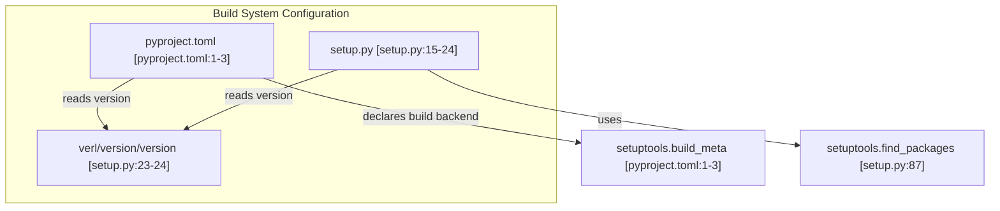
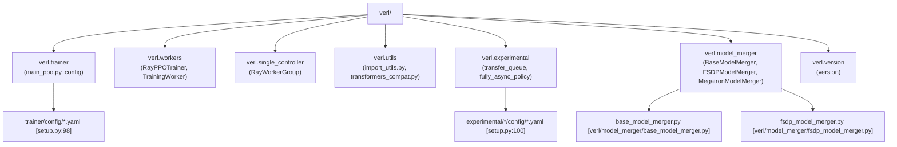
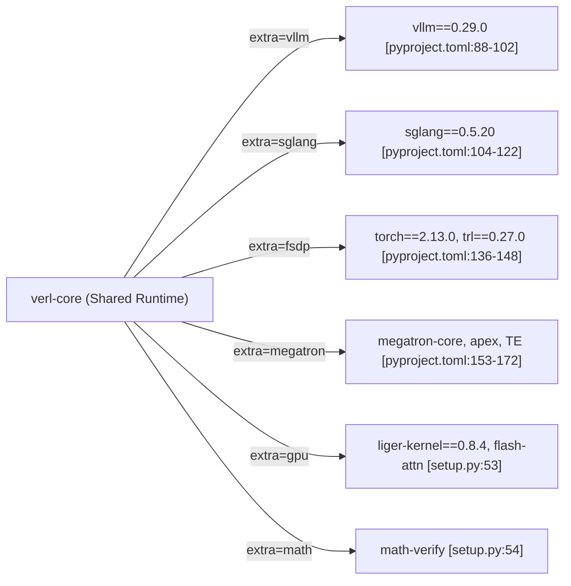
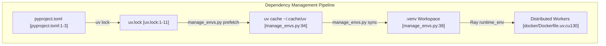
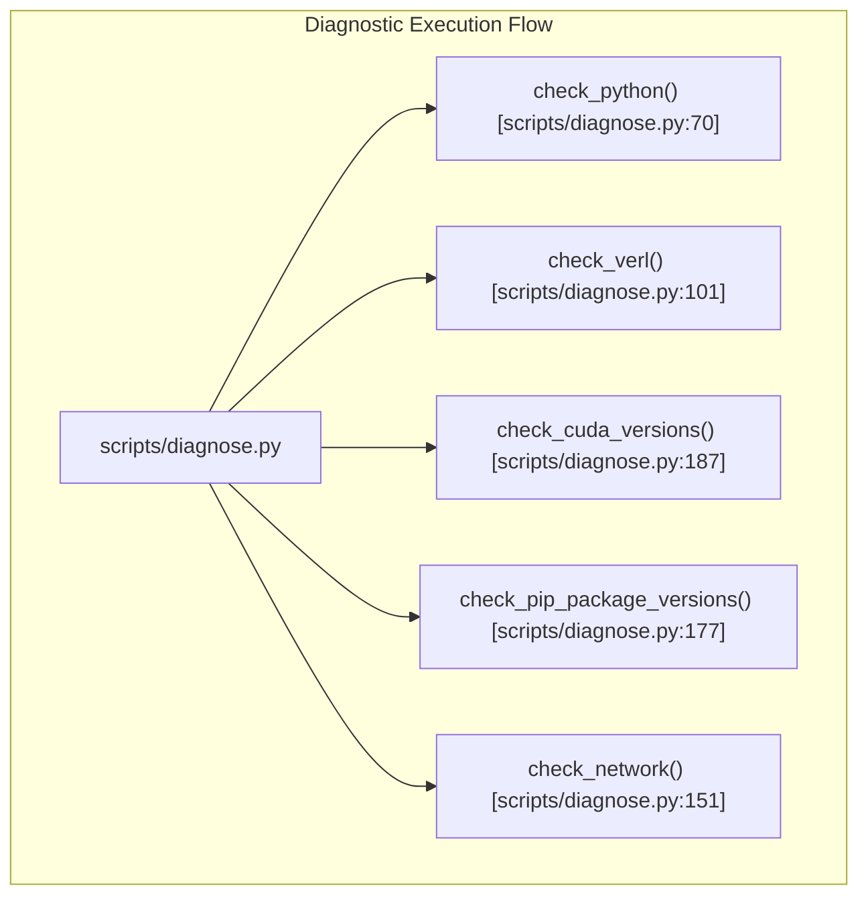
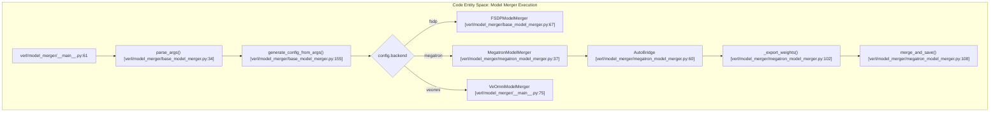

<!-- source: DeepWiki mcp.deepwiki.com · repo volcengine/verl · page 13.3 Package Structure, Scripts, and Dependencies · fetched 2026-10-21 -->

# Package Structure, Scripts, and Dependencies

Relevant source files

The following files were used as context for generating this wiki page:

- [.github/ISSUE_TEMPLATE/bug-report.yml](.github/ISSUE_TEMPLATE/bug-report.yml)
- [.github/ISSUE_TEMPLATE/config.yml](.github/ISSUE_TEMPLATE/config.yml)
- [.github/ISSUE_TEMPLATE/feature-request.yml](.github/ISSUE_TEMPLATE/feature-request.yml)
- [docker/Dockerfile.uv.cu130](docker/Dockerfile.uv.cu130)
- [docker/README.md](docker/README.md)
- [docs/advance/placement.rst](docs/advance/placement.rst)
- [docs/algo/entropy.md](docs/algo/entropy.md)
- [docs/start/install.rst](docs/start/install.rst)
- [manage_envs.py](manage_envs.py)
- [pyproject.toml](pyproject.toml)
- [requirements.txt](requirements.txt)
- [scripts/diagnose.py](scripts/diagnose.py)
- [setup.py](setup.py)
- [uv.lock](uv.lock)
- [verl/utils/import_utils.py](verl/utils/import_utils.py)
- [verl/version/version](verl/version/version)

This page provides a comprehensive technical overview of the `verl` package organization, build system configuration, dependency management via `setup.py`, `pyproject.toml`, `requirements.txt`, `uv.lock`, and `manage_envs.py`, optional dependency groups, and core utility scripts (`scripts/diagnose.py`, `verl/model_merger/`, `scripts/converter_hf_to_mcore.py`, and utility modules under `verl/utils/`) used across the framework.

Sources: [setup.py:15-105](), [pyproject.toml:1-170](), [verl/model_merger/base_model_merger.py:34-131](), [manage_envs.py:15-110]()

---

## 1. Build System and Packaging Architecture

verl utilizes a hybrid build system centered around modern Python packaging standards [pyproject.toml:1-3](). Authoritative metadata is declared in `pyproject.toml` using a `setuptools` build backend [pyproject.toml:1-3](), while a fallback `setup.py` script is maintained for legacy environments where `pyproject.toml`-based builds are unsupported [setup.py:15]().

**Version Management** is handled dynamically by reading a plain text version file:
- `verl/version/version`: The single source of truth for the library's version string, loaded by both `setup.py` [setup.py:23-24]() and `pyproject.toml` [pyproject.toml:7]().

Sources: [setup.py:15-24](), [setup.py:87](), [pyproject.toml:1-9](), [verl/version/version:1]()

---

## 2. Package Layout and Module Organization

Package discovery is driven by `setuptools.find_packages(where=".")` from the project root [setup.py:87](). All sub-packages under the `verl/` namespace are automatically discovered and organized into functional modules.

**Package Layout Diagram (Code Entity Mapping):**

Sources: [setup.py:83-103](), [pyproject.toml:36-74](), [verl/model_merger/base_model_merger.py:34-79](), [verl/model_merger/fsdp_model_merger.py:53-84]()

Non-Python assets are packaged via `package_data` specifications [setup.py:95-103]():
- `verl/version/*`: Version descriptor file [setup.py:96]().
- `verl/trainer/config/*.yaml`: Top-level Hydra configuration files [setup.py:98]().
- `verl/trainer/config/*/*.yaml`: Nested algorithm and trainer configurations [setup.py:99]().
- `verl/experimental/*/config/*.yaml`: Experimental module configurations [setup.py:100]().

Sources: [setup.py:95-103]()

---

## 3. Core Dependencies and Optional Groups

Core dependencies are installed automatically with any base installation (`pip install verl` or via `verl-core` in `pyproject.toml`) [setup.py:84, 93](), [pyproject.toml:33-34](). These libraries supply foundational utilities for tensor manipulation, distributed communication via Ray, and configuration parsing.

| Package | Version Constraint | Role / Responsibility |
|---|---|---|
| `accelerate` | `>=1.14.0` | HuggingFace hardware acceleration utilities [setup.py:27]() |
| `datasets` | none | HuggingFace dataset loading and streaming [setup.py:29]() |
| `dill` | none | Extended pickling support for Ray remote tasks [setup.py:30]() |
| `hydra-core` | none | Hierarchical configuration composition framework [setup.py:31]() |
| `numpy` | `>=2.0.0` | Core numerical computing arrays [setup.py:32]() |
| `pandas` | none | Tabular data manipulation [setup.py:33]() |
| `peft` | none | Parameter-Efficient Fine-Tuning adapters [setup.py:34]() |
| `pyarrow` | `>=19.0.0` | Parquet file I/O and Arrow columnar format [setup.py:35]() |
| `ray[default]` | `>=2.41.0` | Distributed execution framework and worker orchestration [setup.py:38]() |
| `tensordict` | `>=0.8.0,<=0.10.0,!=0.9.0` | Tensor container backend for `DataProto` [setup.py:40]() |
| `transformers` | `>=5.5.3,!=5.6.0,<5.13` | HuggingFace model architectures and tokenizers [setup.py:43]() |
| `wandb` | none | Experiment tracking and metric logging [setup.py:44]() |
| `TransferQueue` | `==0.1.11` | High-performance streaming data queue for async rollout [pyproject.toml:34]() |

Optional features and specialized backend runtimes are managed via explicit extra groups (`pip install verl[<group>]` or `uv sync --extra <group>`) [setup.py:94](), [pyproject.toml:13-18]().

**Optional Dependency Group Architecture:**

Sources: [setup.py:26-77](), [pyproject.toml:26-173]()

---

## 4. Dependency Management with `uv`, Lockfiles, and `manage_envs.py`

In addition to standard `pip` execution, `verl` relies on an advanced environment management pattern powered by `uv` [pyproject.toml:13-22](), [manage_envs.py:15-35]().

### 4.1. Universal Lockfile Architecture
- **`uv.lock`**: A single lockfile covers the entire dependency graph across multiple supported platforms (`linux_x86_64` and `linux_aarch64`) [uv.lock:1-11]().
- **Mutex Configuration**: Mutually exclusive execution stacks (e.g., `cpu`, `sglang`, `vllm`, `fsdp`, `megatron`) are declared under `[tool.uv].conflicts` in `pyproject.toml` to prevent invalid mixing of accelerator runtimes [pyproject.toml:13-22]().
- **Zero-Compile Wheels**: Prebuilt binaries for native extensions (`flash-attn`, `apex`, `transformer-engine`, `megatron-bridge`) are fetched from the dedicated `verl-project` wheelhouse index [docs/start/install.rst:64-67]().

### 4.2. Environment Driver (`manage_envs.py`)
For workflows where implicit `uv run` invocation is insufficient, `manage_envs.py` provides explicit environment maintenance controls [manage_envs.py:32-53]():
- `lock`: Regenerates the universal `uv.lock` from `pyproject.toml` [manage_envs.py:44]().
- `sync <extras...>`: Materializes a specific conflict-free combination of extras into `.venv` [manage_envs.py:45]().
- `run <extras...> -- <cmd>`: Executes commands inside the target environment context [manage_envs.py:46]().
- `prefetch`: Populates the local uv cache (`$UV_CACHE_DIR`) with wheels and source builds for offline and container deployment [manage_envs.py:50-52]().
- **Environment Protection**: Setting `VERL_UV_NO_INSTALL="ray wandb"` allows developers to preserve site-curated distributions from being overwritten during environment sync [manage_envs.py:73-88]().

Sources: [pyproject.toml:13-22](), [manage_envs.py:15-110](), [uv.lock:1-11](), [docker/Dockerfile.uv.cu130:18-26]()

---

## 5. Core Utility Scripts and Helpers

### 5.1. Diagnostic Utility (`scripts/diagnose.py`)
The diagnostic script checks operating system parameters, hardware capabilities, Python interpreters, package versions, and network/mirror connectivity [scripts/diagnose.py:14-16]().

**Key Functions and Execution Flow:**
- `check_python()`: Reports Python version, compiler flags, and architecture [scripts/diagnose.py:70-76]().
- `check_verl()`: Imports `verl`, validates its install path, and queries the local git commit hash via `_get_current_git_commit()` [scripts/diagnose.py:89-114]().
- `check_cuda_versions()`: Validates PyTorch CUDA availability and queries `nvcc` compiler versions [scripts/diagnose.py:187-203]().
- `check_pip_package_versions()`: Enumerates installed versions for critical packages (`vllm`, `sglang`, `ray`, `torch`) [scripts/diagnose.py:177-185]().
- `check_network()`: Performs DNS resolution and latency checks against PyPI and regional mirrors [scripts/diagnose.py:50-68](), [scripts/diagnose.py:151-168]().

Sources: [scripts/diagnose.py:14-203]()

### 5.2. Model Merger Framework (`verl/model_merger/`)
The model merger utility aggregates sharded distributed checkpoints (from FSDP, Megatron-LM, or VeOmni training runs) back into unified HuggingFace model weights or tests them against reference models [verl/model_merger/__main__.py:15-56](), [verl/model_merger/base_model_merger.py:34-131]().

**Architecture & Components:**
- **`BaseModelMerger`**: Abstract base class defining the CLI subparser interface (`merge` and `test`), configuration parsing via `ModelMergerConfig`, and validation hooks [verl/model_merger/base_model_merger.py:34-131]().
- **`MegatronModelMerger`**: Integrates with Megatron-Bridge (`AutoBridge`) to reconstruct MCore distributed checkpoints into HuggingFace format or validate outputs [verl/model_merger/megatron_model_merger.py:37-112]().
- **`FSDPModelMerger`**: Consolidates PyTorch FSDP distributed sharded state dicts [verl/model_merger/base_model_merger.py:66-69]().

Sources: [verl/model_merger/__main__.py:61-83](), [verl/model_merger/base_model_merger.py:34-157](), [verl/model_merger/megatron_model_merger.py:37-112]()

### 5.3. Checkpoint Converters (`scripts/converter_hf_to_mcore.py`)
The conversion script `scripts/converter_hf_to_mcore.py` translates HuggingFace checkpoint weights into v2 Megatron Core (MCore) distributed checkpoints using Megatron-Bridge [scripts/converter_hf_to_mcore.py:16-47]().

- `initialize_conversion()`: Sets up the distributed process group and selects the target device based on local rank [verl/models/mcore/bridge_checkpoint.py:70-78]().
- `build_conversion_model()`: Constructs sharded Megatron models using `AutoBridge` with proper tensor, pipeline, and expert parallelism configurations [verl/models/mcore/bridge_checkpoint.py:79-126]().
- `convert_hf_to_mcore()`: Loads HuggingFace weights, executes sharding, writes out distributed checkpoint metadata and shards under `model/dist_ckpt`, and optionally verifies roundtrip integrity against source weights [scripts/converter_hf_to_mcore.py:50-110]().

Sources: [scripts/converter_hf_to_mcore.py:16-121](), [verl/models/mcore/bridge_checkpoint.py:15-165]()

### 5.4. Import, Path, and Compatibility Utilities (`verl/utils/import_utils.py` & `verl/utils/transformers_compat.py`)
To handle varying optional dependencies and cross-version transformers differences in distributed environments, `verl` includes dedicated utility modules:

- **`verl/utils/import_utils.py`**:
  - `is_megatron_core_available()`, `is_vllm_available()`, `is_sglang_available()`: Cached spec finders for optional backends [verl/utils/import_utils.py:27-52]().
  - `resolve_config_path()`: Resolves relative path references in multi-node Ray deployments against the current working directory or installed project root [verl/utils/import_utils.py:91-144]().
  - `load_module()`: Dynamic module loader supporting package URIs (`pkg://`) and direct file paths (`file://`) [verl/utils/import_utils.py:151-196]().
- **`verl/utils/transformers_compat.py`**:
  - `is_transformers_version_in_range()`: Version bounds checking for HuggingFace `transformers` [verl/utils/transformers_compat.py:39-57]().
  - `get_auto_model_for_vision2seq()`: Cross-version auto model selector (`AutoModelForImageTextToText` vs `AutoModelForVision2Seq`) [verl/utils/transformers_compat.py:60-75]().
  - `drop_tied_target_keys()`: Cleans up tied parameter alias duplicates from state dictionaries during checkpoint saves to prevent storage bloat and loading failures [verl/utils/transformers_compat.py:95-121]().

Sources: [verl/utils/import_utils.py:14-196](), [verl/utils/transformers_compat.py:15-121]()

---

