# Page: Overview

# Overview

<details>
<summary>Relevant source files</summary>

The following files were used as context for generating this wiki page:

- [README.md](README.md)
- [docs/advance/dpo_extension.rst](docs/advance/dpo_extension.rst)
- [docs/algo/baseline.md](docs/algo/baseline.md)
- [docs/algo/dapo.md](docs/algo/dapo.md)
- [docs/api/data.rst](docs/api/data.rst)
- [docs/api/single_controller.rst](docs/api/single_controller.rst)
- [docs/examples/gsm8k_example.rst](docs/examples/gsm8k_example.rst)
- [docs/examples/ppo_code_architecture.rst](docs/examples/ppo_code_architecture.rst)
- [docs/faq/faq.rst](docs/faq/faq.rst)
- [docs/hybrid_flow.rst](docs/hybrid_flow.rst)
- [docs/index.rst](docs/index.rst)
- [docs/perf/device_tuning.rst](docs/perf/device_tuning.rst)
- [docs/preparation/reward_function.rst](docs/preparation/reward_function.rst)
- [docs/start/multinode.rst](docs/start/multinode.rst)
- [docs/start/quickstart.rst](docs/start/quickstart.rst)
- [docs/workers/model_engine.rst](docs/workers/model_engine.rst)
- [examples/tutorial/slurm/ray_on_slurm.slurm](examples/tutorial/slurm/ray_on_slurm.slurm)

</details>


This document introduces the `verl` framework, its purpose as a reinforcement learning (RL) training library for large language models (LLMs), and provides a high-level overview of the system architecture. For detailed information about specific subsystems, see the child pages: [System Architecture and HybridFlow Design](#1.1), [Key Innovations and Design Patterns](#1.2), and [Supported Algorithms and Models](#1.3).

## Purpose and Scope

`verl` (**V**olcano Engine **R**einforcement **L**earning) is a flexible, efficient, and production-ready framework for post-training LLMs using RL algorithms [README.md:22-24](). It is the open-source implementation of the **HybridFlow** paper [README.md:26-27]() presented at EuroSys [README.md:14-14]().

The framework addresses the challenge of efficiently orchestrating complex RL training workflows that involve multiple distributed components: policy training, inference generation, reward computation, and value estimation [README.md:30-33](). `verl` enables researchers and practitioners to:

- Implement diverse RL algorithms (PPO, GRPO, RLOO, DAPO, etc.) with minimal code changes [README.md:30-30]().
- Scale training from single-GPU prototypes to multi-node clusters with hundreds of GPUs [README.md:34-34]().
- Integrate with existing LLM infrastructure such as PyTorch FSDP, Megatron-LM, vLLM, and SGLang [README.md:32-32]().
- Efficiently manage GPU resources across training and inference workloads via flexible device mapping [docs/index.rst:12-13]().
- Support multimodal models (**VeRL-Omni**), reasoning models, and multi-token prediction (**MTP**) [README.md:53-57](), [docs/index.rst:160-162]().

Sources: [README.md:14-34](), [docs/index.rst:12-162]()

## What is `verl`?

`verl` provides a complete software stack for LLM post-training via reinforcement learning [README.md:24-24]().

### Framework Component Stack
| Component | Purpose | Key Classes / Entities |
|-----------|---------|-------------|
| **Programming Model** | Define RL algorithm dataflows | `HybridFlow` (single/multi-controller) [docs/index.rst:8-9]() |
| **Training Orchestration** | Coordinate distributed execution | `RayPPOTrainer` [docs/index.rst:93-93]() |
| **Distributed Workers** | Execute training/inference tasks | `ActorRolloutRefWorker`, `TrainingWorker` [docs/index.rst:95-95]() |
| **Training Engines** | Backend for model training | `FSDPEngine`, `MegatronEngine`, `VeOmniEngine` [docs/index.rst:116-118](), [docs/index.rst:164-164]() |
| **Inference Engines** | High-throughput generation | `vLLM`, `SGLang`, `TensorRT-LLM` [docs/index.rst:94-99]() |
| **Data Pipeline** | Load and process training data | `RLHFDataset`, `DataProto` [docs/index.rst:49-50]() |
| **Configuration System** | Manage complex configurations | Hydra framework with OmegaConf [docs/index.rst:57-58]() |

The framework supports training on various hardware platforms including NVIDIA GPUs, AMD GPUs (ROCm), and Huawei Ascend NPUs [docs/index.rst:170-172]().

Sources: [README.md:24-24](), [docs/index.rst:8-172]()

## HybridFlow Programming Model

The HybridFlow programming model is the foundation of `verl`'s flexibility. It combines two execution paradigms [docs/index.rst:8-9]():

- **Single-Controller Paradigm**: A centralized controller orchestrates the entire workflow, dispatching data to workers and collecting results [docs/index.rst:8-9](). This is primarily implemented via `RayPPOTrainer` [docs/index.rst:93-93]().
- **Multi-Controller Paradigm**: Multiple independent controllers manage different parts of the workflow asynchronously [docs/index.rst:8-9](). This enables off-policy training, partial rollout, and truly asynchronous architectures where generation and training are decoupled [docs/index.rst:127-134]().

For details on the programming model, see [System Architecture and HybridFlow Design](#1.1).

Sources: [docs/index.rst:8-10](), [docs/index.rst:93-93](), [docs/index.rst:127-134]()

## System Architecture

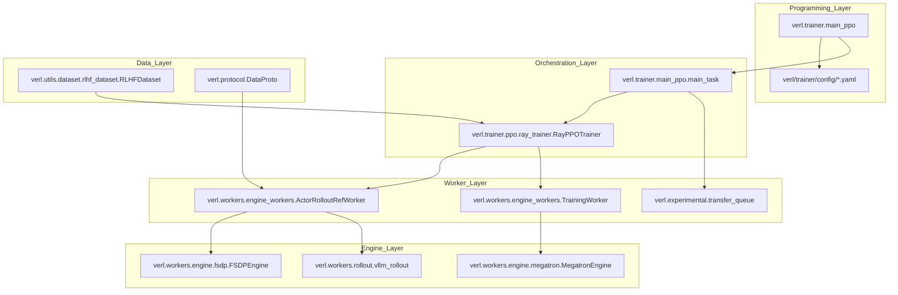
Sources: [docs/index.rst:91-95](), [docs/examples/ppo_code_architecture.rst:10-11]()

## Core Subsystems

### Training Orchestration
The `RayPPOTrainer` class serves as the central orchestrator [docs/index.rst:93-93](). It manages `WorkerGroup` construction and runs the main loop of the RL algorithm (e.g., PPO) [docs/index.rst:93-93]().

### Distributed Workers
Workers are Ray remote actors that execute specific roles:
- **ActorRolloutRefWorker**: A hybrid worker that combines actor training, rollout generation, and reference computation [docs/index.rst:95-95]().
- **TrainingWorker**: A unified worker that handles training tasks for various backends like FSDP or Megatron, typically used for Critic and Reward Model roles [docs/index.rst:95-95]().

### Training Engines
The framework supports multiple training backends via configuration:
- **FSDP Backend**: Utilizes FSDP/FSDP2 for sharding and memory management [docs/index.rst:116-116]().
- **Megatron-LM Backend**: Utilizes Megatron-LM for better scalability and model parallelism [docs/index.rst:117-117]().

### Inference Engines
`verl` integrates with high-performance inference backends:
- **vLLM**: Optimized for high-throughput token generation [docs/index.rst:98-98]().
- **SGLang**: Optimized for multi-turn interactions and RadixAttention [docs/index.rst:98-98]().
- **TensorRT-LLM**: High-performance backend for NVIDIA GPUs [docs/index.rst:99-99]().

### Data Pipeline
- **RLHFDataset**: Manages tokenization and batching for RLHF workloads [docs/index.rst:50-50]().
- **DataProto**: The primary communication protocol for passing tensors and metadata between distributed workers [docs/index.rst:50-50]().

Sources: [docs/index.rst:49-99]()

## RL Training Flow

```mermaid
graph LR
    subgraph "Data_Loading"
        Dataset["verl.utils.dataset.rlhf_dataset.RLHFDataset"]
        Batch["verl.protocol.DataProto"]
    end
    
    subgraph "Rollout_Phase"
        Inference["verl.workers.engine_workers.ActorRolloutRefWorker"]
        Samples["verl.protocol.DataProto"]
    end
    
    subgraph "Evaluation_Phase"
        Reward["verl.workers.reward.RewardManager"]
        Advantage["verl.trainer.ppo.core_algos.compute_gae_advantage_return"]
    end
    
    subgraph "Policy_Update"
        Loss["verl.trainer.ppo.core_algos.compute_policy_loss"]
        Update["verl.trainer.ppo.ray_trainer.RayPPOTrainer.fit"]
    end
    
    Dataset --> Batch
    Batch --> Inference
    Inference --> Samples
    Samples --> Reward
    Reward --> Advantage
    Advantage --> Loss
    Loss --> Update
```
Sources: [docs/index.rst:73-87](), [docs/index.rst:91-95](), [docs/examples/ppo_code_architecture.rst:50-51]()

## Supported Algorithms and Models

`verl` supports a wide range of algorithms and model architectures [README.md:30-30](), [README.md:36-36]():

- **Algorithms**: PPO, GRPO, RLOO, DAPO, SPIN, SPPO, REINFORCE++, GDPO, CISPO, OTB, etc. [docs/index.rst:73-87]()
- **Models**: Qwen (2, 2.5, 3), Llama (2, 3), DeepSeek series, and MoE architectures [README.md:53-57](), [docs/algo/baseline.md:19-39]().

For details, see [Supported Algorithms and Models](#1.3).

Sources: [README.md:30-69](), [docs/index.rst:73-87](), [docs/algo/baseline.md:19-39]()

## Getting Started

To begin using `verl`:

1.  **Installation**: Follow the instructions for Docker or local environment setup using `uv` or `pip` [docs/index.rst:31-31]().
2.  **Data Preparation**: Prepare your datasets in Parquet format with the required fields (`prompt`, `ground_truth`) [examples/data_preprocess/gsm8k.py:99-100]().
3.  **Run Training**: Use provided recipes for common algorithms like PPO or GRPO via the main entry points [docs/index.rst:31-33]().

For more information, see Getting Started (Section 2).

Sources: [docs/index.rst:31-33](), [examples/data_preprocess/gsm8k.py:99-100]()

---

# Page: System Architecture and HybridFlow Design

# System Architecture and HybridFlow Design

<details>
<summary>Relevant source files</summary>

The following files were used as context for generating this wiki page:

- [README.md](README.md)
- [docs/advance/dpo_extension.rst](docs/advance/dpo_extension.rst)
- [docs/algo/baseline.md](docs/algo/baseline.md)
- [docs/algo/dapo.md](docs/algo/dapo.md)
- [docs/api/data.rst](docs/api/data.rst)
- [docs/api/single_controller.rst](docs/api/single_controller.rst)
- [docs/examples/gsm8k_example.rst](docs/examples/gsm8k_example.rst)
- [docs/examples/ppo_code_architecture.rst](docs/examples/ppo_code_architecture.rst)
- [docs/faq/faq.rst](docs/faq/faq.rst)
- [docs/hybrid_flow.rst](docs/hybrid_flow.rst)
- [docs/index.rst](docs/index.rst)
- [docs/perf/device_tuning.rst](docs/perf/device_tuning.rst)
- [docs/preparation/reward_function.rst](docs/preparation/reward_function.rst)
- [docs/start/multinode.rst](docs/start/multinode.rst)
- [docs/start/quickstart.rst](docs/start/quickstart.rst)
- [docs/workers/model_engine.rst](docs/workers/model_engine.rst)
- [examples/tutorial/slurm/ray_on_slurm.slurm](examples/tutorial/slurm/ray_on_slurm.slurm)
- [tests/single_controller/test_data_transfer.py](tests/single_controller/test_data_transfer.py)
- [tests/single_controller/test_device_mesh_register.py](tests/single_controller/test_device_mesh_register.py)
- [tests/single_controller/test_high_level_scheduling_api.py](tests/single_controller/test_high_level_scheduling_api.py)
- [tests/single_controller/test_ray_collectives.py](tests/single_controller/test_ray_collectives.py)
- [tests/single_controller/test_split_resource_pool.py](tests/single_controller/test_split_resource_pool.py)
- [tests/single_controller/test_worker_group_basics.py](tests/single_controller/test_worker_group_basics.py)
- [verl/single_controller/base/worker.py](verl/single_controller/base/worker.py)
- [verl/single_controller/base/worker_group.py](verl/single_controller/base/worker_group.py)
- [verl/single_controller/ray/__init__.py](verl/single_controller/ray/__init__.py)
- [verl/single_controller/ray/base.py](verl/single_controller/ray/base.py)

</details>


## Purpose and Scope

This document describes verl's **HybridFlow** programming model and the overall system architecture that enables flexible, efficient reinforcement learning for large language models. HybridFlow is the open-source implementation of the research paper ["HybridFlow: A Flexible and Efficient RLHF Framework"](https://arxiv.org/abs/2409.19256v2).

**Scope:** This page covers the architectural foundations and design principles of HybridFlow, focusing on the programming model, single-controller paradigm, and data orchestration.
- RL training loop mechanics → see [3.1]()
- Distributed execution with Ray → see [5]()
- Worker implementations → see [6]()
- Engine backends → see [8]()

Sources: [README.md:26-27](), [docs/index.rst:4-5]()

## What is HybridFlow?

HybridFlow is a **hybrid controller programming model** that combines single-controller and multi-controller paradigms to enable flexible representation and efficient execution of complex post-training dataflows. The key innovation is **decoupling computation from data dependencies**, allowing seamless integration with existing LLM frameworks (FSDP, Megatron-LM, vLLM, SGLang) while supporting flexible device mapping.

**Key Design Principles:**

1. **Single-Controller Orchestration**: A central controller coordinates all distributed workers via Ray, simplifying control flow [docs/index.rst:8-9]().
2. **Computation-Data Decoupling**: Workers perform computations independently; data dependencies are resolved through `DataProto` objects [verl/single_controller/base/decorator.py:91-117]().
3. **Hybrid Engine Architecture**: The same worker can switch between training and inference modes, eliminating redundant model copies [README.md:42-43]().
4. **Flexible Resource Allocation**: Models can be placed on different GPU sets for efficient resource utilization and scalability across different cluster sizes [README.md:34-35](), [docs/index.rst:12-13]().

Sources: [README.md:28-43](), [docs/index.rst:8-22](), [verl/single_controller/base/decorator.py:91-117]()

## High-Level Architecture and Code Entity Mapping

The following diagram bridges natural language space to code entity space, mapping high-level system components to their concrete implementation classes and modules within the codebase:

Title: System Architecture and Code Entities
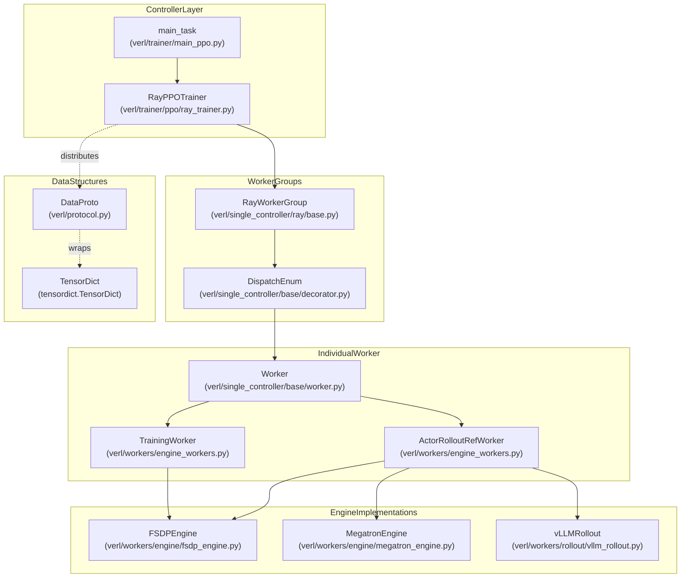

Sources: [verl/single_controller/ray/base.py:113-164](), [verl/single_controller/base/worker.py:76-82](), [verl/single_controller/base/decorator.py:26-32]()

## Single-Controller vs Multi-Controller Paradigms

verl adopts a **single-controller** architecture where the driver entry point orchestrates all distributed workers. This contrasts with traditional multi-controller setups (where each node runs independent control loops). By using a single Python driver, complex RL training pipelines (rollout generation, reward evaluation, advantage estimation, policy optimization) are expressed imperatively.

Title: Single-Controller Communication Pattern and Code Mapping
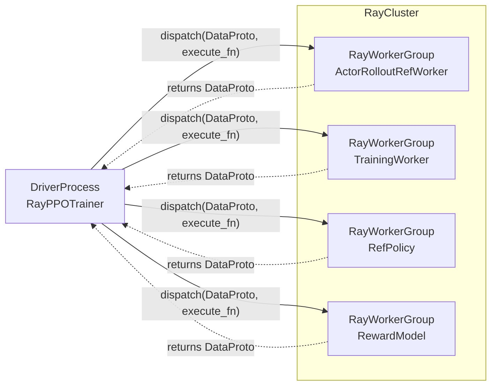

Sources: [verl/single_controller/ray/base.py:113-164](), [verl/single_controller/base/worker_group.py:123-127]()

### Implementation Details

The `RayPPOTrainer` implements the central control logic in a standard Python training loop, while `RayWorkerGroup` manages the mapping of single-process calls to distributed Ray actor executions.

**Key Components:**
- **RayPPOTrainer**: Orchestrates worker construction and the primary execution loop for algorithms like PPO.
- **RayWorkerGroup**: Manages collections of `Worker` instances anchored to Ray placement groups [verl/single_controller/ray/base.py:113-164](). The `WorkerGroup` base class provides methods for worker management, aliveness checking, and method binding [verl/single_controller/base/worker_group.py:123-127]().
- **DataProto**: Provides a unified interface for passing tensors and metadata between the driver controller and distributed workers, incorporating automatic padding [verl/single_controller/base/decorator.py:91-117]().

Sources: [verl/single_controller/ray/base.py:113-164](), [verl/single_controller/base/decorator.py:91-117](), [verl/single_controller/base/worker_group.py:123-127]()

## Data Flow and DataProto

The `DataProto` class and its underlying `TensorDict` representation serve as the fundamental data communication primitives across the framework. They encapsulate both tensors and arbitrary non-tensor metadata, allowing verl to cleanly decouple computation logic from underlying cluster sharding structures.

### Communication Flow

When the controller dispatches execution to a worker group, `DataProto` manages transformations:
1. **Padding**: Data can be automatically padded to match worker counts or tensor slice constraints, tracked via `_padding_size_key` [verl/single_controller/ray/base.py:53-53]().
2. **Splitting**: Distributed tasks use automatic padding to partition inputs into chunks matching worker world sizes [docs/advance/dpo_extension.rst:161-162]().
3. **Merging**: Worker outputs are concatenated back into unified structures [docs/advance/dpo_extension.rst:170-171]().

### Metadata Handling
verl utilizes `TensorDict`'s capability to store non-tensor objects alongside tensor payloads, managing auxiliary states and dictionaries seamlessly [verl/utils/tensordict_utils.py:26-46]().

Sources: [verl/single_controller/ray/base.py:53-53](), [docs/advance/dpo_extension.rst:161-162](), [docs/advance/dpo_extension.rst:170-171](), [verl/utils/tensordict_utils.py:26-46]()

## Hybrid Engine Architecture

The **3D-HybridEngine** design enables a single worker group to multiplex across multiple operational roles (Actor training, Rollout generation, and Reference log-probability computation) without duplicating model weights in memory. This is achieved by using `ActorRolloutRefWorker` which can act as a standalone actor, rollout, or a hybrid engine depending on configuration [docs/examples/ppo_code_architecture.rst:102-105]().

Title: Hybrid Engine Design and Component Entities
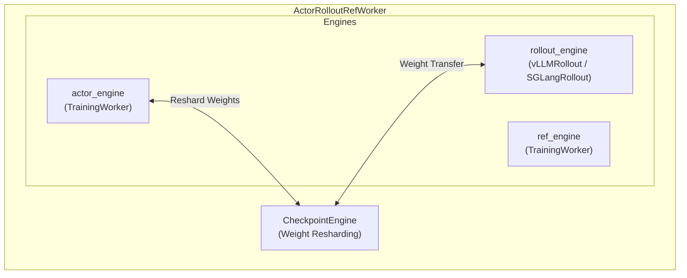

Sources: [README.md:42-43](), [docs/workers/model_engine.rst:92-96]()

### Key Features:
- **Resharding**: Eliminates memory duplication and minimizes communication overhead during transitions between training and inference phases [README.md:42-43](). The `CheckpointEngine` abstraction handles saving and loading intermediate sharded checkpoints, including model, optimizer, and LR scheduler states [docs/workers/model_engine.rst:92-96]().
- **Backend Abstraction**: Supports FSDP/FSDP2 for flexible prototyping and Megatron-LM for ultra-scale training [docs/start/install.rst:18-20](). The backend selection is driven by configuration parameters like `config.actor_rollout_ref.actor.strategy` and `config.critic.strategy` [docs/examples/ppo_code_architecture.rst:107-109]().
- **Inference Integration**: Integrates directly with vLLM and SGLang for high-throughput rollout generation [docs/start/install.rst:13-13]().

Sources: [README.md:42-43](), [docs/start/install.rst:13-20](), [docs/workers/model_engine.rst:92-96](), [docs/examples/ppo_code_architecture.rst:102-105](), [docs/examples/ppo_code_architecture.rst:107-109]()

## Summary of Innovations

HybridFlow resolves the trade-off between architectural flexibility and performance through:
1. **Separating Control and Computation**: Python-driven drivers manage high-level RL routines, while dedicated workers execute high-throughput neural network operations [docs/index.rst:8-9]().
2. **Unified Data Interface**: `DataProto` and `TensorDict` isolate the controller from worker sharding specifics [verl/single_controller/base/decorator.py:91-117]().
3. **Flexible Device Mapping**: Models can be placed on configurable groups of accelerators [README.md:34-35](). `RayResourcePool` manages the allocation of resources (e.g., GPUs) to placement groups for workers [verl/single_controller/ray/base.py:113-164]().
4. **TransferQueue Integration**: Asynchronous data pipelines decouple execution boundaries across asynchronous stages [verl/utils/transferqueue_utils.py:184-202](). TransferQueue provides fine-grained, sub-sample-level data management and load-balancing capabilities, acting as a data gateway that decouples explicit data dependencies across computational tasks [docs/data/transfer_queue.md:20-22]().

Sources: [docs/index.rst:8-9](), [verl/single_controller/base/decorator.py:91-117](), [README.md:34-35](), [verl/utils/transferqueue_utils.py:184-202](), [verl/single_controller/ray/base.py:113-164](), [docs/data/transfer_queue.md:20-22]()

---

# Page: Key Innovations and Design Patterns

# Key Innovations and Design Patterns

<details>
<summary>Relevant source files</summary>

The following files were used as context for generating this wiki page:

- [README.md](README.md)
- [docs/faq/faq.rst](docs/faq/faq.rst)
- [docs/index.rst](docs/index.rst)
- [tests/checkpoint_engine/test_correctness_on_gpu.py](tests/checkpoint_engine/test_correctness_on_gpu.py)
- [tests/checkpoint_engine/test_correctness_on_npu.py](tests/checkpoint_engine/test_correctness_on_npu.py)
- [tests/checkpoint_engine/test_utils.py](tests/checkpoint_engine/test_utils.py)
- [tests/experimental/agent_loop/test_agent_loop_extra_fields_schema_on_cpu.py](tests/experimental/agent_loop/test_agent_loop_extra_fields_schema_on_cpu.py)
- [tests/experimental/agent_loop/test_basic_agent_loop.py](tests/experimental/agent_loop/test_basic_agent_loop.py)
- [tests/experimental/agent_loop/test_multi_modal.py](tests/experimental/agent_loop/test_multi_modal.py)
- [verl/checkpoint_engine/README.md](verl/checkpoint_engine/README.md)
- [verl/checkpoint_engine/__init__.py](verl/checkpoint_engine/__init__.py)
- [verl/checkpoint_engine/base.py](verl/checkpoint_engine/base.py)
- [verl/checkpoint_engine/hccl_checkpoint_engine.py](verl/checkpoint_engine/hccl_checkpoint_engine.py)
- [verl/checkpoint_engine/kimi_checkpoint_engine.py](verl/checkpoint_engine/kimi_checkpoint_engine.py)
- [verl/checkpoint_engine/mooncake_checkpoint_engine.py](verl/checkpoint_engine/mooncake_checkpoint_engine.py)
- [verl/checkpoint_engine/nccl_checkpoint_engine.py](verl/checkpoint_engine/nccl_checkpoint_engine.py)
- [verl/checkpoint_engine/nixl_checkpoint_engine.py](verl/checkpoint_engine/nixl_checkpoint_engine.py)
- [verl/experimental/agent_loop/agent_loop.py](verl/experimental/agent_loop/agent_loop.py)
- [verl/experimental/agent_loop/single_turn_agent_loop.py](verl/experimental/agent_loop/single_turn_agent_loop.py)
- [verl/experimental/agent_loop/tool_agent_loop.py](verl/experimental/agent_loop/tool_agent_loop.py)
- [verl/utils/net_utils.py](verl/utils/net_utils.py)

</details>


## Purpose and Scope

This page documents the core architectural innovations and design patterns that distinguish `verl` from traditional RLHF frameworks. It covers the technical mechanisms behind `verl`'s flexibility and efficiency, focusing on concrete implementation patterns, weight resharding strategies via the `CheckpointEngine` abstraction and 3D-HybridEngine, hybrid worker designs, checkpoint engine implementations (`NCCLCheckpointEngine`, `MooncakeCheckpointEngine`, `HCCLCheckpointEngine`), and agent loop integrations (`AgentLoopManager`, `ToolAgentLoop`, `SingleTurnAgentLoop`, `LLMServerClient`) for multi-turn reasoning and agentic reinforcement learning.

Sources: [verl/checkpoint_engine/base.py:116-128]()

---

## 1. HybridFlow Architecture: Decoupled Training and Inference

### 1.1 Core Principle

The HybridFlow architecture separates computation into two distinct execution paths, enabling seamless integration with existing LLM infrastructure while decoupling data dependencies.

1.  **Training Path**: Utilizes frameworks like **PyTorch FSDP** or **Megatron-LM** for efficient parameter updates and gradient computation. The `TrainingWorker` orchestrates this via a single-controller API, delegating execution to a `BaseEngine` implementation.
2.  **Inference Path**: Leverages high-throughput inference engines such as **vLLM** or **SGLang** for rollout generation via `RolloutReplica` and `LLMServerClient` [verl/workers/rollout/llm_server.py:43-55]().

This decoupling allows each subsystem to use specialized kernels and optimized memory layouts. For example, the inference path uses PagedAttention or RadixAttention, while the training path focuses on distributed sharding and gradient accumulation.

**Diagram: HybridFlow Execution Model and Code Entities**

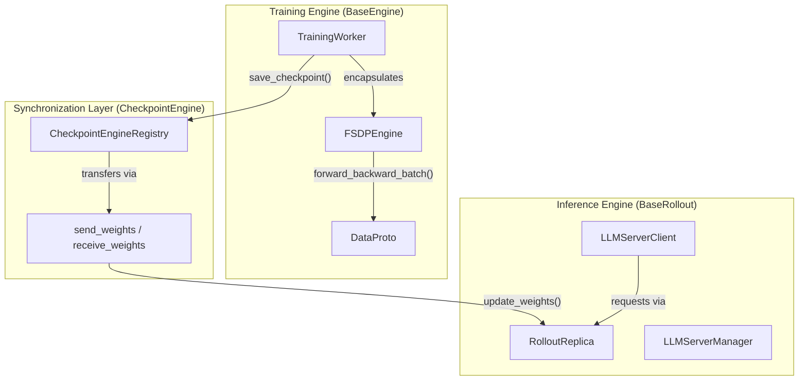

Sources: [verl/workers/rollout/llm_server.py:43-88](), [verl/checkpoint_engine/base.py:116-128]()

---

## 2. 3D-HybridEngine: Efficient Weight Resharding

### 2.1 The Memory Redundancy Problem

In large-scale RLHF, model weights are often duplicated across training and inference processes. This leads to memory redundancy and significant communication bottlenecks when synchronizing updates across different parallelization strategies (e.g., FSDP sharding vs. Megatron Tensor Parallelism).

### 2.2 Solution: Unified CheckpointEngine Abstraction

The `CheckpointEngine` provides a unified abstract layer to synchronize weights between diverse training and inference backends [verl/checkpoint_engine/base.py:116-128](). It defines three primary APIs: `send_weights`, `receive_weights`, and `get_weights` [verl/checkpoint_engine/README.md:6-10](). The `CheckpointEngineRegistry` allows dynamic backend selection at runtime [verl/checkpoint_engine/base.py:49-93]().

**Diagram: CheckpointEngine Architecture and Implementations**

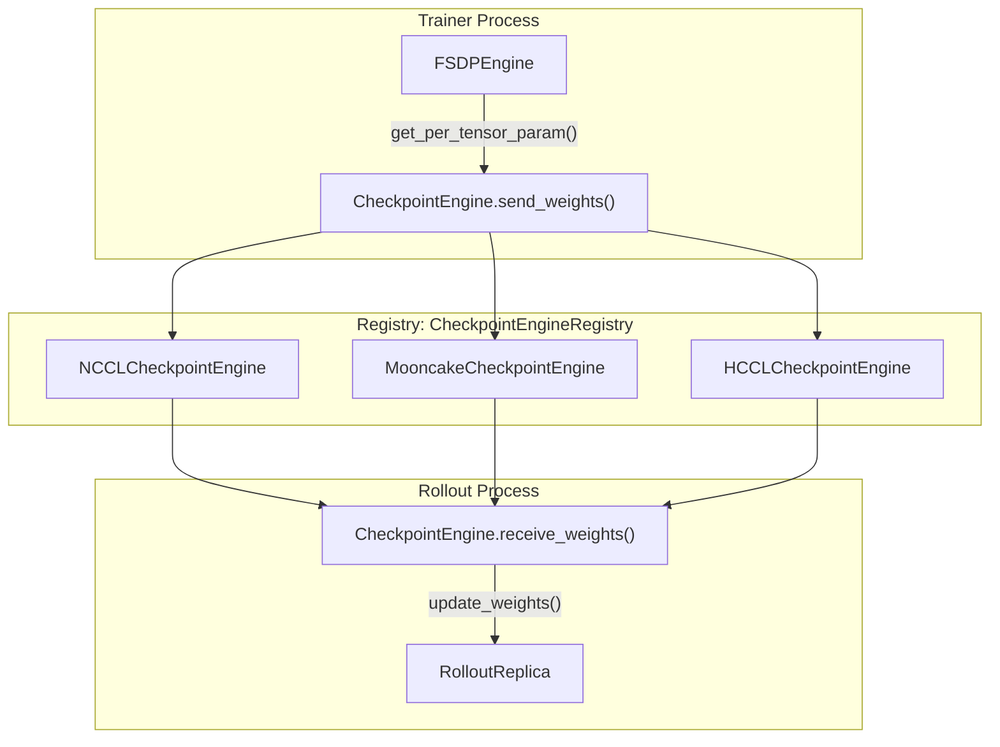

Sources: [verl/checkpoint_engine/base.py:49-128](), [verl/checkpoint_engine/nccl_checkpoint_engine.py:120-148]()

### 2.3 Bucketed Weight Transfer and Engine Implementations

To minimize communication overhead, `verl` packs sharded parameters into contiguous buckets described by `TensorMeta` (name, shape, dtype, chunk offset, chunk size, offset) [verl/checkpoint_engine/base.py:34-47](). 

Different backend implementations utilize specialized communication protocols:
- `NCCLCheckpointEngine`: Broadcasts weight buckets using PyTorch/NCCL collectives and ZeroMQ for metadata distribution [verl/checkpoint_engine/nccl_checkpoint_engine.py:120-155]().
- `MooncakeCheckpointEngine`: Leverages the Mooncake `TransferEngine` for high-performance P2P memory transfers with RDMA or direct transport [verl/checkpoint_engine/mooncake_checkpoint_engine.py:38-94]().
- `HCCLCheckpointEngine`: Implements Ascend NPU-specific weight synchronization using HCCL and StatelessProcessGroup [verl/checkpoint_engine/hccl_checkpoint_engine.py:104-146]().

| Backend | Comm Library | Hardware | Performance | Use Case |
| :--- | :--- | :--- | :--- | :--- |
| **nccl** | NCCL + ZMQ | NVIDIA GPU | Very High | Distributed on-policy/off-policy training [verl/checkpoint_engine/nccl_checkpoint_engine.py:120]() |
| **hccl** | HCCL + ZMQ | Ascend NPU | High | Huawei Ascend clusters [verl/checkpoint_engine/hccl_checkpoint_engine.py:104]() |
| **mooncake** | TransferEngine | NVIDIA/Ascend | High | Disaggregated clusters with P2P transfer [verl/checkpoint_engine/mooncake_checkpoint_engine.py:38]() |

Sources: [verl/checkpoint_engine/base.py:34-47](), [verl/checkpoint_engine/nccl_checkpoint_engine.py:120-155](), [verl/checkpoint_engine/mooncake_checkpoint_engine.py:38-94](), [verl/checkpoint_engine/hccl_checkpoint_engine.py:104-146]()

---

## 3. Hybrid Worker Design and Mode Switching

### 3.1 Rollout Deployment Modes

`verl` supports flexible deployment configurations orchestrated through Ray resource pools:
*   **HYBRID**: Rollout and training engines fused in the same process, sharing GPU memory contexts.
*   **STANDALONE / Disaggregated**: Separate worker groups for training and inference, communicating via `CheckpointEngine` weight transfer.
*   **COLOCATED**: Shared resource pools where inference replicas run alongside training workers with optimized memory handoffs.

### 3.2 BaseEngine Lifecycle

The `BaseEngine` abstract interface defines standard lifecycle management across backends:
*   **Initialization**: `initialize()` sets up model parallelism, optimizer states, and device placement.
*   **Mode Switching**: `train_mode()` and `eval_mode()` context managers handle gradient tracking and dropout state transitions.
*   **Memory Management**: Engines support parameter and optimizer offloading flags (`is_param_offload_enabled`, `is_optimizer_offload_enabled`) to mitigate memory pressure during rollout generation.

Sources: [verl/checkpoint_engine/base.py:116-128]()

---

## 4. Agent Loop Integration and Multi-Turn Orchestration

### 4.1 Agent Loop Architecture

For multi-turn conversation and agentic reinforcement learning, `verl` provides an asynchronous agent framework centered around agent loop abstractions such as `AgentLoopBase`, `SingleTurnAgentLoop` [verl/experimental/agent_loop/single_turn_agent_loop.py:28-36](), and `ToolAgentLoop` [verl/experimental/agent_loop/tool_agent_loop.py:101-125](). 

The `LLMServerClient` manages communication across OpenAI-compatible inference servers, featuring least-in-flight load balancing and sticky sessions for prefix caching via request load balancers [verl/workers/rollout/llm_server.py:43-48]().

**Diagram: Agent Loop and LLM Server Client Integration**

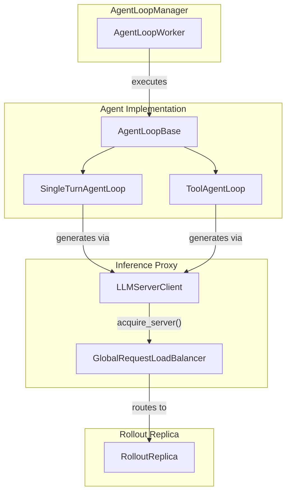

Sources: [verl/workers/rollout/llm_server.py:43-88](), [verl/experimental/agent_loop/single_turn_agent_loop.py:28-36](), [verl/experimental/agent_loop/tool_agent_loop.py:101-125]()

### 4.2 Data Standardization and Tensor Conversion

Agent execution produces structured output objects like `AgentLoopOutput` containing prompt token IDs, response token IDs, response masks, log probabilities, and multi-turn metrics [verl/experimental/agent_loop/agent_loop.py:88-116](). The `as_dict()` method translates these outputs into PyTorch tensors (`prompts`, `responses`, `response_mask`, `rollout_log_probs`), aligning them into `DataProto` batches for downstream RL training and advantage estimation [verl/experimental/agent_loop/agent_loop.py:117-149]().

Sources: [verl/experimental/agent_loop/agent_loop.py:88-161]()

---

## Summary of Design Patterns

| Pattern | Code Entity | Purpose |
| :--- | :--- | :--- |
| **Engine Abstraction** | `BaseEngine` | Decouples RL training logic from backend training frameworks (FSDP vs Megatron). |
| **Registry Pattern** | `CheckpointEngineRegistry` [verl/checkpoint_engine/base.py:49]() | Dynamically instantiates weight synchronization engines (`nccl`, `hccl`, `mooncake`). |
| **Bucketed Transfer** | `TensorMeta` [verl/checkpoint_engine/base.py:34]() | Packs sharded parameters into contiguous memory buckets for efficient network transfer. |
| **Load Balancing Client** | `LLMServerClient` [verl/workers/rollout/llm_server.py:43]() | Coordinates sticky sessions and load balancing across distributed rollout replicas. |

Sources: [verl/checkpoint_engine/base.py:34-93](), [verl/workers/rollout/llm_server.py:43-88]()

---

# Page: Supported Algorithms and Models

# Supported Algorithms and Models

<details>
<summary>Relevant source files</summary>

The following files were used as context for generating this wiki page:

- [README.md](README.md)
- [docs/examples/config.rst](docs/examples/config.rst)
- [docs/faq/faq.rst](docs/faq/faq.rst)
- [docs/index.rst](docs/index.rst)
- [docs/perf/perf_tuning.rst](docs/perf/perf_tuning.rst)
- [tests/models/test_fused_kernels_ulysses_sp_on_cpu.py](tests/models/test_fused_kernels_ulysses_sp_on_cpu.py)
- [tests/utils/test_experimental_torch_functional_on_cpu.py](tests/utils/test_experimental_torch_functional_on_cpu.py)
- [verl/models/transformers/dense_common.py](verl/models/transformers/dense_common.py)
- [verl/models/transformers/glm4v.py](verl/models/transformers/glm4v.py)
- [verl/models/transformers/kimi_vl.py](verl/models/transformers/kimi_vl.py)
- [verl/models/transformers/llama.py](verl/models/transformers/llama.py)
- [verl/models/transformers/monkey_patch.py](verl/models/transformers/monkey_patch.py)
- [verl/models/transformers/qwen2.py](verl/models/transformers/qwen2.py)
- [verl/models/transformers/qwen2_vl.py](verl/models/transformers/qwen2_vl.py)
- [verl/models/transformers/qwen3_5.py](verl/models/transformers/qwen3_5.py)
- [verl/models/transformers/qwen3_vl.py](verl/models/transformers/qwen3_vl.py)
- [verl/trainer/config/ppo_megatron_trainer.yaml](verl/trainer/config/ppo_megatron_trainer.yaml)
- [verl/trainer/config/ppo_trainer.yaml](verl/trainer/config/ppo_trainer.yaml)
- [verl/trainer/main_ppo.py](verl/trainer/main_ppo.py)
- [verl/trainer/ppo/core_algos.py](verl/trainer/ppo/core_algos.py)
- [verl/trainer/ppo/ray_trainer.py](verl/trainer/ppo/ray_trainer.py)
- [verl/utils/experimental/torch_functional.py](verl/utils/experimental/torch_functional.py)
- [verl/utils/ulysses.py](verl/utils/ulysses.py)

</details>


This page documents the reinforcement learning algorithms, advantage estimators, compatible model architectures, and advanced computational features supported within the `verl` framework. It serves as a technical reference for mapping high-level post-training workflows to underlying code entities, configuration parameters, and execution paths.

## Overview of Algorithm Support

`verl` employs a decoupled architecture where algorithm selection is independent of the underlying model parallel engine (e.g., FSDP, Megatron-Core) and rollout backend (e.g., vLLM, SGLang). The framework natively supports a comprehensive suite of post-training methods spanning on-policy RL, group-based optimization, preference learning, and specialized policy gradient variants [verl/trainer/ppo/core_algos.py:88-111](), [verl/trainer/config/ppo_trainer.yaml:73-82]().

### Algorithm Configuration and Code Mapping

The diagram below maps natural language configuration parameters and high-level training concepts to concrete code entities across the orchestration and algorithm execution layers.

**Title: Algorithm Configuration to Execution Mapping**
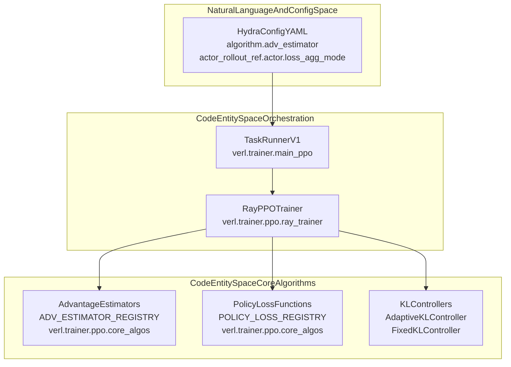
Sources: [verl/trainer/ppo/core_algos.py:37-151](), [verl/trainer/main_ppo.py:34-155]()

---

## Reinforcement Learning Algorithms

### PPO (Proximal Policy Optimization)
Standard PPO utilizes a clipped surrogate objective and optional KL penalties. `verl` implements an actor-critic paradigm where components like advantage estimation and KL control are decoupled [verl/trainer/ppo/core_algos.py:88-97]().

*   **Actor-Critic Architecture**: Requires both an actor model (policy) and a critic model (value function).
*   **GAE**: Uses Generalized Advantage Estimation for computing low-bias, variance-reduced advantage values [verl/trainer/ppo/core_algos.py:97]().
*   **KL Control**: Supports both `fixed` and `adaptive` KL controllers via `get_kl_controller` [verl/trainer/ppo/core_algos.py:193-213]().

Sources: [verl/trainer/ppo/core_algos.py:88-213]()

### GRPO (Group Relative Policy Optimization)
A critic-less algorithm that computes advantages using group-based reward normalization [verl/trainer/ppo/core_algos.py:98]().

*   **Critic-less**: Eliminates the separate value network, reducing memory footprint.
*   **Group Sampling**: Generates multiple completions per prompt to form a comparative group [verl/trainer/ppo/core_algos.py:98]().
*   **PrefixGrouper**: Optimizes shared prompt prefixes in group-based training to eliminate redundant attention computations [verl/models/transformers/monkey_patch.py:36-73]().

Sources: [verl/trainer/ppo/core_algos.py:98](), [verl/models/transformers/monkey_patch.py:36-73]()

### RLOO (REINFORCE Leave-One-Out)
Variance-reduced policy gradient using a leave-one-out baseline computed across a group of sampled completions [verl/trainer/ppo/core_algos.py:102]().

Sources: [verl/trainer/ppo/core_algos.py:102]()

### DAPO (Decoupled Clip and Dynamic Sampling Policy Optimization)
An algorithm variant utilizing decoupled asymmetric clipping and dynamic group filtering mechanisms [verl/trainer/config/ppo_trainer.yaml:79-96]().

*   **Decoupled Clipping**: Controlled via separate lower and upper bound thresholds [verl/trainer/config/ppo_trainer.yaml:121-131]().
*   **Dynamic Sampling**: Enables filtering of generation batches based on metrics like accuracy (`acc`) or reward to enhance sample efficiency [verl/trainer/config/ppo_trainer.yaml:80-96]().

Sources: [verl/trainer/config/ppo_trainer.yaml:79-131]()

### GMPO (Group-based Mixed Preference Optimization)
Supports mixed preference objectives and group-level advantage scaling for robust generation tuning [verl/trainer/ppo/core_algos.py:110]().

Sources: [verl/trainer/ppo/core_algos.py:110]()

### SAPO (Smooth Advantage Policy Optimization)
Applies smoothing functions to advantage estimations and policy clipping bounds to prevent abrupt gradient spikes [verl/trainer/ppo/core_algos.py:109]().

Sources: [verl/trainer/ppo/core_algos.py:109]()

### DPPO (Distributional / Decoupled PPO variants)
Implements advanced distributional policy updates and decoupled surrogate objectives [verl/trainer/ppo/core_algos.py:111]().

Sources: [verl/trainer/ppo/core_algos.py:111]()

### GSPO (Group Sequence Policy Optimization)
Optimizes sequence-level objectives across sampled groups with tailored reward aggregation [verl/trainer/ppo/core_algos.py:98]().

Sources: [verl/trainer/ppo/core_algos.py:98]()

### GPG (Group Preference Gradient)
Preference-based policy updates operating over group comparison scores [verl/trainer/ppo/core_algos.py:105]().

Sources: [verl/trainer/ppo/core_algos.py:105]()

### OTB (Optimal Token Baseline)
Token-level baseline estimation for fine-grained credit assignment during sequence generation [verl/trainer/ppo/core_algos.py:108]().

Sources: [verl/trainer/ppo/core_algos.py:108]()

### GDPO (Generalized Decoupled Policy Optimization)
Decoupled advantage estimation and policy loss computation for flexible hybrid objectives [verl/trainer/ppo/core_algos.py:111]().

Sources: [verl/trainer/ppo/core_algos.py:111]()

### REINFORCE++
Enhanced REINFORCE algorithm featuring improved baseline estimation and token-level updates [verl/trainer/ppo/core_algos.py:99]().

Sources: [verl/trainer/ppo/core_algos.py:99]()

### CISPO (Constrained Implicit Soft Policy Optimization)
Implicit soft constraint optimization ensuring policy updates remain within safe KL or distribution boundaries [verl/trainer/ppo/core_algos.py:104]().

Sources: [verl/trainer/ppo/core_algos.py:104]()

---

## Advantage Estimators

Advantage estimation functions are registered in `ADV_ESTIMATOR_REGISTRY` and configured via `algorithm.adv_estimator` [verl/trainer/config/ppo_trainer.yaml:73-74](), [verl/trainer/ppo/core_algos.py:113-116]().

| Estimator Name | `AdvantageEstimator` Enum Value | Description / Reference |
| :--- | :--- | :--- |
| **GAE** | `gae` | Generalized Advantage Estimation [verl/trainer/ppo/core_algos.py:97]() |
| **GRPO** | `grpo` | Group relative reward normalization [verl/trainer/ppo/core_algos.py:98]() |
| **RLOO** | `rloo` | Leave-one-out baseline within group [verl/trainer/ppo/core_algos.py:102]() |
| **REINFORCE++** | `reinforce_plus_plus` | Enhanced REINFORCE baseline [verl/trainer/ppo/core_algos.py:99]() |
| **GDPO** | `gdpo` | Generalized decoupled policy optimization [verl/trainer/ppo/core_algos.py:111]() |
| **OTB** | `optimal_token_baseline` | Token-level optimal baseline [verl/trainer/ppo/core_algos.py:108]() |
| **ReMax** | `remax` | Maximum reward baseline [verl/trainer/ppo/core_algos.py:101]() |

Sources: [verl/trainer/ppo/core_algos.py:88-111]()

---

## Supported Model Architectures

`verl` supports diverse model architectures across HuggingFace and Megatron-Core backends.

### Model Families
*   **Qwen Series**: Qwen2, Qwen2-MoE, Qwen2.5-VL, Qwen3, Qwen3-MoE [docs/algo/baseline.md:22-31]()
*   **Llama Series**: LlamaForCausalLM, Llama4, and sequence classification variants [docs/algo/baseline.md:27]()
*   **DeepSeek**: DeepSeek-V3 and DeepSeek-R1 series [docs/algo/baseline.md:28]()
*   **Gemma**: Gemma-2-2b-it and subsequent variants [docs/algo/baseline.md:19-21]()
*   **Mistral / Mixtral**: MixtralForCausalLM and sparse mixture-of-experts variants [docs/algo/baseline.md:35-36]()
*   **Multimodal (VL)**: Qwen2.5-VL [verl/models/transformers/qwen2_vl.py:24-28](), Qwen3-VL [verl/models/transformers/qwen3_vl.py:23-26](), GLM4-V [verl/models/transformers/glm4v.py:25-28](), Kimi-VL [verl/models/transformers/kimi_vl.py:24-27]()

### Model Architecture to Code Entity Mapping

The diagram below maps high-level model architecture names to specific internal initializers and configuration converter functions.

**Title: Model Architecture to Code Entity Mapping**
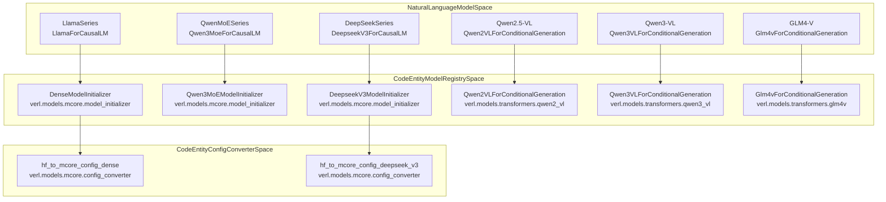
Sources: [docs/algo/baseline.md:19-39](), [verl/models/transformers/qwen2_vl.py:24-28](), [verl/models/transformers/qwen3_vl.py:23-26](), [verl/models/transformers/glm4v.py:25-28]()

---

## Advanced Model Features and Agentic RL

### Parallelism and Optimizations
*   **DeepSpeed-Ulysses Sequence Parallelism**: Scales sequence lengths via all-to-all communication across attention heads [verl/utils/ulysses.py:14-18](). This is integrated into attention mechanisms, for example, in Llama models [verl/models/transformers/llama.py:79-87]() and Qwen2-VL models [verl/models/transformers/qwen2_vl.py:33-39]().
*   **PrefixGrouper**: Optimizes multi-prompt attention computation for GRPO [verl/models/transformers/monkey_patch.py:36-73]().
*   **Multi-Token Prediction (MTP)**: Supports multi-token prediction heads via `MtpConfig` [verl/workers/config/model.py:30-68]().

Sources: [verl/models/transformers/monkey_patch.py:36-73](), [verl/workers/config/model.py:30-68](), [verl/models/transformers/llama.py:79-87](), [verl/models/transformers/qwen2_vl.py:33-39](), [verl/utils/ulysses.py:14-18]()

### Agentic RL Integration
`verl` supports Agentic RL training, enabling models to interact with tool environments across multi-turn trajectories using server-based asynchronous rollouts [docs/start/agentic_rl.rst:8-21]().

**Title: Agentic RL System Architecture**
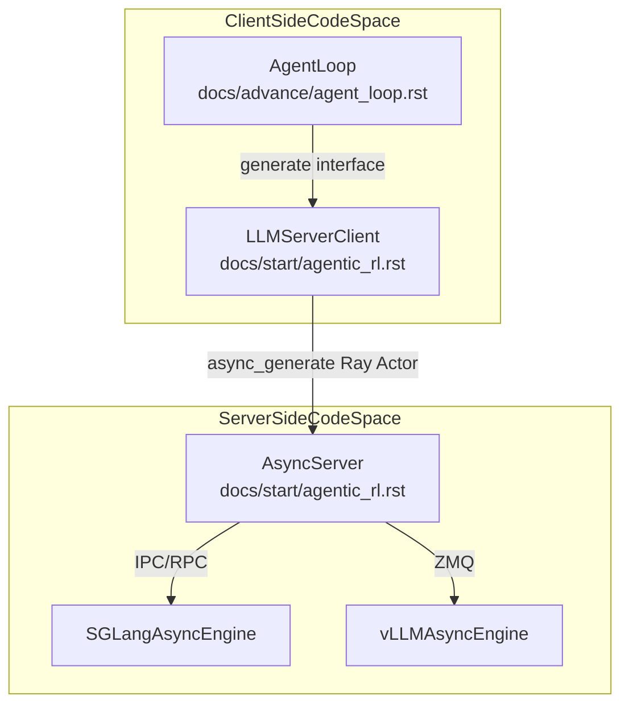
Sources: [docs/start/agentic_rl.rst:36-45](), [docs/advance/agent_loop.rst:80-82]()

*   **`AgentLoopBase`**: Abstract interface defining the `run` method for user-defined agent trajectories [docs/advance/agent_loop.rst:44-57]().
*   **`AsyncServerBase`**: Abstract server interface providing unified `chat_completion` and token-level `generate` endpoints for vLLM and SGLang [docs/advance/agent_loop.rst:115-143]().

Sources: [docs/start/agentic_rl.rst:1-128](), [docs/advance/agent_loop.rst:1-169]()

---

# Page: Getting Started

# Getting Started

<details>
<summary>Relevant source files</summary>

The following files were used as context for generating this wiki page:

- [docker/Dockerfile.uv.cu130](docker/Dockerfile.uv.cu130)
- [docker/README.md](docker/README.md)
- [docs/advance/dpo_extension.rst](docs/advance/dpo_extension.rst)
- [docs/algo/baseline.md](docs/algo/baseline.md)
- [docs/algo/dapo.md](docs/algo/dapo.md)
- [docs/api/data.rst](docs/api/data.rst)
- [docs/api/single_controller.rst](docs/api/single_controller.rst)
- [docs/examples/gsm8k_example.rst](docs/examples/gsm8k_example.rst)
- [docs/examples/ppo_code_architecture.rst](docs/examples/ppo_code_architecture.rst)
- [docs/hybrid_flow.rst](docs/hybrid_flow.rst)
- [docs/perf/device_tuning.rst](docs/perf/device_tuning.rst)
- [docs/preparation/reward_function.rst](docs/preparation/reward_function.rst)
- [docs/start/install.rst](docs/start/install.rst)
- [docs/start/multinode.rst](docs/start/multinode.rst)
- [docs/start/quickstart.rst](docs/start/quickstart.rst)
- [docs/workers/model_engine.rst](docs/workers/model_engine.rst)
- [examples/tutorial/slurm/ray_on_slurm.slurm](examples/tutorial/slurm/ray_on_slurm.slurm)
- [manage_envs.py](manage_envs.py)
- [pyproject.toml](pyproject.toml)
- [requirements.txt](requirements.txt)
- [setup.py](setup.py)
- [uv.lock](uv.lock)

</details>


## Purpose and Scope

This page provides an architectural overview of how to install `verl`, set up required environments, and execute quick start workflows for reinforcement learning post-training. As a parent page, it summarizes core installation paths, execution tutorials, and deployment strategies, directing readers to specialized child pages for deep technical details. 

For comprehensive guides, refer to:
- **Installation and Environment Setup**: Guide users through Docker installation, uv/conda environment setup, and dependency installation for different backends. See [Installation and Environment Setup](#2.1).
- **Quick Start: PPO Training**: Walkthrough of launching a basic PPO training job with example commands and minimal configuration. See [Quick Start: PPO Training](#2.2).
- **Quick Start: GRPO and Other Algorithms**: Examples of running GRPO, RLOO, DAPO, and other RL algorithms with configuration snippets. See [Quick Start: GRPO and Other Algorithms](#2.3).
- **Quick Start: Supervised Fine-Tuning**: Guide for running SFT with LoRA/PEFT, including data preparation and training launch. See [Quick Start: Supervised Fine-Tuning](#2.4).
- **Multinode Deployment and Hardware Selection**: Instructions for scaling to multi-node clusters and choosing appropriate hardware configurations. See [Multinode Deployment and Hardware Selection](#2.5).

Sources: [docs/start/quickstart.rst:1-133](), [docs/examples/gsm8k_example.rst:1-185]()

---

## Installation and Environment Setup

The `verl` framework relies on a hybrid backend design that decouples training computation (`FSDP`, `Megatron-LM`) from rollout generation (`vLLM`, `SGLang`) [docs/start/install.rst:10-14](). Environment management is driven by `uv` with a committed `uv.lock` file or via pre-built Docker containers [docs/start/install.rst:31-36](). Users select backend combinations as explicit extras [docs/start/install.rst:34-40]().

For detailed instructions on resolving dependencies, managing virtual environments, and setting up specific backend configurations, see [Installation and Environment Setup](#2.1).

Title: "Installation and Environment Mapping"
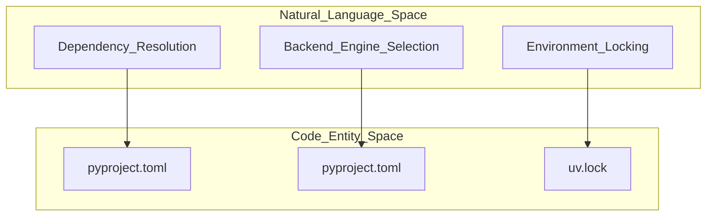
Sources: [docs/start/install.rst:31-58](), [pyproject.toml:1-172](), [uv.lock:1-33]()

---

## Quick Start: PPO Training

Launching a standard Proximal Policy Optimization (PPO) training job involves dataset preparation (e.g., preprocessing math datasets into Parquet format), downloading a base instruction model, and executing the training entrypoint managed by the trainer [docs/start/quickstart.rst:40-127](). The `verl.trainer.main_ppo` script is used for this purpose [docs/start/quickstart.rst:102]().

For a full walkthrough using the GSM8K benchmark, configuration tuning, and log analysis, see [Quick Start: PPO Training](#2.2) [docs/start/quickstart.rst:1-133](), [docs/examples/gsm8k_example.rst:1-185]().

Title: "PPO Training Execution Mapping"
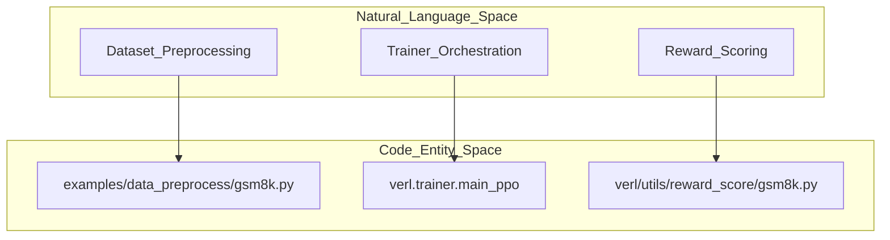
Sources: [docs/start/quickstart.rst:40-127](), [docs/examples/gsm8k_example.rst:43-178]()

---

## Quick Start: GRPO and Other Algorithms

Beyond standard PPO, `verl` supports diverse reinforcement learning algorithms such as Group Relative Policy Optimization (GRPO), ReMax, DAPO, and RLOO. These algorithms modify the advantage calculation and policy loss formulation without changing the underlying distributed worker communication pattern.

For complete example scripts, algorithm-specific configurations, and usage instructions for alternative post-training workflows, see [Quick Start: GRPO and Other Algorithms](#2.3).

Sources: [docs/examples/gsm8k_example.rst:1-185]()

---

## Quick Start: Supervised Fine-Tuning

Before executing reinforcement learning workflows, models can be adapted using Supervised Fine-Tuning (SFT) with PyTorch FSDP, LoRA, or PEFT integrations [docs/examples/gsm8k_example.rst:73-97](). The SFT trainer consumes formatted conversation datasets and handles gradient accumulation, sequence packing, and checkpoint persistence [docs/examples/gsm8k_example.rst:76-97]().

For detailed instructions on preparing SFT datasets, configuring learning rates, and launching distributed SFT jobs, see [Quick Start: Supervised Fine-Tuning](#2.4) [docs/examples/gsm8k_example.rst:73-97]().

Sources: [docs/examples/gsm8k_example.rst:73-97]()

---

## Multinode Deployment and Hardware Selection

Scaling reinforcement learning workloads across multi-node clusters requires orchestrating Ray resource allocations. `verl` supports multiple hardware acceleration platforms including NVIDIA GPUs, AMD ROCm, and Huawei Ascend NPUs via platform-agnostic abstraction layers. The `trainer.n_gpus_per_node` and `trainer.nnodes` parameters in the configuration control distributed training across multiple devices and nodes [docs/start/quickstart.rst:123-124]().

For multi-node deployment topologies, cluster job scripts, and hardware tuning guidelines, see [Multinode Deployment and Hardware Selection](#2.5) [docs/examples/gsm8k_example.rst:99-107](), [docs/start/quickstart.rst:123-124]().

Sources: [docs/examples/gsm8k_example.rst:99-107](), [docs/start/quickstart.rst:123-124]()

---

# Page: Installation and Environment Setup

# Installation and Environment Setup

<details>
<summary>Relevant source files</summary>

The following files were used as context for generating this wiki page:

- [docker/Dockerfile.stable.sglang](docker/Dockerfile.stable.sglang)
- [docker/Dockerfile.stable.vllm](docker/Dockerfile.stable.vllm)
- [docker/Dockerfile.uv.cu130](docker/Dockerfile.uv.cu130)
- [docker/README.md](docker/README.md)
- [docker/verl0.6.1-experimental/Dockerfile.sglang056exp](docker/verl0.6.1-experimental/Dockerfile.sglang056exp)
- [docker/verl0.6.1-experimental/Dockerfile.vllm012exp](docker/verl0.6.1-experimental/Dockerfile.vllm012exp)
- [docs/start/install.rst](docs/start/install.rst)
- [manage_envs.py](manage_envs.py)
- [pyproject.toml](pyproject.toml)
- [requirements.txt](requirements.txt)
- [setup.py](setup.py)
- [uv.lock](uv.lock)

</details>


## Purpose and Scope

This document guides users through environment setup, Docker configuration, and dependency installation for `verl` [docs/start/install.rst:1-15](). It covers multiple backend configurations—including training engines like PyTorch FSDP and Megatron-LM, and inference/rollout backends like vLLM, SGLang, and TensorRT-LLM [docs/start/install.rst:10-15](). Furthermore, it details both the modern `uv`-driven reproducible workflow powered by `manage_envs.py` and traditional containerized or pip-based installations [docs/start/install.rst:31-48](), [manage_envs.py:15-35]().

Sources: [docs/start/install.rst:1-15](), [docs/start/install.rst:31-48](), [manage_envs.py:15-35]()

---

## System Requirements and Backend Architecture

`verl` relies on modern Python and CUDA runtimes to execute high-throughput reinforcement learning loops. The baseline environment requirements are defined across packaging configuration files:

| Component | Version Requirement | Code Reference |
|-----------|--------------------|----------------|
| Python | `>= 3.10` (Target: `3.12` for `uv`) | [pyproject.toml:11](), [docs/start/install.rst:52]() |
| CUDA | `>= 12.8` (Target: `13.0.2` in stable images) | [docs/start/install.rst:8](), [docker/Dockerfile.stable.vllm:4]() |
| Ray | `>= 2.41.0` | [setup.py:38]() |
| TensorDict | `>= 0.8.0, <= 0.10.0, != 0.9.0` | [setup.py:40]() |
| Transformers | `>= 5.5.3, != 5.6.0, < 5.13` (Project Pin: `==5.12.1`) | [setup.py:43](), [pyproject.toml:31]() |

Sources: [pyproject.toml:11](), [docs/start/install.rst:8](), [docs/start/install.rst:52](), [docker/Dockerfile.stable.vllm:4](), [setup.py:38-43](), [pyproject.toml:31]()

### Diagram: Installation Target to Code Entity Mapping

This diagram bridges natural language configuration intent to specific code entities, build scripts, and backend workers within the codebase.

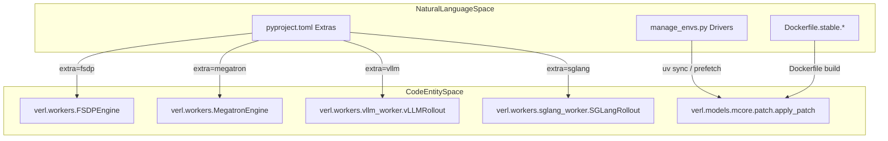
Sources: [pyproject.toml:24-171](), [setup.py:26-77](), [manage_envs.py:15-134](), [docker/Dockerfile.stable.vllm:1-161](), [verl/models/mcore/patch.py:1-160]()

---

## Installation Methods

### Method 1: Docker Installation (Production & Multi-Arch)

Starting from v0.6.0, `verl` uses official vLLM and SGLang release images as base layers [docker/README.md:5](). Pre-built images are published to DockerHub under `verlai/verl` (e.g., `verlai/verl:vllm024.latest`, `verlai/verl:sgl0512.latest`) [docker/README.md:27]().

The application image layers compile and bundle critical high-performance extensions:
- **`flash_attn`**: Optimized attention kernels [docker/Dockerfile.stable.vllm:17]()
- **Megatron-LM**: Trillion-parameter training support [docker/Dockerfile.stable.vllm:150]()
- **Apex**: Mixed precision utilities [docker/Dockerfile.stable.vllm:82]()
- **TransformerEngine**: NVIDIA hardware primitives [docker/Dockerfile.stable.vllm:85]()
- **DeepEP**: Efficient MoE communication primitives [docker/Dockerfile.stable.vllm:106]()
- **TransferQueue**: Asynchronous data streaming [docker/Dockerfile.stable.vllm:21]()

Building locally from the repository root is supported via stable Dockerfiles [docker/README.md:34-40]():
```bash
docker build -f docker/Dockerfile.stable.vllm -t verl:vllm-local .
```
For users behind network restrictions or regional mirrors, pass the `APT_MIRROR` build argument [docker/README.md:42-47]():
```bash
docker build -f docker/Dockerfile.stable.vllm \
    --build-arg APT_MIRROR=https://mirrors.tuna.tsinghua.edu.cn \
    -t verl:vllm-local .
```

Sources: [docker/README.md:5-47](), [docker/Dockerfile.stable.vllm:17-150]()

#### Diagram: Docker Container Execution and Runtime Flow

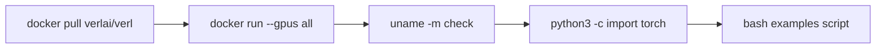
Sources: [docker/README.md:1-164](), [docker/Dockerfile.stable.vllm:1-161]()

---

### Method 2: UV-Managed Environment (`uv.lock` & `manage_envs.py`)

`verl` provides a reproducible Python environment workflow driven by `uv`, utilizing a committed `uv.lock` file that captures all backend dependencies [docs/start/install.rst:31-35](), [manage_envs.py:15-23](). The workflow targets Linux with Python 3.12 on both `x86_64` and `aarch64` architectures [docs/start/install.rst:50-52](), [manage_envs.py:126-134]().

The `manage_envs.py` driver script exposes administrative tasks for locking, syncing, running, and prefetching environments [manage_envs.py:42-53]():
- `python manage_envs.py lock`: Regenerates the universal `uv.lock` [manage_envs.py:44]()
- `python manage_envs.py sync <extras...>`: Materializes `.venv` up front for specific combinations (e.g., `fsdp vllm`) [manage_envs.py:45]()
- `python manage_envs.py prefetch`: Populates the local uv cache (`$UV_CACHE_DIR`) with prebuilt wheels and source builds during Docker image construction [manage_envs.py:50-52]()

To run jobs or tests without manual virtual environment creation, `uv run` materializes and caches the environment on first invocation [docs/start/install.rst:41-45]():
```bash
bash examples/grpo_trainer/run_qwen3_8b_fsdp.sh

# Select alternative inference backend
INFER_BACKEND=sglang bash examples/grpo_trainer/run_qwen3_8b_fsdp.sh
```

The underlying launcher configuration injects `uv run` arguments and propagates the execution environment to Ray workers via `ray_kwargs.ray_init.runtime_env.py_executable` [docs/start/install.rst:97-108](). Furthermore, `verl/__init__.py` sets `RAY_ENABLE_UV_RUN_RUNTIME_ENV=0` to avoid conflicts with Ray's internal runtime-env working directory hooks [docs/start/install.rst:130-135]().

Sources: [docs/start/install.rst:31-139](), [manage_envs.py:15-134](), [pyproject.toml:1-171]()

#### Diagram: UV Environment Synchronization and Ray Propagation Flow

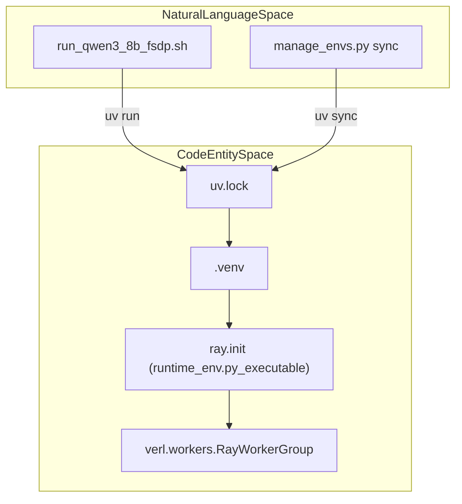
Sources: [docs/start/install.rst:31-139](), [manage_envs.py:15-134](), [pyproject.toml:1-171]()

---

### Method 3: Traditional Pip and Manual Setup

When `uv` or Docker is not used, `verl` supports standard editable installations from source [setup.py:83-105]():
```bash
git clone https://github.com/volcengine/verl && cd verl
pip install -e .
```

For backend-specific extras defined in `setup.py`, install corresponding optional groups [setup.py:66-77]():
```bash
pip install -e ".[vllm]"    # vLLM rollout backend
pip install -e ".[sglang]"  # SGLang rollout backend
pip install -e ".[mcore]"   # Megatron-Core training backend
```

Alternatively, installation scripts automate the compilation of FlashAttention, TransformerEngine, and Megatron-LM.

Sources: [setup.py:66-105]()

---

## Backend-Specific Configurations and Dependency Mapping

Each backend configures specific packages and compatibility pins:

- **vLLM Rollout Backend**: Pins `vllm==0.29.0` in `pyproject.toml` [pyproject.toml:95]() (or `vllm>=0.18.0` in setup configurations [setup.py:55]()), paired with `torch==2.13.0` [pyproject.toml:90]().
- **SGLang Rollout Backend**: Integrates `sglang==0.5.20` and `sglang-kernel` [pyproject.toml:111-114]() along with custom CUDA extensions [docker/Dockerfile.stable.sglang:72-98]().
- **Megatron-LM Training Backend**: Relies on `megatron-core` (`core_v0.19.2` as per `uv.lock` [uv.lock:40]()), `megatron-bridge` (`0.6.2` as per `uv.lock` [uv.lock:36]()), `TransformerEngine`, and `Apex` [pyproject.toml:44](), [docker/Dockerfile.stable.vllm:82-150]().
- **FSDP Training Backend**: Combines PyTorch FSDP with `liger-kernel>=0.8.2` and `flash-attn` [pyproject.toml:141-146]().

Sources: [pyproject.toml:44](), [pyproject.toml:90-146](), [setup.py:55](), [docker/Dockerfile.stable.vllm:82-150](), [docker/Dockerfile.stable.sglang:72-98](), [uv.lock:36](), [uv.lock:40]()

---

## Hardware Platform Customization

- **NVIDIA GPUs**: Requires CUDA >= 12.8 [docs/start/install.rst:8](). Precompiled wheels target `cu130` with PyTorch 2.13 [pyproject.toml:19]().
- **AMD GPUs (ROCm)**: Supported via AMD ROCm platforms for MI300 accelerators, utilizing pure-torch shims where native CUDA extensions cannot be built.
- **Huawei Ascend NPU Support**: Ascend NPU support is outside the `uv` workflow and requires dedicated images [docs/start/install.rst:58](). It is supported via CANN and MindSpeed toolchains, integrating `TransferQueue` for asynchronous cross-device communication [requirements.txt:28]().

Sources: [docs/start/install.rst:8](), [docs/start/install.rst:58](), [pyproject.toml:19](), [requirements.txt:28]()

---

# Page: Quick Start: PPO Training

# Quick Start: PPO Training

<details>
<summary>Relevant source files</summary>

The following files were used as context for generating this wiki page:

- [docs/advance/dpo_extension.rst](docs/advance/dpo_extension.rst)
- [docs/algo/baseline.md](docs/algo/baseline.md)
- [docs/algo/dapo.md](docs/algo/dapo.md)
- [docs/api/data.rst](docs/api/data.rst)
- [docs/api/single_controller.rst](docs/api/single_controller.rst)
- [docs/examples/config.rst](docs/examples/config.rst)
- [docs/examples/gsm8k_example.rst](docs/examples/gsm8k_example.rst)
- [docs/examples/ppo_code_architecture.rst](docs/examples/ppo_code_architecture.rst)
- [docs/hybrid_flow.rst](docs/hybrid_flow.rst)
- [docs/perf/device_tuning.rst](docs/perf/device_tuning.rst)
- [docs/perf/perf_tuning.rst](docs/perf/perf_tuning.rst)
- [docs/preparation/reward_function.rst](docs/preparation/reward_function.rst)
- [docs/start/multinode.rst](docs/start/multinode.rst)
- [docs/start/quickstart.rst](docs/start/quickstart.rst)
- [docs/workers/model_engine.rst](docs/workers/model_engine.rst)
- [examples/tutorial/slurm/ray_on_slurm.slurm](examples/tutorial/slurm/ray_on_slurm.slurm)
- [verl/trainer/config/ppo_megatron_trainer.yaml](verl/trainer/config/ppo_megatron_trainer.yaml)
- [verl/trainer/config/ppo_trainer.yaml](verl/trainer/config/ppo_trainer.yaml)
- [verl/trainer/main_ppo.py](verl/trainer/main_ppo.py)
- [verl/trainer/ppo/core_algos.py](verl/trainer/ppo/core_algos.py)
- [verl/trainer/ppo/ray_trainer.py](verl/trainer/ppo/ray_trainer.py)

</details>


## Purpose and Scope
This page provides a technical walkthrough for launching a basic Proximal Policy Optimization (PPO) training job within the `verl` framework. It covers end-to-end dataset preparation on the GSM8K math reasoning benchmark [docs/start/quickstart.rst:4-5](), Hydra-based configuration management [docs/start/quickstart.rst:102-127](), distributed execution via Ray orchestration [verl/trainer/main_ppo.py:56-74](), and training execution using the FSDP backend [docs/examples/gsm8k_example.rst:135-178]().

Sources: [docs/start/quickstart.rst:4-5](), [docs/start/quickstart.rst:102-127](), [verl/trainer/main_ppo.py:56-74](), [docs/examples/gsm8k_example.rst:135-178]()

---

## Prerequisites and Environment Setup

Before launching a PPO training job, verify the following prerequisites:
1. **Framework Installation**: `verl` and its runtime dependencies installed in your Python environment or container, or managed via `uv` workflows [docs/start/quickstart.rst:16-18](), [docs/start/quickstart.rst:24-37]().
2. **Hardware Requirements**: At least one NVIDIA GPU with sufficient High Bandwidth Memory (e.g., 24 GB+ for smaller instruct models) [docs/start/quickstart.rst:20-20]().
3. **Model Checkpoints**: Base or instruction-tuned model weights (e.g., `Qwen/Qwen2.5-0.5B-Instruct`) available locally or accessible via HuggingFace/ModelScope [docs/start/quickstart.rst:71-71](), [docs/examples/gsm8k_example.rst:56-68]().
4. **Ray Runtime**: Ray initialized automatically via `ray.init` inside the runner orchestration [verl/trainer/main_ppo.py:56-74]().

Sources: [docs/start/quickstart.rst:16-37](), [docs/start/quickstart.rst:71-71](), [docs/examples/gsm8k_example.rst:56-68](), [verl/trainer/main_ppo.py:56-74]()

---

## Training Workflow Architecture and Initialization

The training pipeline begins at the entry point `verl/trainer/main_ppo.py` [verl/trainer/main_ppo.py:1-20](). When invoked, `run_ppo()` sets up environment configurations, initializes the Ray cluster via `ray.init()` [verl/trainer/main_ppo.py:56-74](), and spawns a remote instance of `TaskRunnerV1` [verl/trainer/main_ppo.py:106-116](). The runner loads the designated trainer class (e.g., `RayPPOTrainer`) [verl/trainer/ppo/ray_trainer.py:17-19]() and invokes `fit()` to coordinate worker roles across the cluster [verl/trainer/main_ppo.py:137-156]().

### Diagram: Entry Point and Initialization Flow

```mermaid
graph TB
    subgraph NaturalLanguageSpace["Natural Language Space"]
        ConfigDesc[""Hydra YAML Configuration & CLI Overrides""]
        ModelSpec[""Model Weights Path (Qwen/Qwen2.5-0.5B-Instruct)""]
    end

    subgraph CodeEntitySpace["Code Entity Space"]
        Main["main() <br/> verl/trainer/main_ppo.py"]
        RunPPO["run_ppo(config) <br/> verl/trainer/main_ppo.py:35"]
        TaskRunner["TaskRunnerV1 <br/> verl/trainer/main_ppo.py:106"]
        TrainerClass["RayPPOTrainer <br/> verl/trainer/ppo/ray_trainer.py"]
        FitMethod["RayPPOTrainer.fit() <br/> verl/trainer/ppo/ray_trainer.py"]
    end

    ConfigDesc --> Main
    ModelSpec --> Main
    Main --> RunPPO
    RunPPO --> TaskRunner
    TaskRunner --> TrainerClass
    TrainerClass --> FitMethod
```

Sources: [verl/trainer/main_ppo.py:34-156](), [verl/trainer/ppo/ray_trainer.py:1-20]()

---

## Step 1: Dataset Preparation and Data Flow

Reinforcement learning workflows in `verl` require training data formatted as Parquet files containing prompt strings and ground truth labels for reward verification [docs/start/quickstart.rst:59-62](). 

### GSM8K Preprocessing
Execute the provided preprocessing utility script to download and structure the GSM8K dataset [docs/start/quickstart.rst:66-67]():

```bash
python3 examples/data_preprocess/gsm8k.py --local_save_dir ~/data/gsm8k
```

This generates `train.parquet` and `test.parquet` containing tokenized or raw prompt fields along with target solution strings [docs/examples/gsm8k_example.rst:88-89]().

### Diagram: Dataset Ingestion and DataProto Flow

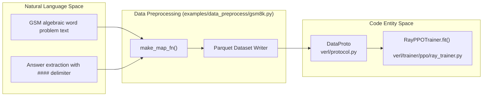

Sources: [docs/start/quickstart.rst:59-67](), [docs/examples/gsm8k_example.rst:30-49](), [verl/trainer/ppo/ray_trainer.py:1-20](), [verl/protocol.py:1-1]()

---

## Step 2: Launching a Basic PPO Training Job

To launch a single-node PPO training job utilizing vLLM for rollout generation and FSDP for model parameter sharding, run the following command [docs/start/quickstart.rst:102-127]():

```bash
PYTHONUNBUFFERED=1 python3 -m verl.trainer.main_ppo \
    data.train_files=$HOME/data/gsm8k/train.parquet \
    data.val_files=$HOME/data/gsm8k/test.parquet \
    data.train_batch_size=256 \
    data.max_prompt_length=512 \
    data.max_response_length=512 \
    actor_rollout_ref.model.path=Qwen/Qwen2.5-0.5B-Instruct \
    actor_rollout_ref.actor.optim.lr=1e-6 \
    actor_rollout_ref.actor.ppo_mini_batch_size=64 \
    actor_rollout_ref.actor.ppo_micro_batch_size_per_gpu=4 \
    actor_rollout_ref.rollout.name=vllm \
    actor_rollout_ref.rollout.gpu_memory_utilization=0.4 \
    critic.optim.lr=1e-5 \
    critic.model.path=Qwen/Qwen2.5-0.5B-Instruct \
    critic.ppo_micro_batch_size_per_gpu=4 \
    algorithm.kl_ctrl.kl_coef=0.001 \
    trainer.logger=console \
    trainer.val_before_train=False \
    trainer.n_gpus_per_node=1 \
    trainer.nnodes=1 \
    trainer.save_freq=10 \
    trainer.test_freq=10 \
    trainer.total_epochs=15 2>&1 | tee verl_demo.log
```

Sources: [docs/start/quickstart.rst:102-127]()

---

## Step 3: Core Configuration Parameters Reference

The Hydra configuration system defined in `verl/trainer/config/ppo_trainer.yaml` controls all training hyperparameters [docs/examples/gsm8k_example.rst:116-116](), [verl/trainer/config/ppo_trainer.yaml:1-51](). Key parameters are detailed below:

| Configuration Path | Type | Description |
| :--- | :--- | :--- |
| `data.train_batch_size` | `int` | Global batch size of prompt samples processed per training iteration [docs/examples/gsm8k_example.rst:144-144](). |
| `actor_rollout_ref.actor.ppo_mini_batch_size` | `int` | Mini-batch size used for gradient updates on the actor model across workers [docs/examples/gsm8k_example.rst:150-150](). |
| `actor_rollout_ref.rollout.name` | `str` | Rollout generation backend engine selection (e.g., `vllm`, `sglang`) [docs/start/quickstart.rst:112-112](). |
| `algorithm.adv_estimator` | `str` | Advantage estimation algorithm (`gae`, `grpo`, `reinforce_plus_plus`, `rloo`) [verl/trainer/config/ppo_trainer.yaml:77-78](). |
| `algorithm.kl_ctrl.kl_coef` | `float` | Initial scaling coefficient for the reward KL penalty term [verl/trainer/config/ppo_trainer.yaml:116-117](). |

Sources: [docs/start/quickstart.rst:112-120](), [docs/examples/gsm8k_example.rst:144-150](), [verl/trainer/config/ppo_trainer.yaml:1-206]()

---

## Step 4: Monitoring, Logging, and Checkpointing

During training, `RayPPOTrainer` computes metrics and outputs telemetry [verl/trainer/ppo/ray_trainer.py:44-50]():
- **KL Penalty**: Computed via `apply_kl_penalty()` using log probabilities from the reference policy and current policy [verl/trainer/ppo/ray_trainer.py:78-117]().
- **Validation**: Validation runs periodically according to `trainer.test_freq`, assessing score metrics [docs/start/quickstart.rst:126-129]().
- **Checkpointing**: Model states are serialized according to the interval specified by `trainer.save_freq` [docs/start/quickstart.rst:125-125](), utilizing checkpoint management utilities [verl/utils/checkpoint/checkpoint_manager.py:63-63]().

Sources: [verl/trainer/ppo/ray_trainer.py:44-117](), [docs/start/quickstart.rst:125-129](), [verl/utils/checkpoint/checkpoint_manager.py:63-63]()

---

## Advanced Configuration: Megatron-LM Backend

For large-scale models requiring hybrid parallelism strategies, `verl` supports the Megatron-LM backend through configuration overrides defined in `verl/trainer/config/ppo_megatron_trainer.yaml` [docs/examples/gsm8k_example.rst:128-128](), [verl/trainer/config/ppo_megatron_trainer.yaml:1-6](). Switch engines using configuration arguments:

```bash
python3 -m verl.trainer.main_ppo \
    model_engine=megatron \
    actor_rollout_ref.actor.strategy=megatron \
    actor_rollout_ref.actor.ppo_mini_batch_size=256 \
    trainer.n_gpus_per_node=8
```

Sources: [docs/examples/gsm8k_example.rst:128-128](), [verl/trainer/config/ppo_megatron_trainer.yaml:1-6]()

---

# Page: Quick Start: GRPO and Other Algorithms

# Quick Start: GRPO and Other Algorithms

<details>
<summary>Relevant source files</summary>

The following files were used as context for generating this wiki page:

- [docs/algo/grpo.md](docs/algo/grpo.md)
- [docs/algo/ppo.md](docs/algo/ppo.md)
- [examples/ascend_extras/grpo_trainer/run_qwen3_5_122b_a10b_32k_megatron.sh](examples/ascend_extras/grpo_trainer/run_qwen3_5_122b_a10b_32k_megatron.sh)
- [examples/ascend_extras/ppo_trainer/run_qwen3_8b_fsdp.sh](examples/ascend_extras/ppo_trainer/run_qwen3_8b_fsdp.sh)
- [examples/grpo_trainer/README.md](examples/grpo_trainer/README.md)
- [examples/grpo_trainer/run_deepseek_v3_671b_megatron.sh](examples/grpo_trainer/run_deepseek_v3_671b_megatron.sh)
- [examples/grpo_trainer/run_gpt_oss_20b_veomni.sh](examples/grpo_trainer/run_gpt_oss_20b_veomni.sh)
- [examples/grpo_trainer/run_hy_v3_megatron.sh](examples/grpo_trainer/run_hy_v3_megatron.sh)
- [examples/grpo_trainer/run_nemotron_nano_v3_30b_a3b_megatron.sh](examples/grpo_trainer/run_nemotron_nano_v3_30b_a3b_megatron.sh)
- [examples/grpo_trainer/run_qwen3_5_122b_a10b_megatron.sh](examples/grpo_trainer/run_qwen3_5_122b_a10b_megatron.sh)
- [examples/grpo_trainer/run_qwen3_5_35b_fsdp.sh](examples/grpo_trainer/run_qwen3_5_35b_fsdp.sh)
- [examples/grpo_trainer/run_qwen3_5_35b_megatron.sh](examples/grpo_trainer/run_qwen3_5_35b_megatron.sh)
- [examples/grpo_trainer/run_qwen3_5_397b_megatron.sh](examples/grpo_trainer/run_qwen3_5_397b_megatron.sh)
- [examples/grpo_trainer/run_qwen3_vl_30b_a3b_megatron.sh](examples/grpo_trainer/run_qwen3_vl_30b_a3b_megatron.sh)
- [examples/ppo_trainer/README.md](examples/ppo_trainer/README.md)
- [examples/ppo_trainer/run_qwen3_8b_fsdp.sh](examples/ppo_trainer/run_qwen3_8b_fsdp.sh)
- [examples/tuning/lora/run_qwen3_30b_a3b_megatron.sh](examples/tuning/lora/run_qwen3_30b_a3b_megatron.sh)
- [tests/utils/veomni/test_moe_param_export_on_cpu.py](tests/utils/veomni/test_moe_param_export_on_cpu.py)
- [verl/workers/engine/veomni/utils.py](verl/workers/engine/veomni/utils.py)

</details>


This page provides a comprehensive guide and runnable examples for executing Reinforcement Learning (RL) algorithms that eliminate the requirement for a separate value critic network, including **GRPO (Group Relative Policy Optimization)**, **RLOO (REINFORCE Leave-One-Out)**, **DAPO (Decoupled Clip and Dynamic Sampling Policy Optimization)**, and other advanced baselines. These algorithms share the same underlying `verl.trainer.main_ppo` entry point as standard PPO but substitute specialized advantage estimation functions.

By removing the `CriticWorker`, these algorithms drastically lower GPU memory overhead and streamline distributed compute allocation. The primary configuration adjustments involve specifying `algorithm.adv_estimator` and configuring the rollout count per prompt via `actor_rollout_ref.rollout.n` to facilitate group-based relative comparisons.

Sources: `[verl/trainer/ppo/core_algos.py:88-112]()`, `[examples/grpo_trainer/README.md:3-9]()`

---

## GRPO: Architecture and Data Flow

GRPO computes advantages by normalizing rewards over a group of $G$ sampled completions generated for the exact same prompt. This group normalization establishes a relative baseline without needing a learned value critic network.

### Component Logic
The orchestrator initializes workers based on the selected advantage estimator. For GRPO, the framework instantiates the `ActorRolloutRefWorker` to manage both rollout generation and actor optimization updates. Unlike standard PPO where rollout multiplicity `n` defaults to 1, GRPO requires multiple completions per prompt (e.g., `rollout.n=8` or `rollout.n=16`) to build the group evaluation vector.

| Component | Role in GRPO | Configuration Key |
| :--- | :--- | :--- |
| **Actor** | Policy network being optimized | `actor_rollout_ref.actor` `[examples/grpo_trainer/README.md:23-23]()` |
| **Reference** | KL divergence baseline model | `actor_rollout_ref.ref` `[examples/grpo_trainer/run_qwen3_5_122b_a10b_megatron.sh:105-107]()` |
| **Critic** | **Omitted / Disabled** | Implicitly disabled via `adv_estimator=grpo` `[examples/grpo_trainer/README.md:15-15]()` |
| **Rollout** | Generates $G$ samples per prompt | `actor_rollout_ref.rollout.n` `[examples/grpo_trainer/README.md:21-21]()` |

Sources: `[examples/grpo_trainer/README.md:15-38]()`, `[examples/grpo_trainer/run_qwen3_5_35b_megatron.sh:99-99]()`, `[verl/trainer/ppo/core_algos.py:98-98]()`

### Data Flow: From Generation to Advantage
The diagram below maps how GRPO processes multiple completions per prompt to derive advantages without a critic network, bridging natural language inputs to code execution paths.

Title: GRPO Data Flow and Code Entities
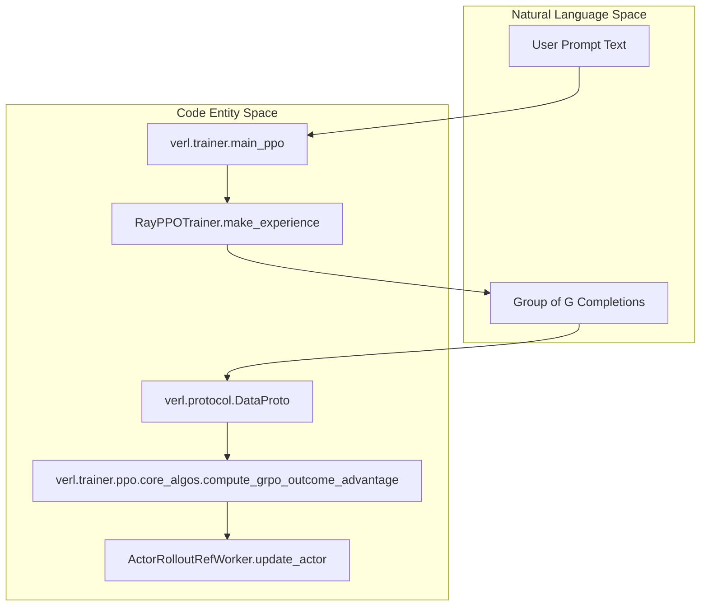
Sources: `[verl/trainer/ppo/core_algos.py:98-98]()`, `[examples/grpo_trainer/README.md:21-26]()`, `[examples/grpo_trainer/run_qwen3_5_35b_megatron.sh:99-99]()`

---

## DAPO: Decoupled Clip and Dynamic Sampling

DAPO (Decoupled Clip and Dynamic Sampling Policy Optimization) introduces decoupled clipping boundaries and a dynamic sampling mechanism that filters out uninformative response groups where all samples share identical correctness scores.

### Key Configurations
*   **Separated Clip Bounds**: Utilizes `clip_ratio_low` and `clip_ratio_high` to configure asymmetric bounds in the policy objective.
*   **Flexible Loss Aggregation**: Supports `loss_agg_mode: "token-mean"` for granular token-level loss aggregation.
*   **Dynamic Filtering**: Discards groups with uniform reward metrics and re-samples until the target batch size is achieved.

Sources: `[examples/grpo_trainer/README.md:30-38]()`, `[examples/grpo_trainer/run_hy_v3_megatron.sh:91-98]()`

---

## RLOO and Other Estimators

### RLOO: REINFORCE Leave-One-Out
RLOO reduces gradient variance without requiring a critic model by employing a "leave-one-out" baseline computed from multiple rollouts of the same prompt. In `verl`, this is exposed via the `rloo` or `rloo_vectorized` advantage estimators.

Sources: `[verl/trainer/ppo/core_algos.py:102-106]()`, `[examples/ppo_trainer/README.md:47-47]()`

### Additional Supported Estimators
*   **REINFORCE++**: Enhanced REINFORCE baseline implementation `[verl/trainer/ppo/core_algos.py:99-100]()`.
*   **GPG**: Logit-Gradient Norm proxy for optimal token baseline `[verl/trainer/ppo/core_algos.py:105-105]()`.
*   **GDPO**: Generalized DPO-style updates integrated inside the PPO loop `[verl/trainer/ppo/core_algos.py:107-107]()`.

Sources: `[verl/trainer/ppo/core_algos.py:99-107]()`

---

## Configuration Snippets

### GRPO Quick Start (FSDP)
To launch GRPO with FSDP backends, set `adv_estimator=grpo` and configure rollout sample multiplicity `n`:

```bash
# Example GRPO Launch Command (derived from Qwen3-8B FSDP template)
python3 -m verl.trainer.main_ppo \
    algorithm.adv_estimator=grpo \
    actor_rollout_ref.rollout.n=8 \
    data.train_batch_size=256 \
    actor_rollout_ref.actor.ppo_mini_batch_size=64 \
    actor_rollout_ref.actor.use_kl_loss=True \
    actor_rollout_ref.actor.kl_loss_coef=0.001
```
Sources: `[examples/grpo_trainer/README.md:60-65]()`, `[examples/grpo_trainer/README.md:21-28]()`

### Qwen3.5-35B GRPO (Megatron-LM)
This configuration demonstrates running GRPO on a Qwen3.5-35B MoE model using Megatron-LM across 8 GPUs. It highlights handling Qwen3.5's Gated Delta Net (GDN) linear attention which currently bypasses packed sequence support, requiring `use_remove_padding=False` and `use_dynamic_bsz=False`.

```bash
#!/usr/bin/env bash
# Qwen3.5-35B-A3B MoE GRPO RL with Megatron (single node, 8 GPUs, geo3k dataset)

export CUDA_DEVICE_MAX_CONNECTIONS=1
export VLLM_USE_V1=1
export VLLM_ALLREDUCE_USE_SYMM_MEM=0
set -xeuo pipefail

DEVICE=${DEVICE:-$(python3 -c 'import torch_npu' 2>/dev/null && echo npu || echo gpu)}
TP=2
PP=1
CP=1
EP=8
ETP=1
GEN_TP=8

ALL_OFFLOAD=${ALL_OFFLOAD:-True}
rollout_name="vllm"
project_name='verl_grpo_qwen3_5_35b_geo3k'
exp_name='qwen3_5_35b_megatron'
adv_estimator=grpo

HF_MODEL_PATH=${HF_MODEL_PATH:-"Qwen3.5-35B-A3B"}
train_path=${train_path:-$HOME/data/geo3k/train.parquet}
test_path=${test_path:-$HOME/data/geo3k/test.parquet}

DATA=(
    data.train_files=${train_path}
    data.val_files=${test_path}
    data.train_batch_size=32
    data.max_prompt_length=1024
    data.max_response_length=2048
    data.truncation='error'
    data.filter_overlong_prompts=True
)

MODEL=(
    actor_rollout_ref.model.path=${HF_MODEL_PATH}
    actor_rollout_ref.model.trust_remote_code=True
    actor_rollout_ref.model.use_remove_padding=False
)

ACTOR=(
    actor_rollout_ref.actor.optim.lr=1e-6
    actor_rollout_ref.actor.ppo_mini_batch_size=32
    actor_rollout_ref.actor.use_kl_loss=True
    actor_rollout_ref.actor.kl_loss_type=low_var_kl
    actor_rollout_ref.actor.megatron.tensor_model_parallel_size=${TP}
    actor_rollout_ref.actor.megatron.expert_model_parallel_size=${EP}
    actor_rollout_ref.actor.megatron.param_offload=${ALL_OFFLOAD}
)

python3 -m verl.trainer.main_ppo \
    algorithm.adv_estimator=${adv_estimator} \
    "${DATA[@]}" \
    "${MODEL[@]}" \
    "${ACTOR[@]}" \
    "$@"
```
Sources: `[examples/grpo_trainer/run_qwen3_5_35b_megatron.sh:1-155]()`

### Qwen3.5-122B GRPO (Megatron-LM, Multi-node)
This example demonstrates a multi-node GRPO training setup for the Qwen3.5-122B-A10B MoE model using Megatron-LM. It includes configurations for both GPU and NPU environments, showcasing how to adjust parallelism settings (`TP`, `PP`, `EP`, `GEN_TP`) and memory utilization for large-scale models.

```bash
#!/usr/bin/env bash
# Qwen3.5-122B-A10B MoE GRPO RL with Megatron (four nodes, 8 GPUs, H20, 96G, geo3k dataset)

export CUDA_DEVICE_MAX_CONNECTIONS=1
export VLLM_USE_V1=1
export VLLM_ALLREDUCE_USE_SYMM_MEM=0

set -xeuo pipefail
unset http_proxy
unset https_proxy

DEVICE=${DEVICE:-$(python3 -c 'import torch_npu' 2>/dev/null && echo npu || echo gpu)}

case "${DEVICE}" in
    gpu)
        export CUDA_VISIBLE_DEVICES=${CUDA_VISIBLE_DEVICES:-0,1,2,3,4,5,6,7}
        ;;
    npu)
        export CPU_AFFINITY_CONF=${CPU_AFFINITY_CONF:-1}
        export OMP_NUM_THREADS=${OMP_NUM_THREADS:-1}
        ;;
    *)
        echo "Unsupported DEVICE=${DEVICE}. Expected 'gpu' or 'npu'." >&2
        exit 1
        ;;
esac

test_files=${test_files:-$HOME/data/geo3k/test.parquet}
train_files=${train_files:-$HOME/data/geo3k/train.parquet}
HF_MODEL_PATH=${HF_MODEL_PATH:-"Qwen/Qwen3.5-122B-A10B"}

project_name=${project_name:-'verl_grpo_qwen3_5_122b_geo3k'}
exp_name=${exp_name:-'qwen3_5_122b_megatron'}
adv_estimator=${adv_estimator:-grpo}

TP=${TP:-2}
CP=${CP:-1}
ETP=${ETP:-1}
nnodes=${nnodes:-4}

python3 -m verl.trainer.main_ppo \
    algorithm.adv_estimator=${adv_estimator} \
    model_engine=megatron \
    "$@"
```
Sources: `[examples/grpo_trainer/run_qwen3_5_122b_a10b_megatron.sh:1-162]()`, `[examples/ascend_extras/grpo_trainer/run_qwen3_5_122b_a10b_32k_megatron.sh:1-156]()`

### GPT-OSS-20B GRPO (VeOmni)
This example demonstrates GRPO training for the GPT-OSS-20B model using the VeOmni backend, which supports expert-parallel (EP) synchronization. It highlights specific configurations for VeOmni, including `param_offload`, `optimizer_offload`, `enable_full_shard`, `ulysses_parallel_size`, and `expert_parallel_size`.

```bash
#!/usr/bin/env bash
# GRPO | GPT-OSS-20B BF16 | VeOmni actor EP | vLLM rollout EP

set -xeuo pipefail

DATA_ROOT=${DATA_ROOT:-/mnt/hdfs/mlsys/datasets}
MODEL_PATH=${MODEL_PATH:-hdfs://harunava/home/byte_arnold_va_ssd/mlsys/models/gpt-oss-20b-BF16}
NNODES=${NNODES:-1}
NGPUS_PER_NODE=${NGPUS_PER_NODE:-8}

ACTOR_EP_SIZE=${ACTOR_EP_SIZE:-8}
ACTOR_SP_SIZE=${ACTOR_SP_SIZE:-1}
ROLLOUT_TP_SIZE=${ROLLOUT_TP_SIZE:-8}
ROLLOUT_DP_SIZE=${ROLLOUT_DP_SIZE:-1}
ROLLOUT_EP_SIZE=${ROLLOUT_EP_SIZE:-8}

python3 -m verl.trainer.main_ppo \
    algorithm.adv_estimator=grpo \
    model_engine=veomni \
    "$@"
```
Sources: `[examples/grpo_trainer/run_gpt_oss_20b_veomni.sh:1-127]()`

---

## Reward Model and Dataset Preparation

Datasets must be preformatted into Parquet files containing the schema required for prompt and reward resolution.

### Dataset Preprocessing
Preprocessing scripts tokenize and format instructions. For math tasks, rule-based string parsers extract answers following delimiters.

```bash
# Preprocess GSM8K for rule-based reward verification
python3 examples/data_preprocess/gsm8k.py
```
Sources: `[examples/grpo_trainer/README.md:70-73]()`

### Architecture: Natural Language to Code Entity
This diagram maps conceptual evaluation parameters to actual codebase structures, illustrating reward computation and KL penalty controls.

Title: Reward and KL Control Orchestration
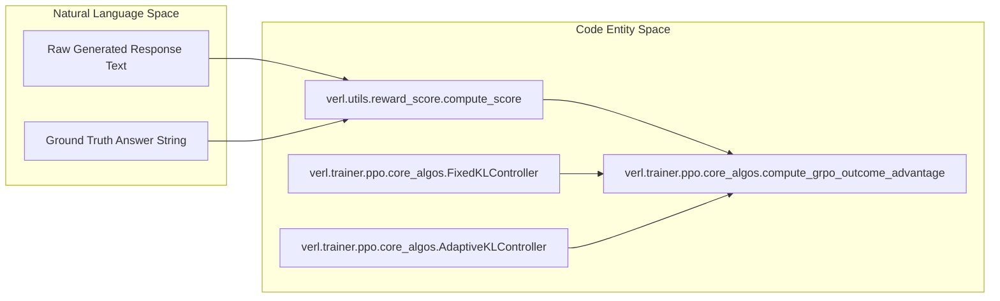
Sources: `[verl/trainer/ppo/core_algos.py:137-192]()`, `[examples/grpo_trainer/run_qwen3_5_2b_openr1_fsdp.sh:75-78]()`

---

## Performance Baselines

Summary of verification performance on benchmarks using various RL strategies in `verl`:

| Model | Method | Score | Detail |
| :--- | :--- | :--- | :--- |
| Qwen/Qwen2.5-0.5B-Instruct | PPO | 56.7 | `[examples/ppo_trainer/README.md:99-99]()` |
| Qwen/Qwen2.5-7B-Instruct | GRPO-LoRA | 93.4 | `[examples/grpo_trainer/README.md:78-83]()` |
| Qwen/Qwen3.5-35B-A3B | GRPO (Megatron) | — | `[examples/grpo_trainer/run_qwen3_5_35b_megatron.sh:2-2]()` |

Sources: `[examples/grpo_trainer/README.md:76-90]()`, `[examples/ppo_trainer/README.md:96-99]()`

---

# Page: Quick Start: Supervised Fine-Tuning

# Quick Start: Supervised Fine-Tuning

<details>
<summary>Relevant source files</summary>

The following files were used as context for generating this wiki page:

- [.github/workflows/README.md](.github/workflows/README.md)
- [.github/workflows/e2e_ppo_trainer_veomni_vllm.yml](.github/workflows/e2e_ppo_trainer_veomni_vllm.yml)
- [.github/workflows/e2e_sft_llm.yml](.github/workflows/e2e_sft_llm.yml)
- [.github/workflows/e2e_sft_vlm.yml](.github/workflows/e2e_sft_vlm.yml)
- [examples/tpu/sft/README.md](examples/tpu/sft/README.md)
- [examples/tpu/sft/run_qwen3_0_6b_torchtitan.sh](examples/tpu/sft/run_qwen3_0_6b_torchtitan.sh)
- [tests/special_e2e/ppo_trainer/run_function_reward.sh](tests/special_e2e/ppo_trainer/run_function_reward.sh)
- [tests/special_e2e/run_ppo_trainer_veomni.sh](tests/special_e2e/run_ppo_trainer_veomni.sh)
- [tests/special_e2e/sft/run_sft_engine.sh](tests/special_e2e/sft/run_sft_engine.sh)
- [tests/special_e2e/sft/test_sft_engine_all.sh](tests/special_e2e/sft/test_sft_engine_all.sh)
- [tests/utils/dataset/test_multiturn_sft_dataset_on_cpu.py](tests/utils/dataset/test_multiturn_sft_dataset_on_cpu.py)
- [verl/trainer/config/sft_trainer_engine.yaml](verl/trainer/config/sft_trainer_engine.yaml)
- [verl/trainer/sft_trainer.py](verl/trainer/sft_trainer.py)
- [verl/trainer/sft_trainer_ray.py](verl/trainer/sft_trainer_ray.py)
- [verl/utils/checkpoint/__init__.py](verl/utils/checkpoint/__init__.py)
- [verl/utils/checkpoint/checkpoint_handler.py](verl/utils/checkpoint/checkpoint_handler.py)
- [verl/utils/dataset/multiturn_sft_dataset.py](verl/utils/dataset/multiturn_sft_dataset.py)

</details>


This page provides a comprehensive guide for running Supervised Fine-Tuning (SFT) within the `verl` framework. It covers entry points, multi-turn conversation dataset preparation, Hydra configuration options, launching distributed jobs with FSDP or Megatron backends, and parameter-efficient fine-tuning (PEFT/LoRA). SFT in `verl` leverages the same core `TrainingWorker` and execution engine abstractions used in RL training, configured for single-phase cross-entropy optimization.

---

## 1. Architecture Overview

SFT training in `verl` is supported through two primary orchestration entry points:
1.  **SPMD Mode:** Managed by `verl.trainer.sft_trainer.SFTTrainer` via `torchrun` for standard distributed training across local GPUs [verl/trainer/sft_trainer.py:50-51]().
2.  **Ray Mode:** Managed by `verl.trainer.sft_trainer_ray.SFTTrainer` for distributed scaling across a Ray cluster [verl/trainer/sft_trainer_ray.py:49-50]().

Both trainers instantiate a `MultiTurnSFTDataset`, coordinate a stateful data loader, and instantiate a `TrainingWorker` which wraps the underlying training engine [verl/trainer/sft_trainer.py:62-177](), [verl/trainer/sft_trainer_ray.py:108-145]().

**SFT Trainer Data Flow and Code Entity Mapping**

```mermaid
flowchart TD
    subgraph LaunchLayer ["Launch Layer"]
        A1["torchrun -m verl.trainer.sft_trainer"]
        A2["python -m verl.trainer.sft_trainer_ray"]
    end

    subgraph DataPreparation ["Data Preparation"]
        B["MultiTurnSFTDataset"]
        C["SFTTensorCollator"]
    end

    subgraph TrainingLogic ["Training Logic"]
        D["SFTTrainer"]
        E["TrainingWorker"]
        F["sft_loss"]
    end

    subgraph ExecutionEngines ["Execution Engines"]
        G["FSDPEngine"]
        H["MegatronEngine"]
        I["VeOmniEngine"]
    end

    A1 --> D
    A2 --> D
    B --> C
    C --> D
    D --> E
    E --> G
    E --> H
    E --> I
    G & H & I --> F
```
Sources: [verl/trainer/sft_trainer_ray.py:49-145](), [verl/trainer/sft_trainer.py:50-177](), [verl/workers/engine_workers.py:44-44]()

**Class and Component Relationships (Code Entity Space)**

```mermaid
classDiagram
    class SFTTrainer {
        +config: DictConfig
        +training_client: RayWorkerGroup
        +train_dataset: MultiTurnSFTDataset
        +ckpt_handler: CheckpointHandler
        +_build_engine()
        +_build_dataloader()
    }
    class MultiTurnSFTDataset {
        +tokenizer: PreTrainedTokenizer
        +messages_key: str
        +image_key: str
        +tools_key: str
        +__getitem__(idx)
    }
    class TrainingWorker {
        +engine: BaseEngine
        +loss_fn: Callable
        +set_loss_fn(loss_fn)
    }
    class BaseEngine {
        <<interface>>
        +init_optimizers()
        +forward_backward_batch(batch)
    }
    
    SFTTrainer *-- MultiTurnSFTDataset : owns
    SFTTrainer *-- TrainingWorker : orchestrates
    TrainingWorker *-- BaseEngine : wraps
```
Sources: [verl/trainer/sft_trainer_ray.py:49-145](), [verl/utils/dataset/multiturn_sft_dataset.py:73-126](), [verl/workers/engine_workers.py:44-44](), [verl/trainer/sft_trainer.py:50-98]()

---

## 2. Data Preparation

### Input Format
SFT datasets are typically stored in Parquet format. The core dataset class is `MultiTurnSFTDataset`, which handles complex conversation histories including text turns, multimodal payloads, and tool definitions [verl/utils/dataset/multiturn_sft_dataset.py:73-83]().

**Key Features:**
- **Multi-turn Training:** Iterates through message lists, applying chat templates to each turn separately and concatenating `input_ids` to ensure gradient computation is restricted to assistant responses [verl/utils/dataset/multiturn_sft_dataset.py:16-17](), [verl/trainer/config/sft_trainer_engine.yaml:42-43]().
- **Multimodal Support:** Exposes `image_key` and `video_key` to process vision-language inputs for models like Qwen2-VL [verl/utils/dataset/multiturn_sft_dataset.py:104-108]().
- **Agentic Training:** Supports `tools_key` for agentic tool-use fine-tuning [verl/utils/dataset/multiturn_sft_dataset.py:109-109]().
- **Thinking Tags:** Provides `enable_thinking_key` to manage reasoning tags for advanced models [verl/utils/dataset/multiturn_sft_dataset.py:110-111]().

### Preprocessing and Batching
Dataframes are loaded via `pd.read_parquet` using the `pyarrow` backend [verl/utils/dataset/multiturn_sft_dataset.py:147-147](). The trainer relies on `SFTTensorCollator` to package samples into `TensorDict` structures [verl/trainer/sft_trainer.py:36-37]().

Sources: [verl/utils/dataset/multiturn_sft_dataset.py:73-111](), [verl/utils/dataset/multiturn_sft_dataset.py:147-147](), [verl/trainer/config/sft_trainer_engine.yaml:42-43](), [verl/trainer/sft_trainer.py:36-37]()

---

## 3. Configuration Reference

`verl` uses Hydra for hierarchical configuration management (`verl/trainer/config/sft_trainer_engine.yaml`). SFT jobs require configuration profiles for models, engines, and optimizers.

### Trainer and Data Config Fields

| Field | Default | Description |
| :--- | :--- | :--- |
| `data.train_batch_size` | 256 | Global training batch size [verl/trainer/config/sft_trainer_engine.yaml:17-17]() |
| `data.micro_batch_size_per_gpu` | 4 | Micro-batch size per device [verl/trainer/config/sft_trainer_engine.yaml:18-18]() |
| `data.messages_key` | `"messages"` | Column name for conversation turns [verl/trainer/config/sft_trainer_engine.yaml:26-26]() |
| `data.pad_mode` | `"no_padding"` | Padding mode (`no_padding` recommended with sequence packing) [verl/trainer/config/sft_trainer_engine.yaml:30-30]() |
| `trainer.total_epochs` | 4 | Total number of training epochs [verl/trainer/config/sft_trainer_engine.yaml:64-64]() |
| `trainer.resume_mode` | `"auto"` | Checkpoint resume policy (`auto`, `disable`, `resume_path`) [verl/trainer/config/sft_trainer_engine.yaml:73-77]() |

### Performance Tuning
Users can select execution engines such as `fsdp`, `megatron`, `torchtitan`, `automodel`, or `veomni` [verl/trainer/config/sft_trainer_engine.yaml:10-12](), [tests/special_e2e/sft/test_sft_engine_all.sh:12-34](). Sequence parallelism (`SP_SIZE`) can be enabled for long-context training on supported hardware [tests/special_e2e/sft/test_sft_engine_all.sh:12-12]().

Sources: [verl/trainer/config/sft_trainer_engine.yaml:10-30](), [verl/trainer/config/sft_trainer_engine.yaml:64-77](), [tests/special_e2e/sft/test_sft_engine_all.sh:12-34](), [verl/trainer/sft_trainer_ray.py:122-125]()

---

## 4. Launching SFT Training

### Standard Fine-Tuning (FSDP)
Use `torchrun` to launch distributed SFT jobs with the FSDP engine [verl/trainer/sft_trainer.py:50-51](), [verl/trainer/config/sft_trainer_engine.yaml:11-11]():

```bash
torchrun --standalone --nnodes=1 --nproc-per-node=8 \
    -m verl.trainer.sft_trainer \
    data.train_files=$HOME/data/gsm8k/train.parquet \
    model.path=Qwen/Qwen2.5-0.5B-Instruct \
    engine=fsdp
```
Sources: [verl/trainer/sft_trainer.py:50-51](), [verl/trainer/config/sft_trainer_engine.yaml:11-11]()

### LoRA / PEFT Training
LoRA is enabled by setting `lora_rank` and `lora_alpha`. The `SFTTrainer` automatically tracks LoRA metadata during checkpointing [verl/trainer/sft_trainer.py:87-136]().

**Required LoRA Configurations:**
- `model.lora_rank`: Set to an integer greater than 0 (e.g., `16`, `32`) [verl/trainer/sft_trainer.py:102-102]().
- `model.lora_alpha`: Scaling parameter for low-rank updates [verl/trainer/sft_trainer.py:107-107]().
- `model.task_type`: PEFT task type, defaulting to `"CAUSAL_LM"` [verl/trainer/sft_trainer.py:128-131]().

For FSDP backends, wrapping policies automatically handle LoRA modules. An example of running SFT with LoRA is shown in the CI workflow [.github/workflows/e2e_sft_llm.yml:140-142]():
```bash
LORA_RANK=32 $UV_RUN bash tests/special_e2e/sft/run_sft.sh
```
Sources: [verl/trainer/sft_trainer.py:87-136](), [.github/workflows/e2e_sft_llm.yml:140-142]()

---

## 5. Advanced Features and Checkpoint Management

### Memory Efficiency and Specialized Kernels
- **Efficient Logprobs:** `logprobs_from_logits` leverages Flash-Attention cross-entropy kernels or row-wise processing to minimize memory overhead [verl/utils/torch_functional.py:72-100]().
- **NPU Support:** Ascend NPU acceleration uses `logprobs_from_logits_torch_npu` [verl/utils/torch_functional.py:136-152](). This is demonstrated in the NPU SFT CI workflow [.github/workflows/e2e_sft_vlm.yml:123-126]().
- **Dynamic Batching:** Enabled via `use_dynamic_bsz` to optimize memory across varying token lengths [verl/trainer/config/sft_trainer_engine.yaml:20-20]().

### Checkpoint Management
The `CheckpointHandler` manages persistence of model weights, optimizer states, and dataloader iterators [verl/utils/checkpoint/checkpoint_handler.py:49-78]().
- **Max Checkpoints:** Controlled by `trainer.max_ckpt_to_keep` [verl/trainer/sft_trainer.py:85-85]().
- **Resume Mode:** Configured via `trainer.resume_mode` [verl/trainer/config/sft_trainer_engine.yaml:73-77](). An example of resuming training with LoRA is available in the CI workflow [.github/workflows/e2e_sft_llm.yml:143-146]():
```bash
LORA_RANK=32 RESUME_MODE=auto TOTAL_TRAIN_STEP=2 $UV_RUN bash tests/special_e2e/sft/run_sft.sh
```
- **Stateful Dataloader:** Uses `StatefulDataLoader` to preserve iterator states across interruptions [verl/trainer/sft_trainer.py:31-32]().

### Chat Templates and Special Tags
`MultiTurnSFTDataset` applies chat templates per turn. If tokenization mismatches occur due to model-specific special tokens (e.g., `<think>` tags in Qwen models), set `data.ignore_input_ids_mismatch=True` [verl/trainer/config/sft_trainer_engine.yaml:44-47](), [verl/utils/dataset/multiturn_sft_dataset.py:116-116]().

Sources: [verl/trainer/sft_trainer.py:82-136](), [verl/utils/dataset/multiturn_sft_dataset.py:16-17](), [verl/trainer/config/sft_trainer_engine.yaml:42-47](), [verl/utils/dataset/multiturn_sft_dataset.py:116-116](), [verl/utils/checkpoint/checkpoint_handler.py:49-78](), [.github/workflows/e2e_sft_vlm.yml:123-126](), [.github/workflows/e2e_sft_llm.yml:143-146]()

---

# Page: Multinode Deployment and Hardware Selection

# Multinode Deployment and Hardware Selection

<details>
<summary>Relevant source files</summary>

The following files were used as context for generating this wiki page:

- [docs/advance/dpo_extension.rst](docs/advance/dpo_extension.rst)
- [docs/algo/baseline.md](docs/algo/baseline.md)
- [docs/algo/dapo.md](docs/algo/dapo.md)
- [docs/api/data.rst](docs/api/data.rst)
- [docs/api/single_controller.rst](docs/api/single_controller.rst)
- [docs/examples/gsm8k_example.rst](docs/examples/gsm8k_example.rst)
- [docs/examples/ppo_code_architecture.rst](docs/examples/ppo_code_architecture.rst)
- [docs/hardware/multi_chip_support.rst](docs/hardware/multi_chip_support.rst)
- [docs/hybrid_flow.rst](docs/hybrid_flow.rst)
- [docs/perf/device_tuning.rst](docs/perf/device_tuning.rst)
- [docs/preparation/reward_function.rst](docs/preparation/reward_function.rst)
- [docs/start/multinode.rst](docs/start/multinode.rst)
- [docs/start/quickstart.rst](docs/start/quickstart.rst)
- [docs/workers/model_engine.rst](docs/workers/model_engine.rst)
- [examples/README.md](examples/README.md)
- [examples/tpu/grpo/Dockerfile](examples/tpu/grpo/Dockerfile)
- [examples/tpu/grpo/README.md](examples/tpu/grpo/README.md)
- [examples/tpu/grpo/ray-tpu-v6e4-2slice.yaml](examples/tpu/grpo/ray-tpu-v6e4-2slice.yaml)
- [examples/tpu/grpo/run_qwen3_0_6b_torchtitan.sh](examples/tpu/grpo/run_qwen3_0_6b_torchtitan.sh)
- [examples/tpu/grpo/run_qwen3_4b_torchtitan.sh](examples/tpu/grpo/run_qwen3_4b_torchtitan.sh)
- [examples/tutorial/slurm/ray_on_slurm.slurm](examples/tutorial/slurm/ray_on_slurm.slurm)
- [tests/special_sanity/check_example_naming.py](tests/special_sanity/check_example_naming.py)
- [verl/experimental/separation/engine_workers.py](verl/experimental/separation/engine_workers.py)
- [verl/plugin/platform/platform_base.py](verl/plugin/platform/platform_base.py)

</details>


## Purpose and Scope

This page covers how to deploy `verl` across multiple nodes, including manual Ray cluster setup, provisioned-cluster deployment via SkyPilot, Slurm-managed clusters, and how to select training and inference backends based on cluster topology and available hardware resources.

For details on configuration fields, see [docs/start/multinode.rst:1-171](). For details on how workers are scheduled onto Ray placement groups, see [docs/examples/ppo_code_architecture.rst:114-127](). For Ascend NPU-specific deployment, see [examples/tpu/grpo/run_qwen3_4b_torchtitan.sh:11-17]().

Sources: `[docs/start/multinode.rst:1-10]`, `[docs/workers/model_engine.rst:31-48]`, `[examples/tpu/grpo/run_qwen3_4b_torchtitan.sh:11-17]()`

---

## How verl Uses Ray for Multi-node Training

`verl` distributes all model roles (`ActorRolloutRefWorker`, `TrainingWorker`) as Ray remote actors managed by `RayWorkerGroup` `[docs/examples/ppo_code_architecture.rst:49-51]`. A single controller process running `main_ppo` (`verl.trainer.main_ppo`) coordinates these actors from a CPU node, while GPU workers are managed via `RayWorkerGroup` (`verl.single_controller.ray.ray_worker_group.RayWorkerGroup`) and `ResourcePoolManager` (`verl.trainer.ppo.ray_trainer.ResourcePoolManager`) `[docs/start/multinode.rst:15-28]`. In a multi-node setup, Ray schedules workers across nodes and establishes NCCL process groups for inter-node communication.

Title: "Distributed Orchestration Architecture"
```mermaid
graph TD
    subgraph HeadNodeCPU ["HeadNodeCPU"]
        C["verl.trainer.main_ppo"]
        RM["verl.trainer.ppo.ray_trainer.ResourcePoolManager"]
        T["RayPPOTrainer"]
    end

    subgraph GPUNode1 ["GPUNode1"]
        W1["verl.single_controller.ray.ray_worker_group.RayWorkerGroup"]
        A1["verl.workers.engine_workers.ActorRolloutRefWorker"]
    end

    subgraph GPUNode2 ["GPUNode2"]
        W2["verl.single_controller.ray.ray_worker_group.RayWorkerGroup"]
        A2["verl.workers.engine_workers.ActorRolloutRefWorker"]
    end

    C --> T
    T -->|"manages"| RM
    RM -->|"schedules via RayResourcePool"| W1
    RM -->|"schedules via RayResourcePool"| W2
    W1 --> A1
    W2 --> A2
    A1 <---|"NCCL torch.distributed"|---> A2
```

Sources: `[docs/start/multinode.rst:15-28]`, `[docs/examples/ppo_code_architecture.rst:49-51]`

---

## Cluster Configuration Parameters

These fields in the `trainer` configuration control node counts and GPU allocations:

| Config Field | Default | Purpose |
|---|---|---|
| `trainer.nnodes` | `1` | Total number of nodes in the cluster `[docs/start/multinode.rst:48-48]` |
| `trainer.n_gpus_per_node` | `8` | Number of GPUs available per node `[docs/start/multinode.rst:47-47]` |

Sources: `[docs/start/multinode.rst:47-48]`

---

## Deployment Options

### Option 1: Manual Ray Cluster

1.  **Start the head node:**
    ```bash
    ray start --head --dashboard-host=0.0.0.0
    ```
    Outputs the GCS address (for worker connection) and the Dashboard address (for job submission) `[docs/start/multinode.rst:15-18]`.

2.  **Start each worker node:**
    ```bash
    ray start --address=<gcs_address>
    ```
    `[docs/start/multinode.rst:22-24]`

3.  **Submit a training job:**
    Jobs are submitted via the Ray Job CLI to the dashboard address `[docs/start/multinode.rst:42-51]`:
    ```bash
    ray job submit --address="http://<head_ip>:8265" \
        --runtime-env=verl/trainer/runtime_env.yaml \
        --no-wait \
        -- \
        python3 -m verl.trainer.main_ppo \
        trainer.n_gpus_per_node=8 \
        trainer.nnodes=2 \
        ...
    ```

Sources: `[docs/start/multinode.rst:15-51]`

### Option 2: SkyPilot (Cloud/K8s)

SkyPilot automates node provisioning on cloud platforms (AWS, GCP, Azure) and Kubernetes. `verl` provides ready-to-use configurations in `examples/tutorial/skypilot/` `[docs/start/multinode.rst:72-82]`.

-   **Automated Setup:** SkyPilot executes `ray start` on head and worker nodes using environment variables like `$SKYPILOT_NODE_RANK` and `$SKYPILOT_NODE_IPS` `[docs/start/multinode.rst:162-171]`.
-   **Resource Orchestration:** Defines GPU specs (e.g., `L4:1`), memory requirements, and Docker images in a single YAML `[docs/start/multinode.rst:124-130]`.
-   **Secrets Management:** Securely passes secrets like `WANDB_API_KEY` or `HF_TOKEN` `[docs/start/multinode.rst:137-140]`.

Sources: `[docs/start/multinode.rst:69-171]`

### Option 3: Slurm Cluster

`verl` executes on Slurm-managed HPC clusters by spawning a Ray cluster via `examples/tutorial/slurm/ray_on_slurm.slurm` `[examples/tutorial/slurm/ray_on_slurm.slurm:1-135]`.
-   Supports Apptainer/Singularity container images for HPC isolation `[examples/tutorial/slurm/ray_on_slurm.slurm:82-84]`.
-   Automatically detects node IP allocations and bootstraps Ray head and worker processes across nodes `[examples/tutorial/slurm/ray_on_slurm.slurm:45-106]`.

Sources: `[examples/tutorial/slurm/ray_on_slurm.slurm:1-135]()`

---

## Training Backend Selection: FSDP vs Megatron

Choosing the appropriate distributed backend is critical for multi-node throughput and memory efficiency. `verl` abstracts backends into engine implementations.

Title: "Training Engine Selection and Worker Integration"
```mermaid
graph TD
    Q1{"Model size and architecture?"}
    Q1 -->|"<=70B, Standard LLM"| FSDP
    Q1 -->|">70B or MoE"| MEG

    FSDP["verl.workers.engine.fsdp.fsdp_engine.FSDPEngine"]
    MEG["verl.workers.engine.megatron.megatron_engine.MegatronEngine"]

    FSDP -->|"Integrated in"| FW["verl.workers.engine_workers.ActorRolloutRefWorker"]
    MEG -->|"Integrated in"| MW["verl.workers.engine_workers.ActorRolloutRefWorker"]
    
    subgraph DistributedManagement ["DistributedManagement"]
        DP["verl.single_controller.ray.ray_worker_group.RayWorkerGroup"]
        RP["verl.trainer.ppo.ray_trainer.ResourcePoolManager"]
    end
    
    FW -.-> DP
    MW -.-> DP
    DP -.-> RP
```

Sources: `[docs/workers/model_engine.rst:13-25]`, `[docs/examples/ppo_code_architecture.rst:107-112]`

### FSDP Backend
-   **Use Case:** Recommended for standard dense architectures up to 70B parameters `[docs/workers/model_engine.rst:18-20]`.
-   **Implementation:** `FSDPEngine` handles Hugging Face auto-model wrapping and sharded checkpoint persistence `[docs/workers/model_engine.rst:18-20]`.
-   **Extensions:** Supports `trust_remote_code` and custom model architectures via monkey-patching and wrapper utilities `[docs/workers/model_engine.rst:18-20]`.

Sources: `[docs/workers/model_engine.rst:13-25]`

### Megatron-LM Backend
-   **Use Case:** Recommended for very large models or complex Mixture-of-Experts (MoE) topologies `[examples/tpu/grpo/run_qwen3_4b_torchtitan.sh:101-110]()`.
-   **MoE Support:** Enables large MoE scaling with Context Parallelism (CP) and Expert Parallelism (EP) `[examples/tpu/grpo/run_qwen3_4b_torchtitan.sh:129-135]()`.
-   **Hardware Tuning:** Large-scale training jobs require configuring parallelism dimensions (`TP`, `EP`, `PP`, `CP`) as demonstrated in production run scripts `[examples/tpu/grpo/run_qwen3_4b_torchtitan.sh:129-135]()`.

Sources: `[examples/tpu/grpo/run_qwen3_4b_torchtitan.sh:1-146]()`

---

## Hardware Selection and Recommended Configurations

The following table summarizes reference resource requirements for GRPO and PPO training workloads.

| Model Size | Task | Resource | Train Backend | Infer Backend | Link to Example | Contributor |
|---|---|---|---|---|---|---|
| **0.5B** | GRPO-LoRA | 1\*H100 | fsdp | vllm0.8.3 | `qwen2-0.5b_grpo-lora_1_h100_fsdp_vllm.sh` `[docs/perf/device_tuning.rst:55-55]` | SimonHuang |
| **1.5B** | GRPO-LoRA | 1\*H100 | fsdp | vllm0.8.3 | `qwen2-1.5b_grpo-lora_1_h100_fsdp_vllm.sh` `[docs/perf/device_tuning.rst:79-79]` | SimonHuang |
| **3B** | GRPO-LoRA | 1\*H100 | fsdp | vllm0.8.3 | `qwen2-3b_grpo-lora_1_h100_fsdp_vllm.sh` `[docs/perf/device_tuning.rst:107-107]` | SimonHuang |
| **7B** | GRPO | 2\*H800 | fsdp | vllm0.8.2 | `qwen2-7b_grpo_2_h800_fsdp_vllm` `[docs/perf/device_tuning.rst:133-133]` | Xiangyongan |
| **7B** | GRPO-LoRA | 1\*H100 | fsdp | vllm0.8.3 | `qwen2-7b_grpo-lora_1_h100_fsdp_vllm.sh` `[docs/perf/device_tuning.rst:142-142]` | SimonHuang |
| **14B** | GRPO | 4\*H800 | fsdp | vllm0.8.2 | `qwen2-14b_grpo_4_h800_fsdp_vllm` `[docs/perf/device_tuning.rst:168-168]` | Xiangyongan |
| **14B** | GRPO-LoRA | 2\*H100 | fsdp | vllm0.8.3 | `qwen2-14b_grpo-lora_2_h100_fsdp_vllm.sh` `[docs/perf/device_tuning.rst:177-177]` | SimonHuang |
| **32B** | GRPO | 8\*H20 | megatron | vllm0.8.2 | `qwen2-32b_grpo_8_h20_megatron_vllm` `[docs/perf/device_tuning.rst:203-203]` | Xiangyongan |
| **32B** | GRPO-LoRA | 4\*H100 | fsdp | vllm0.8.3 | `qwen2-32b_grpo-lora_4_h100_fsdp_vllm.sh` `[docs/perf/device_tuning.rst:212-212]` | SimonHuang |

### Optimization Strategies for Large Models
-   **Optimizer Offloading:** Enable `param_offload` and `optimizer_offload` in FSDP or Megatron configs to reduce peak device memory `[examples/tpu/grpo/run_qwen3_4b_torchtitan.sh:101-110]()`.
-   **Weight Resharding:** Utilize `ActorRolloutRefWorker` as a hybrid engine to manage dynamic weight resharding between inference engines and training backends `[docs/examples/ppo_code_architecture.rst:49-50]`.
-   **Dynamic Sampling:** Configure `filter_groups` for algorithms like DAPO to filter uninformative rollouts and control retry attempts via `max_num_gen_batches` `[docs/algo/dapo.md:74-86]`.
-   **TransferQueue Integration:** For high-scale multimodal post-training, adopt `TransferQueue` for asynchronous streaming data management and reduced host memory overhead `[examples/tpu/grpo/run_qwen3_4b_torchtitan.sh:75-76]()`.

Sources: `[docs/perf/device_tuning.rst:32-234]`, `[docs/examples/ppo_code_architecture.rst:49-50]`, `[examples/tpu/grpo/run_qwen3_4b_torchtitan.sh:75-76]()`, `[docs/algo/dapo.md:74-86]`

---

# Page: PPO Training System

# PPO Training System

<details>
<summary>Relevant source files</summary>

The following files were used as context for generating this wiki page:

- [docs/examples/config.rst](docs/examples/config.rst)
- [docs/perf/perf_tuning.rst](docs/perf/perf_tuning.rst)
- [verl/trainer/config/ppo_megatron_trainer.yaml](verl/trainer/config/ppo_megatron_trainer.yaml)
- [verl/trainer/config/ppo_trainer.yaml](verl/trainer/config/ppo_trainer.yaml)
- [verl/trainer/main_ppo.py](verl/trainer/main_ppo.py)
- [verl/trainer/ppo/core_algos.py](verl/trainer/ppo/core_algos.py)
- [verl/trainer/ppo/ray_trainer.py](verl/trainer/ppo/ray_trainer.py)

</details>


This page serves as a high-level parent guide to the Proximal Policy Optimization (PPO) training architecture in `verl`. It outlines how distributed orchestration, worker roles, advantage estimation, policy losses, reward processing, and asynchronous execution come together to form an end-to-end RLHF training system.

For deep dives into specific subsystems, refer to the following child pages:
- **[RayPPOTrainer Architecture and Orchestration](#3.1)** — Explain `RayPPOTrainer`'s role in orchestrating distributed training, resource management, and worker coordination.
- **[Training Loop and Data Flow](#3.2)** — Document the complete PPO training loop: rollout, reward computation, advantage estimation, and policy updates with `DataProto` flow.
- **[Advantage Estimation Methods](#3.3)** — Detail various advantage estimators (`GAE`, `GRPO`, `GRPO_VECTORIZED`, `REINFORCE++`, `RLOO`, `OPTIMAL_TOKEN_BASELINE`, `GDPO`) and their implementations.
- **[Policy Loss Functions and Clipping](#3.4)** — Explain policy loss modes (`vanilla`, `clip-cov`, `kl-cov`, `GPG`, `flow_grpo`, DPPO variants), clipping strategies, and SAPO/GMPO smoothing.
- **[Reward Systems and KL Control](#3.5)** — Cover reward model integration, custom reward functions, KL penalty application, and KL controllers (`FixedKLController`, `AdaptiveKLController`).
- **[Alternative RL Algorithms](#3.6)** — Document implementation details of `GRPO`, `DAPO`, `RLOO`, `PRIME`, `ReMax`, `GMPO`, `SAPO`, `DPPO`, `GSPO`, `GPG`, `OTB`, `GDPO`, `REINFORCE++`, `CISPO`, and other algorithms beyond standard PPO.
- **[Rollout Correction and Off-Policy Handling](#3.7)** — Document the `RolloutCorrectionConfig` system for off-policy issues: IS weighting modes, rejection sampling, and preset factory methods.
- **[V1 PPO Trainer: Async and Streaming Architecture](#3.8)** — Document the V1 PPO trainer system (`PPOTrainer`, async variants, `ReplayBuffer`, `MetricsAggregator`, `SkipManager`) and its `transfer_queue`-based streaming.

---

## Top-Level Architecture and Component Mapping

The PPO training system utilizes a single-controller architecture via Ray where the driver runs a controller task (such as `TaskRunnerV1` in `verl/trainer/main_ppo.py` or `RayPPOTrainer` in `verl/trainer/ppo/ray_trainer.py`) that coordinates multiple distributed worker groups (`ActorRolloutRefWorker`, `TrainingWorker`, etc.). Configuration is centrally managed via Hydra-based YAML definitions (`verl/trainer/config/ppo_trainer.yaml`).

Title: "System Component Map to Code Entities"
```mermaid
flowchart TD
    subgraph Driver["DriverProcess"]
        Main["main()\nverl/trainer/main_ppo.py"]
        RunPPO["run_ppo()\nverl/trainer/main_ppo.py"]
    end

    subgraph RayController["RayRemoteOrchestrator"]
        TaskRunner["TaskRunnerV1\nverl/trainer/main_ppo.py"]
        RayTrainer["RayPPOTrainer\nverl/trainer/ppo/ray_trainer.py"]
    end

    subgraph WorkerGroups["DistributedWorkerGroups"]
        ActorRolloutWG["actor_rollout_wg\nActorRolloutRefWorker"]
        CriticWG["critic_wg\nTrainingWorker"]
        RefPolicyWG["ref_policy_wg\nActorRolloutRefWorker"]
        RewardLoopMgr["reward_loop_manager\nRewardLoopWorker"]
    end

    Main --> RunPPO
    RunPPO --> TaskRunner
    TaskRunner --> RayTrainer
    RayTrainer --> ActorRolloutWG
    RayTrainer --> CriticWG
    RayTrainer --> RefPolicyWG
    RayTrainer --> RewardLoopMgr
```

Sources: [verl/trainer/main_ppo.py:34-94](), [verl/trainer/main_ppo.py:103-132](), [verl/trainer/ppo/ray_trainer.py:17-19](), [verl/trainer/config/ppo_trainer.yaml:8-51]()

---

## Training Loop and Data Flow Overview

The training loop coordinates batch sampling, rollout generation, reward scoring, advantage estimation, and gradient updates across distributed engines. Data flows throughout the pipeline encapsulated inside `DataProto` containers managed by the core trainer (`RayPPOTrainer`) and helper utility functions in `verl/trainer/ppo/core_algos.py`.

Title: "PPO Training Loop Data Flow"
```mermaid
sequenceDiagram
    participant Trainer as "RayPPOTrainer\nverl/trainer/ppo/ray_trainer.py"
    participant Rollout as "ActorRolloutRefWorker"
    participant Reward as "RewardLoopWorker"
    participant Adv as "core_algos.get_adv_estimator_fn()"
    participant Actor as "update_actor()"
    participant Critic as "update_critic()"

    Trainer->>Rollout: "rollout()"
    Rollout-->>Trainer: "DataProto (responses, old_log_probs)"
    Trainer->>Reward: "compute_score_batch()"
    Reward-->>Trainer: "DataProto (rm_scores)"
    Trainer->>Trainer: "apply_kl_penalty()"
    Trainer->>Adv: "compute_advantage()"
    Adv-->>Trainer: "DataProto (advantages, returns)"
    Trainer->>Actor: "update_actor()"
    Trainer->>Critic: "update_critic()"
```

For detailed breakdown of data tensors, sequence balancing, and asynchronous steps, see [Training Loop and Data Flow](#3.2) and [V1 PPO Trainer: Async and Streaming Architecture](#3.8).

Sources: [verl/trainer/ppo/ray_trainer.py:433-870](), [verl/trainer/ppo/core_algos.py:137-150]()

---

## Core Algorithmic Subsystems

The PPO system accommodates standard PPO as well as a wide array of alternative reinforcement learning algorithms and loss formulations. 

- **Advantage Estimators**: Functions registered in `verl/trainer/ppo/core_algos.py` via `register_adv_est` handle advantage computations like GAE, GRPO, and REINFORCE++ [verl/trainer/ppo/core_algos.py:88-116](). For details, see [Advantage Estimation Methods](#3.3).
- **Policy Losses & Clipping**: Custom loss functions handle ratio clipping, KL divergence penalties, and sequence-level smoothing. For details, see [Policy Loss Functions and Clipping](#3.4).
- **Reward Systems & KL Control**: KL divergence is dynamically adjusted using `AdaptiveKLController` or `FixedKLController` [verl/trainer/ppo/core_algos.py:153-191]() and combined with token-level rewards via `apply_kl_penalty` [verl/trainer/ppo/ray_trainer.py:78-117](). For details, see [Reward Systems and KL Control](#3.5).
- **Alternative Algorithms**: Beyond standard PPO, `verl` natively supports GRPO, DAPO, RLOO, ReMax, and other group/reward variants configured via `AlgoConfig` [verl/trainer/config/ppo_trainer.yaml:65-136](). For details, see [Alternative RL Algorithms](#3.6).

Sources: [verl/trainer/ppo/core_algos.py:88-191](), [verl/trainer/ppo/ray_trainer.py:78-117](), [verl/trainer/config/ppo_trainer.yaml:65-136]()

---

## Off-Policy Handling and V1 Async Architecture

To address distribution mismatches between rollout engines (e.g., vLLM inference) and trainers (e.g., FSDP training), `verl` provides robust rollout correction mechanisms and asynchronous execution pipelines.

- **Rollout Correction**: The `RolloutCorrectionConfig` system manages importance sampling (IS) weights and rejection sampling (Geo-RS, K3-RS) to stabilize updates [verl/trainer/config/ppo_trainer.yaml:39-40](). For details, see [Rollout Correction and Off-Policy Handling](#3.7).
- **V1 Async Trainers**: The V1 architecture introduces fully asynchronous colocated and separate trainer variants leveraging `transfer_queue` streaming and `TaskRunnerV1` [verl/trainer/main_ppo.py:106-156](). For details, see [V1 PPO Trainer: Async and Streaming Architecture](#3.8).

Sources: [verl/trainer/config/ppo_trainer.yaml:39-40](), [verl/trainer/main_ppo.py:106-156]()

---

# Page: RayPPOTrainer Architecture and Orchestration

# RayPPOTrainer Architecture and Orchestration

<details>
<summary>Relevant source files</summary>

The following files were used as context for generating this wiki page:

- [docs/examples/config.rst](docs/examples/config.rst)
- [docs/perf/perf_tuning.rst](docs/perf/perf_tuning.rst)
- [tests/single_controller/test_data_transfer.py](tests/single_controller/test_data_transfer.py)
- [tests/single_controller/test_device_mesh_register.py](tests/single_controller/test_device_mesh_register.py)
- [tests/single_controller/test_high_level_scheduling_api.py](tests/single_controller/test_high_level_scheduling_api.py)
- [tests/single_controller/test_ray_collectives.py](tests/single_controller/test_ray_collectives.py)
- [tests/single_controller/test_split_resource_pool.py](tests/single_controller/test_split_resource_pool.py)
- [tests/single_controller/test_worker_group_basics.py](tests/single_controller/test_worker_group_basics.py)
- [verl/single_controller/base/worker.py](verl/single_controller/base/worker.py)
- [verl/single_controller/base/worker_group.py](verl/single_controller/base/worker_group.py)
- [verl/single_controller/ray/__init__.py](verl/single_controller/ray/__init__.py)
- [verl/single_controller/ray/base.py](verl/single_controller/ray/base.py)
- [verl/trainer/config/ppo_megatron_trainer.yaml](verl/trainer/config/ppo_megatron_trainer.yaml)
- [verl/trainer/config/ppo_trainer.yaml](verl/trainer/config/ppo_trainer.yaml)
- [verl/trainer/main_ppo.py](verl/trainer/main_ppo.py)
- [verl/trainer/ppo/core_algos.py](verl/trainer/ppo/core_algos.py)
- [verl/trainer/ppo/ray_trainer.py](verl/trainer/ppo/ray_trainer.py)

</details>


## Purpose and Scope

This page documents the `RayPPOTrainer` class (`verl/trainer/ppo/ray_trainer.py`) — the single-controller orchestrator that sets up, manages resources for, and coordinates all distributed PPO workers. It covers `__init__`, `init_workers`, role-to-worker mapping, `ResourcePoolManager` configuration, and the relationship between worker groups across model roles [verl/trainer/ppo/ray_trainer.py:17-304]().

For the subsequent training loop, see [Training Loop and Data Flow](3.2). For the underlying `RayWorkerGroup` abstractions, see [RayWorkerGroup and Resource Management](5.1). For hybrid engine mechanics, see [ActorRolloutRefWorker: Hybrid Engine Design](6.1).

Sources: [verl/trainer/ppo/ray_trainer.py:17-304]()

---

## System Overview and Orchestration Flow

`RayPPOTrainer` executes on the driver process (typically wrapped inside a Ray remote task runner like `TaskRunnerV1`), issuing asynchronous remote coordination calls across distributed worker pools. The driver process holds no model weights directly; all sharded tensor computations run on remote Ray actor groups.

Title: "End-to-end launch flow from main() to training initialization"
```mermaid
flowchart TD
    A["main()"] --> B["run_ppo(config)\nverl/trainer/main_ppo.py:35"]
    B --> C["ray.init()"]
    B --> D["TaskRunnerV1.remote()\nverl/trainer/main_ppo.py:107"]
    D --> E["TaskRunnerV1.run(config)\nverl/trainer/main_ppo.py:137"]
    E --> F["get_trainer_cls()"]
    E --> G["trainer_cls(config)"]
    G --> H["RayPPOTrainer.__init__\nverl/trainer/ppo/ray_trainer.py:231"]
    H --> I["RayPPOTrainer.init_workers()\nverl/trainer/ppo/ray_trainer.py:674"]
    E --> J["RayPPOTrainer.fit()\nverl/trainer/ppo/ray_trainer.py:825"]
```
Sources: [verl/trainer/main_ppo.py:33-143](), [verl/trainer/ppo/ray_trainer.py:674-825]()

---

## Entry Point: `TaskRunner` and Worker Mapping

The `TaskRunnerV1` [verl/trainer/main_ppo.py:103-164]() initializes the trainer class and manages the asynchronous `TransferQueue` runtime environment.

### Worker Class Selection

Depending on the engine configuration and model roles, `RayPPOTrainer` maps roles to specific worker implementations defined under `verl.workers`:

| Role | Worker Class | Source File / Module |
|-----------------|------------------------|----------------------|
| `Role.ActorRollout` / `Role.ActorRolloutRef` | `ActorRolloutRefWorker` | [verl/trainer/ppo/utils.py:22-29]() |
| `Role.Critic` | `TrainingWorker` | [verl/trainer/ppo/utils.py:22-29]() |
| `Role.RewardModel` | `RewardModelWorker` | [verl/trainer/ppo/utils.py:22-29]() |

Sources: [verl/trainer/main_ppo.py:103-164](), [verl/trainer/ppo/utils.py:22-29]()

---

## `RayPPOTrainer.__init__` Implementation

The constructor `RayPPOTrainer.__init__` [verl/trainer/ppo/ray_trainer.py:231-304]() performs lightweight configuration parsing on the driver node. No heavy GPU allocations occur during `__init__`.

### Key Parameters and Feature Flags

The trainer inspects the configuration to configure component flags:

```python
self.hybrid_engine = config.actor_rollout_ref.hybrid_engine  # [verl/trainer/ppo/ray_trainer.py:277]()
self.use_reference_policy = need_reference_policy(config)  # [verl/trainer/ppo/ray_trainer.py:279]()
self.use_rm = need_reward_model(config)  # [verl/trainer/ppo/ray_trainer.py:280]()
self.use_critic = need_critic(config)  # [verl/trainer/ppo/ray_trainer.py:281]()
self.use_teacher_policy = need_teacher_policy(config)  # [verl/trainer/ppo/ray_trainer.py:282]()
```

If KL penalty in reward computation is enabled via `config.algorithm.use_kl_in_reward`, an appropriate KL controller is instantiated [verl/trainer/ppo/ray_trainer.py:283-284]() using either `AdaptiveKLController` [verl/trainer/ppo/core_algos.py:153-159]() or `FixedKLController` [verl/trainer/ppo/core_algos.py:177-180]().

Sources: [verl/trainer/ppo/ray_trainer.py:231-304](), [verl/trainer/ppo/core_algos.py:153-191]()

---

## Role and Resource Pool Mapping

Title: "Mapping between Role enums, worker classes, and resource pools"
```mermaid
flowchart LR
    subgraph RoleEnum["verl.trainer.ppo.utils"]
        R1["Role_ActorRollout"]
        R2["Role_ActorRolloutRef"]
        R3["Role_Critic"]
        R4["Role_RefPolicy"]
        R5["Role_RewardModel"]
    end

    subgraph WorkerClasses["verl.workers"]
        W5["ActorRolloutRefWorker"]
        W6["TrainingWorker"]
        W7["RewardModelWorker"]
    end

    R1 --> W5
    R2 --> W5
    R3 --> W6
    R4 --> W5
    R5 --> W7

    subgraph ResourcePoolManager["ResourcePoolManager"]
        P1["global_pool"]
        P2["reward_pool"]
    end

    R1 --> P1
    R2 --> P1
    R3 --> P1
    R4 --> P1
    R5 --> P2
```
Sources: [verl/trainer/ppo/utils.py:22-29](), [verl/single_controller/ray/base.py:113-213]()

---

## `init_workers`: Worker Group Coordination

`init_workers` [verl/trainer/ppo/ray_trainer.py:674-824]() sets up placement groups and instantiates Ray worker groups.

Title: "init_workers sequence diagram showing worker group instantiation"
```mermaid
sequenceDiagram
    participant T as "RayPPOTrainer"
    participant RPM as "ResourcePoolManager"
    participant RRP as "RayResourcePool"
    participant CCW as "create_colocated_worker_cls()"
    participant RWG as "RayWorkerGroup"
    participant W as "Ray Actors"

    T->>RPM: "create_resource_pool()"
    RPM->>RRP: "RayResourcePool()"
    RRP->>RRP: "get_placement_groups(strategy=STRICT_PACK)"

    Note over T: "Build resource_pool_to_cls dict"
    T->>T: "RayClassWithInitArgs(ActorRolloutRefWorker, config)"
    T->>T: "RayClassWithInitArgs(TrainingWorker, critic_cfg)"

    loop "for each resource_pool"
        T->>CCW: "create_colocated_worker_cls(class_dict)"
        CCW-->>T: "fused_worker_cls"
        T->>RWG: "RayWorkerGroup(resource_pool, fused_worker_cls)"
        RWG->>W: "spawn(prefix_set)"
        W-->>T: "all_wg dict"
    end

    T->>W: "critic_wg.init_model()"
    T->>W: "actor_rollout_wg.init_model()"
```
Sources: [verl/trainer/ppo/ray_trainer.py:674-824](), [verl/single_controller/ray/base.py:113-213]()

### Spawning Mechanism
1. **Resource Pool Creation**: `self.resource_pool_manager.create_resource_pool()` [verl/trainer/ppo/ray_trainer.py:683]() requests Ray placement groups with `STRICT_PACK` guarantees.
2. **Worker Class Fusing**: `create_colocated_worker_cls` [verl/single_controller/ray/base.py:39]() combines multiple roles (e.g. Actor, Rollout, Reference) into a single Ray actor when hybrid engines are enabled.
3. **RayWorkerGroup Initialization**: `wg_dict.spawn(prefix_set)` partitions the fused Ray workers into distinct `RayWorkerGroup` objects [verl/trainer/ppo/ray_trainer.py:754]().

Sources: [verl/trainer/ppo/ray_trainer.py:674-824](), [verl/single_controller/ray/base.py:39-163]()

---

## Worker Group Summary

The trainer maintains references to several `RayWorkerGroup` instances and managers:

| Attribute | Type | Required | Created When |
|-----------|------|----------|--------------|
| `actor_rollout_wg` | `RayWorkerGroup` | Always | `hybrid_engine=True` [verl/trainer/config/ppo_trainer.yaml:56]() |
| `critic_wg` | `RayWorkerGroup` | Conditional | `use_critic=True` (e.g. GAE estimator) [verl/trainer/ppo/ray_trainer.py:281]() |
| `ref_policy_wg` | `RayWorkerGroup` | Conditional | `use_kl_in_reward=True` or `actor.use_kl_loss=True` [verl/trainer/ppo/utils.py:58]() |
| `reward_loop_manager` | `RewardLoopManager` | Conditional | `reward.reward_model.enable=True` [verl/trainer/ppo/utils.py:59]() |
| `teacher_policy_wg` | `RayWorkerGroup` | Conditional | Distillation enabled [verl/trainer/ppo/utils.py:60]() |

Title: "Trainer attributes and their mapping to underlying worker entities"
```mermaid
graph TD
    T["RayPPOTrainer"] --> ARW["actor_rollout_wg\nRayWorkerGroup"]
    T --> CW["critic_wg\nRayWorkerGroup"]
    T --> RPW["ref_policy_wg\nRayWorkerGroup"]
    T --> RLM["reward_loop_manager\nRewardLoopManager"]
    T --> TWG["teacher_policy_wg\nRayWorkerGroup"]

    ARW --> ARWorker["ActorRolloutRefWorker\nactor + rollout roles"]
    CW --> CWorker["TrainingWorker\ncritic role"]
    RPW --> RefWorker["ActorRolloutRefWorker\nref role"]
    RLM --> RMWorker["RewardModelWorker"]
    TWG --> TeacherWorker["ActorRolloutRefWorker\nteacher role"]
```
Sources: [verl/trainer/ppo/ray_trainer.py:771-824](), [verl/trainer/ppo/utils.py:53-61]()

---

## Asynchronous Orchestration and TransferQueue

When `config.transfer_queue.enable` is active, `TaskRunnerV1` initializes `transfer_queue` [verl/trainer/main_ppo.py:149]() and instantiates an `AgentLoopManager` [verl/trainer/main_ppo.py:118-132]() to stream generated rollout sequences asynchronously, bypassing synchronous batch barriers between generation and training steps.

Sources: [verl/trainer/main_ppo.py:103-164](), [verl/trainer/ppo/ray_trainer.py:1-76]()

---

## Configuration Reference

Key configuration options affecting `RayPPOTrainer` orchestration (from `ppo_trainer.yaml` [verl/trainer/config/ppo_trainer.yaml]()):

| Configuration Path | Default | Description |
|--------------------|---------|-------------|
| `actor_rollout_ref.hybrid_engine` | `true` | Co-locates actor and rollout on the same GPUs |
| `trainer.nnodes` | `1` | Number of nodes in the Ray cluster |
| `trainer.n_gpus_per_node` | `8` | Number of GPUs allocated per node |
| `algorithm.adv_estimator` | `"gae"` | Determines whether a critic worker is spawned |
| `transfer_queue.enable` | `false` | Enables async streaming via TransferQueue |

Sources: [verl/trainer/config/ppo_trainer.yaml:50-200](), [verl/trainer/main_ppo.py:61-75]()

---

# Page: Training Loop and Data Flow

# Training Loop and Data Flow

<details>
<summary>Relevant source files</summary>

The following files were used as context for generating this wiki page:

- [docs/examples/config.rst](docs/examples/config.rst)
- [docs/perf/perf_tuning.rst](docs/perf/perf_tuning.rst)
- [tests/single_controller/test_decorator_on_cpu.py](tests/single_controller/test_decorator_on_cpu.py)
- [tests/special_e2e/sft/compare_sft_engine_results.py](tests/special_e2e/sft/compare_sft_engine_results.py)
- [tests/special_sanity/validate_structure.py](tests/special_sanity/validate_structure.py)
- [tests/test_protocol_on_cpu.py](tests/test_protocol_on_cpu.py)
- [tests/test_protocol_v2_on_cpu.py](tests/test_protocol_v2_on_cpu.py)
- [verl/protocol.py](verl/protocol.py)
- [verl/single_controller/base/decorator.py](verl/single_controller/base/decorator.py)
- [verl/trainer/config/ppo_megatron_trainer.yaml](verl/trainer/config/ppo_megatron_trainer.yaml)
- [verl/trainer/config/ppo_trainer.yaml](verl/trainer/config/ppo_trainer.yaml)
- [verl/trainer/main_ppo.py](verl/trainer/main_ppo.py)
- [verl/trainer/ppo/core_algos.py](verl/trainer/ppo/core_algos.py)
- [verl/trainer/ppo/ray_trainer.py](verl/trainer/ppo/ray_trainer.py)
- [verl/utils/dataset/dataset_utils.py](verl/utils/dataset/dataset_utils.py)
- [verl/utils/tensordict_utils.py](verl/utils/tensordict_utils.py)

</details>


This document details the complete training iteration in verl's PPO implementation, covering sequential phases from data loading through rollout generation, reward computation, advantage estimation, and policy updates using the `DataProto` communication flow.

---

## Training Iteration Overview

Each training iteration in `RayPPOTrainer.fit()` consists of sequential phases that transform input prompts into trained policy updates. The orchestration is handled by the single-controller `RayPPOTrainer` [verl/trainer/ppo/ray_trainer.py:822-1344](). In the V1 architecture, this flow is managed by `PPOTrainer` and its variants like `PPOTrainerSeparateAsync` [verl/trainer/main_ppo.py:139-142]().

**Diagram: PPO Training Iteration Flow**
```mermaid
graph TB
    Phase1["Phase1"] --> Phase2["Phase2"]
    Phase2 --> Phase3["Phase3"]
    Phase3 --> Phase4["Phase4"]
    Phase4 --> Phase5["Phase5"]
    Phase5 --> Phase6["Phase6"]
    Phase6 --> Phase7["Phase7"]
    Phase7 --> Phase1

    subgraph Phase1 ["Phase 1: Data Loading"]
        direction TB
        L1["StatefulDataLoader"]
        L2["DataProtoBatching"]
        L1 --> L2
    end

    subgraph Phase2 ["Phase 2: Rollout Generation"]
        direction TB
        R1["actor_mode_to_rollout_mode"]
        R2["ActorRolloutRefWorker.generate_sequences"]
        R1 --> R2
    end

    subgraph Phase3 ["Phase 3: Reward Computation"]
        direction TB
        RW1["RewardManager_extract_reward"]
        RW2["apply_kl_penalty"]
        RW1 --> RW2
    end

    subgraph Phase4 ["Phase 4: Reference Policy"]
        direction TB
        RF1["compute_ref_log_prob"]
        RF2["KL_divergence_computation"]
        RF1 --> RF2
    end

    subgraph Phase5 ["Phase 5: Advantage Estimation"]
        direction TB
        A1["Critic.compute_values"]
        A2["compute_advantage"]
        A1 --> A2
    end

    subgraph Phase6 ["Phase 6: Policy Training"]
        direction TB
        T1["rollout_mode_to_actor_mode"]
        T2["update_policy_and_critic"]
        T1 --> T2
    end

    subgraph Phase7 ["Phase 7: Metrics & Checkpointing"]
        direction TB
        M1["Log_to_tracking"]
        M2["Save_checkpoints"]
        M1 --> M2
    end
```
Sources: [verl/trainer/ppo/ray_trainer.py:822-1344](), [verl/trainer/main_ppo.py:139-142]()

---

## Phase 1: Data Loading and Batch Preparation

### StatefulDataLoader and Dataset

The training loop begins by fetching a batch from `StatefulDataLoader`, which wraps the training dataset and maintains iterator state for checkpointing [verl/trainer/ppo/ray_trainer.py:734-750](). The dataset is typically created via `create_rl_dataset` which handles parquet or JSON files [verl/trainer/ppo/utils.py:52-55]().

**Diagram: Data Loading Abstraction Mapping**
```mermaid
graph LR
    TorchDataset --> Loader
    Sampler --> Loader
    Loader --> Batch

    subgraph NaturalLanguageSpace ["Natural Language Space"]
        TorchDataset["RLHFDataset"]
        Sampler["DistributedSampler"]
    end

    subgraph CodeEntitySpace ["Code Entity Space"]
        Loader["StatefulDataLoader"]
        Batch["DataProto"]
    end
```
Sources: [verl/trainer/ppo/ray_trainer.py:734-750](), [verl/trainer/ppo/utils.py:52-55](), [verl/protocol.py:30-43]()

### DataProto Conversion and Padding

The batch dictionary is converted to `DataProto` and padded to be divisible by the number of workers using `pad_dataproto_to_divisor` [verl/protocol.py:74-99](). `DataProto` acts as the primary data carrier, wrapping a `TensorDict` to handle distributed communication [verl/protocol.py:30-43](). It supports operations like `concat`, `split`, and `reorder`.

`DataProto` internally uses `tensordict.TensorDict` for efficient tensor management. Non-tensor data (e.g., strings, lists of dictionaries) can be stored within `TensorDict` using `NonTensorData` for single values or `NonTensorStack` for lists of potentially nested structures [verl/utils/tensordict_utils.py:26-74](). The utility functions automatically handle this wrapping [verl/utils/tensordict_utils.py:76-107]().

### Sequence Balancing

If `config.trainer.balance_batch=True` [verl/trainer/config/ppo_trainer.yaml:141-142](), the Karmarkar-Karp algorithm (`karmarkar_karp`) reorders samples to minimize workload imbalance across workers [verl/utils/seqlen_balancing.py:49-70](). This reduces stragglers in distributed generation by ensuring each worker processes roughly equal total sequence lengths [verl/trainer/ppo/ray_trainer.py:962-996](). The workload is estimated based on transformer attention complexity using a calibrated formula: $\text{Workload} \propto 24576 \times \text{seqlen} + \text{seqlen}^2$ [verl/utils/seqlen_balancing.py:27-46]().

Sources: [verl/trainer/ppo/ray_trainer.py:962-996](), [verl/protocol.py:30-43](), [verl/protocol.py:74-99](), [verl/utils/seqlen_balancing.py:27-46](), [verl/utils/seqlen_balancing.py:49-70](), [verl/utils/tensordict_utils.py:26-74](), [verl/utils/tensordict_utils.py:76-107](), [verl/trainer/config/ppo_trainer.yaml:141-142]()

---

## Phase 2: Rollout Generation

### Mode Transition: actor_mode → rollout_mode

Before generation, the hybrid engine transitions from training mode to inference mode. In `ActorRolloutRefWorker`, this involves weight synchronization and memory management [verl/trainer/ppo/ray_trainer.py:1010-1014](). In the V1 architecture, the flow can involve a `TransferQueue` for asynchronous interaction managed by `AgentLoopManagerTQ` [verl/trainer/main_ppo.py:119-132]().

**Diagram: Hybrid Engine Mode Switching**
```mermaid
sequenceDiagram
    participant Trainer as RayPPOTrainer
    participant Worker as ActorRolloutRefWorker
    participant Engine as RolloutEngine
    
    Trainer->>Worker: rollout_mode()
    Worker->>Worker: update_weights()
    Note right of Worker: Sync training weights to inference engine
    Worker->>Engine: init_rollout()
    Worker-->>Trainer: Ready_for_generation
```
Sources: [verl/trainer/ppo/ray_trainer.py:1010-1014](), [verl/trainer/ppo/ray_trainer.py:1051-1055](), [verl/trainer/main_ppo.py:119-150]()

---

## Phase 3: Reward Computation and KL Penalty

### Reward Extraction
The `extract_reward()` function computes token-level rewards from the batch [verl/trainer/ppo/reward.py:51-51](). If `config.algorithm.use_kl_in_reward=True` [verl/trainer/config/ppo_trainer.yaml:102-102](), the KL divergence between reference and current policy is penalized via `apply_kl_penalty()` [verl/trainer/ppo/ray_trainer.py:78-117]().

### KL Penalty Logic
1. **Compute KL**: Uses `core_algos.kl_penalty` to find divergence between `old_log_probs` and `ref_log_prob` [verl/trainer/ppo/ray_trainer.py:100-102]().
2. **Apply Penalty**: `token_level_rewards = token_level_scores - beta * kld` [verl/trainer/ppo/ray_trainer.py:106-106]().
3. **Update Controller**: The `AdaptiveKLController` updates `beta` based on `current_kl` [verl/trainer/ppo/ray_trainer.py:112-112](). Verl supports both `FixedKLController` and `AdaptiveKLController` [verl/trainer/ppo/core_algos.py:153-192]().

Sources: [verl/trainer/ppo/ray_trainer.py:78-117](), [verl/trainer/ppo/core_algos.py:153-192](), [verl/trainer/config/ppo_trainer.yaml:102-102](), [verl/trainer/ppo/reward.py:51-51]()

---

## Phase 4: Advantage Estimation

The `compute_advantage()` function dispatches to estimators registered in the `ADV_ESTIMATOR_REGISTRY` [verl/trainer/ppo/core_algos.py:136-150](). The specific estimator is chosen based on the `adv_estimator` field in the `AlgoConfig` [verl/trainer/config/ppo_trainer.yaml:77-78]().

| Estimator | Code Entity | Purpose |
| :--- | :--- | :--- |
| **GAE** | `AdvantageEstimator.GAE` | Standard PPO advantage with value function [verl/trainer/ppo/core_algos.py:97-97]() |
| **GRPO** | `AdvantageEstimator.GRPO` | Group-relative advantage using mean/std of rewards [verl/trainer/ppo/core_algos.py:98-98]() |
| **RLOO** | `AdvantageEstimator.RLOO` | Leave-one-out advantage estimation [verl/trainer/ppo/core_algos.py:102-102]() |
| **REINFORCE++** | `AdvantageEstimator.REINFORCE_PLUS_PLUS` | Variance-reduced REINFORCE variant [verl/trainer/ppo/core_algos.py:99-99]() |
| **GDPO** | `AdvantageEstimator.GDPO` | Generalized Difference Policy Optimization [verl/trainer/ppo/core_algos.py:110-110]() |
| **OPTIMAL_TOKEN_BASELINE** | `AdvantageEstimator.OPTIMAL_TOKEN_BASELINE` | Advantage using optimal token-level baselines [verl/trainer/ppo/core_algos.py:108-108]() |

Sources: [verl/trainer/ppo/core_algos.py:88-112](), [verl/trainer/ppo/core_algos.py:136-150](), [verl/trainer/config/ppo_trainer.yaml:77-78]()

---

## Phase 5: Policy and Critic Training

### Loss Functions
Training occurs over multiple PPO epochs [verl/trainer/config/ppo_trainer.yaml:143-144](). The trainer prepares micro-batches to fit within GPU memory [verl/trainer/ppo/ray_trainer.py:1133-1135]().

*   **Policy Loss**: Uses `get_policy_loss_fn` to select modes like `vanilla`, `clip-cov`, or `kl-cov` [verl/trainer/ppo/core_algos.py:70-85](). The `POLICY_LOSS_REGISTRY` maps names to policy loss functions [verl/trainer/ppo/core_algos.py:50-50]().
*   **Value Loss**: Loss for the critic/value network, often incorporating clipping.

**Diagram: Policy Loss Data Flow Mapping**
```mermaid
graph LR
    LogProb --> LossFn
    OldLogProb --> LossFn
    Adv --> LossFn
    Mask --> LossFn
    LossFn --> PGLoss

    subgraph NaturalLanguageSpace ["Natural Language Space"]
        ConceptProb["Log Probabilities"]
        ConceptAdv["Advantages"]
    end

    subgraph CodeEntitySpace ["Code Entity Space"]
        LogProb["log_prob"]
        OldLogProb["old_log_probs"]
        Adv["advantages"]
        Mask["response_mask"]
        LossFn["POLICY_LOSS_REGISTRY"]
        PGLoss["pg_loss"]
    end

    ConceptProb -.-> LogProb
    ConceptAdv -.-> Adv
```
Sources: [verl/trainer/ppo/core_algos.py:37-85](), [verl/protocol.py:30-43](), [verl/trainer/ppo/ray_trainer.py:1133-1135](), [verl/trainer/config/ppo_trainer.yaml:143-144]()

---

## Phase 6: Metrics and Logging

Metrics are aggregated across distributed workers and logged to tracking backends.

*   **Data Metrics**: `compute_data_metrics` calculates statistics for scores, rewards, and advantages [verl/trainer/ppo/metric_utils.py:44-45]().
*   **Aggregation**: `reduce_metrics` averages values across workers [verl/utils/metric.py:67-67]().
*   **Timing**: `compute_timing_metrics` tracks the duration of each phase [verl/trainer/ppo/metric_utils.py:46-47]().
*   **Validation**: `process_validation_metrics` handles processing of metrics during validation [verl/trainer/ppo/metric_utils.py:49-49]().

Sources: [verl/utils/metric.py:67-67](), [verl/trainer/ppo/metric_utils.py:44-50]()

---

# Page: Advantage Estimation Methods

# Advantage Estimation Methods

<details>
<summary>Relevant source files</summary>

The following files were used as context for generating this wiki page:

- [docs/examples/config.rst](docs/examples/config.rst)
- [docs/perf/perf_tuning.rst](docs/perf/perf_tuning.rst)
- [tests/plugin/__init__.py](tests/plugin/__init__.py)
- [tests/trainer/ppo/test_core_algos_on_cpu.py](tests/trainer/ppo/test_core_algos_on_cpu.py)
- [tests/utils/test_groupwise.py](tests/utils/test_groupwise.py)
- [verl/plugin/__init__.py](verl/plugin/__init__.py)
- [verl/plugin/platform/README.md](verl/plugin/platform/README.md)
- [verl/trainer/config/ppo_megatron_trainer.yaml](verl/trainer/config/ppo_megatron_trainer.yaml)
- [verl/trainer/config/ppo_trainer.yaml](verl/trainer/config/ppo_trainer.yaml)
- [verl/trainer/main_ppo.py](verl/trainer/main_ppo.py)
- [verl/trainer/ppo/core_algos.py](verl/trainer/ppo/core_algos.py)
- [verl/trainer/ppo/ray_trainer.py](verl/trainer/ppo/ray_trainer.py)
- [verl/utils/__init__.py](verl/utils/__init__.py)
- [verl/utils/groupwise.py](verl/utils/groupwise.py)

</details>


## Purpose and Scope

This document details the advantage estimation system in `verl`'s PPO training pipeline. Advantage estimation computes the relative quality of actions taken during trajectory generation, providing the learning signal for policy updates. The system implements a pluggable registry of estimators including GAE, GRPO, GRPO_VECTORIZED, REINFORCE++, RLOO, OPTIMAL_TOKEN_BASELINE, and GDPO, each suited to different training scenarios.

For policy loss computation using advantages, see [verl/trainer/ppo/core_algos.py:37-48](). For reward computation preceding advantage estimation, see [verl/trainer/ppo/ray_trainer.py:78-117](). For the complete training loop flow, see [verl/trainer/ppo/ray_trainer.py:16-19]().

Sources: [verl/trainer/ppo/ray_trainer.py:16-43](), [verl/trainer/ppo/core_algos.py:37-48]()

---

## Advantage Estimation in RL Training

Advantage estimation quantifies how much better (or worse) an action is compared to the average action at a given state. In PPO training for LLMs, advantages are computed per token over response sequences:

- **Input**: Token-level rewards, values (for critic-based methods), response masks, and grouping indices. [verl/trainer/ppo/core_algos.py:215-220]()
- **Output**: Per-token advantage estimates with shape `(batch_size, response_length)`. [verl/trainer/ppo/core_algos.py:261-262]()
- **Purpose**: Provide variance-reduced learning signals for policy gradient updates. [verl/trainer/ppo/core_algos.py:16-19]()

The advantage function $A(s,a)$ estimates $Q(s,a) - V(s)$, where $Q(s,a)$ is the action-value and $V(s)$ is the state value. Different estimators make different trade-offs between bias and variance.

Sources: [verl/trainer/ppo/core_algos.py:16-262]()

---

## Registry Architecture

The advantage estimator system uses a registry pattern for extensibility, allowing users to select algorithms via configuration strings or enums.

### Advantage Estimator Registry Architecture

Title: "Advantage Estimator Registry Architecture"
```mermaid
graph TB
    subgraph Advantage_Estimator_Registry_System
        Registry["ADV_ESTIMATOR_REGISTRY"]
        Decorator["register_adv_est"]
        Getter["get_adv_estimator_fn"]
        Enum["AdvantageEstimator"]
    end
    
    subgraph Estimator_Implementations
        GAE["compute_gae_advantage_return"]
        GRPO["compute_grpo_outcome_advantage"]
        GRPO_V["compute_grpo_vectorized_outcome_advantage"]
        RLOO["compute_rloo_outcome_advantage"]
        OTB["compute_optimal_token_baseline_advantage"]
        GDPO["compute_gdpo_outcome_advantage"]
        R_PP["compute_reinforce_plus_plus_outcome_advantage"]
    end
    
    subgraph Usage_in_Training
        Config["AlgoConfig"]
        Trainer["ppo_loss"]
    end
    
    GAE -- "@register_adv_est('gae')" --> Decorator
    GRPO -- "@register_adv_est('grpo')" --> Decorator
    GRPO_V -- "@register_adv_est('grpo_vectorized')" --> Decorator
    RLOO -- "@register_adv_est('rloo')" --> Decorator
    OTB -- "@register_adv_est('optimal_token_baseline')" --> Decorator
    GDPO -- "@register_adv_est('gdpo')" --> Decorator
    R_PP -- "@register_adv_est('reinforce_plus_plus')" --> Decorator
    
    Decorator -. "populates" .-> Registry
    Enum -. "defines keys" .-> Decorator
    Config -- "adv_estimator field" --> Getter
    Trainer -- "calls via DataProto flow" --> Getter
    Getter -. "looks up" .-> Registry
```

**Key Components:**

- `ADV_ESTIMATOR_REGISTRY`: Global dictionary mapping strings to estimator functions. [verl/trainer/ppo/core_algos.py:113-113]()
- `register_adv_est()`: Decorator used to register new estimation logic. [verl/trainer/ppo/core_algos.py:116-134]()
- `get_adv_estimator_fn()`: Retrieves the implementation based on the `AdvantageEstimator` enum or string name. [verl/trainer/ppo/core_algos.py:137-151]()
- `AdvantageEstimator`: An `Enum` defining supported methods like `GAE`, `GRPO`, `GRPO_VECTORIZED`, `RLOO`, `RLOO_VECTORIZED`, `GDPO`, `REINFORCE_PLUS_PLUS`, and `OPTIMAL_TOKEN_BASELINE`. [verl/trainer/ppo/core_algos.py:88-111]()

Sources: [verl/trainer/ppo/core_algos.py:88-151]()

---

## Built-in Advantage Estimators and Implementations

### GAE (Generalized Advantage Estimation)
- **Function:** `compute_gae_advantage_return`
- **Registration:** `@register_adv_est(AdvantageEstimator.GAE)` [verl/trainer/ppo/core_algos.py:97]()
- **Implementation:** Computes TD($\lambda$) returns with a learned value function baseline. It calculates TD errors $\delta_t = r_t + \gamma V(s_{t+1}) - V(s_t)$, masks out padding tokens using `response_mask`, and whitens advantages using `verl_F.masked_whiten` for training stability. [verl/trainer/ppo/core_algos.py:215-262]()

### GRPO and GRPO_VECTORIZED (Group Relative Policy Optimization)
- **Functions:** `compute_grpo_outcome_advantage` / `compute_grpo_vectorized_outcome_advantage`
- **Registration:** `@register_adv_est(AdvantageEstimator.GRPO)` / `@register_adv_est(AdvantageEstimator.GRPO_VECTORIZED)` [verl/trainer/ppo/core_algos.py:98, 107]()
- **Implementation:** Groups trajectories by prompt index using `as_torch_index` and computes per-group mean and standard deviation using `group_mean_std`. The vectorized version optimizes memory and throughput by avoiding Python loops over groups and leveraging batch tensor operations. [verl/trainer/ppo/core_algos.py:266-358](), [verl/utils/groupwise.py:91-188]()

### RLOO and RLOO_VECTORIZED (Reinforcement Learning with Likelihood Ratio Optimization)
- **Functions:** `compute_rloo_outcome_advantage` / `compute_rloo_vectorized_outcome_advantage`
- **Registration:** `@register_adv_est(AdvantageEstimator.RLOO)` / `@register_adv_est(AdvantageEstimator.RLOO_VECTORIZED)` [verl/trainer/ppo/core_algos.py:102, 106]()
- **Implementation:** Uses a leave-one-out baseline where each trajectory's advantage is its reward minus the mean of all other trajectories in the group. Vectorized variants compute group sums and counts efficiently via tensor indexing. [verl/trainer/ppo/core_algos.py:476-525, 720-755]()

### REINFORCE++
- **Function:** `compute_reinforce_plus_plus_outcome_advantage`
- **Registration:** `@register_adv_est(AdvantageEstimator.REINFORCE_PLUS_PLUS)` [verl/trainer/ppo/core_algos.py:99]()
- **Implementation:** A policy gradient baseline that applies whitening directly to outcome rewards without requiring a critic model. [verl/trainer/ppo/core_algos.py:99]()

### OPTIMAL_TOKEN_BASELINE
- **Function:** `compute_optimal_token_baseline_advantage`
- **Registration:** `@register_adv_est(AdvantageEstimator.OPTIMAL_TOKEN_BASELINE)` [verl/trainer/ppo/core_algos.py:108]()
- **Implementation:** Computes per-timestep optimal baselines using cumulative path variance proxy ($\sum \pi^2$ and logits), performing weight-based aggregation across prompt groups for fine-grained credit assignment. [verl/trainer/config/ppo_trainer.yaml:73-74](), [verl/trainer/ppo/core_algos.py:758-873]()

### GDPO (Group-based Differential Policy Optimization)
- **Function:** `compute_gdpo_outcome_advantage`
- **Registration:** `@register_adv_est(AdvantageEstimator.GDPO)` [verl/trainer/ppo/core_algos.py:110]()
- **Implementation:** A group-based estimator tailored for differential optimization patterns across trajectory groups. [verl/trainer/ppo/core_algos.py:110]()

Sources: [verl/trainer/ppo/core_algos.py:88-111, 215-358, 476-525, 720-873](), [verl/trainer/config/ppo_trainer.yaml:73-74](), [verl/utils/groupwise.py:91-188]()

---

## Integration and Data Flow

The training workers orchestrate advantage estimation by passing the `DataProto` tensor dictionary to the registered estimator functions.

### Advantage Estimation Logic Mapping

Title: "Advantage Estimation Logic Mapping"
```mermaid
graph LR
    subgraph Natural_Language_Concepts
        AdvEst["Advantage Estimation"]
        GAE_Concept["GAE Value-based Estimator"]
        GRPO_Concept["GRPO Group Relative Estimator"]
        Baseline["Reward Baseline & Whitening"]
    end

    subgraph Code_Entity_Space
        ray_trainer["verl.trainer.ppo.ray_trainer"]
        core_algos["verl.trainer.ppo.core_algos"]
        AdvantageEstimator["AdvantageEstimator (Enum)"]
        
        compute_gae["compute_gae_advantage_return()"]
        compute_grpo["compute_grpo_outcome_advantage()"]
        compute_otb["compute_optimal_token_baseline_advantage()"]
    end

    AdvEst --> ray_trainer
    ray_trainer --> core_algos
    core_algos --> AdvantageEstimator
    GAE_Concept --> compute_gae
    GRPO_Concept --> compute_grpo
    Baseline --> compute_otb
```

Sources: [verl/trainer/ppo/ray_trainer.py:42-43](), [verl/trainer/ppo/core_algos.py:21-111]()

---

## Configuration Reference

The choice of estimator is configured via the algorithm section in `ppo_trainer.yaml`.

| Estimator String | Class/Function Reference | Use Case |
|:---|:---|:---|
| `gae` | `compute_gae_advantage_return` | Standard PPO with Critic. [verl/trainer/ppo/core_algos.py:97]() |
| `grpo` | `compute_grpo_outcome_advantage` | LLM reasoning with group rewards (e.g., DeepSeek-R1). [verl/trainer/ppo/core_algos.py:98]() |
| `grpo_vectorized` | `compute_grpo_vectorized_outcome_advantage` | High-throughput vectorized GRPO. [verl/trainer/ppo/core_algos.py:107]() |
| `rloo` | `compute_rloo_outcome_advantage` | Variance reduction without a Critic using leave-one-out. [verl/trainer/ppo/core_algos.py:102]() |
| `rloo_vectorized` | `compute_rloo_vectorized_outcome_advantage` | Vectorized RLOO implementation. [verl/trainer/ppo/core_algos.py:106]() |
| `optimal_token_baseline` | `compute_optimal_token_baseline_advantage` | Token-level credit assignment via variance proxy. [verl/trainer/ppo/core_algos.py:108]() |
| `reinforce_plus_plus` | `compute_reinforce_plus_plus_outcome_advantage` | Simple policy gradient with whitening. [verl/trainer/ppo/core_algos.py:99]() |
| `gdpo` | `compute_gdpo_outcome_advantage` | Specialized group-based differential optimization. [verl/trainer/ppo/core_algos.py:110]() |

Sources: [verl/trainer/ppo/core_algos.py:88-111](), [verl/trainer/config/ppo_trainer.yaml:73-74]()

---

## Computational Considerations

- **Memory Complexity:** Token-level estimators like `GAE` and `OPTIMAL_TOKEN_BASELINE` require $O(\text{Batch} \times \text{SeqLen})$ memory for advantage tensors. `GRPO` and `RLOO` operate primarily at the outcome level and broadcast results back to response tokens. [verl/trainer/ppo/core_algos.py:215-262, 758-873]()
- **Vectorization:** Vectorized estimators (`GRPO_VECTORIZED`, `RLOO_VECTORIZED`) avoid Python loops over groups and utilize optimized tensor routines (`group_mean_std`), significantly enhancing scaling efficiency in multi-node training clusters. [verl/trainer/ppo/core_algos.py:333-358, 720-755](), [verl/utils/groupwise.py:164-188]()

Sources: [verl/trainer/ppo/core_algos.py:333-358, 720-755](), [verl/utils/groupwise.py:164-188]()

---

# Page: Policy Loss Functions and Clipping

# Policy Loss Functions and Clipping

<details>
<summary>Relevant source files</summary>

The following files were used as context for generating this wiki page:

- [docs/examples/config.rst](docs/examples/config.rst)
- [docs/perf/perf_tuning.rst](docs/perf/perf_tuning.rst)
- [tests/models/test_fsdp_no_padding_on_gpu.py](tests/models/test_fsdp_no_padding_on_gpu.py)
- [tests/special_distributed/test_qwen35_linear_attention_ulysses_sp.py](tests/special_distributed/test_qwen35_linear_attention_ulysses_sp.py)
- [tests/utils/test_padding_on_cpu.py](tests/utils/test_padding_on_cpu.py)
- [verl/trainer/config/ppo_megatron_trainer.yaml](verl/trainer/config/ppo_megatron_trainer.yaml)
- [verl/trainer/config/ppo_trainer.yaml](verl/trainer/config/ppo_trainer.yaml)
- [verl/trainer/main_ppo.py](verl/trainer/main_ppo.py)
- [verl/trainer/ppo/core_algos.py](verl/trainer/ppo/core_algos.py)
- [verl/trainer/ppo/ray_trainer.py](verl/trainer/ppo/ray_trainer.py)
- [verl/workers/utils/losses.py](verl/workers/utils/losses.py)
- [verl/workers/utils/padding.py](verl/workers/utils/padding.py)

</details>


This page documents the policy loss function system in `verl`, which provides pluggable implementations of various policy gradient loss formulations for RL training (PPO, GRPO, DAPO, GMPO, SAPO, DPPO, etc.). Policy loss functions compute the objective that drives policy updates, incorporating importance sampling ratios, clipping strategies, smoothing mechanisms, and regularization terms.

For information about advantage estimation methods that compute the input values for these loss functions, see [Advantage Estimation Methods]().

---

## 1. Policy Loss Registry and Architecture

All policy loss functions share a common call signature defined by the `PolicyLossFn` type definition `[verl/trainer/ppo/core_algos.py:37-48]()`. They operate on old log probabilities, current log probabilities, advantages, and response masks, returning a scalar loss tensor and a dictionary of training metrics.

The framework manages loss functions through a global registry structure `[verl/trainer/ppo/core_algos.py:50-50]()` and a factory getter `[verl/trainer/ppo/core_algos.py:70-85]()`.

### Diagram: Natural Language Space to Code Entity Space (Loss Registry)
```mermaid
graph TB
    subgraph "NaturalLanguageSpace"
        NLP_Vanilla["Standard Clipped PPO Loss"]
        NLP_GPG["Generalized Policy Gradient (GRPO)"]
        NLP_ClipCov["Covariance-Based Clipping"]
        NLP_DPPO["Diffusion Policy Optimization"]
        NLP_DRO["Direct Reward Optimization"]
        NLP_CISPO["Conservative Importance Sampling Policy Optimization"]
    end

    subgraph "CodeEntitySpace"
        Reg["POLICY_LOSS_REGISTRY<br/>verl/trainer/ppo/core_algos.py:50"]
        Getter["get_policy_loss_fn()<br/>verl/trainer/ppo/core_algos.py:70"]
        FnVanilla["compute_policy_loss_vanilla"]
        FnGPG["compute_policy_loss_gpg"]
        FnClipCov["compute_policy_loss_clip_cov"]
        FnDPPO["compute_policy_loss_dppo"]
        FnDRO["compute_policy_loss_dro"]
        FnCISPO["compute_policy_loss_cispo"]
    end

    NLP_Vanilla --> Reg
    NLP_GPG --> Reg
    NLP_ClipCov --> Reg
    NLP_DPPO --> Reg
    NLP_DRO --> Reg
    NLP_CISPO --> Reg

    Reg --- FnVanilla
    Reg --- FnGPG
    Reg --- FnClipCov
    Reg --- FnDPPO
    Reg --- FnDRO
    Reg --- FnCISPO

    Getter -.-> Reg
```
Sources: `[verl/trainer/ppo/core_algos.py:37-86]`, `[verl/workers/utils/losses.py:57-145]()`

---

## 2. Vanilla PPO Loss and Clipping Strategies

The vanilla PPO loss implements the standard clipped surrogate objective. It computes the importance sampling ratio between the current policy log probability and the old rollout log probability.

### Diagram: Natural Language Space to Code Entity Space (PPO Clipping)
```mermaid
graph TB
    subgraph "NaturalLanguageSpace"
        NLP_Ratio["Importance Sampling Ratio"]
        NLP_Clip["PPO Epsilon Clipping"]
        NLP_Dual["Dual-Clip Extension for Negative Advantages"]
    end

    subgraph "CodeEntitySpace"
        RatioComp["log_prob - old_log_prob<br/>ratio = exp(..)"]
        ClampOp["torch.clamp(ratio, 1-eps, 1+eps)<br/>verl/trainer/ppo/core_algos.py"]
        Surr["surr1 = ratio * advantages<br/>surr2 = clipped_ratio * advantages"]
        DualLogic["min(surr3, standard_loss)<br/>if advantages < 0"]
    end

    NLP_Ratio --> RatioComp
    NLP_Clip --> ClampOp
    NLP_Clip --> Surr
    NLP_Dual --> DualLogic
```
Sources: `[verl/trainer/ppo/core_algos.py:906-998]`, `[verl/trainer/config/ppo_trainer.yaml:128]()`

**Key Parameters:**
- `clip_ratio`: The $\epsilon$ parameter for standard PPO clipping (default 0.2) `[verl/trainer/config/ppo_trainer.yaml:128]()`.
- `clip_ratio_low`: Lower bound for asymmetric clipping.
- `clip_ratio_high`: Upper bound for asymmetric clipping.
- `clip_ratio_c`: The dual-clip coefficient for handling large negative advantages, preventing destructive policy updates.

Sources: `[verl/trainer/ppo/core_algos.py:906-998]`, `[verl/trainer/config/ppo_trainer.yaml:128]()`

---

## 3. Alternative Policy Loss Formulations

Beyond standard PPO, `verl` supports specialized loss formulations for different RL algorithms. These are configured via the `policy_loss.loss_mode` parameter in the actor configuration.

- **Generalized Policy Gradient (GPG)**: Used primarily with GRPO (`adv_estimator: grpo`). It omits importance sampling clipping, computing the loss directly as `pg_losses = -log_prob * advantages` `[verl/trainer/ppo/core_algos.py:1099-1099]()`.
- **Covariance-Based Clipping (`clip_cov` & `kl_cov`)**: Alternative clipping objectives incorporating covariance constraints between policy updates and reference distributions `[verl/trainer/ppo/core_algos.py:1112-1295]()`.
    - `clip_cov_ratio`: Ratio of tokens to be clipped for `clip_cov` loss.
    - `clip_cov_lb`, `clip_cov_ub`: Lower and upper bounds for `clip_cov` loss.
    - `kl_cov_ratio`: Ratio of tokens to apply KL penalty for `kl_cov` loss.
- **Diffusion Policy Optimization (`dppo_tv`, `dppo_kl`)**: Variants designed for diffusion model RL pipelines supporting Total Variation and KL divergences `[verl/trainer/ppo/core_algos.py:1383-1530]()`.
- **Flow GRPO (`flow_grpo`)**: Experimental loss function tailored for multi-step flow matching and diffusion rollout backends `[verl/trainer/ppo/core_algos.py:1532-1582]()`.
- **Direct Reward Optimization (`dro`)**: Uses a quadratic log-ratio penalty. Requires `dro_beta` to be set.
- **Conservative Importance Sampling Policy Optimization (`cispo`)**: Aims to prevent policy collapse by adding a conservative term.

Sources: `[verl/trainer/ppo/core_algos.py:1076-1582]()`

---

## 4. Log Probability and Padding Handling

Tensor shapes must be carefully managed between unpadded (jagged/nested) rollout representations and padded tensor batches used during loss computation.

```mermaid
graph TD
    subgraph "TensorHandling"
        RawOutput["Model Output log_probs"] --> UnpadToPad["no_padding_2_padding<br/>verl/workers/utils/padding.py:97"]
        DataDict["DataProto / TensorDict"] --> SelectFields["Select response_mask, old_log_probs, advantages"]
        UnpadToPad --> LossFunc["ppo_loss<br/>verl/workers/utils/losses.py:57"]
        SelectFields --> LossFunc
    end
```
Sources: `[verl/workers/utils/padding.py:97-141]()`, `[verl/workers/utils/losses.py:57-144]()`

- `no_padding_2_padding()`: Slices response tokens from unpadded model outputs back into padded format `[verl/workers/utils/padding.py:97-141]()`.
- `ppo_loss()`: Coordinates data extraction, policy loss calculation via `POLICY_LOSS_REGISTRY`, entropy addition, and KL penalties `[verl/workers/utils/losses.py:57-144]()`.

Sources: `[verl/workers/utils/padding.py:97-141]()`, `[verl/workers/utils/losses.py:57-144]()`

---

## 5. SAPO/GMPO Smoothing, Entropy, and KL Regularization

To stabilize training and control exploration, `verl` integrates several penalty and smoothing mechanisms:

1. **Entropy Regularization**: Computed from logits and subtracted from policy loss using `entropy_coeff` `[verl/workers/utils/losses.py:123-130]()`.
2. **SAPO / GMPO Smoothing**: Asymmetric smoothing parameters (`tau_pos`, `tau_neg`) stabilize updates for group-based policy optimization.
    - `tau_pos`: Positive tau for SAPO smoothing (>= 1.0 keeps rewards stable).
    - `tau_neg`: Negative tau for SAPO smoothing (> `tau_pos` for asymmetry).
3. **KL Penalty Application**: The `apply_kl_penalty` function computes token-level KL divergence against reference policies and adjusts rewards using an adaptive or fixed controller `[verl/trainer/ppo/ray_trainer.py:78-117]()`.
4. **Adaptive vs. Fixed KL Controllers**: `AdaptiveKLController` dynamically updates the penalty coefficient based on target divergence and horizon steps `[verl/trainer/ppo/core_algos.py:153-191]()`.

Sources: `[verl/trainer/ppo/ray_trainer.py:78-117]()`, `[verl/trainer/ppo/core_algos.py:153-191]()`, `[verl/workers/utils/losses.py:123-144]()`

---

## 6. Loss Aggregation and Normalization

The `agg_loss` utility normalizes token-level losses across distributed data-parallel (DP) ranks `[verl/trainer/ppo/core_algos.py:772-828]()`.

| Aggregation Mode | Code Identifier | Description |
| :--- | :--- | :--- |
| **Token Mean** | `token-mean` | Sum of token losses divided by total valid tokens across the DP group `[verl/trainer/ppo/core_algos.py:794-796]()`. |
| **Sequence Mean** | `seq-mean-token-sum` | Sum of token losses per sequence, averaged over the batch `[verl/trainer/ppo/core_algos.py:798-800]()`. |
| **Normalized Sum** | `seq-mean-token-sum-norm` | Scales loss by `loss_scale_factor` for cross-GPU gradient consistency. |

Sources: `[verl/trainer/ppo/core_algos.py:772-828]()`

---

## 7. Value Loss Clipping

For the value network (critic), `verl` implements value clipping analogous to policy clipping to prevent destabilizing value estimation updates.

- `compute_value_loss()`: Computes clipped MSE loss between predicted values and returns `[verl/trainer/ppo/core_algos.py:831-903]()`.
- `value_loss()`: High-level wrapper handling padding conversion and global batch scaling `[verl/workers/utils/losses.py:147-185]()`.
- `cliprange_value`: PPO value function clipping range.

Sources: `[verl/trainer/ppo/core_algos.py:831-903]()`, `[verl/workers/utils/losses.py:147-185]()`

---

# Page: Reward Systems and KL Control

# Reward Systems and KL Control

<details>
<summary>Relevant source files</summary>

The following files were used as context for generating this wiki page:

- [docs/advance/reward_loop.rst](docs/advance/reward_loop.rst)
- [docs/examples/sandbox_fusion_example.rst](docs/examples/sandbox_fusion_example.rst)
- [tests/experimental/reward_loop/test_rate_limited_reward_manager_on_cpu.py](tests/experimental/reward_loop/test_rate_limited_reward_manager_on_cpu.py)
- [tests/utils/reward_score/reward_score/test_sandbox_fusion_on_cpu.py](tests/utils/reward_score/reward_score/test_sandbox_fusion_on_cpu.py)
- [tests/workers/reward_manager/test_dapo_on_cpu.py](tests/workers/reward_manager/test_dapo_on_cpu.py)
- [tests/workers/reward_manager/test_naive_on_cpu.py](tests/workers/reward_manager/test_naive_on_cpu.py)
- [verl/experimental/reward_loop/reward_loop.py](verl/experimental/reward_loop/reward_loop.py)
- [verl/experimental/reward_loop/reward_manager/base.py](verl/experimental/reward_loop/reward_manager/base.py)
- [verl/experimental/reward_loop/reward_manager/dapo.py](verl/experimental/reward_loop/reward_manager/dapo.py)
- [verl/experimental/reward_loop/reward_manager/gdpo.py](verl/experimental/reward_loop/reward_manager/gdpo.py)
- [verl/experimental/reward_loop/reward_manager/limited.py](verl/experimental/reward_loop/reward_manager/limited.py)
- [verl/experimental/reward_loop/reward_manager/naive.py](verl/experimental/reward_loop/reward_manager/naive.py)
- [verl/experimental/reward_loop/reward_manager/registry.py](verl/experimental/reward_loop/reward_manager/registry.py)
- [verl/trainer/ppo/__init__.py](verl/trainer/ppo/__init__.py)
- [verl/trainer/ppo/reward.py](verl/trainer/ppo/reward.py)
- [verl/utils/ray_utils.py](verl/utils/ray_utils.py)
- [verl/utils/reward_score/__init__.py](verl/utils/reward_score/__init__.py)
- [verl/utils/reward_score/prime_code/__init__.py](verl/utils/reward_score/prime_code/__init__.py)
- [verl/utils/reward_score/prime_code/testing_util.py](verl/utils/reward_score/prime_code/testing_util.py)
- [verl/utils/reward_score/prime_math/__init__.py](verl/utils/reward_score/prime_math/__init__.py)
- [verl/utils/reward_score/prime_math/grader.py](verl/utils/reward_score/prime_math/grader.py)
- [verl/utils/reward_score/prime_math/math_normalize.py](verl/utils/reward_score/prime_math/math_normalize.py)
- [verl/utils/reward_score/sandbox_fusion/__init__.py](verl/utils/reward_score/sandbox_fusion/__init__.py)
- [verl/utils/reward_score/sandbox_fusion/utils.py](verl/utils/reward_score/sandbox_fusion/utils.py)
- [verl/workers/reward_manager/__init__.py](verl/workers/reward_manager/__init__.py)
- [verl/workers/reward_manager/abstract.py](verl/workers/reward_manager/abstract.py)
- [verl/workers/reward_manager/batch.py](verl/workers/reward_manager/batch.py)
- [verl/workers/reward_manager/dapo.py](verl/workers/reward_manager/dapo.py)
- [verl/workers/reward_manager/naive.py](verl/workers/reward_manager/naive.py)
- [verl/workers/reward_manager/prime.py](verl/workers/reward_manager/prime.py)
- [verl/workers/reward_manager/registry.py](verl/workers/reward_manager/registry.py)

</details>


## Purpose and Scope

This page documents verl's reward computation and Kullback-Leibler (KL) divergence control systems. These subsystems are essential for Reinforcement Learning from Human Feedback (RLHF) and post-training alignment, governing how generated sequences are scored via rule-based evaluators, reward models, or custom functions, and how KL penalties are injected to regularize policy updates against a reference model.

Sources: [verl/trainer/ppo/reward.py:14-30](), [docs/advance/reward_loop.rst:10-23]()

---

## System Overview

The reward and KL control pipeline operates sequentially during each training optimization cycle:
1. **Reward Computation Phase**: Decodes generated responses and computes raw reward scores using rule-based evaluators, discriminative reward models (DisRM), generative reward models (GenRM), or custom functions [verl/experimental/reward_loop/reward_loop.py:93-107]().
2. **KL Penalty Phase**: Computes token-level KL divergence between the policy and reference model outputs, dynamically updating penalty coefficients via KL controllers [verl/trainer/ppo/reward.py:160-167]().

Title: "Reward and KL Penalty Pipeline"
```mermaid
graph TB
    subgraph "NaturalLanguageSpace"
        NS_Gen["Generated_Text_Responses"]
        NS_Raw["Raw_Reward_Scores"]
        NS_Final["Penalized_Rewards"]
    end

    subgraph "CodeEntitySpace"
        CE_Extract["extract_reward()<br/>verl/trainer/ppo/reward.py"]
        CE_Loop["RewardLoopWorker<br/>verl/experimental/reward_loop/reward_loop.py"]
        CE_Ref["ReferencePolicy<br/>ref_log_prob_computation"]
        CE_Apply["apply_kl_penalty()<br/>verl/trainer/ppo/ray_trainer.py"]
        CE_Ctrl["KLController<br/>AdaptiveKLController_or_FixedKLController"]
    end

    NS_Gen --> CE_Extract
    CE_Extract --> CE_Loop
    CE_Loop --> NS_Raw
    NS_Raw --> CE_Apply
    CE_Ref --> CE_Apply
    CE_Apply --> CE_Ctrl
    CE_Ctrl --> NS_Final
```

Sources: [verl/trainer/ppo/reward.py:160-167](), [verl/experimental/reward_loop/reward_loop.py:93-107]()

---

## Reward Computation

### Reward Managers

verl uses an `AbstractRewardManager` base class to encapsulate scoring execution logic [verl/workers/reward_manager/abstract.py](). The `load_reward_manager` function dynamically initializes reward managers based on Hydra configuration, supporting both core registries and dynamic module loading via `importlib` [verl/trainer/ppo/reward.py:89-110]().

| Manager Class | Code Entity | Implementation Role |
|---------------|-------------|---------------------|
| **Naive** | `NaiveRewardManager` | Serial iteration over batch items, decoding responses and invoking `compute_score` with a `SIGALRM` timeout guard [verl/workers/reward_manager/naive.py:65-89](). |
| **Batch** | `BatchRewardManager` | Batched decoding and tensor-level scoring to minimize Python overhead across responses [verl/workers/reward_manager/batch.py:26-46](). |
| **Prime** | `PrimeRewardManager` | Asynchronous parallel scoring using a `ProcessPoolExecutor` combined with `asyncio.gather` and process supervision [verl/workers/reward_manager/prime.py:45-119](). |
| **DAPO** | `DAPORewardManager` | Integrates overlong length penalties via `overlong_buffer_cfg` alongside core scoring [verl/workers/reward_manager/dapo.py:25-57](). |

Sources: [verl/trainer/ppo/reward.py:89-157](), [verl/workers/reward_manager/naive.py:65-89](), [verl/workers/reward_manager/batch.py:26-46](), [verl/workers/reward_manager/prime.py:45-119](), [verl/workers/reward_manager/dapo.py:25-57]()

### RewardLoopWorker Architecture

The `RewardLoopWorker` class coordinates distributed reward calculations across worker nodes [verl/experimental/reward_loop/reward_loop.py:93-107](). It handles custom reward scripts, discriminative models, and default rule engines.

Title: "Reward Loop and Evaluation Mapping"
```mermaid
graph TB
    subgraph "NaturalLanguageSpace"
        NL_Text["Raw_Solution_Strings_And_Ground_Truth"]
        NL_Score["Evaluated_Scalar_Scores"]
    end

    subgraph "CodeEntitySpace"
        CE_Manager["AbstractRewardManager<br/>verl/workers/reward_manager/abstract.py"]
        CE_Naive["NaiveRewardManager<br/>verl/workers/reward_manager/naive.py"]
        CE_Prime["PrimeRewardManager<br/>verl/workers/reward_manager/prime.py"]
        CE_Router["default_compute_score()<br/>verl/utils/reward_score/__init__.py"]
    end

    NL_Text --> CE_Manager
    CE_Manager --> CE_Naive
    CE_Manager --> CE_Prime
    CE_Naive --> CE_Router
    CE_Prime --> CE_Router
    CE_Router --> NL_Score
```

Sources: [verl/workers/reward_manager/naive.py:65-89](), [verl/workers/reward_manager/prime.py:102-119](), [verl/utils/reward_score/__init__.py:19-43]()

Title: "RewardLoopWorker Execution Flow"
```mermaid
graph TD
    RLW["RewardLoopWorker<br/>verl/experimental/reward_loop/reward_loop.py"]
    InitRLW["__init__(config,reward_router_address)"]
    InitRewardFn["_init_reward_fn()"]
    ComputeScoreBatch["compute_score_batch(data)"]
    ComputeScore["compute_score(data)"]
    CustomRewardCheck["config.reward.custom_reward_function.path_is_not_none"]
    RMEnabledCheck["config.reward.reward_model.enable"]
    RunSingle["reward_manager.run_single(data)"]
    ComputeScoreDisRM["compute_score_disrm(data)"]

    RLW --> InitRLW
    InitRLW --> InitRewardFn
    InitRewardFn --> LoadRM["load_reward_manager()"]
    LoadRM --> RMInstance["RewardManager_instance"]
    InitRewardFn --> Tokenizers["input_tokenizer_and_reward_model_tokenizer"]

    RLW --> ComputeScoreBatch
    ComputeScoreBatch --> ComputeScore
    ComputeScore --> CustomRewardCheck
    CustomRewardCheck -->|Yes| RunSingle
    CustomRewardCheck -->|No| RMEnabledCheck
    RMEnabledCheck -->|Yes| ComputeScoreDisRM
    RMEnabledCheck -->|No| RunSingle
```

Sources: [verl/experimental/reward_loop/reward_loop.py:109-155]()

### Rule-Based Scoring Logic

The `default_compute_score` function acts as the central router for evaluation datasets, mapping dataset names to specialized modules like `gsm8k`, `math_reward`, `math_dapo`, and `prime_math` [verl/utils/reward_score/__init__.py:19-107]().

Title: "Rule-Based Score Router"
```mermaid
graph TD
    Router["default_compute_score()<br/>verl/utils/reward_score/__init__.py"]
    GSM8K["gsm8k.compute_score()"]
    Math["math_reward.compute_score()"]
    DAPO["math_dapo.compute_score()"]
    PrimeMath["prime_math.compute_score()"]
    Sandbox["sandbox_fusion.compute_score()"]
    SearchR1["search_r1_like_qa_em.compute_score()"]
    Geo3K["geo3k.compute_score()"]

    Router -->|data_source_equals_openai/gsm8k| GSM8K
    Router -->|data_source_in_math_list| Math
    Router -->|data_source_in_dapo_list| DAPO
    Router -->|data_source_in_prime_list| PrimeMath
    Router -->|sandbox_fusion_url_is_set| Sandbox
    Router -->|data_source_starts_with_searchR1| SearchR1
    Router -->|data_source_equals_hiyouga/geometry3k| Geo3K
```

Sources: [verl/utils/reward_score/__init__.py:44-107]()

### Custom Reward Functions and Sandbox Integration

Custom external reward functions are dynamically imported using `get_custom_reward_fn`, wrapping synchronous and asynchronous callables via `_call_with_kwargs` and `_call_with_kwargs_async` [verl/trainer/ppo/reward.py:50-87](). 

For code evaluation tasks (`codecontests`, `apps`), **Sandbox Fusion** establishes connection parameters and utilizes `multiprocessing.Manager().Semaphore()` to regulate concurrent requests to remote execution endpoints [verl/trainer/ppo/reward.py:135-147]().

Sources: [verl/trainer/ppo/reward.py:32-87](), [verl/trainer/ppo/reward.py:135-147](), [verl/utils/reward_score/__init__.py:76-88]()

### Timeout Protection

To prevent hanging execution threads caused by pathological generations (e.g., infinite loops or catastrophic backtracking):
* **Naive Manager Timeout**: `NaiveRewardManager` implements a `_score_timeout` context manager using `signal.SIGALRM` [verl/workers/reward_manager/naive.py:28-62]().
* **Prime Manager Timeout**: `PrimeRewardManager` enforces asynchronous timeouts via `asyncio.wait_for` across process execution boundaries [verl/workers/reward_manager/prime.py:31-42]().

Sources: [verl/workers/reward_manager/naive.py:28-62](), [verl/workers/reward_manager/prime.py:31-42]()

---

## KL Control and Penalties

### KL Controllers

verl regulates divergence from the reference policy using KL controllers implemented in core algorithms.

* **FixedKLController**: Applies a constant penalty weight throughout training.
* **AdaptiveKLController**: Dynamically scales the penalty coefficient based on measured KL divergence relative to a target configuration threshold.

Title: "KL Controller Parameter Mapping"
```mermaid
graph LR
    subgraph "NaturalLanguageSpace"
        NS_Target["Target_KL_Divergence_Threshold"]
        NS_Observed["Observed_Policy_KL_Divergence"]
    end

    subgraph "CodeEntitySpace"
        CE_Controller["AdaptiveKLController<br/>verl/trainer/ppo/core_algos.py"]
        CE_UpdateFn["update(current_kl,n_steps)"]
        CE_Beta["self.value_beta_coefficient"]
    end

    NS_Target --> CE_Controller
    NS_Observed --> CE_UpdateFn
    CE_UpdateFn --> CE_Beta
```

Sources: [verl/experimental/reward_loop/reward_manager/gdpo.py:23-45]()

---

## Configuration Reference

The reward system and KL control parameters are managed via Hydra configuration files. The `migrate_legacy_reward_impl` function handles backward compatibility for older configurations [verl/experimental/reward_loop/reward_loop.py:39-90]().

```yaml
reward:
  reward_manager:
    source: "register" # or "importlib"
    name: "naive" # e.g., "naive", "dapo", "prime", "batch", or custom registered name
    module: # Required if source is "importlib"
      path: null
      name: null
  custom_reward_function:
    path: null # Path to a custom Python file defining the reward function
    name: null # Name of the reward function within the file
    reward_kwargs: {} # Additional keyword arguments for the custom reward function
  sandbox_fusion:
    url: null # URL for the sandbox fusion service
    max_concurrent: 64 # Maximum concurrent requests to the sandbox
    memory_limit_mb: 1024 # Memory limit for sandbox processes
  reward_model: # Configuration for a discriminative reward model
    enable: false
    enable_resource_pool: false
    n_gpus_per_node: 1
    nnodes: 1
    model_path: null
    rollout: # Rollout configuration for the reward model
      name: "vllm"
      tensor_model_parallel_size: 1
      data_parallel_size: 1
      pipeline_model_parallel_size: 1
      free_cache_engine: false
      skip_tokenizer_init: false
  num_workers: 1 # Number of reward loop workers
  reward_kwargs: {} # General reward-related keyword arguments, e.g., for DAPO overlong penalty
```

Sources: [verl/trainer/ppo/reward.py:70-87](), [verl/trainer/ppo/reward.py:129-157](), [verl/experimental/reward_loop/reward_loop.py:39-90]()

---

# Page: Alternative RL Algorithms

# Alternative RL Algorithms

<details>
<summary>Relevant source files</summary>

The following files were used as context for generating this wiki page:

- [examples/ascend_extras/grpo_trainer/run_qwen3_235b_256k_megatron.sh](examples/ascend_extras/grpo_trainer/run_qwen3_235b_256k_megatron.sh)
- [examples/ascend_extras/grpo_trainer/run_qwen3_30b_a3b_megatron.sh](examples/ascend_extras/grpo_trainer/run_qwen3_30b_a3b_megatron.sh)
- [examples/ascend_extras/grpo_trainer/run_qwen3_32b_fsdp.sh](examples/ascend_extras/grpo_trainer/run_qwen3_32b_fsdp.sh)
- [examples/ascend_extras/grpo_trainer/run_qwen3_next_80b_fsdp.sh](examples/ascend_extras/grpo_trainer/run_qwen3_next_80b_fsdp.sh)
- [examples/dppo_trainer/run_qwen3_30b_a3b_megatron.sh](examples/dppo_trainer/run_qwen3_30b_a3b_megatron.sh)
- [examples/grpo_trainer/run_qwen2_5_32b_fsdp.sh](examples/grpo_trainer/run_qwen2_5_32b_fsdp.sh)
- [examples/grpo_trainer/run_qwen2_5_vl_7b_fsdp.sh](examples/grpo_trainer/run_qwen2_5_vl_7b_fsdp.sh)
- [examples/grpo_trainer/run_qwen3_235b_a22b_megatron.sh](examples/grpo_trainer/run_qwen3_235b_a22b_megatron.sh)
- [examples/grpo_trainer/run_qwen3_30b_a3b_megatron.sh](examples/grpo_trainer/run_qwen3_30b_a3b_megatron.sh)
- [examples/grpo_trainer/run_qwen3_4b_fsdp.sh](examples/grpo_trainer/run_qwen3_4b_fsdp.sh)
- [examples/grpo_trainer/run_qwen3_5_27b_fsdp.sh](examples/grpo_trainer/run_qwen3_5_27b_fsdp.sh)
- [examples/grpo_trainer/run_qwen3_vl_8b_fsdp.sh](examples/grpo_trainer/run_qwen3_vl_8b_fsdp.sh)
- [tests/plugin/__init__.py](tests/plugin/__init__.py)
- [tests/trainer/ppo/test_core_algos_on_cpu.py](tests/trainer/ppo/test_core_algos_on_cpu.py)
- [tests/utils/test_groupwise.py](tests/utils/test_groupwise.py)
- [verl/plugin/__init__.py](verl/plugin/__init__.py)
- [verl/plugin/platform/README.md](verl/plugin/platform/README.md)
- [verl/utils/__init__.py](verl/utils/__init__.py)
- [verl/utils/groupwise.py](verl/utils/groupwise.py)

</details>


This page documents the implementation details of reinforcement learning algorithms supported by `verl` beyond standard PPO [docs/algo/ppo.md:1-6](). While the framework is orchestrated via a unified trainer structure [examples/ppo_trainer/README.md:1-16](), its modular design supports diverse advantage estimators and policy loss functions, including GRPO, DAPO, RLOO, PRIME, ReMax, GMPO, SAPO, DPPO, GSPO, GPG, OTB, GDPO, REINFORCE++, and CISPO.

---

## Overview and Extension Architecture

`verl` implements a unified training abstraction where alternative RL algorithms are plugged in through two primary extension points defined in `verl.trainer.ppo.core_algos`:
1. **Advantage Estimators** managed by the `AdvantageEstimator` enum and `ADV_ESTIMATOR_REGISTRY` [tests/trainer/ppo/test_core_algos_on_cpu.py:22-32]().
2. **Policy Loss Functions** registered via `POLICY_LOSS_REGISTRY` and invoked during the actor update loop [verl/trainer/ppo/core_algos.py:37-51]().

```mermaid
graph TB
    subgraph "NaturalLanguageSpace"
        AlgSpec["UserAlgorithmSelection"]
        AdvComputation["AdvantageAndReturnComputation"]
    end
    
    subgraph "CodeEntitySpace"
        ConfigVal["AlgoConfig.adv_estimator"]
        Registry["ADV_ESTIMATOR_REGISTRY"]
        GetFn["get_adv_estimator_fn"]
        LossFn["get_policy_loss_fn"]
        CoreAlgos["verl.trainer.ppo.core_algos"]
    end
    
    AlgSpec --> ConfigVal
    ConfigVal --> GetFn
    GetFn --> Registry
    Registry --> CoreAlgos
    AdvComputation --> CoreAlgos
    LossFn --> CoreAlgos
```

**Diagram: Algorithmic Extension Architecture**

Sources: [tests/trainer/ppo/test_core_algos_on_cpu.py:22-32](), [verl/trainer/ppo/core_algos.py:37-51]()

---

## Advantage Estimator Registry & Implementation

The advantage estimator registry maps string identifiers and enum values to mathematical functions transforming rewards into advantage tensors.

### Advantage Estimation System Architecture

```mermaid
graph TB
    subgraph "NaturalLanguageSpace"
        PromptGroup["PromptRolloutGroups"]
        AdvEstimator["AdvantageEstimatorSelection"]
    end
    
    subgraph "CodeEntitySpace"
        Config["algorithm.adv_estimator"]
        RegistryLookup["get_adv_estimator_fn"]
        Reg["ADV_ESTIMATOR_REGISTRY"]
        GAE["compute_gae_advantage_return"]
        GRPO["compute_grpo_outcome_advantage"]
        RLOO["compute_rloo_outcome_advantage"]
        OTB["compute_optimal_token_baseline_advantage"]
    end
    
    PromptGroup --> Config
    Config --> RegistryLookup
    RegistryLookup --> Reg
    Reg --> GAE
    Reg --> GRPO
    Reg --> RLOO
    Reg --> OTB
    AdvEstimator --> RegistryLookup
```

**Diagram: Advantage Estimator Registry Mapping**

Sources: [tests/trainer/ppo/test_core_algos_on_cpu.py:22-32](), [docs/algo/otb.md:32-33]()

### Supported Advantage Estimators

The framework defines built-in estimators available via `algorithm.adv_estimator`:

| Algorithm | Registry Key | Supervision Style | Description / Implementation |
| :--- | :--- | :--- | :--- |
| **GAE** | `gae` | Token-level | Generalized Advantage Estimation using a learned value network [examples/ppo_trainer/README.md:46](). Implemented in `compute_gae_advantage_return` [tests/trainer/ppo/test_core_algos_on_cpu.py:24](). |
| **GRPO** | `grpo` | Outcome-only | Group-wise outcome normalization across $N$ rollouts per prompt [examples/ppo_trainer/README.md:46](). Implemented in `compute_grpo_outcome_advantage` [tests/trainer/ppo/test_core_algos_on_cpu.py:25](). |
| **GRPO Vectorized** | `grpo_vectorized` | Outcome-only | Vectorized variant of group relative policy optimization [tests/trainer/ppo/test_core_algos_on_cpu.py:26](). |
| **REINFORCE++** | `reinforce_plus_plus` | Outcome-only | Enhanced REINFORCE with global or moving-average baseline [verl/trainer/ppo/core_algos.py:99](). |
| **REINFORCE++ Baseline** | `reinforce_plus_plus_baseline` | Outcome-only | Variant with explicit baseline subtraction [verl/trainer/ppo/core_algos.py:100](). |
| **RLOO** | `rloo` | Outcome-only | REINFORCE Leave-One-Out baseline estimator [tests/trainer/ppo/test_core_algos_on_cpu.py:27](). |
| **RLOO Vectorized** | `rloo_vectorized` | Outcome-only | Vectorized REINFORCE Leave-One-Out implementation [tests/trainer/ppo/test_core_algos_on_cpu.py:28](). |
| **ReMax** | `remax` | Outcome-only | Uses greedy rollout reward as baseline to reduce variance without critic [verl/trainer/ppo/core_algos.py:101](). |
| **Optimal Token Baseline** | `optimal_token_baseline` | Token-level | Step-dependent optimal baseline for token-level updates [docs/algo/otb.md:7-8](). |
| **TIR OTB** | `tir_optimal_token_baseline` | Token-level | Multi-turn extension of Optimal Token Baseline [docs/algo/otb.md:40](). |
| **GDPO** | `gdpo` | Guided | Guided Discovery Policy Optimization advantage formulation [verl/trainer/ppo/core_algos.py:110](). |

Sources: [tests/trainer/ppo/test_core_algos_on_cpu.py:22-32](), [docs/algo/otb.md:7-40]()

---

## Group-Based & Baseline Algorithms (GRPO, RLOO, ReMax, OTB)

Algorithms that dispense with a separate critic network rely entirely on outcome rewards normalized across response groups or compared against specific baselines [examples/ppo_trainer/README.md:16-18]().

### Group Relative Policy Optimization (GRPO)
GRPO eliminates the critic model by sampling a group of $N$ outputs (`actor_rollout_ref.rollout.n > 1`) for each prompt [examples/grpo_trainer/README.md:21](). Advantages are calculated by normalizing rewards within each prompt group via group-wise statistics [verl/utils/groupwise.py:163-188]():
$$\hat{A}_{i,j} = \frac{R_{i,j} - \text{mean}(\mathbf{R}_i)}{\text{std}(\mathbf{R}_i) + \epsilon}$$
Group mean and standard deviation calculations are accelerated using pure PyTorch group-wise reduction helpers (`group_mean_std` and `as_torch_index`) [verl/utils/groupwise.py:21-22](). Dr. GRPO is an extension that addresses optimization bias by aggregating token-level losses and normalizing with a global constant to eliminate length bias, configured via `actor_rollout_ref.actor.loss_agg_mode=seq-mean-token-sum-norm` [examples/grpo_trainer/README.md:32-38]().

Sources: [verl/utils/groupwise.py:21-188](), [examples/grpo_trainer/README.md:21-38]()

### REINFORCE Leave-One-Out (RLOO)
RLOO computes the baseline for each sample in a group of size $N$ as the average reward of all *other* samples in the same group:
$$b_i = \frac{1}{N-1} \sum_{j \neq i} R_j$$
This removes self-comparison bias present in standard group mean normalization. Implemented via `compute_rloo_outcome_advantage` and `compute_rloo_vectorized_outcome_advantage` [tests/trainer/ppo/test_core_algos_on_cpu.py:27-28]().

Sources: [tests/trainer/ppo/test_core_algos_on_cpu.py:27-28]()

### ReMax
ReMax substitutes the learned value network of PPO with a greedy decoding rollout generated for each prompt. The reward of the greedy rollout serves as a fixed baseline for all sampled rollouts of that prompt, drastically reducing memory overhead while maintaining low variance.

### Optimal Token Baseline (OTB)
Optimal Token Baseline (OTB) is a dynamic token-level baseline for gradient variance reduction that weights updates using the Realized Energy statistic [docs/algo/otb.md:7-8](). It tracks uncertainty up to each token using the **Logit-Gradient Proxy**, avoiding extra backward passes [docs/algo/otb.md:13-16](). 

The optimal baseline per token is defined as:
$$B^*_t = \frac{\sum_i G_t^{(i)} \cdot W_t^{(i)}}{\sum_i W_t^{(i)} + \epsilon}, \quad W_t = \sum_{j=1}^t (1 - 2\pi_j + \sum \pi_j^2)$$
where $\sum \pi_j^2 = \exp(\text{logsumexp}(2 \cdot \text{logits}_j) - 2 \cdot \text{logsumexp}(\text{logits}_j))$ [docs/algo/otb.md:23-25](). OTB requires `actor_rollout_ref.actor.calculate_sum_pi_squared=true` and `actor_rollout_ref.model.use_fused_kernels: false` [docs/algo/otb.md:38-39](). The `sum_pi_squared` tensor is emitted by `ActorRolloutRefWorker.compute_log_prob` [docs/algo/otb.md:33-34]().

Sources: [docs/algo/otb.md:7-41]()

---

## Alternative Policy Losses and Smoothing (GPG, GSPO, CISPO, DPPO, GMPO, SAPO)

Beyond standard clipped surrogate objectives, `verl` supports specialized policy loss formulations to stabilize updates and handle diverse data distributions via policy loss registry functions [verl/trainer/ppo/core_algos.py:37-85]().

### Policy Loss Mapping

```mermaid
graph TB
    subgraph "NaturalLanguageSpace"
        LossSelection["PolicyLossConfiguration"]
        GradientUpdate["ActorParameterUpdate"]
    end
    
    subgraph "CodeEntitySpace"
        ActorWorker["ActorRolloutRefWorker"]
        LossFn["get_policy_loss_fn"]
        Registry["POLICY_LOSS_REGISTRY"]
        AggLoss["agg_loss"]
    end
    
    LossSelection --> ActorWorker
    ActorWorker --> LossFn
    LossFn --> Registry
    Registry --> AggLoss
    AggLoss --> GradientUpdate
```

**Diagram: Policy Loss Execution Flow**

Sources: [verl/trainer/ppo/core_algos.py:37-85](), [examples/ppo_trainer/README.md:1-21]()

### Loss Types & Variants
- **GPG (Generalized Policy Gradient)**: Supports generalized advantage-weighted gradient updates.
- **GSPO & CISPO**: Specialized sequence and token-level clipped importance sampling objectives designed to prevent policy collapse under large distribution shifts.
- **DPPO (Decoupled PPO / Dual-Clip PPO)**: Implements dual-clip mechanisms using `actor_rollout_ref.actor.clip_ratio_c` to bound negative advantage updates [examples/grpo_trainer/run_qwen3_next_80b_fsdp.sh:95]().
- **GMPO & SAPO**: Group-wise and sentiment/advantage-smoothed policy optimization techniques that incorporate variance penalties or smoothing factors into the surrogate objective.

Sources: [verl/trainer/ppo/core_algos.py:37-85](), [examples/grpo_trainer/run_qwen3_next_80b_fsdp.sh:95]()

---

## Iterative Self-Improvement & Off-Policy Methods (PRIME, DAPO, SPIN, OPD)

Advanced recipes combine alternative loss functions with dynamic sampling and off-policy corrections.

### DAPO (Decoupled Clip & Dynamic Sampling)
DAPO decouples positive and negative trust regions using separate clipping ratios and introduces group filtering (`filter_groups.enable: True`) to discard homogeneous groups where all sampled outputs achieve identical rewards [examples/ascend_extras/grpo_trainer/run_qwen3_next_80b_fsdp.sh:44]().

### PRIME & SPIN
PRIME integrates preference-based optimization into the rollout-training loop. SPIN frames self-alignment as an iterative game where the model generates its own training data and optimizes an online DPO loss against a periodically updated reference policy.

Sources: [examples/ascend_extras/grpo_trainer/run_qwen3_next_80b_fsdp.sh:44]()

---

## Algorithm Feature Comparison Matrix

| Algorithm | Critic Model | Advantage Estimator | Loss Function Type | Key Use Case |
| :--- | :--- | :--- | :--- | :--- |
| **PPO** | Required [examples/ppo_trainer/README.md:16]() | GAE [examples/ppo_trainer/README.md:46]() | Clipped Surrogate | General RLHF |
| **GRPO** | None [examples/grpo_trainer/run_qwen3_4b_fsdp.sh:2] | Group Norm [examples/ppo_trainer/README.md:46]() | Clipped Surrogate | LLM Reasoning (GSM8K/MATH) [examples/grpo_trainer/run_qwen3_4b_fsdp.sh:2] |
| **RLOO** | None | Leave-One-Out [examples/ppo_trainer/README.md:46]() | Clipped Surrogate | Multi-sample group alignment |
| **ReMax** | None | Greedy Baseline | Clipped Surrogate | Low-memory high-efficiency RL |
| **OTB** | None | Realized Energy [docs/algo/otb.md:7-8]() | Clipped Surrogate / Token-Level | Low-variance token-level RL [docs/algo/otb.md:7-8]() |
| **SPIN** | None | N/A (Online DPO) | Online DPO Loss | Self-play alignment |
| **GPG** | Optional | Token-level | Generalized PG | Stable policy gradients |

Sources: [examples/ppo_trainer/README.md:16](), [examples/ppo_trainer/README.md:46](), [examples/grpo_trainer/run_qwen3_4b_fsdp.sh:2](), [docs/algo/otb.md:7-8]()

---

# Page: Rollout Correction and Off-Policy Handling

# Rollout Correction and Off-Policy Handling

<details>
<summary>Relevant source files</summary>

The following files were used as context for generating this wiki page:

- [docs/algo/rollout_corr.md](docs/algo/rollout_corr.md)
- [docs/algo/rollout_corr_math.md](docs/algo/rollout_corr_math.md)
- [tests/trainer/ppo/test_rollout_corr.py](tests/trainer/ppo/test_rollout_corr.py)
- [tests/trainer/ppo/test_rollout_corr_integration.py](tests/trainer/ppo/test_rollout_corr_integration.py)
- [verl/trainer/config/algorithm.py](verl/trainer/config/algorithm.py)
- [verl/trainer/config/algorithm/rollout_correction.yaml](verl/trainer/config/algorithm/rollout_correction.yaml)
- [verl/trainer/ppo/rollout_corr_helper.py](verl/trainer/ppo/rollout_corr_helper.py)

</details>


## Purpose and Scope
This page documents the Rollout Correction system in `verl`, which provides a unified framework to address **off-policy issues** arising when the data collection distribution (`Rollout` policy) differs from the training distribution. This includes policy implementation mismatches (e.g., vLLM BF16 vs FSDP FP32), temporal model staleness, asynchronous pipelines, and replay buffers. We cover the `RolloutCorrectionConfig` dataclass [verl/trainer/config/algorithm.py:64-138](), importance sampling (IS) weighting modes, rejection sampling (RS) filters, bypass versus decoupled execution modes, and verified configuration presets.

Sources: [verl/trainer/ppo/rollout_corr_helper.py:14-26](), [verl/trainer/config/algorithm.py:64-73]()

---

## 1. System Architecture and Data Flow

The Rollout Correction pipeline integrates directly into the training loop prior to loss computation. It consumes rollout log probabilities (`rollout_log_prob`), old policy log probabilities (`old_log_prob`), and sequence masks (`response_mask`) via helper functions defined in `verl.trainer.ppo.rollout_corr_helper` to compute continuous Importance Sampling weights and discrete Rejection Sampling masks.

```mermaid
graph TD
    RolloutEngine["RolloutInferenceBackend"] -->|"rollout_log_prob"| RolloutHelper["compute_rollout_correction_and_rejection_mask"]
    OldPolicy["old_log_prob"] --> RolloutHelper
    RespMask["response_mask"] --> RolloutHelper
    Config["RolloutCorrectionConfig"] --> RolloutHelper
    
    RolloutHelper -->|"DataProto rollout_is_weights"| PolicyLoss["compute_policy_loss_vanilla"]
    RolloutHelper -->|"modified_response_mask"| PolicyLoss
```
**Title: Rollout Correction Data Flow**

Sources: [verl/trainer/ppo/rollout_corr_helper.py:53-55](), [tests/trainer/ppo/test_rollout_corr_integration.py:67-88]()

---

## 2. Configuration System (`RolloutCorrectionConfig`)

The off-policy handling mechanisms are configured via the `RolloutCorrectionConfig` dataclass. This structure defines options for IS weighting, truncation thresholds, rejection sampling filters, and bypass controls.

### Key Configuration Fields

* `rollout_is` (`Optional[str]`): Aggregation granularity for IS weights. Supports `"token"` (per-token IS, low variance, biased) or `"sequence"` (per-sequence IS, unbiased, high variance). Default is `"sequence"` [verl/trainer/config/algorithm.py:84-89]().
* `rollout_is_threshold` (`str | float`): Threshold specification for IS weighting. A single float enforces Truncated Importance Sampling (TIS) upper bounds; a `"lower_upper"` string enforces IcePop bounds (zeroing weights outside the interval) [verl/trainer/config/algorithm.py:91-95]().
* `rollout_is_batch_normalize` (`bool`): When `True`, normalizes IS weights to have a mean of `1.0` within each batch to reduce variance [verl/trainer/config/algorithm.py:97-102]().
* `rollout_rs` (`Optional[str]`): Comma-delimited list of rejection sampling options (e.g., `"token_k1"`, `"seq_mean_k3"`). Default is `None` [verl/trainer/config/algorithm.py:104-119]().
* `rollout_rs_threshold` (`Optional[str | float]`): Threshold values corresponding to `rollout_rs` options [verl/trainer/config/algorithm.py:121-125]().
* `bypass_mode` (`bool`): Operating mode toggle. `False` runs Decoupled mode (3 policies); `True` runs Bypass mode (2 policies) [verl/trainer/config/algorithm.py:127-132]().
* `loss_type` (`str`): Loss function variant in bypass mode (`"ppo_clip"` or `"reinforce"`) [verl/trainer/config/algorithm.py:134-138]().

Sources: [verl/trainer/config/algorithm.py:64-138](), [verl/trainer/config/algorithm/rollout_correction.yaml:1-28]()

---

## 3. Importance Sampling (IS) Weighting Modes

The helper module computes log-probability ratios between policies, protected by a fixed safety boundary to prevent numerical overflow or underflow [verl/trainer/ppo/rollout_corr_helper.py:34-36]().

* **`SAFETY_BOUND`**: Clamped to `20.0` ($\exp(20) \approx 4.85 \times 10^8$, $\exp(-20) \approx 2 \times 10^{-9}$) [verl/trainer/ppo/rollout_corr_helper.py:75]()
* **Token-Level IS**: Computes weights token by token based on ratio $\pi / \mu$. Provides tighter variance control at the cost of slight policy bias.
* **Sequence-Level IS**: Aggregates ratios across the response tokens per sequence, ensuring unbiased gradient corrections for complete trajectories.

Helper parsing functions validate user specifications before evaluation:
* `_parse_rollout_is_threshold()` [verl/trainer/ppo/rollout_corr_helper.py:93-130]()
* `_parse_rollout_rs_thresholds()` [verl/trainer/ppo/rollout_corr_helper.py:132-164]()

Sources: [verl/trainer/ppo/rollout_corr_helper.py:34-37](), [verl/trainer/config/algorithm.py:84-102]()

---

## 4. Rejection Sampling (RS) Implementations

Rejection sampling filters out outlier sequences or tokens whose divergence exceeds predefined limits. The system supports token-level and sequence-level divergence options stored in `SUPPORTED_ROLLOUT_RS_OPTIONS` [verl/trainer/ppo/rollout_corr_helper.py:77-89]().

### Supported RS Categories
1. **Ratio-Based (`*k1`)**: Evaluates bounded log ratios (`-log r`), supporting `"token_k1"`, `"seq_sum_k1"`, and `"seq_mean_k1"`. Configured via `lower_upper` thresholds [verl/trainer/ppo/rollout_corr_helper.py:107-116]().
2. **Quadratic Divergence (`*k2`)**: Evaluates $0.5 \cdot (\log r)^2$ upper-bound divergence criteria (e.g., `"token_k2"`, `"seq_mean_k2"`, `"seq_max_k2"`) [verl/trainer/ppo/rollout_corr_helper.py:109-118]().
3. **Exponential Divergence (`*k3`)**: Evaluates $\exp(\log r) - 1 - \log r$ upper-bound divergence for long-horizon stability (e.g., `"token_k3"`, `"seq_sum_k3"`, `"seq_mean_k3"`, `"seq_max_k3"`) [verl/trainer/ppo/rollout_corr_helper.py:110-118]().

Sources: [verl/trainer/ppo/rollout_corr_helper.py:77-118](), [tests/trainer/ppo/test_rollout_corr.py:128-167]()

---

## 5. Bypass vs Decoupled Execution Modes

The codebase implements two distinct architectural patterns for handling the behavior policy versus the training policy:

```mermaid
classDiagram
    class RolloutCorrectionConfig {
        +bool bypass_mode
        +str loss_type
        +str rollout_is
        +str rollout_rs
        +decoupled_token_is()
        +decoupled_seq_is()
        +decoupled_seq_is_rs()
        +decoupled_geo_rs()
        +bypass_pg_is()
        +bypass_ppo_is()
        +bypass_pg_rs()
        +bypass_ppo_rs()
    }

    class RolloutCorrHelper {
        +compute_rollout_correction_and_rejection_mask()
        +compute_rollout_correction_weights()
        +compute_rollout_rejection_mask()
        +compute_offpolicy_metrics()
    }

    class PolicyLoss {
        +compute_policy_loss_vanilla()
        +compute_policy_loss_bypass_mode()
    }

    RolloutCorrectionConfig --> RolloutCorrHelper : "parameters"
    RolloutCorrHelper --> PolicyLoss : "provides weights and mask"
```
**Title: Rollout Correction System Overview**

Sources: [verl/trainer/config/algorithm.py:64-138](), [verl/trainer/ppo/rollout_corr_helper.py:44-50]()

*   **Decoupled Mode (`bypass_mode = False`)**: Implements a three-policy configuration ($\pi_{\text{rollout}}$, $\pi_{\text{old}}$, $\pi_{\theta}$). IS weights correct the distribution gap between $\pi_{\text{old}}$ and $\pi_{\text{rollout}}$, allowing PPO clipping to function independently [docs/algo/rollout_corr_math.md:126-140]().
*   **Bypass Mode (`bypass_mode = True`)**: Implements a two-policy configuration ($\pi_{\text{rollout}} = \pi_{\text{old}}$, $\pi_{\theta}$). Reuses `rollout_log_prob` directly as the old policy log probabilities, avoiding a redundant reference model forward pass [verl/trainer/config/algorithm.py:127-132]().
    *   `loss_type = "ppo_clip"`: Standard PPO clipped objective using direct ratio tracking [verl/trainer/config/algorithm.py:25]().
    *   `loss_type = "reinforce"`: REINFORCE-style policy gradient with explicit IS weight scaling and no clipping [verl/trainer/config/algorithm.py:135-138]().

The `RolloutCorrectionConfig` also provides factory methods for common presets, simplifying configuration for verified scenarios [docs/algo/rollout_corr.md:134-142](). These presets include:
*   `decoupled_token_is()`: Token-level Truncated Importance Sampling (TIS) in decoupled mode.
*   `decoupled_seq_is()`: Sequence-level TIS in decoupled mode.
*   `decoupled_seq_is_rs()`: Sequence-level Modified Importance Sampling (MIS) with rejection sampling in decoupled mode.
*   `decoupled_geo_rs()`: Geometric rejection sampling in decoupled mode.
*   `bypass_pg_is()`: Bypass mode with REINFORCE policy gradient and IS.
*   `bypass_ppo_is()`: Bypass mode with PPO clipping and IS.
*   `bypass_pg_rs()`: Bypass mode with REINFORCE policy gradient and RS.
*   `bypass_ppo_rs()`: Bypass mode with PPO clipping and RS.

Sources: [verl/trainer/config/algorithm.py:127-138](), [docs/algo/rollout_corr.md:94-100](), [docs/algo/rollout_corr.md:134-142]()

---

## 6. Diagnostic Metrics and Verification

The module automatically tracks off-policy diagnostic metrics via `compute_offpolicy_metrics()` to monitor divergence during distributed training:
*   `rollout_corr/rollout_is_mean`: Mean importance sampling weight across valid tokens.
*   `rollout_corr/rollout_is_eff_sample_size`: Effective Sample Size (ESS), indicating sample variance stability [tests/trainer/ppo/test_rollout_corr.py:88]().
*   `rollout_corr/rollout_rs_masked_fraction`: Fraction of samples discarded by rejection sampling filters [tests/trainer/ppo/test_rollout_corr.py:106]().
*   `rollout_corr/kl`: Token-level KL divergence between current and rollout log probabilities [tests/trainer/ppo/test_rollout_corr.py:122]().

Sources: [verl/trainer/ppo/rollout_corr_helper.py:38-42](), [tests/trainer/ppo/test_rollout_corr.py:68-123]()

---

# Page: V1 PPO Trainer: Async and Streaming Architecture

# V1 PPO Trainer: Async and Streaming Architecture

<details>
<summary>Relevant source files</summary>

The following files were used as context for generating this wiki page:

- [.github/workflows/e2e_ppo_trainer_megatron_vllm_rocm.yml](.github/workflows/e2e_ppo_trainer_megatron_vllm_rocm.yml)
- [docker/rocm/Dockerfile.rocm](docker/rocm/Dockerfile.rocm)
- [docker/rocm/Dockerfile.rocm.deepseek-v4](docker/rocm/Dockerfile.rocm.deepseek-v4)
- [docs/advance/v1_async_trainer.md](docs/advance/v1_async_trainer.md)
- [docs/data/transfer_queue.md](docs/data/transfer_queue.md)
- [tests/trainer/ppo/v1/test_replay_buffer_on_cpu.py](tests/trainer/ppo/v1/test_replay_buffer_on_cpu.py)
- [tests/trainer/ppo/v1/test_rollout_profiling_on_cpu.py](tests/trainer/ppo/v1/test_rollout_profiling_on_cpu.py)
- [tests/trainer/ppo/v1/test_separate_async_step_switch_on_cpu.py](tests/trainer/ppo/v1/test_separate_async_step_switch_on_cpu.py)
- [tests/utils/test_check_profiler_output.py](tests/utils/test_check_profiler_output.py)
- [verl/trainer/config/transfer_queue/transfer_queue.yaml](verl/trainer/config/transfer_queue/transfer_queue.yaml)
- [verl/trainer/ppo/v1/replay_buffer.py](verl/trainer/ppo/v1/replay_buffer.py)
- [verl/trainer/ppo/v1/trainer_base.py](verl/trainer/ppo/v1/trainer_base.py)
- [verl/trainer/ppo/v1/trainer_colocate_async.py](verl/trainer/ppo/v1/trainer_colocate_async.py)
- [verl/trainer/ppo/v1/trainer_separate_async.py](verl/trainer/ppo/v1/trainer_separate_async.py)
- [verl/trainer/ppo/v1/trainer_sync.py](verl/trainer/ppo/v1/trainer_sync.py)
- [verl/utils/transferqueue_utils.py](verl/utils/transferqueue_utils.py)

</details>


## Purpose and Scope
This page documents the V1 PPO trainer system (`verl/trainer/ppo/v1/`), which implements an asynchronous, streaming-based architecture for reinforcement learning training of LLMs. By leveraging the **TransferQueue** (`transfer_queue`) data system, it decouples rollout generation from trainer optimization, enabling partial rollouts, configurable off-policy training, and dynamic resource scheduling across colocated and separate hardware pools.

Sources: [verl/trainer/ppo/v1/trainer_base.py:113-164](), [docs/advance/v1_async_trainer.md:1-11]()

---

## 1. System Overview and Trainer Modes

The V1 architecture provides an abstract base trainer class along with colocated and separate asynchronous execution variants. These classes manage distributed worker coordination, replay buffer polling, and parameter synchronization.

### Implementation Classes
*   **`PPOTrainer`**: The abstract base trainer defining core lifecycle hooks, configuration resolution, metrics tracking, and replay buffer initialization [verl/trainer/ppo/v1/trainer_base.py:113-164]().
*   **`PPOTrainerColocateAsync`**: An asynchronous trainer variant where the training engine and rollout replicas share the same resource pool, alternating execution states via checkpoint manager sleep/wake cycles [verl/trainer/ppo/v1/trainer_colocate_async.py:19-50]().
*   **`PPOTrainerSeparateAsync`**: A fully disaggregated asynchronous trainer where rollout workers and trainer workers reside on dedicated hardware pools, supporting partial rollouts and a hybrid engine switch mode [verl/trainer/ppo/v1/trainer_separate_async.py:46-95]().

### Key Differences from V0 Trainer
| Feature | Legacy RayPPOTrainer (V0) | V1 Async Trainer |
| :--- | :--- | :--- |
| **Data Flow** | Synchronous RPC calls | `transfer_queue`-based streaming |
| **Rollout Type** | Full batch only | Supports partial/streaming rollouts |
| **Data Locality** | Centralized in controller | Distributed KV store (`transfer_queue`) |
| **Policy Update** | On-policy only | Configurable off-policy thresholding |
| **Worker Type** | `ActorRolloutRefWorker` | `DetachActorWorker` (for Separate Async) [verl/trainer/ppo/v1/trainer_separate_async.py:120-128]() |

### Code Mapping: System Architecture to Entities

Title: V1 Trainer Code Entity Mapping
```mermaid
graph TD
    subgraph "NaturalLanguageSpace"
        A["TrainerOrchestrator"]
        B["DataStreaming"]
        C["TrajectoryStorage"]
        D["MetricsProcessing"]
        E["DynamicResourcing"]
    end

    subgraph "CodeEntitySpace"
        A1["PPOTrainerSeparateAsync"]
        A2["PPOTrainerColocateAsync"]
        B1["transfer_queue"]
        C1["ReplayBufferAsync"]
        D1["MetricsAggregator"]
        E1["HybridRolloutSwitchConfig"]
    end

    A --- A1
    A --- A2
    B --- B1
    C --- C1
    D --- D1
    E --- E1
    
    A1 -->|"uses"| C1
    C1 -->|"interactsWith"| B1
    A1 -->|"aggregatesVia"| D1
    A1 -->|"configuresSwitchVia"| E1
```
Sources: [verl/trainer/ppo/v1/trainer_base.py:113-164](), [verl/trainer/ppo/v1/trainer_separate_async.py:46-95](), [verl/trainer/ppo/v1/replay_buffer.py:64-130](), [verl/trainer/ppo/v1/utils.py:26-37](), [verl/trainer/config/config.py:74-90]()

---

## 2. TransferQueue and Streaming Architecture

`TransferQueue` (`tq`) serves as the distributed backend store for prompt groups and generated trajectories [verl/trainer/ppo/v1/replay_buffer.py:64-68](). It allows rollout workers to push completed sessions asynchronously while the trainer polls for sampleable batches using `KVBatchMeta` [verl/trainer/ppo/v1/trainer_base.py:30-37](), supported by utility bridges like `_async_meta_to_realdata` and `_update_meta_with_output` [verl/utils/transferqueue_utils.py:160-207]().

### Data Flow Implementation

Title: V1 Data Flow with TransferQueue
```mermaid
sequenceDiagram
    participant R as "RolloutWorker"
    participant TQ as "transfer_queue"
    participant RB as "ReplayBufferAsync"
    participant T as "PPOTrainer"

    R->>TQ: kv_put(trajectory_data,status="finished")
    Note over R, TQ: "Async write of generated sequences"
    
    loop PollingLoop
        RB->>TQ: poll(status="finished")
        TQ-->>RB: KVBatchMeta
    end

    T->>RB: sample(batch_size)
    RB-->>T: DataProto
    
    T->>T: update_policy()
    T->>TQ: clear_data(consumed_meta)
```
Sources: [verl/trainer/ppo/v1/replay_buffer.py:64-91](), [verl/trainer/ppo/v1/trainer_base.py:30-37](), [verl/utils/transferqueue_utils.py:160-207]()

---

## 3. ReplayBuffer and Off-Policy Management

The `ReplayBuffer` and `ReplayBufferAsync` classes manage sampling, GRPO group status tracking, and off-policy data filtering [verl/trainer/ppo/v1/replay_buffer.py:64-130]().

### Key Features
1.  **GRPO Group Control**: Tracks prompt statuses (`pending`, `running`, `finished`, `failure`) under keys like `{uid}` to ensure complete session groups are collected prior to training [verl/trainer/ppo/v1/replay_buffer.py:84-91]().
2.  **Off-Policy Thresholding**: Measures staleness in model versions (`global_steps - prompt_global_steps + 1`) and applies eviction strategies such as `drop` or `wait` [verl/trainer/ppo/v1/replay_buffer.py:118-122]().
3.  **DAPO Filtering**: Automatically filters out groups where reward metrics show zero variance across trajectories [verl/trainer/ppo/v1/replay_buffer.py:97-101]().

### Code Mapping: Replay Buffer Concepts to Code Entities

Title: Replay Buffer Code Entity Mapping
```mermaid
graph TD
    subgraph "NaturalLanguageSpace"
        A["BufferSampling"]
        B["StalenessEviction"]
        C["GroupFiltering"]
        D["PromptRefilling"]
    end

    subgraph "CodeEntitySpace"
        A1["ReplayBufferAsync"]
        B1["max_off_policy_threshold"]
        C1["DAPO_FILTERED_REWARD_COUNTS_KEY"]
        D1["refill_fn"]
    end

    A --- A1
    B --- B1
    C --- C1
    D --- D1

    A1 -->|"applies"| B1
    A1 -->|"filtersVia"| C1
    A1 -->|"triggers"| D1
```
Sources: [verl/trainer/ppo/v1/replay_buffer.py:64-130](), [docs/advance/v1_async_trainer.md:63-95]()

---

## 4. Metrics Aggregator & Parameter Sync

Because asynchronous trainers can execute multiple local gradient updates per synchronization step (`parameter_sync_step > 1`), `MetricsAggregator` accumulates iteration-level performance and loss metrics into global steps [verl/trainer/ppo/v1/utils.py:26-37]().

### Aggregation Rules
*   **Sum**: Applied to event counts like evicted samples [verl/trainer/ppo/v1/utils.py:41-50]().
*   **Weighted Average**: Applied to loss values and KL divergence, weighted by sample size [verl/trainer/ppo/v1/utils.py:111-116]().
*   **Last Value**: Retained for learning rates and current global steps [verl/trainer/ppo/v1/utils.py:51-54]().

Sources: [verl/trainer/ppo/v1/utils.py:26-140]()

---

## 5. SkipManager Integration

The V1 training pipeline integrates with `SkipManager` to bypass expensive rollout generation steps during testing and development [verl/trainer/ppo/v1/trainer_base.py:86](). The mechanism hooks into both the rollout submission phase and the `ReplayBuffer` sampling phase to cache or replay pre-generated trajectory datasets [verl/utils/skip/skip_manager.py:128-147]().

Sources: [verl/trainer/ppo/v1/trainer_base.py:86](), [verl/utils/skip/skip_manager.py:128-152]()

---

## 6. Trainer Sync Variant

For debugging and validation against legacy setups, a synchronous trainer variant (`trainer_sync`) is supported [verl/trainer/ppo/v1/trainer_base.py:153](). It shares the `ReplayBuffer` interface but operates in a blocking, strictly on-policy fashion where off-policy thresholding is treated as a no-op [verl/trainer/ppo/v1/replay_buffer.py:94-96]().

Sources: [verl/trainer/ppo/v1/trainer_base.py:150-166](), [verl/trainer/ppo/v1/replay_buffer.py:94-112]()

---

# Page: Configuration System

# Configuration System

<details>
<summary>Relevant source files</summary>

The following files were used as context for generating this wiki page:

- [verl/trainer/config/_generated_ppo_megatron_trainer.yaml](verl/trainer/config/_generated_ppo_megatron_trainer.yaml)
- [verl/trainer/config/_generated_ppo_torchtitan_trainer.yaml](verl/trainer/config/_generated_ppo_torchtitan_trainer.yaml)
- [verl/trainer/config/_generated_ppo_trainer.yaml](verl/trainer/config/_generated_ppo_trainer.yaml)
- [verl/trainer/config/_generated_ppo_veomni_trainer.yaml](verl/trainer/config/_generated_ppo_veomni_trainer.yaml)
- [verl/trainer/config/rollout/rollout.yaml](verl/trainer/config/rollout/rollout.yaml)
- [verl/workers/config/rollout.py](verl/workers/config/rollout.py)

</details>


The Configuration System in `verl` provides a declarative, hierarchical approach to configuring all aspects of the training pipeline. Built on the Hydra framework and OmegaConf, it enables composable configuration management with strong typing, validation, and automatic instantiation of Python dataclasses via `verl.utils.config.omega_conf_to_dataclass` [verl/utils/config.py:23-65](). The system supports multiple training backends including FSDP, Megatron, TorchTitan, and VeOmni through modular configuration files [verl/trainer/config/_generated_ppo_trainer.yaml:28-50](), [verl/trainer/config/_generated_ppo_megatron_trainer.yaml:45-84](), [verl/trainer/config/_generated_ppo_veomni_trainer.yaml:25-41](), [verl/trainer/config/_generated_ppo_torchtitan_trainer.yaml:23-52]().

As a parent page, this guide provides a high-level overview of the configuration sections. For detailed information, refer to the child pages:
- [Configuration Structure and Hydra Framework](#4.1) — Explain the hierarchical config structure, OmegaConf usage, interpolation syntax, and config composition patterns
- [Actor, Critic, and Reference Model Configuration](#4.2) — Detail configuration options for actor, critic, and reference models including engine settings, optimization, and PEFT
- [Rollout and Inference Configuration](#4.3) — Document rollout engine configuration (vLLM, SGLang, TRTLLM), sampling parameters, multi-turn settings, and checkpoint engine options
- [Data and Dataset Configuration](#4.4) — Cover dataset configuration including data files, tokenizer settings, multimodal parameters, and custom dataset classes
- [Algorithm and Training Configuration](#4.5) — Explain algorithm-specific settings, training parameters (batch size, steps, checkpointing), and resource allocation

---

## Configuration Architecture and Hydra Framework

The `verl` configuration system bridges high-level YAML definitions with strongly-typed Python dataclasses using Hydra and OmegaConf. Configuration objects inherit from `BaseConfig` [verl/base_config.py:22-38](), providing dictionary-like interfaces and validation via functions like `verl.utils.config.validate_config` [verl/utils/config.py:74-151]().

Title: "Configuration System Mapping"
```mermaid
graph TB
    subgraph "NaturalLanguageSpace"
        CLI["Command-Line-Overrides"]
        MainYAML["ppo_trainer.yaml"]
        Defaults["Defaults-List"]
    end
    
    subgraph "ConfigurationFramework"
        Composition["verl.utils.config.validate_config"]
        Interpolation["Variable-Interpolation"]
        Conversion["verl.utils.config.omega_conf_to_dataclass"]
    end
    
    subgraph "CodeEntitySpace"
        BaseConfig["verl.base_config.BaseConfig"]
        FSDPEngineConfig["verl.workers.config.FSDPEngineConfig"]
        McoreEngineConfig["verl.workers.config.McoreEngineConfig"]
        ActorConfig["verl.workers.config.FSDPActorConfig"]
        RolloutConfig["verl.workers.config.RolloutConfig"]
    end
    
    CLI --> Composition
    MainYAML --> Composition
    Defaults --> Composition
    
    Composition --> Interpolation
    Interpolation --> Conversion
    
    Conversion -.instantiates.-> BaseConfig
    BaseConfig --> FSDPEngineConfig
    BaseConfig --> McoreEngineConfig
    BaseConfig --> ActorConfig
    BaseConfig --> RolloutConfig
```
Sources: [verl/trainer/config/_generated_ppo_trainer.yaml:28-60](), [verl/trainer/config/_generated_ppo_megatron_trainer.yaml:45-99](), [verl/workers/config/rollout.py:145-217](), [verl/base_config.py:20-32](), [verl/utils/config.py:23-65]()

For a comprehensive guide on hierarchical config structures, OmegaConf interpolation, and composition patterns, see [Configuration Structure and Hydra Framework](#4.1).

Sources: [verl/trainer/config/_generated_ppo_trainer.yaml:28-60](), [verl/trainer/config/_generated_ppo_megatron_trainer.yaml:45-99](), [verl/workers/config/rollout.py:145-217](), [verl/base_config.py:20-32](), [verl/utils/config.py:23-65]()

---

## Actor, Critic, and Reference Model Configuration

Actor, critic, and reference model configurations control model sharding, optimization hyperparameters, PEFT/LoRA settings, and engine strategies. `verl` supports backends such as FSDP, Megatron-Core, TorchTitan, and VeOmni [verl/trainer/config/_generated_ppo_trainer.yaml:28-50](), [verl/trainer/config/_generated_ppo_megatron_trainer.yaml:45-84](), [verl/trainer/config/_generated_ppo_veomni_trainer.yaml:25-41](), [verl/trainer/config/_generated_ppo_torchtitan_trainer.yaml:23-52]().

For detailed configuration options covering model sharding, optimizer settings, quantization (QAT), and PEFT integration, see [Actor, Critic, and Reference Model Configuration](#4.2).

Sources: [verl/trainer/config/_generated_ppo_trainer.yaml:28-50](), [verl/trainer/config/_generated_ppo_megatron_trainer.yaml:45-84](), [verl/trainer/config/_generated_ppo_veomni_trainer.yaml:25-41](), [verl/trainer/config/_generated_ppo_torchtitan_trainer.yaml:23-52]()

---

## Rollout and Inference Configuration

Rollout configuration manages inference generation parameters, backend selection (`vllm`, `sglang`, `trtllm`), sampling behavior (`SamplingConfig`), multi-turn tool interactions (`MultiTurnConfig`), and weight synchronization (`CheckpointEngineConfig`) [verl/workers/config/rollout.py:25-143]().

Title: "Rollout Configuration Bridge"
```mermaid
graph TD
    subgraph "NaturalLanguageSpace"
        RolloutYAML["rollout.yaml"]
        SamplingYAML["val_kwargs"]
        EngineYAML["engine_kwargs"]
    end
    
    subgraph "CodeEntitySpace"
        RolloutConfig["verl.workers.config.RolloutConfig"]
        SamplingConfig["verl.workers.config.SamplingConfig"]
        MultiTurnConfig["verl.workers.config.MultiTurnConfig"]
        CheckpointEngineConfig["verl.workers.config.CheckpointEngineConfig"]
    end
    
    RolloutYAML --> RolloutConfig
    SamplingYAML --> SamplingConfig
    RolloutYAML --> MultiTurnConfig
    RolloutYAML --> CheckpointEngineConfig
```
Sources: [verl/workers/config/rollout.py:25-143](), [verl/trainer/config/rollout/rollout.yaml:1-196]()

For deep dives into rollout engines, sampling parameters, multi-turn tool configurations, and checkpoint engines, see [Rollout and Inference Configuration](#4.3).

Sources: [verl/workers/config/rollout.py:25-143](), [verl/trainer/config/rollout/rollout.yaml:1-196]()

---

## Data and Dataset Configuration

Dataset parameters govern data loading, tokenization, sequence length limits (`max_prompt_length`, `max_response_length`), multimodal processing pipelines, and custom dataset extensions [verl/trainer/config/rollout/rollout.yaml:33-39]().

For detailed documentation on data files, tokenizer settings, multimodal inputs, and custom dataset classes, see [Data and Dataset Configuration](#4.4).

Sources: [verl/trainer/config/rollout/rollout.yaml:33-39]()

---

## Algorithm and Training Configuration

Algorithm and training settings manage reinforcement learning hyperparameters (e.g., clipping ratios, KL coefficients, advantage estimators), training batch sizes, checkpoint intervals, and Ray-based resource allocation [verl/trainer/config/_generated_ppo_trainer.yaml:80-135]().

For complete coverage of training algorithms, batching strategies, learning rate schedules, and resource provisioning, see [Algorithm and Training Configuration](#4.5).

Sources: [verl/trainer/config/_generated_ppo_trainer.yaml:80-135]()

---

# Page: Configuration Structure and Hydra Framework

# Configuration Structure and Hydra Framework

<details>
<summary>Relevant source files</summary>

The following files were used as context for generating this wiki page:

- [tests/utils/test_config_on_cpu.py](tests/utils/test_config_on_cpu.py)
- [tests/utils/test_nvtx_profile.py](tests/utils/test_nvtx_profile.py)
- [verl/base_config.py](verl/base_config.py)
- [verl/trainer/config/_generated_ppo_megatron_trainer.yaml](verl/trainer/config/_generated_ppo_megatron_trainer.yaml)
- [verl/trainer/config/_generated_ppo_torchtitan_trainer.yaml](verl/trainer/config/_generated_ppo_torchtitan_trainer.yaml)
- [verl/trainer/config/_generated_ppo_trainer.yaml](verl/trainer/config/_generated_ppo_trainer.yaml)
- [verl/trainer/config/_generated_ppo_veomni_trainer.yaml](verl/trainer/config/_generated_ppo_veomni_trainer.yaml)
- [verl/trainer/config/rollout/rollout.yaml](verl/trainer/config/rollout/rollout.yaml)
- [verl/utils/config.py](verl/utils/config.py)
- [verl/workers/config/rollout.py](verl/workers/config/rollout.py)

</details>


## Purpose and Scope

This page documents the configuration system architecture in `verl`, which uses the **Hydra** framework and **OmegaConf** library to manage hierarchical YAML configurations. It covers the structural patterns, composition mechanisms, interpolation syntax, and dataclass integration that enable flexible, composable training configurations across different backends like FSDP, Megatron-Core, VeOmni, and TorchTitan.

For specific configuration options for actors, critics, and reference models, see [Actor, Critic, and Reference Model Configuration](4.2). For rollout and inference settings, see [Rollout and Inference Configuration](4.3). For data configuration, see [Data and Dataset Configuration](4.4). For algorithm-specific settings, see [Algorithm and Training Configuration](4.5).

Sources: `[verl/utils/config.py:23-65]`, `[verl/workers/config/rollout.py:145-205]`, `[verl/base_config.py:21-38]`

---

## Hydra and OmegaConf Framework

`verl` uses **Hydra** as its configuration management framework, with **OmegaConf** providing the underlying configuration objects. This combination enables powerful features like hierarchical composition, value interpolation, and dynamic instantiation.

### Core Components

| Component | Purpose | Key Features |
|-----------|---------|--------------|
| **Hydra** | Configuration composition framework | Multi-file composition, command-line overrides, config groups |
| **OmegaConf** | Configuration object library | `DictConfig`/`ListConfig`, interpolation, structured configs |
| **`_target_`** | Class instantiation pattern | Maps config to Python classes via fully qualified names |

### The `_target_` Pattern

Throughout `verl`'s configuration files, the `_target_` field specifies the fully qualified Python class name to instantiate. This enables Hydra to automatically create objects from configuration:

```yaml
# Example from verl/trainer/config/rollout/rollout.yaml
_target_: verl.workers.config.RolloutConfig
name: ???
mode: async
```
`[verl/trainer/config/rollout/rollout.yaml:1-3]`

This pattern allows `verl.utils.config.omega_conf_to_dataclass` to instantiate the specified dataclass with parameters from the config `[verl/utils/config.py:23-50]`. If a `dataclass_type` is not provided to the function, it uses `hydra.utils.instantiate` to create the object based on the `_target_` field `[verl/utils/config.py:42-50]`.

Sources: `[verl/utils/config.py:23-65]`, `[verl/trainer/config/rollout/rollout.yaml:1-3]`

---

## Hierarchical Configuration Structure

`verl` organizes configurations in a hierarchical structure where component configs compose into trainer-level configs. While the entry point is typically `ppo_trainer.yaml`, the framework generates flattened reference configurations for different engines using generation scripts `[verl/trainer/config/_generated_ppo_trainer.yaml:1-5]`.

### Component Relationships

**Natural Language to Code Entity Mapping: Configuration Components**

```mermaid
graph TB
    subgraph MainTrainerEntrypoints["Main Trainer Entrypoints"]
        PPOTrainer["PPOTrainer"] --> PPOConfig["verl/trainer/config/ppo_trainer.yaml"]
    end
    
    subgraph GeneratedReferenceConfigs["Generated Reference Configs"]
        PPOConfig --> GenMegatron["verl/trainer/config/_generated_ppo_megatron_trainer.yaml"]
        PPOConfig --> GenFSDP["verl/trainer/config/_generated_ppo_trainer.yaml"]
        PPOConfig --> GenVeOmni["verl/trainer/config/_generated_ppo_veomni_trainer.yaml"]
        PPOConfig --> GenTorchTitan["verl/trainer/config/_generated_ppo_torchtitan_trainer.yaml"]
    end
    
    subgraph ComponentConfigEntities["Component Config Entities"]
        Actor["ActorConfig"] --> FSDPActorConfig["verl.workers.config.FSDPActorConfig"]
        Ref["RefConfig"] --> RefSection["actor_rollout_ref.ref"]
        Rollout["RolloutConfig"] --> RolloutWorkerConfig["verl.workers.config.RolloutConfig"]
        Optim["OptimizerConfig"] --> FSDPOptimConfig["verl.workers.config.FSDPOptimizerConfig"]
        Engine["EngineConfig"] --> FSDPEngineConfig["verl.workers.config.FSDPEngineConfig"]
    end
    
    PPOTrainer --> Actor
    PPOTrainer --> Ref
    PPOTrainer --> Rollout
    Actor --> Optim
    Actor --> Engine
```
Sources: `[verl/trainer/config/_generated_ppo_trainer.yaml:1-50]`, `[verl/utils/config.py:150-151]`

**Configuration Hierarchy Sections:**

| Level | Configuration Section | Description |
|-------|----------------------|-------------|
| **Top Level** | `trainer` | Global training settings: nodes, GPUs per node, logging, and hardware device. |
| **Component Level** | `actor_rollout_ref` | Container for the Actor, Rollout, and Reference model configurations. |
| | `critic` | Critic model configuration, often matching Actor strategy. |
| | `data` | Dataset settings: file paths, batch sizes, and sequence lengths. |
| **Nested Level** | `actor_rollout_ref.actor` | Training settings including optimizer (`optim`) and distributed engine (`fsdp_config`/`megatron`/`veomni`/`torchtitan`). |
| | `actor_rollout_ref.rollout` | Inference engine settings (vLLM, SGLang, etc.) and sampling parameters. |

Sources: `[verl/trainer/config/_generated_ppo_trainer.yaml:6-185]`, `[verl/utils/config.py:86-107]`

---

## Configuration Composition and Defaults

### Composition Patterns

`verl` uses three primary composition patterns to maintain consistency:

1. **Direct Instantiation**: Using `_target_` to map YAML blocks to specific configuration dataclasses.
2. **Conditional Fallbacks**: Using `${oc.select:...}` to provide default values if a specific key is missing `[verl/trainer/config/_generated_ppo_trainer.yaml:42-47]`.
3. **Cross-Component Synchronization**: Fields in one component reference values in another to ensure they stay in sync (e.g., rollout parameter values referencing data lengths) `[verl/trainer/config/rollout/rollout.yaml:35-39]`.

### Backend-Specific Configuration Classes

The configuration structure adapts based on the chosen model engine. Each engine defines its own configuration classes for optimizers and distributed execution:

| Engine | Actor Config Class | Optimizer Config Class | Engine Config Class |
|--------|-------------------|------------------------|---------------------|
| **FSDP** | `FSDPActorConfig` `[verl/trainer/config/_generated_ppo_trainer.yaml:77]` | `FSDPOptimizerConfig` `[verl/trainer/config/_generated_ppo_trainer.yaml:9]` | `FSDPEngineConfig` `[verl/trainer/config/_generated_ppo_trainer.yaml:28]` |
| **Megatron** | `McoreActorConfig` `[verl/trainer/config/_generated_ppo_megatron_trainer.yaml:100]` | `McoreOptimizerConfig` `[verl/trainer/config/_generated_ppo_megatron_trainer.yaml:9]` | `McoreEngineConfig` `[verl/trainer/config/_generated_ppo_megatron_trainer.yaml:46]` |
| **VeOmni** | `VeOmniActorConfig` `[verl/trainer/config/_generated_ppo_veomni_trainer.yaml:71]` | `VeOmniOptimizerConfig` `[verl/trainer/config/_generated_ppo_veomni_trainer.yaml:9]` | `VeOmniEngineConfig` `[verl/trainer/config/_generated_ppo_veomni_trainer.yaml:26]` |
| **TorchTitan** | `TorchTitanActorConfig` `[verl/trainer/config/_generated_ppo_torchtitan_trainer.yaml:53]` | `TorchtitanOptimizerConfig` `[verl/trainer/config/_generated_ppo_torchtitan_trainer.yaml:9]` | `TorchtitanEngineConfig` `[verl/trainer/config/_generated_ppo_torchtitan_trainer.yaml:24]` |

Sources: `[verl/trainer/config/_generated_ppo_trainer.yaml:9-77]`, `[verl/trainer/config/_generated_ppo_megatron_trainer.yaml:9-100]`, `[verl/trainer/config/_generated_ppo_veomni_trainer.yaml:9-71]`, `[verl/trainer/config/_generated_ppo_torchtitan_trainer.yaml:9-53]`

---

## Value Interpolation and References

`verl` uses OmegaConf interpolation to create a single source of truth for critical parameters across distributed workers.

### Common Interpolation Patterns

| Pattern | Example | Purpose |
|---------|---------|---------|
| **Global to Local** | `n_gpus_per_node: ${oc.select:trainer.n_gpus_per_node,8}` | Ensures rollout servers use the same GPU count as the trainer `[verl/trainer/config/rollout/rollout.yaml:14]`. |
| **Data to Rollout** | `prompt_length: ${oc.select:data.max_prompt_length,512}` | Syncs the inference engine's prompt limit with the dataset's max length `[verl/trainer/config/rollout/rollout.yaml:35]`. |
| **Actor to Reference/Rollout** | `log_prob_use_dynamic_bsz: ${oc.select:actor_rollout_ref.actor.use_dynamic_bsz,false}` | Ensures log probability computations match actor configurations `[verl/trainer/config/rollout/rollout.yaml:113]`. |
| **Self-Reference** | `load_contents: ${.save_contents}` | Ensures checkpoint loading matches what was saved `[verl/trainer/config/_generated_ppo_trainer.yaml:120]`. |

Sources: `[verl/trainer/config/rollout/rollout.yaml:14-113]`, `[verl/trainer/config/_generated_ppo_trainer.yaml:120]`

---

## Dataclass Configuration Pattern

`verl` uses Python dataclasses inheriting from `BaseConfig` to provide type safety and default values. These are instantiated via helper functions `[verl/utils/config.py:23-65]`, `[verl/base_config.py:21-38]`.

### Key Dataclass: `RolloutConfig` and Related Configs

The rollout worker configuration uses structured dataclasses defined in `verl/workers/config/rollout.py`:

```python
# verl/workers/config/rollout.py
@dataclass
class SamplingConfig(BaseConfig):
    temperature: float = 1.0
    top_k: int = -1
    top_p: float = 1.0
    do_sample: bool = True
    n: int = 1
```
`[verl/workers/config/rollout.py:38-45]`

### Mutability Control

The `BaseConfig` class implements checks that prevent modifying fields unless they are explicitly listed in `_mutable_fields`. This ensures configuration integrity during runtime. For example, `MultiTurnConfig` and `RolloutConfig` declare mutable fields explicitly `[verl/workers/config/rollout.py:49-50]`, `[verl/workers/config/rollout.py:146-156]`, `[verl/base_config.py:33-38]`.

Sources: `[verl/workers/config/rollout.py:38-205]`, `[verl/utils/config.py:23-65]`, `[verl/base_config.py:21-38]`

---

## Configuration Loading and Data Flow

The configuration flows from YAML files through Hydra into the trainer, where it is validated and converted into structured dataclasses `[verl/utils/config.py:23-163]`.

### Data Flow Diagram

**Natural Language to Code Entity Mapping: Config Data Flow**

```mermaid
graph TD
    subgraph ConfigurationSource["Configuration Source"]
        YAML["YAMLFiles"] --> Hydra["HydraFramework"]
        CLI["CommandLineOverrides"] --> Hydra
    end

    subgraph ProcessingLayer["Processing Layer"]
        Hydra --> DictConfig["OmegaConf.DictConfig"]
        DictConfig --> Validator["verl.utils.config.validate_config"]
        DictConfig --> OToD["verl.utils.config.omega_conf_to_dataclass"]
    end

    subgraph ExecutionLayer["Execution Layer"]
        OToD --> Trainer["RayPPOTrainer"]
        Trainer --> Workers["ActorRolloutRefWorker"]
    end
```
Sources: `[verl/utils/config.py:23-78]`, `[verl/utils/config.py:88-162]`

### Validation Logic

The `validate_config` function in `verl/utils/config.py` performs critical checks before execution starts `[verl/utils/config.py:88-102]`:
- **Router Replay Mode**: Validates that `router_replay.mode='R2'` is not used with `rollout_correction.bypass_mode=True` because R2 records routes during old_log_probs recomputation, which bypass mode skips `[verl/utils/config.py:74-85]`.
- **Score Centering**: Ensures score centering is consistently enabled across `algorithm.rollout_correction` and `actor_rollout_ref.actor.policy_loss.rollout_correction`, and that it's used with the v1 trainer, FSDP/FSDP2 strategy, vLLM rollout, and `topk_log_probs > 0`. It also checks for incompatibility with distillation `[verl/utils/config.py:88-118]`.
- **Batch Size Divisibility**: Ensures `real_train_batch_size` (accounting for rollout `n`) is divisible by the minimal possible batch size calculated from DP/TP/PP ranks `[verl/utils/config.py:133-153]`.
- **Mutual Exclusivity**: Prevents setting both deprecated `micro_batch_size` and the new `micro_batch_size_per_gpu` parameters `[verl/utils/config.py:131-162]`.

Sources: `[verl/utils/config.py:74-162]`

---

# Page: Actor, Critic, and Reference Model Configuration

# Actor, Critic, and Reference Model Configuration

<details>
<summary>Relevant source files</summary>

The following files were used as context for generating this wiki page:

- [docs/perf/torch_profiling.md](docs/perf/torch_profiling.md)
- [examples/muon/README.md](examples/muon/README.md)
- [tests/utils/megatron/muon_optim_gpu_smoke.py](tests/utils/megatron/muon_optim_gpu_smoke.py)
- [tests/utils/megatron/test_muon_optim_realcfg_on_cpu.py](tests/utils/megatron/test_muon_optim_realcfg_on_cpu.py)
- [tests/utils/megatron/test_muon_optim_wiring_on_cpu.py](tests/utils/megatron/test_muon_optim_wiring_on_cpu.py)
- [tests/utils/test_server_profiler.py](tests/utils/test_server_profiler.py)
- [tests/utils/test_torch_profile.py](tests/utils/test_torch_profile.py)
- [tests/workers/config/test_optim_config_on_cpu.py](tests/workers/config/test_optim_config_on_cpu.py)
- [verl/trainer/config/actor/actor.yaml](verl/trainer/config/actor/actor.yaml)
- [verl/trainer/config/actor/dp_actor.yaml](verl/trainer/config/actor/dp_actor.yaml)
- [verl/trainer/config/actor/megatron_actor.yaml](verl/trainer/config/actor/megatron_actor.yaml)
- [verl/trainer/config/critic/critic.yaml](verl/trainer/config/critic/critic.yaml)
- [verl/trainer/config/critic/dp_critic.yaml](verl/trainer/config/critic/dp_critic.yaml)
- [verl/trainer/config/critic/megatron_critic.yaml](verl/trainer/config/critic/megatron_critic.yaml)
- [verl/trainer/config/optim/fsdp.yaml](verl/trainer/config/optim/fsdp.yaml)
- [verl/trainer/config/optim/megatron.yaml](verl/trainer/config/optim/megatron.yaml)
- [verl/trainer/config/profiler/profiler.yaml](verl/trainer/config/profiler/profiler.yaml)
- [verl/trainer/config/ref/dp_ref.yaml](verl/trainer/config/ref/dp_ref.yaml)
- [verl/trainer/config/ref/megatron_ref.yaml](verl/trainer/config/ref/megatron_ref.yaml)
- [verl/trainer/config/ref/ref.yaml](verl/trainer/config/ref/ref.yaml)
- [verl/utils/megatron/optimizer.py](verl/utils/megatron/optimizer.py)
- [verl/utils/profiler/config.py](verl/utils/profiler/config.py)
- [verl/utils/profiler/profile.py](verl/utils/profiler/profile.py)
- [verl/utils/profiler/torch_profile.py](verl/utils/profiler/torch_profile.py)
- [verl/workers/config/actor.py](verl/workers/config/actor.py)
- [verl/workers/config/critic.py](verl/workers/config/critic.py)
- [verl/workers/config/optimizer.py](verl/workers/config/optimizer.py)

</details>


## Purpose and Scope

This page documents the configuration parameters for the three core neural model components in reinforcement learning (PPO, GRPO) and supervised training: the **Actor** (policy network), **Critic** (value network), and **Reference** model (frozen policy for KL divergence calculation). These configurations control model initialization, optimizer hyperparameters, PPO-specific loss computation modes, multi-token prediction (MTP) modules, and distributed execution engines including FSDP, Megatron-LM (Mcore), and specialized backends.

Sources: [verl/workers/config/actor.py:105-140](), [verl/workers/config/critic.py:45-69]()

## Configuration Hierarchy Overview

The actor, critic, and reference model configurations are structured under top-level blocks in the Hydra configuration hierarchy. The `actor_rollout_ref` structure groups policy and reference configurations, while `critic` operates as a standalone module to support independent architectures and scaling parameters.

### Configuration Architecture Diagram

The following diagram bridges the Natural Language YAML configuration space to the internal Python dataclasses and classes.

```mermaid
graph TB
    subgraph NaturalLanguageSpace
        ARR["actor_rollout_ref"]
        CriticYAML["critic"]
    end
    
    subgraph CodeEntitySpace
        ModelYAML["HFModelConfig"]
        ActorYAML["ActorConfig"]
        EngineConfig["FSDPEngineConfig"]
        OptimizerConfig["OptimizerConfig"]
        McoreActorConfig["McoreActorConfig"]
        FSDPActorConfig["FSDPActorConfig"]
        CriticConfig["CriticConfig"]
    end
    
    ARR --> ModelYAML
    ARR --> ActorYAML
    CriticYAML --> CriticConfig
    
    ModelYAML -.-> HFModelConfig
    ActorYAML -.-> ActorConfig
    ActorYAML -.-> EngineConfig
    ActorYAML -.-> OptimizerConfig
    
    ActorConfig -- "Subclassed_by" --> McoreActorConfig
    ActorConfig -- "Subclassed_by" --> FSDPActorConfig
```

Sources: [verl/trainer/config/actor/actor.yaml:8-58](), [verl/workers/config/actor.py:105-150](), [verl/workers/config/critic.py:45-101]()

## Common Model Configuration (`HFModelConfig`)

All core model workers utilize the `HFModelConfig` structure to handle HuggingFace model instantiation, weight loading flags, multi-token prediction (MTP) parameters, and PEFT/LoRA settings.

### Key Configuration Fields

| Field | Type | Default | Description |
|-------|------|---------|-------------|
| `path` | str | **MISSING** | Base HuggingFace model path or local directory. [verl/workers/config/model.py:88]() |
| `use_shm` | bool | `False` | Utilize shared memory for faster weight loading across processes. [verl/workers/config/model.py:107]() |
| `trust_remote_code` | bool | `False` | Allow execution of remote custom model code. [verl/workers/config/model.py:108]() |
| `lora_rank` | int | `0` | Rank for LoRA adaptation (0 disables LoRA). [verl/workers/config/model.py:124]() |
| `target_modules` | str/list | `"all-linear"` | Target linear layers for PEFT/LoRA application. [verl/workers/config/model.py:126]() |
| `use_remove_padding` | bool | `True` | Strip padding tokens to optimize sequence execution. [verl/workers/config/model.py:120]() |
| `enable_gradient_checkpointing`| bool | `True` | Enable gradient checkpointing to reduce memory overhead. [verl/workers/config/model.py:117]() |
| `mtp` | MtpConfig | Default | Multi-Token Prediction configuration for speculative decoding and MTP training. [verl/workers/config/model.py:146]() |

Sources: [verl/workers/config/model.py:71-147](), [verl/trainer/config/model/hf_model.yaml:1-164]()

## Actor Configuration

The `ActorConfig` class manages policy optimization loops, PPO hyperparameter values, and backend execution strategies.

### Core Training Parameters
- **`ppo_mini_batch_size`**: Mini-batch size processed during updates (default: 256). [verl/workers/config/actor.py:151]()
- **`ppo_epochs`**: Number of optimization passes over collected rollouts per update (default: 1). [verl/trainer/config/actor/actor.yaml:119]()
- **`clip_ratio`**: Standard PPO policy clipping threshold (default: 0.2). [verl/workers/config/actor.py:158]()
- **`use_kl_loss`**: Enables explicit KL divergence loss term instead of reward penalty, required for GRPO (default: `false`). [verl/trainer/config/actor/actor.yaml:103]()
- **`loss_agg_mode`**: Aggregation strategy for loss computation, including `token-mean`, `token-sum`, `seq-mean-token-sum-norm`. [verl/trainer/config/actor/actor.yaml:86]()
- **`tau_pos` / `tau_neg`**: Asymmetric smoothing parameters for SAPO (Smoothing Asymmetric Policy Optimization). [verl/trainer/config/actor/actor.yaml:46-49]()
- **`router_replay`**: Deterministic routing controls for Mixture of Experts (MoE) models supporting modes like `R2` and `R3`. [verl/workers/config/actor.py:48-75]()
- **`calculate_sum_pi_squared`**: Triggers computation of the logit-gradient norm proxy for the Optimal Token Baseline. [verl/trainer/config/actor/actor.yaml:100]()

### Policy Loss Variants (`PolicyLossConfig`)
The framework supports multiple policy loss formulations via `PolicyLossConfig`:
- **`vanilla`**: Standard clipped surrogate objective of PPO. [verl/trainer/config/actor/actor.yaml:61]()
- **`clip-cov` / `kl-cov`**: Coverage-controlled penalties. [verl/workers/config/actor.py:95-98]()
- **`gpg`**: Generalized Policy Gradient. [verl/workers/config/actor.py:84]()
- **`dro`**: Direct Reward Optimization governed by `dro_beta`. [verl/workers/config/actor.py:90]()
- **`cispo`**: Conditional Importance Sampling Policy Optimization. [verl/workers/config/actor.py:84]()

Sources: [verl/workers/config/actor.py:48-158](), [verl/trainer/config/actor/actor.yaml:8-126]()

## Critic Configuration

The `CriticConfig` class defines value function estimation settings, loss aggregation, and checkpointing.

### Value Function Parameters
- **`cliprange_value`**: PPO value clipping parameter (default: 0.5). [verl/workers/config/critic.py:93]()
- **`ppo_max_token_len_per_gpu`**: Maximum tokens allocated per GPU per batch (default: 32768). [verl/workers/config/critic.py:85]()
- **`enable`**: Conditional activation flag for the critic worker (automatically set based on advantage estimator). [verl/workers/config/critic.py:81]()
- **`ppo_epochs`**: Epochs per training iteration for value network updates. [verl/workers/config/critic.py:90]()

### Validation and Constraints
The critic configuration enforces strict mutual exclusivity checks between deprecated global batch sizes and per-GPU micro-batch sizing via `_check_mutually_exclusive`. It validates that `ppo_mini_batch_size` is divisible by `ppo_micro_batch_size`. [verl/workers/config/critic.py:107-156]()

Sources: [verl/workers/config/critic.py:45-156](), [verl/trainer/config/critic/critic.yaml:1-69]()

## Reference Model Configuration

The reference model (`ref`) operates as a frozen policy to evaluate KL divergence constraints against the current actor policy.

### Key Settings
- **`strategy`**: Typically inherits from the actor configuration via OmegaConf interpolation (`${actor_rollout_ref.actor.strategy}`). [verl/trainer/config/ref/ref.yaml:5]()
- **`log_prob_max_token_len_per_gpu`**: Token budget per GPU during reference log-probability evaluation (default: 16384). [verl/trainer/config/ref/ref.yaml:24]()
- **`log_prob_use_dynamic_bsz`**: Enables sequence packing and dynamic batching for log-prob evaluations. [verl/trainer/config/ref/ref.yaml:20]()

Sources: [verl/trainer/config/ref/ref.yaml:1-25]()

## Training Engines and Distributed Backends

Engine configurations control model parallel sharding and distributed primitives across execution backends.

### Backend Strategy Options

| Strategy Name | Engine Implementation | Configuration Class |
|---------------|-----------------------|---------------------|
| `fsdp` / `fsdp2` | `FSDPEngine` | `FSDPEngineConfig` [verl/workers/config/actor.py:26]() |
| `megatron` | `MegatronEngine` | `McoreEngineConfig` [verl/workers/config/actor.py:27]() |
| `veomni` | `VeOmniEngine` | `VeOmniEngineConfig` [verl/workers/config/actor.py:29]() |
| `torchtitan` | `TorchtitanEngine` | `TorchtitanEngineConfig` [verl/workers/config/actor.py:28]() |

### FSDP and QAT Configuration
The FSDP engine configuration (`fsdp.yaml`) supports parameter/optimizer offloading, sequence parallelism via `ulysses_sequence_parallel_size`, and Quantization-Aware Training (`qat`) modes such as `w4a16`. [verl/trainer/config/engine/megatron.yaml:138-154]()

Sources: [verl/trainer/config/engine/megatron.yaml:138-154](), [verl/workers/config/actor.py:25-33]()

## Optimizer and Advanced Hyperparameters

Verl supports standard optimizers (AdamW, AdamW8bit) alongside advanced emerging optimizers and precision-aware configurations.

### Megatron-Core Optimizer and Muon Integration
Megatron optimizer configuration (`McoreOptimizerConfig`) supports precision-aware optimizer states (`use_precision_aware_optimizer`) to store Adam moments in lower precision (`bf16`) alongside emerging tensor-parallel-aware optimizers like Muon (`_MUON_ALGORITHMS`). The helper `adamw_rms_match_scale_factor` derives scaling rules for hyperparameter transferability. [verl/utils/megatron/optimizer.py:29-147](), [verl/workers/config/optimizer.py:128-156]()

Sources: [verl/utils/megatron/optimizer.py:20-155](), [verl/workers/config/optimizer.py:33-156]()

## Profiler Configuration

The `ProfilerConfig` system coordinates profiling backends (`nsys`, `npu`, `torch`, `torch_memory`, `precision_debugger`) across actor, critic, and reference model execution.

### Profiler Configuration Diagram
```mermaid
graph TD
    subgraph NaturalLanguageSpace
        GlobalProfiler["global_profiler"]
        ActorProfiler["actor.profiler"]
        CriticProfiler["critic.profiler"]
        RefProfiler["ref.profiler"]
    end

    subgraph CodeEntitySpace
        ProfilerConfig["verl.utils.profiler.config.ProfilerConfig"]
        DistProfiler["verl.utils.profiler.profile.DistProfiler"]
        NsightToolConfig["verl.utils.profiler.config.NsightToolConfig"]
        TorchProfilerToolConfig["verl.utils.profiler.config.TorchProfilerToolConfig"]
        TorchProfilerScheduleConfig["verl.utils.profiler.config.TorchProfilerScheduleConfig"]
    end

    GlobalProfiler --> ProfilerConfig
    ActorProfiler --> ProfilerConfig
    CriticProfiler --> ProfilerConfig
    RefProfiler --> ProfilerConfig

    ProfilerConfig -- "instantiates" --> DistProfiler
    ProfilerConfig -- "contains" --> NsightToolConfig
    ProfilerConfig -- "contains" --> TorchProfilerToolConfig
    TorchProfilerToolConfig -- "contains" --> TorchProfilerScheduleConfig

    DistProfiler -- "delegates_to" --> NsightToolConfig
    DistProfiler -- "delegates_to" --> TorchProfilerToolConfig
```
Sources: [verl/utils/profiler/config.py:29](), [verl/utils/profiler/profile.py:98-179](), [verl/trainer/config/actor/actor.yaml:171-200](), [verl/trainer/config/critic/critic.yaml:87-180](), [verl/trainer/config/ref/ref.yaml:27-158]()

### Scheduling and Collection
`TorchProfilerScheduleConfig` dictates sub-sampling cycles over update mini-batches via `skip_first`, `wait`, `warmup`, and `active` steps. `DistProfiler` handles rank dispatching and relocation of framework trace files. [verl/utils/profiler/config.py:42-94](), [verl/utils/profiler/profile.py:88-125]()

Sources: [verl/utils/profiler/config.py:30-146](), [verl/utils/profiler/profile.py:88-186](), [verl/trainer/config/profiler/profiler.yaml:1-158]()

## Data and Batch Flow Execution

The configuration layer maps Hydra parameters directly into distributed runtime execution primitives handled by training workers and execution engines.

### Execution Flow Diagram

```mermaid
graph TD
    subgraph NaturalLanguageSpace
        Y_BS["ppo_mini_batch_size"]
        Y_DYN["use_dynamic_bsz"]
        Y_MAX["ppo_max_token_len_per_gpu"]
    end
    
    subgraph CodeEntitySpace
        TrainingWorker["verl.workers.engine_workers.TrainingWorker"]
        Engine["verl.workers.engine.base.BaseEngine.forward_backward_batch"]
        DP["verl.DataProto"]
    end
    
    Y_BS --> TrainingWorker
    Y_DYN --> TrainingWorker
    Y_MAX --> TrainingWorker
    
    TrainingWorker -- "shards_batch_into" --> DP
    DP -- "fed_into" --> Engine
```

Sources: [verl/workers/config/actor.py:151-157](), [verl/trainer/config/actor/actor.yaml:18-34](), [verl/workers/config/actor.py:105-150]()

---

# Page: Rollout and Inference Configuration

# Rollout and Inference Configuration

<details>
<summary>Relevant source files</summary>

The following files were used as context for generating this wiki page:

- [docs/sglang_multiturn/multiturn.rst](docs/sglang_multiturn/multiturn.rst)
- [tests/workers/rollout/test_sglang_async_rollout_multimodal_delta.py](tests/workers/rollout/test_sglang_async_rollout_multimodal_delta.py)
- [verl/tools/base_tool.py](verl/tools/base_tool.py)
- [verl/tools/schemas.py](verl/tools/schemas.py)
- [verl/trainer/config/_generated_ppo_megatron_trainer.yaml](verl/trainer/config/_generated_ppo_megatron_trainer.yaml)
- [verl/trainer/config/_generated_ppo_torchtitan_trainer.yaml](verl/trainer/config/_generated_ppo_torchtitan_trainer.yaml)
- [verl/trainer/config/_generated_ppo_trainer.yaml](verl/trainer/config/_generated_ppo_trainer.yaml)
- [verl/trainer/config/_generated_ppo_veomni_trainer.yaml](verl/trainer/config/_generated_ppo_veomni_trainer.yaml)
- [verl/trainer/config/rollout/rollout.yaml](verl/trainer/config/rollout/rollout.yaml)
- [verl/workers/config/rollout.py](verl/workers/config/rollout.py)
- [verl/workers/rollout/schemas.py](verl/workers/rollout/schemas.py)

</details>


This document covers the configuration of rollout (generation) and inference components in `verl`. Rollout configuration controls how the policy model generates responses during training, including sampling parameters, inference engine selection (`vLLM`, `SGLang`, `TRTLLM`), parallelism settings, multi-turn interaction capabilities, and weight synchronization strategies.

---

## 1. Overview and Configuration Structure

Rollout configuration is defined in the `actor_rollout_ref.rollout` section of the trainer configuration. The configuration system uses Hydra composition with dataclass-backed validation through `RolloutConfig` and related classes defined in `verl/workers/config/rollout.py`.

### Configuration Hierarchy and Code Entities

The diagram below bridges natural language rollout concepts to the underlying code entities and dataclasses defined in `verl/workers/config/rollout.py` and YAML templates.

Title: "Rollout Configuration Class Hierarchy"

```mermaid
graph TD
    YAML["rollout.yaml"] --> OMEGA["OmegaConf DictConfig"]
    OMEGA --> DATACLASS["RolloutConfig"]
    
    subgraph DataclassEntities
        DATACLASS --> SAMPLING["SamplingConfig"]
        DATACLASS --> MULTITURN["MultiTurnConfig"]
        DATACLASS --> AGENT["AgentLoopConfig"]
        DATACLASS --> TRACE["TraceConfig"]
        DATACLASS --> PROMETHEUS["PrometheusConfig"]
        DATACLASS --> CKPT["CheckpointEngineConfig"]
    end
    
    subgraph BackendExecution
        DATACLASS --> VLLM["vLLMHttpServer"]
        DATACLASS --> SGLANG["SGLangHttpServer"]
        DATACLASS --> REPLICA["RolloutReplica"]
    end
```
Sources: [verl/workers/config/rollout.py:25-35](), [verl/workers/config/rollout.py:145-205](), [verl/trainer/config/rollout/rollout.yaml:1-5]()

---

## 2. Core Rollout Settings

### Basic Sampling Parameters

The `RolloutConfig` class [verl/workers/config/rollout.py:145-205]() and `SamplingConfig` [verl/workers/config/rollout.py:39-45]() define fundamental sampling parameters for generation:

| Parameter | Type | Default | Description |
|-----------|------|---------|-------------|
| `temperature` | float | 1.0 | Sampling temperature for randomness control |
| `top_k` | int | -1 | Top-k sampling parameter (-1 for vLLM, 0 for HF) |
| `top_p` | float | 1.0 | Top-p sampling parameter |
| `do_sample` | bool | True | Whether to sample during training rollout |
| `n` | int | 1 | Number of responses per prompt (> 1 for GRPO/RLOO) |
| `repetition_penalty` | float | 1.0 | Penalty for repeated tokens |

**Validation Sampling Configuration**

The `val_kwargs` field contains a `SamplingConfig` for validation-specific parameters [verl/trainer/config/rollout/rollout.yaml:158-179](). Typically uses `temperature: 0` and `do_sample: False` for deterministic evaluation.
Sources: [verl/workers/config/rollout.py:39-45](), [verl/workers/config/rollout.py:203](), [verl/trainer/config/rollout/rollout.yaml:16-23](), [verl/trainer/config/rollout/rollout.yaml:158-179]()

### Sequence Length Configuration

| Parameter | Type | Default | Description |
|-----------|------|---------|-------------|
| `prompt_length` | int | 512 | Maximum prompt token length |
| `response_length` | int | 512 | Maximum response token length |
| `max_model_len` | int | null | Total context length for the engine |

The `prompt_length` and `response_length` are interpolated from the dataset configuration to ensure consistency using Hydra syntax `${oc.select:data.max_prompt_length,512}` [verl/trainer/config/rollout/rollout.yaml:35-39]().
Sources: [verl/workers/config/rollout.py:181-182](), [verl/trainer/config/rollout/rollout.yaml:35-39](), [verl/trainer/config/rollout/rollout.yaml:84]()

### Parallelism Configuration

Verl supports complex parallelism for rollout engines, which can differ from training parallelism. This is crucial for MoE models or extremely large models.

| Parameter | Type | Default | Description |
|-----------|------|---------|-------------|
| `tensor_model_parallel_size` | int | 2 | Tensor parallelism size for rollout |
| `data_parallel_size` | int | 1 | Data parallelism size for rollout |
| `expert_parallel_size` | int | 1 | Expert parallelism for MoE models |
| `pipeline_model_parallel_size` | int | 1 | Pipeline parallelism size for rollout |
| `moe_tensor_parallel_size` | int | 1 | Specific TP size for MoE experts |

For MoE models in vLLM, `expert_parallel_size` > 1 refers to EP parallel in `fused_moe` with `TP*DP` weight splits [verl/trainer/config/rollout/rollout.yaml:72-75]().
Sources: [verl/workers/config/rollout.py:190-195](), [verl/trainer/config/rollout/rollout.yaml:67-75]()

---

## 3. Inference Engine Backends

### vLLM Backend
The `vLLM` backend is the primary engine for standard LLM rollouts. The system manages the engine and handles communication via Ray.

| Engine Argument | Description |
|-----------|-------------|
| `gpu_memory_utilization` | Fraction of GPU memory used for KV cache (default 0.5) |
| `enforce_eager` | Whether to disable CUDA graph (default False) |
| `free_cache_engine` | Whether to free engine KVCache after generation |
| `cudagraph_capture_sizes` | Batch sizes of cudagraph to capture to save memory |
| `enable_chunked_prefill` | Higher throughput optimization (default True) |
| `enable_prefix_caching` | Cache prompt prefixes to avoid redundant computation |

Sources: [verl/trainer/config/rollout/rollout.yaml:45-64](), [verl/trainer/config/rollout/rollout.yaml:95-98](), [verl/workers/config/rollout.py:185-189]()

### SGLang Backend
The `SGLang` backend is optimized for multi-turn interactions and complex prompts using RadixAttention.

| Parameter | Type | Description |
|-----------|------|-------------|
| `multi_stage_wake_up` | bool | Gradual wake up of workers to reduce peak memory |
| `over_sample_rate` | float | Early termination threshold for training rollouts |

Sources: [verl/workers/config/rollout.py:177-179](), [verl/trainer/config/rollout/rollout.yaml:137-144]()

---

## 4. Multi-Turn and Tool Configuration

Verl provides extensive support for multi-turn interactions, including tool-use and simulated user interactions via `MultiTurnConfig` [verl/workers/config/rollout.py:48-63]() and `AgentLoopConfig` [verl/workers/config/rollout.py:72-80]().

### Multi-Turn Orchestration
The `MultiTurnConfig` controls the behavior of conversations that span multiple assistant and user turns.

| Field | Description |
|-------|-------------|
| `max_assistant_turns` | Limit on the number of turns the model can take |
| `tool_config_path` | Path to YAML defining stateful tools |
| `function_tool_path` | Path to Python file with function tools |
| `use_inference_chat_template` | Uses model's default chat template vs. raw token IDs |
| `max_parallel_calls` | Max parallel call for tools in single turn |
| `format` | Chat template format (e.g., "hermes") |

Sources: [verl/workers/config/rollout.py:48-63](), [verl/trainer/config/rollout/rollout.yaml:184-196]()

### Custom Tool Configuration

For custom environment interaction tools, users can implement their own tools based on `verl.tools.base_tool.BaseTool` [verl/tools/base_tool.py:24](). The tool configurations are specified in a YAML file and referenced by `tool_config_path` in the `MultiTurnConfig` [docs/sglang_multiturn/multiturn.rst:20-44]().

For stateless tools, the `@function_tool` decorator can be used to register plain Python functions as tools. Verl delegates schema inference to `transformers.utils.get_json_schema`, which reads the function signature and Google-style docstrings [docs/sglang_multiturn/multiturn.rst:78-139](). This is configured via `function_tool_path` in `MultiTurnConfig` [docs/sglang_multiturn/multiturn.rst:92]().

The `AsyncRolloutRequest` class [verl/workers/rollout/schemas.py:81]() handles the processing of multi-modal inputs from tools. If a tool creates multi-modal inputs, it should return a list of multi-modal inputs in its `execute()` implementation [docs/sglang_multiturn/multiturn.rst:46-73]().

### Multi-Turn Tool Configuration Flow

Title: "Multi-Turn Tool Configuration Flow"

```mermaid
graph TD
    A["UserConfiguresMultiTurn"] --> B["MultiTurnConfig"]
    B -- "enable:True" --> C["SGLangHttpServer"]
    B -- "tool_config_path" --> D["BaseTool"]
    B -- "function_tool_path" --> E["function_tool"]
    D --> F["AgentLoopManager"]
    E --> F
    F --> G["AgentLoopWorker"]
    G --> H["AsyncRolloutRequest"]
    H -- "Processes multi-modal inputs" --> I["RolloutReplica"]
```
Sources: [verl/workers/config/rollout.py:48-63](), [verl/tools/base_tool.py:24](), [docs/sglang_multiturn/multiturn.rst:20-139](), [verl/workers/rollout/schemas.py:81]()

---

## 5. Advanced Rollout Optimizations

### Multi-Token Prediction (MTP) and Speculative Decoding
Verl supports Multi-Token Prediction (MTP) architectures to accelerate rollout via speculative decoding, configured via `MtpConfig` [verl/workers/config/rollout.py:23]().

| Parameter | Type | Default | Description |
|-----------|------|---------|-------------|
| `enable_rollout` | bool | False | Whether to enable MTP parameters during rollout |
| `method` | str | "mtp" | Speculative decoding method for vLLM |
| `num_speculative_tokens` | int | 1 | Number of tokens to speculate per step |

Sources: [verl/workers/config/rollout.py:23]()

### Low-Precision Rollout (FP8)
To reduce GPU memory and increase throughput, verl supports FP8 rollout configurations via engine settings.
Sources: [verl/trainer/config/rollout/rollout.yaml:146-156]()

---

## 6. Weight Synchronization and Checkpoint Engines

The `CheckpointEngine` [verl/workers/config/rollout.py:125-143]() is responsible for transferring weights from training workers to rollout workers, configured via `CheckpointEngineConfig`.

| Parameter | Type | Default | Description |
|-----------|------|---------|-------------|
| `backend` | str | "naive" | Backend for transfer (`naive`, `nccl`, `nixl`, `hccl`) |
| `update_weights_bucket_megabytes` | int | 2048 | Bucket size to transfer multiple weights at once |
| `custom_backend_module` | str | null | Module to import for custom backend registration |

### Weight Transfer Code Entity Flow

The diagram below maps the checkpoint engine configuration to execution classes involved in weight synchronization across workers.

Title: "CheckpointEngine Execution Flow"

```mermaid
graph LR
    CFG["CheckpointEngineConfig"] --> ENGINE["CheckpointEngine"]
    
    subgraph ExecutionClasses
        ENGINE --> TRAINER["TrainingWorker"]
        ENGINE --> SENDER["backend_naive_nccl_nixl_hccl"]
        SENDER --> REPLICA["RolloutReplica"]
    end
```
Sources: [verl/workers/config/rollout.py:125-143]()

---

## 7. Log Probability Computation

Log probability calculations for rollout tokens are handled by the Actor. Configuration options include:

| Parameter | Type | Default | Description |
|-----------|------|---------|-------------|
| `log_prob_micro_batch_size_per_gpu` | int | null | Local batch size for log_prob forward pass |
| `log_prob_use_dynamic_bsz` | bool | false | Enable sequence packing for log_prob |
| `log_prob_max_token_len_per_gpu` | int | 16384 | Max token length for log_prob computation |

Sources: [verl/workers/config/rollout.py:113-125]()

---

# Page: Data and Dataset Configuration

# Data and Dataset Configuration

<details>
<summary>Relevant source files</summary>

The following files were used as context for generating this wiki page:

- [docs/advance/mtp.md](docs/advance/mtp.md)
- [tests/utils/dataset/test_rl_dataset_on_cpu.py](tests/utils/dataset/test_rl_dataset_on_cpu.py)
- [tests/utils/test_flops_counter.py](tests/utils/test_flops_counter.py)
- [verl/models/mcore/mtp_patch.py](verl/models/mcore/mtp_patch.py)
- [verl/models/transformers/apertus.py](verl/models/transformers/apertus.py)
- [verl/trainer/config/data/legacy_data.yaml](verl/trainer/config/data/legacy_data.yaml)
- [verl/trainer/config/model/hf_model.yaml](verl/trainer/config/model/hf_model.yaml)
- [verl/utils/dataset/rl_dataset.py](verl/utils/dataset/rl_dataset.py)
- [verl/utils/dataset/vision_utils.py](verl/utils/dataset/vision_utils.py)
- [verl/utils/flops_counter.py](verl/utils/flops_counter.py)
- [verl/workers/config/model.py](verl/workers/config/model.py)

</details>


This page describes the data and dataset configuration options in `verl`, including how to specify training/validation data paths, configure batch sizes and sampling, prepare data in the required format, and extend the system with custom datasets. For information about other configuration aspects, see [Configuration Structure and Hydra Framework](#4.1), [Actor, Critic, and Reference Model Configuration](#4.2), and [Rollout and Inference Configuration](#4.3).

---

## Overview

Data configuration in `verl` controls how training and validation datasets are loaded, tokenized, batched, and sampled during RL training (PPO, GRPO) or Supervised Fine-Tuning (SFT). The configuration is specified in the `data` section of the Hydra config and supports:

- Loading parquet or JSON format datasets from local or HDFS paths `[verl/trainer/config/data/legacy_data.yaml:7-14]()`.
- Configuring prompt and response length constraints `[verl/trainer/config/data/legacy_data.yaml:35-39]()`.
- Multi-turn conversation handling for SFT and RLHF `[verl/trainer/config/data/legacy_data.yaml:61-62]()`.
- Multi-modal data processing (text + images/video/audio) `[verl/utils/dataset/vision_utils.py:22-106]()`.
- Custom dataset classes registered via configuration `[verl/trainer/config/data/legacy_data.yaml:107-114]()`.
- Integrated tool schema loading for agentic RL tasks `[verl/utils/dataset/rl_dataset.py:125-135]()`.
- Dynamic batch sizing and sequence balancing `[verl/trainer/config/data/legacy_data.yaml:42-48]`.

Sources: `[verl/trainer/config/data/legacy_data.yaml:2-122]()`, `[verl/utils/dataset/rl_dataset.py:106-158]()`

---

## Data Configuration Fields

The `data` section in configuration files contains all dataset-related parameters. Below is the structure used for RLHF and SFT:

### Data Configuration Architecture

Title: "Data Configuration Structure and Code Mapping"
```mermaid
graph TB
    subgraph "Natural_Language_Space"
        NLFiles["Dataset Parquet Files"]
        NLPrompt["Prompt Strings & Messages"]
    end

    subgraph "Code_Entity_Space"
        DataConfig["legacy_data.yaml"]
        DatasetClass["RLHFDataset: verl/utils/dataset/rl_dataset.py"]
        ProcessorClass["ProcessorMixin: verl/utils/tokenizer"]
        
        NLFiles --> DataConfig
        NLPrompt --> DatasetClass
        DataConfig --> DatasetClass
        DatasetClass --> ProcessorClass
    end
```
Sources: `[verl/trainer/config/data/legacy_data.yaml:2-122]`, `[verl/utils/dataset/rl_dataset.py:106-158]()`

### Core Fields

| Field | Type | Default | Description |
|-------|------|---------|-------------|
| `train_files` | str/list | Required | Path(s) to training files (Parquet/JSON/JSONL) `[verl/trainer/config/data/legacy_data.yaml:11]()`. |
| `val_files` | str/list | null | Path(s) to validation files `[verl/trainer/config/data/legacy_data.yaml:14]()`. |
| `train_batch_size` | int | 1024 | Global batch size for training `[verl/trainer/config/data/legacy_data.yaml:42]()`. |
| `max_prompt_length` | int | 512 | Maximum prompt length in tokens `[verl/trainer/config/data/legacy_data.yaml:35]()`. |
| `max_response_length` | int | 512 | Maximum response length generated during rollout `[verl/trainer/config/data/legacy_data.yaml:39]()`. |
| `truncation` | str | "error" | Strategy for overlong sequences: `error`, `left`, `right`, `middle` `[verl/trainer/config/data/legacy_data.yaml:92]()`. |
| `filter_overlong_prompts` | bool | False | Whether to filter out prompts exceeding `max_prompt_length` `[verl/trainer/config/data/legacy_data.yaml:83]()`. |
| `prompt_key` | str | "prompt" | The field in the dataset where the prompt is located `[verl/trainer/config/data/legacy_data.yaml:27]()`. |

Sources: `[verl/trainer/config/data/legacy_data.yaml:2-122]()`, `[verl/utils/dataset/rl_dataset.py:106-122]()`

---

## Dataset Implementations

`verl` provides specialized dataset classes for different training stages.

### 1. RLHFDataset
Used for RL algorithms like PPO and GRPO (`RLHFDataset`). It focuses on loading prompts and metadata for the rollout engine, supporting local caching and multi-modal inputs `[verl/utils/dataset/rl_dataset.py:72-87]()`.

- **Key Functions**:
    - `_read_files_and_tokenize`: Loads Parquet/JSON into HuggingFace Datasets and tokenizes the prompt key `[verl/utils/dataset/rl_dataset.py:160]()`.
    - `_download`: Downloads or copies files to a local cache directory defined in the config via utility functions `[verl/utils/dataset/rl_dataset.py:162-168]()`.
    - **Tool Integration**: Mirrors tool loading so length filtering sees the same schemas the rollout will use `[verl/utils/dataset/rl_dataset.py:125-135]()`.

Sources: `[verl/utils/dataset/rl_dataset.py:72-168]()`

### 2. Custom Dataset Overrides
Users can specify custom dataset classes via configuration under the `custom_cls` block, providing a custom Python file `path` and class `name` to override default dataset loading behavior `[verl/trainer/config/data/legacy_data.yaml:107-114]()`.

Sources: `[verl/trainer/config/data/legacy_data.yaml:107-114]()`

---

## Data Flow and Batch Processing

`verl` uses a standard `collate_fn` to stack sample dictionaries into batched tensors and object arrays `[verl/utils/dataset/rl_dataset.py:41-69]()`. Tensors are stacked using `torch.stack`, while non-tensor entries are converted to `np.ndarray` of dtype object `[verl/utils/dataset/rl_dataset.py:63-68]()`.

Title: "Data Flow from Natural Language Space to Code Entity Space"
```mermaid
graph LR
    subgraph "Natural_Language_Space"
        Parquet["Parquet/JSON_File: prompt_and_chat_strings"]
    end

    subgraph "Code_Entity_Space"
        Dataset["RLHFDataset: verl/utils/dataset/rl_dataset.py"]
        Collate["collate_fn: verl/utils/dataset/rl_dataset.py"]
        Tensors["torch.Tensor: input_ids"]
        NonTensors["np.ndarray: raw_chat"]
    end

    Parquet --> Dataset
    Dataset --> Collate
    Collate --> Tensors
    Collate --> NonTensors
```

Sources: `[verl/utils/dataset/rl_dataset.py:41-69]()`

---

## Multimodal Data Processing

`verl` supports vision-language models (VLM) by processing images, videos, and audio during data loading via the `vision_utils` module `[verl/utils/dataset/vision_utils.py:15-131]()`.

- **Image Processing**: `process_image` handles PIL images or raw bytes, converting them to RGB format and applying patch size adjustments `[verl/utils/dataset/vision_utils.py:22-36]()`.
- **Video Processing**: `process_video` converts video dictionaries (paths or frame lists) into `[n_frames, 3, H, W]` tensors, supporting sampling rules like `fps` or `nframes` `[verl/utils/dataset/vision_utils.py:67-106]()`.
- **MiniCPM-o Support**: `process_multi_modal_inputs_for_minicpmo` provides specific logic for adjusting image bounds based on padding and cumulative sequence lengths for vision-language alignment `[verl/utils/dataset/vision_utils.py:109-131]()`.

Sources: `[verl/utils/dataset/vision_utils.py:22-131]()`

---

## Performance: FLOPs Counting

To monitor training efficiency, `verl` includes a `FlopsCounter` that estimates achieved TFLOPS based on model architecture and sequence lengths `[verl/utils/flops_counter.py:47-90]()`. It supports various hardware including NVIDIA (A100, H100, L20), AMD (MI300X), and Ascend units `[verl/utils/flops_counter.py:22-44]()`.

Title: "FLOPs Counter Logic and Device Mapping"
```mermaid
graph TD
    subgraph "Natural_Language_Tokens_and_Config"
        Config["PretrainedConfig: model_config"]
        Batch["batch_seqlens: sequence_lengths"]
    end

    subgraph "Code_Entity_Space"
        Device["get_device_flops: verl/utils/flops_counter.py"]
        Estimate["_estimate_qwen2_flops: verl/utils/flops_counter.py"]
        Efficiency["FlopsCounter: Achieved_TFLOPS"]
    end

    Config --> Estimate
    Batch --> Estimate
    Device --> Efficiency
    Estimate --> Efficiency
```

Sources: `[verl/utils/flops_counter.py:22-90]()`, `[verl/utils/flops_counter.py:92-124]()`

### Supported Architectures for FLOPs Counting
The system provides specific estimators for various architectures:
- **Llama/Qwen2**: Estimates dense FLOPs for SwiGLU MLPs and attention layers `[verl/utils/flops_counter.py:92-124]()`.
- **Qwen3-VL**: Includes vision transformer (ViT) FLOPs estimation via `_estimate_qwen3_vl_flops` `[verl/utils/flops_counter.py:127-168]()`.
- **MoE Models**: Accounts for experts, routing, and shared experts in MoE configurations `[verl/utils/flops_counter.py:171-210]()`.

Sources: `[verl/utils/flops_counter.py:92-210]()`, `[tests/utils/test_flops_counter.py:21-32]()`

---

# Page: Algorithm and Training Configuration

# Algorithm and Training Configuration

<details>
<summary>Relevant source files</summary>

The following files were used as context for generating this wiki page:

- [docs/algo/rollout_corr.md](docs/algo/rollout_corr.md)
- [docs/algo/rollout_corr_math.md](docs/algo/rollout_corr_math.md)
- [tests/checkpoint_engine/test_special_server_adapter.py](tests/checkpoint_engine/test_special_server_adapter.py)
- [tests/trainer/ppo/test_rollout_corr.py](tests/trainer/ppo/test_rollout_corr.py)
- [tests/trainer/ppo/test_rollout_corr_integration.py](tests/trainer/ppo/test_rollout_corr_integration.py)
- [tests/workers/rollout/rollout_trtllm/test_trtllm_abort.py](tests/workers/rollout/rollout_trtllm/test_trtllm_abort.py)
- [verl/experimental/fully_async_policy/shell/grpo_30b_a3b_base_math_megatron_8_8_mis_trtllm.sh](verl/experimental/fully_async_policy/shell/grpo_30b_a3b_base_math_megatron_8_8_mis_trtllm.sh)
- [verl/experimental/fully_async_policy/shell/grpo_8b_base_math_megatron_4_4_trtllm.sh](verl/experimental/fully_async_policy/shell/grpo_8b_base_math_megatron_4_4_trtllm.sh)
- [verl/trainer/config/algorithm.py](verl/trainer/config/algorithm.py)
- [verl/trainer/config/algorithm/rollout_correction.yaml](verl/trainer/config/algorithm/rollout_correction.yaml)
- [verl/trainer/constants_ppo.py](verl/trainer/constants_ppo.py)
- [verl/trainer/ppo/rollout_corr_helper.py](verl/trainer/ppo/rollout_corr_helper.py)
- [verl/trainer/runtime_env.yaml](verl/trainer/runtime_env.yaml)

</details>


This page documents algorithm-specific parameters, training orchestration settings, and resource allocation configurations that control the reinforcement learning (RL) training process in `verl`. These settings are defined via Hydra-based configuration schemas and structured dataclasses under `verl.trainer.config`.

**Scope**: This page covers algorithm configuration structures (`AlgoConfig`, `KLControlConfig`, `RolloutCorrectionConfig`), advantage estimation options, KL divergence control, rollout correction pipelines for off-policy mitigation, optimization parameters, and runtime environment settings.

---

## Configuration Hierarchy and Data Classes

The algorithm and training configurations are organized into hierarchical sections in trainer configuration files. `verl` uses Hydra and OmegaConf to compose modular configuration groups, supporting different engine backends (e.g., FSDP, Megatron, TorchTitan, VeOmni).

Title: "Configuration Hierarchy to Code Entity Mapping"
```mermaid
graph TD
    subgraph ConfigSpace ["Hydra Configuration Space"]
        MainConfig["AlgoConfig"]
        KLCtrl["KLControlConfig"]
        RolloutCorr["RolloutCorrectionConfig"]
    end
    
    subgraph CodeSpace ["Code Entity Space"]
        RayTrainer["RayPPOTrainer"]
        RolloutHelper["compute_rollout_correction_and_rejection_mask"]
        KLController["AdaptiveKLController"]
    end
    
    MainConfig --> RayTrainer
    KLCtrl --> KLController
    RolloutCorr --> RolloutHelper

    MainConfig --- MainDesc["verl/trainer/config/algorithm.py"]
    KLCtrl --- KLDesc["verl/trainer/config/algorithm.py:24-40"]
    RolloutCorr --- RCDesc["verl/trainer/config/algorithm.py:64-146"]
```

Sources: `verl/trainer/config/algorithm.py:23-146`(), `verl/trainer/config/algorithm/rollout_correction.yaml:1-32`()

---

## Algorithm Configuration and Advantage Estimation

The `AlgoConfig` class defines top-level RL algorithmic choices, including the advantage estimator, discount factors, and GAE lambdas `[verl/trainer/config/algorithm.py:23-146]()`.

### Advantage Estimation Settings

The advantage estimator determines how advantages are derived from reward signals and value estimates across different algorithms (e.g., PPO, GRPO, RLOO, DAPO, REINFORCE++).

| Parameter | Type | Default | Description |
|-----------|------|---------|-------------|
| `adv_estimator` | `str` | `"gae"` | Advantage estimation method. Supported: `gae`, `grpo`, `reinforce_plus_plus`, `rloo`, `remax`, `gdpo`, `optimal_token_baseline`, etc. |
| `gamma` | `float` | `1.0` | Discount factor for future rewards. |
| `lam` | `float` | `1.0` | GAE lambda parameter balancing bias and variance. |
| `norm_adv_by_std_in_grpo` | `bool` | `true` | Whether to normalize advantages by standard deviation in GRPO. |

Sources: `verl/trainer/config/algorithm.py:23-146`()

### KL Divergence Control

KL divergence regularization between the trained policy and the reference model is managed via the `KLControlConfig` class `[verl/trainer/config/algorithm.py:24-40]()`.

Title: "KL Control Logic Flow"
```mermaid
graph LR
    subgraph KLConfig ["KLControlConfig"]
        Type["type: fixed / adaptive"]
        KLCoef["kl_coef: float"]
        Horizon["horizon: int"]
        TargetKL["target_kl: float"]
    end
    
    Type --> Controller["AdaptiveKLController"]
    KLCoef --> Controller
    Horizon --> Controller
    TargetKL --> Controller
    
    Controller --> RayTrainer["RayPPOTrainer"]
    RayTrainer --> ApplyKL["apply_kl_penalty"]
```

**KL Control Parameters**:

| Parameter | Type | Default | Description |
|-----------|------|---------|-------------|
| `type` | `str` | `"fixed"` | KL coefficient control strategy: `"fixed"` or `"adaptive"`. |
| `kl_coef` | `float` | `0.001` | Initial or fixed KL penalty coefficient. |
| `horizon` | `int` | `10000` | Horizon steps for the adaptive KL controller. |
| `target_kl` | `float` | `0.1` | Target KL divergence value for adaptive scaling. |

Sources: `verl/trainer/config/algorithm.py:24-40`()

---

## Rollout Correction and Off-Policy Handling

The `RolloutCorrectionConfig` system addresses off-policy distribution shifts arising from implementation mismatches (e.g., vLLM BF16 vs FSDP FP32), model update staleness, and asynchronous rollout pipelines `[verl/trainer/config/algorithm.py:63-137]()`, `[verl/trainer/ppo/rollout_corr_helper.py:14-60]()`.

*   **Importance Sampling (IS)**: Controlled by `rollout_is` (`"token"` or `"sequence"`). Token-level IS provides lower variance with architectural bias, whereas sequence-level IS is unbiased but exhibits higher variance `[verl/trainer/config/algorithm.py:84-88]()`.
*   **Thresholds & Rejection Sampling (RS)**: `rollout_is_threshold` applies Truncated Importance Sampling (TIS) or IcePop bounds `[verl/trainer/config/algorithm.py:91-95]()`. Rejection sampling (`rollout_rs`) filters outliers using divergence modes like `token_k1`, `seq_mean_k1`, or `seq_mean_k3` implemented in `verl/trainer/ppo/rollout_corr_helper.py` `[verl/trainer/ppo/rollout_corr_helper.py:77-89]()`, `[verl/trainer/config/algorithm.py:104-118]()`.
*   **Bypass vs Decoupled Modes**: `bypass_mode` dictates whether a 2-policy bypass (`π_rollout = π_old`) or standard 3-policy decoupled layout is used `[verl/trainer/config/algorithm.py:126-132]()`.

Title: "Rollout Correction Pipeline"
```mermaid
graph TD
    Data["Rollout Trajectories"] --> Helper["compute_rollout_correction_and_rejection_mask"]
    
    subgraph Config ["RolloutCorrectionConfig"]
        IS["rollout_is: token/sequence"]
        IST["rollout_is_threshold: float"]
        RS["rollout_rs: token_k1/seq_mean_k1"]
        BM["bypass_mode: bool"]
    end
    
    IS --> Helper
    IST --> Helper
    RS --> Helper
    BM --> Helper
    
    Helper --> Weights["rollout_is_weights"]
    Helper --> Mask["modified_response_mask"]
    
    Weights --> Loss["Policy Loss Computation"]
    Mask --> Loss
```

Sources: `verl/trainer/config/algorithm.py:63-137`(), `verl/trainer/ppo/rollout_corr_helper.py:14-130`(), `verl/trainer/config/algorithm/rollout_correction.yaml:1-32`()

---

## Runtime Environment and Distributed Variables

Distributed execution parameters and hardware-specific environment variables are initialized via `PPO_RAY_RUNTIME_ENV` and filtered at runtime using `get_ppo_ray_runtime_env()` in `verl/trainer/constants_ppo.py` `[verl/trainer/constants_ppo.py:85-152]()`.

*   **NCCL and HCCL Settings**: Automatically configures timeout, thread safety (`TOKENIZERS_PARALLELISM="true"`), logging levels, and NPU/GPU socket ranges `[verl/trainer/constants_ppo.py:85-99]()`.
*   **Engine-Specific Overrides**: Dynamically sets `CUDA_DEVICE_MAX_CONNECTIONS="1"` for Hopper/Ampere GPUs when using the Megatron engine strategy `[verl/trainer/constants_ppo.py:42-50]`, `[verl/trainer/constants_ppo.py:119-121]()`.
*   **Profiler Integration**: Injects or bypasses NVTX hooks (`VERL_KEEP_NVTX_INJECTION`) when `global_profiler.tool=torch` is active `[verl/trainer/constants_ppo.py:127-136]()`.

Sources: `verl/trainer/constants_ppo.py:19-152`()

---

# Page: Ray Distributed Execution Framework

# Ray Distributed Execution Framework

<details>
<summary>Relevant source files</summary>

The following files were used as context for generating this wiki page:

- [tests/single_controller/test_data_transfer.py](tests/single_controller/test_data_transfer.py)
- [tests/single_controller/test_device_mesh_register.py](tests/single_controller/test_device_mesh_register.py)
- [tests/single_controller/test_high_level_scheduling_api.py](tests/single_controller/test_high_level_scheduling_api.py)
- [tests/single_controller/test_ray_collectives.py](tests/single_controller/test_ray_collectives.py)
- [tests/single_controller/test_split_resource_pool.py](tests/single_controller/test_split_resource_pool.py)
- [tests/single_controller/test_worker_group_basics.py](tests/single_controller/test_worker_group_basics.py)
- [verl/single_controller/base/worker.py](verl/single_controller/base/worker.py)
- [verl/single_controller/base/worker_group.py](verl/single_controller/base/worker_group.py)
- [verl/single_controller/ray/__init__.py](verl/single_controller/ray/__init__.py)
- [verl/single_controller/ray/base.py](verl/single_controller/ray/base.py)

</details>


This document describes `verl`'s Ray-based distributed execution infrastructure that coordinates workers across multiple GPUs and nodes. The framework provides abstractions for resource allocation, method dispatch, and data distribution across distributed training and inference workers.

For configuration of resource pools and GPU allocation strategies, see [RayWorkerGroup and Resource Management](#5.1). For worker implementations, see [Worker Roles and Communication Patterns](#5.2). For data structures used in distributed operations, see [DataProto and TensorDict Distribution](#5.3). For the lifecycle of workers, see [Worker Initialization and Lifecycle](#5.4).

---

## Core Architecture

The Ray distributed execution framework consists of three main layers that manage the transition from logical resource requirements to physical execution on a cluster. The system uses a single-controller paradigm where a central controller orchestrates groups of remote actors.

Title: Ray Distributed Execution Architecture
```mermaid
graph TB
subgraph ControllerLayer["Controller Layer"]
RPM["ResourcePoolManager"]
Spec["resource_pool_spec"]
end

subgraph ResourceManagement["Resource Management"]
RRP["RayResourcePool"]
PG["PlacementGroup"]
SubRP["SubRayResourcePool"]
end

subgraph WorkerManagement["Worker Management"]
RWG["RayWorkerGroup"]
RCIA["RayClassWithInitArgs"]
Workers["RayActors"]
end

subgraph MethodExecution["Method Execution"]
Register["@register"]
DispatchFn["dispatch_fn"]
CollectFn["collect_fn"]
end

Spec --> RPM
RPM --> RRP
RRP --> PG
RRP --> SubRP

RRP --> RWG
RCIA --> RWG
RWG --> Workers

Register --> DispatchFn
Register --> CollectFn
DispatchFn --> Workers
Workers --> CollectFn
```
Sources: [verl/single_controller/ray/base.py:113-163](), [verl/single_controller/base/decorator.py:31-31]()

### RayWorkerGroup and Resource Management

The `RayWorkerGroup` defined in `verl/single_controller/ray/base.py` is the primary interface for managing a collection of Ray actor instances. It handles the creation of actors, environment variable injection, and lifecycle monitoring via `check_workers_alive` [verl/single_controller/base/worker_group.py:102-121](). Resources are managed via `RayResourcePool` [verl/single_controller/ray/base.py:113-163](), which abstracts Ray `PlacementGroup` creation to ensure that workers are correctly co-located on physical nodes, supporting strategies like `STRICT_PACK` for high-performance communication.

For details, see [RayWorkerGroup and Resource Management](#5.1).

Sources: [verl/single_controller/ray/base.py:113-163](), [verl/single_controller/base/worker_group.py:102-121]()

### Worker Roles and Communication Patterns

Verl uses a single-controller pattern where a driver script orchestrates multiple worker groups. Each worker inherits from the `Worker` base class [verl/single_controller/base/worker.py:76-180](). Communication is handled through Ray's remote method calls, augmented by verl's `@register` decorator [verl/single_controller/base/decorator.py:31-31]() which defines how data is dispatched and collected.

For details, see [Worker Roles and Communication Patterns](#5.2).

Sources: [verl/single_controller/base/worker.py:35-49](), [verl/single_controller/base/worker.py:76-180](), [verl/single_controller/base/decorator.py:31-31]()

### DataProto and TensorDict Distribution

Data movement between the controller and workers is optimized using `DataProto` and `TensorDict`. The framework supports automatic chunking of these objects based on the `world_size` of the worker group via dispatch functions and decorators [verl/single_controller/base/decorator.py:26-47](). Verl utilizes tensordict utilities to handle complex nested structures and non-tensor data distribution.

For details, see [DataProto and TensorDict Distribution](#5.3).

Sources: [verl/single_controller/ray/base.py:53-64](), [verl/single_controller/base/decorator.py:26-47]()

### Worker Initialization and Lifecycle

Worker initialization involves setting up `torch.distributed` process groups within Ray actors. The `RayWorkerGroup` ensures that `MASTER_ADDR` and `MASTER_PORT` are synchronized across all workers using `get_master_addr_port` [verl/single_controller/ray/base.py:91-110](). It also provides mechanisms for monitoring worker aliveness [verl/single_controller/base/worker_group.py:102-121]() and managing detached actors.

For details, see [Worker Initialization and Lifecycle](#5.4).

Sources: [verl/single_controller/ray/base.py:91-110](), [verl/single_controller/base/worker.py:181-189](), [verl/single_controller/base/worker_group.py:102-121]()

---

## High-Level Data Flow

The following diagram illustrates how a single method call on a `RayWorkerGroup` is transformed into a distributed operation across multiple Ray actors using `func_generator` [verl/single_controller/ray/base.py:49-68]().

Title: Distributed Method Dispatch Sequence
```mermaid
sequenceDiagram
participant Driver as "Controller"
participant WG as "RayWorkerGroup"
participant DF as "dispatch_fn"
participant W0 as "WorkerRank0"
participant W1 as "WorkerRank1"
participant CF as "collect_fn"

Driver->>WG: "update_policy(DataProto)"
WG->>DF: "split_args(DataProto, world_size=2)"
DF-->>WG: "[Chunk_0, Chunk_1]"

par Parallel Execution
    WG->>W0: "update_policy.remote(Chunk_0)"
    WG->>W1: "update_policy.remote(Chunk_1)"
end

W0-->>WG: "Result_0 (ObjectRef)"
W1-->>WG: "Result_1 (ObjectRef)"

WG->>WG: "ray.get([Ref_0, Ref_1])"
WG->>CF: "collect_fn([Res_0, Res_1])"
CF-->>Driver: "Combined DataProto"
```
Sources: [verl/single_controller/ray/base.py:49-68](), [verl/single_controller/base/decorator.py:26-47]()

---

## Summary of Core Entities

| Class/Function | File Path | Role |
|:---|:---|:---|
| `RayWorkerGroup` | [verl/single_controller/ray/__init__.py:29-29]() | Orchestrates a group of Ray actors as a single logical unit. |
| `RayResourcePool` | [verl/single_controller/ray/base.py:113-163]() | Manages Ray PlacementGroups and physical GPU/CPU bundles. |
| `Worker` | [verl/single_controller/base/worker.py:76-180]() | Base class for all distributed workers. |
| `@register` | [verl/single_controller/base/decorator.py:31-31]() | Decorator defining dispatch and execution modes for worker methods. |
| `ResourcePoolManager` | [verl/single_controller/ray/__init__.py:30-30]() | Partitioning and initialization of physical resource pools. |
| `Dispatch` | [verl/single_controller/base/decorator.py:26-47]() | Enum defining data distribution strategies. |

Sources: [verl/single_controller/ray/base.py:113-163](), [verl/single_controller/base/worker.py:76-180](), [verl/single_controller/base/decorator.py:26-47](), [verl/single_controller/ray/__init__.py:29-30]()

---

# Page: RayWorkerGroup and Resource Management

# RayWorkerGroup and Resource Management

<details>
<summary>Relevant source files</summary>

The following files were used as context for generating this wiki page:

- [tests/single_controller/test_data_transfer.py](tests/single_controller/test_data_transfer.py)
- [tests/single_controller/test_device_mesh_register.py](tests/single_controller/test_device_mesh_register.py)
- [tests/single_controller/test_high_level_scheduling_api.py](tests/single_controller/test_high_level_scheduling_api.py)
- [tests/single_controller/test_ray_collectives.py](tests/single_controller/test_ray_collectives.py)
- [tests/single_controller/test_split_resource_pool.py](tests/single_controller/test_split_resource_pool.py)
- [tests/single_controller/test_worker_group_basics.py](tests/single_controller/test_worker_group_basics.py)
- [verl/single_controller/base/worker.py](verl/single_controller/base/worker.py)
- [verl/single_controller/base/worker_group.py](verl/single_controller/base/worker_group.py)
- [verl/single_controller/ray/__init__.py](verl/single_controller/ray/__init__.py)
- [verl/single_controller/ray/base.py](verl/single_controller/ray/base.py)

</details>


## Purpose and Scope

This page documents `verl`'s distributed execution foundation built on Ray, focusing on resource allocation and worker group management. The `RayWorkerGroup` class and its resource management machinery defined in `[verl/single_controller/ray/base.py:1-171]()` bridge high-level RL training orchestration and Ray's distributed primitives, enabling flexible deployment of actor, critic, and rollout workers across GPU/NPU clusters.

The system implements the **HybridFlow** programming model, where a single controller orchestrates multiple remote worker groups colocated or distributed via Ray placement groups `[verl/single_controller/ray/base.py:113-161]()`.

Sources: `[verl/single_controller/ray/base.py:1-171]`, `[verl/single_controller/base/worker_group.py:123-184]()`

---

## Resource Pool Architecture and RayResourcePool

`verl` organizes cluster resources into **resource pools** that map physical hardware topologies to computational roles. Each pool defines processes per node, leveraging Ray `PlacementGroup` objects to enforce colocation constraints `[verl/single_controller/ray/base.py:113-161]()`.

Title: Resource Pool Mapping and Code Entities
```mermaid
graph TB
    subgraph "Resource Pool Specification"
        PoolSpec["PoolSpecDict"]
        GlobalPool["RayResourcePoolGlobal"]
        RewardPool["RayResourcePoolReward"]
    end
    
    subgraph "ResourcePoolManager"
        Manager["ResourcePoolManager"]
        Mapping["mapping_dict"]
    end
    
    subgraph "Role Assignment Classes"
        ActorRole["RayWorkerGroupActor"]
        CriticRole["RayWorkerGroupCritic"]
        RMRole["RayWorkerGroupRewardModel"]
    end
    
    PoolSpec --> GlobalPool
    PoolSpec --> RewardPool
    GlobalPool --> Manager
    RewardPool --> Manager
    Manager --> Mapping
    Mapping --> ActorRole
    Mapping --> CriticRole
    Mapping --> RMRole
    
    subgraph "Implementation Classes"
        RPGlobal["RayResourcePool<br/>verl/single_controller/ray/base.py:113"]
        RPReward["RayResourcePool<br/>verl/single_controller/ray/base.py:113"]
    end
    
    GlobalPool --> RPGlobal
    RPReward --> RewardPool
```
Sources: `[verl/single_controller/ray/base.py:113-171]`, `[verl/single_controller/base/worker_group.py:27-50]()`, `[verl/single_controller/ray/__init__.py:15-24]()`

The `RayResourcePool` class initialized in `[verl/single_controller/ray/base.py:113-130]()` encapsulates process layouts across nodes.

| Attribute | Type | Description |
|-----------|------|-------------|
| `_store` | `list[int]` | Number of processes per node `[verl/single_controller/base/worker_group.py:44]()` |
| `use_gpu` | `bool` | Whether to allocate GPU resources `[verl/single_controller/ray/base.py:124]()` |
| `max_colocate_count` | `int` | Maximum process colocation limit `[verl/single_controller/ray/base.py:119]()` |
| `pgs` | `list[PlacementGroup]` | Cached Ray PlacementGroups `[verl/single_controller/ray/base.py:127]()` |
| `accelerator_type` | `str` | Custom resource hardware specifier `[verl/single_controller/ray/base.py:129]()` |

Sources: `[verl/single_controller/ray/base.py:113-171]`, `[verl/single_controller/base/worker_group.py:27-74]()`

---

## Placement Group Allocation and Node IP Sorting

Placement groups ensure that execution bundles land on correct hardware nodes. `verl` applies the `STRICT_PACK` strategy and sorts placement groups by node IP address via `sort_placement_group_by_node_ip` to guarantee rank persistence across job restarts `[verl/single_controller/ray/base.py:70-87]`, `[verl/single_controller/ray/base.py:131-163]()`.

Title: Placement Group Resource Bundling and Sorting
```mermaid
graph LR
    subgraph "Resource Allocation"
        ProcessCounts["RayResourcePool._store"]
        BundleSpec["BundleSpec:{CPU:max_colocate_count,device_name:1}"]
        PGScheme["placement_group_scheme"]
    end
    
    subgraph "Ray Cluster Nodes"
        Node0["RayNode0"]
        Node1["RayNode1"]
    end
    
    subgraph "Deterministic Sorting"
        SortFn["sort_placement_group_by_node_ip<br/>verl/single_controller/ray/base.py:70"]
        RankConsistent["ConsistentRANKAssignment"]
    end
    
    ProcessCounts --> BundleSpec
    BundleSpec --> PGScheme
    PGScheme --> Node0
    PGScheme --> Node1
    Node0 --> SortFn
    Node1 --> SortFn
    SortFn --> RankConsistent
```
Sources: `[verl/single_controller/ray/base.py:70-87]`, `[verl/single_controller/ray/base.py:131-163]()`

The sorting function queries Ray node metadata to order placement groups deterministically:
```python
def sort_placement_group_by_node_ip(pgs: list[PlacementGroup]) -> list[PlacementGroup]:
    """Sort the placement groups by node ip..."""
```
`[verl/single_controller/ray/base.py:70-87]()`

Sources: `[verl/single_controller/ray/base.py:70-87]()`

---

## Resource Pool Splitting and Merging

Resource pools can be partitioned or combined dynamically to support complex workflows like separate actor and critic topologies or hybrid engine configurations.

Title: Resource Pool Splitting and Merging Data Flow
```mermaid
graph TD
    GlobalPool["RayResourcePoolGlobal"] --> SplitFn["split_resource_pool"]
    SplitFn --> PoolPart1["RayResourcePoolPart1"]
    SplitFn --> PoolPart2["RayResourcePoolPart2"]
    PoolPart1 --> MergeFn["merge_resource_pool"]
    PoolPart2 --> MergeFn
    MergeFn --> MergedPool["RayResourcePoolMerged"]
```
Sources: `[tests/single_controller/test_split_resource_pool.py:54-170]`, `[tests/single_controller/test_high_level_scheduling_api.py:75-78]()`

Using functions such as `split_resource_pool` and `merge_resource_pool`, developers can carve out precise slices of accelerator clusters for distinct components like reference models and reward models without re-initializing the Ray runtime `[tests/single_controller/test_split_resource_pool.py:62-64]`, `[tests/single_controller/test_high_level_scheduling_api.py:75-78]()`.

Sources: `[tests/single_controller/test_split_resource_pool.py:54-170]`, `[tests/single_controller/test_high_level_scheduling_api.py:34-97]()`

---

## RayWorkerGroup Abstraction and Method Binding

`RayWorkerGroup` manages Ray actor lifecycles, environment variables (`RANK`, `WORLD_SIZE`, `MASTER_ADDR`, `MASTER_PORT`), and remote method execution `[verl/single_controller/ray/base.py:237-430]()`.

Worker methods use `func_generator` for dynamic binding, executing dispatch, remote calls, and result collection transparently `[verl/single_controller/ray/base.py:49-68]()`.

Title: RayWorkerGroup Dynamic Method Binding and Execution
```mermaid
graph TD
    ClientCall["RayWorkerGroupMethodCall"] --> GenFunc["func_generator<br/>verl/single_controller/ray/base.py:49"]
    GenFunc --> DispatchFn["dispatch_fn"]
    DispatchFn --> ExecFn["execute_fn"]
    ExecFn --> RayRemote["RayRemoteActorTask"]
    RayRemote --> CollectFn["collect_fn"]
    CollectFn --> ReturnResult["ProcessedOutput"]
```
Sources: `[verl/single_controller/ray/base.py:49-68]`, `[verl/single_controller/ray/base.py:237-430]()`

---

## Worker Initialization and Lifecycle Management

Workers inherit from `Worker` `[verl/single_controller/base/worker.py:76]()`, which configures communication backends (such as NCCL) and handles rank metadata queries (`DistRankInfo`, `DistGlobalInfo`) `[verl/single_controller/base/worker.py:35-48]()`.

Title: Worker Lifecycle and Aliveness Monitoring
```mermaid
graph TD
    Spawn["RayWorkerSpawn"] --> InitEnv["InitializeEnvironmentVariables"]
    InitEnv --> InitWorker["Worker.__init__<br/>verl/single_controller/base/worker.py:181"]
    InitWorker --> BlockAlive["WorkerGroup._block_until_all_workers_alive<br/>verl/single_controller/base/worker_group.py:157"]
    BlockAlive --> Monitor["WorkerGroup.start_worker_aliveness_check<br/>verl/single_controller/base/worker_group.py:171"]
    Monitor --> CheckLoop["check_workers_alive<br/>verl/single_controller/base/worker_group.py:102"]
```
Sources: `[verl/single_controller/base/worker.py:35-189]`, `[verl/single_controller/base/worker_group.py:102-184]()`

The aliveness monitoring loop continuously checks worker health in a background thread and triggers error signals if any remote process dies unexpectedly `[verl/single_controller/base/worker_group.py:102-121]`.

Sources: `[verl/single_controller/base/worker.py:35-189]`, `[verl/single_controller/base/worker_group.py:102-184]()`

---

# Page: Worker Roles and Communication Patterns

# Worker Roles and Communication Patterns

<details>
<summary>Relevant source files</summary>

The following files were used as context for generating this wiki page:

- [tests/single_controller/test_data_transfer.py](tests/single_controller/test_data_transfer.py)
- [tests/single_controller/test_decorator_on_cpu.py](tests/single_controller/test_decorator_on_cpu.py)
- [tests/single_controller/test_device_mesh_register.py](tests/single_controller/test_device_mesh_register.py)
- [tests/single_controller/test_high_level_scheduling_api.py](tests/single_controller/test_high_level_scheduling_api.py)
- [tests/single_controller/test_ray_collectives.py](tests/single_controller/test_ray_collectives.py)
- [tests/single_controller/test_split_resource_pool.py](tests/single_controller/test_split_resource_pool.py)
- [tests/single_controller/test_worker_group_basics.py](tests/single_controller/test_worker_group_basics.py)
- [tests/special_e2e/sft/compare_sft_engine_results.py](tests/special_e2e/sft/compare_sft_engine_results.py)
- [tests/special_sanity/validate_structure.py](tests/special_sanity/validate_structure.py)
- [tests/test_protocol_on_cpu.py](tests/test_protocol_on_cpu.py)
- [tests/test_protocol_v2_on_cpu.py](tests/test_protocol_v2_on_cpu.py)
- [verl/protocol.py](verl/protocol.py)
- [verl/single_controller/base/decorator.py](verl/single_controller/base/decorator.py)
- [verl/single_controller/base/worker.py](verl/single_controller/base/worker.py)
- [verl/single_controller/base/worker_group.py](verl/single_controller/base/worker_group.py)
- [verl/single_controller/ray/__init__.py](verl/single_controller/ray/__init__.py)
- [verl/single_controller/ray/base.py](verl/single_controller/ray/base.py)
- [verl/utils/dataset/dataset_utils.py](verl/utils/dataset/dataset_utils.py)
- [verl/utils/tensordict_utils.py](verl/utils/tensordict_utils.py)

</details>


This page documents the worker role system and inter-worker communication patterns in `verl`'s distributed training architecture. It covers how different components of the RL training pipeline (Actor, Critic, Reference, Reward) are assigned to physical workers via Ray, how these workers communicate using specialized dispatch mechanisms, and how data structures like `DataProto` and `TensorDict` are partitioned and distributed across multi-dimensional device meshes.

Sources: [verl/single_controller/base/worker_group.py:123-151]()

## Worker Role Types

`verl` defines several role types that represent different components of the RL training pipeline. Each role has specific responsibilities in the training workflow.

### Core Roles

The system identifies roles and worker types to distinguish between different computational tasks across distributed nodes.

| Role | Primary Responsibility | Implementation |
|------|------------------------|----------------|
| `Actor` | Policy network training and gradient updates | `ActorRolloutRefWorker` (FSDP/Megatron) |
| `Rollout` | Trajectory generation via inference engines | `RolloutReplica` (vLLM, SGLang, etc.) |
| `RefPolicy` | Reference policy for KL divergence | Frozen policy for computing KL penalty |
| `Critic` | Value network training | `TrainingWorker` (FSDP/Megatron) |
| `RewardModel` | Reward score computation | `RewardModelWorker` or custom reward functions |

Sources: [verl/single_controller/base/worker.py:76-82]()

### Hybrid Roles

To optimize resource utilization and minimize communication overhead (specifically weight synchronization), `verl` supports hybrid roles that combine multiple responsibilities into a single process.

| Hybrid Role | Combined Components | Use Case |
|-------------|---------------------|----------|
| `ActorRollout` | Actor + Rollout | Share GPU memory between training and inference |
| `ActorRolloutRef` | Actor + Rollout + RefPolicy | Full hybrid mode; standard for PPO on limited resources |

The `Worker` class tracks fused worker components via the `fused_worker_attr_name` attribute [verl/single_controller/base/worker.py:84-85]().

Sources: [verl/single_controller/base/worker.py:84-85]()

## Role Assignment and Mapping

### Resource Pool Management

The distributed execution system uses resource pools to map logical roles to physical hardware allocations. The `RayResourcePool` class handles the physical allocation of resources (CPUs, GPUs, and platform-specific accelerators) via Ray placement groups [verl/single_controller/ray/base.py:113-130](), [verl/single_controller/ray/base.py:131-163]().

### Placement Group Synchronization

To ensure rank consistency across nodes—which is critical for distributed checkpointing and state synchronization—resource management utilities inspect node states and align placement group bundles by their physical node Internet Protocol addresses using `sort_placement_group_by_node_ip` [verl/single_controller/ray/base.py:70-87]().

**Resource Pool and Worker Allocation Bridge**
```mermaid
graph TD
    subgraph "NaturalLanguageSpace"
        NS_Pool["GlobalResourcePool"]
        NS_Group["WorkerGroupOrchestrator"]
        NS_Workers["DistributedComputeNodes"]
    end

    subgraph "CodeEntitySpace"
        CE_Pool["RayResourcePool"] --> CE_Sort["sort_placement_group_by_node_ip"]
        CE_Pool --> CE_Group["RayWorkerGroup"]
        CE_Group --> CE_Worker["Worker"]
    end

    NS_Pool -.-> CE_Pool
    NS_Group -.-> CE_Group
    NS_Workers -.-> CE_Worker
```

Sources: [verl/single_controller/ray/base.py:70-163](), [verl/single_controller/base/worker_group.py:123-151]()

## Worker Communication Patterns

### Worker Group Access

Workers are aggregated into `WorkerGroup` (base) and `RayWorkerGroup` (Ray-specific) instances, providing high-level interfaces for invoking methods across remote actor clusters [verl/single_controller/base/worker_group.py:123-151]().

### Method Invocation Pattern

Remote methods are invoked via dynamically generated functors (`func_generator`) that handle argument dispatching, remote execution handles, and result collection [verl/single_controller/ray/base.py:49-67]().

### Dispatch Mode System

The `@register` decorator configures how methods partition and route incoming data using predefined dispatch enums (`Dispatch`) [verl/single_controller/base/decorator.py:26-47]().

| Mode | Distribution Strategy | Implementation Function |
|------|----------------------|-------------------------|
| `ONE_TO_ALL` | Broadcast identical arguments to all workers | `dispatch_one_to_all` [verl/single_controller/base/decorator.py:120-123]() |
| `ALL_TO_ALL` | Pass argument lists directly (1-to-1 mapping) | `dispatch_all_to_all` [verl/single_controller/base/decorator.py:131]() |
| `DP_COMPUTE` | Split lists/tuples evenly across world size | `dispatch_dp_compute` [verl/single_controller/base/decorator.py:148-156]() |
| `DP_COMPUTE_PROTO` | Chunk `DataProto` objects with automatic padding | `dispatch_dp_compute_data_proto` [verl/single_controller/base/decorator.py:167-177]() |
| `RANK_ZERO` | Execute computation exclusively on rank 0 | `Execute.RANK_ZERO` [verl/single_controller/base/decorator.py:61-64]() |

Sources: [verl/single_controller/base/decorator.py:26-48](), [verl/single_controller/base/decorator.py:61-64](), [verl/single_controller/base/decorator.py:120-177]()

### Data Distribution Flow (Natural Language to Code Entity Space)

**Data Routing Architecture Bridge**
```mermaid
graph TD
    subgraph "NaturalLanguageSpace"
        NL_Driver["DriverController"]
        NL_Comm["DistributedCommunicationLayer"]
        NL_Worker["WorkerExecutionSpace"]
    end

    subgraph "CodeEntitySpace"
        CE_Group["RayWorkerGroup"] --> CE_Dispatch["dispatch_dp_compute_data_proto"]
        CE_Dispatch --> CE_Pad["_split_args_kwargs_data_proto_with_auto_padding"]
        CE_Pad --> CE_Register["register"]
        CE_Register --> CE_Exec["execute"]
    end

    NL_Driver -.-> CE_Group
    NL_Comm -.-> CE_Dispatch
    NL_Worker -.-> CE_Register
```

Sources: [verl/single_controller/base/decorator.py:91-117](), [verl/single_controller/ray/base.py:49-67](), [verl/single_controller/base/worker_group.py:129-151]()

### Dispatch Mode Logic and Data Flow

The function generator constructs an execution instance that runs a 3-phase transformation pipeline: dispatch argument splitting, remote execution, and output collection [verl/single_controller/ray/base.py:49-67]().

**Data Transformation Pipeline**
```mermaid
graph LR
    subgraph "DispatchPhase"
        DP_Start["func_generator"] --> DP_Split["dispatch_fn"]
        DP_Split --> DP_Pad["_split_args_kwargs_data_proto_with_auto_padding"]
    end

    subgraph "ExecutionPhase"
        EP_Call["execute_fn"] --> EP_Ray["ray.remote"]
    end

    subgraph "CollectionPhase"
        CP_Coll["collect_fn"] --> CP_Concat["_concat_data_proto_or_future"]
        CP_Concat --> CP_Select["select_idxs"]
    end

    DP_Pad --> EP_Call
    EP_Ray --> CP_Coll
```

Sources: [verl/single_controller/ray/base.py:49-67](), [verl/single_controller/base/decorator.py:91-117]()

## Data Parallel Partitioning and Device Meshes

For `DP_COMPUTE_PROTO` mode, data partitioning is governed by worker registration parameters that bind device meshes (such as tensor parallel, data parallel, and pipeline parallel ranks) to specific dispatch domains via `_register_dispatch_collect_info` [verl/single_controller/base/worker.py:86-101]().

This registration enables proper routing across multi-dimensional device meshes combining tensor parallelism, data parallelism, and pipeline parallelism.

Sources: [verl/single_controller/base/worker.py:86-101]()

## Advanced Communication Patterns

### Colocated Workers
To reduce memory overhead and latency, `verl` supports colocated workers where multiple logical roles share a physical Ray actor. Sub-workers are managed through a unified dictionary, and execution requests are dispatched across the worker group [verl/single_controller/base/worker_group.py:129-135]().

### Driver Function Dispatch
Using `DP_COMPUTE_PROTO_WITH_FUNC`, the controller can dispatch both code objects (functions) and data partitions (`DataProto`) simultaneously to target worker groups [verl/single_controller/base/decorator.py:180-188]().

### TensorDict and Metadata Distribution
Internal data storage relies heavily on `TensorDict` and associated utility helpers (`tensordict_utils`) to manage complex layouts over Ray:
*   **Non-Tensor Data**: Strings, configs, and arbitrary metadata are encapsulated using `NonTensorData` [verl/utils/tensordict_utils.py:26-46]().
*   **Nested Collections**: Variable-length multi-turn conversation lists are preserved via `NonTensorStack` [verl/utils/tensordict_utils.py:48-74]().
*   **Slicing**: Index selection utilities partition distributed chunks while maintaining nested and jagged layouts.
*   **Union Operations**: Functions like `union_tensor_dict` merge `TensorDict` objects, ensuring that keys are unique or values are identical to prevent conflicts during merging.

Sources: [verl/utils/tensordict_utils.py:26-107]()

### Variable-Length Sequence Collating
The dataset utilities manage dynamic batching and padding across sequence lengths using specialized collators like `SFTTensorCollator` [verl/utils/dataset/dataset_utils.py:32-41]().

**Sequence Collating Logic**
```mermaid
graph TD
    SC_Input["BatchInput"] --> SC_Call["SFTTensorCollator"]
    SC_Call -- "NO_PADDING" --> SC_Collate["collate_variable_batch"]
    SC_Collate --> SC_Check["CheckKeyType"]
    SC_Check -- "Tensor" --> SC_Nested["nested_tensor_from_tensor_list"]
    SC_Check -- "Other" --> SC_Meta["NonTensorData"]
    SC_Nested --> SC_Jagged["as_nested_tensor"]
```

Sources: [verl/utils/dataset/dataset_utils.py:32-80]()

---

# Page: DataProto and TensorDict Distribution

# DataProto and TensorDict Distribution

<details>
<summary>Relevant source files</summary>

The following files were used as context for generating this wiki page:

- [tests/single_controller/test_decorator_on_cpu.py](tests/single_controller/test_decorator_on_cpu.py)
- [tests/special_e2e/sft/compare_sft_engine_results.py](tests/special_e2e/sft/compare_sft_engine_results.py)
- [tests/special_sanity/validate_structure.py](tests/special_sanity/validate_structure.py)
- [tests/test_protocol_on_cpu.py](tests/test_protocol_on_cpu.py)
- [tests/test_protocol_v2_on_cpu.py](tests/test_protocol_v2_on_cpu.py)
- [verl/protocol.py](verl/protocol.py)
- [verl/single_controller/base/decorator.py](verl/single_controller/base/decorator.py)
- [verl/utils/dataset/dataset_utils.py](verl/utils/dataset/dataset_utils.py)
- [verl/utils/tensordict_utils.py](verl/utils/tensordict_utils.py)

</details>


## Purpose and Scope

This document details how `DataProto` objects and tensor dictionaries are distributed across Ray workers in verl's distributed reinforcement learning and supervised fine-tuning (SFT) training systems. It covers the internal structure of `DataProto`, dispatch modes for data partitioning, worker registration patterns, padding and unpadding logic, and advanced optimizations such as sequence length balancing and asynchronous streaming via TransferQueue.

Sources: [verl/protocol.py:14-17](), [verl/single_controller/ray/base.py:53-64]()

## DataProto Structure and TensorDict Foundations

`DataProto` serves as the primary data container and transfer protocol across all worker boundaries and function calls in verl [verl/protocol.py:14-17](). It encapsulates three distinct categories of data to accommodate uniform tensor acceleration alongside flexible non-tensor metadata and operational flags:

```mermaid
graph TB
    DataProto["DataProto"]
    Batch["batch: TensorDict<br/>• input_ids (torch.Tensor/NestedTensor)<br/>• attention_mask<br/>• position_ids<br/>• responses<br/>• log_probs<br/>• values<br/>• advantages"]
    NonTensorBatch["non_tensor_batch: Dict[str, np.ndarray]<br/>• uid (group identifiers)<br/>• data_source<br/>• multi_modal_inputs"]
    MetaInfo["meta_info: Dict[str, Any]<br/>• eos_token_id<br/>• pad_token_id<br/>• micro_batch_size<br/>• use_dynamic_bsz"]
    
    DataProto --> Batch
    DataProto --> NonTensorBatch
    DataProto --> MetaInfo
    
    Batch -.->|"torch.Tensor / NestedTensor"| Storage1["GPU/CPU Memory"]
    NonTensorBatch -.->|"numpy.ndarray"| Storage2["CPU Memory"]
    MetaInfo -.->|"Python objects"| Storage3["CPU Memory"]
```

**Figure 1: DataProto Structure**

### Field Categories

1.  **`batch` (Tensor Data)**: Contains PyTorch tensors or `tensordict.TensorDict` instances [verl/protocol.py:29-35](). Variable-length sequences (e.g., in `NO_PADDING` mode) are structured as `torch.NestedTensor` with `layout=torch.jagged` [verl/utils/tensordict_utils.py:171-172]().
2.  **`non_tensor_batch` (Non-Tensor Metadata)**: Stores NumPy arrays or complex nested Python objects (such as lists of dictionaries) wrapped using `tensordict.tensorclass.NonTensorStack` and `NonTensorData` [verl/utils/tensordict_utils.py:48-73](). This handles multi-modal inputs like vision arrays alongside text identifiers [tests/test_protocol_v2_on_cpu.py:152-174]().
3.  **`meta_info` (Operational Metadata)**: Manages execution configurations, padding size keys, and auto-padding status flags [verl/protocol.py:51-67]().

Sources: [verl/protocol.py:14-121](), [verl/utils/tensordict_utils.py:26-107](), [verl/utils/tensordict_utils.py:171-172](), [tests/test_protocol_v2_on_cpu.py:152-174]()

## Dispatch Modes and Distribution Patterns

Workers register methods with specific dispatch enums (`Dispatch`) that dictate how inputs are partitioned or broadcasted across ranks in a `WorkerGroup` [verl/single_controller/base/decorator.py:26-32]().

```mermaid
graph LR
    Trainer["Trainer Driver<br/>RayPPOTrainer"]
    
    subgraph "Dispatch Modes"
        OneToAll["ONE_TO_ALL<br/>Broadcast to all workers"]
        DpCompute["DP_COMPUTE_PROTO<br/>Data Parallel split"]
        AllToAll["ALL_TO_ALL<br/>Direct pass-through"]
    end
    
    subgraph "Worker Groups"
        WorkerWG["Worker Group<br/>DP Rank 0, 1, 2, 3"]
    end
    
    subgraph "Collection Pattern"
        Collect0["Worker DP0<br/>is_collect=True"]
        Collect1["Worker DP1<br/>is_collect=False"]
    end
    
    Trainer -->|"dispatch_mode"| OneToAll
    Trainer -->|"dispatch_mode"| DpCompute
    
    DpCompute -->|"Split DataProto"| WorkerWG
    
    WorkerWG --> Collect0
    WorkerWG --> Collect1
    
    Collect0 -.->|"Collect & Return"| Trainer
```

**Figure 2: Dispatch Modes and Collection Patterns**

### Dispatch Mode Types

-   **`Dispatch.ONE_TO_ALL`**: Broadcasts an identical copy of the arguments to every worker in the worker group [verl/single_controller/base/decorator.py:40](), [verl/single_controller/base/decorator.py:120-123]().
-   **`Dispatch.DP_COMPUTE_PROTO`**: Automatically checks length divisors, applies auto-padding if enabled, and shards the `DataProto` evenly across data parallel ranks [verl/single_controller/base/decorator.py:43](), [verl/single_controller/base/decorator.py:91-117](), [verl/single_controller/base/decorator.py:167-177]().
-   **`Dispatch.RANK_ZERO`**: Restricts execution to rank 0 [verl/single_controller/base/decorator.py:39]().
-   **`Dispatch.ALL_TO_ALL`**: Passes arguments through directly without modification [verl/single_controller/base/decorator.py:41](), [verl/single_controller/base/decorator.py:130-131]().

Sources: [verl/single_controller/base/decorator.py:26-48](), [verl/single_controller/base/decorator.py:91-117](), [verl/single_controller/base/decorator.py:120-123](), [verl/single_controller/base/decorator.py:167-177]()

## Worker Registration and Collection Logic

Workers establish their roles and interaction bindings during initialization. The single-controller framework leverages wrapper functions and dynamic enum definitions to manage remote execution routines.

```mermaid
graph TB
    subgraph "Registration Entity Space"
        WorkerClass["verl.single_controller.base.worker.Worker"]
        DispatchEnum["verl.single_controller.base.decorator.Dispatch"]
        SplitFunc["_split_args_kwargs_data_proto_with_auto_padding"]
        RayWG["verl.single_controller.ray.base.RayWorkerGroup"]
    end

    WorkerClass --> DispatchEnum
    DispatchEnum --> SplitFunc
    RayWG -->|uses| func_generator["verl.single_controller.ray.base.func_generator"]
```

**Figure 3: Registration Code Entity Space**

Sources: [verl/single_controller/base/decorator.py:26-68](), [verl/single_controller/base/worker.py:76-121](), [verl/single_controller/ray/base.py:49-68]()

## Data Distribution Flow through Training Loop

When a training iteration invokes a remote worker group method, `DataProto` objects undergo a standardized pipeline involving divisor padding, sharding, computation, collection, and final unpadding.

```mermaid
sequenceDiagram
    participant Driver as Trainer Driver
    participant Proto as DataProto Utils
    participant WG as RayWorkerGroup
    participant W0 as Worker DP0 (Collect)
    participant W1 as Worker DP1 (No Collect)

    Driver->>Proto: pad_dataproto_to_divisor(data, num_workers)
    Proto-->>Driver: Padded DataProto
    
    Driver->>WG: remote_method(Padded DataProto)
    WG->>W0: Shard 0
    WG->>W1: Shard 1
    
    W0->>W0: Compute
    W1->>W1: Compute
    
    W0-->>WG: Return DataProto
    W1-->>WG: Discard/No return
    
    WG-->>Driver: Collected Results
    Driver->>Proto: unpad_dataproto(results, pad_size)
```

**Figure 4: Data Distribution Flow**

### Padding and Unpadding Mechanisms

`pad_dataproto_to_divisor` ensures that the total batch size is evenly divisible by `size_divisor` (world size) by appending replicated slices from the beginning of the dataset [verl/protocol.py:74-99](). Once workers complete processing, `unpad_dataproto` strips away the trailing padded items [verl/protocol.py:102-106]().

Sources: [verl/protocol.py:74-106](), [verl/single_controller/ray/base.py:53-64]()

## TransferQueue Integration

Verl incorporates **TransferQueue** to support asynchronous streaming architectures. This mechanism decouples heavy tensor transfers from control signals.

-   `tqbridge`: Decorator utilized to link `DataProto` processing functions with TransferQueue channels [verl/single_controller/base/decorator.py:20]().
-   `BatchMeta` & `KVBatchMeta`: Metadata objects describing chunked payloads inside queues without full tensor duplication [verl/protocol.py:41-42]().

Sources: [verl/single_controller/base/decorator.py:20](), [verl/protocol.py:41-42]()

## Sequence Length Balancing and Optimization

To eliminate straggler effects caused by variable sequence lengths across data-parallel ranks, verl provides utilities for workload estimation and batch partitioning.

```mermaid
graph TD
    subgraph "Optimization Entity Space"
        Collator["verl.utils.dataset.dataset_utils.SFTTensorCollator"]
        NestedUtils["verl.utils.tensordict_utils.nested_tensor_from_tensor_list"]
        NonTensorStack["tensordict.tensorclass.NonTensorStack"]
        SeqLenBalancing["verl.utils.seqlen_balancing.karmarkar_karp"]
    end

    Collator --> NestedUtils
    Collator --> NonTensorStack
    SeqLenBalancing --> NestedUtils
```

**Figure 5: Optimization Code Entity Space**

### Core Partitioning and Collating Utilities

1.  **`SFTTensorCollator`**: Handles custom collation, mapping jagged sequences into `torch.NestedTensor` objects when `DatasetPadMode.NO_PADDING` is selected [verl/utils/dataset/dataset_utils.py:32-80]().
2.  **`karmarkar_karp`**: Implements the Largest Differencing Method to distribute workload partitions evenly across workers [verl/utils/seqlen_balancing.py:49-70]().
3.  **`calculate_workload`**: Approximates attention FLOPs based on sequence lengths (`workload ∝ 24576 * seqlen + seqlen²`) to guide balanced partitioning [verl/utils/seqlen_balancing.py:27-47]().

Sources: [verl/utils/dataset/dataset_utils.py:32-80](), [verl/utils/tensordict_utils.py:162-182](), [verl/utils/seqlen_balancing.py:27-70]()

## Summary Table: Distribution and Processing Utilities

| Function / Class | File Path | Description |
| :--- | :--- | :--- |
| `pad_dataproto_to_divisor` | [verl/protocol.py:74-99]() | Pads a DataProto to be divisible by the target size divisor. |
| `unpad_dataproto` | [verl/protocol.py:102-106]() | Truncates padding elements from a processed DataProto. |
| `union_tensor_dict` | [verl/protocol.py:109-122]() | Merges two TensorDicts with identical batch dimensions. |
| `assign_non_tensor` | [verl/utils/tensordict_utils.py:76-107]() | Wraps non-tensor metadata in `NonTensorData` or `NonTensorStack`. |
| `nested_tensor_from_tensor_list` | [verl/utils/tensordict_utils.py:162-182]() | Constructs jagged nested tensors from variable-length lists. |
| `SFTTensorCollator` | [verl/utils/dataset/dataset_utils.py:32-80]() | Custom collate function supporting packed and jagged SFT sequences. |
| `tqbridge` | [verl/single_controller/base/decorator.py:20]() | Bridge decorator for integrating DataProto workflows with TransferQueue. |

Sources: [verl/protocol.py:74-122](), [verl/utils/tensordict_utils.py:76-182](), [verl/utils/dataset/dataset_utils.py:32-80](), [verl/single_controller/base/decorator.py:20]()

---

# Page: Worker Initialization and Lifecycle

# Worker Initialization and Lifecycle

<details>
<summary>Relevant source files</summary>

The following files were used as context for generating this wiki page:

- [tests/models/test_engine.py](tests/models/test_engine.py)
- [tests/single_controller/test_data_transfer.py](tests/single_controller/test_data_transfer.py)
- [tests/single_controller/test_device_mesh_register.py](tests/single_controller/test_device_mesh_register.py)
- [tests/single_controller/test_high_level_scheduling_api.py](tests/single_controller/test_high_level_scheduling_api.py)
- [tests/single_controller/test_ray_collectives.py](tests/single_controller/test_ray_collectives.py)
- [tests/single_controller/test_split_resource_pool.py](tests/single_controller/test_split_resource_pool.py)
- [tests/single_controller/test_worker_group_basics.py](tests/single_controller/test_worker_group_basics.py)
- [verl/single_controller/base/worker.py](verl/single_controller/base/worker.py)
- [verl/single_controller/base/worker_group.py](verl/single_controller/base/worker_group.py)
- [verl/single_controller/ray/__init__.py](verl/single_controller/ray/__init__.py)
- [verl/single_controller/ray/base.py](verl/single_controller/ray/base.py)
- [verl/workers/engine/base.py](verl/workers/engine/base.py)
- [verl/workers/engine/fsdp/transformer_impl.py](verl/workers/engine/fsdp/transformer_impl.py)
- [verl/workers/engine/utils.py](verl/workers/engine/utils.py)
- [verl/workers/engine_workers.py](verl/workers/engine_workers.py)
- [verl/workers/engine_workers_tinker.py](verl/workers/engine_workers_tinker.py)

</details>


This page describes the complete lifecycle of workers in `verl`'s distributed training system, from spawning to cleanup. It covers the worker creation process, initialization sequences for engine backends (such as `FSDPEngine` and `MegatronEngine`), environment configuration, state management, aliveness monitoring, and cleanup procedures.

For information about how `RayWorkerGroup` manages resources and placement groups, see **5.1 RayWorkerGroup and Resource Management**. For worker role assignment and communication patterns, see **5.2 Worker Roles and Communication Patterns**.

## Worker Spawning and Orchestration

The worker lifecycle is managed by the `RayWorkerGroup` abstraction, which orchestrates the creation of Ray actors across a distributed cluster based on resource pool configurations defined in `RayResourcePool` [verl/single_controller/ray/base.py:113-163]().

### Worker Group Creation Orchestration

The system uses a structured initialization sequence to spawn workers based on placement groups. This grouping allows multiple worker roles to share the same Ray actor when they use the same resource pool, reducing memory overhead.

Title: Worker Group Instantiation Flow
```mermaid
graph TB
    subgraph "RayWorkerGroup_Init"
        A["RayWorkerGroup.__init__"] --> B["RayResourcePool.get_placement_groups"]
        B --> C["sort_placement_group_by_node_ip"]
        C --> D["get_master_addr_port"]
        D --> E["LoopPG"]
    end
    
    subgraph "Worker_Creation_Loop"
        E --> F["For pg_idx, pg in enumerate(sorted_pgs)"]
        F --> G["For local_rank in range(local_world_size)"]
        G --> H["_create_worker"]
    end
    
    subgraph "_create_worker_Implementation"
        H --> I["Build env_vars:<br/>WORLD_SIZE, RANK, WG_PREFIX,<br/>WG_BACKEND, MASTER_ADDR,<br/>MASTER_PORT"]
        I --> J["ray_cls_with_init.update_options"]
        J --> K["worker = ray_cls_with_init"]
    end
```
Sources: [verl/single_controller/ray/base.py:70-87](), [verl/single_controller/ray/base.py:113-163](), [verl/single_controller/base/worker.py:181-189]()

The placement groups are sorted by node IP via `sort_placement_group_by_node_ip` [verl/single_controller/ray/base.py:70-87]() to ensure consistent rank assignment across restarts. This is critical for checkpoint resumption with sharded states, as checkpoint managers store per-rank state in local storage [verl/single_controller/ray/base.py:70-79]().

Sources: [verl/single_controller/ray/base.py:70-87](), [verl/single_controller/ray/base.py:113-163]()

## Environment Variable Configuration

Each worker is created with a runtime environment containing essential distributed training variables. The worker initialization constructs and reads these environment variables to configure PyTorch distributed process groups and device bindings [verl/single_controller/base/worker.py:169-179]().

**Environment Variables Set for Workers**

| Variable | Purpose |
| :--- | :--- |
| `WORLD_SIZE` | Total number of workers in the group |
| `RANK` | Global index of the worker |
| `LOCAL_WORLD_SIZE` | Number of workers on the local node |
| `LOCAL_RANK` | Local index of the worker on the node |
| `WG_BACKEND` | Set to `"ray"` for distributed execution |
| `MASTER_ADDR` | IP address of the rank 0 node |
| `MASTER_PORT` | Port used for PyTorch distributed initialization |

Sources: [verl/single_controller/base/worker.py:169-179]()

## Worker Base Class Initialization and Device Setup

The `Worker` base class (inheriting from `WorkerHelper`) processes environment variables and configures the execution environment inside each Ray actor upon startup [verl/single_controller/base/worker.py:76-189]().

### Device Visibility and Setup

Device visibility configuration reconciles Ray's automatic device assignment with platform-specific requirements for CUDA, ROCm, and NPU architectures [verl/single_controller/base/worker.py:25-30]().

Title: Device Environment Normalization Flow
```mermaid
graph TB
    A["Worker.__init__"] --> B["Check visible device environment variables"]
    
    subgraph "Environment_Consolidation"
        B --> C["Check HIP_VISIBLE_DEVICES or ROCR_VISIBLE_DEVICES"]
        C --> D["Map and set CUDA_VISIBLE_DEVICES"]
    end
    
    subgraph "Accelerator_And_Mesh_Setup"
        D --> E["Query ray.get_runtime_context().get_accelerator_ids()"]
        E --> F["Set LOCAL_RANK and target PyTorch device"]
        F --> G["get_torch_device().set_device()"]
    end
```
Sources: [verl/single_controller/base/worker.py:25-30]()

## TrainingWorker and Engine Initialization Sequence

`TrainingWorker` manages the lifecycle and initialization of the underlying compute engine (such as `FSDPEngine` or `MegatronEngine`) [verl/workers/engine_workers.py:77-144]().

### Engine Initialization and Registration

When `TrainingWorker` is instantiated, it initializes the global PyTorch distributed process group via `initialize_global_process_group_ray` [verl/workers/engine_workers.py:89-89](), sets NUMA affinity via `set_numa_affinity` [verl/workers/engine_workers.py:91-91](), and instantiates the engine via registry mechanisms [verl/workers/engine_workers.py:136-143]().

Title: Natural Language to Code Entity Space: Engine Initialization
```mermaid
graph LR
    subgraph "TrainingWorker_Init"
        A["TrainingWorker.__init__"] --> B["EngineRegistry.new"]
    end

    subgraph "Engine_Abstractions"
        B --> C["BaseEngine"]
        C --> D["FSDPEngine"]
        C --> E["MegatronEngine"]
    end

    subgraph "Lifecycle_Methods"
        D --> F["FSDPEngine.__init__"]
        E --> G["MegatronEngine.__init__"]
    end
```
Sources: [verl/workers/engine/base.py:30-44](), [verl/workers/engine_workers.py:77-144](), [verl/workers/engine/fsdp/transformer_impl.py:106-158]()

Concurrently, concrete engines like `FSDPEngine` set up device meshes for Ulysses sequence parallelism, configure offload policies (`param_offload`, `optimizer_offload`), and enforce full determinism when requested via `enable_full_determinism` [verl/workers/engine/fsdp/transformer_impl.py:113-158](). The `enable_full_determinism` function sets various environment variables and PyTorch flags to ensure reproducibility, including `PYTHONHASHSEED`, `CUBLAS_WORKSPACE_CONFIG`, `FLASH_ATTENTION_DETERMINISTIC`, `NCCL_DETERMINISTIC`, and `VERL_DISABLE_FLASH_ATTN_CE` [verl/workers/engine/utils.py:31-64](). For NPU devices, `HCCL_DETERMINISTIC` and `CLOSE_MATMUL_K_SHIFT` are also set [verl/workers/engine/utils.py:49-52]().

Workers also register their dispatch and collection data parallel ranks using `_register_dispatch_collect_info` [verl/single_controller/base/worker.py:86-101](), [verl/workers/engine_workers.py:146-150]().

Sources: [verl/single_controller/base/worker.py:86-101](), [verl/workers/engine_workers.py:77-150](), [verl/workers/engine/fsdp/transformer_impl.py:106-158](), [verl/workers/engine/utils.py:31-64]()

## State Management, Aliveness Monitoring, and Cleanup

### Master Address and Port Selection

The `get_master_addr_port` Ray remote function queries the node IP address and searches for an available port within an optional range (`master_port_range`) to avoid binding collisions between concurrent distributed training jobs [verl/single_controller/ray/base.py:91-110]().

Sources: [verl/single_controller/ray/base.py:91-110]()

### Worker Aliveness Monitoring

The `WorkerGroup` provides a background monitoring thread to ensure the distributed cluster remains healthy. The `start_worker_aliveness_check` method blocks until all workers are verified alive, then spawns `check_workers_alive` which periodically queries worker status and raises `signal.SIGABRT` if any worker dies [verl/single_controller/base/worker_group.py:102-121](), [verl/single_controller/base/worker_group.py:166-179]().

Title: Worker Aliveness Monitoring Flow
```mermaid
sequenceDiagram
    participant Controller as RayPPOTrainer
    participant WG as WorkerGroup
    participant Thread as AlivenessThread
    participant Worker as RayActor
    
    Controller->>WG: start_worker_aliveness_check()
    WG->>WG: _block_until_all_workers_alive()
    WG->>Thread: spawn(check_workers_alive)
    loop every_n_seconds
        Thread->>Worker: is_alive()
        alt Worker Died
            Thread->>Thread: signal.raise_signal(signal.SIGABRT)
            Thread-->>Controller: (Aborts Training)
        end
    end
```
Sources: [verl/single_controller/base/worker_group.py:102-121](), [verl/single_controller/base/worker_group.py:166-179]()

### Worker Cleanup Procedures

When a `RayWorkerGroup` is torn down, Ray handles the cleanup of underlying actor processes unless they were explicitly configured as detached actors (`detached=True`) within the `RayResourcePool` [verl/single_controller/ray/base.py:113-156](). Detached workers persist beyond the lifetime of the main driver script for reuse across sessions [verl/single_controller/ray/base.py:128-129]().

Additionally, asynchronous bridging utilities manage background runtimes that shut down automatically via `atexit` hooks upon program termination, ensuring file descriptors and event loops are properly cleaned up.

Sources: [verl/single_controller/ray/base.py:113-156]()

---

# Page: Worker Architecture

# Worker Architecture

<details>
<summary>Relevant source files</summary>

The following files were used as context for generating this wiki page:

- [tests/models/test_engine.py](tests/models/test_engine.py)
- [verl/workers/engine/base.py](verl/workers/engine/base.py)
- [verl/workers/engine/fsdp/transformer_impl.py](verl/workers/engine/fsdp/transformer_impl.py)
- [verl/workers/engine/utils.py](verl/workers/engine/utils.py)
- [verl/workers/engine_workers.py](verl/workers/engine_workers.py)
- [verl/workers/engine_workers_tinker.py](verl/workers/engine_workers_tinker.py)

</details>


Worker Architecture defines the abstraction layer between `verl`'s distributed execution framework (Ray) and the underlying training/inference engines (`FSDPEngine`, `MegatronEngine`, etc.). Workers encapsulate model instances, manage their lifecycle, and expose a uniform interface for distributed operations regardless of the backend engine used [verl/workers/engine_workers.py:76-142](), [verl/workers/engine/fsdp/transformer_impl.py:106-115]().

**Purpose**: This page provides a high-level overview of the worker architecture, detailing how different worker types integrate with training engines to provide a consistent API for model training, inference, and weight synchronization across distributed environments.

Sources: [verl/workers/engine_workers.py:76-142](), [verl/workers/engine/fsdp/transformer_impl.py:106-115]()

---

## Worker Class Hierarchy

Workers in `verl` inherit from the base `Worker` class and implement specific functionality depending on their distributed role. The framework provides a unified path for worker implementation through the Hybrid Engine design and specialized engine backends [verl/single_controller/base/decorator.py:32-33](), [verl/workers/engine_workers.py:76-84]().

Title: "Worker Hierarchy and Engine Bridge"
```mermaid
graph TB
    subgraph "Base_Abstractions"
        Worker["Worker"]
        BaseEngine["BaseEngine"]
    end

    subgraph "Worker_Entities"
        TrainingWorker["TrainingWorker"]
        ActorRolloutRefWorker["ActorRolloutRefWorker"]
    end

    subgraph "Engine_Implementations"
        FSDPEngine["FSDPEngine"]
    end

    Worker --> TrainingWorker
    Worker --> ActorRolloutRefWorker
    TrainingWorker -->|"wraps"| BaseEngine
    BaseEngine <|-- FSDPEngine
```

Sources: [verl/single_controller/base/decorator.py:32-33](), [verl/workers/engine_workers.py:76-142](), [verl/workers/engine/base.py:30-45](), [verl/workers/engine/fsdp/transformer_impl.py:106-115]()

---

## ActorRolloutRefWorker: Hybrid Engine Design

The `ActorRolloutRefWorker` is the centerpiece of `verl`'s hybrid engine design, allowing a single Ray worker to act as an Actor, a Rollout engine, and a Reference policy simultaneously or interchangeably [verl/workers/engine_workers.py:412-464](). By co-locating these roles within the same GPU memory space, the system eliminates expensive inter-process tensor transfers during rollout generation and policy evaluation.

Mode switching is managed dynamically via backend states, allowing the engine to transition seamlessly between generation mode (using inference backends like vLLM or SGLang) and training/reference computation mode (`FSDPEngine` or `MegatronEngine`) [verl/workers/engine_workers.py:412-464](). For details, see [ActorRolloutRefWorker: Hybrid Engine Design](#6.1).

Sources: [verl/workers/engine_workers.py:412-464]()

---

## TrainingWorker and Engine Integration

The `TrainingWorker` class acts as a high-level wrapper around the `BaseEngine`, abstracting away the complexities of distributed backends such as `FSDPEngine` or `MegatronEngine` [verl/workers/engine_workers.py:76-142](). It delegates core training steps like `train_batch` and `infer_batch` to the underlying engine interface defined in `BaseEngine` [verl/workers/engine/base.py:113-150]().

`TrainingWorker` registers dispatch routines using decorators like `@register(dispatch_mode=Dispatch.ONE_TO_ALL)` to coordinate execution across distributed worker groups, handling gradient updates, optimizer steps, and memory offloading policies [verl/workers/engine_workers.py:76-170](). For details, see [TrainingWorker and Engine Integration](#6.2).

Sources: [verl/workers/engine_workers.py:76-170](), [verl/workers/engine/base.py:113-150]()

---

## Actor and Policy Network Workers

Actor workers manage the policy network ($\pi$), handling log probability computations for actions and policy optimization using reinforcement learning loss functions [verl/workers/engine_workers.py:412-464](). They interface directly with policy optimization pipelines, executing forward passes to compute log probabilities under current and reference policies.

In addition to standard policy updates, actor workers support Parameter-Efficient Fine-Tuning (PEFT) integration, enabling LoRA adapter training and weight synchronization across distributed rollout replicas [verl/workers/engine/fsdp/transformer_impl.py:27-61](). For details, see [Actor and Policy Network Workers](#6.3).

Sources: [verl/workers/engine_workers.py:412-464](), [verl/workers/engine/fsdp/transformer_impl.py:27-61]()

---

## Critic and Value Network Workers

Critic workers manage the value network ($V$) to estimate expected returns from states, supporting advantage estimation algorithms [verl/workers/engine_workers.py:76-142](), [verl/workers/engine/base.py:134-150](). They implement value loss computation and gradient updates mirroring the actor structure but specialized for scalar value regression.

Value models share the same underlying engine backends (`FSDPEngine` or `MegatronEngine`) while utilizing distinct task heads (e.g., sequence classification or linear value heads) to map hidden representations to scalar value estimates [tests/models/test_engine.py:51-60](). For details, see [Critic and Value Network Workers](#6.4).

Sources: [verl/workers/engine_workers.py:76-142](), [verl/workers/engine/base.py:134-150](), [tests/models/test_engine.py:51-60]()

---

## Reward Model Workers

Reward Model (RM) workers provide scalar feedback signals used to guide policy optimization, supporting batch scoring and sequence length balancing via `TrainingWorker` or custom engine integrations [verl/workers/engine_workers.py:76-142](). They process completed rollouts to generate scalar rewards that feed directly into advantage calculation modules.

RM workers operate in evaluation mode (`infer_batch`), leveraging efficient batching and dynamic padding removal to process variable-length sequences without redundant computation [verl/workers/engine/base.py:134-150](). For details, see [Reward Model Workers](#6.5).

Sources: [verl/workers/engine_workers.py:76-142](), [verl/workers/engine/base.py:134-150]()

---

## Worker Communication and Data Flow

The following sequence diagram illustrates how data flows between different worker classes during distributed training iterations, bridging natural language workflow phases to code entities such as `TrainingWorker` and `ActorRolloutRefWorker`.

Title: "Distributed Execution Data Flow"
```mermaid
sequenceDiagram
    participant RayPPOTrainer["RayPPOTrainer"]
    participant ActorRolloutRefWorker["ActorRolloutRefWorker"]
    participant TrainingWorker["TrainingWorker"]

    Note over RayPPOTrainer,TrainingWorker: "RolloutPhase"
    RayPPOTrainer->>ActorRolloutRefWorker: "generate_sequences(DataProto)"
    ActorRolloutRefWorker-->>RayPPOTrainer: "DataProto"
    
    Note over RayPPOTrainer,TrainingWorker: "TrainingPhase"
    RayPPOTrainer->>TrainingWorker: "infer_batch(DataProto)"
    TrainingWorker-->>RayPPOTrainer: "DataProto"
    RayPPOTrainer->>ActorRolloutRefWorker: "update_actor(DataProto)"
    RayPPOTrainer->>TrainingWorker: "train_batch(DataProto)"
```

Sources: [verl/workers/engine_workers.py:76-142](), [verl/workers/engine_workers.py:412-464]()

---

# Page: ActorRolloutRefWorker: Hybrid Engine Design

# ActorRolloutRefWorker: Hybrid Engine Design

<details>
<summary>Relevant source files</summary>

The following files were used as context for generating this wiki page:

- [tests/models/test_engine.py](tests/models/test_engine.py)
- [tests/workers/rollout/test_prometheus_rollout_targets_on_cpu.py](tests/workers/rollout/test_prometheus_rollout_targets_on_cpu.py)
- [verl/workers/engine/base.py](verl/workers/engine/base.py)
- [verl/workers/engine/fsdp/transformer_impl.py](verl/workers/engine/fsdp/transformer_impl.py)
- [verl/workers/engine/utils.py](verl/workers/engine/utils.py)
- [verl/workers/engine_workers.py](verl/workers/engine_workers.py)
- [verl/workers/engine_workers_tinker.py](verl/workers/engine_workers_tinker.py)
- [verl/workers/rollout/llm_server.py](verl/workers/rollout/llm_server.py)
- [verl/workers/rollout/replica.py](verl/workers/rollout/replica.py)
- [verl/workers/rollout/sglang_rollout/async_sglang_server.py](verl/workers/rollout/sglang_rollout/async_sglang_server.py)
- [verl/workers/rollout/sglang_rollout/sglang_rollout.py](verl/workers/rollout/sglang_rollout/sglang_rollout.py)
- [verl/workers/rollout/trtllm_rollout/trtllm_async_server.py](verl/workers/rollout/trtllm_rollout/trtllm_async_server.py)
- [verl/workers/rollout/utils.py](verl/workers/rollout/utils.py)
- [verl/workers/rollout/vllm_rollout/vllm_async_server.py](verl/workers/rollout/vllm_rollout/vllm_async_server.py)

</details>


## Purpose and Scope

The `ActorRolloutRefWorker` (implemented via the `TrainingWorker` class in [verl/workers/engine_workers.py:78-83]()) is a unified worker abstraction that manages actor training, rollout generation, and reference model computation within a single process group. This hybrid design co-locates training and inference capabilities on the same set of GPUs to optimize memory, communication overhead, and compute efficiency.

The hybrid engine enables:
- **On-policy training**: Rapidly switching between generating rollouts and updating weights without moving model parameters across separate physical training/inference clusters.
- **Unified Resource Management**: Utilizing a single `RayWorkerGroup` to manage the lifecycle of actor, rollout, and reference models [verl/workers/engine_workers.py:78-82]().
- **Memory Optimization**: Dynamic offloading of parameters and optimizer states between training and inference phases using `BaseEngineCtx` context managers [verl/workers/engine/base.py:58-76]().
- **Weight Synchronization**: Efficient transfer of trained weights to inference backends via the `CheckpointEngine` abstraction [verl/workers/engine_workers.py:30-31]() and bucketed ZMQ/IPC transfer mechanisms.

Sources: [verl/workers/engine_workers.py:30-84](), [verl/workers/engine/base.py:58-76]()

---

## Hybrid Engine Architecture and Code Entities

The hybrid architecture decouples the training backend (responsible for gradients, backward passes, and optimizer updates via `FSDPEngine` or `MegatronEngine`) from the inference backend (responsible for generation). The `TrainingWorker` acts as the orchestrator implementing the `Worker` interface [verl/workers/engine_workers.py:78-83]().

Title: "Hybrid Worker Architecture and Code Entities"
```mermaid
graph TB
    TrainingWorker["TrainingWorker"]
    ActorRolloutRefWorker["ActorRolloutRefWorker"]
    BaseEngine["BaseEngine"]
    FSDPEngine["FSDPEngine"]
    vLLMHttpServer["vLLMHttpServer"]
    SGLangHttpServer["SGLangHttpServer"]
    TRTLLMHttpServer["TRTLLMHttpServer"]
    RolloutReplica["RolloutReplica"]

    TrainingWorker -->|"inherits from Worker"| Worker
    ActorRolloutRefWorker -->|"inherits from"| TrainingWorker
    TrainingWorker -->|"instantiates engine via EngineRegistry"| BaseEngine
    BaseEngine -->|"subclassed by"| FSDPEngine
    ActorRolloutRefWorker -->|"manages rollout servers via"| RolloutReplica
    RolloutReplica -->|"subclassed by"| vLLMHttpServer
    RolloutReplica -->|"subclassed by"| SGLangHttpServer
    RolloutReplica -->|"subclassed by"| TRTLLMHttpServer
```
Sources: [verl/workers/engine_workers.py:76-144](), [verl/workers/engine/base.py:30-44](), [verl/workers/engine/fsdp/transformer_impl.py:106-111]()

---

## Engine Mode Switching and Lifecycle Management

The `TrainingWorker` orchestrates state transitions through `BaseEngine` interface methods, ensuring that models can toggle between training and inference roles cleanly. The `ActorRolloutRefWorker` extends this by integrating rollout and reference model capabilities.

| Operation / Feature | Training Mode (`train_mode`) | Evaluation / Rollout Mode (`eval_mode`) |
| :--- | :--- | :--- |
| **Interface Method** | `engine.train_mode()` [verl/workers/engine/base.py:58-66]() | `engine.eval_mode()` [verl/workers/engine/base.py:68-76]() |
| **Backend Implementation** | `FSDPEngine` or Megatron | vLLM, SGLang, or TRT-LLM |
| **Offload Controls** | Manages `param_offload` and `optimizer_offload` [verl/workers/engine/fsdp/transformer_impl.py:160-161]() | Frees gradient buffers; retains KV Cache |
| **Execution Primitives** | `forward_backward_batch()` [verl/workers/engine/base.py:99-111]() | `infer_batch()` [verl/workers/engine/base.py:134-150]() |

The `ActorRolloutRefWorker` specifically handles the `RolloutMode` enum, which defines how the rollout engine is deployed:
- `HYBRID`: Rollout engine and training engine are fused in the same process, sharing GPUs and switching context with weight synchronization [verl/workers/rollout/replica.py:50-54]().
- `COLOCATED`: Rollout engine is colocated with the hybrid engine in the same Ray placement group but in a separate process. They share GPUs and switch context without weight synchronization [verl/workers/rollout/replica.py:56-60]().
- `STANDALONE`: Rollout server runs with separate GPU resources in a disaggregated architecture [verl/workers/rollout/replica.py:62-63]().

Sources: [verl/workers/engine/base.py:58-150](), [verl/workers/engine/fsdp/transformer_impl.py:160-161](), [verl/workers/engine_workers.py:159-168](), [verl/workers/rollout/replica.py:49-63]()

---

## Weight Synchronization and Rollout Server Integration

When co-located or disaggregated rollout servers require updated weights from the actor trainer, the system uses efficient transfer mechanisms. The `RolloutReplica` abstraction manages the lifecycle of these servers [verl/workers/rollout/replica.py:65-85]().

Title: "Weight Synchronization and Rollout Server Data Flow"
```mermaid
graph LR
    TrainingWorkerEngine["TrainingWorker.engine"]
    RolloutReplicaLaunch["RolloutReplica.launch_servers"]
    InferenceServer["vLLMHttpServer/SGLangHttpServer/TRTLLMHttpServer"]
    RolloutOutput["Rollout Output"]

    TrainingWorkerEngine -->|"get_per_tensor_param / get_per_tensor_param_shard"| RolloutReplicaLaunch
    RolloutReplicaLaunch -->|"update_weights"| InferenceServer
    InferenceServer -->|"generates tokens"| RolloutOutput
```
Sources: [verl/workers/engine/base.py:151-181](), [verl/workers/rollout/replica.py:136-152](), [verl/workers/rollout/vllm_rollout/vllm_async_server.py:167-168](), [verl/workers/rollout/sglang_rollout/sglang_rollout.py:34-35](), [verl/workers/rollout/trtllm_rollout/trtllm_async_server.py:133-134]()

- **Rollout Server Initialization**: `RolloutReplica` initializes the appropriate HTTP server (`vLLMHttpServer`, `SGLangHttpServer`, or `TRTLLMHttpServer`) based on the configuration [verl/workers/rollout/replica.py:136-152](). These servers are responsible for handling generation requests.
- **Weight Update**: The `update_weights` method on the rollout servers is called to synchronize model parameters. For example, `vLLMHttpServer`'s `update_weights` method handles the transfer of new model weights [verl/workers/rollout/vllm_rollout/vllm_async_server.py:167-168](). Similarly, SGLang uses `sgl_update_weights` [verl/workers/rollout/sglang_rollout/sglang_rollout.py:34-35](). TRT-LLM also has a mechanism for weight updates [verl/workers/rollout/trtllm_rollout/trtllm_async_server.py:133-134]().
- **Tensor Bucketing**: For vLLM, `BucketedWeightSender` packs parameters into a fixed-size buffer (`bucket_size_mb`) to reduce RPC overhead during weight updates.
- **IPC / Shared Memory Fallback**: Supports zero-copy CUDA IPC where available, falling back to Python `shared_memory` when IPC is unsupported.
- **LoRA and Base-Layer Synchronization**: The `ServerAdapter` or `vLLMHttpServer` coordinates weight requests and updates directly from the training worker handle.

Sources: [verl/workers/engine/base.py:151-181](), [verl/workers/rollout/replica.py:136-152](), [verl/workers/rollout/vllm_rollout/vllm_async_server.py:167-168](), [verl/workers/rollout/sglang_rollout/sglang_rollout.py:34-35](), [verl/workers/rollout/trtllm_rollout/trtllm_async_server.py:133-134]()

---

## Routing Replay and MoE Integration

For Mixture-of-Experts (MoE) architectures, consistency between rollout token generation and training backprop is enforced via **Router Replay** [verl/workers/engine_workers.py:62-74]().

- **Routing Flag Decoration**: The `_with_routing_replay_flag` decorator intercepts data flows into `TrainingWorker` methods, assigning the `enable_routing_replay` flag to the underlying `TensorDict` [verl/workers/engine_workers.py:62-74]().
- **MoE Weight Loader Patching**: Specialized patching utilities ensure that un-aliased MoE expert weights map correctly onto execution graphs during weight synchronization.

Sources: [verl/workers/engine_workers.py:62-74]()

---

# Page: TrainingWorker and Engine Integration

# TrainingWorker and Engine Integration

<details>
<summary>Relevant source files</summary>

The following files were used as context for generating this wiki page:

- [docs/workers/engine_workers.rst](docs/workers/engine_workers.rst)
- [tests/models/test_engine.py](tests/models/test_engine.py)
- [tests/special_sanity/check_device_api_usage.py](tests/special_sanity/check_device_api_usage.py)
- [verl/workers/engine/__init__.py](verl/workers/engine/__init__.py)
- [verl/workers/engine/base.py](verl/workers/engine/base.py)
- [verl/workers/engine/fsdp/__init__.py](verl/workers/engine/fsdp/__init__.py)
- [verl/workers/engine/fsdp/transformer_impl.py](verl/workers/engine/fsdp/transformer_impl.py)
- [verl/workers/engine/megatron/__init__.py](verl/workers/engine/megatron/__init__.py)
- [verl/workers/engine/mindspeed/__init__.py](verl/workers/engine/mindspeed/__init__.py)
- [verl/workers/engine/mindspeed/transformer_impl.py](verl/workers/engine/mindspeed/transformer_impl.py)
- [verl/workers/engine/mindspeed/utils.py](verl/workers/engine/mindspeed/utils.py)
- [verl/workers/engine/utils.py](verl/workers/engine/utils.py)
- [verl/workers/engine_workers.py](verl/workers/engine_workers.py)
- [verl/workers/engine_workers_tinker.py](verl/workers/engine_workers_tinker.py)

</details>


## Purpose and Scope

This page documents the `TrainingWorker` class and its integration with the `BaseEngine` abstraction layer [verl/workers/engine_workers.py:108-164](), [verl/workers/engine/base.py:30-36](). The `TrainingWorker` serves as a high-level wrapper that provides a unified API for training and inference operations while delegating actual model execution to backend-specific `BaseEngine` implementations (such as `FSDPEngine`, `MegatronEngine`, `AutomodelEngine`, and `VeOmniEngine`) [verl/workers/engine_workers.py:118-144](), [verl/workers/engine/__init__.py:16-52](). It handles micro-batching orchestration, `DataProto` data flow, and integration with the distributed Ray execution framework [verl/workers/engine_workers.py:108-164](), [verl/workers/engine/utils.py:92-130]().

**Related Pages:**
- For the hybrid worker combining actor training and rollout generation, see [ActorRolloutRefWorker (6.1)]()
- For specific actor and critic implementations built on TrainingWorker, see [Actor and Policy Network Workers (6.3)]() and [Critic and Value Network Workers (6.4)]()
- For distributed execution and worker group management, see [RayWorkerGroup and Resource Management (5.1)]()
- For training engine parallelism strategies, see [Parallelism Strategies and Distributed Backends (8)]()

---

## TrainingWorker Architecture

The `TrainingWorker` acts as the primary interface for training orchestrators (e.g., `RayPPOTrainer`), delegating compute-intensive tasks to underlying engines. It inherits from `Worker` (Ray-managed entity base class) and `DistProfilerExtension` [verl/workers/engine_workers.py:108-164]().

### Class Structure and Hierarchy

This diagram bridges natural language concepts of distributed worker roles to precise code entities (`TrainingWorker`, `BaseEngine`, `EngineRegistry`, `FSDPEngine`, `MegatronEngine`) defined across the codebase.

Title: "TrainingWorker and Engine Hierarchy Mapping"
```mermaid
graph TB
    subgraph "Natural Language Space: Worker Abstraction & Backends"
        TW_Concept["Distributed Training Worker"]
        Engine_Concept["Pluggable Model Training Engine"]
        FSDP_Concept["PyTorch FSDP Backend Engine"]
        Megatron_Concept["Megatron-Core Backend Engine"]
    end

    subgraph "Code Entity Space"
        TW["verl.workers.engine_workers.TrainingWorker"]
        BE["verl.workers.engine.base.BaseEngine"]
        EngineReg["verl.workers.engine.base.EngineRegistry"]
        FSDP["verl.workers.engine.fsdp.transformer_impl.FSDPEngine"]
        Megatron["verl.workers.engine.megatron.transformer_impl.MegatronEngine"]
    end

        TW_Concept -->|"implemented by"| TW
        Engine_Concept -->|"abstracted by"| BE
        FSDP_Concept -->|"implemented by"| FSDP
        Megatron_Concept -->|"implemented by"| Megatron

        TW -->|"contains instance"| BE
        EngineReg -->|"creates via EngineRegistry.new()"| BE
        BE -->|"subclassed by"| FSDP
        BE -->|"subclassed by"| Megatron
```
Sources: [verl/workers/engine_workers.py:108-144](), [verl/workers/engine/base.py:30-36](), [verl/workers/engine/fsdp/transformer_impl.py:106](), [verl/workers/engine/megatron/__init__.py:24]()

### Initialization Flow

The initialization sequence sets up global process groups, selects the appropriate training backend, and registers dispatch metadata:

1. **Configuration Resolution:** Parses `TrainingWorkerConfig`. If `engine_config` is absent, it invokes `auto_select_engine_optim_fn` to choose backend parameters [verl/workers/engine_workers.py:115-142]().
2. **Process Group Setup:** Initializes Ray-based distributed process groups via `initialize_global_process_group_ray` and configures NUMA affinity via `set_numa_affinity` [verl/workers/engine_workers.py:118-123]().
3. **Engine Factory Creation:** Instantiates the backend engine using `EngineRegistry` [verl/workers/engine_workers.py:118-142]().
4. **Profiling Extension Setup:** Wraps execution with `DistProfilerExtension` [verl/workers/engine_workers.py:154-164]().

Title: "TrainingWorker Initialization Sequence"
```mermaid
sequenceDiagram
    participant User as "RayWorkerGroup"
    participant TW as "TrainingWorker(Worker)"
    participant ER as "EngineRegistry"
    participant BE as "BaseEngine"

    User->>TW: "__init__(config: TrainingWorkerConfig)"
    TW->>TW: "initialize_global_process_group_ray()"
    TW->>ER: "EngineRegistry.new(model_type, backend, ...)"
    ER->>BE: "Instantiate concrete engine subclass"
    BE-->>TW: "self.engine: BaseEngine"
    TW->>TW: "DistProfilerExtension.__init__()"
    User->>TW: "reset()"
    TW->>BE: "engine.initialize()"
    BE->>BE: "Build model, optimizer, lr_scheduler"
```
Sources: [verl/workers/engine_workers.py:108-164](), [verl/workers/engine/base.py:38-44](), [verl/workers/engine/fsdp/transformer_impl.py:113-134]()

Sources: [verl/workers/engine_workers.py:108-164](), [verl/workers/engine/base.py:30-44]()

---

## BaseEngine Interface

The `BaseEngine` abstract base class defines the standard protocol for all training backends [verl/workers/engine/base.py:30-36]().

### Core Abstract Methods

| Method | Purpose | Returns |
| :--- | :--- | :--- |
| `initialize()` | Instantiate model, optimizer, scheduler | `None` |
| `train_mode(**kwargs)` | Context manager switching engine to training mode | `ContextManager` |
| `eval_mode(**kwargs)` | Context manager switching engine to evaluation mode | `ContextManager` |
| `forward_backward_batch(data, loss_function, forward_only)` | Execute forward pass and optional backward pass | `Any` |
| `optimizer_zero_grad()` | Zero out accumulated optimizer gradients | `None` |
| `optimizer_step()` | Execute parameter optimization step | `float` (grad_norm) |
| `lr_scheduler_step()` | Advance learning rate scheduler | `float` or `list[float]` |
| `train_batch(data, loss_function)` | Complete training step (`zero_grad` -> `fwd_bwd` -> `step`) | `dict` |
| `infer_batch(data, loss_function)` | Inference step within `torch.no_grad()` | `Any` |
| `get_per_tensor_param()` | Yield per-tensor parameters and optional PEFT config | `tuple[Generator, Optional[dict]]` |
| `get_per_tensor_param_shard()` | Yield local parameter shards with placement specs | `tuple[Generator, Optional[dict]]` |

Sources: [verl/workers/engine/base.py:38-181]()

### Mode Management and Offload Control

Engines manage state transitions and CPU offloading through context managers to minimize peak GPU memory usage. This diagram maps natural language lifecycle actions to code functions like `train_mode()` and `eval_mode()`.

Title: "Engine Mode Transitions and Offloading Mapping"
```mermaid
stateDiagram-v2
    [*] --> Idle: "EngineCreated"
    Idle --> TrainMode: "with engine.train_mode()"
    Idle --> EvalMode: "with engine.eval_mode()"

    state TrainMode {
        LoadModelWeights --> ForwardBackward: "module.train()"
        ForwardBackward --> OffloadModel: "ExitContext (param_offload)"
    }

    state EvalMode {
        LoadEvalWeights --> Evaluation: "module.eval()"
        Evaluation --> OffloadEval: "ExitContext"
    }
```
Sources: [verl/workers/engine/base.py:58-76](), [verl/workers/engine/fsdp/transformer_impl.py:174-179]()

Sources: [verl/workers/engine/base.py:30-181]()

---

## Training and Inference Operations

### Micro-Batching and Execution

The `TrainingWorker` invokes backend methods wrapped around data structures:

- **Training Batch Execution:** `train_batch` executes `optimizer_zero_grad()`, calls `forward_backward_batch(data, loss_function, forward_only=False)`, and invokes `optimizer_step()` [verl/workers/engine/base.py:113-132]().
- **Inference Batch Execution:** `infer_batch` wraps `forward_backward_batch` in a `torch.no_grad()` context with `forward_only=True` [verl/workers/engine/base.py:134-149]().
- **Position IDs Correction:** Both methods normalize 3D position IDs via `maybe_fix_3d_position_ids` [verl/workers/engine/base.py:124-145]().
- **Micro-Batching:** Inputs are sliced into micro-batches according to `max_token_len_per_gpu` or `micro_batch_size_per_gpu` using `prepare_micro_batches` [verl/workers/engine/utils.py:92-130]().
- **Autograd Graph Detaching:** Tree structures are detached via `detach_tree` to prevent memory accumulation in delayed post-processing steps [verl/workers/engine/utils.py:133-155]().

Sources: [verl/workers/engine/base.py:113-149](), [verl/workers/engine/utils.py:92-155]()

### Split Training Primitives (Tinker Integration)

Specialized worker subclasses such as `TinkerTrainingWorker` extend `TrainingWorker` to expose split training primitives (`optimizer_zero_grad`, `forward_backward`, `optimizer_step`), allowing clients to explicitly separate gradient clearing, forward/backward passes, and step optimizations with runtime parameter overrides [verl/workers/engine_workers_tinker.py:110-157]().

Sources: [verl/workers/engine_workers_tinker.py:110-157]()

---

## Weight Synchronization and Checkpoint Operations

Verl employs declarative specifications for parameter shards to support weight synchronization across distributed backends and checkpoint engines.

- **ShardSpec & BlockPlacement:** The `ShardSpec` and `BlockPlacement` classes manage tensor distribution across a `DeviceMesh` and map local shard indices to global tensor locations [verl/workers/engine/spec.py:59-150]().
- **Delta Weight Sync:** In disaggregated setups, checkpoint engines compute sparse byte-level differences between local parameter shards and CPU snapshots, gathering changed slots to rank 0 for efficient broadcast [verl/checkpoint_engine/delta_checkpoint_engine.py:14-26](), [verl/checkpoint_engine/delta_sync/sparse_gather.py:25-27]().

Sources: [verl/workers/engine/spec.py:59-150](), [verl/checkpoint_engine/delta_checkpoint_engine.py:14-44]()

---

## Model FLOPs Utilization (MFU) and Profiling

The `TrainingWorker` integrates performance tracking tools:

1. **FlopsCounter:** Estimates computational workloads for transformer architectures using configuration properties [verl/workers/engine_workers.py:40]()
2. **Distributed Profiling:** Inherits `DistProfilerExtension` to record rank-level compute and communication profiles [verl/workers/engine_workers.py:108-164]().
3. **Deterministic Execution:** Supports full determinism via `enable_full_determinism`, setting random seeds and determinism flags across libraries [verl/workers/engine/utils.py:31-63]().

Sources: [verl/workers/engine_workers.py:40](), [verl/workers/engine_workers.py:108-164](), [verl/workers/engine/utils.py:31-63]()

---

## Configuration Summary

The execution parameters of the training worker and engines are managed through structured configurations:

| Configuration Component | Key Responsibilities |
| :--- | :--- |
| `TrainingWorkerConfig` | Top-level worker config grouping model, engine, optimizer, and profiler settings |
| `HFModelConfig` | Model path, tokenizer attributes, and precision configurations |
| `FSDPEngineConfig` | FSDP sharding parameters, activation offload flags, and Ulysses sequence parallelism size |
| `McoreEngineConfig` | Megatron-Core tensor, pipeline, and context parallelism settings |

Sources: [verl/workers/config.py](), [verl/workers/engine_workers.py:115-142]()

---

# Page: Actor and Policy Network Workers

# Actor and Policy Network Workers

<details>
<summary>Relevant source files</summary>

The following files were used as context for generating this wiki page:

- [docs/advance/ppo_lora.rst](docs/advance/ppo_lora.rst)
- [docs/perf/torch_profiling.md](docs/perf/torch_profiling.md)
- [tests/single_controller/test_device_agnostic_resources_on_cpu.py](tests/single_controller/test_device_agnostic_resources_on_cpu.py)
- [tests/special_distributed/run_all.sh](tests/special_distributed/run_all.sh)
- [tests/special_distributed/test_fsdp2_cpu_offload_state_dict.py](tests/special_distributed/test_fsdp2_cpu_offload_state_dict.py)
- [tests/special_distributed/test_fsdp2_pinned_model_transfer.py](tests/special_distributed/test_fsdp2_pinned_model_transfer.py)
- [tests/special_distributed/test_torch_functional.py](tests/special_distributed/test_torch_functional.py)
- [tests/special_sanity/check_license.py](tests/special_sanity/check_license.py)
- [tests/utils/test_fsdp2_model_transfer_on_cpu.py](tests/utils/test_fsdp2_model_transfer_on_cpu.py)
- [tests/utils/test_server_profiler.py](tests/utils/test_server_profiler.py)
- [tests/utils/test_torch_profile.py](tests/utils/test_torch_profile.py)
- [verl/trainer/config/actor/actor.yaml](verl/trainer/config/actor/actor.yaml)
- [verl/trainer/config/critic/critic.yaml](verl/trainer/config/critic/critic.yaml)
- [verl/trainer/config/profiler/profiler.yaml](verl/trainer/config/profiler/profiler.yaml)
- [verl/trainer/config/ref/ref.yaml](verl/trainer/config/ref/ref.yaml)
- [verl/utils/fsdp_utils.py](verl/utils/fsdp_utils.py)
- [verl/utils/profiler/config.py](verl/utils/profiler/config.py)
- [verl/utils/profiler/profile.py](verl/utils/profiler/profile.py)
- [verl/utils/profiler/torch_profile.py](verl/utils/profiler/torch_profile.py)
- [verl/workers/config/actor.py](verl/workers/config/actor.py)
- [verl/workers/config/critic.py](verl/workers/config/critic.py)

</details>


This document details the actor worker implementations that perform policy network training in verl's reinforcement learning training system. Actor workers are responsible for computing log probabilities of generated responses, calculating policy losses (such as PPO, GRPO, and distillation objectives), and updating policy parameters through gradient-based optimization.

**Scope**: This page covers actor-specific functionality within the distributed worker hierarchy, including `TrainingWorker`, underlying execution engines (`FSDPEngine`, `MegatronEngine`), policy loss computations, PEFT/LoRA integration, and configuration settings.

## Actor Worker Architecture

Actor workers in verl are designed to support multiple distributed backends (FSDP, Megatron-Core, TorchTitan, and VeOmni) while providing a uniform interface for training orchestration. The `TrainingWorker` class serves as the primary entry point for training operations, managing engine lifecycles and step execution [verl/workers/engine_workers.py:78-145]().

The following diagram bridges natural language system concepts to code entities within the worker and engine abstraction layers:

```mermaid
graph TD
    subgraph "WorkerLayer"
        TW["TrainingWorker<br/>(verl/workers/engine_workers.py)"]
        ARRW["ActorRolloutRefWorker<br/>(verl/workers/engine_workers.py)"]
    end

    subgraph "EngineAbstractionLayer"
        BaseEng["BaseEngine<br/>(verl/workers/engine/base.py)"]
        FSDPEng["FSDPEngine<br/>(verl/workers/engine/fsdp/transformer_impl.py)"]
    end

    subgraph "LossAndAlgorithmLogic"
        PPOLoss["ppo_loss<br/>(verl/workers/utils/losses.py)"]
        SFTLoss["sft_loss<br/>(verl/workers/utils/losses.py)"]
    end

    TW -- "initializes via" --> EngineRegistry["EngineRegistry<br/>(verl/workers/engine/base.py)"]
    EngineRegistry -- "spawns" --> FSDPEng
    
    TW -- "computes" --> PPOLoss
    TW -- "computes" --> SFTLoss
    
    ARRW -- "contains" --> TW
```
Sources: [verl/workers/engine_workers.py:76-145](), [verl/workers/engine/base.py:30-45]()

**Key Responsibilities**:
- **Log Probability Computation**: Executing forward passes to obtain $\log \pi(a|s)$. For instance, `FSDPEngine` utilizes `logprobs_from_logits` [verl/workers/engine/fsdp/transformer_impl.py:65]().
- **Policy Updates**: Executing mini-batch SGD and Adam updates via the underlying engine's `forward_backward_batch` method [verl/workers/engine/base.py:99-112]().
- **PEFT Integration**: Managing LoRA adapters, leveraging `peft` and `get_peft_model` during initialization [verl/workers/engine/fsdp/transformer_impl.py:27-28]().
- **Worker Lifecycle**: Managing Ray process groups, initialization sequences, and hardware affinity settings [verl/workers/engine_workers.py:85-93]().

Sources: [verl/workers/engine_workers.py:78-145](), [verl/workers/engine/fsdp/transformer_impl.py:27-65](), [verl/workers/engine/base.py:99-112]()

## Log Probability and Loss Computation

Computing action log probabilities and policy loss objectives forms the core of the actor update cycle. The `TrainingWorker` abstracts backend differences, routing batch execution through `BaseEngine` implementations [verl/workers/engine_workers.py:137-144]().

The data flow mapping natural language stages to code execution functions is illustrated below:

```mermaid
graph TB
    TW["TrainingWorker.train_batch<br/>(verl/workers/engine_workers.py)"]
    
    subgraph "EngineExecution"
        Fwd["forward_backward_batch<br/>(BaseEngine)"]
        FSDPLogProb["logprobs_from_logits<br/>(verl/utils/torch_functional.py)"]
    end
    
    Loss["ppo_loss<br/>(verl/workers/utils/losses.py)"]
    
    TW --> Fwd
    Fwd -- "if FSDP" --> FSDPLogProb
    FSDPLogProb --> Loss
```
Sources: [verl/workers/engine_workers.py:113-132](), [verl/workers/utils/losses.py:57-58]()

**Key Features**:
- **Padding Removal**: `FSDPEngine` manages sequence parallelism and removes padding via `use_remove_padding` settings [verl/workers/engine/fsdp/transformer_impl.py:146-152]().
- **Entropy Calculation**: Supports computing token entropy directly from output logits, including memory-efficient chunked variations [verl/workers/engine/fsdp/transformer_impl.py:178-181]().
- **Policy Loss Functions**: The `ppo_loss` function in `verl/workers/utils/losses.py` computes the policy loss based on the configured `loss_mode` (e.g., "vanilla", "dppo_tv", "dppo_kl", "gpg", "clip_cov", "kl_cov", "dro", "cispo") [verl/workers/config/actor.py:82-83](). It also incorporates entropy regularization and KL divergence loss if enabled [verl/trainer/config/actor/actor.yaml:93-113]().

Sources: [verl/workers/engine/fsdp/transformer_impl.py:146-181](), [verl/workers/engine_workers.py:57-58](), [verl/workers/config/actor.py:76-102](), [verl/trainer/config/actor/actor.yaml:93-113]()

## Configuration and Algorithm Settings

The `ActorConfig` dataclass and its associated Hydra yaml files define hyperparameters for actor optimization, loss scaling, and MoE routing behavior [verl/workers/config/actor.py:104-138](), [verl/trainer/config/actor/actor.yaml:8-125]().

### Configuration Parameters
| Parameter | Description | Source |
| :--- | :--- | :--- |
| `ppo_mini_batch_size` | Split each sample into sub-batches of this size for PPO updates | [verl/trainer/config/actor/actor.yaml:18]() |
| `clip_ratio` | PPO clipping ratio for policy loss computation | [verl/workers/config/actor.py:157]() |
| `loss_agg_mode` | Loss reduction mode: `token-mean`, `token-sum`, `seq-mean-token-sum`, etc. | [verl/trainer/config/actor/actor.yaml:85-86]() |
| `router_replay` | MoE routing strategy configuration: `disabled`, `R2`, `R3` | [verl/workers/config/actor.py:47-62]() |
| `tau_pos` / `tau_neg` | Smoothing function coefficients for the SAPO algorithm | [verl/trainer/config/actor/actor.yaml:44-49]() |
| `profiler` | Configuration for profiling the actor model during `update_policy` | [verl/trainer/config/actor/actor.yaml:170-200]() |
| `policy_loss` | Configuration for policy loss computation, including `loss_mode`, `clip_cov_ratio`, `kl_cov_ratio`, `ppo_kl_coef`, and `dro_beta` | [verl/workers/config/actor.py:76-102]() |
| `use_kl_loss` | Whether to use KL divergence loss, typically for GRPO | [verl/workers/config/actor.py:128]() |

**Router Replay**: Configuration for Mixture of Experts (MoE) models enables deterministic training by recording and replaying expert routing decisions across multi-epoch PPO updates [verl/workers/config/actor.py:47-67]().

**Profiler Integration**: The `ActorConfig` includes a `profiler` field, allowing detailed performance analysis of the actor model during policy updates via `DistProfiler` [verl/utils/profiler/profile.py:88-125]().

Sources: [verl/workers/config/actor.py:47-138](), [verl/trainer/config/actor/actor.yaml:8-125](), [verl/utils/profiler/profile.py:88-125]()

## PEFT and LoRA Integration

Verl supports Low-Rank Adaptation (LoRA) for distributed training engines, significantly reducing memory overhead during fine-tuning across both FSDP and Megatron backends [docs/advance/ppo_lora.rst:6-8]().

### Implementation Details
- **FSDPEngine & Wrap Policies**: Utilizes HuggingFace `peft`. `FSDPEngine` initializes adapters via `get_peft_model` [verl/workers/engine/fsdp/transformer_impl.py:27](), [verl/workers/engine/fsdp/transformer_impl.py:162](). FSDP wrapping policies are constructed using `get_fsdp_wrap_policy`, which supports lambda policies for LoRA when `min_num_params == 0` via `lambda_auto_wrap_policy` [verl/utils/fsdp_utils.py:80-125]().
- **State Management & Synchronization**: Checkpoint managers and engines handle PEFT adapter state persistence through specialized collection and sharding hooks [verl/workers/engine/base.py:151-181](). Options such as `layered_summon` and `merge` control how adapter weights are synchronized with rollout backends like vLLM or SGLang [docs/advance/ppo_lora.rst:45-52]().

Sources: [verl/workers/engine/fsdp/transformer_impl.py:27-162](), [verl/utils/fsdp_utils.py:80-125](), [verl/workers/engine/base.py:151-181](), [docs/advance/ppo_lora.rst:6-52]()

---

# Page: Critic and Value Network Workers

# Critic and Value Network Workers

<details>
<summary>Relevant source files</summary>

The following files were used as context for generating this wiki page:

- [docs/perf/torch_profiling.md](docs/perf/torch_profiling.md)
- [tests/models/test_fsdp_no_padding_on_gpu.py](tests/models/test_fsdp_no_padding_on_gpu.py)
- [tests/special_distributed/test_qwen35_linear_attention_ulysses_sp.py](tests/special_distributed/test_qwen35_linear_attention_ulysses_sp.py)
- [tests/utils/test_padding_on_cpu.py](tests/utils/test_padding_on_cpu.py)
- [tests/utils/test_server_profiler.py](tests/utils/test_server_profiler.py)
- [tests/utils/test_torch_profile.py](tests/utils/test_torch_profile.py)
- [verl/trainer/config/actor/actor.yaml](verl/trainer/config/actor/actor.yaml)
- [verl/trainer/config/critic/critic.yaml](verl/trainer/config/critic/critic.yaml)
- [verl/trainer/config/profiler/profiler.yaml](verl/trainer/config/profiler/profiler.yaml)
- [verl/trainer/config/ref/ref.yaml](verl/trainer/config/ref/ref.yaml)
- [verl/utils/profiler/config.py](verl/utils/profiler/config.py)
- [verl/utils/profiler/profile.py](verl/utils/profiler/profile.py)
- [verl/utils/profiler/torch_profile.py](verl/utils/profiler/torch_profile.py)
- [verl/workers/config/actor.py](verl/workers/config/actor.py)
- [verl/workers/config/critic.py](verl/workers/config/critic.py)
- [verl/workers/utils/losses.py](verl/workers/utils/losses.py)
- [verl/workers/utils/padding.py](verl/workers/utils/padding.py)

</details>


## Purpose and Scope

This document describes the critic (value network) worker implementations in `verl`, which are responsible for estimating state values during RL training (e.g., PPO). Critic workers learn a value function $V(s)$ that predicts the expected cumulative reward from each state, enabling advantage estimation via Generalized Advantage Estimation (GAE) or other methods.

Verl provides several critic worker implementations based on the distributed backend:
- **FSDPEngine**: FSDP-based implementation for data parallel training [verl/workers/config/critic.py:25-26]().
- **MegatronEngine**: Megatron-based implementation supporting pipeline and tensor parallelism [verl/workers/config/critic.py:26-27]().
- **TorchTitanEngine**: FSDP2-based implementation via the TorchTitan backend [verl/workers/config/critic.py:27-28]().
- **VeOmniEngine**: Support for multimodal value models [verl/workers/config/critic.py:28-29]().

These engines are orchestrated by the training infrastructure, which provides a unified API for training and inference across different backends [verl/workers/config/critic.py:44-69]().

Sources: [verl/workers/config/critic.py:25-69]()

## Critic Architecture and Worker Roles

The critic worker maintains the value network parameters, performs inference to estimate values for states generated during rollouts, and executes gradient updates based on value loss (e.g., clipped MSE loss).

### Critic System Architecture

Title: "Critic System Architecture"
```mermaid
graph TB
    subgraph "Training Infrastructure"
        TW["TrainingWorker"]
        BE["BaseEngine"]
        FSDPE["FSDPEngineConfig"]
        MGE["McoreEngineConfig"]
        
        TW --> BE
        BE <|-- FSDPE
        BE <|-- MGE
    end
    
    subgraph "Core Operations"
        InferBatch["infer_batch()"]
        TrainBatch["train_batch()"]
        VLoss["value_loss()"]
    end
    
    subgraph "Configuration Space"
        CCfg["CriticConfig"]
        HFCfg["HFModelConfig"]
        OCfg["OptimizerConfig"]
    end
    
    TW -- "calls" --> InferBatch
    TW -- "calls" --> TrainBatch
    TrainBatch -- "computes" --> VLoss
    
    TW -- "uses" --> CCfg
    CCfg -- "contains" --> HFCfg
    CCfg -- "contains" --> OCfg
```
Sources: [verl/workers/config/critic.py:44-101]()

### Natural Language to Code Entity Space: Critic Workflow

Title: "Natural Language to Code Entity Space: Critic Workflow"
```mermaid
graph TD
    subgraph "NaturalLanguageSpace"
        A["Rollout Generation Data"] --> B["Advantage Estimation"]
        B --> C["Value Network Optimization"]
    end

    subgraph "CodeEntitySpace"
        D["DataProto"] --> E["CriticConfig"]
        E --> F["TrainingWorker.train_batch"]
        F --> G["value_loss()"]
        G --> H["compute_value_loss()"]
    end

    A -.-> D
    B -.-> E
    C -.-> F
```
Sources: [verl/workers/config/critic.py:44-101](), [verl/workers/utils/losses.py:158-163]()

Sources: [verl/workers/config/critic.py:44-101](), [verl/workers/utils/losses.py:158-163]()

## Critic Configuration and Validation

The critic worker is configured via `CriticConfig` and its subclasses (such as `McoreCriticConfig`), which define hyperparameters for value estimation and optimization [verl/workers/config/critic.py:44-69](), [verl/workers/config/critic.py:159-169]().

| Parameter | Purpose | Source |
|-----------|---------|--------|
| `strategy` | Backend strategy (`fsdp`, `fsdp2`, `megatron`, `torchtitan`, `veomni`) | [verl/workers/config/critic.py:78-78]() |
| `ppo_mini_batch_size` | Size of mini-batches for value function updates | [verl/workers/config/critic.py:82-82]() |
| `cliprange_value` | PPO value function clipping range | [verl/workers/config/critic.py:92-92]() |
| `ppo_max_token_len_per_gpu` | Max tokens per GPU to manage memory during training | [verl/workers/config/critic.py:84-84]() |
| `use_dynamic_bsz` | Automatically adjust batch size at runtime | [verl/workers/config/critic.py:83-83]() |

The `CriticConfig` class includes a `validate` method to ensure that the training batch size is compatible with the `ppo_mini_batch_size` [verl/workers/config/critic.py:116-130](). It also enforces mutual exclusivity between deprecated `ppo_micro_batch_size` and the current `ppo_micro_batch_size_per_gpu` via the `_check_mutually_exclusive` static method [verl/workers/config/critic.py:130-156]().

Initialization involves setting up the engine backend via configuration classes such as `FSDPEngineConfig` and `McoreEngineConfig` [verl/workers/config/critic.py:24-30]().

Sources: [verl/workers/config/critic.py:24-156]()

## Value Estimation and Loss Computation

Value estimation is performed through inference methods defined on the underlying engine [verl/workers/config/critic.py:44-101](). During training, the worker executes forward and backward passes using optimizer and loss configurations.

The value loss computation is implemented in `value_loss()` [verl/workers/utils/losses.py:158-163](), which interfaces with `compute_value_loss` from core algorithms [verl/trainer/ppo/core_algos.py:19-19]() and uses padding transformation utilities like `no_padding_2_padding` [verl/workers/utils/padding.py:97-108]() to handle unpadded sequences.

### Value Loss Data Flow and Code Entities

Title: "Value Loss Data Flow and Code Entities"
```mermaid
graph LR
    subgraph "NaturalLanguageSpace"
        NL["Value Estimation and Prediction"] --> NLS["Value Loss Aggregation"]
    end

    subgraph "CodeEntitySpace"
        DP["TensorDict / DataProto"] --> TW["TrainingWorker.train_batch"]
        TW -- "dispatches batch" --> VL["value_loss()"]
        VL -- "unpads" --> NPP["no_padding_2_padding"]
        VL -- "computes loss" --> CVL["compute_value_loss()"]
    end

    NL -.-> DP
    NLS -.-> CVL
```
Sources: [verl/workers/utils/losses.py:158-163](), [verl/workers/utils/padding.py:97-108](), [verl/trainer/ppo/core_algos.py:19-19]()

The critic objective computes value loss by comparing predicted values against returns, applying clipping mechanisms controlled by `cliprange_value` [verl/workers/config/critic.py:92-92]() and loss aggregation modes like `loss_agg_mode` [verl/workers/config/critic.py:93-93]().

Sources: [verl/workers/config/critic.py:92-93](), [verl/workers/utils/losses.py:158-163](), [verl/trainer/ppo/core_algos.py:19-19]()

## Memory and Performance Optimization

To support large-scale critic models, `verl` implements several optimizations:

### Configuration for Scale
The `CriticConfig` sets `ppo_max_token_len_per_gpu` to manage memory limits [verl/workers/config/critic.py:84-84](). If `use_dynamic_bsz` is enabled, the engine adjusts the batch size based on this token limit to maximize GPU utilization without OOM [verl/workers/config/critic.py:83-83]().

### Profiler Integration
Each critic configuration includes a `ProfilerConfig` block to capture execution traces using tools like `nsys`, `npu`, `torch`, or `torch_memory` [verl/trainer/config/critic/critic.yaml:87-101](). The `DistProfiler` class acts as a dispatcher, delegating to specific profilers based on the `config.tool` setting [verl/utils/profiler/profile.py:88-97](). It supports `nsys`, `npu`, `torch`, `torch_memory`, and `precision_debugger` [verl/utils/profiler/profile.py:90-97](). Profiling can be enabled for specific ranks or all ranks, and results can be relocated to a specified `save_path` [verl/utils/profiler/profile.py:128-134]().

Sources: [verl/workers/config/critic.py:83-84](), [verl/trainer/config/critic/critic.yaml:87-101](), [verl/utils/profiler/profile.py:88-134]()

## Comparison: FSDP vs Megatron Engines

| Feature | FSDPCriticConfig | McoreCriticConfig |
|---------|------------------|-------------------|
| **Primary Strategy** | `fsdp` or `fsdp2` | `megatron` [verl/workers/config/critic.py:169-169]() |
| **Parallelism Control** | `FSDPEngineConfig` [verl/workers/config/critic.py:24-26]() | `McoreEngineConfig` [verl/workers/config/critic.py:25-27]() |
| **Checkpoint Config** | `CheckpointConfig` [verl/workers/config/critic.py:99-99]() | `CheckpointConfig` (inherited) [verl/workers/config/critic.py:159-167]() |

Sources: [verl/workers/config/critic.py:24-27](), [verl/workers/config/critic.py:99-99](), [verl/workers/config/critic.py:159-169]()

---

# Page: Reward Model Workers

# Reward Model Workers

<details>
<summary>Relevant source files</summary>

The following files were used as context for generating this wiki page:

- [examples/generation/run_deepseek_llm_7b.sh](examples/generation/run_deepseek_llm_7b.sh)
- [examples/tutorial/agent_loop_get_started/agent_loop_tutorial.ipynb](examples/tutorial/agent_loop_get_started/agent_loop_tutorial.ipynb)
- [examples/tutorial/agent_loop_get_started/sandbox.py](examples/tutorial/agent_loop_get_started/sandbox.py)
- [tests/experimental/agent_loop/test_standalone_rollout.py](tests/experimental/agent_loop/test_standalone_rollout.py)
- [tests/experimental/reward_loop/run_determinism_e2e_with_rm.py](tests/experimental/reward_loop/run_determinism_e2e_with_rm.py)
- [tests/experimental/reward_loop/test_agent_reward_loop_standalone.py](tests/experimental/reward_loop/test_agent_reward_loop_standalone.py)
- [tests/workers/reward_manager/test_naive_on_cpu.py](tests/workers/reward_manager/test_naive_on_cpu.py)
- [tests/workers/rollout/rollout_trtllm/test_adapter.py](tests/workers/rollout/rollout_trtllm/test_adapter.py)
- [tests/workers/rollout/rollout_trtllm/test_async_server.py](tests/workers/rollout/rollout_trtllm/test_async_server.py)
- [tests/workers/rollout/rollout_trtllm/test_inter_node_rollout.py](tests/workers/rollout/rollout_trtllm/test_inter_node_rollout.py)
- [tests/workers/rollout/rollout_vllm/test_vllm_generation_determinism.py](tests/workers/rollout/rollout_vllm/test_vllm_generation_determinism.py)
- [verl/experimental/reward_loop/reward_model.py](verl/experimental/reward_loop/reward_model.py)
- [verl/experimental/reward_loop/router/naive_router.py](verl/experimental/reward_loop/router/naive_router.py)
- [verl/trainer/ppo/__init__.py](verl/trainer/ppo/__init__.py)
- [verl/utils/ray_utils.py](verl/utils/ray_utils.py)
- [verl/utils/reward_score/__init__.py](verl/utils/reward_score/__init__.py)
- [verl/workers/reward_manager/abstract.py](verl/workers/reward_manager/abstract.py)
- [verl/workers/reward_manager/batch.py](verl/workers/reward_manager/batch.py)
- [verl/workers/reward_manager/dapo.py](verl/workers/reward_manager/dapo.py)
- [verl/workers/reward_manager/naive.py](verl/workers/reward_manager/naive.py)
- [verl/workers/reward_manager/prime.py](verl/workers/reward_manager/prime.py)
- [verl/workers/reward_manager/registry.py](verl/workers/reward_manager/registry.py)

</details>


## Purpose and Scope

This document details the reward model worker setup, batch processing architecture, and integration with the reward loop manager in `verl`. Reward workers handle rule-based reward evaluation, parallel process scoring, and neural reward model inference across distributed Ray resource pools [verl/experimental/reward_loop/reward_model.py:27-125](), [verl/workers/reward_manager/naive.py:65-155]().

Sources: [verl/experimental/reward_loop/reward_model.py:27-125](), [verl/workers/reward_manager/naive.py:65-155]()

---

## Overview and Neural Reward Model Architecture

When neural reward models are enabled (`config.reward.reward_model.enable`), the `RewardModelManager` class orchestrates rollout replicas and HTTP routers to process reward scoring requests asynchronously [verl/experimental/reward_loop/reward_model.py:27-111]().

```mermaid
graph TD
    RMManager["RewardModelManager\n(verl/experimental/reward_loop/reward_model.py:27)"] --> InitServers["_initialize_llm_servers()\n(verl/experimental/reward_loop/reward_model.py:51)"]
    RMManager --> InitRouter["_initialize_router()\n(verl/experimental/reward_loop/reward_model.py:97)"]
    InitServers --> ReplicaClass["get_rollout_replica_class()\n(verl/workers/rollout/replica.py)"]
    ReplicaClass --> Replicas["rollout_replicas\n(verl/experimental/reward_loop/reward_model.py:73)"]
    InitRouter --> LaunchRouter["launch_router_process()\n(verl/experimental/reward_loop/router/naive_router.py:52)"]
    LaunchRouter --> RouterInstance["NaiveRouter\n(verl/experimental/reward_loop/router/naive_router.py:83)"]

    style RMManager fill:none,stroke:#333,stroke-width:2px
    style InitServers fill:none,stroke:#333,stroke-width:2px
    style InitRouter fill:none,stroke:#333,stroke-width:2px
    style ReplicaClass fill:none,stroke:#333,stroke-width:2px
    style Replicas fill:none,stroke:#333,stroke-width:2px
    style LaunchRouter fill:none,stroke:#333,stroke-width:2px
    style RouterInstance fill:none,stroke:#333,stroke-width:2px
```
**Diagram: Reward Model Initialization and Router Code Entities**

Sources: [verl/experimental/reward_loop/reward_model.py:27-111](), [verl/experimental/reward_loop/router/naive_router.py:52-83]()

---

## Reward Model Deployment Modes

`RewardModelManager` supports two operational modes depending on resource configuration parameters:

| Deployment Mode | Implementation Details | Code Pointer |
|-----------------|------------------------|--------------|
| **Colocated Mode** | Splits the existing `RayResourcePool` using `split_resource_pool` to share GPUs with actor/rollout workers [verl/experimental/reward_loop/reward_model.py:83-90](). | [verl/experimental/reward_loop/reward_model.py:83-90]() |
| **Standalone Mode** | Allocates a dedicated GPU pool based on `nnodes` and `n_gpus_per_node`, calling `init_standalone()` [verl/experimental/reward_loop/reward_model.py:60-93](). | [verl/experimental/reward_loop/reward_model.py:60-93]() |

Sources: [verl/experimental/reward_loop/reward_model.py:60-93]()

---

## Reward Manager Hierarchy and Implementations

Rule-based and hybrid scoring managers inherit from `AbstractRewardManager` [verl/workers/reward_manager/abstract.py:1](). They process `DataProto` batches by decoding responses and invoking scoring functions.

```mermaid
graph TD
    AbstractRM["AbstractRewardManager\n(verl/workers/reward_manager/abstract.py)"] --> NaiveRM["NaiveRewardManager\n(verl/workers/reward_manager/naive.py:65)"]
    AbstractRM --> PrimeRM["PrimeRewardManager\n(verl/workers/reward_manager/prime.py:102)"]
    AbstractRM --> DapoRM["DAPORewardManager\n(verl/workers/reward_manager/dapo.py:26)"]
    AbstractRM --> BatchRM["BatchRewardManager\n(verl/workers/reward_manager/batch.py:26)"]

    subgraph Scoring Mechanisms
        NaiveRM --> TimeoutGuard["_score_timeout()\n(verl/workers/reward_manager/naive.py:28)"]
        PrimeRM --> ParallelExec["parallel_compute_score_async()\n(verl/workers/reward_manager/prime.py:45)"]
        DapoRM --> OverlongPenalty["overlong_buffer_cfg\n(verl/workers/reward_manager/dapo.py:45)"]
        BatchRM --> VerifyBatch["verify()\n(verl/workers/reward_manager/batch.py:47)"]
    end

    style AbstractRM fill:none,stroke:#333,stroke-width:2px
    style NaiveRM fill:none,stroke:#333,stroke-width:2px
    style PrimeRM fill:none,stroke:#333,stroke-width:2px
    style DapoRM fill:none,stroke:#333,stroke-width:2px
    style BatchRM fill:none,stroke:#333,stroke-width:2px
    style TimeoutGuard fill:none,stroke:#333,stroke-width:2px
    style ParallelExec fill:none,stroke:#333,stroke-width:2px
    style OverlongPenalty fill:none,stroke:#333,stroke-width:2px
    style VerifyBatch fill:none,stroke:#333,stroke-width:2px
```
**Diagram: Reward Manager Class Hierarchy and Code Entities**

*   `NaiveRewardManager`: Evaluates generated responses sequentially, protecting against hanging evaluation scripts using `_score_timeout` [verl/workers/reward_manager/naive.py:28-62](), [verl/workers/reward_manager/naive.py:65-155]().
*   `PrimeRewardManager`: Utilizes `ProcessPoolExecutor` with `asyncio` and process termination guards for parallel batch scoring [verl/workers/reward_manager/prime.py:31-89](), [verl/workers/reward_manager/prime.py:102-150]().
*   `DAPORewardManager`: Incorporates overlong response length checks and penalty factors via `overlong_buffer_cfg` [verl/workers/reward_manager/dapo.py:26-56](), [verl/workers/reward_manager/dapo.py:121-131]().
*   `BatchRewardManager`: Vectorizes prompt/response length calculations and computes scores across data batches in a single pass [verl/workers/reward_manager/batch.py:26-78]().

Sources: [verl/workers/reward_manager/abstract.py:1](), [verl/workers/reward_manager/naive.py:28-155](), [verl/workers/reward_manager/prime.py:31-150](), [verl/workers/reward_manager/dapo.py:26-131](), [verl/workers/reward_manager/batch.py:26-78]()

---

## Batch Processing and Timeout Controls

Reward managers handle token decoding and reward tensor assignment for `DataProto` objects. To prevent infinite loops or catastrophic regex backtracking in custom reward scripts, managers wrap execution with timeout context managers or process pools [verl/workers/reward_manager/naive.py:28-62](), [verl/workers/reward_manager/prime.py:31-43]().

```mermaid
graph TD
    CallMethod["NaiveRewardManager.__call__(data: DataProto)\n(verl/workers/reward_manager/naive.py:90)"] --> LoopData["Iterate over data items\n(verl/workers/reward_manager/naive.py:103)"]
    LoopData --> DecodeTokens["Decode prompt & response IDs\n(verl/workers/reward_manager/naive.py:118)"]
    DecodeTokens --> ApplyTimeout["with _score_timeout(timeout):\n(verl/workers/reward_manager/naive.py:130)"]
    ApplyTimeout --> ComputeScore["compute_score(...)\n(verl/workers/reward_manager/naive.py:131)"]
    ComputeScore --> AssignTensor["reward_tensor[i, valid_response_length - 1] = reward\n(verl/workers/reward_manager/naive.py:153)"]

    style CallMethod fill:none,stroke:#333,stroke-width:2px
    style LoopData fill:none,stroke:#333,stroke-width:2px
    style DecodeTokens fill:none,stroke:#333,stroke-width:2px
    style ApplyTimeout fill:none,stroke:#333,stroke-width:2px
    style ComputeScore fill:none,stroke:#333,stroke-width:2px
    style AssignTensor fill:none,stroke:#333,stroke-width:2px
```
**Diagram: Naive Reward Processing and Timeout Control Flow**

Sources: [verl/workers/reward_manager/naive.py:28-155]()

---

## Design Rationale and Extensibility

1.  **Signal-Based Timeouts**: `NaiveRewardManager` implements `_score_timeout` using `signal.SIGALRM` to bound evaluation time for individual completion strings [verl/workers/reward_manager/naive.py:28-62]().
2.  **Process Isolation**: `PrimeRewardManager` executes scoring in isolated subprocess pools (`ProcessPoolExecutor`), automatically terminating hanging worker processes after timeouts [verl/workers/reward_manager/prime.py:31-78]().
3.  **Registry Pattern**: Custom reward managers are registered dynamically using the `@register` decorator, allowing seamless integration into training configuration files [verl/workers/reward_manager/naive.py:64](), [verl/workers/reward_manager/prime.py:102](), [verl/workers/reward_manager/dapo.py:25](), [verl/workers/reward_manager/batch.py:25]().

Sources: [verl/workers/reward_manager/naive.py:28-64](), [verl/workers/reward_manager/prime.py:31-102](), [verl/workers/reward_manager/dapo.py:25](), [verl/workers/reward_manager/batch.py:25]()

---

# Page: Rollout and Inference System

# Rollout and Inference System

<details>
<summary>Relevant source files</summary>

The following files were used as context for generating this wiki page:

- [tests/workers/rollout/test_prometheus_rollout_targets_on_cpu.py](tests/workers/rollout/test_prometheus_rollout_targets_on_cpu.py)
- [verl/workers/rollout/llm_server.py](verl/workers/rollout/llm_server.py)
- [verl/workers/rollout/replica.py](verl/workers/rollout/replica.py)
- [verl/workers/rollout/sglang_rollout/async_sglang_server.py](verl/workers/rollout/sglang_rollout/async_sglang_server.py)
- [verl/workers/rollout/sglang_rollout/sglang_rollout.py](verl/workers/rollout/sglang_rollout/sglang_rollout.py)
- [verl/workers/rollout/trtllm_rollout/trtllm_async_server.py](verl/workers/rollout/trtllm_rollout/trtllm_async_server.py)
- [verl/workers/rollout/utils.py](verl/workers/rollout/utils.py)
- [verl/workers/rollout/vllm_rollout/vllm_async_server.py](verl/workers/rollout/vllm_rollout/vllm_async_server.py)

</details>


The Rollout and Inference System provides high-throughput sequence generation capabilities for reinforcement learning training in `verl`. It decouples specialized inference engines (such as `vLLM`, `SGLang`, and `TensorRT-LLM`) from training backends (such as FSDP and Megatron), enabling flexible on-policy and off-policy training workflows through distinct deployment modes, efficient weight synchronization mechanisms, multi-turn agent loops, and asynchronous streaming pipelines.

For related subsystems, see [Worker Architecture](#6) for training worker design and [Data Pipeline](#9) for data handling.

Sources: [verl/workers/rollout/replica.py:70-130](), [verl/workers/rollout/vllm_rollout/vllm_async_server.py:87-144]()

## Overview and Architecture

The rollout system implements `verl`'s HybridFlow architecture by orchestrating separate inference servers that can share or disaggregate GPU resources from training actors [verl/workers/rollout/replica.py:70-130](). This design separates the high-concurrency generation workload from the memory-intensive training backward pass.

Title: "Rollout System Component Interaction"
```mermaid
graph TB
    subgraph "Replica_Management"
        RolloutReplica["RolloutReplica"] -- "manages" --> vLLMHttpServer["vLLMHttpServer"]
        RolloutReplica["RolloutReplica"] -- "manages" --> SGLangHttpServer["SGLangHttpServer"]
        RolloutReplica["RolloutReplica"] -- "manages" --> TRTLLMHttpServer["TRTLLMHttpServer"]
    end
    
    subgraph "Training_Process_Bridge"
        ActorRolloutRefWorker["ActorRolloutRefWorker"] -- "uses" --> ServerAdapter["ServerAdapter"]
        ServerAdapter["ServerAdapter"] -- "inherits" --> BaseRollout["BaseRollout"]
    end
    
    subgraph "Inference_Engines"
        vLLMHttpServer["vLLMHttpServer"] -- "runs" --> AsyncLLM["AsyncLLM"]
        SGLangHttpServer["SGLangHttpServer"] -- "runs" --> Engine["Engine"]
        TRTLLMHttpServer["TRTLLMHttpServer"] -- "runs" --> TRTLLMRuntime["TRTLLM Runtime"]
    end
    
    ServerAdapter["ServerAdapter"] -- "RPC_to" --> vLLMHttpServer["vLLMHttpServer"]
    ServerAdapter["ServerAdapter"] -- "RPC_to" --> SGLangHttpServer["SGLangHttpServer"]
    ServerAdapter["ServerAdapter"] -- "RPC_to" --> TRTLLMHttpServer["TRTLLMHttpServer"]
```
Sources: [verl/workers/rollout/replica.py:123-130](), [verl/workers/rollout/vllm_rollout/vllm_async_server.py:87-144](), [verl/workers/rollout/sglang_rollout/async_sglang_server.py:123-167](), [verl/workers/rollout/trtllm_rollout/trtllm_async_server.py:85-111]()

Title: "Natural Language to Code Entity Mapping in Rollout System"
```mermaid
graph TD
    subgraph "Natural_Language_Concepts"
        NL1[""Inference_Server_Backend""]
        NL2[""Replica_Manager""]
        NL3[""Client_Proxy""]
    end
    
    subgraph "Code_Entity_Space"
        CE1[""verl/workers/rollout/vllm_rollout/vllm_async_server.py:vLLMHttpServer""]
        CE2[""verl/workers/rollout/replica.py:RolloutReplica""]
        CE3[""verl/workers/rollout/llm_server.py:LLMServerClient""]
    end
    
    NL1 --> CE1
    NL2 --> CE2
    NL3 --> CE3
```
Sources: [verl/workers/rollout/replica.py:70-92](), [verl/workers/rollout/vllm_rollout/vllm_async_server.py:90-110](), [verl/workers/rollout/llm_server.py:43-55]()

---

## 7.1 Rollout Replica Architecture and Deployment Modes

The rollout system relies on the `RolloutReplica` abstraction to manage individual inference server instances across single or multiple nodes [verl/workers/rollout/replica.py:70-92](). It supports three primary deployment modes via the `RolloutMode` enum: `HYBRID` (fusing rollout and training in the same process/GPUs with context switching), `COLOCATED` (running rollout in separate processes sharing the same GPU placement group), and `STANDALONE` (fully disaggregated servers on dedicated GPU resources) [verl/workers/rollout/replica.py:54-68](). Experimental separation architectures are also supported for disaggregated prefill/decode scaling.

For in-depth coverage of replica abstractions, deployment configurations, and tradeoffs, see [Rollout Replica Architecture and Deployment Modes](#7.1).

Sources: [verl/workers/rollout/replica.py:54-130]()

---

## 7.2 vLLM Rollout Backend

The `vLLM` integration utilizes `vLLM`'s `AsyncLLM` engine wrapped by `vLLMHttpServer` and accessed via `ServerAdapter` [verl/workers/rollout/vllm_rollout/vllm_async_server.py:40-87](). The `vLLMHttpServer` class initializes and manages the `vLLM` server, handling configuration, GPU visibility, and disaggregation roles [verl/workers/rollout/vllm_rollout/vllm_async_server.py:87-144](). It supports advanced features such as tensor parallelism, pipeline parallelism, LoRA adapters, PagedAttention, and experimental diffusion model support through `vllm-omni`.

For detailed configuration options, performance tuning, and server implementation details, see [vLLM Rollout Backend](#7.2).

Sources: [verl/workers/rollout/vllm_rollout/vllm_async_server.py:40-144]()

---

## 7.3 SGLang Rollout Backend

The `SGLang` backend integrates `SGLang`'s high-performance inference engine via `SGLangHttpServer` and `ServerAdapter` [verl/workers/rollout/sglang_rollout/async_sglang_server.py:123-167](). The `SGLangHttpServer` manages the `SGLang` server process, including environment setup, configuration, and handling disaggregation roles [verl/workers/rollout/sglang_rollout/async_sglang_server.py:138-167](). It leverages RadixAttention for prefix caching, optimized multi-turn conversation handling, and native support for disaggregated prefill and decode roles. The `ServerAdapter` class acts as a client to the `SGLang` server, facilitating weight synchronization and request handling [verl/workers/rollout/sglang_rollout/sglang_rollout.py:117-121]().

For complete coverage of `SGLang` server internals and multi-turn optimizations, see [SGLang Rollout Backend](#7.3).

Sources: [verl/workers/rollout/sglang_rollout/async_sglang_server.py:123-167](), [verl/workers/rollout/sglang_rollout/sglang_rollout.py:117-121]()

---

## 7.4 TensorRT-LLM Rollout Backend

The `TensorRT-LLM` rollout backend integrates NVIDIA's `TensorRT-LLM` inference runtime via `TRTLLMHttpServer` to deliver high throughput and low latency on NVIDIA hardware [verl/workers/rollout/trtllm_rollout/trtllm_async_server.py:84-111](). It provides specialized support for Mixture-of-Experts (MoE) models, custom stopping criteria, and compiled engine execution. The `_resolve_chat_stop_tokens` function handles chat-format specific stop tokens to prevent models from generating beyond a single turn [verl/workers/rollout/trtllm_rollout/trtllm_async_server.py:43-81]().

For implementation specifics and hardware configuration guidelines, see [TensorRT-LLM Rollout Backend](#7.4).

Sources: [verl/workers/rollout/trtllm_rollout/trtllm_async_server.py:43-111]()

---

## 7.5 Weight Synchronization and Checkpoint Engines

Weight synchronization bridges the training engine (FSDP or Megatron) and rollout inference servers. `verl` implements a pluggable `CheckpointEngine` abstraction supporting multiple transfer backends including Colocated IPC, NCCL, HCCL, NIXL, Mooncake, and Kimi [verl/workers/rollout/replica.py:65-80](). These engines support full-parameter synchronization as well as delta weight updates for sparse or disaggregated updates.

For detailed documentation on checkpoint engines and weight transfer protocols, see [Weight Synchronization and Checkpoint Engines](#7.5).

Sources: [verl/workers/rollout/replica.py:65-80]()

---

## 7.6 Agent Loop and Multi-Turn Orchestration

For complex interactive tasks and tool-use workflows, `verl` provides the `AgentLoopManager` and `AgentLoopWorker` frameworks. These components coordinate multi-turn conversations, execute tool calls, manage environment interactions, and balance request loads across inference servers. The `TokenOutput` Pydantic model defines the structure for generated tokens, including log probabilities, routed experts, and stop reasons, facilitating structured communication within the agent loop [verl/workers/rollout/replica.py:34-46]().

For architectural details on multi-turn conversation handling and tool integration, see [Agent Loop and Multi-Turn Orchestration](#7.6).

Sources: [verl/workers/rollout/replica.py:34-46]()

---

## 7.7 Fully Async Policy and Partial Rollout

To maximize hardware utilization and decouple rollout generation from policy updates, `verl` supports asynchronous execution models through `FullyAsyncLLMServerManager` and the `TransferQueue` data system. This infrastructure enables partial rollouts with request resumption, one-step off-policy training, disaggregated separation architectures, and dynamic resource scheduling. The `run_uvicorn` utility is used to launch asynchronous HTTP servers for inference engines, allowing for dynamic port assignment and non-blocking operation [verl/workers/rollout/utils.py:67-80]().

For deep dives into asynchronous training pipelines and data flow, see [Fully Async Policy and Partial Rollout](#7.7).

Sources: [verl/workers/rollout/replica.py:54-68](), [verl/workers/rollout/utils.py:67-80]()

---

# Page: Rollout Replica Architecture and Deployment Modes

# Rollout Replica Architecture and Deployment Modes

<details>
<summary>Relevant source files</summary>

The following files were used as context for generating this wiki page:

- [docs/advance/delta_weight_sync.md](docs/advance/delta_weight_sync.md)
- [tests/checkpoint_engine/test_block_placement.py](tests/checkpoint_engine/test_block_placement.py)
- [tests/checkpoint_engine/test_sharded_delta.py](tests/checkpoint_engine/test_sharded_delta.py)
- [tests/special_distributed/test_sharded_delta_gather.py](tests/special_distributed/test_sharded_delta_gather.py)
- [tests/workers/rollout/rollout_vllm/test_vllm_abort.py](tests/workers/rollout/rollout_vllm/test_vllm_abort.py)
- [tests/workers/rollout/test_prometheus_rollout_targets_on_cpu.py](tests/workers/rollout/test_prometheus_rollout_targets_on_cpu.py)
- [verl/checkpoint_engine/delta_checkpoint_engine.py](verl/checkpoint_engine/delta_checkpoint_engine.py)
- [verl/checkpoint_engine/delta_sync/sparse_gather.py](verl/checkpoint_engine/delta_sync/sparse_gather.py)
- [verl/workers/engine/spec.py](verl/workers/engine/spec.py)
- [verl/workers/rollout/base.py](verl/workers/rollout/base.py)
- [verl/workers/rollout/llm_server.py](verl/workers/rollout/llm_server.py)
- [verl/workers/rollout/replica.py](verl/workers/rollout/replica.py)
- [verl/workers/rollout/sglang_rollout/async_sglang_server.py](verl/workers/rollout/sglang_rollout/async_sglang_server.py)
- [verl/workers/rollout/sglang_rollout/delta_loader.py](verl/workers/rollout/sglang_rollout/delta_loader.py)
- [verl/workers/rollout/sglang_rollout/sglang_rollout.py](verl/workers/rollout/sglang_rollout/sglang_rollout.py)
- [verl/workers/rollout/trtllm_rollout/trtllm_async_server.py](verl/workers/rollout/trtllm_rollout/trtllm_async_server.py)
- [verl/workers/rollout/utils.py](verl/workers/rollout/utils.py)
- [verl/workers/rollout/vllm_rollout/vllm_async_server.py](verl/workers/rollout/vllm_rollout/vllm_async_server.py)

</details>


This document details the `RolloutReplica` abstraction and its deployment modes (`HYBRID`, `COLOCATED`, `STANDALONE`) defined in `verl/workers/rollout/replica.py`, which manage inference engines (such as vLLM, SGLang, and TensorRT-LLM) and coordinate GPU memory sharing with training backends [verl/workers/rollout/replica.py:49-86](). It also covers the prefill-decode disaggregation architecture and replica lifecycle APIs [verl/workers/rollout/vllm_rollout/vllm_async_server.py:124-131](), [verl/workers/rollout/base.py:29-76]().

---

## 1. RolloutReplica Abstraction

The `RolloutReplica` class (`verl.workers.rollout.replica.RolloutReplica`) is the foundational abstraction representing a single rollout server instance [verl/workers/rollout/replica.py:65-86](). A replica can span single or multiple cluster nodes and encapsulates worker handles, resource pools, and underlying HTTP inference servers (`vLLMHttpServer`, `SGLangHttpServer`, `TRTLLMHttpServer`) [verl/workers/rollout/replica.py:88-125]().

### Core Responsibilities
- **Lifecycle & Process Management**: Spawns and manages distributed inference server processes via Ray [verl/workers/rollout/replica.py:88-125]().
- **Mode Polymorphism**: Instantiates different deployment workflows through dedicated initialization methods (`init_hybrid`, `init_hybrid_colocated`, `init_colocated`, `init_standalone`) [verl/workers/rollout/replica.py:126-212]().
- **State Synchronization**: Exposes unified control hooks for weight updates, KV cache management, and memory occupation releasing/resuming [verl/workers/rollout/base.py:29-76]().

Title: "RolloutReplica Class Structure and Code Mapping"
```mermaid
classDiagram
    class RolloutReplica {
        <<abstract>>
        +int replica_rank
        +RolloutConfig config
        +HFModelConfig model_config
        +int world_size
        +int nnodes
        +RolloutMode rollout_mode
        +list workers
        +list servers
        +init_hybrid(RayWorkerGroup worker_group)
        +init_hybrid_colocated(RayWorkerGroup worker_group, RayResourcePool resource_pool)
        +init_colocated(RayResourcePool resource_pool)
        +init_standalone()
        +launch_servers()*
    }
    
    class vLLMHttpServer {
        +RolloutConfig config
        +RolloutMode rollout_mode
        +int replica_rank
        +int node_rank
        +__init__(...)
    }
    
    class SGLangHttpServer {
        +RolloutConfig config
        +RolloutMode rollout_mode
        +int replica_rank
        +int node_rank
        +__init__(...)
    }

    class TRTLLMHttpServer {
        +RolloutConfig config
        +RolloutMode rollout_mode
        +int replica_rank
        +int max_colocate_count
        +__init__(...)
    }

    class ServerAdapter {
        +DeviceMesh device_mesh
        +AsyncHttpServerAdapter _engine
        +resume(list tags)
        +update_weights(...)
        +release()
    }

    class RolloutMode {
        <<enumeration>>
        HYBRID
        COLOCATED
        STANDALONE
    }
    
    RolloutReplica --> RolloutMode : "uses"
    RolloutReplica ..> vLLMHttpServer : "launches via launch_servers()"
    RolloutReplica ..> SGLangHttpServer : "launches via launch_servers()"
    RolloutReplica ..> TRTLLMHttpServer : "launches via launch_servers()"
    RolloutReplica ..> ServerAdapter : "manages/wraps"
```

Sources: [verl/workers/rollout/replica.py:65-125](), [verl/workers/rollout/vllm_rollout/vllm_async_server.py:90-110](), [verl/workers/rollout/sglang_rollout/async_sglang_server.py:124-152](), [verl/workers/rollout/sglang_rollout/sglang_rollout.py:117-145](), [verl/workers/rollout/trtllm_rollout/trtllm_async_server.py:84-111]()

---

## 2. Deployment Modes and Tradeoffs

The `RolloutMode` enumeration (`verl.workers.rollout.replica.RolloutMode`) defines three distinct architectural modes for deploying rollout replicas [verl/workers/rollout/replica.py:49-63]():

1. **`HYBRID` (`hybrid`)**: Rollout engine and training engine (FSDP/Megatron) are fused in the same process/replica, alternating on the same GPUs [verl/workers/rollout/replica.py:49-54]().
2. **`COLOCATED` (`colocated`)**: Rollout engine and training workers reside in separate processes within the same Ray placement group, sharing physical GPUs without weight duplication [verl/workers/rollout/replica.py:55-59]().
3. **`STANDALONE` (`standalone`)**: Rollout servers occupy dedicated GPU resource pools completely separate from training infrastructure [verl/workers/rollout/replica.py:60-63]().

Title: "Deployment Mode Resource and Process Topology"
```mermaid
graph TB
    subgraph HYBRID_Mode ["HYBRID Mode (Fused Process)"]
        TrainingEngine_H["TrainingEngine FSDP/Megatron"]
        RolloutEngine_H["RolloutEngine vLLM/SGLang/TRTLLM"]
        GPUMemory_H["GPU Memory Pool"]
        TrainingEngine_H -.->|"In-place Context Switch<br/>Weight Sync"| RolloutEngine_H
        TrainingEngine_H -->|"Allocates"| GPUMemory_H
        RolloutEngine_H -->|"Allocates"| GPUMemory_H
    end

    subgraph COLOCATED_Mode ["COLOCATED Mode (Separate Process)"]
        HybridEngine_C["HybridEngine Training Process"]
        RolloutEngine_C["RolloutEngine Server Process"]
        GPUMemory_C["GPU Memory Pool"]
        HybridEngine_C -.->|"IPC Zero-Copy / ZMQ<br/>No Weight Sync"| RolloutEngine_C
        HybridEngine_C -->|"Allocates"| GPUMemory_C
        RolloutEngine_C -->|"Allocates"| GPUMemory_C
    end

    subgraph STANDALONE_Mode ["STANDALONE Mode (Disaggregated)"]
        TrainingEngine_S["TrainingEngine Workers"]
        RolloutEngine_S["RolloutEngine Replica Servers"]
        TrainingGPU["Training GPU Pool"]
        RolloutGPU["Rollout GPU Pool"]
        TrainingEngine_S -->|"Allocates"| TrainingGPU
        RolloutEngine_S -->|"Allocates"| RolloutGPU
        TrainingEngine_S -.->|"Network / Async Transfer"| RolloutEngine_S
    end
```

### Tradeoffs and Comparison

| Mode | GPU Utilization | Memory Overhead | Weight Sync Cost | Primary Use Case |
| :--- | :--- | :--- | :--- | :--- |
| **HYBRID** | High (Time-multiplexed) | Minimal (Shared Weights) | High (Every rollout step) | Standard On-Policy RL (PPO / GRPO) [verl/workers/rollout/replica.py:49-54]() |
| **COLOCATED** | High (Process isolation) | Moderate (IPC/ZMQ buffers) | Moderate | LLM-as-a-Judge (GRM), Multi-Agent setups [verl/workers/rollout/replica.py:55-59]() |
| **STANDALONE** | Lower per pool, high scale | High (Duplicate weights across pools) | Asynchronous / Pipeline | Off-policy training, large-scale distributed inference [verl/workers/rollout/replica.py:60-63]() |

Sources: [verl/workers/rollout/replica.py:49-63](), [verl/workers/rollout/replica.py:126-212]()

---

## 3. Multi-Node Server Architecture and Coordination

When tensor-parallel or pipeline-parallel requirements span multiple nodes (`world_size > gpus_per_node`), `RolloutReplica` deploys a distributed server cluster across nodes [verl/workers/rollout/replica.py:102-113]().

- **Master Node (`node_rank = 0`)**: Initializes the main HTTP API server (`vLLMHttpServer`, `SGLangHttpServer`, or `TRTLLMHttpServer`) and accepts external generation requests [verl/workers/rollout/vllm_rollout/vllm_async_server.py:90-110]().
- **Worker Nodes (`node_rank > 0`)**: Launch headless background worker processes (via `run_headless` for vLLM or equivalent mechanisms for SGLang/TRTLLM) that join the NCCL communication group without binding external HTTP ports [verl/workers/rollout/vllm_rollout/vllm_async_server.py:27-33]().

Title: "Multi-Node Rollout Replica Coordination Topology"
```mermaid
graph LR
    Client["Client / AgentLoopManager"] -->|"HTTP Request /v1/chat/completions"| MasterNode

    subgraph Replica_Cluster ["RolloutReplica (World Size = 16 across 2 Nodes)"]
        subgraph MasterNode ["Node 0 (node_rank=0)"]
            HttpServer["vLLMHttpServer / SGLangHttpServer / TRTLLMHttpServer"]
            WorkerGroup0["Worker Subprocesses (Ranks 0-7)"]
            HttpServer --> WorkerGroup0
        end

        subgraph WorkerNode ["Node 1 (node_rank=1)"]
            HeadlessServer["Headless Engine (run_headless)"]
            WorkerGroup1["Worker Subprocesses (Ranks 8-15)"]
            HeadlessServer --> WorkerGroup1
        end

        WorkerGroup0 <-->|"NCCL Distributed Backend<br/>master_addr : master_port"| WorkerGroup1
    end
```

Sources: [verl/workers/rollout/replica.py:102-113](), [verl/workers/rollout/vllm_rollout/vllm_async_server.py:27-33](), [verl/workers/rollout/vllm_rollout/vllm_async_server.py:90-110](), [verl/workers/rollout/trtllm_rollout/trtllm_async_server.py:84-85]()

---

## 4. Experimental Separation and Disaggregation Mode

Verl supports an experimental disaggregated rollout architecture where prompt processing (**Prefill**) and token generation (**Decode**) are decoupled into separate replica pools.

### Disaggregation Parameters
- **`disaggregation_role`**: Configured as `"prefill"` or `"decode"` (defaults to `"null"` for standard mode) [verl/workers/rollout/vllm_rollout/vllm_async_server.py:124-125](), [verl/workers/rollout/sglang_rollout/async_sglang_server.py:159-160]().
- **`disaggregation_kv_transfer_config`**: Dictionary parameter passed to vLLM's `KVTransferConfig` to govern cross-replica KV cache streaming [verl/workers/rollout/vllm_rollout/vllm_async_server.py:124-131]().
- **Asymmetric TP**: Allows independent tensor parallel sizes for prefill (`tensor_model_parallel_size`) versus decode (`decode_tensor_model_parallel_size`) [verl/workers/rollout/sglang_rollout/sglang_rollout.py:150-163]().

Title: "Prefill-Decode Disaggregation Architecture"
```mermaid
graph LR
    Client["Client / AgentLoopManager"] --> Router["Request Router"]

    subgraph Prefill_Replicas ["Prefill Replica Pool (e.g., 2x A100 80GB)"]
        PrefillServer1["Prefill Server 1"]
        PrefillServer2["Prefill Server 2"]
    end

    subgraph Decode_Replicas ["Decode Replica Pool (e.g., 4x A100 40GB)"]
        DecodeServer1["Decode Server 1"]
        DecodeServer2["Decode Server 2"]
        DecodeServer3["Decode Server 3"]
        DecodeServer4["Decode Server 4"]
    end

    Router --> PrefillServer1
    Router --> PrefillServer2

    PrefillServer1 -- "KV Cache Transfer" --> DecodeServer1
    PrefillServer1 -- "KV Cache Transfer" --> DecodeServer2
    PrefillServer2 -- "KV Cache Transfer" --> DecodeServer3
    PrefillServer2 -- "KV Cache Transfer" --> DecodeServer4

    DecodeServer1 --> Router
    DecodeServer2 --> Router
    DecodeServer3 --> Router
    DecodeServer4 --> Router
```

Sources: [verl/workers/rollout/vllm_rollout/vllm_async_server.py:124-131](), [verl/workers/rollout/sglang_rollout/sglang_rollout.py:150-163](), [verl/workers/rollout/sglang_rollout/async_sglang_server.py:159-160]()

---

## 5. Replica Lifecycle Methods and Weight Sync Interface

All rollout wrappers implement the `BaseRollout` interface (`verl.workers.rollout.base.BaseRollout`), standardizing lifecycle control across engines [verl/workers/rollout/base.py:29-76](), [verl/workers/rollout/sglang_rollout/sglang_rollout.py:117-124]().

Title: "Rollout Replica Lifecycle and Weight Sync Sequence with Code Mapping"
```mermaid
sequenceDiagram
    participant Trainer as TrainingWorker
    participant Replica as RolloutReplica
    participant Adapter as ServerAdapter
    participant Engine as vLLMHttpServer / SGLangHttpServer

    Note over Trainer, Engine: 1. Weight Synchronization Phase
    Trainer->>Adapter: update_weights(weights_generator, wire_format="named_tensors")
    Adapter->>Engine: Synchronize weights (in-place or IPC ZMQ transfer)

    Note over Trainer, Engine: 2. Rollout Generation Phase
    Trainer->>Replica: generate_sequences(prompts: DataProto)
    Replica->>Engine: HTTP POST /v1/chat/completions (Generate Request)
    Engine-->>Replica: TokenOutput (token_ids, log_probs)
    Replica-->>Trainer: DataProto (Rollout Batch)

    Note over Trainer, Engine: 3. Memory Cleanup / Sleep Phase
    Trainer->>Adapter: release()
    Adapter->>Engine: Release KV Cache & GPU Activation Memory
```

### Key Interface Methods
- **`resume(tags: list[str])`**: Restores model parameters or KV cache allocations in GPU memory [verl/workers/rollout/base.py:44-51]().
- **`update_weights(weights, wire_format="named_tensors")`**: Consumes weight generators (`named_tensors` or `delta_flush`) to synchronize weights from training to inference servers [verl/workers/rollout/base.py:54-70]().
- **`release()`**: Frees weights and KV cache space from GPU memory to yield capacity back to training engines [verl/workers/rollout/base.py:73-75]().

Sources: [verl/workers/rollout/base.py:29-76](), [verl/workers/rollout/replica.py:65-125](), [verl/workers/rollout/sglang_rollout/sglang_rollout.py:34-49]()

---

# Page: vLLM Rollout Backend

# vLLM Rollout Backend

<details>
<summary>Relevant source files</summary>

The following files were used as context for generating this wiki page:

- [docs/advance/deepseek_v4_integration.rst](docs/advance/deepseek_v4_integration.rst)
- [tests/trainer/ppo/test_reinforce_pp_multiturn_on_cpu.py](tests/trainer/ppo/test_reinforce_pp_multiturn_on_cpu.py)
- [tests/utils/test_bucketed_weight_transfer.py](tests/utils/test_bucketed_weight_transfer.py)
- [tests/utils/test_npu_vllm_patch_on_cpu.py](tests/utils/test_npu_vllm_patch_on_cpu.py)
- [tests/utils/test_vllm_fp8_restage_same_shape_on_cpu.py](tests/utils/test_vllm_fp8_restage_same_shape_on_cpu.py)
- [tests/utils/test_vllm_quant_utils_moe_on_cpu.py](tests/utils/test_vllm_quant_utils_moe_on_cpu.py)
- [tests/utils/test_vllm_unquant_utils_on_cpu.py](tests/utils/test_vllm_unquant_utils_on_cpu.py)
- [tests/utils/test_vllm_weight_name_normalization_on_cpu.py](tests/utils/test_vllm_weight_name_normalization_on_cpu.py)
- [tests/workers/rollout/test_vllm_cli_args_on_cpu.py](tests/workers/rollout/test_vllm_cli_args_on_cpu.py)
- [tests/workers/rollout/test_vllm_weight_update_utils_on_cpu.py](tests/workers/rollout/test_vllm_weight_update_utils_on_cpu.py)
- [verl/utils/distributed.py](verl/utils/distributed.py)
- [verl/utils/megatron/dist_checkpointing.py](verl/utils/megatron/dist_checkpointing.py)
- [verl/utils/megatron_peft_utils.py](verl/utils/megatron_peft_utils.py)
- [verl/utils/vllm/__init__.py](verl/utils/vllm/__init__.py)
- [verl/utils/vllm/npu_vllm_patch.py](verl/utils/vllm/npu_vllm_patch.py)
- [verl/utils/vllm/patch.py](verl/utils/vllm/patch.py)
- [verl/utils/vllm/utils.py](verl/utils/vllm/utils.py)
- [verl/utils/vllm/vllm_fp8_utils.py](verl/utils/vllm/vllm_fp8_utils.py)
- [verl/utils/vllm/vllm_quant_utils.py](verl/utils/vllm/vllm_quant_utils.py)
- [verl/utils/vllm/vllm_unquant_utils.py](verl/utils/vllm/vllm_unquant_utils.py)
- [verl/workers/rollout/vllm_rollout/bucketed_weight_transfer.py](verl/workers/rollout/vllm_rollout/bucketed_weight_transfer.py)
- [verl/workers/rollout/vllm_rollout/utils.py](verl/workers/rollout/vllm_rollout/utils.py)
- [verl/workers/rollout/vllm_rollout/vllm_rollout.py](verl/workers/rollout/vllm_rollout/vllm_rollout.py)
- [verl/workers/rollout/vllm_rollout/weight_update_utils.py](verl/workers/rollout/vllm_rollout/weight_update_utils.py)

</details>


## Purpose and Scope
This page details the vLLM rollout backend implementation in `verl`. It covers the orchestration of `vLLMHttpServer` `[verl/workers/rollout/vllm_rollout/vllm_async_server.py:88-108]()`, the `AsyncLLM` engine integration `[verl/workers/rollout/vllm_rollout/vllm_async_server.py:40-40]()`, configuration options, performance tuning, weight synchronization via `ServerAdapter` `[verl/workers/rollout/vllm_rollout/vllm_rollout.py:49-53]()` and `BucketedWeightSender` `[verl/workers/rollout/vllm_rollout/bucketed_weight_transfer.py:74-85]()`, and specialized extensions like `vLLMColocateWorkerExtension` `[verl/workers/rollout/vllm_rollout/utils.py:149-161]()` and `VLLMHijack` `[verl/utils/vllm/utils.py:36-126]()`. For general rollout deployment modes and the `RolloutReplica` abstract base class, see section 7.1. For the SGLang backend, see section 7.3. For weight synchronization internals and checkpoint engines, see section 7.5.

Sources: `[verl/workers/rollout/vllm_rollout/vllm_async_server.py:88-108]()`, `[verl/workers/rollout/vllm_rollout/vllm_rollout.py:49-53]()`, `[verl/workers/rollout/vllm_rollout/bucketed_weight_transfer.py:74-85]()`, `[verl/workers/rollout/vllm_rollout/utils.py:149-161]()`, `[verl/utils/vllm/utils.py:36-126]()`

---

## 1. Component Architecture & System Overview

The vLLM rollout backend integrates vLLM as an asynchronous inference server running alongside distributed training workers (in `HYBRID` or `COLOCATED` deployment modes) `[verl/workers/rollout/replica.py:49-64]()`. Training workers use `ServerAdapter` to communicate weight updates and control signals to the vLLM server via ZeroMQ (ZMQ) sockets and CUDA IPC or shared memory (`BucketedWeightSender` / `BucketedWeightReceiver`) `[verl/workers/rollout/vllm_rollout/vllm_rollout.py:49-141]()`, `[verl/workers/rollout/vllm_rollout/bucketed_weight_transfer.py:74-165]()`. Inside vLLM workers, `vLLMColocateWorkerExtension` handles lifecycle events, dynamic LoRA loading, and FP8 refits `[verl/workers/rollout/vllm_rollout/utils.py:149-161]()`.

### Diagram: vLLM Backend Code Entity Mapping

```mermaid
graph TD
    subgraph "TrainingWorker Process"
        SA["ServerAdapter"]
        BWS["BucketedWeightSender"]
        ZMQ["ZMQ REQ Socket"]
    end

    subgraph "Inference Server Ray Actor"
        VHS["vLLMHttpServer"]
        AL["AsyncLLM"]
    end

    subgraph "vLLM Internal Subprocess Worker"
        EXT["vLLMColocateWorkerExtension"]
        HIJACK["VLLMHijack"]
        FP8["apply_vllm_quant_patches"]
    end

    VHS -->|"wraps"| AL
    AL -->|"worker_extension_cls"| EXT
    SA -->|"invokes collective_rpc"| VHS
    SA -->|"calls async_send_weights"| BWS
    BWS -->|"transfers via CUDA IPC / SHM"| ZMQ
    ZMQ -->|"received by worker"| EXT
    EXT -->|"applies hooks"| HIJACK
    EXT -->|"applies quant"| FP8
```

Sources: `[verl/workers/rollout/vllm_rollout/vllm_rollout.py:49-53]()`, `[verl/workers/rollout/vllm_rollout/vllm_async_server.py:88-108]()`, `[verl/workers/rollout/vllm_rollout/bucketed_weight_transfer.py:74-85]()`, `[verl/workers/rollout/vllm_rollout/utils.py:149-161]()`, `[verl/utils/vllm/utils.py:36-126]()`, `[verl/utils/vllm/vllm_quant_utils.py]()`

---

## 2. Key Classes and File Mappings

| Class / Symbol | File Path | Role and Description |
|---|---|---|
| `vLLMHttpServer` | `verl/workers/rollout/vllm_rollout/vllm_async_server.py` | Ray actor running the vLLM async inference engine and HTTP server on a node `[verl/workers/rollout/vllm_rollout/vllm_async_server.py:88-108]()`. |
| `ServerAdapter` | `verl/workers/rollout/vllm_rollout/vllm_rollout.py` | Training-side rollout client interfacing with the vLLM server to push weights and KV cache commands `[verl/workers/rollout/vllm_rollout/vllm_rollout.py:49-53]()`. |
| `vLLMColocateWorkerExtension` | `verl/workers/rollout/vllm_rollout/utils.py` | Injected into vLLM worker subprocesses to handle weight updates via IPC, LoRA, and FP8 quantization `[verl/workers/rollout/vllm_rollout/utils.py:149-161]()`. |
| `BucketedWeightSender` | `verl/workers/rollout/vllm_rollout/bucketed_weight_transfer.py` | Packs model weights into fixed-size communication buffers and transfers them via ZMQ + CUDA IPC or shared memory `[verl/workers/rollout/vllm_rollout/bucketed_weight_transfer.py:74-85]()`. |
| `TensorLoRARequest` | `verl/utils/vllm/utils.py` | Extension of vLLM's `LoRARequest` that holds raw PyTorch tensors for memory-based LoRA loading `[verl/utils/vllm/utils.py:31-35]()`. |
| `VLLMHijack` | `verl/utils/vllm/utils.py` | Monkey-patches vLLM's worker LoRA manager (`LRUCacheWorkerLoRAManager`) to accept `TensorLoRARequest` `[verl/utils/vllm/utils.py:36-126]()`. |

Sources: `[verl/workers/rollout/vllm_rollout/vllm_async_server.py:88-108]()`, `[verl/workers/rollout/vllm_rollout/vllm_rollout.py:49-53]()`, `[verl/workers/rollout/vllm_rollout/utils.py:149-161]()`, `[verl/workers/rollout/vllm_rollout/bucketed_weight_transfer.py:74-85]()`, `[verl/utils/vllm/utils.py:31-35]()`, `[verl/utils/vllm/utils.py:36-126]()`

---

## 3. `vLLMHttpServer` and `vLLMReplica` Architecture

`vLLMHttpServer` operates as a Ray actor instantiated by `RolloutReplica` `[verl/workers/rollout/replica.py:65-136]()`. It initializes the underlying vLLM `AsyncLLM` engine and configures worker extensions `[verl/workers/rollout/vllm_rollout/vllm_async_server.py:40-40]()`, `[verl/workers/rollout/vllm_rollout/vllm_async_server.py:88-168]()`.

- **Rank Calculation and Asymmetric Layouts**: `ServerAdapter` computes rollout and replica ranks based on environment variables (`RANK`, `RAY_LOCAL_WORLD_SIZE`) and accounts for prefill-decode disaggregation layouts if enabled `[verl/workers/rollout/vllm_rollout/vllm_rollout.py:65-81]()`.
- **ZMQ Communication Socket**: A unique ZMQ socket handle (`ipc:///tmp/rl-colocate-zmq-<job_id>-replica-<replica_rank>-rank-<local_rank>.sock`) is established per rank to coordinate weight transfers without file namespace collisions `[verl/workers/rollout/vllm_rollout/vllm_rollout.py:140-141]()`.

Sources: `[verl/workers/rollout/vllm_rollout/vllm_async_server.py:40-40]()`, `[verl/workers/rollout/vllm_rollout/vllm_async_server.py:88-168]()`, `[verl/workers/rollout/vllm_rollout/vllm_rollout.py:65-141]()`, `[verl/workers/rollout/replica.py:65-136]()`

---

## 4. Weight Synchronization & `ServerAdapter`

Weight updates from the training engine (such as FSDP or Megatron) to the vLLM rollout workers are managed by `ServerAdapter` and executed via `BucketedWeightSender` `[verl/workers/rollout/vllm_rollout/vllm_rollout.py:49-166]()`, `[verl/workers/rollout/vllm_rollout/bucketed_weight_transfer.py:74-165]()`.

### Diagram: Bucketed Weight Transfer Protocol Flow

```mermaid
sequenceDiagram
    participant SA as "ServerAdapter"
    participant BWS as "BucketedWeightSender"
    participant ZMQ as "ZMQ Socket"
    participant EXT as "vLLMColocateWorkerExtension"

    SA->>BWS: "async_send_weights(weights_iterator)"
    loop For each weight tensor
        BWS->>BWS: "Align tensor & check bucket capacity"
        alt Bucket exceeds capacity
            BWS->>ZMQ: "Send bucket_meta (is_last=False)"
            ZMQ->>EXT: "Receive metadata & IPC handles"
            EXT-->>ZMQ: "ACK"
        end
        BWS->>BWS: "Copy tensor into shared buffer / CUDA IPC"
    end
    BWS->>ZMQ: "Send final bucket_meta (is_last=True)"
    ZMQ->>EXT: "Finalize weight update"
    EXT-->>ZMQ: "ACK"
```

Sources: `[verl/workers/rollout/vllm_rollout/vllm_rollout.py:49-166]()`, `[verl/workers/rollout/vllm_rollout/bucketed_weight_transfer.py:74-165]()`, `[verl/workers/rollout/vllm_rollout/utils.py:149-161]()`

- **Bucketed Transfer**: `BucketedWeightSender` packs parameters into a fixed-size communication buffer (defaulting to 512 MB) and uses CUDA IPC or shared-memory fallback (`use_shm`) when IPC is unsupported (e.g., on certain NPUs) `[verl/workers/rollout/vllm_rollout/bucketed_weight_transfer.py:74-96]()`.
- **Sleep Levels**: `self.sleep_level` determines resource reclamation during training phases, defaulting to `VLLM_SLEEP_LEVEL` (Level 2 releases both weights and KV cache; Level 1 releases only KV cache to prevent memory overflow when `layered_summon` is active) `[verl/workers/rollout/vllm_rollout/vllm_rollout.py:125-130]()`.

Sources: `[verl/workers/rollout/vllm_rollout/vllm_rollout.py:125-166]()`, `[verl/workers/rollout/vllm_rollout/bucketed_weight_transfer.py:74-96]()`

---

## 5. Advanced Features: LoRA, Quantization, and NPU Patches

### LoRA Integration via `VLLMHijack`
vLLM does not natively support adding LoRA adapters directly from memory-resident PyTorch tensors. Verl provides `VLLMHijack` to monkey-patch `LRUCacheWorkerLoRAManager._load_adapter`, enabling the ingestion of `TensorLoRARequest` objects containing dynamic PEFT weights `[verl/utils/vllm/utils.py:36-126]()`. The `_resolve_vllm_weight_sync_local_rank` utility function is used to correctly map worker local ranks for weight synchronization, especially in parallel configurations `[verl/workers/rollout/vllm_rollout/utils.py:60-84]()`.

### Quantization
For quantized models, `verl` integrates with vLLM's quantization utilities. `apply_vllm_quant_patches` and `load_quanted_weights` from `verl.utils.vllm.vllm_quant_utils` apply necessary patches and load quantized weights, ensuring compatibility `[verl/workers/rollout/vllm_rollout/utils.py:34-40]()`. The `vllm_fp8_utils` module provides refit support for vLLM's `Fp8LinearMethod` and `Fp8MoEMethod`, handling the complexities of block-FP8 layers during weight updates `[verl/utils/vllm/vllm_fp8_utils.py:16-31]()`. This includes preserving subclass metadata and folding post-processing outputs into live parameters `[verl/utils/vllm/vllm_fp8_utils.py:73-94]()`, `[verl/utils/vllm/vllm_fp8_utils.py:116-130]()`.

### Huawei Ascend NPU Patches
When running on Ascend NPUs, `verl` automatically enforces required environment variables (`VLLM_ALL2ALL_BACKEND=flashinfer_all2allv`, `VLLM_ASCEND_ENABLE_NZ=0`) `[verl/workers/rollout/vllm_rollout/utils.py:57-57]()` and applies runtime compatibility patches. Specifically, `patch_vllm_ascend_glm52` `[verl/utils/vllm/npu_vllm_patch.py:143-159]()` applies fixes for GLM-5.2 models on vLLM-Ascend, addressing issues like `AscendRMSNorm` and `AscendSFAImpl` `[verl/utils/vllm/npu_vllm_patch.py:45-71]()`, `[verl/utils/vllm/npu_vllm_patch.py:74-107]()`, `[verl/utils/vllm/npu_vllm_patch.py:110-140]()`.

Sources: `[verl/utils/vllm/utils.py:36-126]()`, `[verl/workers/rollout/vllm_rollout/utils.py:60-84]()`, `[verl/workers/rollout/vllm_rollout/utils.py:34-40]()`, `[verl/workers/rollout/vllm_rollout/utils.py:57-57]()`, `[verl/utils/vllm/vllm_fp8_utils.py:16-31]()`, `[verl/utils/vllm/vllm_fp8_utils.py:73-94]()`, `[verl/utils/vllm/vllm_fp8_utils.py:116-130]()`, `[verl/utils/vllm/npu_vllm_patch.py:143-159]()`, `[verl/utils/vllm/npu_vllm_patch.py:45-71]()`, `[verl/utils/vllm/npu_vllm_patch.py:74-107]()`, `[verl/utils/vllm/npu_vllm_patch.py:110-140]()`

---

## 6. Multi-Token Prediction (MTP) Support

The vLLM rollout backend supports Multi-Token Prediction (MTP) for models like mimo-7B-RL, Qwen-next, and Deepseek series. This enables speculative decoding during rollout inference, potentially improving acceptance rates `[docs/advance/mtp.md:9-15]()`, `[docs/advance/mtp.md:40-40]()`.

- **Configuration**: MTP is enabled via `enable=True` and `enable_rollout=True` in the vLLM configuration, with `method="mtp"` and `num_speculative_tokens` `[docs/advance/mtp.md:32-33]()`.
- **Performance Considerations**: While MTP can improve acceptance rates, its impact on overall throughput is highly dependent on model size and inference hardware. For example, on H20 GPUs, MTP speculative decoding might decrease rollout throughput `[docs/advance/mtp.md:73-77]()`, `[docs/advance/mtp.md:90-91]()`.
- **MTP Patching**: The `mtp_patch.py` module `[verl/models/mcore/mtp_patch.py:1-16]()` provides utilities to patch Megatron-Core's `GPTModel._postprocess` method to correctly handle MTP-specific logic, including loss calculation and scaling `[verl/models/mcore/mtp_patch.py:97-173]()`.

Sources: `[docs/advance/mtp.md:9-15]()`, `[docs/advance/mtp.md:40-40]()`, `[docs/advance/mtp.md:32-33]()`, `[docs/advance/mtp.md:73-77]()`, `[docs/advance/mtp.md:90-91]()`, `[verl/models/mcore/mtp_patch.py:1-16]()`, `[verl/models/mcore/mtp_patch.py:97-173]()`

---

## 7. vllm-omni for Diffusion Models

Experimental RL training for diffusion models (e.g., via FlowGRPO and FlowRL recipes) leverages the `vllm-omni` rollout backend. This backend extends standard LLM inference mechanisms to handle continuous latent generation and multi-step denoising trajectories required for diffusion policy optimization `[verl/workers/rollout/vllm_rollout/vllm_rollout.py:14-27]()`.

Sources: `[verl/workers/rollout/vllm_rollout/vllm_rollout.py:14-27]()`

---

# Page: SGLang Rollout Backend

# SGLang Rollout Backend

<details>
<summary>Relevant source files</summary>

The following files were used as context for generating this wiki page:

- [docs/workers/sglang_worker.rst](docs/workers/sglang_worker.rst)
- [tests/checkpoint_engine/test_sglang_fusion_bucketing_on_cpu.py](tests/checkpoint_engine/test_sglang_fusion_bucketing_on_cpu.py)
- [tests/workers/rollout/rollout_sglang/test_http_server_engine.py](tests/workers/rollout/rollout_sglang/test_http_server_engine.py)
- [tests/workers/rollout/rollout_sglang/test_lora_merge_mode_on_cpu.py](tests/workers/rollout/rollout_sglang/test_lora_merge_mode_on_cpu.py)
- [tests/workers/rollout/test_sglang_rollout_sharding_manager.py](tests/workers/rollout/test_sglang_rollout_sharding_manager.py)
- [verl/workers/rollout/sglang_rollout/http_server_engine.py](verl/workers/rollout/sglang_rollout/http_server_engine.py)
- [verl/workers/rollout/sglang_rollout/utils.py](verl/workers/rollout/sglang_rollout/utils.py)

</details>


This page documents the SGLang rollout backend implementation in `verl`, providing high-throughput inference capabilities optimized for multi-turn agent interactions, tool calling, and complex conversational workloads. SGLang serves as one of several rollout engines in `verl` and is specifically designed for scenarios requiring advanced multi-turn capabilities with state management through RadixAttention.

Sources: [verl/workers/rollout/sglang_rollout/utils.py:1-14](), [docs/workers/sglang_worker.rst:1-19]()

---

## 1. Architecture Overview and Code Entities

SGLang integration in `verl` consists of multiple primary components working together to handle process launching, HTTP server management, and weight synchronization.

```mermaid
graph TB
    subgraph "ReplicaLayer"
        SGLangReplica["SGLangReplica<br/>verl/workers/rollout/sglang_rollout/async_sglang_server.py"]
    end
    
    subgraph "ServerLayer"
        SGLangHttpServer["SGLangHttpServer<br/>verl/workers/rollout/sglang_rollout/async_sglang_server.py"]
        HttpServerAdapter["HttpServerAdapter<br/>verl/workers/rollout/sglang_rollout/http_server_engine.py"]
    end
    
    subgraph "WorkerAdapterLayer"
        ServerAdapter["ServerAdapter<br/>verl/workers/rollout/sglang_rollout/sglang_rollout.py"]
    end
    
    subgraph "SGLangSubprocesses"
        TokenizerManager["TokenizerManager<br/>sglang.srt"]
        SchedulerProcess["Scheduler Process<br/>sglang.srt"]
        ModelWorkers["Model Workers<br/>sglang.srt"]
    end
    
    SGLangReplica -->|"launch_servers()"| SGLangHttpServer
    SGLangReplica -->|"get_ray_class_with_init_args()"| ServerAdapter
    SGLangHttpServer -->|"launch_server_process()"| TokenizerManager
    ServerAdapter -->|"update_weights()"| HttpServerAdapter
    HttpServerAdapter -->|"POST /update_weights_from_tensor"| TokenizerManager
    TokenizerManager --> SchedulerProcess
    SchedulerProcess --> ModelWorkers
```
Sources: [verl/workers/rollout/sglang_rollout/http_server_engine.py:41-45](), [verl/workers/rollout/sglang_rollout/sglang_rollout.py:116-241]()

### Key Classes and Their Roles

| Class / Module | Location | Purpose |
|----------------|----------|---------|
| `SGLangReplica` | `verl/workers/rollout/sglang_rollout/async_sglang_server.py` | Manages multi-node SGLang server lifecycle, creates `SGLangHttpServer` per node. |
| `SGLangHttpServer` | `verl/workers/rollout/sglang_rollout/async_sglang_server.py` | HTTP server wrapper for SGLang's tokenizer manager, handling generation requests. |
| `ServerAdapter` | `verl/workers/rollout/sglang_rollout/sglang_rollout.py` | Worker-side adapter for weight synchronization and memory management. |
| `HttpServerAdapter` / `AsyncHttpServerAdapter` | [verl/workers/rollout/sglang_rollout/http_server_engine.py:41-45]() | Synchronous and asynchronous HTTP adapters for SGLang engine endpoints. |

Sources: [verl/workers/rollout/sglang_rollout/async_sglang_server.py:123-600](), [verl/workers/rollout/sglang_rollout/sglang_rollout.py:116-241](), [verl/workers/rollout/sglang_rollout/http_server_engine.py:41-45]()

---

## 2. SGLangHttpServer and Process Management

The `SGLangHttpServer` class manages a single-node SGLang inference server instance. It handles process spawning, health polling, and configuration translation.

### Server Launch Process

The `launch_server_process` function [verl/workers/rollout/sglang_rollout/http_server_engine.py:111-145]() initializes an SGLang server in a separate multiprocessing process and verifies readiness via health endpoints.

```mermaid
graph LR
    Start["launch_server_process()"] --> Spawn["multiprocessing.Process(target=launch_server)"]
    Spawn --> CheckRank{"node_rank == 0 and first_rank_in_node?"}
    CheckRank -->|Yes| Poll["Poll GET /health_generate"]
    Poll --> Ready{"Status 200?"}
    Ready -->|No| Sleep["Sleep 2s & Check p.is_alive()"]
    Sleep --> Poll
    Ready -->|Yes| Success["Server Ready"]
    CheckRank -->|No| ReturnProc["Return Process Immediately"]
```
Sources: [verl/workers/rollout/sglang_rollout/http_server_engine.py:111-178]()

### TP Memory Imbalance Handling
When initializing SGLang in a Ray distributed environment, `DeviceMesh.init()` internally checks free GPU memory across participating ranks. Because Ray workers load models at asynchronous times, memory usage can drift, causing initialization failures. Setting the environment variable `SGL_DISABLE_TP_MEMORY_INBALANCE_CHECK=True` bypasses this assertion [docs/workers/sglang_worker.rst:87-132]().

Sources: [docs/workers/sglang_worker.rst:87-132]()

---

## 3. ServerAdapter and Weight Synchronization

The `ServerAdapter` class executes inside each hybrid worker process to synchronize weights from the training engine into SGLang.

### Weight Synchronization Flow and Code Integration

```mermaid
sequenceDiagram
    participant Trainer as TrainingEngine
    participant Adapter as ServerAdapter
    participant Bucket as get_named_tensor_buckets()
    participant Engine as HttpServerAdapter
    
    Trainer->>Adapter: update_weights(weight_generator)
    loop For each tensor bucket
        Adapter->>Bucket: Accumulate named tensors up to bucket_bytes
        Bucket-->>Adapter: params_batch
        Adapter->>Adapter: _compact_for_bucket(tensor)
        Adapter->>Engine: sgl_update_weights()
    end
    Adapter->>Engine: flush_cache()
```
Sources: [verl/workers/rollout/sglang_rollout/sglang_rollout.py:203-241](), [verl/workers/rollout/sglang_rollout/utils.py:150-178]()

### Tensor Bucketing and DeepSeek Fusion Groups
To reduce communication overhead during weight updates, tensors are grouped into size-bounded buckets using `get_named_tensor_buckets` [verl/workers/rollout/sglang_rollout/utils.py:161-178](). 
- **Fusion Groups**: For architectures like DeepSeek-V4, specific parameter tensors (e.g., `wq_a.weight`, `wkv.weight`) must be bundled together into a single bucket. `DEEPSEEK_V4_FUSION_GROUPS` defines these constraints to prevent splitting fused operations [verl/workers/rollout/sglang_rollout/utils.py:28-39]().
- **Memory Compaction**: `_compact_for_bucket` inspects tensors and clones non-contiguous views or partial buffers to prevent backing buffer retention while avoiding unnecessary allocations on freshly gathered contiguous tensors [verl/workers/rollout/sglang_rollout/utils.py:150-170]().

Sources: [verl/workers/rollout/sglang_rollout/utils.py:28-39](), [verl/workers/rollout/sglang_rollout/utils.py:150-178](), [tests/checkpoint_engine/test_sglang_fusion_bucketing_on_cpu.py:33-52](), [tests/workers/rollout/test_sglang_rollout_sharding_manager.py:61-87]()

### PEFT and LoRA Normalization
When loading LoRA adapters, `normalize_peft_config_for_sglang` translates enums to strings and ensures `target_modules` conform to SGLang requirements [verl/workers/rollout/sglang_rollout/utils.py:54-68](). Furthermore, `lora_served_as_adapter` detects whether LoRA is active as a hot-swappable adapter versus being merged directly into base weights via `model.lora.merge=True` [verl/workers/rollout/sglang_rollout/utils.py:77-90]().

Sources: [verl/workers/rollout/sglang_rollout/utils.py:54-68](), [verl/workers/rollout/sglang_rollout/utils.py:77-90](), [tests/workers/rollout/rollout_sglang/test_lora_merge_mode_on_cpu.py:15-66]()

---

## 4. Memory Management and Lifecycle

SGLang manages GPU memory allocation dynamically via `resume()` and `release()` hooks.

```mermaid
stateDiagram-v2
    [*] --> Released: Initial / Sleep State
    Released --> Weights: resume(tags=["weights"])
    Released --> KVCache: resume(tags=["kv_cache"])
    Released --> Both: resume(tags=["weights", "kv_cache"])
    Both --> Released: release()
```
Sources: [verl/workers/rollout/sglang_rollout/async_sglang_server.py:372-398]()

- **Resume**: Allocates memory occupation for weights or KV cache in the tokenizer manager [verl/workers/rollout/sglang_rollout/async_sglang_server.py:382-382]().
- **Release**: Frees GPU memory so the training engine can utilize device memory during backward passes [verl/workers/rollout/sglang_rollout/async_sglang_server.py:395-395]().
- **LoRA Handling**: When LoRA is served as an adapter, base weights are kept resident during sleep cycles, releasing only the KV cache [tests/workers/rollout/rollout_sglang/test_lora_merge_mode_on_cpu.py:73-80]().

Sources: [verl/workers/rollout/sglang_rollout/async_sglang_server.py:372-398](), [tests/workers/rollout/rollout_sglang/test_lora_merge_mode_on_cpu.py:73-80]()

---

## 5. Multi-Turn Optimizations, Agent Loops, and RadixAttention

### Multi-Turn Interactions and RadixAttention
SGLang maintains conversation histories across turns using RadixAttention. Prefill caching avoids redundant computations in agent loops and tool-calling workflows. Multi-turn rollouts are enabled by setting `actor_rollout_ref.rollout.multi_turn=True` [docs/workers/sglang_worker.rst:18]().

Sources: [docs/workers/sglang_worker.rst:1-19]()

### Request Management via `AsyncRolloutRequest`
Multi-turn conversations and tool executions are orchestrated via `AsyncRolloutRequest` [verl/workers/rollout/schemas.py:81-122](). The request state transitions through `AsyncRolloutRequestStateEnum` [verl/workers/rollout/schemas.py:63-71]():
- `PENDING`: Initial state before request submission.
- `RUNNING`: Active generation phase.
- `TOOL_CALLING`: Intercepting model outputs to execute external functions or tools defined via `BaseTool` [verl/tools/base_tool.py:24-34]() or `@function_tool` [docs/workers/sglang_worker.rst:18]().
- `COMPLETED` / `FAILED`: Final states of the rollout trajectory.

```mermaid
graph TD
    Pending["AsyncRolloutRequest<br/>(PENDING)"] --> Running["Generation<br/>(RUNNING)"]
    Running --> ToolCheck{"Tool Call Detected?"}
    ToolCheck -->|Yes| ToolCalling["Execute Tool<br/>(TOOL_CALLING)"]
    ToolCalling --> AddResponse["Append Tool Response / Messages"]
    AddResponse --> Running
    ToolCheck -->|No| Completed["Trajectory Complete<br/>(COMPLETED)"]
```
Sources: [verl/workers/rollout/schemas.py:63-122](), [docs/workers/sglang_worker.rst:1-19]()

### Distillation Logprob Extraction
For on-policy distillation and training workflows, SGLang outputs are formatted to match expectations via `_extract_prompt_logprobs_sglang`, ensuring `prompt_ids` and `prompt_logprobs` align with vLLM specifications [verl/workers/rollout/sglang_rollout/async_sglang_server.py:73-121]().

Sources: [verl/workers/rollout/sglang_rollout/async_sglang_server.py:73-121](), [docs/workers/sglang_worker.rst:1-19]()

---

# Page: TensorRT-LLM Rollout Backend

# TensorRT-LLM Rollout Backend

<details>
<summary>Relevant source files</summary>

The following files were used as context for generating this wiki page:

- [.github/workflows/e2e_ppo_grpo_trainer_trtllm.yml](.github/workflows/e2e_ppo_grpo_trainer_trtllm.yml)
- [docker/Dockerfile.stable.trtllm](docker/Dockerfile.stable.trtllm)
- [docs/workers/trtllm_worker.rst](docs/workers/trtllm_worker.rst)
- [tests/workers/rollout/rollout_trtllm/__init__.py](tests/workers/rollout/rollout_trtllm/__init__.py)
- [tests/workers/rollout/rollout_trtllm/test_trtllm_rollout_utils.py](tests/workers/rollout/rollout_trtllm/test_trtllm_rollout_utils.py)
- [verl/workers/rollout/trtllm_rollout/trtllm_async_rollout.md](verl/workers/rollout/trtllm_rollout/trtllm_async_rollout.md)
- [verl/workers/rollout/trtllm_rollout/trtllm_rollout.py](verl/workers/rollout/trtllm_rollout/trtllm_rollout.py)
- [verl/workers/rollout/trtllm_rollout/trtllm_worker_extension.py](verl/workers/rollout/trtllm_rollout/trtllm_worker_extension.py)

</details>


## Purpose and Scope

This page covers the TensorRT-LLM (TRT-LLM) rollout backend in `verl`, explaining its component classes, deployment topology, GPU memory lifecycle, and the IPC-based weight update protocol. The backend enables high-performance inference on NVIDIA hardware with comprehensive Mixture-of-Experts (MoE) and Vision-Language Model (VLM) support. It is implemented primarily under `verl/workers/rollout/trtllm_rollout/` [verl/workers/rollout/trtllm_rollout/trtllm_rollout.py:1-15](), [docs/workers/trtllm_worker.rst:8-23]().

Sources: [verl/workers/rollout/trtllm_rollout/trtllm_rollout.py:1-15](), [docs/workers/trtllm_worker.rst:8-23]()

---

## Overview and Architecture

The TRT-LLM backend wraps NVIDIA's `tensorrt_llm.llmapi.AsyncLLM` engine behind a Ray actor that exposes an OpenAI-compatible HTTP API [verl/workers/rollout/trtllm_rollout/trtllm_async_rollout.md:3-7]().

For synchronous and asynchronous training, the integration relies on a **hybrid-colocated** GPU sharing model where training workers (FSDP or Megatron) and TRT-LLM inference workers are pinned to the same physical GPUs [verl/workers/rollout/trtllm_rollout/trtllm_async_rollout.md:5-7](). To manage memory contention between training and inference workloads, it uses explicit memory release and resume calls [verl/workers/rollout/trtllm_rollout/trtllm_async_rollout.md:5](). Weight updates flow from training ranks to the inference engine via CUDA Inter-Process Communication (IPC) handles, allowing direct GPU-to-GPU memory updates without host-side copies [verl/workers/rollout/trtllm_rollout/trtllm_worker_extension.py:56-70]().

Sources: [verl/workers/rollout/trtllm_rollout/trtllm_async_rollout.md:3-7](), [verl/workers/rollout/trtllm_rollout/trtllm_worker_extension.py:56-70]()

---

## Component Map

### Component Mapping Architecture
```mermaid
graph TD
    TRTLLMReplica["TRTLLMReplica"] --> TRTLLMHttpServer["TRTLLMHttpServer"]
    TRTLLMHttpServer --> AsyncLLM["tensorrt_llm.llmapi.AsyncLLM"]
    TRTLLMHttpServer --> OpenAIServer["tensorrt_llm.serve.OpenAIServer"]
    ServerAdapter["BaseRollout"] --> AsyncTRTLLMHttpAdapter["verl.workers.rollout.trtllm_rollout.trtllm_rollout.AsyncTRTLLMHttpAdapter"]
    AsyncTRTLLMHttpAdapter -->|"HTTP POST"| TRTLLMHttpServer
    AsyncLLM --> WorkerExtension["verl.workers.rollout.trtllm_rollout.trtllm_worker_extension.WorkerExtension"]
```

**Component map: bridging natural language concepts to code entities**
- `TRTLLMReplica`: Manages replica-level orchestration [verl/workers/rollout/trtllm_rollout/trtllm_async_rollout.md:51-55]().
- `TRTLLMHttpServer`: Ray actor wrapping the OpenAI HTTP server and `AsyncLLM` [verl/workers/rollout/trtllm_rollout/trtllm_async_rollout.md:59-63]().
- `WorkerExtension`: Extends TRT-LLM worker functionality for verl-specific weight updates [verl/workers/rollout/trtllm_rollout/trtllm_worker_extension.py:40-42]().
- `AsyncTRTLLMHttpAdapter`: HTTP client wrapper managing asynchronous communication [verl/workers/rollout/trtllm_rollout/trtllm_rollout.py:125-141]().

Sources: [verl/workers/rollout/trtllm_rollout/trtllm_async_rollout.md:51-63](), [verl/workers/rollout/trtllm_rollout/trtllm_worker_extension.py:40-42](), [verl/workers/rollout/trtllm_rollout/trtllm_rollout.py:125-141]()

---

## Component Details

### `TRTLLMHttpServer`
`TRTLLMHttpServer` is a Ray remote actor (one per replica) managing the TRT-LLM engine lifecycle [verl/workers/rollout/trtllm_rollout/trtllm_async_rollout.md:59-63]():
- **Engine Initialization**: Instantiates `tensorrt_llm.llmapi.AsyncLLM` using Ray-based orchestration, respecting Ray `PlacementGroup` and bundle indices [verl/workers/rollout/trtllm_rollout/trtllm_async_rollout.md:65-71]().
- **HTTP API**: Wraps `AsyncLLM` with `tensorrt_llm.serve.OpenAIServer` and launches a Uvicorn server [verl/workers/rollout/trtllm_rollout/trtllm_async_rollout.md:59-63]().
- **Memory Management**: Exposes endpoints triggering TRT-LLM's internal `resume` and `release` logic [verl/workers/rollout/trtllm_rollout/trtllm_async_rollout.md:5]().

### `WorkerExtension`
`WorkerExtension` inherits from `TrtllmWorkerExtension` to provide reinforcement learning integration inside TRT-LLM Ray workers [verl/workers/rollout/trtllm_rollout/trtllm_worker_extension.py:40]():
- **Weight Reloading**: Deserializes base64-encoded pickled IPC handles using a restricted unpickler (`tensorrt_llm.serialization.loads`) with an explicit `approved_imports` map to safely reconstruct `torch.Tensor` objects [verl/workers/rollout/trtllm_rollout/trtllm_worker_extension.py:74-149]().
- **Partial Loading**: Checks model support for `allow_partial_loading` to optimize update overhead [verl/workers/rollout/trtllm_rollout/trtllm_worker_extension.py:45-53]().

### `AsyncTRTLLMHttpAdapter`
`AsyncTRTLLMHttpAdapter` handles client requests from the trainer to the rollout server using `aiohttp` with connection pooling, exponential backoff, and retry logic [verl/workers/rollout/trtllm_rollout/trtllm_rollout.py:125-220]().

Sources: [verl/workers/rollout/trtllm_rollout/trtllm_async_rollout.md:5-7](), [verl/workers/rollout/trtllm_rollout/trtllm_worker_extension.py:40-149](), [verl/workers/rollout/trtllm_rollout/trtllm_rollout.py:125-220]()

---

## GPU Memory Lifecycle

### GPU Memory State Transitions
```mermaid
stateDiagram-v2
    [*] --> InferenceActive: "launch_server()"
    InferenceActive --> WeightsReleased: "sleep() called\nllm.release(tags)"
    WeightsReleased --> WeightsUpdated: "update_weights() IPC"
    WeightsUpdated --> InferenceActive: "wake_up() called\nllm.resume(tags)"
    
    note right of InferenceActive: "KV Cache & Weights occupy GPU"
    note right of WeightsReleased: "Memory available for Training"
```

- **`sleep()`**: Invoked at the start of a training iteration via `llm.release()` to free weights and KV cache memory back to the system [verl/workers/rollout/trtllm_rollout/trtllm_async_rollout.md:5]().
- **`wake_up()`**: Invoked before rollout generation via `llm.resume()` to re-allocate memory buffers [verl/workers/rollout/trtllm_rollout/trtllm_async_rollout.md:5]().

Sources: [verl/workers/rollout/trtllm_rollout/trtllm_async_rollout.md:5]()

---

## IPC-Based Weight Update Protocol

### Weight Update Sequence
```mermaid
sequenceDiagram
    participant Trainer as "ServerAdapter / Trainer Rank"
    participant AsyncTRTLLMHttpAdapter as "verl.workers.rollout.trtllm_rollout.trtllm_rollout.AsyncTRTLLMHttpAdapter"
    participant TRTLLMHttpServer as "verl.workers.rollout.trtllm_rollout.trtllm_async_server.TRTLLMHttpServer"
    participant WorkerExtension as "verl.workers.rollout.trtllm_rollout.trtllm_worker_extension.WorkerExtension"

    Trainer->>Trainer: "dist.gather_object(ipc_handles)"
    Trainer->>AsyncTRTLLMHttpAdapter: "POST /update_weights {handles}"
    AsyncTRTLLMHttpAdapter->>TRTLLMHttpServer: "Forward handles via HTTP"
    TRTLLMHttpServer->>WorkerExtension: "collective_rpc(update_weights)"
    WorkerExtension->>WorkerExtension: "serialization.loads(decoded_data)"
    WorkerExtension->>WorkerExtension: "Rebuild CUDA tensors from handles"
    WorkerExtension->>WorkerExtension: "model_loader.reload(weights)"
    WorkerExtension-->>TRTLLMHttpServer: "Ack"
    TRTLLMHttpServer-->>AsyncTRTLLMHttpAdapter: "200 OK"
```

**Bucket Management**: Weights are transferred in configurable chunks to avoid memory fragmentation [verl/workers/rollout/trtllm_rollout/trtllm_rollout.py:387-439]().

Sources: [verl/workers/rollout/trtllm_rollout/trtllm_rollout.py:387-439](), [verl/workers/rollout/trtllm_rollout/trtllm_worker_extension.py:56-160]()

---

## Configuration Reference

Key configuration parameters for the TRT-LLM backend under `actor_rollout_ref.rollout`:

| Parameter | Description |
|---|---|
| `name` | Must be set to `"trtllm"` [tests/workers/rollout/rollout_trtllm/test_trtllm_rollout_utils.py:52]() |
| `mode` | Rollout mode, typically `"async"` [tests/workers/rollout/rollout_trtllm/test_trtllm_rollout_utils.py:53]() |
| `tensor_model_parallel_size` | Tensor parallel degree for the rollout engine [tests/workers/rollout/rollout_trtllm/test_trtllm_rollout_utils.py:67]() |
| `gpu_memory_utilization` | Fraction of GPU memory allocated for KV cache [tests/workers/rollout/rollout_trtllm/test_trtllm_rollout_utils.py:62]() |
| `max_model_len` | Maximum sequence length supported by the engine [tests/workers/rollout/rollout_trtllm/test_trtllm_rollout_utils.py:70]() |

Sources: [tests/workers/rollout/rollout_trtllm/test_trtllm_rollout_utils.py:50-75]()

---

## Installation and Testing

TRT-LLM support requires NVIDIA's TRT-LLM release container environments (`docker/Dockerfile.stable.trtllm`) which bundle required packages like `DeepEP` and pinned `tensorrt-llm` versions [docker/Dockerfile.stable.trtllm:4-53]().

**Unit Testing Suite**:
- `tests/workers/rollout/rollout_trtllm/test_adapter.py`: HTTP adapter tests.
- `tests/workers/rollout/rollout_trtllm/test_async_server.py`: Ray resource pool and placement group tests [.github/workflows/e2e_ppo_grpo_trainer_trtllm.yml:151-155]().
- `tests/workers/rollout/rollout_trtllm/test_trtllm_rollout_utils.py`: End-to-end unimodal and multimodal generation tests [tests/workers/rollout/rollout_trtllm/test_trtllm_rollout_utils.py:103-186]().
- `tests/workers/rollout/rollout_trtllm/test_inter_node_rollout.py`: Multi-node TP configuration tests [.github/workflows/e2e_ppo_grpo_trainer_trtllm.yml:151-155]().

Run tests with `pytest`:
```bash
pytest tests/workers/rollout/rollout_trtllm/test_trtllm_rollout_utils.py
```

Sources: [.github/workflows/e2e_ppo_grpo_trainer_trtllm.yml:146-155](), [tests/workers/rollout/rollout_trtllm/test_trtllm_rollout_utils.py:103-186](), [docker/Dockerfile.stable.trtllm:4-53]()

---

# Page: Weight Synchronization and Checkpoint Engines

# Weight Synchronization and Checkpoint Engines

<details>
<summary>Relevant source files</summary>

The following files were used as context for generating this wiki page:

- [docs/advance/delta_weight_sync.md](docs/advance/delta_weight_sync.md)
- [tests/checkpoint_engine/test_block_placement.py](tests/checkpoint_engine/test_block_placement.py)
- [tests/checkpoint_engine/test_correctness_on_gpu.py](tests/checkpoint_engine/test_correctness_on_gpu.py)
- [tests/checkpoint_engine/test_correctness_on_npu.py](tests/checkpoint_engine/test_correctness_on_npu.py)
- [tests/checkpoint_engine/test_sharded_delta.py](tests/checkpoint_engine/test_sharded_delta.py)
- [tests/checkpoint_engine/test_utils.py](tests/checkpoint_engine/test_utils.py)
- [tests/special_distributed/test_sharded_delta_gather.py](tests/special_distributed/test_sharded_delta_gather.py)
- [tests/workers/rollout/rollout_vllm/test_vllm_abort.py](tests/workers/rollout/rollout_vllm/test_vllm_abort.py)
- [verl/checkpoint_engine/README.md](verl/checkpoint_engine/README.md)
- [verl/checkpoint_engine/__init__.py](verl/checkpoint_engine/__init__.py)
- [verl/checkpoint_engine/base.py](verl/checkpoint_engine/base.py)
- [verl/checkpoint_engine/delta_checkpoint_engine.py](verl/checkpoint_engine/delta_checkpoint_engine.py)
- [verl/checkpoint_engine/delta_sync/sparse_gather.py](verl/checkpoint_engine/delta_sync/sparse_gather.py)
- [verl/checkpoint_engine/hccl_checkpoint_engine.py](verl/checkpoint_engine/hccl_checkpoint_engine.py)
- [verl/checkpoint_engine/kimi_checkpoint_engine.py](verl/checkpoint_engine/kimi_checkpoint_engine.py)
- [verl/checkpoint_engine/mooncake_checkpoint_engine.py](verl/checkpoint_engine/mooncake_checkpoint_engine.py)
- [verl/checkpoint_engine/nccl_checkpoint_engine.py](verl/checkpoint_engine/nccl_checkpoint_engine.py)
- [verl/checkpoint_engine/nixl_checkpoint_engine.py](verl/checkpoint_engine/nixl_checkpoint_engine.py)
- [verl/utils/net_utils.py](verl/utils/net_utils.py)
- [verl/workers/engine/spec.py](verl/workers/engine/spec.py)
- [verl/workers/rollout/base.py](verl/workers/rollout/base.py)
- [verl/workers/rollout/sglang_rollout/delta_loader.py](verl/workers/rollout/sglang_rollout/delta_loader.py)

</details>


## Purpose and Scope

This document explains how model weights are transferred from training workers to inference servers after each training step. The mechanism is unified under the `CheckpointEngine` abstraction, which provides a consistent interface for weight synchronization across various training and inference backends [verl/checkpoint_engine/README.md:4-11]().

Key topics covered:
- **CheckpointEngine Abstraction**: Unified APIs for sending, receiving, and caching weights [verl/checkpoint_engine/base.py:116-128]().
- **Implementations**: `NCCLCheckpointEngine`, `HCCLCheckpointEngine`, `NIXLCheckpointEngine`, `MooncakeCheckpointEngine`, `KimiCheckpointEngine`, and `DeltaShardedCheckpointEngine` [verl/checkpoint_engine/README.md:13-23]().
- **Weight Transfer Mechanisms**: Collective communication (AllGather/Broadcast), P2P ring topologies, CUDA IPC, and RDMA-based transfers [verl/checkpoint_engine/README.md:13-22]().
- **Sharded Delta Engine**: Optimized sparse updates for high-performance weight synchronization in disaggregated setups [verl/checkpoint_engine/delta_checkpoint_engine.py:14-48]().
- **Deployment Patterns**: Integration with `HYBRID`, `COLOCATED`, and `STANDALONE` rollout modes [verl/workers/rollout/base.py:29-30]().

Sources: [verl/checkpoint_engine/README.md:4-11](), [verl/checkpoint_engine/base.py:116-128](), [verl/checkpoint_engine/delta_checkpoint_engine.py:14-48]()

---

## CheckpointEngine Abstraction and Registry

The `CheckpointEngine` is an abstract base class designed to decouple weight synchronization from specific training or inference backends [verl/checkpoint_engine/README.md:4-11](). It defines three primary operations:

1. `send_weights`: Streams named tensors from the generator (`TrainingWorker`) to the communication fabric [verl/checkpoint_engine/base.py:202-206]().
2. `receive_weights`: Returns a tensor generator that yields named tensors to the consumer (`RolloutReplica`) [verl/checkpoint_engine/base.py:210-214]().
3. `prepare` and `finalize`: Lifecycle methods for allocating/freeing buckets and managing communication handles [verl/checkpoint_engine/base.py:135-149](), [verl/checkpoint_engine/base.py:189-190]().

The `CheckpointEngineRegistry` tracks available backends and handles dynamic instantiation via `register`, `get`, and `new` methods [verl/checkpoint_engine/base.py:49-114]().

Title: CheckpointEngine Class Hierarchy and Registry Integration
```mermaid
classDiagram
    class CheckpointEngineRegistry {
        +dict "_registry"
        +dict "_import_errors"
        +register(backend: str)
        +get(backend: str) CheckpointEngine
        +new(backend: str, *args, **kwargs) CheckpointEngine
    }

    class CheckpointEngine {
        +str "wire_format"
        +prepare() dict
        +build_topology(actor_wg_world_size, rollout_world_size, metadata) tuple
        +send_weights(weights, global_steps)
        +receive_weights() Generator
        +finalize()
    }

    class NCCLCheckpointEngine {
        +prepare() WorkerMetadata
        +finalize()
    }

    class HCCLCheckpointEngine {
        +prepare() MasterMetadata
        +finalize()
    }

    class MooncakeCheckpointEngine {
        +prepare() dict
        +init_process_group(rank, world_size, metadata)
        +finalize()
    }

    class DeltaShardedCheckpointEngine {
        +prepare() WorkerMetadata
        +send_weights(weights, global_steps)
    }

    CheckpointEngineRegistry --> CheckpointEngine : "creates"
    CheckpointEngine <|-- NCCLCheckpointEngine : "implements"
    CheckpointEngine <|-- HCCLCheckpointEngine : "implements"
    CheckpointEngine <|-- MooncakeCheckpointEngine : "implements"
    CheckpointEngine <|-- DeltaShardedCheckpointEngine : "implements"
```
Sources: [verl/checkpoint_engine/base.py:33-175](), [verl/checkpoint_engine/README.md:4-11]()

Title: CheckpointEngine Lifecycle and Data Flow Sequence
```mermaid
sequenceDiagram
    participant Manager as "CheckpointEngineManager"
    participant Trainer as "TrainingWorker"
    participant Engine as "CheckpointEngine"
    participant Rollout as "RolloutReplica"

    Manager->>Trainer: "prepare()"
    Trainer->>Engine: "prepare()"
    Note over Engine: "Allocate buckets and register RDMA"
    Engine-->>Manager: "WorkerMetadata (IP, Port, RDMA Desc)"

    Manager->>Engine: "build_topology(metadata)"
    Note over Engine: "Calculate ranks and world sizes"

    Manager->>Trainer: "init_process_group()"
    Manager->>Rollout: "init_process_group()"
    
    rect loop ["Weight Update Step"]
        Manager->>Trainer: "update_weights()"
        Trainer->>Engine: "send_weights(generator)"
        Manager->>Rollout: "update_weights()"
        Rollout->>Engine: "receive_weights()"
    end

    Manager->>Trainer: "finalize()"
    Manager->>Rollout: "finalize()"
    Note over Engine: "Free buckets and destroy groups"
```
Sources: [verl/checkpoint_engine/base.py:33-190](), [verl/checkpoint_engine/README.md:6-10]()

---

## Supported Backends and Performance Matrix

verl supports multiple backends tailored to different hardware and network topologies.

| Backend | Comm Library | Topology | Hardware | Performance | Elastic | Use Case |
| :--- | :--- | :--- | :--- | :--- | :--- | :--- |
| **naive** | torch.distributed | all_gather | NVIDIA/AMD/Ascend | Very High | NA | On-policy training<br>- Actor/rollout colocated [verl/checkpoint_engine/README.md:17]() |
| **nccl** | NCCL | all_gather+broadcast | NVIDIA GPU & NCCL | Very High | Low: rebuild nccl group | Off-policy training<br>- Actor/rollout disaggregated<br>- Fixed clusters [verl/checkpoint_engine/README.md:18]() |
| **hccl** | HCCL | all_gather+broadcast | Ascend NPU & HCCL | High | Low: rebuild hccl group | Off-policy training<br>- Actor/rollout disaggregated<br>- Fixed clusters [verl/checkpoint_engine/README.md:19]() |
| **nixl** | NIXL | all_gather+ring p2p | Various transport (UCX, UCCL, Mooncake) | Medium/High | High: dynamic adjust ring topology | Off-policy training<br>- Actor/rollout disaggregated<br>- Elastic rollout<br>- Fault tolerance [verl/checkpoint_engine/README.md:20]() |
| **mooncake**| Mooncake Transfer Engine | all_gather+ring p2p | NVIDIA/Ascend | High | High: dynamic adjust ring topology | Off-policy training<br>- Actor/rollout disaggregated<br>- Fixed clusters [verl/checkpoint_engine/README.md:22]() |
| **kimi_ckpt_engine** | Mooncake + NCCL/HCCL | p2p+broadcast | NVIDIA/Ascend | High | Low: rebuild communication group | Off-policy training<br>- Actor/rollout disaggregated<br>- Save checkpoint each time [verl/checkpoint_engine/README.md:21]() |

Sources: [verl/checkpoint_engine/README.md:13-23](), [verl/checkpoint_engine/base.py:49-52]()

---

## Collective and P2P Implementations

### NCCL and HCCL Engines

The `NCCLCheckpointEngine` and `HCCLCheckpointEngine` provide high-performance synchronization using collective communications [verl/checkpoint_engine/nccl_checkpoint_engine.py:120-155](), [verl/checkpoint_engine/hccl_checkpoint_engine.py:104-135](). They use a **Master/Worker** coordination pattern where a master process uses ZeroMQ (`zmq`) via `MasterMetadata` to broadcast tensor metadata, while tensor data is transferred via NCCL/HCCL broadcast operations encapsulated in `BroadcastOperation` [verl/checkpoint_engine/nccl_checkpoint_engine.py:43-117](), [verl/checkpoint_engine/hccl_checkpoint_engine.py:43-101]().

Title: NCCL and HCCL Code Entity Execution Flow
```mermaid
graph TD
    subgraph "MasterNode"
        TW["TrainingWorker"]
        CE_NCCL["NCCLCheckpointEngine"]
        ZMQ_S["zmq.PUB (MasterMetadata)"]
        Buf_S["send_buf (cp.zeros / torch.zeros)"]
    end

    subgraph "RolloutNode"
        RR["RolloutReplica"]
        CE_Rollout["NCCLCheckpointEngine (Rank 1..N)"]
        ZMQ_C["zmq.SUB"]
        Buf_R["recv_buf (torch.Tensor)"]
    end

    TW -->| "send_weights()" | CE_NCCL
    CE_NCCL -->| "zmq.Socket.send_pyobj()" | ZMQ_S
    ZMQ_S -- "TensorMeta via ZMQ" --> ZMQ_C
    Buf_S -- "collective.broadcast()" --> Buf_R
    Buf_R -->| "receive_weights()" | RR
```
Sources: [verl/checkpoint_engine/nccl_checkpoint_engine.py:43-155](), [verl/checkpoint_engine/hccl_checkpoint_engine.py:43-135]()

### Mooncake and Kimi Checkpoint Engines

The `MooncakeCheckpointEngine` utilizes Mooncake's `TransferEngine` to perform P2P transfers across nodes [verl/checkpoint_engine/mooncake_checkpoint_engine.py:39-77]().
- **Memory Registration**: Buffers are registered via `TransferEngine.batch_register_memory()` for zero-copy RDMA or Ascend Direct transport [verl/checkpoint_engine/mooncake_checkpoint_engine.py:88-92]().
- **Kimi Checkpoint Engine**: Implements an offload-to-CPU workflow, transmitting via Mooncake P2P to a designated rollout worker, followed by an intra-rollout broadcast [verl/checkpoint_engine/README.md:26-30]().

Sources: [verl/checkpoint_engine/mooncake_checkpoint_engine.py:39-93](), [verl/checkpoint_engine/README.md:24-30]()

---

## Sharded Delta Engine and Sparse Updates

For high-performance training, verl implements the `DeltaShardedCheckpointEngine` to transmit only changed weight elements [verl/checkpoint_engine/delta_checkpoint_engine.py:14-48](). This engine is designed for disaggregated rollout setups where the trainer broadcasts updated weights to the rollout engine after each step. It significantly reduces weight-sync traffic by sending only the "delta" (changed parameters) rather than the full model weights [docs/advance/delta_weight_sync.md:6-10]().

### Motivation and Benefits
The `delta_sharded` backend offers two main advantages [docs/advance/delta_weight_sync.md:14-24]():
- **Sparse wire**: Only 1-3% of parameter bytes change per step, drastically shrinking the broadcast payload. This is especially beneficial for large models and across network distances.
- **Shard-local diff + sparse gather**: No rank materializes full tensors or full-model snapshots. Each actor rank diffs its own FSDP shard locally and gathers only the changed `(position, value)` pairs to rank 0. This avoids the costly full-tensor all-gather and rank-0 staging of traditional methods.

### Shard-Export Contract
Training engines interact with checkpoint engines through `get_per_tensor_param_shard` which yields `(name, local_shard, ShardSpec)` [verl/workers/engine/spec.py](). The `delta_sharded` backend consumes final HF-coordinate payloads, meaning all backend-specific conversions and diffing (weight to HF naming, diff against base) occur on the backend side [docs/advance/delta_weight_sync.md:65-71]().

### Delta Machinery
- **`_GatherQueue`**: Manages per-ProcessGroup batching of slot-keyed queue entries `(slots, dtype_str, counts, idx, val)` [verl/checkpoint_engine/delta_checkpoint_engine.py:155-166](). These entries carry final-coordinate payloads, meaning rank 0 receives assembled per-slot pieces directly from the gather [verl/checkpoint_engine/delta_checkpoint_engine.py:155-166]().
- **`_FlushBucket`**: Accumulates delta pieces into `_FlushPiece` (for indexed flushes) or `_ValuesPiece` (for seed sync's values-only flush) objects until reaching `cap` bytes [verl/checkpoint_engine/delta_checkpoint_engine.py:82-139](). It then assembles these into a `DeltaFlush` object and publishes it [verl/checkpoint_engine/delta_checkpoint_engine.py:103-110]().
- **Receiver Side**: SGLang and vLLM loaders decode sparse payloads and apply them in place. SGLang uses a VERL loader registered via the `--custom-weight-loader` hook, while vLLM uses a `WeightTransferEngine` adapter and its checkpoint patch API. Both paths verify checksums and update live weights without requiring a full rollout-model copy [verl/checkpoint_engine/delta_checkpoint_engine.py:14-35](), [docs/advance/delta_weight_sync.md:90-95]().
- **Seeding**: The first synchronization is an explicit **dense** pass, streaming raw weights through the same bucketed wire without positions. This populates the trainer-side snapshot and provides a correct base for dummy-initialized rollouts. Subsequent syncs are sparse [docs/advance/delta_weight_sync.md:96-99]().

Title: Sharded Delta Weight Synchronization Code Entities and Data Flow
```mermaid
graph TD
    subgraph "SenderSideTrainer"
        Engine["BaseEngine.get_per_tensor_param_delta_shard()"]
        GatherQ["_GatherQueue"]
        FlushB["_FlushBucket"]
        SyncEngine["DeltaShardedCheckpointEngine.send_weights()"]
    end

    subgraph "ReceiverSideRollout"
        Receive["DeltaShardedCheckpointEngine.receive_weights()"]
        Loader["verl.workers.rollout.sglang_rollout.delta_loader"]
        LiveModel["In-Place Weight Update"]
    end

    Engine -->| "per_tensor_param_shard" | GatherQ
    GatherQ -->| "_FlushPiece / _ValuesPiece" | FlushB
    FlushB -->| "DeltaFlush" | SyncEngine
    SyncEngine -- "indices / values wire" --> Receive
    Receive --> Loader
    Loader --> LiveModel
```
Sources: [verl/workers/engine/spec.py](), [verl/checkpoint_engine/delta_checkpoint_engine.py:14-139](), [docs/advance/delta_weight_sync.md:6-99]()

---

## Training Loop Integration and Asynchronous Synchronization

Weight synchronization is orchestrated across `TrainingWorker` and `RolloutReplica` groups [tests/checkpoint_engine/test_correctness_on_npu.py:77-79](). Asynchronous synchronization allows the trainer to push weights via background execution while rollout workers complete current inference steps, minimizing pipeline stalls [verl/checkpoint_engine/base.py:210-214]().

In testing utilities, `TrainingWorkerTest` interacts directly with the `CheckpointEngine` through `send_weights` while `MockServerAdapter` validates correctness against reference PyTorch model states [tests/checkpoint_engine/test_utils.py:31-90]().

Sources: [verl/checkpoint_engine/base.py:202-214](), [tests/checkpoint_engine/test_correctness_on_npu.py:77-79](), [tests/checkpoint_engine/test_utils.py:31-90]()

---

# Page: Agent Loop and Multi-Turn Orchestration

# Agent Loop and Multi-Turn Orchestration

<details>
<summary>Relevant source files</summary>

The following files were used as context for generating this wiki page:

- [docs/advance/agent_loop.rst](docs/advance/agent_loop.rst)
- [docs/start/agentic_rl.rst](docs/start/agentic_rl.rst)
- [examples/data_preprocess/gsm8k.py](examples/data_preprocess/gsm8k.py)
- [examples/data_preprocess/gsm8k_multiturn_w_tool.py](examples/data_preprocess/gsm8k_multiturn_w_tool.py)
- [examples/data_preprocess/gsm8k_tool_agent_loop.py](examples/data_preprocess/gsm8k_tool_agent_loop.py)
- [scripts/chat_template_checker.py](scripts/chat_template_checker.py)
- [scripts/chat_template_mock_trajectories.py](scripts/chat_template_mock_trajectories.py)
- [tests/experimental/agent_loop/test_agent_loop_extra_fields_schema_on_cpu.py](tests/experimental/agent_loop/test_agent_loop_extra_fields_schema_on_cpu.py)
- [tests/experimental/agent_loop/test_basic_agent_loop.py](tests/experimental/agent_loop/test_basic_agent_loop.py)
- [tests/experimental/agent_loop/test_gpt_oss_tool_parser.py](tests/experimental/agent_loop/test_gpt_oss_tool_parser.py)
- [tests/experimental/agent_loop/test_multi_modal.py](tests/experimental/agent_loop/test_multi_modal.py)
- [tests/experimental/agent_loop/test_qwen3_tool_parser_on_cpu.py](tests/experimental/agent_loop/test_qwen3_tool_parser_on_cpu.py)
- [tests/experimental/agent_loop/test_tool_call_id_on_cpu.py](tests/experimental/agent_loop/test_tool_call_id_on_cpu.py)
- [tests/utils/test_continuous_token_on_cpu.py](tests/utils/test_continuous_token_on_cpu.py)
- [tests/utils/test_turn_separator_on_cpu.py](tests/utils/test_turn_separator_on_cpu.py)
- [verl/experimental/agent_loop/agent_loop.py](verl/experimental/agent_loop/agent_loop.py)
- [verl/experimental/agent_loop/single_turn_agent_loop.py](verl/experimental/agent_loop/single_turn_agent_loop.py)
- [verl/experimental/agent_loop/tool_agent_loop.py](verl/experimental/agent_loop/tool_agent_loop.py)
- [verl/experimental/agent_loop/tool_parser.py](verl/experimental/agent_loop/tool_parser.py)
- [verl/experimental/teacher_loop/teacher_manager.py](verl/experimental/teacher_loop/teacher_manager.py)
- [verl/experimental/teacher_loop/teacher_model.py](verl/experimental/teacher_loop/teacher_model.py)
- [verl/utils/tokenizer/chat_template.py](verl/utils/tokenizer/chat_template.py)
- [verl/utils/tokenizer/continuous_token.py](verl/utils/tokenizer/continuous_token.py)
- [verl/utils/tokenizer/continuous_token_wiring.py](verl/utils/tokenizer/continuous_token_wiring.py)
- [verl/utils/tokenizer/deepseek.py](verl/utils/tokenizer/deepseek.py)

</details>


The Agent Loop system provides infrastructure for orchestrating multi-turn conversations between large language models (LLMs), tools, and external environments during RLHF rollout. This system handles request routing, load balancing, continuous token wiring, tool execution, and state management for complex agent workflows beyond simple single-turn prompt-response pairs [verl/experimental/agent_loop/agent_loop.py:15-28]().

For information about the underlying rollout engines (vLLM, SGLang) that execute generation, see [Rollout Replica Architecture and Deployment Modes (7.1)](), [vLLM Rollout Backend (7.2)](), and [SGLang Rollout Backend (7.3)](). For weight synchronization between training and inference, see [Weight Synchronization and Checkpoint Engines (7.5)]().

---

## 1. System Architecture and Component Layers

The agent loop architecture decouples the agent client environment from the underlying rollout generation servers. It consists of three primary execution layers:
1. **Management Layer**: `AgentLoopManager` coordinates parallel agent workers and tracks global execution state [verl/experimental/agent_loop/agent_loop.py:20]().
2. **Worker Layer**: `AgentLoopWorker` instances run asynchronous coroutines (`asyncio`) to process batches of prompts concurrently [verl/experimental/agent_loop/agent_loop.py:19]().
3. **Load Balancing & Routing Layer**: `GlobalRequestLoadBalancer` allocates requests to rollout replicas while maintaining sticky-session context for conversation caches [tests/experimental/agent_loop/test_basic_agent_loop.py:31]().

Title: "Management and Worker Orchestration Architecture"
```mermaid
graph TB
    subgraph "Natural_Language_Space"
        direction TB
        A1["Manager Orchestration"]
        A2["Worker Execution"]
        A3["Sticky Load Balancing"]
    end
    
    subgraph "Code_Entity_Space"
        direction TB
        ALM["AgentLoopManager"]
        ALW["AgentLoopWorker"]
        GLB["GlobalRequestLoadBalancer"]
        LLMSC["LLMServerClient"]
    end

    A1 --> ALM
    A2 --> ALW
    A3 --> GLB
    ALM --> ALW
    ALW --> LLMSC
    LLMSC --> GLB
```
Sources: [verl/experimental/agent_loop/agent_loop.py:19-28](), [verl/workers/rollout/llm_server.py:71](), [verl/workers/rollout/router.py:31]()

---

## 2. AgentLoopManager and AgentLoopWorker

`AgentLoopManager` acts as the host-side orchestrator that distributes prompt datasets across multiple `AgentLoopWorker` Ray actors [verl/experimental/agent_loop/agent_loop.py:20](). Each worker manages its own event loop and dispatches generation tasks via `LLMServerClient` [verl/workers/rollout/llm_server.py:71]().

**Key Worker Responsibilities**:
* **Asynchronous Concurrency**: Runs multiple independent conversation threads in parallel using `asyncio.gather` [verl/experimental/agent_loop/agent_loop.py:19]().
* **State Aggregation**: Collects token trajectories, response masks, and multi-turn turn counters into structured outputs.
* **Post-processing**: Converts raw token lists and attention masks back into `DataProto` format for consumption by the PPO trainer [verl/experimental/agent_loop/agent_loop.py:471-540]().

Sources: [verl/experimental/agent_loop/agent_loop.py:19-28](), [verl/experimental/agent_loop/agent_loop.py:400-540]()

---

## 3. Continuous Token Handling and Incremental Merging

To support multi-turn generation without irreversible text-to-token conversions that degrade policy optimization accuracy, verl implements a **Continuous Token** wiring architecture [verl/utils/tokenizer/continuous_token.py:14-76]().

`ContinuousTokenBuilder` and model-specific subclasses manage runtime token streams across conversation turns.

Title: "Continuous Token Tokenization and Merging Flow"
```mermaid
graph LR
    subgraph "Natural_Language_Space"
        N1["Initial Messages"]
        N2["Incremental Context"]
        N3["Model Generation"]
    end
    
    subgraph "Code_Entity_Space"
        CTB["ContinuousTokenBuilder"]
        MR["MergeResult"]
        STA["SingleTurnAgentLoop"]
        TAL["ToolAgentLoop"]
    end

    N1 --> CTB
    N2 --> CTB
    CTB --> MR
    MR --> STA
    MR --> TAL
```
Sources: [verl/utils/tokenizer/continuous_token.py:14-76](), [verl/experimental/agent_loop/single_turn_agent_loop.py:29](), [verl/experimental/agent_loop/tool_agent_loop.py:102]()

**Core Mechanics**:
* **Initial Prompt Building**: `build_initial_tokens` renders chat templates into exact token arrays [verl/utils/tokenizer/continuous_token.py:99-111]().
* **Incremental Appending**: `tokenize_context_incremental_messages` computes suffix deltas when environment responses or tool outputs are appended, avoiding full re-tokenization [verl/utils/tokenizer/continuous_token.py:113-124]().
* **Metadata Alignment**: `MergeResult` tracks inserted boundary tokens, appended token counts, and removed prefix counts so that loss masks and log probabilities align precisely with the model token stream [verl/utils/tokenizer/continuous_token.py:38-55]().

Sources: [verl/utils/tokenizer/continuous_token.py:14-156](), [verl/experimental/agent_loop/single_turn_agent_loop.py:54-90]()

---

## 4. Agent Loop Implementations and State Machines

Verl provides distinct loop implementations selected dynamically via the `agent_name` dataset field [docs/start/agentic_rl.rst:80]().

### SingleTurnAgentLoop
A lightweight loop for standard chat completions. It processes multimodal data, invokes `server_manager.generate()`, and wraps the resulting tokens into an `AgentLoopOutput` [verl/experimental/agent_loop/single_turn_agent_loop.py:29-115]().

### ToolAgentLoop State Machine
`ToolAgentLoop` implements a ReAct-style state machine to coordinate iterative reasoning, tool execution, and conversation termination [verl/experimental/agent_loop/tool_agent_loop.py:48-172]().

| State | Role & Transition Logic |
| :--- | :--- |
| `PENDING` | Initializes request parameters, active tool schemas, and multimodal buffers [verl/experimental/agent_loop/tool_agent_loop.py:130-172](). |
| `GENERATING` | Queries the inference engine for assistant responses and invokes `ToolParser` to inspect tool invocation requests [verl/experimental/agent_loop/tool_agent_loop.py:120, 170-172](). |
| `PROCESSING_TOOLS` | Executes matched tool functions concurrently, formats observations, and appends them to conversation history [verl/experimental/agent_loop/tool_agent_loop.py:117-118, 170-172](). |
| `TERMINATED` | Finalizes trajectory assembly, computes scores, and returns `AgentLoopOutput` [verl/experimental/agent_loop/tool_agent_loop.py:48-52](). |

Sources: [verl/experimental/agent_loop/tool_agent_loop.py:48-172]()

---

## 5. Tool Parsers and Tool Integration

`ToolParser` is an abstract base class responsible for parsing model-generated tool calls from raw token IDs [verl/experimental/agent_loop/tool_parser.py:48-79]().

**Supported Parsers**:
* **Hermes**: Extracts tool calls enclosed in `<tool_call>` and `</tool_call>` tags using regular expressions [verl/experimental/agent_loop/tool_parser.py:96-130]().
* **GPT-OSS**: Parses OpenAI-harmony style channel markers such as `<|channel|>analysis` and tool invocation blocks [verl/experimental/agent_loop/tool_parser.py:132-176]().

**Tool Execution Lifecycle**:
1. **Schema Definition**: Tools inherit from `BaseTool` and expose OpenAI-compatible function schemas [verl/tools/base_tool.py]().
2. **Extraction**: The active `ToolParser` scans assistant response tokens for invocation schemas [verl/experimental/agent_loop/tool_parser.py:67-79]().
3. **Execution**: Matched arguments are dispatched to tool execution handlers asynchronously [verl/tools/function_tool.py]().

Sources: [verl/experimental/agent_loop/tool_parser.py:48-176](), [verl/tools/base_tool.py]()

---

## 6. Multi-Turn Conversation Handling and Data Structures

### AgentLoopOutput Structure
The output container returned by agent loops normalizes multi-turn trajectories into flat token arrays suitable for tensor batching [verl/experimental/agent_loop/agent_loop.py:88-116]().

| Field | Description |
| :--- | :--- |
| `prompt_ids` | Tokenized prompt sequence [verl/experimental/agent_loop/agent_loop.py:91](). |
| `response_ids` | Combined assistant and tool response tokens [verl/experimental/agent_loop/agent_loop.py:93](). |
| `response_mask` | Binary mask (`1` for LLM tokens, `0` for tool/environment outputs) [verl/experimental/agent_loop/agent_loop.py:95](). |
| `num_turns` | Count of conversation turns [verl/experimental/agent_loop/agent_loop.py:105](). |
| `extra_fields` | Dynamic storage for teacher distillation outputs, top-k logprobs, and turn metrics [verl/experimental/agent_loop/agent_loop.py:109-160](). |

### Multi-Modal and Teacher Alignment
The agent loop framework aligns processor configurations across rollout generation and distillation teacher passes [verl/experimental/agent_loop/agent_loop.py:112-115](). SGLang video payloads and vision processor arguments are preserved in `mm_processor_output` to ensure multimodal teacher models receive identical visual features during on-policy distillation [verl/experimental/agent_loop/agent_loop.py:112-115](), [verl/experimental/teacher_loop/teacher_manager.py:116-144]().

Sources: [verl/experimental/agent_loop/agent_loop.py:88-161](), [verl/experimental/teacher_loop/teacher_manager.py:116-144]()

---

# Page: Fully Async Policy and Partial Rollout

# Fully Async Policy and Partial Rollout

<details>
<summary>Relevant source files</summary>

The following files were used as context for generating this wiki page:

- [docs/advance/fully_async.md](docs/advance/fully_async.md)
- [verl/experimental/fully_async_policy/README.md](verl/experimental/fully_async_policy/README.md)
- [verl/experimental/fully_async_policy/README_zh.md](verl/experimental/fully_async_policy/README_zh.md)
- [verl/experimental/fully_async_policy/detach_utils.py](verl/experimental/fully_async_policy/detach_utils.py)
- [verl/experimental/fully_async_policy/fully_async_main.py](verl/experimental/fully_async_policy/fully_async_main.py)
- [verl/experimental/fully_async_policy/fully_async_rollouter.py](verl/experimental/fully_async_policy/fully_async_rollouter.py)
- [verl/experimental/fully_async_policy/fully_async_trainer.py](verl/experimental/fully_async_policy/fully_async_trainer.py)
- [verl/experimental/fully_async_policy/shell/dapo_30b_a3b_base_math_fsdp.sh](verl/experimental/fully_async_policy/shell/dapo_30b_a3b_base_math_fsdp.sh)
- [verl/experimental/fully_async_policy/shell/dapo_30b_a3b_math_fsdp_npu.sh](verl/experimental/fully_async_policy/shell/dapo_30b_a3b_math_fsdp_npu.sh)
- [verl/experimental/fully_async_policy/shell/dapo_7b_math_fsdp2_16_16.sh](verl/experimental/fully_async_policy/shell/dapo_7b_math_fsdp2_16_16.sh)
- [verl/experimental/fully_async_policy/shell/dapo_7b_math_fsdp2_32_32.sh](verl/experimental/fully_async_policy/shell/dapo_7b_math_fsdp2_32_32.sh)
- [verl/experimental/fully_async_policy/shell/dapo_7b_math_fsdp2_4_12.sh](verl/experimental/fully_async_policy/shell/dapo_7b_math_fsdp2_4_12.sh)
- [verl/experimental/fully_async_policy/shell/dapo_7b_math_fsdp2_4_4.sh](verl/experimental/fully_async_policy/shell/dapo_7b_math_fsdp2_4_4.sh)
- [verl/experimental/fully_async_policy/shell/dapo_7b_math_fsdp2_64_64.sh](verl/experimental/fully_async_policy/shell/dapo_7b_math_fsdp2_64_64.sh)
- [verl/experimental/fully_async_policy/shell/dapo_7b_math_fsdp2_8_8.sh](verl/experimental/fully_async_policy/shell/dapo_7b_math_fsdp2_8_8.sh)
- [verl/experimental/fully_async_policy/shell/geo3k_qwen3vl_30b_a3b_fsdp2_32_32.sh](verl/experimental/fully_async_policy/shell/geo3k_qwen3vl_30b_a3b_fsdp2_32_32.sh)
- [verl/experimental/one_step_off_policy/main_ppo.py](verl/experimental/one_step_off_policy/main_ppo.py)
- [verl/experimental/one_step_off_policy/ray_trainer.py](verl/experimental/one_step_off_policy/ray_trainer.py)
- [verl/experimental/separation/ray_trainer.py](verl/experimental/separation/ray_trainer.py)
- [verl/experimental/separation/utils.py](verl/experimental/separation/utils.py)
- [verl/trainer/ppo/utils.py](verl/trainer/ppo/utils.py)

</details>


## Purpose and Scope

This page covers the fully asynchronous reinforcement learning training system in `verl`, focusing on the complete decoupling of the trainer and rollout engines, streaming data management via `TransferQueue`, partial rollout execution with request resumption, and dynamic resource scheduling. The features detailed here enable significant end-to-end throughput improvements (2.35x–2.67x) in large-scale LLM post-training by overlapping generation and training phases and mitigating long-tail generation bottlenecks.

Sources: [verl/experimental/fully_async_policy/fully_async_trainer.py:53-60](), [docs/advance/fully_async.md:7-10]()

---

## Architecture & Separation Design

The fully asynchronous policy framework departs from the traditional synchronous `HybridEngine` model by separating computation resources between a dedicated `Rollouter` worker pool and a `Trainer` worker pool [verl/experimental/fully_async_policy/fully_async_trainer.py:75-76](). It extends the separation architecture introduced in `SeparateRayPPOTrainer` [verl/experimental/separation/ray_trainer.py:52-57]() and expands upon the synchronous restrictions of `OneStepOffRayTrainer` [verl/experimental/one_step_off_policy/ray_trainer.py:49-50]() by introducing multi-step asynchronous training, freshness control, and message queue streaming.

### System Architecture and Code Entity Mapping

The diagram below bridges natural language architectural concepts to exact code entities across the `verl` codebase.

Title: Fully Async Architecture and Code Entity Mapping

```mermaid
graph TD
    subgraph "OrchestrationLayer"
        Runner["FullyAsyncTaskRunner\nverl/experimental/fully_async_policy/fully_async_main.py"]
    end

    subgraph "RolloutPool"
        Rollouter["FullyAsyncRollouter\nverl/experimental/fully_async_policy/fully_async_rollouter.py"]
        ServerManager["FullyAsyncLLMServerManager\nverl/experimental/fully_async_policy/fully_async_rollouter.py"]
    end

    subgraph "MessagingAndTransfer"
        MQ["MessageQueue\nverl/experimental/fully_async_policy/message_queue.py"]
        MQClient["MessageQueueClient\nverl/experimental/fully_async_policy/message_queue.py"]
        TQ["transfer_queue\nverl/utils/transferqueue_utils.py"]
    end

    subgraph "TrainingPool"
        Trainer["FullyAsyncTrainer\nverl/experimental/fully_async_policy/fully_async_trainer.py"]
        Sync["CheckpointEngineManager\nverl/checkpoint_engine/CheckpointEngineManager"]
    end

    Runner -->|"Spawns"| Rollouter
    Runner -->|"Spawns"| Trainer
    Runner -->|"Creates"| MQ
    
    Rollouter -->|"Produces samples"| MQClient
    MQClient -->|"Pushes DataProto"| MQ
    MQ -->|"Pulls samples"| MQClient
    MQClient -->|"Consumes for training"| Trainer

    Trainer -->|"Triggers parameter sync"| Sync
    Sync -->|"NCCL sync weights"| ServerManager
    Rollouter -->|"Managed via"| ServerManager
    ServerManager -.->|"Streams BatchMeta/KVBatchMeta"| TQ
    TQ -.->|"Retrieves TensorDict"| ServerManager
```

Sources: [verl/experimental/fully_async_policy/fully_async_main.py:35-155](), [verl/experimental/fully_async_policy/fully_async_rollouter.py:54-144](), [verl/experimental/fully_async_policy/fully_async_trainer.py:53-146]()

---

## Rollout Management & `FullyAsyncLLMServerManager`

Rollout generation under the fully async system is managed by `FullyAsyncLLMServerManager`, which inherits from `LLMServerManager` [verl/experimental/fully_async_policy/fully_async_rollouter.py:54-55]() and coordinates both hybrid and standalone server replicas.

### Hybrid vs. Standalone Replicas
- **Hybrid Replicas**: Initialized starting from rank `0` using the trainer's worker group (`worker_group`), allowing them to share placement groups and GPU affinity with the training engine [verl/experimental/fully_async_policy/fully_async_rollouter.py:78-96](). These are initially registered in `self.hybrid_replicas` in a sleeping state (not yet inserted into the global load balancer) [verl/experimental/fully_async_policy/fully_async_rollouter.py:64-67]().
- **Standalone Replicas**: Initialized via the parent `LLMServerManager` logic [verl/experimental/fully_async_policy/fully_async_rollouter.py:104-123]() on dedicated rollout nodes. They support independent memory configurations via `standalone_gpu_memory_utilization` [verl/experimental/fully_async_policy/fully_async_rollouter.py:115-128]().

### Dynamic Replica Activation
`FullyAsyncLLMServerManager` implements `add_replicas` to dynamically awaken and register sleeping hybrid replicas back into active service based on scheduling context signals [verl/experimental/fully_async_policy/fully_async_rollouter.py:144-150]().

Sources: [verl/experimental/fully_async_policy/fully_async_rollouter.py:54-150]()

---

## Partial Rollout and Request Resumption

Partial rollout addresses synchronization stalls where ongoing, long-tail generation requests block parameter updates from the trainer. By pausing in-flight requests during NCCL weight synchronization and resuming them afterward, the system preserves work already generated.

### Execution Flow for Request Resumption

Title: Partial Rollout and Request Resumption Sequence

```mermaid
sequenceDiagram
    participant FAR as "FullyAsyncRollouter\nverl/experimental/fully_async_policy/fully_async_rollouter.py"
    participant ALM as "AgentLoopManager\nverl/experimental/agent_loop/agent_loop.py"
    participant Server as "FullyAsyncLLMServerClient\nverl/workers/rollout/llm_server"
    participant CEM as "CheckpointEngineManager\nverl/checkpoint_engine/CheckpointEngineManager"

    FAR->>ALM: "Submit prompt for generation"
    ALM->>Server: "generate()"
    Note over Server: "LLM generation in progress..."
    
    CEM->>Server: "update_weights(global_steps)"
    Note over Server: "Interrupt generation, abort/pause active request"
    
    Server-->>ALM: "Return partial generation output (stop_reason: aborted)"
    ALM->>ALM: "Inspect min_global_steps and max_global_steps"
    Note over ALM: "Resume unfinished prompt with updated weights if needed"
    
    ALM->>Server: "generate() with remaining prompt tokens"
    Server-->>ALM: "Return remaining completion tokens"
    ALM-->>FAR: "Assemble final RolloutSample"
```

Sources: [verl/experimental/fully_async_policy/fully_async_rollouter.py:1-1392]()

### Key Metadata and Tracking
- **Version Spans**: Trajectories are tagged with `min_global_steps` and `max_global_steps` to record which parameter versions participated in generation [verl/experimental/fully_async_policy/detach_utils.py:151-152]().
- **Metrics**: `assemble_batch_from_rollout_samples` calculates metrics such as `fully_async/partial/total_partial_num`, `partial_ratio`, and `max_partial_span` to monitor the frequency and impact of request interruptions [verl/experimental/fully_async_policy/detach_utils.py:155-159]().

Sources: [verl/experimental/fully_async_policy/detach_utils.py:151-172]()

---

## TransferQueue Data System

The `transfer_queue` system provides an asynchronous streaming layer designed to decouple explicit data dependencies between distributed workers.

### Core Mechanisms
- **Gateway Abstraction**: Acts as an intermediate high-throughput buffer for moving `TensorDict` and `DataProto` objects between rollout generation processes and training consumers.
- **Background Event Loop**: Manages asynchronous socket or memory queues in a background daemon thread, eliminating blocking waits during batch handoff.
- **Meta-to-Real Data Translation**: Operates using lightweight references in transit, resolving them to raw tensor payloads only when consumption occurs.

Sources: [docs/advance/fully_async.md:51-52]()

---

## Dynamic Resource Scheduling & One-Step Off-Policy Trainer

Dynamic resource scheduling (`use_dynamic_resource_scheduling`) allows the system to flexibly manage compute allocation between training and rollout stages.

- **`DynamicScheduleContext`**: Controls when trainer nodes reclaim or release rollout resources [verl/experimental/fully_async_policy/fully_async_trainer.py:32]() based on training idle periods and queue pressure.
- **Colocated Hybrid Rollouts**: When dynamic scheduling or validation via the trainer is enabled (`use_trainer_do_validate`), trainer workers carry a rollout engine role (`Role.ActorRollout`) so weight updates can be pushed directly to colocated rollout instances without out-of-band overhead [verl/experimental/fully_async_policy/fully_async_trainer.py:148-155]().
- **One-Step Off-Policy Trainer**: `OneStepOffRayTrainer` provides a foundational single-round asynchronous separation between rollout and train [verl/experimental/one_step_off_policy/ray_trainer.py:49-50](), while `FullyAsyncTrainer` extends this to multi-step asynchronous streaming execution [verl/experimental/fully_async_policy/fully_async_trainer.py:53-58]().

Sources: [verl/experimental/fully_async_policy/fully_async_trainer.py:32-155](), [verl/experimental/one_step_off_policy/ray_trainer.py:49-50]()

---

## Trainer & Data Flow (`FullyAsyncTrainer`)

`FullyAsyncTrainer` inherits from `SeparateRayPPOTrainer` and manages asynchronous consumption from the `MessageQueue` [verl/experimental/fully_async_policy/fully_async_trainer.py:53-58]().

### Training Loop Steps
1. **Sample Gathering**: Continuously pulls generated samples from the `MessageQueueClient` until the required sample threshold (`required_samples = ppo_mini_batch_size * require_batches`) is satisfied [verl/experimental/fully_async_policy/fully_async_trainer.py:158-159]().
2. **Batch Assembly**: Combines samples into a unified `DataProto` structure using `assemble_batch_from_rollout_samples()` [verl/experimental/fully_async_policy/detach_utils.py:84-86]().
3. **Parameter Synchronization**: After completing `trigger_parameter_sync_step` training iterations, triggers weight synchronization with the rollout replicas using the `CheckpointEngineManager` [verl/experimental/fully_async_policy/fully_async_trainer.py:146]().

Sources: [verl/experimental/fully_async_policy/fully_async_trainer.py:53-160](), [verl/experimental/fully_async_policy/detach_utils.py:84-176]()

---

## Configuration Reference

Key configuration options governing the fully asynchronous policy and partial rollout behavior:

| Configuration Parameter | Type / Scope | Default / Example | Description |
|-------------------------|--------------|-------------------|-------------|
| `async_training.staleness_threshold` | Float | `0.75` | Maximum allowable staleness ratio for generated samples [docs/advance/fully_async.md:55](). |
| `async_training.trigger_parameter_sync_step` | Integer | `2` | Number of local trainer update steps between weight synchronization broadcasts [verl/experimental/fully_async_policy/fully_async_trainer.py:146](). |
| `async_training.require_batches` | Integer | `1` | Multiplier for `ppo_mini_batch_size` determining minimum batch collection size [verl/experimental/fully_async_policy/fully_async_trainer.py:158](). |
| `async_training.partial_rollout` | Boolean | `True` | Enables partial rollout request resumption during weight updates [docs/advance/fully_async.md:57](). |
| `async_training.use_dynamic_resource_scheduling` | Boolean | `False` | Enables dynamic activation and deactivation of hybrid rollout replicas [verl/experimental/fully_async_policy/fully_async_trainer.py:152-154](). |
| `actor_rollout_ref.hybrid_engine` | Boolean | `False` | Must be disabled for separated fully async training topologies [verl/experimental/fully_async_policy/fully_async_trainer.py:75-76](). |

Sources: [verl/experimental/fully_async_policy/fully_async_trainer.py:75-159](), [docs/advance/fully_async.md:52-60]()

---

# Page: Training Engines and Distributed Backends

# Training Engines and Distributed Backends

<details>
<summary>Relevant source files</summary>

The following files were used as context for generating this wiki page:

- [tests/models/test_engine.py](tests/models/test_engine.py)
- [tests/models/test_model_forward_fused.py](tests/models/test_model_forward_fused.py)
- [tests/utils/test_linear_cross_entropy_on_cpu.py](tests/utils/test_linear_cross_entropy_on_cpu.py)
- [tests/utils/test_special_linear_cross_entropy_tp.py](tests/utils/test_special_linear_cross_entropy_tp.py)
- [tests/workers/test_megatron_liger_fused_kernels_on_cpu.py](tests/workers/test_megatron_liger_fused_kernels_on_cpu.py)
- [verl/models/mcore/__init__.py](verl/models/mcore/__init__.py)
- [verl/models/mcore/model_forward.py](verl/models/mcore/model_forward.py)
- [verl/models/mcore/model_forward_fused.py](verl/models/mcore/model_forward_fused.py)
- [verl/models/mcore/registry.py](verl/models/mcore/registry.py)
- [verl/models/mcore/util.py](verl/models/mcore/util.py)
- [verl/utils/checkpoint/megatron_checkpoint_manager.py](verl/utils/checkpoint/megatron_checkpoint_manager.py)
- [verl/utils/megatron_utils.py](verl/utils/megatron_utils.py)
- [verl/utils/model.py](verl/utils/model.py)
- [verl/workers/engine/base.py](verl/workers/engine/base.py)
- [verl/workers/engine/fsdp/transformer_impl.py](verl/workers/engine/fsdp/transformer_impl.py)
- [verl/workers/engine/megatron/transformer_impl.py](verl/workers/engine/megatron/transformer_impl.py)
- [verl/workers/engine/utils.py](verl/workers/engine/utils.py)
- [verl/workers/engine_workers.py](verl/workers/engine_workers.py)
- [verl/workers/engine_workers_tinker.py](verl/workers/engine_workers_tinker.py)

</details>


This page provides a comprehensive high-level guide to the training engine abstraction layer and distributed backend implementations in `verl`. The engine architecture decouples the RL training logic (implemented in trainers and workers) from underlying distributed execution frameworks such as PyTorch FSDP and NVIDIA Megatron-LM.

For deep technical details, implementation specifics, and configuration guides, refer to the child pages:
- [BaseEngine Architecture and Interface](#8.1)
- [FSDP Engine Implementation](#8.2)
- [Megatron Engine Implementation](#8.3)
- [Megatron-Core Model Integration](#8.4)
- [Parallelism Strategies and Configuration](#8.5)
- [Checkpoint Management and State Persistence](#8.6)
- [TorchTitan, Megatron Lite, FSDP-Turbo, MindSpeed, and VeOmni Backends](#8.7)

---

## BaseEngine Architecture and Interface

The `BaseEngine` class [verl/workers/engine/base.py:30-36]() defines the abstract interface that all training engines must implement, establishing a unified API for model training, evaluation, optimizer updates, and state persistence.

Title: Engine Abstraction and Code Entities
```mermaid
graph TB
    subgraph "NaturalLanguageSpace"
        EngineAbstraction["Abstract Training Engine"]
        ConcreteEngine["Concrete FSDP/Megatron Backend"]
    end

    subgraph "CodeEntitySpace"
        BaseEngine["class BaseEngine<br/>(verl/workers/engine/base.py:30-36)"]
        EngineRegistry["class EngineRegistry<br/>(verl/workers/engine/__init__.py:16-71)"]
        FSDPEngine["class FSDPEngine<br/>(verl/workers/engine/fsdp/transformer_impl.py:106-111)"]
        MegatronEngine["class MegatronEngine<br/>(verl/workers/engine/megatron/transformer_impl.py:106-111)"]
    end

    EngineAbstraction --> BaseEngine
    ConcreteEngine --> FSDPEngine
    ConcreteEngine --> MegatronEngine
    EngineRegistry --> FSDPEngine
    EngineRegistry --> MegatronEngine
```
Sources: [verl/workers/engine/base.py:30-36](), [verl/workers/engine/__init__.py:16-71](), [verl/workers/engine/fsdp/transformer_impl.py:106-111](), [verl/workers/engine/megatron/transformer_impl.py:106-111]()

### Core Interface Summary

| Method | Role / Responsibility | Code Pointer |
|:-------|:----------------------|:-------------|
| `initialize()` | Instantiates or loads model, optimizer, and lr scheduler. | [verl/workers/engine/base.py:38-44]() |
| `train_mode()` / `eval_mode()` | Context managers managing execution modes and device placement. | [verl/workers/engine/base.py:58-76]() |
| `forward_backward_batch()` | Executes forward and backward passes on a `TensorDict` batch. | [verl/workers/engine/base.py:99-111]() |
| `train_batch()` | Coordinates `optimizer_zero_grad`, `forward_backward_batch`, and `optimizer_step`. | [verl/workers/engine/base.py:113-132]() |
| `get_per_tensor_param()` | Yields full parameter name-tensor tuples and optional PEFT config. | [verl/workers/engine/base.py:151-161]() |
| `get_per_tensor_param_shard()` | Yields local parameter shards with placement specs (`ShardSpec`). | [verl/workers/engine/base.py:163-181]() |

For comprehensive documentation on the abstract interface, training/evaluation context managers, and lifecycle methods, see [BaseEngine Architecture and Interface](#8.1).

Sources: [verl/workers/engine/base.py:30-181]()

---

## FSDP Engine Implementation

The `FSDPEngine` integrates PyTorch's `FullyShardedDataParallel` (FSDP and FSDP2) into `verl` [verl/workers/engine/fsdp/transformer_impl.py:106-111](). It provides sharded model wrappers, mixed precision policies, CPU offloading options for parameters and optimizer states, Ulysses sequence parallelism, and Quantization-Aware Training (QAT) support [verl/workers/engine/fsdp/transformer_impl.py:113-178]().

For details on FSDP/FSDP2 wrapping, sharding strategies, and performance tunings, see [FSDP Engine Implementation](#8.2).

Sources: [verl/workers/engine/fsdp/transformer_impl.py:106-178]()

---

## Megatron Engine Implementation

The `MegatronEngine` integrates NVIDIA Megatron-Core for large-scale distributed training. It configures 3D parallelism (Tensor Parallelism, Pipeline Parallelism, Context Parallelism, and Expert Parallelism) via Megatron's model parallel initialization state (`mpu`) [verl/workers/engine/megatron/transformer_impl.py:23-28](). It also supports dynamic context parallel scheduling and router replay for MoE models [verl/workers/engine/megatron/transformer_impl.py:37-58]().

For details on model parallel initialization, DDP wrapping, and Megatron-Bridge integration, see [Megatron Engine Implementation](#8.3).

Sources: [verl/workers/engine/megatron/transformer_impl.py:23-58](), [verl/utils/megatron_utils.py:29-37]()

---

## Megatron-Core Model Integration

Model integration with Megatron-Core involves converting HuggingFace model configurations into Megatron `TransformerConfig` objects, managing model registries, implementing custom forward passes, and converting weights between formats. The `get_mcore_engine_forward_fn` [verl/models/mcore/registry.py:37-43]() and `get_mcore_forward_fused_model_engine_fn` [verl/models/mcore/registry.py:45-54]() utilities handle the forward pass implementations, while configuration conversion maps HuggingFace architectures.

For details on model initialization, config conversion, and weight translation, see [Megatron-Core Model Integration](#8.4).

Sources: [verl/models/mcore/registry.py:37-54]()

---

## Parallelism Strategies and Configuration

`verl` supports diverse parallelism dimensions across backends: Tensor Parallelism (TP), Pipeline Parallelism (PP), Expert Parallelism (EP), Context Parallelism (CP), Virtual Pipeline (VP), and Data Parallelism (DP). The configuration classes provide granular control over these settings for both FSDP and Megatron-based engines [verl/workers/config.py]() (see [Parallelism Strategies and Configuration](#8.5)).

Title: Backend Selection and Worker Initialization Flow
```mermaid
graph LR
    subgraph "NaturalLanguageSpace"
        WorkerInit["DistributedWorkerInitialization"]
        BackendDispatch["EngineBackendDispatch"]
    end

    subgraph "CodeEntitySpace"
        TrainingWorker["class TrainingWorker<br/>(verl/workers/engine_workers.py:108-113)"]
        EngineRegistryNew["EngineRegistry<br/>(verl/workers/engine/__init__.py)"]
        FSDPEngineInst["class FSDPEngine<br/>(verl/workers/engine/fsdp/transformer_impl.py:106-111)"]
        MegatronEngineInst["class MegatronEngine<br/>(verl/workers/engine/megatron/transformer_impl.py)"]
    end

    WorkerInit --> TrainingWorker
    TrainingWorker --> EngineRegistryNew
    EngineRegistryNew --> FSDPEngineInst
    EngineRegistryNew --> MegatronEngineInst
```
Sources: [verl/workers/engine_workers.py:108-113](), [verl/workers/engine/fsdp/transformer_impl.py:106-111]()

For comparisons between FSDP and Megatron parallelism schemes, configuration examples, and best practices, see [Parallelism Strategies and Configuration](#8.5).

Sources: [verl/workers/engine_workers.py:108-144]()

---

## Checkpoint Management and State Persistence

State persistence is handled via backend-specific checkpoint managers:
- **FSDP Checkpointing**: Managed via `FSDPCheckpointManager` [verl/utils/checkpoint/fsdp_checkpoint_manager.py]() (imported in [verl/workers/engine/fsdp/transformer_impl.py:38]()). It supports `FullStateDictConfig` and `ShardedStateDictConfig` for saving model states [verl/workers/engine/fsdp/transformer_impl.py:30-30]().
- **Megatron Checkpointing**: Managed via `MegatronCheckpointManager` using Megatron's native distributed checkpointing utilities [verl/utils/checkpoint/megatron_checkpoint_manager.py]() (imported in [verl/workers/engine/megatron/transformer_impl.py:32]()).
- **Delta Weight Synchronization**: Optimizes disaggregated rollouts by computing shard-local byte-diffs and streaming sparse updates over NCCL.

For details on save/load procedures, distributed checkpointing, PEFT adapter handling, and weight merging, see [Checkpoint Management and State Persistence](#8.6).

Sources: [verl/workers/engine/fsdp/transformer_impl.py:30-38](), [verl/workers/engine/megatron/transformer_impl.py:32]()

---

## TorchTitan, Megatron Lite, FSDP-Turbo, MindSpeed, and VeOmni Backends

In addition to standard FSDP and Megatron-Core engines, `verl` supports auxiliary and experimental training backends:
- **TorchTitan**: Leverages modern FSDP2 and pipeline primitives.
- **Megatron Lite**: Lightweight Megatron variant for rapid prototyping.
- **FSDP-Turbo**: Optimized FSDP path.
- **MindSpeed**: Optimization toolkit for Ascend NPU integration.
- **VeOmni**: Specialized backend for multimodal vision-language models.

These engines are registered in the `EngineRegistry` and can be selected via the backend strategy configuration.

For configuration details and use cases for each backend, see [TorchTitan, Megatron Lite, FSDP-Turbo, MindSpeed, and VeOmni Backends](#8.7).

Sources: [verl/workers/engine/fsdp/transformer_impl.py:106-111]()

---

# Page: BaseEngine Architecture and Interface

# BaseEngine Architecture and Interface

<details>
<summary>Relevant source files</summary>

The following files were used as context for generating this wiki page:

- [docs/workers/engine_workers.rst](docs/workers/engine_workers.rst)
- [tests/models/test_engine.py](tests/models/test_engine.py)
- [tests/special_sanity/check_device_api_usage.py](tests/special_sanity/check_device_api_usage.py)
- [verl/workers/engine/__init__.py](verl/workers/engine/__init__.py)
- [verl/workers/engine/base.py](verl/workers/engine/base.py)
- [verl/workers/engine/fsdp/__init__.py](verl/workers/engine/fsdp/__init__.py)
- [verl/workers/engine/fsdp/transformer_impl.py](verl/workers/engine/fsdp/transformer_impl.py)
- [verl/workers/engine/megatron/__init__.py](verl/workers/engine/megatron/__init__.py)
- [verl/workers/engine/mindspeed/__init__.py](verl/workers/engine/mindspeed/__init__.py)
- [verl/workers/engine/mindspeed/transformer_impl.py](verl/workers/engine/mindspeed/transformer_impl.py)
- [verl/workers/engine/mindspeed/utils.py](verl/workers/engine/mindspeed/utils.py)
- [verl/workers/engine/utils.py](verl/workers/engine/utils.py)
- [verl/workers/engine_workers.py](verl/workers/engine_workers.py)
- [verl/workers/engine_workers_tinker.py](verl/workers/engine_workers_tinker.py)

</details>


**Purpose**: This document describes the `BaseEngine` abstract class and its role as the unified interface for distributed training backends in `verl`. The `BaseEngine` provides a backend-agnostic API for model training, enabling seamless switching between backends like FSDP, Megatron-Core, Automodel, VeOmni, TorchTitan, and Mindspeed without changing higher-level training code [verl/workers/engine/base.py:14-16]().

**Scope**: Covers the abstract interface definition, concrete implementations, context management for `train_mode`/`eval_mode`, training execution lifecycle (`forward_backward_batch`), `EngineRegistry` registration, micro-batching, and the sharded delta sync interface for efficient weight transfers.

---

## 1. Overview and System Architecture

The `BaseEngine` serves as the core abstraction layer separating training logic from parallelism implementation details. It encapsulates model initialization, optimizer management, forward/backward computation, checkpointing, and weight sharding exports behind a uniform interface [verl/workers/engine/base.py:29-35]().

### System-to-Code Architecture Mapping

The following diagram bridges natural language system components with their corresponding code entities in the `verl` codebase.

```mermaid
graph TB
    subgraph "TrainingOrchestration"
        TrainingWorker["TrainingWorker [verl/workers/engine_workers.py]"]
        ActorRolloutRefWorker["ActorRolloutRefWorker [verl/workers/engine_workers.py]"]
        TinkerTrainingWorker["TinkerTrainingWorker [verl/workers/engine_workers_tinker.py]"]
        TinkerActorRolloutRefWorker["TinkerActorRolloutRefWorker [verl/workers/engine_workers_tinker.py]"]
    end
    
    subgraph "EngineAbstraction"
        BaseEngine["BaseEngine [verl/workers/engine/base.py]"]
        EngineRegistry["EngineRegistry [verl/workers/engine/base.py]"]
    end
    
    subgraph "ConcreteBackends"
        FSDPEngine["FSDPEngine [verl/workers/engine/fsdp/transformer_impl.py]"]
        MegatronEngine["MegatronEngine [verl/workers/engine/megatron/transformer_impl.py]"]
        AutomodelEngine["AutomodelEngine [verl/workers/engine/automodel/transformer_impl.py]"]
        TorchTitanEngine["TorchTitanEngine [verl/workers/engine/torchtitan/transformer_impl.py]"]
        VeOmniEngine["VeOmniEngine [verl/workers/engine/veomni/transformer_impl.py]"]
        MindspeedEngine["MindspeedEngine [verl/workers/engine/mindspeed/transformer_impl.py]"]
    end
    
    TrainingWorker -->|"instantiates/delegates"| BaseEngine
    ActorRolloutRefWorker -->|"delegates"| TrainingWorker
    TinkerTrainingWorker --|> TrainingWorker
    TinkerActorRolloutRefWorker --|> ActorRolloutRefWorker
    EngineRegistry -->|"registers & creates"| BaseEngine
    BaseEngine <|-- FSDPEngine
    BaseEngine <|-- MegatronEngine
    BaseEngine <|-- AutomodelEngine
    BaseEngine <|-- TorchTitanEngine
    BaseEngine <|-- VeOmniEngine
    BaseEngine <|-- MindspeedEngine
```

Sources: [verl/workers/engine/base.py:29-36](), [verl/workers/engine_workers.py:135-142](), [verl/workers/engine/__init__.py:16-71](), [verl/workers/engine/fsdp/__init__.py:14-17](), [verl/workers/engine/megatron/__init__.py:24-29](), [verl/workers/engine/mindspeed/__init__.py:15-17](), [verl/workers/engine_workers_tinker.py:110-111]()

---

## 2. BaseEngine Abstract Interface, Registry, and Lifecycle Methods

The `BaseEngine` class defines the contract that all backend implementations must fulfill [verl/workers/engine/base.py:29-35](). It provides lifecycle management, execution primitives, state accessors, and context managers for training/evaluation modes.

### EngineRegistry and Factory Pattern

`EngineRegistry` acts as a registry for backend implementations, allowing dynamic instantiation of concrete engines based on model type, hardware device, and strategy backend string (e.g. `"fsdp"`, `"megatron"`).

```mermaid
graph LR
    EngineRegistry["EngineRegistry [verl/workers/engine/base.py]"] -->|"register decorator"| ConcreteEngines["ConcreteEngines <br/> FSDPEngine, MegatronEngine, etc."]
    EngineRegistry -->|"EngineRegistry.new()"| InstantiatedEngine["BaseEngineInstance"]
```

Sources: [verl/workers/engine/base.py:30-181](), [verl/workers/engine_workers.py:137-144](), [verl/workers/engine/mindspeed/transformer_impl.py:56-56]()

### Class Hierarchy and Interface Methods

```mermaid
classDiagram
    class BaseEngine {
        <<abstract>>
        +initialize()* void
        +train_mode(**kwargs)* ContextManager
        +eval_mode(**kwargs)* ContextManager
        +train_batch(data, loss_function) Any
        +infer_batch(data, loss_function) Any
        +forward_backward_batch(data, loss_function, forward_only)* Any
        +optimizer_step()* float
        +optimizer_zero_grad()* void
        +lr_scheduler_step()* Any
        +get_per_tensor_param()* Tuple
        +get_per_tensor_param_shard()* Tuple
        +is_param_offload_enabled* bool
        +is_optimizer_offload_enabled* bool
    }
    
    class FSDPEngine {
        +initialize()
        +forward_backward_batch()
        +train_mode()
        +eval_mode()
    }
    
    class MegatronEngine {
        +initialize()
        +forward_backward_batch()
        +train_mode()
        +eval_mode()
    }
    
    BaseEngine <|-- FSDPEngine
    BaseEngine <|-- MegatronEngine
```

Sources: [verl/workers/engine/base.py:30-181]()

### Core Lifecycle Methods and Context Managers Table

| Method / Property Name | Signature | Description |
|------------------------|-----------|-------------|
| `initialize()` | `()` -> `None` | Instantiate or load model, optimizer, and LR scheduler [verl/workers/engine/base.py:38-44]() |
| `train_mode()` | `(**kwargs)` -> `ContextManager` | Context manager entry for switching engine and model into training mode [verl/workers/engine/base.py:58-66]() |
| `eval_mode()` | `(**kwargs)` -> `ContextManager` | Context manager entry for switching engine and model into evaluation mode [verl/workers/engine/base.py:68-76]() |
| `optimizer_zero_grad()` | `()` -> `None` | Zero optimizer gradients [verl/workers/engine/base.py:78-82]() |
| `optimizer_step()` | `()` -> `float` | Perform optimizer step and return gradient norm [verl/workers/engine/base.py:84-88]() |
| `lr_scheduler_step()` | `()` -> `Any` | Advance learning rate scheduler and return current LR [verl/workers/engine/base.py:90-97]() |
| `forward_backward_batch()` | `(data, loss_function, forward_only)` -> `Any` | Execute forward pass and optional backward pass on a batch [verl/workers/engine/base.py:99-111]() |

Sources: [verl/workers/engine/base.py:38-111]()

---

## 3. Training Execution Flow and Micro-Batching

The high-level training methods `train_batch` and `infer_batch` are built on top of `forward_backward_batch`. They handle preprocessing steps such as `maybe_fix_3d_position_ids` and manage gradient zeroing and stepping [verl/workers/engine/base.py:113-150]().

### Execution Data Flow

```mermaid
sequenceDiagram
    participant TW as "TrainingWorker [verl/workers/engine_workers.py]"
    participant BE as "BaseEngine [verl/workers/engine/base.py]"
    participant Impl as "FSDPEngine / MegatronEngine"
    participant TD as "TensorDict Data"
    
    TW->>BE: train_batch(data, loss_function)
    BE->>TD: maybe_fix_3d_position_ids(data) [verl/workers/engine/base.py:124]
    BE->>BE: optimizer_zero_grad() [verl/workers/engine/base.py:126]
    BE->>Impl: forward_backward_batch(data, loss_function, forward_only=False) [verl/workers/engine/base.py:127]
    
    Note over Impl: Splits into micro-batches, runs forward/backward passes
    
    Impl-->>BE: outputs (metrics, loss, etc.)
    BE->>BE: optimizer_step() -> grad_norm [verl/workers/engine/base.py:128]
    BE->>TD: attach grad_norm to outputs["metrics"] [verl/workers/engine/base.py:129-131]
    BE-->>TW: outputs
```

Sources: [verl/workers/engine/base.py:113-150](), [verl/workers/engine/base.py:124-132]()

### Micro-Batch Preparation Utility

Engines utilize helper functions from `verl.workers.engine.utils` to prepare micro-batches based on dynamic token length constraints or fixed micro-batch sizes:
* `prepare_micro_batches(data, ...)`: Inspects `use_dynamic_bsz` and chunks data accordingly or balances sequence lengths across devices [verl/workers/engine/utils.py:92-130]().
* `postprocess_batch_func(...)`: Reorders and aggregates micro-batch outputs back into the unified batch format [verl/workers/engine/utils.py:133-169]().

Sources: [verl/workers/engine/utils.py:92-169]()

### Tinker-style Split Training Primitives

The `TinkerTrainingWorker` extends `TrainingWorker` to expose finer-grained control over the training loop, allowing explicit separation of gradient clearing, forward/backward passes, and optimizer steps. This is useful for advanced training schedules or custom optimization logic.
* `optimizer_zero_grad()`: Calls `self.engine.optimizer_zero_grad()` within a `train_mode` context [verl/workers/engine_workers_tinker.py:119-121]().
* `forward_backward(data)`: Performs the forward and backward passes, ensuring `return_model_output=True` for client-side log-prob processing [verl/workers/engine_workers_tinker.py:125-157]().
* `optimizer_step(optim_step_params)`: Executes the optimizer step, optionally applying runtime parameter overrides (e.g., learning rate, betas, weight decay) to all parameter groups via `_apply_optim_step_params` [verl/workers/engine_workers_tinker.py:65-108]().

Sources: [verl/workers/engine_workers_tinker.py:110-157](), [verl/workers/engine_workers_tinker.py:65-108]()

---

## 4. Sharded Delta Sync Interface

To reduce communication overhead in disaggregated reinforcement learning setups (where the rollout worker and actor trainer run on separate process groups or nodes), `BaseEngine` provides interfaces for sharded weight exports [verl/workers/engine/base.py:151-181]().

| Method | Return Type | Description |
|--------|-------------|-------------|
| `get_per_tensor_param()` | `Tuple[Generator[Tuple[str, torch.Tensor], None, None], Optional[dict]]` | Yields full parameter name-tensor pairs and optional PEFT config [verl/workers/engine/base.py:151-161]() |
| `get_per_tensor_param_shard()` | `Tuple[Generator, Optional[dict]]` | Yields rank-local parameter shards along with placement metadata (`ShardSpec`), avoiding full tensor all-gather [verl/workers/engine/base.py:163-181]() |

Sources: [verl/workers/engine/base.py:151-181]()

---

## 5. Memory Management and Determinism Utilities

`BaseEngine` exposes properties to query offloading status, and `verl.workers.engine.utils` provides configuration helpers for full reproducibility [verl/workers/engine/base.py:46-56](), [verl/workers/engine/utils.py:31-63]().

* `is_param_offload_enabled`: Boolean property indicating whether model parameters are offloaded to CPU memory [verl/workers/engine/base.py:48-50]().
* `is_optimizer_offload_enabled`: Boolean property indicating whether optimizer states are offloaded to CPU memory [verl/workers/engine/base.py:53-56]().
* `enable_full_determinism(seed)`: Sets environment variables (`FLASH_ATTENTION_DETERMINISTIC`, `NCCL_DETERMINISTIC`, `CUBLAS_WORKSPACE_CONFIG`, etc.) and fixes seeds across `random`, `numpy`, and `torch` [verl/workers/engine/utils.py:31-63](). This also includes specific environment variables for NPU devices like `HCCL_DETERMINISTIC` and `CLOSE_MATMUL_K_SHIFT` when NPU is available [verl/workers/engine/utils.py:49-53]().

Sources: [verl/workers/engine/base.py:46-56](), [verl/workers/engine/utils.py:31-63]()

---

# Page: FSDP Engine Implementation

# FSDP Engine Implementation

<details>
<summary>Relevant source files</summary>

The following files were used as context for generating this wiki page:

- [docs/advance/ppo_lora.rst](docs/advance/ppo_lora.rst)
- [tests/single_controller/test_device_agnostic_resources_on_cpu.py](tests/single_controller/test_device_agnostic_resources_on_cpu.py)
- [tests/special_distributed/run_all.sh](tests/special_distributed/run_all.sh)
- [tests/special_distributed/test_fsdp2_cpu_offload_state_dict.py](tests/special_distributed/test_fsdp2_cpu_offload_state_dict.py)
- [tests/special_distributed/test_fsdp2_pinned_model_transfer.py](tests/special_distributed/test_fsdp2_pinned_model_transfer.py)
- [tests/special_distributed/test_torch_functional.py](tests/special_distributed/test_torch_functional.py)
- [tests/special_sanity/check_license.py](tests/special_sanity/check_license.py)
- [tests/utils/test_fsdp2_model_transfer_on_cpu.py](tests/utils/test_fsdp2_model_transfer_on_cpu.py)
- [tests/workers/config/test_engine_config_on_cpu.py](tests/workers/config/test_engine_config_on_cpu.py)
- [tests/workers/test_fsdp_gradient_accumulation_sync_on_cpu.py](tests/workers/test_fsdp_gradient_accumulation_sync_on_cpu.py)
- [verl/trainer/config/engine/fsdp.yaml](verl/trainer/config/engine/fsdp.yaml)
- [verl/utils/fsdp_utils.py](verl/utils/fsdp_utils.py)

</details>


## Purpose and Scope

This document details the **FSDPEngine** implementation, which provides PyTorch FSDP (Fully Sharded Data Parallel) and FSDP2 backend support for distributed training in `verl`. `FSDPEngine` wraps Hugging Face transformer models with FSDP for data-parallel sharding across accelerators, supporting mixed precision, LoRA/PEFT adapters, Quantization-Aware Training (QAT), Ulysses sequence parallelism, and CPU offloading.

For the abstract engine interface, see [BaseEngine Architecture and Interface](#8.1). For Megatron-based 3D parallelism, see [Megatron Engine Implementation](#8.3). For checkpoint persistence details, see [Checkpoint Management and State Persistence](#8.6).

Sources: [verl/utils/fsdp_utils.py:14-16](), [verl/trainer/config/engine/fsdp.yaml:1-80]()

---

## FSDPEngine Architecture

The `FSDPEngine` class implements the `BaseEngine` interface for PyTorch FSDP backends. It handles model initialization, distributed wrapping, optimizer configuration, and training/inference micro-batch execution.

### System-to-Code Mapping: Core Architecture

The following diagram bridges high-level architectural concepts to their concrete code entities in the codebase.

```mermaid
graph TD
    subgraph "Natural Language Space"
        A["Training Worker"] --> B["FSDP Engine Backend"]
        B --> C["Checkpoint Manager"]
        B --> D["Wrap Policy & Sharding"]
    end

    subgraph "Code Entity Space"
        E["TrainingWorker\n(verl/workers/engine_workers.py)"] --> F["FSDPEngine\n(verl/workers/engine/fsdp/transformer_impl.py)"]
        F --> G["FSDPCheckpointManager\n(verl/utils/checkpoint/fsdp_checkpoint_manager.py)"]
        F --> H["get_fsdp_wrap_policy\n(verl/utils/fsdp_utils.py)"]
    end

    A -.-> E
    B -.-> F
    C -.-> G
    D -.-> H
```

Sources: [verl/trainer/config/engine/fsdp.yaml:1-80](), [verl/utils/fsdp_utils.py:80-87]()

### Class Hierarchy

```mermaid
classDiagram
    class BaseEngine {
        <<abstract>>
        +initialize()
        +train_mode()
        +eval_mode()
        +train_batch()
        +infer_batch()
    }
    
    class FSDPEngine {
        -model_config: HFModelConfig
        -engine_config: FSDPEngineConfig
        -optimizer_config: FSDPOptimizerConfig
        -checkpoint_config: CheckpointConfig
        -module: FSDP
        -optimizer: Optimizer
        -lr_scheduler: LRScheduler
        -checkpoint_manager: FSDPCheckpointManager
        -device_mesh: DeviceMesh
        +initialize()
        +_build_model_optimizer()
        +_build_module()
        +_build_fsdp_module()
        +_build_optimizer()
        +_build_lr_scheduler()
        +forward_backward_batch()
    }
    
    class FSDPEngineWithLMHead {
        +prepare_model_outputs()
        +forward_step()
        +postprocess_micro_batch_func()
    }

    class TrainingWorker {
        -engine: BaseEngine
        +train_batch()
        +infer_batch()
    }
    
    BaseEngine <|-- FSDPEngine
    FSDPEngine <|-- FSDPEngineWithLMHead
    TrainingWorker o-- BaseEngine : owns
```

Sources: [verl/trainer/config/engine/fsdp.yaml:1-80](), [verl/utils/fsdp_utils.py:42-55]()

---

## Configuration

The FSDP engine is configured via Hydra configuration files (`verl/trainer/config/engine/fsdp.yaml`), which define wrapping policies, offloading flags, sequence parallelism, and Quantization-Aware Training (QAT).

| Field | Type | Default | Description |
|-------|------|---------|-------------|
| `strategy` | str | `"fsdp"` | Backend strategy: `"fsdp"`, `"fsdp2"`, or `"fsdp_turbo"` |
| `wrap_policy` | dict | `{}` | FSDP wrapping policy configuration |
| `param_offload` | bool | `False` | Offload parameters to CPU |
| `optimizer_offload` | bool | `False` | Offload optimizer states to CPU |
| `offload_policy` | bool | `False` | Only for FSDP2: offload param/grad/optimizer during train |
| `reshard_after_forward` | bool | `True` | Re-shard after forward pass (FSDP2) |
| `fsdp_size` | int | `-1` | FSDP shard group size (-1 = world size) |
| `ulysses_sequence_parallel_size` | int | `1` | Ulysses SP size |
| `qat` | QATEngineConfig | disabled | Quantization-aware training configuration |
| `use_no_sync_for_gradient_accumulation` | bool | `True` | Defer gradient sync until final micro-batch |

Sources: [verl/trainer/config/engine/fsdp.yaml:1-111]()

---

## Initialization Flow and Device Mesh

The `initialize()` method coordinates engine setup, device mesh allocation, quantization wrapping, and model distribution.

### System-to-Code Mapping: Initialization Flow

```mermaid
graph TD
    subgraph "Natural Language Space"
        A["Model Initialization"] --> B["Device Mesh & Sharding"]
        B --> C["FSDP Module Wrapping"]
    end

    subgraph "Code Entity Space"
        D["FSDPEngine.initialize()\n(verl/workers/engine/fsdp/transformer_impl.py)"] --> E["init_device_mesh()\n(torch.distributed.device_mesh)"]
        E --> F["get_fsdp_wrap_policy()\n(verl/utils/fsdp_utils.py)"]
        F --> G["apply_fsdp2()\n(verl/utils/fsdp_utils.py)"]
    end

    A -.-> D
    B -.-> E
    C -.-> G
```

Sources: [verl/utils/fsdp_utils.py:42-87](), [verl/trainer/config/engine/fsdp.yaml:1-80]()

---

## FSDP Module Wrapping and Sharding Strategies

### Wrap Policy Resolution

The `get_fsdp_wrap_policy()` function inspects module structures to determine wrapping boundaries based on transformer layer definitions or parameter size thresholds.

```mermaid
flowchart LR
    Config["wrap_policy config"] --> Type{wrap_policy_type}
    Type -->|"min_num_params > 0"| SizeWrap["size_based_auto_wrap_policy"]
    Type -->|"transformer_layer_cls_to_wrap"| TransWrap["transformer_auto_wrap_policy"]
    Type -->|None| DefaultWrap["Default transformer_auto_wrap_policy"]
    
    SizeWrap --> IsLora{is_lora?}
    TransWrap --> IsLora
    DefaultWrap --> IsLora
    
    IsLora -->|Yes & min_num_params=0| LoraFilter["lambda_auto_wrap_policy for LoRA"]
    IsLora -->|No or min_num_params>0| FinalPolicy["_or_policy combining policies"]
    LoraFilter --> FinalPolicy
```

Sources: [verl/utils/fsdp_utils.py:80-165]()

### FSDP vs FSDP2

* **FSDP (`strategy="fsdp"`)**: Relies on `FullyShardedDataParallel` with options like `forward_prefetch` and `use_orig_params`.
* **FSDP2 (`strategy="fsdp2"`)**: Utilizes PyTorch's composable `fully_shard` API with `MixedPrecisionPolicy` and `CPUOffloadPolicy`.

Sources: [verl/utils/fsdp_utils.py:42-54](), [verl/trainer/config/engine/fsdp.yaml:1-80]()

---

## LoRA, PEFT, and QAT Support

FSDPEngine supports Low-Rank Adaptation (LoRA) via Hugging Face PEFT integration. When `lora_rank > 0`, the model is wrapped via PEFT before distributed sharding. 

Quantization-Aware Training (QAT) can be enabled via `qat.enable=True` in `fsdp.yaml`, which supports blockwise quantization modes (such as `w4a16` with group size 16) prior to engine wrapping.

Sources: [docs/advance/ppo_lora.rst:20-53](), [verl/trainer/config/engine/fsdp.yaml:84-111]()

---

## Ulysses Sequence Parallelism

When `ulysses_sequence_parallel_size > 1`, sequences are split across sequence-parallel communication groups using All-to-All collectives, reducing memory consumption for extremely long contexts.

Sources: [verl/trainer/config/engine/fsdp.yaml:44-46]()

---

## Offloading Mechanisms

FSDPEngine provides parameters and optimizer offloading to conserve GPU memory. 
- **Parameter Offload**: Managed via non-blocking host transfers (`offload_fsdp2_model_to_cpu`, `load_fsdp2_model_to_gpu`).
- **FSDP2 CPU Offload Policy**: Configured using `CPUOffloadPolicy(pin_memory=True)` during initialization.

Sources: [tests/utils/test_fsdp2_model_transfer_on_cpu.py:26-42](), [tests/special_distributed/test_fsdp2_cpu_offload_state_dict.py:35-70]()

---

## Forward/Backward Pass and Gradient Accumulation

The engine optimizes training through `_gradient_sync_context`, which controls whether gradient synchronization occurs on every micro-batch or is deferred to the final micro-batch when `use_no_sync_for_gradient_accumulation=True`.

Sources: [tests/workers/test_fsdp_gradient_accumulation_sync_on_cpu.py:31-107]()

---

# Page: Megatron Engine Implementation

# Megatron Engine Implementation

<details>
<summary>Relevant source files</summary>

The following files were used as context for generating this wiki page:

- [examples/muon/README.md](examples/muon/README.md)
- [tests/models/test_model_forward_fused.py](tests/models/test_model_forward_fused.py)
- [tests/special_e2e/run_ppo_trainer_megatron.sh](tests/special_e2e/run_ppo_trainer_megatron.sh)
- [tests/utils/megatron/muon_optim_gpu_smoke.py](tests/utils/megatron/muon_optim_gpu_smoke.py)
- [tests/utils/megatron/test_muon_optim_realcfg_on_cpu.py](tests/utils/megatron/test_muon_optim_realcfg_on_cpu.py)
- [tests/utils/megatron/test_muon_optim_wiring_on_cpu.py](tests/utils/megatron/test_muon_optim_wiring_on_cpu.py)
- [tests/utils/test_linear_cross_entropy_on_cpu.py](tests/utils/test_linear_cross_entropy_on_cpu.py)
- [tests/utils/test_special_linear_cross_entropy_tp.py](tests/utils/test_special_linear_cross_entropy_tp.py)
- [tests/workers/config/test_optim_config_on_cpu.py](tests/workers/config/test_optim_config_on_cpu.py)
- [tests/workers/test_megatron_liger_fused_kernels_on_cpu.py](tests/workers/test_megatron_liger_fused_kernels_on_cpu.py)
- [verl/models/mcore/__init__.py](verl/models/mcore/__init__.py)
- [verl/models/mcore/model_forward.py](verl/models/mcore/model_forward.py)
- [verl/models/mcore/model_forward_fused.py](verl/models/mcore/model_forward_fused.py)
- [verl/models/mcore/registry.py](verl/models/mcore/registry.py)
- [verl/models/mcore/util.py](verl/models/mcore/util.py)
- [verl/trainer/config/engine/megatron.yaml](verl/trainer/config/engine/megatron.yaml)
- [verl/trainer/config/optim/fsdp.yaml](verl/trainer/config/optim/fsdp.yaml)
- [verl/trainer/config/optim/megatron.yaml](verl/trainer/config/optim/megatron.yaml)
- [verl/utils/checkpoint/megatron_checkpoint_manager.py](verl/utils/checkpoint/megatron_checkpoint_manager.py)
- [verl/utils/megatron/optimizer.py](verl/utils/megatron/optimizer.py)
- [verl/utils/megatron_utils.py](verl/utils/megatron_utils.py)
- [verl/utils/model.py](verl/utils/model.py)
- [verl/workers/config/optimizer.py](verl/workers/config/optimizer.py)
- [verl/workers/engine/megatron/transformer_impl.py](verl/workers/engine/megatron/transformer_impl.py)

</details>


This page documents the `MegatronEngine` implementation, which provides distributed training capabilities using Megatron-LM's multi-dimensional parallelism strategies (Tensor Parallel, Pipeline Parallel, Expert Parallel, Context Parallel, Virtual Pipeline). For the base engine interface, see [verl/workers/engine/base.py:30-159]().

## Overview

`MegatronEngine` is a concrete implementation of `BaseEngine` [verl/workers/engine/base.py:30-36]() that leverages NVIDIA's Megatron-LM framework to enable scaling large language models. It supports:

- **Multi-dimensional parallelism**: Tensor Parallel (TP), Pipeline Parallel (PP), Expert Parallel (EP), Context Parallel (CP), and Virtual Pipeline (VP) [verl/trainer/config/engine/megatron.yaml:10-26]().
- **Megatron-Bridge integration**: Seamless conversion between HuggingFace and Megatron-Core model formats using `use_mbridge=True` [verl/trainer/config/engine/megatron.yaml:95]().
- **Distributed Data Parallel (DDP)**: Automatic DDP wrapping via `DistributedDataParallel` (DDP) with distributed optimizer support [verl/utils/megatron_utils.py:27-30](), [verl/utils/megatron_utils.py:126-142]().
- **Router Replay**: Deterministic MoE routing for reproducible RL training using `apply_router_replay_patch` [verl/workers/engine/megatron/transformer_impl.py:46]().
- **Memory optimization**: Parameter, gradient, and optimizer state offloading to CPU [verl/trainer/config/engine/megatron.yaml:5-8]().
- **Multi-Token Prediction (MTP)**: Support for training with multiple prediction heads via `MTPLossLoggingHelper` and `patch_engine_mtp` [verl/utils/megatron_utils.py:33](), [verl/utils/megatron_utils.py:73]().
- **Dynamic Context Parallel (DCP)**: Support for variable sequence lengths in context parallelism via `DynamicCPScheduler` and helper validation routines [verl/workers/engine/megatron/transformer_impl.py:36-44]().
- **Quantization-Aware Training (QAT)**: Integration with quantization schemes for Megatron-Core [verl/trainer/config/engine/megatron.yaml:142-154]().
- **Muon Optimizer**: Support for the Muon emerging optimizer, including layer-wise distributed optimization (`wrap_model_chunks_with_layerwise_aware_ddp`) and AdamW update RMS norm matching (`adamw_rms_match_scale_factor`) [verl/utils/megatron/optimizer.py:29-155](), [verl/utils/megatron_utils.py:72-142]().

Sources: [verl/trainer/config/engine/megatron.yaml:5-154](), [verl/utils/megatron_utils.py:27-142](), [verl/workers/engine/megatron/transformer_impl.py:36-46](), [verl/utils/megatron/optimizer.py:29-155]()

## Architecture and Component Flow

```mermaid
graph TB
    subgraph "Configuration_Layer"
        McoreEngineConfig["McoreEngineConfig"]
        HFModelConfig["HFModelConfig"]
        McoreOptimizerConfig["McoreOptimizerConfig"]
    end
    
    subgraph "MegatronEngine_Core"
        Engine["MegatronEngine"]
        DeviceMesh["_init_device_mesh"]
        TFConfig["_build_tf_config"]
        Module["_build_megatron_module"]
        Optimizer["_build_optimizer"]
        CheckpointMgr["MegatronCheckpointManager"]
    end
    
    subgraph "Model_Construction"
        MegatronBridge["MegatronBridge"]
        GetModel["get_model"]
        DDPWrap["DDP"]
        LayerWiseDDP["wrap_model_chunks_with_layerwise_aware_ddp"]
    end
    
    subgraph "Execution_Flow"
        ForwardBackward["forward_backward_batch"]
        GetForwardBackwardFunc["get_forward_backward_func"]
        ModelForward["gptmodel_forward_model_engine"]
    end
    
    subgraph "Memory_Management"
        Offload["offload_megatron_model_to_cpu"]
        Load["load_megatron_model_to_gpu"]
        OffloadOpt["offload_megatron_optimizer"]
        LoadOpt["load_megatron_optimizer"]
    end
    
    McoreEngineConfig -->|"config"| Engine
    HFModelConfig -->|"config"| Engine
    McoreOptimizerConfig -->|"config"| Engine
    
    Engine -->|"initializes"| DeviceMesh
    Engine -->|"builds"| TFConfig
    Engine -->|"constructs"| Module
    Engine -->|"sets up"| Optimizer
    Engine -->|"instantiates"| CheckpointMgr
    
    TFConfig -->|"translates via"| MegatronBridge
    Module -->|"invokes"| GetModel
    GetModel -->|"wraps"| DDPWrap
    DDPWrap -->|"applies"| LayerWiseDDP
    
    Engine -->|"executes"| ForwardBackward
    ForwardBackward -->|"calls"| GetForwardBackwardFunc
    ForwardBackward -->|"invokes"| ModelForward
    
    Engine -->|"manages weights"| Offload
    Engine -->|"manages weights"| Load
    Engine -->|"manages states"| OffloadOpt
    Engine -->|"manages states"| LoadOpt
```
*Figure 1: MegatronEngine Architecture and Initialization Flow bridging Natural Language Concepts to Code Entities (`MegatronEngine`, `McoreEngineConfig`, `MegatronCheckpointManager`, `get_model`)*

Sources: [verl/workers/engine/megatron/transformer_impl.py:164-300](), [verl/utils/megatron_utils.py:72-142](), [verl/workers/config/optimizer.py:128-156]()

## Initialization and Device Mesh Setup

### Model Parallel Initialization

The engine initializes Megatron's distributed backend by calling `mpu.initialize_model_parallel()` with specified dimensions from `McoreEngineConfig`. It also supports `dynamic_context_parallel` if configured [verl/workers/engine/megatron/transformer_impl.py:181-228]():

```mermaid
graph LR
    subgraph "Parallelism_Configuration"
        TP["tensor_model_parallel_size"]
        PP["pipeline_model_parallel_size"]
        VP["virtual_pipeline_model_parallel_size"]
        CP["context_parallel_size"]
        EP["expert_model_parallel_size"]
    end
    
    subgraph "Device_Mesh_Initialization"
        InitMPU["parallel_state.initialize_model_parallel"]
        TPGroup["TP_Process_Group"]
        PPGroup["PP_Group"]
        CPGroup["CP_Group"]
        EPGroup["EP_Group"]
        DPGroup["DP_Group"]
    end
    
    TP -->|"dimension"| InitMPU
    PP -->|"dimension"| InitMPU
    VP -->|"dimension"| InitMPU
    CP -->|"dimension"| InitMPU
    EP -->|"dimension"| InitMPU
    
    InitMPU -->|"creates"| TPGroup
    InitMPU -->|"creates"| PPGroup
    InitMPU -->|"creates"| CPGroup
    InitMPU -->|"creates"| EPGroup
    InitMPU -->|"creates"| DPGroup
```
*Figure 2: Device Mesh and Process Group Initialization using `parallel_state.initialize_model_parallel`*

Sources: [verl/workers/engine/megatron/transformer_impl.py:181-228](), [verl/trainer/config/engine/megatron.yaml:10-26]()

## Dynamic Context Parallel (DCP)

`MegatronEngine` implements a `DynamicCPScheduler` to handle varying sequence lengths across context-parallel ranks.

- **Validation**: DCP requires `use_remove_padding=True` and is validated via `_check_dcp_unsupported_features` to ensure compatibility [verl/workers/engine/megatron/transformer_impl.py:112-136]().
- **Topology**: The DPxCP world size must be validated via `_validate_dcp_world_size` as an even integer of at least two [verl/workers/engine/megatron/transformer_impl.py:102-108]().
- **Routing**: In MoE models, `_attach_dcp_recorded_routes` ensures recorded routes are correctly associated with DCP micro-batches [verl/workers/engine/megatron/transformer_impl.py:138-156]().

Sources: [verl/workers/engine/megatron/transformer_impl.py:36-44](), [verl/workers/engine/megatron/transformer_impl.py:102-156]()

## Router Replay for MoE Models

For Mixture-of-Experts (MoE) models, `MegatronEngine` implements **Router Replay** to ensure deterministic expert routing during RL training [verl/utils/megatron/router_replay_patch.py:46]().

- **Mechanism**: Patches Megatron's core router logic using `apply_router_replay_patch()` [verl/utils/megatron/router_replay_patch.py:46]().
- **Configuration**: Controlled via the `router_replay` field in `McoreEngineConfig`, supporting `R2` and `R3` modes [verl/trainer/config/engine/megatron.yaml:123-132]().
- **Helper Functions**: Uses `RouterReplayHelper` and `set_router_replay_data` to align and merge routing data across pipeline and virtual pipeline stages [verl/utils/megatron/router_replay_utils.py:48-57]().

Sources: [verl/trainer/config/engine/megatron.yaml:123-132](), [verl/workers/engine/megatron/transformer_impl.py:46](), [verl/utils/megatron/router_replay_utils.py:48-57]()

## Optimizer Configuration

The `McoreOptimizerConfig` dataclass [verl/workers/config/optimizer.py:128-156]() defines the configuration for Megatron-Core optimizers.

- **Optimizer Selection**: Supports `adam`, `sgd`, and `muon` optimizers. The `muon` optimizer routes through Megatron-Core's `emerging_optimizers` path (`_MUON_ALGORITHMS`) [verl/utils/megatron/optimizer.py:29-30](), [verl/workers/config/optimizer.py:154-156]().
- **Muon Specific Parameters**: When `optimizer` is set to `muon`, `_add_muon_args` forwards parameters like `muon_momentum`, `muon_nesterov`, `muon_split_qkv`, `muon_scale_mode`, `muon_coefficient_type`, `muon_num_ns_steps`, `muon_tp_mode`, `muon_fp32_matmul_prec`, `muon_extra_scale_factor`, and `muon_scalar_optimizer` [verl/utils/megatron/optimizer.py:46-88]().
- **Layer-wise Distributed Optimizer**: The `use_layer_wise_distributed_optimizer` flag enables Megatron's LayerWise DDP layouts (`wrap_model_chunks_with_layerwise_aware_ddp`), which requires specific Megatron-Core support verified by `_assert_muon_layer_wise_ddp_supported` [verl/utils/megatron_utils.py:49-142](), [verl/utils/megatron/optimizer.py:32-40]().
- **AdamW RMS Matching**: The `muon_match_adamw_update_rms` option automatically invokes `adamw_rms_match_scale_factor` to derive `muon_extra_scale_factor` from `beta1` to match AdamW's update RMS norm [verl/utils/megatron/optimizer.py:91-118]().

Sources: [verl/workers/config/optimizer.py:128-156](), [verl/utils/megatron/optimizer.py:29-155](), [verl/utils/megatron_utils.py:49-142]()

## Memory and Offloading

The engine implements a multi-tier offloading strategy to manage GPU memory constraints [verl/utils/megatron_utils.py:69-72]():

| Tier | Component | Implementation |
|------|-----------|----------------|
| **Parameter** | Model Weights | Offloaded via `offload_megatron_model_to_cpu` [verl/utils/megatron_utils.py:71](). |
| **Optimizer** | Optimizer States | Managed by `offload_megatron_optimizer` [verl/utils/megatron_utils.py:72](). |
| **Active Mode** | Model Weights | Reloaded via `load_megatron_model_to_gpu` [verl/utils/megatron_utils.py:69](). |

Sources: [verl/trainer/config/engine/megatron.yaml:5-8](), [verl/utils/megatron_utils.py:69-72]()

## Checkpoint Management

`MegatronCheckpointManager` handles the persistence of distributed state [verl/utils/checkpoint/megatron_checkpoint_manager.py:115-187]():

- **Distributed Checkpointing**: Uses Megatron's `dist_checkpointing` for efficient sharded I/O [verl/trainer/config/engine/megatron.yaml:34]().
- **HuggingFace Compatibility**: Can export weights to standard HF format via `bridge` integration [verl/utils/checkpoint/megatron_checkpoint_manager.py:152-154]().

Sources: [verl/utils/checkpoint/megatron_checkpoint_manager.py:115-187](), [verl/trainer/config/engine/megatron.yaml:34]()

## Megatron-Core Model Integration

`verl` integrates with Megatron-Core models through a registry system and utility functions to handle configuration conversion, model initialization, and forward passes.

### Model Initialization

- **Model Registry**: Maps model architectures using components from `verl.models.mcore.registry` [verl/models/mcore/registry.py:37-54]().
- **MTP and Fused Patches**: Automatically neutralizes broken flash attention cute modules and applies MTP or fused attention patches during package initialization [verl/models/mcore/__init__.py:16-32]().

Sources: [verl/models/mcore/__init__.py:16-32](), [verl/models/mcore/registry.py:37-54]()

### Forward Pass Implementations

`verl` provides different forward pass implementations for Megatron-Core models, including a fused version for performance.

- **Default Forward**: `gptmodel_forward_model_engine` [verl/models/mcore/model_forward.py:116-134]() serves as the default forward pass for GPT models, supporting optional sequence packing and multimodal inputs. It handles `thd` and `bshd` data formats.
- **Fused Forward**: `fused_forward_model_engine` [verl/models/mcore/model_forward_fused.py:179-191]() provides an optimized forward pass for no-padding inputs, leveraging fused kernels like `linear_cross_entropy` [verl/models/mcore/model_forward_fused.py:110-117]().
    - **Hook vs. Legacy Mode**: Dynamically resolves between Megatron's native `output_processor` hook (`_supports_output_processor_hook`) and a legacy monkey-patching approach (`_fused_GPTModel_forward`) [verl/models/mcore/model_forward_fused.py:46-75]().
    - **Output Processing**: The `fused_output_processor` function [verl/models/mcore/model_forward_fused.py:83-134]() computes fused log probabilities and entropy at Megatron's post-processing boundary.
- **Packed Sequences**: `preprocess_packed_seqs` [verl/models/mcore/util.py:61-151]() prepares input sequences for efficient processing by packing them and handling padding, including FP8 thd alignment (`_compute_fp8_thd_align_size`) [verl/models/mcore/util.py:49-58]().

Sources: [verl/models/mcore/model_forward.py:116-134](), [verl/models/mcore/model_forward_fused.py:46-191](), [verl/models/mcore/util.py:49-151]()

## Key Implementation Entities

| Code Entity | Role | File Reference |
|-------------|------|----------------|
| `MegatronEngine` | Primary engine implementation for Megatron-Core | [verl/workers/engine/megatron/transformer_impl.py:164]() |
| `get_model` | Factory function for creating models with MP/PP/VP and DDP wrapping | [verl/utils/megatron_utils.py:152]() |
| `MegatronCheckpointManager` | Manages distributed and HF-compatible checkpoints | [verl/utils/checkpoint/megatron_checkpoint_manager.py:115]() |
| `McoreEngineConfig` | Dataclass for Megatron parallelism configuration | [verl/workers/config/engine.py:147]() |
| `McoreOptimizerConfig` | Dataclass for Megatron optimizer configuration, including Muon | [verl/workers/config/optimizer.py:128]() |
| `DistributedDataParallel` | Megatron-Core DDP implementation for gradient reduction | [verl/utils/megatron_utils.py:27]() |
| `wrap_model_chunks_with_layerwise_aware_ddp` | Handles DDP wrapping for Muon layer-wise optimizer | [verl/utils/megatron_utils.py:72]() |
| `DynamicCPScheduler` | Manages variable sequence lengths for Context Parallelism | [verl/workers/engine/megatron/transformer_impl.py:41]() |
| `adamw_rms_match_scale_factor` | Calculates Muon's extra scale factor for AdamW RMS matching | [verl/utils/megatron/optimizer.py:91]() |
| `gptmodel_forward_model_engine` | Default forward pass for GPT models | [verl/models/mcore/model_forward.py:116]() |
| `fused_forward_model_engine` | Optimized fused forward pass for no-padding inputs | [verl/models/mcore/model_forward_fused.py:179]() |
| `preprocess_packed_seqs` | Preprocesses sequences for packed attention | [verl/models/mcore/util.py:61]() |

Sources: [verl/workers/engine/megatron/transformer_impl.py:164](), [verl/utils/megatron_utils.py:152](), [verl/utils/checkpoint/megatron_checkpoint_manager.py:115](), [verl/workers/config/engine.py:147](), [verl/workers/config/optimizer.py:128](), [verl/utils/megatron_utils.py:27](), [verl/utils/megatron_utils.py:72](), [verl/workers/engine/megatron/transformer_impl.py:41](), [verl/utils/megatron/optimizer.py:91](), [verl/models/mcore/model_forward.py:116](), [verl/models/mcore/model_forward_fused.py:179](), [verl/models/mcore/util.py:61]()

---

# Page: Megatron-Core Model Integration

# Megatron-Core Model Integration

<details>
<summary>Relevant source files</summary>

The following files were used as context for generating this wiki page:

- [tests/models/test_model_forward_fused.py](tests/models/test_model_forward_fused.py)
- [tests/single_controller/detached_worker/server.py](tests/single_controller/detached_worker/server.py)
- [tests/special_npu/nightly_ci_ascend/run_grpo_glm52_top16_megatron_npu_multinode.sh](tests/special_npu/nightly_ci_ascend/run_grpo_glm52_top16_megatron_npu_multinode.sh)
- [tests/special_sanity/check_api_docs.py](tests/special_sanity/check_api_docs.py)
- [tests/utils/megatron/test_muon_layerwise_bridge_ddp_on_cpu.py](tests/utils/megatron/test_muon_layerwise_bridge_ddp_on_cpu.py)
- [tests/utils/test_linear_cross_entropy_on_cpu.py](tests/utils/test_linear_cross_entropy_on_cpu.py)
- [tests/utils/test_special_linear_cross_entropy_tp.py](tests/utils/test_special_linear_cross_entropy_tp.py)
- [tests/workers/test_megatron_liger_fused_kernels_on_cpu.py](tests/workers/test_megatron_liger_fused_kernels_on_cpu.py)
- [verl/models/mcore/__init__.py](verl/models/mcore/__init__.py)
- [verl/models/mcore/model_forward.py](verl/models/mcore/model_forward.py)
- [verl/models/mcore/model_forward_fused.py](verl/models/mcore/model_forward_fused.py)
- [verl/models/mcore/patch.py](verl/models/mcore/patch.py)
- [verl/models/mcore/registry.py](verl/models/mcore/registry.py)
- [verl/models/mcore/util.py](verl/models/mcore/util.py)
- [verl/utils/checkpoint/megatron_checkpoint_manager.py](verl/utils/checkpoint/megatron_checkpoint_manager.py)
- [verl/utils/megatron_utils.py](verl/utils/megatron_utils.py)
- [verl/utils/model.py](verl/utils/model.py)
- [verl/workers/engine/megatron/transformer_impl.py](verl/workers/engine/megatron/transformer_impl.py)

</details>


## Purpose and Scope

This page documents `verl`'s integration with NVIDIA Megatron-Core for large-scale distributed training using 3D parallelism (tensor, pipeline, data, context, and expert parallelism). It covers configuration conversion from HuggingFace (HF) to Megatron-Core, model initialization via specialized initializers, model registry management, custom forward pass implementations for sequence packing (THD format), Multi-Token Prediction (MTP), weight conversion utilities, and runtime patches.

---

## 1. Architecture and Data Flow

The integration bridges the gap between HuggingFace's modular design and Megatron-Core's performance-oriented 3D parallelism. The `MegatronEngine` serves as the primary interface for managing these models within the `verl` ecosystem.

### Model Integration Pipeline

The following diagram bridges the high-level conceptual pipeline of model integration to the exact code entities responsible for configuration conversion, model registration, initialization, and execution.

```mermaid
graph TD
    subgraph NaturalLanguageSpace ["Conceptual Pipeline"]
    A["HuggingFace Config"] --> B["Config Converter"]
    C["HF Weights"] --> D["Weight Converter"]
    B --> E["Model Registry Lookup"]
    E --> F["Model Initialization"]
    F --> G["Forward Execution"]
    end

    subgraph CodeEntitySpace ["Code Entities"]
    HFModelConfig["PretrainedConfig"] --> ConfigConverter["hf_to_mcore_config_dense (verl/models/mcore/config_converter.py)"]
    HFW["weights (.safetensors)"] --> WeightConverter["convert_checkpoint_from_transformers_to_megatron (scripts/converter_hf_to_mcore.py)"]
    ConfigConverter --> TransformerConfig["TransformerConfig / MLATransformerConfig"]
    TransformerConfig --> ModelRegistry["get_mcore_forward_fn (verl/models/mcore/registry.py)"]
    ModelRegistry --> ModelInitializer["DenseModel / DeepseekV3Model (verl/models/mcore/model_initializer.py)"]
    ModelInitializer --> GPTModel["GPTModel (megatron.core.models.gpt)"]
    GPTModel --> ForwardPass["model_forward (verl/models/mcore/model_forward.py)"]
    end
```

Sources: `[verl/models/mcore/registry.py:40-70]`, `[verl/models/mcore/config_converter.py:167-170]`, `[scripts/converter_hf_to_mcore.py:121]()`

---

## 2. Configuration Conversion

HuggingFace `PretrainedConfig` objects are converted into Megatron-Core `TransformerConfig` or `MLATransformerConfig` (for DeepSeek-style models). This process maps architecture-specific hyperparameters to Megatron's internal configuration schema.

### Key Conversion Functions
- `hf_to_mcore_config_dense`: Handles standard causal language models like Llama and Qwen2. `[verl/models/mcore/config_converter.py:167-170]()`
- `_get_base_transformer_config`: Initializes common Megatron settings such as `RMSNorm`, activation functions (`F.silu`), and parallel world sizes from the global parallel state (`mpu`). `[verl/models/mcore/config_converter.py:34-92]()`
- `_get_mla_transformer_config`: Configures Multi-head Latent Attention (MLA) parameters for models like DeepSeek-V3. `[verl/models/mcore/config_converter.py:101-136]()`

Sources: `[verl/models/mcore/config_converter.py:34-136]`, `[verl/models/mcore/registry.py:54]()`

---

## 3. Model Initializers & Registry

Initializers instantiate the `GPTModel` from Megatron-Core using specific layer specifications (`gpt_layer_specs`).

### Registry Lookup and Initializers

| Initializer Class | Target Architectures | Key Responsibility |
|:---|:---|:---|
| `DenseModel` | Llama, Qwen2, Qwen3 | Standard decoder block initialization via `get_gpt_decoder_block_spec`. `[verl/models/mcore/model_initializer.py:99-106]()` |
| `Qwen2MoEModel` | Qwen2-MoE | Configures shared experts and patches MoE routers. `[verl/models/mcore/model_initializer.py:108-130]()` |
| `MixtralModel` | Mixtral-8x7B | Standard MoE initialization with router freezing support. `[verl/models/mcore/model_initializer.py:133-147]()` |
| `DeepseekV3Model` | DeepSeek-V3 | Implements Multi-head Latent Attention (MLA) layers. `[verl/models/mcore/registry.py:54]()` |

The registry provides lookup functions via `get_mcore_engine_forward_fn` and `get_mcore_forward_fused_model_engine_fn` to map HuggingFace architecture strings to their corresponding Megatron-Core builders and forward passes. `[verl/models/mcore/registry.py:37-54]()`

Sources: `[verl/models/mcore/registry.py:37-55]`, `[verl/models/mcore/model_initializer.py:27-155]()`

---

## 4. Forward Pass Implementations and Sequence Packing

`verl` provides specialized forward pass logic to handle **Sequence Packing** (THD format), which is critical for RL training efficiency by removing padding tokens.

### Data Flow and Sequence Preprocessing

```mermaid
graph TD
    subgraph NaturalLanguageSpace ["Sequence Layout Concept"]
    A["Variable Length Sequences"] --> B["Token Packing (THD)"]
    B --> C["Context Parallel Sharding"]
    C --> D["Model Forward Pass"]
    D --> E["Unpacking and Gathering"]
    end

    subgraph CodeEntitySpace ["Code Implementation"]
    Input["input_ids, attention_mask"] --> Preproc["preprocess_packed_seqs (verl/models/mcore/util.py)"]
    Preproc --> PackedParams["PackedSeqParams (megatron.core)"]
    PackedParams --> Model["gptmodel_forward_model_engine (verl/models/mcore/model_forward.py)"]
    Model --> FusedHook["fused_output_processor (verl/models/mcore/model_forward_fused.py)"]
    end
```

Sources: `[verl/models/mcore/util.py:61-151]`, `[verl/models/mcore/model_forward.py:116-164]`, `[verl/models/mcore/model_forward_fused.py:105-155]()`

### THD vs BSHD Formats
- **THD (`thd`)**: Total tokens, Heads, Dimension. Preferred for RL variable-length sequences with `preprocess_packed_seqs`. `[verl/models/mcore/util.py:61-151]()`
- **BSHD (`bshd`)**: Batch, Sequence, Heads, Dimension. Standard padded format used as a fallback for architectures that do not support THD. `[verl/models/mcore/model_forward.py:136-164]()`

### Fused Forward Pass and Output Processor Hook
For performance optimization, `fused_forward_model_engine` and `fused_output_processor` combine model forward computation with cross-entropy and entropy calculation using `linear_cross_entropy`. Depending on Megatron version constraints, it selects either native output-processor hooks or legacy monkey patches via `_resolve_fused_forward_mode`. `[verl/models/mcore/model_forward_fused.py:47-156]()`

Sources: `[verl/models/mcore/model_forward.py:116-164]`, `[verl/models/mcore/model_forward_fused.py:47-156]()`

---

## 5. Multi-Token Prediction (MTP) Support

`verl` integrates Megatron-Core's Multi-Token Prediction (MTP) architecture for advanced models through specialized loss masking and post-processing integration.

### MTP Loss Mask Alignment
- **`_build_mtp_loss_mask_nested`**: Expands response-only masks into full packed input length sequences (prompt zeros followed by valid response positions) for nested Tensors. `[verl/models/mcore/model_forward.py:65-114]()`
- **Engine MTP Integration**: `patch_engine_mtp` and related helper utilities manage model hooks for logging and loss calculation across auxiliary MTP transformer layers. `[verl/utils/megatron_utils.py:66-74]()`

Sources: `[verl/models/mcore/model_forward.py:65-114]`, `[verl/utils/megatron_utils.py:66-74]()`

---

## 6. Weight Conversion and Checkpointing

`verl` manages state persistence through the `MegatronCheckpointManager`, supporting both native distributed checkpointing (`dist_checkpointing`) and bridge-based HuggingFace conversions.

### MegatronCheckpointManager Responsibilities
- **`MegatronCheckpointManager`**: Coordinates model, optimizer, LR-scheduler, and RNG state saving and loading. When `use_dist_checkpointing=True`, sharded weights are written under `model/dist_ckpt/`, while `bridge` configurations handle HuggingFace compatibility trees. `[verl/utils/checkpoint/megatron_checkpoint_manager.py:114-180]()`

Sources: `[verl/utils/checkpoint/megatron_checkpoint_manager.py:114-180]`, `[verl/utils/megatron_utils.py:35-44]()`

---

## 7. Patching, Distributed Optimizers, and Hardware Workarounds

Runtime patches address hardware compatibility, missing upstream kernels, and advanced optimizer layer layouts in Megatron-Core.

### Fast Hadamard Transform Shim
- **`pure_torch_hadamard_transform` & `apply_fast_hadamard_transform_shim`**: Provides a pure PyTorch fallback for `fast_hadamard_transform` when the native CUDA kernel is unavailable (e.g., on AMD ROCm environments), preventing crashes during DeepSeek sparse-attention (DSA) imports. `[verl/models/mcore/patch.py:20-94]()`

### FlashAttention-4 Cute Neutralization
- **`neutralize_broken_flash_attn_cute`**: Intercepts failed imports of `flash_attn.cute` to ensure probes fall back correctly to FlashAttention-2 without aborting engine initialization. `[verl/models/mcore/patch.py:106-154]()`

### LayerWise DDP and Muon Optimizer Layouts
- **`wrap_model_chunks_with_layerwise_aware_ddp`**: Prepares model chunks with `tag_params_for_buffer_routing` and computes full parameter layouts for layer-wise distributed optimizers like Muon before wrapping them in Megatron's `DistributedDataParallel` (`DDP`). `[verl/utils/megatron_utils.py:72-142]()`

### Dynamic Context Parallel (DCP) Validation
- **`_check_dcp_unsupported_features`**: Validates model and batch restrictions when running with dynamic context parallelism (`dynamic_context_parallel=True`), asserting compatibility with remove-padding constraints and language-only architectures. `[verl/workers/engine/megatron/transformer_impl.py:110-137]()`

Sources: `[verl/models/mcore/patch.py:20-154]`, `[verl/utils/megatron_utils.py:72-142]`, `[verl/workers/engine/megatron/transformer_impl.py:110-137]()`

---

# Page: Parallelism Strategies and Configuration

# Parallelism Strategies and Configuration

<details>
<summary>Relevant source files</summary>

The following files were used as context for generating this wiki page:

- [docs/advance/dynamic_context_parallel.rst](docs/advance/dynamic_context_parallel.rst)
- [docs/advance/fsdp_extension.rst](docs/advance/fsdp_extension.rst)
- [docs/advance/megatron_extension.rst](docs/advance/megatron_extension.rst)
- [docs/algo/otb.md](docs/algo/otb.md)
- [docs/preparation/prepare_data.rst](docs/preparation/prepare_data.rst)
- [tests/special_distributed/test_megatron_dynamic_cp_features.py](tests/special_distributed/test_megatron_dynamic_cp_features.py)
- [tests/special_distributed/test_tensor_dict.py](tests/special_distributed/test_tensor_dict.py)
- [tests/utils/test_megatron_mtp_dcp.py](tests/utils/test_megatron_mtp_dcp.py)
- [tests/utils/test_torch_functional.py](tests/utils/test_torch_functional.py)
- [verl/utils/megatron/tensor_parallel.py](verl/utils/megatron/tensor_parallel.py)

</details>


## Purpose and Scope

This page documents the parallelism strategies supported by verl's training engines, specifically comparing the FullyShardedDataParallel (FSDP) and Megatron-LM (Mcore) backends. It provides technical details on Tensor Parallelism (TP), Pipeline Parallelism (PP), Data Parallelism (DP), Context Parallelism (CP), Expert Parallelism (EP), Sequence Parallelism (SP), and Dynamic Context Parallelism (DCP) implementations. It also details the configuration structure for these strategies and performance tuning best practices for large-scale RL training.

Sources: `[docs/advance/fsdp_extension.rst:1-126]()`, `[docs/advance/dynamic_context_parallel.rst:1-87]()`, `[verl/trainer/config/engine/megatron.yaml:1-154]()`

---

## Backend Comparison: FSDP vs Megatron

verl provides a unified interface for distributed training through the `BaseEngine` abstraction. The primary implementations are `FSDPEngine` and `MegatronEngine`.

### Parallelism Support Matrix

| Parallelism Type | Abbreviation | FSDP Backend | Megatron Backend | Configuration Class |
|-----------------|--------------|--------------|------------------|---------------------|
| **Data Parallelism** | DP | ✓ (ZeRO-3/FSDP2) | ✓ | `FSDPEngineConfig` / `McoreEngineConfig` `[verl/trainer/config/engine/megatron.yaml:2-32]()` |
| **Tensor Parallelism** | TP | ✗ | ✓ | `McoreEngineConfig` `[verl/trainer/config/engine/megatron.yaml:10-11]()` |
| **Pipeline Parallelism** | PP | ✗ | ✓ | `McoreEngineConfig` `[verl/trainer/config/engine/megatron.yaml:19-20]()` |
| **Virtual Pipeline** | VPP | ✗ | ✓ | `McoreEngineConfig` `[verl/trainer/config/engine/megatron.yaml:22-23]()` |
| **Context Parallelism** | CP | ✗ | ✓ (Dynamic CP) | `McoreEngineConfig` `[verl/trainer/config/engine/megatron.yaml:25-45]()` |
| **Expert Parallelism** | EP | ✓ (VeOmni) | ✓ | `McoreEngineConfig` / `VeOmniEngineConfig` `[verl/trainer/config/engine/megatron.yaml:13-17]()` |
| **Sequence Parallelism**| SP | ✓ (Ulysses) | ✓ (Megatron SP) | Multiple `[verl/models/transformers/monkey_patch.py:87-155]()`, `[verl/trainer/config/engine/megatron.yaml:28-29]()` |

### Architectural Trade-offs

*   **FSDP Backend**: Native support for Hugging Face models via checkpoint loading and `from_pretrained` execution paths `[docs/advance/fsdp_extension.rst:24-27]()`. It utilizes PyTorch's native FSDP/FSDP2 wrapping and supports Ulysses Sequence Parallelism for long contexts `[verl/models/transformers/monkey_patch.py:87-155]()`. It supports parameter and optimizer offloading to CPU `[docs/advance/fsdp_extension.rst:115-120]()`.
*   **Megatron Backend**: Designed for maximum scalability using Megatron-Core (Mcore). It enables complex 3D parallelism strategies (TP+PP+DP) and specialized expert parallelism for MoE models, configured through `McoreEngineConfig` `[verl/trainer/config/engine/megatron.yaml:1-154]()`.
*   **VeOmni Backend**: A multimodal-optimized backend extending FSDP2, supporting Ulysses and Expert Parallelism specifically for vision-language tasks.

Sources: `[docs/advance/fsdp_extension.rst:1-126]`, `[verl/trainer/config/engine/megatron.yaml:1-154]`, `[verl/models/transformers/monkey_patch.py:87-155]`

---

## Megatron Parallelism Configuration

### Configuration and Initialization
Megatron parallelism is configured via the `McoreEngineConfig` dataclass (`verl/trainer/config/engine/megatron.yaml`) `[verl/trainer/config/engine/megatron.yaml:2-3]`. The configuration options govern sharding across model parallel units, supporting advanced features like dynamic context parallel scheduling, distributed optimizers, and QAT.

**Key Parallelism Parameters (`McoreEngineConfig`):**
*   `tensor_model_parallel_size`: Specifies the TP degree across tensor operations `[verl/trainer/config/engine/megatron.yaml:10-11]()`.
*   `pipeline_model_parallel_size`: Specifies the PP degree for inter-stage layer sharding `[verl/trainer/config/engine/megatron.yaml:19-20]()`.
*   `virtual_pipeline_model_parallel_size`: Enables interleaved pipeline scheduling (VPP) to reduce bubble overhead `[verl/trainer/config/engine/megatron.yaml:22-23]()`.
*   `context_parallel_size` & `dynamic_context_parallel`: Controls sequence chunking across GPUs, where `dynamic_context_parallel=True` enables dynamic micro-batch scheduling via `max_seqlen_per_dp_cp_rank` and Megatron-Core's `DefaultDynamicCPScheduler` `[docs/advance/dynamic_context_parallel.rst:6-9]()`, `[verl/trainer/config/engine/megatron.yaml:25-45]()`.
*   `expert_model_parallel_size` & `expert_tensor_parallel_size`: Controls Mixture-of-Experts (MoE) sharding parameters `[verl/trainer/config/engine/megatron.yaml:13-17]()`.
*   `sequence_parallel`: Shards layer activations across tensor parallel groups `[verl/trainer/config/engine/megatron.yaml:28-29]()`.

Diagram: Megatron Parallelism Architecture to Code Entity Mapping
```mermaid
graph TD
    McoreConfig["McoreEngineConfig"] -->|Initializes| MegatronEngine["MegatronEngine"]
    MegatronEngine -->|SetsUp| MPU["parallel_state.initialize_model_parallel"]
    MPU -->|Groups| TP["mpu.get_tensor_model_parallel_group"]
    MPU -->|Groups| PP["mpu.get_pipeline_model_parallel_group"]
    MPU -->|Groups| CP["mpu.get_context_parallel_group"]
    MPU -->|Groups| EP["mpu.get_expert_model_parallel_group"]
    MegatronEngine -->|PackedSeqs| ThdEngine["preprocess_thd_engine"]
    ThdEngine -->|DynamicScheduling| DynScheduler["DefaultDynamicCPScheduler"]

    subgraph ConfigurationSpace
        McoreConfig -- "tensor_model_parallel_size" --> TP
        McoreConfig -- "pipeline_model_parallel_size" --> PP
        McoreConfig -- "context_parallel_size" --> CP
        McoreConfig -- "dynamic_context_parallel" --> CP
        McoreConfig -- "max_seqlen_per_dp_cp_rank" --> CP
        McoreConfig -- "expert_model_parallel_size" --> EP
        McoreConfig -- "sequence_parallel" --> SP["Sequence Parallelism"]
    end
```
Sources: `[docs/advance/dynamic_context_parallel.rst:1-88]`, `[verl/trainer/config/engine/megatron.yaml:10-45]`, `[verl/models/mcore/util.py:1-50]`

---

## FSDP Parallelism Configuration

### Sharding and Precision
FSDP manages model sharding through PyTorch's `FullyShardedDataParallel` and `FSDP2`. It is configured via `FSDPEngineConfig` and supports sequence packing (`use_remove_padding=True`) alongside PEFT/LoRA integration `[docs/advance/fsdp_extension.rst:1-126]`.

### Ulysses Sequence Parallelism
The `FSDPEngine` supports DeepSpeed Ulysses Sequence Parallelism for long context training `[verl/utils/ulysses.py:15-18]()`. This strategy shards the sequence dimension across GPUs while keeping attention local, requiring `use_remove_padding=True`. 
*   `gather_seq_scatter_heads` and `gather_heads_scatter_seq` handle tensor layout transpositions between sequence and head dimensions `[verl/utils/ulysses.py:66-105]()`.
*   `SeqAllToAll` implements the underlying `torch.autograd.Function` communication primitive using `torch.distributed.all_to_all` `[verl/utils/ulysses.py:137-183]()`.
*   Model attention layers are monkey-patched to integrate `_ulysses_flash_attention_forward` into standard Hugging Face transformer architectures (e.g., Llama, Qwen2, Qwen3) `[verl/models/transformers/monkey_patch.py:87-155]()`, `[verl/models/transformers/llama.py:78-89]()`.

Diagram: FSDP Ulysses SP Data Flow to Code Entities
```mermaid
graph TB
    InputTensor["Tensor [bsz, seq/n, h, dim]"] -->|gather_seq_scatter_heads| AllToAll["SeqAllToAll"]
    AllToAll -->|Communication| Gathered["Tensor [bsz, seq, h/n, dim]"]
    Gathered -->|FlashAttention| FA["_ulysses_flash_attention_forward"]
    FA -->|AttentionOutput| ScatterSeq["gather_heads_scatter_seq"]
    ScatterSeq -->|AllToAll| OutputTensor["Tensor [bsz, seq/n, h, dim]"]

    subgraph CodeEntities
        AllToAll["verl.utils.ulysses.SeqAllToAll"]
        FA["verl.models.transformers.monkey_patch._ulysses_flash_attention_forward"]
        GatherSeq["verl.utils.ulysses.gather_seq_scatter_heads"]
        ScatterSeq["verl.utils.ulysses.gather_heads_scatter_seq"]
    end
```
Sources: `[verl/utils/ulysses.py:66-183]`, `[verl/models/transformers/monkey_patch.py:87-155]`, `[verl/models/transformers/llama.py:78-89]`

---

## Performance Tuning and Best Practices

### Memory Management and Offloading
For models that exceed GPU memory, verl provides offloading controls via `McoreEngineConfig` and `FSDPEngineConfig`:
*   **Parameter Offload**: `param_offload: True` in `McoreEngineConfig` offloads model parameters to CPU and releases gradient buffers while inactive `[verl/trainer/config/engine/megatron.yaml:4-5]()`.
*   **Optimizer Offload**: `optimizer_offload: True` offloads optimizer states (such as Adam states) to host memory `[verl/trainer/config/engine/megatron.yaml:7-8]()`.
*   **FSDP Offload**: Supports parameter and optimizer state offloading to host memory via FSDP2 context managers `[docs/advance/fsdp_extension.rst:115-120]()`.

### Best Practices

1.  **Sequence Packing**: Enable `use_remove_padding=True` in `McoreEngineConfig` `[verl/trainer/config/engine/megatron.yaml:98-98]()` to eliminate computation on padding tokens. For FSDP with Ulysses SP, this is mandatory.
2.  **Optimal Token Baseline (OTB)**: Utilizes tensor-parallel sharded entropy and sum-of-squares calculations over vocabulary dimensions (`vocab_parallel_entropy` and `vocab_parallel_sum_pi_squared` implemented via `_VocabParallelEntropy`) to stabilize policy-gradient updates without full-vocabulary gather overheads `[docs/algo/otb.md:30-41]()`, `[verl/utils/megatron/tensor_parallel.py:109-156]()`.
3.  **Dynamic Context Parallelism (DCP)**: For Megatron, enable `dynamic_context_parallel=True` and set `max_seqlen_per_dp_cp_rank` to leverage Megatron-Core's sequence-length-aware scheduler `[docs/advance/dynamic_context_parallel.rst:30-45]()`. This allows the engine to dynamically adapt context parallel groups per packed micro-batch.
4.  **Router Replay**: For MoE models, configure `router_replay` in `McoreEngineConfig` (`mode: R2` or `R3`) to record and replay expert routing decisions, ensuring deterministic execution during policy updates `[verl/trainer/config/engine/megatron.yaml:119-137]()`. Note that router replay modes R2/R3 require `moe_router_fusion=False` `[docs/advance/dynamic_context_parallel.rst:26-29]()`.
5.  **Quantization-Aware Training (QAT)**: Configure the `qat` section in `McoreEngineConfig` to enable low-precision training modes (`w4a16` or `w4a4`) with blockwise quantization and activation observers `[verl/trainer/config/engine/megatron.yaml:138-154]()`.

Sources: `[docs/advance/dynamic_context_parallel.rst:1-87]()`, `[docs/algo/otb.md:1-58]()`, `[verl/trainer/config/engine/megatron.yaml:4-154]()`, `[verl/utils/megatron/tensor_parallel.py:109-172]()`, `[docs/advance/fsdp_extension.rst:115-120]()`

---

# Page: Checkpoint Management and State Persistence

# Checkpoint Management and State Persistence

<details>
<summary>Relevant source files</summary>

The following files were used as context for generating this wiki page:

- [.gitignore](.gitignore)
- [docs/advance/checkpoint.rst](docs/advance/checkpoint.rst)
- [scripts/converter_hf_to_mcore.py](scripts/converter_hf_to_mcore.py)
- [scripts/legacy_model_merger.py](scripts/legacy_model_merger.py)
- [tests/checkpoint_engine/test_fsdp_lora_only_checkpoint_on_cpu.py](tests/checkpoint_engine/test_fsdp_lora_only_checkpoint_on_cpu.py)
- [tests/model_merger/test_fsdp_merge_non_dtensor_shards_on_cpu.py](tests/model_merger/test_fsdp_merge_non_dtensor_shards_on_cpu.py)
- [tests/model_merger/test_output_validation_on_cpu.py](tests/model_merger/test_output_validation_on_cpu.py)
- [tests/model_merger/test_shard_configuration_on_cpu.py](tests/model_merger/test_shard_configuration_on_cpu.py)
- [tests/utils/ckpt/test_checkpoint_cleanup_on_cpu.py](tests/utils/ckpt/test_checkpoint_cleanup_on_cpu.py)
- [tests/workers/rollout/rollout_vllm/test_submitter_gate_on_cpu.py](tests/workers/rollout/rollout_vllm/test_submitter_gate_on_cpu.py)
- [verl/model_merger/__main__.py](verl/model_merger/__main__.py)
- [verl/model_merger/base_model_merger.py](verl/model_merger/base_model_merger.py)
- [verl/model_merger/fsdp_model_merger.py](verl/model_merger/fsdp_model_merger.py)
- [verl/model_merger/megatron_model_merger.py](verl/model_merger/megatron_model_merger.py)
- [verl/model_merger/output_validation.py](verl/model_merger/output_validation.py)
- [verl/model_merger/veomni_model_merger.py](verl/model_merger/veomni_model_merger.py)
- [verl/models/mcore/bridge_checkpoint.py](verl/models/mcore/bridge_checkpoint.py)
- [verl/utils/checkpoint/checkpoint_manager.py](verl/utils/checkpoint/checkpoint_manager.py)
- [verl/utils/checkpoint/fsdp_checkpoint_manager.py](verl/utils/checkpoint/fsdp_checkpoint_manager.py)
- [verl/utils/transformers_compat.py](verl/utils/transformers_compat.py)

</details>


This document describes `verl`'s checkpoint management system, which handles saving and loading model states, optimizer states, learning rate schedulers, and random number generator (RNG) states across distributed training setups. The system supports both FSDP and Megatron-LM backends with automatic sharding, retention policies, and HuggingFace format conversion.

For information about training engine implementations that use these checkpoint managers, see [Training Engines and Distributed Backends](8.1). For details about the configuration system that controls checkpoint behavior, see [Configuration System](4).

## Overview and Architecture

`verl` provides a modular checkpoint management system through primary abstract and concrete classes:

- **`BaseCheckpointManager`**: Abstract base class defining the shared checkpoint lifecycle interface `[verl/utils/checkpoint/checkpoint_manager.py:29-41]()`.
- **`FSDPCheckpointManager`**: Implementation for PyTorch FSDP models handling rank-sharded states `[verl/utils/checkpoint/fsdp_checkpoint_manager.py:57-100]()`.
- **`FSDPConfig`**: A dataclass encapsulating FSDP checkpointing configurations such as FSDP version and world size `[verl/utils/checkpoint/fsdp_checkpoint_manager.py:44-56]()`.

The checkpoint system handles multiple state components independently, allowing selective save and load operations through configuration flags (`checkpoint.load_contents` and `checkpoint.save_contents`) `[docs/advance/checkpoint.rst:15-35]()`.

### System Entity Mapping

The following diagram maps high-level checkpointing concepts to specific code entities within the `verl` framework, bridging natural language concepts to code identifiers.

**Title: Checkpoint System Entity Map**
```mermaid
graph TD
    subgraph "NaturalLanguageSpace" ["Natural Language Space"]
        Save["Save Procedure"]
        Load["Load Procedure"]
        Retention["Retention Policy"]
        RNG["RNG Persistence"]
        Merger["Model Merger Utility"]
        FSDPConfig["FSDP Checkpoint Config"]
    end

    subgraph "CodeEntitySpace" ["Code Entity Space"]
        Manager["BaseCheckpointManager<br/>(verl/utils/checkpoint/checkpoint_manager.py)"]
        FSDPMgr["FSDPCheckpointManager<br/>(verl/utils/checkpoint/fsdp_checkpoint_manager.py)"]
        BaseMerger["BaseModelMerger<br/>(verl/model_merger/base_model_merger.py)"]
        MegaMerger["MegatronModelMerger<br/>(verl/model_merger/megatron_model_merger.py)"]
        FSDPCfg["FSDPConfig<br/>(verl/utils/checkpoint/fsdp_checkpoint_manager.py)"]
        
        Save -.-> FSDPMgr
        Load -.-> FSDPMgr
        Retention -.-> Manager
        RNG -.-> Manager
        Merger -.-> MegaMerger
        FSDPConfig -.-> FSDPCfg
        FSDPCfg --> FSDPMgr
    end

    FSDPMgr -- "inherits" --> Manager
    MegaMerger -- "inherits" --> BaseMerger
```

Sources: `[verl/utils/checkpoint/checkpoint_manager.py:29-41]()`, `[verl/utils/checkpoint/fsdp_checkpoint_manager.py:44-56]()`, `[verl/utils/checkpoint/fsdp_checkpoint_manager.py:57-100]()`, `[verl/model_merger/base_model_merger.py:83-140]()`, `[verl/model_merger/megatron_model_merger.py:37-142]()`, `[docs/advance/checkpoint.rst:15-35]()`

### Checkpoint Components

The checkpoint system manages four independent components, each controlled by `checkpoint_config.load_contents` and `checkpoint_config.save_contents` `[verl/utils/checkpoint/checkpoint_manager.py:52-66]()`. Component selection logic is implemented via `BaseCheckpointManager` properties:

| Component | Content | Sharding | Manager Properties |
|-----------|---------|----------|-------------------|
| **model** | Model parameters (weights, biases) | Per-rank shards | `should_save_model` `[verl/utils/checkpoint/checkpoint_manager.py:72-76]()`, `should_load_model` `[verl/utils/checkpoint/checkpoint_manager.py:115-119]()` |
| **optimizer** | Optimizer states (momentum, variance) | Per-rank shards | `should_save_optimizer` `[verl/utils/checkpoint/checkpoint_manager.py:79-83]()`, `should_load_optimizer` `[verl/utils/checkpoint/checkpoint_manager.py:122-127]()` |
| **extra** | RNG states, LR scheduler, metadata | Per-rank or full | `should_save_extra` `[verl/utils/checkpoint/checkpoint_manager.py:86-90]()`, `should_load_extra` `[verl/utils/checkpoint/checkpoint_manager.py:129-133]()` |
| **hf_model** | Full HuggingFace model | Rank 0 / Bridge | `should_save_hf_model` `[verl/utils/checkpoint/checkpoint_manager.py:93-98]()`, `should_load_hf_model` `[verl/utils/checkpoint/checkpoint_manager.py:136-141]()` |

Sources: `[verl/utils/checkpoint/checkpoint_manager.py:71-141]()`, `[docs/advance/checkpoint.rst:15-35]()`

## Checkpoint Directory Structure

`verl` organizes checkpoints by global steps. The internal directory structure differs between backends to accommodate sharding strategies.

### FSDP Structure
All model shards, optimizers, and extra states are stored in a per-rank sharded format.
```text
checkpoints/${trainer.project_name}/${trainer.experiment_name}
├── global_steps_${i}
│   ├── actor
│   │   ├── huggingface      # default save config and tokenizer, save huggingface model if include ``hf_model`` in checkpoint.contents
│   │   └── fsdp_config.json # FSDP config file, including world_size and fsdp version
│   │   ├── model_world_size_{self.world_size}_rank_{self.rank}.pt
│   │   ├── optim_world_size_{self.world_size}_rank_{self.rank}.pt
│   │   └── extra_state_world_size_{self.world_size}_rank_{self.rank}.pt
│   ├── critic
│   │   ├── huggingface
│   │   └── fsdp_config.json
│   │   ├── model_world_size_{self.world_size}_rank_{self.rank}.pt
│   │   ├── optim_world_size_{self.world_size}_rank_{self.rank}.pt
│   │   └── extra_state_world_size_{self.world_size}_rank_{self.rank}.pt
└── latest_checkpointed_iteration.txt
```
Sources: `[verl/utils/checkpoint/fsdp_checkpoint_manager.py:44-56]()`, `[docs/advance/checkpoint.rst:82-106]()`

### Megatron Structure (Layout Schema v2)
Megatron uses a nested layout for HuggingFace artifacts and distributed shards. The HF tree is nested under `model/` alongside the optional `dist_ckpt/` shards `[verl/model_merger/base_model_merger.py:137-152]()`.
```text
checkpoints/${trainer.project_name}/${trainer.experiment_name}
├── global_steps_${i}
│   ├── actor
│   │   ├── ckpt_contents.json       # manifest mapping each saved content (model, optimizer, …) to its on-disk path
│   │   ├── transformer_config.json  # serialised Megatron TransformerConfig (written when ``extra`` is in save_contents)
│   │   ├── model
│   │   │   ├── huggingface          # HF weights + config + tokenizer (bridge ``bridge`` + ``model`` / ``hf_model`` in save_contents)
│   │   │   └── dist_ckpt            # Megatron model shards
│   │   ├── optimizer
│   │   │   └── dist_ckpt            # Sharded optimizer state
│   └── critic                      
└── latest_checkpointed_iteration.txt
```
Sources: `[verl/model_merger/base_model_merger.py:137-152]()`, `[docs/advance/checkpoint.rst:130-141]()`

## LoRA-only Checkpoints and PEFT Adapter Handling

When training with PEFT / LoRA, `verl` can save only the adapter weights to dramatically reduce checkpoint storage overhead.

- **Detection**: The system identifies LoRA-only checkpoints automatically by inspecting whether all keys in the state dict contain `lora_` or `.adapter_` `[verl/utils/checkpoint/checkpoint_manager.py:109-112]()`.
- **Implementation**: `FSDPCheckpointManager` extracts metadata such as rank and alpha, filtering out base model weights `[verl/utils/checkpoint/fsdp_checkpoint_manager.py:102-136]()`.
- **Safety**: During LoRA saving, the manager ensures that the defining source of the base model is handled via `custom_object_save` `[verl/utils/checkpoint/fsdp_checkpoint_manager.py:31]()`. This preserves `trust_remote_code` custom model definitions by targeting the base model wrapper correctly.

Sources: `[verl/utils/checkpoint/checkpoint_manager.py:101-112]()`, `[verl/utils/checkpoint/fsdp_checkpoint_manager.py:31-136]()`, `[docs/advance/checkpoint.rst:111-130]()`

## Checkpoint Callbacks

Users can execute custom routines after a trainer checkpoint is successfully saved by setting `trainer.checkpoint_callback_class`.
- **Interface**: Subclass `verl.trainer.ppo.checkpoint_callback.CheckpointCallback` and override the `on_save` hook `[docs/advance/checkpoint.rst:41-60]()`.
- **Execution**: The hook is executed exclusively on the driver process once worker-group saves complete `[docs/advance/checkpoint.rst:69-78]()`.

Sources: `[docs/advance/checkpoint.rst:41-81]()`

## Model Merger and HuggingFace Format Conversion

The `model_merger` package provides tools to convert distributed checkpoints back into standard HuggingFace format for inference or evaluation `[verl/model_merger/__main__.py:15-56]()`.

### FSDP Model Merger
`FSDPModelMerger` handles the conversion of FSDP distributed checkpoints into HuggingFace format `[verl/model_merger/fsdp_model_merger.py:53-56]()`. It reconstructs the full model by loading and concatenating sharded parameters across all ranks `[verl/model_merger/fsdp_model_merger.py:57-59]()`.
- **World Size Detection**: Extracts world size parameters from `fsdp_config.json` `[verl/model_merger/fsdp_model_merger.py:86-105]()`.
- **DTensor Handling**: Supports DTensor and non-DTensor state dicts, extracting device mesh layouts and determining shard mappings `[verl/model_merger/fsdp_model_merger.py:115-153]()`.
- **Shard Merging**: Merges tensors using `_merge_by_placement` according to their DTensor placements `[verl/model_merger/fsdp_model_merger.py:156-164]()`. Non-DTensor shards are validated for rank consistency `[verl/model_merger/fsdp_model_merger.py:35-50]()`.

### Megatron Model Merger
`MegatronModelMerger` reconstructs models from TP/PP shards using Megatron-Bridge integration `[verl/model_merger/megatron_model_merger.py:37-110]()`. It handles parameter remapping, custom pipeline parallelism shards, and conversion of value networks via `AutoBridge` and `build_conversion_model` `[scripts/converter_hf_to_mcore.py:50-110]`, `[verl/models/mcore/bridge_checkpoint.py:79-126]()`.

### Output Validation
To ensure data integrity, `validate_hf_model_output` checks for the presence of `config.json` and complete weight files (such as `model.safetensors` or index shards) before marking an export successful `[verl/model_merger/output_validation.py]()`.

**Title: Model Merger Architecture & Entity Mapping**
```mermaid
graph LR
    subgraph "NaturalLanguageSpace" ["Natural Language Space"]
        FusedModel["Distributed Checkpoint Shards"]
        Conversion["Model Conversion & Merger"]
        Validation["Output Validation"]
    end

    subgraph "CodeEntitySpace" ["Code Entity Space"]
        FSDPMerger["FSDPModelMerger<br/>(verl/model_merger/fsdp_model_merger.py)"]
        MegaMerger["MegatronModelMerger<br/>(verl/model_merger/megatron_model_merger.py)"]
        BaseMerger["BaseModelMerger<br/>(verl/model_merger/base_model_merger.py)"]
        ValFunc["validate_hf_model_output"]

        FusedModel -.-> MegaMerger
        FusedModel -.-> FSDPMerger
        Conversion -.-> BaseMerger
        Validation -.-> ValFunc
    end

    MegaMerger -- "inherits" --> BaseMerger
    FSDPMerger -- "inherits" --> BaseMerger
    MegaMerger --> ValFunc
    FSDPMerger --> ValFunc
```

Sources: `[verl/model_merger/fsdp_model_merger.py:35-164]()`, `[verl/model_merger/megatron_model_merger.py:37-110]()`, `[verl/model_merger/base_model_merger.py:83-140]()`, `[scripts/converter_hf_to_mcore.py:50-110]()`, `[verl/models/mcore/bridge_checkpoint.py:79-126]()`

## Memory and State Persistence Optimizations

To prevent out-of-memory errors during save/load and guarantee compatibility:
- **Tied Weights**: `drop_tied_target_keys` removes alias weights (such as `lm_head.weight`) from state dicts before export to prevent downstream reloading conflicts in HuggingFace transformers `[verl/utils/transformers_compat.py:95-121]()`.
- **CPU Initialization**: `use_cpu_initialization` allows loading massive models onto CPU memory during merge tasks when GPU capacity is constrained `[verl/model_merger/base_model_merger.py:66-70]()`.

Sources: `[verl/model_merger/base_model_merger.py:66-70]()`, `[verl/utils/transformers_compat.py:95-121]()`

---

# Page: TorchTitan, Megatron Lite, FSDP-Turbo, MindSpeed, and VeOmni Backends

# TorchTitan, Megatron Lite, FSDP-Turbo, MindSpeed, and VeOmni Backends

<details>
<summary>Relevant source files</summary>

The following files were used as context for generating this wiki page:

- [.github/workflows/e2e_ppo_trainer_torchtitan_vllm.yml](.github/workflows/e2e_ppo_trainer_torchtitan_vllm.yml)
- [.pre-commit-config.yaml](.pre-commit-config.yaml)
- [docs/advance/fsdp_turbo_backend.rst](docs/advance/fsdp_turbo_backend.rst)
- [docs/advance/megatron_lite_backend.rst](docs/advance/megatron_lite_backend.rst)
- [docs/workers/torchtitan_workers.rst](docs/workers/torchtitan_workers.rst)
- [examples/grpo_trainer/run_deepseek_v4_megatron_lite.sh](examples/grpo_trainer/run_deepseek_v4_megatron_lite.sh)
- [examples/grpo_trainer/run_deepseek_v4_veomni.sh](examples/grpo_trainer/run_deepseek_v4_veomni.sh)
- [examples/grpo_trainer/run_kimi_k2_6_glm5_1_megatron_lite.sh](examples/grpo_trainer/run_kimi_k2_6_glm5_1_megatron_lite.sh)
- [examples/grpo_trainer/run_qwen3_5_27b_fsdp_turbo.sh](examples/grpo_trainer/run_qwen3_5_27b_fsdp_turbo.sh)
- [examples/grpo_trainer/run_qwen3_5_35b_fsdp_turbo.sh](examples/grpo_trainer/run_qwen3_5_35b_fsdp_turbo.sh)
- [examples/grpo_trainer/run_qwen3_5_35b_megatron_lite.sh](examples/grpo_trainer/run_qwen3_5_35b_megatron_lite.sh)
- [examples/sft/gsm8k/run_deepseek_v4_megatron_lite.sh](examples/sft/gsm8k/run_deepseek_v4_megatron_lite.sh)
- [tests/special_e2e/run_ppo_trainer_torchtitan.sh](tests/special_e2e/run_ppo_trainer_torchtitan.sh)
- [tests/special_npu/nightly_ci_ascend/run_grpo_qwen3_5_2b_fsdp_turbo_npu.sh](tests/special_npu/nightly_ci_ascend/run_grpo_qwen3_5_2b_fsdp_turbo_npu.sh)
- [tests/special_sanity/test_check_example_naming.py](tests/special_sanity/test_check_example_naming.py)
- [tests/utils/veomni/test_router_replay_on_cpu.py](tests/utils/veomni/test_router_replay_on_cpu.py)
- [tests/workers/test_router_replay_engine_helpers_on_cpu.py](tests/workers/test_router_replay_engine_helpers_on_cpu.py)
- [verl/trainer/config/actor/veomni_actor.yaml](verl/trainer/config/actor/veomni_actor.yaml)
- [verl/trainer/config/engine/torchtitan.yaml](verl/trainer/config/engine/torchtitan.yaml)
- [verl/trainer/config/engine/veomni.yaml](verl/trainer/config/engine/veomni.yaml)
- [verl/trainer/config/ref/torchtitan_ref.yaml](verl/trainer/config/ref/torchtitan_ref.yaml)
- [verl/trainer/config/ref/veomni_ref.yaml](verl/trainer/config/ref/veomni_ref.yaml)
- [verl/utils/reward_score/math_dapo.py](verl/utils/reward_score/math_dapo.py)
- [verl/utils/veomni/router_replay.py](verl/utils/veomni/router_replay.py)
- [verl/workers/config/engine.py](verl/workers/config/engine.py)
- [verl/workers/engine/fsdp/fsdp_turbo_impl.py](verl/workers/engine/fsdp/fsdp_turbo_impl.py)
- [verl/workers/engine/torchtitan/transformer_impl.py](verl/workers/engine/torchtitan/transformer_impl.py)
- [verl/workers/engine/torchtitan/utils.py](verl/workers/engine/torchtitan/utils.py)
- [verl/workers/engine/veomni/transformer_impl.py](verl/workers/engine/veomni/transformer_impl.py)

</details>


This page documents the integration of advanced training backends into the verl framework: **TorchTitan** (leveraging PyTorch's native FSDP2, Tensor Parallelism, and Pipeline Parallelism) [verl/workers/engine/torchtitan/transformer_impl.py:15-17](), the experimental **Megatron Lite** (`mlite`) backend [examples/grpo_trainer/run_deepseek_v4_megatron_lite.sh:1-11](), the **FSDP-Turbo** backend for hybrid parallelism [docs/advance/fsdp_turbo_backend.rst:4-6](), the **MindSpeed** backend for Huawei Ascend NPU optimizations, and the **VeOmni** engine [verl/workers/engine/veomni/transformer_impl.py:99-125](). These backends provide alternative execution strategies to standard FSDP and Megatron-LM engines, offering deep integration with native PyTorch primitives, hardware-specific acceleration (NVIDIA and Ascend NPU), and specialized optimizations for Mixture-of-Experts (MoE) and multimodal models.

Sources: [verl/workers/engine/torchtitan/transformer_impl.py:15-17](), [examples/grpo_trainer/run_deepseek_v4_megatron_lite.sh:1-11](), [docs/advance/fsdp_turbo_backend.rst:4-6](), [verl/workers/engine/veomni/transformer_impl.py:99-125]()

---

## 1. TorchTitan Engine Implementation

The `TorchTitanEngine` is a concrete implementation of `BaseEngine` that utilizes the PyTorch **TorchTitan** repository's parallelism components [verl/workers/engine/torchtitan/transformer_impl.py:105-111](). It supports high-performance training using FSDP2 (per-parameter sharding), Tensor Parallelism (TP), and Pipeline Parallelism (PP) [verl/workers/engine/torchtitan/transformer_impl.py:15-17]().

### 1.1. Architecture and Integration
The engine acts as a bridge between verl's training workflow and TorchTitan's `Trainer` class [verl/workers/engine/torchtitan/transformer_impl.py:39-39](). It translates HuggingFace model configurations into TorchTitan-compatible `ModelSpec` objects by deriving names and flavors based on architectural metadata [verl/workers/engine/torchtitan/utils.py:80-95]().

Key features include:
*   **FSDP2 Integration**: Uses the latest PyTorch distributed features for memory-efficient sharding and resharding [verl/workers/engine/torchtitan/transformer_impl.py:16-17]().
*   **Flexible Attention**: Supports `flex`, `flex_flash`, and `varlen` attention backends via `get_attention_masks` [verl/workers/engine/torchtitan/utils.py:62-62]().
*   **Hybrid Workflow Support**: Manages mode switching between training and evaluation to support the Actor-Rollout-Reference cycle in RLHF [verl/workers/engine/torchtitan/transformer_impl.py:105-131]().
*   **No-Op DataLoader**: Satisfies TorchTitan's interface via `NoOpDataLoader` while allowing verl to manage its own data pipeline [verl/workers/engine/torchtitan/utils.py:39-45]().

Sources: [verl/workers/engine/torchtitan/transformer_impl.py:15-39](), [verl/workers/engine/torchtitan/transformer_impl.py:105-131](), [verl/workers/engine/torchtitan/utils.py:39-45](), [verl/workers/engine/torchtitan/utils.py:62-62](), [verl/workers/engine/torchtitan/utils.py:80-95]()

### 1.2. Model and Flavor Derivation
Since TorchTitan uses a registry-based model system, verl includes utility functions like `derive_torchtitan_name_and_flavor` to map HuggingFace `model_type` to TorchTitan names and flavors by matching architectural traits [verl/workers/engine/torchtitan/utils.py:80-95](). Supported types include `qwen2`, `llama`, and `deepseek_v3` [verl/workers/engine/torchtitan/utils.py:68-77]().

Diagram: TorchTitan Engine Entity Mapping
```mermaid
graph TD
    subgraph "Natural_Language_Space"
        NL_ACTOR["ActorRolloutRefWorker"]
        NL_CONFIG["TorchtitanEngineConfig"]
    end

    subgraph "Code_Entity_Space"
        A["TorchTitanEngine"]
        B["derive_torchtitan_name_and_flavor"]
        C["Trainer"]
        D["OptimizersContainer"]
        E["NoOpDataLoader"]
    end

    NL_ACTOR --> A
    NL_CONFIG --> A
    A --> B
    A --> C
    A --> D
    A --> E
    B --> F["torchtitan.models.registry"]
```
Sources: [verl/workers/engine/torchtitan/transformer_impl.py:105-131](), [verl/workers/engine/torchtitan/utils.py:39-45](), [verl/workers/engine/torchtitan/utils.py:68-77](), [verl/workers/engine/torchtitan/utils.py:80-95]()

---

## 2. Megatron Lite (`mlite`) Backend

Megatron Lite is an experimental path for Megatron-LM, integrated into verl for fast iteration on large-scale models. It is frequently employed in massive MoE runs where it manages large expert parallel (EP), context parallel (CP), and pipeline parallel (PP) meshes.

### 2.1. Scale and Parallelism
*   **Optimization Options**: Supports FSDP2-like sharding wrappers or the original Megatron distributed optimizer via `use_distributed_optimizer` [verl/workers/config/engine.py:166-166]().
*   **Model Support**: Targets models requiring bridge configurations to Megatron-Core equivalents using `McoreEngineConfig` [verl/workers/config/engine.py:148-170]().
*   **Delta Export**: Provides specialized machinery for exporting sharded tensor parallel (TP), expert parallel (EP), and pipeline parallel (PP) weights back to HuggingFace formats.
*   **Example Usage**: Scripts such as `run_deepseek_v4_megatron_lite.sh` provide canonical launch templates for massive models [examples/grpo_trainer/run_deepseek_v4_megatron_lite.sh:1-11]().

Sources: [verl/workers/config/engine.py:148-170](), [examples/grpo_trainer/run_deepseek_v4_megatron_lite.sh:1-11]()

---

## 3. FSDP-Turbo Backend

The FSDP-Turbo backend provides hybrid parallelism with Expert Parallelism (EP) and Context Parallelism (CP) optimized for both Ascend NPU and NVIDIA hardware [docs/advance/fsdp_turbo_backend.rst:4-6]().

### 3.1. Implementation and Hardware Support
*   **Hybrid Parallelism**: Combines fully-sharded data parallelism with EP and CP on a single device mesh [docs/advance/fsdp_turbo_backend.rst:4-10]().
*   **Hardware Agnostic**: Supports both NVIDIA GPUs and Huawei Ascend NPUs [docs/advance/fsdp_turbo_backend.rst:4-14]().
*   **Configuration**: Enabled by setting `strategy=fsdp_turbo` [examples/grpo_trainer/run_qwen3_5_35b_fsdp_turbo.sh:116-116](). Parallelism options are configured under `turbo_config` [examples/grpo_trainer/run_qwen3_5_35b_fsdp_turbo.sh:59-60]().
    *   `fully_shard_parallel_size`: FSDP group size [examples/grpo_trainer/run_qwen3_5_35b_fsdp_turbo.sh:117-117]().
    *   `expert_parallel_size`: EP group size for MoE models [examples/grpo_trainer/run_qwen3_5_35b_fsdp_turbo.sh:118-118]().
    *   `ulysses_parallel_size`: Context parallel size, splitting sequences along the sequence/head dimension [examples/grpo_trainer/run_qwen3_5_35b_fsdp_turbo.sh:119-119]().
*   **Module-level Sharding**: Allows explicit module-glob patterns for FSDP wrapping (`fsdp_plan.apply_modules`), hook management (`fsdp_plan.hook_modules`), and expert parameter splitting (`ep_plan.apply_modules`) [examples/grpo_trainer/run_qwen3_5_35b_fsdp_turbo.sh:62-70]().
*   **Memory Plan**: Activation checkpointing is enabled via `recompute=True` and applied to specific modules listed in `recompute_plan` [examples/grpo_trainer/run_qwen3_5_35b_fsdp_turbo.sh:71-71]().
*   **Module Patches**: For context parallelism, specific HuggingFace model implementations require targeted patches via `ulysses_function_patches`, `loss_function_patches`, and `module_patches` [examples/grpo_trainer/run_qwen3_5_35b_fsdp_turbo.sh:73-82]().
*   **Offload Policy**: Integrates with parameter and optimizer offloading configurations [examples/grpo_trainer/run_qwen3_5_35b_fsdp_turbo.sh:130-132]().

Sources: [docs/advance/fsdp_turbo_backend.rst:4-14](), [examples/grpo_trainer/run_qwen3_5_35b_fsdp_turbo.sh:59-132]()

---

## 4. MindSpeed Backend and Ascend NPU Integration

The MindSpeed backend integrates Huawei's **MindSpeed** framework into verl, enabling optimized training workflows on Ascend NPU hardware through CANN (Compute Architecture for Neural Networks).

### 4.1. Core Features
*   **Ascend Custom Kernels**: Leverages MindSpeed fused operators (such as RMSNorm, SwiGLU, and rotary embeddings) to optimize execution efficiency on Ascend NPUs.
*   **Parallelism Extensions**: Works in conjunction with Ascend-specific communication primitives (HCCL) to scale tensor, pipeline, and expert parallelism across multi-node NPU clusters.
*   **Integration with FSDP-Turbo**: Frequently paired with `fsdp_turbo` configurations on NPU environments to support specialized layout transformations and attention patches [examples/grpo_trainer/run_qwen3_5_35b_fsdp_turbo.sh:1-4]().

Sources: [examples/grpo_trainer/run_qwen3_5_35b_fsdp_turbo.sh:1-4]()

---

## 5. VeOmni Engine Implementation

The `VeOmniEngine` is a backend optimized for models requiring **Expert Parallelism (EP)**, **Ulysses Sequence Parallelism (USP)**, and specialized multimodal handling [verl/workers/engine/veomni/transformer_impl.py:99-125](). It subclasses `FSDPEngine` to leverage FSDP2 while adding multimodal-specific transformations [verl/workers/engine/veomni/transformer_impl.py:50-50](), [verl/workers/engine/veomni/transformer_impl.py:99-101]().

### 5.1. Multimodal and Parallelism Features
*   **Multimodal Transforms**: Handles vision-language model masks for image and video tokens using `VL_TYPE2INDEX` within `_apply_veomni_input_transforms` [verl/workers/engine/veomni/transformer_impl.py:102-118]().
*   **Ulysses Sequence Parallelism**: Integrates USP for long-context sequences, including sharding input tensors across the Ulysses group [verl/workers/engine/veomni/transformer_impl.py:109-124]().
*   **Router Replay**: Supports deterministic MoE training through `VeOmniRouterReplay` (R2/R3 modes), ensuring rollout and training routing decisions are aligned [verl/workers/engine/veomni/transformer_impl.py:46-46](), [verl/trainer/config/engine/veomni.yaml:112-124]().
*   **MoE Export**: Specialized parameter handlers convert fused expert tensors (e.g., `gate_up_proj`) to standard HF expert formats [verl/workers/engine/veomni/transformer_impl.py:54-54]().

Diagram: VeOmni Engine and Multimodal Integration
```mermaid
graph TD
    subgraph "Natural_Language_Space"
        NL_ENGINE["VeOmniEngine"]
        NL_MULTIMODAL["VisionLanguageInputData"]
    end

    subgraph "Code_Entity_Space"
        A["VeOmniEngine"]
        B["_apply_veomni_input_transforms"]
        C["VeOmniRouterReplay"]
        D["parallel_state"]
        E["build_foundation_model"]
    end

    NL_ENGINE --> A
    NL_MULTIMODAL --> B
    A --> B
    A --> C
    A --> D
    A --> E
    B --> F["VL_TYPE2INDEX"]
```
Sources: [verl/workers/engine/veomni/transformer_impl.py:46-54](), [verl/workers/engine/veomni/transformer_impl.py:99-125](), [verl/trainer/config/engine/veomni.yaml:112-124]()

---

## 6. Configuration and Use Cases

### 6.1. Engine Configuration Comparison
Backends are selected via configuration parameters in the engine and model registry.

| Feature | TorchTitan | VeOmni | FSDP-Turbo | MindSpeed | Megatron Lite |
| :--- | :--- | :--- | :--- | :--- | :--- |
| **Backend Name** | `torchtitan` | `veomni` | `fsdp_turbo` | `mindspeed` | `mlite` |
| **Primary Parallelism** | FSDP2 + TP + PP | FSDP2 + EP + USP | FSDP + EP + CP | EP + TP + PP (NPU) | TP + PP + EP |
| **MoE Support** | Yes | Yes (R2/R3 Replay) | Yes | Yes | Yes |
| **Multimodal** | Limited | Native (VL Indices) | Limited | Limited | Limited |
| **Hardware** | CUDA | CUDA | CUDA, NPU | Ascend NPU | CUDA |

Sources: [verl/workers/config/engine.py:29-39](), [verl/workers/engine/torchtitan/transformer_impl.py:105-111](), [verl/workers/engine/veomni/transformer_impl.py:99-125](), [docs/advance/fsdp_turbo_backend.rst:4-10]()

### 6.2. VeOmni Kernel Selection
VeOmni allows granular selection of kernel implementations for operations via `OpsImplementationConfig` managed through `_build_ops_implementation_config` [verl/workers/engine/veomni/transformer_impl.py:65-96](). Users choose between `eager`, `fused`, `triton`, or `tilelang` for operations like RMSNorm, Attention, and activation functions [verl/trainer/config/engine/veomni.yaml:68-79](). The engine verifies that the installed VeOmni version supports the requested implementations before initialization [verl/workers/engine/veomni/transformer_impl.py:88-92]().

Sources: [verl/workers/engine/veomni/transformer_impl.py:65-96](), [verl/trainer/config/engine/veomni.yaml:68-79]()

---

# Page: Data Pipeline

# Data Pipeline

<details>
<summary>Relevant source files</summary>

The following files were used as context for generating this wiki page:

- [tests/utils/dataset/test_rl_dataset_on_cpu.py](tests/utils/dataset/test_rl_dataset_on_cpu.py)
- [tests/utils/test_flops_counter.py](tests/utils/test_flops_counter.py)
- [verl/models/transformers/apertus.py](verl/models/transformers/apertus.py)
- [verl/trainer/config/data/legacy_data.yaml](verl/trainer/config/data/legacy_data.yaml)
- [verl/utils/dataset/rl_dataset.py](verl/utils/dataset/rl_dataset.py)
- [verl/utils/dataset/vision_utils.py](verl/utils/dataset/vision_utils.py)
- [verl/utils/flops_counter.py](verl/utils/flops_counter.py)

</details>


The Data Pipeline system handles all aspects of data preparation, loading, and processing for RLHF and SFT training in `verl`. It supports multimodal data (text, images, videos), multi-turn conversations, custom reward functions, tool integration, and various data filtering and batching strategies.

For information about how data flows through the training loop after loading, see [PPO Training System](#3). For dataset-specific configuration options, see [Data and Dataset Configuration](#4.4).

Sources: [verl/utils/dataset/rl_dataset.py:41-165](), [verl/utils/dataset/vision_utils.py:22-107]()

## Overview

The data pipeline transforms raw Parquet or JSON files into batched training samples. The primary components are `RLHFDataset` (for RLHF) and related dataset wrappers which handle data downloading, local caching, tokenization, prompt filtering, multimodal processing, and sample collation.

Title: "Data Pipeline Flow"
```mermaid
graph TB
    subgraph Data_Sources ["Data Sources"]
        A1["Parquet_JSON_Files"]
        A2["Remote_Storage"]
    end
    
    subgraph Download_and_Cache ["Download and Cache"]
        B1["copy_to_local()"]
        B2["Local_Cache_Dir"]
    end
    
    subgraph Dataset_Classes ["Dataset Classes"]
        C1["RLHFDataset"]
        C2["MultiTurnSFTDataset"]
    end
    
    subgraph Filtering_and_Processing ["Filtering and Processing"]
        D1["filter_overlong_prompts"]
        D2["process_image()"]
        D3["process_video()"]
        D4["apply_chat_template()"]
    end
    
    subgraph Batching ["Batching"]
        E1["DataLoader"]
        E2["collate_fn()"]
        E3["DataProto"]
    end
    
    A1 --> B1
    A2 --> B1
    B1 --> B2
    
    B2 --> C1
    B2 --> C2
    
    C1 --> D1
    C1 --> D2
    C1 --> D3
    
    C2 --> D4
    
    D1 --> E1
    D2 --> E1
    D3 --> E1
    E1 --> E2
    E2 --> E3
```

Sources: [verl/utils/dataset/rl_dataset.py:41-165](), [verl/utils/dataset/vision_utils.py:22-107]()

## RLHFDataset and Data Preparation (#9.1)

The `RLHFDataset` class is the core implementation for RLHF workflows [verl/utils/dataset/rl_dataset.py:72-87](). It manages the lifecycle of training data from raw files to tokenized prompts, downloading files locally, applying chat templates via `PreTrainedTokenizer`, and filtering overlong prompts in parallel using multiple CPU workers [verl/utils/dataset/rl_dataset.py:107-148]().

For details, see [RLHFDataset and Data Preparation](#9.1).

Sources: [verl/utils/dataset/rl_dataset.py:72-165]()

## Multimodal Data Processing (#9.2)

Verl provides extensive support for Vision-Language Models (VLM) through `vision_utils.py` [verl/utils/dataset/vision_utils.py:22-131](). Functions like `process_image` and `process_video` interface with underlying media tools to fetch and resize media based on `image_patch_size` [verl/utils/dataset/vision_utils.py:22-107](). It also includes helpers like `process_multi_modal_inputs_for_minicpmo` to adjust image bounds and sequence lengths for specific vision architectures [verl/utils/dataset/vision_utils.py:109-131]().

For details, see [Multimodal Data Processing](#9.2).

Sources: [verl/utils/dataset/vision_utils.py:22-131](), [verl/utils/dataset/rl_dataset.py:109-111]()

## DataProto and Batch Processing (#9.3)

Training data is organized into `DataProto` objects to simplify distributed communication across Ray workers. The `collate_fn` function stacks `torch.Tensor` entries into batched tensors and converts non-tensor metadata into `np.ndarray` of object type [verl/utils/dataset/rl_dataset.py:41-69](). `DataProto` acts as the primary container for tensors and non-tensor metadata throughout the training loop.

For details, see [DataProto and Batch Processing](#9.3).

Sources: [verl/utils/dataset/rl_dataset.py:41-69]()

## Sequence Balancing and Dynamic Batching (#9.4)

To optimize throughput, `verl` implements strategies for handling variable sequence lengths and monitoring performance. The `FlopsCounter` class calculates theoretical FLOPS for various architectures including Llama, Qwen2, Qwen3, and DeepSeek-V3 [verl/utils/flops_counter.py:92-182](). Sequence balancing mechanisms pack sequences into micro-batches to balance workloads across workers.

For details, see [Sequence Balancing and Dynamic Batching](#9.4).

Sources: [verl/utils/flops_counter.py:22-182]()

## Custom Datasets and Extension (#9.5)

The framework is designed for extensibility, allowing users to register custom dataset classes via configuration [verl/trainer/config/data/legacy_data.yaml:106-113](). Users can specify a `custom_cls` path and name in the data config to override default loading behavior, integrate custom tool schemas via `load_all_tools`, or define custom SFT and reward model datasets [verl/utils/dataset/rl_dataset.py:125-144](), [verl/trainer/config/data/legacy_data.yaml:106-113]().

For details, see [Custom Datasets and Extension](#9.5).

Sources: [verl/utils/dataset/rl_dataset.py:94-144](), [verl/trainer/config/data/legacy_data.yaml:106-113]()

## Data Pipeline Entities

Title: "Natural Language to Code Entity Space"
```mermaid
graph LR
    subgraph Natural_Language_Space ["Natural Language Space"]
        NL1["User Prompts"]
        NL2["Images and Videos"]
        NL3["Multi-Turn Conversations"]
        NL4["Tool Definitions"]
    end

    subgraph Code_Entity_Space ["Code Entity Space"]
        CE1["RLHFDataset"]
        CE2["MultiTurnSFTDataset"]
        CE3["process_image()"]
        CE4["process_video()"]
        CE5["FlopsCounter"]
        CE6["DataProto"]
        CE7["collate_fn()"]
        CE8["load_all_tools()"]
    end

    NL1 --> CE1
    NL3 --> CE2
    NL2 --> CE3
    NL2 --> CE4
    NL4 --> CE8
    CE8 --> CE1
    CE1 --> CE3
    CE1 --> CE4
    CE1 --> CE7
    CE2 --> CE7
    CE7 --> CE6
    CE6 --> CE5
```

Sources: [verl/utils/dataset/rl_dataset.py:72](), [verl/utils/dataset/vision_utils.py:22-67](), [verl/utils/flops_counter.py:19]()

Title: "Training Execution Data Context"
```mermaid
graph LR
    subgraph Parallelism_and_Optimization ["Parallelism and Optimization"]
        PO1["FSDPUlyssesShardingManager"]
        PO2["ulysses_pad_and_slice_inputs()"]
        PO3["gather_outputs_and_unpad()"]
    end

    subgraph Data_Container ["Data Container"]
        DC1["DataProto"]
        DC2["input_ids_rmpad"]
        DC3["position_ids_rmpad"]
    end

    DC1 --> PO1
    PO1 --> PO2
    PO2 --> DC2
    PO2 --> DC3
    DC2 --> SF["Sequence Parallel Forward"]
    SF --> PO3
```

Sources: [tests/models/test_transformers_ulysses.py:31-175]()

---

# Page: RLHFDataset and Data Preparation

# RLHFDataset and Data Preparation

<details>
<summary>Relevant source files</summary>

The following files were used as context for generating this wiki page:

- [docs/advance/agent_loop.rst](docs/advance/agent_loop.rst)
- [docs/advance/fsdp_extension.rst](docs/advance/fsdp_extension.rst)
- [docs/advance/megatron_extension.rst](docs/advance/megatron_extension.rst)
- [docs/preparation/prepare_data.rst](docs/preparation/prepare_data.rst)
- [docs/start/agentic_rl.rst](docs/start/agentic_rl.rst)
- [examples/data_preprocess/gsm8k.py](examples/data_preprocess/gsm8k.py)
- [examples/data_preprocess/gsm8k_multiturn_w_tool.py](examples/data_preprocess/gsm8k_multiturn_w_tool.py)
- [examples/data_preprocess/gsm8k_tool_agent_loop.py](examples/data_preprocess/gsm8k_tool_agent_loop.py)
- [tests/utils/dataset/test_rl_dataset_on_cpu.py](tests/utils/dataset/test_rl_dataset_on_cpu.py)
- [tests/utils/test_flops_counter.py](tests/utils/test_flops_counter.py)
- [verl/models/transformers/apertus.py](verl/models/transformers/apertus.py)
- [verl/trainer/config/data/legacy_data.yaml](verl/trainer/config/data/legacy_data.yaml)
- [verl/utils/dataset/rl_dataset.py](verl/utils/dataset/rl_dataset.py)
- [verl/utils/dataset/vision_utils.py](verl/utils/dataset/vision_utils.py)
- [verl/utils/flops_counter.py](verl/utils/flops_counter.py)

</details>


This document covers the data pipeline for RLHF and SFT training in `verl`, focusing on the `RLHFDataset` class and related data preparation utilities. It explains data format requirements, loading mechanisms, multimodal support, filtering strategies, batch collation, and dataset configuration.

For information about how data flows through the training loop after batch preparation, see [DataProto and Batch Processing](9.3). For dataset configuration options, see [Data and Dataset Configuration](4.4).

---

## Overview and Purpose

The `RLHFDataset` class handles data ingestion and preprocessing for reinforcement learning from human feedback (RLHF) workflows:

1. **Loading prompt data** from Parquet or JSON files [verl/utils/dataset/rl_dataset.py:73-76]().
2. **Caching files locally** for efficient access (HDFS/remote to local storage or shared memory) [verl/utils/dataset/rl_dataset.py:162-168]().
3. **Processing multimodal inputs** (images, videos, audios) via Hugging Face `ProcessorMixin` [verl/utils/dataset/rl_dataset.py:103-103]().
4. **Filtering overlong prompts** based on tokenized length to prevent OOM errors during rollout [verl/utils/dataset/rl_dataset.py:119-119]().
5. **Preparing raw messages** for the AgentLoop (without premature tokenization) [verl/utils/dataset/rl_dataset.py:116-117]().
6. **Supporting custom dataset implementations** via dynamic loading [verl/trainer/config/data/legacy_data.yaml:107-112]().

Unlike traditional supervised learning datasets that immediately return fully tokenized tensors, `RLHFDataset` returns **raw message dictionaries** (`raw_prompt` field). Actual tokenization and chat template application occur during rollout generation in the `AgentLoop` workers, enabling multi-turn interactions and dynamic prompt construction.

Sources: [verl/utils/dataset/rl_dataset.py:73-76](), [verl/utils/dataset/rl_dataset.py:162-168](), [verl/utils/dataset/rl_dataset.py:103-103](), [verl/utils/dataset/rl_dataset.py:119-119](), [verl/utils/dataset/rl_dataset.py:116-117](), [verl/trainer/config/data/legacy_data.yaml:107-112]()

---

## Data Format Requirements

### File Formats

`RLHFDataset` supports two file formats loaded via the Hugging Face `datasets` library [verl/utils/dataset/rl_dataset.py:170-174]():

* **Parquet** (`.parquet`): Recommended for large-scale datasets with efficient columnar storage.
* **JSON/JSONL** (`.json`, `.jsonl`): Human-readable alternative for smaller datasets.

Files can be specified as a single path or a list of paths [verl/utils/dataset/rl_dataset.py:97-98]().

### Row Structure

Each dataset row typically contains the following fields:

| Field      | Type                     | Required | Description                                                              |
| :--------- | :----------------------- | :------- | :----------------------------------------------------------------------- |
| `prompt`   | `list[dict]`             | Yes      | Chat messages in OpenAI format [verl/utils/dataset/rl_dataset.py:108-108]() |
| `images`   | `list[dict \| PIL.Image]` | No       | Image data for multimodal models [verl/utils/dataset/rl_dataset.py:109-109]() |
| `videos`   | `list[dict]`             | No       | Video data for multimodal models [verl/utils/dataset/rl_dataset.py:110-110]() |
| `audios`   | `list[dict]`             | No       | Audio data for multimodal models [verl/utils/dataset/rl_dataset.py:111-111]() |
| `extra_info` | `dict`                   | No       | Metadata (index, tools_kwargs, etc.) [verl/trainer/config/data/legacy_data.yaml:26-31]() |

Sources: [verl/utils/dataset/rl_dataset.py:108-111](), [verl/trainer/config/data/legacy_data.yaml:26-31]()

---

## RLHFDataset Class Architecture

### Class Diagram: Code Entity Space

```mermaid
classDiagram
    class RLHFDataset {
        +"list[str]" data_files
        +"PreTrainedTokenizer" tokenizer
        +"ProcessorMixin" processor
        +"DictConfig" config
        +"datasets.Dataset" dataframe
        +"int" max_prompt_length
        +"str" prompt_key
        +"str" image_key
        +"str" video_key
        +"list[dict]" tool_schemas
        
        +"__init__(data_files, tokenizer, config, processor, max_samples)"
        +"_download(use_origin_parquet)"
        +"_read_files_and_tokenize()"
        +"maybe_filter_out_long_prompts(dataframe)"
        +"_build_messages(example)" dict
        +"__getitem__(item)" dict
        +"__len__()" int
        +"split(num_splits)" "list[RLHFDataset]"
        +"resume_dataset_state()"
    }
    
    class Dataset {
        <<torch.utils.data.Dataset>>
    }
    
    class ProcessorMixin {
        <<transformers>>
        +"apply_chat_template()"
    }
    
    class PreTrainedTokenizer {
        <<transformers>>
        +"apply_chat_template()"
    }
    
    class HFDataset {
        <<datasets.Dataset>>
        +"select()"
        +"filter()"
        +"concatenate_datasets()"
    }
    
    Dataset <|-- RLHFDataset
    RLHFDataset --> PreTrainedTokenizer
    RLHFDataset --> ProcessorMixin
    RLHFDataset --> HFDataset
    
    class collate_fn {
        +"collate_fn(data_list)" dict
    }
    
    RLHFDataset --> collate_fn : "uses"
```
Sources: [verl/utils/dataset/rl_dataset.py:72-103](), [verl/utils/dataset/rl_dataset.py:170-174]()

### Initialization Workflow

```mermaid
graph TD
    Init["RLHFDataset.__init__()"] --> ParseConfig["Parse config:\ncache_dir, prompt_key,\nmax_prompt_length, etc."]
    ParseConfig --> LoadTools["Load tool_schemas\nvia load_all_tools()"]
    LoadTools --> Download["_download()\nCopy files via copy_to_local()"]
    Download --> ReadFiles["_read_files_and_tokenize()"]
    ReadFiles --> LoadParquet["Load Parquet/JSON\nwith datasets.load_dataset()"]
    LoadParquet --> SelectSamples["Select max_samples\nif specified"]
    SelectSamples --> Filter["maybe_filter_out_long_prompts()"]
    Filter --> Ready["Dataset Ready"]
```
Sources: [verl/utils/dataset/rl_dataset.py:89-158](), [verl/utils/dataset/rl_dataset.py:162-183]()

---

## Data Loading and Caching

### File Download and Caching

The `_download()` method copies remote or HDFS files to local storage using `verl.utils.fs.copy_to_local()` [verl/utils/dataset/rl_dataset.py:162-168]():

1. **Cache Directory**: Defaults to `~/.cache/verl/rlhf` (configurable via `config.cache_dir`) [verl/utils/dataset/rl_dataset.py:107-107]().
2. **Shared Memory Support**: If `config.use_shm=True`, files are copied to `/dev/shm` for lower latency access [verl/utils/dataset/rl_dataset.py:150-150]().
3. **Resumption Tracking**: Original file paths are preserved in `original_data_files` to support state resumption [verl/utils/dataset/rl_dataset.py:101-101]().

Sources: [verl/utils/dataset/rl_dataset.py:101-168]()

---

## Prompt Filtering and Validation

### Filtering Mechanism

The `maybe_filter_out_long_prompts()` method removes prompts exceeding `max_prompt_length` tokens using multiprocessing [verl/utils/dataset/rl_dataset.py:119-149](). This prevents out-of-memory errors during rollout generation.

### Token Length Calculation

For **text-only** prompts, `tokenizer.apply_chat_template` computes the sequence length. For **multimodal** prompts, the `processor.apply_chat_template` and vision preprocessing determine the final sequence length including visual token spans.

**Tool Schema Integration**: If `tool_config_path` or `function_tool_path` is configured, `tool_schemas` are loaded via `load_all_tools` so length filtering accounts for tool definitions [verl/utils/dataset/rl_dataset.py:125-146](). This is crucial for agentic RL scenarios where tool calls can significantly impact prompt length [docs/start/agentic_rl.rst:75-76]().

Sources: [verl/utils/dataset/rl_dataset.py:125-149](), [docs/start/agentic_rl.rst:75-76]()

---

## Multimodal Data Processing

### Vision Placeholder Replacement

The `_build_messages()` method replaces `<image>` and `<video>` placeholders in message contents with structured dictionaries required by multimodal processors.

### Image and Video Processing

`process_image()` and `process_video()` in `verl/utils/dataset/vision_utils.py` handle decoding and sampling [verl/utils/dataset/vision_utils.py:22-106]().

* **Images**: Supports PIL images, raw bytes, or file paths using `qwen_vl_utils.fetch_image` with automatic RGB conversion [verl/utils/dataset/vision_utils.py:22-36]().
* **Videos**: Supports frame lists or video files with custom FPS and frame limits using `qwen_vl_utils.fetch_video` [verl/utils/dataset/vision_utils.py:67-106]().

Sources: [verl/utils/dataset/vision_utils.py:22-106]()

---

## Data Flow: Natural Language to Code Entity Space

```mermaid
graph TD
    subgraph NaturalLanguageSpace["Natural Language Space"]
        P["Prompt Text & Chat Messages"]
        I["Image/Video File Paths"]
    end

    subgraph CodeEntitySpace["Code Entity Space (verl/utils/dataset/rl_dataset.py)"]
        RD["RLHFDataset.__init__()"]
        BM["RLHFDataset._build_messages()"]
        Filter["RLHFDataset.maybe_filter_out_long_prompts()"]
    end

    subgraph BatchCollation["Batch Collation Space"]
        Col["collate_fn()"]
        Stack["torch.stack()"]
    end

    subgraph ExecutionSpace["Execution Space (DataProto)"]
        DP["DataProto.from_dict()"]
        Batch["batch['raw_prompt']"]
    end

    P --> RD
    I --> RD
    RD --> Filter
    Filter --> BM
    BM --> Col
    Col --> Stack
    Stack --> DP
    DP --> Batch
```
Sources: [verl/utils/dataset/rl_dataset.py:41-72](), [verl/utils/dataset/rl_dataset.py:119-149]()

---

## Batch Collation

The `collate_fn()` function separates tensors from non-tensors for batching across distributed workers [verl/utils/dataset/rl_dataset.py:41-69]().

```mermaid
graph LR
    DataList["List[Dict] from RLHFDataset"] --> Split["Iterate and Split in collate_fn"]
    Split --> Tensors["tensors: Dict[str, List[torch.Tensor]]"]
    Split --> NonTensors["non_tensors: Dict[str, List[Any]]"]
    Tensors --> Stack["torch.stack(dim=0)"]
    NonTensors --> Iter["np.fromiter(dtype=object)"]
    Stack --> Merge["Merged Batch Dict"]
    Iter --> Merge
```
Sources: [verl/utils/dataset/rl_dataset.py:41-69]()

---

## Checkpoint and State Management

To optimize memory usage during checkpointing, `RLHFDataset` excludes the heavy `dataframe` from its serialized state. Upon resumption, the dataset state is restored by re-reading the original files via `resume_dataset_state()`.

Sources: [verl/utils/dataset/rl_dataset.py:101-101]()

---

## Data Preprocessing Examples

The `examples/data_preprocess/` directory contains scripts for preparing common datasets for RLHF training. These scripts demonstrate how to convert raw data into the Parquet format expected by `RLHFDataset`.

### GSM8k Dataset

The `examples/data_preprocess/gsm8k.py` script preprocesses the GSM8k math word problem dataset [examples/data_preprocess/gsm8k.py:1-105]().

It performs the following steps:
1. Loads the `openai/gsm8k` dataset from Hugging Face [examples/data_preprocess/gsm8k.py:47-53]().
2. Adds an instruction following prompt to each question [examples/data_preprocess/gsm8k.py:58-65]().
3. Extracts the numerical solution from the answer for reward modeling [examples/data_preprocess/gsm8k.py:27-32]().
4. Formats the data into a dictionary with `prompt` (OpenAI chat format), `ability`, `reward_model` (with ground truth), and `extra_info` fields [examples/data_preprocess/gsm8k.py:68-84]().
5. Saves the processed data as `train.parquet` and `test.parquet` [examples/data_preprocess/gsm8k.py:99-100]().

Example usage:
```bash
python examples/data_preprocess/gsm8k.py --local_save_dir ~/data/gsm8k
```

Sources: [examples/data_preprocess/gsm8k.py:1-105]()

### GSM8k with Multi-turn and Tools

The `examples/data_preprocess/gsm8k_multiturn_w_tool.py` script extends the GSM8k preprocessing to support multi-turn conversations and tool calls [examples/data_preprocess/gsm8k_multiturn_w_tool.py:1-125]().

Key differences from the basic GSM8k script:
1. Adds a system prompt to guide the model to use tools and reason step-by-step [examples/data_preprocess/gsm8k_multiturn_w_tool.py:74-82]().
2. Includes `need_tools_kwargs: True` and `tools_kwargs` in `extra_info` to configure tool usage for the `calc_gsm8k_reward` tool [examples/data_preprocess/gsm8k_multiturn_w_tool.py:95-103](). This enables the `AgentLoop` to dynamically create and use tools during rollout.

Example usage:
```bash
python examples/data_preprocess/gsm8k_multiturn_w_tool.py --local_save_dir ~/data/gsm8k_multiturn_w_tool
```

Sources: [examples/data_preprocess/gsm8k_multiturn_w_tool.py:1-125]()

---

# Page: Multimodal Data Processing

# Multimodal Data Processing

<details>
<summary>Relevant source files</summary>

The following files were used as context for generating this wiki page:

- [tests/models/test_fused_kernels_ulysses_sp_on_cpu.py](tests/models/test_fused_kernels_ulysses_sp_on_cpu.py)
- [tests/utils/dataset/test_rl_dataset_on_cpu.py](tests/utils/dataset/test_rl_dataset_on_cpu.py)
- [tests/utils/test_experimental_torch_functional_on_cpu.py](tests/utils/test_experimental_torch_functional_on_cpu.py)
- [tests/utils/test_flops_counter.py](tests/utils/test_flops_counter.py)
- [verl/models/transformers/apertus.py](verl/models/transformers/apertus.py)
- [verl/models/transformers/dense_common.py](verl/models/transformers/dense_common.py)
- [verl/models/transformers/glm4v.py](verl/models/transformers/glm4v.py)
- [verl/models/transformers/kimi_vl.py](verl/models/transformers/kimi_vl.py)
- [verl/models/transformers/llama.py](verl/models/transformers/llama.py)
- [verl/models/transformers/monkey_patch.py](verl/models/transformers/monkey_patch.py)
- [verl/models/transformers/qwen2.py](verl/models/transformers/qwen2.py)
- [verl/models/transformers/qwen2_vl.py](verl/models/transformers/qwen2_vl.py)
- [verl/models/transformers/qwen3_5.py](verl/models/transformers/qwen3_5.py)
- [verl/models/transformers/qwen3_vl.py](verl/models/transformers/qwen3_vl.py)
- [verl/trainer/config/data/legacy_data.yaml](verl/trainer/config/data/legacy_data.yaml)
- [verl/utils/dataset/rl_dataset.py](verl/utils/dataset/rl_dataset.py)
- [verl/utils/dataset/vision_utils.py](verl/utils/dataset/vision_utils.py)
- [verl/utils/experimental/torch_functional.py](verl/utils/experimental/torch_functional.py)
- [verl/utils/flops_counter.py](verl/utils/flops_counter.py)
- [verl/utils/ulysses.py](verl/utils/ulysses.py)

</details>


The purpose of this page is to detail how `verl` handles multimodal data processing for Vision-Language Models (VLMs) during reinforcement learning and SFT workflows. The system integrates closely with HuggingFace's `ProcessorMixin` [verl/utils/dataset/rl_dataset.py:33](), custom vision utilities [verl/utils/dataset/vision_utils.py:22](), and specialized rotary position embedding (`RoPE`) index generators across various VLM architectures (e.g., Qwen2-VL, Qwen3-VL, GLM4V).

---

## 1. RLHFDataset and Processor Integration

The `RLHFDataset` class [verl/utils/dataset/rl_dataset.py:72-87]() inherits from `torch.utils.data.Dataset` and handles loading, preprocessing, caching, and tokenizing multimodal RLHF datasets from Parquet files. It extracts configuration parameters such as `image_key`, `video_key`, `audio_key`, and `image_patch_size` [verl/utils/dataset/rl_dataset.py:109-114](), utilizing a HuggingFace processor (`ProcessorMixin`) to handle tokenization and multimodal feature alignment.

### Dataset Processing Flow

**Diagram: RLHFDataset & Processor Code Entity Flow**

```mermaid
flowchart TB
    ParquetFiles["ParquetFiles"] -->|dataset parquet| RLHFDatasetInit["RLHFDataset.__init__()"]
    RLHFDatasetInit -->|download| CopyToLocal["verl.utils.fs.copy_to_local()"]
    CopyToLocal -->|cached files| Tokenize["RLHFDataset._read_files_and_tokenize()"]
    Tokenize -->|tokenization & processor| BuildInputs["verl.utils.tokenizer.build_multimodal_processor_inputs()"]
    BuildInputs -->|processed samples| GetItem["RLHFDataset.__getitem__()"]
    GetItem -->|collate batch| CollateFn["collate_fn()"]
```

Sources: [verl/utils/dataset/rl_dataset.py:41-161](), [verl/utils/tokenizer.py:36]()

---

## 2. Vision Utilities and Placeholder Replacement

The dataset stores messages containing string placeholders like `<image>` and `<video>`, which are dynamically mapped to structural dictionaries expected by HuggingFace VLM processors.

### Placeholder Replacement Mechanics

The preprocessing logic handles media parsing via specialized utilities defined in `verl/utils/dataset/vision_utils.py`:
1. **Image Substitution**: `process_image()` [verl/utils/dataset/vision_utils.py:22]() accepts raw `PIL.Image.Image` objects or dictionaries containing raw bytes (`bytes`), opening them via `Image.open(BytesIO(...))` [verl/utils/dataset/vision_utils.py:28-30]() and passing them to `qwen_vl_utils.fetch_image()` [verl/utils/dataset/vision_utils.py:33]().
2. **Video Substitution**: `process_video()` [verl/utils/dataset/vision_utils.py:67-107]() parses video dictionary descriptors, injects default sampling rates (`fps`, `nframes`, `min_frames`, `max_frames`), and invokes `qwen_vl_utils.fetch_video()` [verl/utils/dataset/vision_utils.py:81]() to return a tensor of shape `[n_frames, 3, H, W]`.
3. **MiniCPM-o Special Handling**: `process_multi_modal_inputs_for_minicpmo()` adjusts image boundaries relative to left-padding lengths and cumulative sequence lengths (`cu_seqlens`) [verl/utils/dataset/vision_utils.py:109-131]().

**Diagram: Natural Language Space to Code Entity Space for Multimodal Placeholders**

```mermaid
flowchart TB
    subgraph NaturalLanguageSpace["Natural Language Space"]
        PromptString["PromptStringWithPlaceholders"]
    end
    subgraph CodeEntitySpace["Code Entity Space"]
        PromptString --> RegexSplit["re.split()"]
        RegexSplit -->|image segment| ProcessImage["process_image()"]
        RegexSplit -->|video segment| ProcessVideo["process_video()"]
        ProcessImage --> StructuredDict["StructuredMessagesList"]
        ProcessVideo --> StructuredDict
        StructuredDict --> MiniCPMCheck{"IsMiniCPM"}
        MiniCPMCheck -->|Yes| ProcessMiniCPM["process_multi_modal_inputs_for_minicpmo()"]
    end
```

Sources: [verl/utils/dataset/vision_utils.py:22-131]()

---

## 3. Position ID Generation & Model Integration

For vision-language models utilizing 2D or 3D Rotary Position Embeddings (RoPE), standard token position IDs must account for interleaved visual grids (image and video patch dimensions). `verl` implements or patches `get_rope_index` across supported VLM backends:

*   **Qwen2-VL / Qwen2.5-VL**: Computes spatial grid dimensions (`image_grid_thw` and `video_grid_thw`) and maps text/vision offsets prior to sequence sharding [verl/models/transformers/qwen2_vl.py:64-150]().
*   **Qwen3-VL**: Handles specialized timestamp separators and dynamic patch embeddings via `fast_pos_embed_interpolate` [verl/models/transformers/qwen3_vl.py:34-96]() and custom RoPE index generation [verl/models/transformers/qwen3_vl.py:99-164]().
*   **GLM4V**: Uses `itertools.groupby` to isolate image and video spans in padding-free formats to build multi-dimensional position IDs [verl/models/transformers/glm4v.py:64-161]().

**Diagram: Natural Language and Grid Input to RoPE Code Entities**

```mermaid
flowchart TB
    subgraph NaturalLanguageAndGridSpace["Natural Language & Grid Space"]
        TokenInputs["TokenInputsAndGrids"]
    end
    subgraph CodeEntitySpace["Code Entity Space"]
        TokenInputs --> Qwen2VLModel["Qwen2VLModel"]
        Qwen2VLModel --> Q2R["get_rope_index()"]
        TokenInputs --> Qwen3VLModel["Qwen3VLModel"]
        Qwen3VLModel --> FastPos["fast_pos_embed_interpolate()"]
        FastPos --> Q3R["get_rope_index()"]
        TokenInputs --> GLM4VModel["GLM4VModel"]
        GLM4VModel --> GLMR["get_rope_index()"]
        Q2R --> FinalPosIDs["PositionIDsTensor"]
        Q3R --> FinalPosIDs
        GLMR --> FinalPosIDs
    end
```

Sources: [verl/models/transformers/qwen2_vl.py:64-150](), [verl/models/transformers/qwen3_vl.py:34-164](), [verl/models/transformers/glm4v.py:64-161]()

---

## 4. Filtering and Batch Construction

### Prompt Length Filtering

The prompt filtering methods ensure prompts do not exceed `max_prompt_length` [verl/utils/dataset/rl_dataset.py:182-268](). When a VLM processor is active, it computes the exact token length including visual patch tokens via `build_multimodal_processor_inputs` [verl/utils/tokenizer.py:36]().

### Collate Function

The `collate_fn()` utility organizes individual sample dictionaries into batched data structures [verl/utils/dataset/rl_dataset.py:41-69]():
*   **Tensors**: Stacked along `dim=0` via `torch.stack()` [verl/utils/dataset/rl_dataset.py:63-64]().
*   **Non-Tensors**: Converted to object-dtype `np.ndarray` of shape `(batch_size,)` to preserve variable-length objects [verl/utils/dataset/rl_dataset.py:66-67]().

Sources: [verl/utils/dataset/rl_dataset.py:41-69](), [verl/utils/dataset/rl_dataset.py:182-268](), [verl/utils/tokenizer.py:36]()

---

## 5. Vision Model FLOPS Estimation

The `FlopsCounter` system provides analytical FLOPS estimations for multimodal architectures, including ViT patch projections and vision-language fusion layers [verl/utils/flops_counter.py:127-207](). For instance, `_estimate_qwen3_vl_flops` computes dense text operations, attention token counts, and invokes `_estimate_qwen3_vit_flop` when `images_seqlens` are present [verl/utils/flops_counter.py:127-168]().

**Diagram: Multimodal FLOPS Estimation for Qwen3-VL**

```mermaid
graph TD
    Start["StartFlopsEstimation"] --> ModelCheck{"ModelTypeQwen3VL"}
    ModelCheck -->|Yes| ExtractConfig["ExtractTextAndVisionConfig"]
    ExtractConfig --> TextFlops["CalculateTextFlops"]
    TextFlops --> ImageSeqCheck{"ImageSeqLensProvided"}
    ImageSeqCheck -->|Yes| VitFlopsCall["_estimate_qwen3_vit_flop()"]
    ImageSeqCheck -->|No| VitFlopsZero["VitFlopsZero"]
    VitFlopsCall --> TotalFlops["SumTotalFlops"]
    VitFlopsZero --> TotalFlops
    TotalFlops --> ComputeTflops["ComputeTflopsPerSecond"]
    ComputeTflops --> ReturnVal["ReturnTflops"]
    ModelCheck -->|No| OtherModel["OtherModelEstimation"]
    OtherModel --> ReturnVal
```

Sources: [verl/utils/flops_counter.py:127-207](), [tests/utils/test_flops_counter.py:82-123]()

---

# Page: DataProto and Batch Processing

# DataProto and Batch Processing

<details>
<summary>Relevant source files</summary>

The following files were used as context for generating this wiki page:

- [tests/single_controller/test_decorator_on_cpu.py](tests/single_controller/test_decorator_on_cpu.py)
- [tests/special_e2e/sft/compare_sft_engine_results.py](tests/special_e2e/sft/compare_sft_engine_results.py)
- [tests/special_sanity/validate_structure.py](tests/special_sanity/validate_structure.py)
- [tests/test_protocol_on_cpu.py](tests/test_protocol_on_cpu.py)
- [tests/test_protocol_v2_on_cpu.py](tests/test_protocol_v2_on_cpu.py)
- [verl/protocol.py](verl/protocol.py)
- [verl/single_controller/base/decorator.py](verl/single_controller/base/decorator.py)
- [verl/utils/dataset/dataset_utils.py](verl/utils/dataset/dataset_utils.py)
- [verl/utils/tensordict_utils.py](verl/utils/tensordict_utils.py)

</details>


## Purpose and Scope

This document describes the data structures and batch processing infrastructure used throughout `verl` for RLHF and SFT training. It covers `DataProto` — the standard data exchange format — along with its underlying `TensorDict` and `non_tensor_batch` storage, creation methods, indexing, splitting, concatenation, padding, serialization, and DataLoader integration.

For distributed dispatch mechanisms that operate on `DataProto`, see page 5.2. For dataset loading and filtering, see page 9.1. For multimodal data processing, see page 9.2. For sequence balancing and dynamic batching, see page 9.4.

Sources: `[verl/protocol.py:14-17]()`

---

## DataProto Structure

`DataProto` is defined in `[verl/protocol.py:317-327]()` as a `@dataclass` and serves as the standard protocol for data exchange between any two components in `verl` — between workers, between the controller and workers, and between training stages.

**Fields:**

| Field | Type | Purpose |
|-------|------|---------|
| `batch` | `TensorDict` or `None` | All tensor data (`input_ids`, `attention_mask`, `log_probs`, `advantages`, etc.) — batched along dim 0 |
| `non_tensor_batch` | `dict[str, np.ndarray]` | Non-tensor per-sample data (strings, variable-length lists, image arrays) — each value must be a numpy array with `shape[0] == batch_size` |
| `meta_info` | `dict` | Global metadata not indexed per-sample (sampling config, hyperparams, metric dicts from workers) |

**Consistency invariant**: When both `batch` and `non_tensor_batch` are non-empty, all entries must share the same `batch_size[0]`. Enforced by `check_consistency()` on `__post_init__` `[verl/protocol.py:329-340]()`.

**Companion class** `DataProtoItem` `[verl/protocol.py:308-313]()` is returned when indexing with a single integer. It holds a single-sample `TensorDict` and a plain `dict` for non-tensor data.

### Diagram: DataProto Architecture to Code Entities

```mermaid
graph TB
    subgraph Code_Entity_Space
        DP["DataProto\n(verl.protocol.DataProto)"]
        B["batch: TensorDict\n(tensordict.TensorDict)"]
        NTB["non_tensor_batch: dict[str, np.ndarray]\n(np.ndarray dtype=object)"]
        MI["meta_info: dict\n(global metadata)"]
        T1["input_ids: torch.Tensor"]
        T2["attention_mask: torch.Tensor"]
        T3["advantages: torch.Tensor"]
        NT1["data_source: np.ndarray"]
        NT2["raw_prompt: np.ndarray"]
        M1["global_vars: dict"]
        M2["metrics: list"]
    end
    DP --> B
    DP --> NTB
    DP --> MI
    B --> T1
    B --> T2
    B --> T3
    NTB --> NT1
    NTB --> NT2
    MI --> M1
    MI --> M2
```
Sources: `[verl/protocol.py:308-340]()`

---

## TensorDict and Non-Tensor Storage

### TensorDict (`batch` field)

`DataProto.batch` is a `tensordict.TensorDict` `[verl/protocol.py:35]()`. All tensors in `batch` must share the same `batch_size[0]`. Nested tensors (`layout=torch.jagged`) are supported for packed/remove-padding mode via `nested_tensor_from_tensor_list` `[verl/utils/tensordict_utils.py:162-176]()`. `verl` uses `tensordict.set_lazy_legacy(False)` to ensure modern behavior `[verl/protocol.py:46]()`.

### Non-Tensor Batch

`non_tensor_batch` stores per-sample data that cannot be a regular tensor. Every value must be a `numpy.ndarray` with `dtype=object` (for heterogeneous contents). This accommodates:
- Strings (prompts, data sources)
- Variable-length lists (multi-turn messages)
- Image/video arrays of different sizes `[tests/test_protocol_v2_on_cpu.py:162-172]()`

`verl` provides utilities to handle these in `TensorDict` via `NonTensorData` and `NonTensorStack` `[verl/utils/tensordict_utils.py:23-73]()`. Specifically, `assign_non_tensor` `[verl/utils/tensordict_utils.py:76-107]()` automatically detects if a value is a list with nested structures and wraps it in `NonTensorStack` or `NonTensorData`.

Sources: `[verl/protocol.py:35](), [verl/protocol.py:46](), [verl/utils/tensordict_utils.py:23-73](), [verl/utils/tensordict_utils.py:76-107](), [verl/utils/tensordict_utils.py:162-176](), [tests/test_protocol_v2_on_cpu.py:162-172]()`

---

## Creating DataProto

`DataProto` provides three class methods for construction:

### Diagram: DataProto Creation Methods to Code Entities

```mermaid
graph TB
    subgraph Code_Entity_Space
        FD["DataProto.from_dict()\n(verl.protocol.DataProto.from_dict)"]
        FSD["DataProto.from_single_dict()\n(verl.protocol.DataProto.from_single_dict)"]
        FTD["DataProto.from_tensordict()\n(verl.protocol.DataProto.from_tensordict)"]
        DP["DataProto\n(batch, non_tensor_batch, meta_info)"]
        TensorInputs["tensors: dict[str, torch.Tensor]"]
        NonTensorInputs["non_tensors: dict[str, list or np.ndarray]"]
        MixedInput["data: dict[str, Tensor or np.ndarray]"]
        TDInput["TensorDict (NonTensorStack/NonTensorData)"]
    end
    TensorInputs --> FD
    NonTensorInputs --> FD
    MixedInput --> FSD
    TDInput --> FTD
    FD --> DP
    FSD --> DP
    FTD --> DP
```
Sources: `[verl/protocol.py:478-583]()`

- **`from_dict()`**: Primary constructor. Validates that all tensors share the same `batch_size[:num_batch_dims]`. Non-tensors are auto-converted to `np.array(dtype=object)`.
- **`from_single_dict()`**: Dispatches each key to `tensors` or `non_tensors` based on whether it is a `torch.Tensor` or `np.ndarray`.
- **`from_tensordict()`**: Splits a mixed `TensorDict` into tensor batch, `non_tensor_batch` (from `NonTensorStack`), and `meta_info` (from `NonTensorData`). Requires `tensordict` ≥ 0.10.0.

Sources: `[verl/protocol.py:478-583](), [verl/utils/tensordict_utils.py:76-107]()`

---

## Indexing and Selection

`DataProto.__getitem__()` `[verl/protocol.py:342-374]()` dispatches to different implementations depending on index type:

| Index type | Returns | Implementation |
|-----------|---------|----------------|
| `int` | `DataProtoItem` | Direct indexing of `batch[i]` and `non_tensor_batch[key][i]` `[verl/protocol.py:350-353]()` |
| `slice` | `DataProto` | `DataProto.slice(start, stop, step)` `[verl/protocol.py:354-355]()` |
| `list`, `np.ndarray`, `torch.Tensor` | `DataProto` | `DataProto.select_idxs(idxs)` `[verl/protocol.py:356-357]()` |

- **`select_idxs(idxs)`**: Selects rows using a boolean mask or integer indices. Applies the same index to all tensors in `batch` and all arrays in `non_tensor_batch`.
- **`slice(start, end, step)`**: Returns a new `DataProto` with sliced `batch` and sliced numpy arrays.

Sources: `[verl/protocol.py:342-374]()`

---

## Concatenation and Chunking

### `concat`

**`DataProto.concat(data: list[DataProto])`** is a class method that:
1. Concatenates all `batch` TensorDicts using `TensorDict.cat()`.
2. Concatenates all `non_tensor_batch` arrays using `np.concatenate()`.
3. Merges `meta_info` dicts — list-valued metrics are accumulated; other values are kept from the first element.

This is the primary mechanism used in distributed dispatch to reassemble results from multiple workers after computation, specifically in `_concat_data_proto_or_future` `[verl/single_controller/base/decorator.py:138-145]()`.

### `chunk`

**`DataProto.chunk(chunks: int)`**: Splits the `DataProto` into `chunks` equal parts along the batch dimension. Used by the dispatcher to split data across DP ranks before remote invocation in `dispatch_dp_compute_data_proto` `[verl/single_controller/base/decorator.py:167-178]()`.

Sources: `[verl/protocol.py:850-982](), [verl/single_controller/base/decorator.py:138-145](), [verl/single_controller/base/decorator.py:167-178]()`

---

## Union

**`DataProto.union(other: DataProto)`**: Merges another `DataProto` into `self` in-place. Rules:
- `batch`: keys present in `other` but not `self` are added; conflicting keys must be equal tensors via `union_tensor_dict` `[verl/protocol.py:109-122]()`.
- `non_tensor_batch`: same rule, uses `union_numpy_dict()` which handles NaN, object-dtype arrays, and circular references `[verl/protocol.py:188-199]()`.
- `meta_info`: same rule via `union_two_dict()`.

Sources: `[verl/protocol.py:109-122](), [verl/protocol.py:188-199](), [verl/protocol.py:780-797]()`

---

## Padding and Unpadding

Two module-level functions handle padding when `len(data)` is not divisible by a required divisor:

- **`pad_dataproto_to_divisor(data, size_divisor)`** `[verl/protocol.py:74-99]()`: Computes `pad_size = size_divisor - len(data) % size_divisor`, repeats samples from the beginning of `data` to fill the gap, and returns `(data_padded, pad_size)`.
- **`unpad_dataproto(data, pad_size)`** `[verl/protocol.py:102-106]()`: Returns `data[:-pad_size]` if `pad_size > 0`.

**Auto-padding via `DataProtoConfig`** `[verl/protocol.py:51-68]()`:
`DataProtoConfig.auto_padding` is a class-level flag that enables automatic padding during distributed dispatch. It can be set via environment variable `VERL_AUTO_PADDING=TRUE` `[verl/protocol.py:58-59]()`. During Ray worker execution, the `func_generator` automatically applies `select_idxs` to remove padding based on `_padding_size_key` `[verl/single_controller/ray/base.py:58-61]()`.

Sources: `[verl/protocol.py:51-106](), [verl/protocol.py:58-59]()`

---

## Serialization

`DataProto` implements pickle serialization via `__getstate__` / `__setstate__` `[verl/protocol.py:376-423]()` for transport over Ray.

Two serialization backends are supported, selected by environment variable `VERL_DATAPROTO_SERIALIZATION_METHOD`:

| Backend | Mechanism | Notes |
|---------|-----------|-------|
| Default (unset) | `torch.save` / `torch.load` via `BytesIO` | Standard PyTorch serialization `[verl/protocol.py:388-393]()` |
| `numpy` | Custom `serialize_tensordict()` / `deserialize_tensordict()` | Converts tensors to dtype string + shape + raw bytes `[verl/protocol.py:401-411]()` |

The numpy path is implemented by `serialize_single_tensor()` and `serialize_tensordict()` which encode each tensor as `(dtype_str, shape, uint8_memoryview)`.

Sources: `[verl/protocol.py:240-433]()`

---

## DataLoader and Collation

### SFTTensorCollator

`SFTTensorCollator` `[verl/utils/dataset/dataset_utils.py:32-50]()` provides flexible batching for SFT:
- **`collate_variable_batch`**: Handles variable-length sequences by converting them to `NestedTensors` via `nested_tensor_from_tensor_list` `[verl/utils/dataset/dataset_utils.py:52-80]()`.
- **Padding Modes**: Supports `RIGHT`, `LEFT_RIGHT`, and `NO_PADDING` `[verl/utils/dataset/dataset_utils.py:24-30]()`.

### `make_iterator` for Mini-Batching

**`DataProto.make_iterator(mini_batch_size, epochs, seed, dataloader_kwargs)`**:
Creates a Python iterator for PPO-style mini-batch updates. Uses a `DataLoader` over `self`. Returns `DataProto` objects at each step with `meta_info` re-attached.

Sources: `[verl/protocol.py:799-837](), [verl/utils/dataset/dataset_utils.py:24-50](), [verl/utils/dataset/dataset_utils.py:52-80]()`

---

## Batch Processing and Micro-Batching

Throughout the training loop, `DataProto` and its underlying `TensorDict` are processed through several stages to support distributed execution and memory efficiency.

### Sequence Length Balancing and Splitting
- **`rearrange_micro_batches`**: Reorders samples to balance sequence lengths across micro-batches, reducing GPU idle time.
- **`DataProto.split(size)`**: Handles uneven splitting where the total length is not a multiple of the split size, producing chunks of the requested size with the remainder in the final chunk.

### Diagram: Batch Processing and Dispatch Pipeline

```mermaid
graph TB
    subgraph Code_Entity_Space
        DP["DataProto\n(verl.protocol.DataProto)"]
        Chunk["DataProto.chunk()\n(verl.protocol.DataProto.chunk)"]
        Pad["pad_dataproto_to_divisor()\n(verl.protocol.pad_dataproto_to_divisor)"]
        Dispatch["dispatch_dp_compute_data_proto\n(verl.single_controller.base.decorator)"]
        Concat["DataProto.concat()\n(verl.protocol.DataProto.concat)"]
        Unpad["unpad_dataproto\n(verl.protocol.unpad_dataproto)"]
    end
    DP --> Chunk
    Chunk --> Pad
    Pad --> Dispatch
    Dispatch --> Concat
    Concat --> Unpad
```
Sources: `[verl/protocol.py:74-106](), [verl/protocol.py:720-982](), [verl/single_controller/base/decorator.py:138-178]()`

---

# Page: Sequence Balancing and Dynamic Batching

# Sequence Balancing and Dynamic Batching

<details>
<summary>Relevant source files</summary>

The following files were used as context for generating this wiki page:

- [examples/prefix_grouper/README.md](examples/prefix_grouper/README.md)
- [tests/models/test_fsdp_no_padding_on_gpu.py](tests/models/test_fsdp_no_padding_on_gpu.py)
- [tests/special_distributed/test_qwen35_linear_attention_ulysses_sp.py](tests/special_distributed/test_qwen35_linear_attention_ulysses_sp.py)
- [tests/utils/test_padding_on_cpu.py](tests/utils/test_padding_on_cpu.py)
- [tests/utils/test_prepare_micro_batches_with_group_size.py](tests/utils/test_prepare_micro_batches_with_group_size.py)
- [tests/utils/test_seqlen_balancing.py](tests/utils/test_seqlen_balancing.py)
- [verl/trainer/ppo/prefix_grouper_utils.py](verl/trainer/ppo/prefix_grouper_utils.py)
- [verl/utils/seqlen_balancing.py](verl/utils/seqlen_balancing.py)
- [verl/workers/utils/losses.py](verl/workers/utils/losses.py)
- [verl/workers/utils/padding.py](verl/workers/utils/padding.py)

</details>


## Purpose and Scope

This page documents verl's mechanisms for balancing computational workload across distributed workers and optimizing batch sizes based on sequence lengths. The system provides four complementary strategies:

1. **Worker-level sequence balancing**: Partitioning batches across data-parallel workers to equalize computational workload using heuristic algorithms [verl/utils/seqlen_balancing.py:27-46]().
2. **Micro-batch dynamic batching**: Adjusting micro-batch sizes within workers based on token count constraints to maximize throughput while preventing Out-of-Memory (OOM) errors [verl/utils/seqlen_balancing.py:215-306]().
3. **Padding and Unpadding Operations**: Converting between padded and non-padded (jagged/nested) tensor formats to optimize computation and memory usage [verl/workers/utils/padding.py:23-94]().
4. **Prefix Shared Attention Optimization**: Integrating `PrefixGrouper` to eliminate redundant prefix computations for algorithms like GRPO [verl/trainer/ppo/prefix_grouper_utils.py:51-148]().

Sources: [verl/utils/seqlen_balancing.py:27-46](), [verl/workers/utils/padding.py:23-94]()

---

## Overview of Sequence Management

The system implements multi-level sequence length management, bridging high-level data distribution and low-level engine execution.

**Diagram: Sequence Management and Batching Architecture**

```mermaid
graph TB
    subgraph "Trainer_Level_Worker_Balancing"
        Batch["Training Batch (DataProto)"] --> BalanceCheck{"trainer.balance_batch?"}
        BalanceCheck -- "Yes" --> CalcWorkload["calculate_workload()"]
        BalanceCheck -- "No" --> SimpleChunks["batch.chunk(dp_size)"]
        CalcWorkload --> Partition["karmarkar_karp()"]
        Partition --> BalancedChunks["Balanced DP Chunks"]
        SimpleChunks --> WorkerBatch["Local Worker Batch"]
        BalancedChunks --> WorkerBatch
    end
    
    subgraph "Worker_Level_Dynamic_Batching"
        WorkerBatch --> DynamicCheck{"use_dynamic_bsz?"}
        DynamicCheck -- "Yes" --> PrepDynamic["prepare_dynamic_batch()"]
        PrepDynamic --> Rearrange["rearrange_micro_batches()"]
        Rearrange --> PadConvert["left_right_2_no_padding()"]
        DynamicCheck -- "No" --> PadConvert
        PadConvert --> ModelForward["Engine Forward Pass"]
        ModelForward --> Restore["no_padding_2_padding()"]
        Restore --> MicroBatches["Final Micro-batches"]
    end
```

Sources: [verl/utils/seqlen_balancing.py:27-46](), [verl/utils/seqlen_balancing.py:215-248](), [verl/utils/seqlen_balancing.py:251-306]()

---

## Worker-Level Sequence Balancing

### Workload Calculation
Verl estimates computational workload using a calibrated formula for Transformer attention. The `calculate_workload` function estimates relative FLOPs based on a 7B model profile [verl/utils/seqlen_balancing.py:27-45]().

**Formula**: $\text{Workload} \propto 24576 \times \text{seqlen} + \text{seqlen}^2$ [verl/utils/seqlen_balancing.py:46-46]()

### Partitioning Algorithms
The library provides two primary heuristics in `verl/utils/seqlen_balancing.py` to solve the multi-way number partitioning problem:

1. **Karmarkar-Karp (Largest Differencing Method)**: Produces near-optimal partitions by iteratively combining sets with the largest difference [verl/utils/seqlen_balancing.py:49-172](). It uses a `Set` class [verl/utils/seqlen_balancing.py:73-92](), a `State` class [verl/utils/seqlen_balancing.py:94-142](), and a priority queue to manage the spread between partitions [verl/utils/seqlen_balancing.py:158-163]().
2. **Greedy Partition**: A simpler strategy that assigns items to the partition with the smallest current sum [verl/utils/seqlen_balancing.py:175-212]().

Both functions support an `equal_size` flag, which forces partitions to have the same number of samples [verl/utils/seqlen_balancing.py:59-60]().

Sources: [verl/utils/seqlen_balancing.py:27-212]()

---

## Micro-Batch Dynamic Batching

### prepare_dynamic_batch
Within a training worker, the `prepare_dynamic_batch` utility determines how to split the local `DataProto` into micro-batches [verl/utils/seqlen_balancing.py:215-225](). It delegates to `rearrange_micro_batches` to execute packing logic and returns a list of micro-batches alongside index mappings for restoration [verl/utils/seqlen_balancing.py:238-248]().

### rearrange_micro_batches
This function optimizes throughput and memory safety by:
1. Extracting sequence lengths from the `attention_mask` [verl/utils/seqlen_balancing.py:255-257]().
2. Synchronizing sequence counts across DP ranks if `dp_group` is provided to prevent deadlocks [verl/utils/seqlen_balancing.py:261-276]().
3. Enforcing minimum micro-batch constraints for group-based algorithms [verl/utils/seqlen_balancing.py:278-285]().
4. Supporting `force_group_size` to ensure samples in the same group remain together [tests/utils/test_prepare_micro_batches_with_group_size.py:19-25]().
5. Greedily packing sequences until `max_token_len` is reached [verl/utils/seqlen_balancing.py:287-302]().

Sources: [verl/utils/seqlen_balancing.py:215-306](), [tests/utils/test_prepare_micro_batches_with_group_size.py:15-25]()

---

## Padding and Unpadding Operations

Verl removes padding tokens during forward passes using `NestedTensor` structures and restores them for loss computations.

### Conversion Functions
- **`left_right_2_no_padding`**: Converts a `TensorDict` from standard padding to a non-padded format [verl/workers/utils/padding.py:23-38]() by unpadding `input_ids` with `unpad_input` [verl/workers/utils/padding.py:44-56]().
- **`no_padding_2_padding`**: Slices response regions from unpadded model outputs back into a padded tensor of shape `[bsz, max_response_len, *]` [verl/workers/utils/padding.py:97-141]().
- **`build_attention_mask_from_nested`**: Constructs a full-sequence attention mask from nested `input_ids` [verl/workers/utils/padding.py:144-152]().

Sources: [verl/workers/utils/padding.py:23-152]()

---

## Prefix Shared Attention Optimization (PrefixGrouper)

For algorithms like GRPO where multiple responses share a single prompt, `PrefixGrouper` eliminates redundant prefix computations [examples/prefix_grouper/README.md:13-17]().

- **`build_pg_from_micro_batch`**: Identifies groups sharing the same `uid` and constructs the `PrefixGrouper` instance [verl/trainer/ppo/prefix_grouper_utils.py:51-101]().
- **`pg_forward`**: Executes the optimized forward pass, splitting outputs into prefix and suffix components [verl/trainer/ppo/prefix_grouper_utils.py:103-148]().
- **`build_position_ids_for_prefix_grouper`**: Manages position ID restarts so responses align with shared prefix lengths [verl/trainer/ppo/prefix_grouper_utils.py:23-43]().
- **`forward_micro_batch_with_prefix_grouper`**: Coordinates micro-batch execution under autocast and entropy calculation [verl/trainer/ppo/prefix_grouper_utils.py:150-215]().

Sources: [verl/trainer/ppo/prefix_grouper_utils.py:23-215]()

**Diagram: Natural Language Space to Code Entity Space (Sequence Management)**

```mermaid
graph LR
    subgraph "Natural_Language_Space"
        PackConcept["Sequence Packing"]
        WorkloadConcept["FLOPs Estimation"]
        PartitionConcept["Worker Load Balancing"]
        RestoreConcept["Dynamic Batch Restore"]
    end

    subgraph "Code_Entity_Space"
        PackFunc["rearrange_micro_batches()<br/>verl.utils.seqlen_balancing.py"]
        WorkloadFunc["calculate_workload()<br/>verl.utils.seqlen_balancing.py"]
        PartitionFunc["karmarkar_karp()<br/>verl.utils.seqlen_balancing.py"]
        RestoreFunc["restore_dynamic_batch()<br/>verl.utils.seqlen_balancing.py"]
    end

    PackConcept -.-> PackFunc
    WorkloadConcept -.-> WorkloadFunc
    PartitionConcept -.-> PartitionFunc
    RestoreConcept -.-> RestoreFunc
```

Sources: [verl/utils/seqlen_balancing.py:27-172](), [verl/utils/seqlen_balancing.py:251-306]()

**Diagram: Natural Language Space to Code Entity Space (Padding & Grouping)**

```mermaid
graph LR
    subgraph "Natural_Language_Space"
        UnpadConcept["Left-Right to No-Padding"]
        PadRestoreConcept["Unpad to Padded Response"]
        SharedPrefixConcept["Prefix Shared Attention"]
        BatchPaddingConcept["DataProto Divisor Padding"]
    end

    subgraph "Code_Entity_Space"
        UnpadFunc["left_right_2_no_padding()<br/>verl.workers.utils.padding.py"]
        PadRestoreFunc["no_padding_2_padding()<br/>verl.workers.utils.padding.py"]
        PrefixClass["PrefixGrouper<br/>verl.trainer.ppo.prefix_grouper_utils.py"]
        DataPadFunc["pad_dataproto_to_divisor()<br/>verl.protocol.py"]
    end

    UnpadConcept -.-> UnpadFunc
    PadRestoreConcept -.-> PadRestoreFunc
    SharedPrefixConcept -.-> PrefixClass
    BatchPaddingConcept -.-> DataPadFunc
```

Sources: [verl/protocol.py:74-99](), [verl/workers/utils/padding.py:23-141](), [verl/trainer/ppo/prefix_grouper_utils.py:51-101]()

---

## Summary of Key Functions

| Function / Class | Location | Purpose |
| :--- | :--- | :--- |
| `calculate_workload` | `verl/utils/seqlen_balancing.py` | Estimates Transformer FLOPs for balancing [verl/utils/seqlen_balancing.py:27-46](). |
| `karmarkar_karp` | `verl/utils/seqlen_balancing.py` | Heuristic for balanced sample partitioning using LDM [verl/utils/seqlen_balancing.py:49-172](). |
| `rearrange_micro_batches` | `verl/utils/seqlen_balancing.py` | Packs samples into micro-batches by token limit [verl/utils/seqlen_balancing.py:251-306](). |
| `left_right_2_no_padding` | `verl/workers/utils/padding.py` | Converts TensorDict to non-padded NestedTensor format [verl/workers/utils/padding.py:23-38](). |
| `no_padding_2_padding` | `verl/workers/utils/padding.py` | Slices response and restores padding for loss calc [verl/workers/utils/padding.py:97-141](). |
| `PrefixGrouper` | `prefix_grouper` | Decomposes attention into prefix and suffix paths [examples/prefix_grouper/README.md:13-17](). |
| `build_pg_from_micro_batch` | `verl/trainer/ppo/prefix_grouper_utils.py` | Initializes shared-prefix optimization [verl/trainer/ppo/prefix_grouper_utils.py:51-101](). |

Sources: [verl/utils/seqlen_balancing.py:27-306](), [verl/workers/utils/padding.py:23-141](), [verl/trainer/ppo/prefix_grouper_utils.py:51-101]()

---

# Page: Custom Datasets and Extension

# Custom Datasets and Extension

<details>
<summary>Relevant source files</summary>

The following files were used as context for generating this wiki page:

- [.github/workflows/README.md](.github/workflows/README.md)
- [.github/workflows/e2e_ppo_trainer_veomni_vllm.yml](.github/workflows/e2e_ppo_trainer_veomni_vllm.yml)
- [.github/workflows/e2e_sft_llm.yml](.github/workflows/e2e_sft_llm.yml)
- [.github/workflows/e2e_sft_vlm.yml](.github/workflows/e2e_sft_vlm.yml)
- [examples/tpu/sft/README.md](examples/tpu/sft/README.md)
- [examples/tpu/sft/run_qwen3_0_6b_torchtitan.sh](examples/tpu/sft/run_qwen3_0_6b_torchtitan.sh)
- [tests/special_e2e/ppo_trainer/run_function_reward.sh](tests/special_e2e/ppo_trainer/run_function_reward.sh)
- [tests/special_e2e/run_ppo_trainer_veomni.sh](tests/special_e2e/run_ppo_trainer_veomni.sh)
- [tests/special_e2e/sft/run_sft_engine.sh](tests/special_e2e/sft/run_sft_engine.sh)
- [tests/special_e2e/sft/test_sft_engine_all.sh](tests/special_e2e/sft/test_sft_engine_all.sh)
- [tests/utils/dataset/test_multiturn_sft_dataset_on_cpu.py](tests/utils/dataset/test_multiturn_sft_dataset_on_cpu.py)
- [verl/trainer/config/sft_trainer_engine.yaml](verl/trainer/config/sft_trainer_engine.yaml)
- [verl/trainer/sft_trainer.py](verl/trainer/sft_trainer.py)
- [verl/trainer/sft_trainer_ray.py](verl/trainer/sft_trainer_ray.py)
- [verl/utils/checkpoint/__init__.py](verl/utils/checkpoint/__init__.py)
- [verl/utils/checkpoint/checkpoint_handler.py](verl/utils/checkpoint/checkpoint_handler.py)
- [verl/utils/dataset/multiturn_sft_dataset.py](verl/utils/dataset/multiturn_sft_dataset.py)

</details>


Purpose: Guide for implementing custom dataset classes, SFT datasets, reward model datasets, and registering them via configuration.

---

## Data Abstraction and Flow

In `verl`, data is encapsulated in `DataProto` or `TensorDict` objects as it moves between the controller and worker groups. For custom datasets, the primary requirement is to produce a dictionary of tensors (and optionally non-tensor metadata) that can be collated into these distributed structures.

### From Natural Language to Code Entities

The following diagram bridges the gap between raw data formats and the code entities responsible for processing them.

**Data Transformation Pipeline**

```mermaid
graph TD
    subgraph "NaturalLanguageSpace"
        A["Parquet/JSON Files"] -- "Messages List" --> B["Raw Text / Images / Videos"]
    end

    subgraph "CodeEntitySpace"
        B -- "Load" --> C["MultiTurnSFTDataset / RLHFDataset"]
        C -- "Tokenize" --> D["hf_tokenizer / hf_processor"]
        D -- "Format" --> E["apply_chat_template"]
        E -- "Collate" --> F["SFTTensorCollator / collate_fn"]
        F -- "Distribute" --> G["DataProto / TensorDict"]
    end

    subgraph "ExecutionSpace"
        G -- "Dispatch" --> H["TrainingWorker"]
        H -- "Compute" --> I["BaseEngine.forward_backward_batch"]
    end
```

Sources: [`verl/utils/dataset/multiturn_sft_dataset.py:73-130`](), [`verl/trainer/sft_trainer_ray.py:148-171`]()

---

## Implementing Custom SFT Datasets

The `MultiTurnSFTDataset` serves as the reference implementation for multi-turn conversation training [verl/utils/dataset/multiturn_sft_dataset.py:73-83](). To implement a custom SFT dataset, your class should inherit from `torch.utils.data.Dataset` [verl/utils/dataset/multiturn_sft_dataset.py:73]() and return a dictionary containing specific keys required by the training engines.

### Key Components

1.  **Message Processing**: Converting raw conversation turns into token IDs using `tokenizer.apply_chat_template` [verl/utils/dataset/multiturn_sft_dataset.py:58-70]().
2.  **Loss Masking**: Identifying which tokens (typically assistant responses) should contribute to the gradient. `MultiTurnSFTDataset` sets `loss_mask=1` for assistant tokens and `0` otherwise [verl/utils/dataset/multiturn_sft_dataset.py:96-97]().
3.  **Multimodal Handling**: If using VLM models, processing images/videos into pixel values or patch features via `hf_processor` and `vision_utils` [verl/utils/dataset/multiturn_sft_dataset.py:105-108](), [verl/utils/dataset/vision_utils.py:22-36]().
4.  **Thinking Support**: For models like Qwen-Thinking, the dataset handles `<think>` tags and can enable/disable thinking tokens via configuration using `enable_thinking_key` [verl/utils/dataset/multiturn_sft_dataset.py:109-111](), [verl/trainer/config/sft_trainer_engine.yaml:28-29]().
5.  **Chat Template Logic**: The `apply_chat_template` utility handles edge cases, such as models requiring at least one user message, by prepending dummy messages and stripping them post-tokenization [verl/utils/tokenizer/chat_template.py:151-165]().

**SFT Dataset Logic**

```mermaid
flowchart TD
    Start["__getitem__(index)"] --> Load["Load Row from self.dataframe"]
    Load --> Build["_build_messages: Handle images/videos"]
    Build --> Loop["For each turn in messages"]
    Loop --> Tokenize["tokenizer.apply_chat_template"]
    Tokenize --> Mask["Set loss_mask=1 for Assistant tokens"]
    Mask --> Next{"More turns?"}
    Next -- "Yes" --> Loop
    Next -- "No" --> Concat["Concatenate all turns"]
    Concat --> Pad["Apply Padding/Truncation (pad_mode)"]
    Pad --> Return["Return dict(input_ids, loss_mask, position_ids)"]
```

Sources: [`verl/utils/dataset/multiturn_sft_dataset.py:165-175`](), [`verl/utils/dataset/multiturn_sft_dataset.py:85-127`](), [`verl/utils/dataset/multiturn_sft_dataset.py:58-70`](), [`verl/utils/tokenizer/chat_template.py:151-165`]()

---

## RLHF and PPO Datasets

The `RLHFDataset` is used for RL algorithms like PPO and GRPO. Unlike SFT datasets which provide full sequences with loss masks, RLHF datasets primarily focus on prompt preparation for the rollout engine.

### Implementation Details

*   **Prompt Tokenization**: Prompts are extracted via `prompt_key` and tokenized.
*   **Filtering**: Overlong prompts can be filtered using multiple workers to speed up dataset preparation via `filter_overlong_prompts_workers`.
*   **Multimodal Integration**: Support for images and videos is handled via `ProcessorMixin`.
*   **Tool Support**: Can initialize tool schemas from a config path to include in the dataset for agentic RL tasks using `load_all_tools`.
*   **Collation**: Uses a custom `collate_fn` that stacks tensors and converts non-tensor objects (like raw strings) into NumPy arrays of type `object`.

Sources: [`docs/preparation/prepare_data.rst:70-125`]()

---

## Engine Configuration and Custom Classes

Custom datasets can be registered via the Hydra configuration [verl/trainer/config/sft_trainer_engine.yaml:35-37](). Users can specify a `custom_cls` path to override the default loading behavior.

| Configuration Field | Description | Code Reference |
|---|---|---|
| `data.custom_cls.path` | Path to the Python file containing the custom dataset class. | [`verl/trainer/config/sft_trainer_engine.yaml:36-36`]() |
| `data.custom_cls.name` | The name of the class within the specified file. | [`verl/trainer/config/sft_trainer_engine.yaml:37-37`]() |
| `data.pad_mode` | Behavior of the collator (`right` or `no_padding`). | [`verl/trainer/config/sft_trainer_engine.yaml:30-30`]() |
| `data.use_dynamic_bsz` | Adjusts micro-batch sizes dynamically based on token counts. | [`verl/trainer/config/sft_trainer_engine.yaml:20-20`]() |
| `data.ignore_input_ids_mismatch` | Ignores mismatch between concatenated input_ids and whole-message template. | [`verl/trainer/config/sft_trainer_engine.yaml:47-47`]() |

Sources: [`verl/trainer/config/sft_trainer_engine.yaml:16-47`]()

---

## Checkpointing and Data Persistence

When extending datasets, it is crucial to handle state persistence to allow training to resume correctly. The `CheckpointHandler` manages this by saving the state of the `StatefulDataLoader` [verl/trainer/sft_trainer.py:70-98]().

*   **Dataloader State**: The handler saves the dataloader state to ensure data consumption resumes correctly [verl/utils/checkpoint/checkpoint_handler.py:121-125]().
*   **Resuming**: During initialization, the `load_checkpoint` method restores the global step and dataloader state [verl/utils/checkpoint/checkpoint_handler.py:143-168]().
*   **Metadata**: For LoRA training, metadata including rank and alpha is also persisted alongside the dataset state [verl/utils/checkpoint/checkpoint_handler.py:109-114]().

Sources: [`verl/utils/checkpoint/checkpoint_handler.py:49-177`](), [`verl/trainer/sft_trainer.py:82-98`]()

---

## Performance Monitoring: FLOPS Counter

When extending datasets, it is often necessary to track computational efficiency. The `FlopsCounter` provides utilities to estimate theoretical FLOPS for various architectures based on sequence lengths and token counts provided by the datasets.

### Hardware and Model Metrics

The `verl/utils/flops_counter.py` file maps specific hardware identifiers to their theoretical peak performance in the `_DEVICE_FLOPS` dictionary [verl/utils/flops_counter.py:22-44]().

**Hardware to Code Mapping**

```mermaid
graph LR
    subgraph "NaturalLanguageSpace"
        HW["NVIDIA H100 / AMD MI300X / Ascend 910B"]
    end

    subgraph "CodeEntitySpace"
        HW -- "Lookup" --> MAP["_DEVICE_FLOPS dictionary"]
        MAP -- "Estimate" --> EST["_estimate_qwen2_flops / _estimate_qwen3_vl_flops"]
    end
```

Sources: [`verl/utils/flops_counter.py:22-44`]()

*   **Device Capacity**: Retrieves theoretical FLOPS for hardware like H100, A100, or Ascend 910B [verl/utils/flops_counter.py:22-44]().
*   **Model-Specific Estimation**: Includes logic for dense models (Qwen2) and MoE architectures (Qwen3-MoE, DeepSeek-V3) [verl/utils/flops_counter.py:92-124](), [verl/utils/flops_counter.py:171-200]().

Sources: [`verl/utils/flops_counter.py:1-200`]()

---

## Testing and Validation

The framework provides comprehensive tests for dataset implementations:
1.  **Multi-turn SFT**: Verifies that assistant responses are correctly masked and position IDs are handled for different padding modes [tests/utils/dataset/test_multiturn_sft_dataset_on_cpu.py:88-168]().
2.  **Engine Consistency**: End-to-end scripts test datasets across multiple backends (FSDP, Megatron, VeOmni) to ensure consistency in loss computation and data handling [docs/advance/fsdp_extension.rst:103-109](), [docs/advance/megatron_extension.rst:10-12]().

Sources: [`tests/utils/dataset/test_multiturn_sft_dataset_on_cpu.py:47-162`](), [`docs/advance/fsdp_extension.rst:103-109`](), [`docs/advance/megatron_extension.rst:10-12`]()

---

# Page: Performance Optimization

# Performance Optimization

<details>
<summary>Relevant source files</summary>

The following files were used as context for generating this wiki page:

- [docs/examples/config.rst](docs/examples/config.rst)
- [docs/perf/perf_tuning.rst](docs/perf/perf_tuning.rst)
- [verl/trainer/config/ppo_megatron_trainer.yaml](verl/trainer/config/ppo_megatron_trainer.yaml)
- [verl/trainer/config/ppo_trainer.yaml](verl/trainer/config/ppo_trainer.yaml)
- [verl/trainer/main_ppo.py](verl/trainer/main_ppo.py)
- [verl/trainer/ppo/core_algos.py](verl/trainer/ppo/core_algos.py)
- [verl/trainer/ppo/ray_trainer.py](verl/trainer/ppo/ray_trainer.py)

</details>


This page provides a high-level overview of the performance optimization techniques available across `verl`'s training and inference stack. It encompasses CPU offloading strategies, sequence-packing techniques, fused kernel dispatch, dynamic batching, FLOPs tracking, MoE routing, low-precision training, prefix-shared attention, and pipeline step skipping. 

As a parent page, this document summarizes the primary optimization dimensions and links to child pages for deep technical details. For configuration options associated with these features, see the Actor/Critic configuration page [4.2]() and the rollout configuration page [4.3](). For checkpoint-related memory considerations during weight transfer, see [7.5]().

Sources: [docs/perf/perf_tuning.rst:1-27]()

---

## Memory Management and Offloading

Engine backends support independent offloading of parameters, optimizer states, and activations to CPU memory to reduce GPU footprint [docs/perf/perf_tuning.rst:35-43](), [verl/trainer/config/ppo_trainer.yaml:156-157](). These techniques are essential for scaling large models across limited hardware accelerators.

- **FSDP Engine Offloading**: `FSDPEngine` supports parameter and optimizer offloading via `param_offload` and `optimizer_offload` configurations [verl/trainer/config/ppo_trainer.yaml:156-157](). Activation offloading is configurable via `enable_activation_offload=True` in model settings [docs/perf/perf_tuning.rst:122-125]().
- **Gradient Synchronization Control**: To minimize inter-GPU communication overhead during gradient accumulation, training engines implement synchronization contexts to defer synchronization until the final micro-batch using specialized accumulation flags [docs/perf/perf_tuning.rst:24-25]().
- **Rollout Memory Management**: Inference engines utilize `gpu_memory_utilization` to partition GPU memory between model weights and KV cache, where values between `0.5` and `0.7` typically balance throughput and out-of-memory risks [docs/perf/perf_tuning.rst:35-43]().

For details, see [Memory Management and Offloading](#10.1).

Title: "Memory Management Architecture and Code Entities"
```mermaid
graph TD
    subgraph Engine_Layer ["Engine & Offloading Layer"]
        B1["BaseEngine"] --> B2["FSDPEngine"]
        B2 --> A1["param_offload"]
        B2 --> A2["optimizer_offload"]
        B2 --> A3["enable_activation_offload"]
    end
    
    subgraph Rollout_Inference ["Rollout Inference"]
        C1["gpu_memory_utilization"]
        C2["cudagraph_capture_sizes"]
    end

    A1 --> B2
    A2 --> B2
    A3 --> B2
    C2 --> Rollout_Inference
```

Sources: [docs/perf/perf_tuning.rst:35-60](), [docs/perf/perf_tuning.rst:122-125](), [verl/trainer/config/ppo_trainer.yaml:156-157]()

---

## Sequence Parallelism and Remove Padding

To handle long contexts and eliminate padding overhead, `verl` supports sequence packing and parallel execution strategies [docs/perf/perf_tuning.rst:18](), [docs/perf/perf_tuning.rst:67-73]().

- **Remove Padding**: Enabling `use_remove_padding=True` strips padding tokens from token streams during model execution, boosting throughput for transformer architectures [docs/perf/perf_tuning.rst:67-83](), [docs/examples/config.rst:119]().
- **Ulysses Sequence Parallelism**: The FSDP and Megatron engines support `ulysses_sequence_parallel_size` to shard sequence dimensions across attention heads using all-to-all communication primitives [docs/perf/perf_tuning.rst:18](), [docs/examples/config.rst:143]().
- **Dynamic Batching**: `use_dynamic_bsz=True` dynamically scales micro-batch sizes based on token length budgets (`ppo_max_token_len_per_gpu`) to maintain uniform computational workloads [docs/examples/config.rst:125-126]().

For details, see [Sequence Parallelism and Remove Padding](#10.2).

Title: "Sequence Packing and Parallelism Data Flow Entities"
```mermaid
graph LR
    D1["DataProto"] --> D2["use_remove_padding"]
    D2 --> D3["pad_to_length_bucket"]
    D3 --> D4["THD Format Packed"]
    
    subgraph Parallel_Execution ["Parallel Execution"]
        E1["ulysses_sequence_parallel_size"]
        E2["FSDPEngine"]
    end

    D4 --> E1
    E1 --> E2
    F1["use_dynamic_bsz"] --> F2["ppo_max_token_len_per_gpu"]
    F2 --> D1
```

Sources: [docs/perf/perf_tuning.rst:18](), [docs/perf/perf_tuning.rst:67-83](), [docs/examples/config.rst:119-143]()

---

## Fused Kernels and Attention Implementations

`verl` integrates specialized fused kernels and attention backends to minimize memory bandwidth bottlenecks during policy updates and forward passes [docs/perf/perf_tuning.rst:20-27]().

- **Cross-Entropy Fusion**: Utilizes fused linear output projections, log probabilities, and entropy calculations to accelerate actor updates.
- **Attention Optimizations**: Integrates FlashAttention and custom fused layers like RoPE and bias-activation fusions.
- **Chunked Entropy Calculation**: Supports entropy calculation with chunking to cap peak memory utilization during large vocabulary logits processing [docs/perf/perf_tuning.rst:26-27]().

For details, see [Fused Kernels and Attention Implementations](#10.3).

Sources: [docs/perf/perf_tuning.rst:20-27]()

---

## FLOPs Counter and Performance Monitoring

Accurate performance monitoring ensures hardware resources are efficiently utilized across training iterations.

- **FlopsCounter System**: Estimates theoretical and achieved FLOPs for various transformer architectures, accounting for multi-head attention and Mixture-of-Experts layers.
- **Hardware Utilization**: Computes Model FLOPs Utilization (MFU) relative to device-specific hardware limits to evaluate compute efficiency.

For details, see [FLOPs Counter and Performance Monitoring](#10.4).

Sources: [docs/perf/perf_tuning.rst:1-27]()

---

## Router Replay and MoE Optimizations

Mixture-of-Experts (MoE) models introduce unique communication and routing challenges that `verl` addresses through dedicated configurations and replay mechanisms.

- **Expert Parallelism**: Configures expert parallel size and tensor parallel size to distribute expert parameters across accelerator groups.
- **DeepEP Integration**: Leverages high-performance expert-parallel communication libraries for optimized MoE execution.
- **Deterministic Routing**: Enforces stable routing behavior using precision controls and replay modes.

For details, see [Router Replay and MoE Optimizations](#10.5).

Sources: [docs/perf/perf_tuning.rst:1-27]()

---

## Low-Precision Training: FP8 and QAT

To decrease memory overhead and accelerate computation, `verl` supports low-precision rollout and quantization-aware training [docs/perf/perf_tuning.rst:89-118]().

- **FP8 Rollout**: Enables low-precision generation inference via rollout quantization settings.
- **Quantization-Aware Training (QAT)**: Provides configuration options within the training engine to support low-precision quantization modes with layer ignore patterns.

For details, see [Low-Precision Training: FP8 and QAT](#10.6).

Sources: [docs/perf/perf_tuning.rst:89-118]()

---

## PrefixGrouper: Prefix-Shared Attention Optimization

PrefixGrouper optimizes group-based reinforcement learning algorithms (such as GRPO) where multiple responses share identical prompt prefixes.

- **Shared Prompt Optimization**: Identifies common prompt prefixes across response groups to avoid redundant attention key-value calculations.
- **Monkey-Patch Integration**: Applied dynamically via attention wrapper patches to support multi-sample generation.

For details, see [PrefixGrouper: Prefix-Shared Attention Optimization](#10.7).

Sources: [docs/perf/perf_tuning.rst:1-27]()

---

## SkipManager: Pipeline Step Skipping for Development

The `SkipManager` framework accelerates local development and debugging cycles.

- **Skipping Actions**: Supports actions such as `CACHE` and `REPEAT` to bypass expensive rollout generation steps or reuse cached trajectories.
- **Trainer Integration**: Integrated directly into training loops across trainers to reduce iteration turnaround times during testing.

For details, see [SkipManager: Pipeline Step Skipping for Development](#10.8).

Sources: [docs/perf/perf_tuning.rst:1-27]()

---

# Page: Memory Management and Offloading

# Memory Management and Offloading

<details>
<summary>Relevant source files</summary>

The following files were used as context for generating this wiki page:

- [docs/advance/ppo_lora.rst](docs/advance/ppo_lora.rst)
- [tests/models/test_transformer.py](tests/models/test_transformer.py)
- [tests/models/test_transformers_ulysses.py](tests/models/test_transformers_ulysses.py)
- [tests/plugin/test_platform_abstraction.py](tests/plugin/test_platform_abstraction.py)
- [tests/single_controller/test_device_agnostic_resources_on_cpu.py](tests/single_controller/test_device_agnostic_resources_on_cpu.py)
- [tests/special_distributed/run_all.sh](tests/special_distributed/run_all.sh)
- [tests/special_distributed/test_fsdp2_cpu_offload_state_dict.py](tests/special_distributed/test_fsdp2_cpu_offload_state_dict.py)
- [tests/special_distributed/test_fsdp2_pinned_model_transfer.py](tests/special_distributed/test_fsdp2_pinned_model_transfer.py)
- [tests/special_distributed/test_fsdp_ckpt.py](tests/special_distributed/test_fsdp_ckpt.py)
- [tests/special_distributed/test_torch_functional.py](tests/special_distributed/test_torch_functional.py)
- [tests/special_sanity/check_license.py](tests/special_sanity/check_license.py)
- [tests/utils/test_activation_offload.py](tests/utils/test_activation_offload.py)
- [tests/utils/test_attention_utils.py](tests/utils/test_attention_utils.py)
- [tests/utils/test_fsdp2_model_transfer_on_cpu.py](tests/utils/test_fsdp2_model_transfer_on_cpu.py)
- [tests/utils/test_profiler_markers.py](tests/utils/test_profiler_markers.py)
- [verl/utils/attention_padding_utils.py](verl/utils/attention_padding_utils.py)
- [verl/utils/fsdp_utils.py](verl/utils/fsdp_utils.py)
- [verl/utils/profiler/__init__.py](verl/utils/profiler/__init__.py)
- [verl/utils/torch_functional.py](verl/utils/torch_functional.py)

</details>


Memory management and offloading in `verl` enables training large language models that exceed single GPU memory capacity by strategically moving model parameters, optimizer states, and gradients between GPU and host memory. This system provides automatic context-based offloading during mode switches using `BaseEngineCtx`, explicit engine-level property checks (`BaseEngine.is_param_offload_enabled` and `BaseEngine.is_optimizer_offload_enabled`), and manual control via training engine interfaces and detachable worker utilities.

**Scope**: This page covers parameter, optimizer, and gradient offloading mechanisms across training backends (`FSDPEngine`, `McoreEngine`), gradient synchronization optimizations, FSDP2 CPU offloading and pinned memory transfers, checkpoint memory handling, and CPU offloading/restoration workflows using `BaseEngineCtx` context managers and worker extensions.

---

## Architecture Overview

The offloading system is structured around three main layers: configuration flags defined in engine configs, engine interface contracts (`BaseEngine` and `BaseEngineCtx`), and backend-specific implementation utilities that interact with FSDP composable policies (`CPUOffloadPolicy`) and Megatron-Core distributed optimizers.

Title: "Offloading Architecture and Code Entity Mapping"
```mermaid
graph TB
    subgraph "Configuration Layer"
        FSDPConfig["FSDPEngineConfig<br/>param_offload<br/>optimizer_offload<br/>offload_policy"]
        McoreConfig["McoreEngineConfig<br/>param_offload<br/>optimizer_offload<br/>use_distributed_optimizer"]
    end
    
    subgraph "Engine Interface Space"
        BaseEngine["BaseEngine<br/>is_param_offload_enabled<br/>is_optimizer_offload_enabled<br/>train_mode() / eval_mode()"]
        BaseEngineCtx["BaseEngineCtx"]
        FSDPEngine["FSDPEngine<br/>_gradient_sync_context()"]
        McoreEngine["McoreEngine<br/>_gradient_sync_context()"]
    end
    
    subgraph "Backend Utilities & Workers"
        FSDPUtils["verl.utils.fsdp_utils<br/>get_init_weight_context_manager()<br/>CPUOffloadPolicy<br/>offload_fsdp2_model_to_cpu()"]
        MegatronUtils["verl.utils.megatron_utils<br/>offload_megatron_model_to_cpu()<br/>load_megatron_model_to_gpu()<br/>offload_megatron_optimizer()<br/>load_megatron_optimizer()"]
        DetachWorker["DetachActorWorker<br/>save_model_to_cpu()<br/>restore_model_from_cpu()"]
    end
    
    FSDPConfig --> FSDPEngine
    McoreConfig --> McoreEngine
    BaseEngine --> FSDPEngine
    BaseEngine --> McoreEngine
    BaseEngineCtx --> FSDPEngine
    BaseEngineCtx --> McoreEngine
    FSDPEngine --> FSDPUtils
    FSDPEngine --> DetachWorker
    McoreEngine --> MegatronUtils
    McoreEngine --> DetachWorker
```
Sources: `[verl/workers/engine/base.py:30-181]()`, `[verl/utils/fsdp_utils.py:42-76]()`, `[verl/experimental/separation/engine_workers.py:36-110]()`, `[verl/utils/megatron_utils.py:70-73]()`

---

## Configuration Flags

Offloading and memory behaviors are controlled via configuration options exposed in engine configurations.

### FSDP Offloading (FSDP1 & FSDP2)
| Flag | Description | Default | Implementation Reference |
|------|-------------|---------|--------------------------|
| `param_offload` | Offload model parameters to CPU when idle | `False` | `[verl/trainer/config/engine/fsdp.yaml:10-11]()` |
| `optimizer_offload` | Offload optimizer states to CPU memory | `False` | `[verl/trainer/config/engine/fsdp.yaml:14-15]()` |
| `offload_policy` | FSDP2-specific policy for param/grad/optimizer offloading | `False` | `[verl/trainer/config/engine/fsdp.yaml:18-19]()` |
| `reshard_after_forward` | Reshard shards after forward pass to minimize peak memory | `True` | `[verl/trainer/config/engine/fsdp.yaml:22-23]()` |

### Megatron-Core Memory Optimization
| Flag | Description | Default | Implementation Reference |
|------|-------------|---------|--------------------------|
| `param_offload` | Whether to offload model parameters to CPU and release gradient buffers while inactive | `False` | `[verl/trainer/config/engine/megatron.yaml:5]()` |
| `optimizer_offload` | Whether to offload optimizer state to CPU | `False` | `[verl/trainer/config/engine/megatron.yaml:8]()` |
| `use_distributed_optimizer` | Shards optimizer states across DP ranks | `True` | `[verl/trainer/config/engine/megatron.yaml:32]()` |
| `use_layer_wise_distributed_optimizer` | Enables layer-wise DDP layouts to reduce redundant buffers | `False` | `[verl/utils/megatron_utils.py:105-106]()` |

Sources: `[verl/trainer/config/engine/fsdp.yaml:10-23]()`, `[verl/trainer/config/engine/megatron.yaml:5-9]()`, `[verl/trainer/config/engine/megatron.yaml:32]()`, `[verl/utils/megatron_utils.py:105]()`

---

## Gradient Synchronization and BaseEngineCtx

`verl` manages state transitions and deferred gradient synchronization during gradient accumulation via `BaseEngineCtx` and backend-specific context managers.

### FSDP and Megatron Gradient Sync Contexts
- **Non-final micro-batches**: FSDP1 utilizes `model.no_sync()`, while FSDP2 calls `model.set_requires_gradient_sync(False)` to bypass redundant reduction communication across micro-batches. This behavior is controlled by the `use_no_sync_for_gradient_accumulation` flag in `FSDPEngineConfig`.
- **Final micro-batch**: Synchronization is re-enabled to trigger the required `all-reduce` or `reduce-scatter` operations prior to the optimizer step.
- **Memory Trade-off**: Retaining unsharded gradients across micro-batches increases peak GPU memory footprint in exchange for communication efficiency.

Sources: `[verl/trainer/config/engine/fsdp.yaml:59-61]()`, `[docs/perf/perf_tuning.rst:24-25]()`, `[tests/workers/test_fsdp_gradient_accumulation_sync_on_cpu.py:36-70]()`

---

## FSDP2 CPU Offloading and Pinned Model Transfers

For FSDP2 backends, model transfers between host memory (CPU) and device memory (GPU) leverage asynchronous non-blocking memory copies (`non_blocking=True`) and PyTorch's implicit pinned allocation handlers to optimize throughput during offload and restoration cycles `[tests/utils/test_fsdp2_model_transfer_on_cpu.py:26-42]()`.

Functions like `offload_fsdp2_model_to_cpu()` and `load_fsdp2_model_to_gpu()` facilitate dynamic memory migration, while `fsdp2_sharded_save_to_cpu()` manages sharded snapshots directly from CPU-based device meshes `[tests/utils/test_fsdp2_model_transfer_on_cpu.py:26-62]()`.

Sources: `[tests/utils/test_fsdp2_model_transfer_on_cpu.py:26-62]()`, `[tests/special_distributed/run_all.sh:22-27]()`

---

## Checkpoint Memory Management and Detachable Workers

To manage memory during model checkpoints and asynchronous separations, `verl` provides utilities for sharded persistence and CPU offloading/restoration.

### DetachActorWorker and Sharded CPU Migration
The `DetachActorWorker` class extends worker implementations to serialize and restore model states to and from CPU memory, facilitating offloading strategies in distributed setups `[verl/experimental/separation/engine_workers.py:36-43]()`.

For Megatron, `DetachActorWorker` uses `offload_megatron_model_to_cpu` and `load_megatron_model_to_gpu` to handle model parameter offloading and restoration `[verl/experimental/separation/engine_workers.py:101-104]()`. Similarly, `offload_megatron_optimizer` and `load_megatron_optimizer` are used for optimizer state offloading `[verl/utils/megatron_utils.py:72-73]()`.

Title: "Worker CPU State Migration Data Flow"
```mermaid
graph LR
    subgraph "GPUExecutionSpace"
        ActorModel["self.actor.engine.module"]
        Optimizer["self.actor.engine.optimizer"]
    end
    
    subgraph "StrategyHandlers"
        FSDPCopyHandler["fsdp1_sharded_save_to_cpu"]
        FSDPRestoreHandler["fsdp1_sharded_load_from_cpu"]
        MegatronModelCopyHandler["offload_megatron_model_to_cpu"]
        MegatronModelRestoreHandler["load_megatron_model_to_gpu"]
        MegatronOptimizerOffloadHandler["offload_megatron_optimizer"]
        MegatronOptimizerLoadHandler["load_megatron_optimizer"]
    end
    
    subgraph "CPUStorageSpace"
        CPUModelStore["self.cpu_saved_models"]
        CPUOptimizerStore["self.cpu_saved_optimizers"]
    end
    
    ActorModel -- "save_model_to_cpu" --> FSDPCopyHandler
    ActorModel -- "save_model_to_cpu" --> MegatronModelCopyHandler
    FSDPCopyHandler -- "Serialize & Offload" --> CPUModelStore
    MegatronModelCopyHandler -- "Serialize & Offload" --> CPUModelStore
    
    CPUModelStore -- "restore_model_from_cpu" --> FSDPRestoreHandler
    CPUModelStore -- "restore_model_from_cpu" --> MegatronModelRestoreHandler
    FSDPRestoreHandler -- "Reload State" --> ActorModel
    MegatronModelRestoreHandler -- "Reload State" --> ActorModel

    Optimizer -- "offload_optimizer_to_cpu" --> MegatronOptimizerOffloadHandler
    MegatronOptimizerOffloadHandler -- "Serialize & Offload" --> CPUOptimizerStore
    CPUOptimizerStore -- "load_optimizer_from_cpu" --> MegatronOptimizerLoadHandler
    MegatronOptimizerLoadHandler -- "Reload State" --> Optimizer
```
Sources: `[verl/experimental/separation/engine_workers.py:60-160]()`, `[verl/utils/megatron_utils.py:70-73]()`

---

## Implementation Details: Context Managers and Utilities

Engine instances interact with models via abstract interfaces and helper initialization contexts:

- **BaseEngine Interface**: Declares `train_mode()` and `eval_mode()` context managers alongside property checks `is_param_offload_enabled` and `is_optimizer_offload_enabled` `[verl/workers/engine/base.py:30-76]()`.
- **Initialization Contexts**: `get_init_weight_context_manager` utilizes `accelerate.init_empty_weights` (meta tensors) on non-zero ranks to prevent host-side OOM when instantiating large models `[verl/utils/fsdp_utils.py:64-75]()`.
- **Empty Cache Handling**: `init_fn` ensures local ranks allocate empty tensors on the target device and immediately clear memory caches `[verl/utils/fsdp_utils.py:57-61]()`.

Sources: `[verl/workers/engine/base.py:30-76]()`, `[verl/utils/fsdp_utils.py:42-76]()`

---

# Page: Sequence Parallelism and Remove Padding

# Sequence Parallelism and Remove Padding

<details>
<summary>Relevant source files</summary>

The following files were used as context for generating this wiki page:

- [tests/models/test_fsdp_no_padding_on_gpu.py](tests/models/test_fsdp_no_padding_on_gpu.py)
- [tests/models/test_fused_kernels_ulysses_sp_on_cpu.py](tests/models/test_fused_kernels_ulysses_sp_on_cpu.py)
- [tests/special_distributed/test_qwen35_linear_attention_ulysses_sp.py](tests/special_distributed/test_qwen35_linear_attention_ulysses_sp.py)
- [tests/utils/test_experimental_torch_functional_on_cpu.py](tests/utils/test_experimental_torch_functional_on_cpu.py)
- [tests/utils/test_padding_on_cpu.py](tests/utils/test_padding_on_cpu.py)
- [verl/models/transformers/dense_common.py](verl/models/transformers/dense_common.py)
- [verl/models/transformers/glm4v.py](verl/models/transformers/glm4v.py)
- [verl/models/transformers/kimi_vl.py](verl/models/transformers/kimi_vl.py)
- [verl/models/transformers/llama.py](verl/models/transformers/llama.py)
- [verl/models/transformers/monkey_patch.py](verl/models/transformers/monkey_patch.py)
- [verl/models/transformers/qwen2.py](verl/models/transformers/qwen2.py)
- [verl/models/transformers/qwen2_vl.py](verl/models/transformers/qwen2_vl.py)
- [verl/models/transformers/qwen3_5.py](verl/models/transformers/qwen3_5.py)
- [verl/models/transformers/qwen3_vl.py](verl/models/transformers/qwen3_vl.py)
- [verl/utils/experimental/torch_functional.py](verl/utils/experimental/torch_functional.py)
- [verl/utils/ulysses.py](verl/utils/ulysses.py)
- [verl/workers/utils/losses.py](verl/workers/utils/losses.py)
- [verl/workers/utils/padding.py](verl/workers/utils/padding.py)

</details>


This page documents two critical performance optimization techniques in `verl`: **sequence packing (remove padding)** and **sequence parallelism (DeepSpeed Ulysses and context parallel extensions)**. Sequence packing eliminates wasted computation on padding tokens by converting batches from padded format to packed format. Sequence parallelism enables training on longer sequences by distributing sequence dimensions across GPUs via All-to-All communication. `verl` implements these via custom monkey patches for Hugging Face models and specialized sequence processing utilities.

---

## 1. Sequence Packing (Remove Padding)

### Purpose and Data Formats
`verl` supports two primary data formats for sequences to optimize computation:

*   **BSHD Format** (`batch_size, seq_len, hidden_dim`): Traditional padded format where all sequences in a batch are padded to a common maximum length.
*   **THD Format** (`total_tokens, hidden_dim`): Packed format where padding tokens are removed and valid tokens from multiple sequences are concatenated contiguously. The "T" represents the total number of non-padding tokens across the batch.

Converting BSHD to THD eliminates unnecessary compute cycles spent on padding tokens during self-attention and feed-forward operations.

### Implementation and Preprocessing
Sequence manipulation utilities handle the transition between padded and packed layouts. The function `left_right_2_no_padding` converts standard left-right padded `TensorDict` batches into nested tensors and unpadded representations [verl/workers/utils/padding.py:23-94](). Conversely, `no_padding_2_padding` reconstructs padded responses from unpadded model outputs [verl/workers/utils/padding.py:97-141](). Input tensor slicing and padding for sequence parallelism are handled by `ulysses_pad_and_slice_inputs` and `slice_input_tensor` [verl/utils/ulysses.py:121-135]().

When dealing with advanced architectures like Qwen3.5, sequence indices are prepared using `_prepare_packed_seq_idx` and tensor chunks are handled via `_split_packed_args` [verl/models/transformers/qwen3_5.py:46-74](). Context parallelism communication for convolutional sequence layers is managed via `_ConvPrefixExchange` [verl/models/transformers/qwen3_5.py:77-90]() and `_prepend_cp_conv_prefix` [verl/models/transformers/qwen3_5.py:110-126]().

**Data Flow for Sequence Packing and Padding-Free Conversion**
```mermaid
graph TD
    subgraph "NaturalLanguageSpace"
        NS_Input["PaddedBatch [B, S]"]
        NS_Mask["AttentionMask [B, S]"]
        NS_Pos["PositionIDs [B, S]"]
    end

    subgraph "CodeEntitySpace"
        CE_Unpad["verl.workers.utils.padding.left_right_2_no_padding"]
        CE_Slice["verl.utils.ulysses.slice_input_tensor"]
        CE_Prep["verl.models.transformers.qwen3_5._prepare_packed_seq_idx"]
        CE_Pad["verl.workers.utils.padding.no_padding_2_padding"]
    end

    NS_Input & NS_Mask & NS_Pos --> CE_Unpad
    CE_Unpad --> CE_Slice
    CE_Unpad --> CE_Prep
    CE_Prep --> CE_Pad
```

Sources:
- [verl/workers/utils/padding.py:23-141]()
- [verl/utils/ulysses.py:121-135]()
- [verl/models/transformers/qwen3_5.py:46-90]()
- [verl/models/transformers/qwen3_5.py:110-126]()

---

## 2. Packed Sequence Forward Pass

Model forward passes must correctly interpret packed sequences (`cu_seqlens`) rather than standard 2D attention masks. Models modified for `verl` integrate custom forward functions that inject sequence parallelism and variable-length sequence handling (`varlen`).

### Model-Specific Integration
Different model families require tailored attention forward passes to support sequence packing and parallelism:
*   **Llama**: Uses `llama_flash_attn_forward` to manage sequence transposition, RoPE application, and Ulysses all-to-all communication [verl/models/transformers/llama.py:42-159]().
*   **Qwen2**: Uses `qwen2_flash_attn_forward` to handle KV head repetition, sliding window attention, and Ulysses sharding [verl/models/transformers/qwen2.py:35-156]().
*   **Qwen2-VL / Qwen3-VL / GLM4V**: Implement multi-modal position ID generation (`get_rope_index`) to ensure vision-text interleaved sequences maintain correct 3D RoPE coordinates prior to sequence sharding [verl/models/transformers/qwen2_vl.py:64-76](), [verl/models/transformers/qwen3_vl.py:99-111](), [verl/models/transformers/glm4v.py:65-75]().
*   **Qwen3.5**: Integrates custom chunked gated delta rules and packed causal convolution fallbacks for linear attention mechanisms [verl/models/transformers/qwen3_5.py:146-187]().

**Forward Pass Execution Flow**
```mermaid
graph TD
    subgraph "NaturalLanguageSpace"
        NL_Input["ModelInputBatch"]
        NL_Tokens["TokenEmbeddings"]
    end

    subgraph "CodeEntitySpace"
        CE_Llama["verl.models.transformers.llama.llama_flash_attn_forward"]
        CE_Qwen["verl.models.transformers.qwen2.qwen2_flash_attn_forward"]
        CE_Patch["verl.models.transformers.monkey_patch._ulysses_flash_attention_forward"]
    end

    NL_Input --> NL_Tokens
    NL_Tokens --> CE_Llama
    NL_Tokens --> CE_Qwen
    NL_Tokens --> CE_Patch
```

Sources:
- [verl/models/transformers/llama.py:42-159]()
- [verl/models/transformers/qwen2.py:35-156]()
- [verl/models/transformers/qwen2_vl.py:64-76]()
- [verl/models/transformers/qwen3_vl.py:99-111]()
- [verl/models/transformers/glm4v.py:65-75]()
- [verl/models/transformers/qwen3_5.py:146-187]()
- [verl/models/transformers/monkey_patch.py:87-155]()

---

## 3. Ulysses Sequence Parallelism

`verl` utilizes **DeepSpeed Ulysses** for sequence parallelism, partitioning the sequence dimension across a dedicated process group [verl/utils/ulysses.py:14-18]().

### Core Mechanism: All-to-All
Ulysses redistributes tensors between the sequence dimension and the attention head dimension using `All-to-All` communication:

1.  `gather_seq_scatter_heads`: Transforms tensors from sequence-parallel chunks (`[bsz, seq/n, h, ...]`) to head-parallel chunks (`[bsz, seq, h/n, ...]`) [verl/utils/ulysses.py:66-87]().
2.  `gather_heads_scatter_seq`: The inverse operation, converting head-parallel tensors back to sequence-parallel chunks (`[bsz, seq/n, h, ...]`) [verl/utils/ulysses.py:90-105]().

The `SeqAllToAll` PyTorch autograd function implements the forward and backward communication passes using `all_to_all_tensor` [verl/utils/ulysses.py:137-186]().

### Process Group Management
Process group utilities allow querying and configuring the parallel environment:
*   `set_ulysses_sequence_parallel_group` [verl/utils/ulysses.py:34-40]()
*   `get_ulysses_sequence_parallel_group` [verl/utils/ulysses.py:42-47]()
*   `get_ulysses_sequence_parallel_world_size` [verl/utils/ulysses.py:50-55]()
*   `get_ulysses_sequence_parallel_rank` [verl/utils/ulysses.py:58-64]()

**Ulysses All-to-All Communication Flow**
```mermaid
graph TD
    subgraph "NaturalLanguageSpace"
        NL_Seq["DistributedSequence [B, S/N, H]"]
    end

    subgraph "CodeEntitySpace"
        CE_GatherSeq["verl.utils.ulysses.gather_seq_scatter_heads"]
        CE_AllToAll["verl.utils.ulysses.SeqAllToAll"]
        CE_GatherHeads["verl.utils.ulysses.gather_heads_scatter_seq"]
    end

    NL_Seq --> CE_GatherSeq
    CE_GatherSeq --> CE_AllToAll
    CE_AllToAll --> CE_GatherHeads
```

Sources:
- [verl/utils/ulysses.py:14-18]()
- [verl/utils/ulysses.py:34-186]()

---

# Page: Fused Kernels and Attention Implementations

# Fused Kernels and Attention Implementations

<details>
<summary>Relevant source files</summary>

The following files were used as context for generating this wiki page:

- [tests/models/test_model_forward_fused.py](tests/models/test_model_forward_fused.py)
- [tests/utils/test_linear_cross_entropy.py](tests/utils/test_linear_cross_entropy.py)
- [tests/utils/test_linear_cross_entropy_on_cpu.py](tests/utils/test_linear_cross_entropy_on_cpu.py)
- [tests/utils/test_special_linear_cross_entropy_tp.py](tests/utils/test_special_linear_cross_entropy_tp.py)
- [tests/workers/test_megatron_liger_fused_kernels_on_cpu.py](tests/workers/test_megatron_liger_fused_kernels_on_cpu.py)
- [verl/models/mcore/__init__.py](verl/models/mcore/__init__.py)
- [verl/models/mcore/model_forward.py](verl/models/mcore/model_forward.py)
- [verl/models/mcore/model_forward_fused.py](verl/models/mcore/model_forward_fused.py)
- [verl/models/mcore/registry.py](verl/models/mcore/registry.py)
- [verl/models/mcore/util.py](verl/models/mcore/util.py)
- [verl/utils/checkpoint/megatron_checkpoint_manager.py](verl/utils/checkpoint/megatron_checkpoint_manager.py)
- [verl/utils/kernel/kernels.py](verl/utils/kernel/kernels.py)
- [verl/utils/megatron_utils.py](verl/utils/megatron_utils.py)
- [verl/utils/model.py](verl/utils/model.py)
- [verl/workers/engine/megatron/transformer_impl.py](verl/workers/engine/megatron/transformer_impl.py)

</details>


This page documents verl's fused kernel and attention implementation system, which provides high-performance computational kernels for transformer operations. Fused kernels combine multiple operations (e.g., matrix multiplication, softmax, and entropy reduction) into single optimized kernel calls to reduce memory bandwidth and improve throughput.

The system supports specialized optimizations for RL training, including:
- **Fused Linear Cross Entropy**: A custom Triton kernel that combines linear projection, log-probability calculation, and entropy reduction into a single pass [verl/utils/kernel/kernels.py:31-33]().
- **FlashAttention Integration**: Leveraging FlashAttention for efficient self-attention computations alongside Ulysses sequence parallelism.
- **Custom Kernel Usage**: Configuration options to enable or disable fused kernels and select implementation backends [verl/models/mcore/model_forward_fused.py:77-82]().
- **Megatron-Core (MCore) Fused Forward**: Integration with NVIDIA Megatron-Core for fused log-probability and entropy computation using native output processor hooks [verl/models/mcore/model_forward_fused.py:46-139]().
- **Sequence Packing (THD Format)**: Support for removing padding to optimize throughput in RL workloads with varying sequence lengths [verl/models/mcore/util.py:61-151]().
- **Multi-Token Prediction (MTP) Support**: Integration of fused kernels with MTP training configurations [verl/models/mcore/model_forward.py:65-114]().

---

## Fused Linear Cross Entropy Kernel

Verl implements an efficient entropy kernel that is particularly useful for PPO training, where both log-probabilities and policy entropy are required. This kernel avoids the materialization of the full logit tensor (which is typically `[batch * seq_len, vocab_size]`), significantly saving memory.

### Kernel Architecture and Data Flow

The `efficient_entropy_kernel_general_mainloop` is a Triton-based kernel designed to compute cross-entropy and token entropy simultaneously while minimizing memory movement. It supports CUDA Tensor Memory Accelerator (TMA) on supported hardware [verl/utils/kernel/kernels.py:48-49]().

**Title: Fused Linear Cross Entropy Data Flow and Code Mapping**
```mermaid
graph TD
    subgraph "InputSpace"
        N1["hidden_ptr_[num_tokens,hidden_size]"]
        N2["weight_ptr_[vocab_size,hidden_size]"]
        N3["labels_ptr_[num_tokens]"]
    end

    subgraph "KernelSpace"
        N4["efficient_entropy_kernel_general_mainloop"]
        N5["Online_LogSumExp_(max_ptr_/_accu_ptr)"]
        N6["Fused_Cross_Entropy_Calculation"]
        N7["Entropy_Reduction_(EntropyReductionEnum)"]
    end

    subgraph "OutputSpace"
        N8["global_logprobs_ptr_[num_tokens]"]
        N9["entropy_b_ptr_[num_tokens]"]
    end

    N1 --> N4
    N2 --> N4
    N3 --> N6
    N4 --> N5
    N5 --> N6
    N5 --> N7
    N6 --> N8
    N7 --> N9
```
Sources: [verl/utils/kernel/kernels.py:48-49](), [verl/utils/kernel/kernels.py:103-111](), [verl/utils/kernel/kernels.py:188-214]()

### `FusedLinearForPPOFunction`

The `FusedLinearForPPOFunction` class in `verl.utils.experimental.torch_functional` provides a PyTorch `autograd.Function` wrapper for fused linear operations, specifically for PPO training [tests/utils/test_linear_cross_entropy.py:38-44](). It handles both forward and backward passes, optionally dispatching to optimized backends like Liger or FlashAttention's cross-entropy implementation.

The forward pass computes `log_probs` and `entropy` from `hidden_states`, `vocab_weights`, and `input_ids`. It can operate on batched inputs (3D `hidden_states`) by flattening them to 2D for processing and then reshaping the outputs [tests/utils/test_linear_cross_entropy.py:89-97]().

Sources: [tests/utils/test_linear_cross_entropy.py:38-97]()

---

## Megatron-Core Fused Forward Integration

For Megatron-based training, verl provides patching utilities to inject fused computation into the `GPTModel` forward pass [verl/models/mcore/model_forward_fused.py:158-168]().

- **Native Hook Mode**: For MCore 0.18.0+, verl uses the `output_processor` contract via `fused_output_processor`. This function receives hidden states and weights, calling `linear_cross_entropy` at the post-process boundary [verl/models/mcore/model_forward_fused.py:98-139](). This mode is detected by checking for `output_processor` and `output_processor_context` in the `GPTModel.forward` signature using `_supports_output_processor_hook` [verl/models/mcore/model_forward_fused.py:47-58]().
- **Legacy Mode**: For older MCore versions, verl monkey-patches the `forward` method of `GPTModel` to `_fused_GPTModel_forward`.

The `get_mcore_forward_fused_model_engine_fn` and `fused_forward_model_engine` functions handle the dispatch to the appropriate forward pass, passing arguments like `temperature`, `calculate_entropy`, and `cp_layout` [verl/models/mcore/registry.py:45-54](). They integrate with `preprocess_packed_seqs` for sequence packing and dynamic context parallelism [verl/models/mcore/util.py:61-151]().

**Title: Megatron Fused Forward Architecture and Code Entities**
```mermaid
graph TD
    subgraph "RegistrySpace"
        N1["get_mcore_forward_fused_model_engine_fn"] --> N2["fused_forward_model_engine"]
    end

    subgraph "PatchingSpace"
        N3["_resolve_fused_forward_mode"] --> N4["_supports_output_processor_hook"]
        N4 --> N5["GPTModel"]
    end

    subgraph "ExecutionSpace"
        N2 --> N6["fused_output_processor"]
        N6 --> N7["linear_cross_entropy"]
        N6 --> N8["CausalLMOutputForPPO"]
    end
```
Sources: [verl/models/mcore/registry.py:45-54](), [verl/models/mcore/model_forward_fused.py:47-139](), [verl/models/mcore/model_forward_fused.py:158-168]()

---

## FlashAttention Integration

Verl integrates FlashAttention for efficient self-attention computations. The framework utilizes specialized attention wrappers and monkey-patching utilities to ensure robust execution across sequence lengths and model topologies [verl/models/mcore/__init__.py:16-20]().

### Ulysses Sequence Parallelism with FlashAttention

For models configured with Ulysses Sequence Parallelism, FlashAttention is integrated with all-to-all communication operations:
1. **Key/Value State Repetition**: Repeating key/value states based on partition sizes.
2. **All-to-All Communication**: Redistributing `query_states`, `key_states`, and `value_states` across devices.
3. **FlashAttention Execution**: Executing the core attention forward pass.
4. **Output Redistribution**: Gathering heads and scattering sequences back to the layout expected by the engine.

Sources: [verl/models/mcore/__init__.py:16-20]()

---

## Sequence Packing and Data Formats

Verl supports optimized data formats to handle variable-length responses in RL training.

### THD vs BSHD Formats
- **THD (Token-Head-Dimension / Remove Padding)**: Sequences in a batch are concatenated into a single flat tensor. Preprocessing utilities such as `preprocess_packed_seqs` convert standard padded tensors into THD format using `PackedSeqParams` [verl/models/mcore/util.py:61-146]().
- **BSHD (Batch-Sequence-Head-Dimension)**: Standard padded format with explicit sequence length padding and alignment checks [verl/models/mcore/model_forward.py:135-137]().

### Context Parallelism (CP) Layouts
Context Parallelism splits sequences into chunks across GPUs. The `preprocess_packed_seqs` function computes split chunks and handles alignment sizes (including FP8 thd alignment via `_compute_fp8_thd_align_size`) to ensure compatibility with TransformerEngine [verl/models/mcore/util.py:49-81]().

Sources: [verl/models/mcore/util.py:49-146](), [verl/models/mcore/model_forward.py:135-137]()

---

## Custom Kernel Usage and Configuration

Verl provides configuration options via Hydra to control fused kernels and execution backends.

### Megatron Engine Configuration
The Megatron engine configuration defines parameters for sequence removal, padding buckets, router replay, and QAT [verl/workers/engine/megatron/transformer_impl.py:112-136]().

- `use_remove_padding`: Controls whether to use THD format (sequence packing) or standard BSHD format.
- `pad_to_length_bucket`: Bucket length to reduce THD shape variability.

Sources: [verl/workers/engine/megatron/transformer_impl.py:112-136]()

---

## Hardware Compatibility, FP8, and Memory Management

### Triton Memory Management
For Triton 3.5.0+, verl implements a custom allocator `alloc_fn` to handle Tensor Memory Accelerator (TMA) descriptors requiring global memory allocation [verl/utils/kernel/kernels.py:76-80](). This allocator is registered via `triton.set_allocator` and uses `contextvars` to ensure worker threads inherit the allocator without falling back to `NullAllocator` [verl/utils/kernel/kernels.py:83-99]().

### FP8 Alignment
When FP8 padding is enabled (`use_fp8_padding=True`), `_compute_fp8_thd_align_size` computes alignment requirements ensuring sequence lengths are compatible with block quantization and TransformerEngine constraints [verl/models/mcore/util.py:49-59]().

Sources: [verl/utils/kernel/kernels.py:76-99](), [verl/models/mcore/util.py:49-59]()

---

# Page: FLOPs Counter and Performance Monitoring

# FLOPs Counter and Performance Monitoring

<details>
<summary>Relevant source files</summary>

The following files were used as context for generating this wiki page:

- [docs/perf/torch_profiling.md](docs/perf/torch_profiling.md)
- [tests/trainer/ppo/test_metric_utils_on_cpu.py](tests/trainer/ppo/test_metric_utils_on_cpu.py)
- [tests/trainer/ppo/test_rollout_moe_lb_metrics_on_cpu.py](tests/trainer/ppo/test_rollout_moe_lb_metrics_on_cpu.py)
- [tests/utils/dataset/test_rl_dataset_on_cpu.py](tests/utils/dataset/test_rl_dataset_on_cpu.py)
- [tests/utils/test_flops_counter.py](tests/utils/test_flops_counter.py)
- [tests/utils/test_server_profiler.py](tests/utils/test_server_profiler.py)
- [tests/utils/test_torch_profile.py](tests/utils/test_torch_profile.py)
- [verl/models/transformers/apertus.py](verl/models/transformers/apertus.py)
- [verl/trainer/config/actor/actor.yaml](verl/trainer/config/actor/actor.yaml)
- [verl/trainer/config/critic/critic.yaml](verl/trainer/config/critic/critic.yaml)
- [verl/trainer/config/data/legacy_data.yaml](verl/trainer/config/data/legacy_data.yaml)
- [verl/trainer/config/profiler/profiler.yaml](verl/trainer/config/profiler/profiler.yaml)
- [verl/trainer/config/ref/ref.yaml](verl/trainer/config/ref/ref.yaml)
- [verl/trainer/ppo/metric_utils.py](verl/trainer/ppo/metric_utils.py)
- [verl/utils/dataset/rl_dataset.py](verl/utils/dataset/rl_dataset.py)
- [verl/utils/dataset/vision_utils.py](verl/utils/dataset/vision_utils.py)
- [verl/utils/flops_counter.py](verl/utils/flops_counter.py)
- [verl/utils/metric/__init__.py](verl/utils/metric/__init__.py)
- [verl/utils/metric/utils.py](verl/utils/metric/utils.py)
- [verl/utils/profiler/config.py](verl/utils/profiler/config.py)
- [verl/utils/profiler/profile.py](verl/utils/profiler/profile.py)
- [verl/utils/profiler/torch_profile.py](verl/utils/profiler/torch_profile.py)
- [verl/workers/config/actor.py](verl/workers/config/actor.py)
- [verl/workers/config/critic.py](verl/workers/config/critic.py)

</details>


## Purpose and Scope

This document describes the FLOPs (Floating Point Operations) counting and performance monitoring infrastructure in `verl`. The `FlopsCounter` system estimates computational throughput during training by calculating theoretical FLOPs based on model architecture and batch characteristics, then comparing against device capabilities to compute Model FLOPs Utilization (MFU). Additionally, the distributed profiling system (`DistProfiler`) provides unified support for system-level and framework-level profilers (such as NVIDIA Nsight/NVTX, Huawei Ascend MSTX, and PyTorch profiler) across training loops.

Sources: `[verl/utils/flops_counter.py:561-604]`, `[verl/utils/flops_counter.py:22-44]`, `[verl/utils/profiler/profile.py:88-179]`

## System Architecture

The FLOPs counting system operates during the training loop, receiving batch information and timing data to estimate achieved FLOPS and compare against theoretical device capacity.

```mermaid
graph TB
    subgraph "Training_Loop_Context"
        Trainer["RayPPOTrainer / SFTTrainer"]
        Batch["Training Batch<br/>batch_seqlens, delta_time"]
        Timer["Time Measurement<br/>torch.cuda.Event"]
    end
    
    subgraph "FlopsCounter_System"
        FCInit["verl.utils.flops_counter.FlopsCounter.__init__"]
        EstFunc["estimate_flops()<br/>batch_seqlens, delta_time"]
        
        subgraph "Model_Registry"
            EstFuncMap["ESTIMATE_FUNC<br/>model_type → estimation_func"]
            Qwen2Func["_estimate_qwen2_flops"]
            DeepseekFunc["_estimate_deepseek_v3_flops"]
            Qwen3VLFunc["_estimate_qwen3_vl_flops"]
            MoEFunc["_estimate_qwen2_moe_flops"]
            GemmaFunc["_estimate_gemma3_flops"]
        end
        
        DeviceDB["verl.utils.flops_counter._DEVICE_FLOPS"]
        GetDevFlops["verl.utils.flops_counter.get_device_flops()"]
    end
    
    subgraph "Output_Metrics"
        EstFlops["estimated_flops<br/>Achieved TFLOPS"]
        PromFlops["promised_flops<br/>Device capacity TFLOPS"]
        MFU["MFU Calculation<br/>estimated / promised"]
    end
    
    Trainer --> Timer
    Timer --> Batch
    
    Trainer --> FCInit
    FCInit --> EstFuncMap
    
    Batch --> EstFunc
    EstFunc --> EstFuncMap
    EstFuncMap --> Qwen2Func
    EstFuncMap --> DeepseekFunc
    EstFuncMap --> Qwen3VLFunc
    EstFuncMap --> MoEFunc
    EstFuncMap --> GemmaFunc
    
    Qwen2Func --> EstFlops
    DeepseekFunc --> EstFlops
    Qwen3VLFunc --> EstFlops
    
    GetDevFlops --> DeviceDB
    EstFunc --> GetDevFlops
    GetDevFlops --> PromFlops
    
    MFU --> Trainer
    EstFlops --> MFU
    PromFlops --> MFU
```

**Diagram: FLOPs Counter System Architecture**

Sources: `[verl/utils/flops_counter.py:561-604]`, `[verl/utils/flops_counter.py:22-44]`

## FlopsCounter Class

### Initialization and Interface

The `FlopsCounter` class is initialized with a `PretrainedConfig` from HuggingFace transformers, which determines which estimation function to use based on `config.model_type` `[verl/utils/flops_counter.py:561-570]()`.

```mermaid
graph LR
    subgraph "Initialization"
        Config["transformers.PretrainedConfig<br/>model_type, hidden_size, etc."]
        Init["verl.utils.flops_counter.FlopsCounter.__init__"]
        ValidCheck["Validate model_type<br/>in ESTIMATE_FUNC"]
    end
    
    subgraph "Core_Method"
        EstMethod["estimate_flops()<br/>batch_seqlens, delta_time, **kwargs"]
        TokenSum["tokens_sum = sum(batch_seqlens)"]
        FuncLookup["func = ESTIMATE_FUNC[model_type]"]
        VarKwCheck["Check if func accepts **kwargs<br/>inspect.signature"]
        FuncCall["func(config, tokens_sum,<br/>batch_seqlens, delta_time, **kwargs)"]
    end
    
    subgraph "Returns"
        EstFlops["estimated_flops: float<br/>Achieved TFLOPS"]
        PromFlops["promised_flops: float<br/>Device capacity TFLOPS"]
    end
    
    Config --> Init
    Init --> ValidCheck
    ValidCheck --> EstMethod
    
    EstMethod --> TokenSum
    EstMethod --> FuncLookup
    FuncLookup --> VarKwCheck
    VarKwCheck --> FuncCall
    
    FuncCall --> EstFlops
    EstMethod --> PromFlops
```

**Diagram: FlopsCounter Class Structure**

The initialization validates that the model type is supported `[verl/utils/flops_counter.py:573-577]()`. The `estimate_flops()` method dynamically checks if the estimation function accepts keyword arguments using `inspect.signature()` to support vision models that need additional parameters like `images_seqlens` `[verl/utils/flops_counter.py:590-600]()`.

**Key attributes:**
- `config`: `PretrainedConfig` - Model configuration containing architecture parameters `[verl/utils/flops_counter.py:562]()`.
- `self.model_type`: Extracted from the configuration `[verl/utils/flops_counter.py:563]()`.

**Key methods:**
- `estimate_flops(batch_seqlens, delta_time, **kwargs)`: Calculate achieved TFLOPS and theoretical device TFLOPS `[verl/utils/flops_counter.py:582-604]()`.

Sources: `[verl/utils/flops_counter.py:561-604]`, `[verl/utils/flops_counter.py:15-18]`

### Estimation Function Protocol

Each model-specific estimation function follows a common signature pattern:

```python
def _estimate_<model>_flops(
    config: PretrainedConfig,
    tokens_sum: int,
    batch_seqlens: list[int],
    delta_time: float,
    **kwargs  # Optional, for vision models or specific architectures
) -> float
```

**Parameters:**
- `config`: Model configuration with architecture parameters `[verl/utils/flops_counter.py:92]()`.
- `tokens_sum`: Total number of tokens in the batch `[verl/utils/flops_counter.py:92]()`.
- `batch_seqlens`: List of sequence lengths for each sample in the batch `[verl/utils/flops_counter.py:92]()`.
- `delta_time`: Time taken to process the batch (in seconds) `[verl/utils/flops_counter.py:92]()`.
- `**kwargs`: Optional parameters (e.g., `images_seqlens` for vision models) `[verl/utils/flops_counter.py:127]()`.

Sources: `[verl/utils/flops_counter.py:92-124]`, `[verl/utils/flops_counter.py:582-603]`

## Device FLOPS Database

The system maintains a database of theoretical FLOPS capacities for common accelerators `[verl/utils/flops_counter.py:22-44]()`. The `get_device_flops()` function retrieves the capacity for the current device by matching device name strings via `get_torch_device().get_device_name()` `[verl/utils/flops_counter.py:75-81]()`.

### Supported Devices

| Device Name | TFLOPS (FP16/BF16) | Notes |
|-------------|-------------------|-------|
| GB200 | 2,500 | NVIDIA Blackwell `[verl/utils/flops_counter.py:24]()` |
| B200 | 2,250 | NVIDIA Blackwell `[verl/utils/flops_counter.py:25]()` |
| MI300X | 1,307 | AMD Instinct `[verl/utils/flops_counter.py:26]()` |
| MI350X | 2,300 | AMD Instinct `[verl/utils/flops_counter.py:27]()` |
| MI355X | 2,500 | AMD Instinct `[verl/utils/flops_counter.py:28]()` |
| H100 / H800 / H200 | 989 | NVIDIA Hopper `[verl/utils/flops_counter.py:29-31]()` |
| L40S | 362.05 | NVIDIA Ada `[verl/utils/flops_counter.py:34]()` |
| A100 / A800 | 312 | NVIDIA Ampere `[verl/utils/flops_counter.py:32-33]()` |
| L40 | 181.05 | NVIDIA Ada `[verl/utils/flops_counter.py:35]()` |
| L20 | 119.5 | NVIDIA Ada `[verl/utils/flops_counter.py:37]()` |
| H20 | 148 | NVIDIA (China) `[verl/utils/flops_counter.py:38]()` |
| 910B / Ascend910 / Ascend950DT | 354-432 | Huawei Ascend NPU `[verl/utils/flops_counter.py:39-42]()` |
| A40 | 149.7 | NVIDIA Ampere `[verl/utils/flops_counter.py:36]()` |
| RTX 3070 Ti | 21.75 | Consumer GPU `[verl/utils/flops_counter.py:43]()` |
| CPU | 0.448 | Fallback `[verl/utils/flops_counter.py:23]()` |

The function performs substring matching, searching for device identifiers in reverse-sorted order of FLOPS capacity `[verl/utils/flops_counter.py:84-87]()`. Unknown devices return `float('inf')` `[verl/utils/flops_counter.py:82]()`.

Sources: `[verl/utils/flops_counter.py:22-44]`, `[verl/utils/flops_counter.py:47-89]`

## Model-Specific FLOPS Estimation

### Architecture Categories

The system categorizes models into architectural families, each requiring different FLOPS formulas `[verl/utils/flops_counter.py:538-558]()`:

```mermaid
graph TB
    subgraph "Dense_Models"
        Qwen2["Qwen2/Llama<br/>SwiGLU MLP<br/>GQA/MQA"]
        Mistral["Mistral<br/>Similar to Qwen2"]
        Apertus["Apertus<br/>XIELU activation<br/>QK normalization"]
    end
    
    subgraph "MoE_Models"
        Qwen2MoE["Qwen2-MoE<br/>Routed experts<br/>Top-k selection"]
        DeepseekV3["DeepSeek-V3<br/>MLA attention<br/>Shared experts<br/>Dense first-k layers"]
        GPTOSS["GPT-OSS<br/>MoE + Sliding window"]
    end
    
    subgraph "Vision_Language_Models"
        Qwen3VL["Qwen3-VL<br/>Text decoder<br/>Vision encoder<br/>DeepStack merger"]
        Qwen3VLMOE["Qwen3-VL-MoE<br/>MoE decoder<br/>Vision encoder"]
    end
    
    subgraph "Hybrid_Attention_Models"
        Gemma3["Gemma3<br/>Alternating<br/>Full/Sliding attention"]
    end
    
    EstFunc["verl.utils.flops_counter.ESTIMATE_FUNC"]
    
    EstFunc --> Qwen2
    EstFunc --> Mistral
    EstFunc --> Apertus
    EstFunc --> Qwen2MoE
    EstFunc --> DeepseekV3
    EstFunc --> GPTOSS
    EstFunc --> Qwen3VL
    EstFunc --> Qwen3VLMOE
    EstFunc --> Gemma3
```

Sources: `[verl/utils/flops_counter.py:538-558]`

### Dense Model FLOPS Formula (Qwen2/Llama)

The standard dense transformer FLOPS calculation consists of two main components: linear layer operations and attention matrix multiplications `[verl/utils/flops_counter.py:92-124]()`.

**Formula breakdown:**

1.  **Linear Layer FLOPs** (forward + backward = 6× parameters):
    -   `mlp_N = hidden_size * intermediate_size * 3` (for SwiGLU: gate, up, down) `[verl/utils/flops_counter.py:107]()`.
    -   `attn_linear_N = hidden_size * (q_size + k_size + v_size + num_attention_heads * head_dim)` `[verl/utils/flops_counter.py:108]()`.
    -   `emd_and_lm_head_N = vocab_size * hidden_size * 2` `[verl/utils/flops_counter.py:109]()`.
    -   `dense_N_flops = 6 * dense_N * tokens_sum` `[verl/utils/flops_counter.py:113]()`.

2.  **Attention QKV Matrix FLOPs** (forward + backward = 6×):
    -   `attn_qkv_flops = 6 * seqlen_square_sum * head_dim * num_attention_heads * num_hidden_layers` `[verl/utils/flops_counter.py:119]()`.
    -   `seqlen_square_sum` is the sum of squared sequence lengths in the batch `[verl/utils/flops_counter.py:116-118]()`.

Sources: `[verl/utils/flops_counter.py:92-124]`

### Advanced MoE: DeepSeek-V3

DeepSeek-V3 uses Multi-Head Latent Attention (MLA) and a hybrid architecture with dense and MoE layers `[verl/utils/flops_counter.py:264-316]()`.

**Architectural features:**
-   **MLA Compression**: Uses `q_lora_rank` and `kv_lora_rank` to reduce memory and computation `[verl/utils/flops_counter.py:276-281]()`.
-   **Hybrid MLP**: The first `first_k_dense_replace` layers are dense, while the rest are MoE with `n_routed_experts` and `n_shared_experts` `[verl/utils/flops_counter.py:287-302]()`.
-   **Expert Computation**: Only `num_experts_per_tok` experts are active per token `[verl/utils/flops_counter.py:301]()`.

Sources: `[verl/utils/flops_counter.py:264-316]`

### Vision-Language Model FLOPS (Qwen3-VL)

Vision-language models add a Vision Transformer (ViT) component that processes images `[verl/utils/flops_counter.py:127-168]()`.

**ViT-specific calculations:**
-   **Patch Embedding**: `patch_embed_N = hidden_size * in_channels * temporal_patch_size * patch_size * patch_size` `[verl/utils/flops_counter.py:218]()`.
-   **ViT Attention**: Uses a factor of 6 for bidirectional attention (forward + backward) `[verl/utils/flops_counter.py:236]()`.
-   **DeepStack Mergers**: Includes parameters for spatial merging based on `spatial_merge_size` `[verl/utils/flops_counter.py:254-255]()`.

Sources: `[verl/utils/flops_counter.py:127-168]`, `[verl/utils/flops_counter.py:215-262]`

### Sliding Window Attention (Gemma3)

Gemma3 alternates between full and sliding window attention layers `[verl/utils/flops_counter.py:355-421]()`. The system calculates the effective sequence length for sliding window layers as `min(seqlen, sliding_window)` `[verl/utils/flops_counter.py:397-401]()`.

Sources: `[verl/utils/flops_counter.py:355-421]`

### Model Type Registry

The `ESTIMATE_FUNC` dictionary maps HuggingFace model types to estimation functions `[verl/utils/flops_counter.py:538-558]()`:

| Model Type | Estimation Function | Architecture Notes |
|------------|-------------------|-------------------|
| `qwen2`, `llama`, `qwen3`, `mistral`, `seed_oss`, `mimo` | `_estimate_qwen2_flops` | Dense transformer with SwiGLU |
| `qwen2_moe`, `qwen3_moe` | `_estimate_qwen2_moe_flops` | MoE with top-k routing |
| `qwen3_vl` | `_estimate_qwen3_vl_flops` | Includes ViT FLOPS estimation |
| `qwen3_vl_moe` | `_estimate_qwen3_vl_moe_flops` | MoE + ViT |
| `deepseek_v3` | `_estimate_deepseek_v3_flops` | MLA + hybrid MoE |
| `gemma3_text` | `_estimate_gemma3_flops` | Sliding window attention |
| `apertus` | `_estimate_apertus_flops` | XIELU + QK norm |

Sources: `[verl/utils/flops_counter.py:538-558]`

## Performance Monitoring and Profiling

### Distributed Profiler System

The `DistProfiler` class provides a unified interface for various hardware-specific and framework-specific profiling tools `[verl/utils/profiler/profile.py:88-179]()`.

```mermaid
graph TD
    subgraph "Profiler_Abstraction"
        DistProfiler["verl.utils.profiler.profile.DistProfiler"]
        ProfilerConfig["verl.utils.profiler.config.ProfilerConfig"]
    end

    subgraph "GPU_Specific_Profilers"
        NsightSystemsProfiler["verl.utils.profiler.nvtx_profile.NsightSystemsProfiler"]
        NsightToolConfig["verl.utils.profiler.config.NsightToolConfig"]
        NVTX["NVTX API<br/>mark_start_range, mark_end_range"]
    end

    subgraph "NPU_Specific_Profilers"
        NPUProfiler["verl.utils.profiler.mstx_profile.NPUProfiler"]
        NPUToolConfig["verl.utils.profiler.config.NPUToolConfig"]
        MSTX["MSTX API<br/>torch_npu.npu.mstx"]
    end

    subgraph "Generic_Profilers"
        TorchProfiler["verl.utils.profiler.torch_profile.Profiler"]
        TorchMemoryProfiler["verl.utils.profiler.torch_memory_profile.TorchMemoryProfiler"]
        PrecisionDebugger["verl.utils.profiler.precision_debugger_profile.PrecisionDebuggerProfiler"]
    end

    DistProfiler --> ProfilerConfig
    DistProfiler -- "tool: nsys" --> NsightSystemsProfiler
    DistProfiler -- "tool: npu" --> NPUProfiler
    DistProfiler -- "tool: torch" --> TorchProfiler
    DistProfiler -- "tool: torch_memory" --> TorchMemoryProfiler
    DistProfiler -- "tool: precision_debugger" --> PrecisionDebugger

    NsightSystemsProfiler --> NsightToolConfig
    NsightSystemsProfiler --> NVTX
    NPUProfiler --> NPUToolConfig
    NPUProfiler --> MSTX
```

**Diagram: Distributed Profiler System**

**Supported Profiling Tools:**
-   **nsys**: NVIDIA Nsight Systems for system-level analysis `[verl/utils/profiler/profile.py:156-159]()`. `NsightSystemsProfiler` `[verl/utils/profiler/nvtx_profile.py:130-131]()` uses `nvtx` markers and can relocate Ray's Nsight reports `[verl/utils/profiler/nvtx_profile.py:155-177]()`.
-   **npu**: Huawei Ascend native performance analysis using `mstx` `[verl/utils/profiler/profile.py:160-163]()`. `NPUProfiler` `[verl/utils/profiler/mstx_profile.py:164-166]()` leverages `mstx` range markers `[verl/utils/profiler/mstx_profile.py:37-47]()`.
-   **torch**: PyTorch's built-in `torch.profiler` `[verl/utils/profiler/profile.py:164-167]()`.
-   **torch_memory**: Specialized CUDA memory snapshot dumps `[verl/utils/profiler/profile.py:168-171]()`.
-   **precision_debugger**: Precision analysis via `msprobe` `[verl/utils/profiler/profile.py:172-175]()`.

Sources: `[verl/utils/profiler/profile.py:88-179]`, `[verl/utils/profiler/mstx_profile.py:164-181]`, `[verl/utils/profiler/nvtx_profile.py:130-131]`, `[verl/utils/profiler/nvtx_profile.py:155-177]`, `[verl/utils/profiler/mstx_profile.py:37-47]`

## Performance Optimization Monitoring

### MFU Calculation and Interpretation

MFU measures what percentage of the hardware's theoretical peak FLOPS is achieved:
`MFU = estimated_flops / promised_flops` `[verl/utils/flops_counter.py:603]()`.

**Factors affecting MFU in verl:**
-   **Sequence Packing**: Reducing padding via `filter_overlong_prompts` in `RLHFDataset` improves MFU by reducing computation on padding tokens `[verl/utils/dataset/rl_dataset.py:119]()`.
-   **Batch Size**: Tuning `train_batch_size` helps saturate GPU compute units `[verl/trainer/config/data/legacy_data.yaml:42]()`.

Sources: `[verl/utils/flops_counter.py:603]`, `[verl/utils/dataset/rl_dataset.py:119-150]`, `[verl/trainer/config/data/legacy_data.yaml:42]`

## Testing and Validation

The test suite validates FLOPS estimation accuracy against hand-calculated expected values for various model architectures `[tests/utils/test_flops_counter.py:35-164]()`.

**Example Test Configuration (Llama2-7B):**
```python
"llama": {
    "config": {
        "model_type": "llama",
        "vocab_size": 32000,
        "hidden_size": 4096,
        "intermediate_size": 11008,
        "num_hidden_layers": 32,
        "num_attention_heads": 32,
        "num_key_value_heads": 32,
    },
    "batch_seqlens_tuple": ([512, 1024, 2048], [4096, 4096, 4096]),
    "expected_flops_tuple": (149226491215872 / 1e12, 536372695793664 / 1e12),
}
```

Sources: `[tests/utils/test_flops_counter.py:44-62]`

---

# Page: Router Replay and MoE Optimizations

# Router Replay and MoE Optimizations

<details>
<summary>Relevant source files</summary>

The following files were used as context for generating this wiki page:

- [.github/PULL_REQUEST_TEMPLATE.md](.github/PULL_REQUEST_TEMPLATE.md)
- [.github/workflows/type-coverage-check.yml](.github/workflows/type-coverage-check.yml)
- [examples/grpo_trainer/run_deepseek_v4_veomni.sh](examples/grpo_trainer/run_deepseek_v4_veomni.sh)
- [examples/router_replay/README.md](examples/router_replay/README.md)
- [tests/special_distributed/test_router_replay_empty_pp.py](tests/special_distributed/test_router_replay_empty_pp.py)
- [tests/special_sanity/check_pr_title.py](tests/special_sanity/check_pr_title.py)
- [tests/special_sanity/type_coverage_check.py](tests/special_sanity/type_coverage_check.py)
- [tests/utils/megatron/test_router_replay_model_walk_on_cpu.py](tests/utils/megatron/test_router_replay_model_walk_on_cpu.py)
- [tests/utils/test_config_router_replay_on_cpu.py](tests/utils/test_config_router_replay_on_cpu.py)
- [tests/utils/test_megatron_bshd_preprocess.py](tests/utils/test_megatron_bshd_preprocess.py)
- [tests/utils/test_megatron_router_replay_dcp.py](tests/utils/test_megatron_router_replay_dcp.py)
- [tests/utils/test_megatron_utils_nested_config.py](tests/utils/test_megatron_utils_nested_config.py)
- [tests/utils/veomni/test_router_replay_on_cpu.py](tests/utils/veomni/test_router_replay_on_cpu.py)
- [tests/workers/engine/megatron/test_router_replay_utils_on_cpu.py](tests/workers/engine/megatron/test_router_replay_utils_on_cpu.py)
- [tests/workers/test_router_replay_engine_helpers_on_cpu.py](tests/workers/test_router_replay_engine_helpers_on_cpu.py)
- [verl/trainer/config/actor/veomni_actor.yaml](verl/trainer/config/actor/veomni_actor.yaml)
- [verl/trainer/config/engine/veomni.yaml](verl/trainer/config/engine/veomni.yaml)
- [verl/trainer/config/ref/veomni_ref.yaml](verl/trainer/config/ref/veomni_ref.yaml)
- [verl/utils/megatron/router_replay_patch.py](verl/utils/megatron/router_replay_patch.py)
- [verl/utils/megatron/router_replay_utils.py](verl/utils/megatron/router_replay_utils.py)
- [verl/utils/reward_score/math_dapo.py](verl/utils/reward_score/math_dapo.py)
- [verl/utils/veomni/router_replay.py](verl/utils/veomni/router_replay.py)
- [verl/workers/config/engine.py](verl/workers/config/engine.py)
- [verl/workers/engine/veomni/transformer_impl.py](verl/workers/engine/veomni/transformer_impl.py)

</details>


## Purpose and Scope

This page documents verl's optimizations for training Mixture of Experts (MoE) models in Reinforcement Learning from Human Feedback (RLHF). The primary focus is the **router replay mechanism** that ensures deterministic routing decisions during training, as well as expert parallelism strategies and specialized optimizations for next-generation models like DeepSeek and Qwen series. These implementations are integrated with Megatron-Core (MCore), Megatron-Bridge, and the VeOmni backends.

Sources: [examples/router_replay/README.md:1-5]()

## Router Replay Overview

Router replay is a mechanism that records and replays expert routing decisions in MoE models to ensure deterministic behavior during training. This is critical because RL algorithms like PPO and GRPO require consistent routing between the rollout phase (where responses are generated) and the training phase (where log probabilities are re-computed for policy updates).

### The Problem: Non-Deterministic Routing

In MoE models, input tokens are dynamically routed to different expert networks based on learned routing scores. During RL training:

1.  **Rollout Phase**: Tokens are dynamically routed to experts, generating responses and computing old log probabilities.
2.  **Training Phase**: The same tokens must be routed to the **same experts** to accurately compute new log probabilities and subsequently calculate advantages/KL divergence.

Without router replay, routing decisions can be non-deterministic due to:
*   Load balancing algorithms (token dropping).
*   Numerical precision differences between inference engines (vLLM/SGLang) and training engines (Megatron/VeOmni).
*   Random tie-breaking in top-k selection.
*   Activation-checkpointing recompute during the backward pass.

This non-determinism causes **routing misalignment**, leading to incorrect advantage computation and training instability.

Sources: [examples/router_replay/README.md:1-3]()

### Router Replay Solution

Router replay solves this by:
1.  **Recording** expert routing decisions (top-k indices) during rollout or initial forward pass.
2.  **Storing** these decisions in the `DataProto` or `TensorDict` batch.
3.  **Replaying** the exact same routing decisions during the training forward/backward pass using patched router logic [verl/utils/megatron/router_replay_patch.py:44-49]().

Sources: [verl/utils/megatron/router_replay_patch.py:38-49](), [examples/router_replay/README.md:1-3]()

## Router Replay Modes

Verl supports three primary modes for handling MoE routing, configured via the `router_replay.mode` setting defined in `EngineRouterReplayConfig` [verl/workers/config/engine.py:48-67]():

| Mode | Description | Use Case |
| :--- | :--- | :--- |
| `disabled` | Default behavior. MoE routing operates normally without recording or replay. | Standard training or non-MoE models. [examples/router_replay/README.md:9]() |
| `R2` | Records indices during `compute_log_prob` (forward-only) and replays them in the actor update forward/backward. | Minimal, widely-compatible form; no rollout coordination required. [examples/router_replay/README.md:10]() |
| `R3` | Records indices at the rollout (inference) stage and replays them in both `compute_log_prob` and actor update. | Closes the loop end-to-end; requires rollout backend support (e.g., SGLang/vLLM). [examples/router_replay/README.md:11]() |

R3 mode requires specific rollout backend support to return router selection results. For vLLM, this typically requires version `>= 0.22.0` for models with complex layouts like hybrid-attention MoE models (e.g., Qwen3.5) to capture correct buffer shapes [examples/router_replay/README.md:80-87]().

Sources: [verl/workers/config/engine.py:48-67](), [verl/utils/megatron/router_replay_patch.py:38-43](), [examples/router_replay/README.md:8-12](), [examples/router_replay/README.md:80-87]()

## Implementation Details

### RouterReplay Class and Actions
The `RouterReplay` class in `verl/utils/megatron/router_replay_patch.py` manages the global state of MoE routers for Megatron-based models. It holds a static list of router instances and provides methods to control them globally via `RouterReplayAction` (`RECORD`, `REPLAY_FORWARD`, `REPLAY_BACKWARD`) [verl/utils/megatron/router_replay_patch.py:38-52]().

Key methods include:
*   `set_replay_data(all_layers_topk_indices)`: Distributes recorded indices to specific layers [verl/utils/megatron/router_replay_patch.py:55-68]().
*   `get_recorded_data()`: Collects indices from all layers [verl/utils/megatron/router_replay_patch.py:71-76]().
*   `get_replay_topk()`: The core logic that either records current routing decisions or retrieves replayed indices based on the current `RouterReplayAction` [verl/utils/megatron/router_replay_patch.py:109-136]().

Diagram: Patched Routing Logic Flow (`verl.utils.megatron.router_replay_patch.RouterReplay`)
```mermaid
graph TD
    TopKRouterForward["TopKRouter.forward()"] --> RouterReplayActionCheck{"RouterReplayAction?"}
    RouterReplayActionCheck -- "RECORD" --> RecordIndices["RouterReplay.record_indices(current_indices)"]
    RecordIndices --> ReturnCurrent["Return current_indices"]
    RouterReplayActionCheck -- "REPLAY_FORWARD" --> TargetTopkIdx["RouterReplay.target_topk_idx"]
    TargetTopkIdx --> ReturnTarget["Return target_topk_idx"]
    RouterReplayActionCheck -- "REPLAY_BACKWARD" --> PopReplay["RouterReplay.replay_backward_list.pop(0)"]
    PopReplay --> ReturnTarget
    RouterReplayActionCheck -- "None" --> StandardComp["Standard TopKRouter Computation"]
    StandardComp --> ReturnCurrent
```
Sources: [verl/utils/megatron/router_replay_patch.py:38-136]()

### Engine Integration and Distributed MoE Utilities

Verl provides helper components across engines to handle distributed MoE routing and tensor alignment:
*   **`verl.utils.megatron.router_replay_utils`**: This module contains utilities for handling router replay functionality in Megatron models [verl/utils/megatron/router_replay_utils.py:15-18](). It includes helper routines to coordinate layer mapping and tensor gathering.
*   **`RouterReplayHelper`**: This class within `router_replay_utils` provides static methods to query the current router replay action and manage the list of micro-batch routers [tests/workers/engine/megatron/test_router_replay_utils_on_cpu.py:73-76](). It correctly identifies the relevant routers within a model, even when a global registry might contain stale or orphaned instances [tests/utils/megatron/test_router_replay_model_walk_on_cpu.py:103-117]().
*   **`_attach_dcp_recorded_routes`**: This function in `verl.workers.engine.megatron.transformer_impl` is responsible for attaching dynamically context-parallel (DCP) recorded routes to the loss dictionary [tests/utils/megatron/test_router_replay_dcp.py:24-24]().
*   **`pp_gather`**: Handles pipeline-parallel gathering of router replay data, normalizing nested routes to CPU for `all_gather_object` [tests/utils/megatron/test_router_replay_dcp.py:110-128](). It also supports zero-layer BSHD stages [tests/utils/megatron/test_router_replay_dcp.py:130-157]().

Diagram: Code Entity Architecture for Router Replay and Distributed Gathering
```mermaid
graph TD
    subgraph "EngineModuleSpace"
        MegatronEngine["MegatronEngine"]
        VeOmniEngine["VeOmniEngine"]
    end

    subgraph "RoutingControlSpace"
        RouterReplayUtils["verl.utils.megatron.router_replay_utils"]
        RouterReplayPatch["verl.utils.megatron.router_replay_patch.RouterReplay"]
    end

    subgraph "ModelLayerSpace"
        TopKRouter["megatron.core.transformer.moe.router.TopKRouter"]
        TorchModule["torch.nn.Module"]
    end

    subgraph "DistributedSpace"
        AttachDCP["_attach_dcp_recorded_routes"]
        PPGather["pp_gather()"]
    end

    MegatronEngine --> RouterReplayUtils
    VeOmniEngine --> RouterReplayUtils
    RouterReplayUtils --> RouterReplayPatch
    RouterReplayPatch --> TopKRouter
    TorchModule --> TopKRouter
    RouterReplayUtils --> TorchModule
    RouterReplayUtils --> AttachDCP
    RouterReplayUtils --> PPGather
```
Sources: [verl/utils/megatron/router_replay_utils.py:15-18](), [verl/utils/megatron/router_replay_patch.py:38-52](), [tests/workers/engine/megatron/test_router_replay_utils_on_cpu.py:73-76](), [tests/utils/megatron/test_router_replay_model_walk_on_cpu.py:103-117](), [tests/utils/megatron/test_router_replay_dcp.py:24-24](), [tests/utils/megatron/test_router_replay_dcp.py:110-157]()

## Expert Parallelism and MoE Optimizations

### Sequence Packing and MoE
When using sequence packing (`remove_padding`), MoE models require careful handling of the `routed_experts` tensor to maintain alignment with unpadded `input_ids`. The `preprocess_thd_engine` and `postprocess_thd_engine` utilities handle the conversion between nested tensors and BSHD (Batch, Sequence, Head, Dimension) format, ensuring correct padding and unpadding for MoE inputs and outputs [verl/utils/megatron/router_replay_utils.py:38-43](), [tests/utils/test_megatron_bshd_preprocess.py:108-126]().

Sources: [verl/utils/megatron/router_replay_utils.py:38-43](), [tests/utils/test_megatron_bshd_preprocess.py:108-126]()

## Configuration and Usage

### Enabling Router Replay
The mechanism is enabled by setting the mode in the actor's engine configuration. The path differs by engine: `actor.megatron.router_replay.mode` or `actor.veomni.router_replay.mode` [examples/router_replay/README.md:31-34]().

The `EngineRouterReplayConfig` dataclass defines the configuration for router replay, including the `mode` (`disabled`, `R2`, `R3`), `record_file`, and `replay_file` [verl/workers/config/engine.py:48-67]().

YAML Configuration Example (R3 Mode) [verl/trainer/config/engine/veomni.yaml:112-124]():
```yaml
actor:
  <engine>:
    router_replay:
      mode: "R3"

rollout:
  enable_rollout_routing_replay: True
```
[examples/router_replay/README.md:58-67]()

CLI Example:
```bash
actor_rollout_ref.actor.<engine>.router_replay.mode="R3"
actor_rollout_ref.rollout.enable_rollout_routing_replay=True
```
[examples/router_replay/README.md:72-75]()

Sources: [verl/workers/config/engine.py:48-67](), [verl/trainer/config/engine/veomni.yaml:112-124](), [examples/router_replay/README.md:20-75]()

---

# Page: Low-Precision Training: FP8 and QAT

# Low-Precision Training: FP8 and QAT

<details>
<summary>Relevant source files</summary>

The following files were used as context for generating this wiki page:

- [docker/rocm/patches/non-leaf-fix.patch](docker/rocm/patches/non-leaf-fix.patch)
- [docs/advance/deepseek_v4_integration.rst](docs/advance/deepseek_v4_integration.rst)
- [examples/grpo_trainer/run_deepseek_v4_flash_megatron.sh](examples/grpo_trainer/run_deepseek_v4_flash_megatron.sh)
- [tests/trainer/ppo/test_reinforce_pp_multiturn_on_cpu.py](tests/trainer/ppo/test_reinforce_pp_multiturn_on_cpu.py)
- [tests/utils/test_npu_vllm_patch_on_cpu.py](tests/utils/test_npu_vllm_patch_on_cpu.py)
- [tests/utils/test_sglang_fp8_utils.py](tests/utils/test_sglang_fp8_utils.py)
- [tests/utils/test_vllm_fp8_restage_same_shape_on_cpu.py](tests/utils/test_vllm_fp8_restage_same_shape_on_cpu.py)
- [tests/utils/test_vllm_quant_utils_moe_on_cpu.py](tests/utils/test_vllm_quant_utils_moe_on_cpu.py)
- [verl/utils/distributed.py](verl/utils/distributed.py)
- [verl/utils/kernel/fp8_kernel.py](verl/utils/kernel/fp8_kernel.py)
- [verl/utils/megatron/dist_checkpointing.py](verl/utils/megatron/dist_checkpointing.py)
- [verl/utils/sglang/sglang_fp8_utils.py](verl/utils/sglang/sglang_fp8_utils.py)
- [verl/utils/vllm/__init__.py](verl/utils/vllm/__init__.py)
- [verl/utils/vllm/npu_vllm_patch.py](verl/utils/vllm/npu_vllm_patch.py)
- [verl/utils/vllm/patch.py](verl/utils/vllm/patch.py)
- [verl/utils/vllm/rocm_vllm_moe_expert_map.py](verl/utils/vllm/rocm_vllm_moe_expert_map.py)
- [verl/utils/vllm/vllm_fp4_utils.py](verl/utils/vllm/vllm_fp4_utils.py)
- [verl/utils/vllm/vllm_fp8_utils.py](verl/utils/vllm/vllm_fp8_utils.py)

</details>


## Purpose and Scope
This page documents the low-precision training and inference capabilities of the `verl` framework, focusing on **FP8 (8-bit Floating Point)** rollout-only and end-to-end training modes, **NVFP4 Quantization-Aware Training (QAT)** support, quantization configuration options, and backend-specific rollout patch utilities for vLLM and SGLang. These techniques reduce memory consumption, increase training and generation throughput, and mitigate precision gaps between training and inference backends.

Sources: [verl/utils/vllm/vllm_quant_utils.py](), [verl/utils/vllm/vllm_fp8_utils.py]()

---

## 1. FP8 Reinforcement Learning Modes

verl supports two primary operational modes for FP8 acceleration in reinforcement learning workflows:

### 1.1 FP8 Rollout Only
In this mode, the training loop (Actor and Critic updates) operates in standard **BF16** precision, while the rollout generation phase utilizes **FP8** quantization. This lowers GPU memory footprint during generation and improves generation throughput.

*   **Implementation & Staging**: verl leverages monkey-patching and specialized refit utilities to inject block-scale quantization logic into vLLM and SGLang execution paths [verl/utils/vllm/vllm_quant_utils.py]() [verl/utils/vllm/vllm_fp8_utils.py]().
*   **Weight Quantization**: Weights are dynamically quantized from higher precision formats to FP8 using blockwise quantization routines [verl/utils/kernel/fp8_kernel.py](). The `blockwise_cast_to_fp8_triton` function uses a Triton kernel for high-performance FP8 quantization, performing all computations (abs, max, scale, clamp) in a single pass to eliminate intermediate tensor allocations [verl/utils/kernel/fp8_kernel.py]().
*   **SGLang Layer Skipping**: Users can bypass FP8 weight quantization for sensitive modules (such as vision encoders or attention blocks) via the `SGLANG_FP8_IGNORED_LAYERS` environment variable or model `quantization_config` [verl/utils/sglang/sglang_fp8_utils.py](). The `SGLangFP8QuantizerHelper` class filters these layers during synchronization [verl/utils/sglang/sglang_fp8_utils.py]().

### 1.2 FP8 End-to-End (E2E)
This mode extends FP8 quantization across the entire RL loop—including forward/backward passes and optimizer states via **Transformer Engine**, combined with FP8 rollout inference via vLLM.

*   **Requirements**: Requires CUDA 12.9+, Transformer Engine supporting block-wise FP8, and the environment flag `NVTE_FP8_BLOCK_SCALING_FP32_SCALES=1`.
*   **Configuration**: Configured via `actor_rollout_ref.actor.megatron.override_transformer_config` with `fp8: "hybrid"` and `fp8_recipe: "blockwise"`. An example of configuring `ROLLOUT_KV_CACHE_DTYPE` to `fp8` can be seen in [examples/grpo_trainer/run_deepseek_v4_flash_megatron.sh]().
*   **Precision Consistency**: Aligning training and rollout precision minimizes distribution drift and KL divergence spikes compared to Rollout-only FP8 modes.

Sources: [verl/utils/vllm/vllm_fp8_utils.py](), [verl/utils/sglang/sglang_fp8_utils.py](), [examples/grpo_trainer/run_deepseek_v4_flash_megatron.sh]()

---

## 2. NVFP4 Quantization-Aware Training (QAT) Support

NVFP4 QAT introduces **fake quantization** nodes during training so that models learn to accommodate 4-bit quantization errors. These are materialized as true 4-bit weights during rollout inference, preventing KL divergence explosion.

### 2.1 Backend Implementations
*   **FSDP Backend**: Relies on `compressed-tensors` for vLLM rollout integration. Configuration parameters reside under `actor_rollout_ref.actor.fsdp_config.qat`.
*   **Megatron Backend**: Utilizes `modelopt` for vLLM quantization compatibility. Configuration parameters are managed under `actor_rollout_ref.actor.megatron.qat`.

### 2.2 Quantization Configuration
Users can define `ignore_patterns` to exclude sensitive layers (e.g., `lm_head`, `embed_tokens`).
*   **FSDP**: Employs the `re:` prefix for regular expression matching.
*   **Megatron**: Uses standard `fnmatch` glob syntax.

Sources: [verl/utils/vllm/vllm_quant_utils.py]()

---

## 3. DeepSeek V4 MXFP4 and Weight Refitting Support

For DeepSeek V4 series architectures, verl includes dedicated handling for **MXFP4** block-scaled quantization in routed experts, as well as general FP8 linear and MoE layers.

*   **Refit Mechanism**: When updating actor weights in vLLM, the framework re-asserts checkpoint layouts and replays weight conversions to ensure CUDA graphs captured during initialization remain valid [verl/utils/vllm/vllm_fp8_utils.py](), [verl/utils/vllm/vllm_fp4_utils.py]().
*   **Weight Refit Utility**: The function `replace_parameter_preserve_subclass` swaps weight tensors while preserving vLLM's `ModelWeightParameter` metadata so subsequent weight syncs shard incoming weights correctly [verl/utils/vllm/vllm_fp8_utils.py]().
*   **Live Parameter Folding**: `_fold_into_live_param` writes post-processing outputs directly into pre-allocated CUDA graph storage tensors [verl/utils/vllm/vllm_fp8_utils.py]().
*   **MXFP4 Specifics**: For MXFP4, `iter_deepseek_v4_weights` reinterprets expert weights as `uint8` bytes, as DeepSeek V4 checkpoints already ship quantized experts [verl/utils/vllm/vllm_fp4_utils.py](). The `_mxfp4_checkpoint_layout` function defines the expected layout of expert parameters before kernel post-processing [verl/utils/vllm/vllm_fp4_utils.py](). `_mxfp4_staging_data` reuses live storage for staging whenever possible to minimize memory overhead [verl/utils/vllm/vllm_fp4_utils.py]().

Sources: [verl/utils/vllm/vllm_fp8_utils.py](), [verl/utils/vllm/vllm_fp4_utils.py]()

---

## 4. Implementation Details and Data Flow

### 4.1 FP8 Quantization Logic & Data Flow
The `FP8QuantizerHelper` class (and its SGLang subclass `SGLangFP8QuantizerHelper`) inspects parameter names to determine target quantization modules, including linear projection layers while excluding layer norms and embeddings.

Diagram: FP8 Quantization and Refit Flow
```mermaid
graph TD
    ActorWeights["ActorWeights(torch.bfloat16)"] --> RecordPristine["_record_pristine_fp8_layout(verl.utils.vllm.vllm_fp8_utils)"]
    RecordPristine --> ReplaceParam["replace_parameter_preserve_subclass(verl.utils.vllm.vllm_fp8_utils)"]
    ReplaceParam --> FoldLive["_fold_into_live_param(verl.utils.vllm.vllm_fp8_utils)"]
    FoldLive --> FP8Engine["vLLM Fp8LinearMethod / Fp8MoEMethod"]
    
    subgraph SGLangFiltering
        SGLConfig["build_sglang_fp8_quant_config(verl.utils.sglang.sglang_fp8_utils)"] --> IgnoredLayers["get_sglang_fp8_ignored_layers(verl.utils.sglang.sglang_fp8_utils)"]
        IgnoredLayers --> Helper["SGLangFP8QuantizerHelper.should_quantize_param(verl.utils.sglang.sglang_fp8_utils)"]
    end
```
Sources: [verl/utils/vllm/vllm_fp8_utils.py](), [verl/utils/sglang/sglang_fp8_utils.py]()

### 4.2 Parameter Metadata Preservation
When vLLM post-load hooks rebuild model parameters, standard wrappers drop custom subclass metadata. verl applies `_copy_param_subclass_attrs` to propagate metadata fields like `output_dim` and `weight_loader` across parameter rebuild events [verl/utils/vllm/vllm_fp8_utils.py](). This is crucial because vLLM's post-load hooks rebuild parameters as plain `torch.nn.Parameter`, dropping the subclass metadata that weight loaders dispatch on [verl/utils/vllm/vllm_fp8_utils.py]().

Sources: [verl/utils/vllm/vllm_fp8_utils.py]()

---

## 5. Rollout Engine FP8 Patch Utilities

verl provides backend-specific patch utilities to ensure smooth low-precision execution across vLLM and SGLang.

*   **vLLM**: `vllm_fp8_utils.py` handles refitting for `Fp8LinearMethod` and `Fp8MoEMethod`, tracking parameters like `weight_scale_inv` and `w13_weight` [verl/utils/vllm/vllm_fp8_utils.py](). `vllm_quant_utils.py` serves as the primary entry point driving quantization detection and expert weight module resolution [verl/utils/vllm/vllm_quant_utils.py](). The `patch_vllm_moe_model_weight_loader` function in [verl/utils/vllm/patch.py]() addresses a bug in vLLM where MoE weights might lack a `weight_loader`, ensuring proper weight loading for supported MoE models like DeepseekV2/V3, Mixtral, and Qwen2/3/3.5 MoE.
*   **SGLang**: `SGLangFP8QuantizerHelper` extends quantization helpers with SGLang-specific quantization configs and ignored layer filtering via `SGLANG_FP8_IGNORED_LAYERS` [verl/utils/sglang/sglang_fp8_utils.py]().
*   **NPU vLLM Patches**: `npu_vllm_patch.py` applies specific patches for vLLM on NPU (Ascend) devices, particularly for GLM-5.2 models. This includes patching `AscendRMSNorm` and `AscendSFAImpl` to ensure correct behavior for RMS normalization and attention mechanisms [verl/utils/vllm/npu_vllm_patch.py](). These patches are applied when the `verl.utils.vllm` module is imported [verl/utils/vllm/__init__.py]().

Diagram: vLLM Quantization Dispatch and Resolution
```mermaid
graph TD
    CheckModel["is_quantized_model(verl.utils.vllm.vllm_quant_utils)"] --> Fp8Check["Fp8Config or Ascend MX Quant"]
    Fp8Check -- "True" --> ExpertModule["_is_expert_weight_module(verl.utils.vllm.vllm_quant_utils)"]
    ExpertModule --> ResolveExpert["_resolve_expert_weight_module(verl.utils.vllm.vllm_quant_utils)"]
    ResolveExpert --> StageFP8["stage_fp8_params_for_loading(verl.utils.vllm.vllm_fp8_utils)"]
    StageFP8 --> ProcessFP8["process_fp8_weights_after_loading(verl.utils.vllm.vllm_fp8_utils)"]
```
Sources: [verl/utils/vllm/vllm_quant_utils.py](), [verl/utils/vllm/vllm_fp8_utils.py](), [verl/utils/vllm/patch.py](), [verl/utils/vllm/npu_vllm_patch.py](), [verl/utils/vllm/__init__.py]()

---

# Page: PrefixGrouper: Prefix-Shared Attention Optimization

# PrefixGrouper: Prefix-Shared Attention Optimization

<details>
<summary>Relevant source files</summary>

The following files were used as context for generating this wiki page:

- [examples/prefix_grouper/README.md](examples/prefix_grouper/README.md)
- [tests/utils/test_prepare_micro_batches_with_group_size.py](tests/utils/test_prepare_micro_batches_with_group_size.py)
- [tests/utils/test_seqlen_balancing.py](tests/utils/test_seqlen_balancing.py)
- [verl/trainer/ppo/prefix_grouper_utils.py](verl/trainer/ppo/prefix_grouper_utils.py)
- [verl/utils/seqlen_balancing.py](verl/utils/seqlen_balancing.py)

</details>


`PrefixGrouper` is a performance optimization for GRPO (Group Relative Policy Optimization) training that reduces redundant computation when multiple responses share the same prompt prefix [examples/prefix_grouper/README.md:1-3](). In standard GRPO workflows, a single prompt is expanded into $G$ responses, creating $G$ redundant copies of the prompt prefix during the training forward pass. `PrefixGrouper` decomposes this redundant attention computation into a single prefix self-attention block followed by suffix concat-attentions, significantly reducing FLOPs and device memory usage for long-context tasks [examples/prefix_grouper/README.md:11-13]().

## Architecture and Data Flow

The `PrefixGrouper` integration within `verl` patches standard attention functions and restructures micro-batches without requiring extensive modifications to model definitions [examples/prefix_grouper/README.md:63-65]().

### System to Code Entity Mapping

The following diagrams bridge the natural language RL concepts to the underlying code entities in `verl`.

**PrefixGrouper Integration Flow**
```mermaid
graph TD
    subgraph "NaturalLanguageSpace"
        Prompt["Prompt (Shared Prefix)"]
        Responses["G Responses (Suffixes)"]
    end

    subgraph "CodeEntitySpace"
        MB["Micro-batch Dict (DataProto.batch)"]
        PGU["verl.trainer.ppo.prefix_grouper_utils"]
        PG_Class["prefix_grouper.PrefixGrouper"]
        Actor["Actor Model (FSDP Engine)"]
    end

    MB -- "contains prompts/responses/uids" --> PGU
    PGU -- "build_pg_from_micro_batch" --> PG_Class
    PG_Class -- "concat_input" --> ConcatTensor["Concatenated Input IDs"]
    PG_Class -- "patch attention" --> Actor
    Actor -- "forward(prefix_grouper=pg)" --> Logits["Optimized Logits"]
    Logits -- "split_output" --> SuffixLogits["Response Logits"]
```
Sources: [verl/trainer/ppo/prefix_grouper_utils.py:46-100](), [examples/prefix_grouper/README.md:63-71]()

**Data Transformation for Shared Attention**
```mermaid
graph LR
    subgraph "StandardGRPO"
        S1["[Prompt][Response 1]"]
        S2["[Prompt][Response 2]"]
        S3["[Prompt][Response 3]"]
    end

    subgraph "PrefixGrouperTransformation"
        PG_Utils["verl.trainer.ppo.prefix_grouper_utils"]
        PG_Obj["prefix_grouper.PrefixGrouper"]
        Concat["Concatenated Tensor: [Prompt][R1][R2][R3]"]
    end

    S1 & S2 & S3 --> PG_Utils
    PG_Utils --> PG_Obj
    PG_Obj --> Concat
```
Sources: [verl/trainer/ppo/prefix_grouper_utils.py:87-91](), [examples/prefix_grouper/README.md:11-17]()

Sources: [verl/trainer/ppo/prefix_grouper_utils.py:46-100](), [examples/prefix_grouper/README.md:11-71]()

## Implementation Details

The optimization logic resides in `verl/trainer/ppo/prefix_grouper_utils.py` [verl/trainer/ppo/prefix_grouper_utils.py:1-215](). It groups samples sharing a unique identifier (`uid`), which represents identical prompt prefixes.

### Key Functions and Classes

1.  **`build_pg_from_micro_batch`**:
    *   Scans the micro-batch to determine group boundaries according to the `uid` tensor [verl/trainer/ppo/prefix_grouper_utils.py:55-67]().
    *   Extracts unique prompt prefixes and initializes the `PrefixGrouper` instance using `PrefixGrouper.from_ungrouped_masks` [verl/trainer/ppo/prefix_grouper_utils.py:76-85]().
    *   Constructs `concat_input_ids`, `attention_mask`, and `position_ids` for the grouped attention execution [verl/trainer/ppo/prefix_grouper_utils.py:87-91]().

2.  **`pg_forward`**:
    *   Invokes the actor model forward pass with the `prefix_grouper` object passed via keyword arguments [verl/trainer/ppo/prefix_grouper_utils.py:118-124]().
    *   Deconstructs the resulting output logits back into prefix and suffix components via `prefix_grouper.split_output` [verl/trainer/ppo/prefix_grouper_utils.py:126-128]().
    *   Computes token log probabilities using `logprobs_from_logits` [verl/trainer/ppo/prefix_grouper_utils.py:141]().

3.  **`build_position_ids_for_prefix_grouper`**:
    *   Constructs custom position identifiers where each response suffix resets its positional index relative to the end of the prompt prefix [verl/trainer/ppo/prefix_grouper_utils.py:23-43]().

4.  **`forward_micro_batch_with_prefix_grouper`**:
    *   Acts as the top-level execution wrapper handling mixed-precision autocast contexts, entropy computation, and padding masking [verl/trainer/ppo/prefix_grouper_utils.py:150-215]().

Sources: [verl/trainer/ppo/prefix_grouper_utils.py:23-215]()

## Configuration

`PrefixGrouper` is configured via Hydra configuration files and integrates natively with FSDP-backed actor workers [examples/prefix_grouper/README.md:27-44]().

| Parameter | Location | Description |
| :--- | :--- | :--- |
| `use_prefix_grouper` | `actor_rollout_ref.actor` | Enables or disables the PrefixGrouper optimization [examples/prefix_grouper/README.md:42-44](). |
| `use_remove_padding` | `actor_rollout_ref.model` | Must be set to `False` due to structural incompatibilities [examples/prefix_grouper/README.md:46-47](). |
| `balance_batch` | `trainer` | Enables group-level batch balancing to keep shared prompts on the same rank [examples/prefix_grouper/README.md:51-53](). |

**Example Configuration Snippet:**
```yaml
actor_rollout_ref:
  actor:
    use_prefix_grouper: True
  model:
    use_remove_padding: False 
trainer:
  balance_batch: True
```
Sources: [examples/prefix_grouper/README.md:37-53]()

## Limitations and Compatibility

Because `PrefixGrouper` alters attention mechanics, several constraints apply:

*   **Execution Backend**: Supported exclusively on **FSDP** workers; Megatron backend is not supported [examples/prefix_grouper/README.md:27-27]().
*   **Dynamic Batching**: Incompatible with `use_dynamic_bsz=True` [examples/prefix_grouper/README.md:28-28]() as it disrupts the required sample grouping layout.
*   **Kernel Optimizations**: Incompatible with sequence packing (`use_remove_padding=True`) and fused attention kernels (`use_fused_kernels=True`) [examples/prefix_grouper/README.md:29-30]().
*   **Parallelism**: Incompatible with Ulysses sequence parallelism (`use_ulysses_sp=True`) and ring-attention algorithms [examples/prefix_grouper/README.md:31-31]().
*   **Batch Size Rule**: When `balance_batch=True`, the batch size must satisfy `batch_size % (world_size * rollout.n) == 0` to prevent prompt groups from splitting across process ranks [examples/prefix_grouper/README.md:33-33]().

Sources: [examples/prefix_grouper/README.md:27-34]()

## Performance Benchmarks

Performance metrics measured on a Qwen3-4B model across a 4×H800 GPU cluster with a rollout group size of `rollout.n=4` [examples/prefix_grouper/README.md:72-74]():

| Context Length | Operation | With PG | Without PG | Speedup |
| :--- | :--- | :--- | :--- | :--- |
| **4K** | `old_log_prob` | 1.31s | 1.70s | **1.30x** |
| | `update_actor` | 4.80s | 6.07s | **1.26x** |
| | `step` | 17.08s | 19.40s | **1.14x** |
| **8K** | `old_log_prob` | 1.69s | 2.63s | **1.56x** |
| | `update_actor` | 5.98s | 10.18s | **1.70x** |
| | `step` | 19.48s | 24.71s | **1.27x** |

As context and prefix lengths grow, elimination of redundant token attention provides increasingly substantial training acceleration [examples/prefix_grouper/README.md:72-85]().

Sources: [examples/prefix_grouper/README.md:72-85]()

---

# Page: SkipManager: Pipeline Step Skipping for Development

# SkipManager: Pipeline Step Skipping for Development

<details>
<summary>Relevant source files</summary>

The following files were used as context for generating this wiki page:

- [docs/advance/skip_manager.rst](docs/advance/skip_manager.rst)
- [tests/trainer/ppo/v1/test_streaming_feed_on_cpu.py](tests/trainer/ppo/v1/test_streaming_feed_on_cpu.py)
- [tests/utils/test_utils_skip.py](tests/utils/test_utils_skip.py)
- [tests/workers/rollout/perf/vllm_async_rollout.py](tests/workers/rollout/perf/vllm_async_rollout.py)
- [verl/utils/skip/__init__.py](verl/utils/skip/__init__.py)
- [verl/utils/skip/config.py](verl/utils/skip/config.py)
- [verl/utils/skip/rollout_skip.py](verl/utils/skip/rollout_skip.py)
- [verl/utils/skip/skip_manager.py](verl/utils/skip/skip_manager.py)

</details>


The **SkipManager** framework (`verl.utils.skip.skip_manager`) is a general-purpose utility designed to bypass expensive stages in reinforcement learning training pipelines during development, debugging, and experimentation [tests/workers/rollout/perf/vllm_async_rollout.py:14-31](). By skipping selected steps—such as sequence generation or model rollouts—developers can achieve rapid iteration cycles, perform deterministic replays of specific training iterations, and save computational resources when bisecting bugs or tuning downstream components [docs/advance/skip_manager.rst:12-35]().

Sources: [tests/workers/rollout/perf/vllm_async_rollout.py:14-31](), [verl/utils/skip/skip_manager.py:24-30](), [docs/advance/skip_manager.rst:12-35]()

---

## 1. System Architecture and Data Flow

SkipManager operates via a centralized configuration class (`SkipManagerConfig`) and a decorator-based registration system [verl/utils/skip/skip_manager.py:39-49](). Modules register under specific roles (e.g., `rollout`, `rollout_tq`, `async_rollout`) inside `SKIP_REGISTRY` and use decorators like `@SkipManager.annotate` or `@SkipManager.annotate_tq` to wrap pipeline execution functions [verl/utils/skip/skip_manager.py:79-151](), [verl/utils/skip/base_skip.py:22]() (imported via [verl/utils/skip/__init__.py:15-20]()).

### Code Entity Map: SkipManager Orchestration
The following diagram illustrates how the `SkipManager` class interacts with the registry and configuration to manage specific skip instances and wrap target functions.

```mermaid
graph TD
    subgraph "RegistrySpace"
        REG["SKIP_REGISTRY (verl.utils.skip.base_skip)"]
    end

    subgraph "ConfigurationSpace"
        HYDRA["HydraSkipKey"]
        SMC["SkipManagerConfig (verl.utils.skip.config)"]
    end

    subgraph "CoreEntities"
        SM["SkipManager (verl.utils.skip.skip_manager)"]
        BS["BaseSkip (verl.utils.skip.base_skip)"]
        RS["RolloutSkip (verl.utils.skip.rollout_skip)"]
        ARS["AsyncRolloutSkip (verl.utils.skip.rollout_skip)"]
    end

    HYDRA --> SMC
    SMC --> SM
    REG -- "instantiates" --> BS
    BS <|-- RS
    BS <|-- ARS
    SM -- "manages" --> BS
    SM -- "@annotate" --> FUNC["TargetPipelineFunction"]
```

Sources: [verl/utils/skip/skip_manager.py:39-49](), [verl/utils/skip/config.py:72-77](), [verl/utils/skip/skip_manager.py:79-125]()

---

## 2. Skip Actions and Resolution Logic

`SkipManager` supports multiple actions for handling data during a skipped step, defined via `SkipAction` [verl/utils/skip/rollout_skip.py:29-70]():

1. **CACHE**: If a valid cache dump exists for the current step, it is loaded via `DataProto.load_from_disk()` and the wrapped function execution is bypassed. Otherwise, the function executes normally and its output is dumped to disk for subsequent runs [verl/utils/skip/rollout_skip.py:48-58]().
2. **REPEAT**: If any valid dump exists, the manager loads from a substitute step according to resolution rules. If no dump exists, the function runs and dumps the result [verl/utils/skip/rollout_skip.py:60-69]().

### Substitute Step Selection for REPEAT
When `action=repeat` is active and data for the current step is missing, `RolloutSkip._find_latest_step` selects a substitute step using the following priority order [verl/utils/skip/rollout_skip.py:148-159]():
1. Use the **current** step if valid [verl/utils/skip/rollout_skip.py:150-151]().
2. Else use the **largest** available step **strictly less than** the current step [verl/utils/skip/rollout_skip.py:156-158]().
3. Else use the **smallest** available step **strictly greater than** the current step [verl/utils/skip/rollout_skip.py:159]().

Sources: [verl/utils/skip/rollout_skip.py:29-70](), [verl/utils/skip/rollout_skip.py:148-159]()

---

## 3. Concrete Skip Implementations

### RolloutSkip (Legacy/Colocated)
`RolloutSkip` targets sequence generation in standard PPO trainers. It intercepts `generate_sequences` calls, loading or saving `DataProto` objects directly to disk [verl/utils/skip/rollout_skip.py:25-93](). It extracts experiment metadata such as `gen_batch_size`, `max_response_length`, and `max_prompt_length` to construct deterministic dump paths [verl/utils/skip/rollout_skip.py:34-45]().

### AsyncRolloutSkip and RolloutTqSkip (V1 Trainer & TransferQueue)
The V1 trainer uses a split architecture where prompts are submitted and trajectories are sampled asynchronously via a `TransferQueue` [verl/utils/skip/skip_manager.py:128-147](). Skip modules handle multi-phase hooks via `SkipManager.annotate_tq`:
* **Submit Phase (`phase="submit"`)**: Decorates batch addition to ensure the dataloader stays aligned by calling batch advancement methods even on cache hits, while bypassing engine rollout submissions [verl/utils/skip/skip_manager.py:128-141]().
* **Sample Phase (`phase="sample"`)**: Decorates replay buffer sampling (`ReplayBuffer.sample`), persisting sampled trajectories to disk or merging mini-batches [verl/utils/skip/skip_manager.py:142-147]().

Sources: [verl/utils/skip/rollout_skip.py:25-93](), [verl/utils/skip/skip_manager.py:128-147]()

---

## 4. Trainer Integration and V1 Hooks

The `PPOTrainer` and its asynchronous variants integrate with `SkipManager` to control profiling, data submission, and weight synchronization during skipped steps [verl/utils/skip/skip_manager.py:128-151]().

### Data Flow in V1 Skip Implementation
The following diagram bridges the V1 trainer code entities to the SkipManager's phase-based logic.

```mermaid
graph LR
    subgraph "V1TrainerLogic"
        TBASE["PPOTrainer (verl.trainer.ppo.v1.trainer_base)"]
        RB["ReplayBuffer (verl.trainer.ppo.v1.replay_buffer)"]
    end

    subgraph "SkipManagerV1Hooks"
        PHASE_SUBMIT["phase='submit'"]
        PHASE_SAMPLE["phase='sample'"]
    end

    TBASE -- "_add_batch_to_generate" --> PHASE_SUBMIT
    RB -- "sample()" --> PHASE_SAMPLE
    
    PHASE_SUBMIT -- "CacheHit" --> TQ["InjectIntoTransferQueue"]
    PHASE_SAMPLE -- "CacheMiss" --> DISK["SaveToDisk"]
```

Sources: [verl/utils/skip/skip_manager.py:128-151](), [tests/trainer/ppo/v1/test_streaming_feed_on_cpu.py:15-30]()

---

## 5. Hydra Configuration System

Skip behavior is configured under the top-level `skip` Hydra key [docs/advance/skip_manager.rst:17-18](). Each role (`rollout`, `rollout_tq`, `async_rollout`) has its own sub-config sharing structures defined in `RolloutSkipConfig`, `RolloutTqSkipConfig`, and `AsyncRolloutSkipConfig` [verl/utils/skip/config.py:21-77]().

| Parameter | Type | Description |
| :--- | :--- | :--- |
| `enable` | bool | Master switch for the specific skip role [verl/utils/skip/config.py:24]() |
| `dump_dir` | str | Root directory for cached data shards (defaults to `~/.verl/rollout_dump`) [verl/utils/skip/config.py:25]() |
| `steps` | list[int] | List of integer steps where skip logic is active [verl/utils/skip/config.py:26]() |
| `action` | str | Strategy action: `cache` or `repeat` [verl/utils/skip/config.py:27]() |

**Example Hydra Command:**
```bash
python main_ppo.py \
    skip.rollout.enable=True \
    skip.rollout.steps=[1,2,3,10] \
    skip.rollout.action=cache
```

Sources: [verl/utils/skip/config.py:21-77](), [docs/advance/skip_manager.rst:17-18]()

---

## 6. On-Disk Cache Layout

Caches are organized by experiment name, project name, and rollout hyperparameters to prevent collisions across runs [verl/utils/skip/rollout_skip.py:112-122]().

```text
{dump_dir}/{experiment_name}_{project_name}/
    └── GBS{gbs}_N{n}_in{prompt_len}_out{response_len}/
        ├── {step}/
        │   ├── gen_batch.dp      # DataProto for rollout/async_rollout
        │   ├── tq_batch.pt       # torch.save for rollout_tq
        │   └── meta.json         # Step metadata {"global_steps": step}
```

Sources: [verl/utils/skip/rollout_skip.py:31-32](), [verl/utils/skip/rollout_skip.py:112-122]()

---

# Page: Monitoring and Logging

# Monitoring and Logging

<details>
<summary>Relevant source files</summary>

The following files were used as context for generating this wiki page:

- [docs/advance/grafana_prometheus.md](docs/advance/grafana_prometheus.md)
- [docs/advance/rl_insight.md](docs/advance/rl_insight.md)
- [docs/ascend_tutorial/zh/model_support/examples/ascend_vllm_best_practices.rst](docs/ascend_tutorial/zh/model_support/examples/ascend_vllm_best_practices.rst)
- [docs/low_precision/fp8.md](docs/low_precision/fp8.md)
- [docs/low_precision/nvfp4_qat.md](docs/low_precision/nvfp4_qat.md)
- [tests/utils/test_mlflow_key_sanitization.py](tests/utils/test_mlflow_key_sanitization.py)
- [tests/utils/test_rl_insight_logger_on_cpu.py](tests/utils/test_rl_insight_logger_on_cpu.py)
- [tests/utils/test_tracking_on_cpu.py](tests/utils/test_tracking_on_cpu.py)
- [verl/utils/tracking.py](verl/utils/tracking.py)

</details>


This page serves as a high-level parent guide to experiment tracking, metrics collection, and logging infrastructure within the `verl` framework. The monitoring system captures scalar metrics, hardware telemetry, rollout traces, and qualitative text generations during distributed reinforcement learning training.

For detailed instructions, see the child pages:
- [Experiment Tracking Backends](#11.1) — Integration with WandB, MLflow, console logging, Prometheus/Grafana, and configuration options.
- [Metrics Collection and Logging](#11.2) — Coverage of training metrics (loss, KL, rewards, advantages), logging frequency, and custom metrics.
- [Validation and Generation Logging](#11.3) — Explanation of the validation loop, generation logging, rollout tracing backends, and model output inspection.

---

## Overview

The monitoring and logging infrastructure in `verl` coordinates telemetry across distributed Ray workers, aggregation systems, and persistent logging backends. The primary entry point for tracking is the `Tracking` class defined in `verl/utils/tracking.py` [verl/utils/tracking.py:38-60](). It fans out logged parameters and metrics to multiple backends including WandB, MLflow, SwanLab, TensorBoard, and console [verl/utils/tracking.py:49-60]().

### Monitoring System Architecture

```mermaid
flowchart TD
    Trainer["RayPPOTrainer\n(verl/trainer/ppo/v1/trainer_base.py)"]
    Tracking["Tracking\n(verl/utils/tracking.py)"]
    VGL["ValidationGenerationsLogger\n(verl/utils/tracking.py)"]
    Aggregator["MetricsAggregator\n(verl/trainer/ppo/v1/utils.py)"]
    RLI["RLInsightLogger\n(verl/utils/tracking.py)"]

    Trainer -->|"log(data, step)"| Tracking
    Trainer -->|"log(loggers, samples, step)"| VGL
    Trainer -->|"add_step_metrics()"| Aggregator
    Trainer -->|"init() / log()"| RLI

    Tracking --> WandB["wandb.init()"]
    Tracking --> MLflow["_MlflowLoggingAdapter"]
    Tracking --> RLI_Backend["RLInsightLogger.log()"]
    
    Aggregator -->|"get_aggregated_metrics()"| Trainer
```

Sources: [verl/utils/tracking.py:38-184](), [verl/trainer/ppo/v1/trainer_base.py:20-25](), [verl/trainer/ppo/v1/utils.py:26-36](), [verl/utils/tracking.py:463-500]()

---

## 11.1. Experiment Tracking Backends

The `Tracking` class manages configuration, authentication variables (such as `WANDB_ENTITY` or `SWANLAB_API_KEY`), proxy configurations, and MLflow run connections [verl/utils/tracking.py:82-151](). It supports a unified interface over multiple third-party tracking services [verl/utils/tracking.py:38-47](). 

For comprehensive documentation on integrating WandB, MLflow, console logging, Prometheus/Grafana, and configuring backend properties, see [Experiment Tracking Backends](#11.1).

Sources: [verl/utils/tracking.py:38-184](), [tests/utils/test_mlflow_key_sanitization.py:22-49]()

---

## 11.2. Metrics Collection and Logging

`verl` collects extensive telemetry during training, including policy loss values, token-level KL divergence, reward components, advantage statistics, and timing information [verl/trainer/ppo/metric_utils.py:1-15](). To handle decoupled multi-iteration steps, metrics aggregators combine per-iteration telemetry into global step values using rule-based strategies [verl/trainer/ppo/v1/utils.py:26-140]().

For a complete breakdown of collected metrics, logging frequencies, custom metric registration, and aggregation rules, see [Metrics Collection and Logging](#11.2).

Sources: [verl/trainer/ppo/v1/utils.py:26-140](), [verl/trainer/ppo/metric_utils.py:1-192](), [verl/utils/metric/utils.py:25-156]()

---

## 11.3. Validation and Generation Logging

During validation loops, `verl` pairs quantitative reward scores with qualitative generation logging. `ValidationGenerationsLogger` formats prompt-response-score samples into backend-compatible tables or trace logs [verl/utils/tracking.py:347-433](), [tests/utils/test_tracking_on_cpu.py:86-111](). Additionally, the RL-Insight integration provides detailed state timelines for rollout generation, which can be visualized in Grafana dashboards [docs/advance/rl_insight.md:127-137]().

For details on validation loop execution, text generation logging, rollout tracing backends (Weave/MLflow), and qualitative inspection methods, see [Validation and Generation Logging](#11.3).

Sources: [verl/utils/tracking.py:347-460](), [tests/utils/test_tracking_on_cpu.py:33-111](), [docs/advance/rl_insight.md:127-137]()

---

## Class and Module Map

### Code Entity Map for Monitoring and Logging

```mermaid
classDiagram
    class Tracking {
        +supported_backend: list
        +logger: dict
        +log(data, step)
        +finish(exit_code)
    }

    class MetricsAggregator {
        +metric_values: dict
        +add_step_metrics(metrics, sample_count)
        +get_aggregated_metrics() dict
        +reset()
    }

    class Metric {
        +values: list
        +aggregation: AggregationType
        +append(value)
        +aggregate() float
        +aggregate_dp(metric_lists) float
    }

    class ValidationGenerationsLogger {
        +log(backends, samples, step)
    }

    class RLInsightLogger {
        +init(project, experiment, config)
        +log(data, step)
        +trace_state(name, state_lane_id)
        +register_metrics(addresses, source, labels)
    }

    Tracking o-- RLInsightLogger : "optional_backend"
    Tracking o-- _MlflowLoggingAdapter : "adapter_for_mlflow"
    RayPPOTrainer ..> MetricsAggregator : "uses_for_step_reduction"
    RayPPOTrainer ..> ValidationGenerationsLogger : "uses_for_val_samples"
    MetricsAggregator ..> Metric : "manages_individual_metrics"
```

Sources: [verl/utils/tracking.py:38-59](), [verl/trainer/ppo/v1/utils.py:26-36](), [verl/utils/metric/utils.py:72-90](), [verl/utils/tracking.py:347-352](), [verl/utils/tracking.py:463-475]()

---

# Page: Experiment Tracking Backends

# Experiment Tracking Backends

<details>
<summary>Relevant source files</summary>

The following files were used as context for generating this wiki page:

- [docs/advance/grafana_prometheus.md](docs/advance/grafana_prometheus.md)
- [docs/advance/rl_insight.md](docs/advance/rl_insight.md)
- [docs/ascend_tutorial/zh/model_support/examples/ascend_vllm_best_practices.rst](docs/ascend_tutorial/zh/model_support/examples/ascend_vllm_best_practices.rst)
- [docs/low_precision/fp8.md](docs/low_precision/fp8.md)
- [docs/low_precision/nvfp4_qat.md](docs/low_precision/nvfp4_qat.md)
- [tests/utils/test_mlflow_key_sanitization.py](tests/utils/test_mlflow_key_sanitization.py)
- [tests/utils/test_rl_insight_logger_on_cpu.py](tests/utils/test_rl_insight_logger_on_cpu.py)
- [tests/utils/test_tracking_on_cpu.py](tests/utils/test_tracking_on_cpu.py)
- [verl/utils/tracking.py](verl/utils/tracking.py)

</details>


This document describes the experiment tracking and observability infrastructure in `verl`, which enables logging of training metrics, validation results, and model generations to various backends. The framework provides a unified interface to integrate with popular experiment tracking systems like Weights & Biases (WandB), MLflow, TensorBoard, SwanLab, and specialized observability platforms including RL-Insight, Trackio, and Prometheus/Grafana.

---

## 1. Unified Tracking Architecture

Verl implements a centralized tracking system through the `Tracking` class [verl/utils/tracking.py:38-47](). This class acts as a dispatcher, allowing the framework to log experiment metrics, parameters, and artifacts to multiple backends simultaneously [verl/utils/tracking.py:38-43](). The system is initialized with a project name, experiment name, and a set of default backends [verl/utils/tracking.py:62-73]().

The `supported_backend` attribute lists all natively integrated tracking targets:
- `"wandb"` [verl/utils/tracking.py:50]()
- `"mlflow"` [verl/utils/tracking.py:51]()
- `"swanlab"` [verl/utils/tracking.py:52]()
- `"vemlp_wandb"` [verl/utils/tracking.py:53]()
- `"tensorboard"` [verl/utils/tracking.py:54]()
- `"console"` [verl/utils/tracking.py:55]()
- `"clearml"` [verl/utils/tracking.py:56]()
- `"trackio"` [verl/utils/tracking.py:57]()
- `"file"` [verl/utils/tracking.py:58]()
- `"rl_insight"` [verl/utils/tracking.py:59]()

Sources: [verl/utils/tracking.py:38-60]()

---

## 2. Configuration and Environment Variables

### Logger Backend Selection

Tracking backends are configured via the `trainer.logger` Hydra configuration option, which accepts a string or a list of backend identifiers [verl/utils/tracking.py:62-65]().

| Parameter | Type | Description | Default |
|-----------|------|-------------|---------|
| `trainer.project_name` | string | Project identifier for grouping experiments | `verl_examples` |
| `trainer.experiment_name` | string | Unique run name | `gsm8k` |
| `trainer.logger` | list[str] | List of backend identifiers [verl/utils/tracking.py:49-60]() | `["console"]` |
| `trainer.wandb_proxy` | string | Optional HTTPS proxy configuration for WandB [verl/utils/tracking.py:82-83]() | `None` |

Sources: [verl/utils/tracking.py:49-85]()

### Environment Variables

Distributed and cloud-hosted runs rely on environment variables to configure authentication and connection URIs:
*   `MLFLOW_TRACKING_URI`: URI for the MLflow tracking server (defaults to `sqlite:////tmp/mlruns.db`) [verl/utils/tracking.py:104]().
*   `MLFLOW_RUN_ID`: Attaches to an existing MLflow run when set (commonly used in Azure ML or Databricks) [verl/utils/tracking.py:110-112]().
*   `WANDB_ENTITY`: Specifies the WandB entity (user or team) [verl/utils/tracking.py:84]().
*   `SWANLAB_API_KEY`: Authentication key for SwanLab cloud logging [verl/utils/tracking.py:136]().
*   `VOLC_ACCESS_KEY_ID`: Access key for Volcengine ML Platform integration [verl/utils/tracking.py:160]().
*   `MLP_TRACKING_REGION`: Region setting for Volcengine ML Platform tracking [verl/utils/tracking.py:162]().
*   `RL_INSIGHT_SERVER_URL`: Connection URL for the RL-Insight monitoring server [docs/advance/rl_insight.md:73-74]().

Sources: [verl/utils/tracking.py:84-162](), [docs/advance/rl_insight.md:73-74]()

---

## 3. Core Backend Implementations and Adapters

### MLflow Logging Adapter and Key Sanitization
The MLflow backend wraps metric logging through `_MlflowLoggingAdapter` [verl/utils/tracking.py:120](). Because MLflow enforces strict naming rules, the adapter automatically sanitizes metric keys [tests/utils/test_mlflow_key_sanitization.py:22-33](). Invalid characters like `@`, `!`, or `#` are converted (e.g., `@` becomes `_at_` and `#` becomes `_`), and consecutive slashes are collapsed to a single `/` [tests/utils/test_mlflow_key_sanitization.py:42-49](). Initialization includes a retry loop governed by `MLFLOW_MAX_ATTEMPTS` and `MLFLOW_SLEEP_SECONDS` [verl/utils/tracking.py:34-35, 102-127]().

Sources: [verl/utils/tracking.py:34-127](), [tests/utils/test_mlflow_key_sanitization.py:22-49]()

### Trackio Trace Integration
The `trackio` backend uses `_TrackioLoggingAdapter` and `ValidationGenerationsLogger` to support conversational LLM traces [verl/utils/tracking.py:88-94](). Validation generations are formatted into `trackio.Trace` objects capturing user prompts, assistant responses, and metadata such as evaluation scores [tests/utils/test_tracking_on_cpu.py:85-111]().

Sources: [verl/utils/tracking.py:88-94](), [tests/utils/test_tracking_on_cpu.py:85-111]()

### DAPO Filtered Reward Table Logger
For algorithms like DAPO, `DapoFilteredRewardTableLogger` handles incremental metric logging [tests/utils/test_tracking_on_cpu.py:44-61](). It attempts to use `wandb.Table` with `log_mode="INCREMENTAL"` (supported in WandB >= 0.20.0), falling back to full-history table creation for older versions [tests/utils/test_tracking_on_cpu.py:47-83]().

Sources: [tests/utils/test_tracking_on_cpu.py:44-83]()

---

## 4. Specialized Observability: RL-Insight and Prometheus/Grafana

### RL-Insight Deep Observability
`RLInsightLogger` provides online observability for RL training processes, integrating metrics from trainers, async vLLM/SGLang rollout engines, and TransferQueue components [docs/advance/rl_insight.md:5](). Key features include:
*   **Lazy Initialization**: Initialized on the first call to `log` or `trace_state` [tests/utils/test_rl_insight_logger_on_cpu.py:94-117]().
*   **State Tracing**: Wraps generation execution paths with `trace_state` contexts to capture RL timelines [docs/advance/rl_insight.md:109](), [tests/utils/test_rl_insight_logger_on_cpu.py:44-50]().
*   **Metric Endpoint Registration**: Automatically registers server endpoints for Prometheus scraping via `update_prometheus_config` [docs/advance/rl_insight.md:109](), [tests/utils/test_rl_insight_logger_on_cpu.py:90]().

Sources: [docs/advance/rl_insight.md:5-109](), [tests/utils/test_rl_insight_logger_on_cpu.py:23-148]()

### Prometheus and Grafana Rollout Monitoring
When using async rollout engines (`actor_rollout_ref.rollout.mode="async"`), `verl` can automatically configure Prometheus to scrape rollout server metrics by enabling `actor_rollout_ref.rollout.prometheus.enable=True` [docs/advance/grafana_prometheus.md:102-103](). Grafana dashboards visualize throughput, cache hit rates, and generation latencies [docs/advance/grafana_prometheus.md:66-67]().

Sources: [docs/advance/grafana_prometheus.md:9-12, 66-67, 102-103]()

---

## 5. Validation and Generation Logging

Model outputs generated during validation are processed by `ValidationGenerationsLogger` [verl/utils/tracking.py:222]() and formatted according to the active backend:
*   **WandB**: Logged as `wandb.Table` instances containing prompts, responses, and rewards.
*   **Trackio**: Logged as structured `trackio.Trace` records [tests/utils/test_tracking_on_cpu.py:85-111]().
*   **Console**: Printed directly to stdout.

Sources: [verl/utils/tracking.py:222](), [tests/utils/test_tracking_on_cpu.py:85-111]()

---

## 6. Architecture and Data Flow

The following diagrams illustrate how experiment tracking integrates with internal code structures and execution routines.

Diagram 1: Natural Language Space to Code Entity Space mapping for metric dispatching.

```mermaid
graph TD
    UserConfig[""User_Config: trainer.logger""] --> TrackingInit[""Tracking.__init__ (verl/utils/tracking.py)""]
    TrackingInit --> Dispatch[""Tracking.logger Dispatcher""]
    Dispatch --> Mlflow["""_MlflowLoggingAdapter (verl/utils/tracking.py)"""]
    Dispatch --> Wandb["""wandb SDK (verl/utils/tracking.py)"""]
    Dispatch --> RLInsight["""RLInsightLogger (verl/utils/tracking.py)"""]
    Dispatch --> Trackio["""_TrackioLoggingAdapter (verl/utils/tracking.py)"""]
    Dispatch --> Console["""LocalLogger / Console (verl/utils/tracking.py)"""]
```
Sources: [verl/utils/tracking.py:38-177]()

Diagram 2: Natural Language Space to Code Entity Space mapping for validation and generation logging workflows.

```mermaid
graph TD
    ValLoop[""RayPPOTrainer.validate""] --> GenLogger["""ValidationGenerationsLogger (verl/utils/tracking.py)"""]
    ValLoop --> RewardLogger["""DapoFilteredRewardTableLogger (verl/utils/tracking.py)"""]
    GenLogger --> WandbTbl["""wandb.Table (verl/utils/tracking.py)"""]
    GenLogger --> TrackioTrj["""trackio.Trace (tests/utils/test_tracking_on_cpu.py)"""]
    RewardLogger --> IncTbl["""wandb.Table INCREMENTAL (tests/utils/test_tracking_on_cpu.py)"""]
```
Sources: [verl/utils/tracking.py:222-267](), [tests/utils/test_tracking_on_cpu.py:44-111]()

---

# Page: Metrics Collection and Logging

# Metrics Collection and Logging

<details>
<summary>Relevant source files</summary>

The following files were used as context for generating this wiki page:

- [tests/trainer/ppo/test_metric_utils_on_cpu.py](tests/trainer/ppo/test_metric_utils_on_cpu.py)
- [tests/trainer/ppo/test_rollout_moe_lb_metrics_on_cpu.py](tests/trainer/ppo/test_rollout_moe_lb_metrics_on_cpu.py)
- [verl/trainer/ppo/metric_utils.py](verl/trainer/ppo/metric_utils.py)
- [verl/utils/metric/__init__.py](verl/utils/metric/__init__.py)
- [verl/utils/metric/utils.py](verl/utils/metric/utils.py)

</details>


This page covers the metrics collection, aggregation, and logging infrastructure in `verl`, explaining how training metrics (such as loss values, KL divergence, rewards, advantages, and custom metrics) are gathered from distributed workers, reduced across data-parallel ranks, and dispatched to experiment tracking backends during reinforcement learning training.

Sources: [verl/trainer/ppo/metric_utils.py:14-34](), [verl/utils/metric/utils.py:14-16]()

---

## Metrics Collection Architecture

The `verl` framework implements a distributed metrics collection architecture that decouples metric generation in worker processes (`ActorRolloutRefWorker`, `CriticWorker`, `RewardModelWorker`, rollout engines) from metric aggregation in the central training orchestrator (`PPOTrainer`).

### Natural Language to Code Mapping: Metric Data Flow

Title: "Metric Data Flow from Distributed Workers to Reduction and Logging"
```mermaid
graph TB
    subgraph "Worker_Space_Code_Entities"
        ActorRolloutRefWorker["ActorRolloutRefWorker"]
        CriticWorker["CriticWorker"]
        RewardModelWorker["RewardModelWorker"]
        RolloutEngine["RolloutEngine"]
    end

    subgraph "Computation_And_Extraction_Functions"
        ComputeDataMetrics["compute_data_metrics()"]
        ComputeResponseInfo["_compute_response_info()"]
        ComputeMoELB["compute_rollout_moe_load_balance_metrics()"]
    end

    subgraph "Aggregation_Code_Entities"
        MetricClass["Metric (verl.utils.metric.Metric)"]
        ReduceMetrics["reduce_metrics()"]
        DPAggregation["Metric.aggregate_dp()"]
    end

    subgraph "Logging_Backends"
        Tracking["Tracking (verl.utils.tracking)"]
        LocalLogger["Console / LocalLogger"]
        WandB["Weights & Biases (wandb)"]
        MLflow["_MlflowLoggingAdapter"]
    end

    ActorRolloutRefWorker -->|"Actor/Critic Losses"| MetricClass
    CriticWorker -->|"Value Losses"| MetricClass
    RewardModelWorker -->|"Reward Scores"| MetricClass
    RolloutEngine -->|"Tokens & Routings"| ComputeResponseInfo
    RolloutEngine -->|"Expert Load Counts"| ComputeMoELB
    
    ComputeResponseInfo --> ComputeDataMetrics
    ComputeDataMetrics --> MetricClass
    ComputeMoELB --> MetricClass

    MetricClass -->|"dp_ranks"| DPAggregation
    DPAggregation --> ReduceMetrics
    ReduceMetrics --> Tracking
    Tracking --> LocalLogger
    Tracking --> WandB
    Tracking --> MLflow
```

Sources: [verl/trainer/ppo/metric_utils.py:60-93](), [verl/utils/metric/utils.py:72-163]()

---

## Metric Types and Collection Points

### Actor, Critic, and Advantage Metrics
After each optimization step, training workers return dictionary structures containing optimizer, loss, reward, and advantage metrics:
- **Actor Metrics**: `actor/pg_loss`, `actor/entropy`, `actor/kl`, `actor/approx_kl`, `actor/clipfrac`.
- **Critic Metrics**: `critic/vf_loss`, `critic/vf_clipfrac`, `critic/vpred`.
- **Advantages and Rewards**: Advantage statistics (mean, variance, min/max values derived from GAE, GRPO, RLOO, etc.) and reward components (model scores, rule-based rewards) collected per training batch.

### Data and Response Metrics
Prompt lengths and generated response lengths are extracted via `_compute_response_info` or `compute_data_metrics` [verl/trainer/ppo/metric_utils.py:60-74]().
- `response_length`: The token count of generated completions, computed from `attention_mask` or response tensors [verl/trainer/ppo/metric_utils.py:81-87]().
- `prompt_length`: The token count of the input prompt extracted from the attention mask [verl/trainer/ppo/metric_utils.py:83-86]().

### Mixture-of-Experts (MoE) Load Balancing Metrics
For MoE models (e.g., `gpt_oss`, `mixtral`), `verl` evaluates token routing efficiency and load distribution [verl/trainer/ppo/metric_utils.py:36-36]():
- **Inference**: `infer_moe_num_experts` and `infer_rollout_moe_num_experts` inspect model configurations (`hf_config`, `override_config`) to locate `num_experts`, `n_routed_experts`, or `num_local_experts` [verl/trainer/ppo/metric_utils.py:117-173]().
- **Accumulation**: `RolloutMoELoadBalanceMetricsAccumulator` aggregates expert assignment counts across rollout sequences while masking out padding and trailing filler tokens [tests/trainer/ppo/test_rollout_moe_lb_metrics_on_cpu.py:143-160]().
- **Metrics Generated**: `rollout/moe/max_vio/layer_X`, `rollout/moe/min_vio/layer_X`, and `rollout/moe/avg_vio/layer_X` tracking deviations from uniform expert utilization [tests/trainer/ppo/test_rollout_moe_lb_metrics_on_cpu.py:58-66]().

Sources: [verl/trainer/ppo/metric_utils.py:36-183](), [tests/trainer/ppo/test_rollout_moe_lb_metrics_on_cpu.py:58-160]()

---

## Metric Aggregation and Reduction

Metric reduction is governed by the `Metric` class and `reduce_metrics` utility functions [verl/utils/metric/utils.py:25-163]().

### The `Metric` Class
The `Metric` class aggregates numeric observations (scalars, Python floats/ints, or single-element tensors) using a specified `AggregationType` (`MEAN`, `SUM`, `MIN`, `MAX`) [verl/utils/metric/utils.py:72-91]().

```python
class Metric:
    def __init__(self, aggregation: str | AggregationType, value: Optional[Numeric | list[Numeric]] = None) -> None:
        ...
```
*File Reference*: `verl/utils/metric/utils.py:72-92`

- **`append()`**: Adds a value, detaching and extracting scalar tensor values when necessary [verl/utils/metric/utils.py:103-114]().
- **`extend()`**: Appends multiple values or merges another `Metric` instance's values, ensuring aggregation type consistency [verl/utils/metric/utils.py:116-122]().
- **`aggregate()`**: Computes the final statistic (`np.mean`, `np.sum`, `np.min`, or `np.max`) over accumulated entries [verl/utils/metric/utils.py:123-136]().
- **`aggregate_dp()`**: Combines metric lists across Data Parallel ranks. For `SUM` and `MEAN`, it takes the mean across DP ranks before aggregating over accumulation steps; for `MIN` and `MAX`, it flattens and computes the global extremum [verl/utils/metric/utils.py:139-157]().

### `reduce_metrics` Logic
The `reduce_metrics` function maps a dictionary of metric lists to single values based on substring heuristics [verl/utils/metric/utils.py:25-58]():
- If the value is a `Metric` instance, its `aggregate()` method is called [verl/utils/metric/utils.py:49-51]().
- If the key contains `"max"`, `np.max` is applied [verl/utils/metric/utils.py:52-53]().
- If the key contains `"min"`, `np.min` is applied [verl/utils/metric/utils.py:54-55]().
- Otherwise, `np.mean` is used as the default reduction [verl/utils/metric/utils.py:57-57]().

Sources: [verl/utils/metric/utils.py:25-163]()

---

## Logging Frequency and Custom Metrics

Logging frequency is determined by configuration parameters (e.g., logging every $N$ steps or epochs) controlling how often aggregated metrics are flushed to tracking backends. 

Custom metrics can be injected into the logging pipeline by appending them to the metrics dictionary inside custom reward functions, environment steps, or rollout callbacks using the `Metric` class or standard Python containers. These custom metrics automatically flow through `reduce_metrics` and `aggregate_dp` as long as they follow the expected naming conventions (`min`, `max`, or mean-reduced defaults).

Sources: [verl/trainer/ppo/metric_utils.py:60-93](), [verl/utils/metric/utils.py:25-58]()

---

## Logging Backends and Tracking Infrastructure

### Natural Language to Code Mapping: Tracking Architecture

Title: "Tracking Backend Integration and Adapter Routing"
```mermaid
graph LR
    subgraph "Trainer_Execution_Space"
        PPOTrainer["PPOTrainer"]
        MetricUtils["metric_utils.py"]
    end

    subgraph "Tracking_Abstraction_Layer"
        TrackingInterface["Tracking (verl.utils.tracking)"]
    end

    subgraph "Logging_Adapter_Implementations"
        LocalLogger["Console / LocalLogger"]
        WandB["WandB Tracker"]
        MLflowAdapter["_MlflowLoggingAdapter"]
        RLInsightLogger["RLInsightLogger"]
    end

    PPOTrainer -->|"Raw Metrics Dict"| MetricUtils
    MetricUtils -->|"Reduced Metrics"| TrackingInterface
    
    TrackingInterface -->|"Log Call"| LocalLogger
    TrackingInterface -->|"Log Call"| WandB
    TrackingInterface -->|"Sanitized Log"| MLflowAdapter
    TrackingInterface -->|"Async Telemetry"| RLInsightLogger
```

Sources: [verl/trainer/ppo/metric_utils.py:14-34](), [verl/utils/tracking.py:38-60]()

- **Supported Backends (`Tracking`)**: `verl` provides a unified `Tracking` interface [verl/utils/tracking.py:38-60]() supporting `wandb`, `mlflow`, `swanlab`, `vemlp_wandb`, `tensorboard`, `console`, `clearml`, `trackio`, `file`, and `rl_insight`.
- **Key Sanitization**: Adapters like `_MlflowLoggingAdapter` sanitize metric keys by replacing invalid punctuation with underscores and collapsing consecutive path separators [tests/utils/test_mlflow_key_sanitization.py:22-61]().
- **RL-Insight Integration**: `RLInsightLogger` manages online observability, capturing trainer metrics, asynchronous rollout server telemetry, and TransferQueue statistics [docs/advance/rl_insight.md:5-15]().

Sources: [verl/utils/tracking.py:38-176](), [docs/advance/rl_insight.md:1-115]()

---

## Validation and Generation Logging

During evaluation loops, model generations and rule-based reward components are tracked separately from training step metrics:
- **Validation Metrics Processing**: `process_validation_metrics` consolidates reward breakdowns, format compliance scores, and task accuracy [tests/trainer/ppo/test_metric_utils_on_cpu.py:30-31]().
- **Generation Logging**: The `ValidationGenerationsLogger` captures sample outputs along with metadata (rewards, ground truths, rollout traces) for inspection during training [tests/utils/test_tracking_on_cpu.py:85-111]().
- **DAPO Reward Filtering Tables**: `DapoFilteredRewardTableLogger` records reward distributions for filtered rollout groups to assist with hyperparameter tuning in advanced algorithms [tests/utils/test_tracking_on_cpu.py:44-61]().

Sources: [tests/trainer/ppo/test_metric_utils_on_cpu.py:30-31](), [tests/utils/test_tracking_on_cpu.py:44-111]()

---

# Page: Validation and Generation Logging

# Validation and Generation Logging

<details>
<summary>Relevant source files</summary>

The following files were used as context for generating this wiki page:

- [.github/workflows/check-pr-title.yml](.github/workflows/check-pr-title.yml)
- [.github/workflows/doc.yml](.github/workflows/doc.yml)
- [docs/README.md](docs/README.md)
- [docs/advance/rollout_trace.rst](docs/advance/rollout_trace.rst)
- [docs/algo/spin.md](docs/algo/spin.md)
- [docs/algo/sppo.md](docs/algo/sppo.md)
- [docs/sglang_multiturn/sandbox_fusion.rst](docs/sglang_multiturn/sandbox_fusion.rst)
- [scripts/rollout_viewer.py](scripts/rollout_viewer.py)
- [tests/special_sanity/check_pr_description.py](tests/special_sanity/check_pr_description.py)
- [tests/utils/test_rollout_trace_on_cpu.py](tests/utils/test_rollout_trace_on_cpu.py)
- [verl/utils/rollout_trace.py](verl/utils/rollout_trace.py)

</details>


This page explains the validation loop execution, generation logging system, rollout tracing backends (`weave`, `mlflow`, `trackio`), and data dumping mechanisms in `verl`.

For information about experiment tracking backend configuration (wandb, mlflow, tensorboard), see [Experiment Tracking Backends](11.1). For general metrics collection during training, see [Metrics Collection and Logging](11.2).

## Overview

The validation and generation logging system provides mechanisms to:
1. Execute periodic validation runs during training to evaluate model performance.
2. Log generated text samples to experiment tracking backends for qualitative analysis.
3. Dump complete generation data to JSONL files for offline analysis.
4. Compute and track validation metrics aggregated by data source.
5. Provide advanced rollout tracing for agentic RL and multi-turn interactions using Weave, MLflow, or Trackio backends.

The primary entry point for validation is the `_validate()` method in `RayPPOTrainer`, which orchestrates the entire validation pipeline `[verl/trainer/ppo/ray_trainer.py:544-544]()`. Generation logging is handled by `_maybe_log_val_generations()` `[verl/trainer/ppo/ray_trainer.py:456-456]()` and `_dump_generations()` `[verl/trainer/ppo/ray_trainer.py:396-396]()`, while metrics are processed by `process_validation_metrics()` `[verl/trainer/ppo/metric_utils.py:30-31]()`.

Sources: `[verl/trainer/ppo/ray_trainer.py:396-544]`, `[verl/trainer/ppo/metric_utils.py:30-31]()`

---

## Validation Loop Execution

### Validation Orchestration Flow

The validation loop is triggered based on the `test_freq` configuration parameter or `val_before_train` `[docs/start/quickstart.rst:121-122]()`. The `RayPPOTrainer._validate()` method iterates through the validation dataloader and executes sequence generation, reward computation, and metric aggregation.

Diagram: Validation Loop and Code Entity Mapping
```mermaid
graph TB
    TriggerVal[""RayPPOTrainer.fit() validation trigger<br/>test_freq or val_before_train""]
    ValidateEntry[""RayPPOTrainer._validate() in verl/trainer/ppo/ray_trainer.py""]
    
    subgraph "BatchProcessingLoop"
        GetBatch[""DataProto(val_dataset)""]
        AddUID[""add_ulid_to_data_proto()""]
        RepeatBatch[""repeat_interleave()""]
        PadBatch[""pad_dataproto_to_divisor()""]
        GenSeq[""actor_rollout_wg.generate_sequences()""]
        ComputeReward[""compute_reward() / reward_loop""]
        UnpadBatch[""unpad_dataproto()""]
    end
    
    LogGen[""RayPPOTrainer._maybe_log_val_generations()""]
    DumpJSON[""RayPPOTrainer._dump_generations()""]
    ProcessMetrics[""process_validation_metrics() in verl/trainer/ppo/metric_utils.py""]
    
    TriggerVal --> ValidateEntry
    ValidateEntry --> GetBatch
    GetBatch --> AddUID
    AddUID --> RepeatBatch
    RepeatBatch --> PadBatch
    PadBatch --> GenSeq
    GenSeq --> ComputeReward
    ComputeReward --> UnpadBatch
    UnpadBatch --> LogGen
    LogGen --> DumpJSON
    DumpJSON --> ProcessMetrics
```
Sources: `[verl/trainer/ppo/ray_trainer.py:544-687]`, `[docs/start/quickstart.rst:121-122]()`

### Validation Batch Construction

The validation batch is constructed via `DataProto` to ensure evaluation consistency. Key differences from training batches include setting `meta_info['validate'] = True` `[verl/trainer/ppo/ray_trainer.py:587-587]`, `meta_info['recompute_log_prob'] = False` `[verl/trainer/ppo/ray_trainer.py:586-586]`, and using `val_kwargs.do_sample` `[verl/trainer/ppo/ray_trainer.py:583-583]()`.

Sources: `[verl/trainer/ppo/ray_trainer.py:556-589]`, `[docs/api/data.rst:8-12]()`

---

## Generation Text Logging

### Logging to Experiment Tracking Backends

The `RayPPOTrainer._maybe_log_val_generations()` method handles logging generated text samples to configured experiment tracking backends `[verl/trainer/ppo/ray_trainer.py:456-478]()`.

Diagram: Generation Logging and Code Entity Mapping
```mermaid
graph TB
    CheckConfig[""RayPPOTrainer._maybe_log_val_generations()<br/>Check log_val_generations config""]
    IsZero{"log_val_generations == 0?"}
    Return[""Return (no logging)""]
    
    CreateTuples[""Create (input, output, score) tuples""]
    Sort[""Sort by input text""]
    Shuffle[""Shuffle with fixed seed 42<br/>random.Random(42)""]
    TakeN[""Take first N samples""]
    
    LogToBackends[""ValidationGenerationsLogger.log() in verl/utils/tracking.py""]
    
    CheckConfig --> IsZero
    IsZero -- "No" --> CreateTuples
    CreateTuples --> Sort
    Sort --> Shuffle
    Shuffle --> TakeN
    TakeN --> LogToBackends
```
Features include deterministic sampling using a fixed random seed (42) `[verl/trainer/ppo/ray_trainer.py:470-472]()` and delegation to `ValidationGenerationsLogger` `[verl/utils/tracking.py:19-19]()` for backend-specific formatting (`wandb.Table` or `trackio.Trace`) `[verl/utils/tracking.py:74-101]()`.

Sources: `[verl/trainer/ppo/ray_trainer.py:456-478]`, `[verl/utils/tracking.py:19-101]()`

---

## Rollout Tracing (Agentic RL)

For complex scenarios like Agentic RL involving multiple turns or tool calls, `verl` provides a Rollout Tracing system integrated with **WandB Weave**, **MLflow**, and **Trackio**.

### Configuration and Control

Tracing is configured via the `actor_rollout_ref.rollout.trace` section:
* `backend`: Set to `weave`, `mlflow`, or `trackio` `[verl/utils/rollout_trace.py:83-111]()`.
* `token2text`: Decodes tokens to text in the trace view `[verl/utils/rollout_trace.py:40-40]()`. When enabled, `prompt_text` and `response_text` are added to the traced output for both the complete agent loop and each per-turn LLM generation call `[docs/advance/rollout_trace.rst:20-21]()`.
* `max_samples_per_step_per_worker`: Limits trace volume by sampling N trajectories per worker `[verl/utils/rollout_trace.py:43-46]()`. This is useful to manage data volume and cost, especially for backends like Weave or MLflow `[docs/advance/rollout_trace.rst:26-28]()`.

### Rollout Tracing Architecture and Code Mapping

Diagram: Rollout Tracing Code Entity Mapping
```mermaid
graph TD
    Config[""RolloutTraceConfig.init() in verl/utils/rollout_trace.py""] --> SetBackend["Configure backend:<br/>weave, mlflow, trackio"]
    
    subgraph "TracingExecution"
        ContextMgr[""rollout_trace_attr() in verl/utils/rollout_trace.py""] --> Decorator["@rollout_trace_op"]
        Decorator --> ClientCall["backend.client methods"]
    end
    
    SetBackend --> ContextMgr

    subgraph "RolloutTraceConfig Class"
        RTC_Init["init(...)"]
        RTC_GetBackend["get_backend()"]
        RTC_GetClient["get_client()"]
        RTC_EnableToken2Text["enable_token2text()"]
        RTC_Reset["reset()"]
    end

    subgraph "rollout_trace_attr Context Manager"
        RTA_Enter["__enter__:<br/>Sets _trace_attributes ContextVar<br/>Starts backend span"]
        RTA_Exit["__exit__:<br/>Resets _trace_attributes ContextVar"]
    end

    subgraph "rollout_trace_op Decorator"
        RTO_Wrap["Wraps async functions<br/>Calls rollout_trace_attr internally"]
    end

    RTC_Init --> RTA_Enter
    RTA_Enter --> RTO_Wrap
    RTO_Wrap --> ClientCall
```
The `RolloutTraceConfig` class is a singleton that manages the configuration for rollout tracing `[verl/utils/rollout_trace.py:48-69]()`. The `rollout_trace_attr` context manager is used to add attributes to a trace for the configured backend, such as `sample_index`, `step`, `rollout_n`, and `validate` status `[verl/utils/rollout_trace.py:132-144]()`. The `@rollout_trace_op` decorator marks functions to be traced `[tests/utils/test_rollout_trace_on_cpu.py:83-84]()`.

Sources: `[verl/utils/rollout_trace.py:31-206]`, `[docs/advance/rollout_trace.rst:65-72]`, `[tests/utils/test_rollout_trace_on_cpu.py:83-84]()`

### MLflow Integration Details

The `Tracking` class initializes MLflow by setting the tracking URI (defaulting to a local SQLite DB) `[verl/utils/tracking.py:91-112]()`. Metric keys are sanitized via `_MlflowLoggingAdapter` `[verl/utils/tracking.py:228-261]()`. `RolloutTraceConfig` also initializes MLflow with the tracking URI and experiment name `[verl/utils/rollout_trace.py:93-103]()`.

Sources: `[verl/utils/tracking.py:91-125]`, `[verl/utils/rollout_trace.py:93-103]()`

---

## JSONL Data Dumps and Interactive Viewer

The `RayPPOTrainer._dump_generations()` method writes generation data to JSONL files for offline analysis `[verl/trainer/ppo/ray_trainer.py:396-422]()`.

```mermaid
graph TB
    PrepareData["RayPPOTrainer._dump_generations()"]
    
    subgraph "DumpComponents"
        BaseData["Base data:<br/>- input (decoded)<br/>- output (decoded)<br/>- gts (ground truth)<br/>- score<br/>- step"]
        ExtraInfo["Reward extra info:<br/>- acc, pass_at_k<br/>- custom metrics"]
        RequestID["Optional request_id"]
    end
    
    CreateLines["Create JSONL entries"]
    WriteFile["Write to file:<br/>{dump_path}/{global_steps}.jsonl"]
    
    PrepareData --> BaseData
    PrepareData --> ExtraInfo
    PrepareData --> RequestID
    BaseData --> CreateLines
    ExtraInfo --> CreateLines
    RequestID --> CreateLines
    CreateLines --> WriteFile
```
The `rollout_viewer.py` script provides a Textual-based TUI (`JsonLineViewer`) to view these JSONL files interactively `[scripts/rollout_viewer.py:129-148]()`. This viewer supports features like searching, navigating samples and steps, and switching display modes `[scripts/rollout_viewer.py:130-148]()`.

Sources: `[verl/trainer/ppo/ray_trainer.py:396-422]`, `[scripts/rollout_viewer.py:129-148]()`

---

## Validation Metrics Processing

Validation metrics are processed by `process_validation_metrics()`, aggregating metrics by data source and computing statistics like mean, majority vote (`maj`), and best-of-N (`best`) `[verl/trainer/ppo/metric_utils.py:30-31]()`.

* `reduce_metrics`: Computes means/max/min for metric lists `[verl/utils/metric/utils.py:25-58]()`.
* `Metric` class: Aggregator for collecting numeric values `[verl/utils/metric/utils.py:72-125]()`.
* `bootstrap_metric`: Computes confidence intervals `[verl/trainer/ppo/metric_utils.py:25-25]()`.
* `calc_maj_val`: Computes majority vote results `[verl/trainer/ppo/metric_utils.py:26-26]()`.
* MoE Load Balance metrics track `max_vio` and `avg_vio` `[verl/trainer/ppo/metric_utils.py:176-190]()`.

Sources: `[verl/trainer/ppo/metric_utils.py:21-31]`, `[verl/utils/metric/utils.py:25-125]`, `[verl/trainer/ppo/metric_utils.py:176-190]()`

---

# Page: Hardware Support

# Hardware Support

<details>
<summary>Relevant source files</summary>

The following files were used as context for generating this wiki page:

- [tests/utils/test_check_ipc_version_support_on_npu.py](tests/utils/test_check_ipc_version_support_on_npu.py)
- [tests/utils/test_shared_memory.py](tests/utils/test_shared_memory.py)
- [verl/plugin/platform/platform_npu.py](verl/plugin/platform/platform_npu.py)
- [verl/utils/device.py](verl/utils/device.py)

</details>


This document provides a high-level overview of the hardware platforms supported by the `verl` framework, including NVIDIA GPUs, AMD GPUs (via ROCm), and Huawei Ascend NPUs. The framework utilizes a hardware-agnostic platform abstraction layer (`verl.plugin.platform`) to manage device detection, memory allocation, and optimized kernel dispatch across heterogeneous accelerators.

For installation instructions, see [Installation and Environment Setup](#2.1). For backend-specific configuration, see [Training Engines and Distributed Backends](#8). For performance tuning, see [Performance Optimization](#10).

---

## Supported Hardware Platforms Overview

`verl` supports multiple hardware platforms through a unified plugin system. The architecture separates vendor-agnostic training and rollout logic from hardware-specific implementations via the **Platform Plugin System** (`verl.plugin.platform`) and **Engine Plugin System** (`verl.workers.engine.base`).

```mermaid
graph TB
    subgraph "Hardware Platforms"
        NVIDIA["NVIDIA GPUs"]
        AMD["AMD GPUs"]
        Ascend["Huawei Ascend NPUs"]
    end
    
    subgraph "Platform Abstraction"
        PC["PlatformCUDA"]
        PRo["PlatformROCm"]
        PN["PlatformNPU"]
    end
    
    subgraph "Training Backends"
        FSDP["FSDPEngine"]
        Megatron["MegatronEngine"]
    end
    
    subgraph "Inference Engines"
        vLLM["vLLM"]
        SGLang["SGLang"]
    end
    
    NVIDIA --> PC
    AMD --> PRo
    Ascend --> PN
    
    PC --> FSDP
    PC --> Megatron
    PC --> vLLM
    
    PRo --> FSDP
    PRo --> vLLM
    
    PN --> Megatron
    PN --> FSDP
    PN --> vLLM
```

| Platform | Training Backends | Inference Engines | Maturity |
|----------|-------------------|-------------------|----------|
| **NVIDIA GPUs** | FSDP, Megatron, VeOmni, TorchTitan | vLLM, SGLang, TensorRT-LLM | Production |
| **AMD GPUs (ROCm)** | FSDP, Megatron | vLLM, SGLang | Stable |
| **Ascend NPUs** | Megatron-LM, FSDP, VeOmni | vllm-ascend, SGLang | Stable |

Sources: [.github/CODEOWNERS:1-31]()

---

## Platform Abstraction Layer

The platform abstraction layer isolates vendor-specific code by routing all device queries and initializations through `PlatformBase` subclasses. Functions in `verl.utils.device` dynamically dispatch calls based on the active platform singleton retrieved via `get_platform()` [verl/utils/device.py:11-16]().

```mermaid
graph LR
    subgraph "verl.plugin.platform"
        GP["get_platform()"]
        PR["PlatformRegistry"]
        PM["_detect_platform_name()"]
    end

    subgraph "Platform Implementations"
        PC["PlatformCUDA"]
        PN["PlatformNPU"]
        PRo["PlatformROCm"]
    end

    GP --> PM
    PM --> PR
    PR --> PC
    PR --> PN
    PR --> PRo
```

### Core Platform Utilities

- `get_platform()`: Returns the auto-detected `PlatformBase` singleton.
- `PlatformRegistry`: Registry mapping vendor names to concrete implementations.
- `auto_set_device()`: Automatically configures trainer settings based on detected hardware [verl/utils/device.py:151-166]().
- `get_resource_name()`: Returns the Ray resource name (e.g., `"GPU"`, `"NPU"`) [verl/utils/device.py:65-71]().
- `get_vendor()`: Returns the hardware vendor string (e.g., `"nvidia"`, `"huawei"`) [verl/utils/device.py:73-80]().

Sources: [verl/plugin/platform/platform_manager.py:1-174](), [verl/utils/device.py:11-166]()

---

## NVIDIA GPU Support

NVIDIA GPUs serve as the primary execution target for `verl`, offering native support for all training backends (FSDP, Megatron, TorchTitan, VeOmni) and inference engines (vLLM, SGLang, TensorRT-LLM). `PlatformCUDA` manages memory allocators, CUDA streams, and NCCL communication backends.

For deep technical details, configuration options, Docker images, and optimizations, see [NVIDIA GPU Support](#12.1).

Sources: [verl/plugin/platform/platform_cuda.py:1-186]()

---

## AMD GPU (ROCm) Support

AMD ROCm integration enables high-performance RL training and inference on accelerators like the MI300 series. `PlatformROCm` subclasses `PlatformCUDA` while overriding environment variables (e.g., `HIP_VISIBLE_DEVICES`, `SGLANG_USE_AITER`) and ROCm-specific diagnostic probes via `rocm-smi`.

For deep technical details, compatibility guides, and ROCm configurations, see [AMD GPU (ROCm) Support](#12.2).

Sources: [verl/plugin/platform/platform_rocm.py:1-76]()

---

## Ascend NPU Support

Huawei Ascend NPUs (Atlas A2/A3 910B series, A5 950 series) are supported via `PlatformNPU` [verl/plugin/platform/platform_npu.py:38-38](), integrating with `torch_npu`, the CANN SDK, MindSpeed-LLM for training, and `vllm-ascend` for inference. It dynamically configures HCCL or FlagCX communication backends [verl/plugin/platform/platform_npu.py:129-131]() and validates CANN software versions using helper functions like `get_npu_versions()` [verl/utils/device.py:195-215]() and `is_ipc_supported()` [verl/plugin/platform/platform_npu.py:164-179]().

For comprehensive guides on CANN requirements, Docker images, and NPU performance analysis, see [Ascend NPU Support](#12.3).

Sources: [verl/plugin/platform/platform_npu.py:1-201](), [verl/utils/device.py:37-58](), [verl/utils/device.py:195-215](), [tests/utils/test_check_ipc_version_support_on_npu.py:20-20]()

---

## Platform Plugin System and Multi-Chip Extensibility

`verl` allows seamless integration of new accelerators via Python entry points and the `PlatformRegistry` decorator pattern [verl/plugin/platform/platform_manager.py:29-40](). The `verl.utils.device` module acts as a backward-compatible facade, delegating internal calls to the platform abstraction layer [verl/utils/device.py:11-16](). Weight transfer between training and rollout workers is managed via shared memory primitives (`create_shared_memory`, `rebuild_shared_memory`) and bucketed weight transfer mechanisms [tests/utils/test_shared_memory.py:21-22]().

For details on implementing `PlatformBase`, registering custom engines via `EngineRegistry`, and shared memory weight transfer mechanisms, see [Platform Plugin System and Multi-Chip Extensibility](#12.4).

Sources: [verl/plugin/platform/platform_manager.py:1-174](), [tests/utils/test_shared_memory.py:21-22](), [verl/utils/device.py:11-16](), [verl/utils/device.py:65-71](), [verl/utils/device.py:73-80](), [verl/utils/device.py:96-102]()

---

# Page: NVIDIA GPU Support

# NVIDIA GPU Support

<details>
<summary>Relevant source files</summary>

The following files were used as context for generating this wiki page:

- [.github/CODEOWNERS](.github/CODEOWNERS)
- [docker/Dockerfile.stable.sglang](docker/Dockerfile.stable.sglang)
- [docker/Dockerfile.stable.vllm](docker/Dockerfile.stable.vllm)
- [docker/verl0.6.1-experimental/Dockerfile.sglang056exp](docker/verl0.6.1-experimental/Dockerfile.sglang056exp)
- [docker/verl0.6.1-experimental/Dockerfile.vllm012exp](docker/verl0.6.1-experimental/Dockerfile.vllm012exp)
- [tests/utils/veomni/test_special_export_unfused_experts.py](tests/utils/veomni/test_special_export_unfused_experts.py)
- [verl/plugin/platform/platform_cuda.py](verl/plugin/platform/platform_cuda.py)
- [verl/plugin/platform/platform_manager.py](verl/plugin/platform/platform_manager.py)
- [verl/plugin/platform/platform_rocm.py](verl/plugin/platform/platform_rocm.py)

</details>


This page covers verl's support for NVIDIA GPUs, detailing hardware requirements, CUDA and driver prerequisites, containerized Docker environments, the `PlatformCUDA` plugin implementation, and NVIDIA-specific hardware optimizations such as NCCL communication enhancements, FP8 execution, and DeepEP Mixture-of-Experts (MoE) acceleration.

verl is engineered to fully harness NVIDIA's CUDA ecosystem for high-performance Large Language Model (LLM) reinforcement learning workflows via the HybridFlow architecture. For AMD GPU support, see [AMD GPU (ROCm) Support](12.2). For Huawei Ascend NPU support, see [Ascend NPU Support](12.3). For details on the hardware-agnostic platform abstraction layer, see [Platform Plugin System and Multi-Chip Extensibility](12.4).

Sources: [verl/plugin/platform/platform_cuda.py:19-21](), [verl/plugin/platform/platform_manager.py:29-38]()

---

## 1. Overview and Architecture

verl supports NVIDIA GPU architectures across multiple generations, with validated compatibility on A100, H100, L20, and Blackwell hardware. The framework natively integrates with NVIDIA's deep learning software stack—including CUDA, cuDNN, NCCL, TransformerEngine, and Megatron-LM—to deliver high-throughput training and rollout generation.

Key aspects of NVIDIA GPU support in verl include:
- **Platform Abstraction**: Concrete `PlatformCUDA` implementation [verl/plugin/platform/platform_cuda.py:19-21]() registered via `PlatformRegistry` [verl/plugin/platform/platform_manager.py:29-38]().
- **Distributed Training Backends**: PyTorch FSDP (including FSDP2) and Megatron-LM using optimized CUDA kernels.
- **Inference Engines**: vLLM and SGLang backends equipped with NVIDIA-optimized attention kernels and FP8 support.
- **Collective Communication**: NCCL bindings configured for high-speed multi-GPU weight synchronization and checkpoint persistence.
- **Advanced MoE Interconnects**: Integration with DeepEP (DeepSeek-AI) for ultra-low latency all-to-all communication on Hopper and newer architectures [docker/Dockerfile.stable.vllm:106-121]().

Sources: [verl/plugin/platform/platform_cuda.py:19-21](), [verl/plugin/platform/platform_manager.py:29-38](), [docker/Dockerfile.stable.vllm:106-121]()

---

## 2. Hardware Requirements and Software Prerequisites

### Supported GPU Models

| GPU Model | Architecture | VRAM | Typical Use Case |
|-----------|-------------|------|------------------|
| A100 (40GB/80GB) | Ampere | 40GB / 80GB | Standard training and inference for 7B-70B models. |
| H100/H800/H200 | Hopper | 80GB/141GB | Large-scale training (70B+ models) and FP8 execution. |
| L20 | Ada Lovelace | 48GB | Primary CI/CD validation hardware for verl [.github/CODEOWNERS:1-31](). |
| Blackwell (GB200) | Blackwell | - | Supported via aarch64 and x86_64 Docker builds [docker/Dockerfile.stable.vllm:1-161](). |

### Software Stack Prerequisites

- **CUDA Toolkit**: verl stable Docker environments target CUDA 13.0.2 [docker/Dockerfile.stable.vllm:4-5](). Hardware detection is handled by `PlatformCUDA.is_platform_available()`, which verifies `torch.cuda.is_available()` and provides fallback checks using `nvidia-smi` [verl/plugin/platform/platform_cuda.py:41-70]().
- **TransformerEngine**: Integrated (v2.16.1) for FP8 execution and optimized transformer layers [docker/Dockerfile.stable.vllm:16-16]().
- **Flash Attention**: Built explicitly using `FLASH_ATTENTION_FORCE_BUILD` to guarantee binary compatibility with specific PyTorch releases [docker/Dockerfile.stable.vllm:90-90]().
- **cuDNN**: Version 9.x network packages (`cudnn9-cuda-13`) are standard in the NVIDIA software stack [docker/Dockerfile.stable.vllm:63-75]().
- **DeepEP**: High-performance communication library for Mixture-of-Experts (MoE) workloads, built with GDRCopy and NVSHMEM bindings [docker/Dockerfile.stable.vllm:106-121]().

Sources: [.github/CODEOWNERS:1-31](), [verl/plugin/platform/platform_cuda.py:41-70](), [docker/Dockerfile.stable.vllm:4-161]()

---

## 3. Platform Plugin Integration (`PlatformCUDA`)

verl decouples accelerator-specific runtime operations behind the `PlatformBase` interface. For NVIDIA hardware, `PlatformCUDA` implements device management, random number generator seeding, memory allocator configurations, distributed communication bindings, and NVTX profiling helpers [verl/plugin/platform/platform_cuda.py:19-184]().

### Core Implementation Methods

- `device_name()`: Returns `"cuda"` [verl/plugin/platform/platform_cuda.py:27-28]().
- `vendor_name()`: Returns `"nvidia"` [verl/plugin/platform/platform_cuda.py:31-32]().
- `set_allocator_settings(settings)`: Configures PyTorch CUDA memory allocators via `torch.cuda.memory._set_allocator_settings()` [verl/plugin/platform/platform_cuda.py:98-99]().
- `rollout_env_vars()`: Returns environment variables such as `NCCL_CUMEM_ENABLE` to prevent crashes or hangs during weight synchronization between actors and rollout engines in disaggregated mode [verl/plugin/platform/platform_cuda.py:147-152]().
- `nvtx_range(msg)`: Context manager wrapping `torch.cuda.nvtx.range(msg)` for profiling integration [verl/plugin/platform/platform_cuda.py:170-173]().

```mermaid
graph TB
    subgraph Code_Entity_Space
        PlatformRegistry["PlatformRegistry"]
        PlatformBase["PlatformBase"]
        PlatformCUDA["PlatformCUDA"]
        get_platform["get_platform()"]
    end

    subgraph Natural_Language_Space
        PlatformAutoDetection["PlatformAutoDetection"]
        NVIDIACUDARuntime["NVIDIACUDARuntime"]
    end

    PlatformRegistry -->|"registers"| PlatformCUDA
    PlatformCUDA -->|"subclasses"| PlatformBase
    get_platform -->|"probes via _detect_platform_name"| PlatformRegistry
    PlatformCUDA -->|"manages"| NVIDIACUDARuntime
    PlatformAutoDetection -->|"resolves singleton"| get_platform
```

**Diagram: Platform Plugin Architecture Mapping for NVIDIA CUDA**

Sources: [verl/plugin/platform/platform_cuda.py:19-184](), [verl/plugin/platform/platform_manager.py:29-148]()

---

## 4. Docker Environments and Containerized Software Stack

verl provides production-ready stable Dockerfiles tailored for NVIDIA CUDA environments, integrating vLLM, SGLang, Megatron-LM, and custom communication libraries.

### Stable vLLM Image (`Dockerfile.stable.vllm`)
The stable vLLM image builds upon `nvidia/cuda:13.0.2-devel-ubuntu24.04` and installs:
- PyTorch, Torchvision, and Torchaudio [docker/Dockerfile.stable.vllm:9-11]()
- cuDNN 9 network packages (`cudnn9-cuda-13`) [docker/Dockerfile.stable.vllm:63-75]()
- TransformerEngine and Apex [docker/Dockerfile.stable.vllm:79-86]()
- DeepEP with GDRCopy and NVSHMEM bindings [docker/Dockerfile.stable.vllm:106-121]()
- Megatron-LM and Megatron-Bridge [docker/Dockerfile.stable.vllm:148-150]()

### Stable SGLang Image (`Dockerfile.stable.sglang`)
The stable SGLang image builds upon `lmsysorg/sglang:v0.5.12` and includes:
- cuDNN 9 network packages (`cudnn9-cuda-13`) [docker/Dockerfile.stable.sglang:17-30]()
- TransformerEngine and Apex [docker/Dockerfile.stable.sglang:36-38]()
- Flash Attention [docker/Dockerfile.stable.sglang:50-50]()
- Megatron-LM and Megatron-Bridge [docker/Dockerfile.stable.sglang:81-83]()

```mermaid
graph TB
    subgraph Code_Entity_Space
        DockerfileVLLM["docker/Dockerfile.stable.vllm"]
        DockerfileSGLang["docker/Dockerfile.stable.sglang"]
        PlatformCUDA["PlatformCUDA"]
    end

    subgraph Natural_Language_Space
        NVIDIAHardwareA100H100["NVIDIAHardwareA100H100"]
        CUDADriverToolkit1302["CUDADriverToolkit1302"]
        NCCLAndDeepEP["NCCLAndDeepEP"]
    end

    NVIDIAHardwareA100H100 --> CUDADriverToolkit1302
    CUDADriverToolkit1302 --> PlatformCUDA
    DockerfileVLLM -->|"packages"| NCCLAndDeepEP
    DockerfileSGLang -->|"packages"| NCCLAndDeepEP
```

**Diagram: NVIDIA Hardware to Containerized Software Stack**

Sources: [docker/Dockerfile.stable.vllm:4-150](), [docker/Dockerfile.stable.sglang:4-83](), [verl/plugin/platform/platform_cuda.py:19-21]()

---

## 5. NVIDIA-Specific Optimizations

### 1. NCCL Enhancements and Process Control
verl configures NCCL for high-speed inter-GPU communication across distributed worker groups. For asynchronous rollout workflows, it leverages vLLM's process group abstractions to establish data-plane communication channels between training processes and rollout workers [verl/plugin/platform/platform_cuda.py:117-119](). Furthermore, verl requires `nvidia-nccl-cu13 >= 2.29.7` to support advanced communication control operations like `ncclCommSuspend` and `ncclCommResume` [docker/Dockerfile.stable.sglang:115]().

### 2. FP8 Quantization and Weight Synchronization
verl supports FP8 training and rollout execution on Hopper and newer NVIDIA architectures:
- **Parameter Metadata Preservation**: Ensures subclass attributes such as `weight_loader` remain attached across parameter re-sharding and rebuilding operations [verl/plugin/platform/platform_cuda.py:147-152]().
- **MoE Layout Patching**: Patches weight loaders for Mixture-of-Experts layers to guarantee proper sharding during weight synchronization.

### 3. Mixture-of-Experts (MoE) and DeepEP Integration
For models utilizing expert parallelism (such as DeepSeek and Qwen MoE architectures), verl integrates DeepEP (`hybrid-ep` branch) for ultra-low latency all-to-all communication [docker/Dockerfile.stable.vllm:106-121](). Specialized parameter handlers (`MOE_PARAM_HANDERS`) correctly format and un-fuse expert weights during distributed checkpointing and evaluation [tests/utils/veomni/test_special_export_unfused_experts.py:40-56]().

Sources: [docker/Dockerfile.stable.vllm:106-121](), [docker/Dockerfile.stable.sglang:115](), [verl/plugin/platform/platform_cuda.py:117-152](), [tests/utils/veomni/test_special_export_unfused_experts.py:40-56]()

---

# Page: AMD GPU (ROCm) Support

# AMD GPU (ROCm) Support

<details>
<summary>Relevant source files</summary>

The following files were used as context for generating this wiki page:

- [.github/CODEOWNERS](.github/CODEOWNERS)
- [.github/workflows/e2e_ppo_trainer_megatron_vllm_rocm.yml](.github/workflows/e2e_ppo_trainer_megatron_vllm_rocm.yml)
- [docker/rocm/Dockerfile.rocm](docker/rocm/Dockerfile.rocm)
- [docker/rocm/Dockerfile.rocm.deepseek-v4](docker/rocm/Dockerfile.rocm.deepseek-v4)
- [docs/data/transfer_queue.md](docs/data/transfer_queue.md)
- [tests/utils/veomni/test_special_export_unfused_experts.py](tests/utils/veomni/test_special_export_unfused_experts.py)
- [verl/plugin/platform/platform_cuda.py](verl/plugin/platform/platform_cuda.py)
- [verl/plugin/platform/platform_manager.py](verl/plugin/platform/platform_manager.py)
- [verl/plugin/platform/platform_rocm.py](verl/plugin/platform/platform_rocm.py)
- [verl/trainer/config/transfer_queue/transfer_queue.yaml](verl/trainer/config/transfer_queue/transfer_queue.yaml)
- [verl/utils/transferqueue_utils.py](verl/utils/transferqueue_utils.py)

</details>


This page documents AMD GPU support in `verl` using the ROCm platform. It explains how `verl` integrates with AMD hardware via the hardware-agnostic platform abstraction plugin (`PlatformROCm`), ROCm-compatible Docker environments targeting MI300 and MI350 series accelerators, rollout engine configurations, and training backend adaptations.

For NVIDIA GPU support, see [NVIDIA GPU Support](#12.1). For Huawei Ascend NPU support, see [Ascend NPU Support](#12.3). For details on the underlying platform plugin registry system, see [Platform Plugin System and Multi-Chip Extensibility](#12.4).

## Overview

`verl` supports AMD GPUs through the ROCm (Radeon Open Compute) platform plugin layer, enabling reinforcement learning training and inference on AMD hardware. The framework utilizes specialized Docker-based environments to manage the dependency stack required for ROCm compatibility, specifically targeting the MI300 (`gfx942`) and MI350 (`gfx950`) series.

**Current Support Status:**
- **Runtime Modes**: Fully supports **Fully Async** and **Colocated** modes [docs/amd_tutorial/amd_quick_start.rst:17-17]().
- **Training Backends**: FSDP, FSDP2, and Megatron-Core are fully supported [docs/amd_tutorial/amd_quick_start.rst:19-19]().
- **Inference Engines**: vLLM and SGLang are supported via ROCm-patched forks [docs/amd_tutorial/amd_quick_start.rst:18-18]().
- **Hardware Targets**: MI300X / MI325X (`gfx942`) and MI350X / MI355X (`gfx950`) [docs/amd_tutorial/amd_quick_start.rst:22-23]().

Sources: [docs/amd_tutorial/amd_quick_start.rst:9-24](), [docker/rocm/README.md:15-24]()

## AMD ROCm Integration Architecture and Platform Plugin

`verl` abstracts hardware vendors through `PlatformBase` and registers ROCm via `PlatformROCm`, which subclasses `PlatformCUDA` to reuse the PyTorch HIP-ified `torch.cuda.*` API surface while overriding device probing, environment variable handling, and Ray resource parameters [verl/plugin/platform/platform_rocm.py:16-76]().

The following diagram illustrates how `verl` components interface with the ROCm software stack and AMD hardware, mapping natural language concepts to exact codebase entities.

**Natural Language to Code Entity Mapping: ROCm Execution Flow**

```mermaid
graph TB
    subgraph verl_Orchestration
        RayPPOTrainer["RayPPOTrainer<br/>(verl.trainer.main_ppo)"]
        WorkerGroup["RayWorkerGroup<br/>(verl.single_controller.ray.RayWorkerGroup)"]
        PlatformMgr["PlatformRegistry / get_platform<br/>(verl.plugin.platform.platform_manager)"]
        PlatformROCmImpl["PlatformROCm<br/>(verl.plugin.platform.platform_rocm)"]
    end
    
    subgraph Worker_Layer_ROCm_Configured
        ActorWorker["ActorRolloutRefWorker<br/>(verl.workers.actor_rollout_ref)"]
        EnvFlags["HIP_VISIBLE_DEVICES / ROCR_VISIBLE_DEVICES"]
    end
    
    subgraph Training_Engine
        FSDPEngine["FSDPEngine<br/>(verl.workers.engine.fsdp)"]
        MegatronEngine["MegatronEngine<br/>(verl.workers.engine.megatron)"]
        PyTorchROCm["PyTorch (ROCm Build)<br/>HIP Runtime"]
    end
    
    subgraph Inference_Engines_AMD_Optimized
        vLLMROCm["vLLM (ROCm Fork)<br/>(vllm-project/vllm)"]
        SGLangROCm["SGLang (ROCm Fork)<br/>(sgl-kernel)"]
    end
    
    subgraph AMD_Hardware_Interface
        MI300["AMD MI300X<br/>(gfx942)"]
        MI350["AMD MI350X<br/>(gfx950)"]
        KFD["/dev/kfd<br/>(Kernel Fusion Driver)"]
        DRI["/dev/dri<br/>(Direct Rendering)"]
    end
    
    RayPPOTrainer --> PlatformMgr
    PlatformMgr --> PlatformROCmImpl
    PlatformROCmImpl --> WorkerGroup
    WorkerGroup --> ActorWorker
    ActorWorker --> EnvFlags
    
    ActorWorker --> FSDPEngine
    ActorWorker --> MegatronEngine
    ActorWorker --> vLLMROCm
    ActorWorker --> SGLangROCm
    
    FSDPEngine --> PyTorchROCm
    MegatronEngine --> PyTorchROCm
    vLLMROCm --> PyTorchROCm
    SGLangROCm --> PyTorchROCm
    
    PyTorchROCm --> KFD
    KFD --> MI300
    KFD --> MI350
    DRI --> MI300
```

Sources: [verl/plugin/platform/platform_rocm.py:20-76](), [verl/plugin/platform/platform_manager.py:83-148](), [docs/amd_tutorial/amd_quick_start.rst:17-23]()

## Environment Setup and Docker Configuration

Running `verl` on AMD GPUs requires a specialized Docker container containing ROCm-patched versions of PyTorch, vLLM, SGLang, and Megatron-LM [docker/rocm/Dockerfile.rocm:1-98]().

### ROCm Docker Build Process

The framework provides Dockerfiles for standard ROCm stacks and advanced architectures [docker/rocm/Dockerfile.rocm:1-3](), [docker/rocm/Dockerfile.rocm.deepseek-v4:1-3]().

**Key Component Build Configuration (ROCm Stack):**

| Component | Repository / Source | Configuration / Version |
|-----------|----------------------|-----------------------|
| **Base Image** | `rocm/primus:v26.4` | [docker/rocm/Dockerfile.rocm:1-1]() |
| **PyTorch** | `Prebuilt in base` | ROCm HIP Build [verl/plugin/platform/platform_rocm.py:31-35]() |
| **vLLM** | `vllm-project/vllm` | `PYTORCH_ROCM_ARCH="gfx942;gfx950"` [docker/rocm/Dockerfile.rocm:11-11]() |
| **SGLang** | `sgl-project/sglang` | `SGLANG_ATTENTION_BACKEND=triton` [docker/rocm/Dockerfile.rocm:76-76]() |

Sources: [docs/amd_tutorial/amd_quick_start.rst:27-39](), [docker/rocm/Dockerfile.rocm:1-80]()

### Launching the Container

To ensure proper hardware access, containers must be launched with specific device nodes (`/dev/kfd` and `/dev/dri`) and security options [.github/workflows/e2e_ppo_trainer_megatron_vllm_rocm.yml:99-113]():

```bash
docker run -it --name verl_release --device /dev/kfd --device /dev/dri \
  --privileged --network=host \
  --group-add video --cap-add=SYS_PTRACE --security-opt seccomp=unconfined \
  --shm-size=2048g \
  --ulimit memlock=-1 --ulimit stack=67108864 \
  -w /workspace \
  $DOCKER /bin/bash
```

Sources: [docs/amd_tutorial/amd_quick_start.rst:50-63](), [.github/workflows/e2e_ppo_trainer_megatron_vllm_rocm.yml:99-113]()

## Rollout Engine Integration

### vLLM Support
vLLM is a primary rollout engine on AMD ROCm. The Dockerfile applies patches for ROCm compatibility, including a zeroing fix for `hipMemset` in `cumem_allocator.cpp` to prevent stale VRAM data [docker/rocm/Dockerfile.rocm:34-36]() and unquantized weight storage bugfixes for MoE layers [docker/rocm/Dockerfile.rocm:37-44](). Additionally, `vllm.disable_custom_all_reduce: True` is injected into `rollout.yaml` via `sed` to avoid memory allocation conflicts [docker/rocm/Dockerfile.rocm:55-55]().

### SGLang Support
SGLang is supported with the `triton` attention backend [docker/rocm/Dockerfile.rocm:76-76](). Build routines patch `layernorm.py` to prevent crashes in `fused_add_rms_norm` by ensuring contiguous tensors [docker/rocm/Dockerfile.rocm:81-86](), and compile `sgl-kernel` specifically for `gfx942` and `gfx950` architectures [docker/rocm/Dockerfile.rocm:93-97]().

Sources: [docker/rocm/Dockerfile.rocm:34-86](), [docs/amd_tutorial/amd_quick_start.rst:18-18]()

## Performance Optimizations and Platform Properties

The ROCm platform plugin (`PlatformROCm`) configures environment variables and runtime behaviors specific to AMD accelerators [verl/plugin/platform/platform_rocm.py:20-76]().

| Method / Setting | Return Value / Behavior | Purpose |
|------------------|-------------------------|---------|
| `ray_noset_envvars()` | `RAY_EXPERIMENTAL_NOSET_HIP_VISIBLE_DEVICES`, `RAY_EXPERIMENTAL_NOSET_ROCR_VISIBLE_DEVICES` | Prevents Ray from overwriting AMD visibility variables [verl/plugin/platform/platform_rocm.py:70-76]() |
| `rollout_env_vars()` | `SGLANG_USER_AITER=1` (default) | Routes SGLang non-attention kernels through AITER [verl/plugin/platform/platform_rocm.py:60-68]() |
| `PYTORCH_ALLOC_CONF` | `expandable_segments:True` | Mitigates memory fragmentation and OOM on ROCm [docs/amd_tutorial/amd_quick_start.rst:149-149]() |

Sources: [verl/plugin/platform/platform_rocm.py:20-76](), [docs/amd_tutorial/amd_quick_start.rst:146-151]()

## Training Backend Support

### FSDP and FSDP2
Fully supported for production training on AMD hardware [docs/amd_tutorial/amd_quick_start.rst:110-121](). FSDP2 handles sharded parameters across MI300 device meshes seamlessly via PyTorch's distributed APIs.

### Megatron
Megatron-Core is supported for large-scale training. 
- **Distributed Optimizer Fix**: The ROCm environment applies patches to Megatron-LM's `DistributedOptimizer` to detach FP32 parameter shards as leaf tensors, preventing `torch.optim` validation errors [docker/rocm/patches/non-leaf-fix.patch:1-27]().
- **DeepSeek DSA Kernel Shim**: Since DeepSeek-V4 sparse attention requires `fast_hadamard_transform` which lacks a native ROCm kernel, `verl.models.mcore.patch` provides a pure-PyTorch fallback shim [verl/models/mcore/patch.py:47-93]().

Sources: [docs/amd_tutorial/amd_quick_start.rst:15-24](), [docker/rocm/patches/non-leaf-fix.patch:1-27](), [verl/models/mcore/patch.py:47-102]()

## Continuous Integration for ROCm

`verl` maintains an automated CI workflow (`e2e_ppo_trainer_megatron_vllm_rocm.yml`) to validate end-to-end PPO training using Megatron and vLLM on ROCm-enabled MI300 runners [.github/workflows/e2e_ppo_trainer_megatron_vllm_rocm.yml:32-32]().

- **Triggers**: Runs on pushes and pull requests to `main` and `v0.*` branches [.github/workflows/e2e_ppo_trainer_megatron_vllm_rocm.yml:39-56]().
- **Runner Fleet**: Executes on `rocm-mi300` self-hosted runner nodes inside container images equipped with ROCm runtimes [.github/workflows/e2e_ppo_trainer_megatron_vllm_rocm.yml:97-101]().
- **Environment Overrides**: Sets `VERL_USE_UV: 0` to use ambient container Python and injects `VLLM_ROCM_OVERRIDE` to disable custom all-reduce during testing [.github/workflows/e2e_ppo_trainer_megatron_vllm_rocm.yml:90-124]().

Sources: [.github/workflows/e2e_ppo_trainer_megatron_vllm_rocm.yml:32-160]()

---

# Page: Ascend NPU Support

# Ascend NPU Support

<details>
<summary>Relevant source files</summary>

The following files were used as context for generating this wiki page:

- [.github/workflows/e2e_ascend.yml](.github/workflows/e2e_ascend.yml)
- [.github/workflows/e2e_ppo_trainer_megatron_vllm_2_ascend.yml](.github/workflows/e2e_ppo_trainer_megatron_vllm_2_ascend.yml)
- [.github/workflows/e2e_ppo_trainer_veomni_vllm_ascend.yml](.github/workflows/e2e_ppo_trainer_veomni_vllm_ascend.yml)
- [.github/workflows/e2e_sft_llm_ascend.yml](.github/workflows/e2e_sft_llm_ascend.yml)
- [.github/workflows/e2e_v1_separate_async_ascend.yml](.github/workflows/e2e_v1_separate_async_ascend.yml)
- [.github/workflows/model_ascend.yml](.github/workflows/model_ascend.yml)
- [.github/workflows/nightly_ascend.yml](.github/workflows/nightly_ascend.yml)
- [.github/workflows/npu_unit_tests.yml](.github/workflows/npu_unit_tests.yml)
- [.github/workflows/reward_model_vllm_ascend.yml](.github/workflows/reward_model_vllm_ascend.yml)
- [.github/workflows/vllm_ascend.yml](.github/workflows/vllm_ascend.yml)
- [docker/ascend/Dockerfile.ascend_9.1.0_a2](docker/ascend/Dockerfile.ascend_9.1.0_a2)
- [docker/ascend/Dockerfile.ascend_9.1.0_a3](docker/ascend/Dockerfile.ascend_9.1.0_a3)
- [docs/ascend_tutorial/zh/contribution_guide/ascend_ci_guide.rst](docs/ascend_tutorial/zh/contribution_guide/ascend_ci_guide.rst)
- [docs/ascend_tutorial/zh/dev_guide/model_dev/parameter_and_metrics.md](docs/ascend_tutorial/zh/dev_guide/model_dev/parameter_and_metrics.md)
- [docs/ascend_tutorial/zh/dev_guide/model_dev/transfer_to_npu_guide.md](docs/ascend_tutorial/zh/dev_guide/model_dev/transfer_to_npu_guide.md)
- [docs/ascend_tutorial/zh/dev_guide/performance/ascend_performance_analysis_guide.md](docs/ascend_tutorial/zh/dev_guide/performance/ascend_performance_analysis_guide.md)
- [docs/ascend_tutorial/zh/dev_guide/performance/ascend_profiling.rst](docs/ascend_tutorial/zh/dev_guide/performance/ascend_profiling.rst)
- [docs/ascend_tutorial/zh/dev_guide/performance/perf_tuning_on_ascend.rst](docs/ascend_tutorial/zh/dev_guide/performance/perf_tuning_on_ascend.rst)
- [docs/ascend_tutorial/zh/feature_support/ascend_backend_features.md](docs/ascend_tutorial/zh/feature_support/ascend_backend_features.md)
- [docs/ascend_tutorial/zh/get_start/dockerfile_build_guidance.rst](docs/ascend_tutorial/zh/get_start/dockerfile_build_guidance.rst)
- [docs/ascend_tutorial/zh/get_start/install_guidance.rst](docs/ascend_tutorial/zh/get_start/install_guidance.rst)
- [docs/ascend_tutorial/zh/get_start/install_guidance_950.rst](docs/ascend_tutorial/zh/get_start/install_guidance_950.rst)
- [docs/ascend_tutorial/zh/get_start/quick_start.rst](docs/ascend_tutorial/zh/get_start/quick_start.rst)
- [docs/ascend_tutorial/zh/index.rst](docs/ascend_tutorial/zh/index.rst)
- [docs/ascend_tutorial/zh/model_support/examples/gspo_optimization_practice.md](docs/ascend_tutorial/zh/model_support/examples/gspo_optimization_practice.md)
- [docs/ascend_tutorial/zh/model_support/model_and_algorithm_support.md](docs/ascend_tutorial/zh/model_support/model_and_algorithm_support.md)
- [examples/grpo_trainer/run_qwen3_8_27b_megatron.sh](examples/grpo_trainer/run_qwen3_8_27b_megatron.sh)
- [requirements-npu.txt](requirements-npu.txt)
- [scripts/install_vllm_mcore_npu.sh](scripts/install_vllm_mcore_npu.sh)
- [tests/special_sanity/check_docstrings.py](tests/special_sanity/check_docstrings.py)
- [verl/__init__.py](verl/__init__.py)
- [verl/models/transformers/npu_patch.py](verl/models/transformers/npu_patch.py)
- [verl/workers/engine/fsdp/utils.py](verl/workers/engine/fsdp/utils.py)

</details>


## Purpose and Scope

This page provides a comprehensive technical guide to Huawei Ascend NPU support within the `verl` framework. It details the integration with the CANN (Compute Architecture for Neural Networks) runtime, MindSpeed for distributed training, `vllm-ascend` for optimized inference, and VeOmni/FSDP training backends. The documentation covers Docker container deployment, runtime patching via `torch_npu`, model and algorithm support across Atlas 200T A2, Atlas 900 A2, Atlas 800T A3, and Ascend 950 series platforms, precision alignment practices, and performance profiling.

For NVIDIA GPU setup, see [NVIDIA GPU Support](). For AMD GPU setup, see [AMD GPU (ROCm) Support]().

Sources: [docs/ascend_tutorial/zh/get_start/dockerfile_build_guidance.rst:1-21](), [docs/ascend_tutorial/zh/get_start/install_guidance.rst:1-12]()

## Ascend NPU Integration Architecture

The `verl` framework integrates with Ascend hardware by abstracting training and inference engines while leveraging Huawei's AI software stack. `verl` implements dedicated runtime patches via `torch_npu` and bridges frameworks like PyTorch FSDP, FSDP2, VeOmni, and Megatron-LM with MindSpeed optimizations.

### System Components and Data Flow

The following diagram bridges `verl` orchestration layers with NPU-specific code entities and libraries:

```mermaid
graph TD
    subgraph "verl_Orchestration"
        Trainer["RayPPOTrainer<br/>verl.trainer.main_ppo"]
        ActorWorker["ActorRolloutRefWorker<br/>verl.workers.actor_rollout_ref"]
        TrainingWorker["TrainingWorker<br/>verl.workers.training_worker"]
    end

    subgraph "Training_Backends_NPU"
        FSDP["PyTorch_FSDP2<br/>torch_npu.distributed"]
        MindSpeed["MindSpeed_Backend<br/>MindSpeed.megatron_adaptor"]
        MS_Core["Megatron-LM_Core<br/>NVIDIA/Megatron-LM"]
        MS_Bridge["Megatron-Bridge<br/>NVIDIA-NeMo/Megatron-Bridge"]
    end

    subgraph "Inference_Backend_NPU"
        VLLMAscend["vLLM-ascend<br/>vllm_project/vllm-ascend"]
        SGLangAscend["SGLang-NPU<br/>sgl-project/sgl-kernel-npu"]
    end

    subgraph "Hardware_Abstraction_Layer"
        CANN["CANN_Toolkit<br/>ACL_/_HCCL_/_ATB"]
        TorchNPU["torch_npu<br/>Ascend_PyTorch_Plugin"]
        NPUPatch["NPU_Kernel_Patches<br/>verl.models.transformers.npu_patch"]
    end

    Trainer --> ActorWorker
    ActorWorker --> TrainingWorker

    TrainingWorker --> FSDP
    TrainingWorker --> MindSpeed
    MindSpeed --> MS_Core
    MS_Core --> MS_Bridge
    
    ActorWorker --> VLLMAscend
    ActorWorker --> SGLangAscend
    
    ActorWorker -.-> NPUPatch
    NPUPatch --> VLLMAscend
    NPUPatch --> FSDP
    NPUPatch --> MindSpeed

    FSDP --> TorchNPU
    MindSpeed --> TorchNPU
    VLLMAscend --> CANN
    SGLangAscend --> CANN
    TorchNPU --> CANN
```
Sources: [docker/ascend/Dockerfile.ascend_9.1.0_a2:32-68](), [verl/models/transformers/npu_patch.py:28-170](), [docs/ascend_tutorial/zh/feature_support/ascend_backend_features.md:120-138]()

## Installation and Environment Setup

### Docker-based Environment

`verl` provides specialized Dockerfiles for different CANN versions (e.g., CANN 9.1.0) and hardware architectures (Atlas A2, A3, and Ascend 950) [docs/ascend_tutorial/zh/get_start/dockerfile_build_guidance.rst:7-21](). Daily-built and release images are hosted on `quay.io/ascend/verl` [docs/ascend_tutorial/zh/get_start/dockerfile_build_guidance.rst:10]().

Release images follow the naming format `{verl_release_version}-{CANN_version}-{TorchNPU_version}[-{product_info}-{os}]-{Python_version}[-{inference_backend}-{other_fields}]` [docs/ascend_tutorial/zh/get_start/dockerfile_build_guidance.rst:12-14](). For instance, `verl v0.9.1` utilizes CANN 9.1.0, Python 3.12, PyTorch 2.10.0, and vLLM 0.23.0 [docs/ascend_tutorial/zh/get_start/dockerfile_build_guidance.rst:16-20](). NPU-specific requirements are listed in `requirements-npu.txt`, which includes packages such as `triton-ascend==3.2.2` and `TransferQueue==0.1.11` [requirements-npu.txt:23-24]().

| Component | Version | Description |
|-----------|---------|-------------|
| CANN | 9.1.0 | Ascend computing architecture for neural networks |
| Python | 3.12 | Runtime environment |
| PyTorch | 2.10.0 | Deep learning framework core |
| torch_npu | 2.10.0.post4 | Ascend PyTorch adapter plugin |
| vLLM / vLLM-Ascend | 0.23.0 | High-performance inference engine and NPU plugin |
| Megatron-LM | core_r0.18.0 | Distributed training framework |
| MindSpeed | core_r0.18.0 | Ascend optimization library for Megatron |
| Megatron-Bridge | 0.5.0 | Model construction and HF weight translation |
| Triton-Ascend | 3.2.2 | NPU Triton compiler and custom kernel support |
| TransferQueue | 0.1.11 | Asynchronous queue communication for v1 separate architectures |

Sources: [docs/ascend_tutorial/zh/get_start/dockerfile_build_guidance.rst:16-60](), [docs/ascend_tutorial/zh/get_start/install_guidance.rst:83-104](), [requirements-npu.txt:23-24]()

### Custom Installation and Source Deployment

For manual deployment, `verl` provides automated installation scripts such as `scripts/install_vllm_mcore_npu.sh` [docs/ascend_tutorial/zh/get_start/install_guidance.rst:133-145]().

```bash
# Enable CANN environment variables
source /usr/local/Ascend/ascend-toolkit/set_env.sh
source /usr/local/Ascend/nnal/atb/set_env.sh

# Create and activate conda environment
conda create -n verl-vllm-npu python=3.12 -y
conda activate verl-vllm-npu

# Clone and install verl with NPU requirements
git clone --recursive https://github.com/verl-project/verl.git
cd verl
bash scripts/install_vllm_mcore_npu.sh
```

Sources: [docs/ascend_tutorial/zh/get_start/install_guidance.rst:133-148]()

## NPU-Specific Patches and Runtime Initializations

`verl` automatically detects NPU availability via `is_npu_available` and applies structural workarounds and kernel optimizations upon initialization [verl/__init__.py:33]().

### Initialization and Patch Mapping

```mermaid
graph TD
    subgraph "Initialization_Phase"
        Init["verl/__init__.py"]
        NestPatch["NestedTensor_Workaround<br/>torch.nested.nested_tensor"]
        SyncPatch["TensorDict_Sync_Patch<br/>TensorDictBase._sync_all"]
    end

    subgraph "Model_Optimization_Patches"
        NPUPatch["npu_patch.py<br/>verl.models.transformers.npu_patch"]
        RMSNorm["rms_norm_forward_npu<br/>verl.models.transformers.npu_patch:32"]
        SiLU["silu_forward_npu<br/>verl.models.transformers.npu_patch:39"]
        RoPE["apply_rotary_pos_emb_npu<br/>verl.models.transformers.npu_patch:45"]
        GMM["NPUGmmFunction<br/>verl.models.transformers.npu_patch:82"]
        MoE["_qwen3_sparse_moe_routed_forward_npu<br/>verl.models.transformers.npu_patch:143"]
    end

    subgraph "Engine_Patches"
        FSDPUtils["fsdp/utils.py<br/>verl.workers.engine.fsdp.utils"]
        FSDPPatch["apply_npu_fsdp_patches<br/>verl.workers.engine.fsdp.utils:25"]
    end

    Init --> NestPatch
    Init --> SyncPatch
    Init --> NPUPatch
    NPUPatch --> RMSNorm
    NPUPatch --> SiLU
    NPUPatch --> RoPE
    NPUPatch --> GMM
    NPUPatch --> MoE
    FSDPUtils --> FSDPPatch
```
Sources: [verl/__init__.py:88-135](), [verl/models/transformers/npu_patch.py:32-172](), [verl/workers/engine/fsdp/utils.py:25-34]()

- **Nested Tensor Workaround**: Bypasses `torch_npu` limitations regarding jagged layouts by unwrapping `torch.nested.nested_tensor` and `torch.nested.as_nested_tensor` [verl/__init__.py:101-107]().
- **TensorDict Synchronization**: Patches `TensorDictBase._sync_all` for `tensordict < 0.10.0` to invoke `device_module.synchronize()` on NPU devices, preventing race conditions on non-blocking host-device memory transfers [verl/__init__.py:122-135]().
- **Kernel Optimization**: Maps standard operations to `torch_npu.npu_rms_norm`, `torch_npu.npu_swiglu`, `torch_npu.npu_rotary_mul`, and grouped matrix multiplications (`NPUGmmFunction`) [verl/models/transformers/npu_patch.py:32-101]().

Sources: [verl/__init__.py:88-135](), [verl/models/transformers/npu_patch.py:32-172]()

## Model and Algorithm Support Status

`verl` supports various reinforcement learning algorithms (e.g., PPO, GRPO, DAPO, SAPO, GSPO) combined with FSDP, FSDP2, VeOmni, and Megatron training backends alongside vLLM and SGLang rollout engines on Ascend NPU.

| Model Architecture | Algorithm | Training Strategy | Rollout Engine | Target Hardware |
|---|---|---|---|---|
| Qwen2.5-7B-Instruct | DAPO | FSDP | vLLM | Atlas 200T A2 Box16, Atlas 800T A3 |
| Qwen2.5-VL-3B-Instruct | DAPO | FSDP2 | vLLM | Atlas 900 A2 PoD |
| Qwen2.5-32B | GRPO | FSDP | vLLM | Atlas 200T A2 Box16, Atlas 800T A3 |
| Qwen3-8B | GRPO | FSDP | vLLM / SGLang | Atlas 900 A2 PoD, Atlas 800T A3 |
| Qwen3-8B | SAPO | FSDP | vLLM | Atlas 900 A2 PoD, Atlas 200T A2 Box16 |
| Qwen3-8B | GSPO | FSDP2 | vLLM | Atlas 900 A2 PoD, Atlas 200T A2 Box16 |
| Qwen3-30B-A3B | GRPO | Megatron | SGLang | Atlas 200T A2 Box16, Atlas 800T A3 |
| Qwen3-235B-A22B | GRPO | Megatron | vLLM | Atlas 900 A2 PoD, Atlas 200T A2 Box16 |

Sources: [docs/ascend_tutorial/zh/model_support/model_and_algorithm_support.md:5-37]()

## Performance Analysis, Precision Alignment, and MoE Stability

### Precision Alignment and Monitoring

To verify rollouts against training computations, configure `actor_rollout_ref.rollout.calculate_log_probs=True` and monitor key metrics:
- `training/rollout_probs_diff_mean`: Measures rollout probability divergence (recommended < 0.01) [docs/ascend_tutorial/zh/dev_guide/model_dev/transfer_to_npu_guide.md:68-70]().
- `training/rollout_actor_probs_pearson_corr`: Evaluates correlation between inference rollout and training policy log probabilities [docs/ascend_tutorial/zh/dev_guide/model_dev/transfer_to_npu_guide.md:69]().

When discrepancies occur, msprobe debugging tools can be utilized to inspect layer inputs (`layer.0.input_layernorm`) and correct framework differences (e.g., fusing FFN activations via `swiglu=True` and `use_fused_swiglu=True`) [docs/ascend_tutorial/zh/dev_guide/model_dev/transfer_to_npu_guide.md:62-112]().

### MoE Routing Replay

For Mixture-of-Experts (MoE) models (e.g., Qwen3-30B-A3B), minor environment differences can cause tokens to route to different experts between rollout and training phases. `verl` supports **Routing Replay** (R2/R3 modes) to lock routing paths, ensuring training stability [docs/ascend_tutorial/zh/dev_guide/model_dev/transfer_to_npu_guide.md:148-156]().

Sources: [docs/ascend_tutorial/zh/dev_guide/model_dev/transfer_to_npu_guide.md:58-156]()

## CI/CD and Verification Workflows

Automated verification runs via GitHub Actions workflows (`e2e_ascend.yml`, `nightly_ascend.yml`, `npu_unit_tests.yml`, `e2e_sft_llm_ascend.yml`, `e2e_ppo_trainer_veomni_vllm_ascend.yml`, `e2e_v1_separate_async_ascend.yml`) [.github/workflows/e2e_ascend.yml:32-74](), [.github/workflows/nightly_ascend.yml:32-55]().

- **Container Builds & Unit Tests**: Runs NPU unit tests and container validation via `.github/workflows/npu_unit_tests.yml` and `.github/workflows/e2e_ascend.yml` [.github/workflows/e2e_ascend.yml:119-140](), [.github/workflows/npu_unit_tests.yml:68-115]().
- **End-to-End Scenarios**: Executes script tests such as:
  - PPO on Qwen3-0.6B with FSDP (`tests/special_npu/run_qwen3_06b_ppo.sh`) [.github/workflows/e2e_ascend.yml:119-122]()
  - GRPO on Qwen3-8B with profiling (`tests/special_npu/run_qwen3_8b_grpo_profiling.sh`) [.github/workflows/e2e_ascend.yml:124-130]()
  - MoE GRPO on Qwen3-30B with MindSpeed (`tests/special_npu/run_qwen3_30b_grpo_mindspeed.sh`) [.github/workflows/e2e_ascend.yml:137-140]()
  - V1 separate async architectures with FSDP2 and Megatron (`tests/special_e2e/run_v1_separate_async_ascend.sh`) [.github/workflows/e2e_v1_separate_async_ascend.yml:91-147]()

Sources: [.github/workflows/e2e_ascend.yml:32-141](), [.github/workflows/nightly_ascend.yml:32-108](), [.github/workflows/npu_unit_tests.yml:68-124](), [.github/workflows/e2e_v1_separate_async_ascend.yml:44-147]()

---

# Page: Platform Plugin System and Multi-Chip Extensibility

# Platform Plugin System and Multi-Chip Extensibility

<details>
<summary>Relevant source files</summary>

The following files were used as context for generating this wiki page:

- [.github/CODEOWNERS](.github/CODEOWNERS)
- [docs/hardware/multi_chip_support.rst](docs/hardware/multi_chip_support.rst)
- [examples/README.md](examples/README.md)
- [examples/tpu/grpo/Dockerfile](examples/tpu/grpo/Dockerfile)
- [examples/tpu/grpo/README.md](examples/tpu/grpo/README.md)
- [examples/tpu/grpo/ray-tpu-v6e4-2slice.yaml](examples/tpu/grpo/ray-tpu-v6e4-2slice.yaml)
- [examples/tpu/grpo/run_qwen3_0_6b_torchtitan.sh](examples/tpu/grpo/run_qwen3_0_6b_torchtitan.sh)
- [examples/tpu/grpo/run_qwen3_4b_torchtitan.sh](examples/tpu/grpo/run_qwen3_4b_torchtitan.sh)
- [tests/special_sanity/check_example_naming.py](tests/special_sanity/check_example_naming.py)
- [tests/utils/test_check_ipc_version_support_on_npu.py](tests/utils/test_check_ipc_version_support_on_npu.py)
- [tests/utils/test_shared_memory.py](tests/utils/test_shared_memory.py)
- [tests/utils/veomni/test_special_export_unfused_experts.py](tests/utils/veomni/test_special_export_unfused_experts.py)
- [verl/experimental/separation/engine_workers.py](verl/experimental/separation/engine_workers.py)
- [verl/plugin/platform/platform_base.py](verl/plugin/platform/platform_base.py)
- [verl/plugin/platform/platform_cuda.py](verl/plugin/platform/platform_cuda.py)
- [verl/plugin/platform/platform_manager.py](verl/plugin/platform/platform_manager.py)
- [verl/plugin/platform/platform_npu.py](verl/plugin/platform/platform_npu.py)
- [verl/plugin/platform/platform_rocm.py](verl/plugin/platform/platform_rocm.py)
- [verl/utils/device.py](verl/utils/device.py)

</details>


This page documents the hardware-agnostic platform abstraction layer (`verl.plugin.platform`), covering `PlatformBase`, `PlatformRegistry`, auto-detection mechanisms, the engine registry lookup system, and procedures for extending `verl` to support new hardware accelerators [docs/hardware/multi_chip_support.rst:9-17]() [verl/plugin/platform/platform_base.py:1-25]().

---

## 1. Platform Abstraction Layer Architecture

The `verl` framework decouples core RLHF training and inference logic from hardware-specific implementations via a centralized platform abstraction layer (`verl.plugin.platform`) [docs/hardware/multi_chip_support.rst:9-13](). Instead of directly calling vendor modules like `torch.cuda` or `torch.npu`, the codebase interacts with a unified singleton instance managed by `PlatformRegistry` and retrieved through `get_platform()` [verl/utils/device.py:11-28]().

### PlatformBase and Vendor Implementations

The `PlatformBase` class defines the abstract interface that every hardware backend must implement [verl/plugin/platform/platform_base.py:20-30](). Concrete built-in implementations include `PlatformCUDA` for NVIDIA GPUs and `PlatformNPU` for Huawei Ascend NPUs, while external platforms (such as Intel XPU, Cambricon MLU, MetaX, and Google TPU) integrate via external plugins [docs/hardware/multi_chip_support.rst:21-37]().

| Category | Key Methods / Properties | Purpose | Cited Source |
| :--- | :--- | :--- | :--- |
| **Identity** | `device_name`, `vendor_name` | Identifies the chip type (`cuda`, `npu`) and vendor (`nvidia`, `huawei`). | [verl/plugin/platform/platform_base.py:62-72]() |
| **Device Control** | `device_module`, `set_device`, `synchronize` | Exposes the torch device module (`torch.cuda`, `torch.npu`) and synchronization primitives. | [verl/plugin/platform/platform_base.py:75-116]() |
| **Memory Management** | `empty_cache`, `set_allocator_settings` | Manages memory pools and allocator properties (e.g., expandable segments). | [verl/plugin/platform/platform_base.py:136-144]() |
| **Distributed / Ray** | `communication_backend_name`, `ray_resource_name` | Specifies distributed backends (`nccl`, `hccl`) and Ray resource identifiers (`GPU`, `NPU`). | [verl/plugin/platform/platform_base.py:160-167]() [verl/plugin/platform/platform_cuda.py:127-128]() |

Sources: [verl/plugin/platform/platform_base.py:1-167]() [verl/plugin/platform/platform_cuda.py:26-128]()

### Backward-Compatible Device Utilities

To maintain compatibility with extensive legacy imports across the codebase, `verl.utils.device` exposes standard module-level functions that delegate directly to `get_platform()` [verl/utils/device.py:11-16](). Functions such as `get_device_name()`, `get_torch_device()`, `get_nccl_backend()`, and `auto_set_device()` query the active platform instance at runtime [verl/utils/device.py:87-130](), [verl/utils/device.py:151-167]().

For example, `is_torch_npu_available()` checks for the presence of `torch.npu` and its availability, delegating to the platform abstraction for the actual check [verl/utils/device.py:37-59](). Similarly, `get_npu_versions()` provides detailed NPU hardware and software version information, which is crucial for features like IPC support checks [verl/utils/device.py:195-215]() [tests/utils/test_check_ipc_version_support_on_npu.py:20-21]().

Sources: [verl/utils/device.py:11-16](), [verl/utils/device.py:37-59](), [verl/utils/device.py:87-167](), [verl/utils/device.py:195-215](), [tests/utils/test_check_ipc_version_support_on_npu.py:20-21]()

---

## 2. Platform Auto-Detection and Registry Mechanics

The `PlatformRegistry` manages dynamic registration and lookup of platform classes [docs/hardware/multi_chip_support.rst:48-55]().

### Auto-Detection Lifecycle

When `get_platform()` is invoked for the first time, the system initializes the singleton through the following discovery sequence:
1. **Environment Override**: Checks the `VERL_PLATFORM` environment variable [docs/hardware/multi_chip_support.rst:52-55]().
2. **External Module Loading**: Discovers plugins via `setuptools` entry points (`verl.plugins` group) or the `VERL_USE_EXTERNAL_MODULES` environment variable [docs/hardware/multi_chip_support.rst:110-121]().
3. **Platform Probing**: Iterates through registered platform implementations, calling `is_platform_available(use_smi_check=True)` to inspect system tools like `nvidia-smi` or importable modules [verl/plugin/platform/platform_base.py:85-96](), [docs/hardware/multi_chip_support.rst:52-55]().
4. **Fallback**: Defaults to standard platform priorities (`nvidia`) if no specific accelerator environment is verified [docs/hardware/multi_chip_support.rst:139-144]().

Sources: [verl/plugin/platform/platform_base.py:85-96](), [docs/hardware/multi_chip_support.rst:48-121]()

---

## 3. Code Entity Architecture: Platform Registry and Singleton Initialization

This diagram bridges natural language concepts to concrete code entities within `verl.plugin.platform` and vendor implementations.

Title: "Platform Registry and Singleton Initialization Flow"
```mermaid
graph TD
    subgraph "verl.plugin.platform"
        GP["get_platform()"]
        CP["_create_platform()"]
        DPN["_detect_platform_name()"]
        PR["PlatformRegistry"]
    end

    subgraph "Vendor_Implementations"
        PC["PlatformCUDA"]
        PN["PlatformNPU"]
    end

    GP -->|"Checks _current_platform"| GP
    GP -->|"If None, invokes"| DPN
    DPN -->|"Queries available"| PR
    PR -->|"Registers"| PC
    PR -->|"Registers"| PN
    DPN -->|"Returns name"| CP
    CP -->|"Instantiates class from"| PR
    CP -->|"Caches as"| SCP["_current_platform"]
```
Sources: [verl/plugin/platform/platform_base.py:20-30](), [verl/plugin/platform/platform_cuda.py:18-19]()

---

## 4. Engine Plugin System and Two-Dimensional Lookup

Training backends utilize an engine registry system (`EngineRegistry`) combined with the platform layer to resolve hardware-optimized execution engines [docs/hardware/multi_chip_support.rst:14-17]().

### Two-Dimensional Resolution

Engines are resolved using a 2D key comprising `device` and `vendor` [docs/hardware/multi_chip_support.rst:57-63](). The resolution hierarchy evaluates:
1. **Exact Match**: `(device, vendor)` yielding vendor-optimized engines (e.g. `("cuda", "metax")` or `("npu", "huawei")`) [docs/hardware/multi_chip_support.rst:59-60]().
2. **Device Fallback**: `(device, None)` yielding base engine implementations for that device type (e.g. `("cuda", None)` or `("npu", None)`) [docs/hardware/multi_chip_support.rst:61-62]().
3. **CUDA Compatibility Fallback**: For CUDA-compatible devices, fallback to the base CUDA engine [docs/hardware/multi_chip_support.rst:63]().

Environment variables such as `VERL_ENGINE_DEVICE` and `VERL_ENGINE_VENDOR` allow manual overrides of the detected device and vendor names during engine lookup [docs/hardware/multi_chip_support.rst:166-170]().

Sources: [docs/hardware/multi_chip_support.rst:45-170]()

---

## 5. Code Entity Architecture: Utility Delegation

This diagram illustrates how consumer utilities in `verl.utils.device` bridge high-level calls to the underlying platform instance.

Title: "Device Utility Delegation Routing"
```mermaid
graph LR
    subgraph "verl.utils.device"
        GDN["get_device_name()"]
        GVD["get_vendor()"]
        GTD["get_torch_device()"]
        GTNA["is_torch_npu_available()"]
        GND["get_npu_versions()"]
    end

    subgraph "verl.plugin.platform"
        GP["get_platform()"]
        PB["PlatformBase"]
    end

    GDN -->|"Delegates to"| GP
    GVD -->|"Delegates to"| GP
    GTD -->|"Delegates to"| GP
    GTNA -->|"Checks torch_npu"| GTD
    GND -->|"Queries version"| GTD
    GP -->|"Returns singleton"| PB
```
Sources: [verl/utils/device.py:37-112](), [verl/utils/device.py:195-215](), [verl/plugin/platform/platform_base.py:20-30]()

---

## 6. Adding Support for New Hardware Accelerators

Adding a new accelerator (e.g., Intel XPU, Cambricon MLU, Google TPU) requires implementing the platform abstraction and registering vendor-specific execution classes [docs/hardware/multi_chip_support.rst:35-44]().

### Step 1: Implement PlatformBase
Create a concrete subclass inheriting from `PlatformBase` and register it using `@PlatformRegistry.register` [docs/hardware/multi_chip_support.rst:125-138]().

```python
@PlatformRegistry.register(platform="my_vendor")
class PlatformMyDevice(PlatformBase):
    @property
    def device_name(self) -> str:
        return "my_device"  # torch device type

    @property
    def vendor_name(self) -> str:
        return "my_vendor"  # used for engine lookup
```

### Step 2: Register Hardware-Specific Engines
Register training engines with the `EngineRegistry` specifying both device and vendor keys [docs/hardware/multi_chip_support.rst:145-165]().

```python
@EngineRegistry.register(
    model_type="language_model",
    backend=["fsdp", "fsdp2"],
    device="my_device",
    vendor="my_vendor",
)
class FSDPMyVendorEngineWithLMHead(FSDPEngineWithLMHead):
    def initialize(self):
        super().initialize()
        # vendor-specific initialization
```

### Step 3: Configure Environment Entrypoints
External plugins can hook into `verl` by defining `setuptools` entry points under the `verl.plugins` group or by setting `VERL_USE_EXTERNAL_MODULES` [docs/hardware/multi_chip_support.rst:110-121]().

Sources: [docs/hardware/multi_chip_support.rst:35-170]()

---

# Page: Development and Testing

# Development and Testing

<details>
<summary>Relevant source files</summary>

The following files were used as context for generating this wiki page:

- [.github/workflows/cpu_unit_tests.yml](.github/workflows/cpu_unit_tests.yml)
- [.github/workflows/e2e_ppo_trainer.yml](.github/workflows/e2e_ppo_trainer.yml)
- [.github/workflows/e2e_ppo_trainer_megatron_sglang.yml](.github/workflows/e2e_ppo_trainer_megatron_sglang.yml)
- [.github/workflows/e2e_ppo_trainer_megatron_sglang_2.yml](.github/workflows/e2e_ppo_trainer_megatron_sglang_2.yml)
- [.github/workflows/e2e_ppo_trainer_megatron_vllm.yml](.github/workflows/e2e_ppo_trainer_megatron_vllm.yml)
- [.github/workflows/e2e_ppo_trainer_megatron_vllm_2.yml](.github/workflows/e2e_ppo_trainer_megatron_vllm_2.yml)
- [.github/workflows/gpu_unit_tests.yml](.github/workflows/gpu_unit_tests.yml)
- [.github/workflows/model.yml](.github/workflows/model.yml)
- [.github/workflows/reward_model_sglang.yml](.github/workflows/reward_model_sglang.yml)
- [.github/workflows/reward_model_vllm.yml](.github/workflows/reward_model_vllm.yml)
- [.github/workflows/sanity.yml](.github/workflows/sanity.yml)
- [.github/workflows/sgl.yml](.github/workflows/sgl.yml)
- [.github/workflows/vllm.yml](.github/workflows/vllm.yml)

</details>


This page serves as documentation for contributors to the verl framework, covering CI/CD infrastructure, testing frameworks, package structure, and contribution workflows. As a parent page, it provides high-level overviews and links to detailed child pages.

For testing details, see [Testing Framework and Organization](#13.2). For CI/CD workflows, see [CI/CD Infrastructure and Workflows](#13.1). For package and dependency management, see [Package Structure, Scripts, and Dependencies](#13.3). For contribution workflows, see [Contributing Guidelines](#13.4).

Title: Development and CI/CD Workflow Architecture

```mermaid
graph TB
    subgraph "Local_Development"
        DEV["Developer"] --> FORK["Fork and Clone Repository"]
        FORK --> INSTALL["uv run --frozen --all-packages"]
        INSTALL --> CODE["Write Code Following Style Guide"]
        CODE --> PRECOMMIT["pre-commit install"]
        PRECOMMIT --> LOCAL_TEST["pytest tests/"]
    end
    
    subgraph "CICD_System"
        LOCAL_TEST --> PUSH["Push to Fork / Create PR"]
        PUSH --> TRIGGER["Workflow Path-based Trigger"]
        TRIGGER --> SANITY[".github/workflows/sanity.yml"]
        TRIGGER --> MODEL[".github/workflows/model.yml"]
        TRIGGER --> VLLM[".github/workflows/vllm.yml"]
        TRIGGER --> SGL[".github/workflows/sgl.yml"]
        TRIGGER --> E2E[".github/workflows/e2e_ppo_trainer_megatron_vllm.yml"]
    end
    
    subgraph "Quality_Gates"
        SANITY --> LINT["Ruff via pre-commit"]
        SANITY --> PR_TITLE["check-pr-title.yml"]
        MODEL --> DIST["torchrun --nproc_per_node=8 tests/special_distributed/test_fsdp_ckpt.py"]
        VLLM --> ABORT_TEST["tests/workers/rollout/rollout_vllm/test_vllm_abort.py"]
    end
```

Sources: [.github/workflows/vllm.yml:1-30](), [.github/workflows/model.yml:1-30](), [.github/workflows/e2e_ppo_trainer_megatron_vllm.yml:1-30](), [.github/workflows/sgl.yml:1-30](), [.github/workflows/sanity.yml:1-30]()

## Testing Organization and Structure

The verl test suite is organized into namespace-aligned directories under `tests/` and special-purpose test categories targeting multi-GPU, CPU-only, NPU, and end-to-end scenarios. For detailed execution guides, environment matrices, and directory breakdowns, see [Testing Framework and Organization](#13.2).

Tests map directly to codebase sub-namespaces and specialized runner environments:
- `tests/trainer`: Tests for functionality related to `verl/trainer` [.github/workflows/vllm.yml:4-4]()
- `tests/models`: Tests for functionality related to `verl/models` [.github/workflows/vllm.yml:5-5]()
- `tests/workers/rollout`: Tests for rollout backends like vLLM and SGLang, including specific tests for vLLM abort functionality [.github/workflows/vllm.yml:62-62](), [.github/workflows/vllm.yml:152-152]()
- `tests/experimental`: Tests for experimental modules such as the Agent Loop [.github/workflows/vllm.yml:143-143]()
- `tests/utils`: Tests for utility functions, including vLLM weight name normalization and special linear cross entropy TP tests [.github/workflows/vllm.yml:134-136](), [.github/workflows/gpu_unit_tests.yml:140-142]()
- `tests/special_distributed`: Unit tests that must run with multiple GPUs, including FSDP checkpoint and TensorDict tests [.github/workflows/model.yml:9-9](), [.github/workflows/model.yml:50-51]()
- `tests/special_e2e`: End-to-end tests with training/generation scripts, such as PPO trainer with Megatron and vLLM/SGLang [.github/workflows/e2e_ppo_trainer_megatron_vllm.yml:10-10]()
- `tests/special_npu`: Tests specifically for NPUs [.github/workflows/vllm.yml:11-11]()
- `tests/special_sanity`: A suite of quick sanity tests, including documentation validation [.github/workflows/sanity.yml:12-12](), [.github/workflows/sanity.yml:99-100]()
- `tests/special_standalone`: A set of tests designed to run in dedicated environments [.github/workflows/vllm.yml:13-13]()

Tests ending with `_on_cpu.py` are explicitly executed on CPU resources [.github/workflows/vllm.yml:16-17]().

Title: Test Execution and Code Entity Mapping

```mermaid
graph TB
    subgraph "Test_Suites"
        GPU_WF[".github/workflows/gpu_unit_tests.yml"] --> TRANS["tests/models/test_transformer.py"]
        GPU_WF --> LCE["tests/utils/test_special_linear_cross_entropy_tp.py"]
        CPU_WF[".github/workflows/cpu_unit_tests.yml"] --> CPU_TEST["*_on_cpu.py"]
        MODEL_WF[".github/workflows/model.yml"] --> FSDP_TEST["tests/special_distributed/test_fsdp_ckpt.py"]
        MODEL_WF --> ULYSSES["tests/models/test_transformers_ulysses.py"]
    end
    
    subgraph "Execution_Commands"
        TRANS --> RUN_TRANS["pytest -s tests/models/test_transformer.py"]
        LCE --> RUN_LCE["torchrun --standalone --nproc-per-node=8 tests/utils/test_special_linear_cross_entropy_tp.py"]
        FSDP_TEST --> RUN_FSDP["torchrun --nproc_per_node=8 tests/special_distributed/test_fsdp_ckpt.py"]
        ULYSSES --> RUN_ULYSSES["torchrun --nproc_per_node=8 -m pytest tests/models/test_transformers_ulysses.py"]
    end
```

Sources: [.github/workflows/vllm.yml:3-17](), [.github/workflows/vllm.yml:62-62](), [.github/workflows/vllm.yml:134-136](), [.github/workflows/vllm.yml:143-143](), [.github/workflows/model.yml:9-9](), [.github/workflows/model.yml:50-51](), [.github/workflows/model.yml:115-124](), [.github/workflows/e2e_ppo_trainer_megatron_vllm.yml:10-10](), [.github/workflows/sanity.yml:12-12](), [.github/workflows/sanity.yml:99-100](), [.github/workflows/gpu_unit_tests.yml:115-145](), [.github/workflows/cpu_unit_tests.yml:115-118]()

## CI/CD Infrastructure and Workflows

The CI/CD pipeline runs on GitHub Actions combined with dynamic GPU runner provisioning (`volcengine/vemlp-github-runner@v1`) for elasticity across NVIDIA GPU fleets (`L20x8`) [.github/workflows/vllm.yml:83-96](), [.github/workflows/gpu_unit_tests.yml:88-102](). The `setup` job in workflows creates these dynamic runners, and cleanup jobs destroy them after completion [.github/workflows/gpu_unit_tests.yml:147-153](). For deep dives into dynamic runner provisioning, FaaS endpoints, and workflow definitions, see [CI/CD Infrastructure and Workflows](#13.1).

| Workflow File | Purpose | Primary Triggers |
|---------------|---------|------------------|
| `model.yml` | Multi-GPU unit tests for models, including FSDP, Ulysses, and `rmpad` tests. | `verl/**/*.py`, `tests/models/**`, `tests/special_distributed/test_fsdp_ckpt.py` [.github/workflows/model.yml:33-51]() |
| `vllm.yml` | vLLM backend integration tests, including CPU unit tests for vLLM and agent loop tests. | `tests/workers/rollout`, `verl/trainer/main_ppo.py` [.github/workflows/vllm.yml:32-66]() |
| `sgl.yml` | SGLang backend integration tests, including agent loop tests and checkpoint engine tests. | `tests/rollout/*sglang*`, `tests/experimental/agent_loop` [.github/workflows/sgl.yml:32-76]() |
| `gpu_unit_tests.yml` | Comprehensive GPU unit test suite, excluding CPU/NPU and special distributed tests. | `tests/**test_*.py` [.github/workflows/gpu_unit_tests.yml:32-72]() |
| `sanity.yml` | Quick sanity tests and documentation validation checks. | `tests/special_sanity/**` [.github/workflows/sanity.yml:33-54]() |
| `cpu_unit_tests.yml` | Pytest execution on scripts matching `*_on_cpu.py`. | `tests/**` (CPU filtered) [.github/workflows/cpu_unit_tests.yml:32-53]() |
| `reward_model_vllm.yml` | vLLM generative/discriminative reward model and agent loop tests. | `tests/experimental/reward_loop/**` [.github/workflows/reward_model_vllm.yml:33-56]() |
| `reward_model_sglang.yml` | SGLang generative/discriminative reward model and agent loop tests. | `tests/experimental/reward_loop/**` (similar to `reward_model_vllm.yml`) |
| `e2e_ppo_trainer_megatron_vllm.yml` | End-to-end PPO training tests using Megatron and vLLM, including full training save/load and various parallelism configurations. | `tests/special_e2e/run_ppo_trainer_megatron.sh`, `verl/trainer/main_ppo.py` [.github/workflows/e2e_ppo_trainer_megatron_vllm.yml:34-89]() |
| `e2e_ppo_trainer_megatron_vllm_2.yml` | Additional end-to-end PPO training tests with Megatron and vLLM, focusing on MoE expert parallelism and fused kernels. | `tests/special_e2e/run_ppo_trainer_megatron.sh`, `verl/trainer/main_ppo.py` [.github/workflows/e2e_ppo_trainer_megatron_vllm_2.yml:34-89]() |
| `e2e_ppo_trainer_megatron_sglang.yml` | End-to-end PPO training tests using Megatron and SGLang. | `tests/special_e2e/run_ppo_trainer_megatron.sh`, `verl/trainer/main_ppo.py` [.github/workflows/e2e_ppo_trainer_megatron_sglang.yml:34-87]() |
| `e2e_ppo_trainer_megatron_sglang_2.yml` | Additional end-to-end PPO training tests with Megatron and SGLang, including FSDP with SGLang. | `tests/special_e2e/run_ppo_trainer_megatron.sh`, `verl/trainer/main_ppo.py` [.github/workflows/e2e_ppo_trainer_megatron_sglang_2.yml:34-87]() |

Sources: [.github/workflows/model.yml:33-51](), [.github/workflows/vllm.yml:32-66](), [.github/workflows/sgl.yml:32-76](), [.github/workflows/gpu_unit_tests.yml:32-72](), [.github/workflows/sanity.yml:33-54](), [.github/workflows/cpu_unit_tests.yml:32-53](), [.github/workflows/reward_model_vllm.yml:33-56](), [.github/workflows/e2e_ppo_trainer_megatron_vllm.yml:34-89](), [.github/workflows/e2e_ppo_trainer_megatron_vllm_2.yml:34-89](), [.github/workflows/e2e_ppo_trainer_megatron_sglang.yml:34-87](), [.github/workflows/e2e_ppo_trainer_megatron_sglang_2.yml:34-87]()

## Package Structure and Dependencies

Package management relies on `uv` for reproducible, frozen virtual environments (`uv.lock`) and modular dependency profiles (extras like `vllm`, `megatron`, `sglang`, `math`, `ci`) [.github/workflows/vllm.yml:110-112](), [.github/workflows/model.yml:96-99](). The `UV_RUN` environment variable executes commands within this `uv` managed environment, ensuring consistent dependencies across jobs [.github/workflows/vllm.yml:112-112](), [.github/workflows/model.yml:99-99](). For installation prerequisites, environment setup scripts, and utility scripts (`diagnose.py`, `model_merger.py`, `rollout_viewer.py`), see [Package Structure, Scripts, and Dependencies](#13.3).

Sources: [.github/workflows/vllm.yml:110-112](), [.github/workflows/model.yml:96-99]()

## Contributing Guidelines

Contributions must adhere to code style guidelines enforced via `pre-commit` hooks (such as Ruff and static analysis), proper PR title formats, and license checks. For complete contribution workflows, documentation building instructions, and community standards, see [Contributing Guidelines](#13.4).

Sources: [.github/workflows/sanity.yml:93-95]()

---

# Page: CI/CD Infrastructure and Workflows

# CI/CD Infrastructure and Workflows

<details>
<summary>Relevant source files</summary>

The following files were used as context for generating this wiki page:

- [.github/workflows/cpu_unit_tests.yml](.github/workflows/cpu_unit_tests.yml)
- [.github/workflows/e2e_ascend.yml](.github/workflows/e2e_ascend.yml)
- [.github/workflows/e2e_ppo_trainer.yml](.github/workflows/e2e_ppo_trainer.yml)
- [.github/workflows/e2e_ppo_trainer_megatron_sglang.yml](.github/workflows/e2e_ppo_trainer_megatron_sglang.yml)
- [.github/workflows/e2e_ppo_trainer_megatron_sglang_2.yml](.github/workflows/e2e_ppo_trainer_megatron_sglang_2.yml)
- [.github/workflows/e2e_ppo_trainer_megatron_sglang_2_ascend.yml](.github/workflows/e2e_ppo_trainer_megatron_sglang_2_ascend.yml)
- [.github/workflows/e2e_ppo_trainer_megatron_sglang_ascend.yml](.github/workflows/e2e_ppo_trainer_megatron_sglang_ascend.yml)
- [.github/workflows/e2e_ppo_trainer_megatron_vllm.yml](.github/workflows/e2e_ppo_trainer_megatron_vllm.yml)
- [.github/workflows/e2e_ppo_trainer_megatron_vllm_2.yml](.github/workflows/e2e_ppo_trainer_megatron_vllm_2.yml)
- [.github/workflows/e2e_ppo_trainer_megatron_vllm_2_ascend.yml](.github/workflows/e2e_ppo_trainer_megatron_vllm_2_ascend.yml)
- [.github/workflows/e2e_ppo_trainer_veomni_vllm_ascend.yml](.github/workflows/e2e_ppo_trainer_veomni_vllm_ascend.yml)
- [.github/workflows/e2e_sft_llm_ascend.yml](.github/workflows/e2e_sft_llm_ascend.yml)
- [.github/workflows/e2e_v1_separate_async_ascend.yml](.github/workflows/e2e_v1_separate_async_ascend.yml)
- [.github/workflows/gpu_unit_tests.yml](.github/workflows/gpu_unit_tests.yml)
- [.github/workflows/model.yml](.github/workflows/model.yml)
- [.github/workflows/model_ascend.yml](.github/workflows/model_ascend.yml)
- [.github/workflows/nightly_ascend.yml](.github/workflows/nightly_ascend.yml)
- [.github/workflows/npu_unit_tests.yml](.github/workflows/npu_unit_tests.yml)
- [.github/workflows/reward_model_sglang.yml](.github/workflows/reward_model_sglang.yml)
- [.github/workflows/reward_model_sglang_ascend.yml](.github/workflows/reward_model_sglang_ascend.yml)
- [.github/workflows/reward_model_vllm.yml](.github/workflows/reward_model_vllm.yml)
- [.github/workflows/reward_model_vllm_ascend.yml](.github/workflows/reward_model_vllm_ascend.yml)
- [.github/workflows/sanity.yml](.github/workflows/sanity.yml)
- [.github/workflows/sgl.yml](.github/workflows/sgl.yml)
- [.github/workflows/sgl_ascend.yml](.github/workflows/sgl_ascend.yml)
- [.github/workflows/vllm.yml](.github/workflows/vllm.yml)
- [.github/workflows/vllm_ascend.yml](.github/workflows/vllm_ascend.yml)
- [requirements-npu.txt](requirements-npu.txt)

</details>


This document describes verl's GitHub Actions-based continuous integration and continuous delivery (CI/CD) infrastructure. It covers the organization of workflow files, dynamic runner provisioning via `volcengine/vemlp-github-runner@v1` [.github/workflows/model.yml:83](), test triggering logic across multi-accelerator fleets (NVIDIA GPUs and Huawei Ascend NPUs), and build pipelines. For information about the test framework and test organization, see [13.2 Testing Framework and Organization](). For details on package structure and dependencies, see [13.3 Package Structure and Dependencies]().

## Overview

verl uses GitHub Actions to automate testing across multiple training backends (FSDP, Megatron), inference engines (vLLM, SGLang), and hardware platforms (NVIDIA GPUs, Ascend NPUs). The CI/CD system is designed to:

- Run fast sanity checks on every pull request (PR).
- Execute comprehensive multi-GPU unit tests on specialized hardware.
- Validate end-to-end (E2E) training scenarios with multiple backend combinations (e.g., Megatron + vLLM, Megatron + SGLang).
- Maintain code quality through linting via `pre-commit`.
- Dynamically provision GPU runners for cost efficiency.
- Support specialized hardware like Ascend NPUs with dedicated workflow logic.

All workflow configurations are located in `.github/workflows/`. The workflows fall into categories: always-on CPU checks, multi-GPU unit/integration tests, and end-to-end training tests.

Sources: [.github/workflows/model.yml:1-30](), [.github/workflows/vllm.yml:1-30](), [.github/workflows/gpu_unit_tests.yml:1-30]()

## Workflow Organization

The CI/CD system follows a tiered structure to balance coverage and resource usage.

### Workflow Categories and Resource Mapping

```mermaid
graph TB
    subgraph "CPU_Fast" ["Always Triggered (CPU, Fast)"]
        Sanity["check-pr-title.yml<br/>pre-commit.yml<br/>doc.yml<br/>secrets_scan.yml"]
        CPUUnit["cpu_unit_tests.yml<br/>pytest *_on_cpu.py"]
    end

    subgraph "MultiGPU" ["Multi-GPU Tests (Dynamic NVIDIA Runners)"]
        Model["model.yml<br/>FSDP, Ulysses, Megatron engine<br/>L20x8"]
        VLLM["vllm.yml<br/>vLLM rollout, checkpoint engine<br/>L20x8"]
        SGLang["sgl.yml<br/>SGLang rollout, checkpoint engine<br/>L20x8"]
        GPU["gpu_unit_tests.yml<br/>Broad GPU unit tests<br/>L20x8"]
        RewardVLLM["reward_model_vllm.yml<br/>GenRM/DisRM Agent Loop<br/>L20x8"]
        RewardSGL["reward_model_sglang.yml<br/>SGLang RM tests<br/>L20x8"]
    end

    subgraph "E2E" ["End-to-End Tests (Complex Scenarios)"]
        E2EMegatron["e2e_ppo_trainer_megatron_vllm.yml<br/>Megatron + vLLM (DeepSeek/LoRA)"]
        E2EMoe["e2e_ppo_trainer_megatron_vllm_2.yml<br/>Qwen MoE Expert Parallel"]
        E2ESGL["e2e_ppo_trainer_megatron_sglang.yml<br/>Megatron + SGLang E2E"]
        E2ESGL2["e2e_ppo_trainer_megatron_sglang_2.yml<br/>SGLang MoE E2E"]
        E2EPPO["e2e_ppo_trainer.yml<br/>Pre-commit for PPO"]
        E2ESFTLLM["e2e_sft_llm.yml<br/>SFT LLM E2E"]
        E2ESFTVLM["e2e_sft_vlm.yml<br/>SFT VLM E2E"]
        E2EVeOmni["e2e_ppo_trainer_veomni_vllm.yml<br/>VeOmni + vLLM E2E"]
    end

    subgraph "NPU" ["Ascend NPU Tests (Dedicated Runners)"]
        NPUUnit["npu_unit_tests.yml<br/>NPU-specific unit tests"]
        E2EAscend["e2e_ascend.yml<br/>LLM/VLM RL training on Ascend"]
        NightlyAscend["nightly_ascend.yml<br/>Nightly Ascend E2E tests"]
        ModelAscend["model_ascend.yml<br/>Ascend model tests"]
        VLLMAscend["vllm_ascend.yml<br/>vLLM on Ascend"]
        SGLAscend["sgl_ascend.yml<br/>SGLang on Ascend"]
        E2EMegatronAscend["e2e_ppo_trainer_megatron_vllm_2_ascend.yml<br/>Megatron + vLLM on Ascend"]
        E2ESGLAscend["e2e_ppo_trainer_megatron_sglang_ascend.yml<br/>Megatron + SGLang on Ascend"]
        E2ESGL2Ascend["e2e_ppo_trainer_megatron_sglang_2_ascend.yml<br/>SGLang MoE on Ascend"]
        E2ESFTLLMAscend["e2e_sft_llm_ascend.yml<br/>SFT LLM on Ascend"]
        E2EVeOmniAscend["e2e_ppo_trainer_veomni_vllm_ascend.yml<br/>VeOmni + vLLM on Ascend"]
        RewardVLLMAscend["reward_model_vllm_ascend.yml<br/>Reward Model vLLM on Ascend"]
        RewardSGLAscend["reward_model_sglang_ascend.yml<br/>Reward Model SGLang on Ascend"]
    end

    subgraph "DockerBuild" ["Docker Image Builds"]
        DockerA2["docker-build-ascend-a2.yml<br/>Ascend A2 Docker images"]
        DockerA3["docker-build-ascend-a3.yml<br/>Ascend A3 Docker images"]
        DockerSGLA2["docker-build-ascend-sglang-a2.yml<br/>Ascend A2 SGLang Docker images"]
        DockerSGLA3["docker-build-ascend-sglang-a3.yml<br/>Ascend A3 SGLang Docker images"]
    end

    subgraph "DynProv" ["volcengine/vemlp-github-runner@v1"]
        SetupJob["setup job<br/>mode: create"]
        CleanupJob["cleanup job<br/>mode: destroy (if: always())"]
    end

    SetupJob -->|"runner-label"| Model
    SetupJob -->|"runner-label"| VLLM
    SetupJob -->|"runner-label"| SGLang
    SetupJob -->|"runner-label"| GPU
    SetupJob -->|"runner-label"| E2EMegatron
    SetupJob -->|"runner-label"| E2EMoe
    SetupJob -->|"runner-label"| E2ESGL
    SetupJob -->|"runner-label"| E2ESGL2
    SetupJob -->|"runner-label"| E2ESFTLLM
    SetupJob -->|"runner-label"| E2ESFTVLM
    SetupJob -->|"runner-label"| E2EVeOmni
    SetupJob -->|"runner-label"| RewardVLLM
    SetupJob -->|"runner-label"| RewardSGL

    Model --> CleanupJob
    VLLM --> CleanupJob
    SGLang --> CleanupJob
    GPU --> CleanupJob
    E2EMegatron --> CleanupJob
    E2EMoe --> CleanupJob
    E2ESGL --> CleanupJob
    E2ESGL2 --> CleanupJob
    E2ESFTLLM --> CleanupJob
    E2ESFTVLM --> CleanupJob
    E2EVeOmni --> CleanupJob
    RewardVLLM --> CleanupJob
    RewardSGL --> CleanupJob
```

Sources: [.github/workflows/model.yml:19-30](), [.github/workflows/vllm.yml:19-30](), [.github/workflows/gpu_unit_tests.yml:1-30](), [.github/workflows/e2e_ppo_trainer_megatron_vllm.yml:1-30](), [.github/workflows/e2e_ascend.yml:1-30](), [.github/workflows/nightly_ascend.yml:1-30](), [.github/workflows/docker-build-ascend-a2.yml:1-30](), [.github/workflows/docker-build-ascend-a3.yml:1-30]()

## Workflow Categories and Purpose

| Workflow File | Purpose | Hardware | Timeout | Docker Image |
| :--- | :--- | :--- | :--- | :--- |
| `model.yml` | FSDP, Ulysses SP, Megatron engine, rmpad tests | L20x8 | 20 min | `uv.cu130` [.github/workflows/model.yml:69-90]() |
| `vllm.yml` | vLLM Rollout, Agent Loop, Checkpoint Engine (NCCL) | L20x8 | 35 min | `uv.cu130` [.github/workflows/vllm.yml:82-100]() |
| `sgl.yml` | SGLang Rollout, ServerAdapter, Agent Loop | L20x8 | 35 min | `uv.cu130` [.github/workflows/sgl.yml:87-99]() |
| `gpu_unit_tests.yml` | Megatron KL Loss TP, LinearCrossEntropyTP | L20x8 | 60 min | `uv.cu130` [.github/workflows/gpu_unit_tests.yml:83-100]() |
| `reward_model_vllm.yml` | GenRM/DisRM Agent Loop, V1 Trainer integration | L20x8 | 30 min | `uv.cu130` [.github/workflows/reward_model_vllm.yml:63-85]() |
| `e2e_ppo_trainer_megatron_vllm.yml` | Megatron + vLLM E2E (DeepSeek, LoRA) | L20x8 | 60 min | `uv.cu130` [.github/workflows/e2e_ppo_trainer_megatron_vllm.yml:99-116]() |
| `e2e_ppo_trainer_megatron_vllm_2.yml` | Qwen MoE Expert Parallel, Fused Kernels | L20x8 | 60 min | `uv.cu130` [.github/workflows/e2e_ppo_trainer_megatron_vllm_2.yml:99-116]() |
| `e2e_ppo_trainer.yml` | Pre-commit checks for PPO trainer related files | ubuntu-latest | N/A | N/A [.github/workflows/e2e_ppo_trainer.yml:55-61]() |
| `e2e_ascend.yml` | E2E RL training for LLM/VLM models on Ascend NPUs | linux-aarch64-a3-800i-8 | 120 min | `verl:latest-vllm-a3-ubuntu` [.github/workflows/e2e_ascend.yml:67-76](), [.github/workflows/e2e_ascend.yml:139-148]() |
| `nightly_ascend.yml` | Nightly E2E tests for PPO/GRPO on Ascend NPUs | linux-aarch64-a3-800i-8 | 180 min | `verl:latest-vllm-a3-ubuntu` [.github/workflows/nightly_ascend.yml:53-61]() |
| `docker-build-ascend-a2.yml` | Builds Ascend A2 Docker images | ubuntu-latest, ubuntu-22.04-arm | N/A | N/A [.github/workflows/docker-build-ascend-a2.yml:29-42]() |
| `docker-build-ascend-a3.yml` | Builds Ascend A3 Docker images | ubuntu-latest, ubuntu-22.04-arm | N/A | N/A [.github/workflows/docker-build-ascend-a3.yml:29-42]() |
| `npu_unit_tests.yml` | Unit tests specifically for Ascend NPU functionality | linux-aarch64-a3-800i-8 | 60 min | `verl:latest-vllm-a3-ubuntu` [.github/workflows/npu_unit_tests.yml:78-83]() |
| `e2e_ppo_trainer_megatron_sglang_ascend.yml` | Megatron + SGLang E2E on Ascend NPUs | linux-aarch64-a3-800i-8 | 90 min | `verl:latest-sglang-a3-ubuntu` [.github/workflows/e2e_ppo_trainer_megatron_sglang_ascend.yml:96-101]() |

Sources: [.github/workflows/model.yml:69-90](), [.github/workflows/vllm.yml:82-100](), [.github/workflows/sgl.yml:87-99](), [.github/workflows/gpu_unit_tests.yml:83-100](), [.github/workflows/reward_model_vllm.yml:63-85](), [.github/workflows/e2e_ppo_trainer_megatron_vllm.yml:99-116](), [.github/workflows/e2e_ppo_trainer.yml:55-61](), [.github/workflows/e2e_ascend.yml:67-76](), [.github/workflows/e2e_ascend.yml:139-148](), [.github/workflows/nightly_ascend.yml:53-61](), [.github/workflows/docker-build-ascend-a2.yml:29-42](), [.github/workflows/docker-build-ascend-a3.yml:29-42](), [.github/workflows/npu_unit_tests.yml:78-83](), [.github/workflows/e2e_ppo_trainer_megatron_sglang_ascend.yml:96-101]()

## Dynamic Runner Provisioning System

For NVIDIA GPU workloads, verl uses a dynamic provisioning system to optimize resource usage on Volcengine MLP via `volcengine/vemlp-github-runner@v1` [.github/workflows/model.yml:83]().

```mermaid
sequenceDiagram
    participant GHA as "GitHub Actions"
    participant SetupJob as "jobs.setup<br/>[.github/workflows/model.yml:74]"
    participant FaaS as "DYNAMIC_RUNNER_ENDPOINT<br/>[.github/workflows/model.yml:86]"
    participant Runner as "volcengine/vemlp-github-runner@v1<br/>[.github/workflows/model.yml:83]"
    participant TestJob as "jobs.model_rmpad<br/>[.github/workflows/model.yml:89]"
    participant Cleanup as "jobs.cleanup<br/>[.github/workflows/gpu_unit_tests.yml:147]"
    
    GHA->>SetupJob: Trigger workflow
    SetupJob->>Runner: uses: volcengine/vemlp-github-runner@v1
    Runner->>FaaS: POST faas-url (mode: create, mlp-image)
    FaaS-->>Runner: Return runner-label and mlp-task-id
    Runner-->>SetupJob: outputs.runner-label
    SetupJob-->>TestJob: runs-on: ["${{ needs.setup.outputs.runner-label }}"]
    
    TestJob->>Runner: Execute test commands via uv
    TestJob-->>Cleanup: Job completion (if: always())
    
    Cleanup->>Runner: uses: volcengine/vemlp-github-runner@v1 (mode: destroy)
    Runner->>FaaS: POST faas-url (mode: destroy, mlp-task-id)
```

Sources: [.github/workflows/model.yml:73-88](), [.github/workflows/vllm.yml:87-101](), [.github/workflows/gpu_unit_tests.yml:88-102](), [.github/workflows/gpu_unit_tests.yml:147-153]()

## Path Filtering and Trigger Logic

Workflows use path filtering to minimize CI overhead by only running relevant tests for a given change.

### model.yml Path Filter
Triggers when changes affect core Python logic or specific model/distributed tests:
- `verl/**/*.py` [.github/workflows/model.yml:47]()
- `tests/models/**` [.github/workflows/model.yml:52]()
- `tests/special_distributed/test_fsdp_ckpt.py` [.github/workflows/model.yml:50]()

### vllm.yml Path Filter
Triggers on general Python changes but excludes Megatron, SGLang, and FSDP specific files to avoid redundant heavy runs:
- `!verl/workers/**/*dp_*.py` [.github/workflows/vllm.yml:53]()
- `!verl/workers/**/megatron_*.py` [.github/workflows/vllm.yml:55]()
- `!**/*sglang*` [.github/workflows/vllm.yml:57]()

### e2e_ppo_trainer_megatron_vllm.yml Path Filter
Triggers on changes to core Python files, data preprocessing examples, and specific E2E test scripts for Megatron + vLLM. It explicitly excludes FSDP-related files:
- `**/*.py` [.github/workflows/e2e_ppo_trainer_megatron_vllm.yml:44]()
- `!verl/workers/**/*dp_*.py` [.github/workflows/e2e_ppo_trainer_megatron_vllm.yml:48]()
- `tests/special_e2e/run_ppo_trainer_megatron.sh` [.github/workflows/e2e_ppo_trainer_megatron_vllm.yml:81]()

### e2e_ascend.yml Path Filter
Triggers on changes to core Python files, data preprocessing examples, and specific NPU test scripts:
- `verl/**` [.github/workflows/e2e_ascend.yml:41]()
- `examples/data_preprocess/**` [.github/workflows/e2e_ascend.yml:45]()
- `tests/special_npu/**` [.github/workflows/e2e_ascend.yml:49]()

### npu_unit_tests.yml Path Filter
Triggers on changes to any Python file, but specifically includes workflow configuration and test paths while ignoring CPU-specific tests and examples.

Sources: [.github/workflows/model.yml:35-54](), [.github/workflows/vllm.yml:34-67](), [.github/workflows/e2e_ppo_trainer_megatron_vllm.yml:39-89](), [.github/workflows/e2e_ascend.yml:38-57]()

## Integration and Unit Test Details

### Model and Engine Tests (`model.yml`)
- **model_rmpad**: Validates transformer models with remove-padding and FlashAttention [.github/workflows/model.yml:113-118]().
- **model_rmpad_fsdp2_unstable**: Dedicated job for FSDP2 rmpad model tests to isolate instability [.github/workflows/model.yml:136-154]().
- **model_engine**: Runs Megatron-Core engine tests and validates model configurations [.github/workflows/model.yml:155-176]().

### vLLM Integration (`vllm.yml`)
- **Agent Loop**: Tests vLLM rollout async with the experimental `AgentLoopManager` using `tests/experimental/agent_loop` [.github/workflows/vllm.yml:141-143]().
- **Determinism**: Validates vLLM generation determinism across same and cross-instances [.github/workflows/vllm.yml:153-157]().
- **CPU Unit Tests**: Runs specific vLLM logic tests on CPU (e.g., CLI args, placeholder tokens) [.github/workflows/vllm.yml:129-136]().

### SGLang Integration (`sgl.yml`)
- **Checkpoint Engine**: Validates `ServerAdapter` integration with the `CheckpointEngine` (NCCL) for weight synchronization [.github/workflows/sgl.yml:148-165]().
- **Continuous Token**: Tests SGLang agent loop with `ENABLE_CONTINUOUS_TOKEN=1` [.github/workflows/sgl.yml:141-146]().

### Ascend NPU Tests (`e2e_ascend.yml`, `nightly_ascend.yml`, `npu_unit_tests.yml`)
- **LLM RL Training**: Runs GSM8K E2E training tests with PPO and GRPO on Ascend NPUs using FSDP and MindSpeed backends [.github/workflows/e2e_ascend.yml:114-136]().
- **VLM RL Training**: Executes E2E RL training scenarios for VLM models on Ascend NPUs, including specific image sizes and shm-size configurations [.github/workflows/e2e_ascend.yml:138-146]().
- **Nightly Checks**: `nightly_ascend.yml` performs scheduled runs for PPO and GRPO on Ascend, including baseline comparisons using `check_npu.py` and `ASCEND_RECIPE_BASELINE_URL` [.github/workflows/nightly_ascend.yml:94-99](), [.github/workflows/nightly_ascend.yml:143-148]().
- **NPU Unit Tests**: `npu_unit_tests.yml` runs a comprehensive suite of unit tests specifically tailored for the Ascend NPU environment, excluding GPU-specific, CPU-specific, and E2E tests. This includes profiling unit tests and checkpoint engine correctness tests on NPU [.github/workflows/npu_unit_tests.yml:121-124]().

Sources: [.github/workflows/model.yml:113-176](), [.github/workflows/vllm.yml:129-157](), [.github/workflows/sgl.yml:141-165](), [.github/workflows/e2e_ascend.yml:114-136](), [.github/workflows/e2e_ascend.yml:138-146](), [.github/workflows/nightly_ascend.yml:94-99](), [.github/workflows/nightly_ascend.yml:143-148](), [.github/workflows/npu_unit_tests.yml:121-124]()

## Build and Environment Management

Workflows consistently follow a standard initialization pattern powered by `uv`:
1. **Checkout**: Uses `actions/checkout@v4` with full fetch depth for proper versioning [.github/workflows/model.yml:101-103]().
2. **UV Execution**: Most commands run through `uv run --frozen --all-packages` with specific extras (e.g., `--extra vllm --extra megatron`) to ensure dependency consistency from the `uv.lock` file [.github/workflows/model.yml:99](), [.github/workflows/vllm.yml:112](). For NPU workflows, `uv pip install` is used directly with `requirements-npu.txt` for specific dependencies like `TransferQueue` [.github/workflows/e2e_ascend.yml:106-107](). The `VERL_USE_UV` environment variable can be set to `0` to use the system Python instead of `uv run`, which is common for NPU images that ship their own `torch-npu` stack [.github/workflows/e2e_ppo_trainer_megatron_sglang_ascend.yml:88-91](), [.github/workflows/npu_unit_tests.yml:87]().
3. **Data Preprocessing**: Prepares standard datasets (GSM8K, Geo3K) using preprocessing scripts such as `examples/data_preprocess/gsm8k.py` [.github/workflows/vllm.yml:137-140](), [.github/workflows/e2e_ascend.yml:111-113]().
4. **Environment Cleanup**: `ray stop --force` is called before each test step to ensure no orphaned Ray processes interfere with execution [.github/workflows/vllm.yml:139](), [.github/workflows/sgl.yml:136]().

```mermaid
graph TB
    subgraph "ScriptSpace" ["Shell Scripts and Entrypoints"]
        RunScript["tests/special_e2e/run_ppo_trainer_megatron.sh<br/>[.github/workflows/e2e_ppo_trainer_megatron_vllm.yml:81]"]
        DataScript["examples/data_preprocess/gsm8k.py<br/>[.github/workflows/vllm.yml:140]"]
    end

    subgraph "ExecutionEngine" ["Launcher & Environment Tools"]
        UvRun["uv run --frozen --extra vllm --extra megatron<br/>[tests/special_e2e/run_ppo_trainer_megatron.sh:27]"]
        RayCmd["ray stop --force<br/>[tests/special_e2e/run_ppo_trainer_megatron.sh:150]"]
    end

    subgraph "CoreTraining" ["Python Entrypoints"]
        MainPPO["verl/trainer/main_ppo.py<br/>[.github/workflows/e2e_ppo_trainer_megatron_vllm.yml:82]"]
    end

    RunScript --> UvRun
    UvRun --> RayCmd
    RayCmd --> DataScript
    DataScript --> MainPPO
```

Sources: [.github/workflows/model.yml:99-112](), [.github/workflows/vllm.yml:112-142](), [.github/workflows/sgl.yml:120-137](), [.github/workflows/gpu_unit_tests.yml:105-116](), [.github/workflows/e2e_ascend.yml:106-113](), [.github/workflows/e2e_ppo_trainer_megatron_sglang_ascend.yml:88-91](), [tests/special_e2e/run_ppo_trainer_megatron.sh:1-182]()

---

# Page: Testing Framework and Organization

# Testing Framework and Organization

<details>
<summary>Relevant source files</summary>

The following files were used as context for generating this wiki page:

- [.github/workflows/README.md](.github/workflows/README.md)
- [.github/workflows/e2e_ppo_trainer_veomni_vllm.yml](.github/workflows/e2e_ppo_trainer_veomni_vllm.yml)
- [.github/workflows/e2e_sft_llm.yml](.github/workflows/e2e_sft_llm.yml)
- [.github/workflows/e2e_sft_vlm.yml](.github/workflows/e2e_sft_vlm.yml)
- [docs/workers/engine_workers.rst](docs/workers/engine_workers.rst)
- [tests/special_e2e/ppo_trainer/run_function_reward.sh](tests/special_e2e/ppo_trainer/run_function_reward.sh)
- [tests/special_e2e/run_ppo_trainer_veomni.sh](tests/special_e2e/run_ppo_trainer_veomni.sh)
- [tests/special_e2e/run_v1_separate_async_ascend.sh](tests/special_e2e/run_v1_separate_async_ascend.sh)
- [tests/special_e2e/sft/run_sft_engine.sh](tests/special_e2e/sft/run_sft_engine.sh)
- [tests/special_e2e/sft/test_sft_engine_all.sh](tests/special_e2e/sft/test_sft_engine_all.sh)
- [tests/special_npu/nightly_ci_ascend/run_dapo_moonlight-16b_megatron_npu.sh](tests/special_npu/nightly_ci_ascend/run_dapo_moonlight-16b_megatron_npu.sh)
- [tests/special_npu/nightly_ci_ascend/run_grpo_qwen3_30b_megatron_sglang_npu.sh](tests/special_npu/nightly_ci_ascend/run_grpo_qwen3_30b_megatron_sglang_npu.sh)
- [tests/special_npu/nightly_ci_ascend/run_grpo_qwen3_5_35b_megatron_npu.sh](tests/special_npu/nightly_ci_ascend/run_grpo_qwen3_5_35b_megatron_npu.sh)
- [tests/special_npu/nightly_ci_ascend/run_gspo_qwen3_30b_megatron_npu.sh](tests/special_npu/nightly_ci_ascend/run_gspo_qwen3_30b_megatron_npu.sh)
- [tests/special_npu/nightly_ci_ascend/run_gspo_qwen3_8b_fsdp2_npu.sh](tests/special_npu/nightly_ci_ascend/run_gspo_qwen3_8b_fsdp2_npu.sh)
- [tests/special_npu/nightly_ci_ascend/run_ppo_qwen3-8b_fsdp_npu.sh](tests/special_npu/nightly_ci_ascend/run_ppo_qwen3-8b_fsdp_npu.sh)
- [tests/special_npu/quick_start/run_qwen3_0_6b_fsdp2_vllm_ascend.sh](tests/special_npu/quick_start/run_qwen3_0_6b_fsdp2_vllm_ascend.sh)
- [tests/special_npu/quick_start/run_qwen3_0_6b_megatron_vllm_ascend.sh](tests/special_npu/quick_start/run_qwen3_0_6b_megatron_vllm_ascend.sh)
- [tests/special_npu/run_qwen3_06b_grpo_mindspeed.sh](tests/special_npu/run_qwen3_06b_grpo_mindspeed.sh)
- [tests/special_npu/run_qwen3_06b_ppo.sh](tests/special_npu/run_qwen3_06b_ppo.sh)
- [tests/special_npu/run_qwen3_30b_grpo_mindspeed.sh](tests/special_npu/run_qwen3_30b_grpo_mindspeed.sh)
- [tests/special_npu/run_qwen3_5_2b_fsdp_turbo.sh](tests/special_npu/run_qwen3_5_2b_fsdp_turbo.sh)
- [tests/special_npu/run_qwen3_vl_8b_Instruct_fsdp2_npu.sh](tests/special_npu/run_qwen3_vl_8b_Instruct_fsdp2_npu.sh)
- [tests/special_sanity/check_device_api_usage.py](tests/special_sanity/check_device_api_usage.py)
- [verl/workers/engine/__init__.py](verl/workers/engine/__init__.py)
- [verl/workers/engine/fsdp/__init__.py](verl/workers/engine/fsdp/__init__.py)
- [verl/workers/engine/megatron/__init__.py](verl/workers/engine/megatron/__init__.py)
- [verl/workers/engine/mindspeed/__init__.py](verl/workers/engine/mindspeed/__init__.py)
- [verl/workers/engine/mindspeed/transformer_impl.py](verl/workers/engine/mindspeed/transformer_impl.py)
- [verl/workers/engine/mindspeed/utils.py](verl/workers/engine/mindspeed/utils.py)

</details>


This page covers the layout of the `tests/` directory, file naming conventions, test categories (unit, distributed, e2e, special, sanity), and execution workflows. For details on CI/CD trigger conditions and runner provisioning, see [CI/CD Infrastructure and Workflows](13.1). For dependency management and installation scripts, see [Package Structure and Dependencies](13.3).

---

## Directory Structure and Namespace Mapping

The `tests/` tree mirrors the `verl/` package namespace. Each subdirectory under `tests/` corresponds to a sub-namespace in `verl/`, supplemented by `special_*` folders for runtime-specific or multi-node topologies [.github/workflows/e2e_ppo_trainer_veomni_vllm.yml:3-14]().

**Standard namespace directories** (run by default CPU and GPU test jobs):
- `tests/trainer/`: Tests for training loops, trainer configs, and algorithm implementations.
- `tests/models/`: Tests for model correctness and engine integration.
- `tests/workers/`: Tests for actor, critic, rollout, and reward model workers.
- `tests/utils/`: Tests for utility functions (math, device management, data structures).
- `tests/rollout/`: Rollout backend tests.
- `tests/checkpoint_engine/`: Checkpoint engine weight transfer mechanisms.
- `tests/experimental/`: Experimental features (agent loop, reward loop, async rollout).
- `tests/single_controller/`: SingleController abstractions, Ray resource pools, and scheduling APIs.

**Special-purpose directories** (`special_*` prefix):
- `tests/special_distributed/`: Multi-GPU distributed unit tests.
- `tests/special_e2e/`: End-to-end training and generation scripts (e.g., SFT and PPO pipelines).
- `tests/special_npu/`: Huawei Ascend NPU specific tests.
- `tests/special_sanity/`: Quick sanity checks and static analysis tools.
- `tests/special_standalone/`: Tests requiring dedicated standalone environments.

Sources: [.github/workflows/e2e_ppo_trainer_veomni_vllm.yml:3-14](), [.github/workflows/e2e_sft_llm.yml:3-14]()

---

## File Naming Conventions

Test file naming patterns dictate execution environments and filtering rules across CI workflows:

| Name Pattern | Execution Target | Scope |
|---|---|---|
| `test_*.py` (default) | GPU via `pytest` | Standard unit and integration tests |
| `test_*_on_cpu.py` | CPU Linux container | Non-accelerated logic tests |
| `test_*_on_npu.py` | Huawei Ascend NPU | NPU-specific functional validation |
| `test_special_*.py` | Excluded from default runs | Handled by dedicated special workflows |

Sources: [.github/workflows/e2e_ppo_trainer_veomni_vllm.yml:15-18](), [.github/workflows/e2e_sft_llm.yml:15-18]()

---

## Test Categories and Execution Strategies

verl employs distinct execution strategies to support single-process unit tests, multi-GPU distributed operations, and end-to-end training loops.

### 1. Unit and Distributed Tests
Standard unit tests run via `pytest`. Multi-process distributed tests (such as FSDP or Tensor Parallel sharding) invoke `torch` or `torchrun` wrappers [tests/special_e2e/sft/run_sft_engine.sh:10-14]().

### 2. End-to-End (E2E) Training Tests
End-to-end workflows under `tests/special_e2e/` validate complete model training pipelines across multiple backends (FSDP, Megatron, VeOmni, TorchTitan) [tests/special_e2e/sft/test_sft_engine_all.sh:13-45](). For instance, `tests/special_e2e/sft/test_sft_engine_all.sh` executes sequential SFT runs comparing FSDP strategy variants, sequence parallelism, and remove-padding configurations before invoking comparison scripts [tests/special_e2e/sft/test_sft_engine_all.sh:13-56]().

```mermaid
flowchart TD
    subgraph "E2E_Engine_Test_Orchestration"
        TS["test_sft_engine_all.sh"]
        RS["run_sft_engine.sh"]
        CS["compare_sft_engine_results.py"]
    end

    subgraph "Backends"
        FSDP["Backends: FSDP / FSDP2"]
        VEOMNI["Backends: VeOmni"]
        MEGA["Backends: Megatron"]
        TITAN["Backends: TorchTitan"]
    end

    TS -->|"- BACKEND=fsdp"| RS
    TS -->|"- BACKEND=veomni"| RS
    TS -->|"- BACKEND=megatron"| RS
    TS -->|"- BACKEND=torchtitan"| RS
    RS --> FSDP
    RS --> VEOMNI
    RS --> MEGA
    RS --> TITAN
    FSDP & VEOMNI & MEGA & TITAN --> CS
```
Sources: [tests/special_e2e/sft/test_sft_engine_all.sh:1-58](), [tests/special_e2e/sft/run_sft_engine.sh:1-184]()

### 3. Static Analysis and Sanity Checks
The `tests/special_sanity/` directory houses quality-assurance scripts that execute without accelerator hardware. A key component is `check_device_api_usage.py`, which statically inspects Python files under `verl/recipe` and `verl/verl` for irregular device management calls [tests/special_sanity/check_device_api_usage.py:16-18]().

- **Device API Compliance**: `check_device_api_usage.py` scans for raw occurrences of `.cuda`, `"cuda"`, or `"nccl"` strings [tests/special_sanity/check_device_api_usage.py:72]().
- **Whitelist Management**: Files explicitly permitted to use direct CUDA or NCCL calls (such as `verl/utils/device.py`, hardware platform plugins, and profiler bindings) are defined in `CUDA_KEYWORD_CHECK_WHITELIST` and `NCCL_KEYWORD_CHECK_WHITELIST` [tests/special_sanity/check_device_api_usage.py:26-68](). All other modules must route device-related calls through `verl/utils/device.py` [tests/special_sanity/check_device_api_usage.py:114-117]().

Sources: [tests/special_sanity/check_device_api_usage.py:1-117]()

---

## Hardware-Specific Testing: NPU and Mindspeed Integration

Tests targeting Huawei Ascend NPUs reside under `tests/special_npu/` [,.github/workflows/e2e_ppo_trainer_veomni_vllm.yml:11-14](). These scripts validate Megatron-LM and Mindspeed engine integrations.

- **Mindspeed Patching**: During initialization, Mindspeed-adapted engines invoke `_mindspeed_repatch()` to register distributed communication and attention adaptations before `initialize_model_parallel` is called [verl/workers/engine/mindspeed/transformer_impl.py:40-74]().
- **Execution Scripts**: Workflows such as `tests/special_npu/run_qwen3_30b_grpo_mindspeed.sh` automate model conversion from Hugging Face format to Megatron distributed checkpoints, configure rollout backends (`vllm`), and launch PPO training jobs with custom context parallelism settings [tests/special_npu/run_qwen3_30b_grpo_mindspeed.sh:34-126]().

```mermaid
flowchart TD
    subgraph "NPU_Execution_Pipeline"
        RQ["run_qwen3_30b_grpo_mindspeed.sh"]
        MP["scripts/converter_hf_to_mcore.py"]
        TP["verl.trainer.main_ppo"]
    end

    subgraph "Engine_Initialization_Space"
        MS["MindspeedEngineWithLMHead"]
        RP["_mindspeed_repatch"]
        IMP["initialize_model_parallel"]
    end

    RQ -->|"- USE_DIST_CKPT=True"| MP
    MP --> TP
    TP --> MS
    MS --> RP
    RP --> IMP
```
Sources: [tests/special_npu/run_qwen3_30b_grpo_mindspeed.sh:34-126](), [verl/workers/engine/mindspeed/transformer_impl.py:40-75]()

---

## Local Development and Test Execution

Developers can replicate CI validation checks locally. Distributed tests require cleaning up existing Ray clusters prior to execution to prevent port and resource conflicts [.github/workflows/e2e_ppo_trainer_veomni_vllm.yml:136]().

```bash
# Clean Ray state and run CPU unit tests via uv
uv run --frozen --all-packages --extra cpu pytest -s -x --asyncio-mode=auto tests/

# Execute SFT engine compatibility suite
bash tests/special_e2e/sft/test_sft_engine_all.sh

# Run VeOmni trainer end-to-end integration test
FSDP_SIZE=4 SP_SIZE=2 bash tests/special_e2e/run_ppo_trainer_veomni.sh
```

Sources: [.github/workflows/e2e_ppo_trainer_veomni_vllm.yml:136-145](), [tests/special_e2e/sft/test_sft_engine_all.sh:1-57]()

---

# Page: Package Structure, Scripts, and Dependencies

# Package Structure, Scripts, and Dependencies

<details>
<summary>Relevant source files</summary>

The following files were used as context for generating this wiki page:

- [.github/ISSUE_TEMPLATE/bug-report.yml](.github/ISSUE_TEMPLATE/bug-report.yml)
- [.github/ISSUE_TEMPLATE/config.yml](.github/ISSUE_TEMPLATE/config.yml)
- [.github/ISSUE_TEMPLATE/feature-request.yml](.github/ISSUE_TEMPLATE/feature-request.yml)
- [docker/Dockerfile.uv.cu130](docker/Dockerfile.uv.cu130)
- [docker/README.md](docker/README.md)
- [docs/advance/placement.rst](docs/advance/placement.rst)
- [docs/algo/entropy.md](docs/algo/entropy.md)
- [docs/start/install.rst](docs/start/install.rst)
- [manage_envs.py](manage_envs.py)
- [pyproject.toml](pyproject.toml)
- [requirements.txt](requirements.txt)
- [scripts/diagnose.py](scripts/diagnose.py)
- [setup.py](setup.py)
- [uv.lock](uv.lock)
- [verl/utils/import_utils.py](verl/utils/import_utils.py)
- [verl/version/version](verl/version/version)

</details>


This page provides a comprehensive technical overview of the `verl` package organization, build system configuration, dependency management via `setup.py`, `pyproject.toml`, `requirements.txt`, `uv.lock`, and `manage_envs.py`, optional dependency groups, and core utility scripts (`scripts/diagnose.py`, `verl/model_merger/`, `scripts/converter_hf_to_mcore.py`, and utility modules under `verl/utils/`) used across the framework.

Sources: [setup.py:15-105](), [pyproject.toml:1-170](), [verl/model_merger/base_model_merger.py:34-131](), [manage_envs.py:15-110]()

---

## 1. Build System and Packaging Architecture

verl utilizes a hybrid build system centered around modern Python packaging standards [pyproject.toml:1-3](). Authoritative metadata is declared in `pyproject.toml` using a `setuptools` build backend [pyproject.toml:1-3](), while a fallback `setup.py` script is maintained for legacy environments where `pyproject.toml`-based builds are unsupported [setup.py:15]().

**Version Management** is handled dynamically by reading a plain text version file:
- `verl/version/version`: The single source of truth for the library's version string, loaded by both `setup.py` [setup.py:23-24]() and `pyproject.toml` [pyproject.toml:7]().

```mermaid
graph TD
  subgraph "Build System Configuration"
  PT["pyproject.toml [pyproject.toml:1-3]"]
  SU["setup.py [setup.py:15-24]"]
  VF["verl/version/version [setup.py:23-24]"]
  end
  
  PT -->|"reads version"| VF
  SU -->|"reads version"| VF
  PT -->|"declares build backend"| Setuptools["setuptools.build_meta [pyproject.toml:1-3]"]
  SU -->|"uses"| FindPkgs["setuptools.find_packages [setup.py:87]"]
```
Sources: [setup.py:15-24](), [setup.py:87](), [pyproject.toml:1-9](), [verl/version/version:1]()

---

## 2. Package Layout and Module Organization

Package discovery is driven by `setuptools.find_packages(where=".")` from the project root [setup.py:87](). All sub-packages under the `verl/` namespace are automatically discovered and organized into functional modules.

**Package Layout Diagram (Code Entity Mapping):**

```mermaid
graph TD
  Root["verl/"] --> Trainer["verl.trainer\n(main_ppo.py, config)"]
  Root --> Workers["verl.workers\n(RayPPOTrainer, TrainingWorker)"]
  Root --> SingleController["verl.single_controller\n(RayWorkerGroup)"]
  Root --> Utils["verl.utils\n(import_utils.py, transformers_compat.py)"]
  Root --> Experimental["verl.experimental\n(transfer_queue, fully_async_policy)"]
  Root --> ModelMerger["verl.model_merger\n(BaseModelMerger, FSDPModelMerger, MegatronModelMerger)"]
  Root --> Version["verl.version\n(version)"]

  Trainer --> ConfigYaml["trainer/config/*.yaml [setup.py:98]"]
  Experimental --> ExpConfig["experimental/*/config/*.yaml [setup.py:100]"]
  ModelMerger --> MergerBase["base_model_merger.py [verl/model_merger/base_model_merger.py]"]
  ModelMerger --> FSDPMerger["fsdp_model_merger.py [verl/model_merger/fsdp_model_merger.py]"]
```
Sources: [setup.py:83-103](), [pyproject.toml:36-74](), [verl/model_merger/base_model_merger.py:34-79](), [verl/model_merger/fsdp_model_merger.py:53-84]()

Non-Python assets are packaged via `package_data` specifications [setup.py:95-103]():
- `verl/version/*`: Version descriptor file [setup.py:96]().
- `verl/trainer/config/*.yaml`: Top-level Hydra configuration files [setup.py:98]().
- `verl/trainer/config/*/*.yaml`: Nested algorithm and trainer configurations [setup.py:99]().
- `verl/experimental/*/config/*.yaml`: Experimental module configurations [setup.py:100]().

Sources: [setup.py:95-103]()

---

## 3. Core Dependencies and Optional Groups

Core dependencies are installed automatically with any base installation (`pip install verl` or via `verl-core` in `pyproject.toml`) [setup.py:84, 93](), [pyproject.toml:33-34](). These libraries supply foundational utilities for tensor manipulation, distributed communication via Ray, and configuration parsing.

| Package | Version Constraint | Role / Responsibility |
|---|---|---|
| `accelerate` | `>=1.14.0` | HuggingFace hardware acceleration utilities [setup.py:27]() |
| `datasets` | none | HuggingFace dataset loading and streaming [setup.py:29]() |
| `dill` | none | Extended pickling support for Ray remote tasks [setup.py:30]() |
| `hydra-core` | none | Hierarchical configuration composition framework [setup.py:31]() |
| `numpy` | `>=2.0.0` | Core numerical computing arrays [setup.py:32]() |
| `pandas` | none | Tabular data manipulation [setup.py:33]() |
| `peft` | none | Parameter-Efficient Fine-Tuning adapters [setup.py:34]() |
| `pyarrow` | `>=19.0.0` | Parquet file I/O and Arrow columnar format [setup.py:35]() |
| `ray[default]` | `>=2.41.0` | Distributed execution framework and worker orchestration [setup.py:38]() |
| `tensordict` | `>=0.8.0,<=0.10.0,!=0.9.0` | Tensor container backend for `DataProto` [setup.py:40]() |
| `transformers` | `>=5.5.3,!=5.6.0,<5.13` | HuggingFace model architectures and tokenizers [setup.py:43]() |
| `wandb` | none | Experiment tracking and metric logging [setup.py:44]() |
| `TransferQueue` | `==0.1.11` | High-performance streaming data queue for async rollout [pyproject.toml:34]() |

Optional features and specialized backend runtimes are managed via explicit extra groups (`pip install verl[<group>]` or `uv sync --extra <group>`) [setup.py:94](), [pyproject.toml:13-18]().

**Optional Dependency Group Architecture:**

```mermaid
graph LR
  VerlCore["verl-core (Shared Runtime)"]
  
  VerlCore -->|"extra=vllm"| VLLM["vllm==0.29.0 [pyproject.toml:88-102]"]
  VerlCore -->|"extra=sglang"| SGLang["sglang==0.5.20 [pyproject.toml:104-122]"]
  VerlCore -->|"extra=fsdp"| FSDP["torch==2.13.0, trl==0.27.0 [pyproject.toml:136-148]"]
  VerlCore -->|"extra=megatron"| Megatron["megatron-core, apex, TE [pyproject.toml:153-172]"]
  VerlCore -->|"extra=gpu"| GPU["liger-kernel==0.8.4, flash-attn [setup.py:53]"]
  VerlCore -->|"extra=math"| Math["math-verify [setup.py:54]"]
```
Sources: [setup.py:26-77](), [pyproject.toml:26-173]()

---

## 4. Dependency Management with `uv`, Lockfiles, and `manage_envs.py`

In addition to standard `pip` execution, `verl` relies on an advanced environment management pattern powered by `uv` [pyproject.toml:13-22](), [manage_envs.py:15-35]().

### 4.1. Universal Lockfile Architecture
- **`uv.lock`**: A single lockfile covers the entire dependency graph across multiple supported platforms (`linux_x86_64` and `linux_aarch64`) [uv.lock:1-11]().
- **Mutex Configuration**: Mutually exclusive execution stacks (e.g., `cpu`, `sglang`, `vllm`, `fsdp`, `megatron`) are declared under `[tool.uv].conflicts` in `pyproject.toml` to prevent invalid mixing of accelerator runtimes [pyproject.toml:13-22]().
- **Zero-Compile Wheels**: Prebuilt binaries for native extensions (`flash-attn`, `apex`, `transformer-engine`, `megatron-bridge`) are fetched from the dedicated `verl-project` wheelhouse index [docs/start/install.rst:64-67]().

### 4.2. Environment Driver (`manage_envs.py`)
For workflows where implicit `uv run` invocation is insufficient, `manage_envs.py` provides explicit environment maintenance controls [manage_envs.py:32-53]():
- `lock`: Regenerates the universal `uv.lock` from `pyproject.toml` [manage_envs.py:44]().
- `sync <extras...>`: Materializes a specific conflict-free combination of extras into `.venv` [manage_envs.py:45]().
- `run <extras...> -- <cmd>`: Executes commands inside the target environment context [manage_envs.py:46]().
- `prefetch`: Populates the local uv cache (`$UV_CACHE_DIR`) with wheels and source builds for offline and container deployment [manage_envs.py:50-52]().
- **Environment Protection**: Setting `VERL_UV_NO_INSTALL="ray wandb"` allows developers to preserve site-curated distributions from being overwritten during environment sync [manage_envs.py:73-88]().

```mermaid
graph TD
  subgraph "Dependency Management Pipeline"
  PT["pyproject.toml [pyproject.toml:1-3]"] -->|"uv lock"| UL["uv.lock [uv.lock:1-11]"]
  UL -->|"manage_envs.py prefetch"| Cache["uv cache ~/.cache/uv [manage_envs.py:94]"]
  Cache -->|"manage_envs.py sync"| VEnv[".venv Workspace [manage_envs.py:38]"]
  VEnv -->|"Ray runtime_env"| Workers["Distributed Workers [docker/Dockerfile.uv.cu130]"]
  end
```
Sources: [pyproject.toml:13-22](), [manage_envs.py:15-110](), [uv.lock:1-11](), [docker/Dockerfile.uv.cu130:18-26]()

---

## 5. Core Utility Scripts and Helpers

### 5.1. Diagnostic Utility (`scripts/diagnose.py`)
The diagnostic script checks operating system parameters, hardware capabilities, Python interpreters, package versions, and network/mirror connectivity [scripts/diagnose.py:14-16]().

**Key Functions and Execution Flow:**
- `check_python()`: Reports Python version, compiler flags, and architecture [scripts/diagnose.py:70-76]().
- `check_verl()`: Imports `verl`, validates its install path, and queries the local git commit hash via `_get_current_git_commit()` [scripts/diagnose.py:89-114]().
- `check_cuda_versions()`: Validates PyTorch CUDA availability and queries `nvcc` compiler versions [scripts/diagnose.py:187-203]().
- `check_pip_package_versions()`: Enumerates installed versions for critical packages (`vllm`, `sglang`, `ray`, `torch`) [scripts/diagnose.py:177-185]().
- `check_network()`: Performs DNS resolution and latency checks against PyPI and regional mirrors [scripts/diagnose.py:50-68](), [scripts/diagnose.py:151-168]().

```mermaid
graph TD
  subgraph "Diagnostic Execution Flow"
    Main["scripts/diagnose.py"] --> CP["check_python() [scripts/diagnose.py:70]"]
    Main --> CV["check_verl() [scripts/diagnose.py:101]"]
    Main --> CC["check_cuda_versions() [scripts/diagnose.py:187]"]
    Main --> CPV["check_pip_package_versions() [scripts/diagnose.py:177]"]
    Main --> Net["check_network() [scripts/diagnose.py:151]"]
  end
```
Sources: [scripts/diagnose.py:14-203]()

### 5.2. Model Merger Framework (`verl/model_merger/`)
The model merger utility aggregates sharded distributed checkpoints (from FSDP, Megatron-LM, or VeOmni training runs) back into unified HuggingFace model weights or tests them against reference models [verl/model_merger/__main__.py:15-56](), [verl/model_merger/base_model_merger.py:34-131]().

**Architecture & Components:**
- **`BaseModelMerger`**: Abstract base class defining the CLI subparser interface (`merge` and `test`), configuration parsing via `ModelMergerConfig`, and validation hooks [verl/model_merger/base_model_merger.py:34-131]().
- **`MegatronModelMerger`**: Integrates with Megatron-Bridge (`AutoBridge`) to reconstruct MCore distributed checkpoints into HuggingFace format or validate outputs [verl/model_merger/megatron_model_merger.py:37-112]().
- **`FSDPModelMerger`**: Consolidates PyTorch FSDP distributed sharded state dicts [verl/model_merger/base_model_merger.py:66-69]().

```mermaid
graph TD
  subgraph "Code Entity Space: Model Merger Execution"
    Main["verl/model_merger/__main__.py:61"] --> Parse["parse_args() [verl/model_merger/base_model_merger.py:34]"]
    Parse --> GenCfg["generate_config_from_args() [verl/model_merger/base_model_merger.py:155]"]
    GenCfg --> MergerChoice{config.backend}
    MergerChoice -->|"fsdp"| FSDPMerger["FSDPModelMerger [verl/model_merger/base_model_merger.py:67]"]
    MergerChoice -->|"megatron"| MegatronMerger["MegatronModelMerger [verl/model_merger/megatron_model_merger.py:37]"]
    MergerChoice -->|"veomni"| VeOmniMerger["VeOmniModelMerger [verl/model_merger/__main__.py:75]"]
    MegatronMerger --> Bridge["AutoBridge [verl/model_merger/megatron_model_merger.py:60]"]
    Bridge --> Export["_export_weights() [verl/model_merger/megatron_model_merger.py:102]"]
    Export --> Save["merge_and_save() [verl/model_merger/megatron_model_merger.py:108]"]
  end
```
Sources: [verl/model_merger/__main__.py:61-83](), [verl/model_merger/base_model_merger.py:34-157](), [verl/model_merger/megatron_model_merger.py:37-112]()

### 5.3. Checkpoint Converters (`scripts/converter_hf_to_mcore.py`)
The conversion script `scripts/converter_hf_to_mcore.py` translates HuggingFace checkpoint weights into v2 Megatron Core (MCore) distributed checkpoints using Megatron-Bridge [scripts/converter_hf_to_mcore.py:16-47]().

- `initialize_conversion()`: Sets up the distributed process group and selects the target device based on local rank [verl/models/mcore/bridge_checkpoint.py:70-78]().
- `build_conversion_model()`: Constructs sharded Megatron models using `AutoBridge` with proper tensor, pipeline, and expert parallelism configurations [verl/models/mcore/bridge_checkpoint.py:79-126]().
- `convert_hf_to_mcore()`: Loads HuggingFace weights, executes sharding, writes out distributed checkpoint metadata and shards under `model/dist_ckpt`, and optionally verifies roundtrip integrity against source weights [scripts/converter_hf_to_mcore.py:50-110]().

Sources: [scripts/converter_hf_to_mcore.py:16-121](), [verl/models/mcore/bridge_checkpoint.py:15-165]()

### 5.4. Import, Path, and Compatibility Utilities (`verl/utils/import_utils.py` & `verl/utils/transformers_compat.py`)
To handle varying optional dependencies and cross-version transformers differences in distributed environments, `verl` includes dedicated utility modules:

- **`verl/utils/import_utils.py`**:
  - `is_megatron_core_available()`, `is_vllm_available()`, `is_sglang_available()`: Cached spec finders for optional backends [verl/utils/import_utils.py:27-52]().
  - `resolve_config_path()`: Resolves relative path references in multi-node Ray deployments against the current working directory or installed project root [verl/utils/import_utils.py:91-144]().
  - `load_module()`: Dynamic module loader supporting package URIs (`pkg://`) and direct file paths (`file://`) [verl/utils/import_utils.py:151-196]().
- **`verl/utils/transformers_compat.py`**:
  - `is_transformers_version_in_range()`: Version bounds checking for HuggingFace `transformers` [verl/utils/transformers_compat.py:39-57]().
  - `get_auto_model_for_vision2seq()`: Cross-version auto model selector (`AutoModelForImageTextToText` vs `AutoModelForVision2Seq`) [verl/utils/transformers_compat.py:60-75]().
  - `drop_tied_target_keys()`: Cleans up tied parameter alias duplicates from state dictionaries during checkpoint saves to prevent storage bloat and loading failures [verl/utils/transformers_compat.py:95-121]().

Sources: [verl/utils/import_utils.py:14-196](), [verl/utils/transformers_compat.py:15-121]()

---

# Page: Contributing Guidelines

# Contributing Guidelines

<details>
<summary>Relevant source files</summary>

The following files were used as context for generating this wiki page:

- [.github/PULL_REQUEST_TEMPLATE.md](.github/PULL_REQUEST_TEMPLATE.md)
- [.github/workflows/check-pr-title.yml](.github/workflows/check-pr-title.yml)
- [.github/workflows/doc.yml](.github/workflows/doc.yml)
- [.github/workflows/type-coverage-check.yml](.github/workflows/type-coverage-check.yml)
- [CONTRIBUTING.md](CONTRIBUTING.md)
- [docs/README.md](docs/README.md)
- [docs/_static/custom.css](docs/_static/custom.css)
- [docs/_static/js/resizable-sidebar.js](docs/_static/js/resizable-sidebar.js)
- [docs/_static/js/runllm-widget.js](docs/_static/js/runllm-widget.js)
- [docs/algo/spin.md](docs/algo/spin.md)
- [docs/algo/sppo.md](docs/algo/sppo.md)
- [docs/conf.py](docs/conf.py)
- [docs/requirements-docs.txt](docs/requirements-docs.txt)
- [docs/sglang_multiturn/sandbox_fusion.rst](docs/sglang_multiturn/sandbox_fusion.rst)
- [examples/router_replay/README.md](examples/router_replay/README.md)
- [scripts/rollout_viewer.py](scripts/rollout_viewer.py)
- [tests/special_sanity/check_pr_description.py](tests/special_sanity/check_pr_description.py)
- [tests/special_sanity/check_pr_title.py](tests/special_sanity/check_pr_title.py)
- [tests/special_sanity/type_coverage_check.py](tests/special_sanity/type_coverage_check.py)
- [verl/utils/megatron/router_replay_patch.py](verl/utils/megatron/router_replay_patch.py)

</details>


This document provides guidelines for contributing code to the verl project, including code style conventions, development environment setup, testing practices, and submission requirements. It covers the technical standards and automated checks that ensure code quality and consistency across the codebase.

For information about package structure and dependencies, see [Package Structure, Scripts, and Dependencies](#13.3). For information about testing infrastructure, see [Testing Framework and Organization](#13.2).

Sources: [CONTRIBUTING.md:1-12]()

---

## Development Environment Setup

### Installing Development Dependencies

The verl project supports multiple installation modes depending on the features you need to develop or test.

**Basic Installation for Development:**
```bash
pip install -e .[test,vllm]
# or
pip install -e .[test,sglang]
```
Sources: [CONTRIBUTING.md:23-23]()

### Pre-commit Hook Installation

We rely on `pre-commit` to keep the code consistent. To set it up:
```bash
pip install pre-commit hydra-core
pre-commit install
```
Sources: [CONTRIBUTING.md:30-31]()

This installs the hooks defined in `.pre-commit-config.yaml` which run automatically on `git commit`. These hooks include code linting, type checking, and configuration auto-generation.

Sources: [CONTRIBUTING.md:23-31]()

---

## Code Style and Formatting

### Ruff and MyPy
The project uses **Ruff** for linting and formatting, and **MyPy** for type checking. These are integrated into the pre-commit workflow. Ruff is configured with `--fix` and `--show-fixes` to automate common corrections.

Sources: [CONTRIBUTING.md:25-40]()

### Type Annotation Coverage
Verl enforces a minimum threshold for type annotations on changed lines (default 30%) [tests/special_sanity/type_coverage_check.py:119-119](). This is checked via a custom script `tests/special_sanity/type_coverage_check.py` which uses the `ast` module to inspect function definitions [tests/special_sanity/type_coverage_check.py:69-84](). The `type-coverage-check.yml` workflow automates this verification in CI [.github/workflows/type-coverage-check.yml:26-28]().

**Exemptions from Type Checking:**
- Private methods (starting with `_`) [tests/special_sanity/type_coverage_check.py:71-71]()
- Arguments named `self` or `cls` [tests/special_sanity/type_coverage_check.py:62-63]()
- Variadic arguments (`*args`, `**kwargs`) [tests/special_sanity/type_coverage_check.py:64-65]()
- Files under the `tests/` directory [tests/special_sanity/type_coverage_check.py:137-138]()

Sources: [tests/special_sanity/type_coverage_check.py:61-138](), [.github/workflows/type-coverage-check.yml:26-28]()

---

## Pull Request Process

### PR Title Convention
To maintain a clean history and trigger the correct CI workflows, PR titles must follow a specific format:
`[{modules}] {type}: {description}`

The validity of the PR title is enforced by `tests/special_sanity/check_pr_title.py`, which validates the prefix against a whitelist of modules and types [tests/special_sanity/check_pr_title.py:19-27]().

**Allowed Modules:**
`fsdp`, `megatron`, `veomni`, `sglang`, `vllm`, `trtllm`, `rollout`, `trainer`, `tests`, `training_utils`, `recipe`, `hardware`, `deployment`, `ray`, `worker`, `single_controller`, `misc`, `docker`, `ci`, `perf`, `model`, `algo`, `env`, `tool`, `ckpt`, `doc`, `data`, `cfg`, `reward`, `fully_async`, `one_step_off` [tests/special_sanity/check_pr_title.py:22-26]().

**Allowed Types:**
`feat`, `fix`, `refactor`, `chore`, `test` [tests/special_sanity/check_pr_title.py:27-27]().

**Special Prefixes:**
- `[BREAKING]`: Used for API-breaking changes [.github/PULL_REQUEST_TEMPLATE.md:12-12]().
- `[1/N]`: Used for multi-part PR series [tests/special_sanity/check_pr_title.py:30-32]().

Sources: [.github/PULL_REQUEST_TEMPLATE.md:8-13](), [tests/special_sanity/check_pr_title.py:19-32]()

### PR Checklist
Before requesting a review, ensure you have completed the following:
1. Format the PR title correctly (checked by CI) [.github/PULL_REQUEST_TEMPLATE.md:8-8]().
2. Run pre-commit checks: `pre-commit run --all-files --show-diff-on-failure --color=always` [.github/PULL_REQUEST_TEMPLATE.md:37-37]().
3. Add or update documentation in the `docs/` folder [.github/PULL_REQUEST_TEMPLATE.md:38-38]().
4. Add unit or end-to-end tests to cover new code [.github/PULL_REQUEST_TEMPLATE.md:39-39]().
5. If modifying the `recipe` submodule, update the reference via `git submodule update --remote` [.github/PULL_REQUEST_TEMPLATE.md:41-41]().

Sources: [.github/PULL_REQUEST_TEMPLATE.md:31-41]()

---

## Automated Checks and Workflow

The following diagram illustrates the automated validation pipeline that a contribution undergoes from local development to CI.

### Contribution Validation Flow
```mermaid
graph TD
    LocalDev["WriteCode"] --> PreCommit["PreCommitRun"]
    PreCommit -->|Fail| LocalDev
    PreCommit -->|Pass| GitPush["GitCommitAndPush"]
    GitPush --> CheckPRTitle["check_pr_title.py"]
    CheckPRTitle --> TypeCheck["type_coverage_check.py"]
    TypeCheck --> ApiDocs["check_api_docs.py"]
    ApiDocs --> PreCommitYml["PreCommitWorkflow"]
    PreCommitYml --> CiWorkflows["CiWorkflows"]
    CiWorkflows --> ReviewProcess["ReviewProcess"]
    ReviewProcess --> MergeMain["MergeToMain"]
```
Sources: [.github/workflows/type-coverage-check.yml:1-31](), [tests/special_sanity/check_pr_title.py:1-73]()

### Hook Details

| Hook ID | Tool/Script | Purpose |
|---------|-------------|---------|
| `ruff` | `Ruff` | Lints code and applies automatic fixes |
| `ruff-format` | `Ruff` | Enforces consistent code formatting |
| `mypy` | `MyPy` | Performs static type checking |
| `autogen-trainer-cfg` | `scripts/generate_trainer_config.sh` | Synchronizes generated YAML configs with code |
| `check-docstrings` | `tests/special_sanity/check_docstrings.py` | Validates API documentation coverage |
| `check-license` | `tests/special_sanity/check_license.py` | Ensures approved license headers are present |
| `check-device-api-usage` | `tests/special_sanity/check_device_api_usage.py` | Validates correct usage of device-specific APIs |
| `check-dataproto-usage` | `tests/special_sanity/check_dataproto_usage.py` | Validates DataProto usage in engine workers |
| `compileall` | `compileall` | Checks for Python syntax errors |

Sources: [CONTRIBUTING.md:25-40]()

---

## Code Entity Association

The following diagrams bridge natural language requirements to the specific code entities responsible for enforcing them.

### CI Enforcement Mapping
```mermaid
graph LR
    ReqTitle["PRTitleValidation"] --> EntityTitle["tests/special_sanity/check_pr_title.py"]
    ReqType["TypeAnnotationCoverage"] --> EntityType["tests/special_sanity/type_coverage_check.py"]
    ReqLicense["LicenseHeaderCompliance"] --> EntityLicense["tests/special_sanity/check_license.py"]
    ReqFormat["CodeFormatting"] --> EntityFormat["PreCommitConfig"]
    ReqDevice["DeviceAPISafety"] --> EntityDevice["tests/special_sanity/check_device_api_usage.py"]
    ReqDataProto["DataProtoIntegrity"] --> EntityDataProto["tests/special_sanity/check_dataproto_usage.py"]
```
Sources: [tests/special_sanity/check_pr_title.py:1-73](), [tests/special_sanity/type_coverage_check.py:1-182]()

### Documentation and Validation Mapping
```mermaid
graph LR
    ReqDocBuild["SphinxDocumentationBuild"] --> EntityDocBuild["docs/conf.py"]
    ReqResizable["ResizableSidebar"] --> EntityResizable["docs/_static/js/resizable-sidebar.js"]
    ReqDocTest["DocBuildCIWorkflow"] --> EntityDocTest[".github/workflows/doc.yml"]
    ReqTypeCheck["TypeCoverageCIWorkflow"] --> EntityTypeCheck[".github/workflows/type-coverage-check.yml"]
```
Sources: [docs/conf.py:1-113](), [docs/_static/js/resizable-sidebar.js:1-130](), [.github/workflows/doc.yml:1-103](), [.github/workflows/type-coverage-check.yml:1-31]()

---

## Documentation Standards

### Building Docs Locally
To verify documentation changes before submitting, the project uses Sphinx with the `myst_parser` for Markdown support [docs/conf.py:46-48]().
```bash
# Ensure verl is on your PYTHONPATH
pip install -e .[test]

# Install documentation dependencies
cd docs
pip install -r requirements-docs.txt

# Generate HTML docs
make clean
make html

# Preview locally
python -m http.server -d _build/html/
```
Sources: [CONTRIBUTING.md:61-75](), [docs/conf.py:1-113]()

### Sidebar and Layout
The documentation uses a custom resizable sidebar implemented in `docs/_static/js/resizable-sidebar.js` [docs/_static/js/resizable-sidebar.js:2-11]() and styled via `docs/_static/custom.css` [docs/_static/custom.css:46-57](). This allows users to adjust the navigation width between 200px and 600px [docs/_static/js/resizable-sidebar.js:97-97]().

### License Headers
All new Python files must include a valid license header. The `check-license` hook validates this against a list of approved headers.

Approved headers include:
- `Copyright 2024 Bytedance Ltd. and/or its affiliates` [docs/conf.py:1-1]()
- `Copyright 2025 Bytedance Ltd. and/or its affiliates` [tests/special_sanity/check_pr_title.py:1-1]()

Sources: [CONTRIBUTING.md:1-101](), [docs/conf.py:1-13](), [tests/special_sanity/check_pr_title.py:1-13]()

---

# Page: Experimental Features and Examples

# Experimental Features and Examples

<details>
<summary>Relevant source files</summary>

The following files were used as context for generating this wiki page:

- [examples/ascend_extras/grpo_trainer/run_qwen3_5_122b_a10b_32k_megatron.sh](examples/ascend_extras/grpo_trainer/run_qwen3_5_122b_a10b_32k_megatron.sh)
- [examples/ascend_extras/ppo_trainer/run_qwen3_8b_fsdp.sh](examples/ascend_extras/ppo_trainer/run_qwen3_8b_fsdp.sh)
- [examples/grpo_trainer/run_deepseek_v3_671b_megatron.sh](examples/grpo_trainer/run_deepseek_v3_671b_megatron.sh)
- [examples/grpo_trainer/run_hy_v3_megatron.sh](examples/grpo_trainer/run_hy_v3_megatron.sh)
- [examples/grpo_trainer/run_nemotron_nano_v3_30b_a3b_megatron.sh](examples/grpo_trainer/run_nemotron_nano_v3_30b_a3b_megatron.sh)
- [examples/grpo_trainer/run_qwen3_5_122b_a10b_megatron.sh](examples/grpo_trainer/run_qwen3_5_122b_a10b_megatron.sh)
- [examples/grpo_trainer/run_qwen3_5_35b_fsdp.sh](examples/grpo_trainer/run_qwen3_5_35b_fsdp.sh)
- [examples/grpo_trainer/run_qwen3_5_35b_megatron.sh](examples/grpo_trainer/run_qwen3_5_35b_megatron.sh)
- [examples/grpo_trainer/run_qwen3_5_397b_megatron.sh](examples/grpo_trainer/run_qwen3_5_397b_megatron.sh)
- [examples/grpo_trainer/run_qwen3_vl_30b_a3b_megatron.sh](examples/grpo_trainer/run_qwen3_vl_30b_a3b_megatron.sh)
- [examples/ppo_trainer/run_qwen3_8b_fsdp.sh](examples/ppo_trainer/run_qwen3_8b_fsdp.sh)
- [examples/tuning/lora/run_qwen3_30b_a3b_megatron.sh](examples/tuning/lora/run_qwen3_30b_a3b_megatron.sh)

</details>


This page provides an overview of experimental features and the `examples/` directory tree that extend the core `verl` framework beyond standard PPO workflows. These include specialized distributed training scripts (such as Megatron-Core configurations for large-scale MoE models), agentic tools and interaction frameworks, on-policy distillation, and multi-token prediction (MTP) architectures.

As a parent page, this section offers a high-level summary of each sub-topic. For comprehensive implementation details, configuration guides, and usage examples, follow the links provided in each subsection.

## Examples Directory and Training Scripts {#14.1}

The `examples/` directory contains a wide variety of training scripts, algorithm implementations, and utility pipelines that demonstrate how to adapt `verl` for diverse post-training paradigms [examples/grpo_trainer/run_qwen3_5_35b_megatron.sh:1-41](), [examples/tuning/lora/run_qwen3_30b_a3b_megatron.sh:1-44](). This includes per-algorithm trainer scripts for GRPO, DPPO, GDPO, GMPO, GPG, GSPO, OTB, CISPO, ReMax, RLOO, and REINFORCE++, alongside advanced Supervised Fine-Tuning (SFT), LoRA/PEFT tuning recipes [examples/tuning/lora/run_qwen3_30b_a3b_megatron.sh:24-31](), profiling utilities, and data preprocessing scripts for models like Qwen3.5, DeepSeek-V3, and Qwen3-VL [examples/grpo_trainer/run_qwen3_5_122b_a10b_megatron.sh:1-40](), [examples/grpo_trainer/run_deepseek_v3_671b_megatron.sh:1-13](), [examples/grpo_trainer/run_qwen3_vl_30b_a3b_megatron.sh:1-24]().

Diagram: Data and Script Orchestration Flow
```mermaid
graph TD
    subgraph "NaturalLanguageSpace"
        RawData[""RawDatasetFiles""]
        UserConfig[""HydraTrainingConfig""]
    end

    subgraph "CodeEntitySpace"
        Script["run_qwen3_5_35b_megatron.sh"]
        Trainer["main_ppo.py"]
        Worker["TrainingWorker"]
        Engine["MegatronEngine"]
    end

    RawData --> Script
    UserConfig --> Script
    Script --> Trainer
    Trainer --> Worker
    Worker --> Engine
```
Sources: [examples/grpo_trainer/run_qwen3_5_35b_megatron.sh:1-41](), [examples/grpo_trainer/run_qwen3_5_122b_a10b_megatron.sh:1-40](), [examples/tuning/lora/run_qwen3_30b_a3b_megatron.sh:1-44]()

For details on directory layout, training scripts, and data preprocessing workflows, see [Examples Directory and Training Scripts](#14.1).

## Tools and Interactions Framework {#14.2}

For agentic RL scenarios where models interact with external environments, execute multi-turn reasoning, and call tools, `verl` provides an extensible interaction framework [verl/experimental/agent_loop/agent_loop.py](). This framework defines abstract base classes like `BaseTool` and `BaseInteraction` to manage tool schemas, execution lifecycles, and environment feedback loops.

Built-in tools cover domains such as GSM8K math reasoning, Geo3K geometry solvers, SandboxFusion execution environments, and Model Context Protocol (MCP) integrations, orchestrating multi-turn conversations through the `AgentLoopManager`.

Diagram: Agentic Tool Interaction Workflow
```mermaid
graph TD
    subgraph "NaturalLanguageSpace"
        Prompt[""UserInstruction""]
        Observation[""ToolOutput""]
    end

    subgraph "CodeEntitySpace"
        ALM["AgentLoopManager"]
        ALW["AgentLoopWorker"]
        Tool["BaseTool"]
        Client["LLMServerClient"]
    end

    Prompt --> ALM
    ALM --> ALW
    ALW --> Client
    Client -- "GeneratedAction" --> Tool
    Tool -- "Observation" --> ALW
```
Sources: [verl/experimental/fully_async_policy/fully_async_rollouter.py:27-27]()

For details on building agentic RL environments, tool schemas, and interaction lifecycles, see [Tools and Interactions Framework](#14.2).

## On-Policy Distillation and Teacher-Student Training {#14.3}

The on-policy distillation system enables a student model to learn directly from a teacher model during live RL rollouts [verl/experimental/separation/engine_workers.py:46-57](). By utilizing specialized distillation loss modes and teacher loop management, the algorithm (OPD) mitigates exposure bias and aligns student generation paths with reference teacher distributions.

Diagram: Teacher-Student Distillation Pipeline
```mermaid
graph TD
    subgraph "ExecutionSpace"
        Rollout["RolloutGeneration"]
        Student["StudentActorWorker"]
        Teacher["TeacherModelWorker"]
        Loss["DistillationLossEngine"]
    end

    Rollout --> Student
    Rollout --> Teacher
    Student -- "StudentLogProbs" --> Loss
    Teacher -- "TeacherLogProbs" --> Loss
    Loss -- "ComputeKLOrTopK" --> Student
```
Sources: [verl/experimental/separation/engine_workers.py:46-57]()

For details on the on-policy distillation trainer, loss modes, and teacher loop management, see [On-Policy Distillation and Teacher-Student Training](#14.3).

## Multi-Token Prediction (MTP) Training {#14.4}

`verl` includes experimental support for Multi-Token Prediction (MTP) architectures, enabling models to predict multiple future tokens simultaneously and improve training efficiency. This feature integrates custom configuration parameters, engine compatibility layers, inference support, and the `mtp_patch` utilities designed for Megatron-Core integration [examples/grpo_trainer/run_deepseek_v3_671b_megatron.sh:10-13]().

Diagram: MTP Integration Architecture
```mermaid
graph TD
    subgraph "ModelSpace"
        BaseModel[""CoreTransformer""]
        MTPHead[""AuxiliaryMTPHead""]
    end

    subgraph "CodeEntitySpace"
        Engine["MegatronEngine"]
        Patch["mtp_patch"]
        Worker["TrainingWorker"]
    end

    Worker --> Engine
    Engine --> Patch
    Patch --> BaseModel
    Patch --> MTPHead
```
Sources: [verl/experimental/separation/engine_workers.py:46-57](), [examples/grpo_trainer/run_deepseek_v3_671b_megatron.sh:10-13]()

For details on MTP configuration parameters, engine compatibility, and inference patches, see [Multi-Token Prediction (MTP) Training](#14.4).

---

# Page: Examples Directory and Training Scripts

# Examples Directory and Training Scripts

<details>
<summary>Relevant source files</summary>

The following files were used as context for generating this wiki page:

- [docs/algo/grpo.md](docs/algo/grpo.md)
- [docs/algo/ppo.md](docs/algo/ppo.md)
- [docs/hardware/multi_chip_support.rst](docs/hardware/multi_chip_support.rst)
- [examples/README.md](examples/README.md)
- [examples/ascend_extras/grpo_trainer/run_qwen3_235b_256k_megatron.sh](examples/ascend_extras/grpo_trainer/run_qwen3_235b_256k_megatron.sh)
- [examples/ascend_extras/grpo_trainer/run_qwen3_30b_a3b_megatron.sh](examples/ascend_extras/grpo_trainer/run_qwen3_30b_a3b_megatron.sh)
- [examples/ascend_extras/grpo_trainer/run_qwen3_32b_fsdp.sh](examples/ascend_extras/grpo_trainer/run_qwen3_32b_fsdp.sh)
- [examples/ascend_extras/grpo_trainer/run_qwen3_5_122b_a10b_32k_megatron.sh](examples/ascend_extras/grpo_trainer/run_qwen3_5_122b_a10b_32k_megatron.sh)
- [examples/ascend_extras/grpo_trainer/run_qwen3_next_80b_fsdp.sh](examples/ascend_extras/grpo_trainer/run_qwen3_next_80b_fsdp.sh)
- [examples/ascend_extras/ppo_trainer/run_qwen3_8b_fsdp.sh](examples/ascend_extras/ppo_trainer/run_qwen3_8b_fsdp.sh)
- [examples/dppo_trainer/run_qwen3_30b_a3b_megatron.sh](examples/dppo_trainer/run_qwen3_30b_a3b_megatron.sh)
- [examples/grpo_trainer/README.md](examples/grpo_trainer/README.md)
- [examples/grpo_trainer/run_deepseek_v3_671b_megatron.sh](examples/grpo_trainer/run_deepseek_v3_671b_megatron.sh)
- [examples/grpo_trainer/run_gpt_oss_20b_veomni.sh](examples/grpo_trainer/run_gpt_oss_20b_veomni.sh)
- [examples/grpo_trainer/run_hy_v3_megatron.sh](examples/grpo_trainer/run_hy_v3_megatron.sh)
- [examples/grpo_trainer/run_nemotron_nano_v3_30b_a3b_megatron.sh](examples/grpo_trainer/run_nemotron_nano_v3_30b_a3b_megatron.sh)
- [examples/grpo_trainer/run_qwen2_5_32b_fsdp.sh](examples/grpo_trainer/run_qwen2_5_32b_fsdp.sh)
- [examples/grpo_trainer/run_qwen2_5_vl_7b_fsdp.sh](examples/grpo_trainer/run_qwen2_5_vl_7b_fsdp.sh)
- [examples/grpo_trainer/run_qwen3_235b_a22b_megatron.sh](examples/grpo_trainer/run_qwen3_235b_a22b_megatron.sh)
- [examples/grpo_trainer/run_qwen3_30b_a3b_megatron.sh](examples/grpo_trainer/run_qwen3_30b_a3b_megatron.sh)
- [examples/grpo_trainer/run_qwen3_4b_fsdp.sh](examples/grpo_trainer/run_qwen3_4b_fsdp.sh)
- [examples/grpo_trainer/run_qwen3_5_122b_a10b_megatron.sh](examples/grpo_trainer/run_qwen3_5_122b_a10b_megatron.sh)
- [examples/grpo_trainer/run_qwen3_5_27b_fsdp.sh](examples/grpo_trainer/run_qwen3_5_27b_fsdp.sh)
- [examples/grpo_trainer/run_qwen3_5_35b_fsdp.sh](examples/grpo_trainer/run_qwen3_5_35b_fsdp.sh)
- [examples/grpo_trainer/run_qwen3_5_35b_megatron.sh](examples/grpo_trainer/run_qwen3_5_35b_megatron.sh)
- [examples/grpo_trainer/run_qwen3_5_397b_megatron.sh](examples/grpo_trainer/run_qwen3_5_397b_megatron.sh)
- [examples/grpo_trainer/run_qwen3_vl_30b_a3b_megatron.sh](examples/grpo_trainer/run_qwen3_vl_30b_a3b_megatron.sh)
- [examples/grpo_trainer/run_qwen3_vl_8b_fsdp.sh](examples/grpo_trainer/run_qwen3_vl_8b_fsdp.sh)
- [examples/ppo_trainer/README.md](examples/ppo_trainer/README.md)
- [examples/ppo_trainer/run_qwen3_8b_fsdp.sh](examples/ppo_trainer/run_qwen3_8b_fsdp.sh)
- [examples/tpu/grpo/Dockerfile](examples/tpu/grpo/Dockerfile)
- [examples/tpu/grpo/README.md](examples/tpu/grpo/README.md)
- [examples/tpu/grpo/ray-tpu-v6e4-2slice.yaml](examples/tpu/grpo/ray-tpu-v6e4-2slice.yaml)
- [examples/tpu/grpo/run_qwen3_0_6b_torchtitan.sh](examples/tpu/grpo/run_qwen3_0_6b_torchtitan.sh)
- [examples/tpu/grpo/run_qwen3_4b_torchtitan.sh](examples/tpu/grpo/run_qwen3_4b_torchtitan.sh)
- [examples/tuning/lora/run_qwen3_30b_a3b_megatron.sh](examples/tuning/lora/run_qwen3_30b_a3b_megatron.sh)
- [tests/special_sanity/check_example_naming.py](tests/special_sanity/check_example_naming.py)
- [tests/utils/veomni/test_moe_param_export_on_cpu.py](tests/utils/veomni/test_moe_param_export_on_cpu.py)
- [verl/experimental/separation/engine_workers.py](verl/experimental/separation/engine_workers.py)
- [verl/plugin/platform/platform_base.py](verl/plugin/platform/platform_base.py)
- [verl/workers/engine/veomni/utils.py](verl/workers/engine/veomni/utils.py)

</details>


## Purpose and Scope
This page documents the layout, organization, and execution semantics of the `examples/` directory within the `verl` framework. The `examples/` directory provides production-ready reference implementations, shell launching scripts, and configuration overrides for a broad spectrum of reinforcement learning algorithms (such as GRPO, PPO, DPPO, RLOO, REINFORCE++, and specialized policy objectives), supervised fine-tuning (SFT), PEFT/LoRA tuning, profiling benchmarks, and data preprocessing pipelines.

Sources: [examples/README.md:1-15](), [examples/grpo_trainer/README.md:40-65]()

---

## Examples Directory Layout and Architecture
The `examples/` directory is partitioned by training paradigms, algorithmic variants, and utility workflows. Each subdirectory contains standalone shell scripts that pass Hydra command-line overrides to core entrypoints like `verl.trainer.main_ppo`.

```
examples/
├── ppo_trainer/          # Standard PPO training scripts (FSDP & Megatron backends)
├── grpo_trainer/         # Group Relative Policy Optimization scripts (dense & MoE models)
├── dppo_trainer/         # Distributed PPO and alternative algorithmic scripts
├── sft_trainer/          # Supervised Fine-Tuning scripts for base models
├── data_preprocess/      # Dataset conversion and preprocessing pipelines (GSM8K, Geo3K, etc.)
├── tuning/               # Parameter-Efficient Fine-Tuning (PEFT) and LoRA scripts
│   └── lora/             # LoRA adaptation recipes for actor/critic models
├── profile/              # Benchmarking and profiling scripts for FLOPs, memory, and latency
├── ascend_extras/        # Hardware-specific Ascend NPU training recipes and overrides
└── tpu/                  # Cloud TPU training recipes and TorchTitan integration scripts
```

Sources: [examples/grpo_trainer/README.md:40-102](), [examples/ppo_trainer/README.md:81-93](), [examples/tpu/grpo/README.md:1-11]()

---

## Per-Algorithm Trainer Scripts and Naming Conventions
Training scripts across the `examples/` directory adhere to a strict canonical naming convention enforced by sanity checks to simplify cross-model and cross-backend experimentation:

$$\text{run\_}\langle\text{model}\rangle\_\langle\text{train-backend}\rangle\text{.sh}$$

- **`<model>`**: The canonical model size and family (e.g., `qwen3_8b`, `qwen3_30b_a3b`, `qwen3_5_35b_megatron`, `deepseek_v3_671b`).
- **`<train-backend>`**: The distributed training engine, belonging to `{fsdp, fsdp2, fsdp_turbo, megatron, megatron_lite, mindspeed, automodel, veomni, torchtitan}`. Hardware vendors (like `npu`, `amd`), inference servers (`vllm`, `sglang`, `trtllm`), and quantization flags (`fp8`) are exposed via environment variables (`DEVICE`, `INFER_BACKEND`, `QUANT`) rather than embedded into filenames.

### Supported Algorithms and Configuration Flags
The table below maps algorithm identifiers used in the examples to their configuration parameters and core entry points:

| Algorithm | Advantage Estimator (`algorithm.adv_estimator`) | Key Configuration Flags / Overrides | Reference Script Path |
| :--- | :--- | :--- | :--- |
| **GRPO** | `grpo` | `actor_rollout_ref.rollout.n >= 2`, `actor_rollout_ref.actor.loss_agg_mode` | [examples/grpo_trainer/run_qwen3_5_35b_megatron.sh:86]() |
| **PPO** | `gae` | `algorithm.gamma`, `algorithm.lam`, `critic.ppo_mini_batch_size` | [examples/ppo_trainer/README.md:42-47]() |
| **DPPO** | `dppo` | Distributed PPO specific sequence scaling parameters | [examples/dppo_trainer/run_qwen3_30b_a3b_megatron.sh:1-25]() |
| **RLOO** | `rloo` / `rloo_vectorized` | REINFORCE Leave-One-Out group normalization | [examples/ppo_trainer/README.md:46]() |
| **REINFORCE++** | `reinforce_plus_plus` | Token-level or sequence-level baseline adjustment | [examples/ppo_trainer/README.md:46]() |
| **GPG** | `gpg` | Gradient-based policy optimization objectives | [docs/algo/ppo.md:48]() |
| **GSPO** | `gspo` | Group-wise scaled policy optimization | [examples/grpo_trainer/README.md:1-10]() |
| **OTB** | `optimal_token_baseline` | Token-level optimal baseline computation | [docs/algo/ppo.md:48]() |
| **CISPO** | `cispo` | Preference alignment for reasoning tasks | [examples/grpo_trainer/README.md:1-10]() |
| **GMPO / SAPO** | `gmpo` / `sapo` | Group-wise and smoothed surrogate policy clipping | [examples/grpo_trainer/README.md:1-10]() |
| **GDPO** | `gdpo` | Preference-guided distillation and policy optimization | [examples/grpo_trainer/README.md:1-10]() |

Sources: [tests/special_sanity/check_example_naming.py:15-83](), [examples/grpo_trainer/README.md:20-30](), [examples/ppo_trainer/README.md:46]()

---

## Hardware-Specific and Multi-Backend Recipes
Beyond standard NVIDIA GPU configurations, the `examples/` directory incorporates tailored execution scripts for alternative hardware backends:

- **Ascend NPU (`examples/ascend_extras/`)**: Integrates MindSpeed, Megatron-Bridge, and CANN runtime optimizations. Scripts like `examples/ascend_extras/grpo_trainer/run_qwen3_5_122b_a10b_32k_megatron.sh` enable specialized context parallelism (`kvallgather_cp_algo`), kernel fusion (`use_fused_rmsnorm`, `use_fused_swiglu`), and vLLM-Ascend sequence optimizations [examples/ascend_extras/grpo_trainer/run_qwen3_5_122b_a10b_32k_megatron.sh:1-112]().
- **Cloud TPU (`examples/tpu/`)**: Implements decoupled asynchronous training topologies (e.g., `trainer.v1.trainer_mode=separate_async`) combining TorchTitan on trainer chips and vLLM on rollout chips with `tpu-sync` checkpoint engines via `verl-hardware-plugin` [examples/tpu/grpo/run_qwen3_4b_torchtitan.sh:70-115](), [examples/tpu/grpo/README.md:1-10]().

Sources: [examples/tpu/grpo/run_qwen3_4b_torchtitan.sh:70-115](), [examples/ascend_extras/grpo_trainer/run_qwen3_5_122b_a10b_32k_megatron.sh:1-112]()

---

## Supervised Fine-Tuning (SFT) and LoRA Tuning
Supervised Fine-Tuning and Parameter-Efficient Fine-Tuning recipes are located under `examples/sft_trainer/` and `examples/tuning/lora/`. These scripts prepare base models for downstream RL alignment by establishing stable formatting, tokenization, and PEFT adapter wrappers.

- **LoRA Configuration**: Integration with PEFT is exposed via configuration flags that wrap actor models with low-rank adaptation matrices without requiring full-parameter updates across all worker ranks.
- **Dataset Integration**: SFT scripts ingest standard instruction-following datasets, converting them into internal `DataProto` compatible tensors through `examples/data_preprocess/`.

Sources: [examples/tuning/lora/run_qwen3_30b_a3b_megatron.sh:1-25](), [examples/grpo_trainer/README.md:100-102]()

---

## Data Preprocessing Pipelines
The `examples/data_preprocess/` directory contains ingestion scripts for turning raw JSON/JSONL benchmark datasets into Parquet files optimized for distributed data loading (`RLHFDataset`). 

- **Supported Datasets**: GSM8K, MATH, Geo3K, AIME 2024, and DAPO-Math-17k.
- **Preprocessing Actions**: Tokenization, truncation control (`data.truncation='error'`), prompt/response length boundary enforcement, and multi-turn conversation parsing.

Sources: [examples/grpo_trainer/run_qwen3_5_122b_a10b_megatron.sh:49-51](), [examples/ascend_extras/grpo_trainer/run_qwen3_next_80b_fsdp.sh:10-15]()

---

## Architecture and Execution Flow Diagrams

### Diagram: "Training Script to Code Entity Mapping"
This diagram bridges the natural language space of launching training scripts to the underlying code entity space of the `verl` framework.

```mermaid
graph TD
    Script["run_qwen3_5_35b_megatron.sh"] --> |"python3 -m verl.trainer.main_ppo"| MainModule["verl.trainer.main_ppo"]
    MainModule --> |"Hydra Compose"| HydraConfig["OmegaConf / Hydra Configuration Engine"]
    HydraConfig --> |"Instantiates"| TrainerClass["RayPPOTrainer (verl.trainer.ppo.ray_trainer)"]
    TrainerClass --> |"Spawns"| WorkerGroup["RayWorkerGroup (verl.single_controller.ray.base)"]
    WorkerGroup --> |"Allocates"| Workers["ActorRolloutRefWorker / MegatronEngine"]
```
Sources: [examples/grpo_trainer/run_qwen3_5_35b_megatron.sh:1-120](), [examples/grpo_trainer/README.md:40-65]()

### Diagram: "Examples Directory Structure and Runtime Target Mapping"
This diagram maps the structural layout of the `examples/` directory to their respective runtime execution targets within the codebase.

```mermaid
graph LR
    subgraph "Natural_Language_Space"
        DirGRPO["examples/grpo_trainer/"]
        DirPPO["examples/ppo_trainer/"]
        DirTuning["examples/tuning/lora/"]
        DirData["examples/data_preprocess/"]
    end

    subgraph "Code_Entity_Space"
        DirGRPO --> |"Executes"| ModPPO["verl.trainer.main_ppo"]
        DirPPO --> |"Executes"| ModPPO
        DirTuning --> |"Applies PEFT"| ModActor["verl.workers.actor"]
        DirData --> |"Generates Parquet"| ModDataset["verl.utils.dataset.RLHFDataset"]
    end
```
Sources: [examples/README.md:1-15](), [examples/grpo_trainer/README.md:40-102](), [examples/ppo_trainer/README.md:81-93]()

---

# Page: Tools and Interactions Framework

# Tools and Interactions Framework

<details>
<summary>Relevant source files</summary>

The following files were used as context for generating this wiki page:

- [docs/examples/sandbox_fusion_example.rst](docs/examples/sandbox_fusion_example.rst)
- [docs/sglang_multiturn/multiturn.rst](docs/sglang_multiturn/multiturn.rst)
- [tests/experimental/agent_loop/test_gpt_oss_tool_parser.py](tests/experimental/agent_loop/test_gpt_oss_tool_parser.py)
- [tests/experimental/agent_loop/test_qwen3_tool_parser_on_cpu.py](tests/experimental/agent_loop/test_qwen3_tool_parser_on_cpu.py)
- [tests/utils/reward_score/reward_score/test_sandbox_fusion_on_cpu.py](tests/utils/reward_score/reward_score/test_sandbox_fusion_on_cpu.py)
- [tests/workers/rollout/test_sglang_async_rollout_multimodal_delta.py](tests/workers/rollout/test_sglang_async_rollout_multimodal_delta.py)
- [verl/experimental/agent_loop/tool_parser.py](verl/experimental/agent_loop/tool_parser.py)
- [verl/tools/base_tool.py](verl/tools/base_tool.py)
- [verl/tools/schemas.py](verl/tools/schemas.py)
- [verl/utils/reward_score/sandbox_fusion/__init__.py](verl/utils/reward_score/sandbox_fusion/__init__.py)
- [verl/utils/reward_score/sandbox_fusion/utils.py](verl/utils/reward_score/sandbox_fusion/utils.py)
- [verl/workers/rollout/schemas.py](verl/workers/rollout/schemas.py)

</details>


The Tools and Interactions Framework provides a modular abstraction for building agentic Reinforcement Learning (RL) environments within `verl`. It enables Large Language Models (LLMs) to interact with external tools (such as code interpreters, calculators, and search engines) and manage multi-turn interaction lifecycles during RL training. This framework decouples the agent's logic from the underlying inference engine, allowing for asynchronous tool execution, dynamic multi-turn conversation handling, and multi-modal feedback loops.

---

## 1. System Architecture and Component Overview

The framework is orchestrated by the `AgentLoopManager`, which manages the lifecycle of agentic behaviors during rollout. It coordinates between the inference gateway (e.g., vLLM or SGLang via `LLMServerManager`) and external tools or interaction environments [tests/experimental/agent_loop/agent_utils.py:92-97]().

### Component Overview Table

| Component | Role / Responsibility | Code Citation |
| :--- | :--- | :--- |
| `AgentLoopBase` | Abstract base class for agent loops, managing chat templates, processing classes, and initialization. | [verl/experimental/agent_loop/agent_loop.py:182-192]() |
| `ToolAgentLoop` | Implements a state-machine based multi-turn loop for tool-calling agents during rollout. | [verl/experimental/agent_loop/tool_agent_loop.py:100-112]() |
| `SingleTurnAgentLoop` | A simplified loop for standard chat completion without multi-turn tool interactions. | [verl/experimental/agent_loop/single_turn_agent_loop.py:28-36]() |
| `AgentData` | Encapsulates trajectory state, including messages, metrics, and tool call history. | [verl/experimental/agent_loop/tool_agent_loop.py:56-91]() |
| `BaseTool` | Abstract interface defining the standard lifecycle for external capabilities. | [verl/tools/base_tool.py:24-34]() |
| `AgentLoopWorker` | Worker class for running agent loop coroutines in parallel via Ray. | [verl/experimental/agent_loop/agent_loop.py:19-20]() |

Sources: [verl/experimental/agent_loop/agent_loop.py:15-192](), [verl/experimental/agent_loop/tool_agent_loop.py:56-112](), [verl/tools/base_tool.py:24-34]()

### Natural Language Space to Code Entity Mapping: Interaction Flow

The following diagram bridges the conceptual "Natural Language Space" with the specific classes and functions in the codebase.

**Agentic Interaction Lifecycle**
```mermaid
graph TD
    subgraph "Natural Language Space"
        UserPrompt["UserPrompt"]
        ModelThought["ModelThought"]
        ToolResult["ToolResult"]
        FinalAnswer["FinalAnswer"]
    end

    subgraph "Code Entity Space (verl)"
        ToolAgentLoop["ToolAgentLoop.run"]
        AgentData["AgentData"]
        ToolRegistry["load_all_tools"]
        BaseToolExec["BaseTool.execute"]
        ToolParser["ToolParser"]
        LLMServer["LLMServerClient"]
    end

    UserPrompt -.-> ToolAgentLoop
    ToolAgentLoop -->|storesState| AgentData
    ToolAgentLoop -->|generates| LLMServer
    LLMServer -->|rawText| ToolParser
    ToolParser -->|FunctionCall| ToolAgentLoop
    ToolAgentLoop --> ToolRegistry
    ToolRegistry -->|ToolInstance| BaseToolExec
    BaseToolExec -->|ToolResponse| AgentData
    ModelThought -.-> ToolParser
    ToolResult -.-> BaseToolExec
    FinalAnswer -.-> ToolAgentLoop
```
Sources: [verl/experimental/agent_loop/tool_agent_loop.py:125-175](), [verl/tools/base_tool.py:62-74](), [verl/experimental/agent_loop/agent_loop.py:182-192]()

---

## 2. Tool Abstraction (`BaseTool`)

All external capabilities are implemented by inheriting from `BaseTool`. This class defines the lifecycle of a tool instance during a single trajectory [verl/tools/base_tool.py:24-34]().

### Key Methods
*   `get_openai_tool_schema()`: Returns the tool definition in `OpenAIFunctionToolSchema` format for model prompting [verl/tools/base_tool.py:43-44]().
*   `create()`: Initializes a tool instance for a specific trajectory, often associated with an `instance_id`. It returns the ID and a `ToolResponse` [verl/tools/base_tool.py:46-59]().
*   `execute()`: The primary entry point for tool invocation. It takes parameters (JSON dict) and returns a `ToolResponse`, a reward score, and metrics [verl/tools/base_tool.py:62-74]().
*   `calc_reward()`: Allows tools to contribute to the reward signal based on their internal state [verl/tools/base_tool.py:76-85]().
*   `release()`: Cleans up resources associated with a tool instance [verl/tools/base_tool.py:87-93]().

Sources: [verl/tools/base_tool.py:24-93]()

---

## 3. Interaction Lifecycle (`ToolAgentLoop`)

The `ToolAgentLoop` implements a state machine to handle multi-turn RL training with tools [verl/experimental/agent_loop/tool_agent_loop.py:49-54]().

### State Machine Transitions
1.  **PENDING**: Initial state. The loop prepares the prompt and extracts multimodal data [verl/experimental/agent_loop/tool_agent_loop.py:166-167]().
2.  **GENERATING**: The model generates tokens. The loop monitors for tool-call patterns using the `ToolParser` [verl/experimental/agent_loop/tool_agent_loop.py:168-169]().
3.  **PROCESSING_TOOLS**: If a tool call is detected, the loop executes the tool(s) via `_handle_processing_tools_state` and appends results to history [verl/experimental/agent_loop/tool_agent_loop.py:170-171]().
4.  **TERMINATED**: The loop ends when the model generates an end-of-turn token or reaches turn limits [verl/experimental/agent_loop/tool_agent_loop.py:165-174]().

**State Transition Diagram**
```mermaid
stateDiagram-v2
    [*] --> PendingState
    PendingState --> GeneratingState: "_handle_pending_state"
    GeneratingState --> ProcessingToolsState: "_handle_generating_state"
    ProcessingToolsState --> GeneratingState: "_handle_processing_tools_state"
    GeneratingState --> TerminatedState: "eos_token / max_turns"
    TerminatedState --> [*]
```
Sources: [verl/experimental/agent_loop/tool_agent_loop.py:49-174]()

---

## 4. Tool Schemas and Data Models

The framework relies on Pydantic models to ensure consistency between the LLM's output and the tool's expected input.

### Tool Schema Objects
*   `OpenAIFunctionToolSchema`: Defines the tool's name, description, and parameters in the format expected by OpenAI-compatible models [verl/tools/schemas.py:52-57]().
*   `ToolResponse`: Encapsulates the output of a tool, which can include `text`, `image` (list of objects), or `video` [verl/tools/schemas.py:98-104]().
*   `AsyncRolloutRequest`: The primary data model for multi-turn requests, maintaining state, messages, and multimodal inputs [verl/workers/rollout/schemas.py:81-115]().
*   `OpenAIFunctionCallSchema`: A Pydantic model representing a specific function name and its dictionary arguments [verl/tools/schemas.py:66-70]().

Sources: [verl/tools/schemas.py:52-104](), [verl/workers/rollout/schemas.py:81-115]()

---

## 5. Tool Parsing and Function Tool Framework

The `ToolParser` class extracts structured tool calls from raw model text [verl/experimental/agent_loop/tool_parser.py:44-46]().

*   **HermesToolParser**: Uses regular expressions to locate `<tool_call>...</tool_call>` blocks and decodes the inner JSON [verl/experimental/agent_loop/tool_parser.py:92-127]().
*   **GptOssToolParser**: Specialized for SGLang/GPT-OSS formats, handling `<|channel|>analysis` and `functions.name` patterns [verl/experimental/agent_loop/tool_parser.py:128-182]().
*   **Qwen3XMLToolParser**: Handles XML-style tool calling for Qwen models using safe parsing primitives [tests/experimental/agent_loop/test_qwen3_tool_parser_on_cpu.py:65-82]().

### Function Tool Framework (`@function_tool`)
For stateless tools, the `@function_tool` decorator simplifies registration by inferring schemas from Python type hints and docstrings [docs/sglang_multiturn/multiturn.rst:77-80](). 

*   **Schema Inference**: Automatically generates JSON schemas using `transformers.utils.get_json_schema` [docs/sglang_multiturn/multiturn.rst:80]().
*   **Async Dispatch**: Synchronous functions are dispatched through `asyncio.to_thread` to prevent blocking the event loop [docs/sglang_multiturn/multiturn.rst:125]().

**Natural Language Space to Code Entity Mapping: Function Tool Schema Inference**
```mermaid
graph TD
    subgraph "Natural Language / Python Space"
        PythonFn["Python Function @function_tool"]
        Docstring["Docstring Args"]
        TypeHint["Type Hint Annotations"]
    end

    subgraph "Code Entity Space (verl)"
        FunctionTool["FunctionTool"]
        Registry["FUNCTION_TOOL_REGISTRY"]
        Schema["OpenAIFunctionToolSchema"]
        Properties["properties"]
    end

    PythonFn --> FunctionTool
    Docstring --> FunctionTool
    TypeHint --> FunctionTool
    FunctionTool --> Registry
    FunctionTool -->|generates| Schema
    Schema --> Properties
```
Sources: [verl/experimental/agent_loop/tool_parser.py:44-182](), [docs/sglang_multiturn/multiturn.rst:77-136]()

---

## 6. Built-in Tools and Secure Sandboxes (`SandboxFusion`, GSM8K, Geo3K, MCP)

The framework includes several built-in tool categories and integrations for agentic workflows.

### Built-in Tool Implementations

| Tool Class / Mechanism | Description | Implementation Detail |
| :--- | :--- | :--- |
| `SandboxFusion` | Executes code in a secure remote environment. | Uses `call_sandbox_api` with retry logic and `check_correctness` for verification [verl/utils/reward_score/sandbox_fusion/utils.py:67-92](). |
| `GSM8K` | Specialized tool for mathematical verification. | Computes scores for mathematical completions. |
| `Geo3K` | Tooling for geometry-related problem solving. | Calculates rewards based on geometry task ground truth. |
| `MCP` | Integrates with the Model Context Protocol (MCP). | Standardized interface for model-tool communication. |
| `@function_tool` | Decorator for registering plain Python functions as tools. | Uses `transformers.utils.get_json_schema` for schema inference [docs/sglang_multiturn/multiturn.rst:77-80](). |

### Code Execution Sandbox (`SandboxFusion`)
`SandboxFusion` is a remote code sandbox service providing secure evaluation of LLM-generated code [docs/examples/sandbox_fusion_example.rst:6-12]().

*   **Language Support**: Supports languages including Python, C++, Java, Go, Rust, and CUDA [verl/utils/reward_score/sandbox_fusion/utils.py:34-64]().
*   **Secure Execution**: Runs code in remote instances with configurable memory limits (e.g., `memory_limit_mb=1024`) and timeouts [docs/examples/sandbox_fusion_example.rst:36-40]().
*   **Retry Logic**: Implements linear backoff for Gateway Timeouts (504) to improve robustness against transient network failures [verl/utils/reward_score/sandbox_fusion/utils.py:119-145]().
*   **Scoring Integration**: `compute_score` extracts code blocks from model completions and evaluates correctness across test cases [verl/utils/reward_score/sandbox_fusion/__init__.py:28-121]().

Sources: [verl/utils/reward_score/sandbox_fusion/utils.py:34-145](), [verl/utils/reward_score/sandbox_fusion/__init__.py:28-121](), [docs/examples/sandbox_fusion_example.rst:6-40]()

---

## 7. Multi-Modal Interactions

The framework supports multi-modal tools that can return images or videos via `ToolResponse` [verl/tools/schemas.py:98-121]().

*   **Processing**: Tools should process images/videos using `verl.utils.dataset.vision_utils` (e.g., `process_image`, `process_video`) before returning [docs/sglang_multiturn/multiturn.rst:54-72]().
*   **Delta Updates**: The framework supports appending tool responses (including images) to an existing `AsyncRolloutRequest` message history, preserving input tensor alignment across turns [tests/workers/rollout/test_sglang_async_rollout_multimodal_delta.py:108-150]().

Sources: [verl/tools/schemas.py:98-121](), [docs/sglang_multiturn/multiturn.rst:54-72](), [tests/workers/rollout/test_sglang_async_rollout_multimodal_delta.py:108-150]()

---

# Page: On-Policy Distillation and Teacher-Student Training

# On-Policy Distillation and Teacher-Student Training

<details>
<summary>Relevant source files</summary>

The following files were used as context for generating this wiki page:

- [docs/algo/opd.md](docs/algo/opd.md)
- [examples/on_policy_distillation_trainer/README.md](examples/on_policy_distillation_trainer/README.md)
- [examples/on_policy_distillation_trainer/run_qwen3_8b_mopd_fsdp.sh](examples/on_policy_distillation_trainer/run_qwen3_8b_mopd_fsdp.sh)
- [scripts/chat_template_checker.py](scripts/chat_template_checker.py)
- [scripts/chat_template_mock_trajectories.py](scripts/chat_template_mock_trajectories.py)
- [tests/experimental/agent_loop/test_tool_call_id_on_cpu.py](tests/experimental/agent_loop/test_tool_call_id_on_cpu.py)
- [tests/utils/test_continuous_token_on_cpu.py](tests/utils/test_continuous_token_on_cpu.py)
- [tests/utils/test_special_megatron_kl_loss_tp.py](tests/utils/test_special_megatron_kl_loss_tp.py)
- [tests/utils/test_turn_separator_on_cpu.py](tests/utils/test_turn_separator_on_cpu.py)
- [tests/workers/rollout/test_router_on_cpu.py](tests/workers/rollout/test_router_on_cpu.py)
- [tests/workers/test_chunked_topk_log_probs_on_cpu.py](tests/workers/test_chunked_topk_log_probs_on_cpu.py)
- [tests/workers/test_distillation_topk_symmetry_on_cpu.py](tests/workers/test_distillation_topk_symmetry_on_cpu.py)
- [tests/workers/test_packed_pad_to_length_on_cpu.py](tests/workers/test_packed_pad_to_length_on_cpu.py)
- [verl/experimental/agent_loop/utils.py](verl/experimental/agent_loop/utils.py)
- [verl/experimental/teacher_loop/teacher_manager.py](verl/experimental/teacher_loop/teacher_manager.py)
- [verl/experimental/teacher_loop/teacher_model.py](verl/experimental/teacher_loop/teacher_model.py)
- [verl/trainer/distillation/fsdp/losses.py](verl/trainer/distillation/fsdp/losses.py)
- [verl/trainer/distillation/losses.py](verl/trainer/distillation/losses.py)
- [verl/trainer/distillation/megatron/losses.py](verl/trainer/distillation/megatron/losses.py)
- [verl/trainer/ppo/padding_utils.py](verl/trainer/ppo/padding_utils.py)
- [verl/utils/tokenizer/chat_template.py](verl/utils/tokenizer/chat_template.py)
- [verl/utils/tokenizer/continuous_token.py](verl/utils/tokenizer/continuous_token.py)
- [verl/utils/tokenizer/continuous_token_wiring.py](verl/utils/tokenizer/continuous_token_wiring.py)
- [verl/utils/tokenizer/deepseek.py](verl/utils/tokenizer/deepseek.py)
- [verl/workers/config/distillation.py](verl/workers/config/distillation.py)

</details>


## Purpose and Scope

This wiki page documents the on-policy distillation (OPD) framework in `verl`, detailing the teacher-student training architecture, teacher loop management, distillation loss modes (`k1`, `k3`, `forward_kl_topk`), and strategy-specific loss implementations for distributed execution backends like FSDP and Megatron.

---

## 1. Architectural Overview and OPD Algorithm

On-policy distillation (OPD) transfers capabilities from a larger teacher model to a student model during reinforcement learning by evaluating teacher log probabilities on student-generated states [docs/algo/opd.md:29-33](). Unlike offline Supervised Fine-Tuning (SFT) or standard knowledge distillation, OPD samples rollouts directly from the student policy $\pi_{\theta}$, aligning training-time states with inference-time states to eliminate exposure bias [docs/algo/opd.md:15-22]() [docs/algo/opd.md:29-33]().

The framework supports multiple loss configurations managed via `DistillationLossConfig` [verl/workers/config/distillation.py:32-63]() and computes per-token divergence using estimators like `k1`, `k3`, or forward KL top-K distributions [verl/trainer/distillation/losses.py:123-162]().

**Diagram: On-Policy Distillation Execution Flow (Natural Language to Code Entities)**
```mermaid
graph TD
    StudentRollout["Student Generation 'ActorRolloutRefWorker'"] -->|"generate_sequences"| BatchData["Rollout TensorDict 'DataProto'"]
    BatchData --> TeacherMgr["Teacher Orchestration 'AsyncTeacherLLMServerManager'"]
    TeacherMgr --> RemoteClient["Remote Inference Client 'LLMServerClient'"]
    RemoteClient --> TeacherLogProbs["Teacher Top-K Logprobs 'teacher_logprobs', 'teacher_ids'"]
    TeacherLogProbs --> LossFunc["Loss Computation 'distillation_ppo_loss'"]
    BatchData --> LossFunc
    LossFunc --> PolicyUpdate["Model Backpropagation 'ActorConfig', 'DistillationConfig'"]

    style StudentRollout stroke-dasharray: 2 2
    style TeacherMgr stroke-dasharray: 2 2
    style LossFunc stroke-dasharray: 2 2
```
Sources: [docs/algo/opd.md:29-33](), [verl/trainer/distillation/losses.py:165-180](), [verl/workers/config/distillation.py:32-63]()

Sources: [docs/algo/opd.md:15-33](), [verl/workers/config/distillation.py:32-89](), [verl/trainer/distillation/losses.py:123-180]()

---

## 2. Teacher Loop Management and Model Infrastructure

The teacher infrastructure manages dedicated inference replicas for teacher models across distributed Ray clusters.

### Teacher Model Manager Initialization
`DistillationTeacherModelConfig` configures teacher paths, replicas, and inference options [verl/workers/config/distillation.py:128-151](). Sampling parameters for the teacher model enforce `temperature=1.0` and configure top-K prompt log probabilities to supply the distillation loss pipeline.

Sources: [verl/workers/config/distillation.py:128-151]()

---

## 3. Distillation Loss Modes and Implementations

Distillation objectives are registered in `DISTILLATION_LOSS_REGISTRY` and configured via `DistillationLossSettings` [verl/trainer/distillation/losses.py:46-88]().

### Supported Loss Modes
*   **`k1`**: Single-sample reverse KL estimator where teacher and student logprobs are contrasted via stop-gradient [docs/algo/opd.md:83-114]().
*   **`k3`**: KL divergence evaluated and weighted across the top-3 token distribution [verl/trainer/distillation/fsdp/losses.py:71-146]().
*   **`forward_kl_topk`**: Forward KL divergence computed from the teacher's top-K distribution and student logits [docs/algo/opd.md:62-81]() [verl/trainer/distillation/losses.py:123-162]().

### Strategy-Specific Implementations
*   **FSDP / VeOmni**: `compute_forward_kl_topk` handles partitioned sequences across sequence/context parallel groups [verl/trainer/distillation/fsdp/losses.py:26-94](). It features a memory-efficient chunked logsumexp path (`use_chunked_topk`) to avoid vocabulary-dimension out-of-memory errors on long contexts [verl/trainer/distillation/fsdp/losses.py:113-120](). The `_chunked_topk_log_probs` function computes `log_softmax(logits).gather(topk_ids)` without materializing the full `[B, T, V]` log_softmax tensor, streaming the reduction in chunks along the `(B*T)` dimension [verl/trainer/distillation/fsdp/losses.py:26-63](). This is crucial for long-context scenarios where the full tensor would lead to OOM errors [verl/workers/config/distillation.py:72-82]().
*   **Megatron**: Uses `_VocabParallelKLDivergence` to compute forward KL directly on vocab-parallel logits without gathering the entire vocabulary tensor to a single rank [verl/trainer/distillation/megatron/losses.py:58-71](). This implementation handles global vocabulary coordinates and masks out target top-k entries that do not belong to the local shard [verl/trainer/distillation/megatron/losses.py:73-110]().

**Diagram: Loss & Engine Sharding Architecture (Natural Language to Code Entities)**
```mermaid
classDiagram
    class DistillationLossSettings {
        +names: str | list[str]
        +use_topk: bool
        +use_estimator: bool
    }
    class FSDPEngineWithLMHead {
        +prepare_model_outputs()
    }
    class LossFunctions {
        +distillation_ppo_loss()
        +compute_topk_loss()
        +compute_forward_kl_topk()
    }
    class _VocabParallelKLDivergence {
        +forward()
    }

    FSDPEngineWithLMHead --> LossFunctions : "evaluates student logits"
    LossFunctions ..> DistillationLossSettings : "configures validation"
    LossFunctions --> _VocabParallelKLDivergence : "Megatron sharded KL"
```
Sources: [verl/trainer/distillation/losses.py:46-162](), [verl/trainer/distillation/fsdp/losses.py:26-148](), [verl/trainer/distillation/megatron/losses.py:58-71](), [verl/workers/config/distillation.py:72-82]()

Sources: [docs/algo/opd.md:62-114](), [verl/trainer/distillation/losses.py:46-162](), [verl/trainer/distillation/fsdp/losses.py:26-148](), [verl/trainer/distillation/megatron/losses.py:58-71](), [verl/workers/config/distillation.py:72-82]()

---

## 4. Diagnostic Metrics and Verification

To monitor distillation training dynamics, the system tracks specific metrics during backward passes and loss computation:
*   **`overlap_count`**: Number of token positions where the student's top-K predictions overlap with the teacher's top-K predictions [verl/trainer/distillation/fsdp/losses.py:134-135]().
*   **`overlap_token_advantage`**: Relative probability mass or advantage of tokens inside the overlap set [verl/trainer/distillation/fsdp/losses.py:136-141]().
*   **`distillation/loss_min` / `distillation/loss_max`**: Minimum and maximum distillation loss bounds across valid response tokens [verl/trainer/distillation/losses.py:109-121]().

Regression guards such as `test_distillation_outputs_emitted_in_both_padding_modes` ensure distillation metadata and top-K tensors are correctly propagated across padded and unpadded (`use_remove_padding=True`) FSDP execution paths [tests/workers/test_distillation_topk_symmetry_on_cpu.py:82-171](). The `_make_logits_processor` function in tests simulates the distillation output for verification [tests/workers/test_distillation_topk_symmetry_on_cpu.py:68-79]().

Sources: [verl/trainer/distillation/losses.py:109-121](), [tests/workers/test_distillation_topk_symmetry_on_cpu.py:51-171](), [verl/trainer/distillation/fsdp/losses.py:134-141]()

---

# Page: Multi-Token Prediction (MTP) Training

# Multi-Token Prediction (MTP) Training

<details>
<summary>Relevant source files</summary>

The following files were used as context for generating this wiki page:

- [docs/advance/mtp.md](docs/advance/mtp.md)
- [verl/models/mcore/mtp_patch.py](verl/models/mcore/mtp_patch.py)
- [verl/trainer/config/model/hf_model.yaml](verl/trainer/config/model/hf_model.yaml)
- [verl/workers/config/model.py](verl/workers/config/model.py)

</details>


Multi-Token Prediction (MTP) is an architectural feature utilized by models such as **MiMo-7B**, **Qwen-next**, and the **DeepSeek** series to predict multiple future tokens simultaneously in a single forward pass. `verl` provides comprehensive support for MTP across both Supervised Fine-Tuning (SFT) and Reinforcement Learning (RL) pipelines, relying on the Megatron-Bridge training engine and dedicated MCore monkey-patch utilities.

This page documents MTP configuration parameters, engine compatibility, inference support, sequence processing, and the implementation details of the `mtp_patch` module for Megatron-Core.

---

## 1. Overview and Support Matrix

`verl`'s MTP integration enables loading, training, and rollout acceleration with MTP-enabled architectures within the HybridFlow framework.

### Engine and Feature Support
| Component | Supported Implementation |
| :--- | :--- |
| **Training Engine** | Restricted to `Megatron-Bridge` + `megatron`; other training engines are incompatible [docs/advance/mtp.md:11-11](). |
| **Inference Engine** | Compatible with all rollout engines (vLLM, SGLang) provided the model is listed in their compatibility lists [docs/advance/mtp.md:13-13](). |
| **Parallelism** | Fully supports MTP combined with Context Parallelism (CP) training. |

### Required Dependency Versions
*   **Megatron-Bridge**: Version **0.6.2** is required, which includes the `MiMoForCausalLM` provider and MTP weight mappings [docs/advance/mtp.md:17-19]().
*   **Megatron-Core**: Version **0.19.2** is required, including `padding_mask` support in `MultiTokenPredictionLayer._checkpointed_forward` for full recomputation [docs/advance/mtp.md:21-22]().
*   **SGLang**: Use branch/PR updates addressing MTP weight tensor synchronization issues to prevent OOM errors [docs/advance/mtp.md:23-23]().

Sources: [docs/advance/mtp.md:7-23]()

---

## 2. Configuration System and Parameters

MTP configuration is managed via the `MtpConfig` dataclass and Hydra yaml files under the `actor_rollout_ref.model.mtp` namespace [verl/workers/config/model.py:30-38](), [verl/trainer/config/model/hf_model.yaml:81-87]().

### Core Dataclass Parameters (`MtpConfig`)
*   `enable` (`bool`, default: `False`): Enables loading and saving of MTP parameters without executing them during training [verl/workers/config/model.py:34-54]().
*   `enable_train` (`bool`, default: `False`): Enables MTP parameter usage and loss calculation during training [verl/workers/config/model.py:35-55]().
*   `enable_rollout` (`bool`, default: `False`): Enables MTP-based speculative decoding during inference/rollouts [verl/workers/config/model.py:36-56]().
*   `detach_encoder` (`bool`, default: `False`): Detaches encoder parameters during MTP training (freezing the base model backbone and updating only the MTP heads) [verl/workers/config/model.py:40-58]().
*   `mtp_loss_scaling_factor` (`float`, default: `0.1`): Scaling factor applied to the MTP loss term during optimization [verl/workers/config/model.py:41-59]().

### Rollout Speculative Decoding Parameters
*   **vLLM**: `method="mtp"`, `num_speculative_tokens=1` [verl/workers/config/model.py:44-67]()
*   **SGLang**: `speculative_algorithm="EAGLE"`, `speculative_num_steps=3`, `speculative_eagle_topk=1`, `speculative_num_draft_tokens=4` [verl/workers/config/model.py:48-64]()

Sources: [verl/workers/config/model.py:30-69](), [verl/trainer/config/model/hf_model.yaml:80-98](), [docs/advance/mtp.md:25-34]()

---

## 3. System Architecture and Data Flow

The integration bridges high-level RL data structures in `verl` with Megatron-Core's underlying transformer layers through monkey-patching in `mtp_patch.py`.

### MTP Logic Flow: From RayPPOTrainer to MCore
```mermaid
graph TD
    subgraph "verl_RayPPOTrainer_Space"
        A["DataProto_(Prompts/Responses)"] --> B["ActorRolloutRefWorker"]
    end

    subgraph "Megatron-Bridge_Engine_Space"
        B --> C["MegatronEngine.train_batch()"]
        C --> D["model_forward_gen_(THD_format)"]
        D --> E["mtp_patch.py_(Monkey_Patch)"]
    end

    subgraph "Megatron-Core_Entity_Space"
        E --> F["GPTModel._postprocess"]
        F --> G["MTPLossAutoScaler"]
        F --> H["process_mtp_loss"]
        H --> I["roll_tensor_(Label_Shifting)"]
        I --> J["Compute_MTP_+_Main_Loss"]
    end
    
    J --> K["Backpropagation_(Megatron_Distributed_Optimizer)"]
```
Sources: [verl/models/mcore/mtp_patch.py:82-126](), [verl/models/mcore/mtp_patch.py:156-183](), [docs/advance/mtp.md:29-34]()

---

## 4. Implementation Details: `mtp_patch` and Megatron-Core Integration

Megatron-Core expects specific hook structures to evaluate multi-token prediction heads alongside standard autoregressive language modeling losses.

### Key Functions in `verl/models/mcore/mtp_patch.py`
1.  **`patch_postprocess(model: torch.nn.Module)`**: Replaces the default `_postprocess` method of `GPTModel` with `_megatron_gptmodel_postprocess` to inject MTP execution hooks [verl/models/mcore/mtp_patch.py:82-87]().
2.  **`_megatron_gptmodel_postprocess`**: Executes the MTP forward pass via `self.mtp` when `mtp_in_postprocess` and `labels` are active, handling padding masks and context parallel integration [verl/models/mcore/mtp_patch.py:97-154](). Computes MTP loss via `process_mtp_loss` [verl/models/mcore/mtp_patch.py:161-173]().
3.  **`_resolve_cp_group(module, packed_seq_params=None)`**: Resolves the dynamic Context Parallel group from packed sequence parameters or falls back to the static module group [verl/models/mcore/mtp_patch.py:46-54]().
4.  **`_get_mtp_loss_config(config, packed_seq_params=None)`**: Adjusts the MTP loss scaling factor based on token normalization factors when `calculate_per_token_loss` is enabled [verl/models/mcore/mtp_patch.py:57-67]().

### Code Architecture: MTP Implementation Entities
```mermaid
graph LR
    subgraph "verl/models/mcore/mtp_patch.py"
        P1["patch_postprocess"]
        P2["_megatron_gptmodel_postprocess"]
        P3["_get_patching_model"]
        P4["_get_mtp_loss_config"]
        P5["_resolve_cp_group"]
    end

    subgraph "Megatron-Core (External)"
        M1["GPTModel"]
        M2["process_mtp_loss"]
        M3["roll_tensor"]
        M4["MTPLossLoggingHelper"]
        M5["MTPLossAutoScaler"]
    end

    P1 -->|Calls| P3
    P3 -->|Returns| M1
    P1 -->|Patches| M1
    M1 -->|Calls| P2
    P2 -->|Uses| M2
    P2 -->|Uses| M3
    P2 -->|Uses| P4
    P2 -->|Uses| P5
    P2 -->|Logs_via| M4
    P2 -->|Scales_via| M5
```
Sources: [verl/models/mcore/mtp_patch.py:46-67](), [verl/models/mcore/mtp_patch.py:82-126](), [verl/models/mcore/mtp_patch.py:156-183]()

---

## 5. Sequence Packing and Preprocessing

When running MTP training with sequence packing (THD format), sequences undergo preprocessing to align with transformer engine and context parallel constraints.

*   **Context Parallelism Alignment**: Sequences are partitioned to satisfy load-balancing and causal attention requirements across ranks [docs/advance/mtp.md:7-23]().
*   **FP8 Alignment**: Packed token lengths are padded to multiples of 16 (or higher lcm bounds) where required by TransformerEngine kernels [docs/advance/mtp.md:7-23]().

Sources: [docs/advance/mtp.md:7-23]()

---

## 6. Experimental Results, Best Practices, and Performance Notes

### Recommended Training Strategy
Experiments demonstrate that **Full-Parameter MTP Training** (applying MTP Loss to all model parameters with `mtp_loss_scaling_factor=0.1`) yields the most noticeable improvements in downstream reasoning performance [docs/advance/mtp.md:62-66](). For stability or when fine-tuning strong base models, adopting `detach_encoder=True` focuses gradient updates exclusively on the MTP module [docs/advance/mtp.md:68-70]().

### Rollout Inference Performance
*   **Acceptance Rate**: Enabling MTP improves the rollout acceptance rate by approximately **14%** [docs/advance/mtp.md:74-74]().
*   **Throughput Impact**: On lower-power hardware such as H20 GPUs (148 TFLOPS FP16), speculative decoding overhead can reduce overall rollout throughput by up to 50% compared to H800/H200 architectures [docs/advance/mtp.md:79-91](). It is recommended to disable MTP speculative decoding during rollout on constrained hardware unless specifically benchmarked [docs/advance/mtp.md:93-93]().

Sources: [docs/advance/mtp.md:36-111]()

---

# Page: Glossary

# Glossary

<details>
<summary>Relevant source files</summary>

The following files were used as context for generating this wiki page:

- [README.md](README.md)
- [docs/examples/config.rst](docs/examples/config.rst)
- [docs/faq/faq.rst](docs/faq/faq.rst)
- [docs/index.rst](docs/index.rst)
- [docs/perf/perf_tuning.rst](docs/perf/perf_tuning.rst)
- [tests/single_controller/test_decorator_on_cpu.py](tests/single_controller/test_decorator_on_cpu.py)
- [tests/special_e2e/sft/compare_sft_engine_results.py](tests/special_e2e/sft/compare_sft_engine_results.py)
- [tests/special_sanity/validate_structure.py](tests/special_sanity/validate_structure.py)
- [tests/test_protocol_on_cpu.py](tests/test_protocol_on_cpu.py)
- [tests/test_protocol_v2_on_cpu.py](tests/test_protocol_v2_on_cpu.py)
- [verl/protocol.py](verl/protocol.py)
- [verl/single_controller/base/decorator.py](verl/single_controller/base/decorator.py)
- [verl/trainer/config/ppo_megatron_trainer.yaml](verl/trainer/config/ppo_megatron_trainer.yaml)
- [verl/trainer/config/ppo_trainer.yaml](verl/trainer/config/ppo_trainer.yaml)
- [verl/trainer/main_ppo.py](verl/trainer/main_ppo.py)
- [verl/trainer/ppo/core_algos.py](verl/trainer/ppo/core_algos.py)
- [verl/trainer/ppo/ray_trainer.py](verl/trainer/ppo/ray_trainer.py)
- [verl/utils/dataset/dataset_utils.py](verl/utils/dataset/dataset_utils.py)
- [verl/utils/tensordict_utils.py](verl/utils/tensordict_utils.py)

</details>


This page provides definitions and technical details for codebase-specific terms, jargon, and domain concepts used throughout the `verl` framework. It serves as a reference for onboarding engineers to understand the underlying implementation, architecture, and data structures.

## Core Architecture Concepts

### HybridFlow
The programming model that enables flexible representation and efficient execution of complex RL post-training workflows. It combines the strengths of single-controller (for easy logic definition) and multi-controller (for distributed performance) paradigms [README.md:26-30]().
Sources: [README.md:26-30]()

### 3D-HybridEngine
A specialized engine designed to optimize the transition between the training phase and the generation (rollout) phase. It eliminates memory redundancy and significantly reduces communication overhead by efficiently resharding weights between different model placements (e.g., from FSDP training shards to vLLM inference shards) [README.md:42-43]().
Sources: [README.md:42-43]()

### RayWorkerGroup
An abstraction over a group of Ray actors that allows treating them as a single logical unit for execution. It manages resource allocation and task dispatching across distributed nodes [verl/trainer/ppo/ray_trainer.py:38-39](). It is initialized by the trainer to manage different roles such as Actor, Critic, and Reference Policy [verl/trainer/ppo/ray_trainer.py:38-39]().
Sources: [verl/trainer/ppo/ray_trainer.py:38-39]()

### ResourcePoolManager
The component responsible for managing GPU resources and mapping logical model roles (Actor, Critic, etc.) to physical devices using Ray placement groups [verl/trainer/ppo/ray_trainer.py:38-39](). It is used in the trainer to partition GPUs for different model components [verl/trainer/ppo/ray_trainer.py:38-39]().
Sources: [verl/trainer/ppo/ray_trainer.py:38-39]()

## Data Structures

### DataProto
The primary data container used in `verl` to pass information between different workers (Actor, Critic, Rollout). It encapsulates tensors and provides utility methods for padding, unpadding, and batching [verl/trainer/ppo/ray_trainer.py:36-36](). DataProto is used to transfer rollout results back to the trainer for advantage estimation and loss calculation [verl/trainer/ppo/ray_trainer.py:78-117]().
Sources: [verl/trainer/ppo/ray_trainer.py:36-36](), [verl/trainer/ppo/ray_trainer.py:78-117]()

### TensorDict
A dictionary-like object that holds PyTorch tensors, allowing for collective operations (like slicing or moving to device) on all contained tensors simultaneously. It is used extensively to handle batches of data throughout the training loop [verl/trainer/ppo/ray_trainer.py:62-62]().
Sources: [verl/trainer/ppo/ray_trainer.py:62-62]()

## Training & Algorithm Jargon

### Advantage Estimator
A function used to estimate the "advantage" of an action compared to a baseline. `verl` supports multiple estimators defined in the `AdvantageEstimator` enum [verl/trainer/ppo/core_algos.py:88-111]().

| Term | Description | Code Pointer |
| :--- | :--- | :--- |
| **GAE** | Generalized Advantage Estimation, used in standard PPO. | [verl/trainer/ppo/core_algos.py:97-97]() |
| **GRPO** | Group Relative Policy Optimization, estimates advantage relative to a group of samples. | [verl/trainer/ppo/core_algos.py:98-98]() |
| **RLOO** | REINFORCE Leave-One-Out estimator. | [verl/trainer/ppo/core_algos.py:102-102]() |
| **REINFORCE++** | An improved version of REINFORCE advantage estimation. | [verl/trainer/ppo/core_algos.py:99-99]() |
| **Optimal Token Baseline** | A token-level baseline for variance reduction. | [verl/trainer/ppo/core_algos.py:108-108]() |
| **GDPO** | Generalized Direct Policy Optimization advantage. | [verl/trainer/ppo/core_algos.py:111-111]() |

Sources: [verl/trainer/ppo/core_algos.py:88-111](), [verl/trainer/config/ppo_trainer.yaml:70-78]()

### KL Controller
A mechanism to control the Kullback-Leibler (KL) divergence between the current policy and a reference policy.
*   **AdaptiveKLController**: Dynamically adjusts the coefficient based on a target KL value [verl/trainer/ppo/core_algos.py:153-163]().
*   **FixedKLController**: Uses a constant coefficient `kl_coef` [verl/trainer/ppo/core_algos.py:177-181]().
Sources: [verl/trainer/ppo/core_algos.py:153-163](), [verl/trainer/ppo/core_algos.py:177-181]()

### Policy Loss Mode
Different strategies for calculating the policy update loss, registered in `POLICY_LOSS_REGISTRY` [verl/trainer/ppo/core_algos.py:50-50]().
*   **vanilla**: Standard PPO clipping loss.
*   **GPG**: Generalized Policy Gradient [verl/trainer/ppo/core_algos.py:105-105]().
*   **DPPO**: Distributed PPO variants.
Sources: [verl/trainer/ppo/core_algos.py:50-50](), [verl/trainer/ppo/core_algos.py:105-105]()

## Worker Roles

In a typical PPO loop, workers are assigned specific roles that define their computational graph and data dependencies [verl/trainer/ppo/utils.py:52-61]().

### ActorRolloutRefWorker
A "hybrid" worker implementation that can switch between Actor (training), Rollout (generation), and Reference Policy (log-prob calculation) modes. This is the core of the HybridEngine [verl/trainer/config/ppo_trainer.yaml:53-60]().
Sources: [verl/trainer/config/ppo_trainer.yaml:53-60]()

### TrainingWorker
The base class for workers that perform gradient updates. It integrates with backend engines to handle distributed training backends like FSDP or Megatron.
Sources: [README.md:32-33]()

### RolloutReplica
An abstraction for the inference engine. It can be deployed in different modes [verl/workers/rollout/replica.py:34-40]():
*   **HYBRID**: Shared weights with the training actor on the same GPUs [verl/trainer/config/ppo_trainer.yaml:53-60]().
*   **COLOCATED**: Weights are on the same node but potentially different GPUs.
*   **STANDALONE**: Dedicated GPUs for inference, separate from training.
Sources: [verl/trainer/config/ppo_trainer.yaml:53-60](), [verl/workers/rollout/replica.py:34-40]()

## System Components Mapping

Title: "RL Loop to Code Entity Mapping"
```mermaid
graph TD
    subgraph NaturalLanguageSpace
        TrainingOrchestrator["TrainingOrchestrator"]
        DataGeneration["DataGeneration"]
        PolicyUpdate["PolicyUpdate"]
        ValueEstimation["ValueEstimation"]
    end

    subgraph CodeEntitySpace
        TrainingOrchestrator --> RayPPOTrainer["RayPPOTrainer"]
        RayPPOTrainer --> ray_trainer_py["verl/trainer/ppo/ray_trainer.py"]
        
        DataGeneration --> LLMServerManager["LLMServerManager"]
        LLMServerManager --> llm_server_py["verl/workers/rollout/llm_server.py"]
        
        PolicyUpdate --> ActorRolloutRefWorker["ActorRolloutRefWorker"]
        ActorRolloutRefWorker --> ppo_trainer_yaml["verl/trainer/config/ppo_trainer.yaml"]
        
        ValueEstimation --> TrainingWorker["TrainingWorker"]
        TrainingWorker --> readme_md["README.md"]
    end
```
Sources: [verl/trainer/ppo/ray_trainer.py:17-41](), [verl/trainer/ppo/utils.py:52-61](), [verl/trainer/config/ppo_trainer.yaml:53-60](), [README.md:32-33]()

## Data Flow and Transitions

Title: "Weight Synchronization Flow"
```mermaid
sequenceDiagram
    participant T as "RayPPOTrainer"
    participant AW as "ActorRolloutRefWorker"
    participant S as "LLMServerManager"

    T->>AW: "train_forward_backward()"
    Note over AW: "Engine performs gradient descent"
    T->>AW: "save_checkpoint()"
    Note over AW: "CheckpointEngine broadcasts weights"
    T->>S: "update_weights()"
    Note over S: "LLMServerClient triggers backend update"
```
Sources: [verl/trainer/ppo/ray_trainer.py:17-41](), [README.md:42-43]()

## Distributed Training Terms

### FSDP (Fully Sharded Data Parallel)
A PyTorch distributed backend that shards model parameters, gradients, and optimizer states across data-parallel ranks.
Sources: [README.md:32-33]()

### Megatron-LM / MCore
A large-scale training framework from NVIDIA. `verl` integrates with Megatron-Core (MCore) for Tensor Parallelism (TP) and Pipeline Parallelism (PP).
Sources: [README.md:32-33]()

### Ulysses Sequence Parallel
A technique to parallelize the attention computation across the sequence dimension, particularly useful for long-context training.
Sources: [docs/examples/config.rst:143-143]()

### Remove Padding (Sequence Packing)
An optimization where tokens from different sequences in a batch are concatenated into a single long sequence to eliminate computation on padding tokens.
Sources: [docs/examples/config.rst:119-119]()

### Router Replay
A mechanism for MoE (Mixture of Experts) models to ensure deterministic routing during training and generation by caching and replaying routing decisions.
Sources: [docs/examples/config.rst:114-115]()

## Configuration Jargon

`verl` uses Hydra for configuration. Key terms in the YAML files:
*   **gamma**: Discount factor for future rewards [verl/trainer/config/ppo_trainer.yaml:71-72]().
*   **lam**: Trade-off between bias and variance in the GAE estimator [verl/trainer/config/ppo_trainer.yaml:74-75]().
*   **balance_batch**: Whether to balance batch sizes across distributed workers [verl/trainer/config/ppo_trainer.yaml:141-141]().
Sources: [verl/trainer/config/ppo_trainer.yaml:71-75](), [verl/trainer/config/ppo_trainer.yaml:141-141]()

## Agentic RL Jargon

### AgentLoopManager
The component responsible for orchestrating the multi-turn interaction loop, coordinating between the LLM server and external tools. In V1 PPO, `AgentLoopManagerTQ` is used [verl/trainer/main_ppo.py:118-124]().
Sources: [verl/trainer/main_ppo.py:118-124]()

### AgentLoopWorker
A worker class that executes agent loop coroutines in parallel across distributed resources.
Sources: [verl/trainer/main_ppo.py:103-110]()

### LLMServerClient
A client-side abstraction used by agent loops to request completions from distributed LLM inference backends (vLLM, SGLang).
Sources: [verl/trainer/main_ppo.py:128-128]()

Title: "Agent Loop Natural Language to Code Mapping"
```mermaid
graph LR
    subgraph NaturalLanguageSpace
        AgentOrchestrator["AgentOrchestrator"]
        WorkerExecution["WorkerExecution"]
    end

    subgraph CodeEntitySpace
        AgentOrchestrator --> AgentLoopManager["AgentLoopManager"]
        AgentLoopManager --> main_ppo_py["verl/trainer/main_ppo.py"]
        WorkerExecution --> TaskRunnerV1["TaskRunnerV1"]
    end
```
Sources: [verl/trainer/main_ppo.py:103-124]()

## TransferQueue System

### TransferQueue (TQ)
A high-performance data transfer mechanism for asynchronous training. It allows the `AgentLoopManager` to stream rollout data to the trainer without blocking [verl/trainer/main_ppo.py:66-70]().
Sources: [verl/trainer/main_ppo.py:66-70]()

## Performance & Optimization

### PrefixGrouper
An optimization for algorithms like GRPO where multiple responses share the same prompt prefix, reducing redundant computation by processing the shared prefix only once.
Sources: [docs/index.rst:157-157]()

### SkipManager
A utility to skip specific pipeline steps (e.g., rollout, reward computation) during development or debugging to save time or replay cached data [verl/trainer/ppo/ray_trainer.py:70-70]().
Sources: [verl/trainer/ppo/ray_trainer.py:70-70]()

### Dynamic Context Parallel (DCP)
A technique to handle sequence parallelism for varying sequence lengths in a batch, supported in distributed backends.
Sources: [docs/index.rst:106-106]()