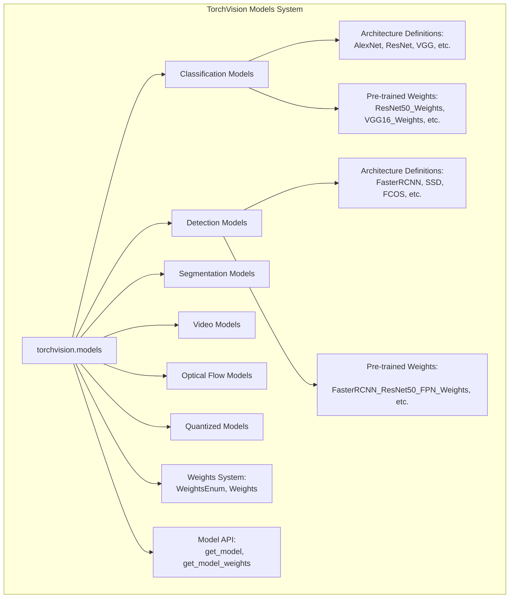
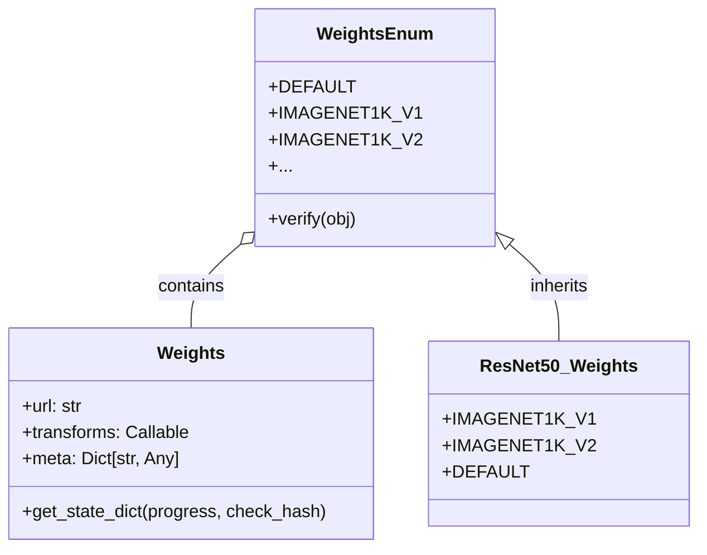
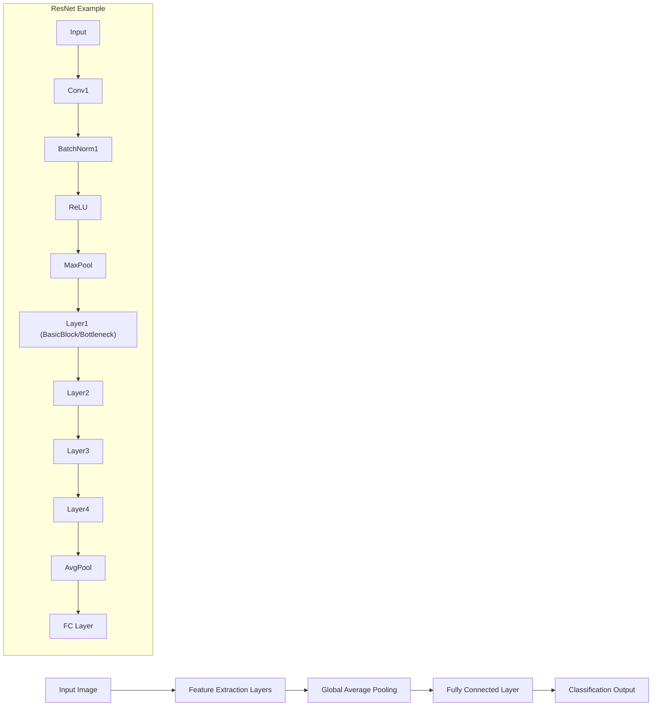
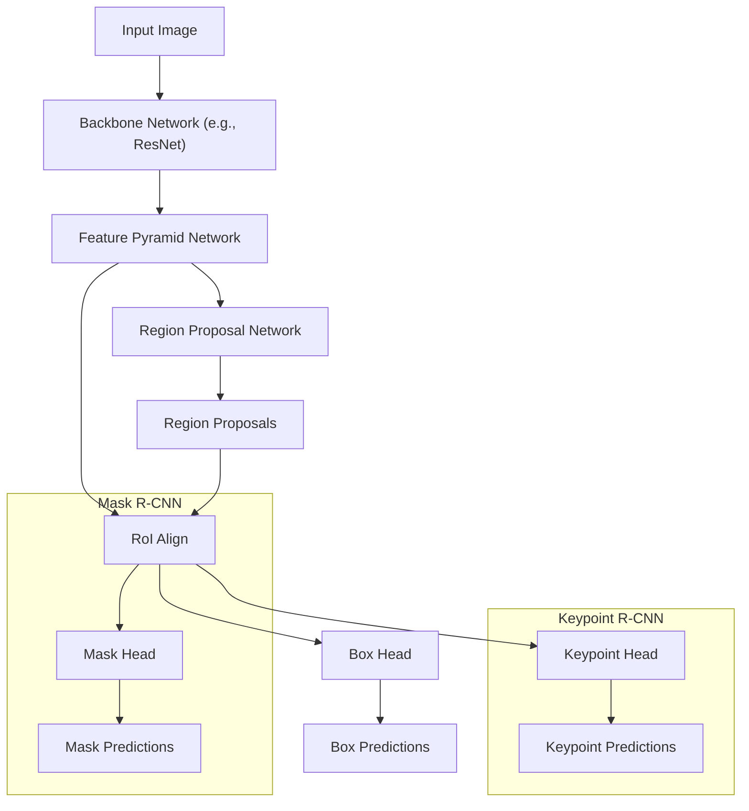
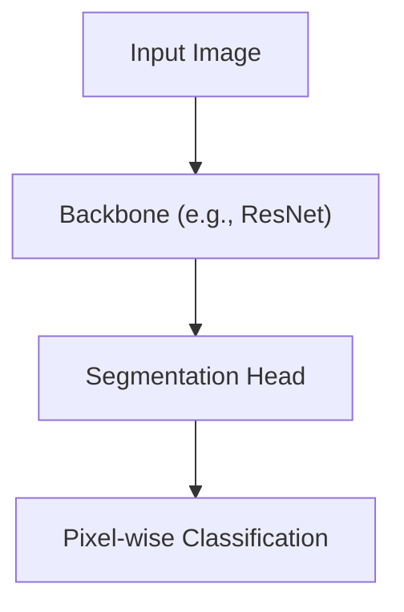
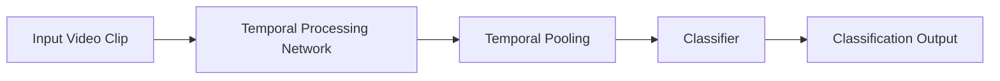
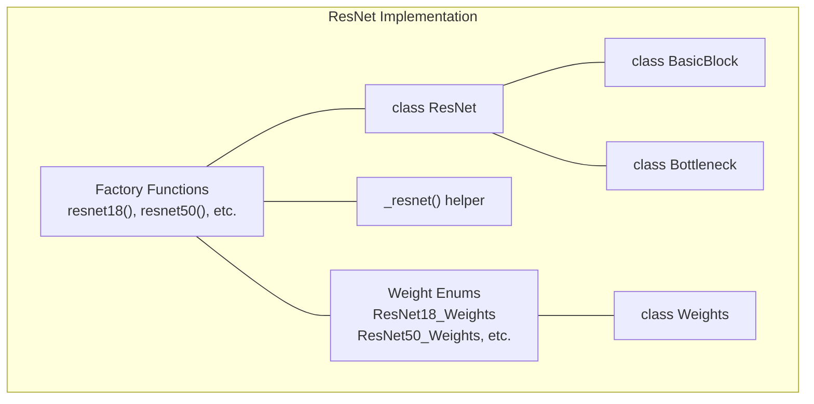

<!-- source: DeepWiki mcp.deepwiki.com · repo pytorch/vision · page 3 Models · fetched 2026-10-21 -->

# Models

<details>
<summary>Relevant source files</summary>

The following files were used as context for generating this wiki page:

- [docs/source/models.rst](docs/source/models.rst)
- [hubconf.py](hubconf.py)
- [references/classification/README.md](references/classification/README.md)
- [test/common_extended_utils.py](test/common_extended_utils.py)
- [test/expect/ModelTester.test_vit_h_14_expect.pkl](test/expect/ModelTester.test_vit_h_14_expect.pkl)
- [test/test_extended_models.py](test/test_extended_models.py)
- [test/test_models.py](test/test_models.py)
- [test/test_models_detection_utils.py](test/test_models_detection_utils.py)
- [test/test_onnx.py](test/test_onnx.py)
- [torchvision/models/__init__.py](torchvision/models/__init__.py)
- [torchvision/models/_api.py](torchvision/models/_api.py)
- [torchvision/models/alexnet.py](torchvision/models/alexnet.py)
- [torchvision/models/densenet.py](torchvision/models/densenet.py)
- [torchvision/models/detection/_utils.py](torchvision/models/detection/_utils.py)
- [torchvision/models/detection/generalized_rcnn.py](torchvision/models/detection/generalized_rcnn.py)
- [torchvision/models/detection/image_list.py](torchvision/models/detection/image_list.py)
- [torchvision/models/detection/roi_heads.py](torchvision/models/detection/roi_heads.py)
- [torchvision/models/detection/rpn.py](torchvision/models/detection/rpn.py)
- [torchvision/models/detection/transform.py](torchvision/models/detection/transform.py)
- [torchvision/models/googlenet.py](torchvision/models/googlenet.py)
- [torchvision/models/inception.py](torchvision/models/inception.py)
- [torchvision/models/mnasnet.py](torchvision/models/mnasnet.py)
- [torchvision/models/resnet.py](torchvision/models/resnet.py)
- [torchvision/models/shufflenetv2.py](torchvision/models/shufflenetv2.py)
- [torchvision/models/squeezenet.py](torchvision/models/squeezenet.py)
- [torchvision/models/vgg.py](torchvision/models/vgg.py)
- [torchvision/ops/_register_onnx_ops.py](torchvision/ops/_register_onnx_ops.py)
- [torchvision/ops/feature_pyramid_network.py](torchvision/ops/feature_pyramid_network.py)
- [torchvision/ops/poolers.py](torchvision/ops/poolers.py)

</details>


This page provides an overview of the pre-trained neural network models available in TorchVision. The library offers a wide variety of models addressing different computer vision tasks, including image classification, object detection, semantic segmentation, instance segmentation, video classification, and optical flow estimation.

For information about transforms used with these models, see [Transforms](#2).

## Model Architecture and Organization

The models in TorchVision are organized by task type, with each model having both an architecture definition and available pre-trained weights.



Sources: 
- [torchvision/models/__init__.py:1-24](torchvision/models/__init__.py:1-24)
- [docs/source/models.rst:1-194](docs/source/models.rst:1-194)

## Model Weights System

TorchVision offers a weights system that provides pre-trained weights for models. The system is organized around two key classes:

- `Weights`: A dataclass containing URL, transforms, and metadata for pre-trained weights
- `WeightsEnum`: An enumeration of available weight options for a model



Sources:
- [torchvision/models/_api.py:17-78](torchvision/models/_api.py:17-78)
- [docs/source/models.rst:36-82](docs/source/models.rst:36-82)

### Multi-weight Support API

As of TorchVision v0.13, models support multiple weights options through a consistent API:

```python
# Example: different ways to initialize a ResNet50 model with weights
from torchvision.models import resnet50, ResNet50_Weights

# Load specific weights version
model = resnet50(weights=ResNet50_Weights.IMAGENET1K_V1)  # Old weights (76.13% accuracy)
model = resnet50(weights=ResNet50_Weights.IMAGENET1K_V2)  # New weights (80.86% accuracy)

# Load best available weights
model = resnet50(weights=ResNet50_Weights.DEFAULT)

# String-based initialization also works
model = resnet50(weights="IMAGENET1K_V2")

# No pre-trained weights
model = resnet50(weights=None)
```

Sources:
- [docs/source/models.rst:36-82](docs/source/models.rst:36-82)
- [torchvision/models/resnet.py:304-397](torchvision/models/resnet.py:304-397)

## Using Models

### Initialization and Inference

To use a pre-trained model, you typically follow these steps:

1. Initialize the model with the desired weights
2. Apply the appropriate transforms for preprocessing
3. Run inference on the input data

```python
# Example of using a pre-trained ResNet50 model
from torchvision.models import resnet50, ResNet50_Weights

# Step 1: Initialize model with best available weights
weights = ResNet50_Weights.DEFAULT
model = resnet50(weights=weights)
model.eval()  # Set to evaluation mode

# Step 2: Initialize the preprocessing transforms
preprocess = weights.transforms()

# Step 3: Apply transforms and perform inference
img_transformed = preprocess(img)
predictions = model(img_transformed)
```

Sources:
- [docs/source/models.rst:84-122](docs/source/models.rst:84-122)
- [docs/source/models.rst:229-254](docs/source/models.rst:229-254)

### Model Discovery API

As of v0.14, TorchVision allows listing and retrieving models by name:

```python
# List available models
from torchvision.models import list_models, get_model, get_model_weights

all_models = list_models()
classification_models = list_models(module=torchvision.models)

# Initialize models
model1 = get_model("mobilenet_v3_large", weights=None)
model2 = get_model("resnet50", weights="DEFAULT")

# Get weights enumeration
weights_enum = get_model_weights("resnet50")
```

Sources:
- [docs/source/models.rst:123-161](docs/source/models.rst:123-161)
- [torchvision/models/_api.py:159-265](torchvision/models/_api.py:159-265)

### Using Models from Hub

Most pre-trained models can be loaded directly via PyTorch Hub:

```python
import torch

# Load model with weights
model = torch.hub.load("pytorch/vision", "resnet50", weights="IMAGENET1K_V2")

# Get available weights
weights = torch.hub.load(
    "pytorch/vision",
    "get_weight",
    weights="ResNet50_Weights.IMAGENET1K_V2"
)
```

Sources:
- [docs/source/models.rst:162-193](docs/source/models.rst:162-193)

## Model Categories

### Classification Models

TorchVision provides a wide range of classification models that have been pre-trained on ImageNet:

| Model Family | Variants | Description |
|--------------|----------|-------------|
| ResNet | resnet18, resnet34, resnet50, resnet101, resnet152 | Deep residual networks with skip connections |
| VGG | vgg11, vgg13, vgg16, vgg19 (with and without batch norm) | Deep convolutional networks with increasing depth |
| DenseNet | densenet121, densenet169, densenet201, densenet161 | Networks with dense connections between layers |
| Inception | inception_v3 | Network with inception modules for multi-scale processing |
| MobileNet | mobilenet_v2, mobilenet_v3_small, mobilenet_v3_large | Lightweight networks optimized for mobile devices |
| EfficientNet | efficientnet_b0 to efficientnet_b7, efficientnet_v2_s/m/l | Scalable networks balancing depth, width, and resolution |
| ViT | vit_b_16, vit_b_32, vit_l_16, vit_l_32, vit_h_14 | Vision Transformer models |
| ConvNeXt | convnext_tiny, convnext_small, convnext_base, convnext_large | Modern convolutional networks |
| Swin | swin_t, swin_s, swin_b, swin_v2_t, swin_v2_s, swin_v2_b | Hierarchical Transformer with shifted windows |

Classification models follow a standard structure, typically consisting of feature extraction followed by a classifier:



Sources:
- [docs/source/models.rst:195-283](docs/source/models.rst:195-283)
- [torchvision/models/resnet.py:166-286](torchvision/models/resnet.py:166-286)
- [references/classification/README.md:1-212](references/classification/README.md:1-212)

### Quantized Models

TorchVision also provides quantized versions of several classification models for more efficient inference:

```python
from torchvision.models.quantization import resnet50, ResNet50_QuantizedWeights

# Initialize quantized model
weights = ResNet50_QuantizedWeights.DEFAULT
model = resnet50(weights=weights, quantize=True)
```

Supported architectures include quantized versions of ResNet, MobileNetV2, MobileNetV3, GoogleNet, Inception, ShuffleNetV2, and more.

Sources:
- [docs/source/models.rst:265-321](docs/source/models.rst:265-321)
- [references/classification/README.md:282-368](references/classification/README.md:282-368)

### Detection Models

Object detection models locate and classify objects within an image. TorchVision provides several architectures:

| Model | Description |
|-------|-------------|
| Faster R-CNN | Two-stage detector with region proposal network |
| Mask R-CNN | Extends Faster R-CNN with instance segmentation |
| RetinaNet | One-stage detector with focal loss for handling class imbalance |
| SSD | Single Shot MultiBox Detector, a one-stage detector |
| FCOS | Fully Convolutional One-Stage detector without anchors |
| Keypoint R-CNN | Extension of Faster R-CNN for person keypoint detection |

The detection models share a common structure, usually consisting of a backbone, feature pyramid network (for some models), and task-specific heads:



Sources:
- [docs/source/models.rst:382-481](docs/source/models.rst:382-481)
- [test/test_models.py:382-447](test/test_models.py:382-447)

### Segmentation Models

Semantic segmentation models classify each pixel in an image:

| Model | Description |
|-------|-------------|
| FCN | Fully Convolutional Network with a ResNet backbone |
| DeepLabV3 | Advanced segmentation model with atrous convolutions |
| LRASPP | Lightweight Reduced Atrous Spatial Pyramid Pooling |



Sources:
- [docs/source/models.rst:323-380](docs/source/models.rst:323-380)

### Video Models

Video classification models process sequences of frames:

| Model | Description |
|-------|-------------|
| 3D ResNet | 3D extension of ResNet for video |
| MC3 | Mixed 2D and 3D convolutions |
| R2+1D | Factorized 3D convolutions |
| MViT | Multiscale Vision Transformer for video |
| Video Swin | Swin Transformer adapted for video |
| S3D | Separable 3D CNN |



Sources:
- [docs/source/models.rst:508-565](docs/source/models.rst:508-565)

### Optical Flow Models

Optical flow models estimate pixel motion between frames:

| Model | Description |
|-------|-------------|
| RAFT | Recurrent All-Pairs Field Transforms for optical flow |

Sources:
- [docs/source/models.rst:567-577](docs/source/models.rst:567-577)

## Model Implementation Details

### The ResNet Example

ResNet is a good example of how models are implemented in TorchVision. The architecture is defined in `torchvision/models/resnet.py` and consists of:

1. A base `ResNet` class implementing the network architecture
2. Building block classes (`BasicBlock` and `Bottleneck`)
3. Factory functions for specific variants (e.g., `resnet18()`, `resnet50()`)
4. Weight enum classes for pre-trained weights



The `ResNet` class defines the model architecture, the `BasicBlock` and `Bottleneck` classes define residual blocks, and factory functions like `resnet50()` create specific model variants with optional pre-trained weights.

Sources:
- [torchvision/models/resnet.py:59-140](torchvision/models/resnet.py:59-140)
- [torchvision/models/resnet.py:166-286](torchvision/models/resnet.py:166-286)
- [torchvision/models/resnet.py:288-755](torchvision/models/resnet.py:288-755)

### Model Registration and Legacy Interface

Models are registered using the `@register_model()` decorator and handle backward compatibility with the legacy interface using `@handle_legacy_interface`:

```python
@register_model()
@handle_legacy_interface(weights=("pretrained", ResNet50_Weights.IMAGENET1K_V1))
def resnet50(*, weights: Optional[ResNet50_Weights] = None, progress: bool = True, **kwargs: Any) -> ResNet:
    """ResNet-50 from 'Deep Residual Learning for Image Recognition'"""
    weights = ResNet50_Weights.verify(weights)
    return _resnet(Bottleneck, [3, 4, 6, 3], weights, progress, **kwargs)
```

Sources:
- [torchvision/models/resnet.py:734-755](torchvision/models/resnet.py:734-755)

## Testing Models

TorchVision includes extensive tests for all models:

1. Basic functional tests ensure models can be instantiated and run
2. JIT scripting tests verify models work with TorchScript
3. Weight loading tests check pre-trained weights
4. Numerical consistency tests validate outputs

The test framework provides utilities for:
- Loading models with or without pre-trained weights
- Testing classification, detection, and segmentation models
- Verifying quantized models

Sources:
- [test/test_models.py:1-114](test/test_models.py:1-114)
- [test/test_models.py:673-781](test/test_models.py:673-781)
- [test/test_models.py:782-884](test/test_models.py:782-884)

## Model Weights Management

The weights system in TorchVision is designed to provide consistent access to pre-trained weights. Each model has one or more associated `WeightsEnum` classes:

```python
class ResNet50_Weights(WeightsEnum):
    IMAGENET1K_V1 = Weights(
        url="https://download.pytorch.org/models/resnet50-0676ba61.pth",
        transforms=partial(ImageClassification, crop_size=224),
        meta={
            "num_params": 25557032,
            "categories": _IMAGENET_CATEGORIES,
            "_metrics": {"ImageNet-1K": {"acc@1": 76.130, "acc@5": 92.862}},
            # other metadata...
        }
    )
    IMAGENET1K_V2 = Weights(/* improved weights *)
    DEFAULT = IMAGENET1K_V2
```

Each weight option includes:
- Download URL for the weight file
- Preprocessing transforms needed for that model
- Metadata about the model (parameters, accuracy, etc.)

Sources:
- [torchvision/models/resnet.py:304-396](torchvision/models/resnet.py:304-396)
- [torchvision/models/_api.py:21-78](torchvision/models/_api.py:21-78)

## Summary

The Models component of TorchVision provides an extensive collection of pre-trained models for computer vision tasks. With a consistent API for weights management, model discovery, and usage patterns, it simplifies the application of state-of-the-art computer vision models to various problems.

For new pre-trained models or task types, check the PyTorch Hub or the latest TorchVision release notes, as the model collection is continually expanding.

---

