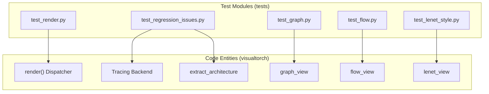
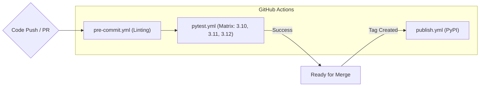

<!-- source: DeepWiki mcp.deepwiki.com · repo willyfh/visualtorch · page 6 Testing & Quality Assurance · fetched 2026-10-21 -->

# Testing & Quality Assurance

Relevant source files

The following files were used as context for generating this wiki page:

- [.github/workflows/pytest.yml](.github/workflows/pytest.yml)
- [.pre-commit-config.yaml](.pre-commit-config.yaml)
- [CONTRIBUTING.md](CONTRIBUTING.md)
- [dev-requirements.txt](dev-requirements.txt)
- [paper/paper.bib](paper/paper.bib)
- [requirements.txt](requirements.txt)

VisualTorch maintains code integrity through a multi-layered quality assurance strategy encompassing a comprehensive `pytest` suite, automated CI/CD pipelines via GitHub Actions, and strict linting/formatting standards enforced by `pre-commit` hooks. This ensures that changes to the core tracing logic or rendering frontends do not introduce regressions in visualization accuracy or model compatibility.

## Quality Assurance Workflow

The development workflow is designed to catch issues early by requiring local validation before code is pushed to the repository.

### Developer Environment Setup
Contributors are expected to install development-specific dependencies to run the full suite of quality tools. This is managed via the `[dev]` extra or the `dev-requirements.txt` file.

*   **Linting & Formatting**: Enforced via `ruff` for Python and `markdownlint` for documentation.
*   **Static Analysis**: Managed by `mypy` for type checking (excluding the `tests` directory).
*   **Git Hooks**: Automated checks on every commit via the `.pre-commit-config.yaml` configuration.

For details on setting up these tools, see [CI/CD Pipelines & Developer Tooling](#6.2).

Sources: `[CONTRIBUTING.md:21-52]()`, `[.pre-commit-config.yaml:1-40]()`, `[dev-requirements.txt:1-3]()`

## Test Suite Structure

The test suite is organized into functional modules that target specific visualization styles and core engine components. The primary goal is to verify that the `Architecture` IR (Intermediate Representation) is correctly extracted from PyTorch models and that the resulting `PIL.Image` outputs meet spatial and stylistic expectations.

### Testing Architecture and Code Entities

Sources: `[CONTRIBUTING.md:58-67]()`, `[.github/workflows/pytest.yml:30-31]()`

### Test Categories
*   **Style Correctness**: Verifies that `graph_view`, `flow_view`, and `lenet_view` handle complex topologies like skip connections, Siamese branches, and weight sharing.
*   **Regression Testing**: Specifically targets fixed GitHub issues, such as `MultiheadAttention` tracing, `NumPy` escape errors, and `FeaturePyramidNet` support.
*   **Integration Testing**: Validates the unified `render()` dispatcher and its ability to resolve color palettes and handle multi-input/multi-output models.

For details on specific test cases and coverage, see [Test Suite](#6.1).

## CI/CD Pipelines

VisualTorch utilizes GitHub Actions to automate testing and deployment. Every Pull Request triggers a matrix build to ensure compatibility across supported Python versions.

### Automated Workflow Execution

| Workflow | Purpose | Trigger |
| :--- | :--- | :--- |
| `pytest.yml` | Runs `pytest` across Python 3.10, 3.11, and 3.12 on Ubuntu. | Push to `main`, PR |
| `pre-commit` | Runs `ruff`, `mypy`, and `markdownlint`. | Push to any branch |
| `publish.yml` | Releases the package to PyPI. | Tag creation |

For details on workflow configurations and deployment steps, see [CI/CD Pipelines & Developer Tooling](#6.2).

Sources: `[.github/workflows/pytest.yml:1-32]()`, `[CONTRIBUTING.md:86-94]()`

---

