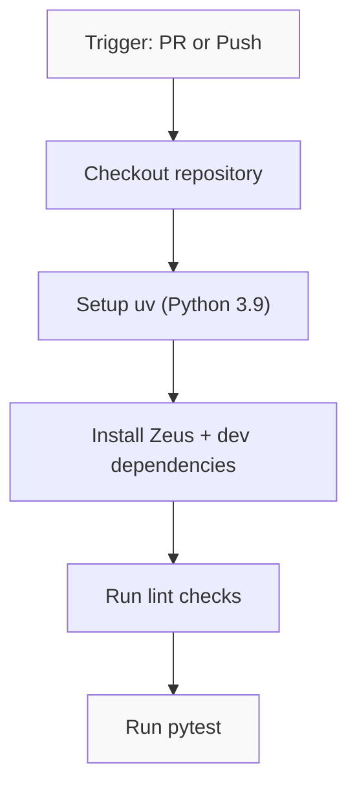
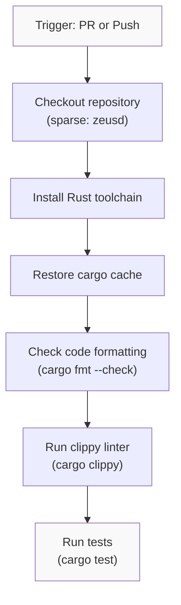
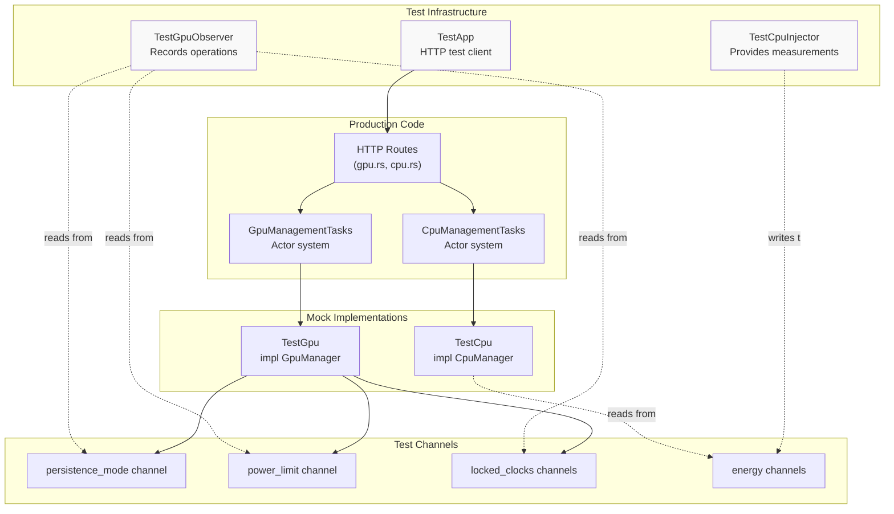
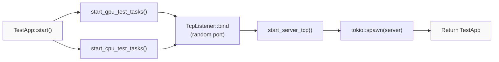
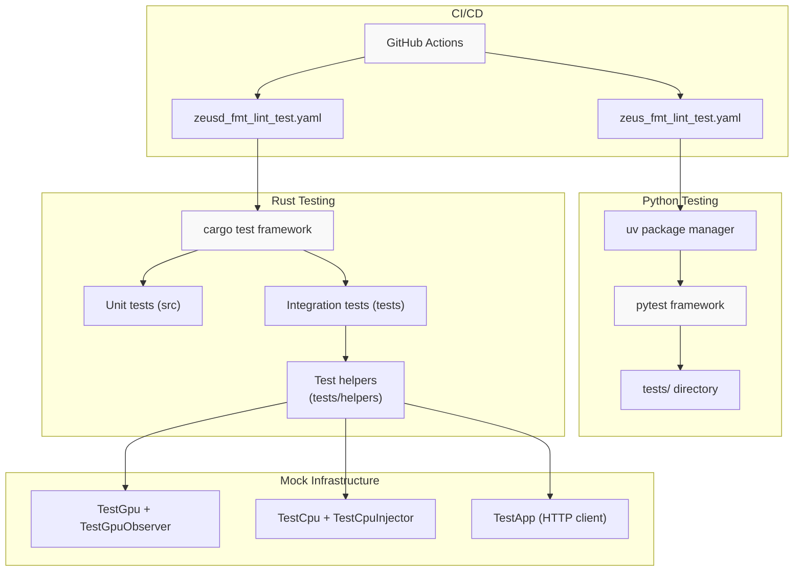

<!-- source: DeepWiki mcp.deepwiki.com · repo ml-energy/zeus · page 10.2 Testing · fetched 2026-10-21 -->

# Testing

<details>
<summary>Relevant source files</summary>

The following files were used as context for generating this wiki page:

- [.github/workflows/check_homepage_build.yaml](.github/workflows/check_homepage_build.yaml)
- [.github/workflows/deploy_homepage.yaml](.github/workflows/deploy_homepage.yaml)
- [.github/workflows/publish_crates_io.yaml](.github/workflows/publish_crates_io.yaml)
- [.github/workflows/push_docker.yaml](.github/workflows/push_docker.yaml)
- [.github/workflows/zeus_fmt_lint_test.yaml](.github/workflows/zeus_fmt_lint_test.yaml)
- [.github/workflows/zeusd_fmt_lint_test.yaml](.github/workflows/zeusd_fmt_lint_test.yaml)
- [scripts/preview_docs.sh](scripts/preview_docs.sh)
- [zeus/device/common.py](zeus/device/common.py)
- [zeusd/src/devices/cpu/linux.rs](zeusd/src/devices/cpu/linux.rs)
- [zeusd/src/devices/gpu/linux.rs](zeusd/src/devices/gpu/linux.rs)
- [zeusd/src/routes/gpu.rs](zeusd/src/routes/gpu.rs)
- [zeusd/tests/cpu.rs](zeusd/tests/cpu.rs)
- [zeusd/tests/gpu.rs](zeusd/tests/gpu.rs)
- [zeusd/tests/helpers/mod.rs](zeusd/tests/helpers/mod.rs)

</details>


This page documents Zeus's testing strategy, test infrastructure, and execution workflows. It covers both Python tests (using pytest) and Rust tests (using cargo test), along with the mock device infrastructure for integration testing the zeusd daemon.

For information about code quality tooling (linting and formatting), see [Code Quality](#10.3). For CI/CD pipeline details, see [CI/CD Pipeline](#10.4).

---

## Testing Strategy Overview

Zeus employs a two-tier testing approach corresponding to its dual-language architecture:

| Component | Test Framework | Test Types | Location |
|-----------|---------------|------------|----------|
| Python Package (`zeus/`) | pytest | Unit tests, integration tests | `tests/` |
| Rust Daemon (`zeusd/`) | cargo test | Unit tests, integration tests | `zeusd/tests/`, `zeusd/src/` |

Both test suites run automatically on:
- Pull requests to validate changes
- Pushes to master branch for continuous validation
- Manual workflow dispatch

**Sources:** [.github/workflows/zeus_fmt_lint_test.yaml:1-51](), [.github/workflows/zeusd_fmt_lint_test.yaml:1-52]()

---

## Python Testing Infrastructure

### Test Framework

Zeus uses **pytest** as its Python testing framework. Tests are executed through the `uv` package manager for consistent dependency management:

```bash
uv run pytest
```

The Python test suite is triggered by changes to:
- `zeus/**` - Core Python package code
- `tests/**` - Test files themselves
- `capriccio/*.py` - Capriccio profiling utilities
- `examples/**` - Example code
- `pyproject.toml` - Python project configuration
- `scripts/lint.sh` - Linting scripts

### Test Organization

Python tests are located in the `tests/` directory at the repository root. The exact test structure is not visible in the provided files, but tests cover the core functionality of the Zeus package including:

- Energy measurement APIs (ZeusMonitor, PowerMonitor)
- Hardware abstraction layer (GPU, CPU, SoC managers)
- Optimization algorithms (power limit, batch size, frequency optimization)
- Callback integration
- Utility functions

### Continuous Integration

The Python test workflow is defined in `.github/workflows/zeus_fmt_lint_test.yaml`:



**Python CI Workflow Steps**

The workflow executes the following steps:

1. **Repository Checkout** - Uses `actions/checkout@v4`
2. **UV Setup** - Installs `uv` package manager with Python 3.9 and caching enabled
3. **Dependency Installation** - Runs `uv sync --extra dev` to install Zeus with development dependencies
4. **Linting** - Executes `uv run bash scripts/lint.sh` (see [Code Quality](#10.3))
5. **Test Execution** - Runs `uv run pytest`

The workflow only runs on pull requests from forks or on push events to prevent duplicate runs.

**Sources:** [.github/workflows/zeus_fmt_lint_test.yaml:1-51]()

---

## Rust Testing Infrastructure

### Test Framework

The zeusd daemon uses Rust's built-in test framework via **cargo test**. Tests are executed with:

```bash
cargo test
```

The Rust test suite is triggered by changes to:
- `zeusd/**` - All daemon source code
- `.github/workflows/zeusd_fmt_lint_test.yaml` - CI workflow itself

### Test Organization

Rust tests follow Rust's standard organization:

| Test Type | Location | Purpose |
|-----------|----------|---------|
| Unit Tests | `zeusd/src/**/*.rs` | Test individual functions and modules inline with source code |
| Integration Tests | `zeusd/tests/*.rs` | Test HTTP API endpoints and multi-component interactions |
| Test Helpers | `zeusd/tests/helpers/mod.rs` | Shared test infrastructure and mock implementations |

### Continuous Integration

The Rust test workflow is defined in `.github/workflows/zeusd_fmt_lint_test.yaml`:



**Rust CI Workflow Steps**

1. **Sparse Checkout** - Uses sparse checkout to only fetch `zeusd/` directory
2. **Rust Toolchain** - Installs stable Rust toolchain with minimal profile
3. **Dependency Caching** - Caches cargo registry and build artifacts with key `${{repo}}-${{os}}-cargo-check-v2`
4. **Formatting Check** - Runs `cargo fmt --all --check` in `zeusd/` directory
5. **Lint Check** - Runs `cargo clippy --all -- -D warnings` to fail on any warnings
6. **Test Execution** - Runs `cargo test` in `zeusd/` directory

**Sources:** [.github/workflows/zeusd_fmt_lint_test.yaml:1-52]()

---

## Integration Test Architecture for zeusd

The zeusd daemon includes a sophisticated integration test infrastructure that allows testing HTTP API endpoints without requiring actual GPU or CPU hardware.

### Mock Device Architecture



**Sources:** [zeusd/tests/helpers/mod.rs:1-340]()

### Mock GPU Implementation

The `TestGpu` struct implements the `GpuManager` trait and uses Tokio unbounded channels to record operations:

**Key Components:**

| Component | Type | Purpose |
|-----------|------|---------|
| `TestGpu` | Mock implementation | Implements `GpuManager` trait, sends operations to channels |
| `TestGpuObserver` | Test observer | Receives operations from channels, allows assertions |
| Channels | `UnboundedSender<T>` / `UnboundedReceiver<T>` | Communication between mock and observer |

**Mock Operations:**

- `set_persistence_mode(enabled: bool)` - Records persistence mode changes
- `set_power_management_limit(power_limit_mw: u32)` - Records power limit changes with validation
- `set_gpu_locked_clocks(min_clock_mhz: u32, max_clock_mhz: u32)` - Records GPU frequency changes
- `reset_gpu_locked_clocks()` - Records GPU frequency reset as `(0, 0)`
- `set_mem_locked_clocks(min_clock_mhz: u32, max_clock_mhz: u32)` - Records memory frequency changes
- `reset_mem_locked_clocks()` - Records memory frequency reset as `(0, 0)`

The `TestGpu` includes validation logic (e.g., power limit must be within 100,000-300,000 mW range) to simulate real hardware constraints.

**Sources:** [zeusd/tests/helpers/mod.rs:31-123]()

### Mock CPU Implementation

The `TestCpu` struct implements the `CpuManager` trait using channels to provide test energy measurements:

**Key Components:**

| Component | Type | Purpose |
|-----------|------|---------|
| `TestCpu` | Mock implementation | Implements `CpuManager` trait, reads measurements from channels |
| `TestCpuInjector` | Test injector | Sends measurement values to channels |
| Channels | `UnboundedSender<u64>` / `UnboundedReceiver<u64>` | Communication from injector to mock |

**Mock Operations:**

- `get_cpu_energy()` - Returns next value from CPU energy channel
- `get_dram_energy()` - Returns next value from DRAM energy channel
- `is_dram_available()` - Always returns `true` in tests

The injector pattern allows tests to control what energy values the mock CPU returns, enabling testing of wraparound handling, measurement sequences, and edge cases.

**Sources:** [zeusd/tests/helpers/mod.rs:125-195]()

### TestApp Infrastructure

The `TestApp` struct provides a high-level interface for integration testing:



**TestApp Capabilities:**

| Method | Purpose |
|--------|---------|
| `start() -> Self` | Initializes test server with mock devices on random TCP port |
| `send<T: ZeusdRequest>(gpu_id, payload)` | Sends HTTP POST request to appropriate endpoint |
| `persistence_mode_history_for_gpu(gpu_id) -> Vec<bool>` | Retrieves operation history from observer |
| `power_limit_history_for_gpu(gpu_id) -> Vec<u32>` | Retrieves power limit history |
| `gpu_locked_clocks_history_for_gpu(gpu_id) -> Vec<(u32, u32)>` | Retrieves GPU frequency history |
| `mem_locked_clocks_history_for_gpu(gpu_id) -> Vec<(u32, u32)>` | Retrieves memory frequency history |
| `set_cpu_energy_measurements(cpu_id, measurements)` | Injects CPU energy values |
| `set_dram_energy_measurements(cpu_id, measurements)` | Injects DRAM energy values |

**Sources:** [zeusd/tests/helpers/mod.rs:268-339]()

### ZeusdRequest Trait

The `ZeusdRequest` trait provides type-safe URL generation for test requests:

```rust
// Example from codebase
impl ZeusdRequest for zeusd::routes::gpu::SetPowerLimit {
    fn build_url(app: &TestApp, gpu_id: u32) -> String {
        format!("http://127.0.0.1:{}/gpu/{}/set_power_limit", app.port, gpu_id)
    }
}
```

This trait is implemented via macros for all request types, ensuring tests use correct endpoint URLs that match the production routes defined in [zeusd/src/routes/gpu.rs:82-116]().

**Sources:** [zeusd/tests/helpers/mod.rs:223-265]()

---

## Integration Test Examples

### GPU Management Tests

The GPU integration tests demonstrate comprehensive coverage of the HTTP API:

**Test Pattern: Single Operation**

```rust
#[tokio::test]
async fn test_set_power_limit_single() {
    let mut app = TestApp::start().await;
    
    let resp = app.send(0, SetPowerLimit {
        power_limit_mw: 100_000,
        block: true,
    }).await.expect("Failed to send request");
    
    assert_eq!(resp.status(), 200);
    let history = app.power_limit_history_for_gpu(0);
    assert_eq!(history.len(), 1);
    assert_eq!(history[0], 100_000);
}
```

**Test Pattern: Multiple Sequential Operations**

Tests verify that operations are applied in order across multiple GPUs. For example, [zeusd/tests/gpu.rs:196-225]() sends 10 requests to different GPUs and verifies the exact sequence of operations recorded by each GPU's observer.

**Test Pattern: Invalid Requests**

Tests verify proper error handling for:
- Invalid field names in JSON payloads
- Invalid field types
- Out-of-range values (e.g., power limits outside valid range)
- Invalid GPU indices

Example from [zeusd/tests/gpu.rs:228-314]() shows validation that setting a power limit of 99,000 mW (below minimum 100,000 mW) returns HTTP 400 with NVML error message.

**Test Pattern: Bulk Concurrent Operations**

Tests verify actor system handles concurrent non-blocking requests correctly:

```rust
#[tokio::test]
async fn test_set_power_limit_bulk() {
    let mut app = TestApp::start().await;
    let mut set = JoinSet::new();
    
    // Send 10 concurrent non-blocking requests
    for i in 0..10 {
        set.spawn(app.send(0, SetPowerLimit {
            power_limit_mw: 100_000 + i * 10_000,
            block: false,
        }));
    }
    
    // Wait for all to complete
    // ...
    
    // Verify all 10 operations were applied
    let history = app.power_limit_history_for_gpu(0);
    assert_eq!(history.len(), 10);
}
```

This pattern tests that the `GpuManagementTasks` actor correctly queues and processes multiple concurrent operations. See [zeusd/tests/gpu.rs:317-367]() for complete implementation.

**Sources:** [zeusd/tests/gpu.rs:1-776]()

### CPU Management Tests

CPU tests follow similar patterns but focus on energy measurement retrieval:

**Test Pattern: Energy Measurement Sequence**

```rust
#[tokio::test]
async fn test_only_cpu_measurement() {
    let mut app = TestApp::start().await;
    let measurements: Vec<u64> = vec![10000, 10001, 12313, 8213, 0];
    app.set_cpu_energy_measurements(0, &measurements);
    
    for expected in measurements {
        let resp = app.send(0, GetIndexEnergy {
            cpu: true,
            dram: false,
        }).await.expect("Failed to send request");
        
        assert_eq!(resp.status(), 200);
        let rapl_response: RaplResponse = 
            serde_json::from_str(&resp.text().await.unwrap()).unwrap();
        assert_eq!(rapl_response.cpu_energy_uj.unwrap(), expected);
        assert_eq!(rapl_response.dram_energy_uj, None);
    }
}
```

This test injects a sequence of energy values and verifies each HTTP request returns the next value in sequence, simulating RAPL counter behavior.

**Test Coverage:**

- CPU-only measurements ([zeusd/tests/cpu.rs:9-32]())
- DRAM-only measurements ([zeusd/tests/cpu.rs:34-57]())
- Combined CPU + DRAM measurements ([zeusd/tests/cpu.rs:59-83]())
- Invalid request validation ([zeusd/tests/cpu.rs:85-157]())
- DRAM availability query ([zeusd/tests/cpu.rs:159-175]())

**Sources:** [zeusd/tests/cpu.rs:1-176]()

---

## Test Execution

### Running Python Tests Locally

```bash
# Install Zeus with development dependencies
uv sync --extra dev

# Run all tests
uv run pytest

# Run with verbose output
uv run pytest -v

# Run specific test file
uv run pytest tests/test_specific.py

# Run with coverage
uv run pytest --cov=zeus
```

### Running Rust Tests Locally

```bash
# Change to zeusd directory
cd zeusd

# Run all tests
cargo test

# Run with output from passing tests
cargo test -- --nocapture

# Run specific test
cargo test test_set_power_limit_single

# Run tests matching pattern
cargo test power_limit

# Show test output even on success
TEST_LOG=1 cargo test
```

The `TEST_LOG` environment variable enables tracing output during test execution, controlled by [zeusd/tests/helpers/mod.rs:23-29]().

### Running Tests in CI

Tests automatically run in CI for:

**Pull Requests:**
- Python tests run when PR modifies `zeus/`, `tests/`, or related files
- Rust tests run when PR modifies `zeusd/` directory
- Both test suites must pass before merge

**Push to Master:**
- Python tests run on every push
- Rust tests run on every push
- Ensures master branch always passes tests

**Concurrency Control:**

Both workflows use GitHub Actions concurrency groups to cancel in-progress runs when new commits are pushed:

```yaml
concurrency:
  group: ${{ github.ref }}-zeus-lint-and-test
  cancel-in-progress: true
```

This prevents resource waste from testing outdated commits.

**Sources:** [.github/workflows/zeus_fmt_lint_test.yaml:27-30](), [.github/workflows/zeusd_fmt_lint_test.yaml:15-18]()

---

## Test Infrastructure Summary



**Key Design Principles:**

1. **Hardware Abstraction** - Mock implementations allow testing without physical GPUs/CPUs
2. **Channel-Based Observation** - Unbounded channels enable non-blocking operation recording
3. **Type-Safe Requests** - `ZeusdRequest` trait ensures tests use correct endpoints
4. **Actor Model Testing** - `TestApp` verifies actor system handles concurrent operations
5. **Validation Realism** - Mocks include realistic constraints (power limit ranges, etc.)
6. **Separation of Concerns** - Test helpers isolated in `tests/helpers/mod.rs` for reusability

**Sources:** [zeusd/tests/helpers/mod.rs:1-340](), [zeusd/tests/gpu.rs:1-776](), [zeusd/tests/cpu.rs:1-176]()

---

