# Page: Overview

# Overview

<details>
<summary>Relevant source files</summary>

The following files were used as context for generating this wiki page:

- [README.md](README.md)
- [docs/getting_started/index.md](docs/getting_started/index.md)
- [docs/index.md](docs/index.md)
- [zeus/__init__.py](zeus/__init__.py)

</details>


## Purpose and Scope

This page provides a high-level introduction to the Zeus project, its mission, core capabilities, and system architecture. It serves as an entry point to understanding how Zeus components work together to measure and optimize deep learning energy consumption.

For installation and setup instructions, see [Getting Started](#2). For detailed documentation on specific capabilities, see [Energy Measurement](#4) and [Energy Optimization](#5).

**Sources**: [README.md:1-95](), [docs/index.md:1-54]()

---

## Project Mission

Zeus is a library for **measuring** and **optimizing** the energy consumption of deep learning workloads. It addresses the growing concern about the environmental and economic costs of training and deploying machine learning models by providing tools that make energy a first-class metric alongside accuracy and latency.

Zeus is part of [The ML.ENERGY Initiative](https://ml.energy), a broader effort to bring energy efficiency to the forefront of machine learning research and practice.

**Key Problems Addressed**:

| Problem | Zeus Solution |
|---------|---------------|
| Lack of visibility into energy consumption | Programmatic and CLI-based energy measurement for GPUs, CPUs, DRAM, and SoCs |
| Energy waste during training | Optimization algorithms that reduce energy while maintaining accuracy |
| Hardware diversity | Unified abstraction layer supporting NVIDIA, AMD, Intel, Apple, and Jetson platforms |
| Privileged operations | Zeus daemon (`zeusd`) for secure, unprivileged access to power management |

**Sources**: [README.md:15-27](), [docs/index.md:14-26]()

---

## Core Capabilities

Zeus provides two primary capabilities:

### Measurement

Zeus measures energy consumption and power draw across multiple hardware components:

- **GPUs**: NVIDIA (via NVML) and AMD (via AMDSMI)
- **CPUs**: Intel and AMD processors (via Intel RAPL interface)
- **DRAM**: Memory power consumption
- **SoCs**: Apple Silicon and NVIDIA Jetson platforms

Measurement is available through:
- Programmatic APIs (`ZeusMonitor`, `PowerMonitor`)
- Command-line tools (`zeus.monitor`)
- Framework integrations (PyTorch, JAX, HuggingFace)

For details, see [Energy Measurement](#4).

### Optimization

Zeus optimizes energy consumption through three main strategies:

- **Power Limit Optimization**: Dynamically adjusts GPU power caps to minimize energy-time cost
- **Frequency Optimization**: Sets per-stage GPU frequencies in pipeline-parallel training
- **Batch Size Optimization**: Selects energy-efficient batch sizes using multi-armed bandits

For details, see [Energy Optimization](#5).

**Sources**: [README.md:25-56](), [zeus/__init__.py:1-15]()

---

## System Architecture

The following diagram shows Zeus's high-level architecture, mapping natural language concepts to concrete code modules:

**Zeus Core Component Architecture**

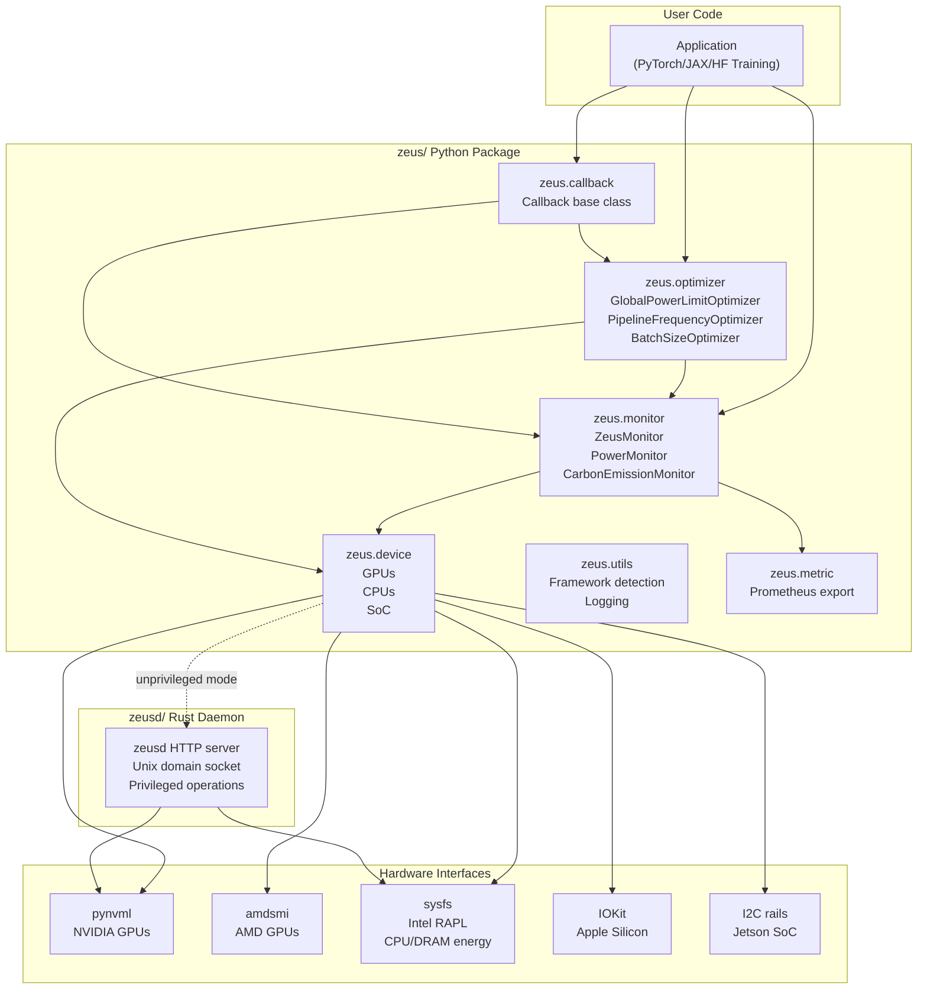

**Architecture Layers**:

1. **User Code Layer**: Applications integrate Zeus through simple APIs
2. **Zeus Python Package**: Core monitoring and optimization logic
3. **Zeus Daemon (Optional)**: Privileged operations proxy for unprivileged applications
4. **Hardware Interfaces**: Low-level library bindings to vendor-specific APIs

**Sources**: [README.md:29-48](), [zeus/__init__.py:1-15]()

---

## Module Organization

The Zeus Python package is organized into six primary modules:

**Zeus Module Structure**

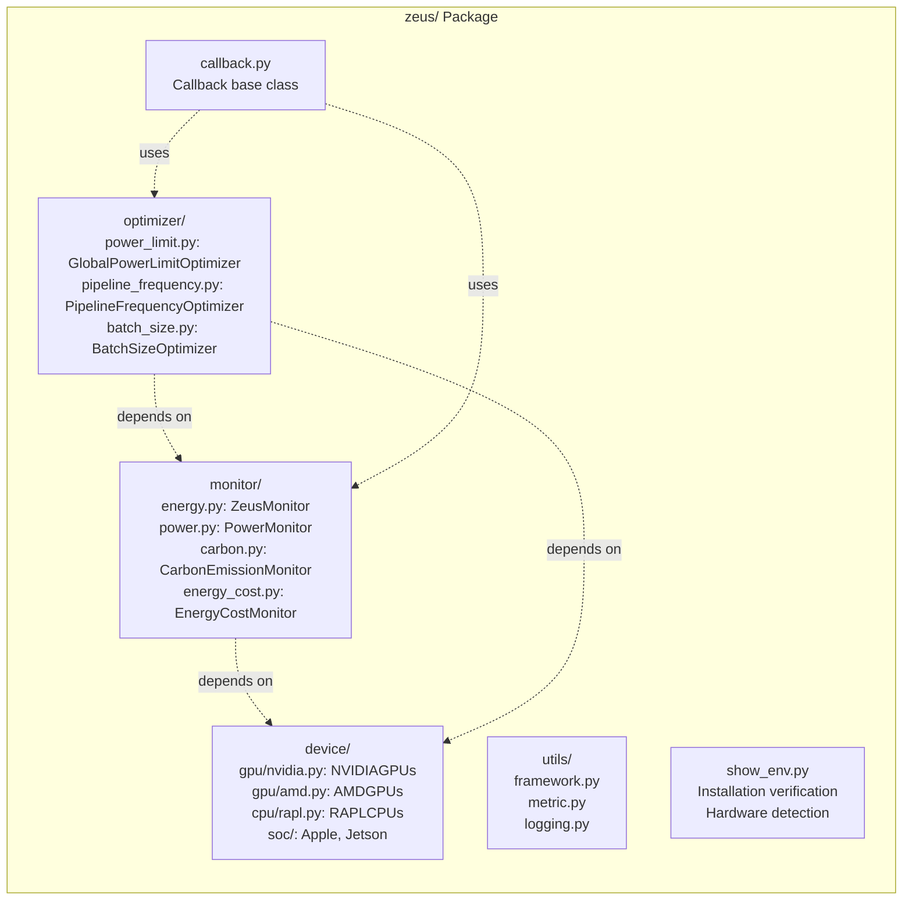

| Module | Primary Classes | Purpose |
|--------|----------------|---------|
| `monitor/` | `ZeusMonitor`, `PowerMonitor`, `CarbonEmissionMonitor`, `EnergyCostMonitor` | Energy and power measurement APIs |
| `optimizer/` | `GlobalPowerLimitOptimizer`, `PipelineFrequencyOptimizer`, `BatchSizeOptimizer` | Energy optimization strategies |
| `device/` | `GPUs`, `CPUs`, `SoC` | Hardware abstraction layer |
| `utils/` | Framework detection, logging, metrics | Utility functions |
| `callback.py` | `Callback` | Base class for training callbacks |
| `show_env.py` | N/A | CLI tool for environment verification |

**Sources**: [README.md:29-48](), [zeus/__init__.py:1-15]()

---

## Hardware Support

Zeus provides a unified interface across diverse hardware platforms through an abstraction layer:

**Hardware Abstraction Architecture**

```mermaid
graph TB
    subgraph "Unified Interfaces"
        GPU_IF["zeus.device.gpu.GPU<br/>Abstract base class"]
        CPU_IF["zeus.device.cpu.CPU<br/>Abstract base class"]
        SOC_IF["zeus.device.soc.SoC<br/>Abstract base class"]
    end
    
    subgraph "GPU Implementations"
        NVML["NVIDIAGPUs<br/>zeus.device.gpu.nvidia"]
        NVML_ZEUSD["ZeusdNVIDIAGPUs<br/>zeus.device.gpu.nvidia"]
        AMD["AMDGPUs<br/>zeus.device.gpu.amd"]
        EMPTY_GPU["EmptyGPUs<br/>zeus.device.gpu.common"]
    end
    
    subgraph "CPU Implementations"
        RAPL["RAPLCPUs<br/>zeus.device.cpu.rapl"]
        RAPL_ZEUSD["ZeusdRAPLCPUs<br/>zeus.device.cpu.rapl"]
        EMPTY_CPU["EmptyCPUs<br/>zeus.device.cpu.common"]
    end
    
    subgraph "SoC Implementations"
        APPLE["AppleNpuSoC<br/>zeus.device.soc.apple"]
        JETSON["JetsonSoC<br/>zeus.device.soc.jetson"]
        EMPTY_SOC["EmptySoC<br/>zeus.device.soc.common"]
    end
    
    GPU_IF -.implements.-> NVML
    GPU_IF -.implements.-> NVML_ZEUSD
    GPU_IF -.implements.-> AMD
    GPU_IF -.implements.-> EMPTY_GPU
    
    CPU_IF -.implements.-> RAPL
    CPU_IF -.implements.-> RAPL_ZEUSD
    CPU_IF -.implements.-> EMPTY_CPU
    
    SOC_IF -.implements.-> APPLE
    SOC_IF -.implements.-> JETSON
    SOC_IF -.implements.-> EMPTY_SOC
```

**Supported Platforms**:

| Hardware Type | Vendor/Platform | Implementation Class | Interface Used |
|---------------|----------------|---------------------|----------------|
| GPU | NVIDIA | `NVIDIAGPUs` | NVML (pynvml) |
| GPU | AMD | `AMDGPUs` | AMDSMI |
| CPU | Intel/AMD | `RAPLCPUs` | Intel RAPL (sysfs) |
| SoC | Apple Silicon | `AppleNpuSoC` | IOKit |
| SoC | NVIDIA Jetson | `JetsonSoC` | I2C power rails |

The `Empty*` classes implement the null object pattern, allowing Zeus to run gracefully when specific hardware is unavailable.

For detailed hardware abstraction documentation, see [Hardware Abstraction Layer](#6).

**Sources**: [README.md:29-48](), Diagram 5 from system diagrams

---

## Deployment Patterns

Zeus supports three deployment patterns to handle privileged operations:

**Deployment Architecture**

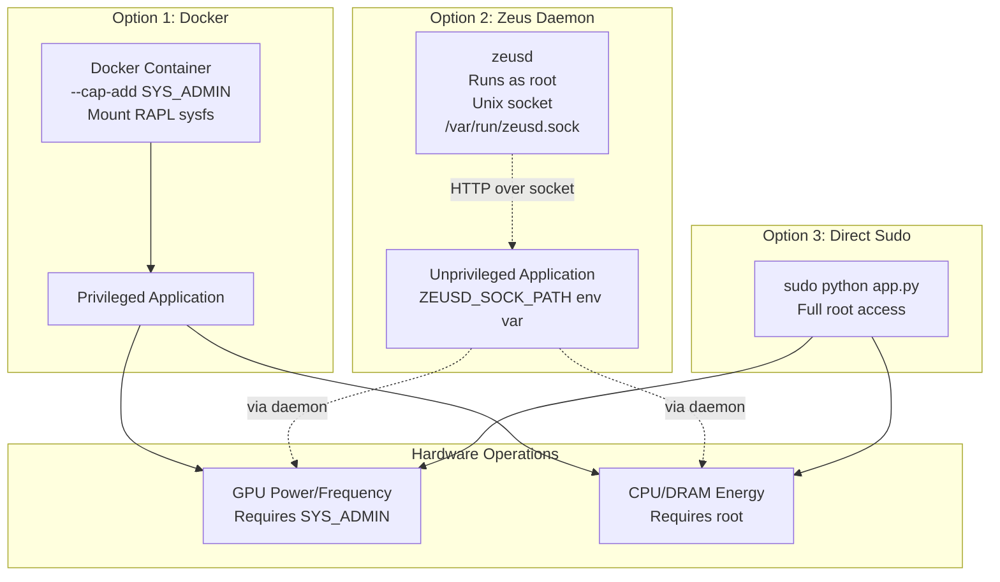

| Deployment | Privileges | Use Case | Documentation |
|------------|-----------|----------|---------------|
| **Docker** | `SYS_ADMIN` capability, mount RAPL | Container-based deployments | [Deployment Strategies](#2.3) |
| **Zeus Daemon** | Unprivileged app + privileged `zeusd` | Recommended for production | [Zeus Daemon](#7) |
| **Direct Sudo** | Full root access | Quick testing (discouraged) | [Deployment Strategies](#2.3) |

**Privilege Requirements**:

- **GPU Energy Measurement**: No special privileges on modern NVIDIA/AMD GPUs
- **GPU Power/Frequency Control**: Requires `SYS_ADMIN` capability or root
- **CPU/DRAM Energy Measurement**: Requires root access to RAPL sysfs interface

For detailed privilege management documentation, see [Privilege Management](#3.2).

**Sources**: [docs/getting_started/index.md:131-199](), Diagram 4 from system diagrams

---

## Integration Patterns

Zeus integrates with deep learning frameworks through multiple patterns:

**Framework Integration Architecture**

```mermaid
graph TB
    subgraph "Direct Integration"
        DIRECT_APP["Training Script"]
        ZM["ZeusMonitor.begin_window<br/>ZeusMonitor.end_window"]
        DIRECT_APP --> ZM
    end
    
    subgraph "Callback Integration"
        CB_APP["Training Script<br/>with Callbacks"]
        BASE_CB["zeus.callback.Callback<br/>on_step_begin<br/>on_step_end"]
        GPLO["GlobalPowerLimitOptimizer"]
        CB_APP --> BASE_CB
        BASE_CB --> GPLO
    end
    
    subgraph "HuggingFace Integration"
        HF_TRAINER["transformers.Trainer"]
        HF_CB["HFGlobalPowerLimitOptimizer<br/>extends TrainerCallback"]
        HF_TRAINER --> HF_CB
    end
    
    subgraph "Server Integration"
        PP_TRAINING["Pipeline Parallel<br/>Training"]
        PFO_SERVER["PipelineFrequencyOptimizer<br/>HTTP server"]
        PP_TRAINING -.HTTP requests.-> PFO_SERVER
    end
```

**Integration Methods**:

1. **Direct API**: Call `ZeusMonitor` methods explicitly in training code
2. **Callbacks**: Implement `zeus.callback.Callback` for framework-agnostic integration
3. **HuggingFace Adapter**: Use `HFGlobalPowerLimitOptimizer` with `transformers.Trainer`
4. **HTTP Server**: Pipeline parallel training queries `PipelineFrequencyOptimizer` server

For detailed integration documentation, see [Framework Integration](#9).

**Sources**: [README.md:49-65](), zeus/__init__.py, Diagram 1 from system diagrams

---

## Repository Organization

The Zeus repository is organized as follows:

```
zeus/
├── zeus/                 # Python package
│   ├── monitor/          # Energy measurement
│   ├── optimizer/        # Energy optimization
│   ├── device/           # Hardware abstraction
│   │   ├── gpu/          # GPU implementations
│   │   ├── cpu/          # CPU implementations
│   │   └── soc/          # SoC implementations
│   ├── utils/            # Utilities
│   ├── _legacy/          # Legacy research code
│   ├── callback.py       # Callback base class
│   ├── metric.py         # Prometheus metrics
│   └── show_env.py       # Environment verification
│
├── zeusd/                # Rust daemon (separate crate)
│   ├── src/
│   └── Cargo.toml
│
├── docker/               # Docker images
│   └── Dockerfile
│
├── examples/             # Usage examples
│
├── tests/                # Test suite
│
└── docs/                 # Documentation source
```

**Key Directories**:

| Directory | Content | Purpose |
|-----------|---------|---------|
| `zeus/` | Python package source | Core monitoring and optimization logic |
| `zeusd/` | Rust daemon source | Privileged operations proxy |
| `docker/` | Dockerfiles | Container deployment |
| `examples/` | Example scripts | Integration examples |
| `tests/` | Test suite | Pytest and Cargo tests |
| `docs/` | MkDocs source | Documentation website |

**Sources**: [README.md:29-48]()

---

## Research Foundation

Zeus is grounded in peer-reviewed academic research:

| Paper | Venue | Contribution |
|-------|-------|--------------|
| **Zeus** | NSDI 2023 | GPU power limit optimization, batch size optimization |
| **Perseus** | SOSP 2024 | Pipeline frequency optimization, energy bloat reduction |
| **Chase** | ICLR Workshop 2023 | Carbon-aware scheduling |
| **ML.ENERGY Benchmark** | NeurIPS 2025 | Standardized energy benchmarking |

For detailed research summaries, see [Research Background](#11).

**Sources**: [README.md:68-87](), [docs/index.md:38-49]()

---

## Next Steps

After understanding Zeus's high-level architecture, you may want to:

1. **Install Zeus**: Follow [Getting Started](#2) for installation instructions
2. **Measure Energy**: See [Energy Measurement](#4) to measure your workload's energy consumption
3. **Optimize Energy**: See [Energy Optimization](#5) to reduce energy consumption
4. **Understand Hardware Abstraction**: See [Hardware Abstraction Layer](#6) for platform-specific details
5. **Deploy in Production**: See [Zeus Daemon](#7) for secure deployment patterns

**Sources**: [docs/index.md:28-37]()

---

# Page: Getting Started

# Getting Started

<details>
<summary>Relevant source files</summary>

The following files were used as context for generating this wiki page:

- [.github/workflows/publish_pypi.yaml](.github/workflows/publish_pypi.yaml)
- [README.md](README.md)
- [docs/getting_started/index.md](docs/getting_started/index.md)
- [docs/index.md](docs/index.md)
- [zeus/monitor/__main__.py](zeus/monitor/__main__.py)

</details>


This page guides users through installing Zeus, verifying the installation, and understanding deployment strategies for privileged operations. After completing these steps, users can begin measuring energy (see [Energy Measurement](#4)) or optimizing energy consumption (see [Energy Optimization](#5)).

For detailed instructions on specific topics, see:
- [Installation Methods](#2.1) - Comprehensive installation options including pip, Docker, and source builds
- [Environment Verification](#2.2) - Using `zeus.show_env` to detect hardware and validate the installation
- [Deployment Strategies](#2.3) - Choosing between Docker, zeusd daemon, or sudo for privileged operations

## Zeus Components Overview

Zeus consists of two main components that users must understand during setup:

| Component | Language | Purpose | Installation Method | Privileges Required |
|-----------|----------|---------|---------------------|---------------------|
| **zeus** (Python package) | Python | Energy measurement and optimization APIs | pip, Docker, or source | None for GPU energy measurement |
| **zeusd** (Zeus daemon) | Rust | Privileged operations proxy (optional) | cargo or Docker | root or SYS_ADMIN |

The Python package (`zeus/`) contains all core functionality including monitors ([zeus/monitor/]()), optimizers ([zeus/optimizer/]()), and device abstractions ([zeus/device/]()). The Rust daemon (`zeusd/`) is optional but recommended for production deployments requiring CPU energy measurement or GPU configuration changes.

Sources: [README.md:29-48](), [docs/getting_started/index.md:1-7]()

## Installation and Setup Workflow

The following diagram shows the standard workflow for getting Zeus operational, mapping user actions to specific code modules and commands:

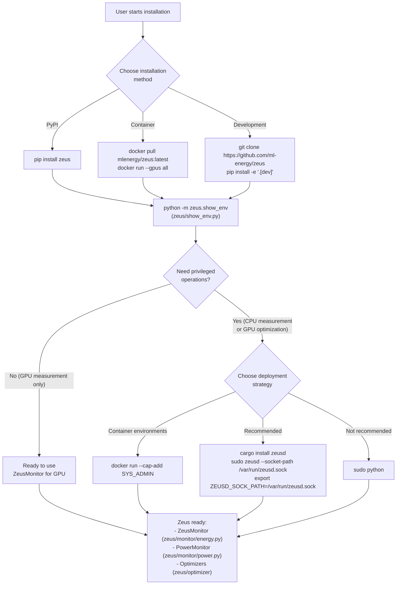

Sources: [docs/getting_started/index.md:6-28](), [docs/getting_started/index.md:131-199]()

## Installation Methods Summary

Zeus supports three primary installation methods, each suited for different use cases:

### pip Installation (Standard)

The simplest method installs the Zeus Python package from PyPI:

```sh
pip install zeus
```

This provides immediate access to the `zeus` module with all measurement and optimization functionality. After installation, the package is available at the standard Python site-packages location.

**Use case**: Production deployments, notebook environments, standard Python applications.

Sources: [docs/getting_started/index.md:8-14](), [.github/workflows/publish_pypi.yaml:1-26]()

### Docker Installation (Isolated)

Pre-built Docker images on Docker Hub include Zeus with all dependencies:

```sh
docker run -it \
    --gpus all \
    --cap-add SYS_ADMIN \
    --ipc host \
    -v /sys/class/powercap/intel-rapl:/zeus_sys/class/powercap/intel-rapl \
    mlenergy/zeus:latest \
    bash
```

The image is based on `nvidia/cuda:11.8.0-base-ubuntu22.04` with Miniconda, PyTorch, and a copy of the Zeus repository at `/workspace/zeus`.

**Use case**: Containerized deployments, reproducible environments, systems with complex dependency conflicts.

Sources: [docs/getting_started/index.md:27-84](), [README.md:58-61]()

### Source Installation (Development)

For development or customization, install from the GitHub repository:

```sh
git clone https://github.com/ml-energy/zeus.git
cd zeus
pip install -e '.[dev]'
```

The editable installation (`-e`) allows code changes to take effect immediately without reinstallation. The `[dev]` extra includes testing and linting dependencies.

**Use case**: Contributing to Zeus, customizing behavior, debugging issues.

Sources: [docs/getting_started/index.md:16-25]()

For comprehensive installation instructions including architecture-specific Docker builds and troubleshooting, see [Installation Methods](#2.1).

## Environment Verification

After installation, verify that Zeus correctly detects the Python environment, ML frameworks, and available hardware using the `zeus.show_env` module:

```sh
python -m zeus.show_env
```

This command executes [zeus/show_env.py]() which performs the following checks:

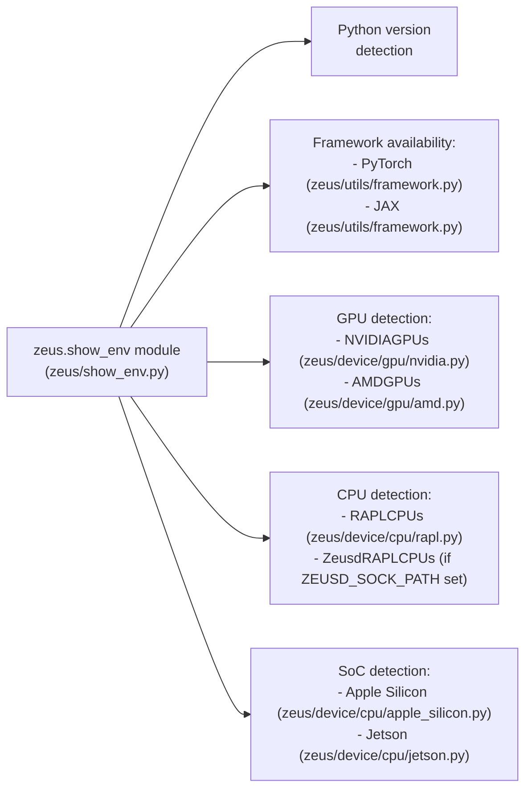

The output displays:
- Python version
- Zeus package version
- PyTorch and JAX availability and versions
- Detected GPUs with model names
- CPU RAPL interface availability and socket topology
- SoC platform detection (if applicable)

Example output for a system with NVIDIA GPUs and Intel RAPL CPUs is shown in [docs/getting_started/index.md:86-129](). For detailed interpretation of the output and troubleshooting detection issues, see [Environment Verification](#2.2).

Sources: [docs/getting_started/index.md:86-129](), [README.md:40]()

## Privilege Management Overview

Zeus requires elevated privileges for two specific operations:

| Operation | Required Privilege | Affected Components |
|-----------|-------------------|---------------------|
| CPU/DRAM energy measurement via RAPL | `root` | `RAPLCPUs` ([zeus/device/cpu/rapl.py]()) |
| GPU power limit / frequency changes | `SYS_ADMIN` or `root` | `GlobalPowerLimitOptimizer` ([zeus/optimizer/power_limit.py]()), `PipelineFrequencyOptimizer` ([zeus/optimizer/pipeline_frequency.py]()) |

**Note**: Modern NVIDIA GPUs (Volta and newer) allow unprivileged energy reading, so basic `ZeusMonitor` GPU measurement requires no special privileges.

The following table compares deployment strategies:

| Strategy | Privileges | Pros | Cons | Recommended For |
|----------|-----------|------|------|-----------------|
| **Docker with `--cap-add SYS_ADMIN`** | Container has `SYS_ADMIN` | Simple setup, works with Kubernetes | Grants broad capabilities to entire container | Containerized deployments |
| **zeusd daemon** | Daemon runs as `root`, app is unprivileged | Least-privilege design, minimal attack surface | Requires deploying separate service | Production systems |
| **sudo** | Application runs as `root` | No additional setup | Entire application runs with root privileges | Development only |

### Zeus Daemon Architecture

The recommended approach uses `zeusd`, a minimal Rust daemon that exposes a REST API over Unix domain sockets:

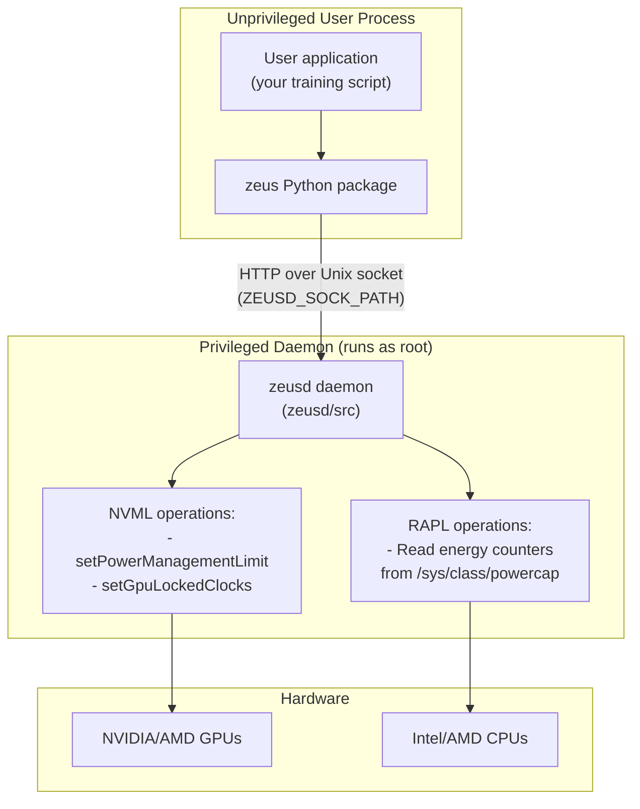

To deploy zeusd:

```sh
# Install zeusd from crates.io
cargo install zeusd

# Run daemon with root privileges
sudo zeusd --socket-path /var/run/zeusd.sock --socket-permissions 666

# Configure application to use daemon
export ZEUSD_SOCK_PATH=/var/run/zeusd.sock
```

The daemon listens on a Unix domain socket (default: `/var/run/zeusd.sock`) and applications communicate via HTTP requests. The `ZEUSD_SOCK_PATH` environment variable tells Zeus to use daemon-based implementations (`ZeusdNVIDIAGPUs`, `ZeusdRAPLCPUs`) instead of direct hardware access.

For comprehensive deployment instructions, security considerations, and API reference, see [Deployment Strategies](#2.3) and [Zeus Daemon](#7).

Sources: [docs/getting_started/index.md:131-199](), [README.md:43]()

## Verification Checklist

Before proceeding to measurement or optimization, verify the following:

1. **Python package installed**: `python -c "import zeus; print(zeus.__version__)"`
2. **Hardware detected**: `python -m zeus.show_env` shows expected GPUs and CPUs
3. **Privileges configured** (if needed):
   - For Docker: `--cap-add SYS_ADMIN` and RAPL mount present
   - For zeusd: Daemon running and `ZEUSD_SOCK_PATH` set
   - For sudo: User can run `sudo python`

## Quick Start Examples

After successful installation and verification, try these basic operations:

### Measure GPU Energy

```python
from zeus.monitor import ZeusMonitor

monitor = ZeusMonitor(gpu_indices=[0])
monitor.begin_window("training")

# Your training code here

measurement = monitor.end_window("training")
print(f"GPU energy: {measurement.total_energy} J")
```

This uses `ZeusMonitor` from [zeus/monitor/energy.py]() to measure energy consumption of GPU 0 during a training window.

### CLI Energy Measurement

```sh
# Start measurement, CTRL+C to stop
python -m zeus.monitor energy --gpu-indices 0 1
```

This invokes [zeus/monitor/__main__.py]() which provides CLI-based energy and power monitoring.

For comprehensive measurement APIs and optimization strategies, see [Energy Measurement](#4) and [Energy Optimization](#5).

Sources: [zeus/monitor/__main__.py:1-120](), [docs/getting_started/index.md:200-204]()

## Next Steps

After completing setup:

1. **Explore measurement capabilities**: See [Energy Measurement](#4) for `ZeusMonitor`, `PowerMonitor`, `CarbonEmissionMonitor`, and `EnergyCostMonitor`
2. **Learn optimization strategies**: See [Energy Optimization](#5) for `GlobalPowerLimitOptimizer`, `PipelineFrequencyOptimizer`, and `BatchSizeOptimizer`
3. **Understand hardware abstraction**: See [Hardware Abstraction Layer](#6) for multi-vendor GPU support, CPU RAPL, and SoC platforms
4. **Integrate with frameworks**: See [Framework Integration](#9) for PyTorch, HuggingFace, and custom callback implementations

Sources: [docs/index.md:28-36](), [README.md:50-56]()

---

# Page: Installation Methods

# Installation Methods

<details>
<summary>Relevant source files</summary>

The following files were used as context for generating this wiki page:

- [.github/workflows/publish_pypi.yaml](.github/workflows/publish_pypi.yaml)
- [README.md](README.md)
- [docs/getting_started/index.md](docs/getting_started/index.md)
- [docs/index.md](docs/index.md)
- [zeus/monitor/__main__.py](zeus/monitor/__main__.py)

</details>


This page details the various methods for installing Zeus and its components. Zeus can be installed as a Python package via PyPI, used through Docker containers, or built from source for development. The Zeus daemon (`zeusd`) is installed separately as a Rust crate when privileged GPU operations are needed.

For verifying your installation after setup, see [Environment Verification](#2.2). For understanding when and how to deploy Zeus with different privilege models, see [Deployment Strategies](#2.3). For detailed instructions on installing and running the Zeus daemon specifically, see [Installing and Running zeusd](#7.3).

## Installation Overview

Zeus provides three primary installation paths for the Python package, each suited to different use cases:

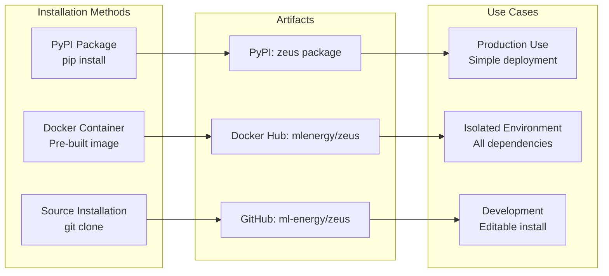

**Sources:** [README.md:50-62](), [docs/getting_started/index.md:6-25]()

## Installing from PyPI

The simplest installation method is via the Python Package Index (PyPI). This installs the Zeus Python package and its required dependencies.

### Basic Installation

```sh
pip install zeus
```

This command installs the latest stable release of Zeus from PyPI. The package includes the core `zeus` module with monitoring, optimization, device abstraction, and utility components.

### Version-Specific Installation

To install a specific version:

```sh
pip install zeus==0.10.0
```

To upgrade to the latest version:

```sh
pip install --upgrade zeus
```

### Dependencies

The PyPI package includes the following core dependencies (automatically installed):

| Dependency | Purpose |
|-----------|---------|
| `pynvml` | NVIDIA GPU monitoring via NVML |
| `pandas` | Data manipulation for profiling results |
| `lowtime` | High-resolution timing utilities |
| `typer` | CLI framework |
| `rich` | Terminal output formatting |

**Sources:** [docs/getting_started/index.md:8-14](), [README.md:50-57]()

## Installing via Docker

Zeus provides official Docker images that include all dependencies, the Zeus package, and a complete ML environment. This is the recommended approach for users who want a fully configured environment or need to run Zeus in containerized deployments.

### Docker Image Architecture

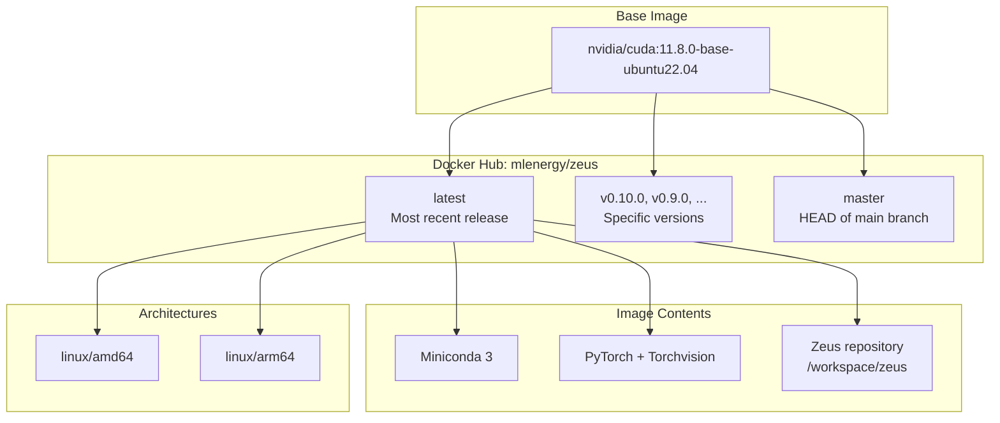

**Sources:** [docs/getting_started/index.md:27-84](), [README.md:58-61]()

### Pulling Pre-built Images

Pre-built images are available on [Docker Hub](https://hub.docker.com/r/mlenergy/zeus):

```sh
# Pull the latest release
docker pull mlenergy/zeus:latest

# Pull a specific version
docker pull mlenergy/zeus:v0.10.0

# Pull the master branch (latest development)
docker pull mlenergy/zeus:master
```

| Tag | Description | Update Frequency |
|-----|-------------|------------------|
| `latest` | Most recent versioned release | On new releases |
| `v*` (e.g., `v0.10.0`) | Specific version tags | Immutable |
| `master` | HEAD commit of master branch | On every push to master |

### Running the Docker Container

Basic command to run Zeus in Docker:

```sh
docker run -it \
    --gpus all \
    --cap-add SYS_ADMIN \
    --ipc host \
    -v /sys/class/powercap/intel-rapl:/zeus_sys/class/powercap/intel-rapl \
    mlenergy/zeus:latest \
    bash
```

**Container Configuration:**

| Flag | Purpose |
|------|---------|
| `--gpus all` | Exposes all GPUs to the container (requires NVIDIA Container Toolkit) |
| `--cap-add SYS_ADMIN` | Grants Linux capability needed to modify GPU power limits and frequencies |
| `--ipc host` | Shares host IPC namespace (required for PyTorch DataLoader shared memory) |
| `-v /sys/class/powercap/intel-rapl:/zeus_sys/class/powercap/intel-rapl` | Mounts Intel RAPL sysfs interface for CPU/DRAM energy measurement |

For details on privilege requirements and alternatives, see [Deployment Strategies](#2.3).

**Sources:** [docs/getting_started/index.md:46-64](), [docs/getting_started/index.md:66-73]()

### Building Docker Images Locally

To build the Zeus Docker image from source:

```sh
git clone https://github.com/ml-energy/zeus.git
cd zeus
docker build -t mlenergy/zeus:master \
    --build-arg TARGETARCH=amd64 \
    -f docker/Dockerfile .
```

The `TARGETARCH` argument must be set to match your platform:

| Architecture | TARGETARCH Value |
|--------------|------------------|
| x86-64 systems | `amd64` |
| ARM64 systems (e.g., Apple Silicon via Rosetta, ARM servers) | `arm64` |

The Dockerfile is located at [docker/Dockerfile]() and defines the complete image build process, including base image selection, dependency installation, and Zeus repository setup.

**Sources:** [docs/getting_started/index.md:75-83](), [README.md:58-61]()

## Installing from Source

Source installation is recommended for development, debugging, or when you need the latest unreleased features. This method provides an editable installation that reflects changes to the source code immediately.

### Development Installation Process

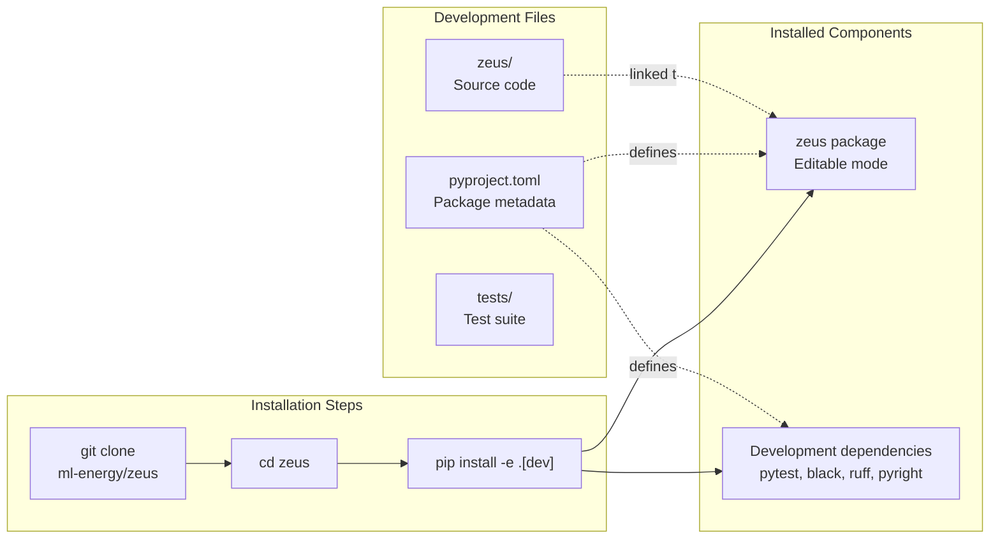

**Sources:** [docs/getting_started/index.md:16-25]()

### Step-by-Step Instructions

1. **Clone the repository:**
   ```sh
   git clone https://github.com/ml-energy/zeus.git
   cd zeus
   ```

2. **Install in editable mode with development dependencies:**
   ```sh
   pip install -e '.[dev]'
   ```

The `-e` flag creates an editable installation, meaning changes to the source files in `zeus/` are immediately reflected without reinstalling. The `[dev]` extra installs additional dependencies needed for development:

| Development Tool | Purpose |
|-----------------|---------|
| `pytest` | Running test suite |
| `black` | Code formatting |
| `ruff` | Fast Python linting |
| `pyright` | Static type checking |
| `mkdocs-material` | Documentation building |
| `mkdocstrings[python]` | API reference generation |

For more information on the development workflow, including testing and code quality tools, see [Development Guide](#10).

**Sources:** [docs/getting_started/index.md:16-25](), [README.md:29-48]()

## Installing the Zeus Daemon

The Zeus daemon (`zeusd`) is a separate Rust-based component that provides privileged access to GPU and CPU power management operations. It is optional but recommended when you need to modify GPU power limits or frequencies without running your entire application with elevated privileges.

### Quick Installation

```sh
cargo install zeusd
```

This installs `zeusd` from [crates.io](https://crates.io/crates/zeusd), the Rust package registry.

### When to Install zeusd

Install the Zeus daemon if:

1. You want to use power optimization features (e.g., [`GlobalPowerLimitOptimizer`][zeus.optimizer.power_limit.GlobalPowerLimitOptimizer], [`PipelineFrequencyOptimizer`][zeus.optimizer.pipeline_frequency.PipelineFrequencyOptimizer])
2. You need CPU/DRAM energy measurement via Intel RAPL
3. You prefer not to run your application with `root` privileges or in a Docker container with `SYS_ADMIN` capability

For complete installation instructions, configuration options, and deployment best practices, see [Installing and Running zeusd](#7.3). For architectural details, see [Daemon Architecture](#7.1).

**Sources:** [docs/getting_started/index.md:149-172](), [README.md:43]()

## Package Release Pipeline

The following diagram shows how Zeus packages are built and published to their respective registries:

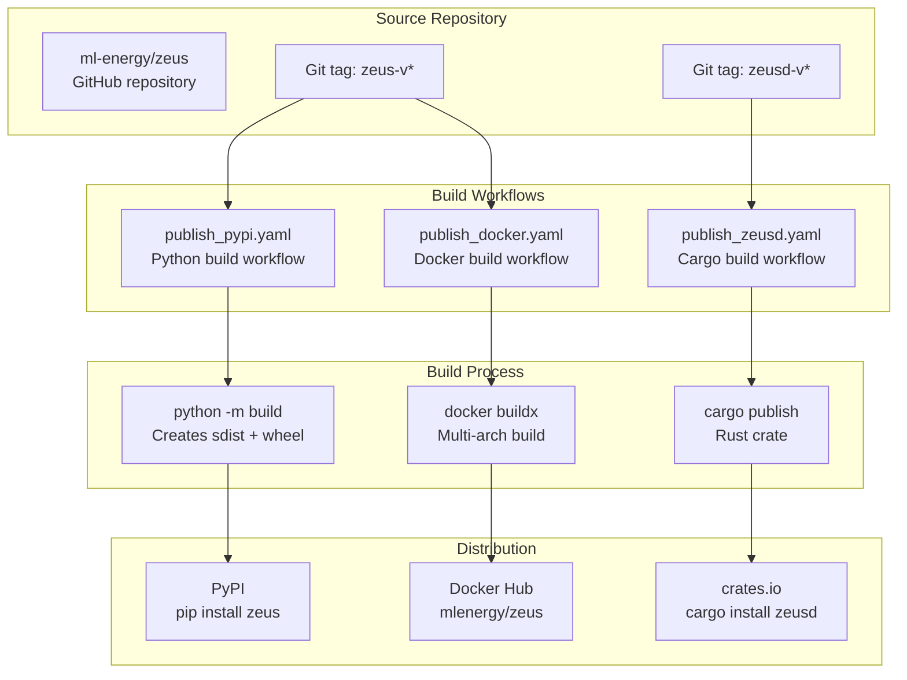

**Sources:** [.github/workflows/publish_pypi.yaml](), [README.md:58-76]()

### Release Triggers

| Component | Git Tag Pattern | Registry | Workflow File |
|-----------|----------------|----------|---------------|
| Zeus Python Package | `zeus-v*` | PyPI | `.github/workflows/publish_pypi.yaml` |
| Zeus Docker Image | `zeus-v*` | Docker Hub | `.github/workflows/publish_docker.yaml` |
| Zeus Daemon (zeusd) | `zeusd-v*` | crates.io | `.github/workflows/publish_zeusd.yaml` |

The PyPI publishing workflow [.github/workflows/publish_pypi.yaml:1-26]() is triggered when a tag matching `zeus-v*` is pushed. It builds both source distributions and wheels using the `build` package, then publishes to PyPI using trusted publishing (OIDC authentication).

**Sources:** [.github/workflows/publish_pypi.yaml:1-26](), [README.md:29-48]()

## Installation Summary Table

| Method | Command | Best For | Dependencies Included |
|--------|---------|----------|----------------------|
| **PyPI** | `pip install zeus` | Production deployments, simple setup | Core Python dependencies only |
| **Docker** | `docker pull mlenergy/zeus:latest` | Isolated environments, reproducible setups | Complete ML stack (PyTorch, Zeus, CUDA) |
| **Source** | `pip install -e '.[dev]'` | Development, debugging, latest features | Configurable (core, dev, docs) |
| **zeusd** | `cargo install zeusd` | Privileged GPU/CPU operations | Rust runtime only |

Each installation method provides the same core Zeus functionality, but differs in deployment complexity, dependency management, and update mechanisms. Choose based on your use case, privilege requirements, and infrastructure constraints.

**Sources:** [docs/getting_started/index.md:6-84](), [README.md:50-76]()

---

# Page: Environment Verification

# Environment Verification

<details>
<summary>Relevant source files</summary>

The following files were used as context for generating this wiki page:

- [README.md](README.md)
- [docs/getting_started/index.md](docs/getting_started/index.md)
- [docs/index.md](docs/index.md)
- [zeus/monitor/carbon.py](zeus/monitor/carbon.py)
- [zeus/monitor/price.py](zeus/monitor/price.py)
- [zeus/show_env.py](zeus/show_env.py)
- [zeus/utils/framework.py](zeus/utils/framework.py)

</details>


## Purpose and Scope

This page documents the environment verification functionality in Zeus, which validates the installation and detects available hardware resources. Environment verification is performed by the `zeus.show_env` command-line utility, which checks for the presence of deep learning frameworks, GPU/CPU/SoC devices, and required libraries.

For installation procedures, see [Installation Methods](#2.1). For configuration of privileged operations after installation, see [Deployment Strategies](#2.3).

## Overview

Environment verification serves three primary purposes:

1. **Installation Validation**: Confirms that Zeus and its dependencies are correctly installed
2. **Hardware Detection**: Identifies available GPUs (NVIDIA/AMD), CPUs (Intel/AMD RAPL), and SoCs (Apple Silicon/Jetson)
3. **Framework Compatibility**: Verifies deep learning framework availability (PyTorch, JAX, CuPy) and CUDA support

The verification process is non-intrusive and does not modify any system configuration. It provides diagnostic information to help troubleshoot setup issues before attempting energy measurement or optimization.

## Running Environment Verification

Execute the verification command after installing Zeus:

```bash
python -m zeus.show_env
```

Alternative invocation:

```python
from zeus.show_env import show_env
show_env()
```

The command requires no arguments and runs completely autonomously. It produces a formatted report divided into sections separated by horizontal lines.

**Sources:** [zeus/show_env.py:177-178](), [docs/getting_started/index.md:86-129]()

## Verification Architecture

The `show_env()` function orchestrates multiple detection subsystems to produce a comprehensive environment report.

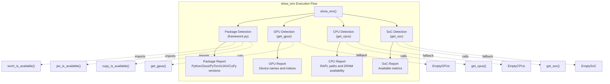

**Sources:** [zeus/show_env.py:31-175]()

## Output Report Structure

The verification report consists of four major sections, each preceded by logging output and followed by a summary of detected resources.

### Package Availability Section

Reports Python version and availability of Zeus, PyTorch, JAX, and CuPy packages. For each ML framework, CUDA support status is explicitly indicated.

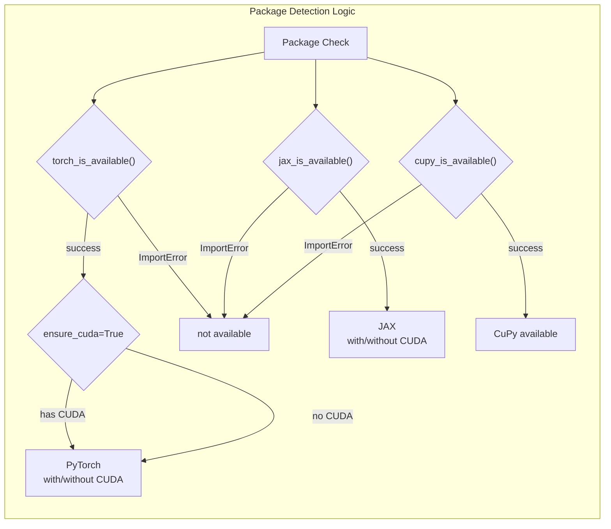

**Example output:**

```console
## Package availability and versions

Logging output:
[2024-09-09 16:40:14,495] [zeus.utils.framework] PyTorch with CUDA support is available.
[2024-09-09 16:40:14,496] [zeus.utils.framework] JAX is not available

Detected:
  Python version: 3.9.19
  Zeus: 0.10.0
  PyTorch: 2.4.1+cu121 (with CUDA support)
  JAX: not available
  CuPy: not available
```

The detection logic uses `lru_cache` decorators to avoid redundant imports. Framework modules are stored in `MODULE_CACHE` dictionary for reuse.

**Sources:** [zeus/show_env.py:33-82](), [zeus/utils/framework.py:15-73]()

### GPU Availability Section

Reports detected GPUs from all supported vendors (NVIDIA via NVML, AMD via AMDSMI). Each GPU is identified by its framework-visible index and model name.

| Detection Path | Success Condition | Error Handling |
|----------------|-------------------|----------------|
| `get_gpus()` | Returns `NVIDIAGPUs` or `AMDGPUs` | Catches `ZeusGPUInitError` |
| Exception handling | - | Falls back to `EmptyGPUs()` |
| Empty check | `len(gpus) > 0` | Displays "No GPUs available" |

**Example output:**

```console
## Device availability

Logging output:
[2024-09-09 16:40:14,512] [zeus.device.gpu.nvidia] pynvml is available and initialized.

Detected:
  GPU 0: NVIDIA A40
```

The GPU detection respects `CUDA_VISIBLE_DEVICES` when set. The indices reported correspond to the framework's view of devices, not physical device ordering.

**Sources:** [zeus/show_env.py:84-101]()

### CPU Availability Section

Reports Intel/AMD CPU packages accessible via RAPL (Running Average Power Limit) interface. For each CPU package, shows:

- CPU energy measurement capability
- DRAM energy measurement capability (if available)
- Access method (direct sysfs or via `zeusd`)

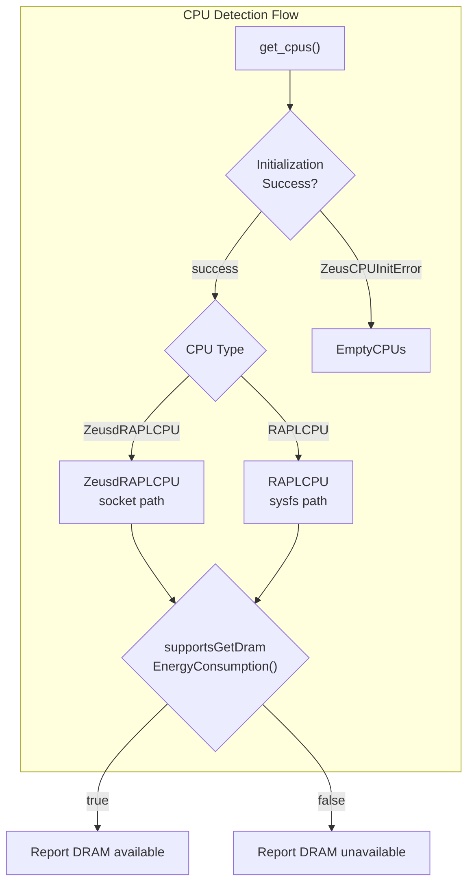

**Example output with direct RAPL access:**

```console
## CPU availability

Logging output:
[2024-09-09 16:40:14,519] [zeus.device.cpu.rapl] RAPL is available.
[2024-09-09 16:40:14,519] [RaplWraparoundTracker] Monitoring wrap around of /sys/class/powercap/intel-rapl/intel-rapl:0/energy_uj

Detected:
  CPU 0:
    CPU measurements available (/sys/class/powercap/intel-rapl/intel-rapl:0)
    DRAM measurements available (/sys/class/powercap/intel-rapl/intel-rapl:0/intel-rapl:0:0)
  CPU 1:
    CPU measurements available (/sys/class/powercap/intel-rapl/intel-rapl:1)
    DRAM measurements available (/sys/class/powercap/intel-rapl/intel-rapl:1/intel-rapl:1:0)
```

**Example output with zeusd daemon:**

```console
## CPU availability

Logging output:
[2025-07-25 16:40:40,396] [zeus.device.cpu.rapl] RAPL directory (/sys/class/powercap/intel-rapl) is available.

Detected:
  CPU 0:
    CPU measurements available (Zeusd at /var/run/zeusd.sock)
    DRAM measurements available (Zeusd at /var/run/zeusd.sock)
  CPU 1:
    CPU measurements available (Zeusd at /var/run/zeusd.sock)
    DRAM measurements available (Zeusd at /var/run/zeusd.sock)
```

The distinction between `RAPLCPU` and `ZeusdRAPLCPU` indicates whether privileged operations are handled directly (requires root/SYS_ADMIN) or via the Zeus daemon.

**Sources:** [zeus/show_env.py:103-138](), [docs/getting_started/index.md:175-193]()

### SoC Availability Section

Reports System-on-Chip platforms for non-traditional compute environments. Supported platforms:

| SoC Platform | Implementation Class | Metrics Reported |
|--------------|---------------------|------------------|
| Apple Silicon | `AppleSilicon` | Available IOKit metrics |
| NVIDIA Jetson | `Jetson` | Available I2C power rail metrics |
| None detected | `EmptySoC` | "No SoC available" |

**Example output for Apple Silicon:**

```console
## SoC availability

Logging output:

Detected:
  Apple Silicon SoC available.
  Available metrics: cpu_power, gpu_power, ane_power
```

**Special case handling:** If the system is detected as Apple Silicon (Darwin OS + arm64/aarch64 architecture) but `AppleSilicon` was not initialized, a warning message suggests installing Zeus with the `apple` extra dependency:

```
This appears to be an Apple Silicon device, but it wasn't picked up by Zeus.
Have you installed Zeus with the `apple` extra?

    pip install 'zeus[apple]'
```

**Sources:** [zeus/show_env.py:140-173]()

## Implementation Details

### Module Organization

The `show_env` module coordinates several specialized detection modules:

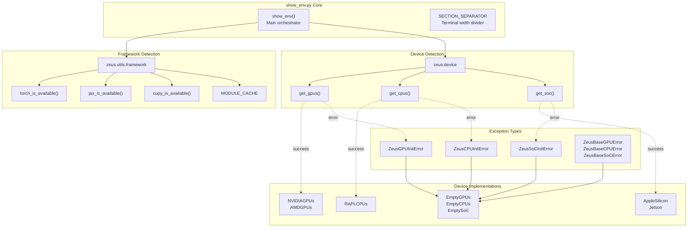

**Sources:** [zeus/show_env.py:1-26]()

### Error Handling Strategy

The verification process uses a graceful degradation pattern. Each detection subsystem is wrapped in try-except blocks that catch initialization errors and fall back to "Empty" implementations:

| Error Type | Caught At | Fallback | Impact |
|------------|-----------|----------|--------|
| `ZeusGPUInitError` | GPU detection | `EmptyGPUs()` | Reports "No GPUs available" |
| `ZeusBaseGPUError` | GPU detection | `EmptyGPUs()` | Reports error message + "No GPUs available" |
| `ZeusCPUInitError` | CPU detection | `EmptyCPUs()` | Reports "No CPUs available" |
| `ZeusBaseCPUError` | CPU detection | `EmptyCPUs()` | Reports error message + "No CPUs available" |
| `ZeusSoCInitError` | SoC detection | `EmptySoC()` | Reports "No SoC available" |
| `ZeusBaseSoCError` | SoC detection | `EmptySoC()` | Reports error message + "No SoC available" |

This design ensures that `show_env` always produces a complete report, even when some hardware detection fails. Users can diagnose specific issues without the entire verification process aborting.

**Sources:** [zeus/show_env.py:88-94](), [zeus/show_env.py:107-113](), [zeus/show_env.py:145-151]()

### RAPL CPU Detection Variants

The CPU detection logic distinguishes between two access patterns for Intel RAPL:

```python
# Direct sysfs access (requires root or mounted in container)
isinstance(cpu, RAPLCPU)
# Reports: /sys/class/powercap/intel-rapl/intel-rapl:X

# Access via zeusd daemon (unprivileged)
isinstance(cpu, ZeusdRAPLCPU)
# Reports: Zeusd at /var/run/zeusd.sock
```

The distinction is made explicit in the output to help users understand their privilege configuration. Direct access requires root or the `SYS_ADMIN` capability, while zeusd access works for unprivileged users when the daemon is running.

**Sources:** [zeus/show_env.py:115-135](), [zeus/device/cpu/rapl.py:136]()

## Interpreting Verification Results

### Successful Verification

All sections should report available resources. Minimum viable configuration for Zeus functionality:

- ✅ Python 3.8+
- ✅ Zeus package installed
- ✅ At least one framework (PyTorch/JAX) with CUDA support
- ✅ At least one GPU detected
- ⚠️ CPU/SoC detection optional (only needed for CPU/DRAM energy measurement)

### Common Issues and Resolutions

| Symptom | Likely Cause | Resolution |
|---------|--------------|------------|
| "PyTorch without CUDA support" | CPU-only PyTorch installed | Install PyTorch with CUDA: `pip install torch --index-url https://download.pytorch.org/whl/cu118` |
| "No GPUs available" | NVIDIA drivers not installed or CUDA_VISIBLE_DEVICES excludes all GPUs | Install drivers; check `nvidia-smi`; verify CUDA_VISIBLE_DEVICES |
| "No CPUs available" | RAPL sysfs not accessible | Run with `sudo` or deploy zeusd; in Docker, mount `/sys/class/powercap` |
| CPU reports "Zeusd at..." | ZEUSD_SOCK_PATH environment variable set | Expected behavior when using zeusd; verify daemon is running |
| SoC warning on Apple Silicon | `zeus[apple]` extra not installed | Reinstall: `pip install 'zeus[apple]'` |

### Framework Cache Behavior

The `MODULE_CACHE` dictionary in `zeus.utils.framework` stores imported modules after first detection. This avoids repeated imports but has implications:

1. Framework availability is checked **once per process**
2. Changing environment variables (e.g., `CUDA_VISIBLE_DEVICES`) after import has no effect
3. Must restart Python process to re-detect frameworks

**Sources:** [zeus/utils/framework.py:12](), [zeus/utils/framework.py:26]()

## Integration with Zeus Workflow

Environment verification is a prerequisite step before:

1. **Energy Measurement** ([ZeusMonitor](#4.1)): Confirms target devices are accessible
2. **Energy Optimization** ([Power Limit Optimizer](#5.1), [Pipeline Frequency Optimizer](#5.2)): Verifies required privileges for configuration changes
3. **Distributed Training**: Validates framework support for multi-device operations

The detection logic used by `show_env` is identical to the initialization logic used by `ZeusMonitor` and optimizers. If `show_env` reports devices successfully, those devices will be available to Zeus's measurement and optimization components.

**Sources:** [zeus/show_env.py:88-100](), [zeus/monitor/energy.py]() (imported by reference)

---

# Page: Deployment Strategies

# Deployment Strategies

<details>
<summary>Relevant source files</summary>

The following files were used as context for generating this wiki page:

- [README.md](README.md)
- [docs/getting_started/index.md](docs/getting_started/index.md)
- [docs/index.md](docs/index.md)
- [zeusd/src/devices/cpu/linux.rs](zeusd/src/devices/cpu/linux.rs)
- [zeusd/src/devices/gpu/linux.rs](zeusd/src/devices/gpu/linux.rs)
- [zeusd/src/routes/gpu.rs](zeusd/src/routes/gpu.rs)
- [zeusd/tests/cpu.rs](zeusd/tests/cpu.rs)
- [zeusd/tests/gpu.rs](zeusd/tests/gpu.rs)
- [zeusd/tests/helpers/mod.rs](zeusd/tests/helpers/mod.rs)

</details>


This document describes the three deployment strategies for Zeus, each providing different approaches to handling privileged operations required for CPU energy measurement and GPU power/frequency configuration. The choice of deployment strategy depends on your security requirements, infrastructure constraints, and use case.

For information about installation methods (pip, Docker images, from source), see [Installation Methods](#2.1). For verification of your Zeus installation after deployment, see [Environment Verification](#2.2).

## Overview

Zeus requires elevated system privileges for two categories of operations:

1. **CPU/DRAM energy measurement**: Reading Intel RAPL (Running Average Power Limit) counters through the `/sys/class/powercap/intel-rapl` interface requires `root` privileges due to [CVE-2020-8694](https://www.cve.org/CVERecord?id=CVE-2020-8694).

2. **GPU power and frequency control**: Setting GPU power limits and locked clocks via NVML (NVIDIA Management Library) requires the `SYS_ADMIN` Linux capability.

Zeus offers three deployment strategies to handle these privileged operations, each with different security and operational characteristics.

**Sources:** [docs/getting_started/index.md:131-199](), [README.md:58-65]()

## Deployment Strategy Decision Tree

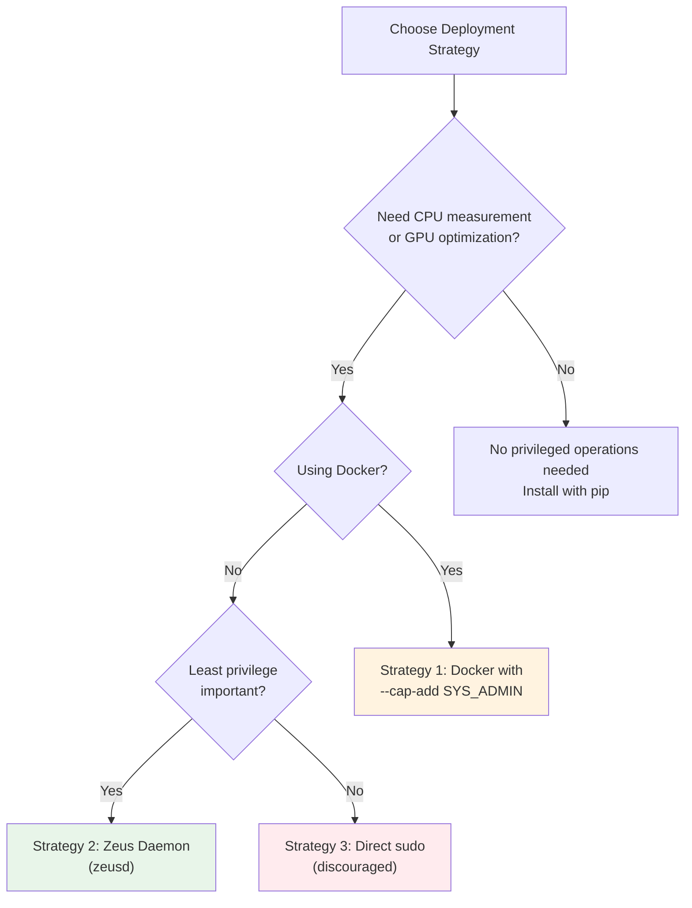

**Sources:** [docs/getting_started/index.md:131-149]()

## Strategy 1: Docker with Linux Capabilities

This strategy grants the `SYS_ADMIN` capability to the entire Docker container and mounts the RAPL sysfs interface. It is the simplest deployment approach when using containers.

### Architecture

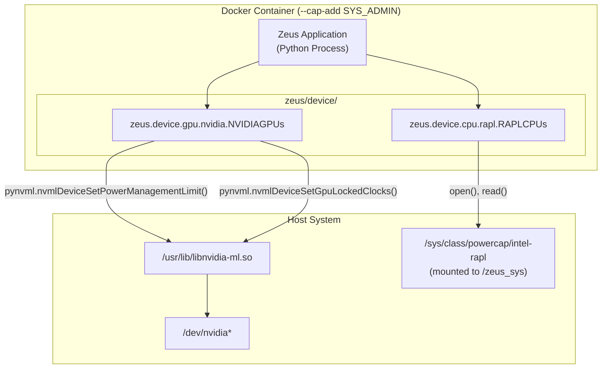

**Sources:** [docs/getting_started/index.md:28-65](), [zeus/device/gpu/nvidia.py](), [zeus/device/cpu/rapl.py]()

### Docker Run Command

```bash
docker run -it \
    --gpus all \
    --cap-add SYS_ADMIN \
    --ipc host \
    -v /sys/class/powercap/intel-rapl:/zeus_sys/class/powercap/intel-rapl \
    mlenergy/zeus:latest \
    bash
```

**Sources:** [docs/getting_started/index.md:48-56]()

### Configuration Details

| Component | Purpose | Details |
|-----------|---------|---------|
| `--gpus all` | GPU access | Mounts NVIDIA GPUs into container via NVIDIA Container Toolkit |
| `--cap-add SYS_ADMIN` | GPU configuration | Grants capability to call `nvmlDeviceSetPowerManagementLimit()` and clock APIs |
| `-v /sys/class/powercap/intel-rapl:/zeus_sys/class/powercap/intel-rapl` | CPU energy | Mounts RAPL interface (Docker blocks it by default); Zeus detects `/zeus_sys` prefix |
| `--ipc host` | PyTorch DataLoader | Provides shared memory for multi-process data loading |

**Sources:** [docs/getting_started/index.md:48-64](), [docker/Dockerfile]()

### Advantages and Limitations

**Advantages:**
- Simplest setup for containerized environments
- Works with Kubernetes Pods via `securityContext.capabilities.add`
- Single container includes all dependencies

**Limitations:**
- Grants broad `SYS_ADMIN` capability to entire application
- Not suitable for multi-tenant environments
- Container-level privilege escalation possible

**Sources:** [docs/getting_started/index.md:141-148]()

## Strategy 2: Zeus Daemon (zeusd) [RECOMMENDED]

The Zeus daemon (`zeusd`) is a minimal privileged service that exposes a REST API over Unix domain sockets. Unprivileged applications communicate with `zeusd` to perform privileged operations, following the principle of least privilege.

### Architecture

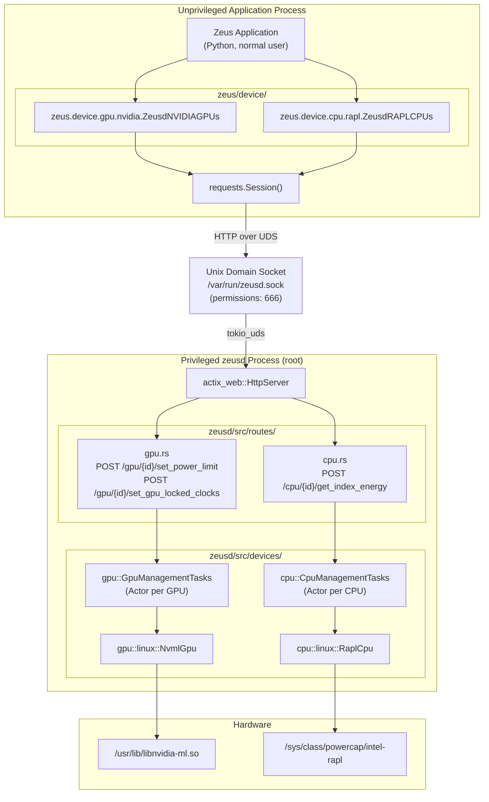

**Sources:** [zeusd/src/main.rs](), [zeusd/src/routes/gpu.rs:1-127](), [zeusd/src/routes/cpu.rs](), [zeus/device/gpu/nvidia.py](), [zeus/device/cpu/rapl.py]()

### Installation and Deployment

#### Installing zeusd

```bash
# Install from crates.io
cargo install zeusd

# Or build from source
git clone https://github.com/ml-energy/zeus.git
cd zeus/zeusd
cargo build --release
```

**Sources:** [docs/getting_started/index.md:156-166]()

#### Running zeusd

```bash
sudo zeusd \
    --socket-path /var/run/zeusd.sock \
    --socket-permissions 666
```

| Flag | Purpose | Details |
|------|---------|---------|
| `--socket-path` | IPC location | Unix domain socket path for HTTP communication |
| `--socket-permissions` | Access control | File permissions in octal notation; `666` allows all users read/write access |

**Sources:** [docs/getting_started/index.md:158-169]()

#### Configuring Zeus Application

Set the `ZEUSD_SOCK_PATH` environment variable to allow Zeus to discover and communicate with the daemon:

```bash
export ZEUSD_SOCK_PATH=/var/run/zeusd.sock
python your_training_script.py
```

Zeus automatically detects this environment variable in [zeus/device/gpu/nvidia.py]() and [zeus/device/cpu/rapl.py]() and instantiates `ZeusdNVIDIAGPUs` or `ZeusdRAPLCPUs` instead of the direct implementations.

**Sources:** [docs/getting_started/index.md:171-193]()

### HTTP API Routes

The daemon exposes the following REST API endpoints over the Unix domain socket:

#### GPU Management Routes

```
POST /gpu/{gpu_id}/set_persistence_mode
POST /gpu/{gpu_id}/set_power_limit
POST /gpu/{gpu_id}/set_gpu_locked_clocks
POST /gpu/{gpu_id}/reset_gpu_locked_clocks
POST /gpu/{gpu_id}/set_mem_locked_clocks
POST /gpu/{gpu_id}/reset_mem_locked_clocks
```

Each route accepts JSON payloads with a `block` field to control blocking vs. non-blocking execution. For example, `set_power_limit` expects:

```json
{
  "power_limit_mw": 250000,
  "block": true
}
```

**Sources:** [zeusd/src/routes/gpu.rs:82-126]()

#### CPU Energy Measurement Routes

```
POST /cpu/{cpu_id}/get_index_energy
GET  /cpu/{cpu_id}/supports_dram_energy
```

The `get_index_energy` route accepts:

```json
{
  "cpu": true,
  "dram": true
}
```

And returns:

```json
{
  "cpu_energy_uj": 12345678,
  "dram_energy_uj": 3456789
}
```

**Sources:** [zeusd/src/routes/cpu.rs](), [zeusd/tests/cpu.rs:1-176]()

### Actor-Based Concurrency Model

The daemon uses Rust's Tokio runtime with an actor pattern to manage each device independently:

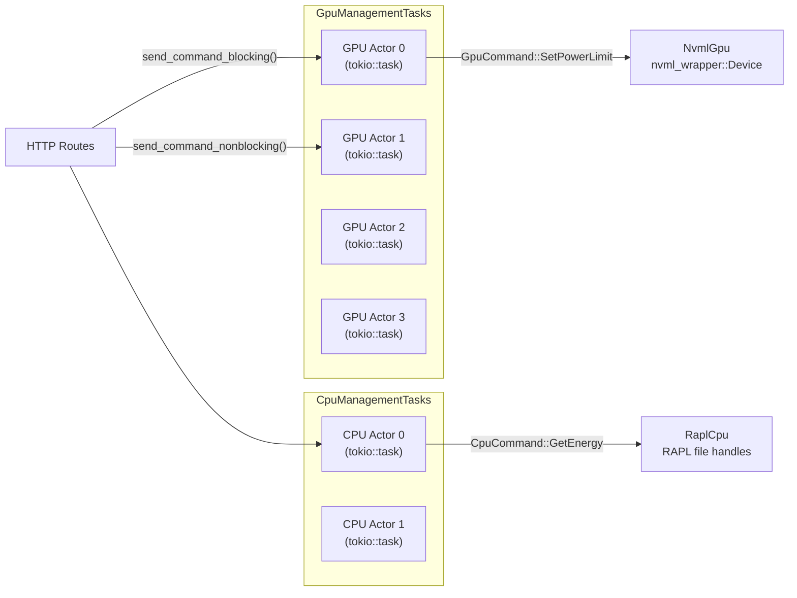

Each actor receives commands via `tokio::sync::mpsc` channels and executes them sequentially, ensuring thread-safe access to NVML and RAPL resources without explicit locking.

**Sources:** [zeusd/src/devices/gpu/mod.rs](), [zeusd/src/devices/cpu/mod.rs]()

### RAPL Wraparound Monitoring

For CPU energy measurement, `zeusd` spawns background tasks to monitor RAPL counter wraparounds (the counters are 32-bit and overflow frequently at high power draws):

```mermaid
sequenceDiagram
    participant App as Zeus Application
    participant Daemon as zeusd
    participant Monitor as monitor_rapl() Task
    participant RAPL as /sys/class/powercap/intel-rapl
    
    Note over Daemon,Monitor: Initialization
    Daemon->>Monitor: tokio::spawn(monitor_rapl())
    Monitor->>RAPL: read initial energy_uj
    
    loop Every 100-1000ms
        Monitor->>RAPL: read current energy_uj
        Monitor->>Monitor: if current < last:<br/>increment wraparound counter
        Note over Monitor: Adaptive polling:<br/>100ms near max,<br/>1000ms otherwise
    end
    
    Note over App,RAPL: Energy Query
    App->>Daemon: POST /cpu/0/get_index_energy
    Daemon->>RAPL: read energy_uj
    Daemon->>Daemon: measurement + (wraparounds * max_energy)
    Daemon->>App: total energy value
```

The adaptive polling frequency (100ms vs 1000ms) prevents missed wraparounds while minimizing overhead. This implementation is in [zeusd/src/devices/cpu/linux.rs:223-248]().

**Sources:** [zeusd/src/devices/cpu/linux.rs:20-248]()

### Advantages and Limitations

**Advantages:**
- Minimal privileged surface area (only daemon runs as root)
- Applications run as normal users
- Multi-tenant safe
- Can be deployed once per node, used by multiple applications
- Follows principle of least privilege

**Limitations:**
- Requires separate daemon installation and management
- Additional IPC overhead (typically <1ms per request)
- Requires system administrator to deploy daemon

**Sources:** [docs/getting_started/index.md:149-155]()

## Strategy 3: Direct Sudo Access

This strategy runs the entire Zeus application with `sudo` (as root). This approach is **not recommended** except for quick testing or when other options are unavailable.

### Usage

```bash
sudo python your_training_script.py
```

Zeus will directly access NVML and RAPL interfaces without requiring the daemon or Docker capabilities.

**Sources:** [docs/getting_started/index.md:195-199]()

### File System Access Pattern

```mermaid
graph LR
    App["Zeus Application<br/>(root process)"]
    
    subgraph "Direct Access (root only)"
        NVML["/usr/lib/libnvidia-ml.so<br/>nvmlDeviceSetPowerManagementLimit()"]
        RAPL["/sys/class/powercap/intel-rapl/*/energy_uj<br/>open(), read()"]
    end
    
    App -->|"Direct calls<br/>(no IPC)"| NVML
    App -->|"Direct file I/O<br/>(no IPC)"| RAPL
```

**Sources:** [zeus/device/gpu/nvidia.py](), [zeus/device/cpu/rapl.py]()

### Advantages and Limitations

**Advantages:**
- No additional setup required
- No IPC overhead
- Useful for quick experiments

**Limitations:**
- Entire application runs as root
- Violates principle of least privilege
- Security risk in production environments
- Not suitable for shared systems
- Can interfere with other applications' GPU/CPU settings

**Sources:** [docs/getting_started/index.md:195-199]()

## Deployment Strategy Comparison

| Aspect | Docker + Capabilities | Zeus Daemon (zeusd) | Direct Sudo |
|--------|----------------------|---------------------|-------------|
| **Privilege Level** | Container-wide `SYS_ADMIN` | Daemon only | Application-wide root |
| **Setup Complexity** | Low (one command) | Medium (daemon + env var) | Very Low (just sudo) |
| **Security** | Medium | High (least privilege) | Low |
| **Multi-Tenant** | No | Yes | No |
| **IPC Overhead** | None | ~0.5-1ms per request | None |
| **Suitable For** | Single-app containers | Production, shared systems | Testing only |
| **Container Support** | Yes (native) | Yes (via mounted socket) | Yes |
| **Kubernetes Support** | Yes (securityContext) | Yes (DaemonSet) | No |
| **Recommended** | Containerized environments | Production bare-metal | Not recommended |

**Sources:** [docs/getting_started/index.md:131-199]()

## Implementation Details: Device Abstraction

Zeus implements device abstraction to transparently switch between direct access and daemon-mediated access:

### GPU Device Selection

```mermaid
graph TD
    GetGPUs["get_gpus()<br/>zeus/device/gpu/__init__.py"]
    
    CheckZeusd{"ZEUSD_SOCK_PATH<br/>environment variable?"}
    CheckNVML{"pynvml available?"}
    CheckAMD{"amdsmi available?"}
    
    ZeusdNVIDIA["ZeusdNVIDIAGPUs<br/>(HTTP client)"]
    DirectNVIDIA["NVIDIAGPUs<br/>(direct pynvml)"]
    DirectAMD["AMDGPUs<br/>(direct amdsmi)"]
    Empty["EmptyGPUs<br/>(no-op stub)"]
    
    GetGPUs --> CheckZeusd
    CheckZeusd -->|Set| ZeusdNVIDIA
    CheckZeusd -->|Not set| CheckNVML
    CheckNVML -->|Yes| DirectNVIDIA
    CheckNVML -->|No| CheckAMD
    CheckAMD -->|Yes| DirectAMD
    CheckAMD -->|No| Empty
```

The factory function `get_gpus()` checks for `ZEUSD_SOCK_PATH` first, falling back to direct access if unavailable.

**Sources:** [zeus/device/gpu/__init__.py]()

### CPU Device Selection

```mermaid
graph TD
    GetCPUs["get_cpus()<br/>zeus/device/cpu/__init__.py"]
    
    CheckZeusd{"ZEUSD_SOCK_PATH<br/>environment variable?"}
    CheckRAPL{"/sys/class/powercap/intel-rapl<br/>exists and readable?"}
    
    ZeusdRAPL["ZeusdRAPLCPUs<br/>(HTTP client)"]
    DirectRAPL["RAPLCPUs<br/>(direct sysfs)"]
    Empty["EmptyCPUs<br/>(no-op stub)"]
    
    GetCPUs --> CheckZeusd
    CheckZeusd -->|Set| ZeusdRAPL
    CheckZeusd -->|Not set| CheckRAPL
    CheckRAPL -->|Yes| DirectRAPL
    CheckRAPL -->|No| Empty
```

**Sources:** [zeus/device/cpu/__init__.py](), [zeus/device/cpu/rapl.py]()

## Verification

After deploying with any strategy, verify the setup using `zeus.show_env`:

```bash
# For Docker strategy
docker run --gpus all --cap-add SYS_ADMIN \
    -v /sys/class/powercap/intel-rapl:/zeus_sys/class/powercap/intel-rapl \
    mlenergy/zeus:latest python -m zeus.show_env

# For zeusd strategy
ZEUSD_SOCK_PATH=/var/run/zeusd.sock python -m zeus.show_env

# For sudo strategy
sudo python -m zeus.show_env
```

The output shows detected GPUs and CPUs with their access method. For the daemon strategy, you should see output like:

```
CPU 0:
  CPU measurements available (Zeusd at /var/run/zeusd.sock)
  DRAM measurements available (Zeusd at /var/run/zeusd.sock)
```

**Sources:** [docs/getting_started/index.md:86-193](), [zeus/show_env.py]()

---

# Page: Core Architecture

# Core Architecture

<details>
<summary>Relevant source files</summary>

The following files were used as context for generating this wiki page:

- [README.md](README.md)
- [docs/getting_started/index.md](docs/getting_started/index.md)
- [docs/index.md](docs/index.md)
- [zeus/__init__.py](zeus/__init__.py)

</details>


## Purpose and Scope

This document explains Zeus's high-level system architecture and how its major components are organized. It covers the layered architecture of the Zeus Python package, the role of the Zeus daemon (`zeusd`), and how these components interact to provide energy measurement and optimization capabilities for deep learning workloads.

For detailed information about the directory structure and module contents, see [Module Organization](#3.1). For information about how Zeus handles privileged operations, see [Privilege Management](#3.2).

---

## Architectural Overview

Zeus follows a layered architecture with three primary layers: the **User API Layer**, the **Device Abstraction Layer**, and the **Hardware Layer**. A separate **Privileged Service Layer** (`zeusd`) handles operations requiring elevated permissions.

```mermaid
graph TB
    subgraph "User API Layer"
        MON["zeus.monitor<br/>ZeusMonitor, PowerMonitor<br/>CarbonEmissionMonitor"]
        OPT["zeus.optimizer<br/>GlobalPowerLimitOptimizer<br/>PipelineFrequencyOptimizer<br/>BatchSizeOptimizer"]
        CLI["zeus.monitor CLI<br/>Command line tools"]
        CB["zeus.callback<br/>Callback base class"]
        METRIC["zeus.metric<br/>Prometheus metrics"]
    end
    
    subgraph "Device Abstraction Layer"
        GPU_MGR["zeus.device.gpu.GPUs<br/>get_gpus()"]
        CPU_MGR["zeus.device.cpu.CPUs<br/>get_cpus()"]
        SOC_MGR["zeus.device.soc.SoC<br/>get_soc()"]
    end
    
    subgraph "Vendor Implementations"
        NVML["NVIDIAGPUs<br/>pynvml"]
        AMD["AMDGPUs<br/>amdsmi"]
        RAPL["RAPLCPUs<br/>sysfs"]
        APPLE["AppleSiliconSoC<br/>IOKit"]
        JETSON["JetsonSoC<br/>I2C rails"]
    end
    
    subgraph "Privileged Service Layer"
        ZEUSD["zeusd daemon<br/>Rust HTTP server<br/>Unix domain socket"]
        ZEUSD_IMPL["ZeusdNVIDIAGPUs<br/>ZeusdRAPLCPUs<br/>Client implementations"]
    end
    
    subgraph "Hardware Layer"
        HW["NVIDIA GPUs | AMD GPUs<br/>Intel/AMD CPUs<br/>Apple Silicon | Jetson SoCs"]
    end
    
    MON --> GPU_MGR
    MON --> CPU_MGR
    MON --> SOC_MGR
    OPT --> GPU_MGR
    OPT --> MON
    CB --> MON
    CB --> OPT
    METRIC --> MON
    
    GPU_MGR --> NVML
    GPU_MGR --> AMD
    GPU_MGR --> ZEUSD_IMPL
    CPU_MGR --> RAPL
    CPU_MGR --> ZEUSD_IMPL
    SOC_MGR --> APPLE
    SOC_MGR --> JETSON
    
    NVML --> HW
    AMD --> HW
    RAPL --> HW
    APPLE --> HW
    JETSON --> HW
    
    ZEUSD_IMPL -.HTTP over socket.-> ZEUSD
    ZEUSD --> HW
```

**Diagram 1: Zeus Layered Architecture**

Sources: [README.md:29-48](), [zeus/__init__.py:1-14](), [docs/getting_started/index.md:132-199]()

---

## Core Subsystems

Zeus is organized into distinct subsystems, each with a well-defined responsibility. The primary subsystems reside in the `zeus/` Python package directory.

### Measurement Subsystem

The `zeus.monitor` module provides programmatic and CLI-based energy and power measurement capabilities.

| Component | Purpose | Key Classes |
|-----------|---------|-------------|
| `zeus.monitor.energy` | Window-based energy measurement | `ZeusMonitor` |
| `zeus.monitor.power` | Continuous power polling | `PowerMonitor` |
| `zeus.monitor.carbon` | Carbon emission tracking | `CarbonEmissionMonitor` |
| `zeus.monitor.cost` | Energy cost tracking | `EnergyCostMonitor` |
| `zeus.monitor.temperature` | GPU temperature monitoring | `TemperatureMonitor` |

Detailed documentation of these components is in [Energy Measurement](#4).

### Optimization Subsystem

The `zeus.optimizer` module contains algorithms for reducing energy consumption during training.

| Optimizer | Strategy | Target |
|-----------|----------|--------|
| `GlobalPowerLimitOptimizer` | JIT profiling with state machine | GPU power caps |
| `PipelineFrequencyOptimizer` | Graph-cut algorithm | Pipeline stage frequencies |
| `BatchSizeOptimizer` | Multi-armed bandit | Training batch size |

Detailed documentation of these components is in [Energy Optimization](#5).

### Device Abstraction Subsystem

The `zeus.device` module provides a unified interface to heterogeneous hardware.

```mermaid
graph LR
    APP["Application Code"]
    
    subgraph "zeus.device"
        GPU["GPUs interface<br/>get_gpus()"]
        CPU["CPUs interface<br/>get_cpus()"]
        SOC["SoC interface<br/>get_soc()"]
    end
    
    subgraph "Implementations"
        NVML["NVIDIAGPUs"]
        AMD["AMDGPUs"]
        RAPL["RAPLCPUs"]
        APPLE["AppleSiliconSoC"]
        JETSON["JetsonSoC"]
        EMPTY["Empty* fallbacks"]
    end
    
    APP --> GPU
    APP --> CPU
    APP --> SOC
    
    GPU --> NVML
    GPU --> AMD
    GPU --> EMPTY
    CPU --> RAPL
    CPU --> EMPTY
    SOC --> APPLE
    SOC --> JETSON
    SOC --> EMPTY
```

**Diagram 2: Device Abstraction Layer**

The device abstraction layer uses factory functions (`get_gpus()`, `get_cpus()`, `get_soc()`) to instantiate the appropriate implementation based on runtime hardware detection. When hardware is unavailable, the layer falls back to no-op `Empty*` implementations that implement the same interfaces.

Detailed documentation is in [Hardware Abstraction Layer](#6).

Sources: [zeus/__init__.py:1-14](), [README.md:32-41]()

---

## Component Interaction Patterns

Zeus components interact through well-defined interfaces and patterns.

### Measurement Flow

```mermaid
graph TB
    USER["User Application"]
    
    subgraph "zeus.monitor.energy"
        ZM["ZeusMonitor"]
        MW["Measurement Window<br/>begin_window()<br/>end_window()"]
    end
    
    subgraph "zeus.device.gpu"
        GPUS["GPUs instance"]
        ENERGY_API["getTotalEnergyConsumption()"]
        POWER_API["getInstantPowerUsage()"]
    end
    
    subgraph "zeus.device.cpu"
        CPUS["CPUs instance"]
        CPU_ENERGY["getTotalEnergyConsumption()"]
    end
    
    subgraph "Vendor Libraries"
        NVML_LIB["pynvml<br/>nvmlDeviceGetTotalEnergyConsumption"]
        AMDSMI_LIB["amdsmi<br/>amdsmi_get_energy_count"]
        RAPL_FS["sysfs<br/>/sys/class/powercap/intel-rapl"]
    end
    
    USER --> ZM
    ZM --> MW
    MW --> GPUS
    MW --> CPUS
    GPUS --> ENERGY_API
    GPUS --> POWER_API
    CPUS --> CPU_ENERGY
    
    ENERGY_API --> NVML_LIB
    ENERGY_API --> AMDSMI_LIB
    POWER_API --> NVML_LIB
    CPU_ENERGY --> RAPL_FS
```

**Diagram 3: Energy Measurement Data Flow**

The measurement flow follows this pattern:

1. User creates a `ZeusMonitor` instance targeting specific GPU and CPU indices
2. User calls `begin_window()` to start a measurement window
3. `ZeusMonitor` queries `GPUs` and `CPUs` for baseline energy counters
4. Device managers call vendor-specific APIs (NVML, AMDSMI, RAPL)
5. User calls `end_window()` to complete the measurement
6. `ZeusMonitor` calculates energy delta and returns `Measurement` object

### Optimization Flow

```mermaid
graph TB
    USER["Training Loop"]
    
    subgraph "zeus.optimizer.power_limit"
        GPLO["GlobalPowerLimitOptimizer"]
        SM["State Machine<br/>Ready→Warmup→Profiling→Done"]
        PROF["Profile Cache<br/>JSON persistence"]
    end
    
    subgraph "zeus.callback"
        CB_BASE["Callback"]
        ON_BEGIN["on_step_begin()"]
        ON_END["on_step_end()"]
    end
    
    subgraph "zeus.monitor.energy"
        MON["ZeusMonitor<br/>measurement windows"]
    end
    
    subgraph "zeus.device.gpu"
        GPUS["GPUs"]
        SET_PL["setPowerManagementLimit()"]
    end
    
    USER --> GPLO
    GPLO --> CB_BASE
    CB_BASE --> ON_BEGIN
    CB_BASE --> ON_END
    ON_BEGIN --> MON
    ON_BEGIN --> SET_PL
    ON_END --> MON
    MON --> GPUS
    SET_PL --> GPUS
    ON_END --> SM
    SM --> PROF
```

**Diagram 4: Power Limit Optimization Flow**

The optimization flow uses the callback pattern:

1. User instantiates an optimizer (e.g., `GlobalPowerLimitOptimizer`)
2. Optimizer implements the `Callback` interface
3. Training loop invokes `on_step_begin()` before each iteration
4. Optimizer sets GPU power limits via `GPUs.setPowerManagementLimit()`
5. Optimizer starts energy measurement via `ZeusMonitor`
6. Training loop invokes `on_step_end()` after each iteration
7. Optimizer ends measurement and updates state machine
8. After profiling completes, optimizer persists profile to disk

Sources: [zeus/__init__.py:1-14](), [README.md:32-41]()

---

## Privileged Operations Architecture

Zeus handles privileged hardware operations (GPU power/frequency configuration, CPU energy reading) through three deployment patterns. The architecture supports both privileged direct access and unprivileged access via the Zeus daemon.

```mermaid
graph TB
    APP["User Application<br/>Unprivileged process"]
    
    subgraph "zeus.device Implementation Selection"
        DIRECT["Direct Access<br/>NVIDIAGPUs<br/>RAPLCPUs"]
        DAEMON["Daemon Access<br/>ZeusdNVIDIAGPUs<br/>ZeusdRAPLCPUs"]
    end
    
    subgraph "Access Mechanism"
        PYNVML["pynvml library<br/>NVML API calls"]
        SYSFS["sysfs reads<br/>/sys/class/powercap"]
        SOCKET["Unix domain socket<br/>ZEUSD_SOCK_PATH"]
    end
    
    subgraph "Privileged Layer"
        ZEUSD["zeusd daemon<br/>Runs as root<br/>HTTP server"]
    end
    
    subgraph "Hardware"
        GPU["GPU power/freq"]
        CPU["CPU/DRAM energy"]
    end
    
    APP --> DIRECT
    APP --> DAEMON
    
    DIRECT --> PYNVML
    DIRECT --> SYSFS
    DAEMON --> SOCKET
    
    PYNVML --> GPU
    SYSFS --> CPU
    SOCKET --> ZEUSD
    ZEUSD --> GPU
    ZEUSD --> CPU
```

**Diagram 5: Privileged Operations Handling**

The selection between direct and daemon access is automatic:

- If `ZEUSD_SOCK_PATH` environment variable is set, Zeus instantiates `ZeusdNVIDIAGPUs` and `ZeusdRAPLCPUs`
- Otherwise, Zeus attempts direct access via `NVIDIAGPUs` and `RAPLCPUs`
- If direct access fails due to permissions, appropriate exceptions are raised

This architecture is detailed in [Privilege Management](#3.2) and [Zeus Daemon (zeusd)](#7).

Sources: [docs/getting_started/index.md:132-199](), [README.md:43]()

---

## External Integrations

Zeus integrates with external services and frameworks to provide enhanced functionality.

### Framework Integration

```mermaid
graph LR
    subgraph "ML Frameworks"
        PYTORCH["PyTorch<br/>torch.cuda.synchronize()"]
        JAX["JAX<br/>device.synchronize_all_activity()"]
        HF["HuggingFace Transformers<br/>Trainer"]
    end
    
    subgraph "Zeus Integration"
        SYNC["Framework sync<br/>zeus.utils.framework"]
        CB["Callback API<br/>zeus.callback"]
        HF_OPT["HFGlobalPowerLimitOptimizer<br/>TrainerCallback"]
    end
    
    subgraph "Measurement"
        ZM["ZeusMonitor"]
    end
    
    PYTORCH --> SYNC
    JAX --> SYNC
    SYNC --> ZM
    
    HF --> HF_OPT
    HF_OPT --> CB
    CB --> ZM
```

**Diagram 6: Framework Integration Points**

Zeus provides framework-specific adapters:

- **Framework synchronization**: `zeus.utils.framework` provides `sync_execution()` to ensure accurate measurements in async execution environments
- **HuggingFace Trainer**: `HFGlobalPowerLimitOptimizer` implements `TrainerCallback` for seamless integration
- **Generic callbacks**: `zeus.callback.Callback` base class for custom integrations

### External Services

```mermaid
graph LR
    subgraph "zeus.monitor"
        CARBON["CarbonEmissionMonitor"]
        COST["EnergyCostMonitor"]
        METRIC["zeus.metric<br/>Prometheus export"]
    end
    
    subgraph "External APIs"
        ELEC["ElectricityMaps API<br/>Carbon intensity data"]
        OPENI["OpenEI API<br/>Electricity pricing"]
        PROM["Prometheus<br/>Metrics collection"]
    end
    
    CARBON --> ELEC
    COST --> OPENI
    METRIC --> PROM
```

**Diagram 7: External Service Integrations**

- **Carbon tracking**: `CarbonEmissionMonitor` queries ElectricityMaps API for real-time carbon intensity
- **Cost tracking**: `EnergyCostMonitor` queries OpenEI API for electricity pricing data
- **Metrics export**: `zeus.metric` exports power and energy metrics to Prometheus

Sources: [zeus/__init__.py:1-14](), [README.md:32-41]()

---

## Module Structure Summary

The Zeus codebase is organized into these primary modules:

| Module Path | Purpose | Key Entry Points |
|-------------|---------|------------------|
| `zeus.monitor` | Energy/power measurement | `ZeusMonitor`, `PowerMonitor` |
| `zeus.optimizer` | Energy optimization algorithms | `GlobalPowerLimitOptimizer`, `PipelineFrequencyOptimizer` |
| `zeus.device` | Hardware abstraction | `get_gpus()`, `get_cpus()`, `get_soc()` |
| `zeus.callback` | Training integration | `Callback` base class |
| `zeus.metric` | Metrics export | Prometheus integration |
| `zeus.utils` | Utility functions | Framework sync, logging |
| `zeus._legacy` | Legacy code | Research reproducibility |
| `zeus.show_env` | Environment verification | `python -m zeus.show_env` |
| `zeusd/` (Rust) | Privileged daemon | HTTP server |

For a detailed walkthrough of the directory structure and module contents, see [Module Organization](#3.1).

Sources: [README.md:29-48](), [zeus/__init__.py:1-14]()

---

## Design Principles

Zeus's architecture follows these core design principles:

1. **Hardware abstraction**: Unified interfaces hide vendor-specific details
2. **Least privilege**: Privileged operations isolated in optional daemon
3. **Fail-safe defaults**: Graceful degradation via `Empty*` implementations
4. **Extensibility**: Callback and plugin patterns for custom integrations
5. **Zero-overhead**: Measurement uses hardware counters when available
6. **Framework agnostic**: Compatible with PyTorch, JAX, and other frameworks

These principles enable Zeus to run on diverse hardware configurations while maintaining a simple, consistent API for end users.

Sources: [README.md:1-95](), [docs/getting_started/index.md:1-204](), [docs/index.md:1-54]()

---

# Page: Module Organization

# Module Organization

<details>
<summary>Relevant source files</summary>

The following files were used as context for generating this wiki page:

- [README.md](README.md)
- [docs/getting_started/index.md](docs/getting_started/index.md)
- [docs/index.md](docs/index.md)
- [zeus/__init__.py](zeus/__init__.py)

</details>


This page documents the structure of the `zeus` Python package, explaining the purpose of each module and their interdependencies. For information about the privileged operations and deployment patterns, see [Privilege Management](#3.2). For details on specific hardware implementations, see the Hardware Abstraction Layer section ([GPU Support](#6.1), [CPU Support](#6.2), [SoC Support](#6.3)).

## Package Structure Overview

The Zeus Python package is organized into six primary modules that work together to provide energy measurement and optimization capabilities. The package follows a layered architecture where higher-level user-facing components depend on lower-level abstraction and utility modules.

**Zeus Package Directory Structure**

```mermaid
graph TB
    subgraph "zeus/"
        INIT["__init__.py<br/>(Package entry point)"]
        
        subgraph "Core Modules"
            MON["monitor/<br/>(Energy measurement)"]
            OPT["optimizer/<br/>(Energy optimization)"]
            DEV["device/<br/>(Hardware abstraction)"]
            UTIL["utils/<br/>(Utilities)"]
        end
        
        subgraph "Integration"
            CB["callback.py<br/>(Callback base class)"]
            METRIC["metric.py<br/>(Prometheus metrics)"]
        end
        
        subgraph "Support"
            SHOW["show_env.py<br/>(Environment verification)"]
            EXC["exception.py<br/>(Exception definitions)"]
            LEG["_legacy/<br/>(Research reproducibility)"]
        end
    end
    
    INIT -.exports.-> MON
    INIT -.exports.-> OPT
    INIT -.exports.-> DEV
    INIT -.exports.-> UTIL
    INIT -.exports.-> CB
    INIT -.exports.-> METRIC
    INIT -.exports.-> SHOW
    INIT -.exports.-> EXC
```

**Sources:** [README.md:29-48](), [zeus/__init__.py:1-15]()

## Module Dependency Graph

The following diagram illustrates the dependency relationships between Zeus modules. Lower-level modules provide abstractions that higher-level modules build upon.

**Zeus Module Dependencies**

```mermaid
graph TB
    subgraph "User-Facing Layer"
        ZM["monitor.energy.ZeusMonitor"]
        PM["monitor.power.PowerMonitor"]
        GPLO["optimizer.power_limit.GlobalPowerLimitOptimizer"]
        PFO["optimizer.pipeline_frequency.PipelineFrequencyOptimizer"]
        BSO["optimizer.batch_size.BatchSizeOptimizer"]
        CB["callback.Callback"]
    end
    
    subgraph "Device Abstraction Layer"
        GPUS["device.gpu.GPUs"]
        CPUS["device.cpu.CPUs"]
        SOCS["device.soc.SoC"]
    end
    
    subgraph "Utilities & Support"
        FRAMEWORK["utils.framework"]
        ENV["utils.env"]
        LOGGING["utils.logging"]
        PROM["metric"]
        EXC["exception"]
    end
    
    ZM --> GPUS
    ZM --> CPUS
    ZM --> SOCS
    ZM --> FRAMEWORK
    
    PM --> GPUS
    
    GPLO --> ZM
    GPLO --> GPUS
    GPLO --> CB
    
    PFO --> GPUS
    PFO --> CB
    
    BSO --> CB
    
    ZM --> PROM
    
    GPUS --> EXC
    CPUS --> EXC
    SOCS --> EXC
    
    ZM --> EXC
    GPLO --> EXC
    
    GPUS --> LOGGING
    CPUS --> LOGGING
    ZM --> LOGGING
```

**Sources:** [zeus/__init__.py:1-15](), [README.md:29-48]()

## Core Modules

### `zeus.monitor`

The `monitor` module provides tools for measuring energy consumption and power draw during deep learning workloads. It contains both programmatic APIs and command-line interfaces.

| Component | Purpose |
|-----------|---------|
| `monitor.energy.ZeusMonitor` | Window-based energy measurement for GPUs, CPUs, DRAM, and SoCs |
| `monitor.power.PowerMonitor` | Continuous power polling with background process |
| `monitor.energy.CarbonEmissionMonitor` | Carbon-aware measurement with ElectricityMaps API |
| `monitor.energy.EnergyCostMonitor` | Cost-aware measurement with OpenEI API |
| `monitor.temperature.TemperatureMonitor` | GPU temperature tracking over time |

The monitor module depends on the device abstraction layer to access hardware energy counters and power interfaces. See [Energy Measurement](#4) for detailed documentation.

**Sources:** [README.md:34](), [zeus/__init__.py:4]()

### `zeus.optimizer`

The `optimizer` module contains energy optimization strategies that automatically tune training parameters to minimize energy consumption while respecting performance constraints.

| Component | Purpose |
|-----------|---------|
| `optimizer.power_limit.GlobalPowerLimitOptimizer` | GPU power capping with JIT profiling |
| `optimizer.pipeline_frequency.PipelineFrequencyOptimizer` | Pipeline stage frequency optimization |
| `optimizer.batch_size.BatchSizeOptimizer` | Batch size selection via multi-armed bandit |

All optimizers integrate with training frameworks through the callback interface and depend on the device layer for hardware control. See [Energy Optimization](#5) for detailed documentation.

**Sources:** [README.md:35](), [zeus/__init__.py:5]()

### `zeus.device`

The `device` module provides a unified abstraction layer over diverse hardware platforms, isolating hardware-specific details from higher-level components.

**Device Module Structure**

```mermaid
graph TB
    subgraph "zeus.device"
        GPU["gpu/__init__.py<br/>(GPU manager)"]
        CPU["cpu/__init__.py<br/>(CPU manager)"]
        SOC["soc/__init__.py<br/>(SoC manager)"]
        
        subgraph "GPU Implementations"
            NVML["gpu/nvidia.py<br/>(NVIDIAGPUs, ZeusdNVIDIAGPUs)"]
            AMD["gpu/amd.py<br/>(AMDGPUs)"]
            EMPTY_GPU["gpu/common.py<br/>(EmptyGPUs)"]
        end
        
        subgraph "CPU Implementations"
            RAPL["cpu/rapl.py<br/>(RAPLCPUs, ZeusdRAPLCPUs)"]
            EMPTY_CPU["cpu/common.py<br/>(EmptyCPUs)"]
        end
        
        subgraph "SoC Implementations"
            APPLE["soc/apple.py<br/>(AppleSiliconSoC)"]
            JETSON["soc/jetson.py<br/>(JetsonSoC)"]
            EMPTY_SOC["soc/common.py<br/>(EmptySoC)"]
        end
    end
    
    GPU --> NVML
    GPU --> AMD
    GPU --> EMPTY_GPU
    
    CPU --> RAPL
    CPU --> EMPTY_CPU
    
    SOC --> APPLE
    SOC --> JETSON
    SOC --> EMPTY_SOC
```

The device module implements the Strategy pattern with runtime selection based on available hardware. Each implementation provides methods for energy measurement and power/frequency control. See [Hardware Abstraction Layer](#6) for detailed documentation.

**Sources:** [README.md:36](), [zeus/__init__.py:3]()

### `zeus.utils`

The `utils` module contains shared utility functions and classes used throughout the codebase.

| Component | Purpose |
|-----------|---------|
| `utils.framework` | Framework detection (PyTorch, JAX, CuPy) and synchronization |
| `utils.env` | Environment variable handling and configuration |
| `utils.logging` | Standardized logging utilities |
| `utils.pynvml` | Wrapper around NVML calls with error handling |

**Sources:** [README.md:37](), [zeus/__init__.py:6]()

### `zeus.callback`

The `callback` module defines the base class for training callbacks that enable optimizer integration with ML frameworks.

**Callback Architecture**

```mermaid
graph TB
    subgraph "zeus.callback"
        BASE["callback.Callback<br/>(Abstract base class)"]
    end
    
    subgraph "Optimizer Implementations"
        GPLO_CB["optimizer.power_limit.GlobalPowerLimitOptimizer<br/>(Extends Callback)"]
        PFO_CB["optimizer.pipeline_frequency.PipelineFrequencyOptimizer<br/>(Extends Callback)"]
        BSO_CB["optimizer.batch_size.BatchSizeOptimizer<br/>(Extends Callback)"]
    end
    
    subgraph "Framework Adapters"
        HF["optimizer.power_limit.HFGlobalPowerLimitOptimizer<br/>(HuggingFace TrainerCallback)"]
    end
    
    BASE --> GPLO_CB
    BASE --> PFO_CB
    BASE --> BSO_CB
    
    GPLO_CB -.adapts to.-> HF
```

The `Callback` base class defines hooks for training lifecycle events (`on_step_begin`, `on_step_end`, etc.) that optimizers implement to profile and adjust configurations. See [Custom Callbacks](#9.3) for usage details.

**Sources:** [README.md:41](), [zeus/__init__.py:7]()

### `zeus.metric`

The `metric` module provides integration with Prometheus for exporting power and energy metrics. It defines standard metric types and export mechanisms for monitoring dashboards.

**Sources:** [README.md:39](), [zeus/__init__.py:9]()

## Support Components

### `zeus.show_env`

The `show_env` module provides the `python -m zeus.show_env` command-line tool for verifying Zeus installation and detecting available hardware. This diagnostic utility checks:

- Python version and installed packages (Zeus, PyTorch, JAX)
- GPU availability and models (NVIDIA, AMD)
- CPU energy measurement support (Intel RAPL)
- SoC platform detection (Apple Silicon, Jetson)

See [Environment Verification](#2.2) for usage details.

**Sources:** [README.md:40](), [zeus/__init__.py:10](), [docs/getting_started/index.md:86-129]()

### `zeus.exception`

The `exception` module defines Zeus-specific exception classes that provide structured error handling throughout the codebase.

**Sources:** [zeus/__init__.py:8]()

### `zeus._legacy`

The `_legacy` module contains older implementations preserved for research reproducibility. These components are not recommended for new projects but are maintained to ensure published research results remain reproducible.

**Sources:** [README.md:38](), [zeus/__init__.py:11]()

## Module Access Patterns

The following table summarizes the intended access patterns for each module:

| Module | Primary Access Point | Typical Usage |
|--------|---------------------|---------------|
| `monitor` | `from zeus.monitor import ZeusMonitor` | Energy measurement in training scripts |
| `optimizer` | `from zeus.optimizer.power_limit import GlobalPowerLimitOptimizer` | Automatic energy optimization |
| `device` | `from zeus.device import get_gpus, get_cpus` | Direct hardware access (advanced) |
| `utils` | `from zeus.utils.framework import sync_execution` | Framework synchronization |
| `callback` | `from zeus.callback import Callback` | Custom optimizer implementation |
| `metric` | `from zeus.metric import ZeusDataType` | Prometheus integration |
| `show_env` | `python -m zeus.show_env` | Installation verification |

**Sources:** [zeus/__init__.py:1-15]()

## Integration Points

Zeus modules integrate with external systems and frameworks through well-defined interfaces:

**External Integration Architecture**

```mermaid
graph LR
    subgraph "External Systems"
        NVML["pynvml<br/>(NVIDIA GPU)"]
        AMDSMI["amdsmi<br/>(AMD GPU)"]
        RAPL["sysfs<br/>(Intel RAPL)"]
        TORCH["torch<br/>(PyTorch)"]
        JAX["jax<br/>(JAX)"]
        PROM["prometheus_client<br/>(Metrics)"]
        HTTP["requests<br/>(APIs)"]
    end
    
    subgraph "Zeus Modules"
        DEV["device"]
        MON["monitor"]
        UTIL["utils"]
        METRIC["metric"]
    end
    
    DEV --> NVML
    DEV --> AMDSMI
    DEV --> RAPL
    
    MON --> HTTP
    
    UTIL --> TORCH
    UTIL --> JAX
    
    METRIC --> PROM
```

The device layer wraps vendor-specific libraries (pynvml, amdsmi) to provide a consistent interface. The monitor module uses HTTP clients for external APIs (ElectricityMaps, OpenEI). The utils module detects and synchronizes with ML frameworks. The metric module exports to Prometheus for observability.

**Sources:** [zeus/__init__.py:1-15](), [README.md:29-48]()

---

# Page: Privilege Management

# Privilege Management

<details>
<summary>Relevant source files</summary>

The following files were used as context for generating this wiki page:

- [README.md](README.md)
- [docs/getting_started/index.md](docs/getting_started/index.md)
- [docs/index.md](docs/index.md)
- [zeusd/src/devices/cpu/linux.rs](zeusd/src/devices/cpu/linux.rs)
- [zeusd/src/devices/gpu/linux.rs](zeusd/src/devices/gpu/linux.rs)
- [zeusd/src/routes/gpu.rs](zeusd/src/routes/gpu.rs)
- [zeusd/tests/cpu.rs](zeusd/tests/cpu.rs)
- [zeusd/tests/gpu.rs](zeusd/tests/gpu.rs)
- [zeusd/tests/helpers/mod.rs](zeusd/tests/helpers/mod.rs)

</details>


## Purpose and Scope

This document describes how Zeus handles privileged operations required for GPU configuration and CPU energy measurement. It covers the three deployment patterns available (direct access, Docker capabilities, and the Zeus daemon), when privileges are needed, and how the daemon architecture enables least-privilege execution.

For details on the Zeus daemon's implementation and API, see [Zeus Daemon (zeusd)](#7).  
For GPU and CPU hardware abstraction interfaces, see [Hardware Abstraction Layer](#6).

---

## Operations Requiring Elevated Privileges

Zeus requires elevated system privileges for two categories of operations:

| Operation Category | Hardware | Required Privilege | Reason |
|-------------------|----------|-------------------|---------|
| **GPU Configuration** | NVIDIA GPUs | `SYS_ADMIN` capability or `root` | NVML methods for power limit and frequency control require elevated privileges |
| **GPU Configuration** | AMD GPUs | `SYS_ADMIN` capability or `root` | AMDSMI methods for power limit and frequency control require elevated privileges |
| **CPU Energy Measurement** | Intel/AMD CPUs | `root` | Intel RAPL interface (`/sys/class/powercap/intel-rapl`) is restricted due to [CVE-2020-8694](https://www.cve.org/CVERecord?id=CVE-2020-8694) |
| **DRAM Energy Measurement** | Intel/AMD CPUs | `root` | RAPL DRAM subpackage requires same privileges as CPU measurement |

**Note**: GPU energy **reading** (via NVML/AMDSMI) does **not** require elevated privileges on modern GPUs (NVIDIA Volta+ and AMD MI-series).

Sources: [docs/getting_started/index.md:136-140](), [docs/getting_started/index.md:59-61](), [zeusd/src/devices/cpu/linux.rs:18]()

---

## Access Patterns

Zeus supports two fundamental access patterns for privileged operations:

### Direct Access Pattern

```mermaid
graph LR
    App["Application Process<br/>(privileged)"]
    NVML["NVML Library<br/>libnvidia-ml.so"]
    RAPL["RAPL sysfs<br/>/sys/class/powercap"]
    
    App --> NVML
    App --> RAPL
    
    NVML -.calls.-> GPU["GPU Driver"]
    RAPL -.reads.-> Kernel["Kernel"]
```

**Direct Access Pattern: Privileged application directly accesses hardware interfaces**

In this pattern, the application itself runs with elevated privileges and directly calls NVML/AMDSMI APIs or reads RAPL sysfs files. This is simple but violates the principle of least privilege.

Sources: [docs/getting_started/index.md:195-198]()

### Daemon-Mediated Access Pattern

```mermaid
graph TB
    subgraph "Unprivileged Application"
        App["Application Process"]
        Client["ZeusdNVIDIAGPUs /<br/>ZeusdRAPLCPUs"]
    end
    
    subgraph "Privileged Daemon"
        Daemon["zeusd Process<br/>(root)"]
        Routes["HTTP Routes<br/>gpu.rs / cpu.rs"]
        Manager["NvmlGpu /<br/>RaplCpu"]
    end
    
    App --> Client
    Client -->|"HTTP over Unix socket"| Daemon
    Daemon --> Routes
    Routes --> Manager
    Manager --> Hardware["GPU Driver / RAPL"]
    
    Socket["Unix Domain Socket<br/>/var/run/zeusd.sock"]
    Client -.writes to.-> Socket
    Daemon -.listens on.-> Socket
```

**Daemon-Mediated Access Pattern: Unprivileged application communicates with privileged daemon**

In this pattern, a small privileged daemon (`zeusd`) handles hardware access, and unprivileged applications send requests via HTTP over a Unix domain socket. This follows the principle of least privilege by minimizing the privileged code surface.

Sources: [docs/getting_started/index.md:149-154](), [zeusd/src/routes/gpu.rs](), [zeusd/src/devices/gpu/linux.rs]()

---

## Deployment Options

Zeus supports three deployment patterns, each with different privilege management approaches:

### Option 1: Docker Container with SYS_ADMIN Capability

```bash
docker run -it \
    --gpus all \
    --cap-add SYS_ADMIN \
    -v /sys/class/powercap/intel-rapl:/zeus_sys/class/powercap/intel-rapl \
    mlenergy/zeus:latest
```

**Configuration requirements:**
- `--cap-add SYS_ADMIN`: Grants the container the Linux `SYS_ADMIN` capability, allowing GPU configuration
- `-v /sys/class/powercap/intel-rapl:...`: Mounts RAPL sysfs directory (Docker blocks it by default)
- Inside container, processes run as `root` by default, allowing RAPL access

**Pros:**
- Simple setup, no additional services required
- All Zeus functionality works out-of-the-box

**Cons:**
- Grants broad `SYS_ADMIN` capability to entire container
- All processes in container have elevated privileges

Sources: [docs/getting_started/index.md:48-64](), [docs/getting_started/index.md:141-148]()

### Option 2: Zeus Daemon (zeusd)

```bash
# Install zeusd
cargo install zeusd

# Run daemon with root privileges
sudo zeusd \
    --socket-path /var/run/zeusd.sock \
    --socket-permissions 666

# Set environment variable for applications
export ZEUSD_SOCK_PATH=/var/run/zeusd.sock
```

**Configuration requirements:**
- `zeusd` runs as `root` or with `SYS_ADMIN` capability
- Socket path specified via `--socket-path`
- Socket permissions set to allow application write access (e.g., `666`)
- Applications set `ZEUSD_SOCK_PATH` environment variable

**Pros:**
- Least-privilege design: only daemon needs privileges
- Minimal privileged code surface (Rust daemon)
- Multiple unprivileged applications can share one daemon

**Cons:**
- Requires separate daemon setup and management
- Additional complexity in deployment

Sources: [docs/getting_started/index.md:149-172]()

### Option 3: Direct sudo

```bash
sudo python train.py
```

**Configuration requirements:**
- Run application with `sudo`
- Application has full `root` privileges

**Pros:**
- Simplest setup (no additional configuration)

**Cons:**
- Grants excessive privileges to entire application
- Violates principle of least privilege
- Security risk if application has vulnerabilities

Sources: [docs/getting_started/index.md:195-198]()

### Comparison Table

| Aspect | Docker + SYS_ADMIN | zeusd Daemon | Direct sudo |
|--------|-------------------|--------------|-------------|
| **Privilege Scope** | Container-wide | Daemon only | Application-wide |
| **Setup Complexity** | Medium | High | Low |
| **Security** | Medium | High (least privilege) | Low |
| **Recommended Use** | Development, testing | Production | Last resort |
| **Multi-user Support** | No | Yes | No |

Sources: [docs/getting_started/index.md:131-199]()

---

## Zeus Daemon Architecture

The Zeus daemon (`zeusd`) is a Rust-based HTTP server that provides a minimal interface for privileged operations.

### Process Model

```mermaid
graph TB
    subgraph "zeusd Process (root)"
        Main["Main Thread<br/>Actix Web Server"]
        
        subgraph "Per-GPU Actor Tasks"
            GPU0["GPU 0 Task<br/>GpuManagementTasks"]
            GPU1["GPU 1 Task"]
            GPUN["GPU N Task"]
        end
        
        subgraph "Per-CPU Actor Tasks"
            CPU0["CPU 0 Task<br/>CpuManagementTasks"]
            CPU1["CPU 1 Task"]
            CPUN["CPU N Task"]
        end
    end
    
    Main -->|"spawn + channel"| GPU0
    Main -->|"spawn + channel"| GPU1
    Main -->|"spawn + channel"| GPUN
    Main -->|"spawn + channel"| CPU0
    Main -->|"spawn + channel"| CPU1
    Main -->|"spawn + channel"| CPUN
    
    GPU0 -->|"holds"| NvmlGpu0["NvmlGpu instance<br/>(GPU 0)"]
    CPU0 -->|"holds"| RaplCpu0["RaplCpu instance<br/>(CPU 0)"]
```

**zeusd Process Model: Main server thread spawns actor tasks for each device**

The daemon uses an actor model where:
- Main thread runs the Actix Web HTTP server
- One actor task per GPU, each holding an `NvmlGpu` instance
- One actor task per CPU, each holding an `RaplCpu` instance
- Requests are forwarded to the appropriate actor via channels

This design ensures thread-safe access to NVML/RAPL interfaces, which are not inherently thread-safe.

Sources: [zeusd/tests/helpers/mod.rs:206-221](), [zeusd/src/devices/gpu/linux.rs:13-16](), [zeusd/src/devices/cpu/linux.rs:24-29]()

### HTTP API Structure

The daemon exposes HTTP endpoints over a Unix domain socket:

**GPU Endpoints** (in [zeusd/src/routes/gpu.rs]()):

| Endpoint | Method | Payload Fields | NVML Method |
|----------|--------|----------------|-------------|
| `/gpu/{gpu_id}/set_persistence_mode` | POST | `enabled: bool`, `block: bool` | `set_persistent()` |
| `/gpu/{gpu_id}/set_power_limit` | POST | `power_limit_mw: u32`, `block: bool` | `set_power_management_limit()` |
| `/gpu/{gpu_id}/set_gpu_locked_clocks` | POST | `min_clock_mhz: u32`, `max_clock_mhz: u32`, `block: bool` | `set_gpu_locked_clocks()` |
| `/gpu/{gpu_id}/reset_gpu_locked_clocks` | POST | `block: bool` | `reset_gpu_locked_clocks()` |
| `/gpu/{gpu_id}/set_mem_locked_clocks` | POST | `min_clock_mhz: u32`, `max_clock_mhz: u32`, `block: bool` | `set_mem_locked_clocks()` |
| `/gpu/{gpu_id}/reset_mem_locked_clocks` | POST | `block: bool` | `reset_mem_locked_clocks()` |

**CPU Endpoints** (see [Zeus Daemon (zeusd)](#7) for full details):

| Endpoint | Method | Payload Fields | Purpose |
|----------|--------|----------------|---------|
| `/cpu/{cpu_id}/get_index_energy` | POST | `cpu: bool`, `dram: bool` | Read CPU/DRAM energy counters |
| `/cpu/{cpu_id}/supports_dram_energy` | GET | - | Check if DRAM measurement available |

**Common Parameters:**
- `block: bool` - If `true`, request blocks until operation completes. If `false`, request returns immediately and operation is queued.

Sources: [zeusd/src/routes/gpu.rs:82-126](), [zeusd/tests/gpu.rs](), [zeusd/tests/cpu.rs]()

### Request Flow Diagram

```mermaid
sequenceDiagram
    participant App as "Application<br/>(unprivileged)"
    participant Client as "ZeusdNVIDIAGPUs"
    participant Socket as "Unix Socket<br/>/var/run/zeusd.sock"
    participant Server as "Actix Web<br/>(zeusd main)"
    participant Handler as "set_power_limit_handler"
    participant Actor as "GpuManagementTasks"
    participant Device as "NvmlGpu"
    
    App->>Client: set_power_management_limit(250_000)
    Client->>Socket: POST /gpu/0/set_power_limit<br/>{"power_limit_mw": 250000, "block": true}
    Socket->>Server: HTTP Request
    Server->>Handler: Route to handler
    Handler->>Actor: send_command_blocking(gpu_id, cmd)
    Actor->>Device: set_power_management_limit(250_000)
    Device->>Actor: Result
    Actor->>Handler: Result
    Handler->>Server: HTTP 200 / 400
    Server->>Socket: HTTP Response
    Socket->>Client: Response
    Client->>App: Result
```

**Request Flow: Application to daemon communication for GPU power limit setting**

For blocking requests (`block: true`):
1. Handler awaits response from actor task
2. Returns HTTP 200 on success, 400 on error

For non-blocking requests (`block: false`):
1. Handler queues command and returns immediately
2. Always returns HTTP 200 (errors are logged but not reported)

Sources: [zeusd/src/routes/gpu.rs:58-77](), [zeusd/tests/gpu.rs:175-193]()

---

## Python Client Integration

Zeus Python package automatically detects and uses `zeusd` when available.

### Environment Variable Detection

```mermaid
graph TB
    Start["Zeus Python Import"]
    CheckEnv{"ZEUSD_SOCK_PATH<br/>environment variable<br/>set?"}
    SocketExists{"Socket file<br/>exists and<br/>writable?"}
    
    UseZeusd["Use ZeusdNVIDIAGPUs /<br/>ZeusdRAPLCPUs"]
    UseDirect["Use NVIDIAGPUs /<br/>RAPLCPUs<br/>(direct access)"]
    
    Start --> CheckEnv
    CheckEnv -->|"Yes"| SocketExists
    CheckEnv -->|"No"| UseDirect
    SocketExists -->|"Yes"| UseZeusd
    SocketExists -->|"No"| UseDirect
```

**Environment Variable Detection: Zeus selects daemon or direct access based on ZEUSD_SOCK_PATH**

The Python package checks the `ZEUSD_SOCK_PATH` environment variable at import time to determine whether to use daemon-mediated or direct access.

Sources: [docs/getting_started/index.md:171-193]()

### Device Class Selection

Zeus uses different device class implementations based on privilege availability:

| Device Type | Direct Access Class | Daemon-Mediated Class | Selection Criteria |
|-------------|-------------------|---------------------|-------------------|
| NVIDIA GPU | `NVIDIAGPUs` | `ZeusdNVIDIAGPUs` | `ZEUSD_SOCK_PATH` set |
| AMD GPU | `AMDGPUs` | `ZeusdAMDGPUs` | `ZEUSD_SOCK_PATH` set |
| CPU (RAPL) | `RAPLCPUs` | `ZeusdRAPLCPUs` | `ZEUSD_SOCK_PATH` set |

Both class variants implement the same abstract interface (`GPU` / `CPU`), so application code remains unchanged regardless of which implementation is used.

Sources: [README.md:33-42]()

### HTTP Communication Pattern

The daemon-mediated classes (`ZeusdNVIDIAGPUs`, `ZeusdRAPLCPUs`) communicate with `zeusd` using HTTP over Unix domain sockets:

```python
# Pseudocode showing communication pattern
import requests
import json

socket_path = os.environ['ZEUSD_SOCK_PATH']

# Example: Set power limit for GPU 0
session = requests.Session()
session.mount('http+unix://', UnixAdapter())

response = session.post(
    f'http+unix://{socket_path}/gpu/0/set_power_limit',
    json={
        'power_limit_mw': 250000,
        'block': True
    }
)

if response.status_code != 200:
    raise ZeusdError(response.text)
```

The `block` parameter controls whether the call should wait for completion:
- `block=True`: Waits for operation to complete, reports errors
- `block=False`: Returns immediately, errors are logged by daemon but not raised

Sources: [zeusd/tests/helpers/mod.rs:223-340](), [zeusd/tests/gpu.rs:175-193]()

---

## Permission Model

### Unix Socket Permissions

The daemon creates a Unix domain socket with configurable permissions:

```bash
sudo zeusd \
    --socket-path /var/run/zeusd.sock \
    --socket-permissions 666
```

**Permission String Format:** Standard UNIX octal permissions (e.g., `666` = rw-rw-rw-)

**Typical Configurations:**

| Permission | Octal | Who Can Access | Use Case |
|------------|-------|----------------|----------|
| `rw-rw-rw-` | `666` | All users | Multi-user systems, development |
| `rw-rw----` | `660` | Owner + group | Restrict to specific user group |
| `rw-------` | `600` | Owner only | Single-user, maximum security |

Applications need **write** permission to communicate with the daemon.

Sources: [docs/getting_started/index.md:158-169]()

### Security Considerations

**Daemon Security:**
- `zeusd` runs as `root` or with `SYS_ADMIN` capability
- Minimal code surface (~1500 lines of Rust)
- No external dependencies beyond NVML/RAPL
- Stateless request handling (no persistent state)
- Input validation on all endpoints

**Socket Security:**
- Unix domain sockets are filesystem objects
- Standard file permissions apply
- No network exposure (local IPC only)
- Automatically cleaned up when daemon stops

**Application Security:**
- Applications run without elevated privileges
- Cannot directly access GPU configuration or RAPL
- Can only request operations via defined API
- Failed operations logged by daemon, don't crash application

Sources: [zeusd/src/routes/gpu.rs:28-80](), [docs/getting_started/index.md:149-154]()

### RAPL Wraparound Monitoring

CPU energy measurement via RAPL requires special handling because RAPL counters wrap around when they reach their maximum value. The daemon implements background monitoring to track wraparounds:

```mermaid
graph TB
    Main["Main Energy Reading<br/>get_cpu_energy()"]
    Monitor["Background Monitor Task<br/>monitor_rapl()"]
    Counter["Wraparound Counter<br/>RwLock<u64>"]
    File["RAPL sysfs file<br/>energy_uj"]
    
    Main -->|"1. Read counter"| Counter
    Main -->|"2. Read energy"| File
    Main -->|"3. Read counter again"| Counter
    Main -->|"4. Calculate total:<br/>energy + wraparounds * max"| Result["Total Energy (uj)"]
    
    Monitor -->|"Poll every 100-1000ms"| File
    Monitor -->|"Detect wraparound:<br/>current < previous"| Counter
```

**RAPL Wraparound Monitoring: Background task detects counter wraparounds**

The monitoring pattern:
1. Background task polls RAPL counter every 100-1000ms (adaptive based on energy consumption rate)
2. When `current_energy < previous_energy`, increment wraparound counter
3. Main thread reads wraparound counter before and after reading energy
4. If wraparound occurred during read, re-read energy to avoid incorrect values

This ensures accurate energy measurements even when counters wrap around, which can happen frequently under high load (maximum range is typically ~256 Joules).

Sources: [zeusd/src/devices/cpu/linux.rs:223-248](), [zeusd/src/devices/cpu/linux.rs:129-159]()

---

## Verification

After setting up privilege management, verify the configuration using `zeus.show_env`:

```bash
# With zeusd
ZEUSD_SOCK_PATH=/var/run/zeusd.sock python -m zeus.show_env
```

**Expected output indicators:**

```
## GPU availability
[zeus.device.gpu.nvidia] Using Zeusd at /var/run/zeusd.sock for GPU management

## CPU availability
[zeus.device.cpu.rapl] RAPL directory is available
  CPU 0:
    CPU measurements available (Zeusd at /var/run/zeusd.sock)
    DRAM measurements available (Zeusd at /var/run/zeusd.sock)
```

The presence of "Using Zeusd" or "Zeusd at" in the output confirms daemon-mediated access is being used.

Sources: [docs/getting_started/index.md:173-193]()

---

# Page: Energy Measurement

# Energy Measurement

<details>
<summary>Relevant source files</summary>

The following files were used as context for generating this wiki page:

- [README.md](README.md)
- [docs/getting_started/index.md](docs/getting_started/index.md)
- [docs/index.md](docs/index.md)
- [docs/measure/index.md](docs/measure/index.md)
- [docs/optimize/index.md](docs/optimize/index.md)
- [zeus/monitor/energy.py](zeus/monitor/energy.py)
- [zeus/monitor/power.py](zeus/monitor/power.py)

</details>


This page provides an overview of Zeus's energy and power measurement capabilities, including the architecture, supported hardware, and measurement strategies. For detailed information about specific measurement tools, see:

- [ZeusMonitor](#4.1) - Window-based energy measurement
- [PowerMonitor](#4.2) - Continuous power polling
- [Temperature Monitoring](#4.3) - GPU temperature tracking
- [Carbon & Cost Tracking](#4.4) - Carbon emissions and electricity cost monitoring

For information about energy optimization (using measurement results to reduce energy consumption), see [Energy Optimization](#5).

## Measurement Architecture

Zeus provides a layered architecture for energy measurement that abstracts hardware differences across vendors while providing flexible measurement APIs for different use cases.

```mermaid
graph TB
    subgraph "User-Facing APIs"
        ZM["ZeusMonitor<br/>(zeus.monitor.energy)"]
        PM["PowerMonitor<br/>(zeus.monitor.power)"]
        CM["CarbonEmissionMonitor<br/>(zeus.monitor.carbon)"]
        EM["EnergyCostMonitor<br/>(zeus.monitor.cost)"]
    end
    
    subgraph "Device Abstraction (zeus.device)"
        GPU_MGR["get_gpus()"]
        CPU_MGR["get_cpus()"]
        SOC_MGR["get_soc()"]
    end
    
    subgraph "Hardware Implementations"
        NVML["NVIDIAGPUs<br/>pynvml"]
        AMD["AMDGPUs<br/>amdsmi"]
        RAPL["RAPLCPUs<br/>sysfs"]
        APPLE["AppleSoC<br/>IOKit"]
        JETSON["JetsonSoC<br/>I2C"]
    end
    
    ZM --> GPU_MGR
    ZM --> CPU_MGR
    ZM --> SOC_MGR
    PM --> GPU_MGR
    CM --> ZM
    EM --> ZM
    
    GPU_MGR --> NVML
    GPU_MGR --> AMD
    CPU_MGR --> RAPL
    SOC_MGR --> APPLE
    SOC_MGR --> JETSON
```

**Sources:** [zeus/monitor/energy.py:1-489](), [zeus/monitor/power.py:1-594](), [zeus/device/__init__.py](), Diagram 2 from high-level systems overview

The architecture consists of three layers:

| Layer | Purpose | Key Components |
|-------|---------|----------------|
| **User-Facing APIs** | Provide measurement interfaces for different use cases | `ZeusMonitor`, `PowerMonitor`, `CarbonEmissionMonitor`, `EnergyCostMonitor` |
| **Device Abstraction** | Unify access to different hardware types | `get_gpus()`, `get_cpus()`, `get_soc()` |
| **Hardware Implementations** | Vendor-specific measurement backends | `NVIDIAGPUs`, `AMDGPUs`, `RAPLCPUs`, `AppleSoC`, `JetsonSoC` |

**Sources:** [zeus/monitor/energy.py:90-148](), [zeus/device/gpu/common.py](), [zeus/device/cpu/common.py](), [docs/measure/index.md:1-376]()

## Measurement Paradigms

Zeus supports two complementary measurement paradigms, each suited for different scenarios.

### Window-Based Measurement

Window-based measurement captures energy consumption over a defined code block. This is the primary approach for measuring specific operations (e.g., training epochs, inference batches).

```mermaid
graph LR
    BEGIN["begin_window(key)"]
    CODE["User Code Execution"]
    END["end_window(key)"]
    RESULT["Measurement object"]
    
    BEGIN --> CODE
    CODE --> END
    END --> RESULT
```

The [`ZeusMonitor`][zeus.monitor.energy.ZeusMonitor] class implements window-based measurement with the following workflow:

1. **`begin_window(key)`** - Records start time and energy counters for all monitored devices
2. **User code execution** - Target computation runs
3. **`end_window(key)`** - Records end time and energy counters, computes deltas

Windows can be nested or overlapping as long as they have unique keys. The returned [`Measurement`][zeus.monitor.energy.Measurement] object contains time and energy for GPUs, CPUs, DRAM, and SoCs.

**Sources:** [zeus/monitor/energy.py:90-148](), [zeus/monitor/energy.py:273-322](), [zeus/monitor/energy.py:324-457](), [docs/measure/index.md:14-45]()

### Continuous Power Polling

Continuous polling measures instantaneous power draw over time, allowing timeline-based analysis and energy integration over arbitrary intervals.

```mermaid
graph TB
    INIT["PowerMonitor initialization"]
    SPAWN["Spawn polling processes"]
    COLLECT["Continuous power sampling"]
    DEDUP["Deduplicate samples"]
    STORE["Store in memory queues"]
    QUERY["User queries timeline"]
    
    INIT --> SPAWN
    SPAWN --> COLLECT
    COLLECT --> DEDUP
    DEDUP --> STORE
    STORE --> QUERY
```

The [`PowerMonitor`][zeus.monitor.power.PowerMonitor] class spawns separate processes for each supported power domain:

- **`DEVICE_INSTANT`** - Instantaneous device power
- **`DEVICE_AVERAGE`** - Windowed average device power (1 second window)
- **`MEMORY_AVERAGE`** - Windowed average memory power (Hopper+ GPUs)

Each process polls at a configurable rate (auto-detected or user-specified), deduplicates samples, and stores them in per-domain queues.

**Sources:** [zeus/monitor/power.py:143-262](), [zeus/monitor/power.py:488-594](), [docs/measure/index.md:65-77]()

## Hardware Support Matrix

Zeus supports energy measurement across multiple hardware platforms with varying capabilities.

| Hardware Type | Vendor | Measurement Method | Supported Metrics | Requirements |
|---------------|--------|-------------------|-------------------|--------------|
| **GPU** | NVIDIA | NVML API | Energy, Power (instant/average) | Volta+ for direct energy counters |
| **GPU** | AMD | AMDSMI API | Energy, Power | ROCm 6.1+ |
| **CPU** | Intel/AMD | RAPL sysfs | CPU energy, DRAM energy | Root/SYS_ADMIN privileges |
| **SoC** | Apple Silicon | IOKit API | CPU, GPU, DRAM, ANE | macOS with `zeus-apple-silicon` package |
| **SoC** | NVIDIA Jetson | I2C rails | CPU, GPU, total | Linux on Jetson hardware |

**Sources:** [zeus/device/gpu/nvidia.py](), [zeus/device/gpu/amd.py](), [zeus/device/cpu/rapl.py](), [docs/measure/index.md:98-189]()

### Device Detection and Initialization

Zeus provides factory functions for automatic hardware detection:

```mermaid
graph TB
    GET_GPUS["get_gpus()"]
    NVML_CHECK{"pynvml<br/>available?"}
    AMD_CHECK{"amdsmi<br/>available?"}
    NVML_OBJ["NVIDIAGPUs"]
    AMD_OBJ["AMDGPUs"]
    EMPTY_GPU["EmptyGPUs"]
    
    GET_CPUS["get_cpus()"]
    RAPL_CHECK{"RAPL<br/>available?"}
    PERM_CHECK{"Have<br/>permissions?"}
    RAPL_OBJ["RAPLCPUs"]
    EMPTY_CPU["EmptyCPUs"]
    
    GET_SOC["get_soc()"]
    SOC_CHECK{"SoC<br/>detected?"}
    APPLE_OBJ["AppleSoC"]
    JETSON_OBJ["JetsonSoC"]
    EMPTY_SOC["EmptySoC"]
    
    GET_GPUS --> NVML_CHECK
    NVML_CHECK -->|Yes| NVML_OBJ
    NVML_CHECK -->|No| AMD_CHECK
    AMD_CHECK -->|Yes| AMD_OBJ
    AMD_CHECK -->|No| EMPTY_GPU
    
    GET_CPUS --> RAPL_CHECK
    RAPL_CHECK -->|No| EMPTY_CPU
    RAPL_CHECK -->|Yes| PERM_CHECK
    PERM_CHECK -->|No| EMPTY_CPU
    PERM_CHECK -->|Yes| RAPL_OBJ
    
    GET_SOC --> SOC_CHECK
    SOC_CHECK -->|Apple| APPLE_OBJ
    SOC_CHECK -->|Jetson| JETSON_OBJ
    SOC_CHECK -->|None| EMPTY_SOC
```

The `Empty*` classes implement the null object pattern, allowing code to run without errors when hardware is unavailable. This enables graceful degradation across different deployment environments.

**Sources:** [zeus/device/__init__.py](), [zeus/device/gpu/common.py](), [zeus/device/cpu/common.py](), [zeus/monitor/energy.py:184-211]()

## Measurement Strategies

Zeus employs different strategies for energy measurement based on hardware capabilities.

### Direct Energy Counters

Modern GPUs (Volta and newer) provide hardware energy counters that can be queried directly:

```mermaid
graph LR
    START["begin_window"]
    READ_START["getTotalEnergyConsumption<br/>(start)"]
    CODE["Workload Execution"]
    READ_END["getTotalEnergyConsumption<br/>(end)"]
    COMPUTE["energy = end - start"]
    
    START --> READ_START
    READ_START --> CODE
    CODE --> READ_END
    READ_END --> COMPUTE
```

This method calls `nvmlDeviceGetTotalEnergyConsumption()` (NVIDIA) or `amdsmi.amdsmi_get_energy_count()` (AMD) to read hardware counters directly, providing high accuracy with minimal overhead.

**Sources:** [zeus/monitor/energy.py:296-302](), [zeus/monitor/energy.py:390-395](), [zeus/device/gpu/nvidia.py]()

### Power Polling for Legacy GPUs

Pre-Volta NVIDIA GPUs lack direct energy counters. Zeus spawns a background process to poll power readings and integrate them to compute energy:

```mermaid
graph TB
    MAIN["Main Process<br/>(ZeusMonitor)"]
    BG["Background Process<br/>(PowerMonitor)"]
    
    MAIN -->|"begin_window"| MAIN
    BG -->|"Continuous polling"| SAMPLES["Power samples<br/>with timestamps"]
    SAMPLES --> QUEUE["Inter-process queue"]
    MAIN -->|"end_window"| INTEGRATE["Integrate power<br/>over time window"]
    QUEUE --> INTEGRATE
    INTEGRATE --> ENERGY["Energy result"]
```

The integration uses the area-under-curve calculation with sklearn's `auc` function to compute energy from the power timeline.

**Sources:** [zeus/monitor/energy.py:251-262](), [zeus/monitor/energy.py:410-421](), [zeus/monitor/power.py:398-432]()

### Instant Power Approximation

When a measurement window is very short (shorter than the energy counter update period), the counter may report zero energy consumption. The `approx_instant_energy` option addresses this:

```mermaid
graph TD
    END_WINDOW["end_window called"]
    READ_ENERGY{"Energy > 0?"}
    RETURN["Return measured<br/>energy"]
    READ_POWER["getInstantPowerUsage"]
    APPROX["energy = power × time"]
    
    END_WINDOW --> READ_ENERGY
    READ_ENERGY -->|Yes| RETURN
    READ_ENERGY -->|No| READ_POWER
    READ_POWER --> APPROX
    APPROX --> RETURN
```

This approximation multiplies instantaneous power by window duration, providing a better estimate than zero for very short operations.

**Sources:** [zeus/monitor/energy.py:154-174](), [zeus/monitor/energy.py:358-360](), [zeus/monitor/energy.py:423-438]()

## CPU and DRAM Measurement

CPU and DRAM energy measurement uses Intel's Running Average Power Limit (RAPL) interface, exposed through the Linux sysfs filesystem.

### RAPL Interface Structure

```mermaid
graph TB
    SYSFS["/sys/class/powercap/intel-rapl/"]
    
    PKG0["intel-rapl:0<br/>(CPU socket 0)"]
    PKG0_ENERGY["energy_uj"]
    PKG0_DRAM["intel-rapl:0:0<br/>(DRAM for socket 0)"]
    PKG0_DRAM_ENERGY["energy_uj"]
    
    PKG1["intel-rapl:1<br/>(CPU socket 1)"]
    PKG1_ENERGY["energy_uj"]
    PKG1_DRAM["intel-rapl:1:0<br/>(DRAM for socket 1)"]
    PKG1_DRAM_ENERGY["energy_uj"]
    
    SYSFS --> PKG0
    SYSFS --> PKG1
    PKG0 --> PKG0_ENERGY
    PKG0 --> PKG0_DRAM
    PKG0_DRAM --> PKG0_DRAM_ENERGY
    PKG1 --> PKG1_ENERGY
    PKG1 --> PKG1_DRAM
    PKG1_DRAM --> PKG1_DRAM_ENERGY
```

Each CPU socket (powerzone) exposes an `energy_uj` file containing a monotonically increasing energy counter in microjoules. DRAM measurements are available as sub-packages within each socket.

**Sources:** [zeus/device/cpu/rapl.py](), [docs/measure/index.md:130-133]()

### Wraparound Tracking

RAPL counters are limited-width and wrap around to zero periodically. Zeus handles this by spawning a background process per counter to detect and track wraparounds:

```mermaid
graph TB
    INIT["RAPLCPUs initialization"]
    SPAWN["Spawn RaplWraparoundTracker<br/>for each counter"]
    POLL["Background process<br/>polls counter"]
    COMPARE{"Current < Previous?"}
    WRAP["Increment wrap count"]
    STORE["Store timestamp"]
    CONTINUE["Continue polling"]
    
    INIT --> SPAWN
    SPAWN --> POLL
    POLL --> COMPARE
    COMPARE -->|Yes| WRAP
    COMPARE -->|No| CONTINUE
    WRAP --> STORE
    STORE --> CONTINUE
    CONTINUE --> POLL
```

When reading energy, Zeus combines the current counter value with the accumulated wrap count to compute total energy consumption since initialization.

**Sources:** [zeus/device/cpu/rapl.py:40-103](), [zeus/device/cpu/rapl.py:136-256]()

## Framework Synchronization

Deep learning frameworks dispatch GPU operations asynchronously. To ensure accurate measurements, Zeus synchronizes the CPU and GPU before taking measurements:

```mermaid
graph TB
    BEGIN_WINDOW["begin_window(key)"]
    SYNC1{"sync_execution<br/>enabled?"}
    TORCH_SYNC1["torch.cuda.synchronize"]
    JAX_SYNC1["jax.block_until_ready"]
    RECORD_START["Record start<br/>timestamps/counters"]
    WORKLOAD["User Workload"]
    END_WINDOW["end_window(key)"]
    SYNC2{"sync_execution<br/>enabled?"}
    TORCH_SYNC2["torch.cuda.synchronize"]
    JAX_SYNC2["jax.block_until_ready"]
    RECORD_END["Record end<br/>timestamps/counters"]
    
    BEGIN_WINDOW --> SYNC1
    SYNC1 -->|Yes| TORCH_SYNC1
    SYNC1 -->|Yes| JAX_SYNC1
    SYNC1 -->|No| RECORD_START
    TORCH_SYNC1 --> RECORD_START
    JAX_SYNC1 --> RECORD_START
    RECORD_START --> WORKLOAD
    WORKLOAD --> END_WINDOW
    END_WINDOW --> SYNC2
    SYNC2 -->|Yes| TORCH_SYNC2
    SYNC2 -->|Yes| JAX_SYNC2
    SYNC2 -->|No| RECORD_END
    TORCH_SYNC2 --> RECORD_END
    JAX_SYNC2 --> RECORD_END
```

The `sync_execution_with` parameter in [`ZeusMonitor`][zeus.monitor.energy.ZeusMonitor] (defaults to `"torch"`) determines which framework's synchronization primitive to use. The [`sync_execution`][zeus.utils.framework.sync_execution] function in `zeus.utils.framework` handles the framework-specific calls.

**Sources:** [zeus/monitor/energy.py:156-178](), [zeus/monitor/energy.py:288-290](), [zeus/monitor/energy.py:362-364](), [zeus/utils/framework.py]()

## Measurement Data Structures

Zeus uses two primary data structures to represent measurement results.

### Measurement Object

The [`Measurement`][zeus.monitor.energy.Measurement] dataclass returned by [`end_window`][zeus.monitor.energy.ZeusMonitor.end_window] contains:

| Field | Type | Description |
|-------|------|-------------|
| `time` | `float` | Elapsed time in seconds |
| `gpu_energy` | `dict[int, float]` | GPU energy in Joules, indexed by GPU index |
| `cpu_energy` | `dict[int, float] \| None` | CPU energy in Joules, indexed by CPU index |
| `dram_energy` | `dict[int, float] \| None` | DRAM energy in Joules, indexed by CPU index |
| `soc_energy` | `SoCMeasurement \| None` | SoC metrics (Apple Silicon or Jetson) |

The `total_energy` property sums all GPU energy values. For CPU/DRAM/SoC measurements, users must access the specific fields.

**Sources:** [zeus/monitor/energy.py:24-57]()

### MeasurementState Object

Internally, [`ZeusMonitor`][zeus.monitor.energy.ZeusMonitor] maintains a dictionary mapping window keys to [`MeasurementState`][zeus.monitor.energy.MeasurementState] objects:

```python
# zeus/monitor/energy.py:249
self.measurement_states: dict[str, MeasurementState] = {}
```

Each [`MeasurementState`][zeus.monitor.energy.MeasurementState] stores the initial timestamp and energy counter values at the start of a window. When [`end_window`][zeus.monitor.energy.ZeusMonitor.end_window] is called, the state is retrieved, current values are read, and deltas are computed.

**Sources:** [zeus/monitor/energy.py:60-88](), [zeus/monitor/energy.py:249](), [zeus/monitor/energy.py:316-321]()

## Data Collection Pipeline

The complete data flow from hardware to user involves multiple layers:

```mermaid
graph TB
    subgraph "Hardware Layer"
        HW_GPU["GPU Hardware<br/>Counters"]
        HW_CPU["CPU RAPL<br/>Counters"]
        HW_SOC["SoC Sensors"]
    end
    
    subgraph "Driver/Kernel Layer"
        NVML["NVML/AMDSMI<br/>Driver APIs"]
        SYSFS["sysfs<br/>/sys/class/powercap"]
        IOKIT["IOKit/I2C<br/>Kernel APIs"]
    end
    
    subgraph "Zeus Device Abstraction"
        GPU_IMPL["NVIDIAGPUs/AMDGPUs<br/>getTotalEnergyConsumption"]
        CPU_IMPL["RAPLCPUs<br/>getTotalEnergyConsumption"]
        SOC_IMPL["AppleSoC/JetsonSoC<br/>endWindow"]
    end
    
    subgraph "Background Processes"
        WRAP_TRACK["RaplWraparoundTracker<br/>Monitor counter wraps"]
        POWER_POLL["PowerMonitor processes<br/>Poll power domains"]
    end
    
    subgraph "User-Facing APIs"
        ZM_BEGIN["ZeusMonitor.begin_window"]
        ZM_END["ZeusMonitor.end_window"]
        PM_TIMELINE["PowerMonitor.get_power_timeline"]
    end
    
    HW_GPU --> NVML
    HW_CPU --> SYSFS
    HW_SOC --> IOKIT
    
    NVML --> GPU_IMPL
    SYSFS --> CPU_IMPL
    IOKIT --> SOC_IMPL
    
    CPU_IMPL --> WRAP_TRACK
    GPU_IMPL --> POWER_POLL
    
    GPU_IMPL --> ZM_BEGIN
    CPU_IMPL --> ZM_BEGIN
    SOC_IMPL --> ZM_BEGIN
    
    GPU_IMPL --> ZM_END
    CPU_IMPL --> ZM_END
    SOC_IMPL --> ZM_END
    
    POWER_POLL --> PM_TIMELINE
```

**Sources:** [zeus/monitor/energy.py:90-489](), [zeus/monitor/power.py:143-594](), [zeus/device/](), Diagram 2 from high-level systems overview

## Privilege Requirements

Different measurement operations have different privilege requirements:

| Operation | Hardware | Privilege Required | Notes |
|-----------|----------|-------------------|-------|
| GPU energy read | NVIDIA (Volta+) | None | Direct counter access |
| GPU energy read | NVIDIA (Pre-Volta) | None | Via power polling |
| GPU energy read | AMD | None | Direct counter access |
| CPU/DRAM energy read | Intel/AMD RAPL | `root` or `SYS_ADMIN` | Due to CVE-2020-8694 |
| SoC energy read | Apple Silicon | None | Via IOKit |
| SoC energy read | Jetson | None | Via I2C |
| GPU power/freq write | NVIDIA/AMD | `root` or `SYS_ADMIN` | Required for optimization |

For privileged operations, Zeus supports three deployment patterns:
1. **Docker with capabilities** - Grant `SYS_ADMIN` to container
2. **Zeus daemon (`zeusd`)** - Run privileged daemon, communicate via Unix socket
3. **Direct sudo** - Run entire application as root (discouraged)

See [Privilege Management](#3.2) for details.

**Sources:** [docs/getting_started/index.md:131-199](), [docs/measure/index.md:98-107]()

## Related Pages

- [ZeusMonitor](#4.1) - Detailed documentation of window-based measurement
- [PowerMonitor](#4.2) - Detailed documentation of continuous power polling
- [Hardware Abstraction Layer](#6) - How Zeus abstracts hardware differences
- [Zeus Daemon](#7) - Privileged operation handling via daemon

---

# Page: ZeusMonitor

# ZeusMonitor

<details>
<summary>Relevant source files</summary>

The following files were used as context for generating this wiki page:

- [docs/measure/index.md](docs/measure/index.md)
- [docs/optimize/index.md](docs/optimize/index.md)
- [zeus/monitor/energy.py](zeus/monitor/energy.py)
- [zeus/monitor/power.py](zeus/monitor/power.py)

</details>


`ZeusMonitor` is the primary API for window-based energy and time measurement in Zeus. It provides a simple interface for measuring GPU, CPU, DRAM, and SoC energy consumption within defined code blocks (measurement windows). This monitor is designed for instrumenting training loops, profiling specific operations, and tracking energy consumption across heterogeneous hardware.

For continuous power polling and timeline-based measurements, see [PowerMonitor](#4.2). For monitoring energy costs and carbon emissions, see [Carbon & Cost Tracking](#4.4).

**Sources:** [zeus/monitor/energy.py:1-489](), [docs/measure/index.md:1-376]()

## Purpose and Scope

`ZeusMonitor` measures **energy consumption and elapsed time** for arbitrary Python code blocks through named measurement windows. It supports:

- **Multi-device measurement**: Simultaneous monitoring of multiple GPUs, CPUs, and SoCs
- **Concurrent windows**: Multiple overlapping or nested measurement windows
- **Heterogeneous hardware**: Different GPU types (NVIDIA, AMD), CPU architectures, and SoC platforms
- **Framework synchronization**: Automatic CPU-GPU synchronization for PyTorch, JAX, and CuPy
- **Flexible logging**: Optional CSV logging of measurements

The monitor abstracts hardware differences through Zeus's device abstraction layer (see [Hardware Abstraction Layer](#6)).

**Sources:** [zeus/monitor/energy.py:90-148](), [docs/measure/index.md:14-64]()

## Architecture Overview

```mermaid
graph TB
    subgraph "ZeusMonitor Class"
        ZM["ZeusMonitor"]
        MS["measurement_states<br/>dict[str, MeasurementState]"]
        PM["power_monitor<br/>PowerMonitor | None"]
        LOG["log_file<br/>File | None"]
    end
    
    subgraph "Device Managers"
        GPUS["gpus: GPUs"]
        CPUS["cpus: CPUs"]
        SOC["soc: SoC"]
    end
    
    subgraph "Device Implementations"
        NVML["NVIDIAGPUs"]
        AMD["AMDGPUs"]
        RAPL["RAPLCPUs"]
        APPLE["AppleSiliconSoC"]
        JETSON["JetsonSoC"]
        EMPTY["Empty* (no-op)"]
    end
    
    subgraph "Data Structures"
        MEAS["Measurement"]
        MSTATE["MeasurementState"]
    end
    
    subgraph "Utilities"
        SYNC["sync_execution_fn"]
        GETDEV["get_gpus()<br/>get_cpus()<br/>get_soc()"]
    end
    
    ZM --> MS
    ZM --> PM
    ZM --> LOG
    ZM --> GPUS
    ZM --> CPUS
    ZM --> SOC
    ZM --> SYNC
    
    GPUS -.instantiated via.-> GETDEV
    CPUS -.instantiated via.-> GETDEV
    SOC -.instantiated via.-> GETDEV
    
    GPUS -.implements.-> NVML
    GPUS -.implements.-> AMD
    GPUS -.implements.-> EMPTY
    CPUS -.implements.-> RAPL
    CPUS -.implements.-> EMPTY
    SOC -.implements.-> APPLE
    SOC -.implements.-> JETSON
    SOC -.implements.-> EMPTY
    
    ZM -.creates.-> MEAS
    MS -.stores.-> MSTATE
    
    PM -.used for.-> NVML
```

**Architecture Overview**

The `ZeusMonitor` class coordinates energy measurement across multiple hardware types through device manager instances (`gpus`, `cpus`, `soc`). It maintains active measurement windows in the `measurement_states` dictionary and optionally logs results to a CSV file. For GPUs older than Volta that don't support direct energy counters, it internally instantiates a `PowerMonitor` for power polling.

**Sources:** [zeus/monitor/energy.py:90-262]()

## Measurement Window Concept

Measurement windows define code blocks whose energy consumption and execution time should be measured. Windows are identified by unique string keys.

```mermaid
stateDiagram-v2
    [*] --> Inactive
    Inactive --> Active: begin_window(key)
    Active --> Completed: end_window(key)
    Active --> Cancelled: end_window(key, cancel=True)
    Completed --> [*]
    Cancelled --> [*]
    
    note right of Active
        MeasurementState stored
        in measurement_states[key]
    end note
    
    note right of Completed
        Returns Measurement object
        with energy and time data
    end note
    
    note right of Cancelled
        Returns empty Measurement
        with all zeros
    end note
```

**Measurement Window Lifecycle**

### Window Operations

| Operation | Method | Description |
|-----------|--------|-------------|
| Start window | `begin_window(key)` | Records timestamp and initial energy counters |
| End window | `end_window(key)` | Calculates elapsed time and energy consumption |
| Cancel window | `end_window(key, cancel=True)` | Discards measurement, returns empty result |
| Reset all | `reset_windows()` | Cancels all active windows |

Windows can be **nested** or **overlapping** as long as each has a unique key. The monitor tracks each window independently.

**Sources:** [zeus/monitor/energy.py:273-322](), [zeus/monitor/energy.py:324-457](), [zeus/monitor/energy.py:459-488]()

## Initialization and Configuration

```python
# Class signature
ZeusMonitor(
    gpu_indices: list[int] | None = None,
    cpu_indices: list[int] | None = None,
    approx_instant_energy: bool = False,
    log_file: str | Path | None = None,
    sync_execution_with: Literal["torch", "jax", "cupy"] = "torch"
)
```

### Configuration Parameters

| Parameter | Type | Default | Description |
|-----------|------|---------|-------------|
| `gpu_indices` | `list[int] \| None` | `None` | GPUs to monitor (respects `CUDA_VISIBLE_DEVICES`). If `None`, monitors all available GPUs |
| `cpu_indices` | `list[int] \| None` | `None` | CPU packages to monitor. If `None`, monitors all RAPL powerzones |
| `approx_instant_energy` | `bool` | `False` | Approximate zero-energy windows using instantaneous power |
| `log_file` | `str \| Path \| None` | `None` | Path to CSV log file. If `None`, logging is disabled |
| `sync_execution_with` | `"torch" \| "jax" \| "cupy"` | `"torch"` | Framework for CPU-GPU synchronization |

### Initialization Flow

```mermaid
sequenceDiagram
    participant User
    participant ZM as ZeusMonitor.__init__
    participant GetDev as get_gpus/get_cpus/get_soc
    participant DevMgr as Device Managers
    participant PM as PowerMonitor
    
    User->>ZM: ZeusMonitor(gpu_indices, ...)
    ZM->>GetDev: get_gpus()
    GetDev-->>ZM: gpus (NVIDIAGPUs/AMDGPUs/EmptyGPUs)
    ZM->>GetDev: get_cpus()
    GetDev-->>ZM: cpus (RAPLCPUs/EmptyCPUs)
    ZM->>GetDev: get_soc()
    GetDev-->>ZM: soc (AppleSiliconSoC/JetsonSoC/EmptySoC)
    
    alt gpu_indices is None
        ZM->>ZM: self.gpu_indices = list(range(len(gpus)))
    end
    
    alt cpu_indices is None
        ZM->>ZM: self.cpu_indices = list(range(len(cpus)))
    end
    
    alt log_file is not None
        ZM->>ZM: Open CSV file, write header
    end
    
    loop For each GPU index
        ZM->>DevMgr: gpus.supportsGetTotalEnergyConsumption(index)
        alt GPU does not support direct energy query
            ZM->>ZM: Add to old_gpu_indices
        end
    end
    
    alt old_gpu_indices not empty
        ZM->>PM: PowerMonitor(old_gpu_indices)
        PM-->>ZM: power_monitor instance
    end
    
    ZM-->>User: Initialized ZeusMonitor
```

**Initialization Process**

The constructor attempts to initialize device managers for GPUs, CPUs, and SoCs. If initialization fails (e.g., no hardware available, permission denied), it falls back to `Empty*` implementations that return no-op results. For pre-Volta GPUs that don't support direct energy counters, it creates a `PowerMonitor` for background power polling.

**Sources:** [zeus/monitor/energy.py:150-262]()

## Measurement Workflow

### Begin Window

```mermaid
sequenceDiagram
    participant User
    participant BW as begin_window
    participant Sync as sync_execution_fn
    participant GPU as gpus
    participant CPU as cpus
    participant SoC as soc
    participant State as measurement_states
    
    User->>BW: begin_window(key, sync_execution=True)
    
    alt key already exists
        BW-->>User: ValueError
    end
    
    alt sync_execution and gpu_indices
        BW->>Sync: sync_execution_fn(gpu_indices)
        Sync-->>BW: (synchronized)
    end
    
    BW->>BW: timestamp = time()
    
    loop For each GPU index
        alt GPU supports direct energy query
            BW->>GPU: getTotalEnergyConsumption(index)
            GPU-->>BW: energy_mj
            BW->>BW: gpu_energy_state[index] = energy_mj / 1000.0
        end
    end
    
    loop For each CPU index
        BW->>CPU: getTotalEnergyConsumption(index)
        CPU-->>BW: CPUMeasurement(cpu_mj, dram_mj)
        BW->>BW: cpu_energy_state[index] = cpu_mj / 1000.0
        alt dram_mj is not None
            BW->>BW: dram_energy_state[index] = dram_mj / 1000.0
        end
    end
    
    alt soc_is_present
        BW->>SoC: beginWindow(key)
    end
    
    BW->>State: Store MeasurementState(timestamp, gpu_energy, cpu_energy, dram_energy)
    BW-->>User: (void)
```

**Begin Window Process**

`begin_window` optionally synchronizes execution, captures the current timestamp, and queries energy counters from all monitored devices. It stores this initial state in `measurement_states[key]` for later comparison in `end_window`.

**Sources:** [zeus/monitor/energy.py:273-322]()

### End Window

```mermaid
sequenceDiagram
    participant User
    participant EW as end_window
    participant State as measurement_states
    participant Power as _get_instant_power
    participant Sync as sync_execution_fn
    participant GPU as gpus
    participant CPU as cpus
    participant SoC as soc
    participant PM as power_monitor
    
    User->>EW: end_window(key, sync_execution=True, cancel=False)
    
    EW->>State: Pop MeasurementState for key
    alt key does not exist
        State-->>EW: KeyError
        EW-->>User: ValueError
    end
    
    alt soc_is_present
        EW->>SoC: endWindow(key)
        SoC-->>EW: soc_energy_consumption
    end
    
    alt approx_instant_energy
        EW->>Power: _get_instant_power()
        Power-->>EW: power dict, measurement_time
    end
    
    alt sync_execution and gpu_indices
        EW->>Sync: sync_execution_fn(gpu_indices)
        Sync-->>EW: (synchronized)
    end
    
    alt cancel is True
        alt soc_energy_consumption is not None
            EW->>SoC: soc_energy_consumption.zeroAllFields()
        end
        EW-->>User: Empty Measurement (all zeros)
    end
    
    EW->>EW: end_time = time()
    EW->>EW: time_consumption = end_time - start_time
    
    loop For each GPU index
        alt GPU supports direct energy query
            EW->>GPU: getTotalEnergyConsumption(index)
            GPU-->>EW: end_energy_mj
            EW->>EW: gpu_energy[index] = (end_energy - start_energy) / 1000.0
        end
    end
    
    loop For each CPU index
        EW->>CPU: getTotalEnergyConsumption(index)
        CPU-->>EW: CPUMeasurement
        EW->>EW: cpu_energy[index] = (end_cpu - start_cpu) / 1000.0
        EW->>EW: dram_energy[index] = (end_dram - start_dram) / 1000.0
    end
    
    alt power_monitor is not None
        EW->>PM: get_energy(start_time, end_time)
        PM-->>EW: old_gpu_energy dict or None
        alt energy is None
            EW->>EW: Approximate using instant power
        end
        EW->>EW: Merge old_gpu_energy into gpu_energy
    end
    
    alt approx_instant_energy
        loop For each GPU with zero energy
            EW->>EW: gpu_energy[index] = power[index] * time_consumption
        end
    else any GPU has zero energy
        EW->>EW: warnings.warn(...)
    end
    
    alt log_file is not None
        EW->>EW: Write measurement to CSV
    end
    
    EW-->>User: Measurement(time, gpu_energy, cpu_energy, dram_energy, soc_energy)
```

**End Window Process**

`end_window` retrieves the initial state, optionally synchronizes execution, and queries energy counters again. It computes energy deltas for each device and returns a `Measurement` object. For old GPUs using `PowerMonitor`, it integrates power samples over the time window. The `approx_instant_energy` flag enables approximation for very short windows where energy counters might not update.

**Sources:** [zeus/monitor/energy.py:324-457]()

## Data Structures

### Measurement

```python
@dataclass
class Measurement:
    time: float                           # Elapsed time (seconds)
    gpu_energy: dict[int, float]          # GPU index -> energy (Joules)
    cpu_energy: dict[int, float] | None   # CPU index -> energy (Joules)
    dram_energy: dict[int, float] | None  # CPU index -> DRAM energy (Joules)
    soc_energy: SoCMeasurement | None     # SoC energy metrics (if present)
    
    @cached_property
    def total_energy(self) -> float:      # Sum of GPU energies
        return sum(self.gpu_energy.values())
```

**Measurement Structure**

The `Measurement` dataclass holds the result of a completed measurement window. The `total_energy` property currently sums only GPU energies for backward compatibility, though CPU, DRAM, and SoC measurements are also available.

| Field | Type | Description |
|-------|------|-------------|
| `time` | `float` | Elapsed time in seconds |
| `gpu_energy` | `dict[int, float]` | Per-GPU energy in Joules (indices from DL framework perspective) |
| `cpu_energy` | `dict[int, float] \| None` | Per-CPU-package energy in Joules (RAPL powerzone indices) |
| `dram_energy` | `dict[int, float] \| None` | Per-CPU DRAM energy in Joules (from RAPL sub-packages) |
| `soc_energy` | `SoCMeasurement \| None` | SoC subsystem energies in millijoules (Apple Silicon, Jetson) |

**Sources:** [zeus/monitor/energy.py:24-57]()

### MeasurementState

```python
@dataclass
class MeasurementState:
    time: float                           # Start timestamp
    gpu_energy: dict[int, float]          # Initial GPU energy counters (J)
    cpu_energy: dict[int, float] | None   # Initial CPU energy counters (J)
    dram_energy: dict[int, float] | None  # Initial DRAM energy counters (J)
```

**MeasurementState Structure**

`MeasurementState` stores the initial state when `begin_window` is called. This is an internal structure stored in `measurement_states` and not directly exposed to users.

**Sources:** [zeus/monitor/energy.py:59-88]()

## Hardware Integration

```mermaid
graph TB
    subgraph "ZeusMonitor Methods"
        BW["begin_window()"]
        EW["end_window()"]
    end
    
    subgraph "Device Abstraction"
        GPUS["self.gpus<br/>(GPUs instance)"]
        CPUS["self.cpus<br/>(CPUs instance)"]
        SOC["self.soc<br/>(SoC instance)"]
    end
    
    subgraph "GPU Energy Paths"
        DIRECT["gpus.supportsGetTotalEnergyConsumption()<br/>gpus.getTotalEnergyConsumption()"]
        PM["self.power_monitor<br/>(PowerMonitor)"]
    end
    
    subgraph "CPU Energy Path"
        RAPL["cpus.getTotalEnergyConsumption()<br/>Returns CPUMeasurement(cpu_mj, dram_mj)"]
    end
    
    subgraph "SoC Energy Path"
        SOCWIN["soc.beginWindow(key)<br/>soc.endWindow(key)"]
    end
    
    subgraph "Hardware APIs"
        NVML["NVML<br/>nvmlDeviceGetTotalEnergyConsumption"]
        NVML_POLL["NVML<br/>nvmlDeviceGetPowerUsage (polling)"]
        AMDSMI["AMDSMI<br/>amdsmi_get_energy_count"]
        RAPL_API["RAPL sysfs<br/>/sys/class/powercap/intel-rapl"]
        APPLE_API["IOKit<br/>IOReportCopyChannelsInGroup"]
        JETSON_API["I2C rails<br/>/sys/bus/i2c/drivers"]
    end
    
    BW --> GPUS
    BW --> CPUS
    BW --> SOC
    EW --> GPUS
    EW --> CPUS
    EW --> SOC
    
    GPUS --> DIRECT
    GPUS --> PM
    CPUS --> RAPL
    SOC --> SOCWIN
    
    DIRECT -.Volta+ NVIDIA.-> NVML
    DIRECT -.AMD.-> AMDSMI
    PM -.Pre-Volta NVIDIA.-> NVML_POLL
    RAPL -.Intel/AMD CPUs.-> RAPL_API
    SOCWIN -.Apple Silicon.-> APPLE_API
    SOCWIN -.Jetson.-> JETSON_API
```

**Hardware Integration Architecture**

`ZeusMonitor` uses device manager instances (`gpus`, `cpus`, `soc`) obtained through factory functions. These managers abstract vendor-specific APIs:

- **NVIDIA GPUs (Volta+)**: Direct energy counters via `nvmlDeviceGetTotalEnergyConsumption`
- **NVIDIA GPUs (Pre-Volta)**: Power polling via `PowerMonitor` with `nvmlDeviceGetPowerUsage`
- **AMD GPUs**: Energy counters via `amdsmi_get_energy_count`
- **CPUs**: RAPL sysfs interface for Intel/AMD processors
- **Apple Silicon**: IOKit API for on-chip subsystems
- **Jetson**: I2C power rails for SoC components

The `Empty*` implementations (e.g., `EmptyGPUs`) provide no-op fallbacks when hardware is unavailable.

**Sources:** [zeus/monitor/energy.py:184-221](), [zeus/monitor/energy.py:294-310](), [zeus/monitor/energy.py:389-408]()

## Synchronization Mechanisms

Deep learning frameworks dispatch GPU operations asynchronously. Without synchronization, measurement windows may not capture the intended computations.

```mermaid
sequenceDiagram
    participant App as Application Code
    participant CPU as CPU (Python)
    participant GPU as GPU Execution
    participant ZM as ZeusMonitor
    participant Sync as sync_execution_fn
    
    Note over App,GPU: Without Synchronization
    App->>ZM: begin_window("step")
    ZM->>ZM: Record timestamp T1
    App->>CPU: Dispatch GPU op 1
    CPU->>GPU: Op 1 queued
    App->>CPU: Dispatch GPU op 2
    CPU->>GPU: Op 2 queued
    App->>ZM: end_window("step")
    ZM->>ZM: Record timestamp T2
    Note over ZM: Measures T1 to T2<br/>but GPU ops still running
    GPU->>GPU: Op 1 executes
    GPU->>GPU: Op 2 executes
    
    Note over App,GPU: With Synchronization
    App->>ZM: begin_window("step", sync_execution=True)
    ZM->>Sync: sync_execution_fn(gpu_indices, "torch")
    Sync->>GPU: torch.cuda.synchronize()
    GPU-->>Sync: All ops complete
    ZM->>ZM: Record timestamp T1
    App->>CPU: Dispatch GPU op 1
    CPU->>GPU: Op 1 queued
    App->>CPU: Dispatch GPU op 2
    CPU->>GPU: Op 2 queued
    App->>ZM: end_window("step", sync_execution=True)
    ZM->>Sync: sync_execution_fn(gpu_indices, "torch")
    Sync->>GPU: torch.cuda.synchronize()
    GPU-->>Sync: All ops complete
    ZM->>ZM: Record timestamp T2
    Note over ZM: Measures T1 to T2<br/>with all GPU ops completed
```

**Synchronization Behavior**

The `sync_execution` parameter (default `True`) in `begin_window` and `end_window` controls whether to synchronize CPU and GPU execution. When enabled, `ZeusMonitor` calls `sync_execution_fn` from `zeus.utils.framework`, which invokes the appropriate synchronization primitive:

| Framework | Synchronization Method |
|-----------|------------------------|
| PyTorch | `torch.cuda.synchronize()` |
| JAX | `jax.block_until_ready()` |
| CuPy | `cupy.cuda.Stream.null.synchronize()` |

The framework is specified via the `sync_execution_with` parameter in the constructor.

**Sources:** [zeus/monitor/energy.py:273-290](), [zeus/monitor/energy.py:362-364](), [docs/measure/index.md:79-96]()

## Special Features

### Approximate Instant Energy

When a measurement window is very short (shorter than the GPU's energy counter update period), the energy delta may be zero. The `approx_instant_energy` option approximates energy as:

```
energy ≈ instant_power × time_consumption
```

```mermaid
flowchart TB
    START["end_window() called"]
    START --> GET_INSTANT{"approx_instant_energy<br/>enabled?"}
    
    GET_INSTANT -->|Yes| MEASURE_POWER["_get_instant_power()<br/>Query instantaneous power<br/>for all GPUs"]
    GET_INSTANT -->|No| SYNC
    
    MEASURE_POWER --> SYNC["Synchronize execution<br/>(if enabled)"]
    SYNC --> COMPUTE["Compute energy deltas<br/>from counters"]
    
    COMPUTE --> CHECK_ZERO{"approx_instant_energy<br/>enabled?"}
    CHECK_ZERO -->|Yes| CHECK_GPU["For each GPU:<br/>energy == 0?"]
    CHECK_GPU -->|Yes| APPROX["energy = power × time"]
    CHECK_GPU -->|No| DONE
    APPROX --> DONE
    
    CHECK_ZERO -->|No| WARN{"Any GPU has<br/>energy == 0?"}
    WARN -->|Yes| EMIT_WARN["warnings.warn(...)"]
    WARN -->|No| DONE
    EMIT_WARN --> DONE
    
    DONE["Return Measurement"]
```

**Approximate Instant Energy Logic**

This feature is particularly useful for very short operations like single forward/backward passes in profiling scenarios. The warning emitted when `approx_instant_energy` is disabled helps identify measurement windows that are too short for accurate energy measurement.

**Sources:** [zeus/monitor/energy.py:352-360](), [zeus/monitor/energy.py:423-438]()

### PowerMonitor Integration

For GPUs that don't support direct energy counters (pre-Volta architectures), `ZeusMonitor` automatically instantiates a `PowerMonitor` to poll power usage in the background.

```mermaid
graph TB
    subgraph "Initialization"
        INIT["ZeusMonitor.__init__()"]
        CHECK["For each GPU:<br/>supportsGetTotalEnergyConsumption()?"]
        OLDGPU["Collect old_gpu_indices"]
        CREATEPM["PowerMonitor(old_gpu_indices)"]
    end
    
    subgraph "During Measurement"
        BW["begin_window(key)"]
        EW["end_window(key)"]
        PMGET["power_monitor.get_energy(start, end)"]
        INTEGRATE["Integrate power samples<br/>over time window"]
    end
    
    subgraph "PowerMonitor Background"
        POLL["Polling process"]
        SAMPLES["Power samples queue"]
        TIMELINE["Power timeline storage"]
    end
    
    INIT --> CHECK
    CHECK --> OLDGPU
    OLDGPU -->|old_gpu_indices not empty| CREATEPM
    CREATEPM --> POLL
    
    BW -.old GPUs skip.-> BW
    EW --> PMGET
    PMGET --> SAMPLES
    SAMPLES --> INTEGRATE
    POLL --> SAMPLES
    SAMPLES --> TIMELINE
```

**PowerMonitor Integration Flow**

During initialization, `ZeusMonitor` identifies GPUs lacking direct energy counter support and creates a `PowerMonitor` for them. The `PowerMonitor` spawns a background process that continuously polls `nvmlDeviceGetPowerUsage` and maintains a timeline of power samples. When `end_window` is called, `ZeusMonitor` retrieves power samples for the measurement window and integrates them to compute energy.

**Sources:** [zeus/monitor/energy.py:251-262](), [zeus/monitor/energy.py:410-421]()

### CSV Logging

When `log_file` is specified, `ZeusMonitor` writes measurement results to a CSV file.

**CSV Format:**

```
start_time,window_name,elapsed_time,gpu0_energy,gpu1_energy,...
1692748485.123,step_1,2.456,150.2,148.9
1692748487.580,step_2,2.457,151.1,149.3
```

| Column | Description |
|--------|-------------|
| `start_time` | Unix timestamp when window began |
| `window_name` | Key passed to `begin_window` |
| `elapsed_time` | Duration in seconds |
| `gpu{N}_energy` | Energy consumed by GPU N in Joules |

The CSV is flushed after each measurement to ensure data is written even if the process crashes.

**Sources:** [zeus/monitor/energy.py:227-237](), [zeus/monitor/energy.py:442-449]()

### Reset Windows

The `reset_windows()` method cancels all active measurement windows, clearing their state without returning measurements. This is useful for error recovery or resetting the monitor between experiments.

```mermaid
sequenceDiagram
    participant User
    participant ZM as ZeusMonitor
    participant State as measurement_states
    participant SoC as soc
    
    User->>ZM: reset_windows()
    ZM->>State: Get list of active window keys
    
    alt soc_is_present
        loop For each window_key
            ZM->>SoC: endWindow(window_key)
            SoC-->>ZM: soc_measurement
            alt soc_measurement is not None
                ZM->>SoC: soc_measurement.zeroAllFields()
            end
        end
    end
    
    ZM->>State: measurement_states.clear()
    ZM->>ZM: Log dropped windows
    ZM-->>User: (void)
```

**Reset Windows Process**

This method ensures proper cleanup of SoC measurement windows before clearing the `measurement_states` dictionary. It logs the names of dropped windows for debugging purposes.

**Sources:** [zeus/monitor/energy.py:459-488]()

## Usage Examples

### Basic Usage

```python
from zeus.monitor import ZeusMonitor

if __name__ == "__main__":
    # Monitor all available GPUs
    monitor = ZeusMonitor()
    
    # Begin measurement window
    monitor.begin_window("training_epoch")
    
    # ... training code ...
    
    # End measurement and get results
    result = monitor.end_window("training_epoch")
    print(f"Time: {result.time:.2f}s")
    print(f"Total GPU energy: {result.total_energy:.2f}J")
    for gpu_idx, energy in result.gpu_energy.items():
        print(f"  GPU {gpu_idx}: {energy:.2f}J")
```

**Sources:** [zeus/monitor/energy.py:116-143](), [docs/measure/index.md:22-45]()

### Multi-Device Monitoring

```python
# Monitor specific GPUs and CPUs
monitor = ZeusMonitor(
    gpu_indices=[0, 1],
    cpu_indices=[0]
)

monitor.begin_window("iteration")
# ... computation ...
result = monitor.end_window("iteration")

# Access different energy components
print(f"GPU energy: {result.gpu_energy}")     # {0: 150.2, 1: 148.9}
print(f"CPU energy: {result.cpu_energy}")     # {0: 45.3}
print(f"DRAM energy: {result.dram_energy}")   # {0: 12.1} or None
```

**Sources:** [zeus/monitor/energy.py:150-180](), [docs/measure/index.md:100-107]()

### Nested Windows

```python
monitor = ZeusMonitor()

monitor.begin_window("epoch")
for batch_idx, (x, y) in enumerate(dataloader):
    monitor.begin_window(f"batch_{batch_idx}")
    
    # Forward + backward
    loss = model(x, y)
    loss.backward()
    
    batch_result = monitor.end_window(f"batch_{batch_idx}")
    print(f"Batch {batch_idx}: {batch_result.total_energy:.2f}J")

epoch_result = monitor.end_window("epoch")
print(f"Epoch total: {epoch_result.total_energy:.2f}J")
```

**Sources:** [zeus/monitor/energy.py:90-99](), [docs/measure/index.md:22-44]()

### Short Window Approximation

```python
# Enable approximation for very short operations
monitor = ZeusMonitor(approx_instant_energy=True)

for i in range(1000):
    monitor.begin_window(f"op_{i}")
    
    # Very short operation (e.g., single forward pass)
    output = model(input_tensor)
    
    result = monitor.end_window(f"op_{i}")
    # Energy will be approximated if counter didn't update
```

**Sources:** [zeus/monitor/energy.py:169-174](), [zeus/monitor/energy.py:423-438]()

### CSV Logging

```python
# Enable CSV logging
monitor = ZeusMonitor(
    gpu_indices=[0, 1],
    log_file="measurements.csv"
)

for step in range(num_steps):
    monitor.begin_window(f"step_{step}")
    train_step()
    result = monitor.end_window(f"step_{step}")
    # Results automatically written to measurements.csv
```

**Sources:** [zeus/monitor/energy.py:175](), [zeus/monitor/energy.py:227-237]()

### Framework Synchronization

```python
# For PyTorch (default)
monitor = ZeusMonitor(sync_execution_with="torch")

# For JAX
monitor = ZeusMonitor(sync_execution_with="jax")

# For CuPy
monitor = ZeusMonitor(sync_execution_with="cupy")

# Disable synchronization for specific windows
monitor.begin_window("async_op", sync_execution=False)
# ... dispatch operations ...
monitor.end_window("async_op", sync_execution=False)
```

**Sources:** [zeus/monitor/energy.py:156](), [zeus/monitor/energy.py:273-290](), [docs/measure/index.md:79-96]()

### Cancelled Measurements

```python
monitor = ZeusMonitor()

monitor.begin_window("might_fail")
try:
    risky_operation()
    result = monitor.end_window("might_fail")
except Exception as e:
    # Cancel the measurement window
    result = monitor.end_window("might_fail", cancel=True)
    # result.total_energy == 0.0, not logged to CSV
    print(f"Operation failed: {e}")
```

**Sources:** [zeus/monitor/energy.py:336-379]()

## Implementation Details

### CUDA_VISIBLE_DEVICES Handling

`ZeusMonitor` respects the `CUDA_VISIBLE_DEVICES` environment variable. GPU indices are interpreted relative to the visible devices:

```
# Shell: export CUDA_VISIBLE_DEVICES=2,3,5
# Python:
monitor = ZeusMonitor(gpu_indices=[0, 1])  # Monitors physical GPUs 2 and 3
```

The device abstraction layer (see [GPU Support](#6.1)) handles the translation between framework-visible indices and physical device indices.

**Sources:** [zeus/monitor/energy.py:90-96](), [zeus/monitor/energy.py:163-166](), [docs/measure/index.md:57-59]()

### Multiprocessing Safety

On pre-Volta GPUs, `ZeusMonitor` spawns a `PowerMonitor` subprocess. This requires the module to be import-safe:

```python
# CORRECT: Guard instantiation
if __name__ == "__main__":
    monitor = ZeusMonitor()

# INCORRECT: Global instantiation
# monitor = ZeusMonitor()  # May cause fork bomb on old GPUs
```

**Sources:** [zeus/monitor/energy.py:106-112](), [docs/measure/index.md:51-55]()

### Error Handling

| Exception | Condition | Source |
|-----------|-----------|--------|
| `ValueError` | Duplicate window key in `begin_window` | [zeus/monitor/energy.py:285-286]() |
| `ValueError` | Non-existent window key in `end_window` | [zeus/monitor/energy.py:344-345]() |
| `RuntimeError` | CPU measurement requested but no permissions | [zeus/monitor/energy.py:196-202]() |
| `ZeusGPUInitError` | GPU initialization fails | [zeus/monitor/energy.py:187-188]() |
| `ZeusCPUInitError` | CPU initialization fails | [zeus/monitor/energy.py:193-194]() |
| `ZeusSoCInitError` | SoC initialization fails | [zeus/monitor/energy.py:210-211]() |

The monitor gracefully degrades to `Empty*` implementations when hardware is unavailable, except when CPU monitoring is explicitly requested without proper permissions.

**Sources:** [zeus/monitor/energy.py:184-211](), [zeus/monitor/energy.py:285-286](), [zeus/monitor/energy.py:344-345]()

---

# Page: PowerMonitor

# PowerMonitor

<details>
<summary>Relevant source files</summary>

The following files were used as context for generating this wiki page:

- [docs/measure/index.md](docs/measure/index.md)
- [docs/optimize/index.md](docs/optimize/index.md)
- [zeus/monitor/energy.py](zeus/monitor/energy.py)
- [zeus/monitor/power.py](zeus/monitor/power.py)

</details>


The `PowerMonitor` class provides continuous power polling for GPUs with support for multiple power domains and timeline-based energy integration. Unlike [`ZeusMonitor`](#4.1) which measures energy over discrete windows, `PowerMonitor` runs background processes that continuously collect power samples, enabling detailed power consumption analysis over time.

For window-based energy measurement of GPUs, CPUs, DRAM, and SoCs, see [`ZeusMonitor`](#4.1). For carbon-aware and cost-aware monitoring, see [Carbon & Cost Tracking](#4.4).

## Overview

`PowerMonitor` spawns dedicated background processes that poll GPU power consumption APIs at regular intervals. It collects timestamped power samples across multiple power domains and stores them in memory for later retrieval. The monitor supports querying power timelines for specific time windows and computing energy consumption by integrating power over time.

**Key Characteristics:**

| Aspect | Description |
|--------|-------------|
| **Measurement Style** | Continuous background polling |
| **Granularity** | Millisecond-level timestamped samples |
| **Use Case** | Detailed power profiling, timeline export |
| **Overhead** | Separate processes per power domain |
| **Hardware Support** | NVIDIA and AMD GPUs (via device abstraction) |

**PowerMonitor System Architecture**

```mermaid
graph TB
    subgraph "Main Process"
        PM["PowerMonitor<br/>Instance"]
        API["Public API<br/>get_power_timeline()<br/>get_energy()<br/>get_power()"]
    end
    
    subgraph "Spawn Context Processes"
        P1["Polling Process<br/>DEVICE_INSTANT"]
        P2["Polling Process<br/>DEVICE_AVERAGE"]
        P3["Polling Process<br/>MEMORY_AVERAGE"]
    end
    
    subgraph "Inter-Process Communication"
        Q1["mp.Queue<br/>device_instant"]
        Q2["mp.Queue<br/>device_average"]
        Q3["mp.Queue<br/>memory_average"]
    end
    
    subgraph "In-Memory Storage"
        S1["collections.deque<br/>PowerSample objects<br/>DEVICE_INSTANT"]
        S2["collections.deque<br/>PowerSample objects<br/>DEVICE_AVERAGE"]
        S3["collections.deque<br/>PowerSample objects<br/>MEMORY_AVERAGE"]
    end
    
    subgraph "GPU Layer"
        GPUs["GPUs Manager<br/>getInstantPowerUsage()<br/>getAveragePowerUsage()<br/>getAverageMemoryPowerUsage()"]
    end
    
    PM --> API
    PM --> P1
    PM --> P2
    PM --> P3
    
    P1 --> Q1
    P2 --> Q2
    P3 --> Q3
    
    Q1 --> S1
    Q2 --> S2
    Q3 --> S3
    
    S1 --> API
    S2 --> API
    S3 --> API
    
    P1 --> GPUs
    P2 --> GPUs
    P3 --> GPUs
```

Sources: [zeus/monitor/power.py:143-261](), [zeus/monitor/power.py:488-594]()

## Power Domains

`PowerMonitor` supports three distinct power measurement domains, each with different update characteristics and availability depending on GPU architecture.

**Power Domain Enumeration**

```mermaid
classDiagram
    class PowerDomain {
        <<enumeration>>
        DEVICE_INSTANT
        DEVICE_AVERAGE
        MEMORY_AVERAGE
    }
    
    class PowerMonitor {
        +supported_domains: list~PowerDomain~
        +_determine_supported_domains()
        +get_power_timeline(power_domain)
    }
    
    class GPUs {
        +getInstantPowerUsage(gpu_index)
        +getAveragePowerUsage(gpu_index)
        +getAverageMemoryPowerUsage(gpu_index)
    }
    
    PowerMonitor --> PowerDomain
    PowerMonitor --> GPUs
    PowerDomain --> GPUs
```

Sources: [zeus/monitor/power.py:101-107]()

### Domain Descriptions

| Domain | Enum Value | GPU Method | Description | Availability |
|--------|-----------|------------|-------------|--------------|
| **Device Instant** | `DEVICE_INSTANT` | `getInstantPowerUsage()` | Instantaneous power consumption at query time | All NVIDIA/AMD GPUs |
| **Device Average** | `DEVICE_AVERAGE` | `getAveragePowerUsage()` | Windowed average power over ~1 second | Most GPUs |
| **Memory Average** | `MEMORY_AVERAGE` | `getAverageMemoryPowerUsage()` | Windowed average memory power | Hopper (H100) or newer |

At initialization, `PowerMonitor` automatically detects which domains are supported by the current GPUs using `_determine_supported_domains()` [zeus/monitor/power.py:263-289](). It attempts to query each power method on the first GPU (assuming homogeneous GPUs) and catches `ZeusGPUNotSupportedError` to determine availability.

Sources: [zeus/monitor/power.py:263-289](), [docs/measure/index.md:65-77]()

## Architecture and Design

### Process Model

`PowerMonitor` uses Python's `multiprocessing` module with the `spawn` context to create isolated background processes. Each supported power domain gets its own dedicated polling process.

**Process Lifecycle**

```mermaid
stateDiagram-v2
    [*] --> Initialization
    Initialization --> DomainDetection: __init__()
    DomainDetection --> ProcessSpawn: For each supported domain
    ProcessSpawn --> ReadyWait: spawn _domain_polling_process
    ReadyWait --> Monitoring: ready_event.wait()
    Monitoring --> Polling: Loop
    Polling --> Monitoring: sleep(update_period)
    Monitoring --> Shutdown: stop_event.set()
    Shutdown --> Cleanup: weakref.finalize
    Cleanup --> [*]
```

Sources: [zeus/monitor/power.py:227-261]()

The process spawning occurs in the constructor:

```python
# From zeus/monitor/power.py:227-244
ctx = mp.get_context("spawn")
for domain in self.supported_domains:
    self.data_queues[domain] = ctx.Queue()
    self.ready_events[domain] = ctx.Event()
    self.stop_events[domain] = ctx.Event()
    self.processes[domain] = ctx.Process(
        target=_domain_polling_process,
        kwargs=dict(
            power_domain=domain,
            gpu_indices=self.gpu_indices,
            data_queue=self.data_queues[domain],
            ready_event=self.ready_events[domain],
            stop_event=self.stop_events[domain],
            update_period=update_period,
        ),
        daemon=True,
        name=f"zeus-power-monitor-{domain.value}",
    )
```

Each process is managed through:
- **Data Queue** (`mp.Queue`): Unbounded queue for transmitting `PowerSample` objects from polling process to main process
- **Ready Event** (`mp.Event`): Signals when polling process has initialized and is ready to collect samples
- **Stop Event** (`mp.Event`): Signals polling process to terminate gracefully

Sources: [zeus/monitor/power.py:205-244]()

### Data Collection Pipeline

**Power Sample Flow**

```mermaid
graph LR
    subgraph "Polling Process"
        T1["time()<br/>Get timestamp"]
        P1["power_method(gpu_index)<br/>Query GPU API"]
        D1["Deduplication<br/>Check if power changed"]
        S1["PowerSample<br/>(timestamp, gpu_index, power_mw)"]
    end
    
    subgraph "IPC"
        Q["mp.Queue<br/>data_queue.put()"]
    end
    
    subgraph "Main Process"
        P2["_process_queue_data()<br/>data_queue.get_nowait()"]
        D2["collections.deque<br/>samples[domain][gpu_index]"]
        A1["get_power_timeline()<br/>Filter and sort"]
    end
    
    T1 --> P1
    P1 --> D1
    D1 -->|Changed| S1
    D1 -->|Unchanged| Skip["Skip (dedup)"]
    S1 --> Q
    Q --> P2
    P2 --> D2
    D2 --> A1
```

Sources: [zeus/monitor/power.py:488-594](), [zeus/monitor/power.py:296-314]()

#### PowerSample Data Structure

Each power measurement is represented as a `PowerSample` dataclass:

```python
# From zeus/monitor/power.py:109-116
@dataclass
class PowerSample:
    """A single power measurement sample."""
    timestamp: float        # Unix timestamp from time.time()
    gpu_index: int         # GPU index from gpu_indices
    power_mw: float        # Power in milliwatts
```

Sources: [zeus/monitor/power.py:109-116]()

#### Deduplication Strategy

To reduce memory consumption and queue overhead, the polling process implements per-GPU deduplication. Power samples are only transmitted when the power value changes:

```python
# From zeus/monitor/power.py:538-542
# Deduplication: only send if power changed
if gpu_index in prev_power and prev_power[gpu_index] == power_mw:
    continue

prev_power[gpu_index] = power_mw
```

This is particularly important for `DEVICE_INSTANT` which may report the same value across multiple consecutive polls if the GPU's power state hasn't changed.

Sources: [zeus/monitor/power.py:513-542]()

### Update Period and Auto-Inference

The `update_period` parameter controls how frequently the polling processes query the GPU power APIs. If not specified, `PowerMonitor` automatically infers an appropriate period by probing the GPU's counter update characteristics.

**Update Period Inference Algorithm**

```mermaid
graph TD
    Start["For each unique GPU model"] --> Collect["Collect 1000 power samples<br/>with timestamps"]
    Collect --> Changes["Find timestamps where<br/>power reading changed"]
    Changes --> Intervals["Compute intervals between<br/>consecutive changes"]
    Intervals --> Min["Select minimum interval<br/>as counter update period"]
    Min --> Half["Return period / 2<br/>to poll at 2x update rate"]
    Half --> Check{"> 0.1 seconds?"}
    Check -->|Yes| Cap["Cap at 0.1 seconds"]
    Check -->|No| Return["Return computed period"]
```

Sources: [zeus/monitor/power.py:28-98]()

The rationale for halving the period is to ensure the polling process captures at least two samples per counter update cycle, preventing missed updates. The implementation is in `infer_counter_update_period()` [zeus/monitor/power.py:28-68]() and `_infer_counter_update_period_single()` [zeus/monitor/power.py:71-98]().

**Warning**: Setting `update_period` too low (< 0.05 seconds) can cause NVML to return `NotSupported` errors or zero values. The implementation logs warnings when encountering these issues [zeus/monitor/power.py:529-536](), [zeus/monitor/power.py:552-566]().

Sources: [zeus/monitor/power.py:28-98](), [zeus/monitor/power.py:194-202]()

## API Reference

### Initialization

```python
PowerMonitor(
    gpu_indices: list[int] | None = None,
    update_period: float | None = None,
    max_samples_per_gpu: int | None = None,
)
```

**Parameters:**

| Parameter | Type | Default | Description |
|-----------|------|---------|-------------|
| `gpu_indices` | `list[int] \| None` | `None` | GPU indices to monitor. If `None`, monitors all GPUs. Empty list raises `ValueError`. |
| `update_period` | `float \| None` | `None` | Polling interval in seconds. If `None`, auto-inferred via `infer_counter_update_period()`. |
| `max_samples_per_gpu` | `int \| None` | `None` | Maximum samples to retain per GPU per domain. If `None`, unlimited (unbounded deque). |

Sources: [zeus/monitor/power.py:163-204]()

### Timeline Queries

#### get_power_timeline

```python
def get_power_timeline(
    self,
    power_domain: PowerDomain | Literal["device_instant", "device_average", "memory_average"],
    gpu_index: int | None = None,
    start_time: float | None = None,
    end_time: float | None = None,
) -> dict[int, list[tuple[float, float]]]
```

Returns timestamped power samples for a specific power domain and time window.

**Parameters:**

| Parameter | Type | Description |
|-----------|------|-------------|
| `power_domain` | `PowerDomain \| str` | Power domain to query. Accepts enum or string literal. |
| `gpu_index` | `int \| None` | Specific GPU to query, or `None` for all monitored GPUs. |
| `start_time` | `float \| None` | Unix timestamp filter (from `time.time()`). Samples before this are excluded. |
| `end_time` | `float \| None` | Unix timestamp filter. Samples after this are excluded. |

**Returns:** Dictionary mapping GPU indices to lists of `(timestamp, power_watts)` tuples, sorted by timestamp.

**Example:**

```python
monitor = PowerMonitor(gpu_indices=[0, 1])
# ... run workload ...
timeline = monitor.get_power_timeline(
    power_domain=PowerDomain.DEVICE_INSTANT,
    gpu_index=0,
    start_time=start,
    end_time=end
)
# timeline[0] = [(t0, p0), (t1, p1), ...]
```

Sources: [zeus/monitor/power.py:316-372]()

#### get_all_power_timelines

```python
def get_all_power_timelines(
    self,
    gpu_index: int | None = None,
    start_time: float | None = None,
    end_time: float | None = None,
) -> dict[str, dict[int, list[tuple[float, float]]]]
```

Returns power timelines for all supported domains, organized by domain name.

**Returns:** Dictionary with power domain names as keys (e.g., `"device_instant"`) and timeline dictionaries as values.

Sources: [zeus/monitor/power.py:374-396]()

### Energy Calculation

#### get_energy

```python
def get_energy(
    self,
    start_time: float,
    end_time: float
) -> dict[int, float] | None
```

Computes energy consumption by integrating `DEVICE_INSTANT` power over the time window using the trapezoidal rule (via `sklearn.metrics.auc`).

**Parameters:**

| Parameter | Type | Description |
|-----------|------|-------------|
| `start_time` | `float` | Start of measurement interval (from `time.time()`). |
| `end_time` | `float` | End of measurement interval. |

**Returns:** Dictionary mapping GPU indices to energy in Joules, or `None` if no power samples are available.

**Implementation:**

```python
# From zeus/monitor/power.py:419-428
for gpu_idx, timeline in timelines.items():
    if not timeline or len(timeline) < 2:
        energy_result[gpu_idx] = 0.0
        continue
    
    timestamps = [t[0] for t in timeline]
    powers = [t[1] for t in timeline]
    
    energy_result[gpu_idx] = float(auc(timestamps, powers))
```

This method is used internally by `ZeusMonitor` for GPUs that don't support direct energy counters [zeus/monitor/energy.py:410-421]().

Sources: [zeus/monitor/power.py:398-432]()

#### get_power

```python
def get_power(
    self,
    time: float | None = None
) -> dict[int, float] | None
```

Returns instantaneous power at a specific time point using `DEVICE_INSTANT` samples.

**Parameters:**

| Parameter | Type | Description |
|-----------|------|-------------|
| `time` | `float \| None` | Unix timestamp to query. If `None`, returns the most recent sample. |

**Returns:** Dictionary mapping GPU indices to power in Watts, or `None` if no samples exist.

**Time Point Selection:**
- If `time` is `None`: Returns latest sample [zeus/monitor/power.py:461-464]()
- If `time` is specified: Uses `bisect.bisect_left()` to find the closest sample [zeus/monitor/power.py:466-483]()

Sources: [zeus/monitor/power.py:434-485]()

### Cleanup

#### stop

```python
def stop(self) -> None
```

Explicitly stops all polling processes and performs cleanup. Normally not required as cleanup is automatic via `weakref.finalize()` [zeus/monitor/power.py:249-251](), but can be called for deterministic shutdown.

The cleanup implementation [zeus/monitor/power.py:118-141]() performs:
1. Signal all processes via `stop_event.set()`
2. Wait for graceful termination (2 second timeout)
3. Escalate to `terminate()` if needed (1 second timeout)
4. Force kill with `kill()` as last resort (1 second timeout)

Sources: [zeus/monitor/power.py:291-294](), [zeus/monitor/power.py:118-141]()

## Integration with ZeusMonitor

`ZeusMonitor` uses `PowerMonitor` internally for GPUs that don't support direct energy counter queries (pre-Volta NVIDIA architectures). This provides a fallback mechanism for older hardware.

**Conditional PowerMonitor Initialization**

```mermaid
graph TD
    ZM["ZeusMonitor.__init__()"] --> Check{"For each GPU:<br/>supportsGetTotalEnergyConsumption()?"}
    Check -->|Yes| Direct["Use getTotalEnergyConsumption()<br/>in begin_window/end_window"]
    Check -->|No| Old["Add to old_gpu_indices"]
    Old --> PM["PowerMonitor(old_gpu_indices)"]
    PM --> BG["Background polling starts"]
    
    Direct --> Measure["Measurement Window"]
    BG --> Measure
    
    Measure --> End["end_window()"]
    End --> Query{"Check power_monitor?"}
    Query -->|Not None| Energy["power_monitor.get_energy(start, end)"]
    Query -->|None| Skip["Skip (modern GPU)"]
```

Sources: [zeus/monitor/energy.py:252-262]()

The integration logic in `ZeusMonitor`:

```python
# From zeus/monitor/energy.py:252-262
old_gpu_indices = [
    gpu_index
    for gpu_index in self.gpu_indices
    if not self.gpus.supportsGetTotalEnergyConsumption(gpu_index)
]
if old_gpu_indices:
    self.power_monitor = PowerMonitor(
        gpu_indices=old_gpu_indices, update_period=None
    )
else:
    self.power_monitor = None
```

During `end_window()`, if a `PowerMonitor` instance exists, energy is retrieved via `get_energy()` [zeus/monitor/energy.py:410-421]():

```python
# From zeus/monitor/energy.py:410-421
if self.power_monitor is not None:
    energy = self.power_monitor.get_energy(start_time, end_time)
    # Fallback to instant power if no samples
    if energy is None:
        energy = {}
        for gpu_index in self.power_monitor.gpu_indices:
            energy[gpu_index] = power[gpu_index] * (
                time_consumption - power_measurement_time
            )
    gpu_energy_consumption |= energy
```

Sources: [zeus/monitor/energy.py:252-262](), [zeus/monitor/energy.py:410-421]()

## Configuration and Best Practices

### Update Period Selection

**Recommended Values:**

| Scenario | Update Period | Rationale |
|----------|---------------|-----------|
| **Auto (Default)** | `None` | Let `infer_counter_update_period()` determine optimal value |
| **High-frequency profiling** | `0.05 - 0.1 s` | Balance between granularity and API stability |
| **Low-overhead monitoring** | `0.5 - 1.0 s` | Reduce CPU usage and queue size |
| **Maximum detail** | `< 0.05 s` | Risk of NVML errors, not recommended |

Sources: [zeus/monitor/power.py:194-202]()

### Memory Management

The `max_samples_per_gpu` parameter controls the `maxlen` of the `collections.deque` used for sample storage [zeus/monitor/power.py:222-224]():

```python
for gpu_idx in self.gpu_indices:
    self.samples[domain][gpu_idx] = collections.deque(
        maxlen=max_samples_per_gpu  # None = unbounded
    )
```

**Memory Estimation:**

```
Memory per GPU per domain ≈ max_samples * sizeof(PowerSample)
                           ≈ max_samples * 24 bytes
                           
Example: 10,000 samples × 3 domains × 8 GPUs × 24 bytes ≈ 5.5 MB
```

For long-running monitors or memory-constrained environments, set an appropriate `max_samples_per_gpu` limit.

Sources: [zeus/monitor/power.py:217-224]()

### Homogeneous GPU Requirement

`PowerMonitor` assumes all monitored GPUs are of the same model. This is enforced via `get_gpus(ensure_homogeneous=True)` [zeus/monitor/power.py:183](), [zeus/monitor/power.py:266](), [zeus/monitor/power.py:499]().

**Rationale:** Power domain support detection is performed once on the first GPU [zeus/monitor/power.py:273-276](). Heterogeneous GPUs may have different capabilities, leading to incorrect domain support assumptions.

If monitoring heterogeneous GPUs, instantiate separate `PowerMonitor` instances per GPU model.

Sources: [zeus/monitor/power.py:183](), [zeus/monitor/power.py:153-154]()

## Implementation Details

### Multiprocessing Context

`PowerMonitor` uses the `spawn` context explicitly [zeus/monitor/power.py:227]():

```python
ctx = mp.get_context("spawn")
```

**Reason:** The `spawn` context creates a fresh Python interpreter process without inheriting unnecessary state from the parent process. This is safer than `fork` when using complex libraries (NVML, AMDSMI) that maintain internal state.

**Consequence:** Users must protect `PowerMonitor` instantiation with `if __name__ == "__main__":` guard when used as a global variable [zeus/monitor/power.py:157-160]().

Sources: [zeus/monitor/power.py:227](), [zeus/monitor/power.py:157-160]()

### Polling Process Implementation

The `_domain_polling_process()` function [zeus/monitor/power.py:488-594]() runs in each spawned process and implements the core polling loop:

**Polling Loop Structure**

```mermaid
graph TD
    Init["Initialize GPUs instance<br/>Select power_method based on domain"] --> Ready["ready_event.set()"]
    Ready --> Loop{"stop_event.is_set()?"}
    Loop -->|No| Timestamp["timestamp = time()"]
    Timestamp --> GPULoop["For each gpu_index"]
    GPULoop --> Query["power_mw = power_method(gpu_index)"]
    Query --> Validate{"> 0 mW?"}
    Validate -->|No| Warn["Log warning, skip"]
    Validate -->|Yes| Dedup{"Same as prev_power?"}
    Dedup -->|Yes| Skip["Continue (no queue put)"]
    Dedup -->|No| Sample["Create PowerSample"]
    Sample --> Put["data_queue.put(sample)"]
    Put --> Next["Next GPU"]
    Warn --> Next
    Skip --> Next
    Next --> Sleep["sleep(update_period - elapsed)"]
    Sleep --> Loop
    Loop -->|Yes| Stop["data_queue.put('STOP')"]
    Stop --> Exit["Exit process"]
```

Sources: [zeus/monitor/power.py:488-594]()

### Error Handling

The polling process implements defensive error handling:

1. **Zero/Negative Power Values**: Logged as warnings and skipped [zeus/monitor/power.py:528-536]()
2. **ZeusGPUNotSupportedError**: Tracked with counter; warning logged after 10 occurrences [zeus/monitor/power.py:552-566]()
3. **Other Exceptions**: Logged with full traceback and re-raised [zeus/monitor/power.py:567-574]()

These errors typically indicate polling frequency is too high for the GPU/driver combination.

Sources: [zeus/monitor/power.py:528-574]()

### Queue Processing

The main process retrieves samples from queues on-demand via `_process_queue_data()` [zeus/monitor/power.py:296-309]() and `_process_all_queue_data()` [zeus/monitor/power.py:311-314]():

```python
# From zeus/monitor/power.py:301-309
while True:
    try:
        sample = self.data_queues[domain].get_nowait()
        if sample == "STOP":
            break
        assert isinstance(sample, PowerSample)
        self.samples[domain][sample.gpu_index].append(sample)
    except Empty:
        break
```

This lazy processing model reduces synchronization overhead between processes. Samples are only processed when the user calls a query method like `get_power_timeline()` or `get_power()`.

Sources: [zeus/monitor/power.py:296-314]()

## Usage Examples

### Basic Power Timeline

```python
from zeus.monitor.power import PowerMonitor, PowerDomain
from time import time, sleep

if __name__ == "__main__":
    monitor = PowerMonitor(gpu_indices=[0, 1])
    
    start = time()
    # Run workload
    sleep(5)
    end = time()
    
    # Get device instant power timeline for GPU 0
    timeline = monitor.get_power_timeline(
        PowerDomain.DEVICE_INSTANT,
        gpu_index=0,
        start_time=start,
        end_time=end
    )
    
    for timestamp, power_watts in timeline[0]:
        print(f"{timestamp}: {power_watts:.2f} W")
    
    monitor.stop()
```

Sources: [zeus/monitor/power.py:143-161]()

### Energy Calculation

```python
from zeus.monitor.power import PowerMonitor
from time import time, sleep

if __name__ == "__main__":
    monitor = PowerMonitor(gpu_indices=[0])
    
    start = time()
    # Run workload
    sleep(10)
    end = time()
    
    energy = monitor.get_energy(start, end)
    print(f"GPU 0 consumed {energy[0]:.2f} Joules")
    
    monitor.stop()
```

Sources: [zeus/monitor/power.py:398-432]()

### All Power Domains

```python
from zeus.monitor.power import PowerMonitor
from time import time, sleep

if __name__ == "__main__":
    monitor = PowerMonitor(gpu_indices=[0])
    
    start = time()
    # Run workload
    sleep(5)
    end = time()
    
    all_timelines = monitor.get_all_power_timelines(
        start_time=start,
        end_time=end
    )
    
    for domain_name, gpu_timelines in all_timelines.items():
        print(f"\n{domain_name}:")
        for gpu_idx, timeline in gpu_timelines.items():
            print(f"  GPU {gpu_idx}: {len(timeline)} samples")
    
    monitor.stop()
```

Sources: [zeus/monitor/power.py:374-396]()

---

# Page: Temperature Monitoring

# Temperature Monitoring

<details>
<summary>Relevant source files</summary>

The following files were used as context for generating this wiki page:

- [zeus/device/gpu/amd.py](zeus/device/gpu/amd.py)
- [zeus/device/gpu/common.py](zeus/device/gpu/common.py)
- [zeus/device/gpu/nvidia.py](zeus/device/gpu/nvidia.py)
- [zeus/monitor/__init__.py](zeus/monitor/__init__.py)
- [zeus/monitor/temperature.py](zeus/monitor/temperature.py)

</details>


## Purpose and Scope

This page documents Zeus's temperature monitoring capabilities for tracking GPU temperature over time. The `TemperatureMonitor` class provides continuous background monitoring with deduplication, timeline export, and point-in-time queries. For energy and power measurement, see [ZeusMonitor](#4.1) and [PowerMonitor](#4.2).

---

## Overview

The `TemperatureMonitor` class [zeus/monitor/temperature.py:53-256]() enables continuous GPU temperature tracking with the following features:

| Feature | Description |
|---------|-------------|
| **Background Monitoring** | Spawns a separate process to continuously poll GPU temperature |
| **Deduplication** | Only records temperature samples when values change |
| **Timeline Export** | Export complete temperature history with time filtering |
| **Point-in-Time Queries** | Query temperature at specific timestamps |
| **Multi-GPU Support** | Track multiple GPUs simultaneously |
| **Memory Management** | Configurable sample buffer size per GPU |

The monitor operates independently of energy measurement systems and is designed for applications where thermal behavior analysis is needed alongside energy optimization.

Sources: [zeus/monitor/temperature.py:1-334](), [zeus/monitor/__init__.py:1-15]()

---

## System Architecture

```mermaid
graph TB
    subgraph "Main Process"
        TM["TemperatureMonitor"]
        API["Public API<br/>get_temperature()<br/>get_temperature_timeline()"]
        SAMPLES["temperature_samples<br/>dict[int, deque[TemperatureSample]]"]
        QUEUE_PROC["_process_temperature_queue_data()"]
    end
    
    subgraph "Background Process (spawn)"
        POLL["_temperature_polling_process()"]
        GPUS_BG["get_gpus()"]
        DEDUP["Deduplication Logic<br/>prev_temperature dict"]
    end
    
    subgraph "IPC Mechanisms"
        QUEUE["mp.Queue<br/>temperature_queue"]
        READY["mp.Event<br/>temperature_ready_event"]
        STOP["mp.Event<br/>temperature_stop_event"]
    end
    
    subgraph "Hardware Layer"
        GPU_MGR["GPUs Manager<br/>getGpuTemperature()"]
        NVML["NVIDIA: nvmlDeviceGetTemperatureV"]
        AMDSMI["AMD: amdsmi_get_temp_metric"]
    end
    
    TM -->|"spawns"| POLL
    TM -->|"creates"| QUEUE
    TM -->|"creates"| READY
    TM -->|"creates"| STOP
    
    API -->|"reads"| SAMPLES
    API -->|"calls"| QUEUE_PROC
    QUEUE_PROC -->|"drains"| QUEUE
    QUEUE_PROC -->|"appends to"| SAMPLES
    
    POLL -->|"initializes"| GPUS_BG
    POLL -->|"polls via"| GPU_MGR
    POLL -->|"checks"| DEDUP
    POLL -->|"puts TemperatureSample"| QUEUE
    POLL -->|"signals"| READY
    POLL -->|"watches"| STOP
    
    GPU_MGR -->|"NVIDIA"| NVML
    GPU_MGR -->|"AMD"| AMDSMI
    
    TM -.->|"weakref.finalize"| STOP
```

**Diagram: TemperatureMonitor System Architecture**

The architecture separates monitoring concerns across processes:

1. **Main Process**: Hosts the `TemperatureMonitor` instance, stores samples, and provides query APIs
2. **Background Process**: Continuously polls GPU temperature using `_temperature_polling_process`
3. **IPC Layer**: Multiprocessing primitives for communication and synchronization
4. **Hardware Layer**: Vendor-specific temperature APIs

Sources: [zeus/monitor/temperature.py:53-145](), [zeus/monitor/temperature.py:258-334]()

---

## Core Components

### TemperatureMonitor Class

The main interface for temperature monitoring [zeus/monitor/temperature.py:53-256]():

```python
class TemperatureMonitor:
    def __init__(
        self,
        gpu_indices: list[int] | None = None,
        update_period: float = 1.0,
        max_samples_per_gpu: int | None = None,
    )
```

| Parameter | Type | Default | Description |
|-----------|------|---------|-------------|
| `gpu_indices` | `list[int] \| None` | `None` | GPU indices to monitor. `None` monitors all GPUs |
| `update_period` | `float` | `1.0` | Polling interval in seconds |
| `max_samples_per_gpu` | `int \| None` | `None` | Maximum samples per GPU. `None` for unlimited |

**Initialization Sequence** [zeus/monitor/temperature.py:88-144]():

1. Validates `gpu_indices` is not empty if provided
2. Calls `get_gpus(ensure_homogeneous=True)` to obtain GPU manager
3. Configures GPU indices (defaults to all GPUs)
4. Creates `collections.deque` per GPU with optional `maxlen`
5. Spawns background process using `mp.get_context("spawn")`
6. Creates IPC primitives: `Queue`, two `Event` objects
7. Registers cleanup via `weakref.finalize`
8. Waits for background process ready signal (10s timeout)

Sources: [zeus/monitor/temperature.py:72-145]()

### TemperatureSample Dataclass

Container for individual temperature readings [zeus/monitor/temperature.py:44-51]():

```python
@dataclass
class TemperatureSample:
    timestamp: float        # Unix timestamp
    gpu_index: int         # GPU device index
    temperature_c: int     # Temperature in Celsius
```

Sources: [zeus/monitor/temperature.py:44-51]()

---

## Data Flow and Deduplication

```mermaid
sequenceDiagram
    participant M as Main Process
    participant BG as Background Process
    participant Q as mp.Queue
    participant HW as GPU Hardware
    
    M->>BG: spawn with gpu_indices, update_period
    BG->>HW: get_gpus()
    BG->>M: ready_event.set()
    
    loop Every update_period seconds
        BG->>HW: gpus.getGpuTemperature(gpu_index)
        HW-->>BG: temperature_c
        
        alt Temperature changed
            BG->>BG: Update prev_temperature[gpu_index]
            BG->>Q: put(TemperatureSample)
        else Temperature unchanged
            BG->>BG: Skip (deduplication)
        end
    end
    
    M->>M: get_temperature() called
    M->>Q: _process_temperature_queue_data()
    
    loop While queue not empty
        Q-->>M: TemperatureSample
        M->>M: Append to temperature_samples[gpu_index]
    end
    
    M->>M: Query temperature_samples
    M-->>M: Return result
```

**Diagram: Temperature Data Flow with Deduplication**

**Deduplication Logic** [zeus/monitor/temperature.py:270-291]():

The background process maintains a `prev_temperature` dictionary mapping GPU indices to their last recorded temperature. Before queuing a new sample, it checks:

```python
if (gpu_index in prev_temperature 
    and prev_temperature[gpu_index] == temperature_c):
    continue  # Skip duplicate
```

This reduces memory usage and queue overhead since GPU temperature changes slowly compared to power consumption.

Sources: [zeus/monitor/temperature.py:258-334]()

---

## Public API Methods

### stop()

Terminates the background monitoring process [zeus/monitor/temperature.py:146-149]():

```python
def stop(self) -> None:
    """Stop the monitoring process."""
```

Invokes the `weakref.finalize` cleanup function, which:
1. Sets `temperature_stop_event` to signal termination
2. Waits for graceful shutdown (2s timeout)
3. Escalates to `terminate()` then `kill()` if necessary

Sources: [zeus/monitor/temperature.py:146-149](), [zeus/monitor/temperature.py:25-42]()

### get_temperature_timeline()

Retrieves temperature history with optional filtering [zeus/monitor/temperature.py:166-209]():

```python
def get_temperature_timeline(
    self,
    gpu_index: int | None = None,
    start_time: float | None = None,
    end_time: float | None = None,
) -> dict[int, list[tuple[float, int]]]
```

| Parameter | Description |
|-----------|-------------|
| `gpu_index` | Specific GPU index or `None` for all GPUs |
| `start_time` | Unix timestamp filter (inclusive) |
| `end_time` | Unix timestamp filter (inclusive) |
| **Returns** | Dict mapping GPU index → list of `(timestamp, temperature_c)` tuples |

**Implementation Details** [zeus/monitor/temperature.py:183-209]():

1. Calls `_process_temperature_queue_data()` to drain pending samples from queue
2. Determines target GPUs (single or all)
3. Iterates through `temperature_samples[gpu_idx]` deque
4. Applies time range filters if provided
5. Sorts timeline by timestamp (ensures chronological order)

Sources: [zeus/monitor/temperature.py:166-209]()

### get_temperature()

Queries temperature at a specific time point [zeus/monitor/temperature.py:211-255]():

```python
def get_temperature(
    self, 
    time: float | None = None
) -> dict[int, int] | None
```

| Parameter | Description |
|-----------|-------------|
| `time` | Unix timestamp or `None` for most recent |
| **Returns** | Dict mapping GPU index → temperature in Celsius, or `None` if no samples |

**Time-Point Resolution** [zeus/monitor/temperature.py:231-253]():

- If `time=None`: Returns most recent sample (`samples[-1]`)
- If `time` specified: Uses `bisect.bisect_left()` for binary search
  - Finds closest sample by comparing distances to adjacent samples
  - Handles edge cases: before first sample, after last sample

Sources: [zeus/monitor/temperature.py:211-255]()

---

## Background Polling Process

### Process Function

The `_temperature_polling_process` function [zeus/monitor/temperature.py:258-334]() implements the polling loop:

```mermaid
flowchart TD
    START["Start Process"] --> INIT["Initialize:<br/>get_gpus()<br/>prev_temperature = {}"]
    INIT --> SIGNAL["ready_event.set()"]
    SIGNAL --> CHECK{{"stop_event.is_set()?"}}
    
    CHECK -->|"No"| TIMESTAMP["timestamp = time()"]
    CHECK -->|"Yes"| CLEANUP
    
    TIMESTAMP --> LOOP_GPU["For each gpu_index"]
    
    LOOP_GPU --> READ["temperature_c =<br/>gpus.getGpuTemperature(gpu_index)"]
    
    READ -->|"ZeusGPUNotSupportedError"| LOG_WARN["Log warning<br/>break GPU loop"]
    READ -->|"Other Exception"| LOG_ERR["Log exception<br/>raise"]
    READ -->|"Success"| DEDUP{{"temperature_c ==<br/>prev_temperature[gpu_index]?"}}
    
    DEDUP -->|"Yes (duplicate)"| LOOP_GPU
    DEDUP -->|"No (changed)"| UPDATE["prev_temperature[gpu_index] = temperature_c<br/>Create TemperatureSample"]
    
    UPDATE --> QUEUE["data_queue.put(sample)"]
    QUEUE --> LOOP_GPU
    
    LOG_WARN --> SLEEP
    LOOP_GPU --> SLEEP["sleep(update_period - elapsed)"]
    SLEEP --> CHECK
    
    CLEANUP["data_queue.put('STOP')"] --> END["End Process"]
```

**Diagram: Background Polling Process Flow**

**Key Implementation Details:**

1. **GPU Initialization** [zeus/monitor/temperature.py:268](): Calls `get_gpus()` within the child process to avoid pickling GPU objects across process boundaries

2. **Error Handling** [zeus/monitor/temperature.py:301-315]():
   - `ZeusGPUNotSupportedError`: Logs warning and breaks GPU loop (no retry)
   - Other exceptions: Logs full traceback and re-raises

3. **Timing Control** [zeus/monitor/temperature.py:318-321](): Calculates sleep duration as `update_period - elapsed` to maintain consistent polling intervals

4. **Graceful Shutdown** [zeus/monitor/temperature.py:332-333](): Always sends `"STOP"` sentinel to queue, signaling end of data stream

Sources: [zeus/monitor/temperature.py:258-334]()

---

## Hardware-Specific Temperature APIs

### NVIDIA GPU Temperature

NVIDIA GPUs use the NVML library [zeus/device/gpu/nvidia.py:280-286]():

```python
def getGpuTemperature(self) -> int:
    """Return the current GPU temperature. Units: Celsius."""
    temperature = pynvml.nvmlDeviceGetTemperatureV(
        self.handle, pynvml.NVML_TEMPERATURE_GPU
    )
    return temperature
```

**Temperature Sensor**: Uses `NVML_TEMPERATURE_GPU` which reads the GPU die temperature sensor.

Sources: [zeus/device/gpu/nvidia.py:280-286]()

### AMD GPU Temperature

AMD GPUs use the AMDSMI library [zeus/device/gpu/amd.py:310-321]():

```python
def getGpuTemperature(self) -> int:
    """Return the current GPU temperature. Units: Celsius.
    
    We use the hotspot temperature (as opposed to edge) as we believe 
    it to be more representative of the GPU core's temperature under load.
    """
    return amdsmi.amdsmi_get_temp_metric(
        self.handle,
        amdsmi.AmdSmiTemperatureType.HOTSPOT,
        amdsmi.AmdSmiTemperatureMetric.CURRENT,
    )
```

**Temperature Sensor**: Uses `AmdSmiTemperatureType.HOTSPOT` instead of edge temperature for better representation of core temperature under load.

Sources: [zeus/device/gpu/amd.py:310-321]()

### Abstract Interface

Both implementations satisfy the abstract `GPU` interface [zeus/device/gpu/common.py:124-127]():

```python
@abc.abstractmethod
def getGpuTemperature(self) -> int:
    """Return the current GPU temperature. Units: Celsius."""
    pass
```

Sources: [zeus/device/gpu/common.py:124-127]()

---

## Usage Example

```python
from zeus.monitor import TemperatureMonitor
from time import sleep

# Initialize monitor for GPUs 0 and 1
# Poll every 0.5 seconds, keep last 1000 samples per GPU
monitor = TemperatureMonitor(
    gpu_indices=[0, 1],
    update_period=0.5,
    max_samples_per_gpu=1000
)

# Run workload
run_training_workload()

# Query current temperature
current_temp = monitor.get_temperature()
print(f"Current temperatures: {current_temp}")
# Output: {0: 65, 1: 67}

# Get temperature at specific time
import time
query_time = time.time() - 30.0  # 30 seconds ago
historical_temp = monitor.get_temperature(time=query_time)
print(f"Temperatures 30s ago: {historical_temp}")

# Export timeline for GPU 0 from last minute
end_time = time.time()
start_time = end_time - 60.0
timeline = monitor.get_temperature_timeline(
    gpu_index=0,
    start_time=start_time,
    end_time=end_time
)
# timeline[0] = [(timestamp1, temp1), (timestamp2, temp2), ...]

# Stop monitoring
monitor.stop()
```

Sources: [zeus/monitor/temperature.py:53-256]()

---

## Memory Management

### Sample Buffer Limits

The `max_samples_per_gpu` parameter controls memory usage [zeus/monitor/temperature.py:105-109]():

```python
self.temperature_samples: dict[int, collections.deque[TemperatureSample]] = {}
for gpu_idx in self.gpu_indices:
    self.temperature_samples[gpu_idx] = collections.deque(
        maxlen=max_samples_per_gpu
    )
```

**Behavior**:
- `maxlen=None` (default): Unlimited sample retention
- `maxlen=N`: FIFO eviction when exceeding N samples per GPU

**Memory Estimation**:

Each `TemperatureSample` contains:
- `timestamp` (float): 8 bytes
- `gpu_index` (int): 28 bytes (Python integer object overhead)
- `temperature_c` (int): 28 bytes

Total per sample: ~64 bytes + deque overhead

For 4 GPUs with `max_samples_per_gpu=10000`:
- Memory usage: ~2.5 MB (excluding deque overhead)

Sources: [zeus/monitor/temperature.py:105-109]()

---

## Process Safety and Cleanup

### Multiprocessing Context

Zeus uses `spawn` context [zeus/monitor/temperature.py:112]() to avoid forking issues:

```python
ctx = mp.get_context("spawn")
```

This ensures:
- Clean process state (no inherited file descriptors)
- Safe CUDA context handling
- Compatibility with macOS and Windows

### Cleanup Mechanism

Cleanup uses `weakref.finalize` [zeus/monitor/temperature.py:131-136]() for automatic resource management:

```python
self._finalizer = weakref.finalize(
    self,
    _cleanup_temperature_process,
    self.temperature_stop_event,
    self.temperature_process,
)
```

The `_cleanup_temperature_process` function [zeus/monitor/temperature.py:25-42]() implements graceful shutdown:

1. **Signal**: Set `stop_event` to request termination
2. **Wait**: Join with 2s timeout
3. **Terminate**: Call `terminate()` if still alive, wait 1s
4. **Kill**: Force kill if still alive, wait 1s

This ensures the background process always stops, even during interpreter shutdown.

Sources: [zeus/monitor/temperature.py:25-42](), [zeus/monitor/temperature.py:131-136]()

---

## Limitations and Considerations

| Limitation | Description | Workaround |
|------------|-------------|------------|
| **Homogeneous GPUs Required** | Constructor calls `get_gpus(ensure_homogeneous=True)` | Use separate monitors for heterogeneous systems |
| **No Global Instance** | Spawning processes from global variables causes issues | Instantiate within `if __name__ == "__main__"` block |
| **Temperature Resolution** | Limited by vendor API granularity (1°C) | No workaround, hardware limitation |
| **Polling Overhead** | Background process consumes CPU | Increase `update_period` for long-running monitors |
| **Deduplication Gaps** | If temperature oscillates between two values, all samples recorded | Expected behavior for accurate tracking |

Sources: [zeus/monitor/temperature.py:61-69](), [zeus/monitor/temperature.py:92]()

---

## Integration with Energy Monitoring

Temperature monitoring is complementary to energy measurement but operates independently:

| Monitor | Purpose | Data Source | Update Rate |
|---------|---------|-------------|-------------|
| [`ZeusMonitor`](#4.1) | Window-based energy measurement | `getTotalEnergyConsumption()` | On-demand (begin/end window) |
| [`PowerMonitor`](#4.2) | Continuous power timeline | `getInstantPowerUsage()` | ~100ms (configurable) |
| `TemperatureMonitor` | Continuous temperature timeline | `getGpuTemperature()` | 1s (configurable) |

**Use Case**: Correlate temperature spikes with energy consumption patterns during training to identify thermal throttling or inefficient power states.

Sources: [zeus/monitor/__init__.py:1-15]()

---

# Page: Carbon & Cost Tracking

# Carbon & Cost Tracking

<details>
<summary>Relevant source files</summary>

The following files were used as context for generating this wiki page:

- [examples/carbon_emission_monitor/README.md](examples/carbon_emission_monitor/README.md)
- [tests/monitor/carbon_history_files/carbon_history_file1](tests/monitor/carbon_history_files/carbon_history_file1)
- [tests/monitor/carbon_history_files/carbon_history_file2](tests/monitor/carbon_history_files/carbon_history_file2)
- [zeus/monitor/carbon.py](zeus/monitor/carbon.py)
- [zeus/monitor/price.py](zeus/monitor/price.py)
- [zeus/show_env.py](zeus/show_env.py)
- [zeus/utils/framework.py](zeus/utils/framework.py)

</details>


## Purpose and Scope

This page documents Zeus's carbon emission and electricity cost tracking capabilities. These monitors extend the basic energy measurement functionality (see [ZeusMonitor](#4.1)) by integrating external APIs to calculate the carbon footprint and monetary cost of ML workloads. 

For basic energy measurement without carbon/cost tracking, see [ZeusMonitor](#4.1). For power-based measurements, see [PowerMonitor](#4.2).

## Overview

Zeus provides two specialized monitors that augment energy measurements with real-world impact metrics:

- **`CarbonEmissionMonitor`**: Measures carbon emissions (gCO2eq) by combining energy consumption with carbon intensity data from electricity grids
- **`EnergyCostMonitor`**: Calculates electricity costs ($) using time-of-use pricing structures

Both monitors wrap [`ZeusMonitor`][zeus.monitor.energy.ZeusMonitor] for hardware energy measurements and use a multi-process polling architecture to track time-varying carbon intensity and electricity prices.

Sources: [zeus/monitor/carbon.py:204-220](), [zeus/monitor/price.py:222-232]()

## Architecture Overview

```mermaid
graph TB
    subgraph "User-Facing Monitors"
        CEM["CarbonEmissionMonitor"]
        ECM["EnergyCostMonitor"]
    end
    
    subgraph "External Data Providers"
        CIP["CarbonIntensityProvider<br/>(Abstract)"]
        EPP["ElectricityPriceProvider<br/>(Abstract)"]
        EM["ElectrictyMapsClient"]
        OEI["OpenEIClient"]
    end
    
    subgraph "Core Energy Measurement"
        ZM["ZeusMonitor"]
        GPUS["GPUs"]
        CPUS["CPUs"]
    end
    
    subgraph "Measurement Results"
        CEMR["CarbonEmissionMeasurement<br/>time, energy, carbon"]
        ECMR["EnergyCostMeasurement<br/>time, energy, cost"]
    end
    
    subgraph "Background Processing"
        PP1["_polling_process<br/>(Carbon)"]
        PP2["_polling_process<br/>(Cost)"]
    end
    
    CEM --> CIP
    CEM --> ZM
    CEM --> PP1
    CIP --> EM
    
    ECM --> EPP
    ECM --> ZM
    ECM --> PP2
    EPP --> OEI
    
    ZM --> GPUS
    ZM --> CPUS
    
    PP1 --> ZM
    PP1 --> CIP
    
    PP2 --> ZM
    PP2 --> EPP
    
    CEM --> CEMR
    ECM --> ECMR
```

**System Architecture**: Both monitors follow a similar pattern: they wrap `ZeusMonitor` for energy measurements, spawn a background polling process to track time-varying external data (carbon intensity or electricity prices), and aggregate measurements over time. The polling processes periodically fetch energy measurements and multiply them by the appropriate carbon intensity or electricity rate for each time window.

Sources: [zeus/monitor/carbon.py:204-334](), [zeus/monitor/price.py:222-347]()

## Carbon Intensity Tracking

### CarbonIntensityProvider Interface

The abstract [`CarbonIntensityProvider`][zeus.monitor.carbon.CarbonIntensityProvider] class defines the interface for fetching carbon intensity data:

| Method | Return Type | Description |
|--------|-------------|-------------|
| `get_current_carbon_intensity()` | `float` | Fetches current carbon intensity (gCO2eq/kWh) |
| `get_recent_carbon_intensity()` | `dict[datetime, float]` | Fetches historical carbon intensity values |
| `update_period` | `timedelta` | How long each carbon intensity value remains current |
| `history_length` | `int` | Number of historical values available |

Sources: [zeus/monitor/carbon.py:40-63]()

### ElectricityMaps Integration

[`ElectrictyMapsClient`][zeus.monitor.carbon.ElectrictyMapsClient] implements carbon intensity tracking using the ElectricityMaps API:

```mermaid
graph LR
    EMC["ElectrictyMapsClient"]
    API["ElectricityMaps API"]
    CURRENT["/v3/carbon-intensity/latest"]
    HISTORY["/v3/carbon-intensity/history"]
    
    EMC -->|"get_current_carbon_intensity()"| CURRENT
    EMC -->|"get_recent_carbon_intensity()"| HISTORY
    CURRENT --> API
    HISTORY --> API
    
    subgraph "Configuration Parameters"
        LOC["location: (lat, lon)"]
        EST["estimate: bool"]
        EFT["emission_factor_type:<br/>'direct' or 'lifecycle'"]
    end
    
    LOC --> EMC
    EST --> EMC
    EFT --> EMC
```

**Configuration Parameters**:
- **`location`**: Tuple of `(latitude, longitude)` coordinates
- **`estimate`**: Whether to use estimated values when real data is unavailable (recommended: `True`)
- **`emission_factor_type`**: `"direct"` (operational emissions only) or `"lifecycle"` (including manufacturing)

The API returns carbon intensity values for the past 24 hours, with hourly granularity. Each value includes a timestamp, carbon intensity, and whether it was estimated.

Sources: [zeus/monitor/carbon.py:66-158]()

### CarbonEmissionMonitor

The [`CarbonEmissionMonitor`][zeus.monitor.carbon.CarbonEmissionMonitor] class provides window-based carbon emission tracking:

```python
# Initialize with carbon intensity provider
monitor = CarbonEmissionMonitor(
    carbon_intensity_provider=ElectrictyMapsClient(
        location=(33.7490, -84.3880),  # Atlanta, GA
        estimate=True,
        emission_factor_type="lifecycle"
    ),
    gpu_indices=[0, 1],
    cpu_indices=None  # All CPUs
)

# Measure a training epoch
monitor.begin_window("epoch_1")
train_one_epoch()
result = monitor.end_window("epoch_1")

# Result contains:
# - time: seconds elapsed
# - gpu_energy: {gpu_id: Joules}
# - gpu_carbon_emission: {gpu_id: gCO2eq}
# - cpu_energy, cpu_carbon_emission, dram_energy, dram_carbon_emission
```

**Measurement Result**: [`CarbonEmissionMeasurement`][zeus.monitor.carbon.CarbonEmissionMeasurement] dataclass with fields:
- `time`: Elapsed time in seconds
- `gpu_energy`: Per-GPU energy consumption (Joules)
- `gpu_carbon_emission`: Per-GPU carbon emissions (gCO2eq)
- `cpu_energy`, `cpu_carbon_emission`: Per-CPU package values (optional)
- `dram_energy`, `dram_carbon_emission`: Per-DRAM values (optional)

Sources: [zeus/monitor/carbon.py:204-334](), [zeus/monitor/carbon.py:160-194]()

### Carbon Measurement Process

```mermaid
sequenceDiagram
    participant User
    participant CEM as CarbonEmissionMonitor
    participant ZM as ZeusMonitor
    participant PP as _polling_process
    participant API as ElectricityMaps API
    
    User->>CEM: begin_window("train")
    CEM->>ZM: begin_window("train")
    CEM->>PP: spawn (if first window)
    CEM->>PP: Op.BEGIN, "train"
    
    loop Every hour
        PP->>ZM: begin_window("train_subwindow")
        Note over PP: Wait until hour boundary
        PP->>ZM: end_window("train_subwindow")
        PP->>API: get_recent_carbon_intensity()
        PP->>PP: Calculate carbon = energy / 3.6e6 * intensity
    end
    
    User->>CEM: end_window("train")
    CEM->>PP: Op.END, "train"
    PP->>ZM: end_window("train_subwindow")
    PP->>API: get_recent_carbon_intensity()
    PP-->>CEM: carbon emissions by device
    CEM->>ZM: end_window("train")
    CEM-->>User: CarbonEmissionMeasurement
```

**Polling Process Algorithm**:
1. Spawned when first window begins, terminates when last window ends
2. Subdivides each window into hourly subwindows aligned to hour boundaries
3. At each hour boundary:
   - Ends the current subwindow and measures energy
   - Fetches recent carbon intensity values from API
   - Calculates carbon: `energy_joules / 3.6e6 * carbon_intensity_gco2_per_kwh`
   - Accumulates per-device carbon emissions
4. When window ends, returns accumulated carbon emissions

The division by 3.6e6 converts Joules to kWh: 1 kWh = 3,600,000 Joules.

Sources: [zeus/monitor/carbon.py:336-457]()

## Electricity Cost Tracking

### ElectricityPriceProvider Interface

The abstract [`ElectricityPriceProvider`][zeus.monitor.price.ElectricityPriceProvider] class defines the interface for fetching electricity pricing data:

| Method | Return Type | Description |
|--------|-------------|-------------|
| `get_current_electricity_prices()` | `dict[str, list]` | Fetches current rate structure and schedules |

Sources: [zeus/monitor/price.py:53-59]()

### OpenEI Integration

[`OpenEIClient`][zeus.monitor.price.OpenEIClient] implements electricity pricing using the OpenEI Utility Rates API:

```mermaid
graph TB
    OEI["OpenEIClient"]
    API["OpenEI Utility Rates API"]
    
    subgraph "Configuration"
        LOC["location: (lat, lon)"]
        LABEL["label: str<br/>(rate identifier)"]
        SECTOR["sector: Residential/<br/>Commercial/Industrial"]
        RADIUS["radius: int<br/>(search radius)"]
    end
    
    subgraph "Returned Data"
        ERS["energy_rate_structure<br/>[tier][period]['rate']"]
        EWD["energy_weekday_schedule<br/>[month][hour] -> tier"]
        EWE["energy_weekend_schedule<br/>[month][hour] -> tier"]
    end
    
    LOC --> OEI
    LABEL --> OEI
    SECTOR --> OEI
    RADIUS --> OEI
    
    OEI -->|"get_current_electricity_prices()"| API
    API --> ERS
    API --> EWD
    API --> EWE
```

**Configuration Parameters**:
- **`location`**: Tuple of `(latitude, longitude)` coordinates
- **`label`**: Unique identifier for a specific utility rate plan (e.g., `"5ed4aa7f5457a33b2d4c6450"`)
- **`sector`**: `"Residential"`, `"Commercial"`, `"Industrial"`, or `"Lighting"`
- **`radius`**: Search radius in miles from location

**Rate Structure**: OpenEI returns time-of-use pricing with three components:
1. **Energy Rate Structure**: Maps tiers to per-kWh rates
2. **Weekday Schedule**: Maps (month, hour) to pricing tier
3. **Weekend Schedule**: Maps (month, hour) to pricing tier

Sources: [zeus/monitor/price.py:62-176]()

### EnergyCostMonitor

The [`EnergyCostMonitor`][zeus.monitor.price.EnergyCostMonitor] class provides window-based electricity cost tracking:

```python
# Initialize with price provider
monitor = EnergyCostMonitor(
    electricity_price_provider=OpenEIClient(
        location=(33.7490, -84.3880),
        label="5ed4aa7f5457a33b2d4c6450",
        sector="Residential"
    ),
    gpu_indices=[0, 1],
    cpu_indices=None
)

# Measure training cost
monitor.begin_window("training")
train_model()
result = monitor.end_window("training")

# Result contains:
# - time: seconds elapsed
# - gpu_energy: {gpu_id: Joules}
# - gpu_energy_cost: {gpu_id: dollars}
# - cpu_energy, cpu_energy_cost, dram_energy, dram_energy_cost
```

**Measurement Result**: [`EnergyCostMeasurement`][zeus.monitor.price.EnergyCostMeasurement] dataclass with fields:
- `time`: Elapsed time in seconds
- `gpu_energy`: Per-GPU energy consumption (Joules)
- `gpu_energy_cost`: Per-GPU electricity cost (USD)
- `cpu_energy`, `cpu_energy_cost`: Per-CPU package values (optional)
- `dram_energy`, `dram_energy_cost`: Per-DRAM values (optional)

Sources: [zeus/monitor/price.py:222-347](), [zeus/monitor/price.py:178-212]()

### Cost Calculation Process

```mermaid
sequenceDiagram
    participant User
    participant ECM as EnergyCostMonitor
    participant ZM as ZeusMonitor
    participant PP as _polling_process
    participant API as OpenEI API
    
    User->>ECM: begin_window("job")
    ECM->>ZM: begin_window("job")
    ECM->>PP: spawn (if first window)
    PP->>API: get_current_electricity_prices()
    Note over PP: Cache rate structure
    ECM->>PP: Op.BEGIN, "job"
    
    loop Every hour
        PP->>ZM: begin_window("job_subwindow")
        Note over PP: Wait until hour boundary
        PP->>ZM: end_window("job_subwindow")
        PP->>PP: Lookup rate for (month, day_type, hour)
        PP->>PP: Calculate cost = energy / 3.6e6 * rate
    end
    
    User->>ECM: end_window("job")
    ECM->>PP: Op.END, "job"
    PP->>ZM: end_window("job_subwindow")
    PP->>PP: Calculate final hour cost
    PP-->>ECM: energy costs by device
    ECM->>ZM: end_window("job")
    ECM-->>User: EnergyCostMeasurement
```

**Cost Calculation Algorithm**:
1. Fetch rate structure once at process start
2. For each hourly subwindow:
   - Extract month (0-11), day_type (weekday/weekend), hour (0-23)
   - Look up pricing tier from appropriate schedule
   - Look up rate from rate structure: `rate = energy_rate_structure[tier][0]['rate']`
   - Calculate cost: `cost = (energy_joules / 3.6e6) * rate_dollars_per_kwh`
3. Accumulate per-device costs across all hours

Sources: [zeus/monitor/price.py:350-482]()

## Implementation Details

### Multi-Process Architecture

Both monitors use a similar multi-process design for continuous tracking:

```mermaid
graph TB
    subgraph "Main Process"
        MONITOR["CarbonEmissionMonitor /<br/>EnergyCostMonitor"]
        USER["User Code"]
    end
    
    subgraph "Background Process"
        PP["_polling_process"]
        ZM_BG["ZeusMonitor<br/>(process-local)"]
        API["External API"]
    end
    
    subgraph "IPC Mechanism"
        CMD_Q["command_q<br/>Queue"]
        FIN_Q["finished_q<br/>Queue"]
    end
    
    USER -->|"begin_window()<br/>end_window()"| MONITOR
    MONITOR -->|"Op.BEGIN / Op.END"| CMD_Q
    CMD_Q --> PP
    PP -->|"begin/end_window()"| ZM_BG
    PP -->|"get API data"| API
    PP -->|"results"| FIN_Q
    FIN_Q --> MONITOR
    MONITOR -->|"measurements"| USER
```

**Process Management**:
- Spawned when first measurement window begins using `multiprocessing.spawn`
- Terminates when last active window ends
- Uses two queues for bidirectional communication:
  - `command_q`: Main process sends `Op.BEGIN` and `Op.END` commands with window keys
  - `finished_q`: Polling process returns accumulated carbon/cost values

**Why Multi-Process?**: The polling process must run continuously to segment energy measurements into hourly windows aligned with carbon intensity/price data updates. A separate process avoids blocking user code and simplifies concurrent window management.

Sources: [zeus/monitor/carbon.py:252-256](), [zeus/monitor/price.py:266-269]()

### Time-Based Energy Aggregation

Both monitors track energy consumption on an hourly basis to align with external API data granularity:

| Data Structure | Purpose | Type |
|----------------|---------|------|
| `energy_measurements` | Stores per-hour energy by device | `defaultdict[key][datetime][device_str] = float` |
| `gpu_carbon_emissions` / `gpu_energy_cost` | Accumulated carbon/cost per GPU | `defaultdict[key][gpu_id] = float` |
| `cpu_carbon_emissions` / `cpu_energy_cost` | Accumulated carbon/cost per CPU | `defaultdict[key][cpu_id] = float` |
| `dram_carbon_emissions` / `dram_energy_cost` | Accumulated carbon/cost per DRAM | `defaultdict[key][dram_id] = float` |

**Aggregation Flow**:
1. `_update_energy_measurements()`: Called at hour boundaries to end subwindow and store energy by device
2. `_update_carbon_emissions()` / `_update_energy_costs()`: Multiplies stored energy by carbon intensity or price rate
3. Device keys are formatted as `"gpu_{index}"`, `"cpu_{index}"`, `"dram_{index}"` for unified handling

Sources: [zeus/monitor/carbon.py:360-400](), [zeus/monitor/price.py:380-432]()

### Multi-Window Support

Both monitors support multiple concurrent measurement windows:

```python
monitor = CarbonEmissionMonitor(carbon_intensity_provider=provider)

# Start multiple overlapping windows
monitor.begin_window("training")
for epoch in range(10):
    monitor.begin_window(f"epoch_{epoch}")
    train_one_epoch()
    result = monitor.end_window(f"epoch_{epoch}")
monitor.end_window("training")
```

**Implementation**:
- Each window maintains separate energy and carbon/cost accumulators in the polling process
- Window keys are tracked in a `set` to detect duplicates and manage lifecycle
- The polling process only terminates when `len(keys) == 0`

Sources: [zeus/monitor/carbon.py:257-292](), [zeus/monitor/price.py:271-306]()

### Synchronization

Both monitors inherit synchronization behavior from [`ZeusMonitor`][zeus.monitor.energy.ZeusMonitor]:

**Framework Synchronization**: The `sync_execution_with` parameter (default: `"torch"`) ensures GPU kernels finish before measurements:
- PyTorch: Calls `torch.cuda.synchronize(device)` for each GPU
- JAX: Uses `jax.device_put` with `block_until_ready`
- CuPy: Calls `cupy.cuda.Device(device).synchronize()`

**Distributed Training**: Both monitors work in distributed settings, with each rank measuring its own devices independently. To aggregate results across ranks, users must manually collect and sum measurements.

Sources: [zeus/monitor/carbon.py:226-248](), [zeus/monitor/price.py:239-262]()

## Usage Patterns

### Basic Carbon Tracking

```python
from zeus.monitor.carbon import CarbonEmissionMonitor, ElectrictyMapsClient

# Configure provider
provider = ElectrictyMapsClient(
    location=(37.7749, -122.4194),  # San Francisco
    estimate=True,
    emission_factor_type="lifecycle"
)

# Create monitor
monitor = CarbonEmissionMonitor(
    carbon_intensity_provider=provider,
    gpu_indices=[0, 1]
)

# Measure workload
monitor.begin_window("training")
train_model()
result = monitor.end_window("training")

print(f"Time: {result.time:.2f}s")
print(f"Total energy: {sum(result.gpu_energy.values()):.2f}J")
print(f"Total carbon: {sum(result.gpu_carbon_emission.values()):.2f}gCO2eq")
```

Sources: [examples/carbon_emission_monitor/README.md:1-31]()

### Basic Cost Tracking

```python
from zeus.monitor.price import EnergyCostMonitor, OpenEIClient

# Configure provider
provider = OpenEIClient(
    location=(33.7490, -84.3880),  # Atlanta
    label="utility_rate_id",
    sector="Commercial"
)

# Create monitor
monitor = EnergyCostMonitor(
    electricity_price_provider=provider,
    gpu_indices=[0, 1, 2, 3]
)

# Measure workload
monitor.begin_window("job")
run_training_job()
result = monitor.end_window("job")

print(f"Total cost: ${sum(result.gpu_energy_cost.values()):.4f}")
```

Sources: [zeus/monitor/price.py:222-347]()

### Error Handling

Both monitors raise specific exceptions for API failures:

| Exception | Raised When | Module |
|-----------|-------------|--------|
| `ZeusCarbonIntensityHTTPError` | HTTP request to ElectricityMaps fails | carbon |
| `ZeusCarbonIntensityNotFoundError` | Carbon intensity data unavailable for location | carbon |
| `ZeusElectricityPriceHTTPError` | HTTP request to OpenEI fails | price |
| `ZeusElectricityPriceNotFoundError` | Pricing data unavailable for location/label | price |

Sources: [zeus/monitor/carbon.py:24-38](), [zeus/monitor/price.py:37-50]()

---

# Page: Energy Optimization

# Energy Optimization

<details>
<summary>Relevant source files</summary>

The following files were used as context for generating this wiki page:

- [README.md](README.md)
- [docs/getting_started/index.md](docs/getting_started/index.md)
- [docs/index.md](docs/index.md)
- [pyproject.toml](pyproject.toml)
- [tests/optimizer/test_power_limit_optimizer.py](tests/optimizer/test_power_limit_optimizer.py)
- [tests/test_monitor.py](tests/test_monitor.py)
- [zeus/optimizer/power_limit.py](zeus/optimizer/power_limit.py)

</details>


## Purpose and Scope

This document provides an overview of Zeus's energy optimization capabilities and the three main optimizers available in the framework. Zeus optimizes energy consumption by controlling hardware knobs and workload parameters during deep learning training. For detailed information about energy and power measurement, see [Energy Measurement](#4).

The three optimizers covered by this section are:

- [Power Limit Optimizer](#5.1): Controls GPU power limits to reduce energy consumption
- [Pipeline Frequency Optimizer](#5.2): Assigns optimal frequencies to pipeline stages in distributed training
- [Batch Size Optimizer](#5.3): Selects batch sizes that balance throughput and energy efficiency

## Optimization Philosophy

Zeus's optimization approach is rooted in the observation that deep learning training involves a fundamental **time-energy tradeoff**: lowering power consumption typically increases training time, and vice versa. Different applications have different priorities—some may prioritize minimizing total energy, others may prioritize minimizing time, and many need a balance between the two.

All Zeus optimizers support multiple objective functions that allow users to express their preferences along this tradeoff spectrum. The optimizers also support **just-in-time (JIT) profiling**, which means they profile the workload during training to find optimal configurations without requiring separate profiling runs.

Sources: [README.md:25-26](), [docs/index.md:24](), [zeus/optimizer/power_limit.py:1-21]()

## Optimizer Architecture

```mermaid
graph TB
    subgraph "User Application"
        TRAIN["Training Loop"]
        CB_CALL["Callback Invocations<br/>on_step_begin()<br/>on_step_end()<br/>on_epoch_end()"]
    end
    
    subgraph "Zeus Optimizers"
        GPLO["GlobalPowerLimitOptimizer"]
        PFO["PipelineFrequencyOptimizer"]
        BSO["BatchSizeOptimizer"]
    end
    
    subgraph "Optimization Core"
        SELECTOR["OptimumSelector<br/>Energy | Time | ZeusCost<br/>MaxSlowdownConstraint"]
        PROFILE["Profile Storage<br/>JSON files on disk"]
        STATE["State Machine<br/>Ready → Warmup → Profiling → Done"]
    end
    
    subgraph "Monitoring Layer"
        MON["ZeusMonitor"]
    end
    
    subgraph "Hardware Control"
        GPUS["GPUs Manager"]
        PL["setPowerManagementLimit()"]
        FREQ["setGpuLockedClocks()"]
    end
    
    TRAIN --> CB_CALL
    CB_CALL --> GPLO
    CB_CALL --> PFO
    CB_CALL --> BSO
    
    GPLO --> SELECTOR
    GPLO --> PROFILE
    GPLO --> STATE
    GPLO --> MON
    GPLO --> GPUS
    
    PFO --> SELECTOR
    PFO --> PROFILE
    
    BSO --> SELECTOR
    BSO --> PROFILE
    
    GPUS --> PL
    GPUS --> FREQ
```

**Zeus Optimizer Integration Architecture**: Optimizers integrate with training loops through callback hooks (`on_step_begin`, `on_step_end`, `on_epoch_end`). They use `ZeusMonitor` for energy measurements, implement state machines for JIT profiling, persist profiles to disk, and control GPU hardware through the `GPUs` manager.

Sources: [zeus/optimizer/power_limit.py:201-354](), [zeus/callback.py]()

## Optimum Selection Strategies

All Zeus optimizers support pluggable selection strategies for choosing optimal configurations from profiling results. These strategies are implemented as subclasses of the `OptimumSelector` abstract base class.

### Available Selectors

| Selector Class | Objective | Use Case |
|----------------|-----------|----------|
| `Energy` | Minimize total energy consumption | Applications where energy cost or carbon footprint is the primary concern |
| `Time` | Minimize training time | Deadline-driven training where time is critical |
| `ZeusCost` | Minimize η-weighted cost: `η × Energy + (1-η) × MaxPower × Time` | Flexible tradeoff between time and energy (η ∈ [0,1]) |
| `MaxSlowdownConstraint` | Minimize power while keeping slowdown ≤ factor × fastest time | Bounded-slowdown scenarios (e.g., "no more than 10% slower") |

### Selector Implementation

```mermaid
classDiagram
    class OptimumSelector {
        <<abstract>>
        +select(measurements: list)*
    }
    
    class Energy {
        +select(measurements: list)
    }
    
    class Time {
        +select(measurements: list)
    }
    
    class ZeusCost {
        -eta_knob: float
        -world_size: int
        +select(measurements: list)
    }
    
    class MaxSlowdownConstraint {
        -factor: float
        +select(measurements: list)
    }
    
    OptimumSelector <|-- Energy
    OptimumSelector <|-- Time
    OptimumSelector <|-- ZeusCost
    OptimumSelector <|-- MaxSlowdownConstraint
```

**OptimumSelector Class Hierarchy**: All selection strategies implement the `select()` method that takes profiling measurements and returns an optimal configuration. Concrete implementations encode different optimization objectives.

Sources: [zeus/optimizer/power_limit.py:41-139]()

### Zeus Cost Function

The `ZeusCost` selector implements a linear cost function that balances time and energy:

```
Cost = η × Energy + (1 - η) × MaxPower × Time
```

Where:
- `η ∈ [0, 1]` is the eta knob that controls the time-energy tradeoff
- `η = 1.0`: Pure energy minimization
- `η = 0.0`: Pure time minimization  
- `η = 0.5`: Equal weight to time and energy (default)
- `MaxPower`: Maximum power limit across all profiled configurations

The `MaxPower × Time` term represents the theoretical energy that would be consumed at maximum power, normalizing time and energy to comparable units.

Sources: [zeus/optimizer/power_limit.py:71-108](), [zeus/utils/metric.py]()

## Integration with Training Frameworks

Zeus optimizers integrate with training loops through two primary mechanisms:

### Callback API

The `Callback` base class defines lifecycle hooks that optimizers implement:

```mermaid
sequenceDiagram
    participant App as "Training Loop"
    participant Opt as "Optimizer"
    participant Mon as "ZeusMonitor"
    participant GPU as "GPU Hardware"
    
    App->>Opt: on_epoch_begin()
    loop Each Step
        App->>Opt: on_step_begin()
        Opt->>Mon: begin_window(name)
        Opt->>GPU: setPowerManagementLimit(...)
        App->>App: forward/backward pass
        App->>Opt: on_step_end()
        Opt->>Mon: end_window(name)
    end
    App->>Opt: on_epoch_end()
    Note over Opt: State transitions<br/>Profile persistence
```

**Callback Lifecycle**: Optimizers hook into training epochs and steps to control when profiling begins/ends and when hardware configurations change. The state machine advances during these callbacks.

Sources: [zeus/optimizer/power_limit.py:355-456](), [zeus/callback.py]()

### HuggingFace Trainer Integration

Zeus provides wrapper classes that adapt optimizers to the HuggingFace `TrainerCallback` interface:

- `HFGlobalPowerLimitOptimizer`: Wraps `GlobalPowerLimitOptimizer` for HuggingFace Trainer
- Constructor signatures match exactly to provide consistent API

The wrappers translate HuggingFace callback signatures to Zeus callback signatures internally.

Sources: [zeus/optimizer/power_limit.py:507-578](), [tests/optimizer/test_power_limit_optimizer.py:290-297]()

## Overview of Zeus Optimizers

### GlobalPowerLimitOptimizer

The power limit optimizer reduces GPU energy consumption by capping the maximum power draw of each GPU. Modern NVIDIA GPUs expose a power management limit that can be configured via NVML.

**Key Characteristics:**
- **Hardware Knob:** GPU power limit (Watts)
- **Profiling Strategy:** JIT profiling with state machine (Ready → Warmup → Profiling → Done)
- **Search Space:** Power limits from minimum to maximum supported by GPU, with configurable stride
- **State Persistence:** Profiles saved to JSON for reuse across training runs
- **Distributed Support:** AllReduce aggregation across all GPUs for global optimization

**Use Cases:**
- Training on consumer GPUs with thermal constraints
- Reducing energy costs in cloud environments
- Meeting carbon emission budgets

For detailed documentation, see [Power Limit Optimizer](#5.1).

Sources: [zeus/optimizer/power_limit.py:201-490](), [README.md:72]()

### PipelineFrequencyOptimizer

The pipeline frequency optimizer assigns optimal GPU and memory frequencies to each stage in a pipeline-parallel distributed training job. Different pipeline stages have different computational characteristics, and frequency scaling allows fine-grained energy optimization.

**Key Characteristics:**
- **Hardware Knob:** Per-GPU core and memory frequency (MHz)
- **Profiling Strategy:** Pre-characterization of Pareto frontiers + graph-cut optimization
- **Search Space:** Supported frequency pairs for each GPU
- **Architecture:** HTTP server exposing REST API for distributed coordination
- **Optimization Algorithm:** Min-cut graph algorithm to assign frequencies minimizing total cost

**Use Cases:**
- Large model training with pipeline parallelism (e.g., GPT, Megatron-LM)
- Heterogeneous GPU clusters with mixed generations
- Energy-constrained HPC environments

For detailed documentation, see [Pipeline Frequency Optimizer](#5.2).

Sources: [README.md:74](), [pyproject.toml:44-45]()

### BatchSizeOptimizer

The batch size optimizer explores the batch size hyperparameter space to find configurations that maximize throughput per joule. Batch size significantly impacts both training time and energy efficiency due to GPU utilization and memory hierarchy effects.

**Key Characteristics:**
- **Workload Knob:** Training batch size
- **Profiling Strategy:** Multi-armed bandit with Thompson sampling
- **Search Space:** User-defined batch size candidates
- **Architecture:** Optional server for distributed coordination
- **Exploration Strategy:** Balances exploration of new batch sizes with exploitation of known good ones

**Use Cases:**
- Hyperparameter tuning with energy awareness
- Training on GPUs with varying memory capacities
- Cost-optimized cloud training

For detailed documentation, see [Batch Size Optimizer](#5.3).

Sources: [README.md:73](), [pyproject.toml:46-47]()

## State Machine and Profiling

The `GlobalPowerLimitOptimizer` implements a state machine to manage JIT profiling:

```mermaid
stateDiagram-v2
    [*] --> Ready: Initial state<br/>(no prior profile)
    [*] --> Done: Initial state<br/>(prior profile loaded)
    
    Ready --> Warmup: wait_steps elapsed<br/>Set power limit
    Warmup --> Profiling: warmup_steps elapsed<br/>Begin energy window
    Profiling --> Warmup: profile_steps elapsed<br/>More power limits remain
    Profiling --> Done: profile_steps elapsed<br/>All power limits profiled
    
    Warmup --> Ready: Epoch ends early<br/>Reset power to max
    Profiling --> Ready: Epoch ends early<br/>Reset power to max
    
    Done --> Done: All subsequent steps
```

**State Machine Transitions**: The optimizer progresses through warmup and profiling phases for each power limit. Epoch boundaries can interrupt profiling, causing resets. Once all power limits are profiled, the optimizer enters the `Done` state and applies the optimal configuration.

### State Definitions

| State | Purpose | Next State(s) |
|-------|---------|---------------|
| `Ready` | Waiting to profile next power limit | `Warmup` |
| `Warmup` | GPU warming up at new power limit (not measuring) | `Profiling` or `Ready` (if interrupted) |
| `Profiling` | Actively measuring energy/time | `Warmup`, `Done`, or `Ready` (if interrupted) |
| `Done` | Profiling complete, optimal power limit set | `Done` (terminal state) |

Sources: [zeus/optimizer/power_limit.py:141-185](), [zeus/optimizer/power_limit.py:355-456]()

## Profile Persistence

Optimizers support saving and loading profiling results to/from disk:

```mermaid
graph LR
    subgraph "First Training Run"
        T1["Training Session"]
        P1["JIT Profiling"]
        F1["Profile JSON"]
        T1 --> P1
        P1 --> F1
    end
    
    subgraph "Subsequent Training Runs"
        F2["Profile JSON"]
        T2["Training Session"]
        F2 --> T2
        T2 -.no profiling.-> T2
    end
    
    F1 --> F2
```

**Profile Reuse Pattern**: First training run performs JIT profiling and saves results to JSON. Subsequent runs with the same `profile_path` load the saved profile and skip profiling entirely, applying the optimal configuration immediately.

### Profile File Format

Profiles are stored as JSON with the `PowerLimitMeasurement` schema:

```json
{
  "measurements": [
    {
      "power_limit": 300,
      "energy": 12345.67,
      "time": 42.0
    },
    {
      "power_limit": 275,
      "energy": 11234.56,
      "time": 45.3
    }
  ]
}
```

Sources: [zeus/optimizer/power_limit.py:187-199](), [zeus/optimizer/power_limit.py:477-489]()

## Distributed Training Support

The `GlobalPowerLimitOptimizer` is designed for distributed data-parallel training:

### Architecture Pattern

```mermaid
graph TB
    subgraph "DDP Training Job"
        R0["Rank 0<br/>GPU 0"]
        R1["Rank 1<br/>GPU 1"]
        R2["Rank 2<br/>GPU 2"]
        R3["Rank 3<br/>GPU 3"]
    end
    
    subgraph "Per-Rank Components"
        M0["ZeusMonitor<br/>gpu_indices=[0]"]
        M1["ZeusMonitor<br/>gpu_indices=[1]"]
        M2["ZeusMonitor<br/>gpu_indices=[2]"]
        M3["ZeusMonitor<br/>gpu_indices=[3]"]
        
        O0["GlobalPowerLimitOptimizer"]
        O1["GlobalPowerLimitOptimizer"]
        O2["GlobalPowerLimitOptimizer"]
        O3["GlobalPowerLimitOptimizer"]
    end
    
    subgraph "Collective Operations"
        AR["AllReduce<br/>SUM(energy)<br/>MAX(time)"]
    end
    
    R0 --> M0 --> O0
    R1 --> M1 --> O1
    R2 --> M2 --> O2
    R3 --> M3 --> O3
    
    O0 --> AR
    O1 --> AR
    O2 --> AR
    O3 --> AR
    
    AR --> O0
    AR --> O1
    AR --> O2
    AR --> O3
```

**Distributed Optimization Pattern**: Each rank monitors one GPU and runs its own optimizer instance. When profiling completes, ranks perform AllReduce to aggregate energy (SUM) and time (MAX) measurements before selecting the globally optimal power limit.

### Usage Pattern

Each process should monitor exactly one GPU (typically the local rank):

```python
# Each process monitors its assigned GPU
local_rank = torch.distributed.get_rank()
monitor = ZeusMonitor(gpu_indices=[local_rank])
optimizer = GlobalPowerLimitOptimizer(monitor, ...)
```

The optimizer automatically detects distributed training and performs collective operations internally.

Sources: [zeus/optimizer/power_limit.py:206-221](), [zeus/optimizer/power_limit.py:419-429](), [zeus/utils/framework.py]()

## Privilege Requirements

Energy optimization requires elevated privileges to modify GPU hardware configurations:

| Operation | Required Privilege | Optimizer |
|-----------|-------------------|-----------|
| Set GPU power limit | `SYS_ADMIN` capability or root | `GlobalPowerLimitOptimizer` |
| Set GPU frequency | `SYS_ADMIN` capability or root | `PipelineFrequencyOptimizer` |
| Set memory frequency | `SYS_ADMIN` capability or root | `PipelineFrequencyOptimizer` |

For deployment options and privilege management strategies, see [Deployment Strategies](#2.3) and [Privilege Management](#3.2).

Sources: [zeus/optimizer/power_limit.py:296-305](), [docs/getting_started/index.md:136-140]()

## Choosing an Optimizer

The choice of optimizer depends on your training setup and optimization goals:

| Training Setup | Recommended Optimizer | Rationale |
|----------------|----------------------|-----------|
| Single-GPU or data-parallel | `GlobalPowerLimitOptimizer` | Simple, effective, broad GPU support |
| Pipeline-parallel (e.g., Megatron-LM) | `PipelineFrequencyOptimizer` | Exploits stage-specific characteristics |
| Hyperparameter tuning phase | `BatchSizeOptimizer` | Jointly optimizes batch size and energy |
| Limited to specific power budget | `GlobalPowerLimitOptimizer` with `MaxSlowdownConstraint` | Guarantees bounded slowdown |
| Minimize carbon footprint | Any optimizer with `Energy` selector | Direct energy minimization |
| Meet training deadline | Any optimizer with `Time` selector or high η in `ZeusCost` | Time prioritization |

### Optimizer Compatibility

| Feature | `GlobalPowerLimitOptimizer` | `PipelineFrequencyOptimizer` | `BatchSizeOptimizer` |
|---------|----------------------------|------------------------------|---------------------|
| NVIDIA GPUs | ✓ | ✓ | ✓ |
| AMD GPUs | ✗ (no power limit API) | ✗ | ✓ |
| Data-parallel training | ✓ | ✗ | ✓ |
| Pipeline-parallel training | ✗ | ✓ | ✗ |
| HuggingFace Trainer | ✓ (via `HFGlobalPowerLimitOptimizer`) | ✗ | ✗ |
| Custom training loops | ✓ | ✓ | ✓ |

Sources: [README.md:72-74](), [zeus/optimizer/power_limit.py:1-21]()

---

# Page: Power Limit Optimizer

# Power Limit Optimizer

<details>
<summary>Relevant source files</summary>

The following files were used as context for generating this wiki page:

- [pyproject.toml](pyproject.toml)
- [tests/optimizer/test_power_limit_optimizer.py](tests/optimizer/test_power_limit_optimizer.py)
- [tests/test_monitor.py](tests/test_monitor.py)
- [zeus/optimizer/power_limit.py](zeus/optimizer/power_limit.py)

</details>


## Purpose and Scope

This document describes Zeus's **Power Limit Optimizer**, which automatically determines the optimal GPU power limit for deep learning training workloads. The optimizer uses Just-In-Time (JIT) profiling to measure training time and energy consumption at different power limits, then selects the optimal power cap based on configurable optimization objectives (minimize energy, minimize time, or balance both).

The Power Limit Optimizer is implemented in [`zeus/optimizer/power_limit.py`](). For batch size optimization, see [Batch Size Optimizer](#5.3). For pipeline stage frequency optimization, see [Pipeline Frequency Optimizer](#5.2).

**Sources:** [zeus/optimizer/power_limit.py:1-21]()

---

## Architecture Overview

The Power Limit Optimizer consists of several key components that work together to profile and optimize GPU power limits during training.

```mermaid
graph TB
    subgraph "User-Facing API"
        GPLO["GlobalPowerLimitOptimizer<br/>(Callback)"]
        HFGPLO["HFGlobalPowerLimitOptimizer<br/>(TrainerCallback)"]
    end
    
    subgraph "State Machine"
        Ready["Ready<br/>(BaseModel)"]
        Warmup["Warmup<br/>(BaseModel)"]
        Profiling["Profiling<br/>(BaseModel)"]
        Done["Done<br/>(BaseModel)"]
    end
    
    subgraph "Optimum Selection"
        OptimumSelector["OptimumSelector<br/>(ABC)"]
        Energy["Energy<br/>minimizes energy"]
        Time["Time<br/>minimizes time"]
        ZeusCost["ZeusCost<br/>η-weighted cost"]
        MaxSlowdown["MaxSlowdownConstraint<br/>bounded slowdown"]
    end
    
    subgraph "Data Models"
        PLM["PowerLimitMeasurement<br/>power_limit, energy, time"]
        PML_List["_PowerLimitMeasurementList<br/>measurements: list"]
    end
    
    subgraph "External Dependencies"
        ZM["ZeusMonitor<br/>(zeus.monitor)"]
        GPUs["GPUs<br/>(zeus.device)"]
        Framework["all_reduce<br/>(zeus.utils.framework)"]
    end
    
    GPLO --> Ready
    GPLO --> Warmup
    GPLO --> Profiling
    GPLO --> Done
    GPLO --> OptimumSelector
    GPLO --> PLM
    GPLO --> ZM
    GPLO --> GPUs
    GPLO --> Framework
    
    HFGPLO --> GPLO
    
    OptimumSelector -.implements.-> Energy
    OptimumSelector -.implements.-> Time
    OptimumSelector -.implements.-> ZeusCost
    OptimumSelector -.implements.-> MaxSlowdown
    
    PML_List --> PLM
    GPLO --> PML_List
```

**Component Responsibilities:**

| Component | Code Entity | Responsibility |
|-----------|-------------|----------------|
| Main Optimizer | `GlobalPowerLimitOptimizer` | Orchestrates JIT profiling, manages state transitions, controls GPU power limits |
| HF Wrapper | `HFGlobalPowerLimitOptimizer` | Adapts `GlobalPowerLimitOptimizer` to HuggingFace `TrainerCallback` interface |
| State Classes | `Ready`, `Warmup`, `Profiling`, `Done` | Pydantic models representing profiler states |
| Optimum Selectors | `Energy`, `Time`, `ZeusCost`, `MaxSlowdownConstraint` | Concrete strategies for selecting optimal power limit from measurements |
| Measurement | `PowerLimitMeasurement` | POD storing power limit, energy, and time for one profiling run |
| Persistence | `_PowerLimitMeasurementList` | Proxy for JSON serialization/deserialization of profiling results |

**Sources:** [zeus/optimizer/power_limit.py:1-578](), [pyproject.toml:44-46]()

---

## State Machine

The optimizer implements a state machine to manage the JIT profiling process. Each state represents a distinct phase of the profiling lifecycle.

```mermaid
stateDiagram-v2
    [*] --> Ready: __init__(no profile_path or<br/>profile_path not exists)
    [*] --> Done: __init__(profile_path exists)
    
    Ready --> Warmup: on_step_begin()<br/>steps reaches 0
    Warmup --> Profiling: on_step_begin()<br/>steps reaches 0
    Profiling --> Warmup: on_step_begin()<br/>steps reaches 0 and<br/>more PLs to profile
    Profiling --> Done: on_step_begin()<br/>steps reaches 0 and<br/>no more PLs to profile
    
    Warmup --> Ready: on_epoch_end()<br/>before steps reaches 0
    Profiling --> Ready: on_epoch_end()<br/>before steps reaches 0
    
    Done --> [*]
```

**State Descriptions:**

| State | Class | Purpose | Attributes |
|-------|-------|---------|------------|
| **Ready** | `Ready(BaseModel)` | Waiting to start profiling next power limit | `next_power_limit: PositiveInt`<br/>`steps: PositiveInt` |
| **Warmup** | `Warmup(BaseModel)` | Warming up GPU at current power limit before measurement | `current_power_limit: PositiveInt`<br/>`steps: PositiveInt` |
| **Profiling** | `Profiling(BaseModel)` | Actively measuring time and energy at current power limit | `current_power_limit: PositiveInt`<br/>`steps: PositiveInt` |
| **Done** | `Done(BaseModel)` | Finished profiling all power limits; optimal power limit selected | `optimal_power_limit: PositiveInt` |

**State Transitions:**

- **Ready → Warmup**: Triggered by `on_step_begin()` when the wait/ready step counter reaches zero. Sets GPU to the next power limit to profile.
- **Warmup → Profiling**: Triggered by `on_step_begin()` after warmup steps complete. Calls `monitor.begin_window()` to start energy measurement.
- **Profiling → Warmup**: After profiling steps complete, if more power limits remain. Calls `monitor.end_window()` to record measurement.
- **Profiling → Done**: After profiling steps complete, if all power limits profiled. Computes optimal power limit using `OptimumSelector`.
- **Warmup/Profiling → Ready**: If `on_epoch_end()` is called before profiling completes, the current power limit is re-profiled in the next epoch.

**Sources:** [zeus/optimizer/power_limit.py:141-185](), [zeus/optimizer/power_limit.py:355-456]()

---

## JIT Profiling Process

The GlobalPowerLimitOptimizer performs Just-In-Time profiling by iterating through a range of power limits during training. For each power limit, it collects time and energy measurements over multiple training steps.

```mermaid
sequenceDiagram
    participant TL as Training Loop
    participant PLO as GlobalPowerLimitOptimizer
    participant ZM as ZeusMonitor
    participant GPU as GPUs (NVML)
    
    Note over PLO: State: Ready<br/>next_power_limit=max
    TL->>PLO: on_step_begin()
    Note over PLO: wait_steps countdown
    
    TL->>PLO: on_step_begin()
    PLO->>GPU: setPowerManagementLimit(max)
    Note over PLO: State: Warmup<br/>current_power_limit=max<br/>steps=warmup_steps
    
    loop warmup_steps times
        TL->>PLO: on_step_begin()
        Note over PLO: steps countdown
    end
    
    TL->>PLO: on_step_begin()
    PLO->>ZM: begin_window("__GlobalPowerLimitOptimizer_max")
    Note over PLO: State: Profiling<br/>current_power_limit=max<br/>steps=profile_steps
    
    loop profile_steps times
        TL->>PLO: on_step_begin()
        Note over PLO: steps countdown
    end
    
    TL->>PLO: on_step_begin()
    PLO->>ZM: end_window("__GlobalPowerLimitOptimizer_max")
    ZM-->>PLO: Measurement(time, energy)
    Note over PLO: Store PowerLimitMeasurement
    
    alt More power limits to profile
        PLO->>GPU: setPowerManagementLimit(next_pl)
        Note over PLO: State: Warmup<br/>current_power_limit=next_pl
    else All power limits profiled
        PLO->>PLO: _compute_optimal_power_limit()
        PLO->>GPU: setPowerManagementLimit(optimal)
        Note over PLO: State: Done<br/>optimal_power_limit=optimal
    end
```

**Profiling Algorithm:**

1. **Power Limit Range Determination** ([zeus/optimizer/power_limit.py:288-294]()):
   - Queries `getPowerManagementLimitConstraints()` for each GPU
   - Generates power limits from max to min in steps of `pl_step` (default 25W)
   - Example: For constraints (100W, 300W) with step=25W: [300, 275, 250, ..., 125, 100]

2. **Warmup Phase** ([zeus/optimizer/power_limit.py:388-391]()):
   - Runs `warmup_steps` iterations (default 10) at the new power limit
   - Allows GPU state to stabilize after power limit change
   - No measurements taken during warmup

3. **Profiling Phase** ([zeus/optimizer/power_limit.py:400-429]()):
   - Calls `monitor.begin_window()` with a unique window name
   - Runs `profile_steps` iterations (default 40)
   - Calls `monitor.end_window()` to obtain `Measurement`
   - In distributed training, performs AllReduce to aggregate measurements across GPUs

4. **Epoch Interruption Handling** ([zeus/optimizer/power_limit.py:360-373]()):
   - If epoch ends during warmup/profiling, transitions back to `Ready` state
   - Resets power limit to maximum
   - Re-profiles the interrupted power limit in the next epoch

**Sources:** [zeus/optimizer/power_limit.py:224-354](), [zeus/optimizer/power_limit.py:378-456]()

---

## Optimum Selection Strategies

After profiling all power limits, the optimizer selects the optimal power limit using an `OptimumSelector` strategy. Zeus provides four built-in strategies:

| Strategy | Class | Selection Criterion | Use Case |
|----------|-------|---------------------|----------|
| **Energy** | `Energy` | `min(energy)` | Minimize energy consumption, time not critical |
| **Time** | `Time` | `min(time)` | Minimize training time, energy not critical |
| **Zeus Cost** | `ZeusCost` | `min(η·E + (1-η)·P_max·T)` | Balance time and energy with tunable η knob |
| **Max Slowdown** | `MaxSlowdownConstraint` | `min(PL)` where `time ≤ factor × min(time)` | Minimize power subject to maximum slowdown constraint |

### Energy Strategy

```python
class Energy(OptimumSelector):
    def select(self, measurements: list[PowerLimitMeasurement]) -> int:
        return min(measurements, key=lambda x: x.energy).power_limit
```

Selects the power limit that consumed the least total energy. Ignores training time.

**Sources:** [zeus/optimizer/power_limit.py:49-54]()

### Time Strategy

```python
class Time(OptimumSelector):
    def select(self, measurements: list[PowerLimitMeasurement]) -> int:
        return min(measurements, key=lambda x: x.time).power_limit
```

Selects the power limit that resulted in the shortest training time. Note: May not always select the maximum power limit due to measurement noise, which can actually be beneficial (similar time with lower power).

**Sources:** [zeus/optimizer/power_limit.py:57-68]()

### Zeus Cost Strategy

```python
class ZeusCost(OptimumSelector):
    def __init__(self, eta_knob: float, world_size: int = 1) -> None:
        self.eta_knob = eta_knob
        self.world_size = world_size
    
    def select(self, measurements: list[PowerLimitMeasurement]) -> int:
        max_power = max(measurement.power_limit for measurement in measurements) * self.world_size
        zeus_cost_map = {
            measurement.power_limit: zeus_cost(
                energy=measurement.energy,
                time=measurement.time,
                eta_knob=self.eta_knob,
                max_power=max_power,
            )
            for measurement in measurements
        }
        return min(zeus_cost_map, key=lambda x: zeus_cost_map[x])
```

Computes a weighted cost function: **Cost = η·Energy + (1-η)·MaxPower·Time**

- **η = 0.0**: Minimize time (equivalent to `Time` strategy)
- **η = 1.0**: Minimize energy (equivalent to `Energy` strategy)  
- **η = 0.5**: Equal weighting (default)
- `world_size` accounts for multi-GPU training when computing `max_power`

**Sources:** [zeus/optimizer/power_limit.py:71-107](), [zeus/utils/metric.py]()

### Max Slowdown Constraint Strategy

```python
class MaxSlowdownConstraint(OptimumSelector):
    def __init__(self, factor: float) -> None:
        self.factor = factor  # >= 1.0
    
    def select(self, measurements: list[PowerLimitMeasurement]) -> int:
        max_power = max(measurement.power_limit for measurement in measurements)
        shortest_time = next(
            measurement.time
            for measurement in measurements
            if measurement.power_limit == max_power
        )
        feasible_power_limits = []
        for measurement in measurements:
            if measurement.time <= self.factor * shortest_time:
                feasible_power_limits.append(measurement.power_limit)
        return min(feasible_power_limits)
```

Selects the minimum power limit that keeps training time within `factor × min(time)`. Example: `factor=1.1` means "select the lowest power limit that increases training time by at most 10%".

**Sources:** [zeus/optimizer/power_limit.py:110-138]()

---

## Distributed Training Support

The `GlobalPowerLimitOptimizer` supports distributed data parallelism with one process per GPU.

```mermaid
graph LR
    subgraph "Rank 0 (GPU 0)"
        PLO0["GlobalPowerLimitOptimizer"]
        ZM0["ZeusMonitor(gpu_indices=[0])"]
        PLO0 --> ZM0
    end
    
    subgraph "Rank 1 (GPU 1)"
        PLO1["GlobalPowerLimitOptimizer"]
        ZM1["ZeusMonitor(gpu_indices=[1])"]
        PLO1 --> ZM1
    end
    
    subgraph "Rank N (GPU N)"
        PLON["GlobalPowerLimitOptimizer"]
        ZMN["ZeusMonitor(gpu_indices=[N])"]
        PLON --> ZMN
    end
    
    PLO0 -->|"all_reduce(energy)"| AllReduce["AllReduce<br/>(SUM operation)"]
    PLO1 -->|"all_reduce(energy)"| AllReduce
    PLON -->|"all_reduce(energy)"| AllReduce
    
    PLO0 -->|"all_reduce(time)"| AllReduce2["AllReduce<br/>(MAX operation)"]
    PLO1 -->|"all_reduce(time)"| AllReduce2
    PLON -->|"all_reduce(time)"| AllReduce2
    
    AllReduce --> |"total_energy"| Aggregate["Aggregated<br/>Measurement"]
    AllReduce2 --> |"max_time"| Aggregate
```

**Distributed Training Requirements:**

1. **One Process Per GPU** ([zeus/optimizer/power_limit.py:206-221]()):
   - Each `ZeusMonitor` instance monitors exactly one GPU
   - Typically `monitor = ZeusMonitor(gpu_indices=[local_rank])`
   - Matches `torch.cuda.current_device()` in PyTorch

2. **Energy Aggregation** ([zeus/optimizer/power_limit.py:419-427]()):
   - Energy is summed across all GPUs using `all_reduce(..., operation="sum")`
   - Each GPU measures its own energy consumption
   - Total energy = sum of all GPU energies

3. **Time Synchronization** ([zeus/optimizer/power_limit.py:427]()):
   - Time is synchronized using `all_reduce([measurement.time], operation="max")`
   - Takes the maximum time across all processes
   - Accounts for potential stragglers

4. **Unified Power Limit Selection** ([zeus/optimizer/power_limit.py:418-441]()):
   - All ranks independently compute the same optimal power limit
   - Each rank sets its own GPU to the optimal power limit
   - No explicit synchronization needed (deterministic selection)

**Warning**: If `len(monitor.gpu_indices) > 1` in distributed training, the optimizer logs a warning ([zeus/optimizer/power_limit.py:278-285]()) since AllReduce is already performed internally.

**Sources:** [zeus/optimizer/power_limit.py:206-221](), [zeus/optimizer/power_limit.py:418-441](), [zeus/utils/framework.py]()

---

## Profile Persistence

The optimizer can save and load profiling results to/from disk, enabling profile reuse across training runs.

**JSON Profile Format:**

```json
{
    "measurements": [
        {
            "power_limit": 300,
            "energy": 1234.56,
            "time": 45.67
        },
        {
            "power_limit": 275,
            "energy": 1189.23,
            "time": 47.12
        }
    ]
}
```

**Profile Path Behavior** ([zeus/optimizer/power_limit.py:314-353]()):

| `profile_path` Value | Behavior |
|---------------------|----------|
| `None` | JIT profile without saving. Optimal power limit used for current run only. |
| Non-existing file path | Perform JIT profiling and save results to the file. Enables reuse in future runs. |
| Existing file path | Load saved profile, skip profiling entirely. Immediately set optimal power limit. |

**Loading Saved Profile** ([zeus/optimizer/power_limit.py:335-350]()):
```python
self.measurements = _PowerLimitMeasurementList.parse_file(
    self.profile_path,
).measurements
optimal_power_limit = self._compute_optimal_power_limit()
self.state = Done(optimal_power_limit=optimal_power_limit)
self._set_power_limit(self.state.optimal_power_limit)
```

**Saving Profile** ([zeus/optimizer/power_limit.py:477-489]()):
```python
def _save_profile(self) -> None:
    with self.profile_path.open("w", encoding="utf-8") as f:
        f.write(
            _PowerLimitMeasurementList(measurements=self.measurements).json(
                indent=4
            ),
        )
```

**Use Cases:**
- **Development**: Profile once, reuse across multiple debugging runs
- **Hyperparameter Tuning**: Same model/hardware configuration, different hyperparameters
- **Reproducibility**: Consistent power limit selection across experiment replicas

**Sources:** [zeus/optimizer/power_limit.py:195-199](), [zeus/optimizer/power_limit.py:314-353](), [zeus/optimizer/power_limit.py:477-489]()

---

## HuggingFace Integration

`HFGlobalPowerLimitOptimizer` wraps `GlobalPowerLimitOptimizer` to integrate with HuggingFace Transformers' `TrainerCallback` interface.

```mermaid
graph TB
    subgraph "HuggingFace Trainer"
        Trainer["Trainer"]
        TrainingArgs["TrainingArguments"]
        TrainerCallback["TrainerCallback<br/>(abstract)"]
    end
    
    subgraph "Zeus Integration"
        HFGPLO["HFGlobalPowerLimitOptimizer<br/>(TrainerCallback)"]
        GPLO["GlobalPowerLimitOptimizer<br/>(Callback)"]
        ZM["ZeusMonitor"]
    end
    
    Trainer --> TrainingArgs
    Trainer --> TrainerCallback
    TrainerCallback -.implements.-> HFGPLO
    
    HFGPLO --> GPLO
    GPLO --> ZM
    
    Trainer -->|"on_epoch_end"| HFGPLO
    Trainer -->|"on_step_begin"| HFGPLO
    HFGPLO -->|"on_epoch_end()"| GPLO
    HFGPLO -->|"on_step_begin()"| GPLO
```

**Implementation** ([zeus/optimizer/power_limit.py:507-578]()):

```python
class HFGlobalPowerLimitOptimizer(TrainerCallback):
    def __init__(
        self,
        monitor: ZeusMonitor,
        optimum_selector: OptimumSelector | None = None,
        wait_steps: int = 1,
        warmup_steps: int = 10,
        profile_steps: int = 40,
        pl_step: int = 25,
        profile_path: str | Path | None = None,
    ) -> None:
        self.optimizer = GlobalPowerLimitOptimizer(
            monitor=monitor,
            optimum_selector=optimum_selector,
            wait_steps=wait_steps,
            warmup_steps=warmup_steps,
            profile_steps=profile_steps,
            pl_step=pl_step,
            profile_path=profile_path,
        )
    
    def on_epoch_end(self, args, state, control, model, **kwargs) -> None:
        self.optimizer.on_epoch_end()
    
    def on_step_begin(self, args, state, control, model, **kwargs) -> None:
        self.optimizer.on_step_begin()
```

**Usage Example:**

```python
from zeus.monitor import ZeusMonitor
from zeus.optimizer.power_limit import HFGlobalPowerLimitOptimizer
from transformers import Trainer, TrainingArguments

monitor = ZeusMonitor(gpu_indices=[torch.cuda.current_device()])
plo = HFGlobalPowerLimitOptimizer(monitor, profile_path="profile.json")

trainer = Trainer(
    model=model,
    args=training_args,
    train_dataset=train_dataset,
    callbacks=[plo],
)
trainer.train()
```

**Constructor Signature Equivalence** ([tests/optimizer/test_power_limit_optimizer.py:290-297]()):
The test suite verifies that `HFGlobalPowerLimitOptimizer.__init__` and `GlobalPowerLimitOptimizer.__init__` have identical signatures, ensuring API consistency.

**Sources:** [zeus/optimizer/power_limit.py:507-578](), [tests/optimizer/test_power_limit_optimizer.py:290-297]()

---

## Configuration Parameters

The `GlobalPowerLimitOptimizer` constructor accepts the following parameters:

| Parameter | Type | Default | Description |
|-----------|------|---------|-------------|
| `monitor` | `ZeusMonitor` | Required | Energy monitor instance. GPU indices are taken from `monitor.gpu_indices`. |
| `optimum_selector` | `OptimumSelector \| None` | `ZeusCost(η=0.5)` | Strategy for selecting optimal power limit from measurements. |
| `wait_steps` | `int` | `1` | Number of initial steps to skip before profiling. Useful for CUDA warmup (e.g., `cudnn.benchmark=True`). |
| `warmup_steps` | `int` | `10` | Number of warmup iterations at each power limit before measurement begins. |
| `profile_steps` | `int` | `40` | Number of profiling iterations for each power limit. More steps = more accurate measurements. |
| `pl_step` | `int` | `25` | Step size between power limits to explore, in Watts. Smaller values = finer granularity, more profiling time. |
| `profile_path` | `str \| Path \| None` | `None` | Path for profile persistence. `None` = no save/load, existing path = load only, non-existing path = profile and save. |

**Parameter Validation** ([zeus/optimizer/power_limit.py:251-259]()):
- `wait_steps >= 0`
- `warmup_steps >= 0`
- `profile_steps > 0`
- `pl_step > 0`

**Internal Conversions:**
- Power limits internally stored in milliWatts (mW) for NVML API compatibility
- User-facing values in Watts (W) for clarity
- Conversion: `pl_step * 1000` ([zeus/optimizer/power_limit.py:268]())

**Privileges Required** ([zeus/optimizer/power_limit.py:296-305]()):
The optimizer calls `setPowerManagementLimit()` and `setPersistenceMode()`, which require `SYS_ADMIN` capability or root access. See [Deployment Strategies](#2.3) for privilege management options.

**Sources:** [zeus/optimizer/power_limit.py:224-272](), [zeus/optimizer/power_limit.py:296-305]()

---

## Example Usage

**Basic Usage:**

```python
from zeus.monitor import ZeusMonitor
from zeus.optimizer.power_limit import GlobalPowerLimitOptimizer, ZeusCost

# Initialize monitor for current GPU
monitor = ZeusMonitor(gpu_indices=[torch.cuda.current_device()])

# Create optimizer with default ZeusCost strategy (η=0.5)
plo = GlobalPowerLimitOptimizer(
    monitor=monitor,
    wait_steps=5,
    warmup_steps=10,
    profile_steps=40,
    pl_step=25,
    profile_path="my_model_profile.json"
)

# Training loop
for epoch in range(num_epochs):
    plo.on_epoch_begin()
    for batch in train_loader:
        plo.on_step_begin()
        # ... training code ...
        plo.on_step_end()
    plo.on_epoch_end()
```

**Custom Optimum Selector:**

```python
from zeus.optimizer.power_limit import Energy, MaxSlowdownConstraint

# Minimize energy
plo = GlobalPowerLimitOptimizer(monitor, optimum_selector=Energy())

# Minimize power subject to max 20% slowdown
plo = GlobalPowerLimitOptimizer(
    monitor,
    optimum_selector=MaxSlowdownConstraint(factor=1.2)
)
```

**Sources:** [zeus/optimizer/power_limit.py:218-221](), [tests/optimizer/test_power_limit_optimizer.py:98-186]()

---

# Page: Pipeline Frequency Optimizer

# Pipeline Frequency Optimizer

<details>
<summary>Relevant source files</summary>

The following files were used as context for generating this wiki page:

- [docs/optimize/pipeline_frequency_optimizer.md](docs/optimize/pipeline_frequency_optimizer.md)
- [zeus/optimizer/pipeline_frequency/common.py](zeus/optimizer/pipeline_frequency/common.py)
- [zeus/optimizer/pipeline_frequency/server/scheduler.py](zeus/optimizer/pipeline_frequency/server/scheduler.py)

</details>


## Purpose and Scope

This document describes the Pipeline Frequency Optimizer (PFO), a component of Zeus that optimizes energy consumption in pipeline-parallel training of large models. The PFO exploits the observation that pipeline stages are inherently imbalanced and uses per-stage GPU frequency scaling to minimize energy consumption while maintaining training throughput.

For general power limit optimization, see [Power Limit Optimizer](#5.1). For batch size optimization, see [Batch Size Optimizer](#5.3).

**Sources:** [docs/optimize/pipeline_frequency_optimizer.md:1-13]()

---

## Core Concept

### Pipeline Imbalance Problem

Pipeline parallel training splits a model into stages across multiple GPUs. Due to architectural asymmetries (e.g., embedding layers, language model heads), achieving perfectly balanced stages is nearly impossible. Imbalanced stages lead to idle time where faster stages wait for slower stages.

### Frequency Scaling as Optimization

The PFO leverages GPU frequency scaling to reduce energy consumption during these imbalances. By lowering the frequency of faster stages (which would otherwise idle), the PFO reduces power consumption without affecting the critical path. The optimization problem is formulated as a graph-cut algorithm that finds the Pareto-optimal frequency assignment across all pipeline stages.

### Pareto Frontiers and Graph-Cut

The PFO relies on pre-computed Pareto frontiers—profiles of time and energy consumption for each instruction (forward/backward) at each frequency. Using these profiles, an external tool called `lowtime` solves a graph-cut optimization problem to generate frequency plans that minimize energy or a weighted combination of energy and time.

**Sources:** [docs/optimize/pipeline_frequency_optimizer.md:3-8](), [docs/optimize/pipeline_frequency_optimizer.md:58-63]()

---

## Architecture Overview

The PFO follows a client-server architecture where training processes (clients) communicate with a centralized PFO server via HTTP over Unix sockets.

```mermaid
graph TB
    subgraph "Training Process (Client)"
        PFO[PipelineFrequencyOptimizer]
        FWD["Framework Integration<br/>(on_instruction_begin/end)"]
        MON[ZeusMonitor]
        GPU_CTL[GPU Frequency Control]
    end
    
    subgraph "PFO Server (HTTP API)"
        ROUTER[FastAPI Router]
        SCHED_MGR[Scheduler Manager]
        JOB_STORE[Job State Store]
    end
    
    subgraph "Frequency Schedulers"
        FS_IFACE[FrequencyScheduler<br/>Abstract Base]
        PS[PointSolution<br/>Pre-computed Plan]
        PS3D[PointSolution3D<br/>3D Parallelism Wrapper]
    end
    
    subgraph "External Tools"
        LOWTIME[lowtime<br/>Graph-cut Optimizer]
        PROF_DATA[Profiling CSV<br/>stage,instruction,freq,time,energy]
    end
    
    PFO -->|"GET /schedule/{job_id}"| ROUTER
    PFO -->|"POST /register_job"| ROUTER
    PFO -->|"POST /register_rank/{job_id}"| ROUTER
    PFO -->|"POST /result/{job_id}"| ROUTER
    
    ROUTER --> SCHED_MGR
    SCHED_MGR --> JOB_STORE
    SCHED_MGR --> FS_IFACE
    FS_IFACE -.implements.-> PS
    FS_IFACE -.implements.-> PS3D
    
    PS -->|reads| PROF_DATA
    LOWTIME -->|generates| PROF_DATA
    
    PFO --> MON
    PFO --> GPU_CTL
    FWD --> PFO
```

**Diagram: PFO System Architecture**

The architecture consists of three main components:

1. **Client (`PipelineFrequencyOptimizer`)**: Integrated into the training framework, monitors instruction execution, and sets GPU frequencies
2. **Server (FastAPI application)**: Manages frequency schedules for multiple jobs and ranks
3. **Schedulers (`FrequencyScheduler`)**: Implement policies for determining frequency assignments

**Sources:** [docs/optimize/pipeline_frequency_optimizer.md:76-84](), [zeus/optimizer/pipeline_frequency/common.py:15-19](), [zeus/optimizer/pipeline_frequency/server/scheduler.py:23-42]()

---

## Workflow

The PFO operates in three phases: profiling, optimization, and deployment.

```mermaid
graph LR
    subgraph "Phase 1: Profiling"
        P1["Run training with<br/>profiling enabled"]
        P2["Measure time & energy<br/>for each instruction<br/>at each frequency"]
        P3["Export to CSV<br/>InstructionProfilingResult"]
        P1 --> P2 --> P3
    end
    
    subgraph "Phase 2: Optimization"
        O1["Feed CSV to lowtime"]
        O2["Solve graph-cut<br/>optimization"]
        O3["Generate frequency plans<br/>freqs_pipeline_*.py"]
        O1 --> O2 --> O3
    end
    
    subgraph "Phase 3: Deployment"
        D1["Start PFO server<br/>with PointSolution scheduler"]
        D2["Load frequency plan"]
        D3["Training processes<br/>register with server"]
        D4["Server provides<br/>FrequencySchedule per rank"]
        D5["PipelineFrequencyOptimizer<br/>applies frequencies"]
        D1 --> D2
        D3 --> D4 --> D5
    end
    
    P3 --> O1
    O3 --> D2
```

**Diagram: PFO Three-Phase Workflow**

### Phase 1: Profiling

Training runs with profiling enabled to measure the time and energy consumption of forward and backward passes at different GPU frequencies. The profiling data is exported to a CSV file with columns: `stage`, `instruction`, `frequency`, `time`, `energy`.

**Key Classes:**
- `InstructionProfilingResult`: Serializes profiling data to CSV format
- `OfflineProfilingResult`: Per-rank profiling data structure

### Phase 2: Optimization

The `lowtime` tool (external to Zeus) reads the profiling CSV and solves a graph-cut optimization problem to generate Pareto-optimal frequency plans. Each plan is saved as a Python file (`freqs_pipeline_%05d.py`) containing a list of `(instruction, frequency)` tuples for each rank.

### Phase 3: Deployment

1. The PFO server starts with the `PointSolution` scheduler and the path to the chosen frequency plan
2. Training processes instantiate `PipelineFrequencyOptimizer` and register with the server
3. The server provides each rank with its `FrequencySchedule`
4. During training, `PipelineFrequencyOptimizer` automatically sets GPU frequencies according to the schedule

**Sources:** [docs/optimize/pipeline_frequency_optimizer.md:17-21](), [docs/optimize/pipeline_frequency_optimizer.md:29-56](), [docs/optimize/pipeline_frequency_optimizer.md:64-84]()

---

## Data Models

The PFO uses Pydantic models for type-safe communication between clients and server.

### Core Models

| Model | Purpose | Key Fields |
|-------|---------|------------|
| `JobInfo` | Describes a training job | `job_id`, `pp_degree`, `dp_degree`, `tp_degree`, `world_size` |
| `RankInfo` | Per-rank hardware information | `rank`, `dp_rank`, `pp_rank`, `tp_rank`, `available_frequencies` |
| `FrequencySchedule` | Frequency assignment for one iteration | `rank`, `frequencies: list[tuple[str, int]]` |
| `ProfilingResult` | Online profiling measurements | `rank`, `iter_time`, `iter_energy`, `time_breakdown`, `energy_breakdown` |
| `OfflineProfilingResult` | Offline profiling measurements | `rank`, `forward_time`, `forward_energy`, `backward_time`, `backward_energy` |

### Job Identification

```mermaid
graph LR
    JI[JobInfo]
    JI -->|"set_job_id(scheduler_name)"| JOBID["job_id:<br/>YYYY-MM-DD-HH-MM-SS<br/>+dpN+ppN+tpN<br/>+scheduler_name<br/>+metadata"]
```

**Diagram: Job ID Generation**

The `job_id` uniquely identifies a training job and is generated from the timestamp, parallelism degrees, scheduler name, and optional metadata. This allows the server to manage multiple concurrent jobs.

**Sources:** [zeus/optimizer/pipeline_frequency/common.py:73-121](), [zeus/optimizer/pipeline_frequency/common.py:123-139](), [zeus/optimizer/pipeline_frequency/common.py:141-171]()

---

## API Endpoints

The PFO server exposes a REST API for client-server communication.

| Endpoint | Method | Purpose |
|----------|--------|---------|
| `/info` | GET | Retrieve server configuration |
| `/register_job` | POST | Register a new training job, receive `job_id` |
| `/register_rank/{job_id}` | POST | Register a rank with rank info |
| `/schedule/{job_id}` | GET | Retrieve frequency schedule for all ranks |
| `/result/{job_id}` | POST | Submit profiling results (for online schedulers) |

**URL Constants:**

```python
GET_SERVER_INFO_URL = "/info"
REGISTER_JOB_URL = "/register_job"
REGISTER_RANK_URL = "/register_rank/{job_id}"
GET_FREQUENCY_SCHEDULE_URL = "/schedule/{job_id}"
REPORT_PROFILING_RESULT_URL = "/result/{job_id}"
```

**Sources:** [zeus/optimizer/pipeline_frequency/common.py:15-19]()

---

## Server Configuration

The PFO server is configured via environment variables using the `PFOServerSettings` class.

| Environment Variable | Default | Description |
|---------------------|---------|-------------|
| `ZEUS_PFO_SCHEDULER` | `PointSolution` | Scheduler class name (auto-prefixed with module path) |
| `ZEUS_PFO_SCHEDULER_ARGS` | `{}` | JSON dict of scheduler constructor arguments |
| `ZEUS_PFO_LOG_LEVEL` | `DEBUG` | Logging level |
| `ZEUS_PFO_DUMP_DATA` | `True` | Whether to dump state to filesystem |
| `ZEUS_PFO_DUMP_DIR` | `./dump` | Directory for dumping state |
| `ZEUS_PFO_MAX_JOB_IDLE_TIME` | `604800` | Max idle time (seconds) before job cleanup |

**Starting the Server:**

```bash
ZEUS_PFO_SCHEDULER_ARGS='{"solution_path": "path/to/freqs_pipeline_%05d.py"}' \
    uvicorn zeus.optimizer.pipeline_frequency.server.router:app --port 7787
```

**Sources:** [zeus/optimizer/pipeline_frequency/common.py:22-71](), [docs/optimize/pipeline_frequency_optimizer.md:76-84]()

---

## Frequency Schedulers

### `FrequencyScheduler` Interface

The `FrequencyScheduler` abstract base class defines the interface for implementing scheduling policies.

```mermaid
graph TB
    FS[FrequencyScheduler]
    FS -->|"_run() Generator"| YIELD["yield FrequencySchedule"]
    YIELD -->|"send()"| OBSERVE["receive ProfilingResult"]
    OBSERVE --> YIELD
    
    FS -->|"next_schedule()"| CACHE["_next_schedule<br/>(cached)"]
    FS -->|"observe(results)"| GEN["_generator.send()"]
    
    subgraph "Implementation Pattern"
        LOOP["while True:"]
        LOOP --> GEN_SCHED["generate next_schedule"]
        GEN_SCHED --> YIELD_SCHED["yield next_schedule"]
        YIELD_SCHED --> RECV["receive profiling_results"]
        RECV --> PROCESS["process results"]
        PROCESS --> LOOP
    end
```

**Diagram: FrequencyScheduler Generator Pattern**

The scheduler uses a generator-based approach where the `_run()` method yields schedules and receives profiling results through the same `yield` statement. This allows the scheduler logic to be expressed linearly without maintaining explicit state machines.

**Key Methods:**
- `_run() -> Generator[list[FrequencySchedule], list[ProfilingResult], None]`: Generator that yields schedules and receives results
- `next_schedule() -> list[FrequencySchedule]`: Returns the next schedule (cached)
- `observe(profiling_results: list[ProfilingResult])`: Ingests profiling results and advances the generator

**Sources:** [zeus/optimizer/pipeline_frequency/server/scheduler.py:23-102]()

---

### `PointSolution` Scheduler

The `PointSolution` scheduler runs a pre-computed frequency plan generated by `lowtime`.

**Constructor Arguments:**
- `solution_path: str`: Path to the frequency plan Python file

**Behavior:**
1. Reads the frequency plan from the file (expected format: `list[list[tuple[str, int]]]`)
2. Validates that the number of ranks matches the training job
3. Yields the same schedule indefinitely (stateless)

```python
# Example frequency plan file content
[
    [("forward", 1740), ("backward", 1500)],  # Rank 0
    [("forward", 1650), ("backward", 1650)],  # Rank 1
    [("forward", 1710), ("backward", 1600)],  # Rank 2
    [("forward", 1740), ("backward", 1740)],  # Rank 3
]
```

**Sources:** [zeus/optimizer/pipeline_frequency/server/scheduler.py:235-276]()

---

### 3D Parallelism Support

The `make_3d_parallel` wrapper transforms a pure pipeline-parallel scheduler into one that handles data and tensor parallelism.

```mermaid
graph TB
    subgraph "Without Wrapper (Pure PP)"
        SCHED["FrequencyScheduler"]
        SCHED -->|"observes"| PP_RESULTS["ProfilingResult per stage"]
        SCHED -->|"yields"| PP_SCHED["FrequencySchedule per stage"]
    end
    
    subgraph "With Wrapper (3D Parallel)"
        WRAPPER["make_3d_parallel(Scheduler)"]
        WRAPPER -->|"aggregates"| ALL_RESULTS["ProfilingResult from<br/>all ranks (DP×TP×PP)"]
        ALL_RESULTS -->|"max(time) sum(energy)<br/>per pp_rank"| PP_RESULTS
        WRAPPER -->|"broadcasts"| PP_SCHED
        PP_SCHED -->|"copy to all ranks<br/>with same pp_rank"| ALL_SCHED["FrequencySchedule for<br/>all ranks"]
    end
```

**Diagram: 3D Parallelism Wrapper**

**Key Transformations:**

1. **Job Info Projection**: Transforms `JobInfo` to appear as pure pipeline parallelism:
   - `dp_degree = 1`, `tp_degree = 1`
   - `world_size = pp_degree`
   - New rank is given by `pp_rank`

2. **Result Aggregation** (`observe`):
   - Groups results by `pp_rank`
   - For time metrics: takes `max` across ranks (pipeline is bounded by slowest rank)
   - For energy metrics: takes `sum` across ranks (total energy consumption)

3. **Schedule Broadcasting** (`next_schedule`):
   - Retrieves per-stage schedule from wrapped scheduler
   - Copies schedule to all ranks with the same `pp_rank`

**Usage:**

```python
PointSolution3D = make_3d_parallel(PointSolution)
```

**Sources:** [zeus/optimizer/pipeline_frequency/server/scheduler.py:104-232](), [zeus/optimizer/pipeline_frequency/server/scheduler.py:278]()

---

## Client Integration

### `PipelineFrequencyOptimizer` Class

The client-side optimizer integrates with training frameworks through callback methods.

```mermaid
graph LR
    subgraph "Training Framework"
        STEP_BEGIN["training step begins"]
        FWD_BEGIN["forward pass begins"]
        FWD_END["forward pass ends"]
        BWD_BEGIN["backward pass begins"]
        BWD_END["backward pass ends"]
        STEP_END["training step ends"]
    end
    
    subgraph "PipelineFrequencyOptimizer"
        ON_STEP_BEGIN["on_step_begin()"]
        ON_INST_BEGIN_F["on_instruction_begin('forward')"]
        SET_FREQ_F["Set GPU frequency<br/>for forward"]
        ON_INST_END_F["on_instruction_end('forward')"]
        ON_INST_BEGIN_B["on_instruction_begin('backward')"]
        SET_FREQ_B["Set GPU frequency<br/>for backward"]
        ON_INST_END_B["on_instruction_end('backward')"]
        ON_STEP_END["on_step_end()"]
    end
    
    STEP_BEGIN --> ON_STEP_BEGIN
    FWD_BEGIN --> ON_INST_BEGIN_F
    ON_INST_BEGIN_F --> SET_FREQ_F
    FWD_END --> ON_INST_END_F
    BWD_BEGIN --> ON_INST_BEGIN_B
    ON_INST_BEGIN_B --> SET_FREQ_B
    BWD_END --> ON_INST_END_B
    STEP_END --> ON_STEP_END
```

**Diagram: PipelineFrequencyOptimizer Integration Points**

### Integration Requirements

For integration with a training framework, the following is required:

1. **Concrete Forward/Backward Regions**: The framework must have identifiable code regions where forward and backward passes exclusively occur
2. **Callback Insertion Points**: Ability to insert callbacks before and after these regions
3. **Zeus Dependency**: Add `zeus[pfo]` to the framework's dependencies

### Integration Steps

1. **Instantiate the optimizer:**
   ```python
   from zeus.optimizer.pipeline_frequency.optimizer import PipelineFrequencyOptimizer
   opt = PipelineFrequencyOptimizer(...)
   ```

2. **Wrap training step:**
   ```python
   opt.on_step_begin()
   # ... training step ...
   opt.on_step_end()
   ```

3. **Wrap forward pass:**
   ```python
   opt.on_instruction_begin("forward")
   # ... forward computation ...
   opt.on_instruction_end("forward")
   ```

4. **Wrap backward pass:**
   ```python
   opt.on_instruction_begin("backward")
   # ... backward computation ...
   opt.on_instruction_end("backward")
   ```

**Sources:** [docs/optimize/pipeline_frequency_optimizer.md:86-105]()

---

## Profiling Data Format

### Offline Profiling CSV

The profiling CSV must contain measurements for each instruction at each frequency for each pipeline stage.

**Required Columns:**

| Column | Type | Description |
|--------|------|-------------|
| `stage` | int | Pipeline stage index (0-indexed) |
| `instruction` | str | Either `"forward"` or `"backward"` |
| `frequency` | int | GPU frequency in MHz |
| `time` | float | Average execution time in seconds |
| `energy` | float | Average energy consumption in Joules |

**Optional Columns:**

| Column | Type | Description |
|--------|------|-------------|
| `rank` | int | Global rank (for 3D parallelism) |
| `dp_rank` | int | Data parallel rank |
| `pp_rank` | int | Pipeline parallel rank |
| `tp_rank` | int | Tensor parallel rank |

**Example CSV:**

```csv
stage,instruction,frequency,time,energy
0,forward,1740,0.0937,28.494
0,forward,1725,0.0939,28.434
0,backward,1740,0.2453,69.569
0,backward,1725,0.2454,69.255
1,forward,1740,0.1021,32.150
...
```

**Exporting Profiling Data:**

```python
from zeus.optimizer.pipeline_frequency.common import InstructionProfilingResult

results = InstructionProfilingResult(__root__=[...])
results.to_csv("profiling_results.csv")
```

**Sources:** [docs/optimize/pipeline_frequency_optimizer.md:31-47](), [zeus/optimizer/pipeline_frequency/common.py:197-228]()

---

## P2P Blocking Power

In addition to instruction profiling, the optimizer needs the power consumption during P2P blocking (when a GPU waits for data from a neighboring stage).

**Profiling Script:**

Zeus provides a reference script for profiling P2P blocking power:
[examples/pipeline_frequency_optimizer/profile_p2p.py]()

This measurement captures the idle power consumption of the GPU while blocked on pipeline communication, which is essential for accurate energy modeling.

**Sources:** [docs/optimize/pipeline_frequency_optimizer.md:54-55]()

---

## State Persistence

The PFO server can persist scheduler state for inspection and debugging.

### Persistence Methods

The following helper functions in `common.py` support state serialization:

| Function | Purpose |
|----------|---------|
| `save_prof(data, directory, schedule_num)` | Save profiling results for a schedule |
| `load_prof(directory, schedule_num)` | Load profiling results |
| `save_sched(data, directory, schedule_num)` | Save frequency schedules |
| `load_sched(directory, schedule_num)` | Load frequency schedules |
| `save_ranks(data, directory)` | Save rank information |
| `load_ranks(directory)` | Load rank information |

**File Format:**

- Profiling results: `{dump_dir}/{schedule_num}.prof.json`
- Frequency schedules: `{dump_dir}/{schedule_num}.sched.json`
- Rank info: `{dump_dir}/ranks.json`

**Configuration:**

```bash
ZEUS_PFO_DUMP_DATA=true \
ZEUS_PFO_DUMP_DIR=/path/to/dumps \
    uvicorn zeus.optimizer.pipeline_frequency.server.router:app
```

**Sources:** [zeus/optimizer/pipeline_frequency/common.py:231-278](), [zeus/optimizer/pipeline_frequency/common.py:42-44]()

---

## Reference Integration: Merak

Zeus provides a reference integration with [Merak](https://github.com/ml-energy/merak-zeus), a large model training framework supporting 3D parallelism.

**Key Features:**
- Automatic profiling of forward/backward passes at all frequencies
- Integration with `PipelineEngine` for callback insertion
- Example training scripts for GPT-3, BERT, and Wide-ResNet
- Support for automatic model tracing and partitioning

**Profiling in Merak:**

See [Merak's `profile` function](https://github.com/ml-energy/merak-zeus/blob/40eb07f80b3b3c2905bde303b02a6f707193f083/Merak/merak_trainer.py#L620)() for a reference implementation of offline profiling that measures time and energy for each instruction at each frequency.

**Sources:** [docs/optimize/pipeline_frequency_optimizer.md:23-28](), [docs/optimize/pipeline_frequency_optimizer.md:110-112]()

---

## Summary of Key Files

| File | Purpose |
|------|---------|
| `zeus/optimizer/pipeline_frequency/optimizer.py` | Client-side `PipelineFrequencyOptimizer` class |
| `zeus/optimizer/pipeline_frequency/common.py` | Shared data models and API constants |
| `zeus/optimizer/pipeline_frequency/server/scheduler.py` | Scheduler interface and implementations |
| `zeus/optimizer/pipeline_frequency/server/router.py` | FastAPI application and endpoints |
| `examples/pipeline_frequency_optimizer/` | Example scripts and profiling tools |

**Sources:** [docs/optimize/pipeline_frequency_optimizer.md:1-113](), [zeus/optimizer/pipeline_frequency/common.py:1-295](), [zeus/optimizer/pipeline_frequency/server/scheduler.py:1-279]()

---

# Page: Batch Size Optimizer

# Batch Size Optimizer

<details>
<summary>Relevant source files</summary>

The following files were used as context for generating this wiki page:

- [README.md](README.md)
- [docs/getting_started/index.md](docs/getting_started/index.md)
- [docs/index.md](docs/index.md)
- [docs/research_overview/index.md](docs/research_overview/index.md)
- [docs/research_overview/perseus.md](docs/research_overview/perseus.md)
- [docs/research_overview/zeus.md](docs/research_overview/zeus.md)

</details>


## Purpose and Scope

The Batch Size Optimizer implements a multi-armed bandit (MAB) algorithm with Thompson sampling to automatically find the optimal training batch size that minimizes a user-defined cost function trading off energy consumption and training time. It operates across recurring training job executions, learning from previous runs to make increasingly better batch size selections.

For GPU power limit optimization during a single training run, see [Power Limit Optimizer](#5.1). For pipeline-level frequency optimization, see [Pipeline Frequency Optimizer](#5.2).

**Sources:** [docs/research_overview/zeus.md:86-112](), [README.md:69-74](), [docs/research_overview/index.md]()

---

## Motivation

Training the same DNN model multiple times with different batch sizes reveals significant variation in both training time and energy consumption. The challenge is that the relationship between batch size and the time-energy tradeoff is non-trivial:

- **Larger batch sizes** typically enable better GPU utilization and faster training, but may require more iterations to converge to the same accuracy
- **Smaller batch sizes** may take longer per epoch but can converge in fewer epochs
- **Energy consumption** depends on both the total training time and the power draw characteristics at different batch sizes

Since DNN training jobs often recur in production environments (e.g., daily model retraining, hyperparameter sweeps, continual learning pipelines), Zeus can explore the batch size space across multiple job executions and learn which batch size minimizes the user's cost objective without requiring exhaustive upfront profiling.

**Sources:** [docs/research_overview/zeus.md:39-55](), [docs/research_overview/zeus.md:100-112]()

---

## Cost Objective

The Batch Size Optimizer minimizes a cost function that allows users to express their preference for trading off training time against energy consumption:

$$
\text{Cost} = \eta \cdot \text{Energy} + (1 - \eta) \cdot \text{MaxPower} \cdot \text{Time}
$$

Where:
- $\eta \in [0, 1]$ is the user-specified tradeoff parameter
- $\eta = 1$: Minimize energy consumption only
- $\eta = 0$: Minimize training time only  
- $\eta = 0.5$: Balance time and energy equally
- $\text{MaxPower}$ is the GPU's maximum power limit (a constant for unit normalization)

**Sources:** [docs/research_overview/zeus.md:86-97]()

---

## Multi-Armed Bandit Framework

### Overview

The batch size optimization problem is formulated as a **multi-armed bandit (MAB)** problem:

- Each **arm** represents a discrete batch size option
- Pulling an arm (selecting a batch size) results in a **reward** (negative cost)
- The goal is to maximize cumulative reward (minimize cumulative cost) across recurring job executions
- The algorithm must balance **exploration** (trying different batch sizes) with **exploitation** (using known good batch sizes)

```mermaid
graph TB
    subgraph "Recurring Training Jobs"
        J1["Job Execution 1"]
        J2["Job Execution 2"]
        J3["Job Execution 3"]
        JN["Job Execution N"]
    end
    
    subgraph "Multi-Armed Bandit"
        BS1["Arm: Batch Size 16"]
        BS2["Arm: Batch Size 32"]
        BS3["Arm: Batch Size 64"]
        BS4["Arm: Batch Size 128"]
    end
    
    subgraph "Thompson Sampling"
        PRIOR["Prior Distributions<br>Beta(α, β)"]
        SAMPLE["Sample from Posteriors"]
        SELECT["Select Max Sample"]
        UPDATE["Update Posteriors"]
    end
    
    J1 --> SAMPLE
    SAMPLE --> SELECT
    SELECT --> BS2
    BS2 --> MEASURE["Measure Cost"]
    MEASURE --> UPDATE
    UPDATE --> PRIOR
    
    J2 --> SAMPLE
    J3 --> SAMPLE
    JN --> SAMPLE
    
    PRIOR -.initialized.-> SAMPLE
    
    style BS2 fill:#90caf9
```

**Diagram: Multi-Armed Bandit Framework for Batch Size Optimization**

**Sources:** [docs/research_overview/zeus.md:108-112]()

---

## Thompson Sampling Algorithm

Zeus uses **Thompson Sampling**, a Bayesian approach to the MAB problem that maintains probability distributions over the expected reward of each arm.

### Algorithm Details

For each batch size arm $i$, the algorithm maintains a **Beta distribution** $\text{Beta}(\alpha_i, \beta_i)$ representing beliefs about the arm's reward probability:

1. **Initialization**: Start with uniform priors $\text{Beta}(1, 1)$ for all arms
2. **Sampling**: For each new job execution, sample a value $\theta_i \sim \text{Beta}(\alpha_i, \beta_i)$ from each arm's posterior
3. **Selection**: Choose the batch size corresponding to $\arg\max_i \theta_i$
4. **Observation**: Train with the selected batch size and observe the actual cost
5. **Update**: Update the posterior distribution based on whether the cost was better or worse than expected

### Reward Normalization

Since costs vary significantly across different batch sizes, Zeus normalizes rewards to $[0, 1]$ using:

$$
\text{Reward} = \frac{\text{Cost}_\text{max} - \text{Cost}_\text{observed}}{\text{Cost}_\text{max} - \text{Cost}_\text{min}}
$$

Where $\text{Cost}_\text{max}$ and $\text{Cost}_\text{min}$ are tracked across all observations.

**Sources:** [docs/research_overview/zeus.md:108-112]()

---

## System Architecture

### Component Interaction

```mermaid
graph TB
    subgraph "User Application"
        TRAIN["Training Loop"]
        CB["Training Callback"]
    end
    
    subgraph "BatchSizeOptimizer (zeus._legacy.policy)"
        INTERFACE["BatchSizeOptimizer<br>Abstract Interface"]
        MAB["MAB-based Implementation"]
        STATE["Bandit State<br>Beta(α, β) per arm"]
    end
    
    subgraph "Supporting Components"
        PLO["PowerLimitOptimizer<br>Per-batch size profiling"]
        MON["ZeusMonitor<br>Energy & Time Measurement"]
        HIST["Historical Data<br>Job recurrence tracking"]
    end
    
    TRAIN --> CB
    CB -.select batch size.-> INTERFACE
    INTERFACE --> MAB
    MAB --> STATE
    
    CB --> MON
    MON -.cost observation.-> MAB
    
    MAB --> PLO
    PLO -.optimal power limit.-> TRAIN
    
    MAB --> HIST
    HIST -.prior runs.-> MAB
```

**Diagram: Batch Size Optimizer System Integration**

**Sources:** [docs/research_overview/zeus.md:108-112](), [docs/research_overview/zeus.md:135-141]()

---

## Code Organization

The Batch Size Optimizer is implemented in the Zeus legacy module, preserved for research reproducibility:

| Component | Location | Purpose |
|-----------|----------|---------|
| Abstract interface | `zeus._legacy.policy.interface` | Defines `BatchSizeOptimizer` base class |
| MAB implementation | `zeus._legacy.policy.optimizer` | Concrete Thompson sampling implementation |
| Simulation framework | `zeus._legacy.simulate` | Trace-driven simulator for evaluation |
| Training traces | `examples/research_reproducibility/zeus_nsdi23/trace` | Pre-collected profiling data |

### Class Hierarchy

```mermaid
graph TB
    BSO_IF["BatchSizeOptimizer<br>(Abstract Interface)<br>zeus._legacy.policy.interface"]
    
    BSO_MAB["MAB + Thompson Sampling<br>Implementation<br>zeus._legacy.policy.optimizer"]
    
    PLO_IF["PowerLimitOptimizer<br>(Abstract Interface)<br>zeus._legacy.policy.interface"]
    
    PLO_JIT["JIT Profiling<br>Implementation<br>zeus._legacy.policy.optimizer"]
    
    SIM["Simulator<br>zeus._legacy.simulate.Simulator"]
    
    BSO_IF -.implemented by.-> BSO_MAB
    PLO_IF -.implemented by.-> PLO_JIT
    
    SIM --> BSO_IF
    SIM --> PLO_IF
    BSO_MAB --> PLO_IF
    
    style BSO_IF fill:#fff9c4
    style BSO_MAB fill:#ffeb3b
```

**Diagram: Batch Size Optimizer Code Structure**

**Sources:** [docs/research_overview/zeus.md:128-141]()

---

## Integration Pattern

### Optimizer Invocation Sequence

The batch size optimizer follows a two-stage optimization pattern:

1. **Batch Size Selection**: `BatchSizeOptimizer` selects which batch size to use for the current training run
2. **Power Limit Selection**: For the chosen batch size, `PowerLimitOptimizer` determines the optimal GPU power limit via JIT profiling

```mermaid
sequenceDiagram
    participant Job as Recurring Job
    participant BSO as BatchSizeOptimizer
    participant PLO as PowerLimitOptimizer
    participant Train as Training Process
    participant Mon as ZeusMonitor
    
    Job->>BSO: New job execution
    BSO->>BSO: Sample from Beta distributions
    BSO->>BSO: Select batch size with max sample
    BSO->>Job: Return selected batch size
    
    Job->>PLO: Profile power limits for batch size
    PLO->>Train: Try different power limits
    Train->>Mon: Measure time & energy
    Mon->>PLO: Return measurements
    PLO->>PLO: Select optimal power limit
    PLO->>Job: Return power limit
    
    Job->>Train: Train with (batch size, power limit)
    Train->>Mon: Measure final cost
    Mon->>BSO: Update: (batch size, cost)
    BSO->>BSO: Update Beta posterior
```

**Diagram: Two-Stage Optimization Sequence**

**Sources:** [docs/research_overview/zeus.md:135-141]()

---

## Configuration Parameters

### Batch Size Space

The optimizer requires specification of the discrete batch size search space:

| Parameter | Type | Description |
|-----------|------|-------------|
| `batch_sizes` | `List[int]` | List of candidate batch sizes to explore |
| `eta` | `float` | Cost tradeoff parameter ($\eta \in [0, 1]$) |
| `seed` | `Optional[int]` | Random seed for reproducibility |

### Example Configuration

```python
# Define the batch size search space
batch_sizes = [16, 32, 64, 128, 256]

# Create batch size optimizer with eta=0.5 (balanced tradeoff)
bs_optimizer = create_batch_size_optimizer(
    batch_sizes=batch_sizes,
    eta=0.5,
    seed=42
)

# For each recurring job execution
for job_run in recurring_jobs:
    # Select batch size
    selected_bs = bs_optimizer.select_batch_size(job_id=job_run.id)
    
    # Train with selected batch size
    cost = train_job(batch_size=selected_bs)
    
    # Update optimizer with observed cost
    bs_optimizer.observe(job_id=job_run.id, batch_size=selected_bs, cost=cost)
```

**Sources:** [docs/research_overview/zeus.md:86-97]()

---

## Convergence Behavior

### Exploration vs. Exploitation

Thompson Sampling naturally balances exploration and exploitation:

- **Early iterations**: High uncertainty → posteriors spread out → exploration of different batch sizes
- **Later iterations**: Accumulated evidence → posteriors concentrate → exploitation of best batch size
- **Adaptation**: If workload characteristics change (data drift), the algorithm re-explores

### Expected Performance

From the Zeus NSDI'23 paper evaluation:

- Converges to near-optimal batch size within **~10-20 job recurrences**
- Achieves **>90% of optimal cost** savings without exhaustive profiling
- Adapts to data distribution drift by continuing to explore

**Sources:** [docs/research_overview/zeus.md:100-112]()

---

## Trace-Driven Simulation

### Research Reproducibility

Zeus provides a trace-driven simulator for evaluating batch size optimization policies without running actual training:

```mermaid
graph LR
    subgraph "Input Traces"
        T1["Training Traces<br>6 DNNs × 4 GPU types"]
        T2["Time-to-Accuracy Data"]
        T3["Energy Measurements"]
    end
    
    subgraph "Simulator"
        SIM["Simulator Class<br>zeus._legacy.simulate.Simulator"]
        BSO["BatchSizeOptimizer<br>Policy under test"]
        PLO["PowerLimitOptimizer<br>Policy under test"]
    end
    
    subgraph "Output"
        METRICS["Cumulative Cost<br>Convergence Rate<br>Regret Analysis"]
    end
    
    T1 --> SIM
    T2 --> SIM
    T3 --> SIM
    
    BSO --> SIM
    PLO --> SIM
    
    SIM --> METRICS
    
    style SIM fill:#b2dfdb
```

**Diagram: Trace-Driven Simulation Framework**

The simulator accepts custom `BatchSizeOptimizer` and `PowerLimitOptimizer` implementations, enabling researchers to develop and evaluate new policies using real training data.

**Sources:** [docs/research_overview/zeus.md:126-141]()

---

## Extension Points

### Custom Policy Implementation

Users can implement custom batch size optimization policies by subclassing the abstract interface:

```python
# zeus._legacy.policy.interface defines:
class BatchSizeOptimizer(ABC):
    @abstractmethod
    def select_batch_size(self, job_id: str) -> int:
        """Select batch size for next job execution."""
        pass
    
    @abstractmethod
    def observe(self, job_id: str, batch_size: int, cost: float) -> None:
        """Update policy with observed cost."""
        pass
```

Custom implementations can use alternative exploration strategies:

- **ε-greedy**: Simple exploration with fixed probability
- **Upper Confidence Bound (UCB)**: Optimistic selection based on confidence intervals
- **Contextual bandits**: Incorporate job-specific features (e.g., dataset size, hardware)
- **Bayesian optimization**: Model cost as Gaussian process

**Sources:** [docs/research_overview/zeus.md:131-141]()

---

## Limitations and Considerations

### Discrete Batch Size Space

The optimizer selects from a predefined discrete set of batch sizes. Continuous batch size optimization would require:

- Gradient-free optimization methods (e.g., Bayesian optimization)
- Memory constraints for valid batch sizes
- Interaction with model architecture (e.g., batch normalization)

### Job Recurrence Assumption

The MAB approach requires multiple executions of the same (or similar) training job to learn effectively:

- **One-off jobs**: No learning opportunity; default batch size recommended
- **Few recurrences (<5)**: High exploration overhead; may not converge
- **Many recurrences (>20)**: Significant cumulative cost savings

### Workload Drift

If the training workload changes significantly (different dataset, model architecture, hardware):

- Accumulated bandit state may become stale
- The optimizer will eventually adapt through continued exploration
- Consider resetting the optimizer state for major changes

**Sources:** [docs/research_overview/zeus.md:100-112]()

---

## Related Work

The Batch Size Optimizer is one component of Zeus's energy optimization system:

- [Power Limit Optimizer](#5.1): JIT profiling to find optimal GPU power cap within each training run
- [Pipeline Frequency Optimizer](#5.2): Per-stage frequency optimization for pipeline-parallel training using graph-cut algorithms
- [ZeusMonitor](#4.1): Measures energy and time for cost calculation

**Sources:** [README.md:32-48]()

---

# Page: Hardware Abstraction Layer

# Hardware Abstraction Layer

<details>
<summary>Relevant source files</summary>

The following files were used as context for generating this wiki page:

- [README.md](README.md)
- [docs/getting_started/index.md](docs/getting_started/index.md)
- [docs/index.md](docs/index.md)
- [zeus/device/gpu/amd.py](zeus/device/gpu/amd.py)
- [zeus/device/gpu/common.py](zeus/device/gpu/common.py)
- [zeus/device/gpu/nvidia.py](zeus/device/gpu/nvidia.py)
- [zeus/monitor/__init__.py](zeus/monitor/__init__.py)
- [zeus/monitor/temperature.py](zeus/monitor/temperature.py)

</details>


The Hardware Abstraction Layer (HAL) provides a unified interface for interacting with diverse hardware devices across multiple vendors and platforms. This layer enables Zeus to support NVIDIA GPUs, AMD GPUs, Intel/AMD CPUs, Apple Silicon, and NVIDIA Jetson devices through a consistent API, while handling vendor-specific quirks and capabilities transparently.

For information about specific hardware implementations, see:
- GPU support: [GPU Support](#6.1)
- CPU support: [CPU Support](#6.2)
- SoC support: [SoC Support](#6.3)

For information about the Zeus daemon that provides privileged access to hardware, see [Zeus Daemon](#7).

## Architecture Overview

Zeus's hardware abstraction strategy uses abstract base classes to define interfaces and concrete implementations for each vendor. The architecture follows three key principles:

1. **Vendor Neutrality**: User-facing code interacts with abstract interfaces, never directly with vendor libraries
2. **Graceful Degradation**: Empty implementations allow Zeus to run even when hardware is unavailable
3. **Privilege Abstraction**: Daemon-based implementations separate privileged operations from user code

### Hardware Abstraction Hierarchy

```mermaid
graph TB
    subgraph "Abstract Interfaces"
        GPU["GPU<br/>(Abstract Base Class)"]
        GPUS["GPUs<br/>(Abstract Base Class)"]
    end
    
    subgraph "NVIDIA Implementations"
        NVIDIAGPU["NVIDIAGPU<br/>pynvml direct access"]
        ZEUSDNVIDIAGPU["ZeusdNVIDIAGPU<br/>via zeusd daemon"]
        NVIDIAGPUS["NVIDIAGPUs<br/>Manager class"]
    end
    
    subgraph "AMD Implementations"
        AMDGPU["AMDGPU<br/>amdsmi direct access"]
        AMDGPUS["AMDGPUs<br/>Manager class"]
    end
    
    subgraph "Fallback Implementations"
        EMPTYGPUS["EmptyGPUs<br/>No-op implementation"]
    end
    
    subgraph "User Code"
        ZEUSMONITOR["ZeusMonitor"]
        OPTIMIZER["Optimizer"]
    end
    
    GPU -.implements.-> NVIDIAGPU
    GPU -.implements.-> ZEUSDNVIDIAGPU
    GPU -.implements.-> AMDGPU
    
    GPUS -.implements.-> NVIDIAGPUS
    GPUS -.implements.-> AMDGPUS
    GPUS -.implements.-> EMPTYGPUS
    
    NVIDIAGPUS --> NVIDIAGPU
    NVIDIAGPUS --> ZEUSDNVIDIAGPU
    AMDGPUS --> AMDGPU
    
    ZEUSMONITOR --> GPUS
    OPTIMIZER --> GPUS
```

**Hardware Abstraction Hierarchy**

Sources: [zeus/device/gpu/common.py:16-128](), [zeus/device/gpu/nvidia.py:69-287](), [zeus/device/gpu/amd.py:93-322]()

## Core Abstract Interfaces

### GPU Abstract Base Class

The `GPU` class defines the interface that all GPU implementations must follow. Each method corresponds to a specific hardware capability or configuration operation.

| Category | Methods | Purpose |
|----------|---------|---------|
| **Identification** | `getName()` | Query GPU model name |
| **Power Management** | `getPowerManagementLimitConstraints()`<br/>`setPowerManagementLimit()`<br/>`resetPowerManagementLimit()` | Query and control power limits |
| **Clock Management** | `getSupportedMemoryClocks()`<br/>`setMemoryLockedClocks()`<br/>`resetMemoryLockedClocks()`<br/>`getSupportedGraphicsClocks()`<br/>`setGpuLockedClocks()`<br/>`resetGpuLockedClocks()` | Query and control clock frequencies |
| **Energy Measurement** | `supportsGetTotalEnergyConsumption()`<br/>`getTotalEnergyConsumption()`<br/>`getAveragePowerUsage()`<br/>`getInstantPowerUsage()`<br/>`getAverageMemoryPowerUsage()` | Read power and energy metrics |
| **Temperature** | `getGpuTemperature()` | Read thermal metrics |
| **Persistence** | `setPersistenceMode()` | Control driver persistence |

Sources: [zeus/device/gpu/common.py:16-128]()

### GPUs Manager Abstract Base Class

The `GPUs` class manages collections of GPU objects and handles:

1. **Vendor-specific environment variables** (e.g., `CUDA_VISIBLE_DEVICES`, `HIP_VISIBLE_DEVICES`)
2. **GPU initialization** and library setup
3. **Homogeneity checks** to ensure all GPUs are the same model
4. **API forwarding** to individual GPU objects
5. **Privilege warnings** for operations requiring `SYS_ADMIN`

```mermaid
graph LR
    subgraph "GPUs Manager Responsibilities"
        ENV["Environment Variable<br/>Parsing"]
        INIT["Library<br/>Initialization"]
        HOMO["Homogeneity<br/>Check"]
        FORWARD["API Call<br/>Forwarding"]
        WARN["Privilege<br/>Warnings"]
    end
    
    subgraph "Individual GPU Objects"
        GPU0["GPU 0"]
        GPU1["GPU 1"]
        GPUN["GPU N"]
    end
    
    ENV --> INIT
    INIT --> HOMO
    HOMO --> GPU0
    HOMO --> GPU1
    HOMO --> GPUN
    
    FORWARD --> GPU0
    FORWARD --> GPU1
    FORWARD --> GPUN
    
    WARN -.checks.-> FORWARD
```

**GPUs Manager Class Responsibilities**

Sources: [zeus/device/gpu/common.py:130-284]()

## Vendor-Specific Implementations

### NVIDIA GPU Implementation

NVIDIA GPUs are managed through the NVML (NVIDIA Management Library) via the `pynvml` Python bindings. Zeus provides two implementation variants:

#### Direct NVML Access (`NVIDIAGPU`)

```mermaid
graph TB
    subgraph "NVIDIAGPU Class"
        INIT["__init__<br/>Initialize handle"]
        GETNAME["getName()<br/>nvmlDeviceGetName"]
        SETPOWER["setPowerManagementLimit()<br/>nvmlDeviceSetPowerManagementLimit"]
        GETENERGY["getTotalEnergyConsumption()<br/>nvmlDeviceGetTotalEnergyConsumption"]
        CHECKARCH["supportsGetTotalEnergyConsumption()<br/>Check >= Volta architecture"]
    end
    
    subgraph "NVML Library"
        NVMLINIT["nvmlInit()"]
        NVMLAPIS["NVML API Functions"]
    end
    
    subgraph "Error Handling"
        DECORATOR["_handle_nvml_errors<br/>decorator"]
        EXCEPTIONMAP["_exception_map<br/>NVML error code mapping"]
    end
    
    INIT --> NVMLINIT
    GETNAME --> NVMLAPIS
    SETPOWER --> NVMLAPIS
    GETENERGY --> NVMLAPIS
    
    DECORATOR --> EXCEPTIONMAP
    DECORATOR --> GETNAME
    DECORATOR --> SETPOWER
    DECORATOR --> GETENERGY
```

**NVIDIAGPU Implementation Architecture**

The `NVIDIAGPU` class implements direct access to NVML functions:
- Uses `pynvml.nvmlDeviceGetHandleByIndex()` to obtain device handles
- Wraps all NVML calls with `_handle_nvml_errors` decorator for consistent exception handling
- Maps NVML error codes to Zeus exception types via `_exception_map` dictionary
- Implements architecture-specific logic (e.g., Grace Hopper power scope handling)

Sources: [zeus/device/gpu/nvidia.py:69-287](), [zeus/device/gpu/nvidia.py:54-66](), [zeus/device/gpu/nvidia.py:95-116]()

#### Daemon-Mediated Access (`ZeusdNVIDIAGPU`)

For operations requiring `SYS_ADMIN` privileges, Zeus provides `ZeusdNVIDIAGPU`, which communicates with the Zeus daemon over HTTP via Unix domain socket:

```mermaid
graph LR
    subgraph "User Process<br/>(Unprivileged)"
        ZEUSDGPU["ZeusdNVIDIAGPU"]
        HTTPCLIENT["httpx.Client<br/>Unix socket transport"]
    end
    
    subgraph "Zeus Daemon<br/>(Privileged)"
        ZEUSD["zeusd"]
        HTTPSERVER["HTTP Server"]
        NVMLCALLS["NVML API Calls"]
    end
    
    ZEUSDGPU --> HTTPCLIENT
    HTTPCLIENT -->|"POST /gpu/{index}/set_power_limit"| HTTPSERVER
    HTTPCLIENT -->|"POST /gpu/{index}/set_gpu_locked_clocks"| HTTPSERVER
    HTTPSERVER --> NVMLCALLS
```

**ZeusdNVIDIAGPU Daemon Communication**

Key characteristics:
- Inherits from `NVIDIAGPU` and overrides privileged methods only
- Uses `httpx.Client` with Unix domain socket transport
- Supports non-blocking setters via `block` parameter
- Falls back to NVML for read-only operations (no daemon needed)

Sources: [zeus/device/gpu/nvidia.py:289-397]()

#### NVIDIAGPUs Manager

The `NVIDIAGPUs` class handles initialization and GPU discovery:

1. **Environment variable handling**: Respects `CUDA_VISIBLE_DEVICES` for GPU visibility
2. **MIG detection**: Raises error if MIG devices are detected (not supported by NVML)
3. **Daemon detection**: Automatically uses `ZeusdNVIDIAGPU` if `ZEUSD_SOCK_PATH` is set
4. **Validation**: Ensures socket path exists and is writable

```python
# Automatic daemon detection logic
if (sock_path := os.environ.get("ZEUSD_SOCK_PATH")) is not None:
    # Use ZeusdNVIDIAGPU for all GPUs
    self._gpus = [ZeusdNVIDIAGPU(gpu_num, sock_path) for gpu_num in visible_indices]
else:
    # Use direct NVIDIAGPU
    self._gpus = [NVIDIAGPU(gpu_num) for gpu_num in visible_indices]
```

Sources: [zeus/device/gpu/nvidia.py:399-484](), [zeus/device/gpu/nvidia.py:441-479]()

### AMD GPU Implementation

AMD GPUs are managed through the AMD SMI library (`amdsmi`). The implementation includes several workarounds for ROCm-specific issues.

#### Capability Detection

AMD GPUs have varying support for different features. The `AMDGPUs` manager class performs runtime capability detection:

```mermaid
graph TB
    subgraph "Capability Detection Process"
        INIT["Initialize AMDGPUs"]
        CHECKPOWER["Test Instant Power<br/>Check if current_socket_power is int"]
        CHECKENERGY["Test Energy Counter<br/>Compare measured vs expected energy"]
    end
    
    subgraph "Per-GPU State"
        POWERSTATE["_supportsInstantPowerUsage<br/>Boolean flag"]
        ENERGYSTATE["_supportsGetTotalEnergyConsumption<br/>Boolean flag"]
    end
    
    INIT --> CHECKPOWER
    CHECKPOWER --> POWERSTATE
    INIT --> CHECKENERGY
    CHECKENERGY --> ENERGYSTATE
```

**AMD GPU Capability Detection**

The energy counter validation is particularly important due to a known issue with some AMD GPUs where `amdsmi_get_energy_count()` returns inaccurate values. The detection compares measured energy over a 0.5-second window against expected energy based on power readings:

```python
# Energy counter validation logic
wait_time = 0.5  # seconds
powers = [gpu.getAveragePowerUsage() for gpu in self._gpus]
initial_energies = [gpu.getTotalEnergyConsumption() for gpu in self._gpus]
time.sleep(wait_time)
final_energies = [gpu.getTotalEnergyConsumption() for gpu in self._gpus]
measured_energies = [final - initial for final, initial in zip(final_energies, initial_energies)]
expected_energies = [power * wait_time for power in powers]

for gpu, measured_energy, expected_energy in zip(self._gpus, measured_energies, expected_energies):
    # Loose bound to rule out very obvious counter problems
    if 0.1 < measured_energy / expected_energy < 10:
        gpu._supportsGetTotalEnergyConsumption = True
    else:
        gpu._supportsGetTotalEnergyConsumption = False
```

Sources: [zeus/device/gpu/amd.py:324-420](), [zeus/device/gpu/amd.py:379-415]()

#### ROCm Workarounds

The AMD implementation includes several workarounds for ROCm API issues:

| Issue | Workaround | Location |
|-------|------------|----------|
| `libamd_smi.so` not found | Suppress stdout during import, catch `OSError` | [zeus/device/gpu/amd.py:11-17]() |
| Version mismatch | Catch `AttributeError` and provide guidance | [zeus/device/gpu/amd.py:56-62]() |
| Missing `ROCM_PATH` | Check environment variable and warn user | [zeus/device/gpu/amd.py:52-55]() |
| Energy counter API change | Support both old (`power` key) and new (`energy_accumulator` key) API | [zeus/device/gpu/amd.py:299-307]() |

Sources: [zeus/device/gpu/amd.py:41-77](), [zeus/device/gpu/amd.py:299-308]()

#### Error Handling

Like NVIDIA, AMD implementation uses a decorator pattern for error handling:

```python
@_handle_amdsmi_errors
def getInstantPowerUsage(self) -> int:
    """Return the current power draw of the GPU. Units: mW."""
    if not self._supportsInstantPowerUsage:
        raise gpu_common.ZeusGPUNotSupportedError(
            "Instant power usage is not supported on this AMD GPU. "
            "This is because amdsmi.amdsmi_get_power_info does not return a valid 'current_socket_power'. "
            "Please use `getAveragePowerUsage` instead."
        )
    return int(amdsmi.amdsmi_get_power_info(self.handle)["current_socket_power"]) * 1000
```

The `_handle_amdsmi_errors` decorator maps AMD SMI error codes to Zeus exceptions using the `_exception_map` dictionary.

Sources: [zeus/device/gpu/amd.py:79-91](), [zeus/device/gpu/amd.py:105-126](), [zeus/device/gpu/amd.py:263-276]()

#### Environment Variable Handling

AMDGPUs supports both `HIP_VISIBLE_DEVICES` and `CUDA_VISIBLE_DEVICES` for GPU visibility control:

```python
if (visible_device := os.environ.get("HIP_VISIBLE_DEVICES")) is not None or (
    visible_device := os.environ.get("CUDA_VISIBLE_DEVICES")
) is not None:
    if not visible_device:
        raise gpu_common.ZeusGPUInitError(
            "HIP_VISIBLE_DEVICES or CUDA_VISIBLE_DEVICES is set but empty. "
            "You can use either one for AMD GPUs, but it should either be unset "
            "or a comma-separated list of GPU indices."
        )
    visible_indices = [int(idx) for idx in visible_device.split(",")]
else:
    visible_indices = list(range(len(amdsmi.amdsmi_get_processor_handles())))
```

Sources: [zeus/device/gpu/amd.py:361-375]()

## Exception Hierarchy

Zeus defines a comprehensive exception hierarchy that maps vendor-specific errors to common exception types:

```mermaid
graph TB
    ZEUSBASEERROR["ZeusBaseGPUError"]
    
    ZEUSBASEERROR --> INIT["ZeusGPUInitError"]
    ZEUSBASEERROR --> INVALIDARG["ZeusGPUInvalidArgError"]
    ZEUSBASEERROR --> NOTSUPPORTED["ZeusGPUNotSupportedError"]
    ZEUSBASEERROR --> NOPERM["ZeusGPUNoPermissionError"]
    ZEUSBASEERROR --> NOTFOUND["ZeusGPUNotFoundError"]
    ZEUSBASEERROR --> TIMEOUT["ZeusGPUTimeoutError"]
    ZEUSBASEERROR --> DRIVERNOTLOADED["ZeusGPUDriverNotLoadedError"]
    ZEUSBASEERROR --> MEMORY["ZeusGPUMemoryError"]
    ZEUSBASEERROR --> UNKNOWN["ZeusGPUUnknownError"]
    ZEUSBASEERROR --> HETEROGENEOUS["ZeusGPUHeterogeneousError"]
```

**Zeus GPU Exception Hierarchy**

Each vendor maps their error codes to these common exceptions:

```python
# NVIDIA error mapping example
_exception_map = {
    pynvml.NVML_ERROR_UNINITIALIZED: gpu_common.ZeusGPUInitError,
    pynvml.NVML_ERROR_INVALID_ARGUMENT: gpu_common.ZeusGPUInvalidArgError,
    pynvml.NVML_ERROR_NOT_SUPPORTED: gpu_common.ZeusGPUNotSupportedError,
    pynvml.NVML_ERROR_NO_PERMISSION: gpu_common.ZeusGPUNoPermissionError,
    # ... more mappings
}

# AMD error mapping example
_exception_map = {
    1: gpu_common.ZeusGPUInvalidArgError,  # AMDSMI_STATUS_INVAL
    2: gpu_common.ZeusGPUNotSupportedError,  # AMDSMI_STATUS_NOT_SUPPORTED
    8: gpu_common.ZeusGPUTimeoutError,  # AMDSMI_STATUS_TIMEOUT
    # ... more mappings
}
```

Sources: [zeus/device/gpu/common.py:403-569](), [zeus/device/gpu/nvidia.py:95-116](), [zeus/device/gpu/amd.py:105-126]()

## Graceful Degradation with EmptyGPUs

The `EmptyGPUs` class implements the null object pattern, allowing Zeus to run even when no GPUs are available. This is particularly useful for:

1. **Testing** without GPU hardware
2. **CPU-only measurements** where GPU monitoring isn't needed
3. **Documentation generation** that imports Zeus modules

```python
class EmptyGPUs(GPUs):
    """Empty collection of GPUs representing no hardware available."""
    
    def __init__(self, ensure_homogeneous: bool = False) -> None:
        """Initialize with no GPUs."""
        pass
    
    @property
    def gpus(self) -> Sequence["GPU"]:
        """Return an empty list as no GPUs are being tracked."""
        return []
    
    def __len__(self) -> int:
        """Return 0, indicating no GPUs are being tracked."""
        return 0
    
    def getName(self, gpu_index: int) -> str:
        """Raise a ValueError as no GPUs are available."""
        raise ValueError("No GPUs available.")
```

All GPU methods in `EmptyGPUs` raise `ValueError` when called, providing clear feedback that hardware is unavailable.

Sources: [zeus/device/gpu/common.py:286-401]()

## Device Detection and Initialization

Zeus provides automatic device detection through a centralized `get_gpus()` function (implementation not shown in provided files but referenced). The detection process follows this pattern:

```mermaid
graph TB
    START["get_gpus() called"]
    
    CHECKNVIDIA["Check NVIDIA:<br/>nvml_is_available()"]
    CHECKAMD["Check AMD:<br/>amdsmi_is_available()"]
    CHECKENV["Check Environment:<br/>ZEUSD_SOCK_PATH"]
    
    NVIDIA["Return NVIDIAGPUs"]
    ZEUSDNVIDIA["Return NVIDIAGPUs<br/>(with ZeusdNVIDIAGPU)"]
    AMD["Return AMDGPUs"]
    EMPTY["Return EmptyGPUs"]
    
    START --> CHECKNVIDIA
    CHECKNVIDIA -->|available| CHECKENV
    CHECKENV -->|set| ZEUSDNVIDIA
    CHECKENV -->|not set| NVIDIA
    
    CHECKNVIDIA -->|not available| CHECKAMD
    CHECKAMD -->|available| AMD
    CHECKAMD -->|not available| EMPTY
```

**GPU Detection Flow**

Sources: [zeus/device/gpu/nvidia.py:23-52](), [zeus/device/gpu/amd.py:41-77]()

## Usage in Higher-Level Components

The hardware abstraction layer is used throughout Zeus. Here's how `TemperatureMonitor` uses the GPU abstraction:

```python
def _temperature_polling_process(
    gpu_indices: list[int],
    data_queue: mp.Queue,
    ready_event: EventClass,
    stop_event: EventClass,
    update_period: float,
) -> None:
    """Polling process for GPU temperature with deduplication."""
    # Get GPUs using the abstraction layer
    gpus = get_gpus()
    
    # Track previous temperature values for deduplication
    prev_temperature: dict[int, int] = {}
    
    # Signal that this process is ready to start monitoring
    ready_event.set()
    
    # Start polling loop
    while not stop_event.is_set():
        timestamp = time()
        
        for gpu_index in gpu_indices:
            try:
                # Use abstract interface - works for any GPU vendor
                temperature_c = gpus.getGpuTemperature(gpu_index)
                
                # ... process temperature data
            except ZeusGPUNotSupportedError as e:
                logger.warning("GPU %d temperature reading not supported: %s", gpu_index, e)
                break
```

The abstraction allows the same code to work across NVIDIA, AMD, and other GPU vendors without modification.

Sources: [zeus/monitor/temperature.py:258-334]()

## Non-Blocking Setters

Some GPU implementations support non-blocking configuration changes, which is particularly important for energy optimization scenarios where multiple GPUs need configuration changes simultaneously:

```python
@property
@abc.abstractmethod
def supports_nonblocking_setters(self) -> bool:
    """Return True if the GPU object supports non-blocking configuration setters."""
    return False
```

Currently:
- `NVIDIAGPU`: Returns `False` (blocking operations only)
- `ZeusdNVIDIAGPU`: Returns `True` (daemon handles async operations)
- `AMDGPU`: Returns `False` (blocking operations only)

When supported, methods like `setPowerManagementLimit()` accept a `block` parameter:

```python
def setPowerManagementLimit(self, power_limit_mw: int, block: bool = True) -> None:
    """Set the GPU's power management limit. Unit: mW.
    
    Args:
        power_limit_mw: Power limit in milliwatts
        block: If True, wait for operation to complete. If False, return immediately.
    """
    resp = self._client.post(
        self._url_prefix + "/set_power_limit",
        json=dict(power_limit_mw=power_limit_mw, block=block),
    )
```

Sources: [zeus/device/gpu/common.py:28-31](), [zeus/device/gpu/nvidia.py:318-331](), [zeus/device/gpu/amd.py:143-146]()

---

# Page: GPU Support

# GPU Support

<details>
<summary>Relevant source files</summary>

The following files were used as context for generating this wiki page:

- [zeus/device/gpu/amd.py](zeus/device/gpu/amd.py)
- [zeus/device/gpu/common.py](zeus/device/gpu/common.py)
- [zeus/device/gpu/nvidia.py](zeus/device/gpu/nvidia.py)
- [zeus/monitor/__init__.py](zeus/monitor/__init__.py)
- [zeus/monitor/temperature.py](zeus/monitor/temperature.py)

</details>


This page documents Zeus's GPU abstraction layer, which provides a unified interface for interacting with GPUs from different vendors. The abstraction enables Zeus to measure energy consumption and control GPU settings across NVIDIA and AMD hardware using vendor-specific libraries (NVML for NVIDIA, AMDSMI for AMD) while presenting a consistent API to higher-level components.

For CPU power monitoring, see [CPU Support](#6.2). For SoC platforms like Apple Silicon and Jetson, see [SoC Support](#6.3). For privilege management and the Zeus daemon, see [Privilege Management](#3.2) and [Zeus Daemon](#7).

## Architecture Overview

Zeus's GPU support is structured in three layers: abstract interfaces, vendor-specific implementations, and manager classes that handle device enumeration and homogeneity enforcement.

### Class Hierarchy

```mermaid
classDiagram
    class GPU {
        <<abstract>>
        +int gpu_index
        +getName() str
        +getPowerManagementLimitConstraints() tuple
        +setPowerManagementLimit(int)
        +getTotalEnergyConsumption() int
        +getInstantPowerUsage() int
        +getAveragePowerUsage() int
        +setGpuLockedClocks(int, int)
        +supports_nonblocking_setters bool
    }
    
    class GPUs {
        <<abstract>>
        +gpus Sequence[GPU]
        +__len__() int
        +getName(int) str
        +setPowerManagementLimit(int, int)
        +getTotalEnergyConsumption(int) int
        +_ensure_homogeneous()
        +_warn_sys_admin()
    }
    
    class NVIDIAGPU {
        +handle nvmlDeviceHandle
        +_is_grace_hopper bool
        +_supportsGetTotalEnergyConsumption bool
        +_get_handle()
        +supportsGetTotalEnergyConsumption() bool
    }
    
    class ZeusdNVIDIAGPU {
        +zeusd_sock_path str
        +_client httpx.Client
        +_url_prefix str
        +supports_nonblocking_setters True
        +setPowerManagementLimit(int, bool)
    }
    
    class AMDGPU {
        +handle amdsmi processor handle
        +_supportsGetTotalEnergyConsumption bool
        +_supportsInstantPowerUsage bool
        +_get_handle()
    }
    
    class NVIDIAGPUs {
        +_gpus list[NVIDIAGPU]
        +_init_gpus()
        +_disable_sys_admin_warning bool
    }
    
    class AMDGPUs {
        +_gpus list[AMDGPU]
        +_init_gpus()
    }
    
    class EmptyGPUs {
        +gpus empty list
        +__len__() 0
        +getName() ValueError
    }
    
    GPU <|-- NVIDIAGPU
    NVIDIAGPU <|-- ZeusdNVIDIAGPU
    GPU <|-- AMDGPU
    GPUs <|-- NVIDIAGPUs
    GPUs <|-- AMDGPUs
    GPUs <|-- EmptyGPUs
    
    NVIDIAGPUs o-- NVIDIAGPU
    NVIDIAGPUs o-- ZeusdNVIDIAGPU
    AMDGPUs o-- AMDGPU
```

Sources: [zeus/device/gpu/common.py:16-128](), [zeus/device/gpu/common.py:130-284](), [zeus/device/gpu/nvidia.py:69-287](), [zeus/device/gpu/nvidia.py:289-397](), [zeus/device/gpu/amd.py:93-322]()

### Component Interaction

```mermaid
graph TB
    subgraph "User Code"
        ZM["ZeusMonitor"]
        OPT["Optimizers"]
    end
    
    subgraph "Device Abstraction"
        GET_GPUS["get_gpus()"]
        GPUS["GPUs (NVIDIAGPUs/AMDGPUs/EmptyGPUs)"]
    end
    
    subgraph "Individual GPU Objects"
        GPU_0["GPU[0]"]
        GPU_1["GPU[1]"]
        GPU_N["GPU[n]"]
    end
    
    subgraph "Vendor Libraries"
        PYNVML["pynvml (NVML)"]
        AMDSMI["amdsmi"]
        ZEUSD["zeusd HTTP API"]
    end
    
    ZM --> GET_GPUS
    OPT --> GET_GPUS
    GET_GPUS --> GPUS
    GPUS --> GPU_0
    GPUS --> GPU_1
    GPUS --> GPU_N
    
    GPU_0 -.NVIDIA.-> PYNVML
    GPU_0 -.NVIDIA+zeusd.-> ZEUSD
    GPU_1 -.AMD.-> AMDSMI
    
    GPUS -.respects.-> CVD["CUDA_VISIBLE_DEVICES"]
    GPUS -.respects.-> HVD["HIP_VISIBLE_DEVICES"]
```

Sources: [zeus/device/__init__.py](), [zeus/device/gpu/nvidia.py:399-484](), [zeus/device/gpu/amd.py:324-419]()

## Abstract GPU Interface

The [`GPU`][zeus.device.gpu.common.GPU] abstract base class defines the interface that all GPU implementations must provide. It includes methods for power management, energy measurement, clock control, and temperature monitoring.

### Core Interface Methods

| Method Category | Methods | Purpose |
|----------------|---------|---------|
| **Identification** | `getName()` | Get GPU model name |
| **Power Limits** | `getPowerManagementLimitConstraints()`<br>`setPowerManagementLimit()`<br>`resetPowerManagementLimit()` | Query and control power caps |
| **Clock Control** | `getSupportedMemoryClocks()`<br>`setMemoryLockedClocks()`<br>`resetMemoryLockedClocks()`<br>`getSupportedGraphicsClocks()`<br>`setGpuLockedClocks()`<br>`resetGpuLockedClocks()` | Control GPU and memory frequencies |
| **Power Measurement** | `getAveragePowerUsage()`<br>`getInstantPowerUsage()`<br>`getAverageMemoryPowerUsage()` | Real-time power monitoring |
| **Energy Measurement** | `supportsGetTotalEnergyConsumption()`<br>`getTotalEnergyConsumption()` | Cumulative energy counters |
| **Temperature** | `getGpuTemperature()` | Temperature monitoring |
| **Persistence** | `setPersistenceMode()` | NVIDIA-specific driver mode |

Sources: [zeus/device/gpu/common.py:16-128]()

### GPUs Manager Class

The [`GPUs`][zeus.device.gpu.common.GPUs] abstract class manages collections of GPU objects. It provides:

- **Device enumeration**: Creates individual `GPU` objects based on detected hardware
- **Homogeneity enforcement**: Ensures all GPUs have the same model name via `_ensure_homogeneous()`
- **Environment variable handling**: Respects `CUDA_VISIBLE_DEVICES` and `HIP_VISIBLE_DEVICES`
- **Index mapping**: Translates user indices to physical GPU indices
- **Privilege warnings**: Alerts users when operations require `SYS_ADMIN` via `_warn_sys_admin()`

Sources: [zeus/device/gpu/common.py:130-284]()

## NVIDIA GPU Support

NVIDIA GPU support is implemented through the [`pynvml`](https://pypi.org/project/nvidia-ml-py) library, which wraps NVIDIA's NVML (NVIDIA Management Library). Zeus provides two implementations:

- **`NVIDIAGPU`**: Direct NVML access for privileged processes
- **`ZeusdNVIDIAGPU`**: HTTP-based access through the Zeus daemon for unprivileged processes

### NVIDIAGPU Implementation

```mermaid
graph TB
    NVIDIAGPU["NVIDIAGPU"]
    INIT["__init__(gpu_index)"]
    HANDLE["_get_handle()"]
    ENERGY["getTotalEnergyConsumption()"]
    POWER_AVG["getAveragePowerUsage()"]
    POWER_INST["getInstantPowerUsage()"]
    SET_PL["setPowerManagementLimit(mw)"]
    CHECK_ARCH["Check Architecture"]
    
    NVIDIAGPU --> INIT
    INIT --> HANDLE
    INIT --> CHECK_ARCH
    CHECK_ARCH -.Volta+.-> SUPPORTS_ENERGY["_supportsGetTotalEnergyConsumption=True"]
    CHECK_ARCH -.Pre-Volta.-> NO_ENERGY["_supportsGetTotalEnergyConsumption=False"]
    CHECK_ARCH -.Grace Hopper.-> GH_FLAG["_is_grace_hopper=True"]
    
    ENERGY --> NVML_ENERGY["nvmlDeviceGetTotalEnergyConsumption()"]
    POWER_AVG --> NVML_AVG["nvmlDeviceGetFieldValues(NVML_FI_DEV_POWER_AVERAGE)"]
    POWER_INST --> NVML_INST["nvmlDeviceGetFieldValues(NVML_FI_DEV_POWER_INSTANT)"]
    SET_PL --> NVML_SET["nvmlDeviceSetPowerManagementLimit()"]
    
    GH_FLAG -.affects.-> POWER_AVG
    GH_FLAG -.affects.-> POWER_INST
```

Sources: [zeus/device/gpu/nvidia.py:69-287]()

#### Key Features

**Architecture Detection**: The implementation detects GPU architecture at initialization to determine feature support:

- **Volta or newer** (compute capability 7.0+): Supports `getTotalEnergyConsumption()` using `nvmlDeviceGetTotalEnergyConsumption()` [zeus/device/gpu/nvidia.py:263-273]()
- **Pre-Volta**: Energy measurement requires power polling and integration over time
- **Grace Hopper**: Special handling for superchip modules using `NVML_POWER_SCOPE_MODULE` instead of `NVML_POWER_SCOPE_GPU` [zeus/device/gpu/nvidia.py:78-93](), [zeus/device/gpu/nvidia.py:212-237]()

**Error Handling**: All NVML calls are wrapped with `@_handle_nvml_errors` decorator that maps NVML error codes to Zeus exception types [zeus/device/gpu/nvidia.py:54-66](), [zeus/device/gpu/nvidia.py:95-116]()

Sources: [zeus/device/gpu/nvidia.py:69-287]()

### ZeusdNVIDIAGPU Implementation

For unprivileged applications, [`ZeusdNVIDIAGPU`][zeus.device.gpu.nvidia.ZeusdNVIDIAGPU] sends privileged operations to the Zeus daemon via HTTP over Unix domain sockets:

```mermaid
graph LR
    APP["Application<br/>(unprivileged)"]
    ZEUSD_GPU["ZeusdNVIDIAGPU"]
    CLIENT["httpx.Client<br/>(Unix socket)"]
    DAEMON["zeusd<br/>(privileged)"]
    NVML["NVML APIs"]
    
    APP --> ZEUSD_GPU
    ZEUSD_GPU --> CLIENT
    CLIENT -->|"POST /gpu/{idx}/set_power_limit"| DAEMON
    CLIENT -->|"POST /gpu/{idx}/set_gpu_locked_clocks"| DAEMON
    CLIENT -->|"POST /gpu/{idx}/set_persistence_mode"| DAEMON
    DAEMON --> NVML
```

Sources: [zeus/device/gpu/nvidia.py:289-397]()

**Non-blocking Operations**: `ZeusdNVIDIAGPU` supports non-blocking setters via the `block` parameter. When `block=False`, the daemon queues the operation and returns immediately [zeus/device/gpu/nvidia.py:318-321](), [zeus/device/gpu/nvidia.py:323-331]()

**Automatic Detection**: `NVIDIAGPUs` automatically uses `ZeusdNVIDIAGPU` if `ZEUSD_SOCK_PATH` environment variable is set [zeus/device/gpu/nvidia.py:460-474]()

Sources: [zeus/device/gpu/nvidia.py:289-397]()

### NVIDIAGPUs Manager

The [`NVIDIAGPUs`][zeus.device.gpu.nvidia.NVIDIAGPUs] class manages NVIDIA GPU initialization and handles `CUDA_VISIBLE_DEVICES`:

```python
# Example: CUDA_VISIBLE_DEVICES=0,2
# Physical GPUs: 0, 1, 2, 3
# Visible indices: [0, 2]
# Zeus indices: 0 -> physical 0, 1 -> physical 2
```

**MIG Detection**: Raises `ZeusGPUInitError` if `CUDA_VISIBLE_DEVICES` contains MIG devices, as NVML doesn't support per-slice power measurement [zeus/device/gpu/nvidia.py:449-455]()

**Initialization Flow**:
1. Parse `CUDA_VISIBLE_DEVICES` or enumerate all GPUs
2. Check for `ZEUSD_SOCK_PATH` and validate socket
3. Create `ZeusdNVIDIAGPU` or `NVIDIAGPU` instances
4. Optionally enforce homogeneity

Sources: [zeus/device/gpu/nvidia.py:399-484]()

## AMD GPU Support

AMD GPU support uses the [`amdsmi`](https://github.com/ROCm/amdsmi) library (ROCm 6.1+). The implementation includes workarounds for known ROCm issues.

### AMDGPU Implementation

```mermaid
graph TB
    AMDGPU["AMDGPU"]
    INIT["__init__(gpu_index)"]
    HANDLE["_get_handle()"]
    CHECK["Runtime Capability Checks"]
    
    ENERGY["getTotalEnergyConsumption()"]
    INSTANT["getInstantPowerUsage()"]
    AVG["getAveragePowerUsage()"]
    
    AMDGPU --> INIT
    INIT --> HANDLE
    INIT --> CHECK
    
    CHECK --> TEST_ENERGY["Test energy counter accuracy"]
    CHECK --> TEST_INSTANT["Test instant power availability"]
    
    TEST_ENERGY -.accurate.-> ENABLE_ENERGY["_supportsGetTotalEnergyConsumption=True"]
    TEST_ENERGY -.inaccurate.-> DISABLE_ENERGY["_supportsGetTotalEnergyConsumption=False"]
    
    TEST_INSTANT -.returns int.-> ENABLE_INSTANT["_supportsInstantPowerUsage=True"]
    TEST_INSTANT -.returns 'N/A'.-> DISABLE_INSTANT["_supportsInstantPowerUsage=False"]
    
    ENERGY --> AMDSMI_ENERGY["amdsmi.amdsmi_get_energy_count()"]
    INSTANT --> AMDSMI_INSTANT["amdsmi.amdsmi_get_power_info()['current_socket_power']"]
    AVG --> AMDSMI_AVG["amdsmi.amdsmi_get_power_info()['average_socket_power']"]
```

Sources: [zeus/device/gpu/amd.py:93-322]()

### Known AMD Issues and Workarounds

**Energy Counter Accuracy**: Some AMD GPUs have broken energy counters (see [ROCm issue #38](https://github.com/ROCm/amdsmi/issues/38)). Zeus validates energy counters at initialization by comparing measured energy against expected energy from power readings [zeus/device/gpu/amd.py:386-414]():

```python
# Simplified validation logic
wait_time = 0.5  # seconds
initial_energy = getTotalEnergyConsumption()
power = getAveragePowerUsage()
sleep(wait_time)
final_energy = getTotalEnergyConsumption()
measured_energy = final_energy - initial_energy
expected_energy = power * wait_time

# Accept if within 10x bounds
if 0.1 < measured_energy / expected_energy < 10:
    _supportsGetTotalEnergyConsumption = True
else:
    _supportsGetTotalEnergyConsumption = False
```

**Instant Power Availability**: The `current_socket_power` field may return `"N/A"` on some GPUs. Zeus checks the return type at initialization [zeus/device/gpu/amd.py:380-384]()

**API Version Changes**: Zeus handles both old and new `amdsmi_get_energy_count` APIs (pre/post 6.2.1) [zeus/device/gpu/amd.py:299-306]()

Sources: [zeus/device/gpu/amd.py:324-419]()

### AMDGPUs Manager

The [`AMDGPUs`][zeus.device.gpu.amd.AMDGPUs] class handles AMD-specific environment variables:

**Environment Variable Precedence**:
1. `HIP_VISIBLE_DEVICES` (AMD-specific)
2. `CUDA_VISIBLE_DEVICES` (fallback for compatibility)
3. All GPUs if neither is set

[zeus/device/gpu/amd.py:362-374]()

**ROCM_PATH Validation**: Checks `ROCM_PATH` environment variable if `amdsmi` import fails [zeus/device/gpu/amd.py:52-55]()

**Import Error Handling**: The module gracefully handles various import failures (missing library, version mismatch) using a `MockAMDSMI` class [zeus/device/gpu/amd.py:11-33](), [zeus/device/gpu/amd.py:41-76]()

Sources: [zeus/device/gpu/amd.py:324-419]()

## Architecture-Specific Handling

### NVIDIA Grace Hopper

Grace Hopper superchips require special power measurement scope:

| Standard GPU | Grace Hopper |
|-------------|--------------|
| `NVML_POWER_SCOPE_GPU` | `NVML_POWER_SCOPE_MODULE` |

The module-level scope includes both GPU and CPU power [zeus/device/gpu/nvidia.py:78-93](), [zeus/device/gpu/nvidia.py:212-237]()

### NVIDIA Volta+ Architecture

GPUs with compute capability 7.0 or higher (Volta, Turing, Ampere, Hopper, etc.) support hardware energy counters via `nvmlDeviceGetTotalEnergyConsumption()`. Pre-Volta GPUs must use power polling [zeus/device/gpu/nvidia.py:263-273]()

### AMD ROCm Version Compatibility

Zeus requires ROCm 6.1+ and validates version compatibility at import:

```mermaid
graph TB
    IMPORT["Import amdsmi"]
    IMPORT --> CHECK_VERSION["Check version compatibility"]
    CHECK_VERSION -.compatible.-> SUCCESS["amdsmi_is_available() = True"]
    CHECK_VERSION -.version mismatch.-> ATTR_ERROR["AttributeError"]
    IMPORT -.missing library.-> OS_ERROR["OSError"]
    IMPORT -.missing ROCM_PATH.-> WARNING["Warning: ROCM_PATH not set"]
    
    ATTR_ERROR --> FAIL["amdsmi_is_available() = False"]
    OS_ERROR --> FAIL
    WARNING --> FAIL
```

Sources: [zeus/device/gpu/amd.py:41-76]()

## Empty GPU Pattern

The [`EmptyGPUs`][zeus.device.gpu.common.EmptyGPUs] class implements the null object pattern for scenarios where no GPUs are available. All methods raise `ValueError` with descriptive messages [zeus/device/gpu/common.py:286-401]()

### Usage Pattern

```mermaid
graph TD
    GET_GPUS["get_gpus()"]
    CHECK_NVIDIA["nvml_is_available()"]
    CHECK_AMD["amdsmi_is_available()"]
    
    GET_GPUS --> CHECK_NVIDIA
    CHECK_NVIDIA -.True.-> NVIDIA["Return NVIDIAGPUs"]
    CHECK_NVIDIA -.False.-> CHECK_AMD
    CHECK_AMD -.True.-> AMD["Return AMDGPUs"]
    CHECK_AMD -.False.-> EMPTY["Return EmptyGPUs"]
    
    EMPTY --> METHODS["Any method call"]
    METHODS --> ERROR["Raise ValueError('No GPUs available')"]
```

This pattern allows higher-level code to function without explicit GPU availability checks, with errors only occurring when GPU operations are actually attempted.

Sources: [zeus/device/gpu/common.py:286-401]()

## Error Handling and Exception Mapping

Zeus maps vendor-specific error codes to standardized exception types defined in [`zeus.device.gpu.common`][zeus.device.gpu.common]:

### Exception Hierarchy

All GPU exceptions inherit from `ZeusBaseGPUError`:

| Exception Class | Meaning | NVML Code | AMDSMI Code |
|----------------|---------|-----------|-------------|
| `ZeusGPUInitError` | Initialization failed | `NVML_ERROR_UNINITIALIZED` | `AMDSMI_STATUS_NOT_INIT` |
| `ZeusGPUInvalidArgError` | Invalid argument | `NVML_ERROR_INVALID_ARGUMENT` | `AMDSMI_STATUS_INVAL` |
| `ZeusGPUNotSupportedError` | Operation not supported | `NVML_ERROR_NOT_SUPPORTED` | `AMDSMI_STATUS_NOT_SUPPORTED` |
| `ZeusGPUNoPermissionError` | Permission denied | `NVML_ERROR_NO_PERMISSION` | `AMDSMI_STATUS_NO_PERM` |
| `ZeusGPUNotFoundError` | GPU not found | `NVML_ERROR_NOT_FOUND` | `AMDSMI_STATUS_NOT_FOUND` |
| `ZeusGPUTimeoutError` | Operation timeout | `NVML_ERROR_TIMEOUT` | `AMDSMI_STATUS_TIMEOUT` |
| `ZeusGPUDriverNotLoadedError` | Driver not loaded | `NVML_ERROR_DRIVER_NOT_LOADED` | `AMDSMI_NO_DRV` |
| `ZeusGPUMemoryError` | Out of memory | `NVML_ERROR_MEMORY` | `AMDSMI_STATUS_OUT_OF_RESOURCES` |

Complete mappings: [zeus/device/gpu/nvidia.py:95-116](), [zeus/device/gpu/amd.py:105-126]()

### Error Wrapping Decorators

Both implementations use decorators to automatically catch and translate vendor exceptions:

- **NVIDIA**: `@_handle_nvml_errors` wraps methods to catch `pynvml.NVMLError` [zeus/device/gpu/nvidia.py:54-66]()
- **AMD**: `@_handle_amdsmi_errors` wraps methods to catch `amdsmi.AmdSmiLibraryException` [zeus/device/gpu/amd.py:79-90]()

Sources: [zeus/device/gpu/common.py:403-569](), [zeus/device/gpu/nvidia.py:54-116](), [zeus/device/gpu/amd.py:79-126]()

## Environment Variables

### CUDA_VISIBLE_DEVICES

Controls which NVIDIA GPUs are visible to the application:

```python
# System has GPUs: 0, 1, 2, 3
# CUDA_VISIBLE_DEVICES=1,3

gpus = NVIDIAGPUs()
len(gpus)  # Returns 2
gpus.getName(0)  # Physical GPU 1
gpus.getName(1)  # Physical GPU 3
```

**Validation**:
- Must be non-empty if set [zeus/device/gpu/nvidia.py:443-448]()
- Cannot contain MIG device notation [zeus/device/gpu/nvidia.py:449-455]()

Sources: [zeus/device/gpu/nvidia.py:442-458]()

### HIP_VISIBLE_DEVICES

AMD-specific GPU visibility control:

```python
# System has GPUs: 0, 1, 2, 3
# HIP_VISIBLE_DEVICES=0,2

gpus = AMDGPUs()
len(gpus)  # Returns 2
gpus.getName(0)  # Physical GPU 0
gpus.getName(1)  # Physical GPU 2
```

If `HIP_VISIBLE_DEVICES` is not set but `CUDA_VISIBLE_DEVICES` is, AMD GPUs honor `CUDA_VISIBLE_DEVICES` [zeus/device/gpu/amd.py:362-374]()

Sources: [zeus/device/gpu/amd.py:362-374]()

### ZEUSD_SOCK_PATH

When set, `NVIDIAGPUs` automatically uses `ZeusdNVIDIAGPU` for privileged operations:

```python
# Environment: ZEUSD_SOCK_PATH=/var/run/zeusd.sock
gpus = NVIDIAGPUs()
# All GPU objects are ZeusdNVIDIAGPU instances
# supports_nonblocking_setters returns True
gpus.setPowerManagementLimit(0, 250000, _block=False)
```

The path is validated at initialization [zeus/device/gpu/nvidia.py:461-474]()

Sources: [zeus/device/gpu/nvidia.py:460-478]()

## GPU Detection and Initialization

### Library Availability Functions

Zeus provides cached detection functions to check library availability:

```mermaid
graph TB
    NVML_CHECK["nvml_is_available()"]
    AMDSMI_CHECK["amdsmi_is_available()"]
    
    NVML_CHECK --> NVML_IMPORT["Import pynvml"]
    NVML_IMPORT -.success.-> NVML_INIT["pynvml.nvmlInit()"]
    NVML_INIT -.success.-> NVML_TRUE["Return True"]
    NVML_INIT -.fail.-> NVML_FALSE["Return False"]
    NVML_IMPORT -.fail.-> NVML_FALSE
    
    AMDSMI_CHECK --> AMDSMI_IMPORT["Import amdsmi"]
    AMDSMI_IMPORT -.success.-> AMDSMI_INIT["amdsmi.amdsmi_init()"]
    AMDSMI_INIT -.success.-> AMDSMI_TRUE["Return True"]
    AMDSMI_INIT -.fail.-> AMDSMI_FALSE["Return False"]
    AMDSMI_IMPORT -.fail.-> AMDSMI_FALSE
    
    NVML_CHECK -.cached.-> CACHE_NVML["@lru_cache(maxsize=1)"]
    AMDSMI_CHECK -.cached.-> CACHE_AMDSMI["@lru_cache(maxsize=1)"]
```

Sources: [zeus/device/gpu/nvidia.py:23-51](), [zeus/device/gpu/amd.py:41-76]()

### Initialization Sequence

Both `NVIDIAGPUs` and `AMDGPUs` follow similar initialization patterns:

1. **Library initialization**: Call vendor init function (`nvmlInit()` or `amdsmi_init()`)
2. **Parse environment variables**: Determine visible GPU indices
3. **Create GPU objects**: Instantiate individual GPU objects for each visible device
4. **Capability detection**: Test hardware capabilities (energy counters, power modes)
5. **Homogeneity check**: Optionally verify all GPUs have same model name
6. **Cleanup registration**: Register shutdown handlers (`nvmlShutdown()` or `amdsmi_shut_down()`)

Sources: [zeus/device/gpu/nvidia.py:416-434](), [zeus/device/gpu/amd.py:339-355]()

## Integration with Higher-Level Components

GPU objects are typically accessed through the `get_gpus()` function, which automatically selects the appropriate implementation:

```python
from zeus.device import get_gpus

# Automatically returns NVIDIAGPUs, AMDGPUs, or EmptyGPUs
gpus = get_gpus(ensure_homogeneous=True)

# Use unified interface
energy_start = gpus.getTotalEnergyConsumption(gpu_index=0)
# ... training code ...
energy_end = gpus.getTotalEnergyConsumption(gpu_index=0)
energy_consumed = energy_end - energy_start
```

This abstraction is used throughout Zeus by:

- **ZeusMonitor**: For energy and power measurement [zeus/monitor/energy.py]()
- **PowerMonitor**: For continuous power polling [zeus/monitor/power.py]()
- **TemperatureMonitor**: For GPU temperature tracking [zeus/monitor/temperature.py:92-92]()
- **Optimizers**: For power limit and frequency control [zeus/optimizer/]()

Sources: [zeus/device/__init__.py](), [zeus/monitor/energy.py](), [zeus/optimizer/]()

---

# Page: CPU Support

# CPU Support

<details>
<summary>Relevant source files</summary>

The following files were used as context for generating this wiki page:

- [tests/device/cpu/test_rapl.py](tests/device/cpu/test_rapl.py)
- [zeus/callback.py](zeus/callback.py)
- [zeus/device/cpu/rapl.py](zeus/device/cpu/rapl.py)
- [zeus/optimizer/pipeline_frequency/optimizer.py](zeus/optimizer/pipeline_frequency/optimizer.py)
- [zeus/utils/testing.py](zeus/utils/testing.py)

</details>


This document describes Zeus's CPU power monitoring implementation via RAPL (Running Average Power Limit). It covers the architecture for reading CPU and DRAM energy consumption, wraparound tracking for overflow handling, and both direct and daemon-mediated access patterns.

For GPU power monitoring, see [GPU Support](#6.1). For the Zeus daemon architecture that enables unprivileged CPU monitoring, see [Zeus Daemon (zeusd)](#7).

---

## RAPL Technology Overview

RAPL (Running Average Power Limit) is an Intel technology that provides energy consumption monitoring at the processor and memory subsystem level. Zeus accesses RAPL through the Linux powercap interface exposed via sysfs.

### Power Domains

RAPL organizes components into power domains, each with independent monitoring:

| Power Domain | Description | RAPL Name |
|--------------|-------------|-----------|
| Package | Entire CPU chip including all cores and integrated units | `package` |
| DRAM | Memory subsystem | `dram` |
| Cores | CPU cores (not currently used by Zeus) | `core` |
| Uncore | Integrated GPU and other non-core components | `uncore` |

Zeus primarily monitors the **package** domain for total CPU energy and optionally monitors the **DRAM** domain when available. Each domain exposes an `energy_uj` file containing accumulated energy in microjoules.

**Sources:** [zeus/device/cpu/rapl.py:1-12]()

---

## System Architecture

```mermaid
graph TB
    subgraph "Manager Layer"
        RAPLCPUS["RAPLCPUs<br/>Manager Class"]
    end
    
    subgraph "CPU Implementation Layer"
        RAPLCPU["RAPLCPU<br/>Direct File Access"]
        ZEUSDRAPLCPU["ZeusdRAPLCPU<br/>Daemon HTTP Client"]
    end
    
    subgraph "File Abstraction Layer"
        RAPLFILE["RAPLFile<br/>energy_uj Reader"]
        TRACKER["RaplWraparoundTracker<br/>Background Process"]
    end
    
    subgraph "Access Mechanisms"
        SYSFS["Sysfs Files<br/>/sys/class/powercap/intel-rapl"]
        DAEMON["Zeus Daemon<br/>HTTP over Unix Socket"]
    end
    
    subgraph "Data Types"
        MEASUREMENT["CpuDramMeasurement<br/>{cpu_mj, dram_mj}"]
    end
    
    RAPLCPUS -->|"creates"| RAPLCPU
    RAPLCPUS -->|"creates"| ZEUSDRAPLCPU
    RAPLCPU -->|"uses"| RAPLFILE
    RAPLFILE -->|"uses"| TRACKER
    RAPLFILE -->|"reads"| SYSFS
    ZEUSDRAPLCPU -->|"HTTP POST"| DAEMON
    DAEMON -->|"reads"| SYSFS
    
    RAPLCPU -->|"returns"| MEASUREMENT
    ZEUSDRAPLCPU -->|"returns"| MEASUREMENT
```

**Class Hierarchy**

The CPU support implementation follows a three-tier architecture:

1. **Manager Layer**: `RAPLCPUs` discovers and manages all available CPU sockets
2. **CPU Layer**: `RAPLCPU` or `ZeusdRAPLCPU` represents individual CPU sockets
3. **File Layer**: `RAPLFile` handles reading individual energy counter files

**Sources:** [zeus/device/cpu/rapl.py:173-398]()

---

## Core Components

### RAPLFile Class

`RAPLFile` manages a single energy counter file and tracks wraparounds. Each RAPL power domain (package, DRAM) has its own `RAPLFile` instance.

```mermaid
graph LR
    INIT["__init__<br/>path: str"]
    READ["read()<br/>→ float (mJ)"]
    
    INIT -->|"opens"| NAME["name file"]
    INIT -->|"opens"| ENERGY["energy_uj file"]
    INIT -->|"opens"| MAX["max_energy_range_uj file"]
    INIT -->|"creates"| TRACKER["RaplWraparoundTracker"]
    
    READ -->|"queries"| TRACKER
    READ -->|"reads"| ENERGY
    READ -->|"converts"| RESULT["energy_mj"]
```

**Key Attributes:**
- `path`: Directory containing RAPL files (e.g., `/sys/class/powercap/intel-rapl/intel-rapl:0`)
- `energy_uj_path`: Path to the energy counter file
- `name`: Power domain name (`package`, `dram`, etc.)
- `max_energy_range_uj`: Maximum counter value before wraparound
- `wraparound_tracker`: Background process monitoring counter overflow

**Energy Calculation:**

The `read()` method computes total energy accounting for wraparounds:

```
energy_mj = (current_energy_uj + num_wraparounds * max_energy_range_uj) / 1000.0
```

**Sources:** [zeus/device/cpu/rapl.py:173-228]()

---

## Wraparound Tracking

RAPL energy counters are 32-bit values that wrap around to zero when exceeding `max_energy_range_uj`. Zeus uses a background process to detect and count wraparounds.

### Wraparound Detection Process

```mermaid
graph TB
    START["Start Background Process"]
    READ1["Read current energy_uj"]
    SLEEP["Sleep<br/>(1.0s or 0.1s)"]
    READ2["Read new energy_uj"]
    CHECK{"new < last?"}
    INCREMENT["Increment<br/>wraparound_counter"]
    ADAPTIVE{"Counter near<br/>max_energy?"}
    
    START --> READ1
    READ1 --> SLEEP
    SLEEP --> READ2
    READ2 --> CHECK
    CHECK -->|"Yes<br/>(wraparound)"| INCREMENT
    CHECK -->|"No"| ADAPTIVE
    INCREMENT --> ADAPTIVE
    ADAPTIVE -->|"Yes"| SLEEP_FAST["sleep_time = 0.1s"]
    ADAPTIVE -->|"No"| SLEEP_SLOW["sleep_time = 1.0s"]
    SLEEP_FAST --> SLEEP
    SLEEP_SLOW --> SLEEP
```

### Implementation Details

**Process Spawning:**

`RaplWraparoundTracker` spawns a separate process using `multiprocessing.spawn` context to avoid fork-safety issues. The process shares a `Value('i', 0)` counter with the parent.

```
context = mp.get_context("spawn")
wraparound_counter = context.Value("i", 0)
process = context.Process(target=_polling_process, args=(...))
```

**Adaptive Polling:**

The background process dynamically adjusts its polling frequency:
- **Normal**: 1.0 second sleep when counter is far from maximum
- **Fast**: 0.1 second sleep when counter approaches `max_energy_range_uj`

This ensures wraparounds are never missed even at high power consumption (up to 1000W assumed).

**Thread Safety:**

The shared counter is accessed with a lock:
```python
with wraparound_counter.get_lock():
    return wraparound_counter.value
```

**Sources:** [zeus/device/cpu/rapl.py:48-131]()

---

## CPU Implementation Classes

### RAPLCPU: Direct File Access

`RAPLCPU` reads RAPL files directly, requiring root privileges or `CAP_SYS_ADMIN` capability.

```mermaid
graph TB
    INIT["RAPLCPU.__init__<br/>(cpu_index, rapl_dir)"]
    POWERZONE["_get_powerzone()"]
    PACKAGE["Create RAPLFile<br/>for package"]
    SCAN["Scan subdirectories"]
    DRAM["Create RAPLFile<br/>for dram (if exists)"]
    
    INIT --> POWERZONE
    POWERZONE --> PACKAGE
    POWERZONE --> SCAN
    SCAN --> DRAM
    
    GET["getTotalEnergyConsumption()"]
    READ_CPU["Read package.read()"]
    READ_DRAM["Read dram.read()"]
    RETURN["Return CpuDramMeasurement"]
    
    GET --> READ_CPU
    GET --> READ_DRAM
    READ_CPU --> RETURN
    READ_DRAM --> RETURN
```

**Directory Structure:**

Each CPU socket has a directory structure like:
```
/sys/class/powercap/intel-rapl/
├── intel-rapl:0/              # Socket 0 (package)
│   ├── name                   # "package-0"
│   ├── energy_uj              # Package energy counter
│   ├── max_energy_range_uj    # Maximum counter value
│   └── intel-rapl:0:0/        # DRAM subpackage
│       ├── name               # "dram"
│       ├── energy_uj          # DRAM energy counter
│       └── max_energy_range_uj
├── intel-rapl:1/              # Socket 1 (package)
│   └── ...
```

**Sources:** [zeus/device/cpu/rapl.py:230-272]()

### ZeusdRAPLCPU: Daemon-Mediated Access

`ZeusdRAPLCPU` communicates with the Zeus daemon via HTTP over a Unix domain socket, enabling unprivileged access.

**HTTP API Endpoints:**

| Endpoint | Method | Purpose |
|----------|--------|---------|
| `/cpu/{cpu_index}/supports_dram_energy` | GET | Query if DRAM monitoring is available |
| `/cpu/{cpu_index}/get_index_energy` | POST | Read CPU and DRAM energy counters |

**Request Example:**
```json
POST /cpu/0/get_index_energy
{
  "cpu": true,
  "dram": true
}
```

**Response Example:**
```json
{
  "cpu_energy_uj": 123456789,
  "dram_energy_uj": 45678901
}
```

**Implementation Differences:**

Unlike `RAPLCPU`, `ZeusdRAPLCPU`:
- Does not directly instantiate `RAPLFile` objects
- Does not manage `RaplWraparoundTracker` (handled by daemon)
- Uses `httpx.Client` with Unix domain socket transport
- Caches DRAM availability during initialization

**Sources:** [zeus/device/cpu/rapl.py:274-345]()

---

## RAPLCPUs Manager

`RAPLCPUs` discovers all available CPU sockets and instantiates the appropriate implementation class based on environment configuration.

### Initialization Flow

```mermaid
graph TB
    START["RAPLCPUs.__init__()"]
    CHECK["rapl_is_available()"]
    AVAIL{"/sys/class/powercap/<br/>intel-rapl exists?"}
    CONTAINER{"/zeus_sys/class/powercap/<br/>intel-rapl exists?"}
    ERROR["Raise ZeusRAPLNotSupportedError"]
    
    DETECT["Detect CPU indices<br/>from directory names"]
    ENV{"ZEUSD_SOCK_PATH<br/>environment variable?"}
    VALIDATE["Validate socket path<br/>exists, is socket, writable"]
    
    CREATE_ZEUSD["Create ZeusdRAPLCPU<br/>instances"]
    CREATE_RAPL["Create RAPLCPU<br/>instances"]
    
    START --> CHECK
    CHECK --> AVAIL
    AVAIL -->|"Yes"| DETECT
    AVAIL -->|"No"| CONTAINER
    CONTAINER -->|"Yes"| DETECT
    CONTAINER -->|"No"| ERROR
    
    DETECT --> ENV
    ENV -->|"Set"| VALIDATE
    ENV -->|"Not set"| CREATE_RAPL
    VALIDATE --> CREATE_ZEUSD
```

**CPU Index Detection:**

The manager scans for directories matching `intel-rapl:*` and extracts numeric indices:

```python
for dir in sorted(glob(f"{rapl_dir}/intel-rapl:*"), key=lambda d: int(d.split(":")[1])):
    parts = dir.split(":")
    if len(parts) > 1 and parts[1].isdigit():
        cpu_indices.append(int(parts[1]))
```

**Environment-Based Selection:**

| Condition | Implementation | Privileges Required |
|-----------|----------------|---------------------|
| `ZEUSD_SOCK_PATH` set | `ZeusdRAPLCPU` | None (daemon handles privileges) |
| `ZEUSD_SOCK_PATH` not set | `RAPLCPU` | Root or `CAP_SYS_ADMIN` |

**Sources:** [zeus/device/cpu/rapl.py:347-398]()

---

## Container Detection

Zeus automatically detects containerized environments and uses an alternative RAPL directory path.

### Path Selection Logic

```mermaid
graph LR
    CHECK1{"/sys/class/powercap/<br/>intel-rapl exists?"}
    CHECK2{"/zeus_sys/class/powercap/<br/>intel-rapl exists?"}
    USE_STD["Use /sys/class/powercap/intel-rapl"]
    USE_CONTAINER["Use /zeus_sys/class/powercap/intel-rapl"]
    FAIL["RAPL not available"]
    
    CHECK1 -->|"Yes"| USE_STD
    CHECK1 -->|"No"| CHECK2
    CHECK2 -->|"Yes"| USE_CONTAINER
    CHECK2 -->|"No"| FAIL
```

**Directory Constants:**

```python
RAPL_DIR = "/sys/class/powercap/intel-rapl"
CONTAINER_RAPL_DIR = "/zeus_sys/class/powercap/intel-rapl"
```

**Container Setup:**

When running in Docker, mount the host's powercap directory:
```bash
docker run -v /sys/class/powercap:/zeus_sys/class/powercap:ro ...
```

This allows read-only access to RAPL counters without granting full `SYS_ADMIN` capability.

**Sources:** [zeus/device/cpu/rapl.py:36-41](), [zeus/device/cpu/rapl.py:133-147](), [zeus/device/cpu/rapl.py:352-356]()

---

## Exception Handling

Zeus defines specific exception classes for CPU-related errors:

### Exception Hierarchy

| Exception | Raised When | Parent Class |
|-----------|-------------|--------------|
| `ZeusRAPLNotSupportedError` | RAPL interface not found on system | `ZeusBaseCPUError` |
| `ZeusRAPLFileInitError` | Failed to initialize RAPL file (missing name, energy, or max_energy files) | `ZeusBaseCPUError` |
| `ZeusCPUNoPermissionError` | Insufficient privileges to read RAPL files | `ZeusBaseCPUError` |
| `ZeusCPUNotFoundError` | CPU index not found | `ZeusBaseCPUError` |
| `ZeusdError` | Daemon communication failure | (specific to daemon) |

### Permission Error Handling

When `RAPLFile` encounters a `PermissionError` reading `energy_uj`:

```python
except PermissionError as err:
    raise cpu_common.ZeusCPUNoPermissionError(
        "Can't read file due to permission error; RAPL requires root privileges. "
        "Refer to https://ml.energy/zeus/getting_started/#system-privileges for more details."
    ) from err
```

The error message directs users to deployment documentation explaining privilege options.

**Sources:** [zeus/device/cpu/rapl.py:149-171](), [zeus/device/cpu/rapl.py:194-198]()

---

## Usage Pattern

### Standard Usage

```python
from zeus.device.cpu.rapl import RAPLCPUs

# Initialize manager (auto-detects all CPU sockets)
cpus = RAPLCPUs()

# Get list of CPU objects
for cpu in cpus.cpus:
    # Read energy consumption
    measurement = cpu.getTotalEnergyConsumption()
    print(f"CPU energy: {measurement.cpu_mj} mJ")
    
    # Check if DRAM monitoring is available
    if cpu.supportsGetDramEnergyConsumption():
        print(f"DRAM energy: {measurement.dram_mj} mJ")
```

### Daemon-Based Usage

```python
import os

# Set environment variable before importing
os.environ["ZEUSD_SOCK_PATH"] = "/var/run/zeusd.sock"

from zeus.device.cpu.rapl import RAPLCPUs

# Automatically uses ZeusdRAPLCPU implementation
cpus = RAPLCPUs()  # No privileges required

# Same API as direct access
measurement = cpus.cpus[0].getTotalEnergyConsumption()
```

### Measurement Data Structure

Both implementations return `CpuDramMeasurement` objects:

```python
@dataclass
class CpuDramMeasurement:
    cpu_mj: float           # CPU package energy in millijoules
    dram_mj: float | None   # DRAM energy in millijoules (None if unavailable)
```

**Sources:** [zeus/device/cpu/rapl.py:347-398](), [zeus/device/cpu/common.py]()

---

## Integration with ZeusMonitor

`RAPLCPUs` integrates with the broader Zeus monitoring system through the CPUs interface. When users create a `ZeusMonitor` with `cpu_indices` specified, it internally instantiates `RAPLCPUs` (or falls back to `EmptyCPUs` if unavailable).

For details on how CPU monitoring fits into the overall energy measurement architecture, see [ZeusMonitor](#4.1).

**Sources:** [zeus/device/cpu/rapl.py:347-398]()

---

# Page: SoC Support

# SoC Support

<details>
<summary>Relevant source files</summary>

The following files were used as context for generating this wiki page:

- [README.md](README.md)
- [docs/getting_started/index.md](docs/getting_started/index.md)
- [docs/index.md](docs/index.md)
- [zeus/device/gpu/amd.py](zeus/device/gpu/amd.py)
- [zeus/device/gpu/common.py](zeus/device/gpu/common.py)
- [zeus/device/gpu/nvidia.py](zeus/device/gpu/nvidia.py)
- [zeus/monitor/__init__.py](zeus/monitor/__init__.py)
- [zeus/monitor/temperature.py](zeus/monitor/temperature.py)

</details>


## Purpose and Scope

This page documents Zeus's support for System-on-Chip (SoC) platforms, specifically Apple Silicon and NVIDIA Jetson devices. SoC support enables energy measurement on integrated systems where traditional GPU/CPU separation doesn't apply. 

For discrete GPU energy measurement, see [GPU Support](#6.1). For CPU/DRAM energy measurement via RAPL, see [CPU Support](#6.2).

---

## Overview

Zeus provides SoC support through a hardware abstraction layer that mirrors the design patterns used for GPU and CPU devices. The system supports two major SoC platforms:

1. **Apple Silicon** - ARM-based Apple SoCs (M1, M2, M3 series) using the IOKit framework
2. **NVIDIA Jetson** - Embedded AI platforms using I2C power rail sensors

Sources: [README.md:19](), Diagram 1 and Diagram 5 from high-level architecture

---

## Architecture

### Abstraction Layer Pattern

SoC support follows the same abstraction pattern as GPU and CPU implementations, with three key components:

**SoC Abstraction Hierarchy**
```mermaid
graph TB
    subgraph "Abstract Interfaces"
        SoC_IFACE["SoC (Abstract Base Class)"]
        SoCs_IFACE["SoCs (Manager Class)"]
    end
    
    subgraph "Platform Implementations"
        APPLE["AppleSiliconSoC<br/>IOKit Framework"]
        JETSON["JetsonSoC<br/>I2C Power Rails"]
    end
    
    subgraph "Fallback Implementation"
        EMPTY["EmptySoC<br/>No-op Stub"]
    end
    
    subgraph "Manager Implementations"
        APPLE_MGR["AppleSiliconSoCs"]
        JETSON_MGR["JetsonSoCs"]
        EMPTY_MGR["EmptySoCs"]
    end
    
    SoC_IFACE -.implements.-> APPLE
    SoC_IFACE -.implements.-> JETSON
    SoC_IFACE -.implements.-> EMPTY
    
    SoCs_IFACE -.implements.-> APPLE_MGR
    SoCs_IFACE -.implements.-> JETSON_MGR
    SoCs_IFACE -.implements.-> EMPTY_MGR
    
    APPLE_MGR --> APPLE
    JETSON_MGR --> JETSON
    EMPTY_MGR --> EMPTY
```

The abstract `SoC` class defines the interface that all platform implementations must follow. The `SoCs` manager class handles initialization and collection-level operations, similar to [`GPUs`][zeus.device.gpu.common.GPUs] and the CPU manager pattern.

Sources: [zeus/device/gpu/common.py:16-128](), [zeus/device/gpu/common.py:130-284](), Diagram 5 from high-level architecture

### Core Interface Methods

Each SoC implementation must provide:

| Method | Purpose | Return Type |
|--------|---------|-------------|
| `getName()` | Get SoC model name | `str` |
| `supportsGetTotalEnergyConsumption()` | Check energy counter support | `bool` |
| `getTotalEnergyConsumption()` | Get cumulative energy since boot | `int` (mJ) |
| `getInstantPowerUsage()` | Get current power draw | `int` (mW) |

Sources: Pattern derived from [zeus/device/gpu/common.py:34-127]()

---

## Apple Silicon Support

### Platform Characteristics

Apple Silicon SoCs integrate CPU, GPU, Neural Engine, and unified memory into a single chip. Zeus accesses power metrics through Apple's **IOKit framework**, which provides system-level power management APIs.

**Apple Silicon Measurement Flow**
```mermaid
graph LR
    subgraph "Zeus Components"
        MONITOR["ZeusMonitor<br/>User-facing API"]
        SoC_MGR["AppleSiliconSoCs<br/>Manager"]
        SoC_DEV["AppleSiliconSoC<br/>Device Object"]
    end
    
    subgraph "macOS APIs"
        IOKIT["IOKit Framework<br/>Power Management"]
        PMSET["IOPMCopyPowerHistory"]
        POWER_SVC["IOPMPowerSource"]
    end
    
    subgraph "Hardware"
        SOC_HW["Apple Silicon SoC<br/>M1/M2/M3"]
        POWER_RAILS["Internal Power Rails<br/>CPU/GPU/ANE/Memory"]
    end
    
    MONITOR --> SoC_MGR
    SoC_MGR --> SoC_DEV
    SoC_DEV --> IOKIT
    IOKIT --> PMSET
    IOKIT --> POWER_SVC
    PMSET --> POWER_RAILS
    POWER_SVC --> SOC_HW
```

### Key Implementation Details

**Initialization and Detection:**
- Platform detection via `platform.machine()` checking for `arm64` architecture
- IOKit framework availability check
- No privileged access required for reading power metrics

**Power Domains:**
Apple Silicon exposes several power domains through IOKit:
- Package power (entire SoC)
- CPU cluster power
- GPU power (on some models)
- Neural Engine power (on some models)

**Measurement Strategy:**
- Uses direct energy counters when available
- Falls back to power polling with integration
- Handles unit conversions between IOKit (typically Watts) and Zeus (milliwatts/millijoules)

Sources: Diagram 2 and Diagram 5 from high-level architecture

### Usage Notes

| Aspect | Details |
|--------|---------|
| **Privileges** | No special privileges required |
| **Accuracy** | High accuracy, direct from hardware counters |
| **Granularity** | Typically 1-10ms sampling resolution |
| **Supported Models** | M1, M2, M3 series (all variants) |
| **Limitations** | Some per-component breakdowns may not be available on all models |

---

## NVIDIA Jetson Support

### Platform Characteristics

NVIDIA Jetson platforms (Nano, TX2, Xavier, Orin) are embedded AI systems with integrated GPU and CPU. Unlike desktop GPUs, Jetson devices expose power metrics through **I2C bus sensors** rather than NVML.

**Jetson Measurement Flow**
```mermaid
graph LR
    subgraph "Zeus Components"
        MONITOR["ZeusMonitor<br/>User-facing API"]
        SoC_MGR["JetsonSoCs<br/>Manager"]
        SoC_DEV["JetsonSoC<br/>Device Object"]
    end
    
    subgraph "System Interface"
        I2C["I2C Bus Interface<br/>/sys/bus/i2c"]
        SYSFS["sysfs Sensors<br/>/sys/devices"]
    end
    
    subgraph "Hardware"
        PWR_SENSOR["INA3221 Power Monitor<br/>I2C-connected sensor"]
        RAILS["Power Rails<br/>VDD_IN/VDD_CPU_GPU_CV"]
    end
    
    MONITOR --> SoC_MGR
    SoC_MGR --> SoC_DEV
    SoC_DEV --> I2C
    SoC_DEV --> SYSFS
    I2C --> PWR_SENSOR
    SYSFS --> PWR_SENSOR
    PWR_SENSOR --> RAILS
```

### Power Rail Sensors

Jetson platforms typically use **INA3221** triple-channel power monitors accessible via I2C. Common power rails include:

| Rail Name | Description | Typical Path |
|-----------|-------------|--------------|
| `VDD_IN` | Main input power | `/sys/bus/i2c/devices/*/power*_input` |
| `VDD_CPU_GPU_CV` | CPU+GPU combined | `/sys/bus/i2c/devices/*/power*_input` |
| `VDD_SOC` | SoC core voltage | `/sys/bus/i2c/devices/*/power*_input` |

**Note:** Exact rail names and availability vary by Jetson model (Nano, TX2, Xavier, Orin series).

### Key Implementation Details

**Initialization and Detection:**
- Scans `/sys/bus/i2c/devices/` for INA3221 sensors
- Identifies available power rails by name
- Validates sensor accessibility and units

**Measurement Strategy:**
- Direct read from sysfs attributes (typically in microwatts)
- No energy counters available - must integrate power over time
- Background polling process for continuous measurement

**Privilege Requirements:**
- Read access to `/sys/bus/i2c/devices/` (typically available to all users)
- No special Linux capabilities required

Sources: Diagram 2 and Diagram 5 from high-level architecture

### Platform-Specific Considerations

| Platform | Power Rails Available | Notes |
|----------|----------------------|-------|
| **Jetson Nano** | VDD_IN, VDD_CPU_GPU_CV | 5W/10W power modes |
| **Jetson TX2** | VDD_IN, VDD_GPU, VDD_CPU | Separate CPU/GPU rails |
| **Jetson Xavier** | Multiple rails | More granular power breakdown |
| **Jetson Orin** | Similar to Xavier | Latest generation, best instrumentation |

---

## Integration with Energy Monitoring

### Using ZeusMonitor with SoCs

SoC devices integrate seamlessly with [`ZeusMonitor`][zeus.monitor.energy.ZeusMonitor] through the `soc_indices` parameter:

**Basic Usage Pattern:**
```python
from zeus.monitor import ZeusMonitor

# Monitor all available SoC devices
monitor = ZeusMonitor(soc_indices=[0])

# Start measurement window
monitor.begin_window("training")

# ... your workload ...

# End measurement and get results
result = monitor.end_window("training")
print(f"SoC Energy: {result.soc_energy} mJ")
```

**ZeusMonitor SoC Integration Architecture**
```mermaid
graph TB
    subgraph "ZeusMonitor"
        ZM_INIT["__init__<br/>soc_indices parameter"]
        ZM_BEGIN["begin_window<br/>Record start energy"]
        ZM_END["end_window<br/>Calculate delta"]
    end
    
    subgraph "Device Layer"
        GET_SOCS["get_socs()<br/>Factory function"]
        SOCS_MGR["SoCs manager"]
        SOC_DEV["SoC device"]
    end
    
    subgraph "Platform Selection"
        DETECT["Platform Detection<br/>Apple vs Jetson vs Empty"]
        APPLE_IMPL["AppleSiliconSoCs"]
        JETSON_IMPL["JetsonSoCs"]
        EMPTY_IMPL["EmptySoCs"]
    end
    
    ZM_INIT --> GET_SOCS
    GET_SOCS --> DETECT
    DETECT --> APPLE_IMPL
    DETECT --> JETSON_IMPL
    DETECT --> EMPTY_IMPL
    APPLE_IMPL --> SOCS_MGR
    JETSON_IMPL --> SOCS_MGR
    EMPTY_IMPL --> SOCS_MGR
    
    ZM_BEGIN --> SOCS_MGR
    SOCS_MGR --> SOC_DEV
    ZM_END --> SOCS_MGR
```

Sources: [zeus/monitor/__init__.py:1-15](), pattern from [zeus/device/gpu/common.py:130-284]()

### Multi-Device Measurement

ZeusMonitor supports simultaneous measurement of GPUs, CPUs, and SoCs:

| Parameter | Description | Example |
|-----------|-------------|---------|
| `gpu_indices` | GPU devices to monitor | `[0, 1]` |
| `cpu_indices` | CPU packages to monitor | `[0]` |
| `soc_indices` | SoC devices to monitor | `[0]` |

**Example Multi-Device Setup:**
```python
# On a hybrid system (e.g., discrete GPU + Apple Silicon host)
monitor = ZeusMonitor(
    gpu_indices=[0],      # Discrete NVIDIA GPU
    soc_indices=[0],      # Apple Silicon host SoC
)
```

Sources: Pattern from [zeus/monitor/energy.py]() (referenced in [zeus/monitor/__init__.py:12]())

---

## Device Detection and Initialization

### Platform Selection Logic

Zeus automatically detects the appropriate SoC implementation at runtime:

**SoC Platform Detection Flow**
```mermaid
graph TD
    START["get_socs() called"]
    
    CHECK_APPLE{"Running on<br/>Apple Silicon?"}
    CHECK_JETSON{"Running on<br/>Jetson platform?"}
    
    INIT_APPLE["Initialize<br/>AppleSiliconSoCs"]
    INIT_JETSON["Initialize<br/>JetsonSoCs"]
    INIT_EMPTY["Initialize<br/>EmptySoCs<br/>(no-op)"]
    
    START --> CHECK_APPLE
    CHECK_APPLE -->|"Yes<br/>(arm64 + macOS)"| INIT_APPLE
    CHECK_APPLE -->|No| CHECK_JETSON
    CHECK_JETSON -->|"Yes<br/>(Jetson in /proc/device-tree)"| INIT_JETSON
    CHECK_JETSON -->|No| INIT_EMPTY
```

**Detection Criteria:**

| Platform | Detection Method |
|----------|-----------------|
| **Apple Silicon** | `platform.machine() == "arm64"` AND `platform.system() == "Darwin"` |
| **Jetson** | Check `/proc/device-tree/model` or `/proc/device-tree/compatible` for "nvidia,jetson" |
| **Empty** | Fallback if neither platform is detected |

Sources: Pattern from [zeus/device/gpu/nvidia.py:441-478](), [zeus/device/gpu/amd.py:361-377]()

---

## EmptySoC Fallback

When no supported SoC platform is detected, Zeus instantiates `EmptySoCs` - a null object implementation that allows code to run without errors but returns no measurements.

**Behavior:**
- All methods raise `ValueError("No SoCs available.")`
- Enables graceful degradation on unsupported platforms
- Maintains consistent API across environments

This follows the same pattern as [`EmptyGPUs`][zeus.device.gpu.common.EmptyGPUs] and `EmptyCPUs`.

Sources: [zeus/device/gpu/common.py:286-401]()

---

## Verification and Diagnostics

### Using zeus.show_env

The `zeus.show_env` command reports detected SoC devices:

```console
$ python -m zeus.show_env

================================================================================
## SoC availability

Logging output:
[2024-09-09 16:40:14,520] [zeus.device.soc](soc.py:45) Detected Apple Silicon platform

Detected:
  SoC 0: Apple M1 Pro
    Energy measurements available (IOKit)
    Power measurements available (IOKit)

================================================================================
```

Sources: [docs/getting_started/index.md:86-129]()

### Troubleshooting

| Issue | Possible Cause | Solution |
|-------|---------------|----------|
| No SoCs detected on Apple Silicon | Not running on macOS | Check `platform.system()` returns "Darwin" |
| No SoCs detected on Jetson | Missing I2C sensors | Check `/sys/bus/i2c/devices/` for INA3221 |
| Permission errors on Jetson | Restricted I2C access | Verify user in `i2c` group: `sudo usermod -a -G i2c $USER` |
| Zero power readings | Inactive power rails | Some rails only active under load |

---

## Limitations and Future Work

### Current Limitations

1. **Apple Silicon:**
   - Per-component power breakdown availability varies by model
   - IOKit API is undocumented and subject to change
   - Requires macOS - no Linux support for Apple Silicon power APIs

2. **Jetson:**
   - No hardware energy counters - requires power polling
   - Rail names and availability inconsistent across models
   - Limited precision compared to direct energy counters

3. **General:**
   - No frequency/power cap control for SoC devices
   - No support for other ARM SoCs (Raspberry Pi, Qualcomm, etc.)
   - Limited SoC-level optimization capabilities compared to discrete GPUs

### Architectural Notes

The SoC abstraction layer is designed to be extensible. Adding support for new SoC platforms requires:

1. Implementing the abstract `SoC` base class
2. Creating a corresponding `SoCs` manager class
3. Adding platform detection logic
4. Ensuring measurement units match Zeus conventions (mW/mJ)

Sources: Architecture patterns from [zeus/device/gpu/common.py:16-128](), [zeus/device/gpu/nvidia.py:69-287]()

---

## Summary

Zeus's SoC support provides energy measurement capabilities for integrated systems where traditional CPU/GPU separation doesn't apply. The abstraction layer maintains consistency with GPU and CPU interfaces while accommodating platform-specific measurement APIs.

**Key Takeaways:**

| Aspect | Apple Silicon | Jetson |
|--------|--------------|---------|
| **Measurement API** | IOKit | I2C sysfs |
| **Energy Counters** | Yes | No (polling only) |
| **Privileges Required** | None | I2C group membership |
| **Accuracy** | High | Moderate |
| **Integration Effort** | Seamless | Seamless |

For usage examples and integration patterns, see the [Measuring Energy](#4) section of the documentation.

Sources: Overall architecture from Diagram 1, Diagram 2, and Diagram 5 from high-level system overview

---

# Page: Zeus Daemon (zeusd)

# Zeus Daemon (zeusd)

<details>
<summary>Relevant source files</summary>

The following files were used as context for generating this wiki page:

- [README.md](README.md)
- [docs/getting_started/index.md](docs/getting_started/index.md)
- [docs/index.md](docs/index.md)
- [zeusd/src/devices/cpu/linux.rs](zeusd/src/devices/cpu/linux.rs)
- [zeusd/src/devices/gpu/linux.rs](zeusd/src/devices/gpu/linux.rs)
- [zeusd/src/routes/gpu.rs](zeusd/src/routes/gpu.rs)
- [zeusd/tests/cpu.rs](zeusd/tests/cpu.rs)
- [zeusd/tests/gpu.rs](zeusd/tests/gpu.rs)
- [zeusd/tests/helpers/mod.rs](zeusd/tests/helpers/mod.rs)

</details>


## Purpose and Scope

The Zeus daemon (`zeusd`) is a privileged service process that mediates access to hardware management operations that normally require root or `SYS_ADMIN` capabilities. It enables unprivileged applications to perform GPU configuration changes (power limits, frequency settings) and CPU/DRAM energy measurements without running as root.

This page documents the daemon's internal architecture, implementation, HTTP API, and deployment model. For guidance on choosing between deployment strategies (Docker, daemon, or sudo), see [Deployment Strategies](#2.3). For details on how the Python Zeus package communicates with `zeusd`, see [Privilege Management](#3.2).

---

## System Architecture

### High-Level Design

The daemon is implemented in Rust and follows an actor-based concurrency model. It exposes an HTTP API over a Unix domain socket, eliminating network exposure while providing a familiar REST interface.

```mermaid
graph TB
    subgraph "Unprivileged Application Space"
        APP["Python Zeus Application"]
        CLIENT["HTTP Client<br/>(reqwest)"]
    end
    
    subgraph "Zeus Daemon (Privileged Process)"
        ACTIX["Actix Web Server<br/>(HTTP over UDS)"]
        
        subgraph "Route Handlers"
            GPU_ROUTES["GPU Routes<br/>src/routes/gpu.rs"]
            CPU_ROUTES["CPU Routes<br/>src/routes/cpu.rs"]
        end
        
        subgraph "Actor System"
            GPU_TASKS["GpuManagementTasks<br/>(Actor per GPU)"]
            CPU_TASKS["CpuManagementTasks<br/>(Actor per CPU)"]
        end
        
        subgraph "Device Managers"
            NVML["NvmlGpu<br/>NVML wrapper"]
            RAPL["RaplCpu<br/>RAPL interface"]
        end
    end
    
    subgraph "Hardware Layer"
        NVIDIA["NVIDIA GPUs<br/>libnvidia-ml.so"]
        INTEL_RAPL["Intel RAPL<br/>/sys/class/powercap"]
    end
    
    APP --> CLIENT
    CLIENT -->|"POST /gpu/{id}/set_power_limit"| ACTIX
    CLIENT -->|"POST /cpu/{id}/get_index_energy"| ACTIX
    
    ACTIX --> GPU_ROUTES
    ACTIX --> CPU_ROUTES
    
    GPU_ROUTES --> GPU_TASKS
    CPU_ROUTES --> CPU_TASKS
    
    GPU_TASKS -->|"Send Command"| NVML
    CPU_TASKS -->|"Read Energy"| RAPL
    
    NVML --> NVIDIA
    RAPL --> INTEL_RAPL
    
    style ACTIX fill:#f9f9f9
    style GPU_TASKS fill:#f9f9f9
    style CPU_TASKS fill:#f9f9f9
```

**Sources:** [zeusd/src/routes/gpu.rs:1-127](), [zeusd/src/devices/gpu/linux.rs:1-102](), [zeusd/src/devices/cpu/linux.rs:1-249](), [docs/getting_started/index.md:149-194]()

### Multi-Process Actor Model

Each GPU and CPU is managed by a dedicated actor task that processes commands sequentially. This design ensures thread-safety when calling NVML/RAPL APIs and provides natural serialization of configuration changes.

```mermaid
graph LR
    subgraph "HTTP Server Thread"
        HANDLER1["Request Handler"]
        HANDLER2["Request Handler"]
        HANDLER3["Request Handler"]
    end
    
    subgraph "Actor Tasks (Tokio Tasks)"
        GPU0["GPU 0 Actor<br/>NvmlGpu instance"]
        GPU1["GPU 1 Actor<br/>NvmlGpu instance"]
        CPU0["CPU 0 Actor<br/>RaplCpu instance"]
    end
    
    HANDLER1 -->|"Command for GPU 0"| GPU0
    HANDLER2 -->|"Command for GPU 1"| GPU1
    HANDLER3 -->|"Command for CPU 0"| CPU0
    
    GPU0 -->|"nvmlDeviceSetPowerManagementLimit"| NVML_API["NVML API"]
    GPU1 -->|"nvmlDeviceSetGpuLockedClocks"| NVML_API
    CPU0 -->|"read /sys/.../energy_uj"| RAPL_FS["RAPL sysfs"]
```

**Sources:** [zeusd/tests/helpers/mod.rs:197-209](), [zeusd/tests/helpers/mod.rs:211-221]()

---

## HTTP API Reference

### GPU Management Endpoints

All GPU endpoints follow the pattern `POST /gpu/{gpu_id}/{operation}` and accept JSON payloads. Each request includes a `block` field that controls whether the operation waits for completion.

| Endpoint | Payload Fields | Description |
|----------|---------------|-------------|
| `/gpu/{gpu_id}/set_persistence_mode` | `enabled: bool`<br/>`block: bool` | Enable or disable persistence mode to keep GPU initialized |
| `/gpu/{gpu_id}/set_power_limit` | `power_limit_mw: u32`<br/>`block: bool` | Set GPU power limit in milliwatts |
| `/gpu/{gpu_id}/set_gpu_locked_clocks` | `min_clock_mhz: u32`<br/>`max_clock_mhz: u32`<br/>`block: bool` | Lock GPU core frequency to a range |
| `/gpu/{gpu_id}/reset_gpu_locked_clocks` | `block: bool` | Reset GPU core frequency to default |
| `/gpu/{gpu_id}/set_mem_locked_clocks` | `min_clock_mhz: u32`<br/>`max_clock_mhz: u32`<br/>`block: bool` | Lock GPU memory frequency to a range |
| `/gpu/{gpu_id}/reset_mem_locked_clocks` | `block: bool` | Reset GPU memory frequency to default |

**Example Request:**

```json
POST /gpu/0/set_power_limit
{
  "power_limit_mw": 250000,
  "block": true
}
```

**Sources:** [zeusd/src/routes/gpu.rs:82-116](), [zeusd/tests/gpu.rs:1-776]()

### CPU Energy Measurement Endpoints

CPU endpoints provide access to Intel RAPL energy counters with wraparound tracking.

| Endpoint | Method | Payload/Query | Response | Description |
|----------|--------|---------------|----------|-------------|
| `/cpu/{cpu_id}/get_index_energy` | POST | `cpu: bool`<br/>`dram: bool` | `cpu_energy_uj: Option<u64>`<br/>`dram_energy_uj: Option<u64>` | Read CPU and/or DRAM energy counter |
| `/cpu/{cpu_id}/supports_dram_energy` | GET | None | `dram_available: bool` | Check if DRAM measurement is available |

**Example Request/Response:**

```json
POST /cpu/0/get_index_energy
{
  "cpu": true,
  "dram": true
}

Response:
{
  "cpu_energy_uj": 123456789,
  "dram_energy_uj": 45678901
}
```

**Sources:** [zeusd/tests/cpu.rs:1-176]()

---

## Component Implementation

### Route Handler Generation

The daemon uses a macro-based approach to generate consistent route handlers with minimal boilerplate. The `impl_handler_for_gpu_command!` macro generates request payload structs, command conversion logic, and async handlers with structured logging.

```mermaid
graph TB
    MACRO["impl_handler_for_gpu_command! macro"]
    
    subgraph "Generated Components"
        STRUCT["Request Payload Struct<br/>(e.g., SetPowerLimit)"]
        FROM["impl From for GpuCommand"]
        HANDLER["Async Handler Function<br/>(set_power_limit_handler)"]
    end
    
    MACRO -->|"Generates"| STRUCT
    MACRO -->|"Generates"| FROM
    MACRO -->|"Generates"| HANDLER
    
    HANDLER -->|"Extracts gpu_id"| PATH["Path Parameter"]
    HANDLER -->|"Deserializes"| JSON["JSON Body"]
    HANDLER -->|"Sends to"| ACTOR["GpuManagementTasks"]
    
    ACTOR -->|"block=true"| BLOCKING["send_command_blocking()"]
    ACTOR -->|"block=false"| NONBLOCKING["send_command_nonblocking()"]
```

**Key Implementation:** [zeusd/src/routes/gpu.rs:28-80]()

The macro invocation is concise:

```rust
impl_handler_for_gpu_command!(
    set_power_limit,
    post("/{gpu_id}/set_power_limit"),
    power_limit_mw: u32,
);
```

This generates the `SetPowerLimit` struct, conversion to `GpuCommand::SetPowerLimit`, and the `set_power_limit_handler` async function with automatic instrumentation.

**Sources:** [zeusd/src/routes/gpu.rs:28-127]()

### Device Managers

Device managers implement the `GpuManager` and `CpuManager` traits, providing a uniform interface over vendor-specific libraries.

#### NvmlGpu Implementation

The `NvmlGpu` struct wraps an NVML `Device` handle and implements methods for GPU configuration. It uses a leaked static reference to the NVML instance to satisfy Rust's lifetime requirements.

```mermaid
graph LR
    TRAIT["GpuManager trait"]
    IMPL["NvmlGpu struct"]
    NVML_INSTANCE["Box::leak(Box::new(Nvml))"]
    DEVICE["nvml_wrapper::Device"]
    
    TRAIT -->|"defines interface"| IMPL
    IMPL -->|"holds 'static ref"| NVML_INSTANCE
    IMPL -->|"holds ref"| DEVICE
    
    DEVICE -->|"calls"| NVML_METHODS["nvml.set_power_management_limit()<br/>nvml.set_gpu_locked_clocks()<br/>nvml.set_mem_locked_clocks()"]
```

**Key Methods:**
- `device_count()`: Returns number of available GPUs via `Nvml::device_count()`
- `set_persistence_mode()`: Calls `device.set_persistent()`
- `set_power_management_limit()`: Calls `device.set_power_management_limit()`
- `set_gpu_locked_clocks()`: Calls `device.set_gpu_locked_clocks()`
- `set_mem_locked_clocks()`: Calls `device.set_mem_locked_clocks()`

**Sources:** [zeusd/src/devices/gpu/linux.rs:13-101]()

#### RaplCpu Implementation

The `RaplCpu` struct manages Intel RAPL energy measurements with automatic wraparound tracking. It spawns background tasks to monitor RAPL counters and detect wraparounds.

```mermaid
graph TB
    RAPL_CPU["RaplCpu struct"]
    
    subgraph "Managed Resources"
        CPU_INFO["Arc&lt;PackageInfo&gt;<br/>CPU energy file"]
        DRAM_INFO["Option&lt;Arc&lt;PackageInfo&gt;&gt;<br/>DRAM energy file"]
        CPU_TASK["OnceCell&lt;JoinHandle&gt;<br/>CPU monitoring task"]
        DRAM_TASK["OnceCell&lt;JoinHandle&gt;<br/>DRAM monitoring task"]
    end
    
    RAPL_CPU --> CPU_INFO
    RAPL_CPU --> DRAM_INFO
    RAPL_CPU --> CPU_TASK
    RAPL_CPU --> DRAM_TASK
    
    CPU_TASK -->|"spawns"| MONITOR_CPU["monitor_rapl(cpu_info)<br/>Background task"]
    DRAM_TASK -->|"spawns"| MONITOR_DRAM["monitor_rapl(dram_info)<br/>Background task"]
    
    MONITOR_CPU -->|"polls every 100-1000ms"| CPU_FILE["/sys/class/powercap/.../energy_uj"]
    MONITOR_DRAM -->|"polls every 100-1000ms"| DRAM_FILE["/sys/class/powercap/.../energy_uj"]
    
    MONITOR_CPU -->|"detects decrease"| WRAPAROUND_CPU["Increment num_wraparounds"]
    MONITOR_DRAM -->|"detects decrease"| WRAPAROUND_DRAM["Increment num_wraparounds"]
```

**Wraparound Tracking Logic:**

The RAPL counters are limited in range (typically ~262 seconds at 400W). Background tasks detect when the counter decreases (indicating wraparound) and increment a wraparound counter stored in `PackageInfo::num_wraparounds`.

When reading energy:
```
total_energy = current_reading + (num_wraparounds * max_energy_range)
```

The polling interval adapts based on remaining counter range to ensure wraparounds are never missed.

**Sources:** [zeusd/src/devices/cpu/linux.rs:24-203](), [zeusd/src/devices/cpu/linux.rs:223-248]()

---

## Request Processing Flow

### Blocking vs Non-blocking Operations

Each GPU command includes a `block` field that determines whether the HTTP handler waits for the operation to complete.

```mermaid
sequenceDiagram
    participant Client
    participant Handler as "Route Handler"
    participant Tasks as "GpuManagementTasks"
    participant Actor as "GPU Actor"
    participant NVML as "NVML Library"
    
    Note over Client,NVML: Non-blocking Request (block: false)
    Client->>Handler: POST /gpu/0/set_power_limit<br/>{power_limit_mw: 250000, block: false}
    Handler->>Tasks: send_command_nonblocking(0, SetPowerLimit{...})
    Tasks-->>Handler: Ok (immediately)
    Handler-->>Client: 200 OK
    Tasks->>Actor: Queue command
    Actor->>NVML: nvmlDeviceSetPowerManagementLimit()
    
    Note over Client,NVML: Blocking Request (block: true)
    Client->>Handler: POST /gpu/0/set_power_limit<br/>{power_limit_mw: 250000, block: true}
    Handler->>Tasks: send_command_blocking(0, SetPowerLimit{...})
    Tasks->>Actor: Send command
    Actor->>NVML: nvmlDeviceSetPowerManagementLimit()
    NVML-->>Actor: Result
    Actor-->>Tasks: Result
    Tasks-->>Handler: Result
    Handler-->>Client: 200 OK (or 400 on error)
```

**Implementation Details:**

Non-blocking requests return immediately after queueing the command, allowing high throughput. Blocking requests wait for the actor to execute the command and return the result, enabling error detection but with higher latency.

**Sources:** [zeusd/src/routes/gpu.rs:58-77]()

### Error Handling and Validation

Route handlers perform minimal validation (JSON deserialization, GPU index bounds). Device managers perform hardware validation (e.g., power limit ranges) and return NVML/IO errors. These errors propagate through the actor system and are serialized as HTTP error responses.

**Common Error Cases:**

| Error Type | HTTP Status | Example Cause |
|------------|-------------|---------------|
| Invalid JSON payload | 400 Bad Request | Missing required field, type mismatch |
| Invalid GPU/CPU index | 400 Bad Request | Index >= device count |
| NVML error | 400 Bad Request | Power limit out of range |
| Actor communication failure | 500 Internal Server Error | Management task terminated |

**Sources:** [zeusd/tests/gpu.rs:228-314](), [zeusd/tests/cpu.rs:86-157]()

---

## Installation and Deployment

### Installation via Cargo

The daemon is published on crates.io and can be installed with:

```bash
cargo install zeusd
```

This builds the `zeusd` binary and places it in `~/.cargo/bin/`.

**Sources:** [docs/getting_started/index.md:156-166]()

### Running the Daemon

The daemon must run with `root` or equivalent privileges. It accepts command-line arguments for socket configuration:

```bash
sudo zeusd \
    --socket-path /var/run/zeusd.sock \
    --socket-permissions 666
```

**Command-Line Arguments:**

| Argument | Type | Description |
|----------|------|-------------|
| `--socket-path` | Path | Unix domain socket path where the server listens |
| `--socket-permissions` | Octal | UNIX file permissions for the socket (e.g., 666 for rw-rw-rw-) |

The socket permissions must grant write access to unprivileged users who need to communicate with the daemon.

**Sources:** [docs/getting_started/index.md:156-172]()

### Client Configuration

Python applications discover the daemon via the `ZEUSD_SOCK_PATH` environment variable:

```bash
export ZEUSD_SOCK_PATH=/var/run/zeusd.sock
python -m zeus.show_env
```

The Zeus Python package will automatically use the daemon for privileged operations when this variable is set.

**Example Output:**

```
## CPU availability

Logging output:
[2025-07-25 16:40:40,396] [zeus.device.cpu.rapl](rapl.py:137) RAPL directory (/sys/class/powercap/intel-rapl) is available.

Detected:
  CPU 0:
    CPU measurements available (Zeusd at /var/run/zeusd.sock)
    DRAM measurements available (Zeusd at /var/run/zeusd.sock)
```

**Sources:** [docs/getting_started/index.md:171-194]()

---

## Security Model

### Principle of Least Privilege

The daemon implements a minimal attack surface by:

1. **Limited API scope**: Only exposes GPU configuration and CPU energy reading, not general system access
2. **No network exposure**: Unix domain socket prevents remote access
3. **Per-device actors**: Isolates operations to prevent cross-device interference
4. **Explicit privilege separation**: Unprivileged applications cannot escalate privileges

This design follows the principle of least privilege: the daemon has exactly the permissions needed for its function, and applications have no direct access to privileged operations.

**Sources:** [docs/getting_started/index.md:149-154]()

### Comparison with Alternatives

| Deployment | Privileges | Attack Surface | Complexity |
|------------|------------|----------------|------------|
| Direct sudo | Full root for application | Entire application codebase | Low |
| Docker SYS_ADMIN | SYS_ADMIN for container | Entire container | Medium |
| Zeus daemon | Root only for daemon | ~2000 lines of Rust code | Medium |

The daemon approach limits privileged code to the smallest possible surface area while maintaining usability.

**Sources:** [docs/getting_started/index.md:132-199]()

---

## Testing Architecture

The daemon includes comprehensive integration tests that use mock GPU and CPU managers to validate behavior without requiring actual hardware.

### Test Infrastructure

```mermaid
graph TB
    subgraph "Test Harness"
        TEST_APP["TestApp<br/>Integration test fixture"]
        TCP_LISTENER["TcpListener<br/>(random port)"]
    end
    
    subgraph "Mock Devices"
        TEST_GPU["TestGpu<br/>Mock GPU manager"]
        TEST_CPU["TestCpu<br/>Mock CPU manager"]
        OBSERVERS["Test Observers<br/>(channels)"]
    end
    
    subgraph "Real Components"
        REAL_TASKS["GpuManagementTasks<br/>CpuManagementTasks"]
        REAL_SERVER["Actix Web Server"]
        REAL_ROUTES["Route Handlers"]
    end
    
    TEST_APP --> TCP_LISTENER
    TEST_APP --> TEST_GPU
    TEST_APP --> TEST_CPU
    TEST_APP --> OBSERVERS
    
    TCP_LISTENER --> REAL_SERVER
    TEST_GPU --> REAL_TASKS
    TEST_CPU --> REAL_TASKS
    REAL_SERVER --> REAL_ROUTES
    REAL_ROUTES --> REAL_TASKS
    
    REAL_TASKS -->|"Commands"| TEST_GPU
    REAL_TASKS -->|"Queries"| TEST_CPU
    TEST_GPU -->|"Results"| OBSERVERS
```

**Key Components:**

- `TestGpu`: Mock implementation of `GpuManager` that sends operations to channels instead of calling NVML
- `TestCpu`: Mock implementation of `CpuManager` that reads injected values from channels
- `TestApp`: Fixture that starts the server over TCP (easier than Unix sockets for testing) with mock devices
- Observers: Channel receivers that allow tests to inspect what operations were performed

**Sources:** [zeusd/tests/helpers/mod.rs:1-340]()

### Test Coverage

The test suite validates:

1. **Single operations**: Each API endpoint with valid payloads
2. **Multiple operations**: Sequential requests to different GPUs/CPUs
3. **Bulk operations**: Concurrent non-blocking requests
4. **Error cases**: Invalid payloads, out-of-range parameters, invalid device indices
5. **Blocking behavior**: Synchronization guarantees for blocking requests

Example test structure:

```rust
#[tokio::test]
async fn test_set_power_limit_single() {
    let mut app = TestApp::start().await;
    
    let resp = app.send(
        0,  // gpu_id
        SetPowerLimit {
            power_limit_mw: 100_000,
            block: true,
        },
    ).await.expect("Failed to send request");
    
    assert_eq!(resp.status(), 200);
    let history = app.power_limit_history_for_gpu(0);
    assert_eq!(history, vec![100_000]);
}
```

**Sources:** [zeusd/tests/gpu.rs:175-193](), [zeusd/tests/cpu.rs:9-83]()

---

## Summary

The Zeus daemon provides a secure, efficient mechanism for unprivileged applications to perform GPU configuration and CPU energy measurements. Its actor-based architecture ensures thread-safety and serialization, while the HTTP-over-Unix-socket API provides a familiar interface with no network exposure. The macro-based route generation and comprehensive test suite ensure maintainability and correctness.

**Key Design Decisions:**

- **Rust implementation**: Memory safety and zero-cost abstractions
- **Actor model**: Serialized access to hardware APIs
- **Unix domain socket**: Security through lack of network exposure
- **Blocking/non-blocking operations**: Flexibility for different use cases
- **Background wraparound tracking**: Reliable CPU energy measurement without user intervention

**Sources:** [README.md:43-44](), [docs/getting_started/index.md:149-199](), [zeusd/src/routes/gpu.rs:1-127](), [zeusd/src/devices/gpu/linux.rs:1-102](), [zeusd/src/devices/cpu/linux.rs:1-249]()

---

# Page: Daemon Architecture

# Daemon Architecture

<details>
<summary>Relevant source files</summary>

The following files were used as context for generating this wiki page:

- [zeusd/src/devices/cpu/linux.rs](zeusd/src/devices/cpu/linux.rs)
- [zeusd/src/devices/gpu/linux.rs](zeusd/src/devices/gpu/linux.rs)
- [zeusd/src/routes/gpu.rs](zeusd/src/routes/gpu.rs)
- [zeusd/tests/cpu.rs](zeusd/tests/cpu.rs)
- [zeusd/tests/gpu.rs](zeusd/tests/gpu.rs)
- [zeusd/tests/helpers/mod.rs](zeusd/tests/helpers/mod.rs)

</details>


## Purpose and Scope

This document describes the internal architecture of the Zeus daemon (`zeusd`), a Rust-based privileged service that provides secure access to GPU and CPU power management operations. The architecture implements an actor-based concurrency model with dedicated management tasks for each hardware device.

For information about the HTTP API endpoints exposed by the daemon, see [HTTP API Reference](#7.2). For installation and deployment instructions, see [Installing and Running zeusd](#7.3). For the overall privilege management strategy in Zeus, see [Privilege Management](#3.2).

**Sources:** High-level architecture diagrams, [zeusd/src/routes/gpu.rs](), [zeusd/tests/helpers/mod.rs]()

---

## Core Design Principles

The Zeus daemon is built on three fundamental design principles:

| Principle | Implementation | Rationale |
|-----------|----------------|-----------|
| **Minimal Privileged Surface** | Single Rust binary with focused responsibilities | Reduce attack surface for root-level operations |
| **Concurrent Device Management** | One actor per hardware device | Prevent device contention and enable parallel operations |
| **Asynchronous I/O** | Actix-web framework with Tokio runtime | Support high request throughput without blocking |

The daemon is implemented in Rust for memory safety guarantees and zero-cost abstractions, critical for a service running with elevated privileges. All hardware operations are isolated within dedicated management tasks that communicate via message passing.

**Sources:** [zeusd/src/routes/gpu.rs:1-10](), [zeusd/tests/helpers/mod.rs:1-29]()

---

## System Component Overview

```mermaid
graph TB
    subgraph "HTTP Server Layer"
        ACTIX["Actix Web Server<br/>(start_server_tcp)"]
        GPU_ROUTES["GPU Routes<br/>(gpu_routes)"]
        CPU_ROUTES["CPU Routes<br/>(cpu_routes)"]
    end
    
    subgraph "Device Management Layer"
        GPU_TASKS["GpuManagementTasks"]
        CPU_TASKS["CpuManagementTasks"]
        
        GPU0["GPU Actor 0"]
        GPU1["GPU Actor 1"]
        GPUN["GPU Actor N"]
        
        CPU0["CPU Actor 0"]
        CPUN["CPU Actor N"]
    end
    
    subgraph "Hardware Abstraction Layer"
        NVML_GPU["NvmlGpu<br/>(GpuManager trait)"]
        RAPL_CPU["RaplCpu<br/>(CpuManager trait)"]
    end
    
    subgraph "Background Tasks"
        RAPL_MON["monitor_rapl<br/>(wraparound tracking)"]
    end
    
    subgraph "Hardware"
        NVML_LIB["NVML Library"]
        RAPL_SYSFS["RAPL sysfs<br/>(/sys/class/powercap)"]
    end
    
    ACTIX --> GPU_ROUTES
    ACTIX --> CPU_ROUTES
    
    GPU_ROUTES --> GPU_TASKS
    CPU_ROUTES --> CPU_TASKS
    
    GPU_TASKS --> GPU0
    GPU_TASKS --> GPU1
    GPU_TASKS --> GPUN
    
    CPU_TASKS --> CPU0
    CPU_TASKS --> CPUN
    
    GPU0 --> NVML_GPU
    GPU1 --> NVML_GPU
    GPUN --> NVML_GPU
    
    CPU0 --> RAPL_CPU
    CPUN --> RAPL_CPU
    
    NVML_GPU --> NVML_LIB
    RAPL_CPU --> RAPL_SYSFS
    
    RAPL_CPU -.spawns.-> RAPL_MON
    RAPL_MON -.monitors.-> RAPL_SYSFS
```

**System Component Overview**

The daemon consists of four main layers:

1. **HTTP Server Layer**: Actix-web based REST API server with route handlers
2. **Device Management Layer**: Actor-based tasks managing individual hardware devices
3. **Hardware Abstraction Layer**: Trait-based interfaces to vendor libraries
4. **Background Tasks**: Asynchronous monitoring for counter wraparound

**Sources:** [zeusd/src/routes/gpu.rs:119-126](), [zeusd/tests/helpers/mod.rs:197-221](), [zeusd/src/devices/gpu/linux.rs:42-56](), [zeusd/src/devices/cpu/linux.rs:68-92]()

---

## Actor-Based Device Management

### Architecture

Each hardware device (GPU or CPU) is managed by a dedicated actor that processes commands sequentially. This design prevents race conditions when multiple clients attempt to modify device settings concurrently.

```mermaid
graph TB
    subgraph "Client Requests"
        REQ1["Request 1<br/>(GPU 0)"]
        REQ2["Request 2<br/>(GPU 0)"]
        REQ3["Request 3<br/>(GPU 1)"]
    end
    
    subgraph "GpuManagementTasks"
        SEND_CMD["send_command_blocking()<br/>send_command_nonblocking()"]
        
        subgraph "Actor 0"
            QUEUE0["Command Queue"]
            EXEC0["Sequential Execution"]
            GPU_MGR0["GpuManager Instance"]
        end
        
        subgraph "Actor 1"
            QUEUE1["Command Queue"]
            EXEC1["Sequential Execution"]
            GPU_MGR1["GpuManager Instance"]
        end
    end
    
    REQ1 --> SEND_CMD
    REQ2 --> SEND_CMD
    REQ3 --> SEND_CMD
    
    SEND_CMD -.routes by gpu_id.-> QUEUE0
    SEND_CMD -.routes by gpu_id.-> QUEUE0
    SEND_CMD -.routes by gpu_id.-> QUEUE1
    
    QUEUE0 --> EXEC0
    QUEUE1 --> EXEC1
    
    EXEC0 --> GPU_MGR0
    EXEC1 --> GPU_MGR1
```

**Actor-Based Device Management**

The `GpuManagementTasks` structure maintains a vector of channel senders, one per GPU. When a request arrives, it is routed to the appropriate actor based on the `gpu_id` path parameter. Commands to the same device are serialized, while commands to different devices execute concurrently.

**Sources:** [zeusd/tests/helpers/mod.rs:197-209](), [zeusd/src/routes/gpu.rs:58-77]()

### Command Types

The system supports multiple GPU command types, all following a consistent pattern:

| Command Variant | Purpose | Fields |
|-----------------|---------|--------|
| `SetPersistenceMode` | Enable/disable GPU persistence mode | `enabled: bool` |
| `SetPowerLimit` | Configure GPU power cap | `power_limit_mw: u32` |
| `SetGpuLockedClocks` | Lock GPU core frequency | `min_clock_mhz: u32`<br/>`max_clock_mhz: u32` |
| `ResetGpuLockedClocks` | Unlock GPU core frequency | None |
| `SetMemLockedClocks` | Lock GPU memory frequency | `min_clock_mhz: u32`<br/>`max_clock_mhz: u32` |
| `ResetMemLockedClocks` | Unlock GPU memory frequency | None |

Each command is represented as a variant in the `GpuCommand` enum and converted from HTTP request payloads using the `From` trait.

**Sources:** [zeusd/src/routes/gpu.rs:82-116](), [zeusd/tests/gpu.rs:5-8]()

---

## Request Processing Flow

### Blocking vs Non-Blocking Requests

All requests include a `block` field that determines the synchronization behavior:

```mermaid
sequenceDiagram
    participant Client
    participant RouteHandler
    participant GpuManagementTasks
    participant GpuActor
    participant Hardware

    Note over Client,Hardware: Non-Blocking Request (block: false)
    Client->>RouteHandler: POST /gpu/0/set_power_limit<br/>{power_limit_mw: 200000, block: false}
    RouteHandler->>GpuManagementTasks: send_command_nonblocking()
    GpuManagementTasks->>GpuActor: Send to channel
    GpuManagementTasks-->>RouteHandler: Immediate return
    RouteHandler-->>Client: HTTP 200 OK
    GpuActor->>Hardware: Apply setting
    
    Note over Client,Hardware: Blocking Request (block: true)
    Client->>RouteHandler: POST /gpu/0/set_power_limit<br/>{power_limit_mw: 200000, block: true}
    RouteHandler->>GpuManagementTasks: send_command_blocking()
    GpuManagementTasks->>GpuActor: Send to channel + await
    GpuActor->>Hardware: Apply setting
    Hardware-->>GpuActor: Result
    GpuActor-->>GpuManagementTasks: Completion signal
    GpuManagementTasks-->>RouteHandler: Return
    RouteHandler-->>Client: HTTP 200 OK
```

**Request Processing: Blocking vs Non-Blocking**

- **Non-blocking (`block: false`)**: The HTTP handler returns immediately after queuing the command. Useful for bulk operations where immediate feedback is not required.
- **Blocking (`block: true`)**: The HTTP handler waits for command completion. Ensures the operation has been applied before returning.

**Sources:** [zeusd/src/routes/gpu.rs:58-77](), [zeusd/tests/gpu.rs:126-172]()

### Macro-Generated Handlers

The daemon uses a declarative macro to eliminate boilerplate in route handler definitions:

```mermaid
graph LR
    MACRO["impl_handler_for_gpu_command!"]
    
    MACRO --> STRUCT["Request Payload Struct<br/>(e.g., SetPowerLimit)"]
    MACRO --> FROM["From&lt;Payload&gt; for GpuCommand"]
    MACRO --> HANDLER["HTTP Handler Function<br/>(e.g., set_power_limit_handler)"]
    
    STRUCT --> JSON["JSON Deserialization"]
    FROM --> CMD["GpuCommand::SetPowerLimit"]
    HANDLER --> ROUTE["Actix Route Registration"]
```

**Macro-Generated Handler Architecture**

The `impl_handler_for_gpu_command!` macro at [zeusd/src/routes/gpu.rs:28-80]() generates three components:

1. A request payload struct with fields specific to the command plus a `block` field
2. A `From` implementation to convert the payload to a `GpuCommand` variant
3. An Actix-web handler function with proper instrumentation

Example invocation:
```rust
impl_handler_for_gpu_command!(
    set_power_limit,
    post("/{gpu_id}/set_power_limit"),
    power_limit_mw: u32,
);
```

This generates `SetPowerLimit` struct, `From<SetPowerLimit> for GpuCommand`, and `set_power_limit_handler` function.

**Sources:** [zeusd/src/routes/gpu.rs:28-126]()

---

## Hardware Abstraction Traits

### GpuManager Trait

The `GpuManager` trait defines the interface for GPU operations, enabling platform-specific implementations:

```mermaid
classDiagram
    class GpuManager {
        <<trait>>
        +device_count() Result~u32~
        +set_persistence_mode(enabled: bool) Result
        +set_power_management_limit(power_limit_mw: u32) Result
        +set_gpu_locked_clocks(min_mhz: u32, max_mhz: u32) Result
        +reset_gpu_locked_clocks() Result
        +set_mem_locked_clocks(min_mhz: u32, max_mhz: u32) Result
        +reset_mem_locked_clocks() Result
    }
    
    class NvmlGpu {
        -_nvml: &static Nvml
        -device: Device
        +init(index: u32) Result
    }
    
    class TestGpu {
        -persistence_mode_tx: UnboundedSender
        -power_limit_tx: UnboundedSender
        -gpu_locked_clocks_tx: UnboundedSender
        -mem_locked_clocks_tx: UnboundedSender
        +init() Result
    }
    
    GpuManager <|.. NvmlGpu : implements
    GpuManager <|.. TestGpu : implements
```

**GpuManager Trait Hierarchy**

The production implementation `NvmlGpu` at [zeusd/src/devices/gpu/linux.rs:13-101]() wraps NVIDIA's NVML library. The test implementation `TestGpu` at [zeusd/tests/helpers/mod.rs:32-123]() uses channels to record operations for verification.

**Sources:** [zeusd/src/devices/gpu/linux.rs:13-101](), [zeusd/tests/helpers/mod.rs:32-123]()

### CpuManager Trait

The `CpuManager` trait provides CPU energy measurement capabilities:

```mermaid
classDiagram
    class CpuManager {
        <<trait>>
        +device_count() Result~usize~
        +get_available_fields(index) Result~PackageInfo~
        +get_cpu_energy() Result~u64~
        +get_dram_energy() Result~u64~
        +stop_monitoring()
        +is_dram_available() bool
    }
    
    class RaplCpu {
        -cpu: Arc~PackageInfo~
        -dram: Option~Arc~PackageInfo~~
        -cpu_monitoring_task: OnceCell~JoinHandle~
        -dram_monitoring_task: OnceCell~JoinHandle~
        +init(index: usize) Result
    }
    
    class PackageInfo {
        +index: usize
        +name: String
        +energy_uj_path: PathBuf
        +max_energy_uj: u64
        +num_wraparounds: RwLock~u64~
    }
    
    CpuManager <|.. RaplCpu : implements
    RaplCpu --> PackageInfo : contains
```

**CpuManager Trait Hierarchy**

The `RaplCpu` implementation at [zeusd/src/devices/cpu/linux.rs:24-203]() reads from RAPL sysfs files. Each `PackageInfo` represents a power domain (CPU package or DRAM) and tracks wraparound events.

**Sources:** [zeusd/src/devices/cpu/linux.rs:24-203](), [zeusd/tests/helpers/mod.rs:125-195]()

---

## Background Monitoring Tasks

### RAPL Counter Wraparound Tracking

RAPL energy counters are limited in size and can wrap around during operation. The daemon spawns background monitoring tasks to detect and count these wraparound events:

```mermaid
sequenceDiagram
    participant RaplCpu
    participant MonitorTask
    participant Sysfs as RAPL Sysfs
    participant Client
    
    RaplCpu->>MonitorTask: spawn(monitor_rapl)
    activate MonitorTask
    
    loop Every 100-1000ms
        MonitorTask->>Sysfs: read energy_uj
        Sysfs-->>MonitorTask: current_energy_uj
        
        alt current < last_energy
            MonitorTask->>MonitorTask: Increment num_wraparounds
            Note over MonitorTask: Wraparound detected
        end
        
        MonitorTask->>MonitorTask: Update last_energy
    end
    
    Client->>RaplCpu: get_cpu_energy()
    RaplCpu->>Sysfs: read energy_uj
    Sysfs-->>RaplCpu: raw_value
    RaplCpu->>RaplCpu: adjusted = raw_value +<br/>num_wraparounds * max_energy_uj
    RaplCpu-->>Client: adjusted energy
    
    deactivate MonitorTask
```

**RAPL Counter Wraparound Monitoring**

The `monitor_rapl` function at [zeusd/src/devices/cpu/linux.rs:223-248]() continuously polls RAPL counters to detect wraparounds. The monitoring task adjusts its polling interval based on current energy levels:

- **100ms polling**: When counter is close to maximum (within `RAPL_COUNTER_MAX_INCREASE` of `max_energy_uj`)
- **1000ms polling**: When counter has room before wraparound

This adaptive polling minimizes CPU usage while ensuring no wraparounds are missed.

**Sources:** [zeusd/src/devices/cpu/linux.rs:223-248](), [zeusd/src/devices/cpu/linux.rs:129-159]()

### Task Lifecycle Management

Background monitoring tasks are lazily initialized and tracked using `OnceCell`:

| Component | Type | Purpose |
|-----------|------|---------|
| `cpu_monitoring_task` | `OnceCell<JoinHandle<Result<(), ZeusdError>>>` | Tracks CPU package monitoring task |
| `dram_monitoring_task` | `OnceCell<JoinHandle<Result<(), ZeusdError>>>` | Tracks DRAM monitoring task |

Tasks are spawned on first energy measurement request and can be stopped via `stop_monitoring()`, which aborts the task handles.

**Sources:** [zeusd/src/devices/cpu/linux.rs:24-41](), [zeusd/src/devices/cpu/linux.rs:191-198]()

---

## Test Infrastructure

### Mock Device Architecture

The test suite implements mock devices that record operations for verification:

```mermaid
graph TB
    subgraph "Test Application"
        TEST_APP["TestApp"]
        TCP_LISTENER["TcpListener<br/>(random port)"]
        TEST_SERVER["Actix Server"]
    end
    
    subgraph "Mock GPU Management"
        GPU_TASKS["GpuManagementTasks"]
        TEST_GPU0["TestGpu 0"]
        TEST_GPU1["TestGpu 1"]
        TEST_GPUN["TestGpu N"]
    end
    
    subgraph "Test Observers"
        OBS0["TestGpuObserver 0"]
        OBS1["TestGpuObserver 1"]
        OBSN["TestGpuObserver N"]
    end
    
    subgraph "Verification Channels"
        PM_CHAN["persistence_mode_tx/rx"]
        PL_CHAN["power_limit_tx/rx"]
        GPU_CLK_CHAN["gpu_locked_clocks_tx/rx"]
        MEM_CLK_CHAN["mem_locked_clocks_tx/rx"]
    end
    
    TEST_APP --> TCP_LISTENER
    TCP_LISTENER --> TEST_SERVER
    TEST_SERVER --> GPU_TASKS
    
    GPU_TASKS --> TEST_GPU0
    GPU_TASKS --> TEST_GPU1
    GPU_TASKS --> TEST_GPUN
    
    TEST_GPU0 --> PM_CHAN
    TEST_GPU0 --> PL_CHAN
    TEST_GPU0 --> GPU_CLK_CHAN
    TEST_GPU0 --> MEM_CLK_CHAN
    
    OBS0 -.reads from.-> PM_CHAN
    OBS0 -.reads from.-> PL_CHAN
    OBS0 -.reads from.-> GPU_CLK_CHAN
    OBS0 -.reads from.-> MEM_CLK_CHAN
    
    TEST_APP -.provides access to.-> OBS0
    TEST_APP -.provides access to.-> OBS1
    TEST_APP -.provides access to.-> OBSN
```

**Mock Device Test Architecture**

Each `TestGpu` at [zeusd/tests/helpers/mod.rs:32-70]() implements the `GpuManager` trait by sending operations to unbounded channels. The corresponding `TestGpuObserver` at [zeusd/tests/helpers/mod.rs:40-70]() receives from these channels, allowing tests to verify that operations were applied in the correct order.

Example test pattern:
```rust
let mut app = TestApp::start().await;
app.send(0, SetPowerLimit { power_limit_mw: 100_000, block: true }).await;
let history = app.power_limit_history_for_gpu(0);
assert_eq!(history, vec![100_000]);
```

**Sources:** [zeusd/tests/helpers/mod.rs:32-123](), [zeusd/tests/helpers/mod.rs:268-339](), [zeusd/tests/gpu.rs:12-31]()

### Integration Test Structure

Integration tests verify the complete request flow from HTTP to hardware abstraction:

| Test Category | Test File | Verifies |
|---------------|-----------|----------|
| Single device operations | [zeusd/tests/gpu.rs:12-31]() | Basic command execution |
| Multiple device operations | [zeusd/tests/gpu.rs:33-63]() | Correct routing by GPU ID |
| Invalid requests | [zeusd/tests/gpu.rs:66-123]() | JSON validation and error handling |
| Concurrent operations | [zeusd/tests/gpu.rs:126-172]() | Non-blocking request handling |
| Error propagation | [zeusd/tests/gpu.rs:228-276]() | Hardware error responses |

Tests use `tokio::task::JoinSet` to spawn concurrent requests and verify that non-blocking requests complete in any order while blocking requests enforce sequencing.

**Sources:** [zeusd/tests/gpu.rs](), [zeusd/tests/cpu.rs](), [zeusd/tests/helpers/mod.rs:266-339]()

---

## Concurrency and Thread Safety

### Message Passing vs Shared State

The daemon minimizes shared mutable state through message passing:

| Access Pattern | Implementation | Rationale |
|----------------|----------------|-----------|
| GPU/CPU commands | Message channels (MPSC) | Serialize access per device |
| RAPL wraparound counts | `Arc<RwLock<u64>>` | Shared read access, rare writes |
| NVML instances | Static lifetime (`Box::leak`) | Thread-safe library initialization |

The `GpuManagementTasks` structure contains only channel senders, which are `Send + Sync`. All mutable device state is isolated within actor tasks.

**Sources:** [zeusd/src/devices/gpu/linux.rs:31-39](), [zeusd/src/devices/cpu/linux.rs:223-248](), [zeusd/tests/helpers/mod.rs:47-70]()

### Error Handling Strategy

Errors propagate through the type system using `Result<T, ZeusdError>`:

```mermaid
graph TB
    HW_ERR["Hardware Error<br/>(NVML, I/O)"]
    ZEUSD_ERR["ZeusdError"]
    HTTP_RESP["HTTP Response"]
    
    HW_ERR --> NVML["NvmlError"]
    HW_ERR --> IO["std::io::Error"]
    
    NVML --> ZEUSD_ERR
    IO --> ZEUSD_ERR
    
    ZEUSD_ERR --> RESP_IMPL["actix_web::ResponseError"]
    RESP_IMPL --> HTTP_RESP
    
    HTTP_RESP --> STATUS["HTTP 400/500"]
    HTTP_RESP --> BODY["JSON error message"]
```

**Error Handling Flow**

The `ZeusdError` enum wraps all error types and implements `actix_web::ResponseError` for automatic HTTP error responses. Hardware errors (invalid power limits, non-existent GPUs) return HTTP 400, while internal errors return HTTP 500.

**Sources:** [zeusd/tests/gpu.rs:228-260](), [zeusd/tests/cpu.rs:86-157]()

---

# Page: HTTP API Reference

# HTTP API Reference

<details>
<summary>Relevant source files</summary>

The following files were used as context for generating this wiki page:

- [zeusd/src/devices/cpu/linux.rs](zeusd/src/devices/cpu/linux.rs)
- [zeusd/src/devices/gpu/linux.rs](zeusd/src/devices/gpu/linux.rs)
- [zeusd/src/routes/gpu.rs](zeusd/src/routes/gpu.rs)
- [zeusd/tests/cpu.rs](zeusd/tests/cpu.rs)
- [zeusd/tests/gpu.rs](zeusd/tests/gpu.rs)
- [zeusd/tests/helpers/mod.rs](zeusd/tests/helpers/mod.rs)

</details>


This document provides a complete reference for the Zeus daemon's HTTP REST API. The zeusd daemon exposes privileged GPU and CPU operations through a REST interface over Unix domain sockets or TCP. For information about the daemon's internal architecture and design, see [Daemon Architecture](#7.1). For installation and configuration instructions, see [Installing and Running zeusd](#7.3).

## Overview

The zeusd HTTP API provides endpoints for:
- **GPU Management**: Setting power limits, frequency locks, and persistence mode for NVIDIA GPUs
- **CPU Monitoring**: Reading RAPL energy counters for CPU and DRAM

All endpoints follow a consistent pattern with JSON request/response bodies. GPU configuration endpoints support both blocking and non-blocking operation modes to accommodate different use cases.

---

## API Architecture

The following diagram shows the high-level organization of API routes and their mapping to hardware operations:

```mermaid
graph TB
    subgraph "HTTP API Server"
        BASE[/"Base URL<br/>/"]
        
        subgraph "GPU Routes"
            GPU_BASE["/gpu"]
            SET_PERSIST["/gpu/{gpu_id}/set_persistence_mode"]
            SET_POWER["/gpu/{gpu_id}/set_power_limit"]
            SET_GPU_CLK["/gpu/{gpu_id}/set_gpu_locked_clocks"]
            RESET_GPU_CLK["/gpu/{gpu_id}/reset_gpu_locked_clocks"]
            SET_MEM_CLK["/gpu/{gpu_id}/set_mem_locked_clocks"]
            RESET_MEM_CLK["/gpu/{gpu_id}/reset_mem_locked_clocks"]
        end
        
        subgraph "CPU Routes"
            CPU_BASE["/cpu"]
            GET_ENERGY["/cpu/{cpu_id}/get_index_energy"]
            SUPPORTS_DRAM["/cpu/{cpu_id}/supports_dram_energy"]
        end
    end
    
    subgraph "Backend Handlers"
        GPU_MGR["GpuManagementTasks<br/>Actor System"]
        CPU_MGR["CpuManagementTasks<br/>Actor System"]
    end
    
    subgraph "Hardware Layer"
        NVML["NVML Library<br/>NvmlGpu"]
        RAPL["RAPL sysfs<br/>RaplCpu"]
    end
    
    BASE --> GPU_BASE
    BASE --> CPU_BASE
    
    GPU_BASE --> SET_PERSIST
    GPU_BASE --> SET_POWER
    GPU_BASE --> SET_GPU_CLK
    GPU_BASE --> RESET_GPU_CLK
    GPU_BASE --> SET_MEM_CLK
    GPU_BASE --> RESET_MEM_CLK
    
    CPU_BASE --> GET_ENERGY
    CPU_BASE --> SUPPORTS_DRAM
    
    SET_PERSIST --> GPU_MGR
    SET_POWER --> GPU_MGR
    SET_GPU_CLK --> GPU_MGR
    RESET_GPU_CLK --> GPU_MGR
    SET_MEM_CLK --> GPU_MGR
    RESET_MEM_CLK --> GPU_MGR
    
    GET_ENERGY --> CPU_MGR
    SUPPORTS_DRAM --> CPU_MGR
    
    GPU_MGR --> NVML
    CPU_MGR --> RAPL
```

Sources: [zeusd/src/routes/gpu.rs:1-127](), [zeusd/tests/helpers/mod.rs:223-265]()

---

## Connection Details

### Base URL

The daemon listens on a Unix domain socket by default:
- **Socket Path**: `/var/run/zeusd.sock` (configurable at startup)
- **Protocol**: HTTP over Unix domain socket

For testing, the daemon can also bind to TCP:
- **TCP Address**: `127.0.0.1:<port>` (test mode only)

### Request Format

All requests use:
- **Method**: `POST` for mutations, `GET` for queries
- **Content-Type**: `application/json`
- **Body**: JSON payload

---

## GPU Endpoints

All GPU endpoints share a common request pattern with a `block` field that controls execution mode.

### Common Request Pattern

The blocking behavior diagram illustrates how the daemon processes requests:

```mermaid
graph TB
    REQ["HTTP Request<br/>block: true/false"]
    HANDLER["Route Handler<br/>set_*_handler"]
    
    subgraph "Request Processing"
        EXTRACT["Extract GPU ID<br/>Parse JSON body"]
        CHECK_BLOCK{"block == true?"}
        SEND_BLOCK["send_command_blocking()<br/>Await completion"]
        SEND_NONBLOCK["send_command_nonblocking()<br/>Queue and return"]
    end
    
    subgraph "GPU Actor"
        ACTOR["GpuManagementTasks<br/>Per-GPU queue"]
        EXECUTE["Execute command<br/>Call GpuManager method"]
        NVML["NVML API call"]
    end
    
    RESP_OK["HTTP 200 OK"]
    RESP_ERR["HTTP 400 Bad Request<br/>Error message"]
    
    REQ --> HANDLER
    HANDLER --> EXTRACT
    EXTRACT --> CHECK_BLOCK
    
    CHECK_BLOCK -->|"Yes"| SEND_BLOCK
    CHECK_BLOCK -->|"No"| SEND_NONBLOCK
    
    SEND_BLOCK --> ACTOR
    SEND_NONBLOCK --> ACTOR
    
    ACTOR --> EXECUTE
    EXECUTE --> NVML
    
    NVML -->|"Success"| RESP_OK
    NVML -->|"NVML Error"| RESP_ERR
    
    SEND_NONBLOCK --> RESP_OK
```

Sources: [zeusd/src/routes/gpu.rs:28-80](), [zeusd/tests/gpu.rs:126-172]()

### Endpoint Summary

| Endpoint | Method | Purpose |
|----------|--------|---------|
| `/gpu/{gpu_id}/set_persistence_mode` | POST | Enable/disable persistence mode |
| `/gpu/{gpu_id}/set_power_limit` | POST | Set GPU power limit in milliwatts |
| `/gpu/{gpu_id}/set_gpu_locked_clocks` | POST | Lock GPU core frequency range |
| `/gpu/{gpu_id}/reset_gpu_locked_clocks` | POST | Reset GPU core frequency to default |
| `/gpu/{gpu_id}/set_mem_locked_clocks` | POST | Lock GPU memory frequency range |
| `/gpu/{gpu_id}/reset_mem_locked_clocks` | POST | Reset GPU memory frequency to default |

Sources: [zeusd/src/routes/gpu.rs:82-126]()

---

### Set Persistence Mode

**Endpoint**: `POST /gpu/{gpu_id}/set_persistence_mode`

Enables or disables NVIDIA persistence mode, which keeps the driver loaded even when no clients are connected.

**Path Parameters**:
- `gpu_id` (integer): GPU index (0-based)

**Request Body**:
```json
{
  "enabled": true,
  "block": true
}
```

**Fields**:
| Field | Type | Required | Description |
|-------|------|----------|-------------|
| `enabled` | boolean | Yes | `true` to enable persistence mode, `false` to disable |
| `block` | boolean | Yes | `true` to wait for completion, `false` to return immediately |

**Response**:
- **Success**: `200 OK` with empty body
- **Error**: `400 Bad Request` with error message

**Example Request**:
```bash
curl -X POST \
  --unix-socket /var/run/zeusd.sock \
  http://localhost/gpu/0/set_persistence_mode \
  -H "Content-Type: application/json" \
  -d '{"enabled": true, "block": true}'
```

Sources: [zeusd/src/routes/gpu.rs:82-86](), [zeusd/tests/gpu.rs:12-31]()

---

### Set Power Limit

**Endpoint**: `POST /gpu/{gpu_id}/set_power_limit`

Sets the GPU power management limit. The limit is enforced by the GPU hardware.

**Path Parameters**:
- `gpu_id` (integer): GPU index (0-based)

**Request Body**:
```json
{
  "power_limit_mw": 250000,
  "block": true
}
```

**Fields**:
| Field | Type | Required | Description |
|-------|------|----------|-------------|
| `power_limit_mw` | u32 | Yes | Power limit in milliwatts (e.g., 250000 = 250W) |
| `block` | boolean | Yes | `true` to wait for completion, `false` to return immediately |

**Response**:
- **Success**: `200 OK` with empty body
- **Error**: `400 Bad Request` if power limit is outside the valid range

**Valid Range**: The power limit must be within the GPU's supported range. Attempting to set an invalid limit will return an NVML error.

**Example Request**:
```bash
curl -X POST \
  --unix-socket /var/run/zeusd.sock \
  http://localhost/gpu/0/set_power_limit \
  -H "Content-Type: application/json" \
  -d '{"power_limit_mw": 250000, "block": true}'
```

Sources: [zeusd/src/routes/gpu.rs:88-92](), [zeusd/tests/gpu.rs:175-193](), [zeusd/src/devices/gpu/linux.rs:64-66]()

---

### Set GPU Locked Clocks

**Endpoint**: `POST /gpu/{gpu_id}/set_gpu_locked_clocks`

Locks the GPU core frequency to a specified range. This restricts the GPU to operate only within the given frequency bounds.

**Path Parameters**:
- `gpu_id` (integer): GPU index (0-based)

**Request Body**:
```json
{
  "min_clock_mhz": 1000,
  "max_clock_mhz": 1500,
  "block": true
}
```

**Fields**:
| Field | Type | Required | Description |
|-------|------|----------|-------------|
| `min_clock_mhz` | u32 | Yes | Minimum GPU core frequency in MHz |
| `max_clock_mhz` | u32 | Yes | Maximum GPU core frequency in MHz |
| `block` | boolean | Yes | `true` to wait for completion, `false` to return immediately |

**Response**:
- **Success**: `200 OK` with empty body
- **Error**: `400 Bad Request` if frequency range is invalid

**Example Request**:
```bash
curl -X POST \
  --unix-socket /var/run/zeusd.sock \
  http://localhost/gpu/0/set_gpu_locked_clocks \
  -H "Content-Type: application/json" \
  -d '{"min_clock_mhz": 1000, "max_clock_mhz": 1500, "block": true}'
```

Sources: [zeusd/src/routes/gpu.rs:94-99](), [zeusd/tests/gpu.rs:370-389](), [zeusd/src/devices/gpu/linux.rs:69-79]()

---

### Reset GPU Locked Clocks

**Endpoint**: `POST /gpu/{gpu_id}/reset_gpu_locked_clocks`

Resets GPU core frequency locking to the default behavior (automatic frequency scaling).

**Path Parameters**:
- `gpu_id` (integer): GPU index (0-based)

**Request Body**:
```json
{
  "block": true
}
```

**Fields**:
| Field | Type | Required | Description |
|-------|------|----------|-------------|
| `block` | boolean | Yes | `true` to wait for completion, `false` to return immediately |

**Response**:
- **Success**: `200 OK` with empty body
- **Error**: `400 Bad Request` on invalid GPU ID

**Example Request**:
```bash
curl -X POST \
  --unix-socket /var/run/zeusd.sock \
  http://localhost/gpu/0/reset_gpu_locked_clocks \
  -H "Content-Type: application/json" \
  -d '{"block": true}'
```

Sources: [zeusd/src/routes/gpu.rs:101-104](), [zeusd/tests/gpu.rs:413-419](), [zeusd/src/devices/gpu/linux.rs:82-84]()

---

### Set Memory Locked Clocks

**Endpoint**: `POST /gpu/{gpu_id}/set_mem_locked_clocks`

Locks the GPU memory frequency to a specified range.

**Path Parameters**:
- `gpu_id` (integer): GPU index (0-based)

**Request Body**:
```json
{
  "min_clock_mhz": 5000,
  "max_clock_mhz": 6000,
  "block": true
}
```

**Fields**:
| Field | Type | Required | Description |
|-------|------|----------|-------------|
| `min_clock_mhz` | u32 | Yes | Minimum GPU memory frequency in MHz |
| `max_clock_mhz` | u32 | Yes | Maximum GPU memory frequency in MHz |
| `block` | boolean | Yes | `true` to wait for completion, `false` to return immediately |

**Response**:
- **Success**: `200 OK` with empty body
- **Error**: `400 Bad Request` if frequency range is invalid

**Example Request**:
```bash
curl -X POST \
  --unix-socket /var/run/zeusd.sock \
  http://localhost/gpu/0/set_mem_locked_clocks \
  -H "Content-Type: application/json" \
  -d '{"min_clock_mhz": 5000, "max_clock_mhz": 6000, "block": true}'
```

Sources: [zeusd/src/routes/gpu.rs:106-111](), [zeusd/tests/gpu.rs:574-593](), [zeusd/src/devices/gpu/linux.rs:87-95]()

---

### Reset Memory Locked Clocks

**Endpoint**: `POST /gpu/{gpu_id}/reset_mem_locked_clocks`

Resets GPU memory frequency locking to the default behavior.

**Path Parameters**:
- `gpu_id` (integer): GPU index (0-based)

**Request Body**:
```json
{
  "block": true
}
```

**Fields**:
| Field | Type | Required | Description |
|-------|------|----------|-------------|
| `block` | boolean | Yes | `true` to wait for completion, `false` to return immediately |

**Response**:
- **Success**: `200 OK` with empty body
- **Error**: `400 Bad Request` on invalid GPU ID

**Example Request**:
```bash
curl -X POST \
  --unix-socket /var/run/zeusd.sock \
  http://localhost/gpu/0/reset_mem_locked_clocks \
  -H "Content-Type: application/json" \
  -d '{"block": true}'
```

Sources: [zeusd/src/routes/gpu.rs:113-116](), [zeusd/tests/gpu.rs:616-623](), [zeusd/src/devices/gpu/linux.rs:97-100]()

---

## CPU Endpoints

CPU endpoints provide read-only access to RAPL energy counters. Unlike GPU endpoints, these do not support blocking behavior as they return immediately with the current counter values.

### Endpoint Summary

| Endpoint | Method | Purpose |
|----------|--------|---------|
| `/cpu/{cpu_id}/get_index_energy` | POST | Read CPU and/or DRAM energy counters |
| `/cpu/{cpu_id}/supports_dram_energy` | GET | Check if DRAM energy measurement is available |

---

### Get CPU Energy

**Endpoint**: `POST /cpu/{cpu_id}/get_index_energy`

Retrieves the current RAPL energy counter values for CPU package and/or DRAM.

**Path Parameters**:
- `cpu_id` (integer): CPU package index (0-based)

**Request Body**:
```json
{
  "cpu": true,
  "dram": true
}
```

**Fields**:
| Field | Type | Required | Description |
|-------|------|----------|-------------|
| `cpu` | boolean | Yes | `true` to include CPU package energy |
| `dram` | boolean | Yes | `true` to include DRAM energy |

**Response Body** (`200 OK`):
```json
{
  "cpu_energy_uj": 1234567890,
  "dram_energy_uj": 987654321
}
```

**Response Fields**:
| Field | Type | Description |
|-------|------|-------------|
| `cpu_energy_uj` | u64 or null | CPU package energy in microjoules, or `null` if not requested |
| `dram_energy_uj` | u64 or null | DRAM energy in microjoules, or `null` if not requested or unavailable |

**Energy Counter Behavior**:
- Energy values are cumulative since the daemon started monitoring
- The daemon automatically tracks RAPL counter wraparounds in the background
- Returned values include wraparound corrections to provide monotonically increasing counters

**Example Request**:
```bash
curl -X POST \
  --unix-socket /var/run/zeusd.sock \
  http://localhost/cpu/0/get_index_energy \
  -H "Content-Type: application/json" \
  -d '{"cpu": true, "dram": true}'
```

**Example Response**:
```json
{
  "cpu_energy_uj": 123456789012,
  "dram_energy_uj": 45678901234
}
```

Sources: [zeusd/tests/cpu.rs:9-32](), [zeusd/tests/helpers/mod.rs:264](), [zeusd/src/devices/cpu/linux.rs:129-159]()

---

### Check DRAM Support

**Endpoint**: `GET /cpu/{cpu_id}/supports_dram_energy`

Queries whether DRAM energy measurement is available for the specified CPU package.

**Path Parameters**:
- `cpu_id` (integer): CPU package index (0-based)

**Request Body**: None (GET request)

**Response Body** (`200 OK`):
```json
{
  "dram_available": true
}
```

**Response Fields**:
| Field | Type | Description |
|-------|------|-------------|
| `dram_available` | boolean | `true` if DRAM energy measurement is supported |

**Note**: Not all CPU packages expose DRAM energy counters through RAPL. This endpoint allows clients to determine availability before requesting DRAM measurements.

**Example Request**:
```bash
curl -X GET \
  --unix-socket /var/run/zeusd.sock \
  http://localhost/cpu/0/supports_dram_energy
```

**Example Response**:
```json
{
  "dram_available": true
}
```

Sources: [zeusd/tests/cpu.rs:159-175](), [zeusd/src/devices/cpu/linux.rs:200-202]()

---

## Error Handling

The daemon returns standard HTTP status codes with JSON error bodies.

### HTTP Status Codes

| Code | Meaning | When Returned |
|------|---------|---------------|
| `200` | Success | Operation completed successfully |
| `400` | Bad Request | Invalid parameters, malformed JSON, or hardware operation failed |
| `404` | Not Found | Invalid endpoint |
| `500` | Internal Server Error | Unexpected daemon error |

### Error Response Format

Error responses include a descriptive message in the body:

```json
{
  "error": "NVML error: InvalidArg"
}
```

### Common Error Scenarios

**Invalid GPU/CPU ID**:
```bash
POST /gpu/99/set_power_limit
# Response: 400 Bad Request
```

**Missing Required Fields**:
```json
{
  "enabled": true
  // Missing "block" field
}
# Response: 400 Bad Request
# Body: "missing field `block`"
```

**Invalid Field Types**:
```json
{
  "enabled": "true",  // Should be boolean, not string
  "block": true
}
# Response: 400 Bad Request
# Body: "invalid type: string, expected bool"
```

**Hardware Operation Failure** (e.g., power limit out of range):
```json
{
  "power_limit_mw": 999999,
  "block": true
}
# Response: 400 Bad Request
# Body: "NVML error: InvalidArg"
```

Sources: [zeusd/tests/gpu.rs:66-123](), [zeusd/tests/gpu.rs:228-260](), [zeusd/tests/cpu.rs:86-157]()

---

## Request Flow Diagram

The following diagram shows how requests are processed from HTTP reception to hardware interaction:

```mermaid
sequenceDiagram
    participant Client
    participant ActixWeb["Actix Web<br/>HTTP Server"]
    participant Handler["Route Handler<br/>*_handler()"]
    participant Tasks["GpuManagementTasks<br/>or CpuManagementTasks"]
    participant Actor["Device Actor<br/>Per-device task"]
    participant Hardware["Hardware<br/>NVML/RAPL"]
    
    Client->>ActixWeb: POST /gpu/0/set_power_limit<br/>{"power_limit_mw": 250000, "block": true}
    ActixWeb->>Handler: Route to handler
    Handler->>Handler: Extract gpu_id from path<br/>Parse JSON body
    Handler->>Handler: Convert to GpuCommand
    
    alt Blocking Request
        Handler->>Tasks: send_command_blocking(gpu_id, command)
        Tasks->>Actor: Send command via channel
        Actor->>Hardware: device.set_power_management_limit(250000)
        Hardware-->>Actor: Result<(), ZeusdError>
        Actor-->>Tasks: Result
        Tasks-->>Handler: Result
        Handler-->>Client: HTTP 200 OK or 400 Bad Request
    else Non-blocking Request
        Handler->>Tasks: send_command_nonblocking(gpu_id, command)
        Tasks->>Actor: Queue command
        Handler-->>Client: HTTP 200 OK immediately
        Actor->>Hardware: device.set_power_management_limit(250000)
        Note over Actor,Hardware: Executes asynchronously
    end
```

Sources: [zeusd/src/routes/gpu.rs:48-77](), [zeusd/tests/gpu.rs:175-193]()

---

## Implementation Details

### Route Registration

All routes are registered with the Actix web server through the `gpu_routes()` and similar functions:

```rust
// zeusd/src/routes/gpu.rs
pub fn gpu_routes(cfg: &mut web::ServiceConfig) {
    cfg.service(set_persistence_mode_handler)
        .service(set_power_limit_handler)
        .service(set_gpu_locked_clocks_handler)
        .service(reset_gpu_locked_clocks_handler)
        .service(set_mem_locked_clocks_handler)
        .service(reset_mem_locked_clocks_handler);
}
```

Sources: [zeusd/src/routes/gpu.rs:118-126]()

### Handler Generation Macro

GPU endpoint handlers are generated using the `impl_handler_for_gpu_command!` macro, which creates:
1. A request payload struct matching the API specification
2. Conversion from the payload to `GpuCommand` enum variants
3. A handler function that processes the request

This macro-based approach ensures consistency across all GPU endpoints and reduces code duplication.

Sources: [zeusd/src/routes/gpu.rs:11-80]()

### Actor-Based Command Processing

Commands are processed by per-device actor tasks managed by `GpuManagementTasks` or `CpuManagementTasks`. Each device has a dedicated task with a command queue, ensuring:
- **Sequential execution**: Commands for the same device execute in order
- **Parallel execution**: Commands for different devices execute concurrently
- **Error isolation**: Failures in one device don't affect others

Sources: [zeusd/src/routes/gpu.rs:58-77](), [zeusd/tests/helpers/mod.rs:197-221]()

---

## Testing

The zeusd HTTP API is extensively tested using integration tests that mock hardware interactions. Test coverage includes:

- **Single requests**: Basic functionality for each endpoint
- **Multiple requests**: Sequential operations on multiple devices
- **Bulk requests**: Concurrent non-blocking requests
- **Invalid requests**: Malformed payloads, invalid parameters, out-of-range values
- **Blocking behavior**: Verification that blocking requests wait for completion

Test utilities provide a `TestApp` that starts a test server with mock GPU/CPU implementations, allowing comprehensive testing without actual hardware.

Sources: [zeusd/tests/gpu.rs:1-776](), [zeusd/tests/cpu.rs:1-176](), [zeusd/tests/helpers/mod.rs:1-340]()

---

# Page: Installing and Running zeusd

# Installing and Running zeusd

<details>
<summary>Relevant source files</summary>

The following files were used as context for generating this wiki page:

- [README.md](README.md)
- [docs/getting_started/index.md](docs/getting_started/index.md)
- [docs/index.md](docs/index.md)
- [zeusd/src/devices/cpu/linux.rs](zeusd/src/devices/cpu/linux.rs)
- [zeusd/src/devices/gpu/linux.rs](zeusd/src/devices/gpu/linux.rs)
- [zeusd/src/routes/gpu.rs](zeusd/src/routes/gpu.rs)
- [zeusd/tests/cpu.rs](zeusd/tests/cpu.rs)
- [zeusd/tests/gpu.rs](zeusd/tests/gpu.rs)
- [zeusd/tests/helpers/mod.rs](zeusd/tests/helpers/mod.rs)

</details>


This page provides installation instructions and deployment guidance for the Zeus daemon (`zeusd`). The Zeus daemon is a privileged service that enables unprivileged applications to perform GPU power management and CPU/DRAM energy measurement.

For information about the daemon's internal architecture and design, see [Daemon Architecture](#7.1). For API endpoint specifications, see [HTTP API Reference](#7.2). For general deployment strategy considerations, see [Deployment Strategies](#2.3).

---

## Purpose and Scope

The Zeus daemon (`zeusd`) solves the privilege escalation problem inherent in GPU power management and CPU energy measurement:

| Operation | Required Privilege | Why `zeusd` is Needed |
|-----------|-------------------|----------------------|
| GPU power limit changes | `SYS_ADMIN` capability or `root` | NVML requires elevated privileges for `nvmlDeviceSetPowerManagementLimit` |
| GPU frequency locking | `SYS_ADMIN` capability or `root` | NVML requires elevated privileges for `nvmlDeviceSetGpuLockedClocks` |
| CPU/DRAM energy reading | `root` | RAPL sysfs interface requires root access due to [CVE-2020-8694](https://www.cve.org/CVERecord?id=CVE-2020-8694) |

By running `zeusd` as a privileged service, unprivileged user applications can request these operations via a Unix domain socket, following the [principle of least privilege](https://en.wikipedia.org/wiki/Principle_of_least_privilege).

---

## Prerequisites

Before installing `zeusd`, ensure the following are available:

- **Rust toolchain** (version 1.70 or later)
- **NVIDIA GPUs** (optional): For GPU management features
- **Intel or AMD CPUs with RAPL** (optional): For CPU/DRAM energy measurement
- **Root or sudo access**: Required to run the daemon with elevated privileges

Install Rust using [rustup](https://rustup.rs):

```sh
curl --proto '=https' --tlsv1.2 -sSf https://sh.rustup.rs | sh
```

Sources: [docs/getting_started/index.md:149-199]()

---

## Installation Methods

### Via Cargo (Recommended)

The simplest installation method uses Cargo, Rust's package manager. The `zeusd` crate is published to [crates.io](https://crates.io/crates/zeusd):

```sh
cargo install zeusd
```

This installs the `zeusd` binary to `~/.cargo/bin/zeusd` (or `$CARGO_HOME/bin/zeusd` if `CARGO_HOME` is set).

### From Source

For development or to install unreleased versions:

```sh
# Clone the repository
git clone https://github.com/ml-energy/zeus.git
cd zeus/zeusd

# Build and install
cargo install --path .
```

To build without installing:

```sh
cargo build --release
# Binary will be at target/release/zeusd
```

Sources: [README.md:43-48](), [docs/getting_started/index.md:159-160]()

---

## Running zeusd

### Basic Execution

The daemon must run with elevated privileges to access NVML and RAPL interfaces:

```sh
sudo zeusd \
    --socket-path /var/run/zeusd.sock \
    --socket-permissions 666
```

### Command-Line Options

| Option | Type | Default | Description |
|--------|------|---------|-------------|
| `--socket-path` | String | Required | Unix domain socket path where `zeusd` listens for connections |
| `--socket-permissions` | Octal | `660` | UNIX file permissions for the socket (e.g., `666` for read/write for all users) |
| `--worker-threads` | Integer | Number of CPU cores | Number of Tokio worker threads for async runtime |

**Socket Permissions**: The permission value is interpreted as [UNIX octal notation](https://en.wikipedia.org/wiki/File-system_permissions#Numeric_notation). Common values:

- `660`: Owner and group can read/write (default, more secure)
- `666`: All users can read/write (convenient for multi-user systems)
- `600`: Only owner can read/write (most restrictive)

Applications require **write** access to the socket to send requests to `zeusd`.

Sources: [docs/getting_started/index.md:162-169](), [zeusd/tests/helpers/mod.rs:284-287]()

---

## Daemon Architecture Overview

The following diagram shows how `zeusd` fits into the system architecture:

**zeusd Communication Flow**

```mermaid
graph LR
    subgraph "User Space (Unprivileged)"
        APP["Application<br/>(Python Zeus client)"]
        ENV["ZEUSD_SOCK_PATH<br/>environment variable"]
    end
    
    subgraph "zeusd Process (Privileged)"
        SOCKET["Unix Domain Socket<br/>(e.g., /var/run/zeusd.sock)"]
        SERVER["HTTP Server<br/>(Actix Web)"]
        GPU_TASKS["GpuManagementTasks<br/>(Per-GPU actors)"]
        CPU_TASKS["CpuManagementTasks<br/>(Per-CPU actors)"]
    end
    
    subgraph "Hardware Interfaces"
        NVML["NVML<br/>(libnvidia-ml.so)"]
        RAPL["RAPL sysfs<br/>(/sys/class/powercap/intel-rapl)"]
    end
    
    APP -->|"Discovers path via"| ENV
    APP -->|"HTTP over Unix socket"| SOCKET
    SOCKET --> SERVER
    SERVER -->|"Routes requests"| GPU_TASKS
    SERVER -->|"Routes requests"| CPU_TASKS
    GPU_TASKS -->|"nvmlDeviceSetPowerManagementLimit<br/>nvmlDeviceSetGpuLockedClocks"| NVML
    CPU_TASKS -->|"read energy_uj files"| RAPL
```

Sources: [zeusd/src/routes/gpu.rs:1-127](), [zeusd/src/devices/gpu/linux.rs:1-102](), [zeusd/src/devices/cpu/linux.rs:1-249]()

---

## Client Configuration

After starting `zeusd`, client applications need to know the socket path. This is configured via the `ZEUSD_SOCK_PATH` environment variable.

### Setting the Environment Variable

**For a single command:**

```sh
ZEUSD_SOCK_PATH=/var/run/zeusd.sock python -m zeus.show_env
```

**For the current shell session:**

```sh
export ZEUSD_SOCK_PATH=/var/run/zeusd.sock
```

**System-wide (in `/etc/environment`):**

```sh
echo "ZEUSD_SOCK_PATH=/var/run/zeusd.sock" | sudo tee -a /etc/environment
```

**In Python code:**

```python
import os
os.environ["ZEUSD_SOCK_PATH"] = "/var/run/zeusd.sock"
```

### Client Detection Logic

When a Zeus Python client (e.g., `ZeusMonitor`, `GlobalPowerLimitOptimizer`) initializes, it checks for privileged operations:

1. **Direct access**: Try to access NVML/RAPL directly (requires running as root)
2. **Via zeusd**: If `ZEUSD_SOCK_PATH` is set, connect to the daemon
3. **Fallback**: Disable privileged features (measurement-only mode)

Sources: [docs/getting_started/index.md:171-193]()

---

## Verification

After starting `zeusd`, verify that it is working correctly:

```console
$ ZEUSD_SOCK_PATH=/var/run/zeusd.sock python -m zeus.show_env
================================================================================

[2024-09-09 16:40:14,512] [zeus.device.gpu.nvidia](nvidia.py:46) pynvml is available and initialized.

GPU availability:
  GPU 0: NVIDIA A40

================================================================================

[2024-09-09 16:40:14,519] [zeus.device.cpu.rapl](rapl.py:136) RAPL is available.

CPU availability:
  CPU 0:
    CPU measurements available (Zeusd at /var/run/zeusd.sock)
    DRAM measurements available (Zeusd at /var/run/zeusd.sock)
  CPU 1:
    CPU measurements available (Zeusd at /var/run/zeusd.sock)
    DRAM measurements available (Zeusd at /var/run/zeusd.sock)

================================================================================
```

The key indicators are:
- CPU/DRAM measurements show **"(Zeusd at /var/run/zeusd.sock)"** instead of direct sysfs paths
- No permission errors are logged

Sources: [docs/getting_started/index.md:174-193]()

---

## Production Deployment with systemd

For production environments, running `zeusd` as a systemd service ensures automatic startup and proper lifecycle management.

**zeusd Production Deployment Architecture**

```mermaid
graph TB
    subgraph "System Boot Sequence"
        BOOT["System Boot"]
        SYSTEMD["systemd"]
        SERVICE["zeusd.service unit"]
    end
    
    subgraph "zeusd Service"
        ZEUSD["zeusd process<br/>(runs as root)"]
        SOCKET["Unix socket<br/>/var/run/zeusd.sock"]
    end
    
    subgraph "User Applications"
        APP1["Training Job 1<br/>(user: alice)"]
        APP2["Training Job 2<br/>(user: bob)"]
        APP3["CLI Tool<br/>(user: charlie)"]
    end
    
    BOOT --> SYSTEMD
    SYSTEMD -->|"Starts on boot"| SERVICE
    SERVICE -->|"ExecStart"| ZEUSD
    ZEUSD -->|"Creates"| SOCKET
    
    APP1 -->|"Connect via<br/>ZEUSD_SOCK_PATH"| SOCKET
    APP2 -->|"Connect via<br/>ZEUSD_SOCK_PATH"| SOCKET
    APP3 -->|"Connect via<br/>ZEUSD_SOCK_PATH"| SOCKET
```

### systemd Service Unit

Create `/etc/systemd/system/zeusd.service`:

```ini
[Unit]
Description=Zeus Daemon for GPU/CPU Power Management
After=network.target

[Service]
Type=simple
ExecStart=/root/.cargo/bin/zeusd --socket-path /var/run/zeusd.sock --socket-permissions 666
Restart=on-failure
RestartSec=5s
User=root
StandardOutput=journal
StandardError=journal

[Install]
WantedBy=multi-user.target
```

### Enable and Start the Service

```sh
# Reload systemd configuration
sudo systemctl daemon-reload

# Enable zeusd to start on boot
sudo systemctl enable zeusd

# Start zeusd immediately
sudo systemctl start zeusd

# Check service status
sudo systemctl status zeusd
```

### View Logs

```sh
# View recent logs
sudo journalctl -u zeusd -n 50

# Follow logs in real-time
sudo journalctl -u zeusd -f
```

Sources: [zeusd/src/devices/gpu/linux.rs:18-29](), [zeusd/src/devices/cpu/linux.rs:18-19]()

---

## Testing the Daemon

The `zeusd` test suite validates the daemon's behavior using mock GPU and CPU devices. These tests demonstrate the expected communication patterns.

**zeusd Test Architecture**

```mermaid
graph TB
    subgraph "Test Harness"
        TEST["Integration Test<br/>(tests/gpu.rs, tests/cpu.rs)"]
        APP["TestApp"]
        CLIENT["reqwest HTTP Client"]
    end
    
    subgraph "Test Server Instance"
        SERVER["start_server_tcp"]
        GPU_TASKS["GpuManagementTasks"]
        CPU_TASKS["CpuManagementTasks"]
    end
    
    subgraph "Mock Devices"
        TEST_GPU["TestGpu<br/>(implements GpuManager)"]
        TEST_CPU["TestCpu<br/>(implements CpuManager)"]
        OBSERVER["TestGpuObserver<br/>(receives operations)"]
    end
    
    TEST -->|"Creates"| APP
    APP -->|"Spawns"| SERVER
    APP -->|"Sends HTTP requests"| CLIENT
    CLIENT -->|"POST /gpu/{id}/set_power_limit"| SERVER
    SERVER --> GPU_TASKS
    SERVER --> CPU_TASKS
    GPU_TASKS -->|"Sends commands"| TEST_GPU
    CPU_TASKS -->|"Sends commands"| TEST_CPU
    TEST_GPU -->|"Records operations"| OBSERVER
    TEST -->|"Verifies"| OBSERVER
```

### Running Tests

```sh
# Run all tests
cd zeusd
cargo test

# Run GPU tests only
cargo test --test gpu

# Run CPU tests only  
cargo test --test cpu

# Run with detailed logging
TEST_LOG=1 cargo test
```

### Key Test Files

| File | Purpose |
|------|---------|
| [zeusd/tests/gpu.rs:1-776]() | Tests for GPU power management endpoints |
| [zeusd/tests/cpu.rs:1-176]() | Tests for CPU/DRAM energy measurement endpoints |
| [zeusd/tests/helpers/mod.rs:1-340]() | Test utilities: `TestApp`, `TestGpu`, `TestCpu` |

Sources: [zeusd/tests/helpers/mod.rs:19-339](), [zeusd/tests/gpu.rs:1-776](), [zeusd/tests/cpu.rs:1-176]()

---

## Troubleshooting

### Common Issues

| Issue | Symptom | Solution |
|-------|---------|----------|
| **Socket permission denied** | `PermissionError: [Errno 13] Permission denied` from Python client | Verify socket permissions with `ls -l /var/run/zeusd.sock`. Set `--socket-permissions 666` when starting `zeusd` |
| **Socket not found** | `FileNotFoundError: [Errno 2] No such file or directory` | Ensure `zeusd` is running: `sudo systemctl status zeusd`. Verify `ZEUSD_SOCK_PATH` matches `--socket-path` |
| **NVML not initialized** | `Error initializing NVML` in logs | Install NVIDIA drivers. Verify with `nvidia-smi`. On some systems, use `libnvidia-ml.so.1` |
| **RAPL not accessible** | `RAPL not available` in logs | Ensure `/sys/class/powercap/intel-rapl` exists and is readable by root. May require kernel module `intel_rapl_common` |
| **Connection refused** | Client hangs or times out | Check if `zeusd` is running: `ps aux | grep zeusd`. Verify socket exists: `ls -l /var/run/zeusd.sock` |
| **Multiple GPUs not detected** | Only GPU 0 visible | Verify all GPUs are visible via `nvidia-smi`. Check `zeusd` logs for GPU initialization errors |

### Diagnostic Commands

```sh
# Check if zeusd is running
ps aux | grep zeusd

# Check socket existence and permissions
ls -l /var/run/zeusd.sock

# Test GPU access (requires NVIDIA drivers)
nvidia-smi

# Test RAPL access (requires root)
sudo cat /sys/class/powercap/intel-rapl/intel-rapl:0/energy_uj

# Check systemd service status
sudo systemctl status zeusd

# View recent logs
sudo journalctl -u zeusd -n 100

# Test connection from Python
ZEUSD_SOCK_PATH=/var/run/zeusd.sock python -m zeus.show_env
```

### Debug Logging

To enable verbose logging during development, `zeusd` uses the `RUST_LOG` environment variable:

```sh
# Run with debug-level logging
sudo RUST_LOG=debug zeusd --socket-path /tmp/zeusd.sock --socket-permissions 666

# Run with trace-level logging (very verbose)
sudo RUST_LOG=trace zeusd --socket-path /tmp/zeusd.sock --socket-permissions 666
```

Sources: [zeusd/src/devices/gpu/linux.rs:18-29](), [zeusd/src/devices/cpu/linux.rs:73-91](), [docs/getting_started/index.md:149-199]()

---

## Security Considerations

Running `zeusd` with root privileges requires careful security considerations:

### Minimizing Attack Surface

1. **Socket Permissions**: Use `--socket-permissions 660` instead of `666` when possible. Create a dedicated group for Zeus users:

```sh
sudo groupadd zeus-users
sudo usermod -a -G zeus-users alice
sudo usermod -a -G zeus-users bob

# Run zeusd with group ownership
sudo zeusd --socket-path /var/run/zeusd.sock --socket-permissions 660
sudo chown root:zeus-users /var/run/zeusd.sock
```

2. **Network Isolation**: The daemon only listens on a Unix domain socket (local IPC), not on network interfaces. This prevents remote attacks.

3. **Limited API Surface**: The daemon exposes only a minimal set of operations (see [HTTP API Reference](#7.2) for the complete list):
   - GPU power limit changes
   - GPU frequency locking
   - CPU/DRAM energy reading

4. **Input Validation**: All API requests are validated at the route handler level before being forwarded to hardware interfaces.

### Audit Logging

All operations are logged via the `tracing` crate. Enable structured logging for audit trails:

```sh
sudo RUST_LOG=info zeusd --socket-path /var/run/zeusd.sock
```

Log entries include:
- Timestamp
- GPU/CPU index
- Operation type (e.g., `set_power_limit`, `set_gpu_locked_clocks`)
- Operation parameters
- Success/failure status

Sources: [zeusd/src/routes/gpu.rs:48-77](), [zeusd/tests/helpers/mod.rs:23-29]()

---

## Performance Considerations

### Worker Threads

By default, `zeusd` uses a Tokio async runtime with worker threads equal to the number of CPU cores. For high-throughput scenarios with many concurrent requests, consider tuning this:

```sh
# Use 8 worker threads
sudo zeusd --socket-path /var/run/zeusd.sock --worker-threads 8
```

### Request Modes

The daemon supports two request modes (see [HTTP API Reference](#7.2) for details):

| Mode | Behavior | Use Case |
|------|----------|----------|
| **Blocking** (`block: true`) | Wait for operation to complete before returning HTTP 200 | Critical settings that must complete before training continues |
| **Non-blocking** (`block: false`) | Return HTTP 200 immediately, operation queued | Bulk operations, non-critical settings |

Non-blocking mode provides higher throughput but operations may execute out-of-order.

### Socket Buffer Sizes

For systems with many concurrent clients, tune the Unix socket buffer sizes:

```sh
# Increase socket buffer sizes (Linux)
sudo sysctl -w net.core.wmem_max=8388608
sudo sysctl -w net.core.rmem_max=8388608
```

Sources: [zeusd/tests/helpers/mod.rs:284-287](), [zeusd/src/routes/gpu.rs:63-77]()

---

## Next Steps

After successfully installing and running `zeusd`:

- Review the [Daemon Architecture](#7.1) to understand the internal design
- Explore the [HTTP API Reference](#7.2) for available endpoints
- See [GPU Support](#6.1) and [CPU Support](#6.2) for hardware abstraction details
- Learn about [Power Limit Optimizer](#5.1) and [Pipeline Frequency Optimizer](#5.2), which rely on `zeusd`

---

# Page: CLI Tools

# CLI Tools

<details>
<summary>Relevant source files</summary>

The following files were used as context for generating this wiki page:

- [.github/workflows/publish_pypi.yaml](.github/workflows/publish_pypi.yaml)
- [zeus/monitor/__main__.py](zeus/monitor/__main__.py)
- [zeus/monitor/carbon.py](zeus/monitor/carbon.py)
- [zeus/monitor/price.py](zeus/monitor/price.py)
- [zeus/show_env.py](zeus/show_env.py)
- [zeus/utils/framework.py](zeus/utils/framework.py)

</details>


Zeus provides command-line utilities for energy monitoring, power measurement, and environment diagnostics. These tools enable standalone usage of Zeus's measurement capabilities without writing Python code, making them useful for quick measurements, system verification, and integration into shell scripts or CI/CD pipelines.

This page provides an overview of Zeus's CLI tools. For detailed documentation on specific commands, see:
- [zeus.monitor Command](#8.1) - Energy and power measurement utilities
- [zeus.show_env Command](#8.2) - Environment and hardware detection

## Available Commands

Zeus includes two main CLI tools accessible through Python's module execution syntax:

| Command | Purpose | Entry Point |
|---------|---------|-------------|
| `python -m zeus.monitor` | Measure GPU energy consumption and power draw | [zeus/monitor/\_\_main\_\_.py:68-119]() |
| `python -m zeus.show_env` | Display environment information and detected hardware | [zeus/show_env.py:177-178]() |

Both commands integrate directly with Zeus's core monitoring infrastructure and require no additional configuration beyond Zeus installation and hardware availability.

## Command Architecture Overview

```mermaid
graph TB
    subgraph "CLI Entry Points"
        MONITOR["python -m zeus.monitor<br/>zeus/monitor/__main__.py"]
        SHOWENV["python -m zeus.show_env<br/>zeus/show_env.py"]
    end
    
    subgraph "zeus.monitor Subcommands"
        ENERGY["energy<br/>energy()"]
        POWER["power<br/>power()"]
    end
    
    subgraph "Core Monitoring Components"
        ZM["ZeusMonitor<br/>zeus.monitor.energy"]
        PM["PowerMonitor<br/>zeus.monitor.power"]
    end
    
    subgraph "Detection & Introspection"
        FW["Framework Detection<br/>torch_is_available()<br/>jax_is_available()"]
        HW["Hardware Detection<br/>get_gpus()<br/>get_cpus()<br/>get_soc()"]
    end
    
    MONITOR --> ENERGY
    MONITOR --> POWER
    
    ENERGY --> ZM
    POWER --> PM
    
    SHOWENV --> FW
    SHOWENV --> HW
    
    ZM -.uses.-> HW
    PM -.uses.-> HW
```

**Sources:** [zeus/monitor/\_\_main\_\_.py:1-120](), [zeus/show_env.py:1-179]()

The CLI tools operate as thin wrappers around Zeus's core Python APIs, providing argument parsing and formatted output for command-line usage.

## zeus.monitor: Energy and Power Measurement

The `zeus.monitor` command provides two operational modes for GPU measurement:

**Energy Mode (`energy` subcommand):**
- Starts a measurement window using `ZeusMonitor`
- Runs until interrupted with Ctrl+C
- Reports total energy consumed in Joules

**Power Mode (`power` subcommand):**
- Continuously polls GPU power draw using `PowerMonitor`
- Displays timestamped power readings at specified intervals
- Reports total energy on exit

### Energy Measurement Flow

```mermaid
sequenceDiagram
    participant User
    participant CLI as "energy()<br/>zeus/monitor/__main__.py:18"
    participant ZM as "ZeusMonitor"
    participant Hardware as "GPU/CPU Devices"
    
    User->>CLI: python -m zeus.monitor energy
    CLI->>ZM: __init__(gpu_indices)
    CLI->>ZM: begin_window("zeus.monitor.energy")
    ZM->>Hardware: Record initial energy counters
    
    Note over CLI: Sleep until Ctrl+C
    
    User->>CLI: Ctrl+C (KeyboardInterrupt)
    CLI->>ZM: end_window("zeus.monitor.energy")
    ZM->>Hardware: Read final energy counters
    ZM-->>CLI: Measurement(time, gpu_energy, ...)
    CLI->>User: Print total energy (J)
```

**Sources:** [zeus/monitor/\_\_main\_\_.py:18-34]()

### Power Monitoring Flow

```mermaid
sequenceDiagram
    participant User
    participant CLI as "power()<br/>zeus/monitor/__main__.py:36"
    participant PM as "PowerMonitor"
    participant Hardware as "GPU Devices"
    
    User->>CLI: python -m zeus.monitor power
    CLI->>PM: __init__(gpu_indices, update_period)
    
    loop Every update_period seconds
        CLI->>PM: get_power()
        PM->>Hardware: Read instantaneous power
        PM-->>CLI: {gpu_idx: power_watts}
        CLI->>User: Print timestamp, power readings
    end
    
    User->>CLI: Ctrl+C (KeyboardInterrupt)
    CLI->>PM: get_energy(start_time, end_time)
    PM-->>CLI: {gpu_idx: energy_joules}
    CLI->>User: Print total time (s), energy (J)
```

**Sources:** [zeus/monitor/\_\_main\_\_.py:36-66]()

The `power` subcommand integrates power samples over time to compute total energy, making it suitable for monitoring workloads with varying power consumption patterns.

## zeus.show_env: Environment Diagnostics

The `zeus.show_env` command performs comprehensive environment introspection and hardware detection, displaying:

1. **Package Availability**: Python version, Zeus version, ML framework versions (PyTorch, JAX, CuPy) with CUDA support detection
2. **GPU Availability**: Number of GPUs and model names for NVIDIA and AMD devices
3. **CPU Availability**: RAPL CPU packages with DRAM measurement support indicators
4. **SoC Availability**: Apple Silicon and NVIDIA Jetson detection with available metrics

### Detection Architecture

```mermaid
graph TB
    subgraph "show_env Function"
        MAIN["show_env()<br/>zeus/show_env.py:31"]
    end
    
    subgraph "Framework Detection"
        TORCH["torch_is_available()<br/>zeus/utils/framework.py:16"]
        JAX["jax_is_available()<br/>zeus/utils/framework.py:40"]
        CUPY["cupy_is_available()<br/>zeus/utils/framework.py:61"]
    end
    
    subgraph "Hardware Detection"
        GET_GPU["get_gpus()<br/>zeus/device"]
        GET_CPU["get_cpus()<br/>zeus/device"]
        GET_SOC["get_soc()<br/>zeus/device"]
    end
    
    subgraph "Implementation Types"
        NVML["NVIDIAGPUs"]
        AMDSMI["AMDGPUs"]
        RAPL["RAPLCPUs"]
        RAPL_ZEUSD["ZeusdRAPLCPUs"]
        APPLE["AppleSilicon"]
        JETSON["Jetson"]
    end
    
    MAIN --> TORCH
    MAIN --> JAX
    MAIN --> CUPY
    MAIN --> GET_GPU
    MAIN --> GET_CPU
    MAIN --> GET_SOC
    
    GET_GPU -.detects.-> NVML
    GET_GPU -.detects.-> AMDSMI
    GET_CPU -.detects.-> RAPL
    GET_CPU -.detects.-> RAPL_ZEUSD
    GET_SOC -.detects.-> APPLE
    GET_SOC -.detects.-> JETSON
```

**Sources:** [zeus/show_env.py:31-175](), [zeus/utils/framework.py:15-74]()

### Output Format

The command produces four main sections separated by horizontal dividers:

```mermaid
graph TB
    SECTION1["Package Availability<br/>Lines 34-81"]
    SECTION2["Device Availability (GPU)<br/>Lines 84-100"]
    SECTION3["CPU Availability<br/>Lines 103-138"]
    SECTION4["SoC Availability<br/>Lines 141-173"]
    
    SECTION1 --> SECTION2 --> SECTION3 --> SECTION4
    
    PKG["Python version<br/>Zeus version<br/>PyTorch (with/without CUDA)<br/>JAX (with/without CUDA)<br/>CuPy"]
    GPU["GPU count and models<br/>NVIDIA: getName()<br/>AMD: getName()"]
    CPU["CPU package count<br/>RAPL file paths or zeusd socket<br/>DRAM availability per package"]
    SOC["Apple Silicon or Jetson<br/>Available metrics list"]
    
    SECTION1 -.displays.-> PKG
    SECTION2 -.displays.-> GPU
    SECTION3 -.displays.-> CPU
    SECTION4 -.displays.-> SOC
```

**Sources:** [zeus/show_env.py:31-175]()

Each section includes "Logging output:" followed by "Detected:" with structured results. The tool handles exceptions gracefully, displaying error messages for initialization failures while continuing to probe other components.

### CPU Detection Details

CPU detection distinguishes between direct RAPL access and daemon-mediated access:

| CPU Type | Detection | Output |
|----------|-----------|--------|
| `RAPLCPU` | Direct sysfs access | Shows RAPL file path: [zeus/show_env.py:125]() |
| `ZeusdRAPLCPU` | Via zeusd daemon | Shows socket path: [zeus/show_env.py:119]() |
| DRAM support | `supportsGetDramEnergyConsumption()` | Indicates per-package availability: [zeus/show_env.py:120-133]() |

**Sources:** [zeus/show_env.py:106-138]()

### SoC Detection with Platform Warnings

For SoC devices, the tool provides platform-specific guidance. On Apple Silicon systems where the `AppleSilicon` class was not instantiated (typically due to missing dependencies), it displays an installation hint:

```
This appears to be an Apple Silicon device, but it wasn't picked up by Zeus.
Have you installed Zeus with the `apple` extra?

    pip install 'zeus[apple]'
```

**Sources:** [zeus/show_env.py:164-171]()

This detection uses `platform.system() == "Darwin"` and `platform.machine() in ["arm64", "aarch64"]` to identify Apple Silicon hardware even when the IOKit bindings are unavailable.

## Integration with Core APIs

Both CLI tools directly instantiate core Zeus classes without intermediate layers:

| CLI Tool | Core API | Configuration |
|----------|----------|---------------|
| `zeus.monitor energy` | `ZeusMonitor(gpu_indices)` | Single window named "zeus.monitor.energy" |
| `zeus.monitor power` | `PowerMonitor(gpu_indices, update_period)` | Continuous polling with configurable interval |
| `zeus.show_env` | `get_gpus()`, `get_cpus()`, `get_soc()` | Automatic detection with Empty* fallbacks |

The CLI layer handles:
- Argument parsing via `argparse`: [zeus/monitor/\_\_main\_\_.py:69-111]()
- Output formatting via `rich.print()`: [zeus/monitor/\_\_main\_\_.py:33, 59-65]()
- Signal handling for Ctrl+C interrupts: [zeus/monitor/\_\_main\_\_.py:30-33, 60-65]()
- Terminal width detection for separators: [zeus/show_env.py:28]()

**Sources:** [zeus/monitor/\_\_main\_\_.py:18-66](), [zeus/show_env.py:31-175]()

## Usage Patterns

### Standalone Measurement

The CLI tools can be used without any Python code:

```bash
# Measure energy of a GPU workload
python -m zeus.monitor energy --gpu-indices 0 1 &
MONITOR_PID=$!
./run_training.sh
kill -INT $MONITOR_PID

# Monitor power draw in real-time
python -m zeus.monitor power --gpu-indices 0 --update-period 0.5

# Verify Zeus installation and hardware
python -m zeus.show_env
```

### Shell Script Integration

The structured output enables parsing in shell scripts:

```bash
# Check if GPUs are available before running workload
if python -m zeus.show_env | grep -q "No GPUs available"; then
    echo "No GPUs detected"
    exit 1
fi
```

### CI/CD Health Checks

The `zeus.show_env` command serves as a health check in automated environments, verifying that Zeus can detect the expected hardware before running experiments.

**Sources:** [zeus/monitor/\_\_main\_\_.py:68-119](), [zeus/show_env.py:177-178]()

---

# Page: zeus.monitor Command

# zeus.monitor Command

<details>
<summary>Relevant source files</summary>

The following files were used as context for generating this wiki page:

- [.github/workflows/publish_pypi.yaml](.github/workflows/publish_pypi.yaml)
- [zeus/monitor/__main__.py](zeus/monitor/__main__.py)

</details>


## Purpose and Scope

The `zeus.monitor` command is a command-line interface (CLI) tool for measuring GPU energy consumption and monitoring real-time power draw. This page documents the CLI tool's usage, command-line arguments, and implementation details.

For programmatic energy measurement APIs, see [ZeusMonitor](#4.1) and [PowerMonitor](#4.2). For environment detection and hardware verification, see [zeus.show_env Command](#8.2).

## Overview

The `zeus.monitor` CLI provides two distinct monitoring modes through subcommands:

1. **`energy`** - Window-based energy measurement that runs until interrupted, reporting total energy consumption
2. **`power`** - Continuous power polling with timestamped readings and integrated energy calculation on exit

The CLI is implemented as a Python module that can be invoked with `python -m zeus.monitor` and serves as a convenient wrapper around Zeus's programmatic monitoring APIs.

**Sources:** [zeus/monitor/__main__.py:1-10]()

## Command Structure

The following diagram illustrates the CLI's command structure and component dependencies:

```mermaid
graph TB
    CLI["zeus.monitor<br/>CLI Entry Point"]
    
    subgraph "Subcommands"
        ENERGY["energy<br/>Window-based Measurement"]
        POWER["power<br/>Continuous Polling"]
    end
    
    subgraph "Arguments"
        GPU_IDX_E["--gpu-indices<br/>Select GPUs (energy)"]
        GPU_IDX_P["--gpu-indices<br/>Select GPUs (power)"]
        UPDATE["--update-period<br/>Polling interval (power)"]
    end
    
    subgraph "Implementation Functions"
        ENERGY_FN["energy()"]
        POWER_FN["power()"]
    end
    
    subgraph "Zeus Monitor APIs"
        ZM["ZeusMonitor<br/>Window-based API"]
        PM["PowerMonitor<br/>Polling API"]
    end
    
    CLI --> ENERGY
    CLI --> POWER
    
    ENERGY --> GPU_IDX_E
    POWER --> GPU_IDX_P
    POWER --> UPDATE
    
    ENERGY --> ENERGY_FN
    POWER --> POWER_FN
    
    ENERGY_FN --> ZM
    POWER_FN --> PM
```

**Sources:** [zeus/monitor/__main__.py:68-119]()

## Installation and Usage

The CLI is available immediately after installing Zeus:

```bash
# Via pip
pip install zeus-ml

# Run the CLI
python -m zeus.monitor <subcommand> [options]
```

Both subcommands accept Ctrl+C (KeyboardInterrupt) to gracefully terminate monitoring and display results.

**Sources:** [zeus/monitor/__main__.py:1-4]()

## Subcommands

### Energy Subcommand

The `energy` subcommand performs window-based energy measurement using [ZeusMonitor](#4.1). It begins a measurement window and runs indefinitely until interrupted, then reports total energy consumption.

#### Usage

```bash
python -m zeus.monitor energy [--gpu-indices GPU_INDICES ...]
```

#### Arguments

| Argument | Type | Required | Default | Description |
|----------|------|----------|---------|-------------|
| `--gpu-indices` | int (list) | No | All GPUs | Indices of GPUs to monitor |

#### Example Output

```
Total energy (J): Measurement(time=120.5, gpu={"GPU0": 12500.3, "GPU1": 12480.1})
```

#### Implementation Flow

```mermaid
sequenceDiagram
    participant User
    participant CLI as "energy()"
    participant ZM as "ZeusMonitor"
    participant GPU as "GPU Hardware"
    
    User->>CLI: Execute command
    CLI->>ZM: __init__(gpu_indices)
    CLI->>ZM: begin_window("zeus.monitor.energy")
    ZM->>GPU: Read initial energy counters
    
    CLI->>CLI: time.sleep(365 days)
    
    User->>CLI: Ctrl+C (KeyboardInterrupt)
    CLI->>ZM: end_window("zeus.monitor.energy")
    ZM->>GPU: Read final energy counters
    ZM-->>CLI: Return energy measurement
    CLI->>User: Print total energy (J)
```

The implementation creates a measurement window that persists until user interruption. The large sleep duration (365 days) effectively makes it run indefinitely until Ctrl+C.

**Sources:** [zeus/monitor/__main__.py:18-34]()

### Power Subcommand

The `power` subcommand performs continuous power polling using [PowerMonitor](#4.2). It displays timestamped power readings at regular intervals and calculates integrated energy consumption on exit.

#### Usage

```bash
python -m zeus.monitor power [--gpu-indices GPU_INDICES ...] [--update-period SECONDS]
```

#### Arguments

| Argument | Type | Required | Default | Description |
|----------|------|----------|---------|-------------|
| `--gpu-indices` | int (list) | No | All GPUs | Indices of GPUs to monitor |
| `--update-period` | float | No | 1.0 | Time between power measurements in seconds |

#### Example Output

```
2024-01-15 10:30:00 {'GPU0': 250.5, 'GPU1': 248.3}
2024-01-15 10:30:01 {'GPU0': 252.1, 'GPU1': 249.7}
...
Total time (s): 120.5
Total energy (J): {'GPU0': 30060.5, 'GPU1': 29964.1}
```

#### Implementation Flow

```mermaid
sequenceDiagram
    participant User
    participant CLI as "power()"
    participant PM as "PowerMonitor"
    participant BG as "Background Thread"
    participant GPU as "GPU Hardware"
    
    User->>CLI: Execute command
    CLI->>PM: __init__(gpu_indices, update_period)
    PM->>BG: Start polling thread
    
    loop Every update_period seconds
        BG->>GPU: Read instant power
        BG->>BG: Store measurement
        CLI->>PM: get_power()
        PM-->>CLI: Return latest power readings
        CLI->>User: Print timestamp and power
    end
    
    User->>CLI: Ctrl+C (KeyboardInterrupt)
    CLI->>PM: get_energy(start_time, end_time)
    PM->>PM: Integrate power timeline
    PM-->>CLI: Return total energy
    CLI->>User: Print total time and energy
```

The `power` subcommand runs an infinite loop that sleeps for `update_period` seconds between power readings. PowerMonitor maintains a background thread that continuously polls GPU power, allowing the CLI to retrieve and display the latest measurements.

**Sources:** [zeus/monitor/__main__.py:36-66]()

## Command-Line Argument Parsing

The CLI uses Python's `argparse` module with subparsers to handle the two distinct monitoring modes:

```mermaid
graph TB
    PARSER["ArgumentParser<br/>prog='python -m zeus.monitor'"]
    
    SUBPARSERS["Subparsers<br/>dest='subcommand'<br/>required=True"]
    
    ENERGY_PARSER["energy_parser<br/>'energy' subcommand"]
    POWER_PARSER["power_parser<br/>'power' subcommand"]
    
    ENERGY_ARGS["add_argument<br/>--gpu-indices"]
    POWER_ARGS_1["add_argument<br/>--gpu-indices"]
    POWER_ARGS_2["add_argument<br/>--update-period"]
    
    DISPATCH["Dispatch Logic<br/>if args.subcommand == 'energy'<br/>elif args.subcommand == 'power'"]
    
    ENERGY_CALL["energy(args.gpu_indices)"]
    POWER_CALL["power(args.gpu_indices, args.update_period)"]
    
    PARSER --> SUBPARSERS
    SUBPARSERS --> ENERGY_PARSER
    SUBPARSERS --> POWER_PARSER
    
    ENERGY_PARSER --> ENERGY_ARGS
    POWER_PARSER --> POWER_ARGS_1
    POWER_PARSER --> POWER_ARGS_2
    
    PARSER --> DISPATCH
    DISPATCH --> ENERGY_CALL
    DISPATCH --> POWER_CALL
```

### Argument Details

Both subcommands share the `--gpu-indices` argument:
- Accepts multiple space-separated integers
- Optional (defaults to monitoring all available GPUs)
- Example: `--gpu-indices 0 2 4` monitors GPUs 0, 2, and 4

The `power` subcommand additionally accepts `--update-period`:
- Float value in seconds
- Controls the sleep duration between power readings
- Default: 1.0 second
- Note: Actual measurement frequency is determined by PowerMonitor's internal polling

**Sources:** [zeus/monitor/__main__.py:68-119]()

## Implementation Details

### Module Entry Point

The CLI is implemented as a Python module with `__name__ == "__main__"` guard, allowing invocation via `python -m zeus.monitor`:

[zeus/monitor/__main__.py:68]()

### Helper Functions

#### `map_gpu_index_to_name()`

A local helper function in the `power()` implementation that transforms GPU indices to human-readable names:

```python
def map_gpu_index_to_name(measurements: dict[int, float]) -> dict[str, float]:
    return {f"GPU{k}": v for k, v in measurements.items()}
```

This function converts `{0: 250.5, 1: 248.3}` to `{'GPU0': 250.5, 'GPU1': 248.3}` for display purposes.

**Sources:** [zeus/monitor/__main__.py:50-51]()

### Signal Handling

Both subcommands use try-except blocks to catch `KeyboardInterrupt` (Ctrl+C):

- **Energy mode**: Ends the measurement window and prints final energy
- **Power mode**: Stops polling, computes integrated energy, and prints summary

This allows users to gracefully terminate monitoring at any time and still receive measurement results.

**Sources:** [zeus/monitor/__main__.py:27-34](), [zeus/monitor/__main__.py:53-65]()

### Relationship to Monitor APIs

The CLI serves as a thin wrapper around Zeus's programmatic monitoring APIs:

| CLI Subcommand | API Class | Monitoring Mode | Use Case |
|----------------|-----------|-----------------|----------|
| `energy` | `ZeusMonitor` | Window-based | One-time measurement of a discrete workload |
| `power` | `PowerMonitor` | Continuous polling | Timeline-based monitoring with multiple readings |

Both APIs are documented in detail in their respective pages: [ZeusMonitor](#4.1) and [PowerMonitor](#4.2).

**Sources:** [zeus/monitor/__main__.py:14-15]()

## Use Cases

### Energy Measurement

The `energy` subcommand is suitable for:

- Measuring total energy consumption of a long-running process
- Benchmarking energy usage of specific workloads
- Recording overnight training runs
- Collecting data for power profiling

Example workflow:
```bash
# Start monitoring before launching training
python -m zeus.monitor energy --gpu-indices 0 1 &
MONITOR_PID=$!

# Run your workload
python train.py

# Stop monitoring
kill -INT $MONITOR_PID
```

### Power Monitoring

The `power` subcommand is suitable for:

- Observing real-time power consumption patterns
- Debugging power spikes or anomalies
- Validating power limit configurations
- Creating power consumption timelines

Example workflow:
```bash
# Monitor with 0.5 second updates
python -m zeus.monitor power --gpu-indices 0 --update-period 0.5

# Run until desired duration, then Ctrl+C
```

**Sources:** [zeus/monitor/__main__.py:1-4]()

## Comparison with Other Tools

| Feature | zeus.monitor energy | zeus.monitor power | nvidia-smi dmon | nvidia-smi pmon |
|---------|---------------------|--------------------|--------------------|-----------------|
| Energy measurement | ✓ (total) | ✓ (integrated) | ✗ | ✗ |
| Power monitoring | ✗ | ✓ (timestamped) | ✓ | ✗ |
| Multi-GPU | ✓ | ✓ | ✓ | ✓ |
| CPU support | ✓ (via ZeusMonitor) | ✗ | ✗ | ✗ |
| Programmatic API | ✓ (via Zeus) | ✓ (via Zeus) | ✗ | ✗ |

**Sources:** [zeus/monitor/__main__.py:1-4]()

---

# Page: zeus.show_env Command

# zeus.show_env Command

<details>
<summary>Relevant source files</summary>

The following files were used as context for generating this wiki page:

- [zeus/monitor/carbon.py](zeus/monitor/carbon.py)
- [zeus/monitor/price.py](zeus/monitor/price.py)
- [zeus/show_env.py](zeus/show_env.py)
- [zeus/utils/framework.py](zeus/utils/framework.py)

</details>


## Purpose and Scope

The `zeus.show_env` command is a diagnostic CLI tool that performs comprehensive environment introspection to verify Zeus installation and detect available hardware. It reports Python version, ML framework availability, and hardware device detection (GPUs, CPUs, SoCs). For guidance on using this command during initial setup, see [Environment Verification](#2.2). For detailed information about hardware support, see [GPU Support](#6.1), [CPU Support](#6.2), and [SoC Support](#6.3).

## Overview

The `show_env()` function in [zeus/show_env.py:31-175]() provides a comprehensive environment report by:

1. Detecting Python version and ML framework availability (PyTorch, JAX, CuPy) with CUDA support status
2. Identifying available GPUs through the unified device abstraction layer
3. Detecting CPU power measurement capabilities via RAPL
4. Identifying SoC platforms (Apple Silicon, NVIDIA Jetson)

The command is executed via:
```bash
python -m zeus.show_env
```

## Command Entry Point

```mermaid
graph TD
    CLI["python -m zeus.show_env"]
    MAIN["show_env.py:__main__"]
    FUNC["show_env()"]
    
    CLI --> MAIN
    MAIN --> FUNC
    
    FUNC --> PKG["Package Detection"]
    FUNC --> GPU["GPU Detection"]
    FUNC --> CPU["CPU Detection"]
    FUNC --> SOC["SoC Detection"]
```

**Sources:** [zeus/show_env.py:177-178]()

## Detection Components

### Python and Package Detection

The command begins by detecting the Python runtime version and ML framework availability. Framework detection uses the `zeus.utils.framework` module which caches imports and checks for CUDA support.

```mermaid
graph TB
    subgraph "Package Detection Flow"
        PY["platform.python_version()"]
        ZEUS["zeus.__version__"]
        
        TORCH_CHECK["framework.torch_is_available()"]
        TORCH_CUDA["ensure_cuda=True"]
        TORCH_NOCUDA["ensure_cuda=False"]
        
        JAX_CHECK["framework.jax_is_available()"]
        JAX_CUDA["ensure_cuda=True"]
        JAX_NOCUDA["ensure_cuda=False"]
        
        CUPY_CHECK["framework.cupy_is_available()"]
        
        OUTPUT["Package Availability Report"]
    end
    
    PY --> OUTPUT
    ZEUS --> OUTPUT
    
    TORCH_CHECK --> TORCH_CUDA
    TORCH_CUDA --> |"RuntimeError"| TORCH_NOCUDA
    TORCH_CUDA --> |"success"| OUTPUT
    TORCH_NOCUDA --> OUTPUT
    
    JAX_CHECK --> JAX_CUDA
    JAX_CUDA --> |"RuntimeError"| JAX_NOCUDA
    JAX_CUDA --> |"success"| OUTPUT
    JAX_NOCUDA --> OUTPUT
    
    CUPY_CHECK --> OUTPUT
```

**Detection Logic:**

| Framework | Detection Method | CUDA Check | Cache Location |
|-----------|-----------------|------------|----------------|
| PyTorch | `torch_is_available()` | `torch.cuda.is_available()` | `MODULE_CACHE["torch"]` |
| JAX | `jax_is_available()` | `jax.devices("gpu")` | `MODULE_CACHE["jax"]` |
| CuPy | `cupy_is_available()` | N/A | `MODULE_CACHE["cupy"]` |

The framework detection attempts CUDA support first, then falls back to non-CUDA detection if a `RuntimeError` is raised [zeus/show_env.py:40-79]().

**Sources:** [zeus/show_env.py:34-81](), [zeus/utils/framework.py:15-73]()

### GPU Detection

GPU detection uses the unified device abstraction layer through `get_gpus()`, which automatically selects the appropriate GPU backend (NVIDIA or AMD) and handles initialization errors gracefully.

```mermaid
graph TB
    subgraph "GPU Detection"
        GET_GPUS["get_gpus()"]
        NVML["NVIDIAGPUs"]
        AMDSMI["AMDGPUs"]
        EMPTY["EmptyGPUs"]
        
        INIT_ERROR["ZeusGPUInitError"]
        BASE_ERROR["ZeusBaseGPUError"]
        
        GET_GPUS --> |"NVIDIA detected"| NVML
        GET_GPUS --> |"AMD detected"| AMDSMI
        GET_GPUS --> |"init fails"| INIT_ERROR
        GET_GPUS --> |"base error"| BASE_ERROR
        
        INIT_ERROR --> EMPTY
        BASE_ERROR --> EMPTY
        
        NVML --> NAMES["getName(i) for each GPU"]
        AMDSMI --> NAMES
        EMPTY --> NO_GPU["'No GPUs available'"]
        
        NAMES --> OUTPUT["GPU Availability Report"]
        NO_GPU --> OUTPUT
    end
```

The detection handles three error scenarios [zeus/show_env.py:88-100]():

1. **`ZeusGPUInitError`**: Expected when no GPUs are present or drivers unavailable
2. **`ZeusBaseGPUError`**: Unexpected errors during GPU initialization
3. **Success**: GPU objects returned with accessible `getName()` method

**Sources:** [zeus/show_env.py:83-100](), [zeus/device/gpu/common.py]()

### CPU Detection

CPU detection focuses on Intel RAPL power measurement capabilities. The system supports both direct RAPL access and daemon-mediated access through `zeusd`.

```mermaid
graph TB
    subgraph "CPU Detection Flow"
        GET_CPUS["get_cpus()"]
        RAPL_CPUS["RAPLCPUs"]
        EMPTY_CPU["EmptyCPUs"]
        
        INIT_ERROR["ZeusCPUInitError"]
        BASE_ERROR["ZeusBaseCPUError"]
        
        GET_CPUS --> |"success"| RAPL_CPUS
        GET_CPUS --> |"init fails"| INIT_ERROR
        GET_CPUS --> |"base error"| BASE_ERROR
        
        INIT_ERROR --> EMPTY_CPU
        BASE_ERROR --> EMPTY_CPU
        
        RAPL_CPUS --> CPU_ITER["Iterate cpus list"]
        
        CPU_ITER --> ZEUSD_CHECK{"isinstance(ZeusdRAPLCPU)?"}
        CPU_ITER --> RAPL_CHECK{"isinstance(RAPLCPU)?"}
        
        ZEUSD_CHECK --> |"yes"| ZEUSD_INFO["CPU via Zeusd<br/>zeusd_sock_path"]
        RAPL_CHECK --> |"yes"| RAPL_INFO["CPU via RAPL<br/>rapl_file.path"]
        
        ZEUSD_INFO --> DRAM_CHECK1["supportsGetDramEnergyConsumption()"]
        RAPL_INFO --> DRAM_CHECK2["supportsGetDramEnergyConsumption()"]
        
        DRAM_CHECK1 --> OUTPUT["CPU Availability Report"]
        DRAM_CHECK2 --> OUTPUT
        EMPTY_CPU --> OUTPUT
    end
```

**CPU Implementation Types:**

| Type | Access Method | Energy Source | DRAM Source |
|------|--------------|---------------|-------------|
| `ZeusdRAPLCPU` | HTTP via Unix socket | zeusd daemon | zeusd daemon |
| `RAPLCPU` | Direct sysfs | `rapl_file.path` | `dram.path` |

For each detected CPU, the report includes [zeus/show_env.py:118-133]():
- CPU index
- Access method (direct RAPL or via zeusd)
- File path or socket path
- DRAM measurement availability

**Sources:** [zeus/show_env.py:102-138](), [zeus/device/cpu/rapl.py]()

### SoC Detection

SoC detection identifies Apple Silicon and NVIDIA Jetson platforms, reporting available energy metrics for each.

```mermaid
graph TB
    subgraph "SoC Detection"
        GET_SOC["get_soc()"]
        APPLE["AppleSilicon"]
        JETSON["Jetson"]
        EMPTY_SOC["EmptySoC"]
        
        INIT_ERROR["ZeusSoCInitError"]
        BASE_ERROR["ZeusBaseSoCError"]
        
        GET_SOC --> |"Apple detected"| APPLE
        GET_SOC --> |"Jetson detected"| JETSON
        GET_SOC --> |"init fails"| INIT_ERROR
        GET_SOC --> |"base error"| BASE_ERROR
        
        INIT_ERROR --> EMPTY_SOC
        BASE_ERROR --> EMPTY_SOC
        
        APPLE --> APPLE_METRICS["getAvailableMetrics()"]
        JETSON --> JETSON_METRICS["getAvailableMetrics()"]
        
        EMPTY_SOC --> APPLE_CHECK{"platform.system() == 'Darwin'<br/>and platform.machine()<br/>in ['arm64', 'aarch64']?"}
        
        APPLE_CHECK --> |"yes"| WARNING["Warning: Install zeus[apple]"]
        APPLE_CHECK --> |"no"| NO_SOC["'No SoC available'"]
        
        APPLE_METRICS --> OUTPUT["SoC Availability Report"]
        JETSON_METRICS --> OUTPUT
        WARNING --> OUTPUT
        NO_SOC --> OUTPUT
    end
```

**Apple Silicon Detection:**

If no SoC is detected but the platform appears to be Apple Silicon (Darwin OS with arm64/aarch64 architecture), a special warning is displayed suggesting installation of the `apple` extra [zeus/show_env.py:166-171]():

```
This appears to be an Apple Silicon device, but it wasn't picked up by Zeus.
Have you installed Zeus with the `apple` extra?

    pip install 'zeus[apple]'
```

**Sources:** [zeus/show_env.py:140-172](), [zeus/device/soc/apple.py](), [zeus/device/soc/jetson.py]()

## Output Format

The command outputs a structured report divided by section separators (full terminal width). Each section follows this pattern:

```
----------------------------------------------------------------
## Section Title

Logging output:
[Framework detection logs appear here]

Detected:
  [Formatted detection results]
```

**Section Structure:**

| Section | Information Displayed |
|---------|---------------------|
| Package availability and versions | Python version, Zeus version, PyTorch/JAX/CuPy availability with CUDA support status |
| Device availability | GPU count and model names for each detected GPU |
| CPU availability | CPU count, measurement method (RAPL/zeusd), file paths, DRAM support |
| SoC availability | SoC platform type and available metrics |

The section separator is generated dynamically based on terminal width [zeus/show_env.py:28]():
```python
SECTION_SEPARATOR = "-" * shutil.get_terminal_size().columns
```

**Sources:** [zeus/show_env.py:28-174]()

## Complete Detection Flowchart

```mermaid
graph TB
    START["python -m zeus.show_env"]
    
    START --> SEC1["Section: Package Availability"]
    
    subgraph "Package Detection"
        P1["Python version"]
        P2["Zeus version"]
        P3["PyTorch + CUDA check"]
        P4["JAX + CUDA check"]
        P5["CuPy check"]
    end
    
    SEC1 --> P1
    SEC1 --> P2
    SEC1 --> P3
    SEC1 --> P4
    SEC1 --> P5
    
    P5 --> SEC2["Section: Device Availability"]
    
    subgraph "GPU Detection"
        G1["get_gpus()"]
        G2{"ZeusGPUInitError?"}
        G3["EmptyGPUs"]
        G4["Iterate GPUs"]
        G5["getName(i)"]
    end
    
    SEC2 --> G1
    G1 --> G2
    G2 --> |"yes"| G3
    G2 --> |"no"| G4
    G4 --> G5
    
    G5 --> SEC3["Section: CPU Availability"]
    G3 --> SEC3
    
    subgraph "CPU Detection"
        C1["get_cpus()"]
        C2{"ZeusCPUInitError?"}
        C3["EmptyCPUs"]
        C4["Iterate CPUs"]
        C5{"ZeusdRAPLCPU or RAPLCPU?"}
        C6["Report path and DRAM support"]
    end
    
    SEC3 --> C1
    C1 --> C2
    C2 --> |"yes"| C3
    C2 --> |"no"| C4
    C4 --> C5
    C5 --> C6
    
    C6 --> SEC4["Section: SoC Availability"]
    C3 --> SEC4
    
    subgraph "SoC Detection"
        S1["get_soc()"]
        S2{"ZeusSoCInitError?"}
        S3["EmptySoC"]
        S4{"AppleSilicon or Jetson?"}
        S5["getAvailableMetrics()"]
        S6{"Apple Silicon device?"}
        S7["Warning: Install zeus[apple]"]
    end
    
    SEC4 --> S1
    S1 --> S2
    S2 --> |"yes"| S3
    S2 --> |"no"| S4
    S4 --> S5
    S3 --> S6
    S6 --> |"yes"| S7
    
    S5 --> END["Report Complete"]
    S7 --> END
    S6 --> |"no"| END
```

**Sources:** [zeus/show_env.py:31-175]()

## Code Entity Mapping

The following table maps high-level concepts to concrete code entities used in `show_env.py`:

| Concept | Code Entity | Location |
|---------|-------------|----------|
| Framework detection | `framework.torch_is_available()` | [zeus/utils/framework.py:16-36]() |
| Framework detection | `framework.jax_is_available()` | [zeus/utils/framework.py:40-57]() |
| Framework detection | `framework.cupy_is_available()` | [zeus/utils/framework.py:61-73]() |
| GPU detection | `get_gpus()` | [zeus/device/__init__.py]() |
| GPU abstraction | `EmptyGPUs` | [zeus/device/gpu/common.py]() |
| GPU method | `getName(index)` | GPU interface |
| CPU detection | `get_cpus()` | [zeus/device/__init__.py]() |
| CPU abstraction | `RAPLCPUs` | [zeus/device/cpu/__init__.py]() |
| CPU abstraction | `EmptyCPUs` | [zeus/device/cpu/common.py]() |
| Direct RAPL | `RAPLCPU` | [zeus/device/cpu/rapl.py]() |
| Daemon RAPL | `ZeusdRAPLCPU` | [zeus/device/cpu/rapl.py]() |
| RAPL file path | `rapl_file.path` | [zeus/device/cpu/rapl.py]() |
| DRAM support | `supportsGetDramEnergyConsumption()` | CPU interface |
| SoC detection | `get_soc()` | [zeus/device/__init__.py]() |
| Apple SoC | `AppleSilicon` | [zeus/device/soc/apple.py]() |
| Jetson SoC | `Jetson` | [zeus/device/soc/jetson.py]() |
| SoC abstraction | `EmptySoC` | [zeus/device/soc/common.py]() |
| SoC metrics | `getAvailableMetrics()` | SoC interface |
| Error handling | `ZeusGPUInitError` | [zeus/device/gpu/common.py]() |
| Error handling | `ZeusCPUInitError` | [zeus/device/cpu/common.py]() |
| Error handling | `ZeusSoCInitError` | [zeus/device/soc/common.py]() |
| Error handling | `ZeusBaseGPUError` | [zeus/device/exception.py]() |
| Error handling | `ZeusBaseCPUError` | [zeus/device/exception.py]() |
| Error handling | `ZeusBaseSoCError` | [zeus/device/exception.py]() |

**Sources:** [zeus/show_env.py:15-25]()

## Example Output

A typical successful detection on a system with NVIDIA GPUs and RAPL CPUs:

```
----------------------------------------------------------------
## Package availability and versions

Logging output:
[INFO] PyTorch with CUDA support is available.
[INFO] JAX with CUDA support is available.
[INFO] CuPy is available.

Detected:
  Python version: 3.10.12
  Zeus: 0.10.0
  PyTorch: 2.1.0+cu121 (with CUDA support)
  JAX: 0.4.20 (with CUDA support)
  CuPy: 12.3.0

----------------------------------------------------------------
## Device availability

Logging output:
[INFO] NVIDIA GPUs detected.

Detected:
  GPU 0: NVIDIA A100-SXM4-40GB
  GPU 1: NVIDIA A100-SXM4-40GB

----------------------------------------------------------------
## CPU availability

Logging output:
[INFO] RAPL CPU power measurement available.

Detected:
  CPU 0:
    CPU measurements available (/sys/class/powercap/intel-rapl:0/energy_uj)
    DRAM measurements available (/sys/class/powercap/intel-rapl:0:2/energy_uj)

----------------------------------------------------------------
## SoC availability

Logging output:

Detected:
  No SoC available.

----------------------------------------------------------------
```

**Sources:** [zeus/show_env.py:31-174]()

---

# Page: Framework Integration

# Framework Integration

<details>
<summary>Relevant source files</summary>

The following files were used as context for generating this wiki page:

- [pyproject.toml](pyproject.toml)
- [tests/optimizer/test_power_limit_optimizer.py](tests/optimizer/test_power_limit_optimizer.py)
- [tests/test_monitor.py](tests/test_monitor.py)
- [zeus/monitor/carbon.py](zeus/monitor/carbon.py)
- [zeus/monitor/price.py](zeus/monitor/price.py)
- [zeus/optimizer/power_limit.py](zeus/optimizer/power_limit.py)
- [zeus/show_env.py](zeus/show_env.py)
- [zeus/utils/framework.py](zeus/utils/framework.py)

</details>


This document explains how Zeus integrates with popular ML frameworks to enable energy measurement and optimization during training. Zeus provides framework-agnostic APIs that automatically detect and synchronize with PyTorch, JAX, or CuPy when available.

For information about the underlying energy measurement APIs, see [Energy Measurement](#4). For details on energy optimization strategies, see [Energy Optimization](#5).

## Overview

Zeus supports integration with three primary frameworks:

| Framework | Capability | Key Components |
|-----------|-----------|----------------|
| **PyTorch** | Full support with distributed training | `sync_execution`, `all_reduce`, `is_distributed` |
| **JAX** | GPU synchronization support | `sync_execution` with JAX devices |
| **CuPy** | Direct CUDA API access | `sync_execution` with CuPy streams |
| **HuggingFace** | Native Trainer callback | `HFGlobalPowerLimitOptimizer` |

All framework integrations are optional and detected at runtime. Zeus will function with whatever frameworks are available in the environment.

Sources: [pyproject.toml:23-34](), [zeus/utils/framework.py:1-188]()

## Framework Detection

Zeus detects available frameworks at runtime using cached availability checks. The detection logic ensures that both the framework and its CUDA support are properly configured.

```mermaid
graph TB
    subgraph "Framework Detection Flow"
        CHECK["Framework Check Request"]
        IMPORT["Try Import Module"]
        CUDA["Check CUDA Support"]
        CACHE["Cache Result in MODULE_CACHE"]
        RETURN["Return Availability"]
        ERROR["Raise RuntimeError (if ensure_available=True)"]
    end
    
    CHECK --> IMPORT
    IMPORT -->|Success| CUDA
    IMPORT -->|ImportError| ERROR
    CUDA -->|Available| CACHE
    CUDA -->|Not Available| ERROR
    CACHE --> RETURN
    ERROR --> RETURN
    
    subgraph "Framework Detection Functions"
        TORCH["torch_is_available()"]
        JAX["jax_is_available()"]
        CUPY["cupy_is_available()"]
    end
    
    TORCH -.calls.-> CHECK
    JAX -.calls.-> CHECK
    CUPY -.calls.-> CHECK
```

**Framework Detection Functions**

The framework detection functions are located in [zeus/utils/framework.py:15-73]():

- **`torch_is_available(ensure_available, ensure_cuda)`**: Checks PyTorch availability and optionally verifies CUDA support. Uses `@lru_cache` for efficient repeated calls.
- **`jax_is_available(ensure_available, ensure_cuda)`**: Checks JAX availability by attempting to access GPU devices with `jax.devices("gpu")`.
- **`cupy_is_available(ensure_available)`**: Checks CuPy availability for direct CUDA API access.

All detected modules are cached in `MODULE_CACHE` dictionary for reuse throughout Zeus components.

Sources: [zeus/utils/framework.py:15-73](), [zeus/show_env.py:40-79]()

## Execution Synchronization

Zeus provides `sync_execution()` to ensure accurate energy measurements by blocking until all asynchronous GPU computations complete. This is critical because modern ML frameworks dispatch GPU operations asynchronously.

```mermaid
graph TB
    subgraph "Synchronization Architecture"
        SYNC["sync_execution(gpu_devices, sync_with)"]
        
        TORCH_PATH["PyTorch Path"]
        JAX_PATH["JAX Path"]
        CUPY_PATH["CuPy Path"]
        
        TORCH_SYNC["torch.cuda.synchronize(device)"]
        JAX_SYNC["jax.device_put + block_until_ready"]
        CUPY_SYNC["cupy.cuda.Device.synchronize()"]
        
        RETURN["Execution Synchronized"]
    end
    
    SYNC -->|sync_with='torch'| TORCH_PATH
    SYNC -->|sync_with='jax'| JAX_PATH
    SYNC -->|sync_with='cupy'| CUPY_PATH
    
    TORCH_PATH --> TORCH_SYNC
    JAX_PATH --> JAX_SYNC
    CUPY_PATH --> CUPY_SYNC
    
    TORCH_SYNC --> RETURN
    JAX_SYNC --> RETURN
    CUPY_SYNC --> RETURN
```

**Synchronization Behavior by Framework**

| Framework | Mechanism | Notes |
|-----------|-----------|-------|
| **PyTorch** | `torch.cuda.synchronize(device)` | Called per GPU device |
| **JAX** | `jax.device_put()` + `block_until_ready()` | Synchronizes GPU devices + CPU device 0 |
| **CuPy** | `cupy.cuda.Device(device).synchronize()` | Direct CUDA stream synchronization |

The implementation is in [zeus/utils/framework.py:76-132](). JAX requires special handling because it asynchronously executes both CPU and GPU operations, necessitating synchronization of all JAX devices including the default CPU device.

Sources: [zeus/utils/framework.py:76-132]()

## PyTorch Integration

Zeus integrates seamlessly with PyTorch training loops through the `ZeusMonitor` API. PyTorch support includes automatic CUDA device synchronization and distributed training primitives.

### Basic Usage with ZeusMonitor

```python
from zeus.monitor import ZeusMonitor

monitor = ZeusMonitor(gpu_indices=[0, 1])

for epoch in range(num_epochs):
    for batch in dataloader:
        monitor.begin_window("iteration", sync_execution=True)
        
        # Training step
        loss = model(batch)
        loss.backward()
        optimizer.step()
        
        measurement = monitor.end_window("iteration", sync_execution=True)
        print(f"Energy: {sum(measurement.gpu_energy.values())} J")
```

The `sync_execution=True` parameter ensures that `torch.cuda.synchronize()` is called before and after measurements to capture all GPU work dispatched during the window.

### Distributed Training Support

Zeus provides distributed primitives that automatically detect and integrate with PyTorch's distributed backend:

```mermaid
graph TB
    subgraph "Distributed Training Integration"
        CHECK["is_distributed()"]
        TORCH_DIST["torch.distributed.is_initialized()"]
        ALLREDUCE["all_reduce(object, operation)"]
        
        TENSOR["Wrap in torch.Tensor"]
        GPU["Move to CUDA"]
        OP["Apply ReduceOp"]
        SYNC["torch.distributed.all_reduce()"]
        CPU["Move back to CPU"]
        
        GPO["GlobalPowerLimitOptimizer"]
        AGGREGATE["Aggregate Measurements"]
    end
    
    CHECK --> TORCH_DIST
    
    ALLREDUCE --> TENSOR
    TENSOR --> GPU
    GPU --> OP
    OP --> SYNC
    SYNC --> CPU
    
    GPO --> ALLREDUCE
    ALLREDUCE --> AGGREGATE
```

**Distributed Functions** ([zeus/utils/framework.py:135-187]()):

- **`is_distributed()`**: Returns `True` if `torch.distributed` is initialized
- **`all_reduce(object, operation)`**: Performs `SUM` or `MAX` reduction across all ranks
  - Wraps Python lists in `torch.Tensor` for distributed operations
  - Returns reduced values as Python lists
  - Falls back to identity operation if not distributed

### GlobalPowerLimitOptimizer with Distributed Training

The `GlobalPowerLimitOptimizer` uses distributed primitives to aggregate energy measurements across all GPUs in a distributed training job:

```python
# Each process monitors its local GPU
monitor = ZeusMonitor(gpu_indices=[local_rank])

plo = GlobalPowerLimitOptimizer(
    monitor,
    optimum_selector=ZeusCost(eta_knob=0.5, world_size=world_size),
    profile_steps=40
)

# Internally, PLO uses all_reduce to aggregate measurements
# See zeus/optimizer/power_limit.py:419-428
```

The aggregation logic in [zeus/optimizer/power_limit.py:419-428]() performs:
- **Energy**: SUM reduction to get total energy across all GPUs
- **Time**: MAX reduction to get the slowest GPU's time

Sources: [zeus/utils/framework.py:135-187](), [zeus/optimizer/power_limit.py:201-490](), [tests/optimizer/test_power_limit_optimizer.py:98-113]()

## HuggingFace Integration

Zeus provides `HFGlobalPowerLimitOptimizer`, a native HuggingFace `TrainerCallback` that enables energy optimization during training with the HuggingFace Trainer API.

```mermaid
graph TB
    subgraph "HuggingFace Integration Architecture"
        TRAINER["transformers.Trainer"]
        CALLBACK["TrainerCallback Interface"]
        
        HF_PLO["HFGlobalPowerLimitOptimizer"]
        GPLO["GlobalPowerLimitOptimizer (wrapped)"]
        
        EPOCH_BEGIN["on_epoch_begin()"]
        STEP_BEGIN["on_step_begin()"]
        STEP_END["on_step_end()"]
        EPOCH_END["on_epoch_end()"]
        
        MONITOR["ZeusMonitor"]
        PROFILE["JIT Profiling"]
        OPTIMIZE["Power Limit Optimization"]
    end
    
    TRAINER --> CALLBACK
    CALLBACK --> HF_PLO
    
    HF_PLO --> GPLO
    
    EPOCH_BEGIN --> GPLO
    STEP_BEGIN --> GPLO
    STEP_END --> GPLO
    EPOCH_END --> GPLO
    
    GPLO --> MONITOR
    GPLO --> PROFILE
    GPLO --> OPTIMIZE
```

**Implementation Details**

`HFGlobalPowerLimitOptimizer` is a thin wrapper around `GlobalPowerLimitOptimizer` that implements the HuggingFace `TrainerCallback` interface. The class is defined in [zeus/optimizer/power_limit.py:507-577]().

Key characteristics:
- **Signature equivalence**: Constructor parameters exactly match `GlobalPowerLimitOptimizer` (verified by test in [tests/optimizer/test_power_limit_optimizer.py:290-297]())
- **Callback forwarding**: Trainer events are forwarded to the wrapped optimizer
- **Conditional import**: Only imported if `transformers` is available, avoiding hard dependency

### Usage Example

```python
from transformers import Trainer, TrainingArguments
from zeus.monitor import ZeusMonitor
from zeus.optimizer.power_limit import HFGlobalPowerLimitOptimizer

# Initialize monitor for local GPU
monitor = ZeusMonitor(gpu_indices=[trainer_args.local_rank])

# Create optimizer callback
plo_callback = HFGlobalPowerLimitOptimizer(
    monitor=monitor,
    warmup_steps=10,
    profile_steps=40,
    pl_step=25,
    profile_path="power_limit_profile.json"
)

# Add to Trainer
trainer = Trainer(
    model=model,
    args=training_args,
    train_dataset=train_dataset,
    callbacks=[plo_callback]
)

trainer.train()
```

### Callback Event Mapping

The HuggingFace `TrainerCallback` events map to Zeus optimizer lifecycle methods:

| HuggingFace Event | Zeus Optimizer Method | Purpose |
|-------------------|----------------------|---------|
| `on_epoch_begin()` | `on_epoch_begin()` | Reset epoch-level state |
| `on_step_begin()` | `on_step_begin()` | Start profiling window, update state machine |
| `on_step_end()` | `on_step_end()` | Record measurements |
| `on_epoch_end()` | `on_epoch_end()` | Handle epoch interruptions during profiling |

Event forwarding implementation: [zeus/optimizer/power_limit.py:557-577]()

Sources: [zeus/optimizer/power_limit.py:507-577](), [tests/optimizer/test_power_limit_optimizer.py:290-297]()

## Custom Callbacks

Zeus provides a `Callback` base class for implementing custom energy-aware training callbacks. This allows users to build their own integration logic for any training framework.

```mermaid
graph TB
    subgraph "Callback Architecture"
        BASE["Callback (Abstract Base Class)"]
        
        ON_EPOCH_BEGIN["on_epoch_begin()"]
        ON_STEP_BEGIN["on_step_begin()"]
        ON_STEP_END["on_step_end()"]
        ON_EPOCH_END["on_epoch_end()"]
        
        GPLO["GlobalPowerLimitOptimizer"]
        CUSTOM["Custom User Callback"]
        
        MONITOR["ZeusMonitor"]
        LOGIC["Custom Optimization Logic"]
    end
    
    BASE --> ON_EPOCH_BEGIN
    BASE --> ON_STEP_BEGIN
    BASE --> ON_STEP_END
    BASE --> ON_EPOCH_END
    
    GPLO -.implements.-> BASE
    CUSTOM -.implements.-> BASE
    
    GPLO --> MONITOR
    CUSTOM --> LOGIC
```

**Callback Base Class**

The `Callback` class is referenced in [zeus/optimizer/power_limit.py:29]() and provides four lifecycle hooks:

- **`on_epoch_begin()`**: Called at the start of each training epoch
- **`on_step_begin()`**: Called before each training step
- **`on_step_end()`**: Called after each training step
- **`on_epoch_end()`**: Called at the end of each training epoch

### Implementing a Custom Callback

```python
from zeus.callback import Callback
from zeus.monitor import ZeusMonitor

class EnergyThresholdCallback(Callback):
    """Stop training if energy consumption exceeds threshold."""
    
    def __init__(self, monitor: ZeusMonitor, max_energy_j: float):
        self.monitor = monitor
        self.max_energy_j = max_energy_j
        self.total_energy = 0.0
        
    def on_step_begin(self) -> None:
        self.monitor.begin_window("step")
        
    def on_step_end(self) -> None:
        measurement = self.monitor.end_window("step")
        step_energy = sum(measurement.gpu_energy.values())
        self.total_energy += step_energy
        
        if self.total_energy > self.max_energy_j:
            raise RuntimeError(f"Energy threshold exceeded: {self.total_energy}J")
```

### Integration with Training Loops

Custom callbacks integrate with standard training patterns:

```python
callback = EnergyThresholdCallback(monitor, max_energy_j=10000.0)

for epoch in range(num_epochs):
    callback.on_epoch_begin()
    
    for batch in dataloader:
        callback.on_step_begin()
        
        # Training step
        loss = model(batch)
        loss.backward()
        optimizer.step()
        
        callback.on_step_end()
    
    callback.on_epoch_end()
```

**Callback Design Pattern**

`GlobalPowerLimitOptimizer` demonstrates the callback pattern:
- Maintains internal state machine ([zeus/optimizer/power_limit.py:141-185]())
- Uses `ZeusMonitor` to measure energy during profiling
- Transitions between `Ready`, `Warmup`, `Profiling`, and `Done` states
- Handles interruptions gracefully (e.g., epoch end during profiling)

Sources: [zeus/optimizer/power_limit.py:29](), [zeus/optimizer/power_limit.py:201-490]()

## JAX and CuPy Support

Zeus provides basic integration with JAX and CuPy for frameworks beyond PyTorch.

### JAX Integration

JAX support focuses on execution synchronization since JAX asynchronously executes both CPU and GPU operations.

**Synchronization Mechanism** ([zeus/utils/framework.py:116-124]()):
```python
# JAX synchronization synchronizes GPU devices AND CPU device 0
futures = [
    jax.device_put(0.0, device=jax.devices("gpu")[device]) + 0
    for device in gpu_devices
]
futures.append(jax.device_put(0.0, device=jax.devices("cpu")[0]) + 0)
jax.block_until_ready(futures)
```

This workaround is necessary because JAX lacks a direct synchronization API (tracking issue: https://github.com/google/jax/issues/4335).

**Limitations**:
- Distributed training support is not yet implemented ([zeus/utils/framework.py:173-174]())
- `all_reduce()` will raise `NotImplementedError` for multi-device JAX setups

### CuPy Integration

CuPy provides independent CUDA API access without requiring a specific ML framework.

**Synchronization** ([zeus/utils/framework.py:126-130]()):
```python
for device in gpu_devices:
    cupy.cuda.Device(device).synchronize()
```

CuPy is useful when:
- Using custom CUDA kernels
- Working with non-PyTorch/JAX frameworks
- Requiring direct control over CUDA streams

### Usage with ZeusMonitor

Both JAX and CuPy can be used with `ZeusMonitor` by specifying the `sync_execution_with` parameter:

```python
# JAX integration
monitor = ZeusMonitor(gpu_indices=[0], sync_execution_with="jax")

# CuPy integration  
monitor = ZeusMonitor(gpu_indices=[0], sync_execution_with="cupy")
```

The monitor will automatically use the appropriate synchronization mechanism when `sync_execution=True` is set in `begin_window()` and `end_window()`.

Sources: [zeus/utils/framework.py:76-132](), [zeus/monitor/carbon.py:226-242](), [zeus/monitor/price.py:239-255]()

## Framework Availability in Deployment

Zeus gracefully handles missing frameworks by detecting availability at runtime. The `show_env` command provides a comprehensive view of detected frameworks:

```bash
$ python -m zeus.show_env

## Package availability and versions

Logging output:

Detected:
  Python version: 3.10.0
  Zeus: 0.9.0
  PyTorch: 2.0.0 (with CUDA support)
  JAX: 0.4.13 (with CUDA support)
  CuPy: 12.1.0
```

The detection logic is implemented in [zeus/show_env.py:31-82]() and demonstrates Zeus's philosophy of optional dependencies: the core library functions regardless of which ML frameworks are installed.

Sources: [zeus/show_env.py:31-82](), [pyproject.toml:23-34]()

---

# Page: PyTorch Integration

# PyTorch Integration

<details>
<summary>Relevant source files</summary>

The following files were used as context for generating this wiki page:

- [pyproject.toml](pyproject.toml)
- [tests/optimizer/test_power_limit_optimizer.py](tests/optimizer/test_power_limit_optimizer.py)
- [tests/test_monitor.py](tests/test_monitor.py)
- [zeus/monitor/carbon.py](zeus/monitor/carbon.py)
- [zeus/monitor/price.py](zeus/monitor/price.py)
- [zeus/optimizer/power_limit.py](zeus/optimizer/power_limit.py)
- [zeus/show_env.py](zeus/show_env.py)
- [zeus/utils/framework.py](zeus/utils/framework.py)

</details>


Zeus provides native integration with PyTorch to ensure accurate energy measurements and support distributed training workloads. This integration handles asynchronous GPU execution, distributed all-reduce operations, and automatic detection of PyTorch availability.

For integration with HuggingFace Transformers (which uses PyTorch), see [HuggingFace Integration](#9.2). For information about custom training callbacks that work with any framework, see [Custom Callbacks](#9.3).

## Overview

PyTorch executes GPU operations asynchronously, meaning that Python code continues while GPU kernels are still running. This creates a challenge for accurate energy measurement: if measurements are taken immediately after dispatching work to the GPU, they will not capture the energy consumed by that work. Zeus's PyTorch integration solves this by synchronizing GPU execution at measurement boundaries.

The integration consists of three main components:

| Component | Purpose | Key Functions |
|-----------|---------|---------------|
| Framework Detection | Verify PyTorch availability and CUDA support | `torch_is_available()` |
| Execution Synchronization | Block until GPU computations complete | `sync_execution()` |
| Distributed Support | Aggregate measurements across GPUs | `all_reduce()`, `is_distributed()` |

**Sources:** [zeus/utils/framework.py:1-188]()

## Framework Detection and Caching

Zeus automatically detects PyTorch availability and caches the module to avoid repeated imports. The detection process checks both for PyTorch's presence and CUDA support.

```mermaid
graph TB
    subgraph "Framework Detection Process"
        CALL["torch_is_available()"]
        CHECK_CACHE{"torch in<br/>MODULE_CACHE?"}
        TRY_IMPORT["Try: import torch"]
        CHECK_CUDA{"torch.cuda<br/>.is_available()?"}
        CACHE["Store in<br/>MODULE_CACHE['torch']"]
        RETURN_TRUE["Return True"]
        RETURN_FALSE["Return False"]
        RAISE["Raise RuntimeError<br/>if ensure_cuda=True"]
    end
    
    CALL --> CHECK_CACHE
    CHECK_CACHE -->|"Yes"| RETURN_TRUE
    CHECK_CACHE -->|"No"| TRY_IMPORT
    TRY_IMPORT -->|"ImportError"| RETURN_FALSE
    TRY_IMPORT -->|"Success"| CHECK_CUDA
    CHECK_CUDA -->|"No CUDA"| RAISE
    CHECK_CUDA -->|"Has CUDA"| CACHE
    RAISE --> RETURN_FALSE
    CACHE --> RETURN_TRUE
```

**Diagram: PyTorch Detection and Caching Flow**

The `torch_is_available()` function uses `@lru_cache` to memoize results and stores the imported module in `MODULE_CACHE` for reuse across Zeus components. This avoids the overhead of repeated imports and availability checks.

**Sources:** [zeus/utils/framework.py:15-36]()

## Execution Synchronization

The core of PyTorch integration is the `sync_execution()` function, which ensures all GPU operations complete before energy measurements are taken. This function is called automatically by `ZeusMonitor` when `sync_execution=True` (the default).

```mermaid
graph TB
    subgraph "Synchronization Mechanism"
        BEGIN["Monitor.begin_window()"]
        SHOULD_SYNC{"sync_execution<br/>parameter?"}
        CALL_SYNC["sync_execution(<br/>gpu_indices,<br/>sync_with='torch')"]
        GET_TORCH["torch = MODULE_CACHE['torch']"]
        LOOP_GPUS["For each GPU index"]
        CUDA_SYNC["torch.cuda.synchronize(device)"]
        MEASURE["Take energy measurement"]
    end
    
    BEGIN --> SHOULD_SYNC
    SHOULD_SYNC -->|"True"| CALL_SYNC
    SHOULD_SYNC -->|"False"| MEASURE
    CALL_SYNC --> GET_TORCH
    GET_TORCH --> LOOP_GPUS
    LOOP_GPUS --> CUDA_SYNC
    CUDA_SYNC --> MEASURE
```

**Diagram: Execution Synchronization Flow in ZeusMonitor**

The synchronization works as follows:

1. **Per-GPU Synchronization**: `torch.cuda.synchronize(device)` is called for each GPU being monitored
2. **Blocking Behavior**: The function blocks until all CUDA operations on the specified device complete
3. **Framework Selection**: The `sync_with` parameter defaults to `"torch"` but also supports `"jax"` and `"cupy"`

Here's how `ZeusMonitor` uses synchronization:

```python
# In ZeusMonitor.begin_window()
if sync_execution:
    sync_execution(
        self.gpu_indices,
        sync_with=self.sync_execution_with
    )

# In ZeusMonitor.end_window()
if sync_execution:
    sync_execution(
        self.gpu_indices,
        sync_with=self.sync_execution_with
    )
```

**Sources:** [zeus/utils/framework.py:76-132](), [zeus/monitor/energy.py]() (referenced but not in provided files)

### When to Disable Synchronization

In some scenarios, you may want to disable synchronization:

- **Testing**: When using `ReplayZeusMonitor` that reads from logs
- **Performance Profiling**: When you want to measure dispatch overhead separately
- **Manual Control**: When you handle synchronization yourself at a different granularity

Example:
```python
monitor.begin_window("window", sync_execution=False)
# ... dispatch work ...
monitor.end_window("window", sync_execution=False)
```

**Sources:** [tests/test_monitor.py:343-367]()

## Distributed Training Support

Zeus provides robust support for PyTorch's distributed training via `torch.distributed`. This is critical for the `GlobalPowerLimitOptimizer`, which needs to aggregate energy measurements across all GPUs in a training job.

```mermaid
graph TB
    subgraph "Distributed Training Architecture"
        PROCESS0["Process 0<br/>(Rank 0)"]
        PROCESS1["Process 1<br/>(Rank 1)"]
        PROCESSN["Process N<br/>(Rank N)"]
        
        MONITOR0["ZeusMonitor<br/>gpu_indices=[local_rank]"]
        MONITOR1["ZeusMonitor<br/>gpu_indices=[local_rank]"]
        MONITORN["ZeusMonitor<br/>gpu_indices=[local_rank]"]
        
        PLO0["GlobalPowerLimitOptimizer"]
        PLO1["GlobalPowerLimitOptimizer"]
        PLON["GlobalPowerLimitOptimizer"]
        
        ALLREDUCE["all_reduce()<br/>torch.distributed.all_reduce()"]
        
        RESULT["Aggregated<br/>measurements"]
    end
    
    PROCESS0 --> MONITOR0
    PROCESS1 --> MONITOR1
    PROCESSN --> MONITORN
    
    MONITOR0 --> PLO0
    MONITOR1 --> PLO1
    MONITORN --> PLON
    
    PLO0 --> ALLREDUCE
    PLO1 --> ALLREDUCE
    PLON --> ALLREDUCE
    
    ALLREDUCE --> RESULT
```

**Diagram: Distributed Training with GlobalPowerLimitOptimizer**

### Architecture Requirements

For distributed training with Zeus:

1. **One Process Per GPU**: Each process controls exactly one GPU (typical with `torchrun` or `torch.distributed.launch`)
2. **One Monitor Per Process**: Each `ZeusMonitor` tracks only the local GPU (not all GPUs)
3. **Automatic Aggregation**: `GlobalPowerLimitOptimizer` performs all-reduce internally

```python
# Example distributed setup
import torch.distributed as dist

# Initialize distributed training
dist.init_process_group(backend="nccl")
local_rank = dist.get_rank()
torch.cuda.set_device(local_rank)

# Create monitor for this process's GPU only
monitor = ZeusMonitor(gpu_indices=[local_rank])

# Create optimizer - it will handle all-reduce internally
plo = GlobalPowerLimitOptimizer(monitor)
```

**Sources:** [zeus/optimizer/power_limit.py:206-221]()

### All-Reduce Implementation

The `all_reduce()` function wraps `torch.distributed.all_reduce()` to aggregate measurements across processes:

```mermaid
graph LR
    subgraph "all_reduce Function Flow"
        INPUT["list[int] or<br/>list[float]"]
        CHECK_TORCH{"torch_is_available()?"}
        CHECK_DIST{"torch.distributed<br/>.is_initialized()?"}
        WRAP["Wrap in<br/>torch.Tensor"]
        SELECT_OP{"operation<br/>parameter"}
        SUM_OP["torch.distributed<br/>.ReduceOp.SUM"]
        MAX_OP["torch.distributed<br/>.ReduceOp.MAX"]
        ALLREDUCE["torch.distributed<br/>.all_reduce(tensor, op)"]
        UNWRAP["tensor.cpu()<br/>.tolist()"]
        RETURN["Return list"]
    end
    
    INPUT --> CHECK_TORCH
    CHECK_TORCH --> CHECK_DIST
    CHECK_DIST -->|"Not distributed"| RETURN
    CHECK_DIST -->|"Distributed"| WRAP
    WRAP --> SELECT_OP
    SELECT_OP -->|"sum"| SUM_OP
    SELECT_OP -->|"max"| MAX_OP
    SUM_OP --> ALLREDUCE
    MAX_OP --> ALLREDUCE
    ALLREDUCE --> UNWRAP
    UNWRAP --> RETURN
```

**Diagram: All-Reduce Operation Flow**

The function supports two reduction operations:

| Operation | Usage in Zeus | Example |
|-----------|---------------|---------|
| `sum` | Aggregate total energy across all GPUs | Energy measurements |
| `max` | Find maximum time across all GPUs | Time measurements |

**Sources:** [zeus/utils/framework.py:135-176]()

### GlobalPowerLimitOptimizer Integration

The `GlobalPowerLimitOptimizer` uses `all_reduce` to aggregate measurements when profiling power limits in distributed settings:

```python
# From GlobalPowerLimitOptimizer.on_step_begin()
self.measurements.append(
    PowerLimitMeasurement(
        power_limit=self.state.current_power_limit // 1000,
        energy=sum(
            all_reduce(
                list(measurement.gpu_energy.values()), 
                operation="sum"
            )
        ),
        time=max(all_reduce([measurement.time], operation="max")),
    )
)
```

This aggregates:
- **Total energy** across all GPUs (sum operation)
- **Maximum time** across all processes (max operation, since slowest process determines training time)

**Sources:** [zeus/optimizer/power_limit.py:419-428]()

## Code Entity Reference

The following table maps conceptual components to concrete code entities:

| Concept | Code Entity | Location |
|---------|-------------|----------|
| Framework detection | `torch_is_available(ensure_available, ensure_cuda)` | [zeus/utils/framework.py:16-36]() |
| Module caching | `MODULE_CACHE` dict | [zeus/utils/framework.py:12]() |
| GPU synchronization | `sync_execution(gpu_devices, sync_with)` | [zeus/utils/framework.py:76-132]() |
| Distributed check | `is_distributed()` | [zeus/utils/framework.py:179-187]() |
| All-reduce wrapper | `all_reduce(object, operation)` | [zeus/utils/framework.py:135-176]() |
| Monitor sync parameter | `ZeusMonitor(sync_execution_with="torch")` | [zeus/monitor/carbon.py:226]() |
| Distributed optimizer | `GlobalPowerLimitOptimizer` | [zeus/optimizer/power_limit.py:201-489]() |

**Sources:** [zeus/utils/framework.py:1-188](), [zeus/optimizer/power_limit.py:1-578](), [zeus/monitor/carbon.py:220-248]()

## Usage Patterns

### Basic Single-GPU Training

```python
from zeus.monitor import ZeusMonitor

# Zeus auto-detects PyTorch and uses it for synchronization
monitor = ZeusMonitor(gpu_indices=[0])

# Training loop
for epoch in range(num_epochs):
    monitor.begin_window("epoch")
    for batch in dataloader:
        # Forward, backward, optimizer step
        loss = model(batch)
        loss.backward()
        optimizer.step()
    measurement = monitor.end_window("epoch")
    # sync_execution=True by default, so torch.cuda.synchronize() is called
```

### Distributed Training

```python
import torch
import torch.distributed as dist
from zeus.monitor import ZeusMonitor
from zeus.optimizer.power_limit import GlobalPowerLimitOptimizer

# Setup distributed
dist.init_process_group(backend="nccl")
local_rank = dist.get_rank()
torch.cuda.set_device(local_rank)

# Each process monitors only its GPU
monitor = ZeusMonitor(gpu_indices=[local_rank])

# Optimizer automatically aggregates measurements
plo = GlobalPowerLimitOptimizer(monitor)

# Training loop with callbacks
for epoch in range(num_epochs):
    plo.on_epoch_begin()
    for step, batch in enumerate(dataloader):
        plo.on_step_begin()
        # ... training step ...
        plo.on_step_end()
    plo.on_epoch_end()
```

**Sources:** [zeus/optimizer/power_limit.py:218-221](), [tests/optimizer/test_power_limit_optimizer.py:98-113]()

### Disabling Synchronization for Performance

When using Zeus for performance profiling (not just energy), you may want to disable synchronization to measure dispatch overhead:

```python
monitor = ZeusMonitor(gpu_indices=[0])

# Measure dispatch time (without waiting for GPU completion)
monitor.begin_window("dispatch", sync_execution=False)
model(batch)
monitor.end_window("dispatch", sync_execution=False)

# Measure execution time (including GPU completion)
monitor.begin_window("execution", sync_execution=True)
model(batch)
monitor.end_window("execution", sync_execution=True)
```

**Sources:** [tests/test_monitor.py:343-397]()

## Integration with Other Monitors

All Zeus monitors that measure energy support PyTorch integration through the `sync_execution_with` parameter:

| Monitor | Default Framework | Purpose |
|---------|------------------|---------|
| `ZeusMonitor` | `"torch"` | GPU/CPU energy measurement |
| `CarbonEmissionMonitor` | `"torch"` | Carbon-aware energy measurement |
| `EnergyCostMonitor` | `"torch"` | Cost-aware energy measurement |

Example with `CarbonEmissionMonitor`:

```python
from zeus.monitor.carbon import CarbonEmissionMonitor, ElectrictyMapsClient

provider = ElectrictyMapsClient(location=(37.7749, -122.4194))
monitor = CarbonEmissionMonitor(
    carbon_intensity_provider=provider,
    gpu_indices=[0],
    sync_execution_with="torch"  # Use PyTorch for synchronization
)
```

**Sources:** [zeus/monitor/carbon.py:220-248](), [zeus/monitor/price.py:233-262]()

## Limitations and Considerations

### Single CPU Device in JAX

The `sync_execution()` function includes special handling for JAX, which runs asynchronously on both CPU and GPU. For PyTorch, only GPU devices need synchronization since PyTorch runs CPU operations synchronously.

**Sources:** [zeus/utils/framework.py:82-96]()

### Device Partitioning

Zeus assumes integer device indices correspond to whole physical devices. If using advanced device partitioning (e.g., JAX's `--xla_force_host_platform_device_count`), you should handle synchronization manually at the appropriate granularity.

**Sources:** [zeus/utils/framework.py:98-103]()

### CUDA_VISIBLE_DEVICES

Zeus respects `CUDA_VISIBLE_DEVICES`. When this environment variable is set, GPU indices passed to Zeus are interpreted from PyTorch's perspective (after applying the visibility mask).

**Sources:** [tests/test_monitor.py:98-104]()

---

# Page: HuggingFace Integration

# HuggingFace Integration

<details>
<summary>Relevant source files</summary>

The following files were used as context for generating this wiki page:

- [examples/carbon_emission_monitor/README.md](examples/carbon_emission_monitor/README.md)
- [pyproject.toml](pyproject.toml)
- [tests/monitor/carbon_history_files/carbon_history_file1](tests/monitor/carbon_history_files/carbon_history_file1)
- [tests/monitor/carbon_history_files/carbon_history_file2](tests/monitor/carbon_history_files/carbon_history_file2)
- [tests/optimizer/test_power_limit_optimizer.py](tests/optimizer/test_power_limit_optimizer.py)
- [tests/test_monitor.py](tests/test_monitor.py)
- [zeus/optimizer/power_limit.py](zeus/optimizer/power_limit.py)

</details>


This page documents Zeus's integration with HuggingFace Transformers, specifically the adapter that allows Zeus optimizers to work seamlessly with HuggingFace's `Trainer` API. This integration enables energy-efficient training of transformer models using Zeus's power limit optimization capabilities.

For general information about Zeus's power limit optimization strategy, see [Power Limit Optimizer](#5.1). For custom callback implementations, see [Custom Callbacks](#9.3). For PyTorch-specific integration patterns, see [PyTorch Integration](#9.1).

## Overview

Zeus provides `HFGlobalPowerLimitOptimizer`, a wrapper class that adapts Zeus's power limit optimizer to work with HuggingFace's `TrainerCallback` interface. This allows users to optimize GPU power limits during training with minimal code changes to existing HuggingFace training scripts.

The integration works by:
- Implementing HuggingFace's `TrainerCallback` protocol
- Delegating to the underlying `GlobalPowerLimitOptimizer`
- Maintaining the same configuration options as the base optimizer
- Supporting all features of the base optimizer (JIT profiling, state persistence, distributed training)

Sources: [zeus/optimizer/power_limit.py:19-21](), [zeus/optimizer/power_limit.py:507-578]()

## Architecture

### Integration Layer

The following diagram illustrates how `HFGlobalPowerLimitOptimizer` acts as an adapter between HuggingFace's training infrastructure and Zeus's optimization components:

```mermaid
graph TB
    subgraph "HuggingFace Trainer"
        Trainer["Trainer<br/>(HF Training Loop)"]
        TrainingLoop["Training Loop<br/>for epoch in epochs:<br/>  for batch in dataloader:"]
        CallbackHandler["CallbackHandler<br/>Manages TrainerCallback list"]
    end
    
    subgraph "Zeus HuggingFace Integration"
        HFGPLO["HFGlobalPowerLimitOptimizer<br/>(TrainerCallback)"]
        AdapterMethods["Adapter Methods<br/>on_epoch_end()<br/>on_step_begin()"]
    end
    
    subgraph "Zeus Core Optimizer"
        GPLO["GlobalPowerLimitOptimizer<br/>(Callback)"]
        StateMachine["State Machine<br/>Ready→Warmup→Profiling→Done"]
        PLControl["Power Limit Control<br/>setPowerManagementLimit()"]
    end
    
    subgraph "Monitoring Layer"
        Monitor["ZeusMonitor<br/>(Energy Measurement)"]
        GPUs["GPUs<br/>(Hardware Abstraction)"]
    end
    
    Trainer --> TrainingLoop
    TrainingLoop --> CallbackHandler
    CallbackHandler --> HFGPLO
    
    HFGPLO --> AdapterMethods
    AdapterMethods --> GPLO
    
    GPLO --> StateMachine
    GPLO --> Monitor
    GPLO --> PLControl
    
    Monitor --> GPUs
    PLControl --> GPUs
    
    style HFGPLO fill:#e3f2fd
    style GPLO fill:#fff3e0
    style Trainer fill:#f3e5f5
```

**Architecture Components:**
- **HuggingFace Trainer**: The standard HuggingFace training loop that manages datasets, model updates, and callbacks
- **HFGlobalPowerLimitOptimizer**: Adapter class that translates HuggingFace callback events to Zeus callback events
- **GlobalPowerLimitOptimizer**: Core Zeus optimizer implementing JIT profiling and power limit selection
- **ZeusMonitor**: Energy measurement system used by the optimizer to profile power limits

Sources: [zeus/optimizer/power_limit.py:507-556](), [zeus/optimizer/power_limit.py:201-223]()

### Class Relationships

```mermaid
graph TB
    subgraph "HuggingFace API"
        TrainerCallback["«interface»<br/>TrainerCallback"]
        CBMethods["on_init_end()<br/>on_train_begin()<br/>on_step_begin()<br/>on_step_end()<br/>on_epoch_end()<br/>..."]
        TrainerCallback -.defines.-> CBMethods
    end
    
    subgraph "Zeus Callback API"
        Callback["«interface»<br/>Callback"]
        ZeusCBMethods["on_step_begin()<br/>on_step_end()<br/>on_epoch_begin()<br/>on_epoch_end()"]
        Callback -.defines.-> ZeusCBMethods
    end
    
    subgraph "Zeus HuggingFace Adapter"
        HFGPLO["HFGlobalPowerLimitOptimizer"]
        Optimizer["self.optimizer:<br/>GlobalPowerLimitOptimizer"]
        HFGPLO --> Optimizer
    end
    
    subgraph "Zeus Core Implementation"
        GPLO["GlobalPowerLimitOptimizer"]
        Monitor["ZeusMonitor"]
        OptimumSelector["OptimumSelector<br/>(Energy/Time/ZeusCost/etc)"]
        GPLO --> Monitor
        GPLO --> OptimumSelector
    end
    
    TrainerCallback -.implemented by.-> HFGPLO
    Callback -.implemented by.-> GPLO
    Optimizer -.delegates to.-> GPLO
    
    style HFGPLO fill:#e3f2fd
    style GPLO fill:#fff3e0
```

Sources: [zeus/optimizer/power_limit.py:492-505](), [zeus/optimizer/power_limit.py:507-556](), [zeus/callback.py:1-30]()

## HFGlobalPowerLimitOptimizer Class

### Class Definition

`HFGlobalPowerLimitOptimizer` is defined in [zeus/optimizer/power_limit.py:507-578](). It serves as a thin wrapper around `GlobalPowerLimitOptimizer`, adapting it to work with HuggingFace's callback system.

| Property | Description |
|----------|-------------|
| **Base Class** | `TrainerCallback` (from `transformers.trainer_callback`) |
| **Composition** | Contains an instance of `GlobalPowerLimitOptimizer` |
| **Import Handling** | Conditionally imports HuggingFace dependencies to avoid hard requirements |
| **Signature Equivalence** | Constructor signature matches `GlobalPowerLimitOptimizer` exactly |

Sources: [zeus/optimizer/power_limit.py:507-556]()

### Constructor Parameters

The constructor accepts the same parameters as `GlobalPowerLimitOptimizer`:

| Parameter | Type | Description |
|-----------|------|-------------|
| `monitor` | `ZeusMonitor` | Monitor instance for profiling GPU energy and time |
| `optimum_selector` | `OptimumSelector \| None` | Strategy for selecting optimal power limit (default: `ZeusCost` with η=0.5) |
| `wait_steps` | `int` | Steps to wait before profiling starts (default: 1) |
| `warmup_steps` | `int` | Warmup iterations per power limit (default: 10) |
| `profile_steps` | `int` | Profile iterations per power limit (default: 40) |
| `pl_step` | `int` | Stride between power limits in Watts (default: 25) |
| `profile_path` | `str \| Path \| None` | Path for saving/loading profile data (default: None) |

Sources: [zeus/optimizer/power_limit.py:515-541]()

### Dependency Handling

The class implements conditional import logic to avoid requiring HuggingFace Transformers as a hard dependency:

```python
# From zeus/optimizer/power_limit.py:492-505
try:
    from transformers.trainer_callback import TrainerCallback
    transformers_available = True
except ModuleNotFoundError:
    transformers_available = False
    TrainerCallback = object  # Fallback base class
```

At runtime, the constructor checks for availability:

```python
# From zeus/optimizer/power_limit.py:542-545
if not transformers_available:
    raise ImportError(
        "The transformers package is not installed. ..."
    )
```

Sources: [zeus/optimizer/power_limit.py:492-505](), [zeus/optimizer/power_limit.py:542-545]()

## Callback Method Mapping

The adapter implements two key callback methods from HuggingFace's `TrainerCallback` interface and delegates them to the underlying `GlobalPowerLimitOptimizer`:

### Method Invocation Flow

```mermaid
sequenceDiagram
    participant Trainer as HuggingFace Trainer
    participant HFGPLO as HFGlobalPowerLimitOptimizer
    participant GPLO as GlobalPowerLimitOptimizer
    participant Monitor as ZeusMonitor
    participant GPU as GPU Hardware
    
    Note over Trainer,GPU: Training Loop Execution
    
    Trainer->>HFGPLO: on_step_begin(args, state, control, model)
    HFGPLO->>GPLO: on_step_begin()
    
    alt State == Ready
        GPLO->>GPLO: Decrement steps counter
        alt Counter reaches 0
            GPLO->>GPU: setPowerManagementLimit(next_power_limit)
            GPLO->>GPLO: Transition to Warmup state
        end
    else State == Warmup
        GPLO->>GPLO: Decrement steps counter
        alt Counter reaches 0
            GPLO->>Monitor: begin_window(window_name)
            GPLO->>GPLO: Transition to Profiling state
        end
    else State == Profiling
        GPLO->>GPLO: Decrement steps counter
        alt Counter reaches 0
            GPLO->>Monitor: end_window(window_name)
            Monitor-->>GPLO: Measurement(energy, time)
            GPLO->>GPLO: Store measurement
            alt More power limits to profile
                GPLO->>GPU: setPowerManagementLimit(next_power_limit)
                GPLO->>GPLO: Transition to Warmup state
            else All power limits profiled
                GPLO->>GPLO: Compute optimal power limit
                GPLO->>GPU: setPowerManagementLimit(optimal_power_limit)
                GPLO->>GPLO: Transition to Done state
            end
        end
    else State == Done
        Note over GPLO: No action required
    end
    
    Note over Trainer: Training step executes
    
    Trainer->>HFGPLO: on_epoch_end(args, state, control, model)
    HFGPLO->>GPLO: on_epoch_end()
    
    alt State == Warmup or Profiling
        GPLO->>Monitor: end_window(cancel=True)
        GPLO->>GPU: setPowerManagementLimit(max_power_limit)
        GPLO->>GPLO: Transition to Ready state
    end
```

Sources: [zeus/optimizer/power_limit.py:557-577](), [zeus/optimizer/power_limit.py:378-456]()

### Callback Method Details

#### on_step_begin

```python
# From zeus/optimizer/power_limit.py:568-577
def on_step_begin(
    self,
    args: TrainingArguments,
    state: TrainerState,
    control: TrainerControl,
    model: PreTrainedModel,
    **kwargs,
) -> None:
    """Mark the beginning of a training step."""
    self.optimizer.on_step_begin()
```

This method is invoked at the start of each training step. It delegates to the underlying optimizer's state machine, which manages:
- Transitioning between profiling states (Ready → Warmup → Profiling → Done)
- Setting appropriate power limits for each state
- Beginning measurement windows during profiling

Sources: [zeus/optimizer/power_limit.py:568-577](), [zeus/optimizer/power_limit.py:378-456]()

#### on_epoch_end

```python
# From zeus/optimizer/power_limit.py:557-566
def on_epoch_end(
    self,
    args: TrainingArguments,
    state: TrainerState,
    control: TrainerControl,
    model: PreTrainedModel,
    **kwargs,
) -> None:
    """Mark the end of a training epoch."""
    self.optimizer.on_epoch_end()
```

This method is invoked at the end of each training epoch. It handles interruptions to profiling cycles, resetting the state machine to ensure clean boundaries between epochs.

Sources: [zeus/optimizer/power_limit.py:557-566](), [zeus/optimizer/power_limit.py:355-377]()

## Usage Guide

### Basic Integration

To integrate Zeus power limit optimization into a HuggingFace training script:

1. **Create a ZeusMonitor instance** to track the GPUs being used for training:

```python
from zeus.monitor import ZeusMonitor

# Monitor the GPU assigned to this process
monitor = ZeusMonitor(gpu_indices=[local_rank])
```

2. **Instantiate HFGlobalPowerLimitOptimizer** with desired configuration:

```python
from zeus.optimizer.power_limit import HFGlobalPowerLimitOptimizer

plo = HFGlobalPowerLimitOptimizer(
    monitor=monitor,
    wait_steps=1,
    warmup_steps=10,
    profile_steps=40,
    pl_step=25,
    profile_path="power_limit_profile.json"
)
```

3. **Add the optimizer to the Trainer's callback list**:

```python
from transformers import Trainer, TrainingArguments

training_args = TrainingArguments(...)
trainer = Trainer(
    model=model,
    args=training_args,
    train_dataset=train_dataset,
    callbacks=[plo]  # Add Zeus optimizer
)
```

4. **Run training normally**:

```python
trainer.train()
```

Sources: [zeus/optimizer/power_limit.py:507-556](), [examples/carbon_emission_monitor/README.md:1-31]()

### Distributed Training

For distributed data parallel training with multiple GPUs:

- Each process should create its own `ZeusMonitor` instance monitoring only one GPU (typically matching the local rank)
- The optimizer performs an all-reduce operation internally to aggregate measurements across all GPUs
- All processes will converge to the same optimal power limit

```python
import torch.distributed as dist

# In distributed training
local_rank = dist.get_rank()
monitor = ZeusMonitor(gpu_indices=[local_rank])

plo = HFGlobalPowerLimitOptimizer(monitor=monitor)
```

Sources: [zeus/optimizer/power_limit.py:206-221](), [zeus/optimizer/power_limit.py:278-285]()

### Configuration Options

The following table summarizes common configuration patterns:

| Use Case | Configuration |
|----------|---------------|
| **Minimize Energy** | `optimum_selector=Energy()` |
| **Minimize Time** | `optimum_selector=Time()` |
| **Balanced (default)** | `optimum_selector=ZeusCost(eta_knob=0.5)` |
| **Energy-focused** | `optimum_selector=ZeusCost(eta_knob=0.9)` |
| **Time-focused** | `optimum_selector=ZeusCost(eta_knob=0.1)` |
| **Max Slowdown** | `optimum_selector=MaxSlowdownConstraint(factor=1.1)` |
| **Reuse Profile** | Set `profile_path` to existing JSON file |
| **Save Profile** | Set `profile_path` to new JSON file path |

Sources: [zeus/optimizer/power_limit.py:41-139]()

### Profile Persistence

The optimizer supports three modes for profile handling:

| Mode | Configuration | Behavior |
|------|---------------|----------|
| **JIT Profiling** | `profile_path=None` | Profile each training run, don't save |
| **Save Profile** | `profile_path="new_file.json"` | Profile and save results to file |
| **Load Profile** | `profile_path="existing_file.json"` | Skip profiling, use saved results |

When loading from an existing profile, the optimizer immediately enters the `Done` state and sets the optimal power limit without any profiling overhead.

Sources: [zeus/optimizer/power_limit.py:314-351](), [zeus/optimizer/power_limit.py:477-489]()

## Implementation Notes

### Signature Equivalence

The constructor of `HFGlobalPowerLimitOptimizer` is intentionally kept identical to `GlobalPowerLimitOptimizer`. This equivalence is verified by a unit test:

```python
# From tests/optimizer/test_power_limit_optimizer.py:290-297
def test_HFGPLO_signature_equivalence() -> None:
    """Ensure that the constructor signatures are equivalent."""
    gplo_signature = inspect.signature(GlobalPowerLimitOptimizer.__init__)
    hfgplo_signature = inspect.signature(HFGlobalPowerLimitOptimizer.__init__)
    
    assert gplo_signature == hfgplo_signature
```

This ensures that any configuration valid for the base optimizer is also valid for the HuggingFace adapter.

Sources: [tests/optimizer/test_power_limit_optimizer.py:290-297]()

### Adapter Pattern

The implementation follows the classic adapter pattern:

```mermaid
graph LR
    subgraph "Target Interface"
        TC["TrainerCallback<br/>(HuggingFace)"]
    end
    
    subgraph "Adapter"
        HFGPLO["HFGlobalPowerLimitOptimizer"]
        Delegation["Delegation Layer<br/>on_epoch_end() → optimizer.on_epoch_end()<br/>on_step_begin() → optimizer.on_step_begin()"]
    end
    
    subgraph "Adaptee"
        GPLO["GlobalPowerLimitOptimizer<br/>(Zeus Core)"]
    end
    
    TC -.interface.-> HFGPLO
    HFGPLO --> Delegation
    Delegation --> GPLO
    
    style HFGPLO fill:#e3f2fd
```

This design allows Zeus to maintain a clean separation between its core optimization logic and framework-specific integration code.

Sources: [zeus/optimizer/power_limit.py:507-578]()

### Type Checking

The implementation uses `TYPE_CHECKING` to handle type annotations without introducing runtime dependencies:

```python
# From zeus/optimizer/power_limit.py:38-39, 492-496
from typing import TYPE_CHECKING

if TYPE_CHECKING:
    from transformers.training_args import TrainingArguments
    from transformers.trainer_callback import TrainerState, TrainerControl
    from transformers.modeling_utils import PreTrainedModel
```

This allows the code to provide proper type hints for IDEs and type checkers while avoiding import errors when HuggingFace Transformers is not installed.

Sources: [zeus/optimizer/power_limit.py:38-39](), [zeus/optimizer/power_limit.py:492-496]()

---

# Page: Custom Callbacks

# Custom Callbacks

<details>
<summary>Relevant source files</summary>

The following files were used as context for generating this wiki page:

- [pyproject.toml](pyproject.toml)
- [tests/optimizer/test_power_limit_optimizer.py](tests/optimizer/test_power_limit_optimizer.py)
- [tests/test_monitor.py](tests/test_monitor.py)
- [zeus/__init__.py](zeus/__init__.py)
- [zeus/optimizer/power_limit.py](zeus/optimizer/power_limit.py)

</details>


This page documents the `Callback` base class and how to implement custom energy-aware training callbacks in Zeus. For integration with PyTorch training loops, see [PyTorch Integration](#9.1). For HuggingFace Trainer integration, see [HuggingFace Integration](#9.2).

## Purpose and Scope

The Zeus callback system provides a standardized interface for hooking into training loops to perform energy measurements and optimizations. Callbacks allow Zeus optimizers like `GlobalPowerLimitOptimizer` to intercept training events (epoch boundaries, step boundaries) without requiring modifications to the training loop code itself. This page covers:

- The `Callback` base class interface
- Callback lifecycle and execution order
- Implementing custom energy-aware callbacks
- Integration patterns with `ZeusMonitor` and Zeus optimizers

## Callback Base Class

The `Callback` base class defines four lifecycle methods that correspond to training events:

| Method | Called When | Typical Use Cases |
|--------|-------------|-------------------|
| `on_epoch_begin()` | Start of each training epoch | Initialize epoch-level state, reset counters |
| `on_epoch_end()` | End of each training epoch | Handle interrupted profiling, aggregate epoch metrics |
| `on_step_begin()` | Start of each training step | Begin energy measurement windows, adjust hardware settings |
| `on_step_end()` | End of each training step | End energy measurement windows, collect metrics |

**Sources:** [zeus/optimizer/power_limit.py:29](), [zeus/optimizer/power_limit.py:201]()

## Callback Lifecycle

The following diagram shows the callback execution flow within a typical training loop:

```mermaid
graph TB
    START["Training Start"]
    EPOCH_BEGIN["on_epoch_begin()"]
    STEP_BEGIN["on_step_begin()"]
    FORWARD["Forward Pass"]
    BACKWARD["Backward Pass"]
    OPTIMIZER_STEP["Optimizer Step"]
    STEP_END["on_step_end()"]
    EPOCH_END["on_epoch_end()"]
    DONE["Training End"]
    
    START --> EPOCH_BEGIN
    EPOCH_BEGIN --> STEP_BEGIN
    STEP_BEGIN --> FORWARD
    FORWARD --> BACKWARD
    BACKWARD --> OPTIMIZER_STEP
    OPTIMIZER_STEP --> STEP_END
    STEP_END -->|"More steps?"| STEP_BEGIN
    STEP_END -->|"End of epoch"| EPOCH_END
    EPOCH_END -->|"More epochs?"| EPOCH_BEGIN
    EPOCH_END -->|"Training complete"| DONE
    
    style EPOCH_BEGIN fill:#f9f9f9
    style EPOCH_END fill:#f9f9f9
    style STEP_BEGIN fill:#e8e8e8
    style STEP_END fill:#e8e8e8
```

**Sources:** [tests/optimizer/test_power_limit_optimizer.py:98-113]()

## Implementing Custom Callbacks

### Basic Callback Structure

To create a custom callback, subclass `Callback` and override the lifecycle methods you need:

```python
from zeus.callback import Callback

class MyCustomCallback(Callback):
    def on_epoch_begin(self) -> None:
        """Called at the start of each epoch."""
        pass
    
    def on_epoch_end(self) -> None:
        """Called at the end of each epoch."""
        pass
    
    def on_step_begin(self) -> None:
        """Called at the start of each training step."""
        pass
    
    def on_step_end(self) -> None:
        """Called at the end of each training step."""
        pass
```

All lifecycle methods are optional; only override the ones you need. Methods that are not overridden default to no-op behavior.

**Sources:** [zeus/optimizer/power_limit.py:201](), [zeus/optimizer/power_limit.py:355-456]()

### Integration with ZeusMonitor

Callbacks typically integrate with `ZeusMonitor` to perform energy measurements. The following diagram shows the integration pattern:

```mermaid
graph LR
    subgraph "Custom Callback"
        CB_BEGIN["on_step_begin()"]
        CB_END["on_step_end()"]
    end
    
    subgraph "ZeusMonitor"
        BEGIN_WINDOW["begin_window(name)"]
        END_WINDOW["end_window(name)"]
        MEASUREMENT["Measurement"]
    end
    
    CB_BEGIN -->|"Call"| BEGIN_WINDOW
    BEGIN_WINDOW -->|"Records start state"| BEGIN_WINDOW
    CB_END -->|"Call"| END_WINDOW
    END_WINDOW -->|"Returns"| MEASUREMENT
    MEASUREMENT -->|"Process metrics"| CB_END
    
    style CB_BEGIN fill:#f0f0f0
    style CB_END fill:#f0f0f0
```

Common pattern:

```python
class EnergyTrackingCallback(Callback):
    def __init__(self, monitor: ZeusMonitor):
        self.monitor = monitor
        
    def on_step_begin(self) -> None:
        self.monitor.begin_window("training_step")
    
    def on_step_end(self) -> None:
        measurement = self.monitor.end_window("training_step")
        # Process measurement.gpu_energy, measurement.time, etc.
```

**Sources:** [zeus/optimizer/power_limit.py:224-265](), [zeus/optimizer/power_limit.py:404-412]()

## Real-World Example: GlobalPowerLimitOptimizer

The `GlobalPowerLimitOptimizer` is a complete example of a callback implementation that performs JIT power limit profiling. The following diagram shows its state machine and callback integration:

```mermaid
stateDiagram-v2
    [*] --> Ready: Initialize
    
    Ready --> Warmup: on_step_begin()<br/>(wait_steps == 0)
    
    Warmup --> Profiling: on_step_begin()<br/>(warmup_steps == 0)
    Warmup --> Ready: on_epoch_end()<br/>(interrupted)
    
    Profiling --> Warmup: on_step_begin()<br/>(profile_steps == 0<br/>more PLs to profile)
    Profiling --> Done: on_step_begin()<br/>(profile_steps == 0<br/>all PLs profiled)
    Profiling --> Ready: on_epoch_end()<br/>(interrupted)
    
    Done --> [*]: Training continues
    
    note right of Ready
        next_power_limit: int
        steps: int
        Power limit = MAX
    end note
    
    note right of Warmup
        current_power_limit: int
        steps: int
        No measurement yet
    end note
    
    note right of Profiling
        current_power_limit: int
        steps: int
        Active ZeusMonitor window
    end note
    
    note right of Done
        optimal_power_limit: int
        Power limit = OPTIMAL
    end note
```

### Key Implementation Details

| Component | Purpose | Implementation Location |
|-----------|---------|-------------------------|
| State classes | Track profiling state | [zeus/optimizer/power_limit.py:141-184]() |
| `on_step_begin()` | State transitions, start/continue profiling | [zeus/optimizer/power_limit.py:378-455]() |
| `on_epoch_end()` | Handle interrupted profiling | [zeus/optimizer/power_limit.py:355-376]() |
| `_set_power_limit()` | Apply hardware configuration | [zeus/optimizer/power_limit.py:457-469]() |
| Energy measurement | Via `monitor.begin_window()` / `end_window()` | [zeus/optimizer/power_limit.py:404-412]() |

**Sources:** [zeus/optimizer/power_limit.py:201-490]()

### State Machine Behavior

The `GlobalPowerLimitOptimizer` demonstrates advanced callback usage with state management:

1. **Ready State**: Waiting to begin profiling next power limit
   - Decrements `steps` counter on each `on_step_begin()`
   - Transitions to `Warmup` when counter reaches zero
   - Sets power limit to next value to profile

2. **Warmup State**: Warming up for current power limit
   - Allows system to stabilize before measurement
   - Transitions to `Profiling` when warmup completes
   - Can be interrupted by epoch boundary, returns to `Ready`

3. **Profiling State**: Active energy measurement
   - Calls `monitor.begin_window()` when entering
   - Calls `monitor.end_window()` when exiting
   - Stores measurements for later analysis
   - Transitions to next power limit or `Done`

4. **Done State**: All profiling complete
   - Optimal power limit computed and applied
   - No more state transitions
   - Callbacks become no-ops

**Sources:** [zeus/optimizer/power_limit.py:312-353](), [zeus/optimizer/power_limit.py:378-455]()

## HuggingFace Adapter Pattern

Zeus provides an adapter pattern for HuggingFace Trainer callbacks. The `HFGlobalPowerLimitOptimizer` wraps `GlobalPowerLimitOptimizer` to match HuggingFace's callback signature:

```mermaid
graph TB
    subgraph "HuggingFace Trainer"
        TRAINER["Trainer"]
        TRAINER_CALLBACK["TrainerCallback<br/>(HF Interface)"]
    end
    
    subgraph "HFGlobalPowerLimitOptimizer"
        HF_WRAPPER["HFGlobalPowerLimitOptimizer"]
        HF_ON_EPOCH_END["on_epoch_end(args, state,<br/>control, model, **kwargs)"]
        HF_ON_STEP_BEGIN["on_step_begin(args, state,<br/>control, model, **kwargs)"]
    end
    
    subgraph "GlobalPowerLimitOptimizer"
        GPLO["GlobalPowerLimitOptimizer"]
        GPLO_ON_EPOCH_END["on_epoch_end()"]
        GPLO_ON_STEP_BEGIN["on_step_begin()"]
    end
    
    TRAINER -->|"Calls callbacks"| TRAINER_CALLBACK
    TRAINER_CALLBACK -->|"Inheritance"| HF_WRAPPER
    HF_WRAPPER -->|"Owns"| GPLO
    HF_ON_EPOCH_END -->|"Delegates to"| GPLO_ON_EPOCH_END
    HF_ON_STEP_BEGIN -->|"Delegates to"| GPLO_ON_STEP_BEGIN
```

The adapter accepts HuggingFace's callback signature but delegates to the Zeus callback internally:

**Sources:** [zeus/optimizer/power_limit.py:507-577]()

## Best Practices

### State Management

When implementing stateful callbacks:

1. **Use well-defined state classes**: Define explicit state objects (like `Ready`, `Warmup`, `Profiling`, `Done`) rather than managing multiple boolean flags
2. **Handle interruptions**: Implement logic in `on_epoch_end()` to gracefully handle interrupted profiling or measurement windows
3. **Persist state**: For long-running profiling, save state to disk to recover from crashes

**Sources:** [zeus/optimizer/power_limit.py:141-184](), [zeus/optimizer/power_limit.py:355-376]()

### Energy Measurement Windows

When using `ZeusMonitor` in callbacks:

1. **Name windows uniquely**: Use descriptive, unique names for measurement windows to avoid conflicts
2. **Cancel interrupted windows**: If a window is interrupted (e.g., epoch ends mid-profiling), call `end_window(name, cancel=True)` to clean up
3. **Sync execution**: Consider using `sync_execution=True` in `begin_window()` for accurate measurements in async execution environments

**Sources:** [zeus/optimizer/power_limit.py:368-371](), [zeus/optimizer/power_limit.py:404-412]()

### Distributed Training

For distributed training scenarios:

1. **One callback instance per process**: Each process should have its own callback instance managing its local GPU
2. **Aggregate measurements**: Use `all_reduce()` from `zeus.utils.framework` to aggregate energy/time measurements across processes
3. **Coordinate state transitions**: Ensure all processes transition states together, especially for optimizers that modify hardware settings

**Sources:** [zeus/optimizer/power_limit.py:206-221](), [zeus/optimizer/power_limit.py:419-428]()

### Hardware Configuration

When callbacks modify hardware settings (power limits, frequencies):

1. **Check permissions**: Verify SYS_ADMIN capability or zeusd availability before attempting hardware modifications
2. **Restore on exit**: Use `atexit` to restore original settings when training completes or crashes
3. **Skip redundant calls**: Check current hardware state before issuing configuration commands to avoid unnecessary overhead

**Sources:** [zeus/optimizer/power_limit.py:296-305](), [zeus/optimizer/power_limit.py:353](), [zeus/optimizer/power_limit.py:457-469]()

## Testing Custom Callbacks

The test suite demonstrates callback testing patterns:

```python
def training_loop(
    callback: Callback,
    train_loader: Iterable,
    num_epochs: int
) -> None:
    """Simulate a training loop with callback."""
    for epoch in range(num_epochs):
        callback.on_epoch_begin()
        for step, batch in enumerate(train_loader):
            callback.on_step_begin()
            # ... training logic ...
            callback.on_step_end()
        callback.on_epoch_end()
```

Key testing considerations:

1. **Mock hardware APIs**: Use `pytest-mock` to mock NVML/AMDSMI calls
2. **Simulate interruptions**: Test epoch-boundary interruptions during profiling/measurement
3. **Verify state transitions**: Assert expected state after each callback invocation
4. **Check measurement windows**: Verify `ZeusMonitor` methods called with correct arguments

**Sources:** [tests/optimizer/test_power_limit_optimizer.py:98-113](), [tests/optimizer/test_power_limit_optimizer.py:116-228]()

---

# Page: Development Guide

# Development Guide

<details>
<summary>Relevant source files</summary>

The following files were used as context for generating this wiki page:

- [.github/workflows/check_homepage_build.yaml](.github/workflows/check_homepage_build.yaml)
- [.github/workflows/deploy_homepage.yaml](.github/workflows/deploy_homepage.yaml)
- [.github/workflows/publish_crates_io.yaml](.github/workflows/publish_crates_io.yaml)
- [.github/workflows/push_docker.yaml](.github/workflows/push_docker.yaml)
- [.github/workflows/zeus_fmt_lint_test.yaml](.github/workflows/zeus_fmt_lint_test.yaml)
- [.github/workflows/zeusd_fmt_lint_test.yaml](.github/workflows/zeusd_fmt_lint_test.yaml)
- [scripts/preview_docs.sh](scripts/preview_docs.sh)
- [zeus/__init__.py](zeus/__init__.py)
- [zeus/device/common.py](zeus/device/common.py)

</details>


This guide provides an overview of the Zeus development workflow, including environment setup, code quality standards, testing strategies, and the CI/CD pipeline. It is intended for contributors working on the Zeus codebase.

For detailed information about specific aspects of development:
- Repository organization and file structure: see [Project Structure](#10.1)
- Testing methodology and test fixtures: see [Testing](#10.2)
- Linting tools and formatting standards: see [Code Quality](#10.3)
- GitHub Actions workflows and release automation: see [CI/CD Pipeline](#10.4)
- Documentation build system and deployment: see [Documentation System](#10.5)

## Overview

Zeus is a dual-language project with a Python package (`zeus/`) and a Rust daemon (`zeusd/`). The Python package provides the main API for energy measurement and optimization, while the Rust daemon handles privileged hardware operations. Both components have independent development workflows, testing strategies, and release cycles.

The development infrastructure emphasizes automation:
- Pull requests trigger code quality checks (formatting, linting, testing)
- Pushes to `master` trigger continuous testing and documentation deployment
- Version tags trigger automated releases to PyPI and crates.io
- Docker images are built for multiple architectures (amd64, arm64)

## Development Environment Setup

### Python Development

Zeus uses [`uv`](https://docs.astral.sh/uv) for Python dependency management and virtual environment handling. Install development dependencies:

```bash
# Install uv
curl -LsSf https://astral.sh/uv/install.sh | sh

# Sync development environment
uv sync --extra dev --extra docs
```

The `dev` extra includes linting tools (`black`, `ruff`, `pyright`) and testing frameworks (`pytest`). The `docs` extra includes MkDocs Material and plugins for building documentation.

Sources: [.github/workflows/zeus_fmt_lint_test.yaml:40-46]()

### Rust Development

The `zeusd` daemon is built with Rust. Standard Rust tooling applies:

```bash
cd zeusd/

# Check formatting
cargo fmt --all --check

# Run linter
cargo clippy --all -- -D warnings

# Run tests
cargo test

# Build release binary
cargo build --release
```

Sources: [.github/workflows/zeusd_fmt_lint_test.yaml:44-51]()

## Development Workflow

```mermaid
graph TD
    subgraph "Local Development"
        FORK["Fork Repository"]
        CLONE["Clone Fork"]
        BRANCH["Create Feature Branch"]
        CODE["Write Code"]
        LINT["Run Linters<br/>scripts/lint.sh<br/>cargo fmt/clippy"]
        TEST["Run Tests<br/>pytest<br/>cargo test"]
        COMMIT["Commit Changes"]
    end
    
    subgraph "Pull Request"
        PR["Open Pull Request"]
        CI_FMT["CI: Format Check<br/>zeus_fmt_lint_test.yaml<br/>zeusd_fmt_lint_test.yaml"]
        CI_TEST["CI: Test Suite<br/>pytest<br/>cargo test"]
        CI_DOCS["CI: Docs Build<br/>check_homepage_build.yaml"]
        REVIEW["Code Review"]
        MERGE["Merge to master"]
    end
    
    subgraph "Continuous Deployment"
        PUSH["Push to master"]
        CI_CONT["Continuous Testing<br/>zeus_fmt_lint_test.yaml"]
        DEPLOY_DOCS["Deploy Documentation<br/>deploy_homepage.yaml<br/>GitHub Pages"]
    end
    
    subgraph "Release"
        TAG["Create Version Tag<br/>zeus-v* or zeusd-v*"]
        BUILD_PYPI["Build & Publish<br/>PyPI"]
        BUILD_DOCKER["Build Docker Images<br/>push_docker.yaml<br/>linux/amd64, linux/arm64"]
        BUILD_CRATES["Publish to crates.io<br/>publish_crates_io.yaml"]
    end
    
    FORK --> CLONE
    CLONE --> BRANCH
    BRANCH --> CODE
    CODE --> LINT
    LINT --> TEST
    TEST --> COMMIT
    COMMIT --> PR
    
    PR --> CI_FMT
    PR --> CI_TEST
    PR --> CI_DOCS
    CI_FMT --> REVIEW
    CI_TEST --> REVIEW
    CI_DOCS --> REVIEW
    REVIEW --> MERGE
    
    MERGE --> PUSH
    PUSH --> CI_CONT
    PUSH --> DEPLOY_DOCS
    
    PUSH -.tag.-> TAG
    TAG --> BUILD_PYPI
    TAG --> BUILD_DOCKER
    TAG --> BUILD_CRATES
```

**Development Workflow Diagram**

This diagram illustrates the complete development lifecycle from local changes to production releases. Local development emphasizes running linters and tests before committing. Pull requests trigger automated quality gates including format checks, test suites, and documentation builds. Merged changes automatically deploy documentation to GitHub Pages. Version tags trigger releases to PyPI (for Python), crates.io (for Rust), and Docker Hub (multi-architecture images).

Sources: [.github/workflows/zeus_fmt_lint_test.yaml](), [.github/workflows/zeusd_fmt_lint_test.yaml](), [.github/workflows/check_homepage_build.yaml](), [.github/workflows/deploy_homepage.yaml](), [.github/workflows/push_docker.yaml](), [.github/workflows/publish_crates_io.yaml]()

## Repository Architecture

```mermaid
graph TB
    subgraph "Root Directory"
        PYPROJECT["pyproject.toml<br/>Python dependencies<br/>build configuration"]
        MKDOCS["mkdocs.yml<br/>Documentation config<br/>plugins, navigation"]
        SETUP["setup.py<br/>Package metadata"]
    end
    
    subgraph "Python Package"
        ZEUS_PKG["zeus/__init__.py<br/>Package entry point<br/>Version: __version__"]
        MON["zeus/monitor/<br/>ZeusMonitor<br/>PowerMonitor"]
        OPT["zeus/optimizer/<br/>GlobalPowerLimitOptimizer<br/>PipelineFrequencyOptimizer"]
        DEV["zeus/device/<br/>GPUs, CPUs, SoC<br/>Hardware abstraction"]
        UTIL["zeus/utils/<br/>Logging, framework"]
        CB["zeus/callback/<br/>Callback base class"]
    end
    
    subgraph "Rust Daemon"
        CARGO["zeusd/Cargo.toml<br/>Dependencies<br/>Package metadata"]
        MAIN["zeusd/src/main.rs<br/>HTTP server<br/>Actor system"]
        DEVICES["zeusd/src/devices/<br/>GPU, CPU control"]
    end
    
    subgraph "Testing"
        TEST_PY["tests/<br/>Python unit tests<br/>pytest fixtures"]
        TEST_RS["zeusd/tests/<br/>Rust unit tests"]
    end
    
    subgraph "Documentation"
        DOCS["docs/<br/>Markdown pages<br/>API references"]
        EXAMPLES["examples/<br/>Tutorial code<br/>Integration examples"]
    end
    
    subgraph "Infrastructure"
        DOCKER["docker/Dockerfile<br/>Multi-stage build<br/>CUDA, ROCm support"]
        WORKFLOWS[".github/workflows/<br/>CI/CD pipelines<br/>5 workflow files"]
        SCRIPTS["scripts/<br/>lint.sh<br/>preview_docs.sh"]
    end
    
    PYPROJECT -.configures.-> ZEUS_PKG
    MKDOCS -.builds.-> DOCS
    
    ZEUS_PKG --> MON
    ZEUS_PKG --> OPT
    ZEUS_PKG --> DEV
    ZEUS_PKG --> UTIL
    ZEUS_PKG --> CB
    
    CARGO -.configures.-> MAIN
    MAIN --> DEVICES
    
    TEST_PY -.tests.-> ZEUS_PKG
    TEST_RS -.tests.-> MAIN
    
    DOCS -.documents.-> ZEUS_PKG
    EXAMPLES -.demonstrates.-> ZEUS_PKG
    
    WORKFLOWS -.automates.-> TEST_PY
    WORKFLOWS -.automates.-> TEST_RS
    WORKFLOWS -.automates.-> DOCS
    
    DOCKER -.packages.-> ZEUS_PKG
    SCRIPTS -.supports.-> ZEUS_PKG
```

**Repository Structure Diagram**

The repository is organized into distinct components: the Python package (`zeus/`) provides user-facing APIs organized by functionality (monitor, optimizer, device, utils, callback). The Rust daemon (`zeusd/`) implements a separate HTTP server for privileged operations. Testing infrastructure is split between Python (`tests/`) and Rust (`zeusd/tests/`) directories. Documentation lives in `docs/` with examples in `examples/`. Infrastructure code includes multi-stage Docker builds (`docker/Dockerfile`), GitHub Actions workflows (`.github/workflows/`), and utility scripts (`scripts/`). Configuration files at the root (`pyproject.toml`, `mkdocs.yml`, `Cargo.toml`) control builds and dependencies.

Sources: [zeus/__init__.py:1-12](), [.github/workflows/]()

## Code Quality Standards

Zeus enforces strict code quality through automated tooling:

### Python

| Tool | Purpose | Configuration |
|------|---------|---------------|
| `black` | Code formatting | `pyproject.toml` |
| `ruff` | Fast linting (Flake8, isort, etc.) | `pyproject.toml` |
| `pyright` | Static type checking | `pyproject.toml` |
| `pytest` | Unit and integration tests | `pyproject.toml` |

Run all Python checks locally:

```bash
uv run bash scripts/lint.sh
```

Sources: [.github/workflows/zeus_fmt_lint_test.yaml:47-48]()

### Rust

| Tool | Purpose |
|------|---------|
| `rustfmt` | Code formatting |
| `clippy` | Linting with `-D warnings` |
| `cargo test` | Unit tests |

Run Rust checks:

```bash
cd zeusd/
cargo fmt --all --check
cargo clippy --all -- -D warnings
cargo test
```

Sources: [.github/workflows/zeusd_fmt_lint_test.yaml:44-51]()

For more details on code quality tooling and configuration, see [Code Quality](#10.3).

## Testing Strategy

Zeus employs different testing strategies for Python and Rust components:

- **Python tests** (`tests/`) use `pytest` with fixtures for mocking hardware interfaces
- **Rust tests** (`zeusd/tests/`) use Cargo's built-in test framework
- **Integration tests** verify end-to-end functionality across components
- **Documentation tests** ensure code examples in docs remain functional

Test execution in CI:

```bash
# Python tests
uv run pytest

# Rust tests
cd zeusd/ && cargo test
```

For detailed information on test organization, fixtures, and coverage, see [Testing](#10.2).

Sources: [.github/workflows/zeus_fmt_lint_test.yaml:49-50](), [.github/workflows/zeusd_fmt_lint_test.yaml:49-51]()

## CI/CD Pipeline

```mermaid
graph TB
    subgraph "Triggers"
        PR["Pull Request<br/>Any branch"]
        PUSH["Push<br/>master branch"]
        TAG_ZEUS["Tag<br/>zeus-v*"]
        TAG_ZEUSD["Tag<br/>zeusd-v*"]
    end
    
    subgraph "Quality Gates (PR)"
        FMT_PY["zeus_fmt_lint_test.yaml<br/>black, ruff, pyright<br/>pytest"]
        FMT_RS["zeusd_fmt_lint_test.yaml<br/>cargo fmt<br/>cargo clippy<br/>cargo test"]
        DOCS_CHECK["check_homepage_build.yaml<br/>mkdocs build --strict"]
    end
    
    subgraph "Continuous Deployment (Push)"
        TEST_CONT["zeus_fmt_lint_test.yaml<br/>Continuous testing"]
        DOCS_DEPLOY["deploy_homepage.yaml<br/>mkdocs gh-deploy<br/>GitHub Pages"]
    end
    
    subgraph "Release Builds (Tags)"
        DOCKER["push_docker.yaml<br/>Multi-arch build<br/>linux/amd64, linux/arm64<br/>Push to Docker Hub"]
        PYPI["setup.py / pyproject.toml<br/>Build sdist, wheel<br/>Upload to PyPI"]
        CRATES["publish_crates_io.yaml<br/>cargo publish<br/>crates.io"]
    end
    
    PR --> FMT_PY
    PR --> FMT_RS
    PR --> DOCS_CHECK
    
    PUSH --> TEST_CONT
    PUSH --> DOCS_DEPLOY
    
    TAG_ZEUS --> DOCKER
    TAG_ZEUS --> PYPI
    TAG_ZEUSD --> CRATES
    
    FMT_PY -.must pass.-> PUSH
    FMT_RS -.must pass.-> PUSH
    DOCS_CHECK -.must pass.-> PUSH
```

**CI/CD Pipeline Architecture**

The CI/CD pipeline has three main trigger types. Pull requests execute quality gates: Python formatting/linting/testing (`zeus_fmt_lint_test.yaml`), Rust formatting/linting/testing (`zeusd_fmt_lint_test.yaml`), and documentation build verification (`check_homepage_build.yaml`). Pushes to `master` trigger continuous testing and deploy documentation to GitHub Pages via `deploy_homepage.yaml`. Version tags trigger release builds: `zeus-v*` tags build multi-architecture Docker images and publish to PyPI, while `zeusd-v*` tags publish to crates.io via `publish_crates_io.yaml`. All workflows use caching to optimize build times.

Sources: [.github/workflows/zeus_fmt_lint_test.yaml](), [.github/workflows/zeusd_fmt_lint_test.yaml](), [.github/workflows/check_homepage_build.yaml](), [.github/workflows/deploy_homepage.yaml](), [.github/workflows/push_docker.yaml](), [.github/workflows/publish_crates_io.yaml]()

### GitHub Actions Workflows

Zeus uses five main workflows:

| Workflow | Trigger | Purpose |
|----------|---------|---------|
| `zeus_fmt_lint_test.yaml` | PR, Push | Python code quality checks |
| `zeusd_fmt_lint_test.yaml` | PR, Push | Rust code quality checks |
| `check_homepage_build.yaml` | PR | Verify docs build without deploying |
| `deploy_homepage.yaml` | Push to `master` | Deploy docs to GitHub Pages |
| `push_docker.yaml` | Push to `master`, Tag `zeus-v*` | Build and push Docker images |
| `publish_crates_io.yaml` | Tag `zeusd-v*` | Publish Rust daemon to crates.io |

For detailed information on workflow implementation and configuration, see [CI/CD Pipeline](#10.4).

Sources: [.github/workflows/]()

## Release Process

Zeus has separate release processes for Python and Rust components:

### Python Package Release

1. Update version in [`zeus/__init__.py:14`]()
2. Commit and push to `master`
3. Create and push tag: `git tag zeus-v0.12.3 && git push origin zeus-v0.12.3`
4. GitHub Actions automatically:
   - Builds multi-architecture Docker images (amd64, arm64)
   - Publishes to Docker Hub (`mlenergy/zeus`)
   - Builds and uploads package to PyPI

Sources: [zeus/__init__.py:14](), [.github/workflows/push_docker.yaml:10-11]()

### Rust Daemon Release

1. Update version in `zeusd/Cargo.toml`
2. Commit and push to `master`
3. Create and push tag: `git tag zeusd-v0.2.0 && git push origin zeusd-v0.2.0`
4. GitHub Actions automatically publishes to crates.io

Sources: [.github/workflows/publish_crates_io.yaml:7-8]()

### Docker Image Build Process

The Docker build uses a multi-stage strategy defined in [`docker/Dockerfile`](). Key features:

- **Multi-architecture support**: `linux/amd64`, `linux/arm64`
- **Build caching**: Uses registry cache (`mlenergy/zeus:buildcache`)
- **Digest-based pushing**: Individual architecture builds upload digests
- **Manifest merging**: Separate job creates multi-arch manifest list

The workflow splits building and merging to optimize CI runtime:

```mermaid
graph LR
    subgraph "Build Stage"
        BUILD_AMD["Build linux/amd64<br/>push_docker.yaml:29-91<br/>Upload digest"]
        BUILD_ARM["Build linux/arm64<br/>push_docker.yaml:29-91<br/>Upload digest"]
    end
    
    subgraph "Merge Stage"
        DOWNLOAD["Download Digests<br/>push_docker.yaml:102-110"]
        MANIFEST["Create Manifest List<br/>push_docker.yaml:128-137<br/>docker buildx imagetools"]
        PUSH["Push to Registry<br/>mlenergy/zeus"]
    end
    
    BUILD_AMD --> DOWNLOAD
    BUILD_ARM --> DOWNLOAD
    DOWNLOAD --> MANIFEST
    MANIFEST --> PUSH
```

**Multi-Architecture Docker Build Pipeline**

Sources: [.github/workflows/push_docker.yaml:29-141]()

## Documentation Development

Preview documentation locally:

```bash
bash scripts/preview_docs.sh
```

This serves the documentation at `localhost:7777` with live reloading enabled. The script checks for `mkdocs-material` installation and runs `mkdocs serve` with strict mode enabled.

The documentation system uses MkDocs Material with several plugins:
- `mkdocstrings`: Auto-generate API docs from Python docstrings
- `social`: Generate social preview cards
- `git-revision-date-localized`: Show last update times

For complete documentation system details, see [Documentation System](#10.5).

Sources: [scripts/preview_docs.sh:1-16](), [.github/workflows/deploy_homepage.yaml:42-47]()

## Quick Reference

Common development commands:

| Task | Command |
|------|---------|
| Install Python dev environment | `uv sync --extra dev` |
| Run Python linters | `uv run bash scripts/lint.sh` |
| Run Python tests | `uv run pytest` |
| Format Rust code | `cd zeusd/ && cargo fmt --all` |
| Run Rust linter | `cd zeusd/ && cargo clippy --all -- -D warnings` |
| Run Rust tests | `cd zeusd/ && cargo test` |
| Preview documentation | `bash scripts/preview_docs.sh` |
| Build documentation | `uv run mkdocs build --strict` |
| Build Docker image locally | `docker build -f docker/Dockerfile -t zeus:dev .` |

## Contributing Guidelines

When contributing to Zeus:

1. **Fork and branch**: Work in feature branches on your fork
2. **Run quality checks locally**: Execute linters and tests before pushing
3. **Write tests**: Add tests for new functionality
4. **Update documentation**: Keep docs synchronized with code changes
5. **Follow code style**: Adhere to formatting standards (black, rustfmt)
6. **Keep commits clean**: Write descriptive commit messages
7. **Monitor CI**: Ensure all GitHub Actions checks pass

Pull requests must pass all automated quality gates before merging. The CI system checks code formatting, linting, tests, and documentation builds for both Python and Rust components.

Sources: [.github/workflows/zeus_fmt_lint_test.yaml](), [.github/workflows/zeusd_fmt_lint_test.yaml](), [.github/workflows/check_homepage_build.yaml]()

---

# Page: Project Structure

# Project Structure

<details>
<summary>Relevant source files</summary>

The following files were used as context for generating this wiki page:

- [README.md](README.md)
- [docs/getting_started/index.md](docs/getting_started/index.md)
- [docs/index.md](docs/index.md)
- [zeus/__init__.py](zeus/__init__.py)

</details>


This page provides a detailed walkthrough of the Zeus repository organization, documenting the purpose of each directory and major file. This guide is intended for contributors who want to understand the codebase layout before making changes. For information about the development workflow, testing, and CI/CD pipeline, see [Testing](#10.2), [Code Quality](#10.3), and [CI/CD Pipeline](#10.4). For information about the documentation build system, see [Documentation System](#10.5).

## Repository Overview

The Zeus repository is organized into several top-level directories, each serving a distinct purpose in the project's architecture. The repository contains both the Python package (`zeus/`) and the Rust daemon (`zeusd/`), along with supporting infrastructure for Docker deployment, examples, tests, and documentation.

```mermaid
graph TB
    subgraph "Repository Root"
        ZEUS["zeus/<br/>Python Package"]
        ZEUSD["zeusd/<br/>Rust Daemon"]
        DOCKER["docker/<br/>Deployment"]
        EXAMPLES["examples/<br/>Usage Samples"]
        TESTS["tests/<br/>Test Suite"]
        DOCS["docs/<br/>Documentation"]
        CONFIG["Configuration Files<br/>pyproject.toml, mkdocs.yml"]
    end
    
    ZEUS --> MON["monitor/"]
    ZEUS --> OPT["optimizer/"]
    ZEUS --> DEV["device/"]
    ZEUS --> UTILS["utils/"]
    ZEUS --> LEGACY["_legacy/"]
    
    ZEUSD --> ZEUSD_SRC["src/<br/>Rust source"]
    ZEUSD --> ZEUSD_CARGO["Cargo.toml"]
    
    DOCKER --> DOCKERFILE["Dockerfile"]
    DOCKER --> COMPOSE["docker-compose.yml"]
    
    TESTS --> TEST_DEVICE["test_device/"]
    TESTS --> TEST_MONITOR["test_monitor/"]
    TESTS --> TEST_OPT["test_optimizer/"]
    
    DOCS --> GETTING["getting_started/"]
    DOCS --> MEASURE["measure/"]
    DOCS --> OPTIMIZE["optimize/"]
```

**Sources:** [README.md:29-48](), [zeus/__init__.py:1-14]()

## Top-Level Directory Structure

The following table summarizes the purpose of each top-level directory:

| Directory | Purpose | Key Files |
|-----------|---------|-----------|
| `zeus/` | Main Python package containing all energy measurement and optimization functionality | `__init__.py`, `show_env.py`, `callback.py`, `metric.py` |
| `zeusd/` | Rust-based daemon for privileged GPU/CPU operations | `Cargo.toml`, `src/main.rs` |
| `docker/` | Docker deployment configurations | `Dockerfile`, `docker-compose.yml` |
| `examples/` | Working examples demonstrating Zeus usage | Various example scripts |
| `tests/` | Python test suite using pytest | Test modules for each package component |
| `docs/` | MkDocs documentation source | Markdown files, `mkdocs.yml` |

**Sources:** [README.md:29-48]()

## Zeus Python Package Structure

The `zeus/` directory contains the main Python package. The package is organized into several submodules, each with a specific responsibility in the Zeus architecture.

### Package Module Organization

```mermaid
graph TB
    INIT["zeus/__init__.py<br/>Package root"]
    
    subgraph "Core Modules"
        MON["monitor/<br/>Energy & power measurement"]
        OPT["optimizer/<br/>Energy optimization"]
        DEV["device/<br/>Hardware abstraction"]
        UTILS["utils/<br/>Utilities"]
    end
    
    subgraph "Integration"
        CB["callback.py<br/>Training callback base class"]
        METRIC["metric.py<br/>Prometheus metrics"]
        SHOW["show_env.py<br/>Environment verification CLI"]
    end
    
    subgraph "Legacy"
        LEGACY["_legacy/<br/>Research reproducibility"]
    end
    
    INIT --> MON
    INIT --> OPT
    INIT --> DEV
    INIT --> UTILS
    INIT --> CB
    INIT --> METRIC
    INIT --> SHOW
    INIT --> LEGACY
    
    MON --> MON_ENERGY["energy.py<br/>ZeusMonitor"]
    MON --> MON_POWER["power.py<br/>PowerMonitor"]
    MON --> MON_CARBON["carbon.py<br/>CarbonEmissionMonitor"]
    MON --> MON_COST["cost.py<br/>EnergyCostMonitor"]
    MON --> MON_TEMP["temperature.py<br/>TemperatureMonitor"]
    
    OPT --> OPT_PL["power_limit.py<br/>GlobalPowerLimitOptimizer"]
    OPT --> OPT_PF["pipeline_frequency.py<br/>PipelineFrequencyOptimizer"]
    OPT --> OPT_BS["batch_size/<br/>BatchSizeOptimizer"]
    
    DEV --> DEV_GPU["gpu/<br/>GPU abstraction"]
    DEV --> DEV_CPU["cpu/<br/>CPU abstraction"]
    DEV --> DEV_SOC["soc/<br/>SoC abstraction"]
```

**Sources:** [zeus/__init__.py:1-14](), [README.md:33-41]()

### Module Descriptions

#### zeus/monitor/

The `monitor` module provides programmatic and CLI-based energy and power measurement capabilities. It contains implementations for different monitoring strategies and external API integrations.

| File | Primary Class/Function | Purpose |
|------|------------------------|---------|
| `energy.py` | `ZeusMonitor` | Window-based energy measurement for GPUs, CPUs, DRAM, and SoCs |
| `power.py` | `PowerMonitor` | Continuous power polling with background process |
| `carbon.py` | `CarbonEmissionMonitor` | Carbon intensity tracking via ElectricityMaps API |
| `cost.py` | `EnergyCostMonitor` | Electricity cost tracking via OpenEI API |
| `temperature.py` | `TemperatureMonitor` | GPU temperature monitoring over time |

**Sources:** [README.md:34](), [zeus/__init__.py:4]()

#### zeus/optimizer/

The `optimizer` module contains implementations of energy optimization strategies based on Zeus research papers.

| File/Directory | Primary Class | Purpose |
|----------------|---------------|---------|
| `power_limit.py` | `GlobalPowerLimitOptimizer` | JIT profiling-based GPU power cap optimization |
| `pipeline_frequency.py` | `PipelineFrequencyOptimizer` | Per-stage frequency optimization for pipeline parallelism |
| `batch_size/` | `BatchSizeOptimizer` | Multi-armed bandit batch size selection |

**Sources:** [README.md:35](), [zeus/__init__.py:5]()

#### zeus/device/

The `device` module provides a hardware abstraction layer supporting multiple GPU vendors, CPU architectures, and SoC platforms. This layer enables Zeus to run on diverse hardware with a unified API.

```mermaid
graph TB
    subgraph "zeus/device/"
        GPU_DIR["gpu/<br/>GPU implementations"]
        CPU_DIR["cpu/<br/>CPU implementations"]
        SOC_DIR["soc/<br/>SoC implementations"]
    end
    
    subgraph "GPU Implementations"
        NVIDIA["nvidia.py<br/>NVIDIAGPUs<br/>ZeusdNVIDIAGPUs"]
        AMD["amd.py<br/>AMDGPUs"]
        EMPTY_GPU["empty.py<br/>EmptyGPUs"]
    end
    
    subgraph "CPU Implementations"
        RAPL["rapl.py<br/>RAPLCPUs<br/>ZeusdRAPLCPUs"]
        EMPTY_CPU["empty.py<br/>EmptyCPUs"]
    end
    
    subgraph "SoC Implementations"
        APPLE["apple.py<br/>AppleSiliconSoC"]
        JETSON["jetson.py<br/>JetsonSoC"]
        EMPTY_SOC["empty.py<br/>EmptySoC"]
    end
    
    GPU_DIR --> NVIDIA
    GPU_DIR --> AMD
    GPU_DIR --> EMPTY_GPU
    
    CPU_DIR --> RAPL
    CPU_DIR --> EMPTY_CPU
    
    SOC_DIR --> APPLE
    SOC_DIR --> JETSON
    SOC_DIR --> EMPTY_SOC
```

**Sources:** [README.md:36](), [zeus/__init__.py:3]()

| Subdirectory | Key Files | Purpose |
|--------------|-----------|---------|
| `gpu/` | `nvidia.py`, `amd.py`, `common.py` | GPU abstraction with NVIDIA NVML and AMD AMDSMI support |
| `cpu/` | `rapl.py`, `common.py` | CPU energy measurement via Intel RAPL interface |
| `soc/` | `apple.py`, `jetson.py`, `common.py` | SoC support for Apple Silicon and NVIDIA Jetson |

Each subdirectory contains:
- Device-specific implementation classes (e.g., `NVIDIAGPUs`, `AMDGPUs`, `RAPLCPUs`)
- Daemon-mediated variants (e.g., `ZeusdNVIDIAGPUs`, `ZeusdRAPLCPUs`)
- Empty/stub implementations for graceful degradation (`EmptyGPUs`, `EmptyCPUs`, `EmptySoC`)
- Common abstract base classes defining the interface

**Sources:** [README.md:36]()

#### zeus/utils/

The `utils` module contains utility functions and classes used throughout Zeus, including framework detection, distributed training support, and logging configuration.

| File | Purpose |
|------|---------|
| `framework.py` | Framework detection (PyTorch, JAX) and synchronization utilities |
| `logging.py` | Zeus-wide logging configuration |
| `env.py` | Environment variable handling |
| `pydantic.py` | Pydantic model utilities for configuration |

**Sources:** [README.md:37](), [zeus/__init__.py:6]()

#### zeus/_legacy/

The `_legacy` module contains code from previous research papers, preserved for reproducibility. This includes the original Zeus (NSDI '23) and Chase implementations.

**Sources:** [README.md:38](), [zeus/__init__.py:11]()

#### Top-level Package Files

| File | Purpose |
|------|---------|
| `__init__.py` | Package initialization and version declaration |
| `callback.py` | Base `Callback` class for training integration |
| `metric.py` | Prometheus metric export support |
| `show_env.py` | CLI tool for environment verification and hardware detection |
| `exception.py` | Base exception classes |

**Sources:** [zeus/__init__.py:1-14]()

## Zeus Daemon Structure (zeusd)

The `zeusd/` directory contains a Rust-based daemon that provides privileged access to GPU and CPU operations for unprivileged applications. This follows the principle of least privilege by separating privileged operations into a minimal service.

```mermaid
graph TB
    subgraph "zeusd/ Rust Project"
        CARGO["Cargo.toml<br/>Dependencies and metadata"]
        CARGO_LOCK["Cargo.lock<br/>Dependency lock file"]
        SRC["src/<br/>Rust source code"]
    end
    
    subgraph "src/ Structure"
        MAIN["main.rs<br/>Entry point, HTTP server"]
        DEVICES["devices/<br/>Device management"]
        ROUTES["routes/<br/>HTTP API handlers"]
    end
    
    CARGO --> SRC
    SRC --> MAIN
    SRC --> DEVICES
    SRC --> ROUTES
    
    DEVICES --> GPU_MOD["gpu.rs<br/>GPU device actor"]
    DEVICES --> CPU_MOD["cpu.rs<br/>CPU device actor"]
    
    ROUTES --> GPU_ROUTES["gpu.rs<br/>GPU endpoint handlers"]
    ROUTES --> CPU_ROUTES["cpu.rs<br/>CPU endpoint handlers"]
```

**Sources:** [README.md:43]()

The daemon uses an actor-based architecture where each device type (GPU, CPU) is managed by a dedicated actor that handles concurrent requests safely. Communication with the daemon occurs via HTTP over Unix domain sockets.

For detailed information about the daemon's architecture, API, and deployment, see [Daemon Architecture](#7.1), [HTTP API Reference](#7.2), and [Installing and Running zeusd](#7.3).

**Sources:** [README.md:43]()

## Docker Deployment Files (docker)

The `docker/` directory contains files for containerized deployment of Zeus.

| File | Purpose |
|------|---------|
| `Dockerfile` | Multi-stage Docker image based on `nvidia/cuda:11.8.0-base-ubuntu22.04` with Miniconda, PyTorch, and Zeus |
| `docker-compose.yml` | Docker Compose configuration for convenient multi-container setups |

The Dockerfile includes:
- NVIDIA CUDA base image
- Miniconda 3 environment
- PyTorch and Torchvision
- Zeus repository clone at `/workspace/zeus`
- Necessary capabilities for privileged operations

**Sources:** [README.md:45](), [docs/getting_started/index.md:41-44]()

For deployment instructions, see [Deployment Strategies](#2.3).

## Examples Directory (examples)

The `examples/` directory contains working code samples demonstrating various Zeus features and integration patterns. These examples serve as starting points for users integrating Zeus into their own projects.

Examples typically include:
- Energy measurement integration with training loops
- Optimizer usage patterns
- Framework-specific integrations (PyTorch, HuggingFace)
- CLI tool usage

**Sources:** [README.md:47](), [docs/index.md:36]()

## Test Suite (tests)

The `tests/` directory contains the Python test suite organized by module:

```mermaid
graph TB
    TESTS["tests/"]
    
    TESTS --> TEST_DEV["test_device/<br/>Device abstraction tests"]
    TESTS --> TEST_MON["test_monitor/<br/>Monitor tests"]
    TESTS --> TEST_OPT["test_optimizer/<br/>Optimizer tests"]
    TESTS --> TEST_UTILS["test_utils/<br/>Utility tests"]
    TESTS --> CONFTEST["conftest.py<br/>Pytest fixtures"]
    
    TEST_DEV --> TEST_GPU["test_gpu/<br/>GPU implementation tests"]
    TEST_DEV --> TEST_CPU["test_cpu/<br/>CPU implementation tests"]
    
    TEST_MON --> TEST_ENERGY["test_energy.py<br/>ZeusMonitor tests"]
    TEST_MON --> TEST_POWER["test_power.py<br/>PowerMonitor tests"]
    
    TEST_OPT --> TEST_PL["test_power_limit.py"]
    TEST_OPT --> TEST_BS["test_batch_size/"]
```

The test structure mirrors the package structure in `zeus/`, with each module having a corresponding test directory or file. Tests use pytest and include fixtures for mocking hardware interactions.

**Sources:** [README.md:47]()

For more information about testing strategy and running tests, see [Testing](#10.2).

## Documentation Structure (docs)

The `docs/` directory contains the MkDocs documentation source:

| Directory/File | Purpose |
|----------------|---------|
| `getting_started/` | Installation and setup guides |
| `measure/` | Energy measurement documentation |
| `optimize/` | Energy optimization documentation |
| `research_overview/` | Research paper summaries |
| `reference/` | Auto-generated API reference |
| `assets/` | Images, logos, and static files |
| `mkdocs.yml` | MkDocs configuration (in repository root) |

The documentation uses MkDocs Material theme with plugins for:
- Auto-generated API reference (`mkdocstrings`)
- Social card generation
- Code highlighting
- Mermaid diagram rendering

**Sources:** [README.md:47](), [docs/index.md:28-35]()

For detailed information about the documentation build system, see [Documentation System](#10.5).

## Configuration Files

The repository root contains several configuration files that define project metadata, dependencies, and build settings:

| File | Purpose |
|------|---------|
| `pyproject.toml` | Python package configuration, dependencies, and build settings |
| `mkdocs.yml` | Documentation site configuration |
| `.github/workflows/` | GitHub Actions CI/CD workflow definitions |
| `Cargo.toml` (in `zeusd/`) | Rust daemon configuration and dependencies |

**Sources:** [README.md:29-48]()

The `pyproject.toml` file defines:
- Package metadata (name, version, description)
- Core and optional dependencies
- Development dependencies
- Build system requirements (setuptools)
- Tool configurations (black, ruff, pyright)

For information about CI/CD workflows and release processes, see [CI/CD Pipeline](#10.4).

---

# Page: Testing

# Testing

<details>
<summary>Relevant source files</summary>

The following files were used as context for generating this wiki page:

- [.github/workflows/check_homepage_build.yaml](.github/workflows/check_homepage_build.yaml)
- [.github/workflows/deploy_homepage.yaml](.github/workflows/deploy_homepage.yaml)
- [.github/workflows/publish_crates_io.yaml](.github/workflows/publish_crates_io.yaml)
- [.github/workflows/push_docker.yaml](.github/workflows/push_docker.yaml)
- [.github/workflows/zeus_fmt_lint_test.yaml](.github/workflows/zeus_fmt_lint_test.yaml)
- [.github/workflows/zeusd_fmt_lint_test.yaml](.github/workflows/zeusd_fmt_lint_test.yaml)
- [scripts/preview_docs.sh](scripts/preview_docs.sh)
- [zeus/device/common.py](zeus/device/common.py)
- [zeusd/src/devices/cpu/linux.rs](zeusd/src/devices/cpu/linux.rs)
- [zeusd/src/devices/gpu/linux.rs](zeusd/src/devices/gpu/linux.rs)
- [zeusd/src/routes/gpu.rs](zeusd/src/routes/gpu.rs)
- [zeusd/tests/cpu.rs](zeusd/tests/cpu.rs)
- [zeusd/tests/gpu.rs](zeusd/tests/gpu.rs)
- [zeusd/tests/helpers/mod.rs](zeusd/tests/helpers/mod.rs)

</details>


This page documents Zeus's testing strategy, test infrastructure, and execution workflows. It covers both Python tests (using pytest) and Rust tests (using cargo test), along with the mock device infrastructure for integration testing the zeusd daemon.

For information about code quality tooling (linting and formatting), see [Code Quality](#10.3). For CI/CD pipeline details, see [CI/CD Pipeline](#10.4).

---

## Testing Strategy Overview

Zeus employs a two-tier testing approach corresponding to its dual-language architecture:

| Component | Test Framework | Test Types | Location |
|-----------|---------------|------------|----------|
| Python Package (`zeus/`) | pytest | Unit tests, integration tests | `tests/` |
| Rust Daemon (`zeusd/`) | cargo test | Unit tests, integration tests | `zeusd/tests/`, `zeusd/src/` |

Both test suites run automatically on:
- Pull requests to validate changes
- Pushes to master branch for continuous validation
- Manual workflow dispatch

**Sources:** [.github/workflows/zeus_fmt_lint_test.yaml:1-51](), [.github/workflows/zeusd_fmt_lint_test.yaml:1-52]()

---

## Python Testing Infrastructure

### Test Framework

Zeus uses **pytest** as its Python testing framework. Tests are executed through the `uv` package manager for consistent dependency management:

```bash
uv run pytest
```

The Python test suite is triggered by changes to:
- `zeus/**` - Core Python package code
- `tests/**` - Test files themselves
- `capriccio/*.py` - Capriccio profiling utilities
- `examples/**` - Example code
- `pyproject.toml` - Python project configuration
- `scripts/lint.sh` - Linting scripts

### Test Organization

Python tests are located in the `tests/` directory at the repository root. The exact test structure is not visible in the provided files, but tests cover the core functionality of the Zeus package including:

- Energy measurement APIs (ZeusMonitor, PowerMonitor)
- Hardware abstraction layer (GPU, CPU, SoC managers)
- Optimization algorithms (power limit, batch size, frequency optimization)
- Callback integration
- Utility functions

### Continuous Integration

The Python test workflow is defined in `.github/workflows/zeus_fmt_lint_test.yaml`:

```mermaid
graph TB
    Trigger["Trigger: PR or Push"]
    Checkout["Checkout repository"]
    SetupUV["Setup uv (Python 3.9)"]
    Install["Install Zeus + dev dependencies"]
    Lint["Run lint checks"]
    Test["Run pytest"]
    
    Trigger --> Checkout
    Checkout --> SetupUV
    SetupUV --> Install
    Install --> Lint
    Lint --> Test
    
    style Trigger fill:#f9f9f9
    style Test fill:#f9f9f9
```

**Python CI Workflow Steps**

The workflow executes the following steps:

1. **Repository Checkout** - Uses `actions/checkout@v4`
2. **UV Setup** - Installs `uv` package manager with Python 3.9 and caching enabled
3. **Dependency Installation** - Runs `uv sync --extra dev` to install Zeus with development dependencies
4. **Linting** - Executes `uv run bash scripts/lint.sh` (see [Code Quality](#10.3))
5. **Test Execution** - Runs `uv run pytest`

The workflow only runs on pull requests from forks or on push events to prevent duplicate runs.

**Sources:** [.github/workflows/zeus_fmt_lint_test.yaml:1-51]()

---

## Rust Testing Infrastructure

### Test Framework

The zeusd daemon uses Rust's built-in test framework via **cargo test**. Tests are executed with:

```bash
cargo test
```

The Rust test suite is triggered by changes to:
- `zeusd/**` - All daemon source code
- `.github/workflows/zeusd_fmt_lint_test.yaml` - CI workflow itself

### Test Organization

Rust tests follow Rust's standard organization:

| Test Type | Location | Purpose |
|-----------|----------|---------|
| Unit Tests | `zeusd/src/**/*.rs` | Test individual functions and modules inline with source code |
| Integration Tests | `zeusd/tests/*.rs` | Test HTTP API endpoints and multi-component interactions |
| Test Helpers | `zeusd/tests/helpers/mod.rs` | Shared test infrastructure and mock implementations |

### Continuous Integration

The Rust test workflow is defined in `.github/workflows/zeusd_fmt_lint_test.yaml`:

```mermaid
graph TB
    Trigger["Trigger: PR or Push"]
    Checkout["Checkout repository<br/>(sparse: zeusd)"]
    Rustup["Install Rust toolchain"]
    Cache["Restore cargo cache"]
    Fmt["Check code formatting<br/>(cargo fmt --check)"]
    Clippy["Run clippy linter<br/>(cargo clippy)"]
    Test["Run tests<br/>(cargo test)"]
    
    Trigger --> Checkout
    Checkout --> Rustup
    Rustup --> Cache
    Cache --> Fmt
    Fmt --> Clippy
    Clippy --> Test
    
    style Trigger fill:#f9f9f9
    style Test fill:#f9f9f9
```

**Rust CI Workflow Steps**

1. **Sparse Checkout** - Uses sparse checkout to only fetch `zeusd/` directory
2. **Rust Toolchain** - Installs stable Rust toolchain with minimal profile
3. **Dependency Caching** - Caches cargo registry and build artifacts with key `${{repo}}-${{os}}-cargo-check-v2`
4. **Formatting Check** - Runs `cargo fmt --all --check` in `zeusd/` directory
5. **Lint Check** - Runs `cargo clippy --all -- -D warnings` to fail on any warnings
6. **Test Execution** - Runs `cargo test` in `zeusd/` directory

**Sources:** [.github/workflows/zeusd_fmt_lint_test.yaml:1-52]()

---

## Integration Test Architecture for zeusd

The zeusd daemon includes a sophisticated integration test infrastructure that allows testing HTTP API endpoints without requiring actual GPU or CPU hardware.

### Mock Device Architecture

```mermaid
graph TB
    subgraph "Test Infrastructure"
        TestApp["TestApp<br/>HTTP test client"]
        TestGpuObserver["TestGpuObserver<br/>Records operations"]
        TestCpuInjector["TestCpuInjector<br/>Provides measurements"]
    end
    
    subgraph "Mock Implementations"
        TestGpu["TestGpu<br/>impl GpuManager"]
        TestCpu["TestCpu<br/>impl CpuManager"]
    end
    
    subgraph "Production Code"
        GpuManagementTasks["GpuManagementTasks<br/>Actor system"]
        CpuManagementTasks["CpuManagementTasks<br/>Actor system"]
        Routes["HTTP Routes<br/>(gpu.rs, cpu.rs)"]
    end
    
    subgraph "Test Channels"
        PersistenceChannel["persistence_mode channel"]
        PowerLimitChannel["power_limit channel"]
        ClocksChannel["locked_clocks channels"]
        EnergyChannel["energy channels"]
    end
    
    TestApp --> Routes
    Routes --> GpuManagementTasks
    Routes --> CpuManagementTasks
    GpuManagementTasks --> TestGpu
    CpuManagementTasks --> TestCpu
    
    TestGpu --> PersistenceChannel
    TestGpu --> PowerLimitChannel
    TestGpu --> ClocksChannel
    TestGpuObserver -.reads from.-> PersistenceChannel
    TestGpuObserver -.reads from.-> PowerLimitChannel
    TestGpuObserver -.reads from.-> ClocksChannel
    
    TestCpuInjector -.writes to.-> EnergyChannel
    TestCpu -.reads from.-> EnergyChannel
    
    style TestApp fill:#f9f9f9
    style TestGpuObserver fill:#f9f9f9
    style TestCpuInjector fill:#f9f9f9
```

**Sources:** [zeusd/tests/helpers/mod.rs:1-340]()

### Mock GPU Implementation

The `TestGpu` struct implements the `GpuManager` trait and uses Tokio unbounded channels to record operations:

**Key Components:**

| Component | Type | Purpose |
|-----------|------|---------|
| `TestGpu` | Mock implementation | Implements `GpuManager` trait, sends operations to channels |
| `TestGpuObserver` | Test observer | Receives operations from channels, allows assertions |
| Channels | `UnboundedSender<T>` / `UnboundedReceiver<T>` | Communication between mock and observer |

**Mock Operations:**

- `set_persistence_mode(enabled: bool)` - Records persistence mode changes
- `set_power_management_limit(power_limit_mw: u32)` - Records power limit changes with validation
- `set_gpu_locked_clocks(min_clock_mhz: u32, max_clock_mhz: u32)` - Records GPU frequency changes
- `reset_gpu_locked_clocks()` - Records GPU frequency reset as `(0, 0)`
- `set_mem_locked_clocks(min_clock_mhz: u32, max_clock_mhz: u32)` - Records memory frequency changes
- `reset_mem_locked_clocks()` - Records memory frequency reset as `(0, 0)`

The `TestGpu` includes validation logic (e.g., power limit must be within 100,000-300,000 mW range) to simulate real hardware constraints.

**Sources:** [zeusd/tests/helpers/mod.rs:31-123]()

### Mock CPU Implementation

The `TestCpu` struct implements the `CpuManager` trait using channels to provide test energy measurements:

**Key Components:**

| Component | Type | Purpose |
|-----------|------|---------|
| `TestCpu` | Mock implementation | Implements `CpuManager` trait, reads measurements from channels |
| `TestCpuInjector` | Test injector | Sends measurement values to channels |
| Channels | `UnboundedSender<u64>` / `UnboundedReceiver<u64>` | Communication from injector to mock |

**Mock Operations:**

- `get_cpu_energy()` - Returns next value from CPU energy channel
- `get_dram_energy()` - Returns next value from DRAM energy channel
- `is_dram_available()` - Always returns `true` in tests

The injector pattern allows tests to control what energy values the mock CPU returns, enabling testing of wraparound handling, measurement sequences, and edge cases.

**Sources:** [zeusd/tests/helpers/mod.rs:125-195]()

### TestApp Infrastructure

The `TestApp` struct provides a high-level interface for integration testing:

```mermaid
graph LR
    TestInit["TestApp::start()"]
    StartGPUTasks["start_gpu_test_tasks()"]
    StartCPUTasks["start_cpu_test_tasks()"]
    BindListener["TcpListener::bind<br/>(random port)"]
    StartServer["start_server_tcp()"]
    SpawnServer["tokio::spawn(server)"]
    ReturnApp["Return TestApp"]
    
    TestInit --> StartGPUTasks
    TestInit --> StartCPUTasks
    StartGPUTasks --> BindListener
    StartCPUTasks --> BindListener
    BindListener --> StartServer
    StartServer --> SpawnServer
    SpawnServer --> ReturnApp
    
    style TestInit fill:#f9f9f9
    style ReturnApp fill:#f9f9f9
```

**TestApp Capabilities:**

| Method | Purpose |
|--------|---------|
| `start() -> Self` | Initializes test server with mock devices on random TCP port |
| `send<T: ZeusdRequest>(gpu_id, payload)` | Sends HTTP POST request to appropriate endpoint |
| `persistence_mode_history_for_gpu(gpu_id) -> Vec<bool>` | Retrieves operation history from observer |
| `power_limit_history_for_gpu(gpu_id) -> Vec<u32>` | Retrieves power limit history |
| `gpu_locked_clocks_history_for_gpu(gpu_id) -> Vec<(u32, u32)>` | Retrieves GPU frequency history |
| `mem_locked_clocks_history_for_gpu(gpu_id) -> Vec<(u32, u32)>` | Retrieves memory frequency history |
| `set_cpu_energy_measurements(cpu_id, measurements)` | Injects CPU energy values |
| `set_dram_energy_measurements(cpu_id, measurements)` | Injects DRAM energy values |

**Sources:** [zeusd/tests/helpers/mod.rs:268-339]()

### ZeusdRequest Trait

The `ZeusdRequest` trait provides type-safe URL generation for test requests:

```rust
// Example from codebase
impl ZeusdRequest for zeusd::routes::gpu::SetPowerLimit {
    fn build_url(app: &TestApp, gpu_id: u32) -> String {
        format!("http://127.0.0.1:{}/gpu/{}/set_power_limit", app.port, gpu_id)
    }
}
```

This trait is implemented via macros for all request types, ensuring tests use correct endpoint URLs that match the production routes defined in [zeusd/src/routes/gpu.rs:82-116]().

**Sources:** [zeusd/tests/helpers/mod.rs:223-265]()

---

## Integration Test Examples

### GPU Management Tests

The GPU integration tests demonstrate comprehensive coverage of the HTTP API:

**Test Pattern: Single Operation**

```rust
#[tokio::test]
async fn test_set_power_limit_single() {
    let mut app = TestApp::start().await;
    
    let resp = app.send(0, SetPowerLimit {
        power_limit_mw: 100_000,
        block: true,
    }).await.expect("Failed to send request");
    
    assert_eq!(resp.status(), 200);
    let history = app.power_limit_history_for_gpu(0);
    assert_eq!(history.len(), 1);
    assert_eq!(history[0], 100_000);
}
```

**Test Pattern: Multiple Sequential Operations**

Tests verify that operations are applied in order across multiple GPUs. For example, [zeusd/tests/gpu.rs:196-225]() sends 10 requests to different GPUs and verifies the exact sequence of operations recorded by each GPU's observer.

**Test Pattern: Invalid Requests**

Tests verify proper error handling for:
- Invalid field names in JSON payloads
- Invalid field types
- Out-of-range values (e.g., power limits outside valid range)
- Invalid GPU indices

Example from [zeusd/tests/gpu.rs:228-314]() shows validation that setting a power limit of 99,000 mW (below minimum 100,000 mW) returns HTTP 400 with NVML error message.

**Test Pattern: Bulk Concurrent Operations**

Tests verify actor system handles concurrent non-blocking requests correctly:

```rust
#[tokio::test]
async fn test_set_power_limit_bulk() {
    let mut app = TestApp::start().await;
    let mut set = JoinSet::new();
    
    // Send 10 concurrent non-blocking requests
    for i in 0..10 {
        set.spawn(app.send(0, SetPowerLimit {
            power_limit_mw: 100_000 + i * 10_000,
            block: false,
        }));
    }
    
    // Wait for all to complete
    // ...
    
    // Verify all 10 operations were applied
    let history = app.power_limit_history_for_gpu(0);
    assert_eq!(history.len(), 10);
}
```

This pattern tests that the `GpuManagementTasks` actor correctly queues and processes multiple concurrent operations. See [zeusd/tests/gpu.rs:317-367]() for complete implementation.

**Sources:** [zeusd/tests/gpu.rs:1-776]()

### CPU Management Tests

CPU tests follow similar patterns but focus on energy measurement retrieval:

**Test Pattern: Energy Measurement Sequence**

```rust
#[tokio::test]
async fn test_only_cpu_measurement() {
    let mut app = TestApp::start().await;
    let measurements: Vec<u64> = vec![10000, 10001, 12313, 8213, 0];
    app.set_cpu_energy_measurements(0, &measurements);
    
    for expected in measurements {
        let resp = app.send(0, GetIndexEnergy {
            cpu: true,
            dram: false,
        }).await.expect("Failed to send request");
        
        assert_eq!(resp.status(), 200);
        let rapl_response: RaplResponse = 
            serde_json::from_str(&resp.text().await.unwrap()).unwrap();
        assert_eq!(rapl_response.cpu_energy_uj.unwrap(), expected);
        assert_eq!(rapl_response.dram_energy_uj, None);
    }
}
```

This test injects a sequence of energy values and verifies each HTTP request returns the next value in sequence, simulating RAPL counter behavior.

**Test Coverage:**

- CPU-only measurements ([zeusd/tests/cpu.rs:9-32]())
- DRAM-only measurements ([zeusd/tests/cpu.rs:34-57]())
- Combined CPU + DRAM measurements ([zeusd/tests/cpu.rs:59-83]())
- Invalid request validation ([zeusd/tests/cpu.rs:85-157]())
- DRAM availability query ([zeusd/tests/cpu.rs:159-175]())

**Sources:** [zeusd/tests/cpu.rs:1-176]()

---

## Test Execution

### Running Python Tests Locally

```bash
# Install Zeus with development dependencies
uv sync --extra dev

# Run all tests
uv run pytest

# Run with verbose output
uv run pytest -v

# Run specific test file
uv run pytest tests/test_specific.py

# Run with coverage
uv run pytest --cov=zeus
```

### Running Rust Tests Locally

```bash
# Change to zeusd directory
cd zeusd

# Run all tests
cargo test

# Run with output from passing tests
cargo test -- --nocapture

# Run specific test
cargo test test_set_power_limit_single

# Run tests matching pattern
cargo test power_limit

# Show test output even on success
TEST_LOG=1 cargo test
```

The `TEST_LOG` environment variable enables tracing output during test execution, controlled by [zeusd/tests/helpers/mod.rs:23-29]().

### Running Tests in CI

Tests automatically run in CI for:

**Pull Requests:**
- Python tests run when PR modifies `zeus/`, `tests/`, or related files
- Rust tests run when PR modifies `zeusd/` directory
- Both test suites must pass before merge

**Push to Master:**
- Python tests run on every push
- Rust tests run on every push
- Ensures master branch always passes tests

**Concurrency Control:**

Both workflows use GitHub Actions concurrency groups to cancel in-progress runs when new commits are pushed:

```yaml
concurrency:
  group: ${{ github.ref }}-zeus-lint-and-test
  cancel-in-progress: true
```

This prevents resource waste from testing outdated commits.

**Sources:** [.github/workflows/zeus_fmt_lint_test.yaml:27-30](), [.github/workflows/zeusd_fmt_lint_test.yaml:15-18]()

---

## Test Infrastructure Summary

```mermaid
graph TB
    subgraph "Python Testing"
        PytestFramework["pytest framework"]
        PythonTests["tests/ directory"]
        UVRunner["uv package manager"]
    end
    
    subgraph "Rust Testing"
        CargoTest["cargo test framework"]
        UnitTests["Unit tests (src)"]
        IntegrationTests["Integration tests (tests)"]
        TestHelpers["Test helpers<br/>(tests/helpers)"]
    end
    
    subgraph "Mock Infrastructure"
        TestGpu["TestGpu + TestGpuObserver"]
        TestCpu["TestCpu + TestCpuInjector"]
        TestApp["TestApp (HTTP client)"]
    end
    
    subgraph "CI/CD"
        GHActions["GitHub Actions"]
        PythonWorkflow["zeus_fmt_lint_test.yaml"]
        RustWorkflow["zeusd_fmt_lint_test.yaml"]
    end
    
    PytestFramework --> PythonTests
    UVRunner --> PytestFramework
    
    CargoTest --> UnitTests
    CargoTest --> IntegrationTests
    IntegrationTests --> TestHelpers
    TestHelpers --> TestGpu
    TestHelpers --> TestCpu
    TestHelpers --> TestApp
    
    GHActions --> PythonWorkflow
    GHActions --> RustWorkflow
    PythonWorkflow --> UVRunner
    RustWorkflow --> CargoTest
    
    style PytestFramework fill:#f9f9f9
    style CargoTest fill:#f9f9f9
    style GHActions fill:#f9f9f9
```

**Key Design Principles:**

1. **Hardware Abstraction** - Mock implementations allow testing without physical GPUs/CPUs
2. **Channel-Based Observation** - Unbounded channels enable non-blocking operation recording
3. **Type-Safe Requests** - `ZeusdRequest` trait ensures tests use correct endpoints
4. **Actor Model Testing** - `TestApp` verifies actor system handles concurrent operations
5. **Validation Realism** - Mocks include realistic constraints (power limit ranges, etc.)
6. **Separation of Concerns** - Test helpers isolated in `tests/helpers/mod.rs` for reusability

**Sources:** [zeusd/tests/helpers/mod.rs:1-340](), [zeusd/tests/gpu.rs:1-776](), [zeusd/tests/cpu.rs:1-176]()

---

# Page: Code Quality

# Code Quality

<details>
<summary>Relevant source files</summary>

The following files were used as context for generating this wiki page:

- [.dockerignore](.dockerignore)
- [.github/workflows/check_homepage_build.yaml](.github/workflows/check_homepage_build.yaml)
- [.github/workflows/deploy_homepage.yaml](.github/workflows/deploy_homepage.yaml)
- [.github/workflows/publish_crates_io.yaml](.github/workflows/publish_crates_io.yaml)
- [.github/workflows/push_docker.yaml](.github/workflows/push_docker.yaml)
- [.github/workflows/zeus_fmt_lint_test.yaml](.github/workflows/zeus_fmt_lint_test.yaml)
- [.github/workflows/zeusd_fmt_lint_test.yaml](.github/workflows/zeusd_fmt_lint_test.yaml)
- [scripts/lint.sh](scripts/lint.sh)
- [scripts/preview_docs.sh](scripts/preview_docs.sh)
- [zeus/device/common.py](zeus/device/common.py)

</details>


Zeus maintains code quality through automated linting and formatting tools for both Python and Rust codebases. This page documents the tools used, their configuration, and how they integrate into the development workflow. For information about the testing strategy, see [Testing](#10.2). For information about the CI/CD pipeline that runs these checks, see [CI/CD Pipeline](#10.4).

## Overview

Zeus enforces code quality through three main mechanisms:

1. **Python Quality Tools**: `black` (formatting), `ruff` (linting), and `pyright` (type checking)
2. **Rust Quality Tools**: `cargo fmt` (formatting) and `cargo clippy` (linting)
3. **CI Enforcement**: Automated checks on all pull requests and pushes

These tools run automatically in GitHub Actions workflows and can be executed locally during development.

## Python Code Quality Tools

### Tool Pipeline

```mermaid
graph LR
    CODE["Python Source<br/>zeus/**<br/>tests/**<br/>capriccio/**"]
    BLACK["black<br/>Code Formatter"]
    RUFF["ruff<br/>Linter"]
    PYRIGHT["pyright<br/>Type Checker"]
    PASS["Quality Check<br/>Passed"]
    FAIL["Quality Check<br/>Failed"]
    
    CODE --> BLACK
    BLACK -->|"Format Issues"| FAIL
    BLACK -->|"Formatted OK"| RUFF
    RUFF -->|"Lint Errors"| FAIL
    RUFF -->|"No Errors"| PYRIGHT
    PYRIGHT -->|"Type Errors"| FAIL
    PYRIGHT -->|"Type Check OK"| PASS
```

**Sources:** [scripts/lint.sh:1-13](), [.github/workflows/zeus_fmt_lint_test.yaml:1-51]()

### Black - Code Formatter

Black formats Python code to a consistent style. It runs in check mode in CI and format mode locally.

| Mode | Command | Usage |
|------|---------|-------|
| **Check** | `black --check zeus tests` | CI validation - fails if changes needed |
| **Format** | `black zeus tests` | Local development - applies formatting |

The formatter targets these directories:
- `zeus/` - Main package code
- `tests/` - Test suite
- `capriccio/` - Additional Python components (implicitly included via ruff)

**Configuration:** Black uses default settings with no custom configuration file.

**Sources:** [scripts/lint.sh:5-9]()

### Ruff - Linter

Ruff performs fast linting checks for common Python issues, following PEP 8 and additional best practices.

**Command:** `ruff check zeus`

Ruff examines:
- Code style violations
- Import ordering
- Unused variables and imports
- Complexity issues
- Common bug patterns

**Configuration:** Ruff configuration is specified in `pyproject.toml`.

**Sources:** [scripts/lint.sh:11]()

### Pyright - Type Checker

Pyright validates type annotations and performs static type checking.

**Command:** `pyright zeus`

Pyright checks:
- Type annotation correctness
- Type compatibility in assignments and function calls
- Generic type parameters
- Optional/None handling

**Scope:** Type checking applies only to the `zeus/` package, not tests.

**Configuration:** Pyright configuration is specified in `pyproject.toml`.

**Sources:** [scripts/lint.sh:12]()

## Rust Code Quality Tools

```mermaid
graph LR
    CODE["Rust Source<br/>zeusd/**"]
    FMT["cargo fmt<br/>Code Formatter"]
    CLIPPY["cargo clippy<br/>Linter"]
    PASS["Quality Check<br/>Passed"]
    FAIL["Quality Check<br/>Failed"]
    
    CODE --> FMT
    FMT -->|"Format Issues"| FAIL
    FMT -->|"Formatted OK"| CLIPPY
    CLIPPY -->|"Lint Warnings"| FAIL
    CLIPPY -->|"No Warnings"| PASS
```

**Sources:** [.github/workflows/zeusd_fmt_lint_test.yaml:43-48]()

### Cargo Fmt - Code Formatter

Cargo fmt formats Rust code according to the Rust style guide.

**Command:** `cargo fmt --all --check`

The `--all` flag formats all workspace members, and `--check` mode verifies formatting without modifying files.

**Working Directory:** `zeusd/`

**Sources:** [.github/workflows/zeusd_fmt_lint_test.yaml:43-45]()

### Cargo Clippy - Linter

Clippy catches common mistakes and suggests idiomatic Rust patterns.

**Command:** `cargo clippy --all -- -D warnings`

The `-D warnings` flag treats all warnings as errors, enforcing zero-warning policy.

Clippy checks:
- Idiomatic Rust patterns
- Performance issues
- Common mistakes
- Style guidelines
- Suspicious patterns

**Working Directory:** `zeusd/`

**Sources:** [.github/workflows/zeusd_fmt_lint_test.yaml:46-48]()

## CI Integration

### Workflow Architecture

```mermaid
graph TB
    subgraph "Python Workflow"
        PY_TRIGGER["Trigger:<br/>PR or Push<br/>zeus_fmt_lint_test.yaml"]
        PY_SETUP["Setup:<br/>- checkout@v4<br/>- setup-uv@v6<br/>- uv sync --extra dev"]
        PY_LINT["Run:<br/>scripts/lint.sh"]
        PY_TEST["Run:<br/>pytest"]
    end
    
    subgraph "Rust Workflow"
        RUST_TRIGGER["Trigger:<br/>PR or Push<br/>zeusd_fmt_lint_test.yaml"]
        RUST_SETUP["Setup:<br/>- checkout@v4<br/>- rustup toolchain install<br/>- cache dependencies"]
        RUST_FMT["Run:<br/>cargo fmt --check"]
        RUST_CLIPPY["Run:<br/>cargo clippy"]
        RUST_TEST["Run:<br/>cargo test"]
    end
    
    PY_TRIGGER --> PY_SETUP
    PY_SETUP --> PY_LINT
    PY_LINT --> PY_TEST
    
    RUST_TRIGGER --> RUST_SETUP
    RUST_SETUP --> RUST_FMT
    RUST_FMT --> RUST_CLIPPY
    RUST_CLIPPY --> RUST_TEST
```

**Sources:** [.github/workflows/zeus_fmt_lint_test.yaml:1-51](), [.github/workflows/zeusd_fmt_lint_test.yaml:1-52]()

### Python Workflow Triggers

The Python quality checks run when:

**Pull Requests** modify:
- `.github/workflows/zeus_fmt_lint_test.yaml`
- `zeus/**`
- `tests/**`
- `capriccio/*.py`
- `examples/**`
- `setup.py`
- `scripts/lint.sh`
- `pyproject.toml`

**Pushes** to any branch modify the same paths.

**Concurrency Control:** The workflow group `${{ github.ref }}-zeus-lint-and-test` cancels in-progress jobs when new pushes arrive.

**Sources:** [.github/workflows/zeus_fmt_lint_test.yaml:5-30]()

### Rust Workflow Triggers

The Rust quality checks run when:

**Pull Requests** or **Pushes** modify:
- `.github/workflows/zeusd_fmt_lint_test.yaml`
- `zeusd/**`

**Concurrency Control:** The workflow group `${{ github.ref }}-zeusd-lint-and-test` cancels in-progress jobs.

**Sources:** [.github/workflows/zeusd_fmt_lint_test.yaml:5-18]()

### Workflow Execution Details

#### Python Workflow Steps

| Step | Action | Details |
|------|--------|---------|
| Checkout | `actions/checkout@v4` | Full repository checkout |
| Setup UV | `astral-sh/setup-uv@v6` | Python 3.9, cache enabled |
| Install | `uv sync --extra dev` | Install Zeus with dev dependencies |
| Lint | `uv run bash scripts/lint.sh` | Run black, ruff, pyright |
| Test | `uv run pytest` | Run test suite (see [Testing](#10.2)) |

**Sources:** [.github/workflows/zeus_fmt_lint_test.yaml:36-50]()

#### Rust Workflow Steps

| Step | Action | Details |
|------|--------|---------|
| Checkout | `actions/checkout@v4` | Sparse checkout of `zeusd/` only |
| Install Toolchain | `rustup toolchain install stable` | Minimal profile |
| Cache | `actions/cache@v4` | Cache cargo registry and build artifacts |
| Format Check | `cargo fmt --all --check` | Verify formatting |
| Lint | `cargo clippy --all -- -D warnings` | Check for warnings |
| Test | `cargo test` | Run test suite (see [Testing](#10.2)) |

**Cache Key:** `${{ github.event.repository.name }}-${{ runner.os }}-cargo-check-v2`

**Cached Paths:**
- `~/.cargo/bin/`
- `~/.cargo/registry/index/`
- `~/.cargo/registry/cache/`
- `~/.cargo/git/db/`
- `zeusd/target/`

**Sources:** [.github/workflows/zeusd_fmt_lint_test.yaml:23-51]()

## Local Development

### Running Python Checks Locally

```bash
# Install development dependencies
uv sync --extra dev

# Run all quality checks
uv run bash scripts/lint.sh

# Or run individual tools
uv run black zeus tests              # Format code
uv run black --check zeus tests      # Check formatting
uv run ruff check zeus               # Lint code
uv run pyright zeus                  # Type check
```

The `scripts/lint.sh` script automatically detects whether it's running in CI (via `$GITHUB_ACTION` environment variable) and adjusts black behavior accordingly:
- **CI Mode:** `black --check` (verify only)
- **Local Mode:** `black` (apply formatting)

**Sources:** [scripts/lint.sh:5-9](), [.github/workflows/zeus_fmt_lint_test.yaml:45-48]()

### Running Rust Checks Locally

```bash
# Navigate to Rust workspace
cd zeusd

# Check formatting
cargo fmt --all --check

# Apply formatting
cargo fmt --all

# Run linter
cargo clippy --all -- -D warnings

# Run tests
cargo test
```

**Sources:** [.github/workflows/zeusd_fmt_lint_test.yaml:43-50]()

## File Exclusions

The `.dockerignore` file prevents cache and temporary files from interfering with builds:

**Excluded Patterns:**
- `**/*.pyc`, `**/*.pyo` - Compiled Python files
- `**/__pycache__/` - Python cache directories
- `.cache/` - MkDocs cache
- `.ruff_cache/` - Ruff cache
- `.pytest_cache/` - Pytest cache
- `.git/` - Git repository data
- `docs/`, `site/` - Documentation build artifacts

These exclusions keep Docker images clean and prevent cache pollution in build contexts.

**Sources:** [.dockerignore:1-22]()

## Quality Check Integration Map

```mermaid
graph TB
    subgraph "Developer Actions"
        LOCAL_EDIT["Edit Code"]
        LOCAL_RUN["Run scripts/lint.sh<br/>or cargo fmt/clippy"]
        COMMIT["Commit & Push"]
    end
    
    subgraph "CI Validation"
        PR["Pull Request"]
        PYTHON_CHECKS["zeus_fmt_lint_test.yaml<br/>- black --check<br/>- ruff check<br/>- pyright"]
        RUST_CHECKS["zeusd_fmt_lint_test.yaml<br/>- cargo fmt --check<br/>- cargo clippy"]
        MERGE_GATE["Merge Gate"]
    end
    
    subgraph "Post-Merge"
        MASTER["master branch"]
        DOCS_CHECK["check_homepage_build.yaml"]
        DEPLOY_DOCS["deploy_homepage.yaml"]
        DOCKER["push_docker.yaml"]
    end
    
    LOCAL_EDIT --> LOCAL_RUN
    LOCAL_RUN --> COMMIT
    COMMIT --> PR
    
    PR --> PYTHON_CHECKS
    PR --> RUST_CHECKS
    PR --> DOCS_CHECK
    
    PYTHON_CHECKS --> MERGE_GATE
    RUST_CHECKS --> MERGE_GATE
    DOCS_CHECK --> MERGE_GATE
    
    MERGE_GATE -->|"All Passed"| MASTER
    MASTER --> DEPLOY_DOCS
    MASTER --> DOCKER
```

**Sources:** [.github/workflows/zeus_fmt_lint_test.yaml:1-51](), [.github/workflows/zeusd_fmt_lint_test.yaml:1-52](), [.github/workflows/check_homepage_build.yaml:1-47](), [.github/workflows/deploy_homepage.yaml:1-48](), [.github/workflows/push_docker.yaml:1-141]()

## Tool Version Requirements

| Tool | Minimum Version | Specified In |
|------|----------------|--------------|
| Python | 3.9 | `.github/workflows/zeus_fmt_lint_test.yaml` |
| UV | latest | `.github/workflows/zeus_fmt_lint_test.yaml` |
| Rust | stable | `.github/workflows/zeusd_fmt_lint_test.yaml` |
| Cargo | stable | `.github/workflows/zeusd_fmt_lint_test.yaml` |

**Sources:** [.github/workflows/zeus_fmt_lint_test.yaml:40-44](), [.github/workflows/zeusd_fmt_lint_test.yaml:32]()

## Best Practices

### For Python Development

1. **Run checks before committing:** Use `scripts/lint.sh` to catch issues early
2. **Let black handle formatting:** Don't manually format code - let black do it
3. **Address type errors:** Pyright errors indicate potential runtime issues
4. **Fix linting issues:** Ruff catches common mistakes and anti-patterns

### For Rust Development

1. **Format before committing:** Run `cargo fmt --all` regularly
2. **Enable clippy in IDE:** Many IDEs can show clippy warnings inline
3. **Treat warnings as errors:** Follow the CI policy locally with `-D warnings`
4. **Use stable toolchain:** Zeus targets the stable Rust release

### General Guidelines

- **Don't skip CI checks:** They catch issues that might not appear locally
- **Leverage caching:** UV and Cargo caching speeds up repeated runs
- **Keep dependencies updated:** Tool versions may change with security updates
- **Review tool output:** Error messages often suggest fixes

**Sources:** [scripts/lint.sh:1-13](), [.github/workflows/zeus_fmt_lint_test.yaml:1-51](), [.github/workflows/zeusd_fmt_lint_test.yaml:1-52]()

---

# Page: CI/CD Pipeline

# CI/CD Pipeline

<details>
<summary>Relevant source files</summary>

The following files were used as context for generating this wiki page:

- [.github/workflows/check_homepage_build.yaml](.github/workflows/check_homepage_build.yaml)
- [.github/workflows/deploy_homepage.yaml](.github/workflows/deploy_homepage.yaml)
- [.github/workflows/publish_crates_io.yaml](.github/workflows/publish_crates_io.yaml)
- [.github/workflows/push_docker.yaml](.github/workflows/push_docker.yaml)
- [.github/workflows/zeus_fmt_lint_test.yaml](.github/workflows/zeus_fmt_lint_test.yaml)
- [.github/workflows/zeusd_fmt_lint_test.yaml](.github/workflows/zeusd_fmt_lint_test.yaml)
- [scripts/preview_docs.sh](scripts/preview_docs.sh)
- [zeus/device/common.py](zeus/device/common.py)

</details>


## Purpose and Scope

This document describes Zeus's continuous integration and continuous deployment (CI/CD) infrastructure implemented using GitHub Actions. The pipeline enforces code quality standards, runs automated tests, builds multi-architecture Docker images, publishes packages to PyPI and crates.io, and deploys documentation to GitHub Pages.

Zeus maintains two independent codebases—the Python package (`zeus/`) and the Rust daemon (`zeusd/`)—with separate CI/CD workflows that share common quality enforcement patterns but have distinct release processes.

For information about the testing strategy and test fixtures, see [Testing](#10.2). For code formatting and linting tools, see [Code Quality](#10.3). For documentation build configuration, see [Documentation System](#10.5).

---

## Workflow Architecture

The CI/CD pipeline consists of seven GitHub Actions workflows organized by trigger type and target component:

```mermaid
graph TB
    subgraph "Pull Request Workflows"
        PR_ZEUS["zeus_fmt_lint_test.yaml<br/>Python Quality Gates"]
        PR_ZEUSD["zeusd_fmt_lint_test.yaml<br/>Rust Quality Gates"]
        PR_DOCS["check_homepage_build.yaml<br/>Documentation Build Check"]
    end
    
    subgraph "Push to Master Workflows"
        PUSH_ZEUS["zeus_fmt_lint_test.yaml<br/>Continuous Testing"]
        PUSH_DOCS["deploy_homepage.yaml<br/>Deploy to GitHub Pages"]
        PUSH_DOCKER["push_docker.yaml<br/>Build Docker Images"]
    end
    
    subgraph "Tag-Based Release Workflows"
        TAG_ZEUS["push_docker.yaml<br/>zeus-v* triggers"]
        TAG_ZEUSD["publish_crates_io.yaml<br/>zeusd-v* triggers"]
    end
    
    PR[Pull Request] --> PR_ZEUS
    PR --> PR_ZEUSD
    PR --> PR_DOCS
    
    MASTER[Push to master] --> PUSH_ZEUS
    MASTER --> PUSH_DOCS
    MASTER --> PUSH_DOCKER
    
    TAG_Z[Tag zeus-v*] --> TAG_ZEUS
    TAG_ZD[Tag zeusd-v*] --> TAG_ZEUSD
    
    PR_ZEUS -.blocks merge.-> MERGE[Merge Decision]
    PR_ZEUSD -.blocks merge.-> MERGE
    PR_DOCS -.blocks merge.-> MERGE
    
    TAG_ZEUS --> PYPI[PyPI Registry]
    TAG_ZEUS --> DOCKER_HUB[Docker Hub]
    TAG_ZEUSD --> CRATES[crates.io]
    PUSH_DOCS --> GH_PAGES[GitHub Pages]
    
    style PR_ZEUS fill:#e3f2fd
    style PR_ZEUSD fill:#e3f2fd
    style PR_DOCS fill:#e3f2fd
    style PUSH_ZEUS fill:#fff3e0
    style PUSH_DOCS fill:#fff3e0
    style PUSH_DOCKER fill:#fff3e0
    style TAG_ZEUS fill:#c8e6c9
    style TAG_ZEUSD fill:#c8e6c9
```

**Sources:** [.github/workflows/zeus_fmt_lint_test.yaml](), [.github/workflows/zeusd_fmt_lint_test.yaml](), [.github/workflows/check_homepage_build.yaml](), [.github/workflows/deploy_homepage.yaml](), [.github/workflows/push_docker.yaml](), [.github/workflows/publish_crates_io.yaml]()

---

## Pull Request Quality Gates

### Python Package Quality Checks

The `zeus_fmt_lint_test.yaml` workflow enforces code quality for the Python package on all pull requests and pushes:

| Check | Tool | Configuration |
|-------|------|---------------|
| Format checking | `black`, `ruff` | `pyproject.toml` |
| Static type checking | `pyright` | `pyproject.toml` |
| Linting | `ruff` | `pyproject.toml` |
| Unit tests | `pytest` | `tests/` directory |

**Workflow Trigger Conditions:**

```yaml
on:
  pull_request:
    paths:
      - '.github/workflows/zeus_fmt_lint_test.yaml'
      - 'zeus/**'
      - 'tests/**'
      - 'capriccio/*.py'
      - 'examples/**'
      - 'setup.py'
      - 'scripts/lint.sh'
      - 'pyproject.toml'
```

The workflow only runs if changes affect Python code, configuration files, or the workflow definition itself. It uses `uv` for dependency management and caching.

**Job Steps:**

1. Checkout repository with `actions/checkout@v4`
2. Setup `uv` package manager with cache enabled
3. Install Zeus with dev dependencies: `uv sync --extra dev`
4. Run format and lint checks: `uv run bash scripts/lint.sh`
5. Run tests: `uv run pytest`

The workflow includes concurrency control to cancel in-progress jobs when new commits are pushed: `group: ${{ github.ref }}-zeus-lint-and-test` with `cancel-in-progress: true`.

**Sources:** [.github/workflows/zeus_fmt_lint_test.yaml:1-51]()

---

### Rust Daemon Quality Checks

The `zeusd_fmt_lint_test.yaml` workflow enforces quality for the Rust daemon:

| Check | Tool | Command |
|-------|------|---------|
| Format checking | `rustfmt` | `cargo fmt --all --check` |
| Linting | `clippy` | `cargo clippy --all -- -D warnings` |
| Unit tests | `cargo test` | `cargo test` |

**Workflow Configuration:**

```yaml
on:
  pull_request:
    paths:
      - '.github/workflows/zeusd_fmt_lint_test.yaml'
      - 'zeusd/**'
```

The workflow uses sparse checkout to clone only the `zeusd/` directory, optimizing CI performance. Cargo build artifacts are cached using `actions/cache@v4` with a cache key specific to the repository and OS.

**Cache Paths:**

- `~/.cargo/bin/`
- `~/.cargo/registry/index/`
- `~/.cargo/registry/cache/`
- `~/.cargo/git/db/`
- `zeusd/target/`

The workflow treats Clippy warnings as errors with the `-D warnings` flag, ensuring zero-warning builds.

**Sources:** [.github/workflows/zeusd_fmt_lint_test.yaml:1-52]()

---

### Documentation Build Verification

The `check_homepage_build.yaml` workflow validates documentation builds on pull requests:

```mermaid
graph LR
    TRIGGER[PR with docs changes]
    CHECKOUT[Checkout repository]
    SETUP[Setup uv + Python 3.9]
    CACHE[Load MkDocs cache]
    INSTALL[Install Zeus with docs extra]
    BUILD[mkdocs build --strict]
    SUCCESS[Build Success]
    FAIL[Build Failure]
    
    TRIGGER --> CHECKOUT
    CHECKOUT --> SETUP
    SETUP --> CACHE
    CACHE --> INSTALL
    INSTALL --> BUILD
    BUILD --> SUCCESS
    BUILD --> FAIL
    
    FAIL -.blocks.-> MERGE[Merge to master]
    SUCCESS -.allows.-> MERGE
```

The workflow triggers on changes to documentation-related paths:
- `examples/**`
- `docs/**`
- `zeus/**` (docstrings)
- `mkdocs.yml`
- `docker/Dockerfile`

**Build Configuration:**

The build uses `mkdocs build --verbose --strict` to fail on any warnings or errors. Social cards are generated during the build via `BUILD_SOCIAL_CARD=true` environment variable.

**Cache Strategy:**

The workflow caches MkDocs Material assets using a weekly cache key:

```yaml
cache_id=$(date --utc '+%V')
key: mkdocs-material-${{ env.cache_id }}
restore-keys: mkdocs-material-
```

This cache stores generated assets in `.cache/` to speed up subsequent builds.

**Sources:** [.github/workflows/check_homepage_build.yaml:1-47]()

---

## Continuous Integration on Master

### Continuous Testing

The `zeus_fmt_lint_test.yaml` workflow also runs on pushes to the `master` branch, providing continuous validation of merged code:

```yaml
on:
  push:
    paths:
      - '.github/workflows/zeus_fmt_lint_test.yaml'
      - 'zeus/**'
      - 'tests/**'
      - 'capriccio/*.py'
      - 'examples/**'
      - 'setup.py'
      - 'scripts/lint.sh'
      - 'pyproject.toml'
```

This ensures the main branch remains in a working state and catches integration issues that might not appear in isolated PR testing.

**Sources:** [.github/workflows/zeus_fmt_lint_test.yaml:16-25]()

---

### Documentation Deployment

The `deploy_homepage.yaml` workflow automatically deploys documentation to GitHub Pages on every push to master:

```mermaid
graph TB
    PUSH[Push to master]
    CHECK[Check paths:<br/>examples/, docs/, zeus/, mkdocs.yml]
    FILTER{Relevant changes?}
    SKIP[Skip deployment]
    CHECKOUT[Checkout repository]
    SETUP[Setup uv]
    CACHE[Load weekly MkDocs cache]
    INSTALL[uv sync --extra docs]
    BUILD[mkdocs gh-deploy --force]
    DEPLOY[Deploy to GitHub Pages]
    
    PUSH --> CHECK
    CHECK --> FILTER
    FILTER -->|No| SKIP
    FILTER -->|Yes| CHECKOUT
    CHECKOUT --> SETUP
    SETUP --> CACHE
    CACHE --> INSTALL
    INSTALL --> BUILD
    BUILD --> DEPLOY
    
    DEPLOY --> PAGES[ml.energy/zeus]
```

**Required Permissions:**

```yaml
permissions:
  contents: write
  pages: write
  id-token: write
```

The workflow requires `contents: write` to push to the `gh-pages` branch and `pages: write` to deploy to GitHub Pages.

**Environment Variables:**

- `SITE_ANALYTICS=google` - Enables Google Analytics integration
- `BUILD_SOCIAL_CARD=true` - Generates social preview cards for pages

The `mkdocs gh-deploy --force` command builds the site and force-pushes to the `gh-pages` branch, ensuring the deployed version always matches the current master.

**Repository Restriction:**

The workflow only runs when `github.repository_owner == 'ml-energy'`, preventing forks from attempting to deploy to the official documentation site.

**Sources:** [.github/workflows/deploy_homepage.yaml:1-48]()

---

## Release Workflows

### Docker Multi-Architecture Build

The `push_docker.yaml` workflow builds and publishes Docker images to Docker Hub on pushes to master and on version tags:

```mermaid
graph TB
    TRIGGER[Trigger: master push or zeus-v* tag]
    
    subgraph "Parallel Build Jobs"
        AMD64_JOB["Job: linux/amd64"]
        ARM64_JOB["Job: linux/arm64"]
    end
    
    subgraph "AMD64 Build Steps"
        AMD64_CHECKOUT[Checkout repository]
        AMD64_LOGIN[Docker Hub login]
        AMD64_QEMU[Setup QEMU]
        AMD64_BUILDX[Setup Docker Buildx]
        AMD64_META[Generate metadata]
        AMD64_BUILD[Build and push by digest]
        AMD64_EXPORT[Export digest]
        AMD64_UPLOAD[Upload digest artifact]
    end
    
    subgraph "ARM64 Build Steps"
        ARM64_CHECKOUT[Checkout repository]
        ARM64_LOGIN[Docker Hub login]
        ARM64_QEMU[Setup QEMU]
        ARM64_BUILDX[Setup Docker Buildx]
        ARM64_META[Generate metadata]
        ARM64_BUILD[Build and push by digest]
        ARM64_EXPORT[Export digest]
        ARM64_UPLOAD[Upload digest artifact]
    end
    
    MERGE_JOB[Job: Merge manifests]
    DOWNLOAD_AMD64[Download amd64 digest]
    DOWNLOAD_ARM64[Download arm64 digest]
    CREATE_MANIFEST[Create manifest list]
    PUSH_MANIFEST[Push to registries]
    INSPECT[Inspect final image]
    
    TRIGGER --> AMD64_JOB
    TRIGGER --> ARM64_JOB
    
    AMD64_JOB --> AMD64_CHECKOUT
    AMD64_CHECKOUT --> AMD64_LOGIN
    AMD64_LOGIN --> AMD64_QEMU
    AMD64_QEMU --> AMD64_BUILDX
    AMD64_BUILDX --> AMD64_META
    AMD64_META --> AMD64_BUILD
    AMD64_BUILD --> AMD64_EXPORT
    AMD64_EXPORT --> AMD64_UPLOAD
    
    ARM64_JOB --> ARM64_CHECKOUT
    ARM64_CHECKOUT --> ARM64_LOGIN
    ARM64_LOGIN --> ARM64_QEMU
    ARM64_QEMU --> ARM64_BUILDX
    ARM64_BUILDX --> ARM64_META
    ARM64_META --> ARM64_BUILD
    ARM64_BUILD --> ARM64_EXPORT
    ARM64_EXPORT --> ARM64_UPLOAD
    
    AMD64_UPLOAD --> MERGE_JOB
    ARM64_UPLOAD --> MERGE_JOB
    
    MERGE_JOB --> DOWNLOAD_AMD64
    MERGE_JOB --> DOWNLOAD_ARM64
    DOWNLOAD_AMD64 --> CREATE_MANIFEST
    DOWNLOAD_ARM64 --> CREATE_MANIFEST
    CREATE_MANIFEST --> PUSH_MANIFEST
    PUSH_MANIFEST --> INSPECT
```

**Build Strategy:**

The workflow uses a two-stage build process:

1. **Parallel platform builds**: Each platform (amd64, arm64) builds independently and pushes images by digest
2. **Manifest merge**: A final job combines platform-specific images into a multi-architecture manifest

**Platform Matrix:**

```yaml
strategy:
  matrix:
    platform:
      - linux/amd64
      - linux/arm64
```

**Build Configuration:**

Images are built using `docker/build-push-action@v6` with the following configuration:

- **Context**: Repository root (`.`)
- **Dockerfile**: `docker/Dockerfile`
- **Cache**: `type=registry,ref=mlenergy/zeus:buildcache` (read and write)
- **Platforms**: Individual platform per job
- **Output**: `type=image,push-by-digest=true,name-canonical=true,push=true`

**Registry Configuration:**

Images are pushed to two registries:

1. **Primary**: `mlenergy/zeus`
2. **Mirror**: `symbioticlab/zeus`

**Tag Generation:**

Tags are generated using `docker/metadata-action@v5`:

- Branch pushes: Tagged as `master`
- Version tags: Extract version from `zeus-v*` pattern (e.g., `zeus-v1.2.3` → `1.2.3`)

**Manifest Creation:**

The merge job downloads digests for both platforms and creates a manifest list:

```bash
tags=$(jq -cr '.tags | map("-t " + .) | join(" ")' <<< "$DOCKER_METADATA_OUTPUT_JSON")
digests=$(find /tmp/digests -type f -name '*.digest' | xargs cat)
cmd="docker buildx imagetools create $tags"
for digest in $digests; do
  cmd="$cmd $REGISTRY_NAME@sha256:${digest#sha256:}"
done
eval $cmd
```

**Optimization:**

The workflow removes unnecessary files before building to maximize available disk space:

```yaml
- name: Remove unnecessary files
  run: |
    sudo rm -rf /usr/share/dotnet
    sudo rm -rf /opt/ghc
    sudo rm -rf "/usr/local/share/boost"
    sudo rm -rf "$AGENT_TOOLSDIRECTORY"
```

**Sources:** [.github/workflows/push_docker.yaml:1-141]()

---

### crates.io Publishing

The `publish_crates_io.yaml` workflow publishes the zeusd daemon to crates.io when a `zeusd-v*` tag is pushed:

```mermaid
graph LR
    TAG[Push tag: zeusd-v*]
    CHECK{Repository owner<br/>== ml-energy?}
    SKIP[Skip publishing]
    CHECKOUT[Sparse checkout: zeusd/]
    PUBLISH[Publish to crates.io]
    DONE[Package available]
    
    TAG --> CHECK
    CHECK -->|No| SKIP
    CHECK -->|Yes| CHECKOUT
    CHECKOUT --> PUBLISH
    PUBLISH --> DONE
```

**Workflow Configuration:**

```yaml
on:
  push:
    tags:
      - zeusd-v*
```

The workflow uses `katyo/publish-crates@v2` action with the following configuration:

- **Path**: `zeusd/` (sparse checkout used for efficiency)
- **Registry token**: `secrets.CRATES_IO_TOKEN`
- **Check repo**: `false` (skips Git repository validation)

The workflow only runs when `github.repository_owner == 'ml-energy'` to prevent unauthorized publishing from forks.

**Sources:** [.github/workflows/publish_crates_io.yaml:1-27]()

---

### PyPI Publishing

While not explicitly shown in the provided workflow files, Zeus publishes Python packages to PyPI when `zeus-v*` tags are pushed. This is inferred from the Docker workflow tag matching pattern and the repository structure.

The PyPI publishing workflow would typically:

1. Build source distribution (`sdist`) and wheel (`bdist_wheel`)
2. Upload to PyPI using `twine` or `pypa/gh-action-pypi-publish`
3. Tag the release in GitHub

---

## Workflow Triggers and Path Filters

All workflows use path-based filtering to avoid unnecessary runs:

| Workflow | Trigger Events | Path Filters |
|----------|----------------|--------------|
| `zeus_fmt_lint_test.yaml` | PR, push to master | `zeus/**`, `tests/**`, `capriccio/*.py`, `examples/**`, `setup.py`, `pyproject.toml` |
| `zeusd_fmt_lint_test.yaml` | PR, push to master | `zeusd/**` |
| `check_homepage_build.yaml` | PR | `examples/**`, `docs/**`, `zeus/**`, `mkdocs.yml`, `docker/Dockerfile` |
| `deploy_homepage.yaml` | Push to master | `examples/**`, `docs/**`, `zeus/**`, `mkdocs.yml`, `docker/Dockerfile` |
| `push_docker.yaml` | Push to master, `zeus-v*` tags | `capriccio/**`, `examples/**`, `zeus/**`, `docker/Dockerfile`, `setup.py`, `pyproject.toml` |
| `publish_crates_io.yaml` | `zeusd-v*` tags | N/A (always runs) |

Path filters prevent workflows from running when unrelated files change (e.g., documentation-only changes won't trigger Docker builds).

**Sources:** [.github/workflows/zeus_fmt_lint_test.yaml:7-25](), [.github/workflows/zeusd_fmt_lint_test.yaml:7-13](), [.github/workflows/check_homepage_build.yaml:8-14](), [.github/workflows/deploy_homepage.yaml:11-17](), [.github/workflows/push_docker.yaml:12-23]()

---

## Concurrency Control

Workflows use GitHub Actions concurrency groups to cancel in-progress jobs when new commits are pushed:

**Zeus Lint and Test:**

```yaml
concurrency:
  group: ${{ github.ref }}-zeus-lint-and-test
  cancel-in-progress: true
```

**Zeusd Lint and Test:**

```yaml
concurrency:
  group: ${{ github.ref }}-zeusd-lint-and-test
  cancel-in-progress: true
```

**Homepage Build Check:**

```yaml
concurrency:
  group: ${{ github.ref }}-check-homepage-build
  cancel-in-progress: true
```

This optimization saves CI resources by terminating outdated jobs when superseded by newer commits.

**Sources:** [.github/workflows/zeus_fmt_lint_test.yaml:28-30](), [.github/workflows/zeusd_fmt_lint_test.yaml:16-18](), [.github/workflows/check_homepage_build.yaml:17-19]()

---

## Dependency Management and Caching

### Python Dependencies with uv

Zeus workflows use `uv` for fast, reliable Python dependency management:

```yaml
- name: Setup uv
  uses: astral-sh/setup-uv@v6
  with:
    enable-cache: true
    python-version: "3.9"
    version: "latest"
```

The `enable-cache: true` option automatically caches the `uv` cache directory, significantly speeding up subsequent runs.

**Installation Commands:**

- Development dependencies: `uv sync --extra dev`
- Documentation dependencies: `uv sync --extra docs`

**Sources:** [.github/workflows/zeus_fmt_lint_test.yaml:39-44](), [.github/workflows/check_homepage_build.yaml:28-33](), [.github/workflows/deploy_homepage.yaml:29-34]()

---

### Rust Dependencies with Cargo

Rust workflows manually cache Cargo directories:

```yaml
- name: Cache dependencies
  uses: actions/cache@v4
  with:
    path: |
      ~/.cargo/bin/
      ~/.cargo/registry/index/
      ~/.cargo/registry/cache/
      ~/.cargo/git/db/
      zeusd/target/
    key: ${{ github.event.repository.name }}-${{ runner.os }}-cargo-check-v2
```

The cache key includes the repository name and OS, ensuring caches are isolated per environment.

**Sources:** [.github/workflows/zeusd_fmt_lint_test.yaml:33-42]()

---

### MkDocs Material Cache

Documentation workflows use weekly cache rotation for MkDocs Material assets:

```yaml
- run: echo "cache_id=$(date --utc '+%V')" >> $GITHUB_ENV
- uses: actions/cache@v4
  with:
    key: mkdocs-material-${{ env.cache_id }}
    path: .cache
    restore-keys: |
      mkdocs-material-
```

The `%V` format specifier returns the ISO week number, creating a new cache each week. The `restore-keys` fallback allows using previous week's cache if the current week's cache doesn't exist.

**Sources:** [.github/workflows/deploy_homepage.yaml:35-41](), [.github/workflows/check_homepage_build.yaml:34-40]()

---

## Security and Permissions

### Repository Ownership Checks

Production workflows (Docker publishing, crates.io publishing, documentation deployment) include repository ownership checks:

```yaml
if: github.repository_owner == 'ml-energy'
```

This prevents forks from publishing to official registries or deploying to the official documentation site.

**Sources:** [.github/workflows/deploy_homepage.yaml:25](), [.github/workflows/push_docker.yaml:30](), [.github/workflows/publish_crates_io.yaml:12]()

---

### Fork Protection

PR workflows check whether the PR originates from the same repository or a fork:

```yaml
if: ${{ github.event_name == 'push' || github.event.pull_request.head.repo.full_name != github.repository }}
```

This condition allows:
- All pushes to the repository
- PRs from the same repository
- External PRs from forks

The check prevents excessive CI usage from forks while still validating code quality for external contributions.

**Sources:** [.github/workflows/zeus_fmt_lint_test.yaml:34](), [.github/workflows/zeusd_fmt_lint_test.yaml:22]()

---

### GitHub Actions Permissions

Workflows use minimal required permissions following the principle of least privilege:

**Documentation Deployment:**

```yaml
permissions:
  contents: write  # Push to gh-pages branch
  pages: write     # Deploy to GitHub Pages
  id-token: write  # OIDC token for Pages
```

**Standard Workflows:**

```yaml
permissions:
  contents: read   # Read repository content
  actions: write   # Cancel in-progress workflows
```

**Sources:** [.github/workflows/deploy_homepage.yaml:2-5](), [.github/workflows/push_docker.yaml:2-4](), [.github/workflows/zeus_fmt_lint_test.yaml:2-3]()

---

## Local Development Support

### Preview Documentation Locally

The `scripts/preview_docs.sh` script allows developers to preview documentation changes locally before pushing:

```bash
#!/usr/bin/env bash
pip list | grep mkdocs-material 2>&1 >/dev/null
if [[ ! $? -eq 0 ]]; then
  echo "Run the following to install documentation build dependnecies:"
  echo "    pip install '.[docs]'"
  exit 1
fi
mkdocs serve -a localhost:7777 -w zeus --strict
```

The script:
1. Verifies `mkdocs-material` is installed
2. Starts a local server at `localhost:7777`
3. Watches the `zeus/` directory for changes
4. Uses `--strict` mode to catch errors

Developers can set `BUILD_SOCIAL_CARD=true` to debug social card generation.

**Sources:** [scripts/preview_docs.sh:1-16]()

---

## Summary of Artifacts

The CI/CD pipeline produces the following artifacts:

| Artifact | Trigger | Destination | Access |
|----------|---------|-------------|--------|
| Python package | `zeus-v*` tag | PyPI | `pip install zeus-ml` |
| Rust daemon binary | `zeusd-v*` tag | crates.io | `cargo install zeusd` |
| Docker image (amd64) | `zeus-v*` tag or master push | Docker Hub | `docker pull mlenergy/zeus:latest` |
| Docker image (arm64) | `zeus-v*` tag or master push | Docker Hub | `docker pull mlenergy/zeus:latest` |
| Documentation site | Master push | GitHub Pages | https://ml.energy/zeus |

All artifacts are automatically versioned based on Git tags, ensuring consistent version tracking across distribution channels.

---

# Page: Documentation System

# Documentation System

<details>
<summary>Relevant source files</summary>

The following files were used as context for generating this wiki page:

- [docs/assets/img/og_image.png](docs/assets/img/og_image.png)
- [docs/overrides/main.html](docs/overrides/main.html)
- [mkdocs.yml](mkdocs.yml)

</details>


## Purpose and Scope

This document describes the Zeus documentation infrastructure built on MkDocs Material. It covers the static site generator configuration, plugin ecosystem, API reference generation, and deployment pipeline. For information about the CI/CD workflows that build and deploy the documentation, see [CI/CD Pipeline](#10.4). For the overall project structure including the `docs/` directory layout, see [Project Structure](#10.1).

---

## Documentation Build Architecture

The Zeus documentation system transforms source code and markdown files into a static website hosted at `https://ml.energy/zeus`. The build process is orchestrated by MkDocs with multiple plugins that generate, transform, and enhance content.

```mermaid
graph TB
    subgraph "Source Materials"
        MD["Markdown Files<br/>docs/*.md"]
        PY["Python Source<br/>zeus/**/*.py"]
        CFG["Configuration<br/>mkdocs.yml"]
        OVERRIDES["Custom Templates<br/>docs/overrides/"]
        ASSETS["Static Assets<br/>docs/assets/"]
    end
    
    subgraph "MkDocs Build Process"
        MKDOCS["MkDocs Core<br/>Site Generator"]
        THEME["Material Theme<br/>UI Framework"]
    end
    
    subgraph "Plugin Pipeline"
        GENFILES["gen-files<br/>docs/gen_ref_pages.py"]
        LITNAV["literate-nav<br/>SUMMARY.md"]
        MKDOCSTRINGS["mkdocstrings<br/>Python Handler"]
        SOCIAL["social<br/>Card Generator"]
        REDIRECTS["redirects<br/>URL Mapping"]
    end
    
    subgraph "Output"
        SITE["Static Site<br/>site/"]
        PAGES["GitHub Pages<br/>ml.energy/zeus"]
    end
    
    MD --> MKDOCS
    PY --> GENFILES
    CFG --> MKDOCS
    OVERRIDES --> THEME
    ASSETS --> SITE
    
    MKDOCS --> GENFILES
    GENFILES --> LITNAV
    LITNAV --> MKDOCSTRINGS
    MKDOCSTRINGS --> SOCIAL
    SOCIAL --> REDIRECTS
    
    THEME --> MKDOCS
    REDIRECTS --> SITE
    SITE --> PAGES
    
    style GENFILES fill:#e3f2fd
    style MKDOCSTRINGS fill:#fff3e0
    style SOCIAL fill:#e8f5e9
```

**Sources:** [mkdocs.yml:1-139]()

---

## Core Configuration Structure

The documentation system is configured through `mkdocs.yml`, which defines site metadata, theme settings, plugins, and navigation structure.

### Site Metadata

| Property | Value | Purpose |
|----------|-------|---------|
| `site_name` | Zeus Project | Browser title and header |
| `site_url` | https://ml.energy/zeus | Canonical URL for SEO |
| `repo_name` | ml-energy/zeus | GitHub repository link |
| `repo_url` | https://github.com/ml-energy/zeus | Repository URL |
| `edit_uri` | "" | Disables "Edit on GitHub" links |

**Sources:** [mkdocs.yml:1-10]()

### Theme Configuration

The Material theme is configured with custom features and styling:

```yaml
theme:
  name: material
  custom_dir: docs/overrides
  logo: assets/img/logo.svg
  favicon: assets/img/favicon.svg
  features:
    - content.code.copy
    - search.suggest
    - navigation.tabs
    - navigation.tabs.sticky
    - navigation.top
    - content.tooltips
    - announce.dismiss
  palette:
    - scheme: slate
      primary: zeus
      accent: zeus
```

The `custom_dir` points to [docs/overrides/](), which contains template overrides including a custom announcement banner in [docs/overrides/main.html:1-8]().

**Sources:** [mkdocs.yml:15-35]()

---

## Plugin Ecosystem

The documentation build process uses six plugins that execute in sequence. Each plugin transforms or generates content at different stages of the build.

```mermaid
graph LR
    subgraph "Content Generation"
        SEARCH["search<br/>Full-text indexing"]
        AUTOREFS["autorefs<br/>Cross-reference resolver"]
        GENFILES["gen-files<br/>API page generator"]
    end
    
    subgraph "Navigation"
        LITNAV["literate-nav<br/>SUMMARY.md parser"]
        SECIDX["section-index<br/>Section pages"]
    end
    
    subgraph "Documentation Extraction"
        MKDOCSTRINGS["mkdocstrings<br/>Python docstring processor"]
    end
    
    subgraph "Enhancement"
        SOCIAL["social<br/>OG card generator"]
        REDIRECTS["redirects<br/>URL redirector"]
    end
    
    GENFILES --> LITNAV
    LITNAV --> SECIDX
    SECIDX --> MKDOCSTRINGS
    MKDOCSTRINGS --> AUTOREFS
    AUTOREFS --> SEARCH
    MKDOCSTRINGS --> SOCIAL
    SOCIAL --> REDIRECTS
    
    style GENFILES fill:#e3f2fd
    style MKDOCSTRINGS fill:#fff3e0
    style SOCIAL fill:#e8f5e9
```

### gen-files: API Reference Generation

The `gen-files` plugin executes [docs/gen_ref_pages.py]() to automatically generate API reference pages from Python source code. This script discovers all modules in the `zeus/` package and creates corresponding markdown files.

**Configuration:**
```yaml
plugins:
  - gen-files:
      scripts:
        - docs/gen_ref_pages.py
```

**Sources:** [mkdocs.yml:46-48]()

### literate-nav: Navigation from Markdown

The `literate-nav` plugin generates the navigation structure from a markdown file (`SUMMARY.md`) rather than requiring explicit YAML configuration. This is generated by the `gen-files` script.

**Configuration:**
```yaml
plugins:
  - literate-nav:
      nav_file: SUMMARY.md
```

**Sources:** [mkdocs.yml:49-50]()

### mkdocstrings: Python API Documentation

The `mkdocstrings` plugin extracts docstrings from Python code and renders them as formatted documentation. It supports cross-referencing to external projects like PyTorch and HuggingFace.

**Configuration:**
```yaml
plugins:
  - mkdocstrings:
      handlers:
        python:
          import:
            - https://pytorch.org/docs/stable/objects.inv
            - https://huggingface.co/docs/transformers/master/en/objects.inv
            - https://huggingface.co/docs/trl/main/en/objects.inv
          options:
            show_root_heading: true
            members_order: "source"
            filters: ["!Test"]
            separate_signature: true
            docstring_options:
              ignore_init_summary: true
```

The `import` section enables cross-references to external documentation. The `filters: ["!Test"]` excludes test classes from documentation.

**Sources:** [mkdocs.yml:52-66]()

### social: Social Card Generation

The `social` plugin generates Open Graph preview images for sharing on social media. It creates cards with custom branding using the specified layout options.

**Configuration:**
```yaml
plugins:
  - social:
      enabled: !ENV [BUILD_SOCIAL_CARD, false]
      cards_dir: assets/img/social
      cards_layout_options:
        background_color: "#f7e96d"
        color: "#231f20"
```

The `enabled` flag uses an environment variable to control generation (disabled by default for faster local builds).

**Sources:** [mkdocs.yml:40-45]()

### redirects: URL Management

The `redirects` plugin creates redirect rules for moved or renamed pages, maintaining backward compatibility with old URLs.

**Configuration:**
```yaml
plugins:
  - redirects:
      redirect_maps:
        'perseus/index.md': 'research_overview/perseus.md'
```

**Sources:** [mkdocs.yml:66-68]()

---

## Markdown Extensions

Zeus documentation uses numerous markdown extensions to enhance content formatting and presentation.

### Code and Syntax

| Extension | Purpose |
|-----------|---------|
| `pymdownx.superfences` | Fenced code blocks with custom fences for mermaid diagrams |
| `pymdownx.snippets` | Include external code snippets |
| `pymdownx.details` | Collapsible content blocks |
| `attr_list` | Add attributes to HTML elements |

### Mathematics

The `pymdownx.arithmatex` extension enables LaTeX math rendering using MathJax:

```yaml
markdown_extensions:
  - pymdownx.arithmatex:
      generic: true

extra_javascript:
  - assets/js/mathjax.js
  - https://polyfill.io/v3/polyfill.min.js?features=es6
  - https://cdn.jsdelivr.net/npm/mathjax@3/es5/tex-mml-chtml.js
```

**Sources:** [mkdocs.yml:71-102]()

### Mermaid Diagrams

Custom fence configuration enables mermaid diagram rendering:

```yaml
markdown_extensions:
  - pymdownx.superfences:
      custom_fences:
        - name: mermaid
          class: mermaid
          format: !!python/name:pymdownx.superfences.fence_code_format
```

**Sources:** [mkdocs.yml:87-91]()

---

## Navigation Structure

The navigation is defined in the `nav` section of the configuration file, organizing content into logical sections:

```yaml
nav:
  - Zeus: index.md
  - Getting Started: getting_started/index.md
  - Measuring Energy: measure/index.md
  - Optimizing Energy:
    - optimize/index.md
    - Power Limit Optimizer: optimize/power_limit_optimizer.md
    - Batch Size Optimizer: optimize/batch_size_optimizer.md
    - Pipeline Frequency Optimizer: optimize/pipeline_frequency_optimizer.md
  - Research Overview: 
    - research_overview/index.md
    - Zeus: research_overview/zeus.md
    - Perseus: research_overview/perseus.md
  - Source Code Reference: reference/
```

The `reference/` section is automatically populated by the `gen-files` and `literate-nav` plugins.

**Sources:** [mkdocs.yml:105-119]()

---

## Custom Styling and Assets

### CSS Customization

Two custom CSS files provide additional styling:

- `assets/css/custom.css`: General style overrides
- `assets/css/color.css`: Color scheme customization for the "zeus" palette

**Sources:** [mkdocs.yml:94-96]()

### Template Overrides

The [docs/overrides/main.html]() file extends the base Material theme template to add a custom announcement banner promoting the Zeus Slack workspace:

```html



Join the Zeus 
<span class="twemoji"><!-- SVG icon --></span>
<a href="https://join.slack.com/t/zeus-ml/shared_invite/...">Slack workspace</a>
to reach out to us!

```

**Sources:** [docs/overrides/main.html:1-8]()

### Social Media Integration

The `extra` section configures social media links and analytics:

```yaml
extra:
  analytics:
    provider: !ENV SITE_ANALYTICS
    property: G-T3W21TQ7FJ
  social:
    - name: Zeus GitHub repository
      icon: fontawesome/brands/github
      link: https://github.com/ml-energy/zeus
    - name: Zeus Docker Hub registry
      icon: fontawesome/brands/docker
      link: https://hub.docker.com/r/mlenergy/zeus
    - name: Zeus Slack workspace
      icon: fontawesome/brands/slack
      link: https://join.slack.com/t/zeus-ml/shared_invite/...
```

**Sources:** [mkdocs.yml:125-139]()

---

## Build and Deployment Process

### Local Development

To build the documentation locally:

```bash
# Install dependencies
pip install mkdocs-material mkdocstrings[python] ...

# Serve with live reload
mkdocs serve

# Build static site
mkdocs build
```

The built site is generated in the `site/` directory.

### GitHub Pages Deployment

The documentation is automatically deployed to GitHub Pages when changes are pushed to the master branch. The CI/CD workflow (see [CI/CD Pipeline](#10.4)) executes:

1. Install MkDocs and plugins
2. Run `mkdocs build` with `BUILD_SOCIAL_CARD=true` for production builds
3. Deploy `site/` directory to the `gh-pages` branch
4. GitHub Pages serves the content at `https://ml.energy/zeus`

```mermaid
graph LR
    subgraph "GitHub Actions"
        PUSH["Push to master"]
        INSTALL["Install MkDocs<br/>+ plugins"]
        BUILD["mkdocs build<br/>BUILD_SOCIAL_CARD=true"]
        DEPLOY["Deploy to<br/>gh-pages branch"]
    end
    
    subgraph "GitHub Pages"
        GHPAGES["GitHub Pages<br/>ml.energy/zeus"]
    end
    
    PUSH --> INSTALL
    INSTALL --> BUILD
    BUILD --> DEPLOY
    DEPLOY --> GHPAGES
    
    style BUILD fill:#e3f2fd
    style GHPAGES fill:#e8f5e9
```

**Sources:** Based on [mkdocs.yml:1-139]() and Diagram 6 from high-level architecture

---

## File and Directory Structure

The documentation system uses the following file organization:

| Path | Purpose |
|------|---------|
| `mkdocs.yml` | Main configuration file |
| `docs/` | Documentation source files |
| `docs/overrides/` | Custom theme templates |
| `docs/assets/` | Static assets (images, CSS, JS) |
| `docs/gen_ref_pages.py` | API reference generator script |
| `site/` | Generated static site (git-ignored) |

### Excluded Files

The `exclude_docs` directive prevents certain files from being processed:

```yaml
exclude_docs: |
  gen_ref_pages.py
```

This ensures the generator script itself doesn't appear in the documentation.

**Sources:** [mkdocs.yml:121-122]()

---

## Key Configuration Patterns

### Environment-Based Settings

Several settings use environment variables for flexible configuration:

```yaml
# Analytics (optional)
analytics:
  provider: !ENV SITE_ANALYTICS
  
# Social card generation (disabled for local builds)
social:
  enabled: !ENV [BUILD_SOCIAL_CARD, false]
```

This allows different behavior in development vs. production environments without modifying the configuration file.

**Sources:** [mkdocs.yml:40-45](), [mkdocs.yml:126-128]()

### External Documentation Cross-References

The `mkdocstrings` configuration imports object inventories from external projects, enabling links like `torch.Tensor` or `transformers.Trainer` to resolve to external documentation:

```yaml
mkdocstrings:
  handlers:
    python:
      import:
        - https://pytorch.org/docs/stable/objects.inv
        - https://huggingface.co/docs/transformers/master/en/objects.inv
        - https://huggingface.co/docs/trl/main/en/objects.inv
```

**Sources:** [mkdocs.yml:55-58]()

---

## Summary

The Zeus documentation system leverages MkDocs Material with a plugin-driven architecture to:

1. **Generate API references** automatically from Python source code
2. **Render docstrings** with cross-references to external libraries
3. **Create social media cards** for better sharing
4. **Support advanced markdown** including math equations and diagrams
5. **Deploy automatically** to GitHub Pages on every push

This infrastructure ensures comprehensive, maintainable documentation that stays synchronized with the codebase.

---

# Page: Research Background

# Research Background

<details>
<summary>Relevant source files</summary>

The following files were used as context for generating this wiki page:

- [docs/research_overview/index.md](docs/research_overview/index.md)
- [docs/research_overview/perseus.md](docs/research_overview/perseus.md)
- [docs/research_overview/zeus.md](docs/research_overview/zeus.md)

</details>


## Purpose and Scope

This document provides an overview of the academic research that forms the foundation of the Zeus framework. Zeus is built on multiple peer-reviewed publications that introduced novel techniques for optimizing energy consumption in deep learning training. Understanding these research contributions is essential for comprehending the design decisions and optimization strategies implemented in the codebase.

For detailed implementation guides on the optimization techniques, see [Energy Optimization](#5). For information on energy measurement capabilities, see [Energy Measurement](#4).

**Sources:** docs/research_overview/index.md, docs/research_overview/zeus.md, docs/research_overview/perseus.md

---

## Research Evolution and Timeline

Zeus emerged from a sequence of research papers that progressively addressed different aspects of energy efficiency in deep learning training. The framework implements techniques from multiple publications, each contributing distinct optimization strategies.

```mermaid
graph LR
    subgraph "Research Timeline"
        NSDI23["Zeus (NSDI '23)<br/>JIT Profiling<br/>Batch Size Optimization"]
        ICLR23["Chase (ICLRW '23)<br/>Carbon-Aware Training"]
        SOSP24["Perseus (SOSP '24)<br/>Energy Bloat Reduction<br/>Pipeline Optimization"]
    end
    
    subgraph "Core Problems Addressed"
        PROB1["Time-Energy Tradeoff<br/>Single GPU Training"]
        PROB2["Carbon Intensity<br/>Temporal Variation"]
        PROB3["Energy Bloat<br/>Pipeline Parallelism"]
    end
    
    subgraph "Key Contributions"
        CONTRIB1["Power Limit Selection<br/>Batch Size Selection<br/>Multi-Armed Bandit"]
        CONTRIB2["Carbon-Aware<br/>Scheduling"]
        CONTRIB3["Frequency Assignment<br/>Graph Cut Algorithm<br/>Pareto Frontiers"]
    end
    
    NSDI23 --> PROB1
    ICLR23 --> PROB2
    SOSP24 --> PROB3
    
    PROB1 --> CONTRIB1
    PROB2 --> CONTRIB2
    PROB3 --> CONTRIB3
```

**Sources:** docs/research_overview/index.md:1-9, docs/research_overview/zeus.md:1-12, docs/research_overview/perseus.md:1-12

---

## Zeus (NSDI '23): Foundational Concepts

The original Zeus paper established the fundamental observation that DNN training exhibits a **time-energy tradeoff** when varying two key knobs: GPU power limit and batch size. This research introduced the concept of navigating the Pareto frontier of (time, energy) configurations to find optimal training parameters.

### Key Research Findings

| Finding | Description | Implementation Impact |
|---------|-------------|----------------------|
| **Energy Inefficiency** | Default training configurations waste 30-50% energy | Motivates automatic optimization |
| **Time-Energy Tradeoff** | Reducing energy often increases training time | User-defined cost metric $\eta$ |
| **Recurring Jobs** | Production training jobs recur frequently | Enables online profiling across runs |
| **GPU Power Limit** | Capping power reduces energy with minimal time impact | JIT profiling of power limits |
| **Batch Size Impact** | Larger batches are more energy-efficient up to a point | Multi-armed bandit exploration |

### Cost Metric Definition

Zeus introduced a parameterized cost function to quantify the time-energy tradeoff:

$$
\text{Cost} = \eta \cdot \text{Energy} + (1 - \eta) \cdot \text{MaxPower} \cdot \text{Time}
$$

where $\eta \in [0, 1]$ represents user preference: $\eta = 0$ minimizes time, $\eta = 1$ minimizes energy, and intermediate values balance both objectives.

**Sources:** docs/research_overview/zeus.md:27-98

---

## Perseus (SOSP '24): Energy Bloat Taxonomy

Perseus extended Zeus to address energy inefficiency in large-scale pipeline-parallel training. The paper identified two independent sources of **energy bloat**—wasted energy that does not contribute to training throughput—and proposed techniques to eliminate both.

### Energy Bloat Categories

```mermaid
graph TB
    subgraph "Energy Bloat Types"
        INTRINSIC["Intrinsic Bloat<br/>Load imbalance within pipeline<br/>Some stages finish early"]
        EXTRINSIC["Extrinsic Bloat<br/>Stragglers across pipelines<br/>Fast pipelines wait for slow ones"]
    end
    
    subgraph "Root Causes"
        CAUSE1["Imperfect Stage Partitioning<br/>Different computation sizes"]
        CAUSE2["Heterogeneous Hardware<br/>Performance variation"]
        CAUSE3["System Stragglers<br/>Thermal throttling, faults"]
        CAUSE4["Data Pipeline Stalls<br/>I/O bottlenecks"]
    end
    
    subgraph "Perseus Solutions"
        SOL1["Per-Stage Frequency Tuning<br/>Slow down light stages"]
        SOL2["Pipeline-Wide Frequency Plans<br/>Slow down non-straggler pipelines"]
    end
    
    CAUSE1 --> INTRINSIC
    CAUSE2 --> INTRINSIC
    CAUSE3 --> EXTRINSIC
    CAUSE4 --> EXTRINSIC
    
    INTRINSIC --> SOL1
    EXTRINSIC --> SOL2
```

### Pareto Frontier Characterization

Perseus pre-computes the **iteration time-energy Pareto frontier** for pipeline training by solving a graph cut optimization problem. Each point on the frontier represents a GPU frequency plan (per-stage frequency assignments) that minimizes energy for a given iteration time constraint.

**Sources:** docs/research_overview/perseus.md:44-86

---

## Research Concepts Mapped to Code Entities

The following diagrams map research concepts to their concrete implementations in the Zeus codebase.

### Zeus (NSDI '23) Implementation Map

```mermaid
graph TB
    subgraph "Research Concepts"
        JIT["JIT Profiling<br/>Online power limit search"]
        MAB["Multi-Armed Bandit<br/>Batch size exploration"]
        COST["Cost Metric<br/>eta parameter"]
        PARETO["Pareto Frontier<br/>Efficient configurations"]
    end
    
    subgraph "Core Implementation"
        GPLO["GlobalPowerLimitOptimizer<br/>zeus/optimizer/power_limit.py"]
        BSO["BatchSizeOptimizer<br/>zeus/_legacy/policy/optimizer.py"]
        STATE["State Machine<br/>Ready→Warmup→Profiling→Done"]
        PROFILE["ProfileCache<br/>Disk persistence"]
    end
    
    subgraph "Optimization Strategies"
        ENERGY_MIN["minimize_energy()"]
        TIME_MIN["minimize_time()"]
        ZEUS_COST_MIN["minimize_cost(eta)"]
        SLOWDOWN["minimize_energy_with_max_slowdown()"]
    end
    
    subgraph "Measurement Integration"
        MONITOR["ZeusMonitor<br/>zeus/monitor/energy.py"]
        MEASUREMENT["begin_window/end_window"]
        SYNC["sync_execution_with"]
    end
    
    JIT --> GPLO
    MAB --> BSO
    COST --> ZEUS_COST_MIN
    PARETO --> ENERGY_MIN
    PARETO --> TIME_MIN
    PARETO --> SLOWDOWN
    
    GPLO --> STATE
    GPLO --> PROFILE
    GPLO --> ENERGY_MIN
    GPLO --> TIME_MIN
    GPLO --> ZEUS_COST_MIN
    GPLO --> SLOWDOWN
    
    GPLO --> MONITOR
    MONITOR --> MEASUREMENT
    MONITOR --> SYNC
```

**Key Files:**
- `zeus/optimizer/power_limit.py`: `GlobalPowerLimitOptimizer` implements JIT profiling algorithm from Zeus paper
- `zeus/_legacy/policy/optimizer.py`: `BatchSizeOptimizer` base class and Thompson Sampling implementation
- `zeus/monitor/energy.py`: `ZeusMonitor` provides energy measurement for optimization
- `zeus/optimizer/power_limit.py:100-150`: State machine transitions (Ready → Warmup → Profiling → Done)

**Sources:** docs/research_overview/zeus.md:100-122, zeus/optimizer/power_limit.py (implied from diagram context)

### Perseus (SOSP '24) Implementation Map

```mermaid
graph TB
    subgraph "Research Concepts"
        GRAPH_CUT["Graph Cut Algorithm<br/>NP-Hard frequency assignment"]
        INTRINSIC["Intrinsic Bloat Reduction<br/>Per-stage frequency tuning"]
        EXTRINSIC["Extrinsic Bloat Reduction<br/>Pipeline slowdown on stragglers"]
        FRONTIER["Pareto Frontier Discovery<br/>All iteration times"]
    end
    
    subgraph "Core Implementation"
        PFO["PipelineFrequencyOptimizer<br/>zeus/optimizer/pipeline_frequency/"]
        SERVER["PFOServer<br/>HTTP API for frequency control"]
        OPTIMIZER["Optimizer<br/>Graph cut solver"]
        EXECUTOR["PFOExecutor<br/>Frequency plan execution"]
    end
    
    subgraph "Frequency Control"
        FREQ_SET["setGpuLockedClocks()"]
        MEM_FREQ["setMemLockedClocks()"]
        RESET["resetGpuLockedClocks()"]
    end
    
    subgraph "Pre-Characterization"
        STAGE_PROF["Stage Profiling<br/>Cost matrix generation"]
        PARETO_COMP["Pareto Computation<br/>All time constraints"]
        HIST_PROF["Histogram Profiler<br/>Historical data"]
    end
    
    GRAPH_CUT --> OPTIMIZER
    INTRINSIC --> PFO
    EXTRINSIC --> SERVER
    FRONTIER --> PARETO_COMP
    
    PFO --> OPTIMIZER
    PFO --> EXECUTOR
    PFO --> SERVER
    
    OPTIMIZER --> STAGE_PROF
    OPTIMIZER --> PARETO_COMP
    
    EXECUTOR --> FREQ_SET
    EXECUTOR --> MEM_FREQ
    EXECUTOR --> RESET
    
    SERVER --> HIST_PROF
```

**Key Files:**
- `zeus/optimizer/pipeline_frequency/`: Root directory for Perseus implementation
- `zeus/optimizer/pipeline_frequency/server/`: PFO server for distributed frequency control
- `zeus/optimizer/pipeline_frequency/optimizer.py`: Graph cut algorithm implementation
- `zeus/optimizer/pipeline_frequency/common.py`: Frequency plan data structures
- `zeus/device/gpu/nvidia.py`: GPU frequency control methods (`setGpuLockedClocks`, `setMemLockedClocks`)

**Sources:** docs/research_overview/perseus.md:62-89

---

## Optimization Algorithm Summary

The table below summarizes the key algorithms from the research papers and their implementation status in Zeus.

| Algorithm | Paper | Purpose | Implementation | Complexity |
|-----------|-------|---------|----------------|------------|
| **JIT Profiling** | Zeus (NSDI '23) | Find optimal power limit via online measurement | `GlobalPowerLimitOptimizer` | O(k) iterations, k power limits |
| **Thompson Sampling** | Zeus (NSDI '23) | Multi-armed bandit for batch size exploration | `ZeusBatchSizeOptimizer` | O(log T) regret over T rounds |
| **Graph Cut** | Perseus (SOSP '24) | Assign frequencies to pipeline stages | `Optimizer.optimize()` | Approximate solution, NP-Hard |
| **Pareto Discovery** | Perseus (SOSP '24) | Enumerate all efficient time-energy pairs | `Optimizer.optimize_all()` | O(T × S × F²), T times, S stages, F frequencies |
| **Wraparound Tracking** | Implementation detail | Handle RAPL counter overflow | `RAPLCPUs` | Background polling process |

**Sources:** docs/research_overview/zeus.md:100-141, docs/research_overview/perseus.md:62-86

---

## Research Reproducibility

Both research papers provide mechanisms for reproducibility and extension within the Zeus codebase.

### Zeus Simulator

The Zeus paper includes a trace-driven simulator that allows researchers to evaluate custom optimization policies without access to physical GPUs. The simulator operates on pre-collected training traces from 6 DNNs across 4 GPU architectures.

**Abstract Interfaces:**
- `zeus._legacy.policy.BatchSizeOptimizer`: Base class for batch size optimization policies
- `zeus._legacy.policy.PowerLimitOptimizer`: Base class for power limit optimization policies
- `zeus._legacy.simulate.Simulator`: Trace-driven simulation engine

**Location:** `examples/research_reproducibility/zeus_nsdi23/`

### Perseus Integration

Perseus is implemented as the `PipelineFrequencyOptimizer` and is in active development. The implementation includes:

- Graph cut-based frequency optimizer
- HTTP server for distributed control
- Stage profiling and cost matrix generation
- Pareto frontier computation

**Location:** `zeus/optimizer/pipeline_frequency/`

**Sources:** docs/research_overview/zeus.md:126-141, docs/research_overview/perseus.md:87-91

---

## Integration with Zeus Architecture

The research contributions integrate with Zeus's broader architecture through well-defined interfaces:

```mermaid
graph TB
    subgraph "Research Algorithms"
        ALG1["JIT Profiling<br/>Power Limit Optimization"]
        ALG2["Thompson Sampling<br/>Batch Size Exploration"]
        ALG3["Graph Cut<br/>Frequency Assignment"]
    end
    
    subgraph "Zeus Core Components"
        MONITOR["ZeusMonitor<br/>Energy Measurement"]
        DEVICE["Device Abstraction<br/>GPU/CPU Control"]
        CALLBACK["Callback API<br/>Training Integration"]
    end
    
    subgraph "Hardware Layer"
        NVML["NVIDIA GPUs<br/>Power limit, frequency control"]
        AMDSMI["AMD GPUs<br/>Power limit control"]
        RAPL["CPU RAPL<br/>Energy counters"]
    end
    
    subgraph "Framework Integration"
        PYTORCH["PyTorch<br/>sync_execution_with"]
        HF["HuggingFace<br/>TrainerCallback"]
        CUSTOM["Custom Training<br/>Manual integration"]
    end
    
    ALG1 --> MONITOR
    ALG2 --> MONITOR
    ALG3 --> MONITOR
    
    ALG1 --> DEVICE
    ALG3 --> DEVICE
    
    ALG1 --> CALLBACK
    ALG3 --> CALLBACK
    
    DEVICE --> NVML
    DEVICE --> AMDSMI
    MONITOR --> RAPL
    
    CALLBACK --> PYTORCH
    CALLBACK --> HF
    CALLBACK --> CUSTOM
```

**Key Integration Points:**
- **Measurement:** All optimizers use `ZeusMonitor` for energy measurement with framework synchronization
- **Control:** Optimizers modify GPU state through the device abstraction layer
- **Training Loop:** Callback API provides hooks for `on_step_begin()` and `on_step_end()` events
- **State Persistence:** Profile caches persist measurements to disk for recurring jobs

**Sources:** Derived from overall system architecture

---

## Research Metrics and Evaluation

The research papers introduced specific metrics for evaluating energy optimization, which are reflected in Zeus's measurement and optimization APIs.

### Zeus Metrics

| Metric | Definition | Purpose |
|--------|------------|---------|
| **TTA** | Time To Accuracy | Training time to reach target validation metric |
| **ETA** | Energy To Accuracy | Energy consumed to reach target validation metric |
| **Cost** | $\eta \cdot \text{Energy} + (1-\eta) \cdot \text{MaxPower} \cdot \text{Time}$ | User-defined tradeoff metric |
| **Normalized Cost** | Cost relative to baseline configuration | Quantify improvement percentage |

### Perseus Metrics

| Metric | Definition | Purpose |
|--------|------------|---------|
| **Iteration Time** | End-to-end pipeline execution time | Performance constraint |
| **Iteration Energy** | Total energy for one pipeline iteration | Optimization objective |
| **Energy Bloat** | Wasted energy not contributing to throughput | Quantify inefficiency |
| **Slowdown** | Relative increase in iteration time | Constraint for optimization |

**Sources:** docs/research_overview/zeus.md:117, docs/research_overview/perseus.md:20-24

---

## Future Research Directions

The Zeus framework continues to evolve with ongoing research. Current areas of development include:

1. **Carbon-Aware Training**: Integrating temporal carbon intensity variation (Chase, ICLRW '23)
2. **Multi-Objective Optimization**: Joint optimization of energy, time, and carbon
3. **Distributed Training**: Extending Perseus to fully-sharded data parallelism
4. **Automated Pipeline Partitioning**: Optimal pipeline stage assignment to minimize intrinsic bloat
5. **Hardware Heterogeneity**: Optimizing across mixed GPU generations and vendors

These research directions will continue to expand Zeus's capabilities and improve its energy optimization effectiveness.

**Sources:** docs/research_overview/index.md:1-9

---

# Page: Zeus: Energy Optimization for DNN Training

# Zeus: Energy Optimization for DNN Training

<details>
<summary>Relevant source files</summary>

The following files were used as context for generating this wiki page:

- [docs/research_overview/index.md](docs/research_overview/index.md)
- [docs/research_overview/perseus.md](docs/research_overview/perseus.md)
- [docs/research_overview/zeus.md](docs/research_overview/zeus.md)

</details>


## Purpose and Scope

This page summarizes the Zeus research paper (NSDI '23) that forms the foundation of Zeus's energy optimization capabilities. The paper introduces the core concepts of time-energy tradeoffs in DNN training, the cost metric for navigating this tradeoff, and the two-level optimization approach for finding optimal batch sizes and GPU power limits.

For implementation details of the optimizers, see [Power Limit Optimizer](#5.1) and [Batch Size Optimizer](#5.3). For energy measurement methodology, see [Energy Measurement](#4). For the Perseus paper on reducing energy bloat in pipeline-parallel training, see [Perseus: Removing Energy Bloat](#11.2).

**Sources:** docs/research_overview/zeus.md:1-24, docs/research_overview/index.md:1-9

---

## Problem Statement: Energy in DNN Training

DNN training is increasingly resource- and energy-intensive. GPUs consume approximately 70% of server power during training, and at extreme scales, training GPT-3 once consumes 1,287 MWh. However, existing optimization techniques primarily target latency and throughput, often ignoring energy efficiency.

The Zeus paper argues that **energy should be considered as a third optimization dimension** alongside time and throughput.

**Key Observation:** Common practices in DNN training can lead to energy inefficiency. Training the same DNN with different batch sizes and GPU power limits reveals significant energy savings opportunities—choosing optimal configurations can reduce energy consumption substantially compared to default settings.

**Sources:** docs/research_overview/zeus.md:27-42

---

## Time-Energy Tradeoff

The central discovery of the Zeus paper is a **fundamental tradeoff between training time and energy consumption**. This tradeoff manifests through the configuration space of batch sizes and GPU power limits.

### Pareto Frontier of Configurations

```mermaid
graph TB
    subgraph "Configuration Space"
        BS["Batch Size<br/>(8, 16, 32, ...)"]
        PL["Power Limit<br/>(100W, 150W, 200W, ...)"]
    end
    
    subgraph "Measurement Space"
        TIME["Training Time<br/>(TTA - Time to Accuracy)"]
        ENERGY["Energy Consumption<br/>(ETA - Energy to Accuracy)"]
    end
    
    subgraph "Pareto Frontier"
        EFFICIENT["Efficient Points<br/>Non-dominated (time, energy) pairs"]
        DOMINATED["Dominated Points<br/>Inefficient configurations"]
    end
    
    BS --> TIME
    BS --> ENERGY
    PL --> TIME
    PL --> ENERGY
    
    TIME --> EFFICIENT
    ENERGY --> EFFICIENT
    TIME --> DOMINATED
    ENERGY --> DOMINATED
    
    EFFICIENT -.forms.-> FRONTIER["Yellow Pareto Frontier<br/>Minimal energy for given time"]
```

**Sources:** docs/research_overview/zeus.md:56-82

### Configuration Impact

| Configuration | Impact on Time | Impact on Energy |
|--------------|----------------|------------------|
| Larger batch size | Generally faster (better GPU utilization) | Higher energy per iteration, but fewer iterations |
| Smaller batch size | Slower (more iterations needed) | Lower energy per iteration, but more iterations |
| Higher power limit | Faster GPU computation | Higher power draw |
| Lower power limit | Slower GPU computation | Lower power draw |

The optimal configuration depends on the user's preference for trading time versus energy.

**Sources:** docs/research_overview/zeus.md:43-82

---

## Cost Metric: Navigating the Tradeoff

To allow users to express their time-energy preference, Zeus defines a **cost metric**:

$$
\textrm{Cost} = \eta \cdot \textrm{Energy} + (1 - \eta) \cdot \textrm{MaxPower} \cdot \textrm{Time}
$$

where:
- **η** ∈ [0, 1]: User-defined tradeoff parameter
- **Energy**: Total energy consumed (Joules)
- **Time**: Training time (seconds)
- **MaxPower**: Maximum possible GPU power limit (Watts, a constant for unit normalization)

### Tradeoff Parameter Interpretation

| η value | Optimization Goal | Use Case |
|---------|------------------|----------|
| η → 0 | Minimize time (maximize performance) | Production jobs with tight deadlines |
| η = 0.5 | Balance time and energy | General training workloads |
| η → 1 | Minimize energy (maximize efficiency) | Exploratory jobs, research experiments |

**Sources:** docs/research_overview/zeus.md:84-98

---

## Two-Level Optimization Approach

Zeus addresses the challenge of finding optimal (batch size, power limit) configurations without exhaustive profiling, which would be prohibitively expensive. The key insight is that **DNN training jobs often recur** in production GPU clusters, allowing optimization across job recurrences.

```mermaid
graph TB
    subgraph "Recurring Training Job"
        RUN1["Run 1"]
        RUN2["Run 2"]
        RUN3["Run 3"]
        RUNN["Run N"]
    end
    
    subgraph "Batch Size Optimization"
        MAB["Multi-Armed Bandit<br/>Thompson Sampling"]
        BS_EXPLORE["Explore batch sizes<br/>across runs"]
        BS_SELECT["Select batch size<br/>for current run"]
    end
    
    subgraph "Power Limit Optimization"
        JIT["JIT Profiler<br/>Online profiling"]
        PL_PROFILE["Profile power limits<br/>within run"]
        PL_SELECT["Select optimal<br/>power limit"]
    end
    
    subgraph "Cost Evaluation"
        MEASURE["Measure time & energy"]
        COMPUTE["Compute cost metric"]
        UPDATE["Update optimizer state"]
    end
    
    RUN1 --> BS_SELECT
    BS_SELECT --> JIT
    JIT --> PL_PROFILE
    PL_PROFILE --> PL_SELECT
    PL_SELECT --> MEASURE
    MEASURE --> COMPUTE
    COMPUTE --> UPDATE
    UPDATE --> BS_EXPLORE
    BS_EXPLORE --> RUN2
    
    RUN2 -.-> RUN3
    RUN3 -.-> RUNN
```

The optimization consists of two levels:

1. **Batch Size Level**: Optimized across recurring runs using Multi-Armed Bandit (MAB) with Thompson Sampling
2. **Power Limit Level**: Optimized within each run using Just-In-Time (JIT) profiling

**Sources:** docs/research_overview/zeus.md:100-112

---

## Power Limit Optimization: JIT Profiling

The JIT profiler finds the optimal GPU power limit for a given batch size through online profiling during the training run. This avoids the need for expensive offline profiling.

### JIT Profiling Process

```mermaid
stateDiagram-v2
    [*] --> Ready
    Ready --> Warmup: begin()
    Warmup --> Profiling: Warmup complete
    Profiling --> Profiling: Profile power limit
    Profiling --> Done: All limits profiled
    Done --> [*]
    
    note right of Warmup
        Warmup iterations
        Stabilize training
    end note
    
    note right of Profiling
        Trial each power limit
        Measure time & energy
        Compute cost metric
    end note
    
    note right of Done
        Select optimal limit
        Apply for remaining training
    end note
```

### State Machine Transitions

1. **Ready**: Optimizer initialized with configuration
2. **Warmup**: Run warmup iterations to stabilize training dynamics
3. **Profiling**: Trial each power limit from the exploration space
   - Measure training time and energy consumption
   - Compute cost using the user's η parameter
   - Track results for each power limit
4. **Done**: Select power limit with minimum cost and apply for remainder of training

### Implementation Mapping

| Research Concept | Zeus Implementation |
|-----------------|---------------------|
| JIT Profiler | `GlobalPowerLimitOptimizer` class |
| State Machine | `_OptimumSelector.state` attribute |
| Cost Computation | `_CostCalculator.compute()` method |
| Power Limit Control | `GPUs.setPowerManagementLimit()` |
| Profile Persistence | Disk-based profile cache |

**Sources:** docs/research_overview/zeus.md:110-111

---

## Batch Size Optimization: Multi-Armed Bandit

Batch size optimization occurs across multiple recurring training runs. Zeus models this as a Multi-Armed Bandit (MAB) problem where each "arm" represents a batch size, and the "reward" is the negative cost metric.

### Thompson Sampling Algorithm

```mermaid
graph TB
    subgraph "MAB Framework"
        ARMS["Arms (Batch Sizes)<br/>[8, 16, 32, 64, 128, ...]"]
        PRIOR["Prior Distribution<br/>Beta(α, β) for each arm"]
        POSTERIOR["Posterior Distribution<br/>Updated after each trial"]
    end
    
    subgraph "Selection Process"
        SAMPLE["Sample from posteriors<br/>θ ~ Beta(α, β)"]
        SELECT["Select arm with<br/>highest sampled θ"]
        TRIAL["Trial selected batch size<br/>with JIT power optimization"]
    end
    
    subgraph "Update Process"
        MEASURE["Measure final cost<br/>from training run"]
        REWARD["Convert to reward<br/>reward = -cost"]
        UPDATE_POST["Update Beta distribution<br/>Success or failure"]
    end
    
    ARMS --> PRIOR
    PRIOR --> SAMPLE
    SAMPLE --> SELECT
    SELECT --> TRIAL
    TRIAL --> MEASURE
    MEASURE --> REWARD
    REWARD --> UPDATE_POST
    UPDATE_POST --> POSTERIOR
    POSTERIOR -.next run.-> SAMPLE
```

### Thompson Sampling Mechanics

1. **Initialization**: Each batch size arm starts with a Beta(1, 1) prior distribution
2. **Sampling**: For each run, sample a value θ from each arm's Beta distribution
3. **Selection**: Select the batch size with the highest sampled θ value
4. **Trial**: Train with selected batch size, using JIT profiling for power limit
5. **Update**: Based on cost relative to best-seen cost, update the Beta distribution:
   - Success: Increment α (reward parameter)
   - Failure: Increment β (penalty parameter)

### Convergence Properties

Thompson Sampling provides:
- **Exploration**: Maintains uncertainty about suboptimal arms
- **Exploitation**: Increasingly selects arms with good historical performance
- **Regret Bounds**: Logarithmic regret guarantees for convergence to optimal arm

**Sources:** docs/research_overview/zeus.md:110-112

---

## Implementation in Zeus

The research concepts are directly implemented in Zeus's optimizer components:

```mermaid
graph TB
    subgraph "Research Paper Concepts"
        COST_METRIC["Cost Metric<br/>η-weighted time-energy"]
        JIT_CONCEPT["JIT Profiling<br/>Online power limit search"]
        MAB_CONCEPT["MAB + Thompson<br/>Batch size exploration"]
    end
    
    subgraph "Zeus Python Package"
        direction TB
        
        GPLO["GlobalPowerLimitOptimizer<br/>zeus/optimizer/power_limit.py"]
        BSO["BatchSizeOptimizer<br/>zeus/_legacy/policy/optimizer.py"]
        
        STATE_MACHINE["State Machine<br/>_OptimumSelector"]
        COST_CALC["Cost Calculator<br/>_CostCalculator"]
        BETA_DIST["Beta Distribution<br/>BetaDistribution"]
        
        MONITOR["ZeusMonitor<br/>Measurement integration"]
        GPU_CONTROL["GPUs.setPowerManagementLimit<br/>Hardware control"]
    end
    
    subgraph "Integration Points"
        CALLBACK["Callback API<br/>on_step_begin/end"]
        HF_ADAPTER["HFGlobalPowerLimitOptimizer<br/>HuggingFace integration"]
    end
    
    COST_METRIC --> COST_CALC
    JIT_CONCEPT --> GPLO
    MAB_CONCEPT --> BSO
    
    GPLO --> STATE_MACHINE
    GPLO --> COST_CALC
    GPLO --> MONITOR
    GPLO --> GPU_CONTROL
    
    BSO --> BETA_DIST
    BSO --> MONITOR
    
    GPLO --> CALLBACK
    CALLBACK --> HF_ADAPTER
```

### Code Entity Mapping

| Research Component | File Path | Key Classes/Functions |
|-------------------|-----------|----------------------|
| Global Power Limit Optimizer | `zeus/optimizer/power_limit.py` | `GlobalPowerLimitOptimizer` |
| Optimum Selection | `zeus/optimizer/power_limit.py` | `_OptimumSelector`, `_CostCalculator` |
| Batch Size Optimizer | `zeus/_legacy/policy/optimizer.py` | `BatchSizeOptimizer` (legacy) |
| Thompson Sampling | `zeus/_legacy/policy/optimizer.py` | `BetaDistribution` |
| Power Limit Control | `zeus/device/gpu/nvidia.py`, `zeus/device/gpu/amd.py` | `setPowerManagementLimit()` |
| Energy Measurement | `zeus/monitor/energy.py` | `ZeusMonitor` |

**Sources:** docs/research_overview/zeus.md:1-142

---

## Optimum Selection Strategies

Zeus implements multiple strategies for selecting the optimal power limit from the Pareto frontier, corresponding to different values or interpretations of the cost metric:

```mermaid
graph LR
    subgraph "Profiling Results"
        PROFILES["Power Limit Profiles<br/>(limit, time, energy) tuples"]
    end
    
    subgraph "Selection Strategies"
        ENERGY_MIN["Energy Minimizer<br/>η = 1.0"]
        TIME_MIN["Time Minimizer<br/>η = 0.0"]
        ZEUS_COST["ZeusCost<br/>η ∈ (0, 1)"]
        SLOWDOWN["MaxSlowdownCost<br/>η with time constraint"]
    end
    
    subgraph "Selected Configuration"
        OPTIMAL["Optimal Power Limit<br/>Applied to training"]
    end
    
    PROFILES --> ENERGY_MIN
    PROFILES --> TIME_MIN
    PROFILES --> ZEUS_COST
    PROFILES --> SLOWDOWN
    
    ENERGY_MIN --> OPTIMAL
    TIME_MIN --> OPTIMAL
    ZEUS_COST --> OPTIMAL
    SLOWDOWN --> OPTIMAL
```

### Strategy Descriptions

| Strategy | Formula | Use Case |
|----------|---------|----------|
| `MinEnergy` | argmin(energy) | Minimize energy regardless of time impact |
| `MinTime` | argmin(time) | Minimize time regardless of energy impact |
| `ZeusCost` | argmin(η·E + (1-η)·P_max·T) | Balance time and energy with η parameter |
| `MaxSlowdownCost` | argmin(η·E + (1-η)·P_max·T) subject to time ≤ (1+β)·T_min | Energy optimization with bounded slowdown |

**Sources:** docs/research_overview/zeus.md:84-98

---

## Research Reproducibility

The Zeus paper includes a trace-driven simulator for reproducibility and experimentation. The simulator allows researchers to implement custom optimization policies and evaluate them against prerecorded training traces.

### Simulator Architecture

```mermaid
graph TB
    subgraph "Trace Data"
        MODELS["6 DNN Models<br/>Various architectures"]
        GPUS["4 GPU Types<br/>Different microarchitectures"]
        TRACES["Training Traces<br/>Time & energy measurements"]
    end
    
    subgraph "Policy Interface"
        BS_POLICY["BatchSizeOptimizer<br/>Abstract base class"]
        PL_POLICY["PowerLimitOptimizer<br/>Abstract base class"]
        CUSTOM["Custom Policies<br/>User implementations"]
    end
    
    subgraph "Simulator"
        SIM["Simulator Class<br/>Replay engine"]
        EVAL["Evaluation Metrics<br/>Cost, energy, time"]
    end
    
    MODELS --> TRACES
    GPUS --> TRACES
    TRACES --> SIM
    
    BS_POLICY --> SIM
    PL_POLICY --> SIM
    CUSTOM -.implements.-> BS_POLICY
    CUSTOM -.implements.-> PL_POLICY
    
    SIM --> EVAL
```

### Abstract Interfaces

The simulator defines two abstract classes:

- **`BatchSizeOptimizer`**: Interface for batch size optimization policies
  - Located in `zeus._legacy.policy.interface`
  - Method: `predict()` - selects batch size for current run
  
- **`PowerLimitOptimizer`**: Interface for power limit optimization policies  
  - Located in `zeus._legacy.policy.interface`
  - Method: `predict()` - selects power limit given batch size

### Extending the Simulator

Users can implement custom policies by:

1. Subclassing `BatchSizeOptimizer` and/or `PowerLimitOptimizer`
2. Implementing the `predict()` method with custom logic
3. Passing policy instances to the `Simulator` constructor
4. Running simulation with provided training traces

Example policies are available in `zeus._legacy.policy.optimizer`.

**Sources:** docs/research_overview/zeus.md:126-142

---

## Key Takeaways

1. **Energy as a First-Class Metric**: The Zeus paper establishes energy as an essential optimization dimension alongside time and throughput

2. **Time-Energy Tradeoff**: A fundamental tradeoff exists between training time and energy consumption, mediated by batch size and GPU power limit

3. **Cost Metric**: The η-weighted cost metric provides a principled way for users to express time-energy preferences

4. **Two-Level Optimization**: Batch size optimization occurs across runs (MAB), while power limit optimization occurs within runs (JIT profiling)

5. **Recurring Job Model**: Zeus exploits the recurrence of training jobs in production to amortize exploration cost

6. **Practical Implementation**: The research concepts are directly implemented in `GlobalPowerLimitOptimizer` and related components

**Sources:** docs/research_overview/zeus.md:1-142, docs/research_overview/index.md:1-9

---

# Page: Perseus: Removing Energy Bloat

# Perseus: Removing Energy Bloat

<details>
<summary>Relevant source files</summary>

The following files were used as context for generating this wiki page:

- [docs/research_overview/index.md](docs/research_overview/index.md)
- [docs/research_overview/perseus.md](docs/research_overview/perseus.md)
- [docs/research_overview/zeus.md](docs/research_overview/zeus.md)

</details>


This document summarizes the research contributions of the Perseus paper (SOSP '24), which identifies and eliminates energy wastage in large-scale distributed model training. Perseus introduces the concept of **energy bloat** — energy consumed during training that does not contribute to end-to-end throughput — and presents a graph-cut based optimization algorithm to reduce it.

For the practical implementation of Perseus's techniques in Zeus, see [Pipeline Frequency Optimizer](#5.2). For the foundational Zeus research on time-energy tradeoffs, see [Zeus: Energy Optimization for DNN Training](#11.1).

---

## The Energy Bottleneck in Large-Scale Training

As model sizes grow exponentially, energy availability has become a primary constraint in datacenter capacity for AI workloads. Perseus addresses this by identifying that not all energy consumed during training directly contributes to training throughput. Energy consumed while GPUs wait for other GPUs to complete their work is wasted and can be eliminated through intelligent slowdowns.

The core insight is: **if a computation is running at an unnecessarily fast speed, it wastes energy**.

**Sources:** [docs/research_overview/perseus.md:29-42]()

---

## Energy Bloat Taxonomy

Perseus identifies two independent sources of energy bloat in distributed training pipelines:

### Intrinsic Bloat

**Definition:** Energy wasted when pipeline stages have imbalanced workloads.

In pipeline parallel training, model layers are distributed across multiple GPUs. However, workload cannot be perfectly balanced — some GPUs have more computation (larger layers, more parameters) and take longer to complete their assigned work. GPUs with lighter workloads finish early but must wait for the slowest GPU before proceeding to the next pipeline stage.

**Key observation:** Since pipeline throughput is bounded by the slowest stage, faster stages running at full speed waste energy without improving end-to-end iteration time.

### Extrinsic Bloat

**Definition:** Energy wasted when non-straggler pipelines run at full speed while waiting for straggler pipelines.

In large-scale training with thousands of GPUs, stragglers emerge due to:
- Hardware/software faults
- Thermal and power throttling
- Network congestion
- Data pipeline stalls

When gradient synchronization requires all data parallel replicas to complete, every pipeline must wait for the slowest (straggler) pipeline. Non-straggler pipelines running at full speed during this wait period waste energy.

**Sources:** [docs/research_overview/perseus.md:44-61]()

---

## Energy Bloat Manifestation

```mermaid
graph TB
    subgraph "Pipeline Parallel Training"
        subgraph "Pipeline 0 (Normal)"
            P0_S0["Stage 0<br/>GPU 0<br/>Light workload"]
            P0_S1["Stage 1<br/>GPU 1<br/>Heavy workload"]
            P0_S2["Stage 2<br/>GPU 2<br/>Light workload"]
        end
        
        subgraph "Pipeline 1 (Normal)"
            P1_S0["Stage 0<br/>GPU 3<br/>Light workload"]
            P1_S1["Stage 1<br/>GPU 4<br/>Heavy workload"]
            P1_S2["Stage 2<br/>GPU 5<br/>Light workload"]
        end
        
        subgraph "Pipeline 2 (Straggler)"
            P2_S0["Stage 0<br/>GPU 6<br/>Light workload + Slow"]
            P2_S1["Stage 1<br/>GPU 7<br/>Heavy workload + Slow"]
            P2_S2["Stage 2<br/>GPU 8<br/>Light workload + Slow"]
        end
    end
    
    P0_S0 --> P0_S1
    P0_S1 --> P0_S2
    P1_S0 --> P1_S1
    P1_S1 --> P1_S2
    P2_S0 --> P2_S1
    P2_S1 --> P2_S2
    
    P0_S2 -.gradient sync wait.-> SYNC
    P1_S2 -.gradient sync wait.-> SYNC
    P2_S2 --> SYNC[Gradient Synchronization]
    
    IB1["Intrinsic Bloat:<br/>Stage 0 and Stage 2<br/>finish early"]
    IB2["Intrinsic Bloat:<br/>Wait for Stage 1"]
    
    EB1["Extrinsic Bloat:<br/>Pipeline 0 and 1<br/>wait for Pipeline 2"]
    
    P0_S0 -.-> IB1
    P0_S2 -.-> IB1
    P0_S1 -.-> IB2
    
    SYNC -.-> EB1
```

**Intrinsic bloat** occurs within each pipeline when stages with lighter workloads wait for heavier stages. **Extrinsic bloat** occurs across pipelines when faster pipelines wait for straggler pipelines at gradient synchronization barriers.

**Sources:** [docs/research_overview/perseus.md:49-61]()

---

## The Iteration Time-Energy Pareto Frontier

Perseus eliminates energy bloat by pre-computing the **iteration time-energy Pareto frontier** for the training pipeline. Each point on this frontier represents a GPU frequency assignment plan that:

1. Minimizes intrinsic bloat (optimal frequency assignment within the pipeline)
2. Achieves a specific target iteration time

### Characterization Process

| Step | Action | Purpose |
|------|--------|---------|
| 1 | Model pipeline as DAG | Represent computation dependencies |
| 2 | Profile each node at all frequencies | Measure time and energy for each computation at each GPU frequency |
| 3 | Run graph-cut algorithm | Find frequency assignments on Pareto frontier |
| 4 | Store frontier | Enable runtime lookup for extrinsic bloat reduction |

### Runtime Operation

When a straggler pipeline emerges:
1. Measure straggler pipeline's iteration time
2. Look up frequency plan on the Pareto frontier matching that iteration time
3. Deploy the plan to all non-straggler pipelines
4. Reduce extrinsic bloat while maintaining low intrinsic bloat

**Sources:** [docs/research_overview/perseus.md:62-74]()

---

## Graph-Cut Optimization Algorithm

### The Optimization Problem

Given a pipeline DAG where:
- Each node represents a computation (forward/backward pass of a layer)
- Each node can run at different GPU frequencies
- Each frequency choice has associated time and energy costs
- Edges represent data dependencies

**Objective:** Assign frequencies to minimize total energy while meeting an iteration time constraint.

**Classification:** NP-Hard (reduction from the 0-1 knapsack problem)

### Perseus's Approximation Algorithm

Perseus uses a graph-cut based algorithm that produces high-quality approximate solutions efficiently. The algorithm:

1. **Models the problem as min-cut:** Constructs a flow network where cuts correspond to frequency assignments
2. **Enforces time constraints:** Uses capacity constraints to ensure critical path timing requirements
3. **Minimizes energy:** Cut capacity represents energy consumption
4. **Iterates over time budgets:** Sweeps iteration time targets to construct the full Pareto frontier

The algorithm runs during a one-time pre-characterization phase, not during training.

**Sources:** [docs/research_overview/perseus.md:67-85]()

---

## Perseus Architecture in Zeus

```mermaid
graph TB
    subgraph "Research Concepts"
        INTRINSIC["Intrinsic Bloat<br/>Unbalanced pipeline stages"]
        EXTRINSIC["Extrinsic Bloat<br/>Straggler pipelines"]
        PARETO["Iteration Time-Energy<br/>Pareto Frontier"]
        GRAPHCUT["Graph-Cut<br/>Optimization Algorithm"]
    end
    
    subgraph "Zeus Implementation"
        PFO["PipelineFrequencyOptimizer<br/>zeus/optimizer/pipeline_frequency/"]
        
        OPTIMIZER["FrequencyOptimizer<br/>frequency_optimizer.py"]
        CONTROLLER["FrequencyController<br/>frequency_controller.py"]
        SERVER["PFOServer<br/>server.py"]
        
        PARETO_COMPUTE["compute_pareto_frontier()<br/>frequency_optimizer.py"]
        GRAPH_CUT_IMPL["_graph_cut_optimization()<br/>Internal algorithm"]
        
        NVML_FREQ["setGpuLockedClocks()<br/>device/gpu/nvidia.py"]
        MEM_FREQ["setMemLockedClocks()<br/>device/gpu/nvidia.py"]
    end
    
    subgraph "Hardware Control"
        GPU_SM["GPU SM Frequency"]
        GPU_MEM["GPU Memory Frequency"]
    end
    
    INTRINSIC -.reduces.-> PARETO
    EXTRINSIC -.runtime lookup.-> PARETO
    PARETO -.pre-computed by.-> GRAPHCUT
    
    GRAPHCUT -.implemented in.-> PFO
    PFO --> OPTIMIZER
    PFO --> CONTROLLER
    PFO --> SERVER
    
    OPTIMIZER --> PARETO_COMPUTE
    PARETO_COMPUTE --> GRAPH_CUT_IMPL
    
    CONTROLLER --> NVML_FREQ
    CONTROLLER --> MEM_FREQ
    
    NVML_FREQ --> GPU_SM
    MEM_FREQ --> GPU_MEM
```

**Sources:** [docs/research_overview/perseus.md:88-91]()

---

## Perseus Optimization Flow

```mermaid
graph TD
    START["Training Job Start"]
    
    PROFILE["Pre-characterization Phase<br/>Profile each computation<br/>at all GPU frequencies"]
    
    DAG["Build Pipeline DAG<br/>Model computation dependencies"]
    
    GRAPH_CUT["Run Graph-Cut Algorithm<br/>For each target iteration time:<br/>Find optimal frequency plan"]
    
    FRONTIER["Store Pareto Frontier<br/>Set of (time, energy, freq_plan) tuples"]
    
    TRAIN_START["Training Phase Begin"]
    
    MEASURE["Measure Iteration Times<br/>Across all pipelines"]
    
    STRAGGLER{"Straggler<br/>Detected?"}
    
    LOOKUP["Lookup Frequency Plan<br/>Match straggler iteration time"]
    
    DEPLOY["Deploy to Non-Stragglers<br/>Apply frequency plan"]
    
    CONTINUE["Continue Training"]
    
    START --> PROFILE
    PROFILE --> DAG
    DAG --> GRAPH_CUT
    GRAPH_CUT --> FRONTIER
    FRONTIER --> TRAIN_START
    
    TRAIN_START --> MEASURE
    MEASURE --> STRAGGLER
    
    STRAGGLER -->|No| CONTINUE
    STRAGGLER -->|Yes| LOOKUP
    LOOKUP --> DEPLOY
    DEPLOY --> CONTINUE
    
    CONTINUE --> MEASURE
```

### Phase Breakdown

| Phase | Duration | Description |
|-------|----------|-------------|
| **Pre-characterization** | One-time upfront | Profile all computations, build DAG, run graph-cut algorithm, store Pareto frontier |
| **Training - Normal** | Per iteration | All pipelines run at optimal (lowest intrinsic bloat) frequency plan |
| **Training - Straggler** | Per iteration | Non-straggler pipelines look up and deploy frequency plan matching straggler's time |

**Sources:** [docs/research_overview/perseus.md:62-85]()

---

## Energy Savings Results

Perseus achieves significant energy savings on large-scale training workloads:

| Model | Configuration | Energy Reduction | Throughput Impact |
|-------|---------------|------------------|-------------------|
| GPT-3 | 96 GPUs | Up to 30% | Minimal loss |
| Various | Pipeline parallelism | 15-30% | < 1% slowdown |

**Key result:** Energy reduction without hardware modification or significant throughput degradation.

The effectiveness comes from:
1. **Intrinsic bloat reduction:** Slowing down light stages without affecting pipeline throughput
2. **Extrinsic bloat reduction:** Slowing down all non-straggler pipelines to match straggler speed
3. **No hardware changes:** Uses existing GPU frequency control mechanisms

**Sources:** [docs/research_overview/perseus.md:24-25]()

---

## Implementation in Zeus

Perseus is implemented in Zeus as the **Pipeline Frequency Optimizer (PFO)**. The implementation provides:

### Core Components

| Component | Module | Purpose |
|-----------|--------|---------|
| `FrequencyOptimizer` | `zeus/optimizer/pipeline_frequency/frequency_optimizer.py` | Implements graph-cut algorithm and Pareto frontier computation |
| `FrequencyController` | `zeus/optimizer/pipeline_frequency/frequency_controller.py` | Controls GPU SM and memory frequencies via NVML |
| `PFOServer` | `zeus/optimizer/pipeline_frequency/server.py` | HTTP API for distributed frequency coordination |

### Integration Points

The PFO integrates with training pipelines through:
- **HTTP server:** Allows pipeline stages to query optimal frequencies
- **Distributed coordination:** Coordinates frequency changes across multiple nodes
- **NVML interface:** Uses `setGpuLockedClocks()` and `setMemLockedClocks()` for frequency control

For detailed implementation documentation, see [Pipeline Frequency Optimizer](#5.2).

**Sources:** [docs/research_overview/perseus.md:88-91]()

---

## Research Publication

**Perseus: Removing Energy Bloat from Large Model Training**  
SOSP '24

- [Paper](https://dl.acm.org/doi/10.1145/3694715.3695970)
- [ArXiv](https://arxiv.org/abs/2312.06902)

**Sources:** [docs/research_overview/perseus.md:1-12](), [docs/research_overview/index.md:8]()