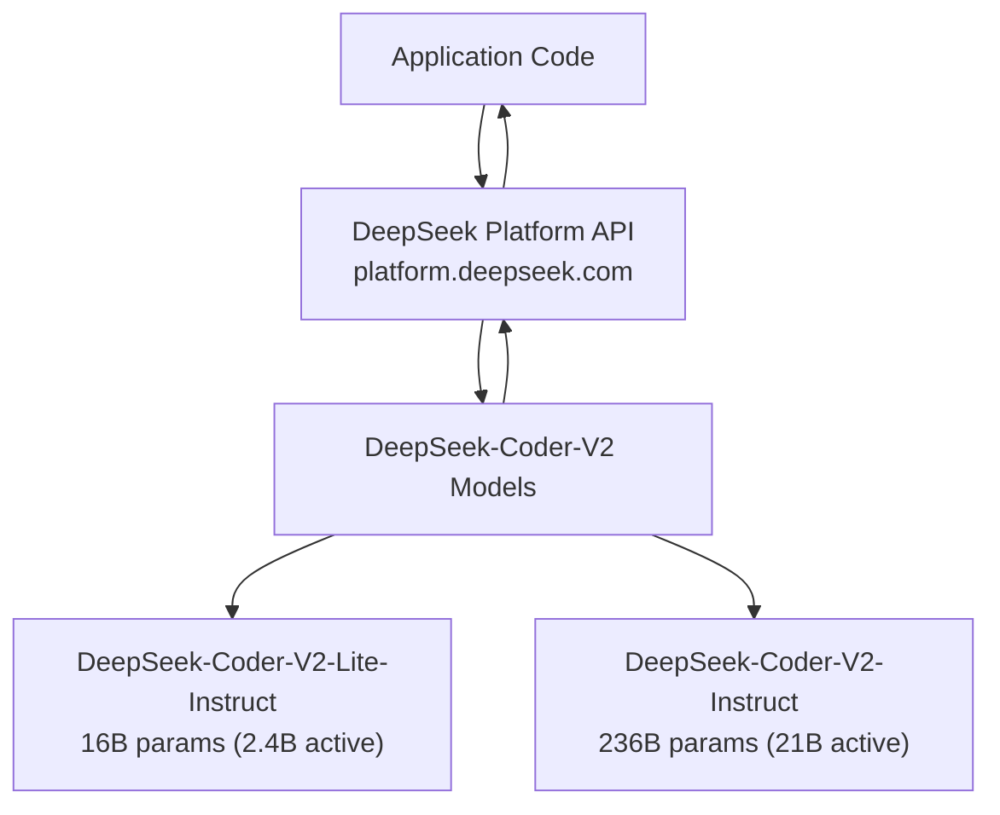
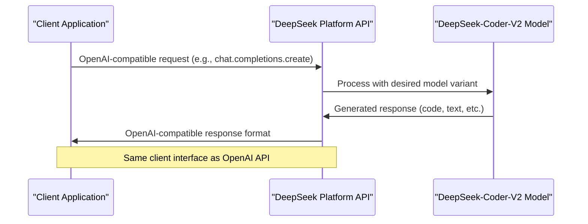
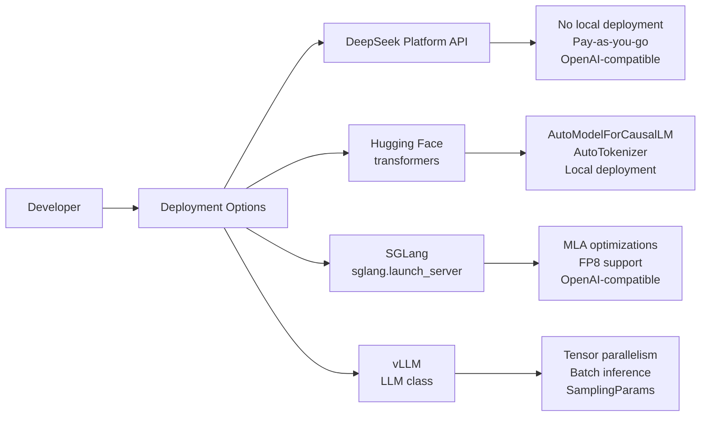

<!-- source: DeepWiki mcp.deepwiki.com · repo deepseek-ai/DeepSeek-Coder-V2 · page 4.4 DeepSeek Platform API · fetched 2026-10-30 -->

# DeepSeek Platform API

<details>
<summary>Relevant source files</summary>

The following files were used as context for generating this wiki page:

- [README.md](README.md)
- [figures/qr.jpeg](figures/qr.jpeg)

</details>


This page provides documentation for the DeepSeek Platform API, which offers OpenAI-compatible access to DeepSeek-Coder-V2 models through a hosted service. For information about other deployment methods, see [Hugging Face Integration](#4.1), [SGLang Integration](#4.2), and [vLLM Integration](#4.3).

## API Overview

The DeepSeek Platform API enables developers to access DeepSeek-Coder-V2 models through a cloud-based service without needing to deploy the models locally. This is particularly useful for applications that require the capabilities of these large language models but don't have the resources to run them on local infrastructure.

### DeepSeek Platform API Architecture



Sources: [README.md:180-186]()

## OpenAI Compatibility

The DeepSeek Platform API is designed to be compatible with the OpenAI API interface, allowing developers to leverage existing code written for OpenAI's services with minimal modifications. This compatibility enables easy switching between model providers or using multiple providers simultaneously.



Sources: [README.md:180-186](), [README.md:293-310]()

## Accessing the API

The DeepSeek Platform API is available at [platform.deepseek.com](https://platform.deepseek.com). Detailed information about registration, obtaining API keys, and comprehensive API documentation would be available on that platform.

Sources: [README.md:180-186]()

## Pay-as-you-go Pricing

The DeepSeek Platform API operates on a pay-as-you-go pricing model. Based on the information provided in the repository, the following pricing applies:

| Model | Input Price (per 1M tokens) | Output Price (per 1M tokens) |
|-------|---------------------------|----------------------------|
| DeepSeek-Coder-V2 | $0.6 | $1.8 |
| DeepSeek-Coder-V2-Lite | $0.2 | $0.6 |

Sources: [README.md:180-186]()

## Example Usage

Based on the OpenAI compatibility of the API, here's how you might use it to interact with DeepSeek-Coder-V2 models for a code generation task:

```python
import openai

# Initialize the client with the DeepSeek Platform API
client = openai.Client(
    base_url="https://platform.deepseek.com/v1",  # Example URL
    api_key="YOUR_API_KEY"
)

# Create a chat completion
response = client.chat.completions.create(
    model="deepseek-coder-v2-instruct",  # Example model identifier
    messages=[
        {"role": "system", "content": "You are a helpful AI assistant specializing in code."},
        {"role": "user", "content": "Write a quick sort algorithm in Python."},
    ],
    temperature=0.3,
    max_tokens=256
)

# Process the response
print(response.choices[0].message.content)
```

This example follows the pattern shown for interacting with locally deployed models using SGLang in the repository, adapted for the cloud-based DeepSeek Platform API.

Sources: [README.md:293-310]()

## Comparison with Other Deployment Methods

The following diagram illustrates how the DeepSeek Platform API compares to other methods for deploying and accessing DeepSeek-Coder-V2 models:



Sources: [README.md:189-341]()

## Conclusion

The DeepSeek Platform API provides a convenient way to access DeepSeek-Coder-V2 models through a hosted, OpenAI-compatible service. This approach eliminates the need for local model deployment and infrastructure management, making it accessible to a wider range of developers and use cases.

For specific details about API endpoints, authentication methods, and comprehensive usage examples, please refer to the official documentation at [platform.deepseek.com](https://platform.deepseek.com).

Sources: [README.md:180-186]()

---

