# Page: Overview

# Overview

<details>
<summary>Relevant source files</summary>

The following files were used as context for generating this wiki page:

- [README.md](README.md)
- [figures/logo.svg](figures/logo.svg)
- [paper.pdf](paper.pdf)

</details>


This document provides a comprehensive introduction to DeepSeek-Coder-V2, an open-source Mixture-of-Experts (MoE) code language model designed for code intelligence tasks. The page explains the model's architecture, capabilities, and usage options, setting the foundation for more detailed discussions in subsequent sections.

## Introduction to DeepSeek-Coder-V2

DeepSeek-Coder-V2 is a state-of-the-art code language model that achieves performance comparable to closed-source models like GPT-4-Turbo in code-specific tasks. The model was created by further pre-training an intermediate checkpoint of DeepSeek-V2 with an additional 6 trillion tokens, substantially enhancing its coding and mathematical reasoning capabilities while maintaining strong performance in general language tasks.

Key advancements over previous versions include:
- Expanded programming language support from 86 to 338 languages
- Extended context length from 16K to 128K tokens
- Superior performance on coding and mathematical reasoning benchmarks
- Efficient MoE architecture that reduces active parameters

Sources: [README.md:56-66]()

## Model Architecture and Variants

DeepSeek-Coder-V2 utilizes a Mixture-of-Experts (MoE) architecture based on the DeepSeekMoE framework, enabling models with large total parameter counts but significantly reduced active parameters during inference.

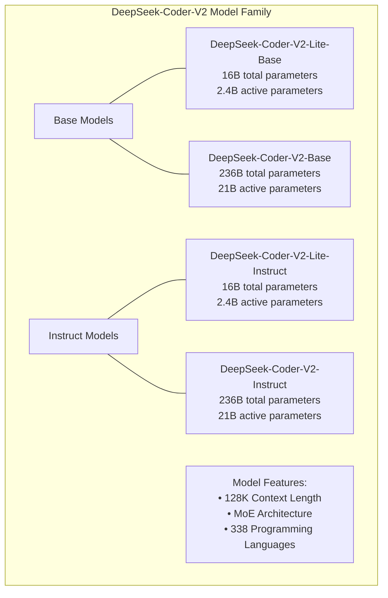

The model is available in four variants:
1. **Base models** - Designed for raw generation capabilities:
   - **DeepSeek-Coder-V2-Lite-Base**: 16B total parameters, 2.4B active
   - **DeepSeek-Coder-V2-Base**: 236B total parameters, 21B active

2. **Instruct models** - Fine-tuned to follow instructions:
   - **DeepSeek-Coder-V2-Lite-Instruct**: 16B total parameters, 2.4B active
   - **DeepSeek-Coder-V2-Instruct**: 236B total parameters, 21B active

All variants support a context length of 128K tokens, enabling the model to process and understand large sections of code or documentation.

Sources: [README.md:68-81]()

## Capabilities and Performance

DeepSeek-Coder-V2 excels in a wide range of code-related tasks, outperforming many open-source models and achieving results comparable to leading closed-source models.

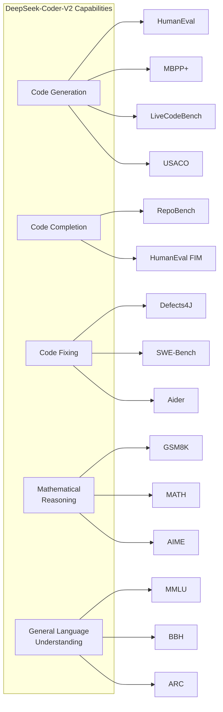

The model demonstrates strong performance across five key areas:

1. **Code Generation**: Creating code from natural language descriptions or problem statements
2. **Code Completion**: Automatically completing partially written code with appropriate suggestions
3. **Code Fixing**: Identifying and resolving bugs or issues in existing code
4. **Mathematical Reasoning**: Solving complex mathematical problems through step-by-step reasoning
5. **General Language Understanding**: Comprehending and responding to natural language queries

For detailed benchmark results, see the [Performance Benchmarks](#5) section.

Sources: [README.md:84-165]()

## Usage and Inference Options

DeepSeek-Coder-V2 can be used through multiple frameworks and platforms, offering flexibility for different use cases and deployment scenarios.

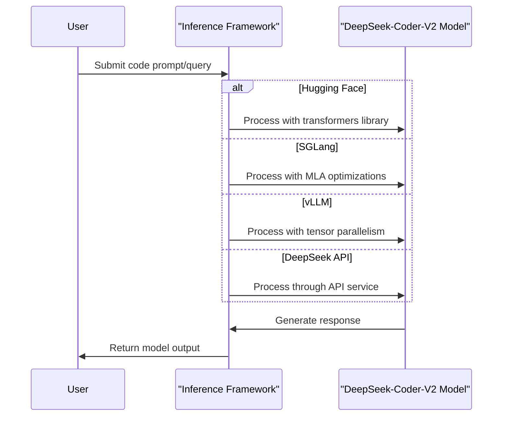

The model supports four primary inference methods:

1. **Hugging Face Transformers**: Direct integration with the Transformers library
   ```python
   # Example usage pattern (not actual code)
   from transformers import AutoTokenizer, AutoModelForCausalLM
   tokenizer = AutoTokenizer.from_pretrained("deepseek-ai/DeepSeek-Coder-V2-Lite-Instruct")
   model = AutoModelForCausalLM.from_pretrained("deepseek-ai/DeepSeek-Coder-V2-Lite-Instruct")
   ```

2. **SGLang** (recommended): Supports MLA optimizations, FP8, and FP8 KV Cache
   ```python
   # Example usage pattern (not actual code)
   python -m sglang.launch_server --model deepseek-ai/DeepSeek-Coder-V2-Instruct
   ```

3. **vLLM** (recommended): Efficient inference with tensor parallelism
   ```python
   # Example usage pattern (not actual code)
   from vllm import LLM
   llm = LLM(model="deepseek-ai/DeepSeek-Coder-V2-Lite-Instruct")
   ```

4. **DeepSeek Platform API**: OpenAI-compatible API endpoints

For detailed usage instructions and code examples for each method, see the [Usage & Inference](#4) section.

Sources: [README.md:188-340]()

## Supported Programming Languages

DeepSeek-Coder-V2 supports an extensive array of 338 programming languages, representing a significant expansion from the 86 languages supported in previous versions.

The supported languages span multiple categories:

| Category | Examples |
|----------|----------|
| General Purpose | Python, Java, C++, JavaScript, Go, etc. |
| Markup | HTML, XML, Markdown, LaTeX, etc. |
| Web Technologies | CSS, TypeScript, PHP, etc. |
| Data Science | R, Julia, SQL, MATLAB, etc. |
| Systems Programming | C, Rust, Assembly, CUDA, etc. |
| Configuration Formats | YAML, TOML, JSON, INI, etc. |
| Domain-Specific | GraphQL, Regex, Protocol Buffers, etc. |

For the complete list of supported languages, see the [Supported Programming Languages](#3) section.

Sources: [README.md:66]()

## Licensing Information

DeepSeek-Coder-V2 uses a dual licensing approach:

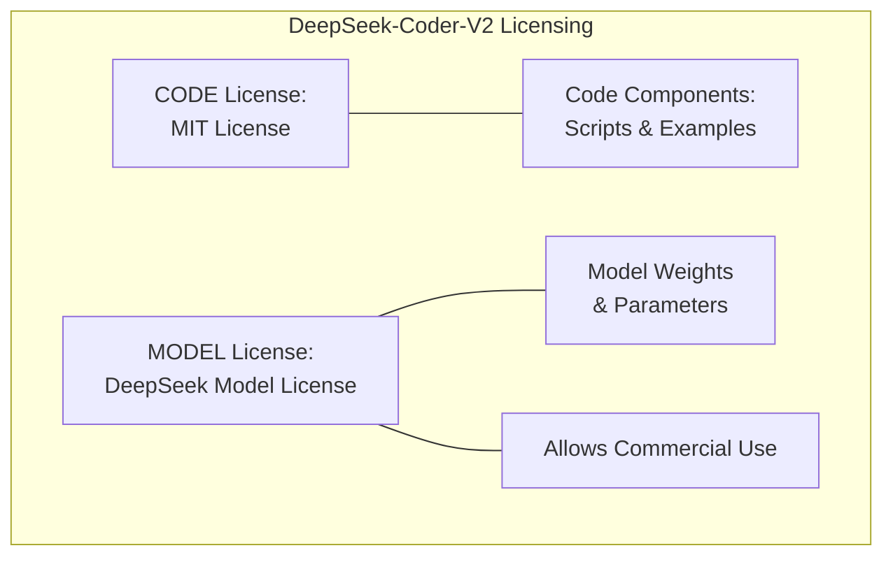

1. **Code License**: The repository code is licensed under the MIT License
2. **Model License**: The model weights and parameters are subject to the DeepSeek Model License

Both licenses support commercial use of DeepSeek-Coder-V2. For detailed information on licensing terms and conditions, see the [Licensing](#6) section.

Sources: [README.md:343-345]()

## Additional Resources

- **Chat Website**: DeepSeek-Coder-V2 is available for interactive use at [coder.deepseek.com](https://coder.deepseek.com)
- **API Platform**: OpenAI-compatible API access is available at [platform.deepseek.com](https://platform.deepseek.com)
- **Research Paper**: [DeepSeek-Coder-V2: Breaking the Barrier of Closed-Source Models in Code Intelligence](https://arxiv.org/pdf/2406.11931)

For more information about these resources, see the [Additional Resources](#8) section.

Sources: [README.md:176-186](), [README.md:51-53]()

---

# Page: Model Architecture

# Model Architecture

<details>
<summary>Relevant source files</summary>

The following files were used as context for generating this wiki page:

- [README.md](README.md)
- [paper.pdf](paper.pdf)

</details>


This document provides a technical overview of the DeepSeek-Coder-V2 model architecture. It covers the Mixture-of-Experts (MoE) design, model variants, and key architectural features that enable the model's performance in code-related tasks.

For specific information about different model sizes and implementations, see [Model Variants](#2.1). For details about the extended context window implementation, see [Context Length Capabilities](#2.2).

## Core Architecture

DeepSeek-Coder-V2 is built on the DeepSeekMoE framework, implementing a sparse Mixture-of-Experts architecture. This design allows the model to maintain a large number of total parameters while only activating a fraction of those parameters during inference.

### Mixture-of-Experts Architecture

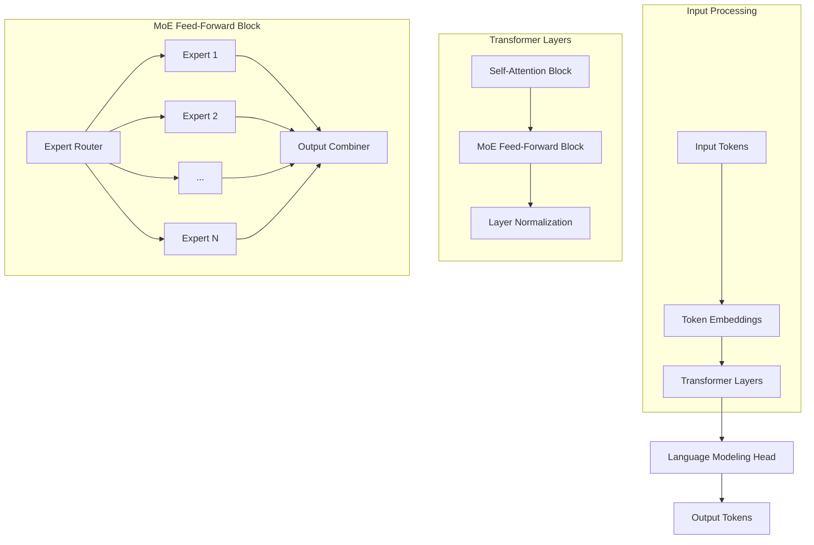

In this architecture:
1. Input tokens are embedded into continuous vector representations
2. These embeddings pass through multiple transformer layers
3. Within each transformer layer, after self-attention, a router network selectively activates only specific experts in the MoE feed-forward blocks
4. The outputs from activated experts are combined and processed through a language modeling head to produce the final output

Sources: [README.md:57-59](), [README.md:70]()

### Parameter Efficiency

The key innovation of the MoE architecture is parameter efficiency. For example:
- The 16B parameter model activates only 2.4B parameters for each token
- The 236B parameter model activates only 21B parameters for each token

This sparse activation pattern enables DeepSeek-Coder-V2 to achieve better computational and memory efficiency than comparable dense models, making it possible to train and deploy larger models effectively.

## Model Variants

DeepSeek-Coder-V2 encompasses four primary model variants:

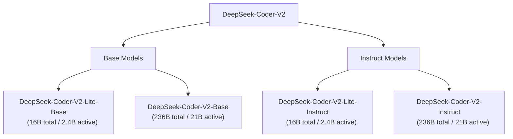

### Model Specifications

| Model | Total Parameters | Active Parameters | Context Length | Type |
|-------|------------------|-------------------|----------------|------|
| DeepSeek-Coder-V2-Lite-Base | 16B | 2.4B | 128K | Base |
| DeepSeek-Coder-V2-Lite-Instruct | 16B | 2.4B | 128K | Instruct |
| DeepSeek-Coder-V2-Base | 236B | 21B | 128K | Base |
| DeepSeek-Coder-V2-Instruct | 236B | 21B | 128K | Instruct |

Sources: [README.md:69-80]()

### Base vs. Instruct Models

The model family includes two types of variants:

- **Base Models**: Foundation models trained primarily for code completion and generation tasks
- **Instruct Models**: Fine-tuned versions of the base models optimized for following instructions and engaging in dialogue interactions

The Instruct models are better suited for chat-based interactions and following complex instructions, while the Base models may perform better for pure code completion tasks.

## Development Process

DeepSeek-Coder-V2 was developed through a systematic multi-stage process:

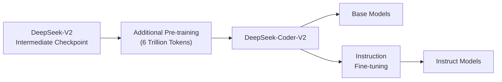

The development process included:
1. Starting from an intermediate checkpoint of the DeepSeek-V2 model
2. Additional pre-training with 6 trillion tokens of code-focused data
3. Creating base models optimized for code-related tasks
4. Fine-tuning with instruction data to create the instruct variants

This process enhanced the model's coding and mathematical reasoning capabilities while maintaining its general language understanding.

Sources: [README.md:58-59]()

## Technical Implementation

### Programming Language Coverage

The model architecture is designed to support a wide range of programming languages - 338 in total, a significant expansion from the 86 languages supported in previous DeepSeek models. This comprehensive language coverage required architectural considerations to handle the diverse syntax and patterns across different programming languages.

### Memory and Computation Design

The MoE architecture is specifically designed to optimize memory usage and computational efficiency:

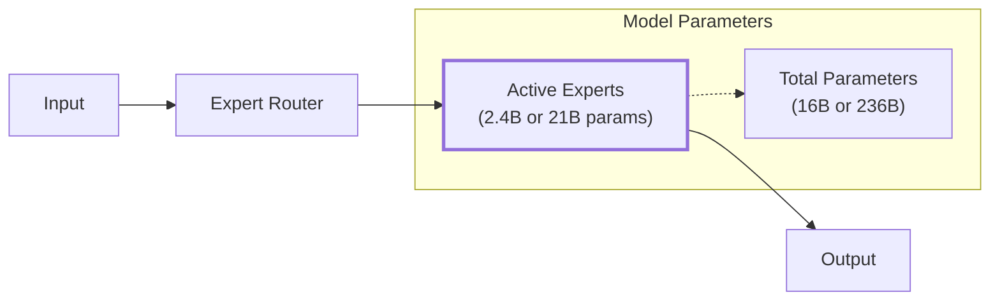

This selective activation approach allows the model to maintain strong performance while reducing the computational requirements for both training and inference.

### Inference Optimizations

The architecture supports several inference optimization techniques:

1. **Tensor Parallelism**: Distributing the model across multiple GPUs
2. **FP8 Support**: Reduced precision for more efficient computation
3. **FP8 KV Cache**: Memory-efficient key-value caching
4. **MLA Optimizations**: Multi-layer attention optimizations

Sources: [README.md:280-291]()

## Hardware Requirements

The hardware requirements for DeepSeek-Coder-V2 reflect its architecture:

- **DeepSeek-Coder-V2-Lite models**: Can run on consumer hardware with appropriate optimizations
- **DeepSeek-Coder-V2 (full 236B models)**: Require 80GB*8 GPUs for inference when using BF16 format

These requirements stem directly from the model's architectural design and parameter count.

Sources: [README.md:188-190]()

## Model Input and Output Processing

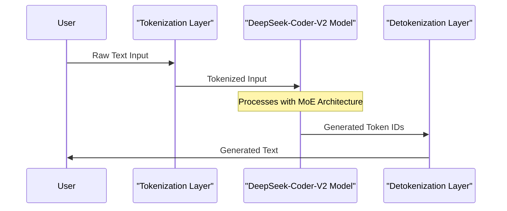

The model architecture includes specialized tokenization designed to handle code-specific constructs effectively, including:

1. Special tokens for code-specific elements
2. Support for FIM (Fill-In-Middle) operations with dedicated tokens (`<｜fim▁begin｜>`, `<｜fim▁hole｜>`, `<｜fim▁end｜>`)
3. Chat template format with role-based tokens for dialogue interactions

Sources: [README.md:205-227](), [README.md:229-274]()

---

# Page: Model Variants

# Model Variants

<details>
<summary>Relevant source files</summary>

The following files were used as context for generating this wiki page:

- [README.md](README.md)
- [paper.pdf](paper.pdf)

</details>


## Purpose and Scope

This document details the different variants of the DeepSeek-Coder-V2 model, explaining their architectures, parameters, and intended use cases. It covers the differences between Base and Instruct models as well as between Lite and full-sized versions. For information about context length capabilities, see [Context Length Capabilities](#2.2).

## Overview of DeepSeek-Coder-V2 Variants

DeepSeek-Coder-V2 is released in four main variants, all based on the DeepSeekMoE (Mixture-of-Experts) architecture:

| Model Name | Total Parameters | Active Parameters | Context Length | Type |
|------------|------------------|-------------------|----------------|------|
| DeepSeek-Coder-V2-Lite-Base | 16B | 2.4B | 128K | Base |
| DeepSeek-Coder-V2-Lite-Instruct | 16B | 2.4B | 128K | Instruct |
| DeepSeek-Coder-V2-Base | 236B | 21B | 128K | Base |
| DeepSeek-Coder-V2-Instruct | 236B | 21B | 128K | Instruct |

These variants provide different trade-offs between computational requirements, performance, and specific use cases.

Sources: [README.md:69-80]()

## MoE Architecture Fundamentals

### How DeepSeekMoE Works

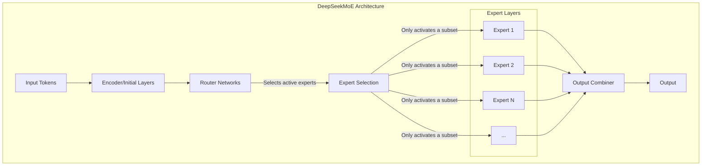

In an MoE architecture, only a small subset of the total parameters (the "experts") are activated for any given input. This allows the model to have a much larger total parameter count while maintaining reasonable computational efficiency.

For DeepSeek-Coder-V2, the models have either 16B or 236B total parameters, but only 2.4B or 21B active parameters, respectively. This means that for any given input, the model routes the computation through only about 15% (for Lite) or 9% (for full) of its total parameters.

Sources: [README.md:69-70]()

## Base vs. Instruct Models

### Comparison of Base and Instruct Variants

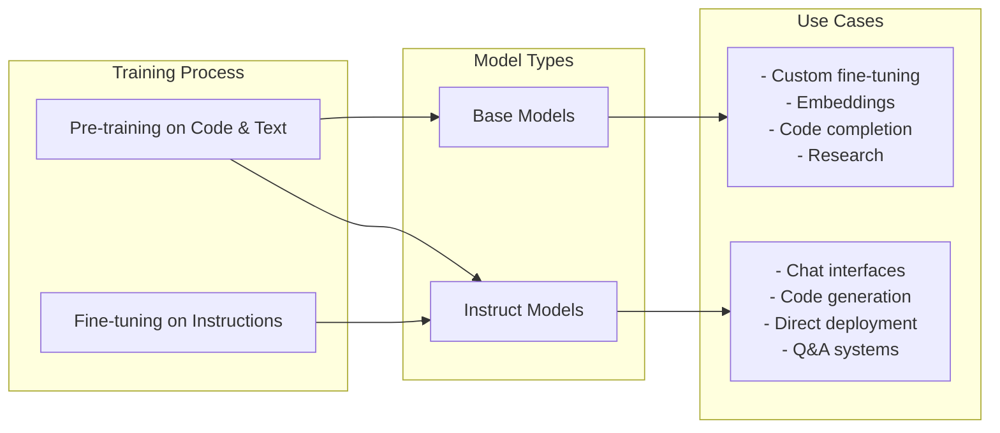

### Base Models
Base models (DeepSeek-Coder-V2-Lite-Base and DeepSeek-Coder-V2-Base) are pre-trained on a massive corpus of code and text data. These models are designed to:

- Serve as foundation models for further fine-tuning on specific tasks
- Excel at code completion tasks (completing partially written code)
- Generate code in a completion format rather than a conversational format
- Provide a strong basis for research and custom applications

Base models are recommended when you need to fine-tune on your own data or when you're working on code completion applications.

### Instruct Models
Instruct models (DeepSeek-Coder-V2-Lite-Instruct and DeepSeek-Coder-V2-Instruct) start with the Base models and undergo additional fine-tuning on instruction-following data. They are designed to:

- Respond to natural language instructions in a conversational manner
- Follow complex, multi-step instructions
- Generate complete code solutions based on natural language prompts
- Work well in chatbot or assistant-like interfaces

Instruct models are recommended for direct deployment in chat applications, code generation based on natural language prompts, and Q&A systems.

Sources: [README.md:69-80](), [README.md:194-227](), [README.md:229-276]()

## Lite vs. Full Models

### Hardware and Performance Comparison

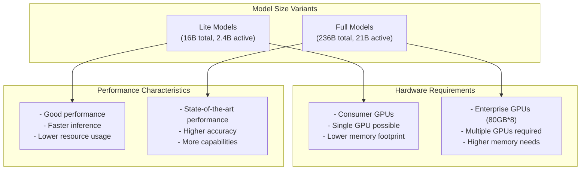

### Lite Models
The Lite variants (DeepSeek-Coder-V2-Lite-Base and DeepSeek-Coder-V2-Lite-Instruct) have 16B total parameters with 2.4B active parameters. These models:

- Require significantly less computational resources
- Can potentially run on consumer-grade GPUs (with sufficient VRAM)
- Offer faster inference times
- Provide good performance across a wide range of tasks
- Are suitable for deployment in resource-constrained environments

### Full Models
The full-sized variants (DeepSeek-Coder-V2-Base and DeepSeek-Coder-V2-Instruct) have 236B total parameters with 21B active parameters. These models:

- Require substantial computational resources (80GB*8 GPUs for BF16 inference)
- Deliver state-of-the-art performance on coding and mathematical reasoning tasks
- Approach the capabilities of closed-source models like GPT-4 Turbo
- Are best suited for enterprise applications where performance is critical

Sources: [README.md:69-80](), [README.md:189-190]()

## Performance Comparison

The following comparison shows the performance of the different DeepSeek-Coder-V2 variants across various benchmarks.

### Code Generation Performance

| Model | HumanEval | MBPP+ | LiveCodeBench | USACO |
|-------|-----------|-------|---------------|-------|
| DeepSeek-Coder-V2-Lite-Instruct | 81.1 | 68.8 | 24.3 | 6.5 |
| DeepSeek-Coder-V2-Instruct | 90.2 | 76.2 | 43.4 | 12.1 |
| GPT-4-Turbo-0409 (for reference) | 88.2 | 72.2 | 45.7 | 12.3 |

### Code Completion Performance

| Model | RepoBench (Python) | RepoBench (Java) | HumanEval FIM |
|-------|-------------------|------------------|---------------|
| DeepSeek-Coder-V2-Lite-Base | 38.9 | 43.3 | 86.4 |
| DeepSeek-Coder-Base-33B (for reference) | 39.1 | 44.8 | 86.4 |

### Code Fixing Performance

| Model | Defects4J | SWE-Bench | Aider |
|-------|-----------|-----------|-------|
| DeepSeek-Coder-V2-Lite-Instruct | 9.2 | 0.0 | 44.4 |
| DeepSeek-Coder-V2-Instruct | 21.0 | 12.7 | 73.7 |
| GPT-4-Turbo-0409 (for reference) | 24.3 | 18.3 | 63.9 |

### Mathematical Reasoning Performance

| Model | GSM8K | MATH | AIME 2024 | Math Odyssey |
|-------|-------|------|-----------|--------------|
| DeepSeek-Coder-V2-Lite-Instruct | 86.4 | 61.8 | 0/30 | 44.4 |
| DeepSeek-Coder-V2-Instruct | 94.9 | 75.7 | 4/30 | 53.7 |
| GPT-4-Turbo-0409 (for reference) | 93.7 | 73.4 | 3/30 | 46.8 |

### General Language Understanding Performance

| Benchmark | DeepSeek-Coder-V2-Lite-Instruct | DeepSeek-Coder-V2-Instruct |
|-----------|----------------------------------|----------------------------|
| BBH | 61.2 | 83.9 |
| MMLU | 60.1 | 79.2 |
| ARC-Challenge | 77.4 | 92.8 |
| C-Eval | 61.6 | 79.4 |
| MT-Bench | 7.81 | 8.77 |

The full-sized models consistently outperform the Lite variants across all benchmarks, sometimes by substantial margins. In particular, the full DeepSeek-Coder-V2-Instruct model competes with or exceeds the performance of GPT-4-Turbo on many code and mathematical reasoning tasks.

Sources: [README.md:86-166]()

## Usage Recommendations

### Integration Options and Code Structure

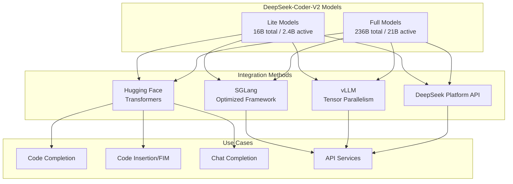

Based on the performance characteristics and resource requirements, here are general recommendations for choosing the appropriate model variant:

### When to use DeepSeek-Coder-V2-Lite-Base:
- For code completion tasks with limited computing resources
- As a foundation for custom fine-tuning when working with a modest compute budget
- For research purposes where the full models would be prohibitively expensive
- When you need to implement the model in environments with consumer-grade GPUs

### When to use DeepSeek-Coder-V2-Lite-Instruct:
- For conversational coding assistants with limited computing resources
- For code generation tasks where good (but not state-of-the-art) performance is sufficient
- For deployment in environments with constrained GPU resources
- For prototyping applications before scaling up to the full model

### When to use DeepSeek-Coder-V2-Base:
- For state-of-the-art code completion applications
- As a foundation for custom fine-tuning when performance is critical
- For enterprises with substantial computing resources who need the best possible performance
- For applications that require top-tier code completion capabilities

### When to use DeepSeek-Coder-V2-Instruct:
- For high-performance conversational coding assistants
- For critical code generation and problem-solving applications
- For enterprise solutions where performance justifies the computing cost
- When you need capabilities competitive with closed-source models like GPT-4 Turbo

Sources: [README.md:189-339]()

## Model Selection Guide

### Decision Flow for Model Selection

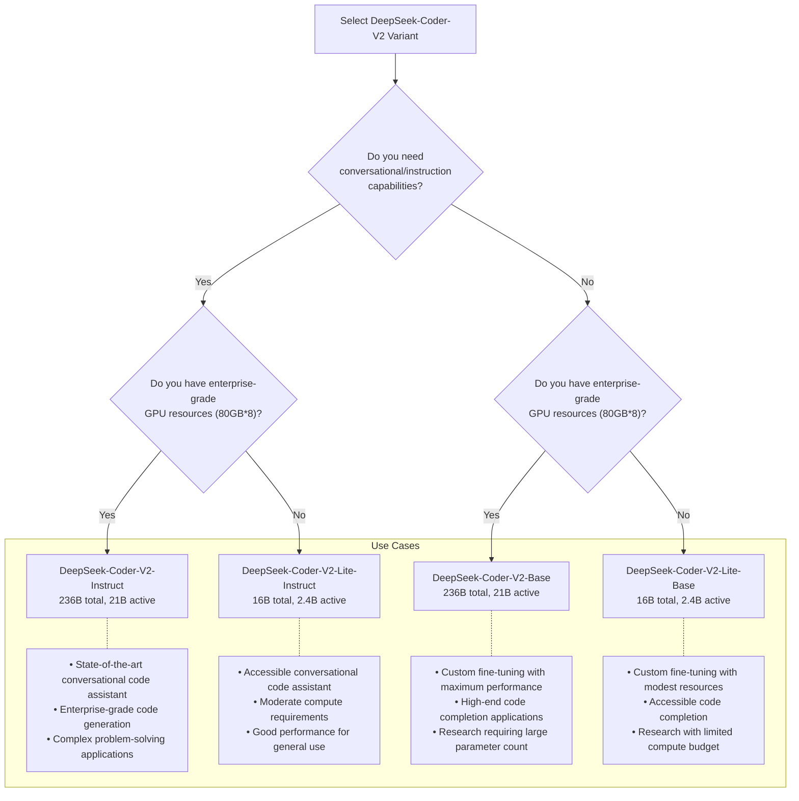

This guide helps determine which model variant to use based on your computational resources and whether you need conversational capabilities (Instruct models) or foundation models for custom applications (Base models).

Sources: [README.md:69-80](), [README.md:189-190]()

## Availability and Download

All four model variants are available to download from Hugging Face:

| Model | Hugging Face Repository |
|-------|-------------------------|
| DeepSeek-Coder-V2-Lite-Base | [deepseek-ai/DeepSeek-Coder-V2-Lite-Base](https://huggingface.co/deepseek-ai/DeepSeek-Coder-V2-Lite-Base) |
| DeepSeek-Coder-V2-Lite-Instruct | [deepseek-ai/DeepSeek-Coder-V2-Lite-Instruct](https://huggingface.co/deepseek-ai/DeepSeek-Coder-V2-Lite-Instruct) |
| DeepSeek-Coder-V2-Base | [deepseek-ai/DeepSeek-Coder-V2-Base](https://huggingface.co/deepseek-ai/DeepSeek-Coder-V2-Base) |
| DeepSeek-Coder-V2-Instruct | [deepseek-ai/DeepSeek-Coder-V2-Instruct](https://huggingface.co/deepseek-ai/DeepSeek-Coder-V2-Instruct) |

The models are also available through the DeepSeek Platform API and can be used with frameworks such as SGLang and vLLM for optimized inference.

Sources: [README.md:69-80](), [README.md:180-181]()

---

# Page: Context Length Capabilities

# Context Length Capabilities

<details>
<summary>Relevant source files</summary>

The following files were used as context for generating this wiki page:

- [README.md](README.md)
- [figures/long_context.png](figures/long_context.png)

</details>


## Purpose and Scope

This document provides detailed information about the 128K context length capabilities of DeepSeek-Coder-V2 models. It explains the technical aspects of how the extended context window functions, its applications for large-scale code understanding and generation, and performance characteristics. For information about the model variants that implement this context length, see [Model Variants](#2.1).

## Context Length Overview

DeepSeek-Coder-V2 features a 128K token context window, a significant improvement from the 16K context length of its predecessor. This expansion enables the model to process, understand, and generate code within much larger contexts, making it suitable for working with complex codebases and extensive documentation.

All model variants in the DeepSeek-Coder-V2 family (Base and Instruct versions, in both Lite and full configurations) support this extended context length.

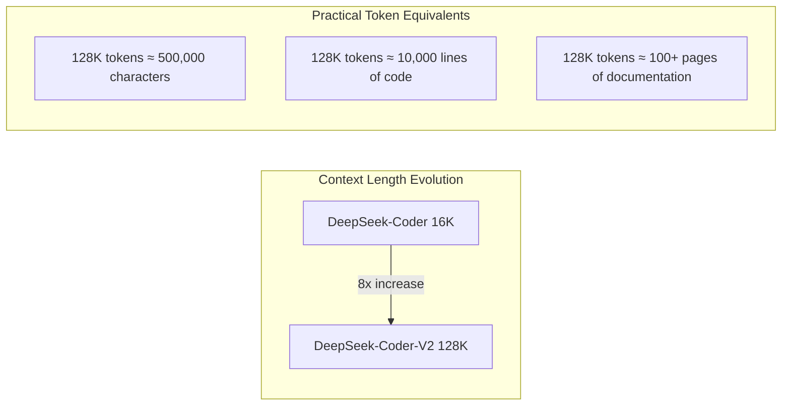

Sources: [README.md:61-61](), [README.md:76-79]()

## Technical Implementation

The 128K context length capability is implemented across all DeepSeek-Coder-V2 model variants through architectural modifications that enable efficient processing of longer sequences without degradation in performance.

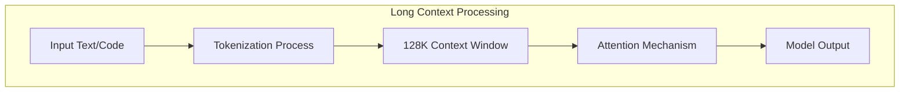

Sources: [README.md:58-61](), [README.md:168-174]()

## Applications of Extended Context

The 128K context length enables several advanced code-related tasks that were challenging or impossible with shorter context windows.

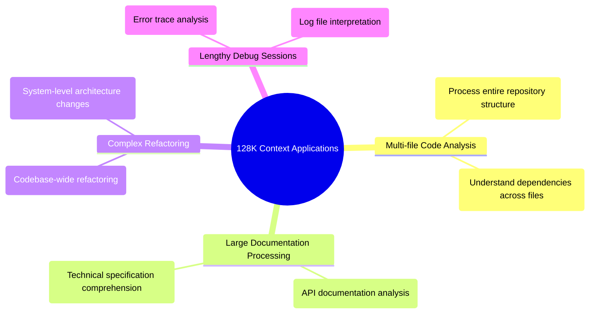

Sources: [README.md:58-61]()

## Performance Characteristics

DeepSeek-Coder-V2's context length capabilities have been evaluated using the "Needle In A Haystack" (NIAH) test methodology, which assesses how well the model can locate and utilize information embedded within large contexts.

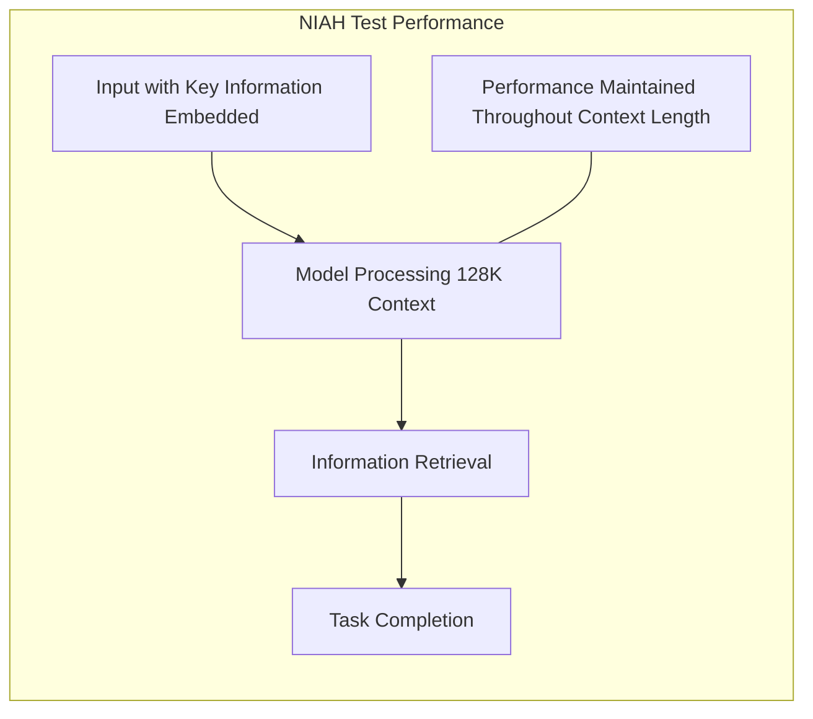

The model demonstrates consistent performance across varying context lengths up to the full 128K capacity, indicating effective attention and information retrieval mechanisms even with extremely long sequences.

Sources: [README.md:168-174]()

## Memory and Computational Requirements

Working with the maximum context length of 128K tokens requires substantial computational resources, particularly for the larger model variants.

| Model Variant | Parameters | Min GPU Requirements (for 128K context) |
|---------------|------------|----------------------------------------|
| DeepSeek-Coder-V2-Lite-Base/Instruct | 16B total, 2.4B active | 24-32GB VRAM |
| DeepSeek-Coder-V2-Base/Instruct | 236B total, 21B active | 80GB×8 GPUs |

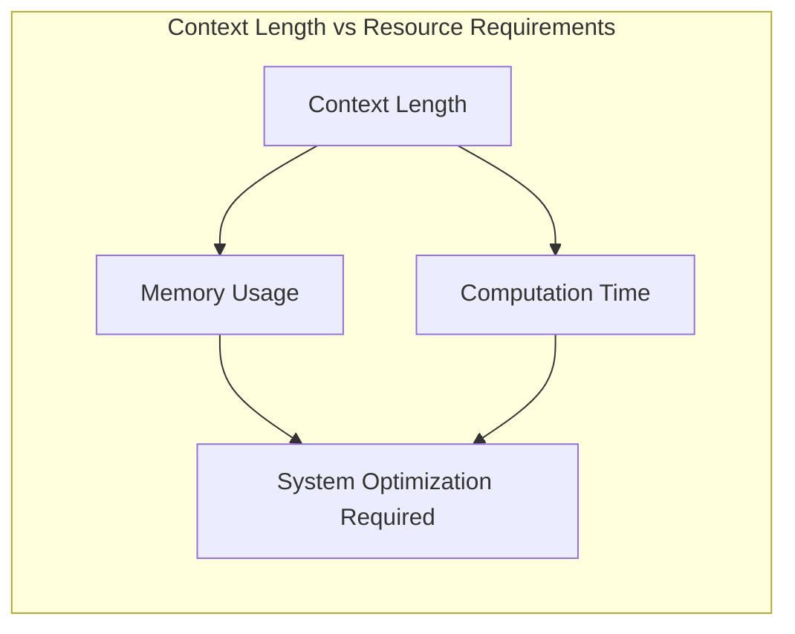

Note that for the full-sized DeepSeek-Coder-V2 models with 236B parameters, inference with the full 128K context window requires significant computing resources as indicated in the README.

Sources: [README.md:189-190]()

## Integration with Inference Frameworks

The extended context capabilities of DeepSeek-Coder-V2 can be utilized through multiple inference frameworks, each with its own approach to handling long contexts.

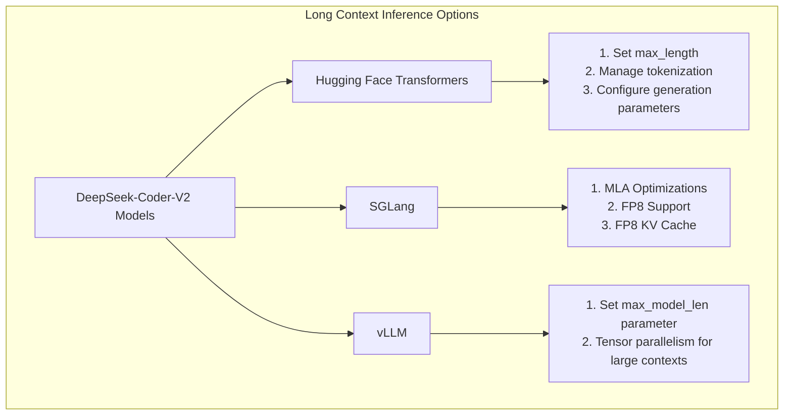

When working with inference frameworks, you'll need to specify the maximum context length appropriately and ensure sufficient computational resources are available.

Sources: [README.md:191-339]()

## Use Case: Multi-File Code Understanding

One of the primary benefits of the 128K context window is the ability to process multiple source files simultaneously, enabling the model to understand complex inter-file relationships and dependencies.

```mermaid
graph TD
    subgraph "Multi-File Processing With 128K Context"
        Input["Multiple Source Files"] --> Concatenation["Concatenation Into Single Context"]
        Concatenation --> Processing["DeepSeek-Coder-V2 Processing"]
        Processing --> Understanding["Cross-File Understanding"]
        Understanding --> Applications["Applications:<br>1. Dependency Analysis<br>2. Impact Assessment<br>3. Multi-File Refactoring<br>4. System-Level Documentation"]
    end
```

This capability is particularly valuable for:
- Understanding complex codebases with numerous interdependent components
- Analyzing how changes in one file might affect functionality in others
- Generating explanations of system-level behavior that spans multiple files
- Creating or refactoring code that needs to integrate with existing systems

Sources: [README.md:58-61](), [README.md:168-174]()

## Comparison with Other Models

The 128K context length of DeepSeek-Coder-V2 positions it among the models with the largest context windows available, particularly for code-specific tasks.

| Model | Context Length | Code-Specific | Open Source |
|-------|---------------|---------------|------------|
| DeepSeek-Coder-V2 | 128K | Yes | Yes |
| DeepSeek-Coder (previous) | 16K | Yes | Yes |
| GPT-4 Turbo | 128K | No | No |
| Claude 3 Opus | 200K | No | No |
| Llama 3 | 8K-128K (variant dependent) | No | Yes |

This extended context capability, combined with specialized code training, allows DeepSeek-Coder-V2 to handle more complex coding tasks than models with shorter context windows.

Sources: [README.md:58-61](), [README.md:168-174]()

## Best Practices for Long Context Usage

To effectively utilize the 128K context capabilities:

1. **Structured Input Organization**: Place the most relevant information early in the context when possible
2. **Resource Management**: Allocate sufficient computational resources, especially for the larger model variants
3. **Context Prioritization**: When approaching context limits, prioritize inclusion of code over comments or less relevant files
4. **Efficient Prompting**: Be explicit about what parts of the context the model should focus on
5. **Framework-Specific Optimization**: Utilize the specific long-context optimizations available in your chosen inference framework

Sources: [README.md:189-339]()

## Limitations

While the 128K context length represents a significant advance, users should be aware of certain limitations:

1. **Computational Requirements**: Working with full context length requires substantial computational resources
2. **Token Efficiency**: Not all content is equally token-efficient; code in different languages may consume tokens at different rates
3. **Attention Dilution**: Very long contexts may experience some attention dilution at extremely large scales
4. **Framework Support**: Not all inference frameworks handle long contexts equally well

Sources: [README.md:189-190]()

---

# Page: Supported Programming Languages

# Supported Programming Languages

<details>
<summary>Relevant source files</summary>

The following files were used as context for generating this wiki page:

- [README.md](README.md)
- [supported_langs.txt](supported_langs.txt)

</details>


## Purpose and Scope

This document provides a comprehensive overview of the 338 programming languages supported by DeepSeek-Coder-V2. It outlines the categories of supported languages and their organization within the model's capabilities. For information about model architecture and variants, see [Model Architecture](#2).

DeepSeek-Coder-V2 significantly expands language support from 86 languages in the previous version to 338 languages, enabling broader code intelligence capabilities across multiple programming domains.

Sources: [README.md:58-66]()

## Language Support Overview

DeepSeek-Coder-V2 supports 338 programming languages, covering everything from mainstream languages to specialized and legacy systems. This extensive support allows the model to understand, generate, and complete code across virtually all major programming ecosystems.

The complete list of supported languages can be found in the repository's `supported_langs.txt` file.

```mermaid
flowchart TD
    subgraph "DeepSeek-Coder-V2 Language Support"
        MainNode["338 Supported Languages"]
        MainNode --> Cat1["General Purpose Languages"]
        MainNode --> Cat2["Markup Languages"]
        MainNode --> Cat3["Web Technologies"]
        MainNode --> Cat4["Data Science & Statistical"]
        MainNode --> Cat5["Systems Programming"]
        MainNode --> Cat6["Configuration Formats"]
        MainNode --> Cat7["Domain-Specific Languages"]
        MainNode --> Cat8["Functional Programming"]
        MainNode --> Cat9["Shell & Scripting"]
        MainNode --> Cat10["Legacy & Specialized"]
    end
```

Sources: [README.md:66](), [supported_langs.txt:1-338]()

## Language Categories

The 338 supported languages can be organized into several major categories:

### General Purpose Languages

Includes widely-used languages for application development across multiple domains.

**Key Languages**: Python, Java, C++, C#, JavaScript, Go, Ruby, PHP, Swift, Kotlin, Dart, Rust

These languages form the core of modern software development and are comprehensively supported by the model for code generation, completion, and fixing tasks.

### Markup and Template Languages

Languages for document structuring, data serialization, and templating.

**Key Languages**: HTML, XML, YAML, JSON, Markdown, LaTeX, Twig, Handlebars, Pug

### Web Technologies

Languages and technologies specifically focused on web development.

**Key Languages**: CSS, SCSS, Sass, TypeScript, JSX, Vue, Angular templates

### Data Science and Statistical Languages

Languages optimized for data analysis, statistical computing, and mathematical operations.

**Key Languages**: R, Julia, MATLAB, SQL, SAS, Octave

### Systems Programming

Low-level languages used for operating systems, embedded systems, and hardware interfaces.

**Key Languages**: C, Assembly, CUDA, Verilog, VHDL

### Configuration Formats

Languages and formats used for configuration files and settings.

**Key Languages**: YAML, TOML, JSON, INI, HCL, Dockerfile

### Domain-Specific Languages (DSLs)

Languages designed for specific application domains or purposes.

**Key Languages**: GraphQL, Regular Expressions, Protocol Buffers, GLSL, HLSL

### Functional Programming Languages

Languages that emphasize functional programming paradigms.

**Key Languages**: Haskell, Clojure, Erlang, Elixir, F#, OCaml, Scala, Lisp

### Shell and Scripting Languages

Languages used for automation and system scripting.

**Key Languages**: Shell/Bash, PowerShell, Perl, AWK, Tcl

### Legacy and Specialized Languages

Older or industry-specific languages with continued usage in specific sectors.

**Key Languages**: COBOL, Fortran, Ada, ABAP

Sources: [supported_langs.txt:1-338]()

## Programming Language Support Implementation

The following diagram illustrates how programming language support is integrated into the DeepSeek-Coder-V2 architecture:

```mermaid
graph TD
    subgraph "DeepSeek-Coder-V2 Architecture"
        Training["Training Process"]
        Model["Model Architecture"]
        Tokenizer["Tokenization System"]
        InferenceLayer["Inference Layer"]
    end

    subgraph "Language Support Components"
        LanguageCorpus["Programming Language Corpus"]
        LanguageTokens["Language-Specific Tokens"]
        SyntaxPatterns["Syntax Patterns"]
        CodeStructures["Code Structures"]
    end

    LanguageCorpus --> Training
    LanguageCorpus --> LanguageTokens
    LanguageTokens --> Tokenizer
    SyntaxPatterns --> Model
    CodeStructures --> Model
    
    Tokenizer --> InferenceLayer
    Model --> InferenceLayer
    
    subgraph "Supported Languages (338)"
        GeneralPurpose["General Purpose"]
        Markup["Markup"]
        Web["Web Technologies"]
        DataScience["Data Science"]
        Systems["Systems Programming"]
        Config["Configuration"]
        DSLs["Domain-Specific"]
        Functional["Functional"]
        Shell["Shell & Scripting"]
        Legacy["Legacy & Specialized"]
    end
    
    LanguageCorpus --> GeneralPurpose
    LanguageCorpus --> Markup
    LanguageCorpus --> Web
    LanguageCorpus --> DataScience
    LanguageCorpus --> Systems
    LanguageCorpus --> Config
    LanguageCorpus --> DSLs
    LanguageCorpus --> Functional
    LanguageCorpus --> Shell
    LanguageCorpus --> Legacy
```

Sources: [README.md:58-66]()

## Language Distribution and Prevalence

The following diagram shows the relative distribution of language categories in the model's training and capabilities:

```mermaid
pie
    title "Approximate Distribution of Language Categories"
    "General Purpose" : 30
    "Web Technologies" : 20
    "Domain-Specific" : 15
    "Systems Programming" : 10
    "Data Science" : 10
    "Markup & Config" : 8
    "Functional" : 4
    "Shell & Scripting" : 2
    "Legacy" : 1
```

Note: This distribution is an approximation based on the languages listed in the supported_langs.txt file and typical usage patterns in modern software development.

Sources: [supported_langs.txt:1-338]()

## Top 20 Most Common Languages

The following table highlights 20 of the most commonly used programming languages supported by DeepSeek-Coder-V2, along with their primary application domains:

| Language    | Primary Domain                | Category              |
|-------------|------------------------------|----------------------|
| Python      | General/Data Science/AI      | General Purpose      |
| JavaScript  | Web Development              | General Purpose      |
| Java        | Enterprise/Android           | General Purpose      |
| C++         | Systems/Performance          | General Purpose      |
| C           | Systems                      | Systems Programming  |
| C#          | Windows/.NET                 | General Purpose      |
| Go          | Cloud/Networking             | General Purpose      |
| TypeScript  | Web Development              | Web Technologies     |
| Rust        | Systems/Safety               | Systems Programming  |
| PHP         | Web Development              | Web Technologies     |
| Ruby        | Web/Scripting                | General Purpose      |
| Swift       | iOS/macOS                    | General Purpose      |
| Kotlin      | Android/JVM                  | General Purpose      |
| R           | Data Analysis/Statistics     | Data Science         |
| SQL         | Database                     | Data Science         |
| Shell/Bash  | System Administration        | Shell & Scripting    |
| HTML/CSS    | Web Structure/Styling        | Markup/Web           |
| Scala       | Big Data/Functional          | Functional           |
| MATLAB      | Scientific Computing         | Data Science         |
| Dart        | Mobile (Flutter)             | General Purpose      |

Sources: [supported_langs.txt:1-338]()

## Language Support Evolution

DeepSeek-Coder-V2 represents a significant expansion in language support compared to its predecessor:

```mermaid
graph LR
    subgraph "DeepSeek-Coder (Previous)"
        PreviousModel["DeepSeek-Coder-33B"]
        PreviousLangs["86 Programming Languages"]
        PreviousContext["16K Context Window"]
    end
    
    subgraph "DeepSeek-Coder-V2 (Current)"
        CurrentModel["DeepSeek-Coder-V2"]
        CurrentLangs["338 Programming Languages"]
        CurrentContext["128K Context Window"]
    end
    
    PreviousModel --> CurrentModel
    PreviousLangs --> CurrentLangs
    PreviousContext --> CurrentContext
```

The expansion from 86 to 338 languages represents a 293% increase in language coverage, enabling broader applicability across diverse programming ecosystems.

Sources: [README.md:58-66]()

## Language Support and Performance

The extensive language support contributes to DeepSeek-Coder-V2's strong performance across various code-related benchmarks, including code generation, completion, and fixing tasks. The model's training on diverse programming languages enables it to understand and generate code across multiple paradigms and syntaxes.

For detailed performance benchmarks across different programming tasks and languages, see [Performance Benchmarks](#5).

Sources: [README.md:86-146]()

---

# Page: Usage & Inference

# Usage & Inference

<details>
<summary>Relevant source files</summary>

The following files were used as context for generating this wiki page:

- [README.md](README.md)

</details>


This document provides a comprehensive guide to using DeepSeek-Coder-V2 models for inference across various platforms and methods. It covers different integration options, usage patterns, and optimization techniques to help users effectively utilize these models for code-related tasks.

For information about the model architecture itself, see [Model Architecture](#2). For details on supported programming languages, refer to [Supported Programming Languages](#3).

## Model Variants Overview

Before exploring usage methods, it's important to understand the available model variants:

| Model | Total Parameters | Active Parameters | Context Length | Purpose |
|-------|------------|-------------------|---------------|---------|
| DeepSeek-Coder-V2-Lite-Base | 16B | 2.4B | 128K | Code completion and generation (base model) |
| DeepSeek-Coder-V2-Lite-Instruct | 16B | 2.4B | 128K | Chat and instruction following |
| DeepSeek-Coder-V2-Base | 236B | 21B | 128K | Code completion and generation (base model) |
| DeepSeek-Coder-V2-Instruct | 236B | 21B | 128K | Chat and instruction following |

The Lite variants require fewer computational resources while maintaining good performance. The full models (236B parameters) require 8 GPUs with 80GB memory each for BF16 inference.

Sources: [README.md:68-80]()

## Inference Pipeline

The following diagram shows the general inference flow from user input to model response:

```mermaid
graph TD
    UserInput["User Input (Natural Language/Code)"] --> Tokenization["tokenizer(input_text)"]
    Tokenization --> TokenIDs["input_ids Tensor"]
    TokenIDs --> ModelProcessing["model(**inputs)"]
    ModelProcessing --> OutputGeneration["model.generate()"]
    OutputGeneration --> OutputIDs["output_ids Tensor"] 
    OutputIDs --> Detokenization["tokenizer.decode(outputs[0])"]
    Detokenization --> Response["Text Response"]
```

Sources: [README.md:189-205]()

## Inference Methods

DeepSeek-Coder-V2 supports multiple inference methods, each with its own advantages. The following diagram illustrates these methods and their key components:

```mermaid
flowchart TD
    DeepSeekCoderV2["DeepSeek-Coder-V2 Models"] --> HF["Hugging Face Transformers"]
    DeepSeekCoderV2 --> SGLang["SGLang"]
    DeepSeekCoderV2 --> VLLM["vLLM"]
    DeepSeekCoderV2 --> API["DeepSeek Platform API"]
    
    HF --> HF_CC["AutoModelForCausalLM.generate() - Code Completion"]
    HF --> HF_CI["FIM Tokens - Code Insertion"]
    HF --> HF_Chat["apply_chat_template() - Chat Completion"]
    
    SGLang --> SG_MLA["sglang.launch_server - MLA Optimizations"]
    SGLang --> SG_FP8["W8A8 Support"]
    SGLang --> SG_KV["fp8_e5m2 KV Cache"]
    SGLang --> SG_Compile["enable-torch-compile"]
    
    VLLM --> VLLM_TP["vllm.LLM(tensor_parallel_size)"]
    VLLM --> VLLM_Batch["llm.generate(prompt_token_ids)"]
    
    API --> API_OAIAPI["client.chat.completions.create()"]
```

Sources: [README.md:188-338]()

### 1. Hugging Face Transformers

The most straightforward way to use DeepSeek-Coder-V2 is through Hugging Face's Transformers library. This method supports several use cases:

#### Code Completion

Code completion is when you provide a partial code snippet and the model completes it:

```python
from transformers import AutoTokenizer, AutoModelForCausalLM
import torch
tokenizer = AutoTokenizer.from_pretrained("deepseek-ai/DeepSeek-Coder-V2-Lite-Base", trust_remote_code=True)
model = AutoModelForCausalLM.from_pretrained("deepseek-ai/DeepSeek-Coder-V2-Lite-Base", trust_remote_code=True, torch_dtype=torch.bfloat16).cuda()
input_text = "#write a quick sort algorithm"
inputs = tokenizer(input_text, return_tensors="pt").to(model.device)
outputs = model.generate(**inputs, max_length=128)
print(tokenizer.decode(outputs[0], skip_special_tokens=True))
```

Sources: [README.md:194-204]()

#### Code Insertion (FIM)

The Fill-in-the-Middle (FIM) feature allows you to have the model fill in a gap in the middle of a code snippet:

```python
from transformers import AutoTokenizer, AutoModelForCausalLM
import torch
tokenizer = AutoTokenizer.from_pretrained("deepseek-ai/DeepSeek-Coder-V2-Lite-Base", trust_remote_code=True)
model = AutoModelForCausalLM.from_pretrained("deepseek-ai/DeepSeek-Coder-V2-Lite-Base", trust_remote_code=True, torch_dtype=torch.bfloat16).cuda()
input_text = """<｜fim▁begin｜>def quick_sort(arr):
    if len(arr) <= 1:
        return arr
    pivot = arr[0]
    left = []
    right = []
<｜fim▁hole｜>
        if arr[i] < pivot:
            left.append(arr[i])
        else:
            right.append(arr[i])
    return quick_sort(left) + [pivot] + quick_sort(right)<｜fim▁end｜>"""
inputs = tokenizer(input_text, return_tensors="pt").to(model.device)
outputs = model.generate(**inputs, max_length=128)
print(tokenizer.decode(outputs[0], skip_special_tokens=True)[len(input_text):])
```

The FIM format uses special tokens to indicate the beginning of the code (`<｜fim▁begin｜>`), the hole to be filled (`<｜fim▁hole｜>`), and the end of the code (`<｜fim▁end｜>`).

Sources: [README.md:207-227]()

#### Chat Completion

For instruction-tuned models, you can use the chat completion functionality:

```python
from transformers import AutoTokenizer, AutoModelForCausalLM
import torch
tokenizer = AutoTokenizer.from_pretrained("deepseek-ai/DeepSeek-Coder-V2-Lite-Instruct", trust_remote_code=True)
model = AutoModelForCausalLM.from_pretrained("deepseek-ai/DeepSeek-Coder-V2-Lite-Instruct", trust_remote_code=True, torch_dtype=torch.bfloat16).cuda()
messages=[
    { 'role': 'user', 'content': "write a quick sort algorithm in python."}
]
inputs = tokenizer.apply_chat_template(messages, add_generation_prompt=True, return_tensors="pt").to(model.device)
# tokenizer.eos_token_id is the id of <｜end▁of▁sentence｜> token
outputs = model.generate(inputs, max_new_tokens=512, do_sample=False, top_k=50, top_p=0.95, num_return_sequences=1, eos_token_id=tokenizer.eos_token_id)
print(tokenizer.decode(outputs[0][len(inputs[0]):], skip_special_tokens=True))
```

Sources: [README.md:232-243]()

#### Chat Template Format

The chat template follows a specific structure:

```
<｜begin▁of▁sentence｜>User: {user_message_1}

---

# Page: Hugging Face Integration

# Hugging Face Integration

<details>
<summary>Relevant source files</summary>

The following files were used as context for generating this wiki page:

- [README.md](README.md)

</details>


This document provides a detailed technical guide on integrating DeepSeek-Coder-V2 models using the Hugging Face Transformers library. For alternative integration methods, see [SGLang Integration](#4.2), [vLLM Integration](#4.3), or [DeepSeek Platform API](#4.4).

## Model Variants Available on Hugging Face

DeepSeek-Coder-V2 offers four model variants on Hugging Face Hub, each with different parameter counts and capabilities:

| Model | Total Parameters | Active Parameters | Context Length | Repository Name |
|-------|------------------|-------------------|----------------|-----------------|
| DeepSeek-Coder-V2-Lite-Base | 16B | 2.4B | 128K | deepseek-ai/DeepSeek-Coder-V2-Lite-Base |
| DeepSeek-Coder-V2-Lite-Instruct | 16B | 2.4B | 128K | deepseek-ai/DeepSeek-Coder-V2-Lite-Instruct |
| DeepSeek-Coder-V2-Base | 236B | 21B | 128K | deepseek-ai/DeepSeek-Coder-V2-Base |
| DeepSeek-Coder-V2-Instruct | 236B | 21B | 128K | deepseek-ai/DeepSeek-Coder-V2-Instruct |

- **Base** models are pre-trained only, while **Instruct** models are fine-tuned for instruction following
- **Lite** models require less computational resources than full models

Sources: [README.md:69-80]()

## Hardware Requirements

- **Lite models**: Suitable for consumer-grade GPUs with sufficient VRAM
- **Full models**: Require 8 GPUs with 80GB each for BF16 inference

Sources: [README.md:189-190]()

## Integration Architecture

The following diagram illustrates how DeepSeek-Coder-V2 integrates with Hugging Face Transformers:

```mermaid
flowchart LR
    subgraph "User Application"
        UC["User Code"]
    end
    
    subgraph "Hugging Face Transformers"
        UC --> AT["AutoTokenizer.from_pretrained()"]
        UC --> AM["AutoModelForCausalLM.from_pretrained()"]
        AT --> DST["DeepSeekTokenizer"]
        AM --> DSM["DeepSeekModelForCausalLM"]
    end
    
    subgraph "Inference Process"
        DST --> TI["tokenizer(input_text)"]
        TI --> IP["Input Tensors"]
        IP --> GEN["model.generate()"]
        DSM --> GEN
        GEN --> OT["Output Tokens"]
        OT --> DEC["tokenizer.decode()"]
        DEC --> RES["Result Text"]
    end
```

Sources: [README.md:192-204]()

## Basic Setup

Loading the model and tokenizer requires the following code pattern:

```python
from transformers import AutoTokenizer, AutoModelForCausalLM
import torch

tokenizer = AutoTokenizer.from_pretrained("deepseek-ai/DeepSeek-Coder-V2-Lite-Base", trust_remote_code=True)
model = AutoModelForCausalLM.from_pretrained("deepseek-ai/DeepSeek-Coder-V2-Lite-Base", 
                                            trust_remote_code=True, 
                                            torch_dtype=torch.bfloat16).cuda()
```

Important parameters:
- `trust_remote_code=True`: Required as model implementation contains custom code
- `torch_dtype=torch.bfloat16`: Reduces memory usage with BF16 precision
- `.cuda()`: Moves model to GPU

Sources: [README.md:196-199]()

## Use Cases

### Code Completion

Code completion provides suggestions to complete partial code:

```mermaid
sequenceDiagram
    participant User
    participant Tokenizer as "DeepSeekTokenizer"
    participant Model as "DeepSeekModelForCausalLM"
    
    User->>Tokenizer: Partial code
    Note right of Tokenizer: Input tokens created
    Tokenizer->>Model: Tokenized input
    Model->>Model: Generate completion
    Model->>Tokenizer: Output tokens
    Tokenizer->>User: Completed code
```

Example usage:

```python
input_text = "#write a quick sort algorithm"
inputs = tokenizer(input_text, return_tensors="pt").to(model.device)
outputs = model.generate(**inputs, max_length=128)
print(tokenizer.decode(outputs[0], skip_special_tokens=True))
```

Sources: [README.md:194-204]()

### Code Insertion (Fill-in-the-Middle)

The Fill-in-the-Middle (FIM) capability allows generating code to fill a gap between existing code segments:

```mermaid
flowchart LR
    subgraph "FIM Process"
        direction TB
        IN["Input with FIM Markers"] --> TOK["Tokenizer"]
        TOK --> MODEL["Model"]
        MODEL --> GEN["Generate Missing Code"]
        GEN --> DEC["Decode Output"]
        DEC --> RES["Complete Code"]
    end
    
    subgraph "FIM Special Tokens"
        B["<｜fim▁begin｜>"] --> P["Prefix Code"]
        P --> H["<｜fim▁hole｜>"]
        H --> S["Suffix Code"]
        S --> E["<｜fim▁end｜>"]
    end
```

Example usage:

```python
input_text = """<｜fim▁begin｜>def quick_sort(arr):
    if len(arr) <= 1:
        return arr
    pivot = arr[0]
    left = []
    right = []
<｜fim▁hole｜>
    for i in range(1, len(arr)):
        if arr[i] < pivot:
            left.append(arr[i])
        else:
            right.append(arr[i])
    return quick_sort(left) + [pivot] + quick_sort(right)<｜fim▁end｜>"""

inputs = tokenizer(input_text, return_tensors="pt").to(model.device)
outputs = model.generate(**inputs, max_length=128)
print(tokenizer.decode(outputs[0], skip_special_tokens=True)[len(input_text):])
```

Special tokens:
- `<｜fim▁begin｜>`: Marks the beginning of the code segment
- `<｜fim▁hole｜>`: Marks where code should be inserted
- `<｜fim▁end｜>`: Marks the end of the code segment

Sources: [README.md:206-227]()

### Chat Completion

For interacting with the Instruct models in a conversational manner:

```mermaid
flowchart TD
    subgraph "Chat Completion Flow"
        MC["Messages Collection"] --> CT["Chat Template Application"]
        CT --> TOK["Tokenization"]
        TOK --> GEN["Generation"]
        GEN --> DEC["Decoding"]
        DEC --> RES["AI Response"]
    end
    
    subgraph "Chat Template Structure"
        BOS["<｜begin▁of▁sentence｜>"] --> UM1["User: {message}"]
        UM1 --> AM1["Assistant: {response}"]
        AM1 --> EOS["<｜end▁of▁sentence｜>"]
        EOS --> UM2["User: {new_message}"]
        UM2 --> AP["Assistant:"]
    end
```

Example usage:

```python
messages=[
    { 'role': 'user', 'content': "write a quick sort algorithm in python."}
]
inputs = tokenizer.apply_chat_template(messages, add_generation_prompt=True, return_tensors="pt").to(model.device)
outputs = model.generate(
    inputs, 
    max_new_tokens=512, 
    do_sample=False, 
    top_k=50, 
    top_p=0.95, 
    num_return_sequences=1, 
    eos_token_id=tokenizer.eos_token_id
)
print(tokenizer.decode(outputs[0][len(inputs[0]):], skip_special_tokens=True))
```

Sources: [README.md:229-243]()

## Chat Template

The complete chat template can be found in the `tokenizer_config.json` file in the Hugging Face model repository. The template follows this structure:

```
<｜begin▁of▁sentence｜>User: {user_message_1}

---

# Page: SGLang Integration

# SGLang Integration

<details>
<summary>Relevant source files</summary>

The following files were used as context for generating this wiki page:

- [README.md](README.md)

</details>


This document provides a comprehensive guide for integrating DeepSeek-Coder-V2 models with SGLang for optimized inference. SGLang is one of the recommended inference frameworks for DeepSeek-Coder-V2, offering significant performance advantages over standard implementations.

For alternative inference methods, see [Hugging Face Integration](#4.1) or [vLLM Integration](#4.3).

## Overview

SGLang is an inference optimization framework that provides several key features specifically beneficial for large language models like DeepSeek-Coder-V2:

- MLA (Multi-Level Attention) optimizations
- FP8 (W8A8) quantization support
- FP8 KV Cache for memory efficiency
- Torch Compile integration for acceleration
- OpenAI-compatible API endpoints

According to the repository documentation, SGLang currently offers "the best latency and throughput among open-source frameworks" for DeepSeek-Coder-V2 inference.

Sources: [README.md:279-282]()

## SGLang Integration Architecture

```mermaid
graph TD
    client["Client Application"]
    openai_client["OpenAI Client (openai.Client)"]
    sglang_server["SGLang Server (sglang.launch_server)"]
    inference_engine["SGLang Inference Engine"]
    tokenizer["DeepSeek Tokenizer (AutoTokenizer)"]
    model["DeepSeek-Coder-V2 Model (AutoModelForCausalLM)"]
    
    client --> openai_client
    openai_client -- "REST API Call\n(http://127.0.0.1:30000/v1)" --> sglang_server
    sglang_server --> inference_engine
    inference_engine --> tokenizer
    tokenizer --> model
    model --> tokenizer
    tokenizer --> inference_engine
    inference_engine --> sglang_server
    sglang_server --> openai_client
    openai_client --> client
    
    model --- optimizations
    
    subgraph optimizations["SGLang Optimizations"]
        mla["MLA Optimizations"]
        fp8["FP8 (W8A8)"]
        tp["Tensor Parallelism (--tp flag)"]
        kv_cache["FP8 KV Cache (--kv-cache-dtype fp8_e5m2)"]
        torch_compile["Torch Compile (--enable-torch-compile)"]
    end
```

Sources: [README.md:279-293]()

## Setting Up a SGLang Server

SGLang provides an OpenAI API-compatible server for interfacing with DeepSeek-Coder-V2 models. You can launch the server with different configurations depending on your hardware capabilities and performance requirements.

### Deployment Options

```mermaid
graph TD
    deployment["SGLang Deployment Options"]
    bf16_tp["BF16 with Tensor Parallelism (--tp 8)"]
    bf16_tc["BF16 with Torch Compile (--enable-torch-compile)"]
    fp8_tp_kv["FP8 with TP and FP8 KV Cache (--kv-cache-dtype fp8_e5m2)"]
    
    deployment --- bf16_tp
    deployment --- bf16_tc
    deployment --- fp8_tp_kv
    
    bf16_tp -- "For multi-GPU setups\n(DeepSeek-Coder-V2-Instruct)" --> cmd1["python3 -m sglang.launch_server\n--model deepseek-ai/DeepSeek-Coder-V2-Instruct\n--tp 8 --trust-remote-code"]
    
    bf16_tc -- "For single GPU with compilation\n(DeepSeek-Coder-V2-Lite-Instruct)" --> cmd2["python3 -m sglang.launch_server\n--model deepseek-ai/DeepSeek-Coder-V2-Lite-Instruct\n--trust-remote-code --enable-torch-compile"]
    
    fp8_tp_kv -- "For optimized memory usage\n(FP8 quantized model)" --> cmd3["python3 -m sglang.launch_server\n--model neuralmagic/DeepSeek-Coder-V2-Instruct-FP8\n--tp 8 --trust-remote-code\n--kv-cache-dtype fp8_e5m2"]
```

Sources: [README.md:282-290]()

### Option 1: BF16 with Tensor Parallelism

This configuration is suitable for running the full-sized DeepSeek-Coder-V2-Instruct model across multiple GPUs with tensor parallelism:

```bash
python3 -m sglang.launch_server --model deepseek-ai/DeepSeek-Coder-V2-Instruct --tp 8 --trust-remote-code
```

Sources: [README.md:283-284]()

### Option 2: BF16 with Torch Compile

This configuration uses the lightweight DeepSeek-Coder-V2-Lite-Instruct model with Torch compilation for additional optimization:

```bash
python3 -m sglang.launch_server --model deepseek-ai/DeepSeek-Coder-V2-Lite-Instruct --trust-remote-code --enable-torch-compile
```

**Note**: The compilation process can take several minutes but offers improved performance afterward.

Sources: [README.md:286-287]()

### Option 3: FP8 with Tensor Parallelism and FP8 KV Cache

For maximum memory efficiency using the FP8 quantized model with tensor parallelism and FP8 KV cache:

```bash
python3 -m sglang.launch_server --model neuralmagic/DeepSeek-Coder-V2-Instruct-FP8 --tp 8 --trust-remote-code --kv-cache-dtype fp8_e5m2
```

Sources: [README.md:289-290]()

## Using the OpenAI-Compatible API

Once the SGLang server is running, you can interact with it using the OpenAI API client. The server exposes an endpoint compatible with the OpenAI API format, allowing you to use existing OpenAI SDK clients.

### Example: Chat Completion

```python
import openai
client = openai.Client(
    base_url="http://127.0.0.1:30000/v1", api_key="EMPTY")

# Chat completion
response = client.chat.completions.create(
    model="default",
    messages=[
        {"role": "system", "content": "You are a helpful AI assistant"},
        {"role": "user", "content": "List 3 countries and their capitals."},
    ],
    temperature=0,
    max_tokens=64,
)
print(response)
```

Sources: [README.md:294-311]()

## Performance Optimizations

SGLang offers several optimizations that can significantly improve the performance of DeepSeek-Coder-V2 model inference:

```mermaid
graph TD
    performance["SGLang Performance Optimizations"]
    
    performance --> mla["MLA Optimizations"]
    performance --> fp8["FP8 Quantization (W8A8)"]
    performance --> kv_cache["FP8 KV Cache (--kv-cache-dtype fp8_e5m2)"]
    performance --> torch_compile["Torch Compile (--enable-torch-compile)"]
    performance --> tp["Tensor Parallelism (--tp 8)"]
    
    mla --> benefit1["Improved Attention\nMechanism Efficiency"]
    fp8 --> benefit2["8-bit Weight Quantization\n(neuralmagic/DeepSeek-Coder-V2-Instruct-FP8)"]
    kv_cache --> benefit3["8-bit Key-Value Cache\nQuantization (fp8_e5m2)"]
    torch_compile --> benefit4["PyTorch Compiled\nComputational Graph"]
    tp --> benefit5["Model Sharded Across\nMultiple GPUs"]
```

Sources: [README.md:279-282]()

## Hardware Requirements

The hardware requirements depend on which model variant you're using:

| Model | Parameter Size | Active Parameters | Minimum Hardware |
|-------|----------------|-------------------|------------------|
| DeepSeek-Coder-V2-Lite | 16B | 2.4B | Single GPU with sufficient VRAM |
| DeepSeek-Coder-V2 | 236B | 21B | Multiple GPUs (80GB*8 recommended for BF16) |

Using the FP8 quantized version (`neuralmagic/DeepSeek-Coder-V2-Instruct-FP8`) can significantly reduce memory requirements.

Sources: [README.md:189-190](), [README.md:70-79]()

## Common Issues and Troubleshooting

When using SGLang with DeepSeek-Coder-V2, be aware of these potential issues:

1. **Long compilation time with Torch Compile**:
   - The compilation process can take several minutes
   - This is a one-time cost that improves subsequent inference performance

2. **Memory requirements**:
   - The full DeepSeek-Coder-V2 model requires significant GPU memory
   - Consider using FP8 quantization and FP8 KV cache for reduced memory footprint
   - Alternatively, use the Lite model variant for lower resource environments

3. **OpenAI API compatibility**:
   - Ensure you're using the correct base URL when configuring the OpenAI client
   - The default URL is `http://127.0.0.1:30000/v1`
   - Use `api_key="EMPTY"` as shown in the example

Sources: [README.md:286-290](), [README.md:294-311]()

## Integration with SGLang Special Features

The SGLang integration supports several special features for DeepSeek-Coder-V2 that aren't available with other inference frameworks:

| Feature | Description | Provided By |
|---------|-------------|-------------|
| MLA Optimizations | Attention mechanism optimizations | SGLang Core |
| FP8 Support | 8-bit weight quantization | neuralmagic quantized model |
| FP8 KV Cache | Memory-efficient key-value cache | SGLang `--kv-cache-dtype fp8_e5m2` |
| Tensor Parallelism | Distributed computation | SGLang `--tp` parameter |
| Torch Compile | Computational graph optimization | SGLang `--enable-torch-compile` |
| OpenAI API | OpenAI-compatible interface | SGLang server |

Sources: [README.md:279-282]()

## Conclusion

SGLang provides an optimized inference solution for DeepSeek-Coder-V2 models, offering better performance than other frameworks through its specialized optimization features. By following the instructions in this guide, you can set up a SGLang server with various optimization configurations and interact with DeepSeek-Coder-V2 models using the familiar OpenAI API interface.

For larger production deployments, you may want to consider using the [DeepSeek Platform API](#4.4) instead of self-hosting.

Sources: [README.md:279-313]()

---

# Page: vLLM Integration

# vLLM Integration

<details>
<summary>Relevant source files</summary>

The following files were used as context for generating this wiki page:

- [README.md](README.md)

</details>


This document covers how to use [vLLM](https://github.com/vllm-project/vllm) for efficient inference with DeepSeek-Coder-V2 models. vLLM is one of the recommended inference engines that provides optimized performance through features like tensor parallelism and efficient memory management. For other inference methods, see [Hugging Face Integration](#4.1) or [SGLang Integration](#4.2).

## 1. Overview of vLLM Integration

vLLM is a high-performance, open-source library for LLM inference that focuses on memory efficiency and optimized throughput. For DeepSeek-Coder-V2, vLLM offers several advantages:

- Tensor parallelism support for large models
- Efficient memory management
- High throughput for batch inference
- Support for the DeepSeek-Coder-V2 architecture

```mermaid
flowchart LR
    subgraph "vLLM Integration Architecture"
        User["User Input"] --> Tokenizer["DeepSeek Tokenizer"]
        Tokenizer --> vLLM["vLLM Engine"]
        vLLM --> DSCModel["DeepSeek-Coder-V2 Model"]
        DSCModel --> vLLM
        vLLM --> Output["Generated Output"]
    end
```

Sources: [README.md:314-339]()

## 2. Setup Requirements

To use vLLM with DeepSeek-Coder-V2, you must first apply a specific pull request to your vLLM installation. This PR adds support for the DeepSeek-Coder-V2 architecture.

### 2.1 Required Pull Request

Before using vLLM with DeepSeek-Coder-V2, you need to merge this Pull Request into your vLLM codebase:
- PR #4650: https://github.com/vllm-project/vllm/pull/4650

This PR adds the necessary modifications to support DeepSeek-Coder-V2's architecture within vLLM.

Sources: [README.md:315-316]()

## 3. Implementation Details

The vLLM integration consists of several key components working together to provide efficient inference for DeepSeek-Coder-V2 models.

```mermaid
flowchart TD
    subgraph "vLLM Inference Pipeline"
        Input["User Input"] --> TokenProcess["Tokenization Process"]
        TokenProcess --> ChatTemplate["Apply Chat Template"]
        ChatTemplate --> TokenIDs["Prompt Token IDs"]
        TokenIDs --> vLLMEngine["vLLM Engine"]
        
        subgraph "vLLM Engine Components"
            vLLMEngine --> TensorParallel["Tensor Parallelism"]
            vLLMEngine --> ModelLoading["Model Loading"]
            vLLMEngine --> InferenceExecution["Inference Execution"]
        end
        
        vLLMEngine --> Results["Generated Output"]
        Results --> TextDecoding["Text Decoding"]
        TextDecoding --> FinalOutput["Final Response"]
    end
```

Sources: [README.md:318-339]()

## 4. Basic Usage

Here's how to set up and use vLLM for inference with DeepSeek-Coder-V2 models:

### 4.1 Loading the Model and Tokenizer

```python
from transformers import AutoTokenizer
from vllm import LLM, SamplingParams

# Initialize tokenizer and model
model_name = "deepseek-ai/DeepSeek-Coder-V2-Lite-Instruct"
tokenizer = AutoTokenizer.from_pretrained(model_name)

# Configure vLLM parameters
max_model_len = 8192  # Context length to use
tp_size = 1          # Tensor parallelism size

# Initialize LLM with vLLM
llm = LLM(
    model=model_name, 
    tensor_parallel_size=tp_size, 
    max_model_len=max_model_len, 
    trust_remote_code=True, 
    enforce_eager=True
)
```

Key parameters:
- `model`: HuggingFace model path or name
- `tensor_parallel_size`: Number of GPUs for tensor parallelism
- `max_model_len`: Maximum sequence length
- `trust_remote_code`: Required for DeepSeek-Coder-V2 models
- `enforce_eager`: Uses eager execution mode

Sources: [README.md:318-324]()

### 4.2 Setting Sampling Parameters

```python
# Configure sampling parameters
sampling_params = SamplingParams(
    temperature=0.3,  # Lower values for more deterministic output
    max_tokens=256,   # Maximum number of tokens to generate
    stop_token_ids=[tokenizer.eos_token_id]  # Stop when EOS token is generated
)
```

Sources: [README.md:325]()

### 4.3 Preparing Input and Generating Output

```python
# Prepare input messages
messages_list = [
    [{"role": "user", "content": "Who are you?"}],
    [{"role": "user", "content": "write a quick sort algorithm in python."}],
    # Add more message sequences for batch inference
]

# Apply chat template to format messages for the model
prompt_token_ids = [
    tokenizer.apply_chat_template(messages, add_generation_prompt=True) 
    for messages in messages_list
]

# Generate responses
outputs = llm.generate(prompt_token_ids=prompt_token_ids, sampling_params=sampling_params)

# Extract generated text
generated_text = [output.outputs[0].text for output in outputs]
```

This example demonstrates batch inference, processing multiple prompts simultaneously for improved throughput.

Sources: [README.md:327-338]()

## 5. Configuration Options

### 5.1 Tensor Parallelism

Tensor parallelism is critical for running large models efficiently across multiple GPUs. The full DeepSeek-Coder-V2 model (236B parameters) requires multiple high-memory GPUs to run efficiently.

| Model | Parameters | Active Parameters | Recommended TP Size |
|-------|------------|-------------------|---------------------|
| DeepSeek-Coder-V2-Lite | 16B | 2.4B | 1-2 |
| DeepSeek-Coder-V2 | 236B | 21B | 8+ |

For the full 236B parameter model, the README recommends 8 GPUs with 80GB memory each when using BF16 format.

Sources: [README.md:189-190]()

### 5.2 Model Context Length

DeepSeek-Coder-V2 models support up to 128K context length, but you can configure vLLM to use a smaller context window through the `max_model_len` parameter to save memory if the full context length isn't needed.

```mermaid
graph TD
    subgraph "Context Length Configuration"
        Input["Input Text"] --> ContextWindow["Context Window Setting"]
        ContextWindow --> SmallContext["Smaller Context (e.g., 8K)"]
        ContextWindow --> FullContext["Full Context (128K)"]
        
        SmallContext --> LowerMemory["Lower Memory Usage"]
        FullContext --> HigherMemory["Higher Memory Usage"]
        FullContext --> LongerContext["Support for Longer Inputs"]
    end
```

Sources: [README.md:322-323](), [README.md:168-174]()

## 6. Comparison with Other Inference Methods

DeepSeek-Coder-V2 supports multiple inference methods, each with different characteristics:

| Feature | vLLM | Hugging Face | SGLang |
|---------|------|-------------|--------|
| Tensor Parallelism | ✓ | Limited | ✓ |
| Batch Inference | ✓ | Limited | ✓ |
| Memory Efficiency | High | Medium | High |
| Setup Complexity | Medium (requires PR) | Low | Low |
| Special Optimizations | - | - | MLA, FP8, FP8 KV Cache, Torch Compile |

### When to choose vLLM:
- For batch inference with high throughput requirements
- When deploying larger models that need tensor parallelism
- For applications requiring efficient memory management

Sources: [README.md:190-340]()

## 7. Limitations and Requirements

When using vLLM with DeepSeek-Coder-V2, be aware of the following:

1. Hardware requirements:
   - For DeepSeek-Coder-V2 (236B): 8 GPUs with 80GB memory each for BF16 inference
   - For DeepSeek-Coder-V2-Lite (16B): Can run on a single GPU with sufficient memory

2. Software requirements:
   - vLLM with PR #4650 applied
   - PyTorch

3. Integration status:
   - As mentioned in the README, the vLLM integration requires a specific PR to be merged, indicating that support may still be in development or not yet fully integrated into the main vLLM branch.

Sources: [README.md:189-190](), [README.md:315-316]()

## 8. Additional Resources

For more information about DeepSeek-Coder-V2 inference methods:
- See [Hugging Face Integration](#4.1) for basic transformer-based inference
- See [SGLang Integration](#4.2) for a framework with additional optimizations
- See [DeepSeek Platform API](#4.4) for cloud-based API access

Sources: [README.md:181-340]()

---

# Page: DeepSeek Platform API

# DeepSeek Platform API

<details>
<summary>Relevant source files</summary>

The following files were used as context for generating this wiki page:

- [README.md](README.md)
- [figures/qr.jpeg](figures/qr.jpeg)

</details>


This page provides documentation for the DeepSeek Platform API, which offers OpenAI-compatible access to DeepSeek-Coder-V2 models through a hosted service. For information about other deployment methods, see [Hugging Face Integration](#4.1), [SGLang Integration](#4.2), and [vLLM Integration](#4.3).

## API Overview

The DeepSeek Platform API enables developers to access DeepSeek-Coder-V2 models through a cloud-based service without needing to deploy the models locally. This is particularly useful for applications that require the capabilities of these large language models but don't have the resources to run them on local infrastructure.

### DeepSeek Platform API Architecture

```mermaid
flowchart TB
    UserApp["Application Code"] --> API["DeepSeek Platform API\nplatform.deepseek.com"]
    API --> Models["DeepSeek-Coder-V2 Models"]
    Models --> API
    API --> UserApp
    
    Models --> LiteInstruct["DeepSeek-Coder-V2-Lite-Instruct\n16B params (2.4B active)"]
    Models --> FullInstruct["DeepSeek-Coder-V2-Instruct\n236B params (21B active)"]
```

Sources: [README.md:180-186]()

## OpenAI Compatibility

The DeepSeek Platform API is designed to be compatible with the OpenAI API interface, allowing developers to leverage existing code written for OpenAI's services with minimal modifications. This compatibility enables easy switching between model providers or using multiple providers simultaneously.

```mermaid
sequenceDiagram
    participant App as "Client Application"
    participant API as "DeepSeek Platform API"
    participant Model as "DeepSeek-Coder-V2 Model"
    
    App->>API: OpenAI-compatible request (e.g., chat.completions.create)
    API->>Model: Process with desired model variant
    Model->>API: Generated response (code, text, etc.)
    API->>App: OpenAI-compatible response format
    
    Note over App,API: Same client interface as OpenAI API
```

Sources: [README.md:180-186](), [README.md:293-310]()

## Accessing the API

The DeepSeek Platform API is available at [platform.deepseek.com](https://platform.deepseek.com). Detailed information about registration, obtaining API keys, and comprehensive API documentation would be available on that platform.

Sources: [README.md:180-186]()

## Pay-as-you-go Pricing

The DeepSeek Platform API operates on a pay-as-you-go pricing model. Based on the information provided in the repository, the following pricing applies:

| Model | Input Price (per 1M tokens) | Output Price (per 1M tokens) |
|-------|---------------------------|----------------------------|
| DeepSeek-Coder-V2 | $0.6 | $1.8 |
| DeepSeek-Coder-V2-Lite | $0.2 | $0.6 |

Sources: [README.md:180-186]()

## Example Usage

Based on the OpenAI compatibility of the API, here's how you might use it to interact with DeepSeek-Coder-V2 models for a code generation task:

```python
import openai

# Initialize the client with the DeepSeek Platform API
client = openai.Client(
    base_url="https://platform.deepseek.com/v1",  # Example URL
    api_key="YOUR_API_KEY"
)

# Create a chat completion
response = client.chat.completions.create(
    model="deepseek-coder-v2-instruct",  # Example model identifier
    messages=[
        {"role": "system", "content": "You are a helpful AI assistant specializing in code."},
        {"role": "user", "content": "Write a quick sort algorithm in Python."},
    ],
    temperature=0.3,
    max_tokens=256
)

# Process the response
print(response.choices[0].message.content)
```

This example follows the pattern shown for interacting with locally deployed models using SGLang in the repository, adapted for the cloud-based DeepSeek Platform API.

Sources: [README.md:293-310]()

## Comparison with Other Deployment Methods

The following diagram illustrates how the DeepSeek Platform API compares to other methods for deploying and accessing DeepSeek-Coder-V2 models:

```mermaid
flowchart LR
    Developer["Developer"] --> DeploymentOptions["Deployment Options"]
    
    DeploymentOptions --> PlatformAPI["DeepSeek Platform API"]
    DeploymentOptions --> HF["Hugging Face\ntransformers"]
    DeploymentOptions --> SG["SGLang\nsglang.launch_server"]
    DeploymentOptions --> VL["vLLM\nLLM class"]
    
    PlatformAPI --> APIFeatures["No local deployment\nPay-as-you-go\nOpenAI-compatible"]
    HF --> HFFeatures["AutoModelForCausalLM\nAutoTokenizer\nLocal deployment"]
    SG --> SGFeatures["MLA optimizations\nFP8 support\nOpenAI-compatible"]
    VL --> VLFeatures["Tensor parallelism\nBatch inference\nSamplingParams"]
```

Sources: [README.md:189-341]()

## Conclusion

The DeepSeek Platform API provides a convenient way to access DeepSeek-Coder-V2 models through a hosted, OpenAI-compatible service. This approach eliminates the need for local model deployment and infrastructure management, making it accessible to a wider range of developers and use cases.

For specific details about API endpoints, authentication methods, and comprehensive usage examples, please refer to the official documentation at [platform.deepseek.com](https://platform.deepseek.com).

Sources: [README.md:180-186]()

---

# Page: Performance Benchmarks

# Performance Benchmarks

<details>
<summary>Relevant source files</summary>

The following files were used as context for generating this wiki page:

- [README.md](README.md)
- [figures/performance.png](figures/performance.png)

</details>


## Purpose and Scope

This document provides a comprehensive overview of DeepSeek-Coder-V2's performance across various benchmark categories. It details how the different model variants perform on code generation, code completion, code fixing, mathematical reasoning, and general language understanding tasks. For information about the model architecture that enables these capabilities, see [Model Architecture](#2).

Sources: [README.md:56-59]()

## Benchmark Overview

DeepSeek-Coder-V2 has been evaluated on an extensive set of benchmarks to assess its capabilities across different domains. The model demonstrates performance comparable to leading closed-source models like GPT-4-Turbo in code-specific tasks.

```mermaid
flowchart TD
    Benchmarks["DeepSeek-Coder-V2 Benchmarks"] --> CodeGen["Code Generation"]
    Benchmarks --> CodeComp["Code Completion"]
    Benchmarks --> CodeFix["Code Fixing"]
    Benchmarks --> MathReason["Mathematical Reasoning"]
    Benchmarks --> GenLang["General Language Understanding"]
    Benchmarks --> ContextWin["Context Window Evaluation"]
    
    CodeGen --> HumanEval["HumanEval"]
    CodeGen --> MBPP["MBPP+"]
    CodeGen --> LiveCode["LiveCodeBench"]
    CodeGen --> USACO["USACO"]
    
    CodeComp --> RepoBench["RepoBench (Python/Java)"]
    CodeComp --> HumanEvalFIM["HumanEval FIM"]
    
    CodeFix --> Defects4J["Defects4J"]
    CodeFix --> SWEBench["SWE-Bench"]
    CodeFix --> Aider["Aider"]
    
    MathReason --> GSM8K["GSM8K"]
    MathReason --> MATH["MATH"]
    MathReason --> AIME["AIME"]
    MathReason --> MathOdyssey["Math Odyssey"]
    
    GenLang --> BBH["BBH"]
    GenLang --> MMLU["MMLU"]
    GenLang --> ARC["ARC-Easy/Challenge"]
    GenLang --> TriviaQA["TriviaQA"]
    GenLang --> OtherNLP["Various NLP Benchmarks"]
    
    ContextWin --> NIAH["Needle In A Haystack"]
```

Sources: [README.md:61-166]()

## Model Variants Performance Profile

DeepSeek-Coder-V2 comes in different variants with varying parameter counts and capabilities. The performance of each model scales with its size and whether it's an instruction-tuned version.

| Model | Total Parameters | Active Parameters | Context Length |
|-------|------------------|-------------------|----------------|
| DeepSeek-Coder-V2-Lite-Base | 16B | 2.4B | 128k |
| DeepSeek-Coder-V2-Lite-Instruct | 16B | 2.4B | 128k |
| DeepSeek-Coder-V2-Base | 236B | 21B | 128k |
| DeepSeek-Coder-V2-Instruct | 236B | 21B | 128k |

```mermaid
graph TD
    subgraph "Performance and Architecture Correlation"
        ModelSize["Model Variants"] --> LiteBase["DeepSeek-Coder-V2-Lite-Base"]
        ModelSize --> LiteInst["DeepSeek-Coder-V2-Lite-Instruct"]
        ModelSize --> FullBase["DeepSeek-Coder-V2-Base"]
        ModelSize --> FullInst["DeepSeek-Coder-V2-Instruct"]
        
        LiteBase --> LBP["16B params, 2.4B active"]
        LiteInst --> LIP["16B params, 2.4B active"]
        FullBase --> FBP["236B params, 21B active"]
        FullInst --> FIP["236B params, 21B active"]
        
        LBP --> MidPerf["Moderate Performance"]
        LIP --> GoodPerf["Good Performance"]
        FBP --> BetterPerf["Better Performance"]
        FIP --> BestPerf["Best Performance"]
        
        MidPerf --> DevWorkflow["Development Workflow Integration"]
        GoodPerf --> AssistiveTasks["Assistive Coding Tasks"]
        BetterPerf --> ComplexCode["Complex Code Understanding"]
        BestPerf --> HardTasks["Hard Coding/Math Tasks"]
    end
```

Sources: [README.md:71-80]()

## Code Generation Performance

Code generation evaluates the model's ability to generate complete, functional code solutions from natural language descriptions.

| Model | HumanEval | MBPP+ | LiveCodeBench | USACO |
|-------|-----------|-------|---------------|-------|
| DeepSeek-Coder-V2-Lite-Instruct | 81.1 | 68.8 | 24.3 | 6.5 |
| DeepSeek-Coder-V2-Instruct | **90.2** | **76.2** | **43.4** | **12.1** |
| GPT-4o-0513 (closed-source) | 91.0 | 73.5 | 43.4 | 18.8 |
| Claude-3-Opus (closed-source) | 84.2 | 72.0 | 34.6 | 7.8 |
| Gemini-1.5-Pro (closed-source) | 83.5 | 74.6 | 34.1 | 4.9 |

DeepSeek-Coder-V2-Instruct demonstrates performance comparable to closed-source models like GPT-4-Turbo in these benchmarks, with particularly strong results on HumanEval and MBPP+.

Sources: [README.md:87-102]()

## Code Completion Performance

Code completion measures the model's ability to fill in missing parts of code, which is crucial for productivity tools and coding assistants.

| Model | RepoBench (Python) | RepoBench (Java) | HumanEval FIM |
|-------|-------------------|------------------|---------------|
| DeepSeek-Coder-Base (7B) | 36.2 | 43.3 | 86.1 |
| DeepSeek-Coder-Base (33B) | 39.1 | 44.8 | **86.4** |
| DeepSeek-Coder-V2-Lite-Base | 38.9 | 43.3 | **86.4** |
| CodeStral | **46.1** | **45.7** | 83.0 |

This benchmark category evaluates how well the model can predict and complete code in real-world repositories and mid-function contexts.

Sources: [README.md:104-113]()

## Code Fixing Performance

Code fixing evaluates the model's ability to identify and correct bugs or issues in existing code.

| Model | Defects4J | SWE-Bench | Aider |
|-------|-----------|-----------|-------|
| DeepSeek-Coder-V2-Lite-Instruct | 9.2 | 0.0 | 44.4 |
| DeepSeek-Coder-V2-Instruct | **21.0** | **12.7** | **73.7** |
| GPT-4o-0513 (closed-source) | 26.1 | 26.7 | 72.9 |
| CodeStral | 17.8 | 2.7 | 51.1 |

DeepSeek-Coder-V2-Instruct demonstrates strong performance in code fixing, particularly on the Aider benchmark where it slightly outperforms GPT-4o.

```mermaid
graph LR
    subgraph "Code Fixing Process and Benchmarks"
        Input["Input: Buggy Code"] --> Model["DeepSeek-Coder-V2 Model"]
        Model --> Analysis["Code Analysis"]
        Analysis --> BugIdentification["Bug Identification"]
        BugIdentification --> FixGeneration["Fix Generation"]
        FixGeneration --> Output["Output: Fixed Code"]
        
        Benchmarks["Benchmarks"] --> Defects4J["Defects4J: Java bugs"]
        Benchmarks --> SWEBench["SWE-Bench: Complex codebases"]
        Benchmarks --> Aider["Aider: Automated repair"]
        
        Defects4J --> BugTypes["Real bugs from OSS"]
        SWEBench --> CodebaseUnderstanding["Large codebase understanding"]
        Aider --> RepairPatterns["Common repair patterns"]
    end
```

Sources: [README.md:115-130]()

## Mathematical Reasoning Performance

Mathematical reasoning assesses the model's ability to understand and solve mathematical problems of varying complexity.

| Model | GSM8K | MATH | AIME 2024 | Math Odyssey |
|-------|-------|------|-----------|--------------|
| DeepSeek-Coder-V2-Lite-Instruct | 86.4 | 61.8 | 0/30 | 44.4 |
| DeepSeek-Coder-V2-Instruct | **94.9** | **75.7** | **4/30** | **53.7** |
| GPT-4o-0513 (closed-source) | 95.8 | 76.6 | 2/30 | 53.2 |
| Claude-3-Opus (closed-source) | 95.0 | 60.1 | 2/30 | 40.6 |

DeepSeek-Coder-V2-Instruct shows particularly impressive performance on mathematical reasoning tasks, even outperforming some closed-source models on AIME 2024 and Math Odyssey.

Sources: [README.md:132-146]()

## General Language Understanding

Beyond coding-specific tasks, DeepSeek-Coder-V2 also demonstrates strong capabilities in general language understanding.

| Benchmark | DeepSeek-V2-Lite Chat | DeepSeek-Coder-V2-Lite Instruct | DeepSeek-V2 Chat | DeepSeek-Coder-V2 Instruct |
|-----------|----------------------|-------------------------------|-----------------|---------------------------|
| BBH | 48.1 | 61.2 | 79.7 | **83.9** |
| MMLU | 55.7 | 60.1 | 78.1 | **79.2** |
| ARC-Easy | 86.1 | 88.9 | **98.1** | 97.4 |
| ARC-Challenge | 73.4 | 77.4 | 92.3 | **92.8** |
| TriviaQA | 65.2 | 59.5 | **86.7** | 82.3 |
| C-Eval | 60.1 | 61.6 | 78.0 | **79.4** |
| Arena-Hard | 11.4 | 38.1 | 41.6 | **65.0** |
| MT-Bench | 7.37 | 7.81 | **8.97** | 8.77 |

Interestingly, DeepSeek-Coder-V2-Instruct sometimes outperforms the general-purpose DeepSeek-V2 Chat model on certain language benchmarks, despite being optimized for code.

Sources: [README.md:148-166]()

## Context Window Performance

DeepSeek-Coder-V2 models support a 128K token context length, enabling them to process large codebases and documents.

```mermaid
graph TD
    subgraph "Context Window Evaluation"
        Test["Needle In A Haystack Test"] --> Setup["Test setup: Information placed at different positions"]
        Setup --> ShortContext["Short context: < 4K tokens"]
        Setup --> MediumContext["Medium context: 4K-32K tokens"]
        Setup --> LongContext["Long context: 32K-128K tokens"]
        
        ShortContext --> ShortPerf["Strong retrieval performance"]
        MediumContext --> MediumPerf["Consistent retrieval"]
        LongContext --> LongPerf["Reliable long-range retrieval"]
        
        ShortPerf --> Applications1["Code completion"]
        MediumPerf --> Applications2["Refactoring large functions"]
        LongPerf --> Applications3["Analyzing entire codebases"]
    end
```

The "Needle In A Haystack" (NIAH) tests demonstrate that DeepSeek-Coder-V2 maintains performance across the entire 128K context window, which is crucial for tasks involving large codebases or documentation.

Sources: [README.md:168-174]()

## Comparison with State-of-the-Art Models

DeepSeek-Coder-V2's performance can be directly compared with both open-source and closed-source models across key benchmark categories.

```mermaid
flowchart TD
    subgraph "Model Comparison Framework"
        Comparison["Performance Comparison"] --> OpenSource["Open-Source Models"]
        Comparison --> ClosedSource["Closed-Source Models"]
        
        OpenSource --> OSModels["DeepSeek-Coder-V2-Instruct
                                 DeepSeek-Coder-V2-Lite-Instruct
                                 CodeStral
                                 DeepSeek-Coder-Instruct
                                 Llama3-Instruct"]
        
        ClosedSource --> CSModels["GPT-4o-0513
                                   GPT-4-Turbo-0409
                                   Claude-3-Opus
                                   Gemini-1.5-Pro"]
        
        OSModels --> OSPerf["DeepSeek-Coder-V2-Instruct:
                            Best open-source performance
                            Comparable to closed-source models"]
        
        CSModels --> CSPerf["GPT-4o/GPT-4-Turbo:
                           Best overall performance
                           Marginal lead over DeepSeek-Coder-V2"]
        
        OSPerf --> Applications["Practical Applications:
                               Code completion
                               Bug fixing
                               Math problem solving"]
    end
```

DeepSeek-Coder-V2-Instruct represents a significant advancement in open-source code models, achieving performance comparable to closed-source alternatives across multiple benchmark categories. While GPT-4o and GPT-4-Turbo maintain a slight edge in some areas, the gap has narrowed considerably, making DeepSeek-Coder-V2 a compelling open-source alternative.

Sources: [README.md:87-146]()

## Performance Factors and Practical Considerations

Several factors influence DeepSeek-Coder-V2's benchmark performance:

1. **Mixture-of-Experts Architecture**: Enables high parameter count (236B total) with lower active parameters (21B) for efficient inference
2. **Context Length**: 128K context allows processing large code repositories and complex problems
3. **Training Corpus**: Pre-trained on 6 trillion tokens with coverage of 338 programming languages
4. **Instruction Tuning**: Instruct variants typically outperform Base variants on applied tasks

When implementing DeepSeek-Coder-V2 for practical applications, consider:

- Lite models (16B total, 2.4B active) provide good performance with lower resource requirements
- Full models (236B total, 21B active) offer state-of-the-art performance for demanding tasks
- Instruct models are better suited for direct interaction and problem-solving
- Base models may be preferable for lower-level code completion tasks

Sources: [README.md:58-59](), [README.md:71-80]()

## Performance Across Programming Languages

DeepSeek-Coder-V2 supports 338 programming languages, with varying performance across different language families.

While comprehensive language-specific benchmarks aren't available, general observations from the results suggest:

- Strong performance on widely-used languages (Python, JavaScript, Java, C++)
- Good performance on less common languages included in the training data
- The 128K context window enables effective processing of code in any supported language

For the complete list of supported programming languages, see [Supported Programming Languages](#3).

Sources: [README.md:66]()

---

# Page: Code Generation Performance

# Code Generation Performance

<details>
<summary>Relevant source files</summary>

The following files were used as context for generating this wiki page:

- [README.md](README.md)
- [figures/performance.png](figures/performance.png)

</details>


This page documents the code generation performance of DeepSeek-Coder-V2 models across various benchmarks. For information about code completion and fixing capabilities, see [Code Completion & Fixing](#5.2).

## Overview

DeepSeek-Coder-V2 demonstrates exceptional code generation capabilities across multiple standard benchmarks. Code generation refers to the model's ability to produce complete, functional code from natural language descriptions or prompts. This is a fundamental capability for code models and represents one of the primary use cases for DeepSeek-Coder-V2.

## Benchmarks

DeepSeek-Coder-V2 is evaluated on four key code generation benchmarks, each testing different aspects of coding ability:

```mermaid
flowchart LR
    subgraph "Code Generation Benchmarks"
        HumanEval["HumanEval
        Hand-crafted problems
        Tests basic programming"]
        MBPP["MBPP+
        Crowd-sourced problems
        Diverse tasks"]
        LiveCodeBench["LiveCodeBench
        Real-world coding tasks
        Time-limited evaluation"]
        USACO["USACO
        Competitive programming
        Advanced algorithms"]
    end
    
    CodeGen["DeepSeek-Coder-V2
    Code Generation"] --> HumanEval
    CodeGen --> MBPP
    CodeGen --> LiveCodeBench
    CodeGen --> USACO
```

Sources: [README.md:86-102]()

### HumanEval

HumanEval is a widely-used benchmark consisting of hand-crafted programming problems that test a model's ability to generate functional Python code from natural language descriptions. Each problem includes:
- A function signature
- A docstring describing the function's purpose
- Test cases to verify the correctness of the generated solution

### MBPP+

MBPP+ (MathBench Plus) is an extended version of the original MBPP benchmark containing a diverse set of crowd-sourced Python programming problems. This benchmark tests the model's ability to handle a wide range of everyday coding tasks.

### LiveCodeBench

LiveCodeBench evaluates models on real-world coding challenges with time constraints, simulating practical development scenarios. This benchmark tests the model's ability to generate solutions for complex, realistic problems.

### USACO

The USA Computing Olympiad (USACO) problems represent competitive programming challenges that require advanced algorithmic knowledge and problem-solving skills. This benchmark tests the model's ability to solve complex algorithmic problems.

## Performance Results

The table below summarizes DeepSeek-Coder-V2 models' performance on code generation benchmarks compared to other leading models:

| Model | #Total Params | #Active Params | HumanEval | MBPP+ | LiveCodeBench | USACO |
|:---------------------|:--------:|:--------:|:--------:|:--------:|:--------:|:-----------:|
| **DeepSeek-Coder-V2-Lite-Instruct** | 16B | 2.4B | 81.1 | 68.8 | 24.3 | 6.5 |
| **DeepSeek-Coder-V2-Instruct** | 236B | 21B  | **90.2** | **76.2** | **43.4** | **12.1** |
| **DeepSeek-Coder-Instruct** (v1) | 33B  | 33B  | 79.3 | 70.1 | 22.5 | 4.2 |
| **Llama3-Instruct** | 70B  | 70B  | 81.1 | 68.8 | 28.7 | 3.3 |
| **CodeStral** | 22B  | 22B  | 78.1 | 68.2 | 31.0 | 4.6 |
| **GPT-4-Turbo-0409** | - | - | 88.2 | 72.2 | 45.7 | 12.3 |
| **GPT-4o-0513** | - | - | 91.0 | 73.5 | 43.4 | 18.8 |

Sources: [README.md:86-102]()

### Key Observations

1. **Comparable to Closed-Source Models**: DeepSeek-Coder-V2-Instruct (236B) achieves performance comparable to leading closed-source models like GPT-4o and GPT-4-Turbo across all benchmarks.

2. **Efficient Parameter Usage**: Despite having fewer active parameters (21B) than models like Llama3 (70B), DeepSeek-Coder-V2-Instruct significantly outperforms them, demonstrating the efficiency of its MoE architecture.

3. **Scaling Benefits**: The performance gap between the Lite (16B total/2.4B active) and full (236B total/21B active) versions shows the benefits of scaling in code generation tasks.

4. **Competitive Edge**: DeepSeek-Coder-V2-Instruct achieves the highest scores among all open-source models on HumanEval, MBPP+, LiveCodeBench, and USACO.

## Performance Factors

Several factors contribute to DeepSeek-Coder-V2's strong code generation performance:

```mermaid
flowchart TD
    subgraph "Performance Factors"
        Training["Training Data
        6 Trillion tokens of
        code-specific data"]
        MoE["MoE Architecture
        Efficient parameter
        utilization"]
        Languages["Programming Language
        Coverage
        338 languages supported"]
        Context["Long Context Window
        128K tokens"]
    end
    
    Training --> Performance["DeepSeek-Coder-V2
    Code Generation
    Performance"]
    MoE --> Performance
    Languages --> Performance
    Context --> Performance
```

Sources: [README.md:58-66]()

### MoE Architecture

DeepSeek-Coder-V2 uses a Mixture-of-Experts (MoE) architecture based on the DeepSeekMoE framework. This approach allows the model to have a large total parameter count (236B) while only activating a small portion (21B) during inference. This design enables efficient computation while maintaining strong performance.

### Training Data

DeepSeek-Coder-V2 builds upon an intermediate checkpoint of DeepSeek-V2, with additional pre-training on 6 trillion tokens of code data. This extensive code-specific training significantly enhances its code generation capabilities.

### Programming Language Coverage

The model supports 338 programming languages (compared to 86 in the previous version), enabling it to generate code across a vast range of languages and domains.

### Context Length

With a 128K token context length (up from 16K in the previous version), DeepSeek-Coder-V2 can process and generate code based on much longer contexts, improving its ability to understand complex requirements and generate appropriate solutions.

## Code Generation Process

The following diagram illustrates the high-level process of code generation with DeepSeek-Coder-V2:

```mermaid
sequenceDiagram
    participant User
    participant Tokenizer as "Tokenizer"
    participant Model as "DeepSeek-Coder-V2 Model"
    participant Output as "Generated Code"
    
    User->>Tokenizer: Natural language prompt
    Note right of User: "Write a function to sort an array using quicksort"
    
    Tokenizer->>Model: Tokenized prompt
    Note right of Tokenizer: Convert text to tokens for model processing
    
    Model->>Model: Process through MoE layers
    Note right of Model: Only ~10% of parameters active during inference
    
    Model->>Output: Generate code tokens
    Output->>User: Functional code solution
    Note right of Output: Complete, executable implementation
```

Sources: [README.md:195-204]()

## Usage Example

To use DeepSeek-Coder-V2 for code generation, you can employ any of the supported inference methods. Here's an example using Hugging Face Transformers:

For the DeepSeek-Coder-V2-Lite-Instruct model:

```python
from transformers import AutoTokenizer, AutoModelForCausalLM
import torch

tokenizer = AutoTokenizer.from_pretrained("deepseek-ai/DeepSeek-Coder-V2-Lite-Instruct", trust_remote_code=True)
model = AutoModelForCausalLM.from_pretrained("deepseek-ai/DeepSeek-Coder-V2-Lite-Instruct", trust_remote_code=True, torch_dtype=torch.bfloat16).cuda()

messages = [
    { 'role': 'user', 'content': "write a quick sort algorithm in python."}
]

inputs = tokenizer.apply_chat_template(messages, add_generation_prompt=True, return_tensors="pt").to(model.device)
outputs = model.generate(inputs, max_new_tokens=512, do_sample=False, top_k=50, top_p=0.95, eos_token_id=tokenizer.eos_token_id)
print(tokenizer.decode(outputs[0][len(inputs[0]):], skip_special_tokens=True))
```

Sources: [README.md:232-243]()

## Comparing Model Variants

The relationship between model size, architecture, and performance is illustrated below:

```mermaid
flowchart LR
    subgraph "DeepSeek-Coder-V2 Models"
        direction TB
        
        Lite["DeepSeek-Coder-V2-Lite-Instruct
        16B total parameters
        2.4B active parameters
        HumanEval: 81.1%
        MBPP+: 68.8%"]
        
        Full["DeepSeek-Coder-V2-Instruct
        236B total parameters
        21B active parameters
        HumanEval: 90.2%
        MBPP+: 76.2%"]
    end
    
    User["User Request
    Natural language
    code description"] --> Lite
    User --> Full
    
    Lite --> LiteCode["Generated Code
    Good performance
    Lower resource requirements"]
    
    Full --> FullCode["Generated Code
    SOTA performance
    Higher resource requirements"]
```

Sources: [README.md:69-80](), [README.md:86-102]()

## Summary

DeepSeek-Coder-V2 demonstrates exceptional code generation capabilities across multiple benchmarks, achieving performance comparable to leading closed-source models. The Mixture-of-Experts architecture enables efficient parameter utilization while maintaining strong performance. The full model (DeepSeek-Coder-V2-Instruct) achieves state-of-the-art results among open-source models on all code generation benchmarks, while even the Lite version offers competitive performance with significantly reduced computational requirements.

This performance makes DeepSeek-Coder-V2 suitable for a wide range of code generation applications, from everyday programming tasks to complex algorithmic challenges.

---

# Page: Code Completion & Fixing

# Code Completion & Fixing

<details>
<summary>Relevant source files</summary>

The following files were used as context for generating this wiki page:

- [README.md](README.md)
- [figures/performance.png](figures/performance.png)

</details>


This document details DeepSeek-Coder-V2's capabilities in code completion and fixing, covering benchmark performances, technical implementations, and usage examples. For information about code generation from scratch, see [Code Generation Performance](#5.1).

## 1. Overview

DeepSeek-Coder-V2 provides two key code intelligence features:

1. **Code Completion**: Predicting and suggesting code as developers type, including:
   - Standard completion (predicting next tokens)
   - Fill-in-the-Middle (FIM) completion
   - Multi-line completions

2. **Code Fixing**: Identifying and resolving bugs in existing code:
   - Bug detection capabilities
   - Automatic bug fixing
   - Code refactoring and improvement suggestions

```mermaid
flowchart TB
    subgraph "DeepSeek-Coder-V2 Code Intelligence"
        CodeCompletion["Code Completion"]
        CodeFixing["Code Fixing"]
    end

    subgraph "Completion Features"
        StandardCompletion["Standard Completion"]
        FIMCompletion["Fill-in-the-Middle (FIM)"]
        MultiLineCompletion["Multi-line Completions"]
    end

    subgraph "Fixing Features"
        BugDetection["Bug Detection"]
        BugFixing["Automatic Bug Fixing"]
        CodeRefactoring["Code Refactoring"]
    end

    CodeCompletion --> StandardCompletion
    CodeCompletion --> FIMCompletion
    CodeCompletion --> MultiLineCompletion

    CodeFixing --> BugDetection
    CodeFixing --> BugFixing
    CodeFixing --> CodeRefactoring
```

Sources: [README.md:194-227]()

## 2. Benchmark Performance

### 2.1 Code Completion Benchmarks

DeepSeek-Coder-V2 models have been evaluated on standard code completion benchmarks, demonstrating strong performance:

| Model | #TP | #AP | RepoBench (Python) | RepoBench (Java) | HumanEval FIM |
| :-- | :--: | :--: | :--: | :--: | :--: |
| CodeStral | 22B | 22B | **46.1** | **45.7** | 83.0 |
| DeepSeek-Coder-Base | 7B | 7B | 36.2 | 43.3 | 86.1 |
| DeepSeek-Coder-Base | 33B | 33B | 39.1 | 44.8 | **86.4** |
| DeepSeek-Coder-V2-Lite-Base | 16B | 2.4B | 38.9 | 43.3 | **86.4** |

*Note: #TP = Total Parameters, #AP = Active Parameters*

Sources: [README.md:104-113]()

### 2.2 Code Fixing Benchmarks

DeepSeek-Coder-V2 has been evaluated on code fixing benchmarks, with the full model showing competitive performance against closed-source models:

| Model | #TP | #AP | Defects4J | SWE-Bench | Aider |
| :-- | :--: | :--: | :--: | :--: | :--: |
| **Closed-Source Models** | | | | | |
| Gemini-1.5-Pro | - | - | 18.6 | 19.3 | 57.1 |
| Claude-3-Opus | - | - | 25.5 | 11.7 | 68.4 |
| GPT-4-Turbo-1106 | - | - | 22.8 | 22.7 | 65.4 |
| GPT-4-Turbo-0409 | - | - | 24.3 | 18.3 | 63.9 |
| GPT-4o-0513 | - | - | **26.1** | **26.7** | **72.9** |
| **Open-Source Models** | | | | | |
| CodeStral | 22B | 22B | 17.8 | 2.7 | 51.1 |
| DeepSeek-Coder-Instruct | 33B | 33B | 11.3 | 0.0 | 54.5 |
| Llama3-Instruct | 70B | 70B | 16.2 | - | 49.2 |
| DeepSeek-Coder-V2-Lite-Instruct | 16B | 2.4B | 9.2 | 0.0 | 44.4 |
| DeepSeek-Coder-V2-Instruct | 236B | 21B | **21.0** | **12.7** | **73.7** |

Sources: [README.md:114-131]()

## 3. Code Completion Technical Implementation

Code completion in DeepSeek-Coder-V2 uses the model's next-token prediction capability augmented with specialized training for code contexts.

```mermaid
sequenceDiagram
    participant "Developer" as Dev
    participant "Editor/IDE" as IDE
    participant "DeepSeekTokenizer" as Tokenizer
    participant "DeepSeek-Coder-V2" as Model
    
    Dev->>IDE: Types code
    IDE->>Tokenizer: Send current code context
    Tokenizer->>Model: Convert to tokens
    Note over Model: Process with MoE architecture
    Model->>Tokenizer: Return predicted tokens
    Tokenizer->>IDE: Return formatted completion
    IDE->>Dev: Display completion suggestions
```

Sources: [README.md:194-204]()

### 3.1 Standard Completion

Standard completion predicts the next tokens based on preceding code, using the model's autoregressive capabilities.

### 3.2 Fill-in-the-Middle (FIM) Completion

FIM allows the model to complete code with context on both sides (before and after the cursor), using special tokens to mark the completion area.

```mermaid
flowchart LR
    subgraph "FIM_Process"
        direction TB
        Input["Input Code with FIM Markers"]
        Process["DeepSeek-Coder-V2 Processing"]
        Output["Generated Middle Section"]
        
        Input --> Process
        Process --> Output
    end
    
    subgraph "FIM_Structure"
        direction TB
        Begin["<｜fim▁begin｜>"]
        Prefix["Prefix Code"]
        Hole["<｜fim▁hole｜>"]
        Suffix["Suffix Code"]
        End["<｜fim▁end｜>"]
        
        Begin --> Prefix
        Prefix --> Hole
        Hole --> Suffix
        Suffix --> End
    end
```

Sources: [README.md:207-227]()

## 4. Code Fixing Technical Implementation

Code fixing in DeepSeek-Coder-V2 involves several stages, from understanding the broken code to generating appropriate fixes.

```mermaid
flowchart TD
    CodeInput["Buggy Code Input"]
    ErrorAnalysis["Error Analysis"]
    ContextUnderstanding["Codebase Context Understanding"]
    FixGeneration["Fix Generation"]
    ValidationSuggestion["Validation & Suggestion"]
    
    CodeInput --> ErrorAnalysis
    CodeInput --> ContextUnderstanding
    ErrorAnalysis --> FixGeneration
    ContextUnderstanding --> FixGeneration
    FixGeneration --> ValidationSuggestion
```

Sources: [README.md:114-131]()

### 4.1 Bug Detection

The model identifies potential bugs by analyzing code semantics, syntax, and logical issues. It leverages its training on extensive code repositories to recognize common error patterns.

### 4.2 Automatic Bug Fixing

For identified issues, the model generates fixes by:
1. Understanding the intended functionality
2. Identifying the problematic code section
3. Generating corrected code that maintains the original code's intent
4. Ensuring compatibility with surrounding code

### 4.3 Benchmark Tests

The model is evaluated on three main fixing benchmarks:

1. **Defects4J**: Java program defects with test cases
2. **SWE-Bench**: Real-world software engineering tasks
3. **Aider**: Evaluation of AI assistance for code fixing

## 5. Usage Examples

### 5.1 Code Completion with Hugging Face Transformers

```mermaid
flowchart LR
    subgraph "Code_Completion_Workflow"
        Load["Load DeepSeek-Coder-V2-Lite-Base"]
        TokenizeInput["Tokenize Input Text"]
        GenerateCompletion["Generate Completion"]
        DecodeOutput["Decode Output Tokens"]
        
        Load --> TokenizeInput
        TokenizeInput --> GenerateCompletion
        GenerateCompletion --> DecodeOutput
    end
```

Example usage:

- Load the model and tokenizer
- Provide input code context
- Generate completions with appropriate parameters
- Decode and display the result

Sources: [README.md:194-204]()

### 5.2 Fill-in-the-Middle (FIM) with Hugging Face Transformers

```mermaid
flowchart LR
    subgraph "FIM_Usage_Workflow"
        PrepareInput["Prepare Input with FIM Markers"]
        LoadModel["Load DeepSeek-Coder-V2-Lite-Base"]
        TokenizeInput["Tokenize Input Text"]
        GenerateMiddle["Generate Missing Middle"]
        ExtractResult["Extract Generated Content"]
        
        PrepareInput --> LoadModel
        LoadModel --> TokenizeInput
        TokenizeInput --> GenerateMiddle
        GenerateMiddle --> ExtractResult
    end
```

Key to using FIM is proper formatting with the special tokens:
- `<｜fim▁begin｜>`: Marks the start of the FIM context
- `<｜fim▁hole｜>`: Indicates where the model should insert code
- `<｜fim▁end｜>`: Marks the end of the FIM context

Sources: [README.md:207-227]()

### 5.3 Chat-Based Code Fixing

The DeepSeek-Coder-V2-Instruct model can be used in a dialogue format to fix code issues:

```mermaid
sequenceDiagram
    participant User
    participant Tokenizer
    participant Model as DeepSeek-Coder-V2-Instruct
    
    User->>Tokenizer: Send code with bug report
    Tokenizer->>Model: Format as chat input
    Model->>Model: Analyze code and errors
    Model->>Tokenizer: Generate fixed code
    Tokenizer->>User: Return explanation and fix
```

Sources: [README.md:229-243]()

## 6. Integration with Other Components

DeepSeek-Coder-V2's code completion and fixing capabilities are integrated with various frameworks and tools for deployment.

```mermaid
flowchart TB
    DeepSeekCoder["DeepSeek-Coder-V2"]

    subgraph "Integration_Options"
        HF["Hugging Face Transformers"]
        SGLang["SGLang"]
        VLLM["vLLM"]
        API["DeepSeek Platform API"]
    end

    subgraph "Features"
        CodeCompletion["Code Completion"]
        FIMCompletion["FIM Completion"]
        CodeFixing["Code Fixing"]
        ChatBased["Chat-Based Interactions"]
    end

    DeepSeekCoder --> HF
    DeepSeekCoder --> SGLang
    DeepSeekCoder --> VLLM
    DeepSeekCoder --> API
    
    HF --> CodeCompletion
    HF --> FIMCompletion
    HF --> CodeFixing
    
    SGLang --> CodeCompletion
    SGLang --> ChatBased
    
    VLLM --> CodeCompletion
    VLLM --> ChatBased
    
    API --> CodeCompletion
    API --> CodeFixing
    API --> ChatBased
```

Sources: [README.md:188-339]()

### 6.1 Framework-Specific Notes

- **Hugging Face Transformers**: Provides straightforward integration but may require more resources
- **SGLang**: Offers optimizations like MLA, FP8 support, and FP8 KV Cache for improved performance
- **vLLM**: Provides efficient tensor parallelism and batch inference capabilities
- **DeepSeek Platform API**: Offers OpenAI-compatible endpoints for easy integration

Sources: [README.md:188-339]()

## 7. Performance Comparison

The full DeepSeek-Coder-V2-Instruct model (236B parameters, 21B active) shows particularly strong performance in code fixing, achieving:

- **21.0** on Defects4J (top among open-source models)
- **12.7** on SWE-Bench (top among open-source models)
- **73.7** on Aider (exceeding even GPT-4o-0513's 72.9)

For code completion, the DeepSeek-Coder-V2-Lite-Base model (16B parameters, 2.4B active) achieves **86.4** on HumanEval FIM, matching the performance of the 33B parameter DeepSeek-Coder-Base model.

Sources: [README.md:104-131]()

---

# Page: Mathematical Reasoning

# Mathematical Reasoning

<details>
<summary>Relevant source files</summary>

The following files were used as context for generating this wiki page:

- [README.md](README.md)

</details>


## Purpose and Scope

This document details the mathematical reasoning capabilities of DeepSeek-Coder-V2, covering its performance on standard mathematical benchmarks, how these capabilities are integrated into the model, and practical applications. Mathematical reasoning is a key capability that complements DeepSeek-Coder-V2's core coding abilities, as many programming tasks require strong mathematical foundations, especially in algorithm development, optimization problems, and scientific computing.

For information about general language understanding capabilities, see [General Language Understanding](#5.4). For details about code generation performance, see [Code Generation Performance](#5.1).

## Overview of Mathematical Reasoning Capabilities

DeepSeek-Coder-V2 demonstrates exceptional mathematical reasoning abilities, reaching performance levels comparable to leading closed-source models like GPT-4o and GPT-4-Turbo. These capabilities were significantly enhanced from the base DeepSeek-V2 model through additional pre-training with 6 trillion tokens, with a specific focus on improving mathematical problem-solving skills.

The model can:
- Solve complex word problems requiring multi-step reasoning
- Handle advanced mathematical concepts across algebra, geometry, calculus, and number theory
- Apply mathematical principles to algorithm development and optimization
- Conduct mathematical proofs and logical reasoning chains
- Translate between natural language math problems and formal mathematical notation

```mermaid
flowchart TD
    subgraph "Mathematical Reasoning Process"
        A["Problem Input"] --> B["Problem Comprehension"]
        B --> C["Reasoning & Computation"]
        C --> D["Solution Generation"]
        C --> E["Verification"]
        E --> |"If incorrect"| C
        E --> |"If correct"| D
    end
```

Sources: [README.md:130-146]()

## Benchmark Performance

DeepSeek-Coder-V2's mathematical reasoning abilities have been evaluated on several standardized mathematical benchmarks:

| Benchmark | Description | DeepSeek-Coder-V2-Instruct | GPT-4o-0513 | Llama3-Instruct |
|-----------|-------------|----------------------------|-------------|-----------------|
| **GSM8K** | Grade school math word problems | 94.9% | 95.8% | 93.0% |
| **MATH** | High school competition-level problems | 75.7% | 76.6% | 50.4% |
| **AIME 2024** | American Invitational Mathematics Examination | 4/30 | 2/30 | 1/30 |
| **Math Odyssey** | Diverse math problems | 53.7% | 53.2% | 27.9% |

Notable observations:
- DeepSeek-Coder-V2-Instruct achieves state-of-the-art performance among open-source models across all math benchmarks
- It outperforms GPT-4o-0513 on AIME 2024 and Math Odyssey benchmarks
- The Lite version (16B parameters, 2.4B active) still achieves 86.4% on GSM8K and 61.8% on MATH
- The significant improvement over other open-source models like Llama3-Instruct demonstrates the effectiveness of DeepSeek's training approach

```mermaid
graph LR
    subgraph "Mathematical Benchmarks Ecosystem"
        GSM["GSM8K<br>Elementary math<br>word problems"]
        MATH["MATH<br>Competition math<br>problems"]
        AIME["AIME<br>Invitational math<br>exam problems"]
        MO["Math Odyssey<br>Diverse math<br>problems"]
    end

    subgraph "Performance Dimensions"
        Arithmetic["Arithmetic<br>Operations"]
        Algebra["Algebraic<br>Manipulation"]
        Geometry["Geometric<br>Reasoning"]
        Calculus["Calculus"]
        NumberTheory["Number Theory"]
        LogicalReasoning["Logical<br>Reasoning"]
        MultiStep["Multi-step<br>Problem Solving"]
    end

    GSM --> Arithmetic
    GSM --> Algebra
    GSM --> MultiStep
    
    MATH --> Algebra
    MATH --> Geometry
    MATH --> Calculus
    MATH --> NumberTheory
    MATH --> MultiStep
    
    AIME --> Algebra
    AIME --> Geometry
    AIME --> NumberTheory
    AIME --> LogicalReasoning
    
    MO --> Arithmetic
    MO --> Algebra
    MO --> Geometry
    MO --> Calculus
    MO --> LogicalReasoning
```

Sources: [README.md:134-146]()

## Integration with Model Architecture

DeepSeek-Coder-V2's mathematical reasoning capabilities are deeply integrated into its Mixture-of-Experts (MoE) architecture. This architecture enables specialized processing of mathematical content while maintaining efficiency in parameter usage.

```mermaid
flowchart TD
    subgraph "DeepSeek-Coder-V2 Architecture"
        Input["Input Problem"] --> Tokenizer["Tokenizer"]
        Tokenizer --> MoE["MoE Router"]
        
        subgraph "Expert Modules"
            E1["General Language<br>Experts"]
            E2["Code Processing<br>Experts"]
            E3["Mathematical<br>Reasoning Experts"]
            E4["Scientific<br>Computation Experts"]
        end
        
        MoE --> E1
        MoE --> E2
        MoE --> E3
        MoE --> E4
        
        E1 --> CombinedOutput["Combined Output"]
        E2 --> CombinedOutput
        E3 --> CombinedOutput
        E4 --> CombinedOutput
        
        CombinedOutput --> Decoder["Decoder"]
        Decoder --> Solution["Solution Output"]
    end
```

The MoE architecture plays a crucial role in supporting mathematical reasoning:

1. **Parameter Efficiency**: DeepSeek-Coder-V2's full model has 236B total parameters but only 21B active parameters during inference, allowing for more efficient handling of mathematical computations.

2. **Specialized Expert Routing**: Mathematical problems likely activate specific experts within the network that specialize in numerical reasoning and mathematical operations.

3. **Context Integration**: The 128K context window allows for handling lengthy mathematical proofs, derivations, and multi-step solutions while maintaining coherence throughout the reasoning process.

Sources: [README.md:58-81]()

## Mathematical Reasoning Use Cases

DeepSeek-Coder-V2's mathematical reasoning capabilities enable it to excel in various programming scenarios that require mathematical foundations:

### 1. Algorithm Development
- Developing optimization algorithms that require understanding of mathematical concepts
- Creating numerical algorithms for simulation and scientific computing
- Implementing machine learning algorithms that rely on statistical concepts

### 2. Problem-Solving in Competitive Programming
- Solving complex algorithmic challenges from platforms like USACO
- Tackling problems that require mathematical insights to develop efficient solutions

### 3. Scientific Computing
- Implementing numerical methods for differential equations, linear algebra, and other scientific domains
- Verifying mathematical correctness of scientific code

### 4. Education and Explanation
- Explaining mathematical concepts and their implementation in code
- Breaking down complex problems into step-by-step solutions

## Example Application: Mathematical Problem to Code Implementation

```mermaid
sequenceDiagram
    participant User
    participant DSC as "DeepSeek-Coder-V2"
    participant MR as "Mathematical Reasoning"
    participant CG as "Code Generation"
    
    User->>DSC: Present mathematical problem
    activate DSC
    DSC->>MR: Formulate mathematical solution
    activate MR
    MR-->>DSC: Mathematical solution approach
    deactivate MR
    DSC->>CG: Translate to code implementation
    activate CG
    CG-->>DSC: Generated algorithm
    deactivate CG
    DSC->>User: Complete solution with explanation
    deactivate DSC
```

Sources: [README.md:56-146]()

## Comparison with Other Models

DeepSeek-Coder-V2-Instruct's mathematical reasoning capabilities compare favorably with both closed-source and open-source alternatives. The table below summarizes how it stacks up against other models in mathematical reasoning benchmarks:

| Model Type | Model Name | GSM8K | MATH | AIME 2024 |
|------------|------------|-------|------|----------|
| **Closed-Source** | GPT-4o-0513 | 95.8% | 76.6% | 2/30 |
| **Closed-Source** | GPT-4-Turbo-0409 | 93.7% | 73.4% | 3/30 |
| **Closed-Source** | Claude-3-Opus | 95.0% | 60.1% | 2/30 |
| **Open-Source** | DeepSeek-Coder-V2-Instruct | **94.9%** | **75.7%** | **4/30** |
| **Open-Source** | Llama3-Instruct (70B) | 93.0% | 50.4% | 1/30 |
| **Open-Source** | DeepSeek-Coder-V2-Lite-Instruct | 86.4% | 61.8% | 0/30 |

Key observations:
- DeepSeek-Coder-V2-Instruct is the best performing open-source model across all mathematical benchmarks
- It outperforms GPT-4o-0513 on the AIME 2024 benchmark, solving 4 out of 30 problems
- The model's performance on GSM8K and MATH is extremely close to the best closed-source models
- The significant gap between DeepSeek-Coder-V2 and other open-source alternatives like Llama3-Instruct highlights its exceptional mathematical reasoning capabilities

Sources: [README.md:134-146]()

## Practical Usage for Mathematical Reasoning

To utilize DeepSeek-Coder-V2's mathematical reasoning capabilities, users can interact with the model in various ways:

### Via Hugging Face Transformers
```python
from transformers import AutoTokenizer, AutoModelForCausalLM
import torch

tokenizer = AutoTokenizer.from_pretrained("deepseek-ai/DeepSeek-Coder-V2-Lite-Instruct", trust_remote_code=True)
model = AutoModelForCausalLM.from_pretrained("deepseek-ai/DeepSeek-Coder-V2-Lite-Instruct", trust_remote_code=True, torch_dtype=torch.bfloat16).cuda()

messages = [
    {"role": "user", "content": "Solve the following problem: A circle has radius 5cm. Find the area of the circle in terms of π, and then calculate the approximate value using π ≈ 3.14159."}
]

inputs = tokenizer.apply_chat_template(messages, add_generation_prompt=True, return_tensors="pt").to(model.device)
outputs = model.generate(inputs, max_new_tokens=512, do_sample=False, top_k=50, top_p=0.95, num_return_sequences=1, eos_token_id=tokenizer.eos_token_id)
print(tokenizer.decode(outputs[0][len(inputs[0]):], skip_special_tokens=True))
```

### For Complex Mathematical Workflows
For complex mathematical reasoning tasks, it's often helpful to:

1. Break down the problem into clear steps
2. Ask the model to show its reasoning process
3. Verify intermediate steps where possible
4. Use code implementation to validate mathematical results

Sources: [README.md:191-268]()

## Conclusion

DeepSeek-Coder-V2's mathematical reasoning capabilities represent a significant advancement in open-source language models. The model demonstrates near-parity with leading closed-source alternatives on most mathematical benchmarks and even surpasses them in some cases.

These capabilities make DeepSeek-Coder-V2 particularly valuable for programming tasks that require strong mathematical foundations, such as algorithm development, scientific computing, and competitive programming. The integration of mathematical reasoning with code generation abilities creates a powerful tool for tackling complex computational problems that span both mathematical theory and practical implementation.

Sources: [README.md:56-81](), [README.md:134-146]()

---

# Page: General Language Understanding

# General Language Understanding

<details>
<summary>Relevant source files</summary>

The following files were used as context for generating this wiki page:

- [README.md](README.md)

</details>


## Purpose and Scope

This document details the general language understanding capabilities of DeepSeek-Coder-V2 models. While DeepSeek-Coder-V2 is primarily optimized for code-related tasks, it maintains strong performance on general language understanding benchmarks. This page analyzes DeepSeek-Coder-V2's performance on standard natural language benchmarks in both English and Chinese, and explains how general language understanding capabilities complement its code intelligence features.

For specific information about code generation capabilities, see [Code Generation Performance](#5.1). For mathematical reasoning capabilities, see [Mathematical Reasoning](#5.3).

## Benchmark Performance Overview

DeepSeek-Coder-V2 has been evaluated on numerous standard language understanding benchmarks to assess its general language capabilities.

### English Language Benchmarks

| Benchmark | DeepSeek-V2-Lite Chat | DeepSeek-Coder-V2-Lite Instruct | DeepSeek-V2 Chat | DeepSeek-Coder-V2 Instruct |
|:------------------:|:-------------------:|:-----------------------------:|:----------------:|:--------------------------:|
| **BBH** | 48.1 | 61.2 | 79.7 | **83.9** |
| **MMLU** | 55.7 | 60.1 | 78.1 | **79.2** |
| **ARC-Easy** | 86.1 | 88.9 | **98.1** | 97.4 |
| **ARC-Challenge** | 73.4 | 77.4 | 92.3 | **92.8** |
| **TriviaQA** | 65.2 | 59.5 | **86.7** | 82.3 |
| **NaturalQuestions** | 35.5 | 30.8 | **53.4** | 47.5 |
| **AGIEval** | 42.8 | 28.7 | **61.4** | 60.0 |

### Chinese Language Benchmarks

| Benchmark | DeepSeek-V2-Lite Chat | DeepSeek-Coder-V2-Lite Instruct | DeepSeek-V2 Chat | DeepSeek-Coder-V2 Instruct |
|:------------------:|:-------------------:|:-----------------------------:|:----------------:|:--------------------------:|
| **CLUEWSC** | 80.0 | 76.5 | **89.9** | 85.9 |
| **C-Eval** | 60.1 | 61.6 | 78.0 | **79.4** |
| **CMMLU** | 62.5 | 62.7 | **81.6** | 80.9 |

### General Evaluation Benchmarks

| Benchmark | DeepSeek-V2-Lite Chat | DeepSeek-Coder-V2-Lite Instruct | DeepSeek-V2 Chat | DeepSeek-Coder-V2 Instruct |
|:------------------:|:-------------------:|:-----------------------------:|:----------------:|:--------------------------:|
| **Arena-Hard** | 11.4 | 38.1 | 41.6 | **65.0** |
| **AlpaceEval 2.0** | 16.9 | 17.7 | **38.9** | 36.9 |
| **MT-Bench** | 7.37 | 7.81 | **8.97** | 8.77 |
| **Alignbench** | 6.02 | 6.83 | **7.91** | 7.84 |

Sources: [README.md:147-166]()

## Benchmark Analysis 

DeepSeek-Coder-V2 demonstrates strong performance across general language understanding benchmarks, which is notable for a model primarily optimized for code-related tasks. Several key insights emerge from the benchmark results:

1. **Competitive Performance**: DeepSeek-Coder-V2 Instruct maintains performance comparable to DeepSeek-V2 Chat on most general language benchmarks, despite its focus on coding.

2. **Reasoning Excellence**: On reasoning-intensive benchmarks like BBH (Big-Bench Hard) and MMLU (Massive Multitask Language Understanding), DeepSeek-Coder-V2 Instruct actually outperforms DeepSeek-V2 Chat.

3. **Cross-lingual Capability**: The model maintains strong performance in both English and Chinese benchmarks, with particularly strong results on C-Eval.

4. **Size-Performance Relationship**: The full-sized models (236B parameters with 21B active) significantly outperform their Lite counterparts (16B parameters with 2.4B active) across all benchmarks.

```mermaid
graph LR
    subgraph "Benchmark Performance by Category"
        Root["DeepSeek-Coder-V2 Instruct"]
        ReasonTasks["Reasoning Tasks"]
        KnowledgeTasks["Knowledge Tasks"]
        AlignmentTasks["Alignment Benchmarks"]
        MultilingualTasks["Multilingual Tasks"]
        
        Root --> ReasonTasks
        Root --> KnowledgeTasks
        Root --> AlignmentTasks
        Root --> MultilingualTasks
        
        ReasonTasks --> BBH["BBH (83.9%)"]
        ReasonTasks --> MMLU["MMLU (79.2%)"]
        ReasonTasks --> ARC["ARC-Challenge (92.8%)"]
        
        KnowledgeTasks --> TriviaQA["TriviaQA (82.3%)"]
        KnowledgeTasks --> NQ["NaturalQuestions (47.5%)"]
        
        AlignmentTasks --> MTBench["MT-Bench (8.77/10)"]
        AlignmentTasks --> ArenaHard["Arena-Hard (65.0%)"]
        AlignmentTasks --> AlignBench["AlignBench (7.84/10)"]
        
        MultilingualTasks --> CEVAL["C-Eval (79.4%)"]
        MultilingualTasks --> CMMLU["CMMLU (80.9%)"]
    end
```

Sources: [README.md:147-166]()

## Language Understanding Architecture

DeepSeek-Coder-V2's language understanding capabilities build upon the foundation of the DeepSeek-V2 model, with additional specialized training to enhance code capabilities while maintaining general language understanding.

```mermaid
flowchart TD
    subgraph "DeepSeek-Coder-V2 Language Understanding Architecture"
        DeepSeekV2["DeepSeek-V2 Foundation"]
        DSCoder["DeepSeek-Coder-V2"]
        
        DeepSeekV2 -->|"6 Trillion Tokens\nSpecialized Training"| DSCoder
        
        subgraph "Language Understanding Components"
            GenLangUnderstanding["General Language\nUnderstanding"]
            CodeLangUnderstanding["Code Language\nUnderstanding"]
            MathReasoning["Mathematical\nReasoning"]
            
            DSCoder --> GenLangUnderstanding
            DSCoder --> CodeLangUnderstanding
            DSCoder --> MathReasoning
            
            GenLangUnderstanding --> EnglishLang["English Language\nCapabilities"]
            GenLangUnderstanding --> ChineseLang["Chinese Language\nCapabilities"]
            GenLangUnderstanding --> Reasoning["General Reasoning"]
            
            EnglishLang --> EnglishBenchmarks["English Benchmarks\n(MMLU, BBH, ARC, etc.)"]
            ChineseLang --> ChineseBenchmarks["Chinese Benchmarks\n(C-Eval, CMMLU, etc.)"]
            Reasoning --> ReasoningBenchmarks["Reasoning Benchmarks\n(BBH, MMLU)"]
        end
    end
```

Sources: [README.md:57-60]()

## Language Understanding and Code Intelligence Integration

DeepSeek-Coder-V2 integrates general language understanding with code intelligence, creating a model that can effectively understand both natural language queries and programming languages. This integration is crucial for tasks like code explanation, documentation generation, and converting natural language requirements into code.

```mermaid
flowchart LR
    subgraph "Natural Language Space"
        NLQuery["Natural Language Query"]
        Instructions["Task Instructions"]
        Explanation["Explanation Request"]
    end
    
    subgraph "DeepSeek-Coder-V2 Processing"
        NLUnderstanding["Natural Language\nUnderstanding"]
        CodeUnderstanding["Code\nUnderstanding"]
        ContextIntegration["Context\nIntegration"]
        ResponseGeneration["Response\nGeneration"]
    end
    
    subgraph "Code Entity Space"
        CodeGen["Code Generation"]
        CodeCompletion["Code Completion"]
        CodeFixing["Code Fixing"]
        Documentation["Documentation"]
    end
    
    NLQuery --> NLUnderstanding
    Instructions --> NLUnderstanding
    Explanation --> NLUnderstanding
    
    NLUnderstanding <--> ContextIntegration
    CodeUnderstanding <--> ContextIntegration
    
    ContextIntegration --> ResponseGeneration
    
    ResponseGeneration --> CodeGen
    ResponseGeneration --> CodeCompletion
    ResponseGeneration --> CodeFixing
    ResponseGeneration --> Documentation
```

Sources: [README.md:57-60](), [README.md:147-166]()

## Applications of General Language Understanding

The general language understanding capabilities of DeepSeek-Coder-V2 enable several important applications beyond pure code generation:

1. **Documentation Generation**: Creating clear, comprehensive documentation for code by understanding both the code itself and how to explain it in natural language.

2. **Requirements Analysis**: Analyzing natural language requirements and converting them into programming tasks.

3. **Code Explanation**: Explaining complex code in simple natural language, making it accessible to users with varying technical backgrounds.

4. **Conversational Programming Assistance**: Enabling natural dialogue about programming problems and solutions.

5. **Cross-lingual Programming Support**: Providing programming assistance in both English and Chinese.

## Usage Examples

### Chat Example: General Language Understanding

```python
from transformers import AutoTokenizer, AutoModelForCausalLM
import torch

tokenizer = AutoTokenizer.from_pretrained("deepseek-ai/DeepSeek-Coder-V2-Lite-Instruct", trust_remote_code=True)
model = AutoModelForCausalLM.from_pretrained("deepseek-ai/DeepSeek-Coder-V2-Lite-Instruct", trust_remote_code=True, torch_dtype=torch.bfloat16).cuda()

messages=[
    {'role': 'user', 'content': "Can you explain what quantum computing is and how it differs from classical computing?"}
]

inputs = tokenizer.apply_chat_template(messages, add_generation_prompt=True, return_tensors="pt").to(model.device)
outputs = model.generate(inputs, max_new_tokens=512, do_sample=False, top_k=50, top_p=0.95, num_return_sequences=1, eos_token_id=tokenizer.eos_token_id)
print(tokenizer.decode(outputs[0][len(inputs[0]):], skip_special_tokens=True))
```

Sources: [README.md:230-243]()

## Comparison with Specialized Language Models

While DeepSeek-Coder-V2 is primarily designed for code-related tasks, its general language understanding capabilities compare favorably against specialized language models:

| Model Type | Strengths | Comparative Performance |
|:-----------|:----------|:------------------------|
| **General-purpose LLMs** | Broader knowledge, more balanced capabilities | DeepSeek-Coder-V2 maintains 95-99% of DeepSeek-V2's general language performance |
| **Code-specialized LLMs** | Superior code generation and understanding | DeepSeek-Coder-V2 outperforms most other code-specialized models on general language tasks |
| **Instruction-tuned LLMs** | Better at following instructions | DeepSeek-Coder-V2 Instruct variant shows strong instruction-following capabilities |

This balanced performance makes DeepSeek-Coder-V2 particularly valuable for tasks that require both code intelligence and strong natural language understanding.

## Conclusion

DeepSeek-Coder-V2's strong performance on general language understanding benchmarks demonstrates that its specialization in code-related tasks hasn't compromised its ability to process and generate natural language. The model maintains robust capabilities across various English and Chinese benchmarks, with particularly strong performance in reasoning tasks.

This combination of code intelligence and general language understanding makes DeepSeek-Coder-V2 a versatile model suitable for a wide range of applications, from pure code generation to documentation, explanation, and conversational programming assistance.

Sources: [README.md:57-60](), [README.md:147-166]()

---

# Page: Licensing

# Licensing

<details>
<summary>Relevant source files</summary>

The following files were used as context for generating this wiki page:

- [LICENSE-CODE](LICENSE-CODE)
- [LICENSE-MODEL](LICENSE-MODEL)
- [README.md](README.md)

</details>


This page documents the licensing model used by DeepSeek-Coder-V2, which employs a dual-licensing approach that distinguishes between the repository code and the model weights. Understanding these license terms is essential for both non-commercial and commercial usage of the codebase and models.

For more detailed information about commercial usage considerations, see [Commercial Considerations](#7).

## 1. License Overview

DeepSeek-Coder-V2 uses a dual-licensing approach:

1. **Repository Code**: Licensed under the MIT License
2. **Model Weights**: Licensed under the DeepSeek Model License

This separation allows for flexible use of the codebase while placing specific restrictions on the use of the trained models.

Sources: [README.md:344-345]()

## 2. License Structure

The following diagram illustrates the licensing structure of DeepSeek-Coder-V2:

```mermaid
graph TD
    DeepSeek["DeepSeek-Coder-V2 System"]

    DeepSeek --> CodeLicense["CODE License\nMIT License"]
    DeepSeek --> ModelLicense["MODEL License\nDeepSeek Model License"]
    
    CodeLicense --> SourceCode["Source Code\nScripts & Examples"]
    
    ModelLicense --> Models["Model Weights\n& Parameters"]
    ModelLicense --> Derivatives["Derivatives of\nthe Model"]
    
    ModelLicense --> Restrictions["Use Restrictions\nAttachment A"]
    ModelLicense --> Output["Model Output"]
    
    Output --> UserOwned["User Owns Output"]
    
    Restrictions --> Redistribution["Must Include Restrictions\nWhen Redistributing"]
```

Sources: [README.md:39-40](), [README.md:344-345]()

## 3. Code License (MIT)

The source code, scripts, examples, and documentation in the DeepSeek-Coder-V2 repository are licensed under the standard MIT License.

### Key Provisions

| Provision | Description |
|-----------|-------------|
| Rights Granted | Permission to use, copy, modify, merge, publish, distribute, sublicense, and/or sell copies of the software |
| Conditions | The above copyright notice and permission notice must be included in all copies or substantial portions of the software |
| Warranty | The software is provided "as is", without warranty of any kind |
| Liability | In no event shall the authors or copyright holders be liable for any claim, damages or other liability |

The complete MIT License text can be found in the [LICENSE-CODE](LICENSE-CODE) file in the repository root.

Sources: [LICENSE-CODE:1-21]()

## 4. Model License (DeepSeek Model License)

The model weights, parameters, and any derivatives of the model are governed by the DeepSeek Model License.

### 4.1 Grant of Rights

The DeepSeek Model License grants:

- A perpetual, worldwide, non-exclusive, no-charge, royalty-free, irrevocable copyright license
- A patent license for patents necessarily infringed by DeepSeek's contribution

### 4.2 Distribution Conditions

When distributing the model or derivatives:

1. Use-based restrictions in Attachment A must be included in any distribution agreement
2. Recipients must receive a copy of the license
3. Modified files must carry notices of changes
4. All copyright, patent, trademark, and attribution notices must be retained

### 4.3 Use Restrictions

The following diagram outlines the key use restrictions specified in Attachment A of the DeepSeek Model License:

```mermaid
flowchart TD
    subgraph "Use Restrictions"
        A["Prohibited Uses"]
    end

    A --> B["Violation of laws\nor third-party rights"]
    A --> C["Military applications"]
    A --> D["Exploitation of minors"]
    A --> E["Generating false information\nto harm others"]
    A --> F["Generating inappropriate content"]
    A --> G["Unauthorized distribution of\npersonal identifiable information"]
    A --> H["Defamation or harassment"]
    A --> I["Fully automated decision-making\nwith adverse legal impact"]
    A --> J["Discrimination against\nindividuals or groups"]
```

### 4.4 Model Output Ownership

The license explicitly states that users own the output they generate using the model. However, uses of the output must not contravene any provisions stated in the license.

The complete DeepSeek Model License text can be found in the [LICENSE-MODEL](LICENSE-MODEL) file in the repository root.

Sources: [LICENSE-MODEL:1-92]()

## 5. Commercial Use

DeepSeek-Coder-V2 series (including both Base and Instruct models) explicitly supports commercial use, subject to the terms and conditions specified in the respective licenses.

Key considerations for commercial users:

1. The code (under MIT License) can be freely used, modified, and integrated into commercial products
2. The model weights can be used commercially as long as the use-based restrictions in the DeepSeek Model License are respected
3. When offering commercial services using the model, you may add additional warranty, indemnity, or support obligations, but these are your sole responsibility

Sources: [README.md:345]()

## 6. License Files

The repository contains two license files:

1. **LICENSE-CODE** - Contains the full MIT License text
2. **LICENSE-MODEL** - Contains the full DeepSeek Model License text with Attachment A

These files should be preserved and included when distributing copies of the code or model.

```mermaid
graph LR
    subgraph "Repository Root"
        A["LICENSE-CODE"]
        B["LICENSE-MODEL"]
    end

    A --> C["MIT License\nApplies to code, examples,\nand documentation"]
    B --> D["DeepSeek Model License\nApplies to model weights\nand derivatives"]
    B --> E["Attachment A\nUse Restrictions"]
```

Sources: [README.md:33-38](), [LICENSE-CODE:1-21](), [LICENSE-MODEL:1-92]()

---

# Page: Code License (MIT)

# Code License (MIT)

<details>
<summary>Relevant source files</summary>

The following files were used as context for generating this wiki page:

- [LICENSE-CODE](LICENSE-CODE)
- [README.md](README.md)

</details>


This page describes the MIT License that applies to the source code in the DeepSeek-Coder-V2 repository. For information about the license terms governing the use of the DeepSeek-Coder-V2 model weights and parameters, see [Model License](#6.2).

## Overview

The DeepSeek-Coder-V2 project employs a dual licensing approach:
1. **Code components** (scripts, examples, utility functions, documentation files) are licensed under the MIT License
2. **Model components** (model weights, parameters, and derivatives) are licensed under the DeepSeek Model License

This document focuses specifically on the MIT License covering the code components.

## License Scope

The MIT License applies to all source code and documentation files in the DeepSeek-Coder-V2 repository, but not to the model weights and parameters.

```mermaid
flowchart TD
    subgraph "DeepSeek-Coder-V2 Repository"
        subgraph "MIT License" 
            SourceCode["Source Code"]
            Scripts["Scripts"]
            Examples["Example Files"]
            Documentation["Documentation"]
        end
        
        subgraph "DeepSeek Model License"
            ModelWeights["Model Weights"]
            Parameters["Parameters"]
            Derivatives["Model Derivatives"]
        end
    end
```

Sources: [README.md:343-346](), [LICENSE-CODE:1-22]()

## MIT License Terms

The MIT License is one of the most permissive open source licenses. The full license text can be found in the `LICENSE-CODE` file in the repository root.

### Key Provisions

```mermaid
flowchart LR
    MIT["MIT License"]
    
    subgraph "Rights Granted"
        Use["Use"]
        Copy["Copy"]
        Modify["Modify"]
        Merge["Merge"]
        Publish["Publish"]
        Distribute["Distribute"]
        Sublicense["Sublicense"]
        Sell["Sell"]
    end
    
    subgraph "Conditions"
        Notice["Include Copyright Notice"]
    end
    
    subgraph "Disclaimer"
        Warranty["No Warranty"]
        Liability["No Liability"]
    end
    
    MIT --> "Rights Granted"
    MIT --> "Conditions"
    MIT --> "Disclaimer"
```

Sources: [LICENSE-CODE:5-21]()

### Rights Granted

The MIT License grants the following rights to any person obtaining a copy of the software:

- **Use**: Use the software for any purpose
- **Copy**: Make copies of the software
- **Modify**: Modify the software to suit your needs
- **Merge**: Merge the software into other programs
- **Publish**: Publish your own versions of the software
- **Distribute**: Distribute copies to others
- **Sublicense**: Grant licenses to others
- **Sell**: Sell copies of the software

Sources: [LICENSE-CODE:5-9]()

### Conditions

The only condition required by the MIT License is:

- Include the original copyright notice and permission notice in all copies or substantial portions of the software

This means you must retain the copyright statement and the MIT License text in any code you distribute that includes or is derived from the DeepSeek-Coder-V2 codebase.

Sources: [LICENSE-CODE:12-13]()

### Disclaimer of Warranty and Liability

The MIT License explicitly states:

- The software is provided "as is" without warranty of any kind
- The authors or copyright holders are not liable for any claims, damages, or liabilities arising from the use of the software

Sources: [LICENSE-CODE:15-21]()

## Practical Implications

| What You Can Do | What You Must Do |
|----------------|------------------|
| Use the code in commercial projects | Include the original MIT License text |
| Modify the code | Include the copyright notice |
| Integrate the code with other software | |
| Distribute modified versions | |
| Sell products that include the code | |

Sources: [LICENSE-CODE:1-22]()

## Relationship to Model License

It's important to understand the distinction between the code license and model license:

```mermaid
graph TD
    subgraph "DeepSeek-Coder-V2"
        Code["Code Repository"]
        Model["Model Weights"]
        
        Code -- "MIT License" --> CodeUse["Free to use, modify,\ndistribute, sell"]
        Model -- "DeepSeek Model License" --> ModelUse["Subject to\nDeepSeek Model License terms"]
    end
```

The MIT License applies only to the code components of the repository. If you plan to use the DeepSeek-Coder-V2 models themselves (the pre-trained weights and parameters), your use is governed by the separate DeepSeek Model License, which has different terms and conditions.

Sources: [README.md:343-346]()

## Copyright Holder

The copyright for the DeepSeek-Coder-V2 code is held by DeepSeek (Copyright (c) 2023 DeepSeek).

Sources: [LICENSE-CODE:3]()

## Summary

The MIT License governing the code in the DeepSeek-Coder-V2 repository is highly permissive, allowing you to use, modify, and distribute the code with minimal restrictions. This gives developers significant freedom to build upon and integrate the code into their own projects, including commercial ones. However, remember that the model weights themselves are subject to a different license with its own terms and conditions.

Sources: [README.md:343-346](), [LICENSE-CODE:1-22]()

---

# Page: Model License

# Model License

<details>
<summary>Relevant source files</summary>

The following files were used as context for generating this wiki page:

- [LICENSE-MODEL](LICENSE-MODEL)
- [README.md](README.md)

</details>


## Purpose and Scope

This document provides a technical overview of the DeepSeek Model License that governs the use of DeepSeek-Coder-V2 models. It covers the rights granted, usage restrictions, and compliance requirements. For information about the MIT license that covers the code in this repository, see [Code License (MIT)](#6.1).

Sources: [README.md:343-345](), [LICENSE-MODEL:1-6]()

## License Overview

The DeepSeek Model License (Version 1.0, dated October 23, 2023) is designed to balance open access with responsible use. It allows commercial use of the DeepSeek-Coder-V2 models while imposing specific use restrictions to prevent potential misuse.

```mermaid
graph TD
    subgraph "DeepSeek-Coder-V2 Licensing Structure"
        Codebase["DeepSeek-Coder-V2 Codebase"]
        ModelWeights["DeepSeek-Coder-V2 Model Weights"]
        
        Codebase --> MIT["MIT License"]
        ModelWeights --> DSLicense["DeepSeek Model License"]
        
        DSLicense --> Rights["Rights Granted"]
        DSLicense --> Conditions["Conditions of Usage"]
        DSLicense --> Restrictions["Use Restrictions"]
        
        Rights --> Copyright["Copyright License"]
        Rights --> Patent["Patent License"]
        Rights --> Output["Output Ownership"]
        
        Conditions --> Distribution["Distribution Requirements"]
        Conditions --> Compliance["Compliance Obligations"]
        
        Restrictions --> Prohibited["Prohibited Uses"]
    end
```

Title: DeepSeek-Coder-V2 Licensing Structure

Sources: [README.md:343-345](), [LICENSE-MODEL:7-15]()

## License Components and Definitions

The license contains several key definitions that clarify its scope and application:

| Term | Definition |
|------|------------|
| Model | Machine-learning based assemblies (including checkpoints) with learned weights and parameters |
| Derivatives of the Model | Modifications, works based on the Model, or models created by transferring patterns from the Model |
| Complementary Material | Accompanying source code, scripts, documentation used to define, run, or evaluate the Model |
| Output | Results of operating the Model as embodied in informational content |
| Distribution | Transmission, reproduction, publication or sharing of the Model with third parties |

Sources: [LICENSE-MODEL:21-32]()

## Rights Granted

### Copyright License

The license grants users a "perpetual, worldwide, non-exclusive, no-charge, royalty-free, irrevocable copyright license" to reproduce, prepare, display, perform, sublicense, and distribute the Complementary Material, the Model, and Derivatives of the Model.

### Patent License

Where applicable, the license grants a patent license for patents that are necessarily infringed by the Model or Complementary Material. This patent license terminates if the user initiates patent litigation against any entity alleging infringement by the Model.

### Output Ownership

A significant aspect of the license is that DeepSeek claims no rights to the output generated by users with the Model. Users retain ownership of and accountability for the output they generate.

```mermaid
flowchart TD
    subgraph "Intellectual Property Rights Structure"
        Model["Model"]
        Derivatives["Derivatives of Model"]
        ComplementaryMaterial["Complementary Material"]
        Output["Output"]
        
        User --> Rights["Rights Granted to User"]
        Rights --> CopyrightLicense["Copyright License"]
        Rights --> PatentLicense["Patent License"]
        
        CopyrightLicense --> ModelRights["Rights to Model"]
        CopyrightLicense --> DerivativeRights["Rights to Derivatives"]
        CopyrightLicense --> MaterialRights["Rights to Complementary Material"]
        
        User --> Generates["Generates"]
        Generates --> Output
        Output --> UserOwned["Owned by User"]
    end
```

Title: Intellectual Property Rights Structure Under DeepSeek License

Sources: [LICENSE-MODEL:33-41](), [LICENSE-MODEL:53-54]()

## Distribution Requirements

When distributing the Model or Derivatives of the Model, users must:

1. Include the use-based restrictions as an enforceable provision in any legal agreement
2. Give recipients a copy of the DeepSeek License
3. Include notices of any modifications made
4. Retain all copyright, patent, trademark, and attribution notices
5. May add their own copyright statement to modifications, provided use otherwise complies with the license

```mermaid
sequenceDiagram
    participant Original as "Original License"
    participant User as "User/Distributor"
    participant Recipient as "Third Party Recipient"
    
    Original->>User: Grants distribution rights
    User->>User: Makes modifications (optional)
    User->>Recipient: Distributes Model or Derivatives
    
    Note over User, Recipient: Distribution Requirements
    
    User->>Recipient: Include use-based restrictions
    User->>Recipient: Provide copy of license
    User->>Recipient: Mark modified files
    User->>Recipient: Retain original notices
    User->>Recipient: May add own copyright (optional)
```

Title: Distribution Process and Requirements

Sources: [LICENSE-MODEL:42-51]()

## Use Restrictions

Attachment A of the license defines specific prohibited uses. These restrictions are a critical component of the license and must be included in any redistribution agreement.

```mermaid
graph TD
    subgraph "Prohibited Uses Categories"
        License["DeepSeek Model License"]
        License --> Restrictions["Use Restrictions (Attachment A)"]
        
        Restrictions --> Legal["Legal Violations"]
        Restrictions --> Military["Military Use"]
        Restrictions --> Harm["Harmful Activities"]
        Restrictions --> Misinformation["Misinformation"]
        Restrictions --> Privacy["Privacy Violations"]
        Restrictions --> Discrimination["Discriminatory Uses"]
        Restrictions --> AutomatedDecisions["Harmful Automated Decisions"]
        
        Legal --> ViolatesLaw["Violates applicable laws"]
        Military --> AnyMilitary["Any military use"]
        
        Harm --> ExploitMinors["Exploiting minors"]
        Harm --> Defamation["Defamation/harassment"]
        
        Misinformation --> FalseInfo["Generating false information to harm"]
        Misinformation --> InappropriateContent["Generating inappropriate content"]
        
        Privacy --> PersonalInfo["Unauthorized use of personal information"]
        
        Discrimination --> DiscriminateGroups["Discrimination against individuals/groups"]
        Discrimination --> ExploitVulnerabilities["Exploiting group vulnerabilities"]
        
        AutomatedDecisions --> AdverseImpact["Automated decisions with adverse legal impacts"]
    end
```

Title: Categories of Prohibited Uses Under DeepSeek License

Sources: [LICENSE-MODEL:75-91]()

## Legal Provisions

The license includes standard legal provisions:

1. **Disclaimer of Warranty**: The Model and Complementary Material are provided "AS IS" without warranties
2. **Limitation of Liability**: DeepSeek is not liable for damages arising from use of the Model
3. **Governing Law**: The agreement is governed by PRC laws, with exclusive jurisdiction in the domicile of Hangzhou DeepSeek Artificial Intelligence Fundamental Technology Research Co., Ltd.

Sources: [LICENSE-MODEL:56-73]()

## Compliance Requirements

To use DeepSeek-Coder-V2 models in compliance with the license:

1. Ensure your use case does not violate any of the restrictions in Attachment A
2. When distributing the Model or Derivatives:
   - Include the use restrictions in your legal agreements
   - Provide the DeepSeek License to recipients
   - Mark any modifications
   - Retain notices
3. Be aware that you are responsible for the output generated using the Model

```mermaid
flowchart LR
    subgraph "License Compliance Flow"
        Start["Using DeepSeek-Coder-V2"]
        
        Start --> CheckUse["Check Use Case"]
        CheckUse --> Restricted{"Restricted Use?"}
        
        Restricted -->|Yes| Stop["Cannot Proceed"]
        Restricted -->|No| UseModel["Use Model"]
        
        UseModel --> Distribute{"Distributing?"}
        
        Distribute -->|No| Done["Compliant Use"]
        
        Distribute -->|Yes| DistributionReqs["Meet Distribution Requirements"]
        DistributionReqs --> IncludeRestrictions["Include Use Restrictions"]
        IncludeRestrictions --> ProvideLicense["Provide License Copy"]
        ProvideLicense --> MarkModifications["Mark Modifications"]
        MarkModifications --> RetainNotices["Retain Copyright Notices"]
        RetainNotices --> Done
    end
```

Title: License Compliance Process

Sources: [LICENSE-MODEL:42-51](), [LICENSE-MODEL:75-91]()

## Commercial Use

The DeepSeek-Coder-V2 models support commercial use under the terms of the license. Users can charge fees for services built on the models and may offer warranties or additional liability terms, but only on their own behalf and responsibility, not on behalf of DeepSeek.

Sources: [README.md:345](), [LICENSE-MODEL:67-68]()

## Comparison with Other Licenses

The DeepSeek License differs from the MIT License (which covers the code) in several key ways:

| Aspect | DeepSeek Model License | MIT License |
|--------|------------------------|-------------|
| Scope | Covers model weights and derivatives | Covers code only |
| Use Restrictions | Contains specific use-based restrictions | Permits any use without restriction |
| Commercial Use | Allowed with restrictions | Unrestricted |
| Redistribution | Must include use restrictions | Minimal requirements |
| Output Ownership | Explicitly granted to users | Not specified |
| Liability | Extensive disclaimer | Basic disclaimer |
| Governing Law | PRC laws | Not specified |

Sources: [README.md:343-345](), [LICENSE-MODEL:1-91]()

---

# Page: Commercial Considerations

# Commercial Considerations

<details>
<summary>Relevant source files</summary>

The following files were used as context for generating this wiki page:

- [LICENSE-MODEL](LICENSE-MODEL)
- [README.md](README.md)
- [figures/model_price.jpg](figures/model_price.jpg)

</details>


## Purpose and Scope

This document outlines the commercial aspects of DeepSeek-Coder-V2, including licensing implications for business use, pricing information, deployment options, and usage restrictions that may impact commercial applications. For detailed information about the specific license terms, please refer to the [Licensing](#6) page and its subpages on the [Code License (MIT)](#6.1) and [Model License](#6.2).

Sources: [README.md:344-345]()

## License Overview for Commercial Use

DeepSeek-Coder-V2 employs a dual licensing approach that explicitly supports commercial use. Understanding this structure is essential for businesses planning to integrate the model into their products or services.

```mermaid
flowchart TD
    DSC["DeepSeek-Coder-V2"]
    CodeLicense["CODE: MIT License"]
    ModelLicense["MODEL: DeepSeek Model License"]
    Commercial["Commercial Applications"]
    
    DSC --> CodeLicense
    DSC --> ModelLicense
    
    CodeLicense --> Commercial
    ModelLicense --> Commercial
    
    Restrictions["Use Restrictions (Attachment A)"] --> ModelLicense
    
    ModelLicense --> OutputOwnership["User Owns Generated Output"]
    
    subgraph "Commercial Implementation Requirements"
        RestrictionPass["Must Pass Restrictions to Customers"]
        Attribution["Attribution Requirements"]
        Compliance["Compliance with Use Restrictions"]
    end
    
    ModelLicense --> RestrictionPass
    ModelLicense --> Attribution
    ModelLicense --> Compliance
```

The key points of the licensing structure for commercial use include:

1. **Explicit Commercial Permission**: DeepSeek-Coder-V2 series (including Base and Instruct variants) supports commercial use.
2. **Dual Licensing**: 
   - Code components are under the MIT License
   - Model weights and parameters are under the DeepSeek Model License
3. **Output Ownership**: Businesses retain ownership of the content generated by the model
4. **Restriction Propagation**: When redistributing the model, businesses must include the same use-based restrictions

Sources: [README.md:343-345](), [LICENSE-MODEL:1-92]()

## Commercial Usage Options

There are multiple ways to utilize DeepSeek-Coder-V2 in commercial settings, each with different considerations for pricing, resources, and implementation effort.

```mermaid
flowchart TD
    subgraph "Commercial Usage Options"
        SelfHosted["Self-Hosted Deployment"]
        API["DeepSeek Platform API"]
        ChatWebsite["DeepSeek Chat Website"]
    end
    
    SelfHosted --> HFInference["Hugging Face Inference"]
    SelfHosted --> SGLangImpl["SGLang Implementation"]
    SelfHosted --> VLLMDeploy["vLLM Deployment"]
    
    API --> PayAsYouGo["Pay-As-You-Go Pricing"]
    API --> OpenAICompat["OpenAI-Compatible Endpoints"]
    
    ChatWebsite --> WebInterface["Web UI at coder.deepseek.com"]
    
    HFInference --> ResourceReqs["Hardware Requirements"]
    SGLangImpl --> ResourceReqs
    VLLMDeploy --> ResourceReqs
    
    ResourceReqs --> LiteModel["Lite Model: Lower Resource Requirements"]
    ResourceReqs --> FullModel["Full Model: Higher Resource Requirements"]
```

### DeepSeek Platform API Pricing

The DeepSeek Platform provides an OpenAI-compatible API with pay-as-you-go pricing. The pricing structure is designed to be cost-effective compared to similar models in the market.

| Model | Context Length | Input Price (per 1M tokens) | Output Price (per 1M tokens) |
|-------|---------------|---------------------------|----------------------------|
| DeepSeek-Coder-V2-Instruct | 128K | $0.20 | $0.60 |
| DeepSeek-Coder-V2-Lite-Instruct | 128K | $0.05 | $0.15 |

Sources: [README.md:180-185]()

### Self-Hosted Deployment Requirements

For businesses considering self-hosted deployments, hardware requirements vary by model size:

| Model | Parameters | Active Parameters | Minimum Hardware Requirements |
|-------|-----------|-------------------|------------------------------|
| DeepSeek-Coder-V2-Lite-Base/Instruct | 16B | 2.4B | Single GPU with sufficient VRAM |
| DeepSeek-Coder-V2-Base/Instruct | 236B | 21B | 80GB * 8 GPUs (for BF16 inference) |

Sources: [README.md:189]()

## Use Restrictions for Commercial Applications

When implementing DeepSeek-Coder-V2 in commercial applications, it's crucial to adhere to the use restrictions specified in the DeepSeek Model License. These restrictions define boundaries for permissible commercial applications.

```mermaid
flowchart TD
    subgraph "Restricted Commercial Uses"
        Military["Military Applications"]
        FalseInfo["Generating False Information to Harm"]
        AutoDecision["Fully Automated Decision Making with Legal Impact"]
        Discrimination["Discriminatory Applications"]
        Exploitation["Exploitation of Vulnerable Groups"]
        PIIHandling["Unauthorized PII Handling"]
    end
    
    subgraph "Commercial Implementation Responsibilities"
        UserProtection["Protect Users from Harmful Content"]
        ContentFiltering["Implement Content Filtering"]
        ComplianceMonitoring["Monitor for Compliance"]
        TermsEnforcement["Enforce Restrictions in Terms of Service"]
    end
    
    CommercialProduct["Commercial Product or Service"] --> UserProtection
    CommercialProduct --> ContentFiltering
    CommercialProduct --> ComplianceMonitoring
    CommercialProduct --> TermsEnforcement
```

Key restrictions that impact commercial use include:

1. Prohibition against fully automated decision-making that affects legal rights
2. Restrictions on discriminatory applications
3. Prohibition against military applications
4. Restrictions on generating false or harmful information
5. Restrictions on unauthorized handling of personal identifiable information

Commercial implementers must enforce these restrictions through their terms of service and technical safeguards.

Sources: [LICENSE-MODEL:79-91]()

## Integration Pathways for Commercial Applications

There are several integration options for incorporating DeepSeek-Coder-V2 into commercial products and services.

```mermaid
flowchart LR
    subgraph "Commercial Integration Pathways"
        HFPath["HuggingFace Integration"]
        SGLangPath["SGLang Integration"]
        VLLMPath["vLLM Integration"]
        APIPath["DeepSeek Platform API"]
    end
    
    HFPath --> HFCode["Transformers Library"]
    SGLangPath --> SGCode["MLA Optimizations + FP8"]
    VLLMPath --> VLCode["Tensor Parallelism"]
    APIPath --> OpenAIClient["OpenAI-Compatible Client"]
    
    HFCode --> HFUseCase["Code Completion\nCode Generation\nChat Completion"]
    SGCode --> SGUseCase["Optimized Inference\nAPI Compatibility"]
    VLCode --> VLUseCase["Batch Inference\nScalable Deployment"]
    OpenAIClient --> APIUseCase["Familiar API Interface\nNo Infrastructure Management"]
```

### API Integration

For businesses seeking the simplest integration path, the DeepSeek Platform API provides an OpenAI-compatible interface that can be integrated with minimal code changes.

```python
# Example of API integration
import openai
client = openai.Client(
    base_url="https://platform.deepseek.com/v1", 
    api_key="YOUR_API_KEY")

response = client.chat.completions.create(
    model="deepseek-coder-v2-instruct",
    messages=[
        {"role": "system", "content": "You are a helpful AI assistant"},
        {"role": "user", "content": "Write a Python function to calculate Fibonacci numbers."},
    ],
    temperature=0,
    max_tokens=512,
)
```

### Self-Hosted Integration

For businesses with specific performance or privacy requirements, self-hosted deployments using Hugging Face Transformers, SGLang, or vLLM provide greater control.

Sources: [README.md:191-341]()

## Commercial Optimization Considerations

When deploying DeepSeek-Coder-V2 in production environments, several optimization techniques can improve performance and reduce costs.

| Optimization Technique | Compatible With | Benefits | Implementation Complexity |
|------------------------|-----------------|----------|---------------------------|
| FP8 Quantization | SGLang | Reduced memory usage, faster inference | Medium |
| Tensor Parallelism | vLLM | Distributed computation across GPUs | Medium |
| FP8 KV Cache | SGLang | Reduced memory footprint for context | Medium |
| Torch Compile | SGLang | Improved throughput | Low |
| Batch Inference | vLLM | Higher throughput for multiple requests | Medium |

Sources: [README.md:279-291](), [README.md:314-339]()

## Comparison with Other Commercial LLM Solutions

When evaluating DeepSeek-Coder-V2 for commercial use, it's helpful to compare its capabilities with other code-focused LLMs.

| Feature | DeepSeek-Coder-V2 | Other Open LLMs | Closed Commercial LLMs |
|---------|-------------------|-----------------|------------------------|
| License | Commercial use permitted | Varies (some restrict) | Usually proprietary |
| Programming Languages | 338 supported | Typically fewer | Varies |
| Context Length | 128K tokens | Typically 8K-32K | Varies (8K-128K) |
| Performance | Competitive with closed models | Generally lower | Benchmark leaders |
| Deployment Options | Self-hosted or API | Usually self-hosted only | Usually API only |
| Pricing Model | Pay-as-you-go API or self-host | Usually self-host costs only | Usually pay-as-you-go |

Sources: [README.md:58-66](), [README.md:180-185]()

---

# Page: Additional Resources

# Additional Resources

<details>
<summary>Relevant source files</summary>

The following files were used as context for generating this wiki page:

- [README.md](README.md)
- [figures/badge.svg](figures/badge.svg)
- [paper.pdf](paper.pdf)

</details>


## Purpose of This Document

This document provides a comprehensive collection of additional resources for the DeepSeek-Coder-V2 model ecosystem. It compiles official documentation, community channels, academic materials, and integration tools to help users effectively utilize, understand, and get support for DeepSeek-Coder-V2. For specific usage instructions, refer to [Usage & Inference](#4), and for licensing details, see [Licensing](#6).

Sources: [README.md:1-47]()

## Official Resources

The following table lists the official DeepSeek-Coder-V2 resources:

| Resource | Description | URL |
|----------|-------------|-----|
| DeepSeek Website | Company homepage with model information | https://www.deepseek.com/ |
| DeepSeek Coder Chat | Interactive chat interface for DeepSeek-Coder-V2 | https://coder.deepseek.com |
| DeepSeek Platform API | OpenAI-compatible API service | https://platform.deepseek.com/ |
| Hugging Face Models | Official model repositories | https://huggingface.co/deepseek-ai |
| GitHub Repository | Source code and documentation | https://github.com/deepseek-ai/DeepSeek-Coder-V2 |
| Research Paper | Technical details and evaluation results | https://arxiv.org/pdf/2406.11931 |

Sources: [README.md:10-18](), [README.md:176-186](), [README.md:50-53]()

### Resource Ecosystem Diagram

```mermaid
graph TD
    subgraph "DeepSeek Coder V2 Ecosystem"
        REPO["GitHub Repository<br>deepseek-ai/DeepSeek-Coder-V2"]
        MODELS["Model Repositories<br>Hugging Face"]
        CHAT["DeepSeek Coder Chat<br>coder.deepseek.com"]
        PLATFORM["DeepSeek Platform API<br>platform.deepseek.com"]
        PAPER["Research Paper<br>arXiv:2406.11931"]
        WEBSITE["DeepSeek Website<br>deepseek.com"]
    end

    USER["User"]
    USER --> REPO
    USER --> MODELS
    USER --> CHAT
    USER --> PLATFORM
    USER --> PAPER
    USER --> WEBSITE

    REPO -- "Code Examples" --> MODELS
    MODELS -- "Powers" --> CHAT
    MODELS -- "Serves" --> PLATFORM
    PAPER -- "Documents" --> MODELS
    WEBSITE -- "Links to" --> CHAT
    WEBSITE -- "Links to" --> PLATFORM
```

Sources: [README.md:10-18](), [README.md:50-53](), [README.md:176-178]()

## Community Resources

DeepSeek-Coder-V2 has several community channels for support, discussions, and announcements:

| Channel | Purpose | Access |
|---------|---------|--------|
| Discord Server | Community discussion, support, announcements | https://discord.gg/Tc7c45Zzu5 |
| Twitter | News and updates | https://twitter.com/deepseek_ai |
| WeChat Group | Chinese community discussion | QR code in repository |
| Email Support | Technical assistance and inquiries | service@deepseek.com |

Sources: [README.md:21-30](), [README.md:358-359]()

### Community Interaction Flow

```mermaid
flowchart TD
    subgraph "Community Resources"
        DISCORD["Discord Server<br>Technical Support"]
        TWITTER["Twitter Account<br>News & Updates"]
        WECHAT["WeChat Group<br>Chinese Community"]
        EMAIL["Email Support<br>service@deepseek.com"]
    end

    ISSUE["GitHub Issues<br>Bug Reports"]
    QUESTION["Usage Questions"]
    UPDATE["Feature Updates"]
    CHINESE["Chinese Support"]

    QUESTION --> DISCORD
    QUESTION --> EMAIL
    ISSUE --> DISCORD
    ISSUE --> ISSUE_TRACKER["GitHub Issue Tracker"]
    UPDATE --> TWITTER
    UPDATE --> DISCORD
    CHINESE --> WECHAT
```

Sources: [README.md:21-30](), [README.md:358-359]()

## Academic Resources

### Research Paper

The DeepSeek-Coder-V2 model is documented in a research paper titled "DeepSeek-Coder-V2: Breaking the Barrier of Closed-Source Models in Code Intelligence" (2024). The paper provides detailed information on the model architecture, training methodology, and evaluation results.

Paper URL: https://arxiv.org/pdf/2406.11931

### Citation

If you use DeepSeek-Coder-V2 in your research, please cite:

```
@article{zhu2024deepseek,
  title={DeepSeek-Coder-V2: Breaking the Barrier of Closed-Source Models in Code Intelligence},
  author={Zhu, Qihao and Guo, Daya and Shao, Zhihong and Yang, Dejian and Wang, Peiyi and Xu, Runxin and Wu, Y and Li, Yukun and Gao, Huazuo and Ma, Shirong and others},
  journal={arXiv preprint arXiv:2406.11931},
  year={2024}
}
```

Sources: [README.md:50-53](), [README.md:347-355]()

## Integration Resources

DeepSeek-Coder-V2 can be integrated with several frameworks and tools for inference and deployment:

### Framework Integration Diagram

```mermaid
graph TD
    subgraph "DeepSeek-Coder-V2 Models"
        LITE_BASE["DeepSeek-Coder-V2-Lite-Base"]
        LITE_INST["DeepSeek-Coder-V2-Lite-Instruct"]
        FULL_BASE["DeepSeek-Coder-V2-Base"]
        FULL_INST["DeepSeek-Coder-V2-Instruct"]
    end

    subgraph "Integration Frameworks"
        HF["Hugging Face Transformers<br>transformers.AutoModelForCausalLM"]
        SGLANG["SGLang<br>sglang.launch_server"]
        VLLM["vLLM<br>vllm.LLM"]
        API["DeepSeek Platform API<br>OpenAI Compatible"]
    end

    subgraph "Use Cases"
        CODE_COMP["Code Completion"]
        CODE_GEN["Code Generation"]
        CODE_FIX["Code Fixing"]
        CHAT["Chat Completion"]
    end

    LITE_BASE --> HF
    LITE_INST --> HF
    FULL_BASE --> HF
    FULL_INST --> HF
    
    LITE_BASE --> SGLANG
    LITE_INST --> SGLANG
    FULL_BASE --> SGLANG
    FULL_INST --> SGLANG
    
    LITE_BASE --> VLLM
    LITE_INST --> VLLM
    FULL_BASE --> VLLM
    FULL_INST --> VLLM
    
    HF --> CODE_COMP
    HF --> CODE_GEN
    HF --> CHAT
    
    SGLANG --> OPTIMIZED["MLA Optimizations<br>FP8 Support"]
    VLLM --> PARALLEL["Tensor Parallelism<br>Batch Inference"]
    
    API --> OPENAI_COMPAT["OpenAI-Compatible<br>API Endpoints"]
```

Sources: [README.md:188-339]()

### Integration Options

| Framework | Features | Example Location |
|-----------|----------|------------------|
| Hugging Face Transformers | Basic inference, code completion, chat | [README.md:191-275]() |
| SGLang | MLA optimizations, FP8 support, FP8 KV cache, OpenAI API compatibility | [README.md:279-311]() |
| vLLM | Tensor parallelism, batch inference | [README.md:314-339]() |
| DeepSeek Platform API | OpenAI-compatible API, pay-as-you-go pricing | [README.md:180-186]() |

Sources: [README.md:191-339](), [README.md:180-186]()

## Performance Benchmarks

For detailed benchmark results, refer to the [Performance Benchmarks](#5) section of the wiki. Key highlights available in the paper include:

- Code generation performance on HumanEval, MBPP+, LiveCodeBench, and USACO
- Code completion benchmarks on RepoBench and HumanEval FIM
- Code fixing benchmarks on Defects4J, SWE-Bench, and Aider
- Mathematical reasoning performance on GSM8K, MATH, and AIME
- General language understanding on various benchmarks

Sources: [README.md:85-172]()

## Supported Programming Languages

The DeepSeek-Coder-V2 model supports 338 programming languages. For the complete list, refer to the [Supported Programming Languages](#3) section of the wiki or the `supported_langs.txt` file in the repository.

Sources: [README.md:66]()

## Contact Information

For questions, issues, or technical support:

- Raise an issue on GitHub: https://github.com/deepseek-ai/DeepSeek-Coder-V2/issues
- Email: service@deepseek.com

Sources: [README.md:358-359]()

## License Information

Detailed license information can be found in the [Licensing](#6) section of the wiki. Quick reference:

- Code License: MIT License ([LICENSE-CODE](https://github.com/deepseek-ai/DeepSeek-V2/blob/main/LICENSE-CODE))
- Model License: DeepSeek Model License ([LICENSE-MODEL](https://github.com/deepseek-ai/DeepSeek-V2/blob/main/LICENSE-MODEL))
- Commercial use is permitted under the terms of the licenses

Sources: [README.md:33-38](), [README.md:343-345]()