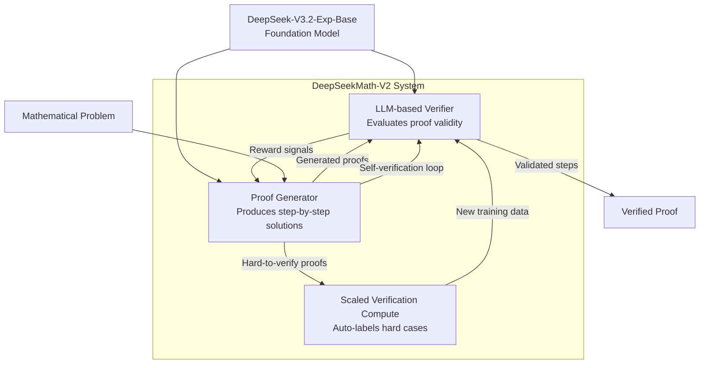
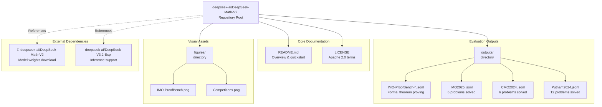
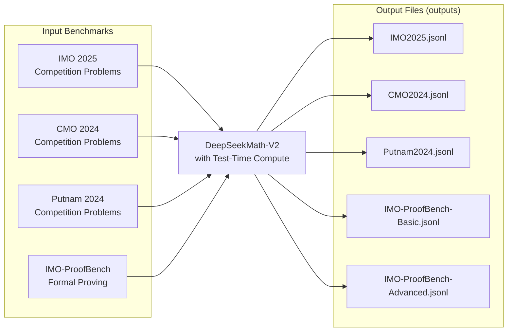
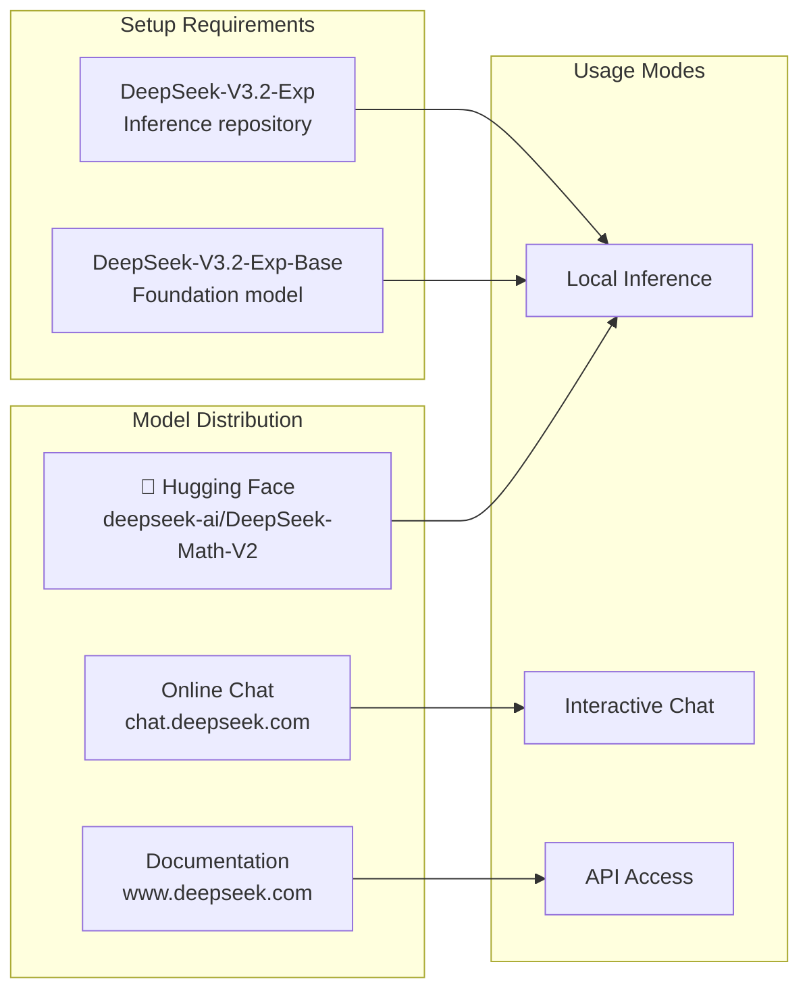

<!-- source: DeepWiki mcp.deepwiki.com · repo deepseek-ai/DeepSeek-Math-V2 · page 1 Home · fetched 2026-10-30 -->

# Home

<details>
<summary>Relevant source files</summary>

The following files were used as context for generating this wiki page:

- [README.md](README.md)

</details>


## Purpose & Scope

This documentation covers **DeepSeekMath-V2**, a mathematical reasoning system that achieves self-verifiable proof generation through a verifier-generator feedback loop. This page provides an overview of the system's architecture, capabilities, and achievements. For detailed information about specific subsystems, see:

- System architecture and training pipeline: [System Architecture](#2)
- Evaluation benchmarks and competition results: [Evaluation & Results](#3)
- Output data formats and schemas: [Data Formats & Outputs](#4)
- Getting started with model usage: [Getting Started](#5)

**Sources:** [README.md:1-88]()

---

## What is DeepSeekMath-V2?

DeepSeekMath-V2 is a large language model designed for rigorous mathematical reasoning with self-verification capabilities. Unlike traditional approaches that optimize only for correct final answers, DeepSeekMath-V2 verifies the comprehensiveness and rigor of every step in mathematical proofs. The system is built on the `DeepSeek-V3.2-Exp-Base` foundation model and trained through a three-stage process involving an LLM-based verifier and proof generator.

**Key distinguishing features:**

| Feature | Traditional Approach | DeepSeekMath-V2 |
|---------|---------------------|-----------------|
| Objective | Correct final answers | Rigorous step-by-step proofs |
| Verification | External (human/automated checker) | Self-verification via trained verifier |
| Training Signal | Answer correctness | Step-by-step proof validity |
| Applicability | Numerical problems with known answers | Open problems without solutions |

The system addresses fundamental limitations of answer-only optimization: correct answers do not guarantee correct reasoning, and many mathematical tasks (theorem proving, open problems) require rigorous derivation rather than numerical solutions.

**Sources:** [README.md:30-45]()

---

## Core Innovation: Self-Verifiable Reasoning

DeepSeekMath-V2's core innovation is the closed-loop feedback system between proof generation and verification. The system trains the generator to identify and resolve issues in its own proofs before finalizing them, creating mathematical reasoning that can be verified without external ground truth.



**Diagram: Self-Verifiable Reasoning Architecture**

The system maintains a generation-verification gap through continuous improvement:

1. **Initial Training:** Verifier learns to assess proof quality from labeled data
2. **Generator Training:** Uses verifier as reward model to produce rigorous proofs
3. **Iterative Improvement:** As generator improves, challenging proofs are used to train verifier, maintaining verification capability

**Sources:** [README.md:41-45]()

---

## Repository Structure

The DeepSeek-Math-V2 repository contains evaluation results, documentation, and references to the foundation model. The actual model weights are hosted on Hugging Face.



**Diagram: DeepSeek-Math-V2 Repository Structure**

**Sources:** [README.md:50-88]()

---

## Key Capabilities

DeepSeekMath-V2 demonstrates strong performance across multiple mathematical domains through rigorous proof generation:

### Mathematical Domains

| Domain | Capabilities |
|--------|-------------|
| **Number Theory** | Diophantine equations, prime factorization, divisibility |
| **Geometry** | Circle properties, coordinate geometry, tangency proofs |
| **Combinatorics** | Permutations, counting problems, combinatorial identities |
| **Algebra** | Polynomial functions, functional equations, algebraic manipulation |
| **Analysis** | Inequalities, limits, asymptotic behavior |
| **Probability** | Expected values, stochastic processes |
| **Formal Methods** | Theorem proving, proof assistant integration |

### Proof Generation Features

- **Step-by-step derivation:** Complete reasoning chains beyond final answers
- **Self-resolution:** Identifies and fixes issues before finalization
- **Rigorous verification:** Validates logical consistency of each proof step
- **Test-time compute scaling:** Improves results with additional inference compute

**Sources:** [README.md:34-45]()

---

## Evaluation Results Summary

DeepSeekMath-V2 achieves gold-level performance on prestigious mathematical competitions and benchmarks:

### Competition Performance

| Competition | Year | Score | Achievement |
|-------------|------|-------|-------------|
| **IMO** (International Mathematical Olympiad) | 2025 | 6/6 problems | Gold Medal |
| **CMO** (Chinese Mathematical Olympiad) | 2024 | 6/6 problems | Gold Medal |
| **Putnam** | 2024 | 118/120 points | Near-perfect |

### IMO-ProofBench

DeepSeekMath-V2 was evaluated on IMO-ProofBench, a formal theorem proving benchmark developed by Google DeepMind. Results and detailed proofs are available in the `outputs/` directory.



**Diagram: Evaluation Pipeline and Output Files**

All model predictions are stored in structured JSONL format in the `outputs/` directory. Each file contains:
- `question`: Original problem statement
- `problem_idx`: Unique problem identifier
- `model_prediction`: Object with `proof`, `average_automatic_rating`, and `human_rating`

For detailed analysis of results, see [Evaluation & Results](#3). For schema documentation, see [Data Formats & Outputs](#4).

**Sources:** [README.md:47-65]()

---

## Model Access and Usage

### Quick Start

1. **Download Model:** Available on Hugging Face at `deepseek-ai/DeepSeek-Math-V2`
2. **Inference Setup:** Use the `deepseek-ai/DeepSeek-V3.2-Exp` repository for inference support
3. **Interactive Demo:** Try at `chat.deepseek.com`



**Diagram: Model Access Channels**

For detailed setup instructions, see [Getting Started](#5).

**Sources:** [README.md:67-70]()

---

## License and Attribution

DeepSeekMath-V2 is released under the **Apache License 2.0**, which permits:
- Commercial use
- Modification
- Distribution
- Patent use

Subject to:
- License and copyright notice inclusion
- State changes documentation

For full legal terms, see [License & Legal](#7.1).

**Sources:** [README.md:72-73]()

---

## Community and Support

### Contact Channels

| Channel | Purpose | Link/Contact |
|---------|---------|--------------|
| **Discord** | Community discussion | `discord.gg/Tc7c45Zzu5` |
| **WeChat** | Chinese community (中文社区) | QR code in repository |
| **Twitter/X** | Announcements | `@deepseek_ai` |
| **Email** | Support inquiries | `service@deepseek.com` |

For community resources and detailed contact information, see [Community & Support](#7.3).

**Sources:** [README.md:85-87]()

---

## Citation

When using DeepSeekMath-V2 in research, please cite:

```bibtex
@misc{deepseek-math-v2,
  author = {Zhihong Shao, Yuxiang Luo, Chengda Lu, Z.Z. Ren, Jiewen Hu, 
            Tian Ye, Zhibin Gou, Shirong Ma, Xiaokang Zhang},
  title = {DeepSeekMath-V2: Towards Self-Verifiable Mathematical Reasoning},
  year = {2025},
}
```

**Sources:** [README.md:75-82]()

---

