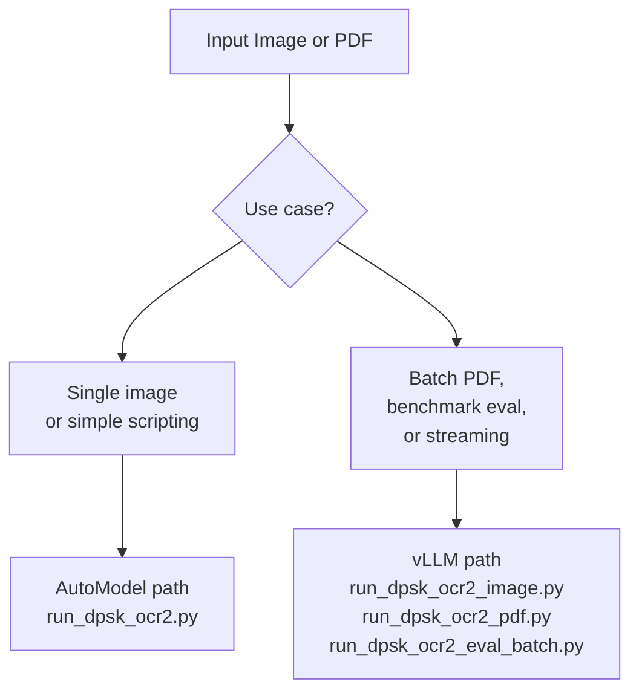
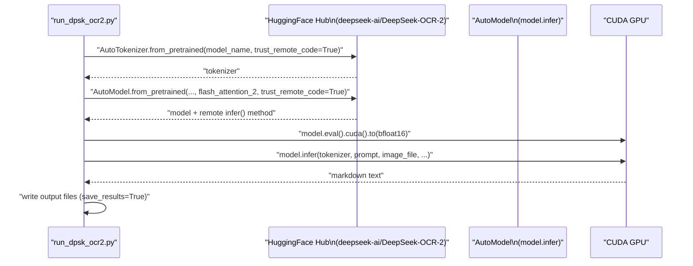
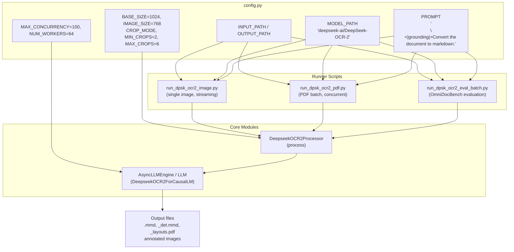
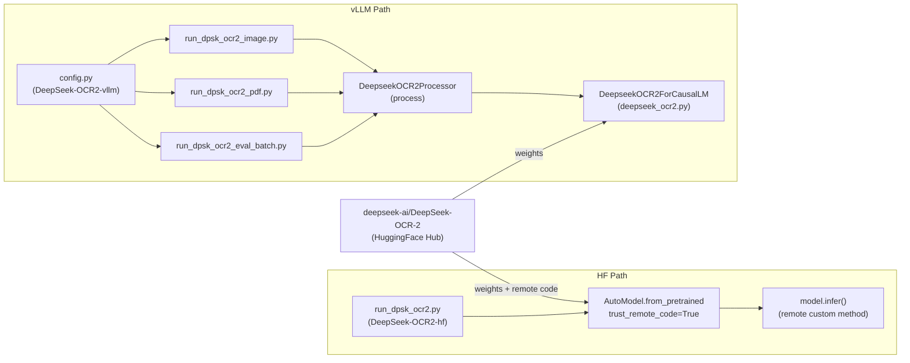

<!-- source: DeepWiki mcp.deepwiki.com · repo deepseek-ai/DeepSeek-OCR-2 · page 2.2 Quick Start Examples · fetched 2026-10-30 -->

# Quick Start Examples

<details>
<summary>Relevant source files</summary>

The following files were used as context for generating this wiki page:

- [DeepSeek-OCR2-master/DeepSeek-OCR2-hf/run_dpsk_ocr2.py](DeepSeek-OCR2-master/DeepSeek-OCR2-hf/run_dpsk_ocr2.py)
- [README.md](README.md)

</details>


This page provides minimal working examples for running DeepSeek-OCR-2 inference with both supported backends. The goal is to get from a model checkpoint to OCR output in as few steps as possible.

This page covers the entry points only. For detailed parameter explanations, see the Transformers backend documentation at [3.1]() and the vLLM backend documentation at [3.2](). For installation prerequisites, see [2.1]().

---

## Choosing a Backend

Two independent inference paths share the same `deepseek-ai/DeepSeek-OCR-2` model checkpoint from HuggingFace Hub.

| Backend | Entry Point | Use Case |
|---|---|---|
| HuggingFace Transformers | `DeepSeek-OCR2-hf/run_dpsk_ocr2.py` | Single-image inference, simpler setup |
| vLLM | `DeepSeek-OCR2-vllm/run_dpsk_ocr2_image.py` | High-throughput, streaming, batch PDF, benchmarks |

The two paths load the same weights but differ significantly in how the model is registered, how images are dispatched, and what output formats are produced.

**Path selection diagram:**



Sources: [README.md:57-103]()

---

## Prompt Formats

Before looking at the examples, note that the model recognizes two standard prompt strings. The prompt you choose determines the output format.

| Prompt | Behavior |
|---|---|
| `<image>\n<|grounding|>Convert the document to markdown.` | Full document-to-markdown conversion with layout grounding. Produces structured markdown with bounding box annotations (`<\|ref\|>...<\|det\|>` tags). |
| `<image>\nFree OCR.` | Plain text extraction without layout structure. |

Both prompts begin with the `<image>` special token, which is the injection point for visual embeddings.

Sources: [README.md:134-138](), [DeepSeek-OCR2-master/DeepSeek-OCR2-hf/run_dpsk_ocr2.py:17-18]()

---

## HuggingFace Transformers — Quick Start

**Runtime flow:**



Sources: [DeepSeek-OCR2-master/DeepSeek-OCR2-hf/run_dpsk_ocr2.py:1-25](), [README.md:107-124]()

### Steps

**1. Load tokenizer and model**

See [DeepSeek-OCR2-master/DeepSeek-OCR2-hf/run_dpsk_ocr2.py:1-13]()

- `AutoTokenizer.from_pretrained` with `trust_remote_code=True` is required because the tokenizer includes custom remote code from the model repository.
- `AutoModel.from_pretrained` requires `trust_remote_code=True` (custom `infer()` method), `_attn_implementation='flash_attention_2'` (for performance), and `use_safetensors=True`.
- After loading, the model is moved to `bfloat16` precision on CUDA with `.eval().cuda().to(torch.bfloat16)`.

**2. Set the prompt and paths**

See [DeepSeek-OCR2-master/DeepSeek-OCR2-hf/run_dpsk_ocr2.py:17-21]()

- `image_file`: path to the input image.
- `output_path`: directory where output files are written when `save_results=True`.
- Choose between the two prompt formats from the table above.

**3. Call `model.infer()`**

See [DeepSeek-OCR2-master/DeepSeek-OCR2-hf/run_dpsk_ocr2.py:24-25]()

The `infer()` method is delivered as part of the remote model code. Key parameters:

| Parameter | Value in example | Description |
|---|---|---|
| `tokenizer` | loaded tokenizer | required |
| `prompt` | `<image>\n<|grounding|>...` | task prompt string |
| `image_file` | path string | input image path |
| `output_path` | path string | output directory |
| `base_size` | `1024` | global thumbnail resolution |
| `image_size` | `768` | local crop tile size |
| `crop_mode` | `True` | enable dynamic tiling |
| `save_results` | `True` | write output files to `output_path` |

**4. Run the script directly**

The file [DeepSeek-OCR2-master/DeepSeek-OCR2-hf/run_dpsk_ocr2.py:1-25]() is a complete runnable script. After editing `image_file` and `output_path`:

```
cd DeepSeek-OCR2-master/DeepSeek-OCR2-hf
python run_dpsk_ocr2.py
```

Sources: [README.md:105-129](), [DeepSeek-OCR2-master/DeepSeek-OCR2-hf/run_dpsk_ocr2.py:1-25]()

---

## vLLM — Quick Start

The vLLM path uses three separate runner scripts depending on the input type. All three share a single configuration file.

**Runtime flow:**



Sources: [README.md:87-103]()

### Steps

**1. Edit `config.py`**

Before running any script, set `INPUT_PATH` and `OUTPUT_PATH` in `DeepSeek-OCR2-vllm/config.py`. All other parameters have working defaults. See [3.2.1]() for a full parameter reference.

**2. Navigate to the vLLM directory**

```
cd DeepSeek-OCR2-master/DeepSeek-OCR2-vllm
```

**3. Choose the appropriate runner script**

| Script | Command | When to use |
|---|---|---|
| `run_dpsk_ocr2_image.py` | `python run_dpsk_ocr2_image.py` | Single image, streaming token output |
| `run_dpsk_ocr2_pdf.py` | `python run_dpsk_ocr2_pdf.py` | One or more PDF files, concurrent batch |
| `run_dpsk_ocr2_eval_batch.py` | `python run_dpsk_ocr2_eval_batch.py` | OmniDocBench benchmark evaluation |

Sources: [README.md:87-103]()

### Output Files

Depending on the runner, the following output files are written to `OUTPUT_PATH`:

| File pattern | Content | Runner |
|---|---|---|
| `*.mmd` | Markdown OCR result | all |
| `*_det.mmd` | Markdown with `<\|ref\|>/<\|det\|>` bounding box tags | image runner |
| `*_layouts.pdf` | PDF with annotated layout bounding boxes | PDF runner |
| Annotated image files | Images with drawn bounding boxes | image runner |

Sources: [README.md:87-103]()

---

## Key Code Entities at a Glance

The following diagram maps the high-level concepts from this page to their concrete code locations.



Sources: [README.md:57-138](), [DeepSeek-OCR2-master/DeepSeek-OCR2-hf/run_dpsk_ocr2.py:1-25]()

---

