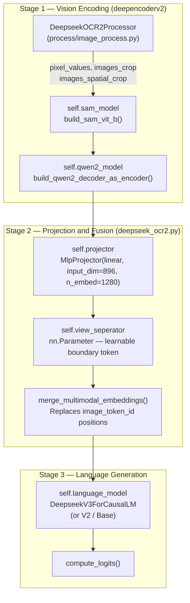
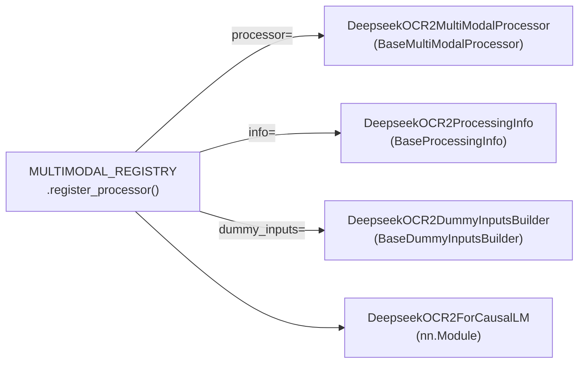

<!-- source: DeepWiki mcp.deepwiki.com · repo deepseek-ai/DeepSeek-OCR-2 · page 4 Core Architecture · fetched 2026-10-30 -->

# Core Architecture

Relevant source files

The following files were used as context for generating this wiki page:

- [DeepSeek-OCR2-master/DeepSeek-OCR2-vllm/deepseek_ocr2.py](DeepSeek-OCR2-master/DeepSeek-OCR2-vllm/deepseek_ocr2.py)
- [README.md](README.md)

## Purpose and Scope

This page provides a high-level overview of the DeepSeek-OCR-2 model architecture. The architecture is implemented in `DeepseekOCR2ForCausalLM` [DeepSeek-OCR2-master/DeepSeek-OCR2-vllm/deepseek_ocr2.py:264-583](), which is the main model class for the vLLM inference backend.

**Child Pages:**
- **4.1 Model Overview** — `DeepseekOCR2ForCausalLM` three-stage pipeline and vLLM registration classes
- **4.2 Vision Processing Pipeline** — `sam_model` → `qwen2_model` → `projector` data path
- **4.3 Multimodal Integration** — `image_token_id` placeholder mechanism and embedding merging
- **4.4 Language Model Variants** — `DeepseekV3ForCausalLM`, `DeepseekV2ForCausalLM`, `DeepseekForCausalLM` selection

**Related Pages:**
- Vision encoder implementations: page 5
- Image preprocessing and resolution handling: page 6
- Weight loading details: page 9.2
- vLLM registration and `trust_remote_code`: page 9.3

---

## Architecture Overview

DeepSeek-OCR-2 follows a three-stage architecture: (1) vision encoding, (2) feature projection and multimodal fusion, and (3) language generation. Variable-resolution images pass through a dual-encoder vision pipeline (`sam_model` → `qwen2_model`), features are projected to the language model embedding dimension, and the combined sequence drives autoregressive text generation.

**Three-Stage Pipeline — Code Entities**

Sources: [DeepSeek-OCR2-master/DeepSeek-OCR2-vllm/deepseek_ocr2.py:264-583](), [README.md:55-143]()

---

## Main Model Class: DeepseekOCR2ForCausalLM

`DeepseekOCR2ForCausalLM` [DeepSeek-OCR2-master/DeepSeek-OCR2-vllm/deepseek_ocr2.py:264]() is the central class for the vLLM inference path. It inherits from:

- `nn.Module` — PyTorch neural network base
- `SupportsMultiModal` — vLLM multimodal inference interface
- `SupportsPP` — vLLM pipeline-parallelism support

It is registered with vLLM's `MULTIMODAL_REGISTRY` via the decorator at [DeepSeek-OCR2-master/DeepSeek-OCR2-vllm/deepseek_ocr2.py:260-263](), which binds three companion classes:

| Class | Role |
|-------|------|
| `DeepseekOCR2MultiModalProcessor` | Calls `DeepseekOCR2Processor`, maps multimodal fields, generates prompt replacements |
| `DeepseekOCR2ProcessingInfo` | Reports token counts, image size limits, and supported modalities |
| `DeepseekOCR2DummyInputsBuilder` | Supplies dummy inputs for vLLM memory profiling |

**vLLM Registration and Companion Classes**

### Submodules Constructed in `__init__`

During initialization [DeepSeek-OCR2-master/DeepSeek-OCR2-vllm/deepseek_ocr2.py:270-339](), the following submodules are built:

| Attribute | Constructor | Dimension | Purpose |
|-----------|-------------|-----------|---------|
| `self.sam_model` | `build_sam_vit_b()` | — | SAM-ViT-B visual feature extractor |
| `self.qwen2_model` | `build_qwen2_decoder_as_encoder()` | 896-dim output | Decoder-as-encoder semantic refiner |
| `self.projector` | `MlpProjector(linear, 896→1280)` | 1280-dim output | Projects visual features to LM space |
| `self.view_seperator` | `nn.Parameter(randn(1280))` | 1280-dim | Learnable boundary token between views |
| `self.language_model` | `init_vllm_registered_model()` | — | Deepseek LM backbone (V3/V2/Base) |
| `self.image_token_id` | `tokenizer.vocab["<image>"]` | int | Token ID marking image placeholder positions |

Sources: [DeepSeek-OCR2-master/DeepSeek-OCR2-vllm/deepseek_ocr2.py:260-339]()

---

## Component Interaction Summary

The following table summarizes the primary methods and their responsibilities:

| Method | Input Types | Output Type | Primary Responsibility |
|--------|-------------|-------------|------------------------|
| `_parse_and_validate_image_input()` | `**kwargs` (pixel_values, crops) | `Optional[list]` | Input validation and extraction |
| `_pixel_values_to_embedding()` | 3 tensors (pixel_values, crops, spatial_crop) | `NestedTensors` | Dual-encoder vision processing |
| `_process_image_input()` | Image input tuple | `torch.Tensor` | Vision pipeline coordinator |
| `get_multimodal_embeddings()` | `**kwargs` | `Optional[MultiModalEmbeddings]` | Vision embedding interface |
| `get_input_embeddings()` | `input_ids`, `multimodal_embeddings` | `torch.Tensor` | Multimodal fusion |
| `forward()` | `input_ids`, `positions`, `**kwargs` | `torch.Tensor` | Main inference entry point |
| `compute_logits()` | `hidden_states`, `sampling_metadata` | `torch.Tensor` | Token probability computation |
| `load_weights()` | `Iterable[Tuple[str, torch.Tensor]]` | `Set[str]` | Checkpoint loading |

**Sources:** [DeepSeek-OCR2-master/DeepSeek-OCR2-vllm/deepseek_ocr2.py:341-582]()

---

