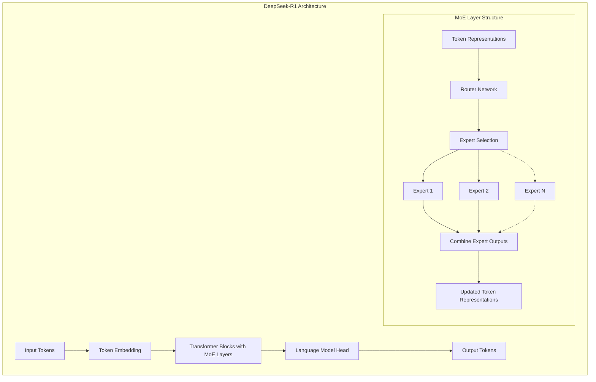
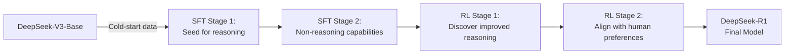
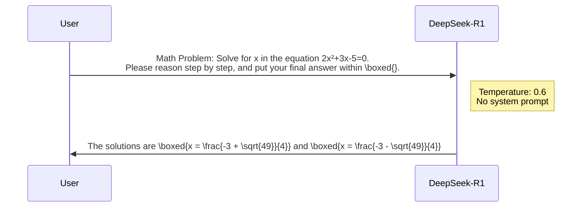
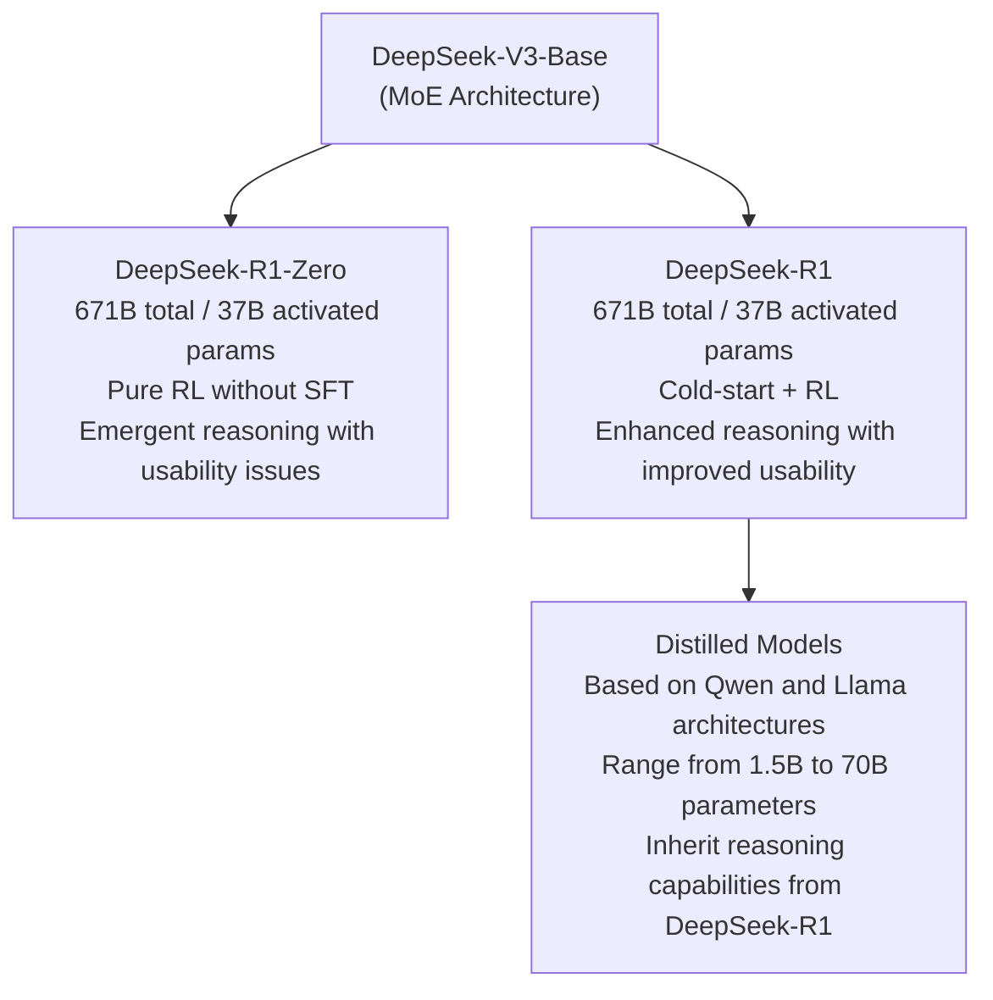
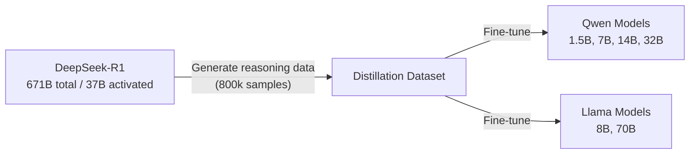

<!-- source: DeepWiki mcp.deepwiki.com · repo deepseek-ai/DeepSeek-R1 · page 2.2 DeepSeek-R1 · fetched 2026-10-30 -->

# DeepSeek-R1

Relevant source files

The following files were used as context for generating this wiki page:

- [DeepSeek_R1.pdf](DeepSeek_R1.pdf)
- [README.md](README.md)

## Purpose and Scope

This document provides detailed information about DeepSeek-R1, a large language model developed to enhance reasoning capabilities through a combination of supervised fine-tuning (SFT) and reinforcement learning (RL). This page focuses specifically on the DeepSeek-R1 model architecture and its training methodology, which employs a cold-start approach followed by reinforcement learning. For information about DeepSeek-R1-Zero (which uses pure RL without SFT), see [DeepSeek-R1-Zero](#2.1), and for details on the distilled models derived from DeepSeek-R1, see [Distilled Models](#2.3).

Sources: [README.md:33-38]()

## Model Architecture

DeepSeek-R1 is based on the DeepSeek-V3-Base architecture, employing a Mixture of Experts (MoE) design. The model has the following key specifications:

- **Total Parameters**: 671 billion
- **Activated Parameters**: 37 billion
- **Context Length**: 128K tokens

The model uses sparse activation via the MoE architecture, allowing it to maintain a large parameter count while only activating a fraction of parameters during inference, balancing computational efficiency with model capacity.

**Model Architecture Diagram**:

Sources: [README.md:78-79](), [README.md:69-74]()

## Training Methodology

DeepSeek-R1 follows a distinctive training approach that addresses limitations observed in the DeepSeek-R1-Zero model (such as endless repetition, poor readability, and language mixing). The training pipeline incorporates both supervised fine-tuning (SFT) and reinforcement learning (RL) stages.

**Training Pipeline Diagram**:

### Training Stages

1. **SFT Stage 1 (Cold-start)**: This initial supervised fine-tuning phase serves as the seed for the model's reasoning capabilities, providing foundational knowledge and skills.

2. **SFT Stage 2**: This phase enhances the model's non-reasoning capabilities, ensuring balanced performance across various tasks.

3. **RL Stage 1**: The first reinforcement learning stage focuses on discovering improved reasoning patterns, optimizing the model's problem-solving approaches.

4. **RL Stage 2**: The second RL stage aims to align the model's outputs with human preferences, ensuring its responses are useful, readable, and appropriate.

This combined approach results in a model that maintains the strong reasoning capabilities derived from reinforcement learning while addressing the usability issues found in models trained exclusively through RL.

Sources: [README.md:51-56](), [README.md:33-38]()

## Capabilities and Performance

DeepSeek-R1 demonstrates exceptional performance across a wide range of tasks, with particularly strong results in reasoning, mathematics, and code-related benchmarks. The model achieves performance comparable to OpenAI-o1 across various domains.

### Key Performance Metrics

| Category | Benchmark | DeepSeek R1 | OpenAI o1-1217 | OpenAI o1-mini |
|----------|-----------|-------------|----------------|----------------|
| English  | MMLU (Pass@1) | 90.8 | **91.8** | 85.2 |
| English  | MMLU-Redux (EM) | **92.9** | - | 86.7 |
| English  | DROP (3-shot F1) | **92.2** | 90.2 | 83.9 |
| Code     | LiveCodeBench (Pass@1-COT) | **65.9** | 63.4 | 53.8 |
| Code     | Codeforces (Rating) | 2029 | **2061** | 1820 |
| Math     | AIME 2024 (Pass@1) | **79.8** | 79.2 | 63.6 |
| Math     | MATH-500 (Pass@1) | **97.3** | 96.4 | 90.0 |
| Chinese  | C-Eval (EM) | **91.8** | - | 68.9 |

### Emergent Capabilities

DeepSeek-R1 exhibits several emergent reasoning behaviors, refined through its training process:

1. **Chain-of-Thought Reasoning**: The model naturally develops step-by-step reasoning approaches to solve complex problems.
2. **Self-verification**: The ability to check its own work and correct mistakes.
3. **Reflection**: The capacity to evaluate the quality of its own reasoning.

Sources: [README.md:101-132](), [README.md:38-39]()

## Usage Guidelines

To achieve optimal performance with DeepSeek-R1, certain usage configurations are recommended:

### Recommended Settings

1. **Temperature**: Set to 0.6 (acceptable range: 0.5-0.7) to prevent endless repetitions or incoherent outputs.
2. **No System Prompts**: All instructions should be contained within the user prompt.
3. **Mathematical Problem Format**: Include directives like "Please reason step by step, and put your final answer within \boxed{}."
4. **Thinking Pattern**: Enforce the model to start its response with "\<think\>\n" to ensure thorough reasoning.

**Example Prompt Structure Diagram**:

### Deployment Options

DeepSeek-R1 can be accessed through various channels:

1. **Web Interface**: Available at [chat.deepseek.com](https://chat.deepseek.com) with the "DeepThink" option enabled.
2. **API**: Access through DeepSeek Platform at [platform.deepseek.com](https://platform.deepseek.com).
3. **Local Deployment**: Can be run locally following the instructions in the DeepSeek-V3 repository.

Sources: [README.md:186-196](), [README.md:157-166]()

## Comparison with Other Models in the Family

DeepSeek-R1 is part of a broader model family that includes different training approaches and model sizes.

**Model Family Comparison**:

### Key Differences from DeepSeek-R1-Zero

The primary distinction between DeepSeek-R1 and DeepSeek-R1-Zero lies in their training methodologies:

1. **DeepSeek-R1-Zero**: Trained purely through reinforcement learning without SFT, which resulted in emergent reasoning capabilities but also led to issues like endless repetition, poor readability, and language mixing.

2. **DeepSeek-R1**: Incorporates a cold-start approach with supervised fine-tuning before applying reinforcement learning, maintaining strong reasoning capabilities while addressing the usability issues of DeepSeek-R1-Zero.

Sources: [README.md:33-38](), [README.md:51-56]()

## Knowledge Distillation

DeepSeek-R1 serves as the source model for knowledge distillation to create smaller, more accessible models that retain its reasoning capabilities. This process involves generating high-quality reasoning data with DeepSeek-R1 and using it to fine-tune smaller models based on Qwen and Llama architectures.

**Distillation Process Diagram**:

The distilled models offer varying tradeoffs between performance and resource requirements, with larger distilled models (such as DeepSeek-R1-Distill-Qwen-32B) approaching the performance of much larger proprietary models like OpenAI o1-mini.

Sources: [README.md:60-63](), [README.md:81-97]()

---

