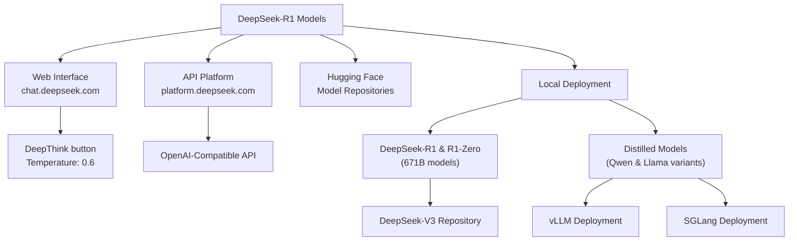
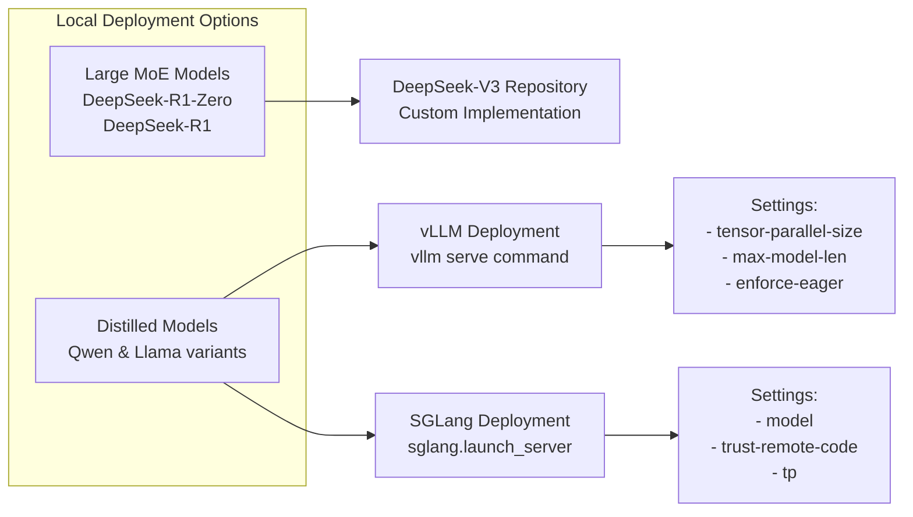
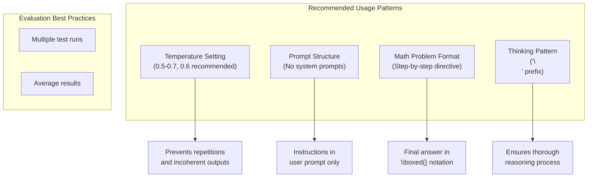

<!-- source: DeepWiki mcp.deepwiki.com · repo deepseek-ai/DeepSeek-R1 · page 3 Model Usage · fetched 2026-10-30 -->

# Model Usage

<details>
<summary>Relevant source files</summary>

The following files were used as context for generating this wiki page:

- [README.md](README.md)

</details>


This page provides comprehensive documentation on how to access and use the DeepSeek-R1 family of models. It covers the various access methods, local deployment options, and best practices for optimal model performance. For information about the model architecture, see [Model Architecture](#2), and for specific prompting guidelines, see [Prompting Guidelines](#3.3).

## Available Access Methods

DeepSeek-R1 models can be accessed through multiple channels, each designed for different use cases and requirements.



### Web Interface

The DeepSeek-R1 models are accessible through DeepSeek's official web interface at [chat.deepseek.com](https://chat.deepseek.com). To use the reasoning capabilities:

1. Visit the website
2. Enable the "DeepThink" button to activate the reasoning mode
3. Begin your conversation with the model

The web interface uses a default temperature of 0.6 to ensure optimal output quality.

### API Platform

For programmatic access, DeepSeek provides an OpenAI-compatible API through their platform at [platform.deepseek.com](https://platform.deepseek.com). This allows developers to integrate DeepSeek-R1 models into their applications using familiar API patterns.

### Hugging Face Models

All DeepSeek-R1 models are available on Hugging Face. The following models can be accessed:

| Model Type | Model Name | Hugging Face Repository |
|------------|------------|-------------------------|
| Main Models | DeepSeek-R1-Zero | [deepseek-ai/DeepSeek-R1-Zero](https://huggingface.co/deepseek-ai/DeepSeek-R1-Zero) |
| | DeepSeek-R1 | [deepseek-ai/DeepSeek-R1](https://huggingface.co/deepseek-ai/DeepSeek-R1) |
| Distilled Models | DeepSeek-R1-Distill-Qwen-1.5B | [deepseek-ai/DeepSeek-R1-Distill-Qwen-1.5B](https://huggingface.co/deepseek-ai/DeepSeek-R1-Distill-Qwen-1.5B) |
| | DeepSeek-R1-Distill-Qwen-7B | [deepseek-ai/DeepSeek-R1-Distill-Qwen-7B](https://huggingface.co/deepseek-ai/DeepSeek-R1-Distill-Qwen-7B) |
| | DeepSeek-R1-Distill-Llama-8B | [deepseek-ai/DeepSeek-R1-Distill-Llama-8B](https://huggingface.co/deepseek-ai/DeepSeek-R1-Distill-Llama-8B) |
| | DeepSeek-R1-Distill-Qwen-14B | [deepseek-ai/DeepSeek-R1-Distill-Qwen-14B](https://huggingface.co/deepseek-ai/DeepSeek-R1-Distill-Qwen-14B) |
| | DeepSeek-R1-Distill-Qwen-32B | [deepseek-ai/DeepSeek-R1-Distill-Qwen-32B](https://huggingface.co/deepseek-ai/DeepSeek-R1-Distill-Qwen-32B) |
| | DeepSeek-R1-Distill-Llama-70B | [deepseek-ai/DeepSeek-R1-Distill-Llama-70B](https://huggingface.co/deepseek-ai/DeepSeek-R1-Distill-Llama-70B) |

Sources: [README.md:65-96]()

## Local Deployment

DeepSeek-R1 models can be deployed locally for research, development, or production use cases. The deployment method varies depending on the model type.



### DeepSeek-R1 and DeepSeek-R1-Zero

For the large MoE-based models (DeepSeek-R1 and DeepSeek-R1-Zero), you need to use the custom implementation from the DeepSeek-V3 repository. These models require specific handling due to their mixture-of-experts architecture.

To run these models:
1. Visit the [DeepSeek-V3 repository](https://github.com/deepseek-ai/DeepSeek-V3)
2. Follow the installation and setup instructions specific to MoE models
3. Use the provided scripts to load and run DeepSeek-R1 models

**Note:** Hugging Face's Transformers library does not directly support these models yet.

Sources: [README.md:164-169]()

### Distilled Models

The distilled models (based on Qwen and Llama architectures) can be deployed using standard frameworks like vLLM or SGLang. These models can be used in the same manner as standard Qwen or Llama models but with the enhanced reasoning capabilities distilled from DeepSeek-R1.

#### Using vLLM

To deploy a distilled model using vLLM:

```bash
vllm serve deepseek-ai/DeepSeek-R1-Distill-Qwen-32B --tensor-parallel-size 2 --max-model-len 32768 --enforce-eager
```

Key parameters:
- `--tensor-parallel-size`: Number of GPUs to use for tensor parallelism
- `--max-model-len`: Maximum sequence length (32768 tokens recommended)
- `--enforce-eager`: Force eager execution mode

#### Using SGLang

To deploy a distilled model using SGLang:

```bash
python3 -m sglang.launch_server --model deepseek-ai/DeepSeek-R1-Distill-Qwen-32B --trust-remote-code --tp 2
```

Key parameters:
- `--model`: Model ID or path
- `--trust-remote-code`: Allow execution of model-specific code
- `--tp`: Number of GPUs for tensor parallelism

Sources: [README.md:170-184]()

## Usage Recommendations

To achieve optimal performance with DeepSeek-R1 models, follow these recommended practices.



### Parameter Settings

1. **Temperature**: Set the temperature in the range of 0.5-0.7, with 0.6 recommended. This prevents endless repetitions and incoherent outputs while maintaining creativity.

2. **Context Length**: The maximum context length for DeepSeek-R1 models is 128K tokens, while distilled models support their respective architecture's context lengths.

3. **Evaluation**: When benchmarking the models, conduct multiple test runs and average the results for more reliable performance metrics.

### Prompting Guidelines

1. **System Prompts**: Avoid using system prompts. All instructions should be contained within the user prompt.

2. **Mathematical Problems**: For math problems, include a directive such as: "Please reason step by step, and put your final answer within \boxed{}."

3. **Thinking Pattern**: To ensure thorough reasoning, enforce the model to start its response with `<think>\n` at the beginning of every output. This pattern helps the model engage in more detailed reasoning.

Sources: [README.md:186-197]()

## Official Prompts for Special Use Cases

DeepSeek provides official prompt templates for specific use cases, particularly for file upload and web search functionalities in their web interface and applications.

### File Upload Template

When working with uploaded files, use the following template:

```
[file name]: {file_name}
[file content begin]
{file_content}
[file content end]
{question}
```

Where:
- `{file_name}`: The name of the uploaded file
- `{file_content}`: The content of the file
- `{question}`: The user's question about the file

### Web Search Templates

For web search capabilities, DeepSeek provides language-specific templates. Both templates include:
- Search results in a structured format
- Citation instructions
- Current date information
- Response formatting guidelines

The templates are designed to help the model generate well-structured, properly cited responses based on web search results.

Sources: [README.md:198-254]()

## Model Specific Usage Considerations

Different models in the DeepSeek-R1 family have specific characteristics that affect their usage:

| Model | Parameters | Context Length | Best For | Special Considerations |
|-------|------------|---------------|----------|------------------------|
| DeepSeek-R1-Zero | 671B total / 37B activated | 128K | Pure reasoning tasks | Can exhibit repetition issues without proper temperature settings |
| DeepSeek-R1 | 671B total / 37B activated | 128K | General purpose reasoning | Complete model with balanced capabilities |
| Distilled Qwen models | 1.5B to 32B | Varies by model | Efficient deployment | Follow Qwen model configuration patterns |
| Distilled Llama models | 8B and 70B | Varies by model | Efficient deployment | Follow Llama model configuration patterns |

For the most accurate and effective usage, consider:

1. Model size vs. hardware constraints
2. Task complexity vs. model reasoning capability
3. Response quality vs. inference speed tradeoffs

Sources: [README.md:31-39](), [README.md:65-96]()

---

