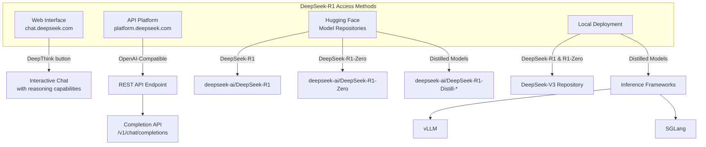
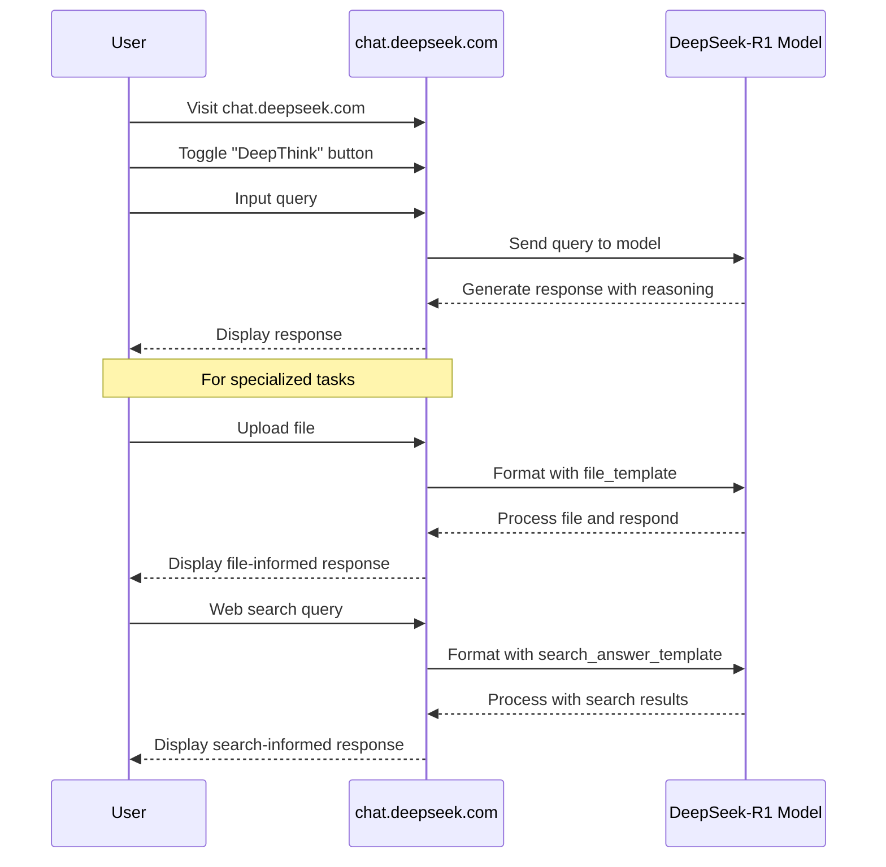
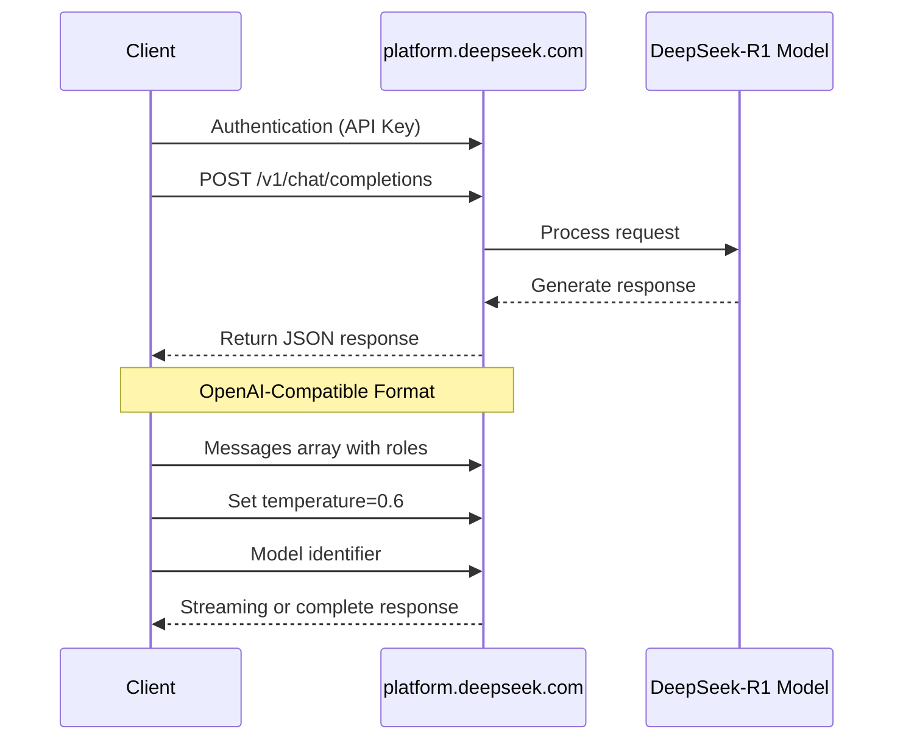
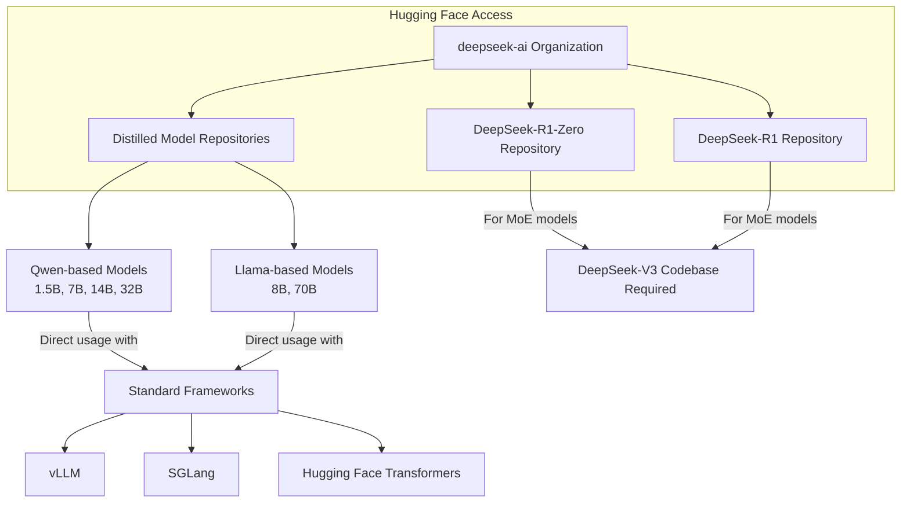

<!-- source: DeepWiki mcp.deepwiki.com · repo deepseek-ai/DeepSeek-R1 · page 3.1 Model Access · fetched 2026-10-30 -->

# Model Access

<details>
<summary>Relevant source files</summary>

The following files were used as context for generating this wiki page:

- [README.md](README.md)

</details>


This page documents the various methods for accessing DeepSeek-R1 family models. It covers official hosted solutions, API endpoints, model repositories, and brief introductions to deployment options. For detailed instructions on local deployment, please see [Local Deployment](#3.2). For guidance on how to effectively prompt the models once accessed, see [Prompting Guidelines](#3.3).

## Overview of Access Methods

The DeepSeek-R1 model family can be accessed through multiple channels, each suited for different use cases and technical requirements.

### Model Access Options Diagram



Sources: [README.md:157-162](), [README.md:162-186]()

## Web Interface

The DeepSeek-R1 models can be accessed through the official chat interface at [chat.deepseek.com](https://chat.deepseek.com).

### Key Features:
- Enable reasoning capabilities by switching on the "DeepThink" button
- Default temperature setting of 0.6
- No system prompts required - all instructions should be in user messages
- Special prompting templates for file upload and web search functionality

### Web Interface Usage Flow



Sources: [README.md:158](), [README.md:198-254]()

### File Upload and Web Search Templates

The web interface uses specific templated prompts for file upload and web search capabilities:

1. **File Upload Template**:
   ```
   [file name]: {file_name}
   [file content begin]
   {file_content}
   [file content end]
   {question}
   ```

2. **Web Search Templates**:
   - Templates are available for both Chinese and English queries
   - Search results are passed in format `[webpage X begin]...[webpage X end]`
   - Citations are included in responses with `[citation:X]` format

Sources: [README.md:198-254]()

## API Platform

DeepSeek-R1 models are available through an OpenAI-compatible API at [platform.deepseek.com](https://platform.deepseek.com).

### API Integration Flow



### API Usage Recommendations:
- Use the OpenAI-compatible endpoint format
- Set temperature within the range of 0.5-0.7 (0.6 recommended)
- Avoid system prompts - include all instructions in user messages
- For math problems, include step-by-step reasoning directive
- Consider enforcing thinking pattern with `<think>\n` at response beginning

Sources: [README.md:160](), [README.md:186-197]()

## Hugging Face Model Repositories

All DeepSeek-R1 models are available on Hugging Face under the `deepseek-ai` organization.

| **Model Type** | **HF Repository** | **Parameters** | **Context Length** |
|----------------|------------------|----------------|-------------------|
| DeepSeek-R1-Zero | [deepseek-ai/DeepSeek-R1-Zero](https://huggingface.co/deepseek-ai/DeepSeek-R1-Zero) | 671B total / 37B activated | 128K |
| DeepSeek-R1 | [deepseek-ai/DeepSeek-R1](https://huggingface.co/deepseek-ai/DeepSeek-R1) | 671B total / 37B activated | 128K |
| DeepSeek-R1-Distill-Qwen-1.5B | [deepseek-ai/DeepSeek-R1-Distill-Qwen-1.5B](https://huggingface.co/deepseek-ai/DeepSeek-R1-Distill-Qwen-1.5B) | 1.5B | - |
| DeepSeek-R1-Distill-Qwen-7B | [deepseek-ai/DeepSeek-R1-Distill-Qwen-7B](https://huggingface.co/deepseek-ai/DeepSeek-R1-Distill-Qwen-7B) | 7B | - |
| DeepSeek-R1-Distill-Llama-8B | [deepseek-ai/DeepSeek-R1-Distill-Llama-8B](https://huggingface.co/deepseek-ai/DeepSeek-R1-Distill-Llama-8B) | 8B | - |
| DeepSeek-R1-Distill-Qwen-14B | [deepseek-ai/DeepSeek-R1-Distill-Qwen-14B](https://huggingface.co/deepseek-ai/DeepSeek-R1-Distill-Qwen-14B) | 14B | - |
| DeepSeek-R1-Distill-Qwen-32B | [deepseek-ai/DeepSeek-R1-Distill-Qwen-32B](https://huggingface.co/deepseek-ai/DeepSeek-R1-Distill-Qwen-32B) | 32B | - |
| DeepSeek-R1-Distill-Llama-70B | [deepseek-ai/DeepSeek-R1-Distill-Llama-70B](https://huggingface.co/deepseek-ai/DeepSeek-R1-Distill-Llama-70B) | 70B | - |

Sources: [README.md:65-96]()

### Hugging Face Model Access



Sources: [README.md:65-97](), [README.md:172-184]()

## Local Deployment Overview

For using DeepSeek-R1 models locally, there are different approaches depending on the model type:

### Primary Model Deployment
- DeepSeek-R1 and DeepSeek-R1-Zero require the DeepSeek-V3 repository
- Not directly supported by Hugging Face Transformers
- See [DeepSeek-V3](https://github.com/deepseek-ai/DeepSeek-V3) repository for detailed instructions

### Distilled Model Deployment
Distilled models can be used with standard frameworks:

1. Using vLLM:
   ```bash
   vllm serve deepseek-ai/DeepSeek-R1-Distill-Qwen-32B --tensor-parallel-size 2 --max-model-len 32768 --enforce-eager
   ```

2. Using SGLang:
   ```bash
   python3 -m sglang.launch_server --model deepseek-ai/DeepSeek-R1-Distill-Qwen-32B --trust-remote-code --tp 2
   ```

For detailed instructions on local deployment options, see [Local Deployment](#3.2).

Sources: [README.md:165-184]()

## Access Method Comparison

| **Access Method** | **Suitable For** | **Setup Complexity** | **Resource Requirements** | **Customization** |
|-------------------|------------------|----------------------|---------------------------|-------------------|
| Web Interface | Quick testing, casual use | None (ready-to-use) | None (cloud-hosted) | Limited to UI options |
| API Platform | Production applications, service integration | Low (API key setup) | None (cloud-hosted) | Flexible via API parameters |
| Hugging Face | Research, experimentation | Medium | Varies by model | High customization possible |
| Local Deployment | Custom applications, privacy requirements, offline use | High | High (especially for large models) | Maximum flexibility |

Sources: [README.md:157-186](), [README.md:65-97]()

---

