# Page: Overview

# Overview

<details>
<summary>Relevant source files</summary>

The following files were used as context for generating this wiki page:

- [DeepSeek_R1.pdf](DeepSeek_R1.pdf)
- [README.md](README.md)

</details>


This document provides a comprehensive technical overview of the DeepSeek-R1 repository, which contains a family of reasoning-specialized large language models. It covers the model architectures, training methodologies, deployment options, and usage guidelines.

For detailed information about specific model architectures, refer to [Model Architecture](#2). For model usage instructions, see [Model Usage](#3).

## Model Family

DeepSeek-R1 is a family of reasoning-specialized language models built on the DeepSeek-V3 MoE (Mixture of Experts) architecture. The family consists of two large foundation models and several distilled variants.

**Model Hierarchy Diagram**

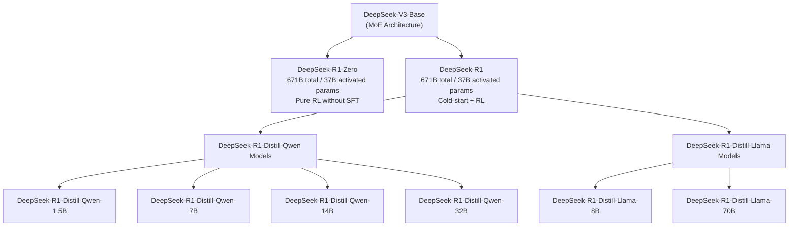

Sources: [README.md:67-96]()

### Foundation Models

- **DeepSeek-R1-Zero**: A 671B parameter MoE model (37B activated parameters) trained through reinforcement learning without supervised fine-tuning
- **DeepSeek-R1**: A 671B parameter MoE model (37B activated parameters) incorporating both cold-start data and reinforcement learning

Both foundation models support a 128K token context length and are based on the DeepSeek-V3 architecture.

### Distilled Models

The distilled models transfer the reasoning capabilities of DeepSeek-R1 to smaller, more efficient architectures:

| Model | Base Architecture | Parameters |
|-------|------------------|------------|
| DeepSeek-R1-Distill-Qwen-1.5B | Qwen2.5-Math-1.5B | 1.5B |
| DeepSeek-R1-Distill-Qwen-7B | Qwen2.5-Math-7B | 7B |
| DeepSeek-R1-Distill-Llama-8B | Llama-3.1-8B | 8B |
| DeepSeek-R1-Distill-Qwen-14B | Qwen2.5-14B | 14B |
| DeepSeek-R1-Distill-Qwen-32B | Qwen2.5-32B | 32B |
| DeepSeek-R1-Distill-Llama-70B | Llama-3.3-70B-Instruct | 70B |

Sources: [README.md:82-96]()

## Training Methodologies

The DeepSeek-R1 models employ distinctive training approaches that differentiate them from traditional language models.

**Training Pipeline Diagram**

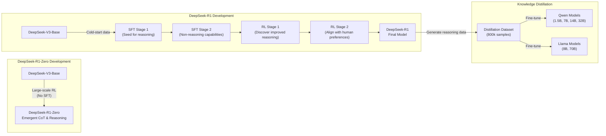

Sources: [README.md:31-63]()

### DeepSeek-R1-Zero Approach

DeepSeek-R1-Zero explores a novel training paradigm by directly applying reinforcement learning to the base model without supervised fine-tuning. This approach allowed the model to develop emergent reasoning capabilities including:

- Self-verification mechanisms
- Reflection capabilities
- Extended chain-of-thought reasoning

### DeepSeek-R1 Approach

DeepSeek-R1 incorporates a more structured pipeline:

1. **SFT Stage 1**: Initial supervised fine-tuning to seed reasoning capabilities
2. **SFT Stage 2**: Additional fine-tuning for non-reasoning capabilities
3. **RL Stage 1**: Reinforcement learning to discover improved reasoning patterns
4. **RL Stage 2**: Further reinforcement learning to align with human preferences

This comprehensive approach addresses limitations observed in DeepSeek-R1-Zero, such as repetitive outputs, poor readability, and language mixing.

### Distillation Process

The distillation process involves:

1. Using DeepSeek-R1 to generate 800,000 high-quality reasoning samples
2. Fine-tuning smaller foundation models (Qwen and Llama variants) on this dataset
3. Preserving the reasoning capabilities while reducing computational requirements

Sources: [README.md:60-63]()

## Model Access and Deployment

DeepSeek-R1 models are available through multiple channels to accommodate different usage scenarios.

**Deployment Options Diagram**

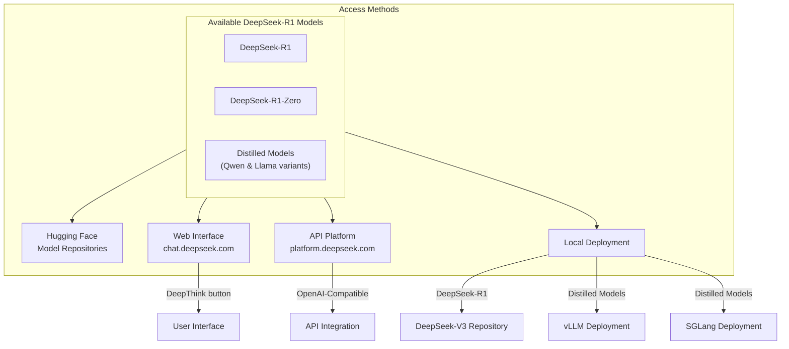

Sources: [README.md:157-169](), [README.md:170-184]()

### Web and API Access

- **Web Interface**: Available at chat.deepseek.com with a "DeepThink" button to activate reasoning capabilities
- **API Platform**: OpenAI-compatible API available at platform.deepseek.com

### Local Deployment

- **DeepSeek-R1 and DeepSeek-R1-Zero**: Deployable using the DeepSeek-V3 repository
- **Distilled Models**: Deployable using standard frameworks such as:
  - vLLM: `vllm serve deepseek-ai/DeepSeek-R1-Distill-Qwen-32B --tensor-parallel-size 2 --max-model-len 32768 --enforce-eager`
  - SGLang: `python3 -m sglang.launch_server --model deepseek-ai/DeepSeek-R1-Distill-Qwen-32B --trust-remote-code --tp 2`

Sources: [README.md:170-184]()

## Usage Recommendations

For optimal performance with DeepSeek-R1 models, follow these technical guidelines:

1. Set temperature between 0.5-0.7 (0.6 recommended) to prevent repetitions or incoherent outputs
2. Avoid system prompts; include all instructions in the user prompt
3. For mathematical problems, include the directive: "Please reason step by step, and put your final answer within \boxed{}"
4. For thorough reasoning, enforce the model to start with "\<think\>\n" at the beginning of outputs

The models have specific prompt templates for file uploads and web search functionality, detailed in the README.

Sources: [README.md:186-254]()

## Performance and Benchmarks

DeepSeek-R1 models have been evaluated across multiple domains including:

1. **English Language Benchmarks**: MMLU, MMLU-Redux, MMLU-Pro, DROP, IF-Eval, etc.
2. **Code Generation**: LiveCodeBench, Codeforces, SWE Verified, etc.
3. **Mathematical Reasoning**: AIME 2024, MATH-500, CNMO 2024
4. **Chinese Language Benchmarks**: CLUEWSC, C-Eval, C-SimpleQA

The models achieve performance comparable to OpenAI-o1 across various reasoning tasks, with the distilled DeepSeek-R1-Distill-Qwen-32B outperforming OpenAI-o1-mini.

Sources: [README.md:101-153]()

## License Information

The DeepSeek-R1 repository, including model weights, is licensed under the MIT License, allowing commercial use and derivative works. The distilled models inherit licensing terms from their base models:

- Qwen-based models: Originally under Apache 2.0 License
- Llama-based models: Originally under Llama3.1/3.3 licenses

Sources: [README.md:256-262]()

---

# Page: Model Architecture

# Model Architecture

<details>
<summary>Relevant source files</summary>

The following files were used as context for generating this wiki page:

- [DeepSeek_R1.pdf](DeepSeek_R1.pdf)
- [README.md](README.md)

</details>


This document provides a technical overview of the DeepSeek-R1 model architecture, explaining its fundamental design, key components, and architectural characteristics. It covers the base architecture that underpins both DeepSeek-R1-Zero and DeepSeek-R1, as well as their architectural similarities and differences. For specific details about individual models, see [DeepSeek-R1-Zero](#2.1) and [DeepSeek-R1](#2.2). For information about the distilled models derived from DeepSeek-R1, see [Distilled Models](#2.3).

## Base Architecture Overview

DeepSeek-R1 and DeepSeek-R1-Zero are built upon the DeepSeek-V3-Base architecture, which utilizes a Mixture of Experts (MoE) design. This architecture enables these models to have a massive parameter count while maintaining computational efficiency during inference.

**Key Architectural Specifications:**
- **Total Parameters**: 671 billion
- **Activated Parameters**: 37 billion (per forward pass)
- **Context Length**: 128K tokens
- **Architecture Type**: Sparse Mixture of Experts (MoE)

The following diagram illustrates the high-level architecture of the DeepSeek-R1 model family:

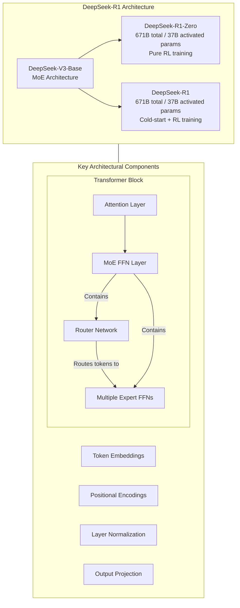

Sources: [README.md:78-79]()

## Mixture of Experts Architecture

The core innovation in the DeepSeek-R1 models is the Mixture of Experts (MoE) architecture, which allows the model to have a large total parameter count (671B) while only activating a small portion (37B) during each forward pass.

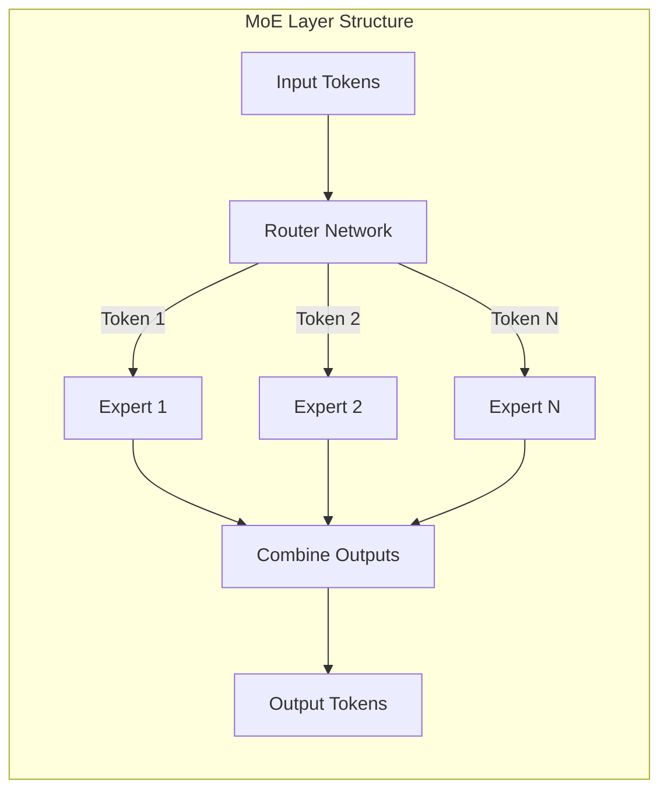

The MoE architecture works as follows:

1. A router network determines which expert should process each token
2. Each token is sent to only a subset of the available experts
3. The outputs from the selected experts are combined to produce the final output
4. This approach enables the model to have specialized expert networks that can focus on specific types of tokens or tasks

This architecture offers several advantages:
- Significantly increased model capacity without proportional increase in computation
- Ability to develop specialized experts for different tasks or domains
- Improved reasoning capabilities through specialized expert networks

Sources: [README.md:71-79]()

## Training Approach Impact on Architecture

The architectural differences between DeepSeek-R1-Zero and DeepSeek-R1 are primarily in their training methodologies rather than their fundamental architecture. Both models share the same DeepSeek-V3-Base MoE architecture but differ in how they were trained, which affects their behavior and capabilities.

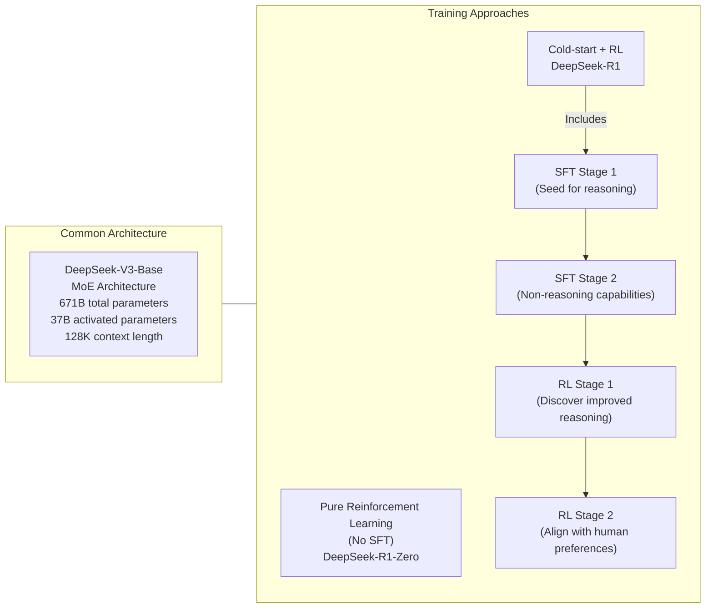

Sources: [README.md:31-38](), [README.md:52-56]()

## Distillation Process Architecture

The distilled models are derived from DeepSeek-R1 but are based on different architectural families (Qwen and Llama). The distillation process transfers the reasoning capabilities of DeepSeek-R1 to smaller, more efficient models.

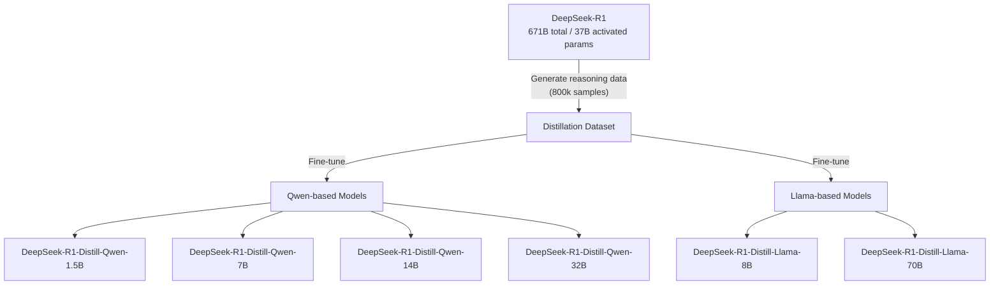

Sources: [README.md:60-63](), [README.md:82-97]()

## Model Architecture Comparison

The following table provides a comparative overview of the model architectures in the DeepSeek-R1 family:

| Model | Base Architecture | Total Parameters | Activated Parameters | Context Length | Training Approach |
|-------|------------------|-----------------|---------------------|---------------|------------------|
| DeepSeek-R1-Zero | DeepSeek-V3 MoE | 671B | 37B | 128K | Pure RL (No SFT) |
| DeepSeek-R1 | DeepSeek-V3 MoE | 671B | 37B | 128K | Cold-start + RL |
| DeepSeek-R1-Distill-Qwen-1.5B | Qwen2.5-Math-1.5B | 1.5B | 1.5B | - | Distillation from DeepSeek-R1 |
| DeepSeek-R1-Distill-Qwen-7B | Qwen2.5-Math-7B | 7B | 7B | - | Distillation from DeepSeek-R1 |
| DeepSeek-R1-Distill-Llama-8B | Llama-3.1-8B | 8B | 8B | - | Distillation from DeepSeek-R1 |
| DeepSeek-R1-Distill-Qwen-14B | Qwen2.5-14B | 14B | 14B | - | Distillation from DeepSeek-R1 |
| DeepSeek-R1-Distill-Qwen-32B | Qwen2.5-32B | 32B | 32B | - | Distillation from DeepSeek-R1 |
| DeepSeek-R1-Distill-Llama-70B | Llama-3.3-70B-Instruct | 70B | 70B | - | Distillation from DeepSeek-R1 |

Sources: [README.md:67-96]()

## Architectural Implications for Deployment

The MoE architecture of DeepSeek-R1 and DeepSeek-R1-Zero has specific implications for deployment:

1. **Specialized Deployment**: Due to the MoE architecture, these models require specialized deployment methods as noted in the documentation, which directs users to the DeepSeek-V3 repository for deployment instructions.

2. **Distilled Model Efficiency**: The distilled models, being based on dense architectures like Qwen and Llama, can be deployed using standard frameworks such as vLLM and SGLang.

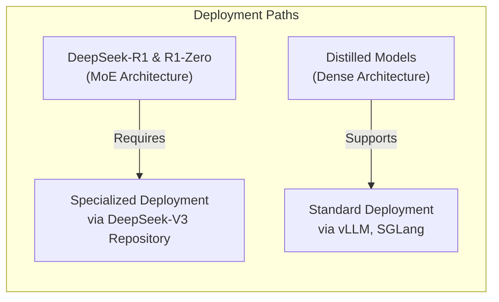

Sources: [README.md:164-168](), [README.md:170-184]()

## Usage Considerations Related to Architecture

The architectural design of DeepSeek-R1 models influences several usage considerations:

1. **Temperature Settings**: Due to the MoE architecture, a temperature range of 0.5-0.7 (0.6 recommended) is suggested to prevent endless repetitions or incoherent outputs.

2. **Prompt Format**: The architecture is optimized for user prompts without system prompts, affecting how instructions should be provided.

3. **Thinking Pattern**: The models are designed to utilize a thinking pattern approach using `` tags, which is an architectural consideration for achieving optimal reasoning performance.

Sources: [README.md:186-197]()

---

# Page: DeepSeek-R1-Zero

# DeepSeek-R1-Zero

<details>
<summary>Relevant source files</summary>

The following files were used as context for generating this wiki page:

- [DeepSeek_R1.pdf](DeepSeek_R1.pdf)
- [README.md](README.md)

</details>


## Purpose and Scope

This document provides a comprehensive overview of DeepSeek-R1-Zero, a large language model trained via pure reinforcement learning without supervised fine-tuning. It covers the model architecture, training methodology, emergent reasoning capabilities, and usage recommendations. For information about DeepSeek-R1, which incorporates cold-start data before reinforcement learning, see [DeepSeek-R1](#2.2).

Sources: [README.md:33-37]()

## Model Overview

DeepSeek-R1-Zero is a 671B parameter Mixture-of-Experts (MoE) language model with 37B activated parameters per token. It represents a significant milestone in AI research as the first open research model to validate that reasoning capabilities in large language models can be incentivized purely through reinforcement learning, without relying on supervised fine-tuning (SFT) as a preliminary step.

The model features:
- 671B total parameters (37B activated per token)
- 128K context length
- MoE architecture based on DeepSeek-V3-Base

Despite its innovative training approach, DeepSeek-R1-Zero faces challenges including endless repetition, poor readability, and language mixing, which led to the development of its successor, DeepSeek-R1.

Sources: [README.md:33-37](), [README.md:68-79](), [README.md:51-53]()

## Architecture and Technical Details

DeepSeek-R1-Zero is built upon the DeepSeek-V3-Base architecture, utilizing a Mixture-of-Experts (MoE) design. This architecture allows the model to maintain a large total parameter count (671B) while only activating a fraction (37B) during each forward pass, significantly improving computational efficiency.

### Model Architecture Diagram

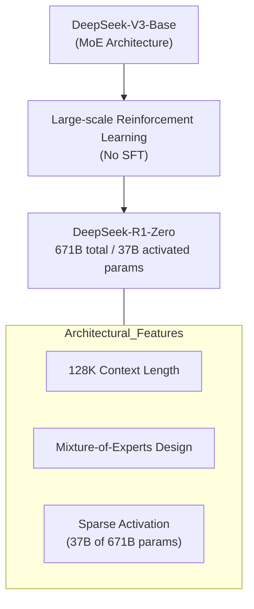

Sources: [README.md:68-79]()

## Training Methodology

Unlike traditional language models that rely on supervised fine-tuning before reinforcement learning, DeepSeek-R1-Zero was trained directly with large-scale reinforcement learning on the base model. This approach represents a novel training paradigm:

### Training Process Diagram

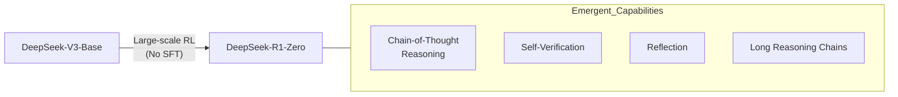

The pure reinforcement learning approach allowed the model to naturally discover and develop reasoning capabilities without being explicitly taught reasoning patterns through supervised examples. This makes DeepSeek-R1-Zero particularly notable for studying how reasoning emerges in large language models.

Sources: [README.md:51-53]()

## Emergent Reasoning Capabilities

Through pure reinforcement learning, DeepSeek-R1-Zero developed several sophisticated reasoning behaviors:

1. **Chain-of-Thought (CoT) Reasoning**: The ability to break down complex problems into step-by-step reasoning processes
2. **Self-Verification**: The capacity to check its own work and validate conclusions
3. **Reflection**: The capability to reconsider initial approaches and refine reasoning paths
4. **Long Reasoning Chains**: The ability to maintain coherent reasoning over extended sequences

These capabilities emerged organically through reinforcement learning incentives rather than being explicitly taught through supervised examples.

Sources: [README.md:33-35](), [README.md:51-53]()

## Performance and Benchmarks

DeepSeek-R1-Zero demonstrates strong performance across various reasoning benchmarks, particularly in mathematical reasoning tasks. The table below shows selected performance metrics:

| Benchmark Category | Test | Score |
|-------------------|------|-------|
| Math | AIME 2024 (Pass@1) | High performance |
| Math | MATH-500 (Pass@1) | Strong results |
| Math | CNMO 2024 (Pass@1) | Advanced capabilities |
| Reasoning | GPQA-Diamond (Pass@1) | Competitive performance |
| Reasoning | DROP (3-shot F1) | Strong performance |

The model's pure reinforcement learning approach resulted in impressive reasoning capabilities, though its successor DeepSeek-R1 generally achieves higher scores across benchmarks.

Sources: [README.md:101-133]()

## Challenges and Limitations

Despite its strong reasoning capabilities, DeepSeek-R1-Zero exhibits several notable limitations:

1. **Endless Repetition**: The model can sometimes get caught in repetitive reasoning loops
2. **Poor Readability**: Outputs can be less structured and harder to follow than models with supervised training
3. **Language Mixing**: The model occasionally mixes different languages within responses

These challenges led to the development of DeepSeek-R1, which incorporates cold-start data before reinforcement learning to address these issues while maintaining strong reasoning capabilities.

Sources: [README.md:36-37]()

## Relationship to Other Models

### DeepSeek Model Family Hierarchy

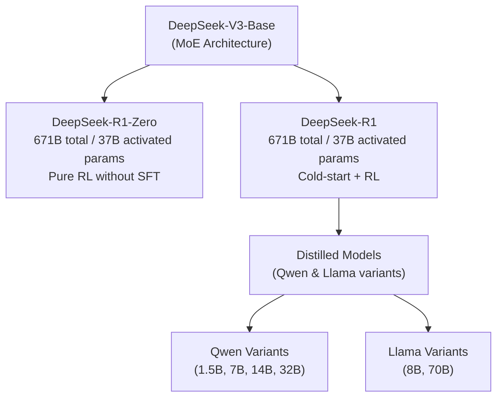

DeepSeek-R1-Zero represents a distinct branch in the DeepSeek model family, focusing on pure reinforcement learning. Its capabilities and limitations informed the development of DeepSeek-R1, which incorporates cold-start data before RL to address issues like endless repetition and poor readability.

Sources: [README.md:33-39](), [README.md:51-56]()

## Usage Recommendations

To achieve optimal performance with DeepSeek-R1-Zero, follow these recommendations:

1. **Temperature Setting**: Use a temperature of 0.6 (range 0.5-0.7) to prevent endless repetitions
2. **User Prompts**: Avoid system prompts; include all instructions in the user prompt
3. **Mathematical Problems**: Include directives like "Please reason step by step, and put your final answer within \boxed{}"
4. **Thinking Pattern**: Enforce thinking patterns by having the model start responses with "\<think\>\n"

### Sample Prompting Structure

```
User: Solve the following problem step by step: 
If 3x + 4y = 10 and 2x - 5y = 7, find the values of x and y.
Please reason step by step, and put your final answer within \boxed{}.

---

# Page: DeepSeek-R1

# DeepSeek-R1

<details>
<summary>Relevant source files</summary>

The following files were used as context for generating this wiki page:

- [DeepSeek_R1.pdf](DeepSeek_R1.pdf)
- [README.md](README.md)

</details>


## Purpose and Scope

This document provides detailed information about DeepSeek-R1, a large language model developed to enhance reasoning capabilities through a combination of supervised fine-tuning (SFT) and reinforcement learning (RL). This page focuses specifically on the DeepSeek-R1 model architecture and its training methodology, which employs a cold-start approach followed by reinforcement learning. For information about DeepSeek-R1-Zero (which uses pure RL without SFT), see [DeepSeek-R1-Zero](#2.1), and for details on the distilled models derived from DeepSeek-R1, see [Distilled Models](#2.3).

Sources: [README.md:33-38]()

## Model Architecture

DeepSeek-R1 is based on the DeepSeek-V3-Base architecture, employing a Mixture of Experts (MoE) design. The model has the following key specifications:

- **Total Parameters**: 671 billion
- **Activated Parameters**: 37 billion
- **Context Length**: 128K tokens

The model uses sparse activation via the MoE architecture, allowing it to maintain a large parameter count while only activating a fraction of parameters during inference, balancing computational efficiency with model capacity.

**Model Architecture Diagram**:

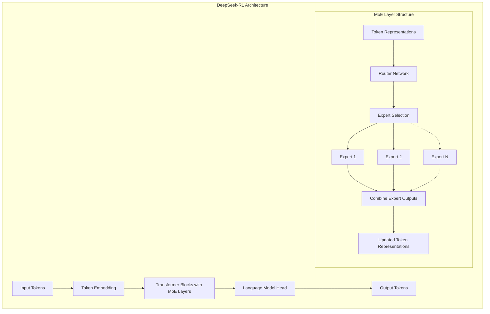

Sources: [README.md:78-79](), [README.md:69-74]()

## Training Methodology

DeepSeek-R1 follows a distinctive training approach that addresses limitations observed in the DeepSeek-R1-Zero model (such as endless repetition, poor readability, and language mixing). The training pipeline incorporates both supervised fine-tuning (SFT) and reinforcement learning (RL) stages.

**Training Pipeline Diagram**:

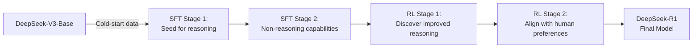

### Training Stages

1. **SFT Stage 1 (Cold-start)**: This initial supervised fine-tuning phase serves as the seed for the model's reasoning capabilities, providing foundational knowledge and skills.

2. **SFT Stage 2**: This phase enhances the model's non-reasoning capabilities, ensuring balanced performance across various tasks.

3. **RL Stage 1**: The first reinforcement learning stage focuses on discovering improved reasoning patterns, optimizing the model's problem-solving approaches.

4. **RL Stage 2**: The second RL stage aims to align the model's outputs with human preferences, ensuring its responses are useful, readable, and appropriate.

This combined approach results in a model that maintains the strong reasoning capabilities derived from reinforcement learning while addressing the usability issues found in models trained exclusively through RL.

Sources: [README.md:51-56](), [README.md:33-38]()

## Capabilities and Performance

DeepSeek-R1 demonstrates exceptional performance across a wide range of tasks, with particularly strong results in reasoning, mathematics, and code-related benchmarks. The model achieves performance comparable to OpenAI-o1 across various domains.

### Key Performance Metrics

| Category | Benchmark | DeepSeek R1 | OpenAI o1-1217 | OpenAI o1-mini |
|----------|-----------|-------------|----------------|----------------|
| English  | MMLU (Pass@1) | 90.8 | **91.8** | 85.2 |
| English  | MMLU-Redux (EM) | **92.9** | - | 86.7 |
| English  | DROP (3-shot F1) | **92.2** | 90.2 | 83.9 |
| Code     | LiveCodeBench (Pass@1-COT) | **65.9** | 63.4 | 53.8 |
| Code     | Codeforces (Rating) | 2029 | **2061** | 1820 |
| Math     | AIME 2024 (Pass@1) | **79.8** | 79.2 | 63.6 |
| Math     | MATH-500 (Pass@1) | **97.3** | 96.4 | 90.0 |
| Chinese  | C-Eval (EM) | **91.8** | - | 68.9 |

### Emergent Capabilities

DeepSeek-R1 exhibits several emergent reasoning behaviors, refined through its training process:

1. **Chain-of-Thought Reasoning**: The model naturally develops step-by-step reasoning approaches to solve complex problems.
2. **Self-verification**: The ability to check its own work and correct mistakes.
3. **Reflection**: The capacity to evaluate the quality of its own reasoning.

Sources: [README.md:101-132](), [README.md:38-39]()

## Usage Guidelines

To achieve optimal performance with DeepSeek-R1, certain usage configurations are recommended:

### Recommended Settings

1. **Temperature**: Set to 0.6 (acceptable range: 0.5-0.7) to prevent endless repetitions or incoherent outputs.
2. **No System Prompts**: All instructions should be contained within the user prompt.
3. **Mathematical Problem Format**: Include directives like "Please reason step by step, and put your final answer within \boxed{}."
4. **Thinking Pattern**: Enforce the model to start its response with "\<think\>\n" to ensure thorough reasoning.

**Example Prompt Structure Diagram**:

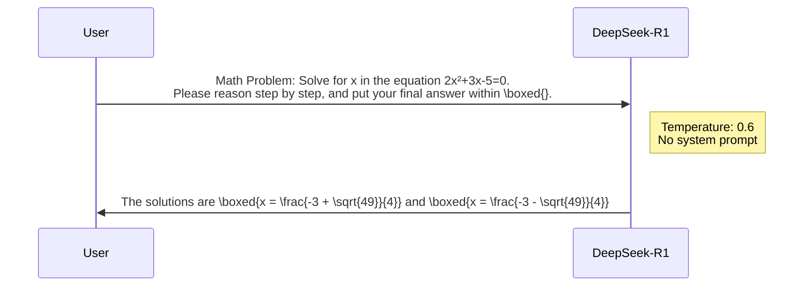

### Deployment Options

DeepSeek-R1 can be accessed through various channels:

1. **Web Interface**: Available at [chat.deepseek.com](https://chat.deepseek.com) with the "DeepThink" option enabled.
2. **API**: Access through DeepSeek Platform at [platform.deepseek.com](https://platform.deepseek.com).
3. **Local Deployment**: Can be run locally following the instructions in the DeepSeek-V3 repository.

Sources: [README.md:186-196](), [README.md:157-166]()

## Comparison with Other Models in the Family

DeepSeek-R1 is part of a broader model family that includes different training approaches and model sizes.

**Model Family Comparison**:

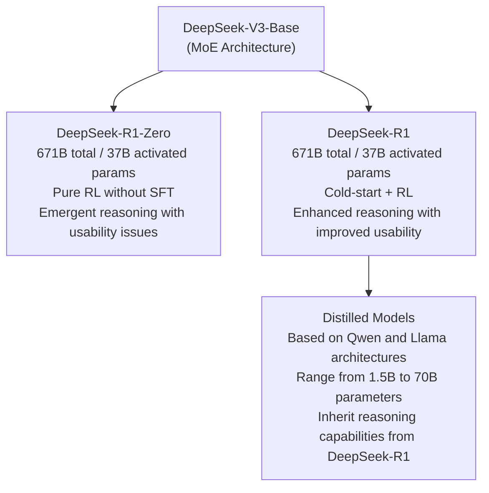

### Key Differences from DeepSeek-R1-Zero

The primary distinction between DeepSeek-R1 and DeepSeek-R1-Zero lies in their training methodologies:

1. **DeepSeek-R1-Zero**: Trained purely through reinforcement learning without SFT, which resulted in emergent reasoning capabilities but also led to issues like endless repetition, poor readability, and language mixing.

2. **DeepSeek-R1**: Incorporates a cold-start approach with supervised fine-tuning before applying reinforcement learning, maintaining strong reasoning capabilities while addressing the usability issues of DeepSeek-R1-Zero.

Sources: [README.md:33-38](), [README.md:51-56]()

## Knowledge Distillation

DeepSeek-R1 serves as the source model for knowledge distillation to create smaller, more accessible models that retain its reasoning capabilities. This process involves generating high-quality reasoning data with DeepSeek-R1 and using it to fine-tune smaller models based on Qwen and Llama architectures.

**Distillation Process Diagram**:

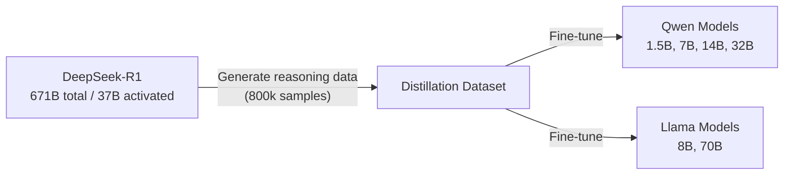

The distilled models offer varying tradeoffs between performance and resource requirements, with larger distilled models (such as DeepSeek-R1-Distill-Qwen-32B) approaching the performance of much larger proprietary models like OpenAI o1-mini.

Sources: [README.md:60-63](), [README.md:81-97]()

---

# Page: Distilled Models

# Distilled Models

<details>
<summary>Relevant source files</summary>

The following files were used as context for generating this wiki page:

- [DeepSeek_R1.pdf](DeepSeek_R1.pdf)
- [README.md](README.md)

</details>


## Purpose and Scope

This page documents the distilled model variants in the DeepSeek-R1 family. These models are smaller, more efficient versions that preserve the reasoning capabilities of the full-sized DeepSeek-R1 model. This document covers the distillation process, available model variants, performance benchmarks, and deployment options. For information on the parent models, see [DeepSeek-R1-Zero](#2.1) and [DeepSeek-R1](#2.2).

## Distillation Process Overview

DeepSeek-R1-Distill models represent an effort to transfer the advanced reasoning capabilities of the large 671B (37B activated) parameter DeepSeek-R1 model to more accessible dense models. The distillation process enables smaller models to gain reasoning capabilities that would be difficult to achieve through direct reinforcement learning on these smaller architectures.

The distillation process involves:
1. Generating a high-quality dataset of reasoning examples using DeepSeek-R1
2. Fine-tuning smaller open-source foundation models on this dataset
3. Preserving the specialized reasoning patterns while maintaining a more efficient model size

**Diagram: DeepSeek-R1 Distillation Process**

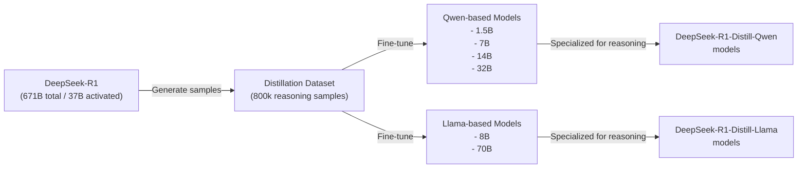

Sources: [README.md:60-63]()

## Available Distilled Models

The DeepSeek-R1 distillation approach has been applied to two major model architectures: Qwen and Llama. This creates a family of models with varying parameter sizes to accommodate different deployment requirements and computational constraints.

**Diagram: DeepSeek-R1 Distilled Model Family**

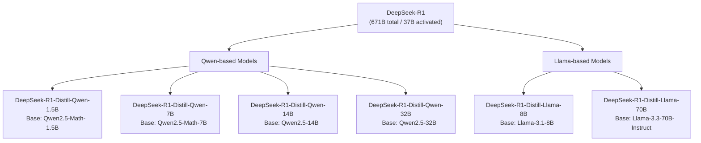

The following table provides a detailed overview of each distilled model:

| **Model** | **Base Model** | **Parameters** | **HuggingFace Location** |
|-----------|----------------|----------------|---------------------------|
| DeepSeek-R1-Distill-Qwen-1.5B | Qwen2.5-Math-1.5B | 1.5B | deepseek-ai/DeepSeek-R1-Distill-Qwen-1.5B |
| DeepSeek-R1-Distill-Qwen-7B | Qwen2.5-Math-7B | 7B | deepseek-ai/DeepSeek-R1-Distill-Qwen-7B |
| DeepSeek-R1-Distill-Llama-8B | Llama-3.1-8B | 8B | deepseek-ai/DeepSeek-R1-Distill-Llama-8B |
| DeepSeek-R1-Distill-Qwen-14B | Qwen2.5-14B | 14B | deepseek-ai/DeepSeek-R1-Distill-Qwen-14B |
| DeepSeek-R1-Distill-Qwen-32B | Qwen2.5-32B | 32B | deepseek-ai/DeepSeek-R1-Distill-Qwen-32B |
| DeepSeek-R1-Distill-Llama-70B | Llama-3.3-70B-Instruct | 70B | deepseek-ai/DeepSeek-R1-Distill-Llama-70B |

Sources: [README.md:82-96]()

## Performance Benchmarks

The distilled models demonstrate strong performance across various benchmarks, particularly in reasoning-intensive tasks such as mathematics, problem-solving, and code generation. The DeepSeek-R1-Distill-Qwen-32B model notably outperforms OpenAI-o1-mini across several benchmarks, establishing a new state-of-the-art for dense models of comparable size.

### Performance Comparison

The following table showcases benchmark results for the distilled models compared to other state-of-the-art models:

| Model | AIME 2024 pass@1 | AIME 2024 cons@64 | MATH-500 pass@1 | GPQA Diamond pass@1 | LiveCodeBench pass@1 | CodeForces rating |
|------------------------------------------|------------------|-------------------|-----------------|----------------------|----------------------|-------------------|
| GPT-4o-0513 | 9.3 | 13.4 | 74.6 | 49.9 | 32.9 | 759 |
| Claude-3.5-Sonnet-1022 | 16.0 | 26.7 | 78.3 | 65.0 | 38.9 | 717 |
| o1-mini | 63.6 | 80.0 | 90.0 | 60.0 | 53.8 | 1820 |
| QwQ-32B-Preview | 44.0 | 60.0 | 90.6 | 54.5 | 41.9 | 1316 |
| DeepSeek-R1-Distill-Qwen-1.5B | 28.9 | 52.7 | 83.9 | 33.8 | 16.9 | 954 |
| DeepSeek-R1-Distill-Qwen-7B | 55.5 | 83.3 | 92.8 | 49.1 | 37.6 | 1189 |
| DeepSeek-R1-Distill-Qwen-14B | 69.7 | 80.0 | 93.9 | 59.1 | 53.1 | 1481 |
| DeepSeek-R1-Distill-Qwen-32B | 72.6 | 83.3 | 94.3 | 62.1 | 57.2 | 1691 |
| DeepSeek-R1-Distill-Llama-8B | 50.4 | 80.0 | 89.1 | 49.0 | 39.6 | 1205 |
| DeepSeek-R1-Distill-Llama-70B | 70.0 | 86.7 | 94.5 | 65.2 | 57.5 | 1633 |

Key observations from benchmark results:
- Even the smallest 1.5B model shows strong reasoning abilities, outperforming much larger models on specific tasks
- The 32B Qwen-based model and 70B Llama-based model achieve performance comparable to proprietary models like o1-mini
- Performance scales with model size within each architecture family
- The models excel particularly in mathematical reasoning tasks (AIME, MATH-500) and code generation tasks

Sources: [README.md:136-153]()

## Deployment and Usage

The distilled models are designed for straightforward deployment using standard tools and frameworks. Unlike the full DeepSeek-R1 model which requires specialized deployment methods, the distilled models can be used with standard open-source tools like vLLM and SGLang.

**Diagram: Deployment Options for Distilled Models**

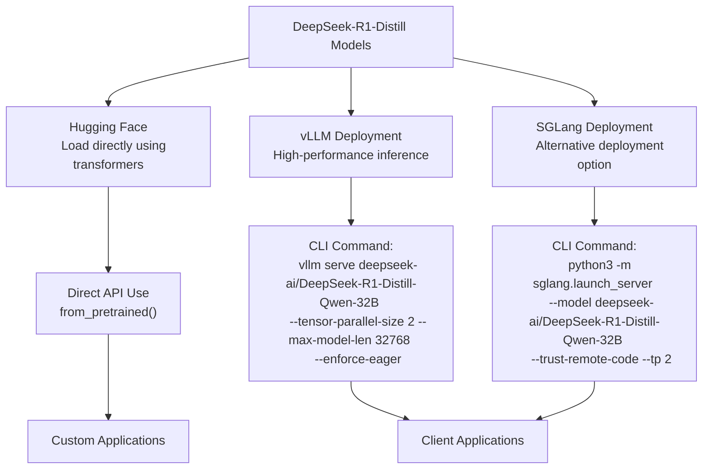

### Deployment Instructions

#### Using vLLM

```shell
vllm serve deepseek-ai/DeepSeek-R1-Distill-Qwen-32B --tensor-parallel-size 2 --max-model-len 32768 --enforce-eager
```

#### Using SGLang

```shell
python3 -m sglang.launch_server --model deepseek-ai/DeepSeek-R1-Distill-Qwen-32B --trust-remote-code --tp 2
```

### Usage Recommendations

For optimal performance with the distilled models, the following recommendations apply:

1. Set temperature within range 0.5-0.7 (0.6 recommended) to prevent repetitions or incoherent outputs
2. Avoid system prompts; include all instructions in user prompts
3. For math problems, include a directive like: "Please reason step by step, and put your final answer within \boxed{}"
4. Consider enforcing the thinking pattern by having the model begin responses with "\<think\>\n"
5. For benchmark evaluation, conduct multiple tests and average the results

Sources: [README.md:170-196]()

## Licensing Information

The DeepSeek-R1-Distill models are released under the MIT License, which allows for commercial use and derivative works, including further distillation for training other LLMs. However, since the models are built upon existing open-source models, users should be aware of the original license terms:

- **Qwen-based models** (1.5B, 7B, 14B, 32B): Derived from Qwen-2.5 series, originally licensed under Apache 2.0 License
- **Llama-8B**: Derived from Llama3.1-8B-Base, originally licensed under Llama3.1 license
- **Llama-70B**: Derived from Llama3.3-70B-Instruct, originally licensed under Llama3.3 license

While the distillation process and fine-tuning conducted by DeepSeek are covered by the MIT License, users should comply with the license terms of the original base models when deploying these models.

Sources: [README.md:256-261]()

---

# Page: Model Usage

# Model Usage

<details>
<summary>Relevant source files</summary>

The following files were used as context for generating this wiki page:

- [README.md](README.md)

</details>


This page provides comprehensive documentation on how to access and use the DeepSeek-R1 family of models. It covers the various access methods, local deployment options, and best practices for optimal model performance. For information about the model architecture, see [Model Architecture](#2), and for specific prompting guidelines, see [Prompting Guidelines](#3.3).

## Available Access Methods

DeepSeek-R1 models can be accessed through multiple channels, each designed for different use cases and requirements.

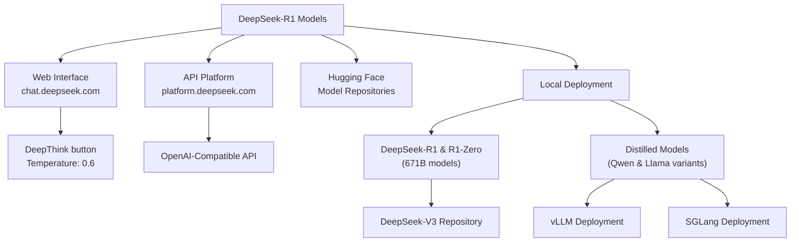

### Web Interface

The DeepSeek-R1 models are accessible through DeepSeek's official web interface at [chat.deepseek.com](https://chat.deepseek.com). To use the reasoning capabilities:

1. Visit the website
2. Enable the "DeepThink" button to activate the reasoning mode
3. Begin your conversation with the model

The web interface uses a default temperature of 0.6 to ensure optimal output quality.

### API Platform

For programmatic access, DeepSeek provides an OpenAI-compatible API through their platform at [platform.deepseek.com](https://platform.deepseek.com). This allows developers to integrate DeepSeek-R1 models into their applications using familiar API patterns.

### Hugging Face Models

All DeepSeek-R1 models are available on Hugging Face. The following models can be accessed:

| Model Type | Model Name | Hugging Face Repository |
|------------|------------|-------------------------|
| Main Models | DeepSeek-R1-Zero | [deepseek-ai/DeepSeek-R1-Zero](https://huggingface.co/deepseek-ai/DeepSeek-R1-Zero) |
| | DeepSeek-R1 | [deepseek-ai/DeepSeek-R1](https://huggingface.co/deepseek-ai/DeepSeek-R1) |
| Distilled Models | DeepSeek-R1-Distill-Qwen-1.5B | [deepseek-ai/DeepSeek-R1-Distill-Qwen-1.5B](https://huggingface.co/deepseek-ai/DeepSeek-R1-Distill-Qwen-1.5B) |
| | DeepSeek-R1-Distill-Qwen-7B | [deepseek-ai/DeepSeek-R1-Distill-Qwen-7B](https://huggingface.co/deepseek-ai/DeepSeek-R1-Distill-Qwen-7B) |
| | DeepSeek-R1-Distill-Llama-8B | [deepseek-ai/DeepSeek-R1-Distill-Llama-8B](https://huggingface.co/deepseek-ai/DeepSeek-R1-Distill-Llama-8B) |
| | DeepSeek-R1-Distill-Qwen-14B | [deepseek-ai/DeepSeek-R1-Distill-Qwen-14B](https://huggingface.co/deepseek-ai/DeepSeek-R1-Distill-Qwen-14B) |
| | DeepSeek-R1-Distill-Qwen-32B | [deepseek-ai/DeepSeek-R1-Distill-Qwen-32B](https://huggingface.co/deepseek-ai/DeepSeek-R1-Distill-Qwen-32B) |
| | DeepSeek-R1-Distill-Llama-70B | [deepseek-ai/DeepSeek-R1-Distill-Llama-70B](https://huggingface.co/deepseek-ai/DeepSeek-R1-Distill-Llama-70B) |

Sources: [README.md:65-96]()

## Local Deployment

DeepSeek-R1 models can be deployed locally for research, development, or production use cases. The deployment method varies depending on the model type.

```mermaid
flowchart LR
    subgraph LocalDeployment["Local Deployment Options"]
        direction TB
        MoEModels["Large MoE Models\nDeepSeek-R1-Zero\nDeepSeek-R1"]
        DistilledModels["Distilled Models\nQwen & Llama variants"]
    end
    
    MoEModels --> DeepSeekV3["DeepSeek-V3 Repository\nCustom Implementation"]
    
    DistilledModels --> VLLM["vLLM Deployment\nvllm serve command"]
    DistilledModels --> SGLang["SGLang Deployment\nsglang.launch_server"]
    
    VLLM --> VLLMSettings["Settings:\n- tensor-parallel-size\n- max-model-len\n- enforce-eager"]
    
    SGLang --> SGLangSettings["Settings:\n- model\n- trust-remote-code\n- tp"]
```

### DeepSeek-R1 and DeepSeek-R1-Zero

For the large MoE-based models (DeepSeek-R1 and DeepSeek-R1-Zero), you need to use the custom implementation from the DeepSeek-V3 repository. These models require specific handling due to their mixture-of-experts architecture.

To run these models:
1. Visit the [DeepSeek-V3 repository](https://github.com/deepseek-ai/DeepSeek-V3)
2. Follow the installation and setup instructions specific to MoE models
3. Use the provided scripts to load and run DeepSeek-R1 models

**Note:** Hugging Face's Transformers library does not directly support these models yet.

Sources: [README.md:164-169]()

### Distilled Models

The distilled models (based on Qwen and Llama architectures) can be deployed using standard frameworks like vLLM or SGLang. These models can be used in the same manner as standard Qwen or Llama models but with the enhanced reasoning capabilities distilled from DeepSeek-R1.

#### Using vLLM

To deploy a distilled model using vLLM:

```bash
vllm serve deepseek-ai/DeepSeek-R1-Distill-Qwen-32B --tensor-parallel-size 2 --max-model-len 32768 --enforce-eager
```

Key parameters:
- `--tensor-parallel-size`: Number of GPUs to use for tensor parallelism
- `--max-model-len`: Maximum sequence length (32768 tokens recommended)
- `--enforce-eager`: Force eager execution mode

#### Using SGLang

To deploy a distilled model using SGLang:

```bash
python3 -m sglang.launch_server --model deepseek-ai/DeepSeek-R1-Distill-Qwen-32B --trust-remote-code --tp 2
```

Key parameters:
- `--model`: Model ID or path
- `--trust-remote-code`: Allow execution of model-specific code
- `--tp`: Number of GPUs for tensor parallelism

Sources: [README.md:170-184]()

## Usage Recommendations

To achieve optimal performance with DeepSeek-R1 models, follow these recommended practices.

```mermaid
flowchart TD
    subgraph UsageRecommendations["Recommended Usage Patterns"]
        Temperature["Temperature Setting\n(0.5-0.7, 0.6 recommended)"]
        PromptStructure["Prompt Structure\n(No system prompts)"]
        MathPrompting["Math Problem Format\n(Step-by-step directive)"]
        ThinkingPattern["Thinking Pattern\n('<think>\\n' prefix)"]
    end
    
    Temperature --> PreventEndless["Prevents repetitions\nand incoherent outputs"]
    PromptStructure --> UserPromptOnly["Instructions in\nuser prompt only"]
    MathPrompting --> BoxedAnswer["Final answer in\n\\boxed{} notation"]
    ThinkingPattern --> EnforceReasoning["Ensures thorough\nreasoning process"]
    
    subgraph Evaluation["Evaluation Best Practices"]
        MultipleTests["Multiple test runs"]
        AverageResults["Average results"]
    end
```

### Parameter Settings

1. **Temperature**: Set the temperature in the range of 0.5-0.7, with 0.6 recommended. This prevents endless repetitions and incoherent outputs while maintaining creativity.

2. **Context Length**: The maximum context length for DeepSeek-R1 models is 128K tokens, while distilled models support their respective architecture's context lengths.

3. **Evaluation**: When benchmarking the models, conduct multiple test runs and average the results for more reliable performance metrics.

### Prompting Guidelines

1. **System Prompts**: Avoid using system prompts. All instructions should be contained within the user prompt.

2. **Mathematical Problems**: For math problems, include a directive such as: "Please reason step by step, and put your final answer within \boxed{}."

3. **Thinking Pattern**: To ensure thorough reasoning, enforce the model to start its response with `<think>\n` at the beginning of every output. This pattern helps the model engage in more detailed reasoning.

Sources: [README.md:186-197]()

## Official Prompts for Special Use Cases

DeepSeek provides official prompt templates for specific use cases, particularly for file upload and web search functionalities in their web interface and applications.

### File Upload Template

When working with uploaded files, use the following template:

```
[file name]: {file_name}
[file content begin]
{file_content}
[file content end]
{question}
```

Where:
- `{file_name}`: The name of the uploaded file
- `{file_content}`: The content of the file
- `{question}`: The user's question about the file

### Web Search Templates

For web search capabilities, DeepSeek provides language-specific templates. Both templates include:
- Search results in a structured format
- Citation instructions
- Current date information
- Response formatting guidelines

The templates are designed to help the model generate well-structured, properly cited responses based on web search results.

Sources: [README.md:198-254]()

## Model Specific Usage Considerations

Different models in the DeepSeek-R1 family have specific characteristics that affect their usage:

| Model | Parameters | Context Length | Best For | Special Considerations |
|-------|------------|---------------|----------|------------------------|
| DeepSeek-R1-Zero | 671B total / 37B activated | 128K | Pure reasoning tasks | Can exhibit repetition issues without proper temperature settings |
| DeepSeek-R1 | 671B total / 37B activated | 128K | General purpose reasoning | Complete model with balanced capabilities |
| Distilled Qwen models | 1.5B to 32B | Varies by model | Efficient deployment | Follow Qwen model configuration patterns |
| Distilled Llama models | 8B and 70B | Varies by model | Efficient deployment | Follow Llama model configuration patterns |

For the most accurate and effective usage, consider:

1. Model size vs. hardware constraints
2. Task complexity vs. model reasoning capability
3. Response quality vs. inference speed tradeoffs

Sources: [README.md:31-39](), [README.md:65-96]()

---

# Page: Model Access

# Model Access

<details>
<summary>Relevant source files</summary>

The following files were used as context for generating this wiki page:

- [README.md](README.md)

</details>


This page documents the various methods for accessing DeepSeek-R1 family models. It covers official hosted solutions, API endpoints, model repositories, and brief introductions to deployment options. For detailed instructions on local deployment, please see [Local Deployment](#3.2). For guidance on how to effectively prompt the models once accessed, see [Prompting Guidelines](#3.3).

## Overview of Access Methods

The DeepSeek-R1 model family can be accessed through multiple channels, each suited for different use cases and technical requirements.

### Model Access Options Diagram

```mermaid
flowchart TD
    subgraph AccessMethods["DeepSeek-R1 Access Methods"]
        Web["Web Interface\nchat.deepseek.com"]
        API["API Platform\nplatform.deepseek.com"]
        HF["Hugging Face\nModel Repositories"]
        Local["Local Deployment"]
    end
    
    Web --> |"DeepThink button"| WebUse["Interactive Chat\nwith reasoning capabilities"]
    
    API --> |"OpenAI-Compatible"| APIEndpoint["REST API Endpoint"]
    APIEndpoint --> CompletionAPI["Completion API\n/v1/chat/completions"]
    
    HF --> |"DeepSeek-R1"| HFR1["deepseek-ai/DeepSeek-R1"]
    HF --> |"DeepSeek-R1-Zero"| HFR1Zero["deepseek-ai/DeepSeek-R1-Zero"]
    HF --> |"Distilled Models"| HFDist["deepseek-ai/DeepSeek-R1-Distill-*"]
    
    Local --> |"DeepSeek-R1 & R1-Zero"| DSV3["DeepSeek-V3 Repository"]
    Local --> |"Distilled Models"| Frameworks["Inference Frameworks"]
    
    Frameworks --> VLLM["vLLM"]
    Frameworks --> SGLang["SGLang"]
```

Sources: [README.md:157-162](), [README.md:162-186]()

## Web Interface

The DeepSeek-R1 models can be accessed through the official chat interface at [chat.deepseek.com](https://chat.deepseek.com).

### Key Features:
- Enable reasoning capabilities by switching on the "DeepThink" button
- Default temperature setting of 0.6
- No system prompts required - all instructions should be in user messages
- Special prompting templates for file upload and web search functionality

### Web Interface Usage Flow

```mermaid
sequenceDiagram
    participant User
    participant WebInterface as chat.deepseek.com
    participant DeepSeekR1 as DeepSeek-R1 Model
    
    User->>WebInterface: Visit chat.deepseek.com
    User->>WebInterface: Toggle "DeepThink" button
    User->>WebInterface: Input query
    WebInterface->>DeepSeekR1: Send query to model
    DeepSeekR1-->>WebInterface: Generate response with reasoning
    WebInterface-->>User: Display response
    
    Note over User,WebInterface: For specialized tasks
    
    User->>WebInterface: Upload file
    WebInterface->>DeepSeekR1: Format with file_template
    DeepSeekR1-->>WebInterface: Process file and respond
    WebInterface-->>User: Display file-informed response
    
    User->>WebInterface: Web search query
    WebInterface->>DeepSeekR1: Format with search_answer_template
    DeepSeekR1-->>WebInterface: Process with search results
    WebInterface-->>User: Display search-informed response
```

Sources: [README.md:158](), [README.md:198-254]()

### File Upload and Web Search Templates

The web interface uses specific templated prompts for file upload and web search capabilities:

1. **File Upload Template**:
   ```
   [file name]: {file_name}
   [file content begin]
   {file_content}
   [file content end]
   {question}
   ```

2. **Web Search Templates**:
   - Templates are available for both Chinese and English queries
   - Search results are passed in format `[webpage X begin]...[webpage X end]`
   - Citations are included in responses with `[citation:X]` format

Sources: [README.md:198-254]()

## API Platform

DeepSeek-R1 models are available through an OpenAI-compatible API at [platform.deepseek.com](https://platform.deepseek.com).

### API Integration Flow

```mermaid
sequenceDiagram
    participant Client
    participant API as platform.deepseek.com
    participant DeepSeekR1 as DeepSeek-R1 Model
    
    Client->>API: Authentication (API Key)
    Client->>API: POST /v1/chat/completions
    API->>DeepSeekR1: Process request
    DeepSeekR1-->>API: Generate response
    API-->>Client: Return JSON response
    
    Note over Client,API: OpenAI-Compatible Format
    
    Client->>API: Messages array with roles
    Client->>API: Set temperature=0.6
    Client->>API: Model identifier
    API-->>Client: Streaming or complete response
```

### API Usage Recommendations:
- Use the OpenAI-compatible endpoint format
- Set temperature within the range of 0.5-0.7 (0.6 recommended)
- Avoid system prompts - include all instructions in user messages
- For math problems, include step-by-step reasoning directive
- Consider enforcing thinking pattern with `<think>\n` at response beginning

Sources: [README.md:160](), [README.md:186-197]()

## Hugging Face Model Repositories

All DeepSeek-R1 models are available on Hugging Face under the `deepseek-ai` organization.

| **Model Type** | **HF Repository** | **Parameters** | **Context Length** |
|----------------|------------------|----------------|-------------------|
| DeepSeek-R1-Zero | [deepseek-ai/DeepSeek-R1-Zero](https://huggingface.co/deepseek-ai/DeepSeek-R1-Zero) | 671B total / 37B activated | 128K |
| DeepSeek-R1 | [deepseek-ai/DeepSeek-R1](https://huggingface.co/deepseek-ai/DeepSeek-R1) | 671B total / 37B activated | 128K |
| DeepSeek-R1-Distill-Qwen-1.5B | [deepseek-ai/DeepSeek-R1-Distill-Qwen-1.5B](https://huggingface.co/deepseek-ai/DeepSeek-R1-Distill-Qwen-1.5B) | 1.5B | - |
| DeepSeek-R1-Distill-Qwen-7B | [deepseek-ai/DeepSeek-R1-Distill-Qwen-7B](https://huggingface.co/deepseek-ai/DeepSeek-R1-Distill-Qwen-7B) | 7B | - |
| DeepSeek-R1-Distill-Llama-8B | [deepseek-ai/DeepSeek-R1-Distill-Llama-8B](https://huggingface.co/deepseek-ai/DeepSeek-R1-Distill-Llama-8B) | 8B | - |
| DeepSeek-R1-Distill-Qwen-14B | [deepseek-ai/DeepSeek-R1-Distill-Qwen-14B](https://huggingface.co/deepseek-ai/DeepSeek-R1-Distill-Qwen-14B) | 14B | - |
| DeepSeek-R1-Distill-Qwen-32B | [deepseek-ai/DeepSeek-R1-Distill-Qwen-32B](https://huggingface.co/deepseek-ai/DeepSeek-R1-Distill-Qwen-32B) | 32B | - |
| DeepSeek-R1-Distill-Llama-70B | [deepseek-ai/DeepSeek-R1-Distill-Llama-70B](https://huggingface.co/deepseek-ai/DeepSeek-R1-Distill-Llama-70B) | 70B | - |

Sources: [README.md:65-96]()

### Hugging Face Model Access

```mermaid
flowchart TD
    subgraph HFAccess["Hugging Face Access"]
        HFRepo["deepseek-ai Organization"]
        HFR1Zero["DeepSeek-R1-Zero Repository"]
        HFR1["DeepSeek-R1 Repository"]
        HFDistilled["Distilled Model Repositories"]
    end
    
    HFRepo --> HFR1Zero
    HFRepo --> HFR1
    HFRepo --> HFDistilled
    
    HFDistilled --> QwenModels["Qwen-based Models\n1.5B, 7B, 14B, 32B"]
    HFDistilled --> LlamaModels["Llama-based Models\n8B, 70B"]
    
    HFR1Zero --> |"For MoE models"| DSVC["DeepSeek-V3 Codebase Required"]
    HFR1 --> |"For MoE models"| DSVC
    
    QwenModels --> |"Direct usage with"| Frameworks["Standard Frameworks"]
    LlamaModels --> |"Direct usage with"| Frameworks
    
    Frameworks --> VLLM["vLLM"]
    Frameworks --> SGLang["SGLang"]
    Frameworks --> HFTransformers["Hugging Face Transformers"]
```

Sources: [README.md:65-97](), [README.md:172-184]()

## Local Deployment Overview

For using DeepSeek-R1 models locally, there are different approaches depending on the model type:

### Primary Model Deployment
- DeepSeek-R1 and DeepSeek-R1-Zero require the DeepSeek-V3 repository
- Not directly supported by Hugging Face Transformers
- See [DeepSeek-V3](https://github.com/deepseek-ai/DeepSeek-V3) repository for detailed instructions

### Distilled Model Deployment
Distilled models can be used with standard frameworks:

1. Using vLLM:
   ```bash
   vllm serve deepseek-ai/DeepSeek-R1-Distill-Qwen-32B --tensor-parallel-size 2 --max-model-len 32768 --enforce-eager
   ```

2. Using SGLang:
   ```bash
   python3 -m sglang.launch_server --model deepseek-ai/DeepSeek-R1-Distill-Qwen-32B --trust-remote-code --tp 2
   ```

For detailed instructions on local deployment options, see [Local Deployment](#3.2).

Sources: [README.md:165-184]()

## Access Method Comparison

| **Access Method** | **Suitable For** | **Setup Complexity** | **Resource Requirements** | **Customization** |
|-------------------|------------------|----------------------|---------------------------|-------------------|
| Web Interface | Quick testing, casual use | None (ready-to-use) | None (cloud-hosted) | Limited to UI options |
| API Platform | Production applications, service integration | Low (API key setup) | None (cloud-hosted) | Flexible via API parameters |
| Hugging Face | Research, experimentation | Medium | Varies by model | High customization possible |
| Local Deployment | Custom applications, privacy requirements, offline use | High | High (especially for large models) | Maximum flexibility |

Sources: [README.md:157-186](), [README.md:65-97]()

---

# Page: Local Deployment

# Local Deployment

<details>
<summary>Relevant source files</summary>

The following files were used as context for generating this wiki page:

- [README.md](README.md)

</details>


This page provides comprehensive instructions for deploying DeepSeek-R1 models locally on your own infrastructure. It covers deployment methods for both the full-sized MoE models (DeepSeek-R1 and DeepSeek-R1-Zero) and the distilled model variants based on Qwen and Llama architectures. For information about accessing the models through web interfaces or API platforms, see [Model Access](#3.1).

## Deployment Options Overview

DeepSeek-R1 models can be deployed locally using different methods depending on the specific model variant:

### Deployment Methods Diagram

```mermaid
flowchart TD
    subgraph ModelTypes["DeepSeek-R1 Model Types"]
        MoEModels["MoE Models\nDeepSeek-R1\nDeepSeek-R1-Zero\n(671B total / 37B activated params)"]
        DistilledModels["Distilled Models\nQwen: 1.5B, 7B, 14B, 32B\nLlama: 8B, 70B"]
    end

    subgraph DeploymentFrameworks["Deployment Frameworks"]
        DeepSeekV3Framework["DeepSeek-V3 Framework"]
        VLLM["vLLM"]
        SGLang["SGLang"]
    end

    MoEModels --> DeepSeekV3Framework
    DistilledModels --> VLLM
    DistilledModels --> SGLang

    subgraph HardwareRequirements["Hardware Requirements"]
        MoEReq["MoE Models:\nMultiple GPUs\nHigh Memory"]
        DistilledReq["Distilled Models:\nScalable based on size\n(1.5B to 70B)"]
    end
    
    MoEModels --- MoEReq
    DistilledModels --- DistilledReq
```

Sources: [README.md:164-169](). [README.md:170-184]()

## MoE Models Deployment (DeepSeek-R1 and DeepSeek-R1-Zero)

The full-sized DeepSeek-R1 and DeepSeek-R1-Zero models are Mixture of Experts (MoE) models with 671B total parameters and 37B activated parameters. These models require specific deployment methods due to their architecture.

### DeepSeek-V3 Framework

To deploy the MoE models locally:

1. Visit the [DeepSeek-V3](https://github.com/deepseek-ai/DeepSeek-V3) repository for detailed instructions
2. Follow the specific deployment guidelines for MoE models
3. Note that Hugging Face's Transformers library is not directly supported for these models yet

### MoE Deployment Process

```mermaid
flowchart LR
    subgraph PrerequisiteSetup["Step 1: Prerequisites"]
        GPUSetup["Configure Multi-GPU Environment"]
        RepoSetup["Clone DeepSeek-V3 Repository"]
        DependencySetup["Install Dependencies"]
    end
    
    subgraph ModelDownload["Step 2: Model Download"]
        GetModel["Download Model from Hugging Face\n- DeepSeek-R1\n- DeepSeek-R1-Zero"]
    end
    
    subgraph DeploymentSetup["Step 3: Deployment"]
        ConfigFramework["Configure DeepSeek-V3 Framework"]
        LaunchService["Launch Inference Service"]
        VerifyModel["Verify Model Functionality"]
    end
    
    PrerequisiteSetup --> ModelDownload
    ModelDownload --> DeploymentSetup
```

Sources: [README.md:164-169]()

## Distilled Models Deployment

The distilled models are smaller, dense models based on the Qwen and Llama architectures. These models are more lightweight and can be deployed using standard frameworks like vLLM and SGLang.

### Available Distilled Models

| Model | Base Architecture | Parameters | Hugging Face Repository |
|-------|------------------|------------|-------------------------|
| DeepSeek-R1-Distill-Qwen-1.5B | Qwen2.5-Math-1.5B | 1.5B | deepseek-ai/DeepSeek-R1-Distill-Qwen-1.5B |
| DeepSeek-R1-Distill-Qwen-7B | Qwen2.5-Math-7B | 7B | deepseek-ai/DeepSeek-R1-Distill-Qwen-7B |
| DeepSeek-R1-Distill-Qwen-14B | Qwen2.5-14B | 14B | deepseek-ai/DeepSeek-R1-Distill-Qwen-14B |
| DeepSeek-R1-Distill-Qwen-32B | Qwen2.5-32B | 32B | deepseek-ai/DeepSeek-R1-Distill-Qwen-32B |
| DeepSeek-R1-Distill-Llama-8B | Llama-3.1-8B | 8B | deepseek-ai/DeepSeek-R1-Distill-Llama-8B |
| DeepSeek-R1-Distill-Llama-70B | Llama-3.3-70B-Instruct | 70B | deepseek-ai/DeepSeek-R1-Distill-Llama-70B |

Sources: [README.md:82-97]()

### vLLM Deployment

[vLLM](https://github.com/vllm-project/vllm) is a high-performance inference framework for LLMs that supports efficient serving through PagedAttention. To deploy a distilled DeepSeek-R1 model using vLLM:

1. Install vLLM:
   ```bash
   pip install vllm
   ```

2. Launch the vLLM server with your chosen model:
   ```bash
   vllm serve deepseek-ai/DeepSeek-R1-Distill-Qwen-32B --tensor-parallel-size 2 --max-model-len 32768 --enforce-eager
   ```

Key parameters:
- `--tensor-parallel-size`: Number of GPUs to distribute the model across
- `--max-model-len`: Maximum sequence length (32768 for DeepSeek-R1 models)
- `--enforce-eager`: Use eager mode for execution

Sources: [README.md:174-178]()

### SGLang Deployment

[SGLang](https://github.com/sgl-project/sglang) is another framework for deploying language models with structured generation capabilities. To deploy a distilled DeepSeek-R1 model using SGLang:

1. Install SGLang:
   ```bash
   pip install sglang
   ```

2. Launch the SGLang server:
   ```bash
   python3 -m sglang.launch_server --model deepseek-ai/DeepSeek-R1-Distill-Qwen-32B --trust-remote-code --tp 2
   ```

Key parameters:
- `--model`: Path to the Hugging Face model repository
- `--trust-remote-code`: Allow execution of custom code from the model repository
- `--tp`: Tensor parallelism degree (number of GPUs)

Sources: [README.md:180-184]()

### Distilled Models Deployment Process

```mermaid
flowchart TD
    subgraph ModelSelection["Step 1: Model Selection"]
        SelectModel["Select Distilled Model\n- Qwen variants: 1.5B, 7B, 14B, 32B\n- Llama variants: 8B, 70B"]
    end
    
    subgraph FrameworkSelection["Step 2: Framework Selection"]
        SelectVLLM["vLLM Framework"]
        SelectSGLang["SGLang Framework"]
    end
    
    subgraph Deployment["Step 3: Deployment"]
        subgraph VLLMSetup["vLLM Setup"]
            InstallVLLM["Install vLLM"]
            ConfigVLLM["Configure Parameters\n- tensor-parallel-size\n- max-model-len\n- enforce-eager"]
            LaunchVLLM["Launch vLLM Server"]
        end
        
        subgraph SGLangSetup["SGLang Setup"]
            InstallSGLang["Install SGLang"]
            ConfigSGLang["Configure Parameters\n- model\n- trust-remote-code\n- tp"]
            LaunchSGLang["Launch SGLang Server"]
        end
    end
    
    subgraph Verification["Step 4: Verification"]
        TestAPI["Test API Endpoint"]
        CheckPerformance["Verify Model Performance"]
    end
    
    ModelSelection --> FrameworkSelection
    FrameworkSelection --> |Choose vLLM| VLLMSetup
    FrameworkSelection --> |Choose SGLang| SGLangSetup
    VLLMSetup --> Verification
    SGLangSetup --> Verification
```

Sources: [README.md:170-184]()

## Model Configuration and Usage Recommendations

To achieve optimal performance with DeepSeek-R1 models, certain configuration settings and prompting patterns are recommended. These apply to both MoE and distilled variants.

### Configuration Parameters

| Parameter | Recommended Value | Description |
|-----------|------------------|-------------|
| Temperature | 0.5-0.7 (0.6 recommended) | Controls randomness in generation; 0.6 prevents endless repetitions |
| Max sequence length | 32768 | Maximum context window size for these models |
| System prompt | None | Avoid system prompts; include all instructions in user prompts |
| Thinking pattern | Enforce `<think>\n` | Consider enforcing thinking pattern at beginning of responses |

### Prompting Guidelines

For best results with DeepSeek-R1 models, follow these guidelines:

1. **Avoid system prompts**: Include all instructions within the user prompt
2. **Mathematical problems**: Include directives like "Please reason step by step, and put your final answer within \boxed{}."
3. **Enforce thinking pattern**: To ensure thorough reasoning, consider enforcing the model to start responses with `<think>\n`
4. **Evaluation**: When benchmarking, conduct multiple tests and average the results

### Configuration Diagram

```mermaid
flowchart LR
    subgraph ModelConfig["Model Configuration"]
        TempSetting["Temperature: 0.6"]
        ContextSetting["Max Sequence Length: 32768"]
        SystemPrompt["System Prompt: None"]
    end
    
    subgraph PromptingStrategy["Prompting Strategy"]
        MathDirective["Math Directive\n'Please reason step by step...'"]
        UserPrompt["Instructions in User Prompt Only"]
        ThinkPattern["Enforce Thinking Pattern\n'<think>\\n'"]
    end
    
    ModelConfig --> OptimalPerformance["Optimal Performance"]
    PromptingStrategy --> OptimalPerformance
```

Sources: [README.md:186-197]()

## Performance Considerations

When deploying DeepSeek-R1 models locally, hardware requirements and performance characteristics vary significantly between model types.

### Hardware Requirements Comparison

| Model Type | Parameters | Minimum GPU Memory | Recommended Setup | Inference Speed |
|------------|------------|-------------------|-------------------|----------------|
| DeepSeek-R1 / R1-Zero | 671B total / 37B activated | Multiple high-end GPUs | Multi-GPU system with NVLink | Lower due to model size |
| Distilled Qwen-1.5B | 1.5B | ~3GB | Single GPU | High |
| Distilled Qwen-7B | 7B | ~14GB | Single GPU | Medium-High |
| Distilled Qwen-14B | 14B | ~28GB | 1-2 GPUs | Medium |
| Distilled Qwen-32B | 32B | ~64GB | 2-4 GPUs | Medium-Low |
| Distilled Llama-8B | 8B | ~16GB | Single GPU | Medium-High |
| Distilled Llama-70B | 70B | ~140GB | 4+ GPUs | Low |

Sources: [README.md:138-154]()

## Specific Use Cases

### File Upload Processing

When deploying models that need to process file uploads, use the following prompt template pattern:

```
[file name]: {file_name}
[file content begin]
{file_content}
[file content end]
{question}
```

### Web Search Integration

For deployments integrating with web search functionality, specific prompt templates are recommended for both Chinese and English queries. Refer to the README for the detailed templates.

Sources: [README.md:198-254]()

## License Considerations

When deploying DeepSeek-R1 models locally, be aware of the license considerations:

- DeepSeek-R1 and DeepSeek-R1-Zero are licensed under MIT License
- Distilled Qwen models are derived from Qwen-2.5 series (Apache 2.0 License)
- Distilled Llama-8B is derived from Llama3.1-8B-Base (Llama3.1 license)
- Distilled Llama-70B is derived from Llama3.3-70B-Instruct (Llama3.3 license)

All models support commercial use and allow modifications and derivative works.

Sources: [README.md:256-261]()

---

# Page: Prompting Guidelines

# Prompting Guidelines

<details>
<summary>Relevant source files</summary>

The following files were used as context for generating this wiki page:

- [README.md](README.md)

</details>


This document outlines best practices for constructing effective prompts when using the DeepSeek-R1 family of models. Following these guidelines will help ensure optimal performance across various tasks, particularly for reasoning, mathematics, and code generation. For information about accessing the models, see [Model Access](#3.1), and for local deployment instructions, see [Local Deployment](#3.2).

## 1. General Prompting Recommendations

The DeepSeek-R1 models have specific preferences for how prompts should be structured to achieve optimal performance. The following guidelines apply to all models in the DeepSeek-R1 family, including the distilled versions.

### 1.1 Key Recommendations

| Parameter | Recommendation | Notes |
|-----------|---------------|-------|
| Temperature | 0.5-0.7 (0.6 recommended) | Prevents endless repetitions or incoherent outputs |
| System Prompts | Avoid using | All instructions should be contained within the user prompt |
| Evaluation | Conduct multiple tests | Average results for more accurate performance assessment |
| Response Format | Enforce thinking pattern | Start response with `\nFinal Answer"]
    end
    
    "Reasoning Prompt Structure" --> "Model Processing"
```

Sources: [README.md:195-196]()

## 3. Special Use Case Templates

The DeepSeek-R1 models support specialized prompting templates for specific use cases, such as file upload and web search.

### 3.1 File Upload Template

When working with file uploads, use the following template structure:

```
[file name]: {file_name}
[file content begin]
{file_content}
[file content end]
{question}
```

Where:
- `{file_name}` is the name of the uploaded file
- `{file_content}` is the content of the file
- `{question}` is the user's question about the file

Sources: [README.md:202-209]()

### 3.2 Web Search Templates

The DeepSeek-R1 models use different templates for web search queries depending on the language.

#### Chinese Web Search Template

A specialized template for handling web search in Chinese, including citation formatting and response structure guidelines.

#### English Web Search Template  

A structured template for English web search queries, with similar citation formatting and response structure guidelines.

Sources: [README.md:212-254]()

## 4. Troubleshooting Common Issues

### 4.1 Repetitive or Incoherent Outputs

If the model produces repetitive or incoherent outputs:

1. Verify that the temperature is set between 0.5-0.7 (preferably 0.6)
2. Ensure all instructions are in the user prompt (not in a system prompt)
3. For complex reasoning tasks, explicitly instruct the model to think step by step

```mermaid
flowchart TD
    A[Repetitive/Incoherent Output] --> B{Temperature set correctly?}
    B -->|No| C[Adjust temperature to 0.6]
    B -->|Yes| D{Using system prompt?}
    D -->|Yes| E[Move instructions to user prompt]
    D -->|No| F{Complex reasoning task?}
    F -->|Yes| G[Add step-by-step directive]
    F -->|No| H[Clarify instructions]
    
    C --> I[Test with new prompt]
    E --> I
    G --> I
    H --> I
```

Sources: [README.md:187-196]()

### 4.2 Bypassing Thinking Pattern

If the model bypasses the thinking pattern:

1. Explicitly instruct the model to start its response with `<think>\n`
2. Use clear directives such as "Think through this problem step by step, starting with `<think>`"

Sources: [README.md:195-196]()

## 5. Evaluation Settings

When evaluating the DeepSeek-R1 models on benchmarks or comparing performance:

1. Set temperature to 0.6
2. Set top-p to 0.95
3. For sampling-based evaluations, generate 64 responses per query to estimate pass@1
4. Maximum generation length should be set to 32,768 tokens

Sources: [README.md:101-103]()

## 6. Comparison with Standard Prompting Approaches

The DeepSeek-R1 models differ from many other language models in their prompting preferences, particularly in their approach to system prompts and reasoning patterns.

```mermaid
flowchart LR
    subgraph "Standard LLM Prompting"
        A[System Prompt] --> B[User Prompt]
        B --> C[Response]
    end
    
    subgraph "DeepSeek-R1 Prompting"
        D[User Prompt with Instructions] --> E[Request for Step-by-Step Reasoning]
        E --> F["Response with <think> pattern"]
    end
```

Sources: [README.md:187-196]()

This specialized prompting approach is designed to leverage the advanced reasoning capabilities of the DeepSeek-R1 family of models, which were trained using reinforcement learning techniques specifically to enhance reasoning performance.

---

# Page: Performance and Benchmarks

# Performance and Benchmarks

<details>
<summary>Relevant source files</summary>

The following files were used as context for generating this wiki page:

- [README.md](README.md)
- [figures/benchmark.jpg](figures/benchmark.jpg)

</details>


This document provides a comprehensive overview of DeepSeek-R1 model family performance across various benchmarks spanning English language understanding, mathematics, code generation, and Chinese language tasks. For information about model architecture, see [Model Architecture](#2), and for usage guidelines, see [Model Usage](#3).

## Evaluation Methodology

DeepSeek-R1 models are evaluated using consistent methodology across all benchmarks to ensure fair comparison:

- Maximum generation length: 32,768 tokens
- Temperature: 0.6 (recommended for optimal performance)
- Top-p value: 0.95
- For benchmarks requiring sampling, 64 responses per query are generated to estimate pass@1

These parameters balance exploration during generation while avoiding repetitive outputs or inconsistent performance.

Sources: [README.md:102-103]()

## Benchmark Categories and Results

The evaluation framework covers four main categories of benchmarks, testing a wide range of capabilities:

```mermaid
flowchart TD
    Benchmarks["DeepSeek-R1 Benchmark Framework"]
    
    Benchmarks --> EnglishBenchmarks["English Benchmarks"]
    Benchmarks --> CodeBenchmarks["Code Benchmarks"]
    Benchmarks --> MathBenchmarks["Math Benchmarks"]
    Benchmarks --> ChineseBenchmarks["Chinese Benchmarks"]
    
    EnglishBenchmarks --> MMLU["MMLU (Massive Multitask Language Understanding)"]
    EnglishBenchmarks --> MMLU_Redux["MMLU-Redux"]
    EnglishBenchmarks --> MMLU_Pro["MMLU-Pro"]
    EnglishBenchmarks --> DROP["DROP (Reading Comprehension)"]
    EnglishBenchmarks --> IF_Eval["IF-Eval"]
    EnglishBenchmarks --> GPQA["GPQA-Diamond"]
    EnglishBenchmarks --> SimpleQA["SimpleQA"]
    EnglishBenchmarks --> FRAMES["FRAMES"]
    EnglishBenchmarks --> AlpacaEval["AlpacaEval2.0"]
    EnglishBenchmarks --> ArenaHard["ArenaHard"]
    
    CodeBenchmarks --> LiveCodeBench["LiveCodeBench"]
    CodeBenchmarks --> Codeforces["Codeforces"]
    CodeBenchmarks --> SWE_Verified["SWE Verified"]
    CodeBenchmarks --> Aider_Polyglot["Aider-Polyglot"]
    
    MathBenchmarks --> AIME["AIME 2024"]
    MathBenchmarks --> MATH500["MATH-500"]
    MathBenchmarks --> CNMO["CNMO 2024"]
    
    ChineseBenchmarks --> CLUEWSC["CLUEWSC"]
    ChineseBenchmarks --> C_Eval["C-Eval"]
    ChineseBenchmarks --> C_SimpleQA["C-SimpleQA"]
```

Sources: [README.md:101-133]()

### DeepSeek-R1 Performance Highlights

DeepSeek-R1 demonstrates competitive or superior performance compared to leading models across benchmark categories:

| Category | Key Achievement |
|----------|----------------|
| English | 90.8% on MMLU, 92.9% on MMLU-Redux, 84.0% on MMLU-Pro |
| Code | 65.9% on LiveCodeBench, 2029 rating on Codeforces |
| Math | 79.8% on AIME 2024, 97.3% on MATH-500, 78.8% on CNMO 2024 |
| Chinese | 92.8% on CLUEWSC, 91.8% on C-Eval |

Notable strengths include:
1. Exceptional reasoning capabilities, particularly in mathematics
2. Strong code generation and problem-solving performance
3. High performance on complex question-answering benchmarks
4. Effective cross-lingual capabilities in Chinese

Sources: [README.md:111-132]()

### Comparative Analysis

The following diagram illustrates DeepSeek-R1's position relative to other leading models across benchmark categories:

```mermaid
quadrantChart
    title Performance Comparison: DeepSeek-R1 vs Other Models
    x-axis Math & Reasoning --> Better
    y-axis Code & General Knowledge --> Better
    quadrant-1 Superior All-Round
    quadrant-2 Strong in Math/Reasoning
    quadrant-3 Limited Performance
    quadrant-4 Strong in Code/General Knowledge
    
    "Claude-3.5-Sonnet": [0.47, 0.42]
    "GPT-4o": [0.44, 0.40]
    "DeepSeek V3": [0.65, 0.61]
    "OpenAI o1-mini": [0.74, 0.70]
    "OpenAI o1": [0.84, 0.83]
    "DeepSeek-R1": [0.85, 0.82]
```

Sources: [README.md:106-132]()

## English Language Benchmark Performance

DeepSeek-R1 achieves strong results across English language benchmarks that test both general knowledge and reasoning capabilities:

| Benchmark | Metric | DeepSeek-R1 Score | Best Competitor | Best Score |
|-----------|--------|-------------------|----------------|------------|
| MMLU | Pass@1 | 90.8 | OpenAI o1-1217 | 91.8 |
| MMLU-Redux | EM | **92.9** | - | - |
| MMLU-Pro | EM | **84.0** | OpenAI o1-mini | 80.3 |
| DROP | 3-shot F1 | **92.2** | OpenAI o1-1217 | 90.2 |
| FRAMES | Acc. | **82.5** | GPT-4o | 80.5 |
| AlpacaEval2.0 | LC-winrate | **87.6** | DeepSeek V3 | 70.0 |
| ArenaHard | GPT-4-1106 | **92.3** | OpenAI o1-mini | 92.0 |

Sources: [README.md:111-120]()

## Code Benchmark Performance

DeepSeek-R1 demonstrates exceptional programming capabilities across various code benchmarks:

| Benchmark | Metric | DeepSeek-R1 Score | Best Competitor | Best Score |
|-----------|--------|-------------------|----------------|------------|
| LiveCodeBench | Pass@1-COT | **65.9** | OpenAI o1-1217 | 63.4 |
| Codeforces | Percentile | 96.3 | OpenAI o1-1217 | 96.6 |
| Codeforces | Rating | 2029 | OpenAI o1-1217 | 2061 |
| SWE Verified | Resolved | 49.2 | Claude-3.5-Sonnet | 50.8 |
| Aider-Polyglot | Acc. | 53.3 | OpenAI o1-1217 | 61.7 |

Sources: [README.md:121-125]()

## Math Benchmark Performance

Mathematical reasoning is one of DeepSeek-R1's strongest capabilities, demonstrating superior performance across challenging math benchmarks:

| Benchmark | Metric | DeepSeek-R1 Score | Best Competitor | Best Score |
|-----------|--------|-------------------|----------------|------------|
| AIME 2024 | Pass@1 | **79.8** | OpenAI o1-1217 | 79.2 |
| MATH-500 | Pass@1 | **97.3** | OpenAI o1-1217 | 96.4 |
| CNMO 2024 | Pass@1 | **78.8** | OpenAI o1-mini | 67.6 |

Sources: [README.md:126-128]()

## Chinese Language Benchmark Performance

DeepSeek-R1 shows strong multilingual capabilities with exceptional performance on Chinese language benchmarks:

| Benchmark | Metric | DeepSeek-R1 Score | Best Competitor | Best Score |
|-----------|--------|-------------------|----------------|------------|
| CLUEWSC | EM | **92.8** | DeepSeek V3 | 90.9 |
| C-Eval | EM | **91.8** | DeepSeek V3 | 86.5 |
| C-SimpleQA | Correct | 63.7 | DeepSeek V3 | 68.0 |

Sources: [README.md:129-132]()

## Distilled Model Performance

DeepSeek-R1's reasoning capabilities have been effectively transferred to smaller, more efficient models through distillation. The following compares the performance of distilled models across key benchmarks:

```mermaid
flowchart TD
    DistillPerformance["Distilled Model Performance"]
    
    DistillPerformance --> DistillA["AIME 2024 Performance"]
    DistillPerformance --> DistillB["MATH-500 Performance"]
    DistillPerformance --> DistillC["Code Performance"]
    
    DistillA --> |"Best: 72.6%"| R1Distill32B["DeepSeek-R1-Distill-Qwen-32B"]
    DistillA --> |"Next: 70.0%"| R1Distill70B["DeepSeek-R1-Distill-Llama-70B"]
    DistillA --> |"Baseline: 63.6%"| O1Mini["o1-mini"]
    
    DistillB --> |"Best: 94.5%"| R1Distill70B
    DistillB --> |"Next: 94.3%"| R1Distill32B
    DistillB --> |"Baseline: 90.0%"| O1Mini
    
    DistillC --> |"CodeForces Rating"| CodeRating["DeepSeek-R1-Distill-Qwen-32B: 1691\nDeepSeek-R1-Distill-Llama-70B: 1633\no1-mini: 1820"]
    
    class R1Distill32B,R1Distill70B highlight;
    classDef highlight stroke-width:2px;
```

Sources: [README.md:136-154]()

### Detailed Distilled Model Comparison

The table below provides a comprehensive comparison of distilled models against leading commercial models:

| Model | AIME 2024 pass@1 | MATH-500 pass@1 | GPQA Diamond pass@1 | LiveCodeBench pass@1 | CodeForces rating |
|-------|------------------|-----------------|---------------------|----------------------|-------------------|
| GPT-4o-0513 | 9.3 | 74.6 | 49.9 | 32.9 | 759 |
| Claude-3.5-Sonnet-1022 | 16.0 | 78.3 | 65.0 | 38.9 | 717 |
| o1-mini | 63.6 | 90.0 | 60.0 | 53.8 | **1820** |
| DeepSeek-R1-Distill-Qwen-1.5B | 28.9 | 83.9 | 33.8 | 16.9 | 954 |
| DeepSeek-R1-Distill-Qwen-7B | 55.5 | 92.8 | 49.1 | 37.6 | 1189 |
| DeepSeek-R1-Distill-Qwen-14B | 69.7 | 93.9 | 59.1 | 53.1 | 1481 |
| DeepSeek-R1-Distill-Qwen-32B | **72.6** | 94.3 | 62.1 | 57.2 | 1691 |
| DeepSeek-R1-Distill-Llama-8B | 50.4 | 89.1 | 49.0 | 39.6 | 1205 |
| DeepSeek-R1-Distill-Llama-70B | 70.0 | **94.5** | **65.2** | **57.5** | 1633 |

Key observations:
- DeepSeek-R1-Distill-Qwen-32B outperforms o1-mini on AIME 2024 and MATH-500
- DeepSeek-R1-Distill-Llama-70B achieves the best overall performance among distilled models
- Even smaller models like DeepSeek-R1-Distill-Qwen-14B demonstrate strong mathematical reasoning capabilities

Sources: [README.md:140-153]()

## Evaluation Recommendations

To accurately reproduce or compare against the reported benchmark results, follow these evaluation guidelines:

1. **Temperature Setting**: Use temperature 0.6 (range 0.5-0.7) to avoid repetitions or incoherent outputs
2. **Prompting Format**: Avoid system prompts; include all instructions in the user prompt
3. **Math Problem Approach**: For mathematical problems, include a directive like "Please reason step by step, and put your final answer within \boxed{}"
4. **Multiple Evaluations**: Conduct multiple tests and average the results for more reliable evaluation
5. **Thinking Pattern**: To ensure thorough reasoning, enforce the model to begin its response with "\<think\>\n"

Following these guidelines will help ensure consistent evaluation and comparison with the reported benchmark results.

Sources: [README.md:188-196]()

---

# Page: Repository Information

# Repository Information

<details>
<summary>Relevant source files</summary>

The following files were used as context for generating this wiki page:

- [.github/workflows/stale.yml](.github/workflows/stale.yml)
- [LICENSE](LICENSE)
- [README.md](README.md)

</details>


This page provides detailed information about the DeepSeek-R1 repository structure, organization, license details, and contribution guidelines. It serves as a reference for understanding how the codebase is organized and managed. For information about the models themselves, see [Model Architecture](#2) and for usage details, see [Model Usage](#3).

## Repository Overview

The DeepSeek-R1 repository is primarily focused on providing access to a family of reasoning-specialized language models, including documentation, evaluation benchmarks, and deployment instructions. The repository does not contain the actual model code implementation, which is instead referenced through the DeepSeek-V3 repository for the base models.

**Repository Structure Diagram**

```mermaid
graph TD
    subgraph Repository["DeepSeek-R1 Repository Structure"]
        README["README.md\nMain documentation and model overview"]
        LICENSE["LICENSE\nMIT License"]
        GitHubDir[".github directory\nContains GitHub workflows"]
        FiguresDir["figures directory\nBenchmark images"]
        Paper["DeepSeek_R1.pdf\nDetailed technical paper"]
    end
    
    GitHubDir --> WorkflowsDir["workflows directory\nAutomation scripts"]
    WorkflowsDir --> StaleYml["stale.yml\nStale issue management workflow"]
    
    FiguresDir --> BenchmarkImg["benchmark.jpg\nBenchmark performance visualization"]
    
    README --> |"references"| Paper
    README --> |"includes"| BenchmarkImg
```

Sources: [README.md:1-29]()

## Main Repository Components

The repository consists of the following primary components:

| Component | Description | Purpose |
|-----------|-------------|---------|
| README.md | Main documentation file | Provides comprehensive information about models, usage, and benchmarks |
| LICENSE | MIT License file | Details the licensing terms for the repository and models |
| .github directory | GitHub-specific files | Contains workflows for repository management |
| figures directory | Image resources | Contains benchmark visualizations and other graphics |
| DeepSeek_R1.pdf | Technical paper | Provides in-depth technical details about model architecture and training |

Sources: [README.md:1-29]()

### Documentation Organization

The main documentation is contained in the README.md file, which is organized into the following sections:

1. Introduction
2. Model Summary
3. Model Downloads
4. Evaluation Results
5. Chat Website & API Platform
6. How to Run Locally
7. License
8. Citation
9. Contact

This structure provides a comprehensive guide for users to understand, download, and use the DeepSeek-R1 models.

Sources: [README.md:31-277]()

## Issue Management

The repository includes an automated system for managing GitHub issues to maintain an organized and responsive project.

**Issue Management Workflow Diagram**

```mermaid
flowchart TD
    subgraph IssueLifecycle["GitHub Issue Lifecycle"]
        NewIssue["New Issue Created"]
        ActiveIssue["Active Issue"]
        StaleIssue["Stale Issue\nMarked with 'stale' label"]
        ClosedIssue["Closed Issue\nMarked with 'closed-as-stale' label"]
        ExemptIssue["Exempt Issue\nHas 'pinned' or 'security' label"]
    end
    
    NewIssue --> ActiveIssue
    ActiveIssue --> |"No activity for 30 days"| StaleIssue
    StaleIssue --> |"New comment\nor activity"| ActiveIssue
    StaleIssue --> |"No activity for 14 more days"| ClosedIssue
    ActiveIssue --> |"Has exempt label"| ExemptIssue
    ExemptIssue --> |"Exempt label removed"| ActiveIssue
    
    subgraph WorkflowExecution["Workflow Execution"]
        Schedule["Scheduled daily\nCron: 0 0 * * *"]
        Manual["Manual trigger\nWorkflow dispatch"]
        GHAction["GitHub Action\nactions/stale@v9"]
    end
    
    Schedule --> GHAction
    Manual --> GHAction
    GHAction --> |"processes"| IssueLifecycle
```

Sources: [.github/workflows/stale.yml:1-31]()

### Stale Issue Management

The repository uses GitHub's stale action to automatically manage inactive issues:

- Issues are marked as stale after 30 days of inactivity
- Stale issues receive an automated comment notifying contributors
- Issues are closed after 14 additional days of inactivity
- Issues with "pinned" or "security" labels are exempt from the stale process
- Pull requests are not subject to the stale workflow (configured with -1 days)

This automation helps maintain a clean issue tracker by focusing attention on active issues.

Sources: [.github/workflows/stale.yml:12-30]()

## License Information

The DeepSeek-R1 repository is released under the MIT License, which provides generous permissions for use, modification, and distribution.

**License Terms Diagram**

```mermaid
flowchart TD
    subgraph LicenseTerms["MIT License Terms"]
        Rights["Permissions Granted\n- Use\n- Copy\n- Modify\n- Merge\n- Publish\n- Distribute\n- Sublicense\n- Sell"]
        Conditions["Conditions\n- Include copyright notice\n- Include permission notice"]
        Limitations["Limitations\n- No warranty\n- No liability"]
    end
    
    subgraph ModelLicenses["Model-Specific Licensing"]
        DeepSeekR1["DeepSeek-R1 & R1-Zero\nMIT License"]
        DistilledQwen["DeepSeek-R1-Distill-Qwen Models\nDerived from Qwen-2.5 (Apache 2.0)"]
        DistilledLlama8B["DeepSeek-R1-Distill-Llama-8B\nDerived from Llama3.1-8B-Base"]
        DistilledLlama70B["DeepSeek-R1-Distill-Llama-70B\nDerived from Llama3.3-70B-Instruct"]
    end
    
    LicenseTerms --> DeepSeekR1
    DeepSeekR1 --> |"used to finetune"| DistilledQwen
    DeepSeekR1 --> |"used to finetune"| DistilledLlama8B
    DeepSeekR1 --> |"used to finetune"| DistilledLlama70B
```

Sources: [LICENSE:1-21](), [README.md:256-261]()

### License Details

The MIT License grants the following permissions:

- Freedom to use the software for any purpose
- Freedom to modify, distribute, and sell the software
- Permission to use the software in both private and commercial settings

The only requirements are to include the original copyright notice and permission notice in all copies or substantial portions of the software.

The license explicitly states that the software is provided "as is," without warranty of any kind, and the authors or copyright holders are not liable for any claims, damages, or liabilities.

Sources: [LICENSE:1-21]()

### Model-Specific Licensing

While the repository itself is under the MIT License, some of the distilled models have different base license considerations:

1. **DeepSeek-R1-Distill-Qwen Models** (1.5B, 7B, 14B, 32B):
   - Derived from Qwen-2.5 series
   - Original Qwen-2.5 models are licensed under Apache 2.0 License
   - Finetuned with 800k samples curated with DeepSeek-R1

2. **DeepSeek-R1-Distill-Llama Models**:
   - DeepSeek-R1-Distill-Llama-8B is derived from Llama3.1-8B-Base
   - DeepSeek-R1-Distill-Llama-70B is derived from Llama3.3-70B-Instruct
   - Subject to the respective Llama3.1 and Llama3.3 licenses

All models support commercial use and allow for modifications and derivative works, including distillation for training other LLMs.

Sources: [README.md:256-261]()

## Repository File Organization

The DeepSeek-R1 repository has a relatively simple structure with few directories:

```mermaid
graph TD
    subgraph RepoRoot["DeepSeek-R1 Repository Root"]
        RootFiles["Root Files\n- README.md\n- LICENSE\n- DeepSeek_R1.pdf"]
        DotGitHub[".github directory"]
        Figures["figures directory"]
    end
    
    DotGitHub --> Workflows["workflows\n- stale.yml"]
    
    Figures --> BenchmarkJPG["benchmark.jpg"]
    
    subgraph ContentCategories["Content Categories"]
        Documentation["Documentation\n- Model description\n- Benchmarks\n- Usage instructions"]
        LegalInfo["Legal Information\n- License\n- Citation"]
        Automation["Automation\n- GitHub workflows"]
        Resources["Resources\n- Benchmark figures\n- Technical paper"]
    end
    
    RootFiles --> Documentation
    RootFiles --> LegalInfo
    DotGitHub --> Automation
    Figures --> Resources
    RootFiles --> |"DeepSeek_R1.pdf"| Resources
```

Sources: [README.md:1-29]()

Note that the actual model code and implementation is not contained within this repository. Users seeking to run the DeepSeek-R1 models locally are directed to the DeepSeek-V3 repository for implementation details.

Sources: [README.md:78-79](), [README.md:166-168]()

---

# Page: License

# License

<details>
<summary>Relevant source files</summary>

The following files were used as context for generating this wiki page:

- [LICENSE](LICENSE)

</details>


This document explains the licensing terms that govern the DeepSeek-R1 repository and its associated models. Understanding these terms is essential for proper usage, modification, and distribution of the software and models in this repository.

## MIT License Overview

The DeepSeek-R1 repository is released under the MIT License, one of the most permissive and widely used open-source licenses. This license is characterized by its simplicity and minimal restrictions on usage.

Sources: [LICENSE:1-21]()

## License Details

The full text of the MIT License applied to the DeepSeek-R1 repository is as follows:

```
MIT License

Copyright (c) 2023 DeepSeek

Permission is hereby granted, free of charge, to any person obtaining a copy
of this software and associated documentation files (the "Software"), to deal
in the Software without restriction, including without limitation the rights
to use, copy, modify, merge, publish, distribute, sublicense, and/or sell
copies of the Software, and to permit persons to whom the Software is
furnished to do so, subject to the following conditions:

The above copyright notice and this permission notice shall be included in all
copies or substantial portions of the Software.

THE SOFTWARE IS PROVIDED "AS IS", WITHOUT WARRANTY OF ANY KIND, EXPRESS OR
IMPLIED, INCLUDING BUT NOT LIMITED TO THE WARRANTIES OF MERCHANTABILITY,
FITNESS FOR A PARTICULAR PURPOSE AND NONINFRINGEMENT. IN NO EVENT SHALL THE
AUTHORS OR COPYRIGHT HOLDERS BE LIABLE FOR ANY CLAIM, DAMAGES OR OTHER
LIABILITY, WHETHER IN AN ACTION OF CONTRACT, TORT OR OTHERWISE, ARISING FROM,
OUT OF OR IN CONNECTION WITH THE SOFTWARE OR THE USE OR OTHER DEALINGS IN THE
SOFTWARE.
```

Sources: [LICENSE:1-21]()

## Key Permissions

The MIT License grants users the following permissions for the DeepSeek-R1 repository:

| Permission | Description |
|------------|-------------|
| Use | Freedom to use the software for any purpose |
| Copy | Right to create copies of the original software |
| Modify | Permission to alter, adapt, or modify the codebase |
| Publish | Authority to publish modified or unmodified versions |
| Distribute | Right to distribute the original or modified software |
| Sublicense | Ability to apply different license terms to derivatives |
| Sell | Permission to sell the software or derivatives commercially |

Sources: [LICENSE:5-10]()

## License Diagram: Application to Repository Components

```mermaid
graph TD
    MIT["MIT License<br>(DeepSeek 2023)"]
    
    subgraph RepoComponents["DeepSeek-R1 Repository Components"]
        README["README.md"]
        LICENSE_FILE["LICENSE file"]
        GithubWorkflows[".github/workflows"]
        Figures["figures/"]
        PDF["DeepSeek_R1.pdf"]
    end
    
    subgraph ModelComponents["Model Components"]
        ModelWeights["DeepSeek-R1 Model Weights"]
        ModelCode["Model Implementation Code"]
        DistillationCode["Distillation Processing"]
    end
    
    MIT --> RepoComponents
    MIT --> ModelComponents
    
    subgraph LicenseRequirements["License Requirements"]
        IncludeCopyright["Include Copyright Notice<br>in All Copies/Derivatives"]
        IncludePermission["Include Permission Notice<br>in All Copies/Derivatives"]
        NoWarranty["Provided AS IS<br>Without Warranty"]
        NoLiability["No Liability for<br>Authors/Copyright Holders"]
    end
    
    MIT --- LicenseRequirements
```

Sources: [LICENSE:1-21]()

## Obligations When Using DeepSeek-R1

When using, modifying, or distributing the DeepSeek-R1 repository or its derivatives, users must:

1. Include the original copyright notice: "Copyright (c) 2023 DeepSeek"
2. Include the full text of the MIT License permission notice

This requirement applies to all substantial portions of the software, including any modifications or derivative works.

Sources: [LICENSE:12-13]()

## Warranty Disclaimer and Liability Limitations

The MIT License explicitly states that the DeepSeek-R1 repository is provided "as is" without any warranties. Specifically:

- No warranty of merchantability
- No warranty of fitness for a particular purpose
- No warranty of non-infringement

Additionally, the license stipulates that the authors and copyright holders (DeepSeek) shall not be liable for any claims, damages, or other liabilities arising from the use of the software.

Sources: [LICENSE:15-21]()

## License Application to Model Implementations

```mermaid
flowchart TD
    MITLicense["MIT License"]
    
    subgraph LicenseCoverage["License Coverage"]
        RepoCode["Repository Code"]
        Documentation["Documentation"]
        
        subgraph ModelFamily["DeepSeek-R1 Model Family"]
            R1Base["DeepSeek-R1"]
            R1Zero["DeepSeek-R1-Zero"]
            
            subgraph DistilledModels["Distilled Model Implementations"]
                QwenModels["Qwen-based Models<br>1.5B, 7B, 14B, 32B"]
                LlamaModels["Llama-based Models<br>8B, 70B"]
            end
        end
    end
    
    MITLicense --> LicenseCoverage
    
    subgraph Requirements["License Requirements"]
        CopyrightNotice["Include Copyright Notice"]
        LicenseText["Include License Text"]
    end
    
    LicenseCoverage --> Requirements
```

Sources: [LICENSE:1-21]()

## Practical Implications

The MIT License's permissive nature means that users of the DeepSeek-R1 repository can:

1. Integrate the code into both open-source and proprietary applications
2. Modify the models for specific use cases
3. Create and distribute derivative works
4. Use the models for commercial purposes
5. Apply different licensing terms to derivative works (while maintaining the original MIT License notices for original components)

The only substantive requirement is maintaining the copyright and license notices in all copies or substantial portions of the software.

Sources: [LICENSE:5-13]()

---

# Page: Issue Management

# Issue Management

<details>
<summary>Relevant source files</summary>

The following files were used as context for generating this wiki page:

- [.github/workflows/stale.yml](.github/workflows/stale.yml)

</details>


This document describes the automated issue management system implemented in the DeepSeek-R1 repository. It focuses specifically on how GitHub issues are tracked, labeled, and eventually closed through automated workflows. For information about the general repository structure, see [Repository Information](#5).

## Automated Stale Issue Workflow

The DeepSeek-R1 repository implements an automated stale issue management system that helps maintain a clean issue tracker. This system automatically identifies and handles issues that have been inactive for extended periods, ensuring that the development team focuses on current, relevant issues.

The workflow is implemented as a GitHub Actions workflow that runs daily and processes issues based on their activity levels.

Sources: [.github/workflows/stale.yml:1-11]()

### Workflow Configuration

The stale issue workflow is configured with the following parameters:

| Parameter | Value | Description |
|-----------|-------|-------------|
| Runs on | Daily at midnight UTC | Scheduled with cron expression `0 0 * * *` |
| Stale threshold | 30 days | Issues become stale after 30 days of inactivity |
| Close threshold | 14 days | Stale issues are closed after 14 additional days of inactivity |
| Stale label | "stale" | Label applied to stale issues |
| Close label | "closed-as-stale" | Label applied when closing stale issues |
| Exempt labels | "pinned", "security" | Issues with these labels are never marked as stale |
| PR handling | Disabled | Pull requests are not managed by this workflow |

Sources: [.github/workflows/stale.yml:3-30]()

### Issue Lifecycle

The following diagram illustrates the lifecycle of an issue in the DeepSeek-R1 repository, focusing on the stale issue management process:

```mermaid
stateDiagram-v2
    direction LR
    [*] --> Active: Issue created
    Active --> Stale: 30 days inactivity
    Stale --> Active: New activity
    Stale --> Closed: 14 days inactivity
    Active --> Exempt: "pinned" or "security" label added
    Exempt --> Active: Exempt label removed
    
    note right of Active
        Issues with recent activity
        or created within 30 days
    end note
    
    note right of Stale
        "stale" label applied
        Notification comment posted
    end note
    
    note right of Closed
        "closed-as-stale" label applied
        Issue automatically closed
    end note
    
    note right of Exempt
        Never marked as stale
        regardless of inactivity
    end note
```

Sources: [.github/workflows/stale.yml:12-30]()

### Stale Issue Detection Process

This diagram illustrates the technical process used by the GitHub Actions workflow to detect and manage stale issues:

```mermaid
flowchart TD
    Start([Daily workflow trigger]) --> CheckRepo{Is deepseek-ai/DeepSeek-R1?}
    CheckRepo -- Yes --> ScanIssues[Scan all open issues]
    CheckRepo -- No --> End([End workflow])
    
    ScanIssues --> CheckActivity{Issue inactive\nfor 30+ days?}
    CheckActivity -- Yes --> CheckExempt{Has exempt\nlabels?}
    CheckActivity -- No --> KeepActive[Keep issue active]
    
    CheckExempt -- Yes --> KeepActive
    CheckExempt -- No --> CheckIfStale{Already\nmarked stale?}
    
    CheckIfStale -- Yes --> CheckStaleTime{Stale for\n14+ days?}
    CheckIfStale -- No --> MarkStale[Mark as stale\nAdd comment\nAdd "stale" label]
    
    CheckStaleTime -- Yes --> CloseIssue[Close issue\nAdd "closed-as-stale" label]
    CheckStaleTime -- No --> KeepStale[Keep issue stale]
    
    MarkStale --> End
    KeepActive --> End
    KeepStale --> End
    CloseIssue --> End
```

Sources: [.github/workflows/stale.yml:7-30]()

## Managing Your Issues

To prevent your issues from being automatically closed, consider the following guidelines:

### Keeping Issues Active

Issues remain active as long as they receive regular activity. Activity includes:

- Comments from users or maintainers
- Label changes
- Assignee changes
- Linking to pull requests

If an issue is marked as stale, you can reactivate it by adding a comment explaining why the issue is still relevant.

### Understanding Issue Labels

The stale issue workflow uses specific labels to track issue status:

| Label | Meaning |
|-------|---------|
| stale | Issue has been inactive for 30+ days and may be closed soon |
| closed-as-stale | Issue was closed automatically due to continued inactivity |
| pinned | Issue is exempt from the stale workflow (maintained by repository owners) |
| security | Security-related issues exempt from the stale workflow |

Sources: [.github/workflows/stale.yml:15-21]()

### Stale Issue Notifications

When an issue is marked as stale, the following notification message is posted:

```
This issue has been automatically marked as stale because it has not had
recent activity. It will be closed if no further activity occurs. If you
believe this issue is still relevant, please leave a comment to keep it open.
Thank you for your contributions!
```

This message serves as a warning that the issue will be closed after 14 more days of inactivity unless someone responds to keep it active.

Sources: [.github/workflows/stale.yml:22-27]()

## Technical Implementation

The stale issue workflow is implemented using the GitHub Actions framework and the official `actions/stale` action in version 9. The workflow only runs on the main DeepSeek-R1 repository and uses the standard GitHub API token for authentication.

The workflow is defined in the following file:
- [.github/workflows/stale.yml]() - Contains the complete workflow definition

Sources: [.github/workflows/stale.yml:1-31]()