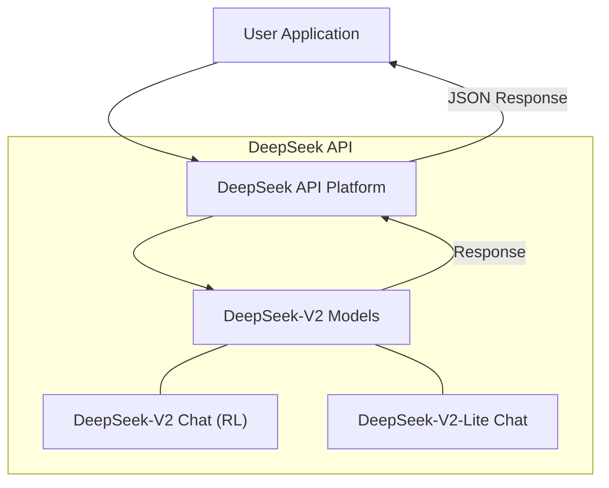
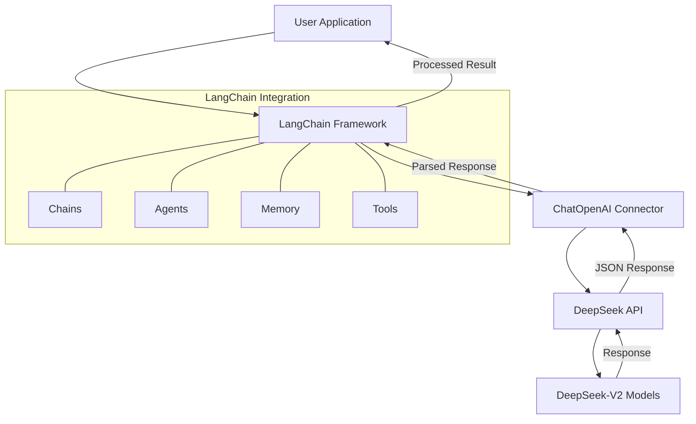

<!-- source: DeepWiki mcp.deepwiki.com · repo deepseek-ai/DeepSeek-V2 · page 3.3 API and LangChain · fetched 2026-10-30 -->

# API and LangChain

<details>
<summary>Relevant source files</summary>

The following files were used as context for generating this wiki page:

- [README.md](README.md)

</details>


This document provides a technical guide for using DeepSeek-V2 models through the DeepSeek API Platform and integrating them with LangChain. For information about running DeepSeek-V2 locally with Hugging Face Transformers, see [Hugging Face Integration](#3.1). For information about using SGLang or vLLM, see [SGLang and vLLM](#3.2).

## 1. DeepSeek API Platform Overview

DeepSeek provides an OpenAI-compatible API platform that allows developers to access DeepSeek-V2 models programmatically. The platform is accessible at [platform.deepseek.com](https://platform.deepseek.com) and offers both free tokens for new users and pay-as-you-go pricing for continued usage.



Sources: [README.md:214-216](), [README.md:217-220]()

### 1.1. API Authentication

To use the DeepSeek API, you need to:

1. Create an account on the DeepSeek Platform
2. Generate an API key
3. Use the API key in your requests to authenticate

The API key should be included in the `Authorization` header of your requests with the format `Bearer YOUR_API_KEY`.

## 2. API Usage Examples

Since the DeepSeek API is OpenAI-compatible, you can use it with the OpenAI Python library or make direct HTTP requests following the OpenAI API format.

### 2.1. Using OpenAI Python Library

```python
import openai

client = openai.Client(
    base_url="https://api.deepseek.com/v1",
    api_key="YOUR_DEEPSEEK_API_KEY"
)

# Chat completion example
response = client.chat.completions.create(
    model="deepseek-chat",  # Use DeepSeek-V2 Chat model
    messages=[
        {"role": "system", "content": "You are a helpful AI assistant"},
        {"role": "user", "content": "Write a function to calculate Fibonacci numbers in Python"}
    ],
    temperature=0.7,
    max_tokens=1000
)

print(response.choices[0].message.content)
```

### 2.2. Making Direct HTTP Requests

You can also make direct HTTP requests to the API endpoint:

```python
import requests
import json

api_key = "YOUR_DEEPSEEK_API_KEY"
headers = {
    "Content-Type": "application/json",
    "Authorization": f"Bearer {api_key}"
}

data = {
    "model": "deepseek-chat",
    "messages": [
        {"role": "system", "content": "You are a helpful AI assistant"},
        {"role": "user", "content": "Write a function to calculate Fibonacci numbers in Python"}
    ],
    "temperature": 0.7,
    "max_tokens": 1000
}

response = requests.post(
    "https://api.deepseek.com/v1/chat/completions",
    headers=headers,
    data=json.dumps(data)
)

print(response.json()["choices"][0]["message"]["content"])
```

## 3. LangChain Integration

LangChain is a framework for developing applications powered by language models. Since DeepSeek's API is compatible with OpenAI, it can be easily integrated with LangChain using the `ChatOpenAI` class.



Sources: [README.md:358-370]()

### 3.1. Basic LangChain Setup

To use DeepSeek-V2 with LangChain, you need to initialize a `ChatOpenAI` instance with the DeepSeek API endpoint and your API key:

```python
from langchain_openai import ChatOpenAI

llm = ChatOpenAI(
    model='deepseek-chat',  # Use DeepSeek-V2 Chat model
    openai_api_key="YOUR_DEEPSEEK_API_KEY",
    openai_api_base='https://api.deepseek.com/v1',
    temperature=0.85,
    max_tokens=8000
)
```

Sources: [README.md:364-370]()

### 3.2. Using DeepSeek-V2 with LangChain Chains

LangChain chains allow you to combine multiple components for more complex workflows:

```python
from langchain.chains import LLMChain
from langchain.prompts import PromptTemplate

# Create a prompt template
template = """
You are an expert in explaining complex topics.
Explain the following concept in simple terms:
{concept}
"""

prompt = PromptTemplate(
    input_variables=["concept"],
    template=template
)

# Create a chain with DeepSeek-V2
chain = LLMChain(llm=llm, prompt=prompt)

# Run the chain
result = chain.run("quantum computing")
print(result)
```

### 3.3. Using DeepSeek-V2 with LangChain Agents

LangChain agents can use DeepSeek-V2 to make decisions about which tools to use:

```python
from langchain.agents import load_tools, initialize_agent, AgentType
from langchain.tools import DuckDuckGoSearchRun

# Load tools
search = DuckDuckGoSearchRun()
tools = [search]

# Initialize agent with DeepSeek-V2
agent = initialize_agent(
    tools,
    llm,
    agent=AgentType.ZERO_SHOT_REACT_DESCRIPTION,
    verbose=True
)

# Run the agent
agent.run("What are the latest developments in fusion energy research?")
```

## 4. Advanced Integration Patterns

### 4.1. Chat History Management

When building conversational applications with DeepSeek-V2 and LangChain, you can use memory components to maintain conversation history:

```python
from langchain.memory import ConversationBufferMemory
from langchain.chains import ConversationChain

# Set up memory
memory = ConversationBufferMemory()

# Create a conversation chain with memory
conversation = ConversationChain(
    llm=llm,
    memory=memory,
    verbose=True
)

# Interactive conversation
response1 = conversation.predict(input="Hello! My name is Alice.")
print(response1)

response2 = conversation.predict(input="What's my name?")
print(response2)  # Should remember the name "Alice"
```

### 4.2. Streaming Responses

DeepSeek API supports streaming responses. You can use this feature with LangChain by setting the `streaming` parameter:

```python
from langchain_openai import ChatOpenAI
from langchain.callbacks.streaming_stdout import StreamingStdOutCallbackHandler

# Initialize with streaming enabled
streaming_llm = ChatOpenAI(
    model='deepseek-chat',
    openai_api_key="YOUR_DEEPSEEK_API_KEY",
    openai_api_base='https://api.deepseek.com/v1',
    streaming=True,
    callbacks=[StreamingStdOutCallbackHandler()],
    temperature=0.7
)

# The response will stream to stdout
streaming_llm.predict("Explain the theory of relativity")
```

## 5. Performance Considerations

### 5.1. Context Window

DeepSeek-V2 supports a context window of up to 128K tokens, while DeepSeek-V2-Lite supports up to 32K tokens. When using the API, consider the following:

| Model | Context Window | Description |
|-------|---------------|-------------|
| DeepSeek-V2 | 128K tokens | Full-sized model with 236B total parameters |
| DeepSeek-V2-Lite | 32K tokens | Smaller model with 16B total parameters |

Sources: [README.md:77-84]()

### 5.2. Pricing and Quotas

The DeepSeek API is available with both free tiers and pay-as-you-go pricing. New users get millions of free tokens upon signing up. For large-scale applications, consider the pricing structure and implement appropriate rate limiting in your application.

Sources: [README.md:215-216]()

## 6. Error Handling Best Practices

When integrating with the DeepSeek API or using it through LangChain, implement proper error handling:

```python
from langchain_openai import ChatOpenAI
import openai
import time

def get_llm_response(prompt, max_retries=3):
    llm = ChatOpenAI(
        model='deepseek-chat',
        openai_api_key="YOUR_DEEPSEEK_API_KEY",
        openai_api_base='https://api.deepseek.com/v1',
        temperature=0.7
    )
    
    for attempt in range(max_retries):
        try:
            return llm.predict(prompt)
        except openai.RateLimitError:
            # Exponential backoff
            wait_time = 2 ** attempt
            print(f"Rate limit reached. Waiting {wait_time} seconds...")
            time.sleep(wait_time)
        except openai.APIError as e:
            # Handle API errors
            print(f"API error: {str(e)}")
            if attempt < max_retries - 1:
                time.sleep(1)
            else:
                raise
        except Exception as e:
            # Handle other exceptions
            print(f"Unexpected error: {str(e)}")
            raise
    
    raise Exception("Maximum retry attempts reached")
```

## 7. Conclusion

DeepSeek-V2's API offers an OpenAI-compatible interface that makes it easy to integrate with LangChain and other frameworks. By using the API, you can access powerful language models without the computational resources required to run them locally. The LangChain integration further enhances this capability by providing structured ways to build complex applications with DeepSeek-V2.

For local deployment options, refer to the Hugging Face Integration [Hugging Face Integration](#3.1) and SGLang/vLLM [SGLang and vLLM](#3.2) documentation pages.

Sources: [README.md:358-370](), [README.md:214-220]()

---

