# Page: Overview

# Overview

<details>
<summary>Relevant source files</summary>

The following files were used as context for generating this wiki page:

- [README.md](README.md)
- [deepseek-v2-tech-report.pdf](deepseek-v2-tech-report.pdf)

</details>


This document provides a comprehensive overview of DeepSeek-V2, a state-of-the-art Mixture-of-Experts (MoE) language model that balances strong performance with economical training and efficient inference capabilities. DeepSeek-V2 represents a significant advancement in large language model architecture, introducing innovative techniques that substantially improve efficiency while maintaining or enhancing performance across various benchmarks.

For detailed information about the model architecture specifics, see [Model Architecture](#1.1). For a breakdown of different model variants, see [Model Variants](#1.2).

Sources: [README.md:57-67]()

## Model Introduction

DeepSeek-V2 is a large language model comprising 236 billion total parameters, of which only 21 billion are activated for each token during operation. The model was pretrained on a diverse corpus of 8.1 trillion tokens, followed by supervised fine-tuning (SFT) and reinforcement learning (RL) to enhance its capabilities.

Compared to its predecessor, DeepSeek-V1 (67B dense model), DeepSeek-V2 achieves:
- 42.5% reduction in training costs
- 93.3% reduction in KV cache size
- 5.76x increase in maximum generation throughput
- Better performance on standard benchmarks

The DeepSeek-V2 family also includes a smaller variant called DeepSeek-V2-Lite with 16B total parameters and 2.4B activated parameters per token.

### DeepSeek-V2 System Architecture

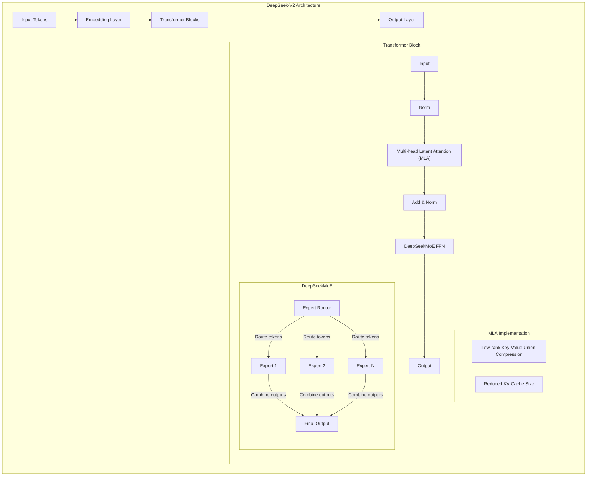

Sources: [README.md:202-209]()

## Key Architectural Innovations

DeepSeek-V2 introduces two major architectural innovations that enable its efficiency and performance improvements:

1. **Multi-head Latent Attention (MLA)**: A novel attention mechanism that utilizes low-rank key-value union compression to dramatically reduce the memory requirements of the KV cache. This innovation eliminates a major bottleneck in inference-time memory usage, enabling efficient inference with long contexts up to 128K tokens.

2. **DeepSeekMoE Architecture**: A high-performance Mixture-of-Experts approach for Feed-Forward Networks (FFNs) that allows the model to have a large total parameter count while only activating a small subset for each token. This architecture enables training stronger models at lower costs.

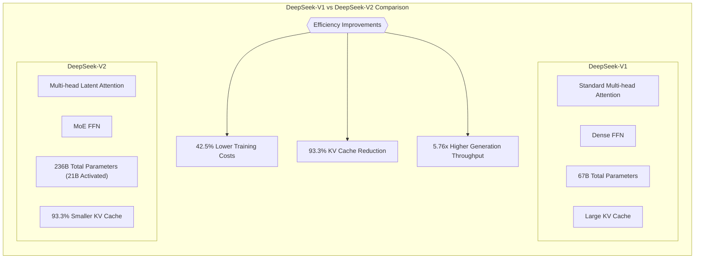

Sources: [README.md:202-209](), [README.md:57-67]()

## Model Family and Variants

The DeepSeek-V2 system includes several model variants optimized for different use cases:

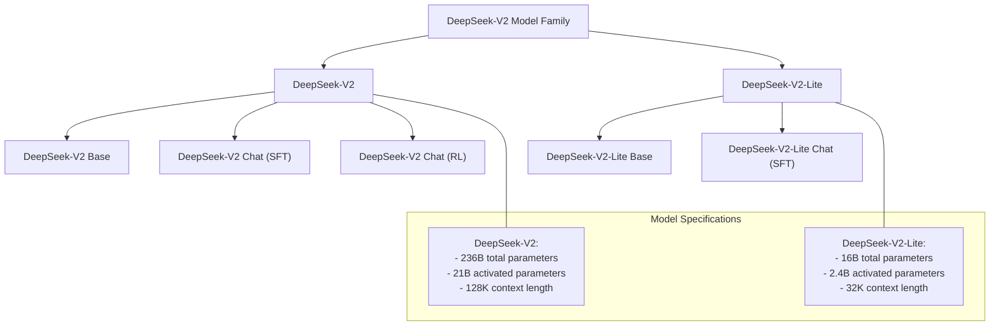

Sources: [README.md:74-85]()

| Model Variant | Total Parameters | Activated Parameters | Context Length |
|---------------|------------------|----------------------|----------------|
| DeepSeek-V2 | 236B | 21B | 128K |
| DeepSeek-V2-Chat (SFT/RL) | 236B | 21B | 128K |
| DeepSeek-V2-Lite | 16B | 2.4B | 32K |
| DeepSeek-V2-Lite-Chat (SFT) | 16B | 2.4B | 32K |

Sources: [README.md:74-85]()

## Performance Characteristics

DeepSeek-V2 demonstrates strong performance across a range of benchmarks, including English and Chinese language understanding, code generation, and mathematical reasoning.

The model's context window capabilities have been evaluated using the "Needle In A Haystack" (NIAH) test, confirming effective performance with contexts up to 128K tokens.

DeepSeek-V2-Chat (RL) performs particularly well on open-ended generation evaluations, showing competitive results on benchmarks like AlpacaEval 2.0, MTBench, and Alignbench.

Sources: [README.md:90-200]()

## Usage and Integration Options

DeepSeek-V2 can be accessed and used through multiple channels:

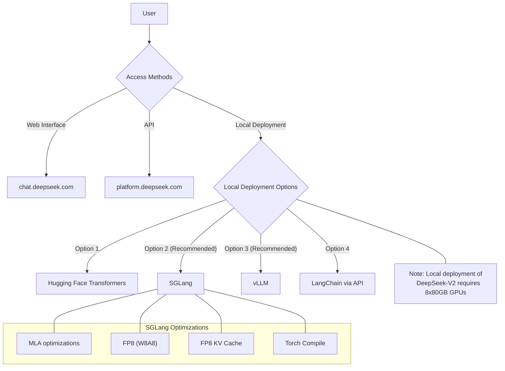

Sources: [README.md:211-370]()

### Local Deployment Requirements

Running DeepSeek-V2 locally requires significant computational resources:
- 8 GPUs with 80GB memory each for BF16 format inference
- For smaller deployments, DeepSeek-V2-Lite provides a more accessible option

Sources: [README.md:223-224]()

### Integration Examples

The repository provides code examples for integrating DeepSeek-V2 with various frameworks:

1. **Hugging Face Transformers**: Examples for both text completion and chat completion
2. **SGLang**: Commands for launching an OpenAI API-compatible server with various optimizations
3. **vLLM**: Code example for model inference
4. **LangChain**: Example of using DeepSeek-V2 via the API with the ChatOpenAI interface

The chat models implement a standard chat template format that supports system messages and multiple user-assistant interactions.

Sources: [README.md:224-370]()

## Licensing Information

DeepSeek-V2 is distributed under a dual-licensing model:
- The code repository is licensed under the MIT License
- The model weights are subject to a separate Model License that permits commercial use

For complete licensing details, see [Licensing Information](#5).

Sources: [README.md:371-373]()

---

# Page: Model Architecture

# Model Architecture

<details>
<summary>Relevant source files</summary>

The following files were used as context for generating this wiki page:

- [README.md](README.md)
- [deepseek-v2-tech-report.pdf](deepseek-v2-tech-report.pdf)
- [figures/activationparameters.png](figures/activationparameters.png)
- [figures/architecture.png](figures/architecture.png)

</details>


This document details the architecture of the DeepSeek-V2 model, focusing on its two main innovative components: Multi-head Latent Attention (MLA) and the DeepSeekMoE architecture. These innovations allow the model to achieve superior performance with more economical training and efficient inference compared to traditional dense transformer models. For information about different variants of the model, see [Model Variants](#1.2).

## Overview

DeepSeek-V2 introduces a novel architecture that enhances the standard transformer design with two significant innovations:

1. **Multi-head Latent Attention (MLA)**: A mechanism that utilizes low-rank key-value union compression to drastically reduce memory requirements of the key-value cache during inference.

2. **DeepSeekMoE Architecture**: A sophisticated Mixture-of-Experts approach that enables the model to have a large total parameter count while only activating a small subset for each token.

The primary advantages of this architecture include:
- 42.5% lower training costs compared to dense models
- 93.3% reduction in KV cache size
- 5.76x higher generation throughput
- Improved performance on various benchmarks
- Support for context lengths up to 128K tokens

### DeepSeek-V2 High-Level Architecture

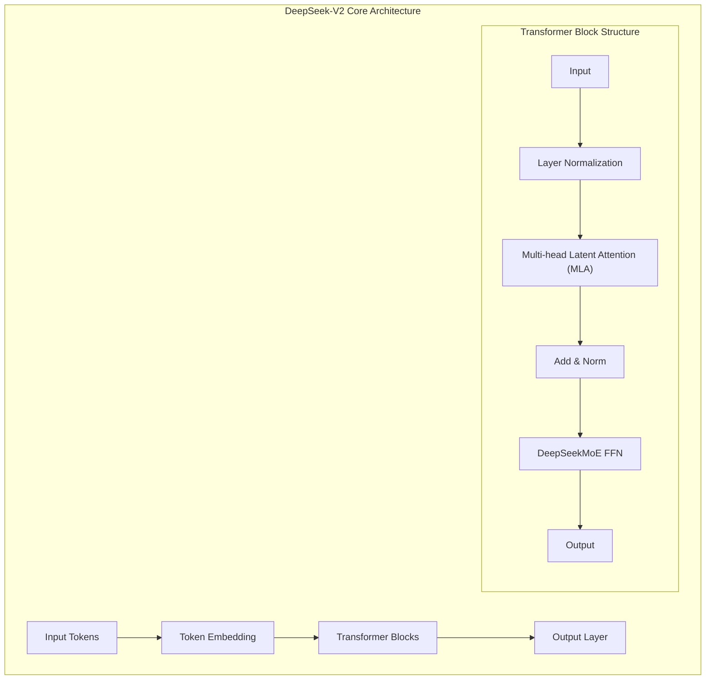

Sources: [README.md:202-210]()

## Multi-head Latent Attention (MLA)

The Multi-head Latent Attention (MLA) mechanism is designed to address the memory bottleneck associated with key-value caches during inference, especially for long context processing.

### MLA Design and Implementation

MLA uses low-rank key-value union compression to reduce the memory footprint of the attention mechanism. This is accomplished by:

1. Projecting queries, keys, and values as in standard attention
2. Applying a compression step to the key-value pairs
3. Using a low-rank approximation technique to minimize information loss
4. Substantially reducing the KV cache size required during inference

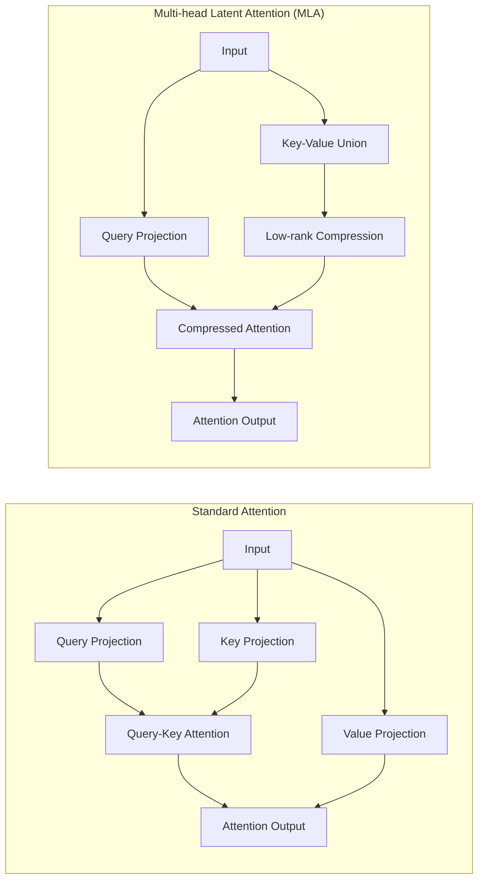

### KV Cache Reduction

One of the most significant benefits of MLA is the dramatic reduction in key-value cache memory requirements:

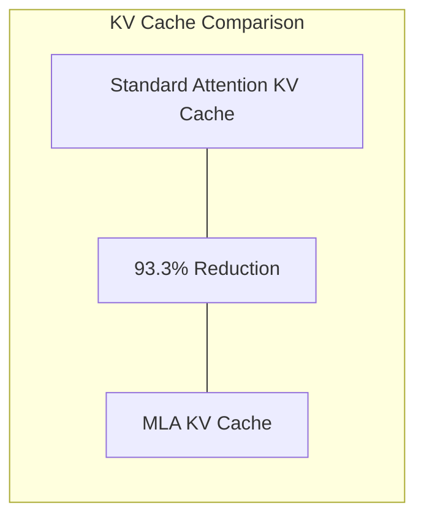

The low-rank compression technique employed by MLA results in a 93.3% reduction in KV cache size compared to traditional attention mechanisms. This enables much more efficient handling of long contexts up to 128K tokens.

Sources: [README.md:202-210]()

## DeepSeekMoE Architecture

The DeepSeekMoE architecture implements a Mixture-of-Experts approach for the feed-forward network (FFN) component of the transformer blocks. This allows the model to have a much larger total parameter count while maintaining efficient computation by only activating a small subset of parameters for each token.

### MoE Design and Implementation

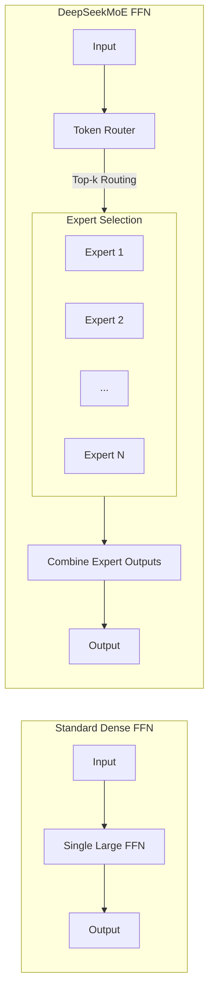

### Sparse Activation Mechanism

The router component determines which experts to activate for each token, typically selecting only a small subset (e.g., top-2 experts). This results in:

- Only about 9% of the total parameters being activated for each token
- For DeepSeek-V2 (236B total parameters), only about 21B parameters are activated per token
- For DeepSeek-V2-Lite (16B total parameters), only about 2.4B parameters are activated per token

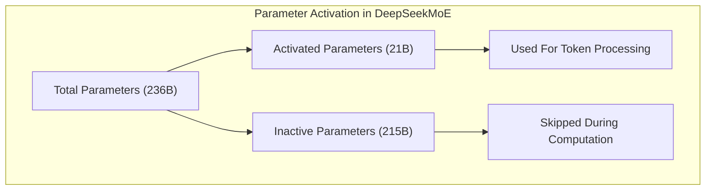

Sources: [README.md:202-210]()

## Complete Transformer Block

The complete transformer block in DeepSeek-V2 integrates both the MLA and DeepSeekMoE components:

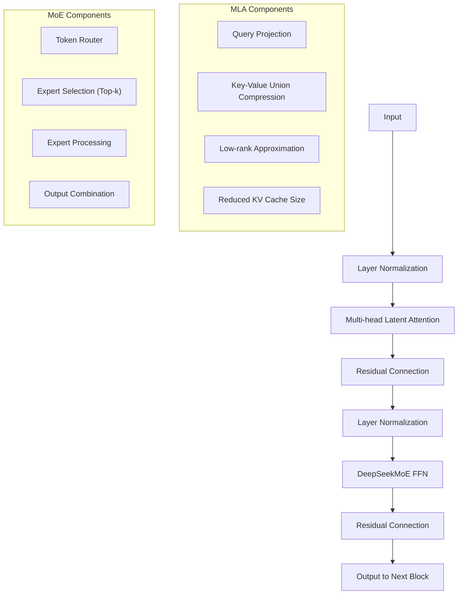

## Efficiency and Performance Comparison

The architectural innovations in DeepSeek-V2 result in significant efficiency and performance improvements compared to traditional dense transformer models:

| Metric | DeepSeek-V1 (Dense-67B) | DeepSeek-V2 (MoE-236B) | Improvement |
|--------|--------------------------|------------------------|-------------|
| KV Cache Size | 100% | 6.7% | 93.3% reduction |
| Training Cost | 100% | 57.5% | 42.5% reduction |
| Generation Throughput | 1x | 5.76x | 5.76x increase |
| Context Length | 32K | 128K | 4x increase |
| MMLU Score | 71.3 | 78.5 | 7.2 point increase |
| C-Eval Score | 66.1 | 81.7 | 15.6 point increase |

The DeepSeek-V2 architecture demonstrates that it's possible to achieve both better performance and greater efficiency through innovative design choices like MLA and MoE, rather than simply scaling up dense models.

Sources: [README.md:57-68](), [README.md:93-105]()

## Implementation Details

The architecture is implemented with careful optimizations to ensure efficient training and inference. The model supports various inference frameworks including Hugging Face Transformers, SGLang, and vLLM, with SGLang providing the best performance through specific optimizations:

- MLA optimizations
- FP8 W8A8 support
- FP8 KV Cache support
- Torch Compile integration

These optimizations further enhance the efficiency benefits of the architectural innovations in the model.

Sources: [README.md:296-303]()

## Technical Specifications

| Specification | DeepSeek-V2 | DeepSeek-V2-Lite |
|---------------|-------------|------------------|
| Total Parameters | 236B | 16B |
| Activated Parameters | 21B | 2.4B |
| Activation Percentage | ~9% | ~15% |
| Maximum Context Length | 128K | 32K |
| Attention Mechanism | MLA | MLA |
| FFN Architecture | MoE | MoE |
| Training Tokens | 8.1 trillion | 8.1 trillion |

Sources: [README.md:76-85]()

The DeepSeek-V2 architecture represents a significant advance in language model design by addressing key bottlenecks in traditional transformer architectures while improving both efficiency and performance. The combination of Multi-head Latent Attention and the DeepSeekMoE architecture enables better parameter efficiency and reduced computational requirements without sacrificing model capability.

---

# Page: Model Variants

# Model Variants

<details>
<summary>Relevant source files</summary>

The following files were used as context for generating this wiki page:

- [README.md](README.md)
- [deepseek-v2-tech-report.pdf](deepseek-v2-tech-report.pdf)

</details>


This document provides a detailed overview of the different model variants available in the DeepSeek-V2 family. It explains the architectural differences, parameter counts, capabilities, and appropriate use cases for each variant. For information about the core model architecture and technical innovations, see [Model Architecture](#1.1).

## 1. Overview of DeepSeek-V2 Model Family

DeepSeek-V2 represents a significant evolution from the previous DeepSeek-V1 (Dense-67B) model. The key distinction is that DeepSeek-V2 uses a Mixture-of-Experts (MoE) architecture rather than a dense architecture, resulting in models that are more efficient in both training and inference while delivering superior performance.

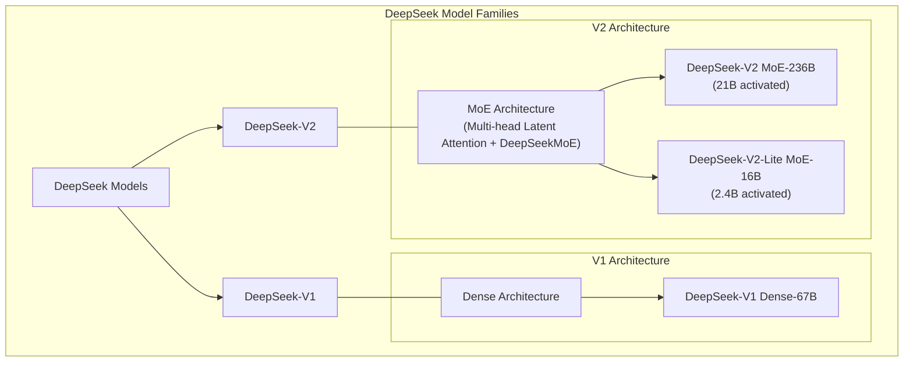

Sources: [README.md:55-65,203-209]()

## 2. Size Variants

DeepSeek-V2 comes in two size variants that differ significantly in their parameter count:

### 2.1 DeepSeek-V2 (Large)

- **Total Parameters**: 236 billion
- **Activated Parameters**: 21 billion per token (8.9% of total)
- **Context Length**: 128K tokens
- **Hardware Requirements**: 80GB*8 GPUs (for BF16 inference)

### 2.2 DeepSeek-V2-Lite

- **Total Parameters**: 16 billion
- **Activated Parameters**: 2.4 billion per token (15% of total)
- **Context Length**: 32K tokens
- **Hardware Requirements**: Less demanding than the large variant

Both variants use the same core architecture innovations: Multi-head Latent Attention (MLA) and DeepSeekMoE, but they differ in scale and capacity.

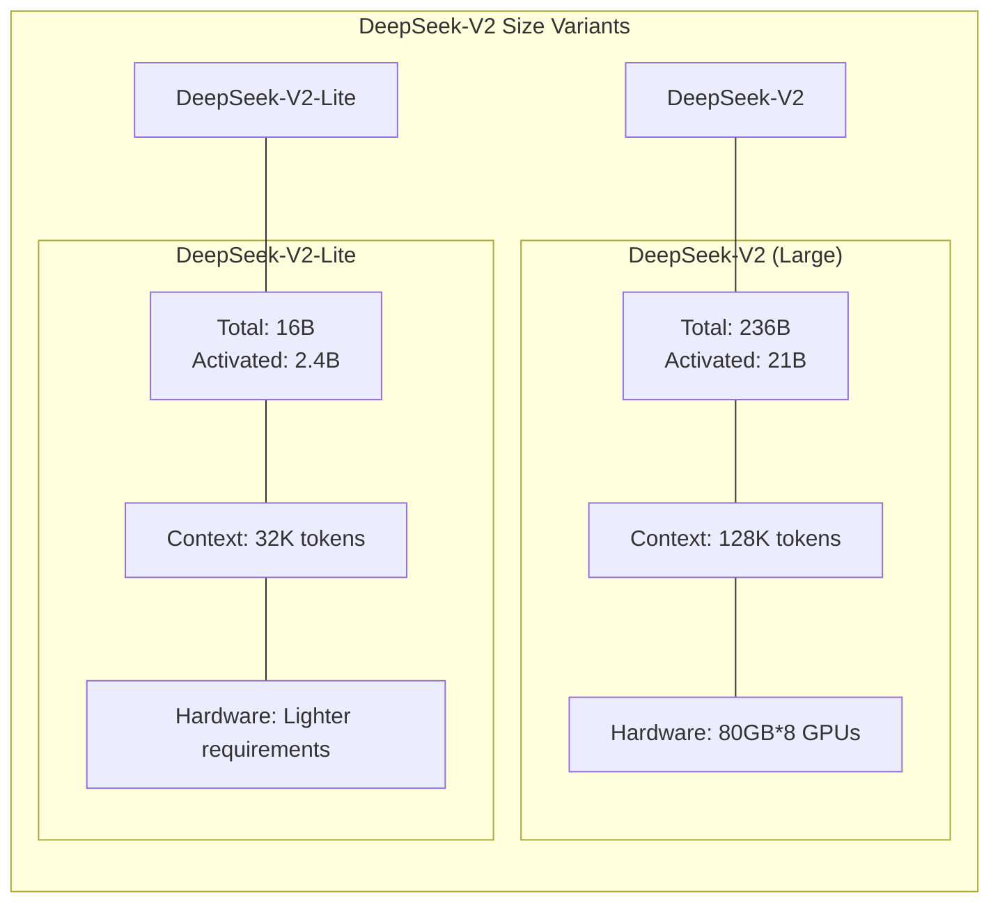

Sources: [README.md:76-84,223-224]()

## 3. Training Stage Variants

Each size variant of DeepSeek-V2 is available in different versions based on the training stage:

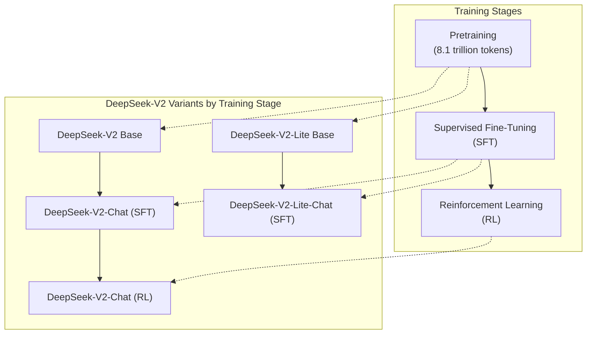

Sources: [README.md:65-68,70-72,76-84]()

### 3.1 Base Models

The Base models have been pretrained on a diverse corpus of 8.1 trillion tokens but have not undergone any fine-tuning for specific tasks. These models are best suited for:
- Research purposes
- Transfer learning to new domains
- Text completion tasks where instruction following is not required

### 3.2 Chat (SFT) Models

The Chat (SFT) models have undergone Supervised Fine-Tuning on high-quality conversational data. These models:
- Follow instructions more reliably
- Maintain a conversational tone
- Are suitable for most general-purpose chatbot applications

### 3.3 Chat (RL) Models

Currently, only the large DeepSeek-V2 has an RL-trained variant. The Chat (RL) model has undergone Reinforcement Learning after SFT to further align with human preferences. This model:
- Shows improved performance in open-ended generation
- Scores higher on human preference benchmarks like AlpacaEval and MTBench
- Is the most refined and production-ready variant

Sources: [README.md:65-68,76-84,134-147]()

## 4. Comparative Performance

The following table summarizes the key differences in capabilities between the model variants:

| Model Variant | Total Params | Activated Params | Context Length | Best For |
|---------------|--------------|------------------|---------------|---------|
| DeepSeek-V2 Base | 236B | 21B | 128K | Research, transfer learning |
| DeepSeek-V2-Chat (SFT) | 236B | 21B | 128K | General conversational AI |
| DeepSeek-V2-Chat (RL) | 236B | 21B | 128K | Production applications, highest quality responses |
| DeepSeek-V2-Lite Base | 16B | 2.4B | 32K | Resource-constrained research |
| DeepSeek-V2-Lite-Chat (SFT) | 16B | 2.4B | 32K | Efficient deployment on limited hardware |

### 4.1 Performance on Benchmarks

The DeepSeek-V2 variants show different performance profiles across various benchmarks:

- **DeepSeek-V2 (236B)**: Achieves state-of-the-art performance across most benchmarks, particularly excelling in Chinese benchmarks (C-Eval, CMMLU) where it scores above 80%.

- **DeepSeek-V2-Chat (RL)**: Demonstrates the best performance on coding tasks like HumanEval (81.1%) and LiveCodeBench (32.5%), as well as math-related problems.

- **DeepSeek-V2-Lite (16B)**: Despite its smaller size, shows competitive performance, especially in Chinese language understanding and mathematical reasoning compared to other models of similar size.

Sources: [README.md:90-123,134-166,168-175,195-200]()

## 5. Use Case Recommendations

Based on performance characteristics and resource requirements, here are recommendations for which variant to use for different use cases:

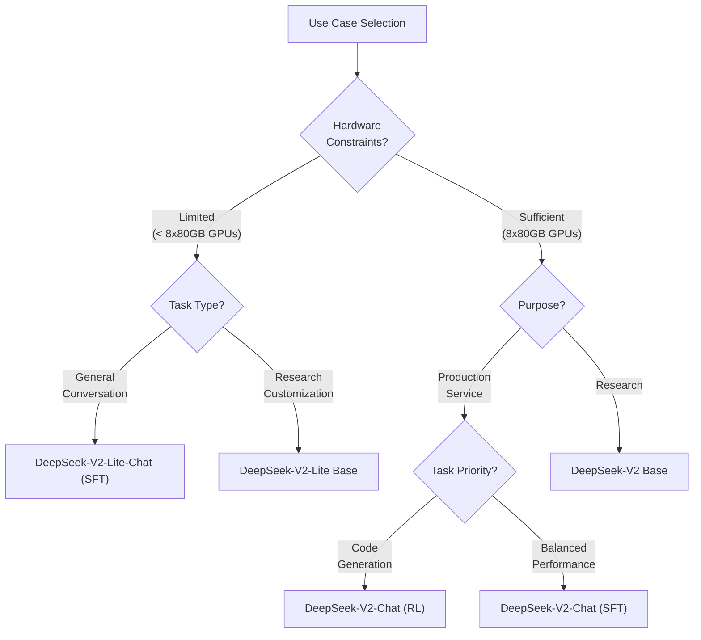

Sources: [README.md:76-84,90-123,134-166,223-224]()

## 6. Model Availability and Access

All DeepSeek-V2 model variants are available on Hugging Face. The models can be downloaded and used locally or accessed through the DeepSeek platform.

| Model Variant | Download | API Access |
|---------------|----------|------------|
| DeepSeek-V2 Base | [Hugging Face](https://huggingface.co/deepseek-ai/DeepSeek-V2) | Available on platform.deepseek.com |
| DeepSeek-V2-Chat (RL) | [Hugging Face](https://huggingface.co/deepseek-ai/DeepSeek-V2-Chat) | Available on platform.deepseek.com |
| DeepSeek-V2-Lite Base | [Hugging Face](https://huggingface.co/deepseek-ai/DeepSeek-V2-Lite) | Available on platform.deepseek.com |
| DeepSeek-V2-Lite-Chat (SFT) | [Hugging Face](https://huggingface.co/deepseek-ai/DeepSeek-V2-Lite-Chat) | Available on platform.deepseek.com |

### 6.1 Inference Options

The model variants can be run using different frameworks:

1. **Hugging Face Transformers**: Standard implementation, supports all variants but may not be optimal for performance
2. **SGLang**: Recommended for optimal performance, supports MLA optimizations, FP8 (W8A8), FP8 KV Cache, and Torch Compile
3. **vLLM**: Recommended after applying the specific PR (#4650), provides efficient inference
4. **LangChain**: Support through OpenAI-compatible API

For detailed usage instructions for these frameworks, see [Usage Guide](#3).

Sources: [README.md:76-84,211-370]()

## 7. Summary

DeepSeek-V2 offers a comprehensive range of model variants to suit different use cases, hardware constraints, and performance requirements. The key differences between variants lie in:

1. **Model Size**: DeepSeek-V2 (236B) vs. DeepSeek-V2-Lite (16B)
2. **Training Stage**: Base vs. Chat (SFT) vs. Chat (RL)
3. **Context Length**: 128K for DeepSeek-V2 vs. 32K for DeepSeek-V2-Lite

All variants leverage the same core architectural innovations (Multi-head Latent Attention and DeepSeekMoE) that make DeepSeek-V2 models more efficient than their predecessors while achieving superior performance across a wide range of tasks.

Sources: [README.md:55-209]()

---

# Page: Training and Evaluation

# Training and Evaluation

<details>
<summary>Relevant source files</summary>

The following files were used as context for generating this wiki page:

- [README.md](README.md)
- [deepseek-v2-tech-report.pdf](deepseek-v2-tech-report.pdf)
- [figures/alignbench_price.png](figures/alignbench_price.png)

</details>


This document provides a comprehensive overview of the training methodology and evaluation approaches used for DeepSeek-V2 models. It covers the pretraining pipeline, fine-tuning processes, evaluation methodologies, and detailed benchmark results. For information about model architecture and technical innovations, see [Model Architecture](#1.1).

## 1. Training Pipeline

DeepSeek-V2 follows a three-stage training process that starts with large-scale pretraining, followed by supervised fine-tuning, and concludes with reinforcement learning for the chat models.

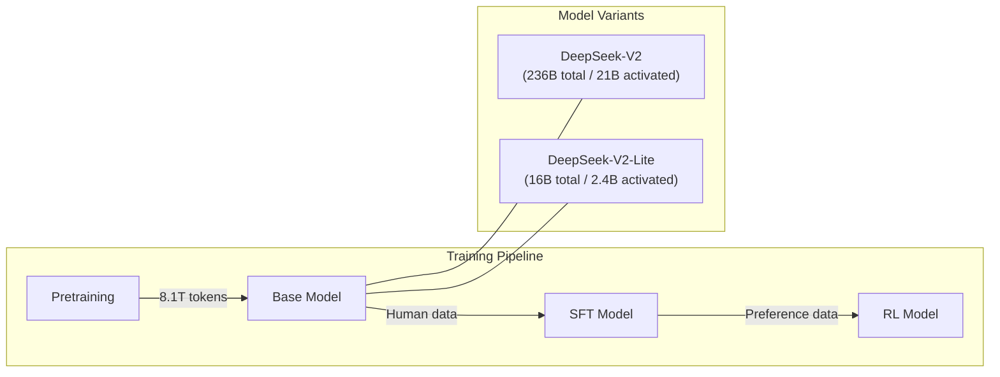

Sources: [README.md:66-67]()

### 1.1 Pretraining

DeepSeek-V2 was pretrained on a diverse, high-quality corpus comprising 8.1 trillion tokens. The pretraining leverages the efficiency of the DeepSeek-V2 architecture innovations:

- **Multi-head Latent Attention (MLA)**: Reduces KV cache requirements by 93.3%
- **DeepSeekMoE Architecture**: Enables 42.5% lower training costs while maintaining model capability

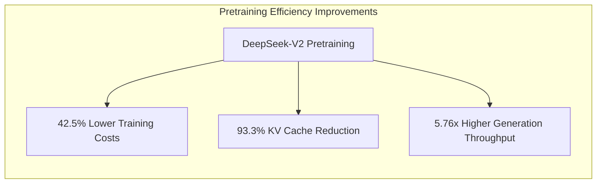

Sources: [README.md:58-60](), [README.md:66-67]()

### 1.2 Supervised Fine-Tuning (SFT)

Following pretraining, the base models undergo supervised fine-tuning on high-quality human-generated data to create instruction-following models. This process produces the DeepSeek-V2-Chat (SFT) and DeepSeek-V2-Lite-Chat (SFT) variants.

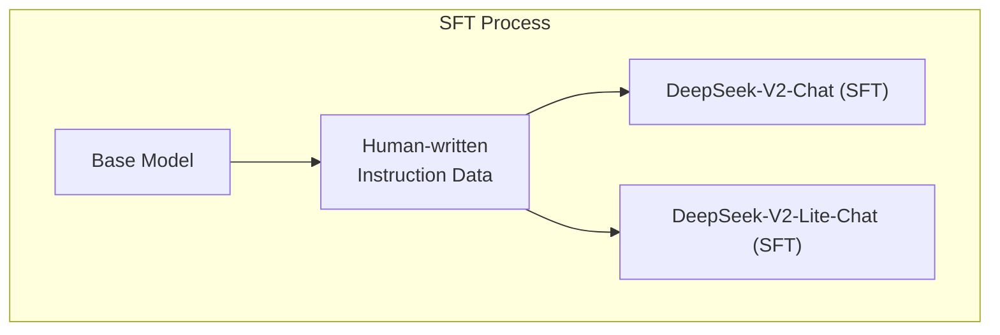

Sources: [README.md:66-67]()

### 1.3 Reinforcement Learning (RL)

For the main DeepSeek-V2 model, an additional reinforcement learning stage is performed to further align the model with human preferences. This produces the DeepSeek-V2-Chat (RL) variant, which shows further improvements on benchmarks compared to the SFT version.

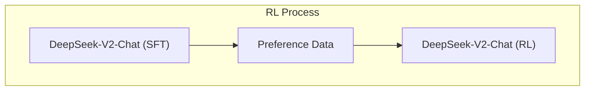

Sources: [README.md:66-67]()

## 2. Evaluation Methodology

DeepSeek-V2 models are evaluated through a comprehensive suite of benchmarks covering multiple domains and capabilities. The evaluation methodology includes both standard benchmarks with quantitative metrics and open-ended generation evaluations.

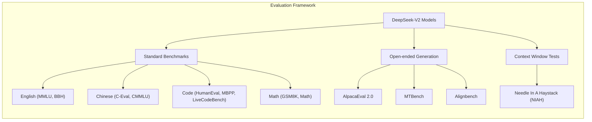

Sources: [README.md:92-106](), [README.md:107-123](), [README.md:127-131](), [README.md:134-147](), [README.md:152-165](), [README.md:168-173](), [README.md:175-193](), [README.md:195-200]()

## 3. Benchmark Results

### 3.1 Base Model Evaluation

The base models of DeepSeek-V2 are evaluated on standard benchmarks across multiple domains:

#### Large Models (>67B parameters)

| **Benchmark** | **Domain** | **LLaMA3 70B** | **Mixtral 8x22B** | **DeepSeek-V1 (Dense-67B)** | **DeepSeek-V2 (MoE-236B)** |
|:-------------:|:----------:|:--------------:|:-----------------:|:----------------------------:|:---------------------------:|
| **MMLU**      | English    | 78.9           | 77.6              | 71.3                         | 78.5                        |
| **BBH**       | English    | 81.0           | 78.9              | 68.7                         | 78.9                        |
| **C-Eval**    | Chinese    | 67.5           | 58.6              | 66.1                         | 81.7                        |
| **CMMLU**     | Chinese    | 69.3           | 60.0              | 70.8                         | 84.0                        |
| **HumanEval** | Code       | 48.2           | 53.1              | 45.1                         | 48.8                        |
| **MBPP**      | Code       | 68.6           | 64.2              | 57.4                         | 66.6                        |
| **GSM8K**     | Math       | 83.0           | 80.3              | 63.4                         | 79.2                        |
| **Math**      | Math       | 42.2           | 42.5              | 18.7                         | 43.6                        |

Sources: [README.md:92-106]()

#### Small Models (<16B parameters)

| **Benchmark** | **Domain** | **DeepSeek 7B (Dense)** | **DeepSeekMoE 16B** | **DeepSeek-V2-Lite (MoE-16B)** |
|:-------------:|:----------:|:-----------------------:|:-------------------:|:------------------------------:|
| **Architecture** | -       | MHA+Dense               | MHA+MoE             | MLA+MoE                        |
| **MMLU**      | English    | 48.2                    | 45.0                | 58.3                           |
| **BBH**       | English    | 39.5                    | 38.9                | 44.1                           |
| **C-Eval**    | Chinese    | 45.0                    | 40.6                | 60.3                           |
| **CMMLU**     | Chinese    | 47.2                    | 42.5                | 64.3                           |
| **HumanEval** | Code       | 26.2                    | 26.8                | 29.9                           |
| **MBPP**      | Code       | 39.0                    | 39.2                | 43.2                           |
| **GSM8K**     | Math       | 17.4                    | 18.8                | 41.1                           |
| **Math**      | Math       | 3.3                     | 4.3                 | 17.1                           |

Sources: [README.md:107-123]()

### 3.2 Context Window Evaluation

DeepSeek-V2 demonstrates strong performance on the Needle In A Haystack (NIAH) test, showing effective utilization of its 128K context window:

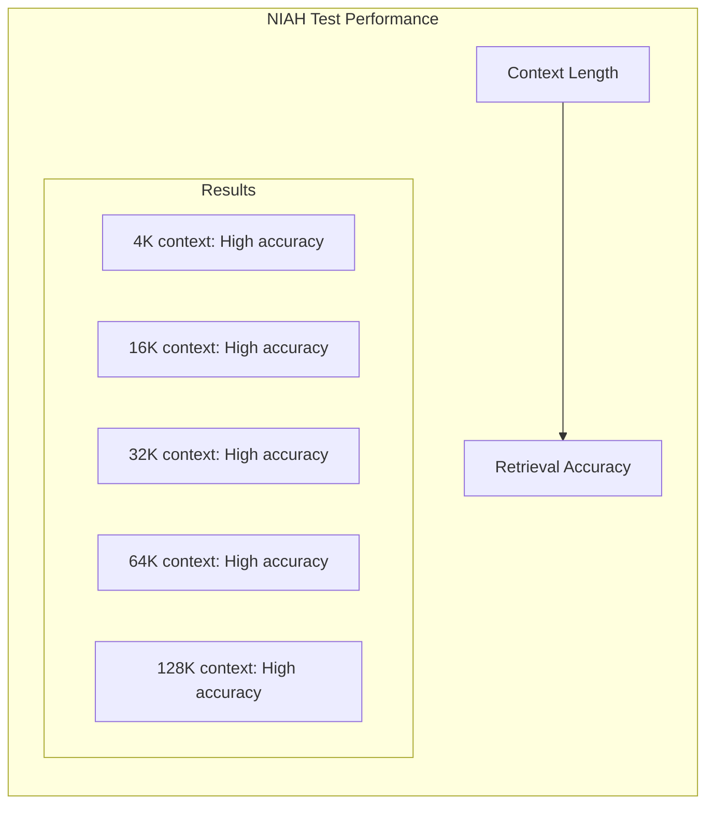

Sources: [README.md:127-131]()

### 3.3 Chat Model Evaluation

#### Standard Benchmarks (>67B parameters)

| Benchmark | Domain | QWen1.5 72B Chat | Mixtral 8x22B | LLaMA3 70B Instruct | DeepSeek-V1 Chat (SFT) | DeepSeek-V2 Chat (SFT) | DeepSeek-V2 Chat (RL) |
|:---------:|:------:|:----------------:|:-------------:|:-------------------:|:----------------------:|:----------------------:|:---------------------:|
| **MMLU**      | English | 76.2 | 77.8 | 80.3 | 71.1 | 78.4 | 77.8 |
| **BBH**       | English | 65.9 | 78.4 | 80.1 | 71.7 | 81.3 | 79.7 |
| **C-Eval**    | Chinese | 82.2 | 60.0 | 67.9 | 65.2 | 80.9 | 78.0 |
| **CMMLU**     | Chinese | 82.9 | 61.0 | 70.7 | 67.8 | 82.4 | 81.6 |
| **HumanEval** | Code    | 68.9 | 75.0 | 76.2 | 73.8 | 76.8 | 81.1 |
| **MBPP**      | Code    | 52.2 | 64.4 | 69.8 | 61.4 | 70.4 | 72.0 |
| **LiveCodeBench (0901-0401)** | Code | 18.8 | 25.0 | 30.5 | 18.3 | 28.7 | 32.5 |
| **GSM8K**     | Math    | 81.9 | 87.9 | 93.2 | 84.1 | 90.8 | 92.2 |
| **Math**      | Math    | 40.6 | 49.8 | 48.5 | 32.6 | 52.7 | 53.9 |

Sources: [README.md:134-147]()

#### Standard Benchmarks (<16B parameters)

| Benchmark | Domain | DeepSeek 7B Chat (SFT) | DeepSeekMoE 16B Chat (SFT) | DeepSeek-V2-Lite 16B Chat (SFT) |
|:---------:|:------:|:----------------------:|:---------------------------:|:-------------------------------:|
| **MMLU**      | English | 49.7 | 47.2 | 55.7 |
| **BBH**       | English | 43.1 | 42.2 | 48.1 |
| **C-Eval**    | Chinese | 44.7 | 40.0 | 60.1 |
| **CMMLU**     | Chinese | 51.2 | 49.3 | 62.5 |
| **HumanEval** | Code    | 45.1 | 45.7 | 57.3 |
| **MBPP**      | Code    | 39.0 | 46.2 | 45.8 |
| **GSM8K**     | Math    | 62.6 | 62.2 | 72.0 |
| **Math**      | Math    | 14.7 | 15.2 | 27.9 |

Sources: [README.md:152-165]()

### 3.4 Open-ended Generation Evaluation

#### English Generation (MTBench)

DeepSeek-V2-Chat-RL demonstrates competitive performance on MTBench, showing strong capabilities in English conversational generation.

```mermaid
flowchart LR
    subgraph "MTBench Performance"
        direction LR
        A["Model Scores"] -->|"Scale: 1-10"| B["Leaderboard Position"]
        
        subgraph "Top Models"
            C["GPT-4"]
            D["Claude-2"]
            E["DeepSeek-V2-Chat (RL)"]
            F["LLaMA-3-70B"]
        end
    end
```

Sources: [README.md:168-173]()

#### Chinese Generation (Alignbench)

DeepSeek-V2-Chat models demonstrate strong performance on Alignbench, a Chinese language benchmark:

| **Model** | **Source Type** | **Total Score** | **Chinese Reasoning** | **Chinese Language** |
|:---------:|:---------------:|:---------------:|:---------------------:|:--------------------:|
| gpt-4-1106-preview | Closed | 8.01 | 7.73 | 8.29 |
| DeepSeek-V2 Chat (RL) | Open | 7.91 | 7.45 | 8.36 |
| erniebot-4.0-202404 | Closed | 7.89 | 7.61 | 8.17 |
| DeepSeek-V2 Chat (SFT) | Open | 7.74 | 7.30 | 8.17 |
| gpt-4-0613 | Closed | 7.53 | 7.47 | 7.59 |
| DeepSeek-V2-Lite 16B Chat | Open | 6.01 | 4.71 | 7.32 |

Sources: [README.md:175-193]()

### 3.5 Coding Evaluation (LiveCodeBench)

LiveCodeBench (0901-0401) is used to evaluate the models' capabilities on practical coding tasks. DeepSeek-V2-Chat (RL) achieves a Pass@1 score of 32.5, surpassing many other advanced models, demonstrating its proficiency in live coding challenges.

```mermaid
flowchart TD
    subgraph "LiveCodeBench Performance"
        direction TB
        A["Pass@1 Scores"] --> B["Relative Model Performance"]
        
        subgraph "Model Comparison"
            C["DeepSeek-V2-Chat (RL): 32.5%"]
            D["LLaMA3 70B Instruct: 30.5%"]
            E["Mixtral 8x22B: 25.0%"]
            F["QWen1.5 72B Chat: 18.8%"]
            G["DeepSeek-V1 Chat: 18.3%"]
        end
    end
```

Sources: [README.md:195-200]()

## 4. Training and Inference Efficiency

DeepSeek-V2's architectural innovations result in significant efficiency improvements during both training and inference.

```mermaid
flowchart LR
    subgraph "Efficiency Improvements vs DeepSeek-V1 67B"
        direction LR
        A["DeepSeek-V2 Architecture"] --> B["Training Cost: -42.5%"]
        A --> C["KV Cache Size: -93.3%"]
        A --> D["Generation Throughput: +5.76x"]
    end
    
    subgraph "Architecture Features"
        E["Multi-head Latent Attention (MLA)"]
        F["DeepSeekMoE Architecture"]
        
        E -->|"Enables"| G["KV Cache Reduction"]
        F -->|"Enables"| H["Cost Reduction"]
        F -->|"Enables"| I["Throughput Increase"]
    end
```

These efficiency gains are achieved while maintaining or improving model performance across benchmarks, demonstrating the effectiveness of the architectural innovations in DeepSeek-V2.

Sources: [README.md:58-60](), [README.md:203-206]()

## 5. Model Variants and Configurations

DeepSeek-V2 is available in multiple variants to suit different deployment scenarios:

| **Model** | **Total Parameters** | **Activated Parameters** | **Context Length** | **Training Stages** |
|:---------:|:--------------------:|:------------------------:|:------------------:|:-------------------:|
| DeepSeek-V2-Lite | 16B | 2.4B | 32k | Base |
| DeepSeek-V2-Lite-Chat (SFT) | 16B | 2.4B | 32k | Base + SFT |
| DeepSeek-V2 | 236B | 21B | 128k | Base |
| DeepSeek-V2-Chat (SFT) | 236B | 21B | 128k | Base + SFT |
| DeepSeek-V2-Chat (RL) | 236B | 21B | 128k | Base + SFT + RL |

Sources: [README.md:76-84]()

The training and evaluation pipeline demonstrates the progression from pretraining through fine-tuning to achieve models with strong performance across a wide range of tasks while maintaining high efficiency. For information about using these models in practice, see [Usage Guide](#3).

---

# Page: Benchmark Results

# Benchmark Results

<details>
<summary>Relevant source files</summary>

The following files were used as context for generating this wiki page:

- [README.md](README.md)
- [deepseek-v2-tech-report.pdf](deepseek-v2-tech-report.pdf)
- [figures/code_benchmarks.png](figures/code_benchmarks.png)

</details>


This document provides a comprehensive overview of the benchmark performance of DeepSeek-V2 models across various tasks and domains. It details quantitative evaluations on standard benchmarks, comparing the DeepSeek-V2 family with other leading language models.

Sources: [README.md:89-200]()

## 1. Overview of Benchmark Categories

DeepSeek-V2 models are evaluated on four major categories of tasks:

1. **General Knowledge & Reasoning**
   - English language benchmarks (MMLU, BBH)
   - Chinese language benchmarks (C-Eval, CMMLU)

2. **Programming & Coding**
   - Static code assessments (HumanEval, MBPP)
   - Dynamic code execution (LiveCodeBench)

3. **Mathematical Reasoning**
   - GSM8K
   - MATH

4. **Long Context Processing**
   - Needle In A Haystack (NIAH)

```mermaid
flowchart TD
    subgraph "DeepSeek-V2 Benchmark Categories"
        root["Benchmark Evaluation"]
        gen["General Knowledge & Reasoning"]
        code["Programming & Coding"]
        math["Mathematical Reasoning"]
        ctx["Long Context Processing"]
        
        root --> gen
        root --> code
        root --> math
        root --> ctx
        
        en["English Tasks (MMLU, BBH)"] 
        zh["Chinese Tasks (C-Eval, CMMLU)"]
        gen --> en
        gen --> zh
        
        static["Static Assessment (HumanEval, MBPP)"] 
        dynamic["Dynamic Execution (LiveCodeBench)"]
        code --> static
        code --> dynamic
        
        gsm["GSM8K"] 
        mathb["MATH"]
        math --> gsm
        math --> mathb
        
        niah["Needle In A Haystack (128K)"]
        ctx --> niah
    end
```

Sources: [README.md:91-105](), [README.md:127-130]()

## 2. Base Model Results

### 2.1. Large Models Comparison (>67B Parameters)

This table compares the performance of DeepSeek-V2 base model (236B total parameters) with other large language models across standard benchmarks.

| **Benchmark** | **Domain** | **LLaMA3 70B** | **Mixtral 8x22B** | **DeepSeek-V1 (Dense-67B)** | **DeepSeek-V2 (MoE-236B)** |
|:-------------:|:----------:|:--------------:|:-----------------:|:---------------------------:|:--------------------------:|
| **MMLU** | English | 78.9 | 77.6 | 71.3 | 78.5 |
| **BBH** | English | 81.0 | 78.9 | 68.7 | 78.9 |
| **C-Eval** | Chinese | 67.5 | 58.6 | 66.1 | 81.7 |
| **CMMLU** | Chinese | 69.3 | 60.0 | 70.8 | 84.0 |
| **HumanEval** | Code | 48.2 | 53.1 | 45.1 | 48.8 |
| **MBPP** | Code | 68.6 | 64.2 | 57.4 | 66.6 |
| **GSM8K** | Math | 83.0 | 80.3 | 63.4 | 79.2 |
| **Math** | Math | 42.2 | 42.5 | 18.7 | 43.6 |

Key observations:
- DeepSeek-V2 demonstrates significant improvements over DeepSeek-V1 across all benchmarks
- Particularly strong performance on Chinese language tasks (C-Eval, CMMLU)
- Competitive with LLaMA3 70B and Mixtral 8x22B on English tasks
- Major improvement in mathematical reasoning capabilities compared to DeepSeek-V1

Sources: [README.md:93-105]()

### 2.2. Small Models Comparison (<16B Parameters)

The table below compares DeepSeek-V2-Lite with other smaller models.

| **Benchmark** | **Domain** | **DeepSeek 7B (Dense)** | **DeepSeekMoE 16B** | **DeepSeek-V2-Lite (MoE-16B)** |
|:-------------:|:----------:|:--------------:|:-----------------:|:--------------------------:|
| **Architecture** | - | MHA+Dense | MHA+MoE | MLA+MoE |
| **MMLU** | English | 48.2 | 45.0 | 58.3 |
| **BBH** | English | 39.5 | 38.9 | 44.1 |
| **C-Eval** | Chinese | 45.0 | 40.6 | 60.3 |
| **CMMLU** | Chinese | 47.2 | 42.5 | 64.3 |
| **HumanEval** | Code | 26.2 | 26.8 | 29.9 |
| **MBPP** | Code | 39.0 | 39.2 | 43.2 |
| **GSM8K** | Math | 17.4 | 18.8 | 41.1 |
| **Math** | Math | 3.3 | 4.3 | 17.1 |

Key observations:
- DeepSeek-V2-Lite significantly outperforms previous smaller models
- The MLA+MoE architecture shows substantial advantages over previous architectures
- Particularly impressive improvements in mathematical reasoning tasks

Sources: [README.md:108-122]()

### 2.3. Long Context Performance

DeepSeek-V2 has been evaluated on the "Needle In A Haystack" (NIAH) test to measure its ability to retrieve information from long contexts up to 128K tokens.

```mermaid
flowchart LR
    subgraph "Long Context Performance (NIAH)"
        direction TB
        input["Input Context"] --> process["Context Processing"]
        process --> retrieve["Information Retrieval"]
        retrieve --> answer["Answer Generation"]
        
        subgraph "Context Lengths"
            c4k["4K Tokens"]
            c8k["8K Tokens"]
            c16k["16K Tokens"]
            c32k["32K Tokens"]
            c64k["64K Tokens"]
            c128k["128K Tokens"]
        end
    end
```

Results show that DeepSeek-V2 maintains consistent performance across all context lengths up to 128K tokens, demonstrating the effectiveness of the Multi-head Latent Attention (MLA) architecture in handling long documents.

Sources: [README.md:126-131]()

## 3. Chat Model Results

### 3.1. Large Chat Models Comparison (>67B Parameters)

This table compares the performance of DeepSeek-V2 Chat models (both SFT and RL versions) with other large chat models.

| **Benchmark** | **Domain** | **QWen1.5 72B Chat** | **Mixtral 8x22B** | **LLaMA3 70B Instruct** | **DeepSeek-V1 Chat (SFT)** | **DeepSeek-V2 Chat (SFT)** | **DeepSeek-V2 Chat (RL)** |
|:-----------:|:----------------:|:------------------:|:---------------:|:---------------------:|:-------------:|:-----------------------:|:----------------------:|
| **MMLU** | English | 76.2 | 77.8 | 80.3 | 71.1 | 78.4 | 77.8 |
| **BBH** | English | 65.9 | 78.4 | 80.1 | 71.7 | 81.3 | 79.7 |
| **C-Eval** | Chinese | 82.2 | 60.0 | 67.9 | 65.2 | 80.9 | 78.0 |
| **CMMLU** | Chinese | 82.9 | 61.0 | 70.7 | 67.8 | 82.4 | 81.6 |
| **HumanEval** | Code | 68.9 | 75.0 | 76.2 | 73.8 | 76.8 | 81.1 |
| **MBPP** | Code | 52.2 | 64.4 | 69.8 | 61.4 | 70.4 | 72.0 |
| **LiveCodeBench (0901-0401)** | Code | 18.8 | 25.0 | 30.5 | 18.3 | 28.7 | 32.5 |
| **GSM8K** | Math | 81.9 | 87.9 | 93.2 | 84.1 | 90.8 | 92.2 |
| **Math** | Math | 40.6 | 49.8 | 48.5 | 32.6 | 52.7 | 53.9 |

Key observations:
- DeepSeek-V2 Chat (RL) demonstrates superior performance in coding tasks, particularly in LiveCodeBench
- The RL-tuned version shows improvements over the SFT version across most benchmarks
- DeepSeek-V2 Chat models show significant improvements over DeepSeek-V1 Chat
- Strong performance in mathematical reasoning compared to competitors

Sources: [README.md:135-148]()

### 3.2. Small Chat Models Comparison (<16B Parameters)

| **Benchmark** | **Domain** | **DeepSeek 7B Chat (SFT)** | **DeepSeekMoE 16B Chat (SFT)** | **DeepSeek-V2-Lite 16B Chat (SFT)** |
|:-----------:|:----------------:|:------------------:|:---------------:|:---------------------:|
| **MMLU** | English | 49.7 | 47.2 | 55.7 |
| **BBH** | English | 43.1 | 42.2 | 48.1 |
| **C-Eval** | Chinese | 44.7 | 40.0 | 60.1 |
| **CMMLU** | Chinese | 51.2 | 49.3 | 62.5 |
| **HumanEval** | Code | 45.1 | 45.7 | 57.3 |
| **MBPP** | Code | 39.0 | 46.2 | 45.8 |
| **GSM8K** | Math | 62.6 | 62.2 | 72.0 |
| **Math** | Math | 14.7 | 15.2 | 27.9 |

Key observations:
- DeepSeek-V2-Lite Chat significantly outperforms previous smaller models
- Notable improvements in Chinese language tasks (C-Eval, CMMLU)
- Strong performance on coding tasks (HumanEval)
- Substantial improvements in mathematical reasoning capabilities

Sources: [README.md:152-166]()

## 4. Open-ended Generation Evaluation

### 4.1. English Open-ended Generation

DeepSeek-V2 Chat models have been evaluated on open-ended generation tasks using:

1. **AlpacaEval 2.0**: Measures the quality of responses compared to strong baselines
2. **MTBench**: Evaluates multi-turn conversation capabilities

```mermaid
flowchart TD
    subgraph "Open-ended Generation Evaluation"
        direction TB
        
        eng["English Evaluation"]
        chn["Chinese Evaluation"]
        
        eng --> alp["AlpacaEval 2.0"]
        eng --> mt["MTBench"]
        
        chn --> align["Alignbench"]
        
        subgraph "MTBench Scores"
            direction LR
            gpt4["GPT-4-Turbo: 9.32"]
            claud["Claude-2: 8.40"]
            deep2["DeepSeek-V2 Chat (RL): 8.18"]
            llama["LLaMA3-70B: 8.08"]
            deep1["DeepSeek-67B: 7.34"]
            gpt35["GPT-3.5-Turbo: 7.24"]
        end
    end
```

The MTBench evaluation shows that DeepSeek-V2 Chat (RL) scores 8.18, placing it competitively among leading models like GPT-4-Turbo (9.32), Claude-2 (8.40), and LLaMA3-70B (8.08).

Sources: [README.md:168-172](), [figures/mtbench.png]()

### 4.2. Chinese Open-ended Generation (Alignbench)

Alignbench measures the quality of Chinese language responses across reasoning and language quality dimensions.

| **Model** | **Open/Closed** | **Total Score** | **Chinese Reasoning** | **Chinese Language** |
| :---: | :---: | :---: | :---: | :---: |
| gpt-4-1106-preview | Closed | 8.01 | 7.73 | 8.29 |
| DeepSeek-V2 Chat (RL) | Open | 7.91 | 7.45 | 8.36 |
| erniebot-4.0-202404 (文心一言) | Closed | 7.89 | 7.61 | 8.17 |
| DeepSeek-V2 Chat (SFT) | Open | 7.74 | 7.30 | 8.17 |
| gpt-4-0613 | Closed | 7.53 | 7.47 | 7.59 |
| erniebot-4.0-202312 (文心一言) | Closed | 7.36 | 6.84 | 7.88 |
| moonshot-v1-32k-202404 (月之暗面) | Closed | 7.22 | 6.42 | 8.02 |
| Qwen1.5-72B-Chat (通义千问) | Open | 7.19 | 6.45 | 7.93 |
| DeepSeek-67B-Chat | Open | 6.43 | 5.75 | 7.11 |
| Yi-34B-Chat (零一万物) | Open | 6.12 | 4.86 | 7.38 |
| gpt-3.5-turbo-0613 | Closed | 6.08 | 5.35 | 6.71 |
| DeepSeek-V2-Lite 16B Chat | Open | 6.01 | 4.71 | 7.32 |

Key observations:
- DeepSeek-V2 Chat (RL) achieves a near state-of-the-art total score of 7.91, close to GPT-4
- It excels particularly in Chinese language quality (8.36), surpassing GPT-4
- Significant improvement over DeepSeek-67B-Chat (6.43)
- DeepSeek-V2-Lite 16B Chat still shows competitive performance for its size

Sources: [README.md:175-192]()

## 5. Coding Benchmark Results

### 5.1. LiveCodeBench Evaluation

LiveCodeBench (0901-0401) is designed to evaluate models on live coding challenges, testing practical programming capabilities.

```mermaid
flowchart LR
    subgraph "LiveCodeBench Performance (Pass@1)"
        direction TB
        
        models["Model Performance"] --> perf["Pass@1 Scores"]
        
        subgraph "Pass@1 Scores"
            direction TB
            gpt4["GPT-4-Turbo: ~34%"]
            deep2rl["DeepSeek-V2 Chat (RL): 32.5%"] 
            llama3["LLaMA3-70B: 30.5%"]
            deep2sft["DeepSeek-V2 Chat (SFT): 28.7%"]
            mixtral["Mixtral-8x22B: 25.0%"]
            qwen["QWen1.5-72B: 18.8%"]
            deep1["DeepSeek-V1 Chat: 18.3%"]
        end
    end
```

DeepSeek-V2 Chat (RL) achieves a Pass@1 score of 32.5% on LiveCodeBench, outperforming many other sophisticated models and demonstrating strong code generation capabilities in practical scenarios.

Sources: [README.md:195-200](), [figures/code_benchmarks.png]()

## 6. Benchmark Methodology and Interpretation

The benchmark evaluation for DeepSeek-V2 follows standard practices in the field:

1. **Standard Benchmarks**: These are evaluated using established protocols for each dataset, typically in few-shot settings as described in the DeepSeek-V2 paper.

2. **Open-ended Generation**:
   - AlpacaEval 2.0 and MTBench use human preference models to evaluate outputs
   - Alignbench evaluates both reasoning and language quality aspects in Chinese

3. **Code Evaluation**:
   - Static tests (HumanEval, MBPP) evaluate code correctness through test cases
   - LiveCodeBench tests models in more dynamic, practical coding scenarios

When interpreting these results, it's important to consider that:
- Different benchmarks test different aspects of model capabilities
- Performance can vary based on evaluation settings (zero-shot vs. few-shot)
- Some benchmarks may favor certain architectural designs
- Real-world performance may differ from benchmark results

Sources: [README.md:124-125]()

## 7. Summary

DeepSeek-V2 demonstrates strong performance across a wide range of benchmarks, showing:

1. **Strong multilingual capabilities**: Particularly excelling in Chinese language tasks while maintaining competitive performance on English benchmarks.

2. **Improved coding capabilities**: The RL-tuned version especially shows strong results on LiveCodeBench, demonstrating practical coding skills.

3. **Enhanced mathematical reasoning**: Significant improvements over previous DeepSeek models in mathematical tasks.

4. **Long context handling**: Consistent performance across context lengths up to 128K tokens.

5. **Efficient architecture**: These results are achieved with the MLA+MoE architecture that requires fewer activated parameters per token compared to dense models.

The comprehensive benchmark results indicate that DeepSeek-V2 represents a significant advancement in language model capabilities across multiple dimensions while maintaining efficiency.

Sources: [README.md:57-64]()

---

# Page: Usage Guide

# Usage Guide

<details>
<summary>Relevant source files</summary>

The following files were used as context for generating this wiki page:

- [README.md](README.md)

</details>


This guide provides comprehensive instructions for accessing and utilizing DeepSeek-V2 models through various deployment methods, including web interface, API, and local deployment options. For information about model architecture specifics, see [Model Architecture](#1.1). For details on training methodology and evaluation results, see [Training and Evaluation](#2).

## Overview of Access Options

DeepSeek-V2 models can be accessed through multiple interfaces, each suited for different use cases and technical requirements.

```mermaid
flowchart TD
    User["User"] --> Methods{"Access Methods"}
    
    Methods --> WebUI["Web Interface"]
    Methods --> API["API Access"]
    Methods --> Local["Local Deployment"]
    
    WebUI --> ChatWebsite["chat.deepseek.com"]
    
    API --> PlatformAPI["platform.deepseek.com"]
    API --> OpenAICompat["OpenAI-Compatible Clients"]
    
    Local --> HF["Hugging Face Transformers"]
    Local --> SGLang["SGLang"]
    Local --> VLLM["vLLM"]
    Local --> LangChain["LangChain Integration"]
    
    HF --> TextCompletion["text completion"]
    HF --> ChatCompletion["chat completion"]
    
    SGLang --> SGLangOpt["MLA/FP8/Torch.compile optimizations"]
    VLLM --> VLLMOpt["tensor parallelism"]
```

Sources: [README.md:42-49](), [README.md:212-215](), [README.md:224-370]()

## Model Variants

DeepSeek-V2 is available in multiple variants with different parameter sizes and capabilities:

| **Model** | **Total Parameters** | **Activated Parameters** | **Context Length** | **Type** |
|------------|-----------------|-------------------|---------------|---------|
| DeepSeek-V2-Lite | 16B | 2.4B | 32K | Base |
| DeepSeek-V2-Lite-Chat | 16B | 2.4B | 32K | SFT |
| DeepSeek-V2 | 236B | 21B | 128K | Base |
| DeepSeek-V2-Chat | 236B | 21B | 128K | RL |

The "Base" models are pretrained language models, while "Chat" variants are fine-tuned for dialogue applications.

Sources: [README.md:75-85]()

## Web Interface

The simplest way to interact with DeepSeek-V2 is through the official web interface at [chat.deepseek.com](https://chat.deepseek.com). This requires no technical setup and provides immediate access to the model's capabilities.

Sources: [README.md:212-213]()

## API Access

DeepSeek provides an OpenAI-compatible API accessible at [platform.deepseek.com](https://platform.deepseek.com). The API offers millions of free tokens upon signup with additional usage available on a pay-as-you-go basis.

```mermaid
sequenceDiagram
    participant Client["Client Application"]
    participant DeepSeekAPI["DeepSeek API (platform.deepseek.com)"]
    participant DeepSeekV2["DeepSeek-V2 Model"]
    
    Client->>DeepSeekAPI: Authentication (API Key)
    DeepSeekAPI-->>Client: Authentication Success
    
    Client->>DeepSeekAPI: Send Prompt/Messages
    DeepSeekAPI->>DeepSeekV2: Process Request
    DeepSeekV2-->>DeepSeekAPI: Generate Response
    DeepSeekAPI-->>Client: Return Response
```

Sources: [README.md:214-220]()

## Local Deployment

For users who require more control or have specific integration needs, DeepSeek-V2 can be deployed locally using several frameworks.

### Hardware Requirements

**Important**: To run the full DeepSeek-V2 (236B) model in BF16 format for inference, you need 8 GPUs with 80GB memory each. DeepSeek-V2-Lite models have lower but still substantial hardware requirements.

Sources: [README.md:223-224]()

### Deployment Options Comparison

| **Framework** | **Pros** | **Cons** | **Best For** |
|---------------|----------|----------|--------------|
| Hugging Face Transformers | Simple API, widely used | Slower performance | Quick prototyping, existing HF pipelines |
| SGLang | MLA optimizations, FP8 support, Torch Compile | Additional setup required | Production deployments requiring optimal performance |
| vLLM | Efficient serving, high throughput | Requires specific PR integration | Production deployments requiring scalability |
| LangChain | Simple integration with AI workflows | Requires API or local deployment | Building complex applications and chains |

Sources: [README.md:87-88](), [README.md:224-370]()

### Using Hugging Face Transformers

Hugging Face's Transformers library provides a straightforward way to use DeepSeek-V2 models:

#### Text Completion (Base Models)

```python
import torch
from transformers import AutoTokenizer, AutoModelForCausalLM, GenerationConfig

model_name = "deepseek-ai/DeepSeek-V2"
tokenizer = AutoTokenizer.from_pretrained(model_name, trust_remote_code=True)
# `max_memory` should be set based on your devices
max_memory = {i: "75GB" for i in range(8)}
# `device_map` cannot be set to `auto`
model = AutoModelForCausalLM.from_pretrained(model_name, trust_remote_code=True, 
                                             device_map="sequential", 
                                             torch_dtype=torch.bfloat16, 
                                             max_memory=max_memory, 
                                             attn_implementation="eager")
model.generation_config = GenerationConfig.from_pretrained(model_name)
model.generation_config.pad_token_id = model.generation_config.eos_token_id

text = "An attention function can be described as mapping a query and a set of key-value pairs to an output, where the query, keys, values, and output are all vectors. The output is"
inputs = tokenizer(text, return_tensors="pt")
outputs = model.generate(**inputs.to(model.device), max_new_tokens=100)

result = tokenizer.decode(outputs[0], skip_special_tokens=True)
print(result)
```

Sources: [README.md:228-246]()

#### Chat Completion (Chat Models)

```python
import torch
from transformers import AutoTokenizer, AutoModelForCausalLM, GenerationConfig

model_name = "deepseek-ai/DeepSeek-V2-Chat"
tokenizer = AutoTokenizer.from_pretrained(model_name, trust_remote_code=True)
# `max_memory` should be set based on your devices
max_memory = {i: "75GB" for i in range(8)}
# `device_map` cannot be set to `auto`
model = AutoModelForCausalLM.from_pretrained(model_name, trust_remote_code=True, 
                                             device_map="sequential", 
                                             torch_dtype=torch.bfloat16, 
                                             max_memory=max_memory, 
                                             attn_implementation="eager")
model.generation_config = GenerationConfig.from_pretrained(model_name)
model.generation_config.pad_token_id = model.generation_config.eos_token_id

messages = [
    {"role": "user", "content": "Write a piece of quicksort code in C++"}
]
input_tensor = tokenizer.apply_chat_template(messages, add_generation_prompt=True, return_tensors="pt")
outputs = model.generate(input_tensor.to(model.device), max_new_tokens=100)

result = tokenizer.decode(outputs[0][input_tensor.shape[1]:], skip_special_tokens=True)
print(result)
```

Sources: [README.md:250-270]()

#### Chat Template Format

DeepSeek-V2 Chat models use a specific template format found in the `tokenizer_config.json` file in the Hugging Face model repository:

Basic format:
```
<｜begin▁of▁sentence｜>User: {user_message_1}

---

# Page: Hugging Face Integration

# Hugging Face Integration

<details>
<summary>Relevant source files</summary>

The following files were used as context for generating this wiki page:

- [README.md](README.md)

</details>


This document provides detailed guidance on integrating and using DeepSeek-V2 models with the Hugging Face Transformers library. It covers model loading, text completion, chat completion, system requirements, and known limitations. For information about alternative inference options such as SGLang and vLLM, please see [SGLang and vLLM](#3.2).

## Overview

DeepSeek-V2 models are available on Hugging Face's model hub and can be used directly with the Transformers library. This integration allows users to leverage DeepSeek-V2's capabilities in their applications without requiring custom implementations.

The following diagram illustrates the high-level integration flow:

```mermaid
flowchart LR
    User(["Developer"]) --> HF["Hugging Face Hub"]
    HF --> Models["DeepSeek-V2 Models"]
    Models --> |"AutoTokenizer\nAutoModelForCausalLM"| Trans["Transformers Library"]
    Trans --> |"generate()"| Output["Generated Text"]
    
    subgraph "DeepSeek-V2 Models"
        M1["DeepSeek-V2"]
        M2["DeepSeek-V2-Chat"]
        M3["DeepSeek-V2-Lite"]
        M4["DeepSeek-V2-Lite-Chat"]
    end
```

Sources: [README.md:225-226]()

## Available Models

DeepSeek-V2 offers several model variants on Hugging Face, each designed for different use cases and computational budgets:

| Model | Total Parameters | Activated Parameters | Context Length | Use Case |
|-------|-----------------|---------------------|---------------|----------|
| DeepSeek-V2 | 236B | 21B | 128K | General text generation |
| DeepSeek-V2-Chat | 236B | 21B | 128K | Conversational AI (RL) |
| DeepSeek-V2-Lite | 16B | 2.4B | 32K | Lightweight text generation |
| DeepSeek-V2-Lite-Chat | 16B | 2.4B | 32K | Lightweight conversational AI (SFT) |

Sources: [README.md:75-85]()

## System Requirements

To use DeepSeek-V2 models with Hugging Face, you need:

- **Large GPU Memory**: 8x 80GB GPUs are required for running DeepSeek-V2 (236B) models in BF16 format
- **Hardware-specific settings**: Special attention to memory allocation and device mapping is needed

Note that DeepSeek-V2-Lite models have lower memory requirements due to their smaller parameter count.

Sources: [README.md:223-224]()

## Inference Architecture

This diagram illustrates the technical components involved in the DeepSeek-V2 Hugging Face inference pipeline:

```mermaid
graph TD
    subgraph "Hugging Face Inference Pipeline"
        A["Input Text"] --> B["AutoTokenizer.from_pretrained()"]
        B --> C["tokenizer(text)"]
        C --> D["token_ids"]
        D --> E["AutoModelForCausalLM.from_pretrained()"]
        E --> F["model.generate()"]
        F --> G["output_ids"]
        G --> H["tokenizer.decode()"]
        H --> I["Generated Text"]
    end
    
    subgraph "Model Initialization Parameters"
        P1["trust_remote_code=True"]
        P2["device_map=\"sequential\""]
        P3["torch_dtype=torch.bfloat16"]
        P4["max_memory={...}"]
        P5["attn_implementation=\"eager\""]
    end
    
    P1 & P2 & P3 & P4 & P5 --- E
```

Sources: [README.md:227-239](), [README.md:252-261]()

## Text Completion

For basic text completion with DeepSeek-V2 base models, follow these steps:

1. **Install dependencies**: Ensure you have the Transformers library installed
2. **Load tokenizer and model**: Use the correct model name and required parameters
3. **Generate text**: Pass your input to the model and generate the completion

### Code Example

```python
import torch
from transformers import AutoTokenizer, AutoModelForCausalLM, GenerationConfig

model_name = "deepseek-ai/DeepSeek-V2"
tokenizer = AutoTokenizer.from_pretrained(model_name, trust_remote_code=True)
# `max_memory` should be set based on your devices
max_memory = {i: "75GB" for i in range(8)}
# `device_map` cannot be set to `auto`
model = AutoModelForCausalLM.from_pretrained(
    model_name, 
    trust_remote_code=True, 
    device_map="sequential", 
    torch_dtype=torch.bfloat16, 
    max_memory=max_memory, 
    attn_implementation="eager"
)
model.generation_config = GenerationConfig.from_pretrained(model_name)
model.generation_config.pad_token_id = model.generation_config.eos_token_id

text = "An attention function can be described as mapping a query and a set of key-value pairs to an output, where the query, keys, values, and output are all vectors. The output is"
inputs = tokenizer(text, return_tensors="pt")
outputs = model.generate(**inputs.to(model.device), max_new_tokens=100)

result = tokenizer.decode(outputs[0], skip_special_tokens=True)
print(result)
```

Sources: [README.md:228-246]()

## Chat Completion

For conversational use cases, DeepSeek-V2-Chat models provide optimized performance:

1. **Structure conversation**: Format your conversation as a list of message dictionaries
2. **Apply chat template**: Use the tokenizer's `apply_chat_template` method
3. **Generate response**: Pass the templated input to the model

### Chat Flow Architecture

```mermaid
sequenceDiagram
    participant U as "User"
    participant T as "AutoTokenizer"
    participant M as "AutoModelForCausalLM"
    
    U->>T: Create message list with roles and content
    T->>T: apply_chat_template(messages, add_generation_prompt=True)
    T->>M: Formatted input tokens
    M->>M: generate(input_tensor, max_new_tokens=N)
    M->>T: Generated token IDs
    T->>U: Decoded text (model response)
    
    Note over T,M: Chat template handles conversation formatting
```

Sources: [README.md:250-271]()

### Code Example

```python
import torch
from transformers import AutoTokenizer, AutoModelForCausalLM, GenerationConfig

model_name = "deepseek-ai/DeepSeek-V2-Chat"
tokenizer = AutoTokenizer.from_pretrained(model_name, trust_remote_code=True)
# `max_memory` should be set based on your devices
max_memory = {i: "75GB" for i in range(8)}
# `device_map` cannot be set to `auto`
model = AutoModelForCausalLM.from_pretrained(
    model_name, 
    trust_remote_code=True, 
    device_map="sequential", 
    torch_dtype=torch.bfloat16, 
    max_memory=max_memory, 
    attn_implementation="eager"
)
model.generation_config = GenerationConfig.from_pretrained(model_name)
model.generation_config.pad_token_id = model.generation_config.eos_token_id

messages = [
    {"role": "user", "content": "Write a piece of quicksort code in C++"}
]
input_tensor = tokenizer.apply_chat_template(messages, add_generation_prompt=True, return_tensors="pt")
outputs = model.generate(input_tensor.to(model.device), max_new_tokens=100)

result = tokenizer.decode(outputs[0][input_tensor.shape[1]:], skip_special_tokens=True)
print(result)
```

Sources: [README.md:252-270]()

## Chat Template Structure

DeepSeek-V2-Chat models use a specific template format for structuring conversations:

```mermaid
graph TD
    A["Chat Template"] --> B["Basic Format"]
    A --> C["With System Message"]
    
    subgraph "Basic Format"
        BF1["<｜begin▁of▁sentence｜>User: {user_message_1}\n\nAssistant: {assistant_message_1}<｜end▁of▁sentence｜>User: {user_message_2}\n\nAssistant:"]
    end
    
    subgraph "With System Message"
        SF1["<｜begin▁of▁sentence｜>{system_message}\n\nUser: {user_message_1}\n\nAssistant: {assistant_message_1}<｜end▁of▁sentence｜>User: {user_message_2}\n\nAssistant:"]
    end
```

The chat template is stored in the `tokenizer_config.json` file in the Hugging Face model repository and is automatically used when calling `tokenizer.apply_chat_template()`.

Sources: [README.md:273-295]()

## Important Implementation Details

When using DeepSeek-V2 models with Hugging Face, pay attention to these critical requirements:

1. **Device Mapping**: Always use `device_map="sequential"`, not `"auto"`, due to model architecture requirements
2. **Tensor Parallelism**: The model needs to be split across multiple GPUs
3. **Memory Management**: Set appropriate `max_memory` values based on your hardware
4. **Data Type**: Use `torch_dtype=torch.bfloat16` for optimal performance
5. **Attention Implementation**: Specify `attn_implementation="eager"` as required by the model

Sources: [README.md:235-239](), [README.md:257-261]()

## Performance Considerations

While Hugging Face integration provides a straightforward way to use DeepSeek-V2 models, there are some performance limitations to be aware of:

- Hugging Face implementations may be slower than DeepSeek's internal codebase
- For production or performance-critical applications, consider using:
  - SGLang, which offers MLA optimizations, FP8 (W8A8), FP8 KV Cache, and Torch Compile
  - vLLM, which requires a specific PR to be merged (see [SGLang and vLLM](#3.2))

Sources: [README.md:87-88](), [README.md:296-298]()

## Troubleshooting

Common issues when using DeepSeek-V2 with Hugging Face:

| Issue | Solution |
|-------|----------|
| Out of memory errors | Ensure you have sufficient GPU memory (8x 80GB for DeepSeek-V2) and properly configured `max_memory` |
| Slow inference | Consider using SGLang or vLLM for better performance |
| Device mapping errors | Ensure you use `device_map="sequential"` instead of `"auto"` |
| Unable to load model | Verify you're using `trust_remote_code=True` |
| Generation quality issues | Check that you're using the correct model variant for your use case (base vs. chat) |

Sources: [README.md:223-224](), [README.md:237](), [README.md:87-88]()

## Summary

Hugging Face integration offers a straightforward way to use DeepSeek-V2 models for both text completion and conversational AI applications. While there are some performance trade-offs compared to specialized inference engines, the familiar API and extensive ecosystem make it an accessible option for many users.

For applications requiring maximum performance, consider the alternatives discussed in [SGLang and vLLM](#3.2).

---

# Page: SGLang and vLLM

# SGLang and vLLM

<details>
<summary>Relevant source files</summary>

The following files were used as context for generating this wiki page:

- [README.md](README.md)

</details>


## Purpose and Scope

This document provides detailed instructions for using DeepSeek-V2 models with SGLang and vLLM, two recommended inference frameworks that are optimized for DeepSeek-V2's architectural innovations. These frameworks offer significant performance improvements over standard Hugging Face Transformers inference. For information about using Hugging Face directly, see [Hugging Face Integration](#3.1). For API and LangChain integration, see [API and LangChain](#3.3).

## Overview

DeepSeek-V2 introduces two key architectural innovations: Multi-head Latent Attention (MLA) and DeepSeekMoE architecture. While standard inference methods can use these models, SGLang and vLLM provide specialized optimizations that fully leverage these innovations, resulting in better performance and efficiency.

### Why Use Specialized Inference Frameworks?

| Feature | Hugging Face Transformers | SGLang | vLLM |
|---------|---------------------------|--------|------|
| MLA Optimizations | Limited | ✓ Full support | ✓ Full support (with PR) |
| FP8 Quantization | ✗ | ✓ | Limited |
| FP8 KV Cache | ✗ | ✓ | Limited |
| Torch Compile | Partial | ✓ | ✗ |
| Tensor Parallelism | Limited | ✓ | ✓ |
| OpenAI API Compatibility | ✗ | ✓ | ✓ |
| Batch Processing | Limited | Advanced | Advanced |

Sources: [README.md:297-332]()

## SGLang Integration

SGLang currently offers the most comprehensive optimization support for DeepSeek-V2, implementing MLA optimizations, FP8 quantization, FP8 KV Cache, and Torch Compile.

### Integration Architecture

```mermaid
flowchart TD
    subgraph "SGLang Server"
        SL["sglang.launch_server"] --> Config["Configuration"]
        Config --> TP["--tp: Tensor Parallelism"]
        Config --> Quant["--quant: FP8"]
        Config --> KVCache["--kv-cache-dtype: fp8_e5m2"]
        Config --> Compile["--enable-torch-compile"]
        
        SL --> LoadModel["Load DeepSeek-V2 Model"]
        LoadModel --> Serving["OpenAI-compatible API"]
    end
    
    subgraph "DeepSeek-V2 Architecture"
        D2Arch["DeepSeek-V2 Model"] --> MLA["Multi-head Latent Attention"]
        D2Arch --> MoE["DeepSeekMoE FFN"]
        MLA --> KVCompression["KV Union Compression"]
    end
    
    subgraph "Client Application"
        OpenAIClient["OpenAI Client"] --> Serving
    end
    
    SLOpt["SGLang Optimizations"] -.-> MLA
    SLOpt -.-> KVCompression
```

Sources: [README.md:297-309]()

### Setting Up SGLang Server

SGLang allows you to launch an OpenAI API-compatible server with various optimization options:

```bash
# BF16, tensor parallelism = 8
python3 -m sglang.launch_server --model deepseek-ai/DeepSeek-V2-Chat --tp 8 --trust-remote-code

# BF16, w/ torch.compile (compilation takes several minutes)
python3 -m sglang.launch_server --model deepseek-ai/DeepSeek-V2-Lite-Chat --trust-remote-code --enable-torch-compile

# FP8, tensor parallelism = 8, FP8 KV cache
python3 -m sglang.launch_server --model deepseek-ai/DeepSeek-V2-Chat --tp 8 --trust-remote-code --quant fp8 --kv-cache-dtype fp8_e5m2
```

Sources: [README.md:299-309]()

### Client Integration

Once the SGLang server is running, you can interact with it using the OpenAI Python client:

```python
import openai
client = openai.Client(
    base_url="http://127.0.0.1:30000/v1", api_key="EMPTY")

# Chat completion
response = client.chat.completions.create(
    model="default",
    messages=[
        {"role": "system", "content": "You are a helpful AI assistant"},
        {"role": "user", "content": "List 3 countries and their capitals."},
    ],
    temperature=0,
    max_tokens=64,
)
print(response)
```

Sources: [README.md:311-329]()

## vLLM Integration

vLLM is another high-performance inference framework that supports DeepSeek-V2 models, offering excellent throughput through paged attention and continuous batching.

### Integration Architecture

```mermaid
flowchart TD
    subgraph "vLLM System"
        VLM["LLM Initialization"] --> Config["Configuration"]
        Config --> TP["tensor_parallel_size"]
        Config --> MaxLen["max_model_len"]
        Config --> TrustCode["trust_remote_code"]
        Config --> Eager["enforce_eager"]
        
        VLM --> LoadModel["Load DeepSeek-V2 Model"]
        LoadModel --> Inference["Batch Inference"]
    end
    
    subgraph "DeepSeek-V2 Architecture"
        D2Arch["DeepSeek-V2 Model"] --> MLA["Multi-head Latent Attention"]
        D2Arch --> MoE["DeepSeekMoE FFN"]
        MLA --> ReducedKV["93.3% Smaller KV Cache"]
    end
    
    subgraph "Processing Pipeline"
        Tokenize["Apply Chat Template"] --> TokenIDs["Prompt Token IDs"]
        TokenIDs --> Inference
        Inference --> GeneratedOutputs["Generated Outputs"]
    end
    
    VLOpt["vLLM Optimizations"] -.-> MLA
    VLOpt -.-> ReducedKV
    
    Note["Note: Requires PR #4650"]
```

Sources: [README.md:332-356]()

### Prerequisites for vLLM

To use vLLM with DeepSeek-V2, you need to merge a specific Pull Request into your vLLM codebase:
https://github.com/vllm-project/vllm/pull/4650

Sources: [README.md:332-333]()

### Example Usage

```python
from transformers import AutoTokenizer
from vllm import LLM, SamplingParams

max_model_len, tp_size = 8192, 8
model_name = "deepseek-ai/DeepSeek-V2-Chat"
tokenizer = AutoTokenizer.from_pretrained(model_name)
llm = LLM(model=model_name, tensor_parallel_size=tp_size, max_model_len=max_model_len, 
          trust_remote_code=True, enforce_eager=True)
sampling_params = SamplingParams(temperature=0.3, max_tokens=256, 
                                stop_token_ids=[tokenizer.eos_token_id])

messages_list = [
    [{"role": "user", "content": "Who are you?"}],
    [{"role": "user", "content": "Translate the following content into Chinese directly: DeepSeek-V2 adopts innovative architectures to guarantee economical training and efficient inference."}],
    [{"role": "user", "content": "Write a piece of quicksort code in C++."}],
]

prompt_token_ids = [tokenizer.apply_chat_template(messages, add_generation_prompt=True) 
                   for messages in messages_list]

outputs = llm.generate(prompt_token_ids=prompt_token_ids, sampling_params=sampling_params)

generated_text = [output.outputs[0].text for output in outputs]
print(generated_text)
```

Sources: [README.md:335-356]()

## How Optimizations Leverage DeepSeek-V2 Architecture

```mermaid
flowchart TD
    subgraph "DeepSeek-V2 Architecture"
        MLA["Multi-head Latent Attention"] --> KVUnion["KV Union Compression"]
        KVUnion --> ReducedKV["93.3% Smaller KV Cache"]
        
        MoE["DeepSeekMoE FFN"] --> ActiveParams["21B Active Parameters"]
        ActiveParams --> TotalParams["(of 236B Total Parameters)"]
    end
    
    subgraph "SGLang & vLLM Optimizations"
        MLAOpt["MLA-specific Optimizations"]
        FP8["FP8 Weight & Activation"]
        FP8KV["FP8 KV Cache"]
        TensorP["Tensor Parallelism"]
        TCom["Torch Compile (SGLang only)"]
        BatchProc["Efficient Batch Processing"]
    end
    
    MLA --> MLAOpt
    KVUnion --> FP8KV
    ReducedKV --> BatchProc
    
    ActiveParams --> TensorP
    TensorP --> MLABenefits["• 5.76x Higher Throughput
    • Efficient Memory Usage
    • Better Inference Speed"]
```

Sources: [README.md:58-65](), [README.md:203-209]()

## Performance Considerations

### Hardware Requirements

- **DeepSeek-V2 (236B)**: 8 GPUs with 80GB memory each for BF16 inference
- **DeepSeek-V2-Lite (16B)**: Lower requirements, can run on fewer/smaller GPUs

Sources: [README.md:223-224]()

### Optimization Options Comparison

| Optimization | Memory Impact | Speed Impact | Quality Impact |
|--------------|--------------|--------------|----------------|
| Tensor Parallelism | Distributes across GPUs | Faster with more GPUs | No impact |
| FP8 Quantization | Significantly reduces memory | Faster | Slight precision loss |
| FP8 KV Cache | Reduces KV cache size | Faster | Minimal impact |
| Torch Compile | No memory change | Faster after compilation | No impact |

### Framework Selection Guide

- **SGLang**: Best for comprehensive optimizations and maximum performance
- **vLLM**: Excellent for batch processing and stable production deployment
- **For Lite models**: Either framework works well, with SGLang offering more optimization options

## Troubleshooting

### Common Issues and Solutions

| Issue | Possible Cause | Solution |
|-------|---------------|----------|
| Out of memory errors | Model too large for available GPUs | Increase tensor parallelism or use quantization |
| Slow first inference | Torch compile initialization | Wait for compilation to complete (can take several minutes) |
| PR #4650 not found | Using standard vLLM release | Manually apply the PR to your local vLLM codebase |
| API compatibility issues | Incorrect endpoint or format | Ensure correct endpoint structure and parameters |

Sources: [README.md:87-88](), [README.md:305-306]()

## Conclusion

SGLang and vLLM provide optimized inference solutions for DeepSeek-V2 models, leveraging the architectural innovations to achieve better performance than standard inference frameworks. SGLang currently offers the most complete support for DeepSeek-V2's architectural features, while vLLM (with PR #4650) provides excellent performance for batch inference scenarios.

The DeepSeek-V2 architecture, with its innovative MLA and DeepSeekMoE components, benefits significantly from these specialized inference frameworks, achieving up to 5.76x higher generation throughput compared to traditional approaches.

---

# Page: API and LangChain

# API and LangChain

<details>
<summary>Relevant source files</summary>

The following files were used as context for generating this wiki page:

- [README.md](README.md)

</details>


This document provides a technical guide for using DeepSeek-V2 models through the DeepSeek API Platform and integrating them with LangChain. For information about running DeepSeek-V2 locally with Hugging Face Transformers, see [Hugging Face Integration](#3.1). For information about using SGLang or vLLM, see [SGLang and vLLM](#3.2).

## 1. DeepSeek API Platform Overview

DeepSeek provides an OpenAI-compatible API platform that allows developers to access DeepSeek-V2 models programmatically. The platform is accessible at [platform.deepseek.com](https://platform.deepseek.com) and offers both free tokens for new users and pay-as-you-go pricing for continued usage.

```mermaid
flowchart TD
    A["User Application"] --> B["DeepSeek API Platform"]
    B --> C["DeepSeek-V2 Models"]
    
    subgraph "DeepSeek API"
        C -->|"Response"| B
        C --- D["DeepSeek-V2 Chat (RL)"]
        C --- E["DeepSeek-V2-Lite Chat"]
    end
    
    B -->|"JSON Response"| A
```

Sources: [README.md:214-216](), [README.md:217-220]()

### 1.1. API Authentication

To use the DeepSeek API, you need to:

1. Create an account on the DeepSeek Platform
2. Generate an API key
3. Use the API key in your requests to authenticate

The API key should be included in the `Authorization` header of your requests with the format `Bearer YOUR_API_KEY`.

## 2. API Usage Examples

Since the DeepSeek API is OpenAI-compatible, you can use it with the OpenAI Python library or make direct HTTP requests following the OpenAI API format.

### 2.1. Using OpenAI Python Library

```python
import openai

client = openai.Client(
    base_url="https://api.deepseek.com/v1",
    api_key="YOUR_DEEPSEEK_API_KEY"
)

# Chat completion example
response = client.chat.completions.create(
    model="deepseek-chat",  # Use DeepSeek-V2 Chat model
    messages=[
        {"role": "system", "content": "You are a helpful AI assistant"},
        {"role": "user", "content": "Write a function to calculate Fibonacci numbers in Python"}
    ],
    temperature=0.7,
    max_tokens=1000
)

print(response.choices[0].message.content)
```

### 2.2. Making Direct HTTP Requests

You can also make direct HTTP requests to the API endpoint:

```python
import requests
import json

api_key = "YOUR_DEEPSEEK_API_KEY"
headers = {
    "Content-Type": "application/json",
    "Authorization": f"Bearer {api_key}"
}

data = {
    "model": "deepseek-chat",
    "messages": [
        {"role": "system", "content": "You are a helpful AI assistant"},
        {"role": "user", "content": "Write a function to calculate Fibonacci numbers in Python"}
    ],
    "temperature": 0.7,
    "max_tokens": 1000
}

response = requests.post(
    "https://api.deepseek.com/v1/chat/completions",
    headers=headers,
    data=json.dumps(data)
)

print(response.json()["choices"][0]["message"]["content"])
```

## 3. LangChain Integration

LangChain is a framework for developing applications powered by language models. Since DeepSeek's API is compatible with OpenAI, it can be easily integrated with LangChain using the `ChatOpenAI` class.

```mermaid
flowchart TD
    A["User Application"] --> B["LangChain Framework"]
    B --> C["ChatOpenAI Connector"]
    C --> D["DeepSeek API"]
    D --> E["DeepSeek-V2 Models"]
    
    subgraph "LangChain Integration"
        B --- F["Chains"]
        B --- G["Agents"]
        B --- H["Memory"]
        B --- I["Tools"]
    end
    
    E -->|"Response"| D
    D -->|"JSON Response"| C
    C -->|"Parsed Response"| B
    B -->|"Processed Result"| A
```

Sources: [README.md:358-370]()

### 3.1. Basic LangChain Setup

To use DeepSeek-V2 with LangChain, you need to initialize a `ChatOpenAI` instance with the DeepSeek API endpoint and your API key:

```python
from langchain_openai import ChatOpenAI

llm = ChatOpenAI(
    model='deepseek-chat',  # Use DeepSeek-V2 Chat model
    openai_api_key="YOUR_DEEPSEEK_API_KEY",
    openai_api_base='https://api.deepseek.com/v1',
    temperature=0.85,
    max_tokens=8000
)
```

Sources: [README.md:364-370]()

### 3.2. Using DeepSeek-V2 with LangChain Chains

LangChain chains allow you to combine multiple components for more complex workflows:

```python
from langchain.chains import LLMChain
from langchain.prompts import PromptTemplate

# Create a prompt template
template = """
You are an expert in explaining complex topics.
Explain the following concept in simple terms:
{concept}
"""

prompt = PromptTemplate(
    input_variables=["concept"],
    template=template
)

# Create a chain with DeepSeek-V2
chain = LLMChain(llm=llm, prompt=prompt)

# Run the chain
result = chain.run("quantum computing")
print(result)
```

### 3.3. Using DeepSeek-V2 with LangChain Agents

LangChain agents can use DeepSeek-V2 to make decisions about which tools to use:

```python
from langchain.agents import load_tools, initialize_agent, AgentType
from langchain.tools import DuckDuckGoSearchRun

# Load tools
search = DuckDuckGoSearchRun()
tools = [search]

# Initialize agent with DeepSeek-V2
agent = initialize_agent(
    tools,
    llm,
    agent=AgentType.ZERO_SHOT_REACT_DESCRIPTION,
    verbose=True
)

# Run the agent
agent.run("What are the latest developments in fusion energy research?")
```

## 4. Advanced Integration Patterns

### 4.1. Chat History Management

When building conversational applications with DeepSeek-V2 and LangChain, you can use memory components to maintain conversation history:

```python
from langchain.memory import ConversationBufferMemory
from langchain.chains import ConversationChain

# Set up memory
memory = ConversationBufferMemory()

# Create a conversation chain with memory
conversation = ConversationChain(
    llm=llm,
    memory=memory,
    verbose=True
)

# Interactive conversation
response1 = conversation.predict(input="Hello! My name is Alice.")
print(response1)

response2 = conversation.predict(input="What's my name?")
print(response2)  # Should remember the name "Alice"
```

### 4.2. Streaming Responses

DeepSeek API supports streaming responses. You can use this feature with LangChain by setting the `streaming` parameter:

```python
from langchain_openai import ChatOpenAI
from langchain.callbacks.streaming_stdout import StreamingStdOutCallbackHandler

# Initialize with streaming enabled
streaming_llm = ChatOpenAI(
    model='deepseek-chat',
    openai_api_key="YOUR_DEEPSEEK_API_KEY",
    openai_api_base='https://api.deepseek.com/v1',
    streaming=True,
    callbacks=[StreamingStdOutCallbackHandler()],
    temperature=0.7
)

# The response will stream to stdout
streaming_llm.predict("Explain the theory of relativity")
```

## 5. Performance Considerations

### 5.1. Context Window

DeepSeek-V2 supports a context window of up to 128K tokens, while DeepSeek-V2-Lite supports up to 32K tokens. When using the API, consider the following:

| Model | Context Window | Description |
|-------|---------------|-------------|
| DeepSeek-V2 | 128K tokens | Full-sized model with 236B total parameters |
| DeepSeek-V2-Lite | 32K tokens | Smaller model with 16B total parameters |

Sources: [README.md:77-84]()

### 5.2. Pricing and Quotas

The DeepSeek API is available with both free tiers and pay-as-you-go pricing. New users get millions of free tokens upon signing up. For large-scale applications, consider the pricing structure and implement appropriate rate limiting in your application.

Sources: [README.md:215-216]()

## 6. Error Handling Best Practices

When integrating with the DeepSeek API or using it through LangChain, implement proper error handling:

```python
from langchain_openai import ChatOpenAI
import openai
import time

def get_llm_response(prompt, max_retries=3):
    llm = ChatOpenAI(
        model='deepseek-chat',
        openai_api_key="YOUR_DEEPSEEK_API_KEY",
        openai_api_base='https://api.deepseek.com/v1',
        temperature=0.7
    )
    
    for attempt in range(max_retries):
        try:
            return llm.predict(prompt)
        except openai.RateLimitError:
            # Exponential backoff
            wait_time = 2 ** attempt
            print(f"Rate limit reached. Waiting {wait_time} seconds...")
            time.sleep(wait_time)
        except openai.APIError as e:
            # Handle API errors
            print(f"API error: {str(e)}")
            if attempt < max_retries - 1:
                time.sleep(1)
            else:
                raise
        except Exception as e:
            # Handle other exceptions
            print(f"Unexpected error: {str(e)}")
            raise
    
    raise Exception("Maximum retry attempts reached")
```

## 7. Conclusion

DeepSeek-V2's API offers an OpenAI-compatible interface that makes it easy to integrate with LangChain and other frameworks. By using the API, you can access powerful language models without the computational resources required to run them locally. The LangChain integration further enhances this capability by providing structured ways to build complex applications with DeepSeek-V2.

For local deployment options, refer to the Hugging Face Integration [Hugging Face Integration](#3.1) and SGLang/vLLM [SGLang and vLLM](#3.2) documentation pages.

Sources: [README.md:358-370](), [README.md:214-220]()

---

# Page: Efficiency and Performance

# Efficiency and Performance

<details>
<summary>Relevant source files</summary>

The following files were used as context for generating this wiki page:

- [README.md](README.md)
- [deepseek-v2-tech-report.pdf](deepseek-v2-tech-report.pdf)

</details>


This document provides a detailed analysis of the efficiency and performance aspects of DeepSeek-V2, focusing on the architectural innovations that enable economical training, memory-efficient inference, and increased throughput. For information about the overall model architecture, see [Model Architecture](#1.1).

## 1. Efficiency Overview

DeepSeek-V2 represents a significant advancement in large language model efficiency through its innovative architecture. Compared to the previous DeepSeek-V1 model (Dense-67B), DeepSeek-V2 achieves:

- **42.5% reduction in training costs**
- **93.3% reduction in KV cache size**
- **5.76x higher generation throughput**
- **Stronger performance on benchmarks while using a more efficient architecture**

These improvements are achieved through two key architectural innovations: Multi-head Latent Attention (MLA) and DeepSeekMoE (Mixture-of-Experts).

```mermaid
flowchart LR
    subgraph "DeepSeek-V1 (Dense-67B)"
        A1["Standard Attention"] --> B1["Dense FFN"]
        C1["67B Parameters\nAll Activated Per Token"] -.- D1["Full KV Cache"]
    end
    
    subgraph "DeepSeek-V2 (MoE-236B)"
        A2["Multi-head Latent Attention"] --> B2["DeepSeekMoE"]
        C2["236B Total Parameters\n21B Activated Per Token"] -.- D2["93.3% Smaller KV Cache"]
    end
    
    E[["Efficiency Benefits"]]
    E --> F["42.5% Lower Training Costs"]
    E --> G["93.3% KV Cache Reduction"]
    E --> H["5.76x Higher Generation Throughput"]
```

Sources: [README.md:58-65]()

## 2. Parameter Efficiency with Mixture-of-Experts

DeepSeek-V2 employs a Mixture-of-Experts (MoE) approach that allows for significant parameter efficiency. While the model contains a total of 236B parameters, only 21B (approximately 8.9%) are activated during the processing of each token.

### 2.1 Parameter Activation Comparison

```mermaid
flowchart TD
    subgraph "Token Processing"
        A[["Input Token"]]
        A --> B["DeepSeek-V2 MoE Router"]
        B --> C["Expert Selection"]
        C -->|"Routes to specific experts"| D["Activated Experts"]
        D -->|"Only 21B parameters used"| E["Token Output"]
        
        subgraph "Expert Layer"
            F1["Expert 1"]
            F2["Expert 2"]
            F3["Expert 3"]
            F4["..."]
            F5["Expert N"]
        end
        
        C -.->|"Selects subset"| Expert["Expert Layer"]
    end
```

The MoE architecture selectively routes tokens to specific experts, resulting in only a fraction of the total parameters being used for each token. This approach enables:

1. **Larger model capacity** (236B total parameters) that effectively acts like a much smaller model (21B) during inference
2. **Reduced computational costs** for both training and inference
3. **Better parameter utilization** as experts can specialize in different aspects of language understanding

Sources: [README.md:58-65](), [README.md:203-209]()

## 3. Multi-head Latent Attention (MLA)

One of the major efficiency innovations in DeepSeek-V2 is the Multi-head Latent Attention (MLA) mechanism, which dramatically reduces the memory requirements for inference while maintaining model quality.

### 3.1 KV Cache Reduction

```mermaid
flowchart LR
    subgraph "Standard Attention KV Cache"
        A1["Full Query"] --> B1["Full Key"]
        A1 --> C1["Full Value"]
        B1 & C1 -->|"Store full KV vectors"| D1["Large Memory Footprint"]
    end
    
    subgraph "Multi-head Latent Attention"
        A2["Full Query"] --> B2["Compressed Key-Value\nUnion"]
        B2 -->|"Low-rank approximation"| C2["Small Memory Footprint"]
        A2 --> D2["Key-Value Compression"]
        D2 -->|"Union compression"| B2
    end
```

MLA uses a low-rank key-value union compression technique that:

- Reduces KV cache size by 93.3%
- Eliminates the memory bottleneck during inference
- Enables efficient handling of long context windows (up to 128K tokens)

The compression process maintains model quality while dramatically reducing memory requirements, which has significant implications for inference efficiency.

Sources: [README.md:204-205]()

## 4. Throughput and Generation Speed

DeepSeek-V2's architectural optimizations lead to substantial improvements in generation throughput, achieving up to 5.76x higher throughput compared to the previous DeepSeek-V1 model.

### 4.1 Throughput Comparison

```mermaid
flowchart TD
    subgraph "Throughput Factors"
        A1["Reduced KV Cache Size"] -->|"Faster memory access"| B["Improved Throughput"]
        A2["Selective Parameter Activation"] -->|"Less computation"| B
        A3["DeepSeekMoE Architecture"] -->|"Parallel expert processing"| B
        A4["Multi-head Latent Attention"] -->|"Efficient attention computation"| B
    end
    
    subgraph "Generation Speed"
        C["DeepSeek-V2"] -->|"5.76x faster"| D["Higher Token Generation Rate"]
    end
```

The increased throughput results from several compounding factors:
- Smaller memory footprint from KV cache reduction
- Fewer active parameters needed for each token
- Efficient attention computation
- Parallelization of expert processing

These improvements are particularly significant for deployment scenarios where generation speed is critical.

Sources: [README.md:58-65]()

## 5. Context Window Efficiency

DeepSeek-V2 demonstrates strong performance with long contexts up to 128K tokens, as validated by the Needle In A Haystack (NIAH) tests.

```mermaid
flowchart LR
    subgraph "Context Length Handling"
        A["Input Context"] --> B["Multi-head Latent Attention"]
        B -->|"93.3% smaller KV cache"| C["Efficient Long Context Processing"]
        C --> D["Effective 128K Token Support"]
    end
```

The efficient handling of long contexts is a direct result of the MLA architecture's KV cache reduction. Traditional models struggle with long contexts due to:
1. Quadratic attention complexity
2. Large memory requirements for KV cache storage

DeepSeek-V2 addresses both issues through its MLA implementation, enabling efficient processing of very long documents.

Sources: [README.md:126-132]()

## 6. Hardware Requirements and Deployment Options

### 6.1 Base Hardware Requirements

The model requires significant hardware resources for optimal performance:

```
To utilize DeepSeek-V2 in BF16 format for inference, 80GB*8 GPUs are required.
```

This requirement applies to the full DeepSeek-V2 model (236B total parameters). The DeepSeek-V2-Lite variant (16B total parameters) has lower hardware requirements.

### 6.2 Deployment Options and Optimizations

DeepSeek-V2 can be deployed through multiple frameworks, each with different optimization capabilities:

```mermaid
flowchart TD
    A[["DeepSeek-V2 Deployment"]] --> B["Hugging Face Transformers"]
    A --> C["SGLang (Recommended)"]
    A --> D["vLLM (Recommended)"]
    A --> E["DeepSeek API Platform"]
    
    subgraph "SGLang Optimizations"
        C --> F1["MLA Optimizations"]
        C --> F2["FP8 (W8A8)"]
        C --> F3["FP8 KV Cache"]
        C --> F4["Torch Compile"]
    end
    
    subgraph "Hardware Configs"
        B & C & D --> G1["BF16 Precision"]
        C --> G2["FP8 Quantization"]
        B & C & D --> G3["Tensor Parallelism"]
    end
```

#### SGLang Optimizations
SGLang currently provides the most comprehensive optimizations:
- MLA-specific optimizations
- FP8 (W8A8) quantization
- FP8 KV Cache
- Torch Compile support

These optimizations can significantly reduce memory requirements and increase inference speed beyond the base improvements of the model architecture.

Sources: [README.md:223-224](), [README.md:296-329]()

## 7. Performance Comparisons with Other Models

DeepSeek-V2 achieves competitive performance on standardized benchmarks while maintaining its efficiency advantages.

| Architecture | Activated Parameters | KV Cache Size | Training Cost | Generation Throughput |
|--------------|----------------------|---------------|---------------|------------------------|
| DeepSeek-V1 (Dense-67B) | 67B | 100% | 100% | 1x |
| DeepSeek-V2 (MoE-236B) | 21B | 6.7% | 57.5% | 5.76x |

These efficiency improvements do not come at the cost of model quality, as demonstrated by DeepSeek-V2's strong performance across various benchmarks including MMLU, C-Eval, HumanEval, and GSM8K.

Sources: [README.md:58-65](), [README.md:90-106]()

## 8. Quantization and Further Optimizations

For scenarios requiring even greater efficiency, DeepSeek-V2 supports various quantization options:

1. **FP8 Quantization**: Available through SGLang, reducing model size while maintaining performance
2. **FP8 KV Cache**: Further reduces memory requirements for the key-value cache
3. **Torch Compile**: Accelerates execution through compilation optimizations

Example SGLang command for FP8 quantization with KV cache optimization:

```
python3 -m sglang.launch_server --model deepseek-ai/DeepSeek-V2-Chat --tp 8 --trust-remote-code --quant fp8 --kv-cache-dtype fp8_e5m2
```

These optimizations can be particularly valuable for deployment scenarios with limited hardware resources or when maximizing throughput is critical.

Sources: [README.md:296-329]()

## Summary

DeepSeek-V2 represents a significant advancement in LLM efficiency through its innovative MLA and DeepSeekMoE architectures. The model achieves substantial improvements in training costs, memory efficiency, and generation throughput compared to previous models while maintaining strong performance across a wide range of benchmarks.

The key efficiency innovations include:
1. Selective parameter activation (21B of 236B total parameters)
2. KV cache reduction (93.3% smaller)
3. Increased generation throughput (5.76x)
4. Efficient long context handling (up to 128K tokens)

These improvements, combined with the various deployment options and optimizations available, make DeepSeek-V2 particularly well-suited for production scenarios where efficiency and performance are critical considerations.

Sources: [README.md:55-209]()

---

# Page: Licensing Information

# Licensing Information

<details>
<summary>Relevant source files</summary>

The following files were used as context for generating this wiki page:

- [LICENSE-CODE](LICENSE-CODE)
- [LICENSE-MODEL](LICENSE-MODEL)

</details>


This page provides a comprehensive overview of the licensing structure used in the DeepSeek-V2 repository. DeepSeek-V2 employs a dual licensing approach, with separate licenses for the code and model weights. For detailed information about specific license elements, see [Code License](#5.1) and [Model License and Usage Restrictions](#5.2).

## Licensing Overview

DeepSeek-V2 uses two distinct licenses:

1. **Code License (MIT)**: Applies to all code, scripts, and documentation in the repository
2. **Model License (DeepSeek License)**: Governs the use and distribution of model weights and derivatives

This dual licensing approach is common in open-source AI projects, allowing for open development while ensuring responsible use of powerful models.

```mermaid
flowchart LR
    subgraph "DeepSeek-V2 Repository"
        A["Code Components"] --> B["MIT License"]
        C["Model Weights"] --> D["DeepSeek License"]
        E["Model Derivatives"] --> D
    end
    
    B --> F["Permissive Usage"]
    D --> G["Usage with Restrictions"]
```

Sources: [LICENSE-CODE](). [LICENSE-MODEL]().

## Code License Summary

The code within the DeepSeek-V2 repository is licensed under the MIT License, a permissive open-source license that allows for extensive freedom of use while offering minimal liability to the original creators.

Key aspects of the MIT license include:

| Permission | Description |
|------------|-------------|
| Use | Free use for any purpose |
| Modify | Permission to change the code |
| Distribute | Right to share the original or modified code |
| Sublicense | Ability to apply different license terms to derivatives |
| Commercial Use | Permission to use commercially |

The only major condition is that the original copyright notice and permission notice must be included in all copies or substantial portions of the software.

```mermaid
flowchart TD
    subgraph "MIT License Requirements"
        A["Include Copyright Notice"] --> B["Copyright (c) 2023 DeepSeek"]
        C["Include Permission Notice"] --> D["Full MIT License Text"]
        E["No Warranty"] --> F["Software provided 'AS IS'"]
    end
```

Sources: [LICENSE-CODE]().

## Model License Summary

The DeepSeek-V2 model weights are governed by a custom license created by DeepSeek. This license is designed to balance open research with responsible use.

### Key License Provisions

```mermaid
flowchart TD
    subgraph "DeepSeek License Components"
        A["Intellectual Property Rights"] --> A1["Copyright Grant"]
        A["Intellectual Property Rights"] --> A2["Patent Grant"]
        
        B["Usage Conditions"] --> B1["Distribution Requirements"]
        B["Usage Conditions"] --> B2["Use Restrictions"]
        
        C["Output Rights"] --> C1["User owns generated output"]
        C["Output Restrictions"] --> C2["Output cannot violate license terms"]
        
        D["Legal Provisions"] --> D1["Disclaimer of Warranty"]
        D["Legal Provisions"] --> D2["Limitation of Liability"]
        D["Legal Provisions"] --> D3["Governing Law - PRC"]
    end
```

Sources: [LICENSE-MODEL]().

### Use-Based Restrictions

The model license includes specific restrictions on how the model and its derivatives can be used. These restrictions are a crucial part of the license and must be included in any redistribution or derivative works.

Prohibited uses include:

- Violations of applicable laws or regulations
- Military applications
- Exploitation of minors
- Generating false information to harm others
- Automated decision-making with legal impact
- Discrimination against individuals or groups
- Exploitation of vulnerable groups

```mermaid
flowchart TB
    A["Use Restrictions"] --> B["Legal Compliance"]
    A --> C["No Military Use"]
    A --> D["Protection of Minors"]
    A --> E["No False Information"]
    A --> F["No Discrimination"]
    A --> G["No Automated Legal Decisions"]
    A --> H["No Exploitation of Vulnerabilities"]
    
    subgraph "License Enforcement Flow"
        I["Model User"] --> J["Reviews Restrictions"]
        J --> K["Complies with Restrictions"]
        K --> L["Legal Model Usage"]
        J -.-> M["Violation of Restrictions"]
        M -.-> N["License Termination"]
    end
```

Sources: [LICENSE-MODEL:75-91]().

## License Application in Practice

The following diagram illustrates how the licenses apply to various DeepSeek-V2 components and activities:

```mermaid
flowchart LR
    subgraph "Code Components - MIT License"
        A1["Model Architecture Code"]
        A2["Training Scripts"]
        A3["Inference Scripts"]
        A4["Documentation"]
    end
    
    subgraph "Model Components - DeepSeek License"
        B1["Pretrained Weights"]
        B2["Fine-tuned Variants"]
        B3["Distilled Models"]
        B4["Merged Models"]
    end
    
    C["User Activities"] --> D["Development - MIT"]
    C --> E["Inference - DeepSeek"]
    C --> F["Fine-tuning - DeepSeek"]
    C --> G["Distribution - DeepSeek"]
```

Sources: [LICENSE-CODE](). [LICENSE-MODEL:17-32]().

## Compliance Requirements

When using the DeepSeek-V2 repository, users must comply with both licenses depending on which components they're using:

```mermaid
flowchart TD
    A["Using DeepSeek-V2"] --> B["Using Code Only?"]
    B -->|"Yes"| C["Comply with MIT License"]
    B -->|"No"| D["Using Model Weights?"]
    D -->|"Yes"| E["Comply with DeepSeek License"]
    
    C --> F["Include Copyright Notice"]
    
    E --> G["Review Use Restrictions"]
    E --> H["Include Use Restrictions in Derivatives"]
    E --> I["Provide License Copy to Recipients"]
    
    subgraph "Distribution Requirements"
        J["When Distributing Model or Derivatives"]
        J --> K["Include Original License"]
        J --> L["Note Any Modifications"]
        J --> M["Retain Copyright Notices"]
        J --> N["Include Use Restrictions"]
    end
```

Sources: [LICENSE-CODE:9-13](). [LICENSE-MODEL:44-51]().

## Important Considerations

- The model license allows for commercial use but with restrictions
- Users own the outputs generated by the model
- No warranty is provided for either the code or model
- The model license is governed by PRC (Chinese) law
- Derivatives of the model must include the same use-based restrictions

These licensing provisions are designed to ensure that while the DeepSeek-V2 technology is openly available, it is used in a responsible manner that aligns with legal and ethical standards.

Sources: [LICENSE-MODEL:52-71]().

---

# Page: Code License

# Code License

<details>
<summary>Relevant source files</summary>

The following files were used as context for generating this wiki page:

- [LICENSE-CODE](LICENSE-CODE)

</details>


This document provides a detailed explanation of the license that governs the code in the DeepSeek-V2 repository. For information about the license that covers the models themselves, see [Model License and Usage Restrictions](#5.2).

## Overview of the DeepSeek-V2 Code License

The DeepSeek-V2 codebase is released under the MIT License, one of the most permissive open-source licenses available. This license applies to all code and associated documentation files in the repository, but does not cover the model weights or parameters.

```mermaid
graph TD
    subgraph "DeepSeek-V2 Repository"
        A["Code Files"]
        B["Documentation"]
        C["Model Weights/Parameters"]
        
        A --> D["MIT License"]
        B --> D
        C --> E["Separate Model License"]
    end
    
    F["User/Developer"] --> G["License Scope Understanding"]
    G --> H["What's covered by MIT License?"]
    H --> A
    H --> B
    G --> I["What's NOT covered by MIT License?"]
    I --> C
```

Sources: [LICENSE-CODE:1-21]()

## MIT License Terms

The DeepSeek-V2 code is licensed under the MIT License, Copyright (c) 2023 DeepSeek. The MIT License is known for its simplicity and permissiveness, allowing for extensive freedom in how the code can be used, modified, and distributed.

### Key Components of the MIT License

```mermaid
flowchart LR
    subgraph "MIT License Structure"
        A["Copyright Notice"] --> B["Permission Grant"]
        B --> C["Conditions"]
        C --> D["Warranty Disclaimer"]
    end
    
    subgraph "Permission Details"
        B --> E["Use"]
        B --> F["Copy"]
        B --> G["Modify"]
        B --> H["Merge"]
        B --> I["Publish"]
        B --> J["Distribute"]
        B --> K["Sublicense"]
        B --> L["Sell"]
    end
    
    subgraph "Conditions"
        C --> M["Include original copyright notice"]
        C --> N["Include permission notice"]
    end
```

Sources: [LICENSE-CODE:1-21]()

## Rights Granted Under the MIT License

The MIT License grants the following rights to anyone who obtains a copy of the DeepSeek-V2 code:

| Right | Description |
|-------|-------------|
| Use | Can use the code for any purpose, including private and commercial |
| Copy | Can create copies of the original code |
| Modify | Can alter, adapt, or build upon the code |
| Merge | Can combine the code with other software |
| Publish | Can publish their own works that include the code |
| Distribute | Can distribute original or modified versions |
| Sublicense | Can apply a different license to derivatives |
| Sell | Can sell the original or modified code |

These rights apply to the software and associated documentation files that constitute the DeepSeek-V2 codebase.

Sources: [LICENSE-CODE:5-10]()

## License Conditions

While the MIT License is highly permissive, it does come with a single condition:

```mermaid
graph TD
    A["MIT License Condition"] --> B["Include in all copies/substantial portions"]
    B --> C["Original Copyright Notice<br>© 2023 DeepSeek"]
    B --> D["Permission Notice<br>Complete MIT License text"]
    
    E["How to Comply"] --> F["Include LICENSE-CODE file"]
    E --> G["Keep copyright header in source files"]
    E --> H["Document license in dependencies list"]
```

Sources: [LICENSE-CODE:11-13]()

## Warranty Disclaimer

An important aspect of the MIT License is the disclaimer of warranty, which is presented in the license in all capital letters to emphasize its importance:

The software is provided "AS IS" without warranty of any kind, whether express or implied, including but not limited to warranties of:
- Merchantability
- Fitness for a particular purpose
- Non-infringement

Additionally, the license states that the authors or copyright holders cannot be held liable for any claim, damages, or other liability arising from the use of the software.

Sources: [LICENSE-CODE:15-21]()

## Code License vs. Model License

It's critical to understand the distinction between the code license and the model license in the DeepSeek-V2 repository:

```mermaid
graph TD
    subgraph "License Coverage"
        A["DeepSeek-V2 Repository"]
        A --> B["Code<br>Implementation files, scripts, etc."]
        A --> C["Documentation<br>README, guides, etc."]
        A --> D["Model Weights<br>Parameters, checkpoints"]
        
        B --> E["MIT License"]
        C --> E
        D --> F["Separate Model License"]
    end
    
    G["Practical Implications"]
    G --> H["Code: Permissive use,<br>minimal restrictions"]
    G --> I["Models: Subject to<br>separate terms & conditions"]
```

The MIT License applies only to the code and documentation in the repository. The actual DeepSeek-V2 model weights, parameters, and any outputs generated by the models are governed by a separate license with its own terms and restrictions. Users should refer to the [Model License and Usage Restrictions](#5.2) page for information about model usage.

Sources: [LICENSE-CODE:1-21]()

## Implementing License Compliance

When using the DeepSeek-V2 code in your projects, ensure compliance with the MIT License by:

1. Retaining the original copyright notice and license text in all copies of the code
2. Including the MIT License text in documentation or the license section of your project
3. Documenting the use of DeepSeek-V2 code in your project's dependency list or acknowledgments

Note that these requirements apply to the code only, not to outputs generated by the models.

Sources: [LICENSE-CODE:11-13]()

---

# Page: Model License and Usage Restrictions

# Model License and Usage Restrictions

<details>
<summary>Relevant source files</summary>

The following files were used as context for generating this wiki page:

- [LICENSE-MODEL](LICENSE-MODEL)
- [README.md](README.md)

</details>


This document provides a comprehensive guide to the licensing terms and usage restrictions that govern the DeepSeek-V2 models. It covers the details of the DeepSeek License Agreement, including intellectual property rights, permitted uses, and specific restrictions on model usage. For information about the code license, see [Code License](#5.1).

## 1. License Overview

DeepSeek-V2 employs a dual licensing structure: the code repository is licensed under the MIT License, while the models themselves are subject to the DeepSeek License Agreement. This licensing structure allows for commercial use of the models while imposing certain restrictions to ensure responsible use.

```mermaid
flowchart TD
    A["DeepSeek-V2 Repository"]
    A --> B["Code Components"]
    A --> C["Model Weights"]
    B --> D["MIT License"]
    C --> E["DeepSeek License Agreement"]
    
    subgraph "License_Structure"
        D --> F["Permissive Open-Source License"]
        E --> G["Commercial Use Permitted"]
        E --> H["With Usage Restrictions"]
    end
```

Sources: [README.md:371-372](). [LICENSE-MODEL:1-6]()

## 2. DeepSeek License Agreement Details

The DeepSeek License Agreement (Version 1.0, dated October 23, 2023) is specifically designed to balance open research and responsible use of large generative models. It provides broad rights for using, modifying, and distributing the models while imposing specific restrictions on how they can be used.

### 2.1 Key Definitions

The license defines several important terms that are essential for understanding its scope and application:

| Term | Definition |
|------|------------|
| Model | Machine-learning based assemblies (including checkpoints) consisting of learned weights and parameters that have been trained on the Data |
| Derivatives of the Model | All modifications to the Model, works based on the Model, or models created by transfer of patterns from the Model (including distillation) |
| Complementary Material | Accompanying source code, scripts, documentation, and tutorials |
| Distribution | Any transmission, reproduction, publication, or sharing of the Model or its Derivatives with a third party |
| Output | The results of operating the Model as embodied in informational content |

Sources: [LICENSE-MODEL:21-31]()

### 2.2 Intellectual Property Rights

```mermaid
flowchart LR
    A["DeepSeek License"]
    A --> B["Copyright License"]
    A --> C["Patent License"]
    
    B --> D["Reproduce"]
    B --> E["Prepare"]
    B --> F["Display"]
    B --> G["Perform"]
    B --> H["Sublicense"]
    B --> I["Distribute"]
    
    C --> J["Make"]
    C --> K["Use"]
    C --> L["Sell"]
    C --> M["Import"]
    C --> N["Transfer"]
    
    O["Patent Litigation Trigger"] --> P["License Termination"]
```

The license grants both copyright and patent rights to users:

1. **Copyright License**: A perpetual, worldwide, non-exclusive, royalty-free, irrevocable license to reproduce, prepare, publicly display, perform, sublicense, and distribute the Complementary Material, the Model, and Derivatives of the Model.

2. **Patent License**: A perpetual, worldwide, non-exclusive, royalty-free, irrevocable patent license covering patents necessarily infringed by DeepSeek's contribution. This license terminates if the user institutes patent litigation alleging that the Model or Complementary Material constitutes patent infringement.

Sources: [LICENSE-MODEL:33-39]()

## 3. Conditions of Usage and Distribution

### 3.1 Distribution Requirements

When distributing the Model or Derivatives of the Model, users must:

1. Include the use-based restrictions as an enforceable provision in any legal agreement
2. Provide a copy of the license to recipients
3. Indicate any modifications to files
4. Retain all copyright, patent, trademark, and attribution notices
5. May add their own copyright statement and additional license terms for their modifications, provided they comply with the original license conditions

Sources: [LICENSE-MODEL:42-49]()

### 3.2 Use-Based Restrictions

```mermaid
flowchart TB
    A["Model Usage Restrictions"]
    A --> B["Legal Compliance"]
    A --> C["Prohibited Uses"]
    
    C --> D["Military Use"]
    C --> E["Harm to Minors"]
    C --> F["False Information"]
    C --> G["Inappropriate Content"]
    C --> H["Unauthorized PII"]
    C --> I["Defamation"]
    C --> J["Automated Decision Making with Legal Impact"]
    C --> K["Discrimination"]
    C --> L["Exploitation of Vulnerable Groups"]
```

The license explicitly prohibits using the Model or Derivatives of the Model for:

1. Violating applicable laws or regulations
2. Military purposes
3. Exploiting or harming minors
4. Generating false information to harm others
5. Generating inappropriate content
6. Unauthorized use of personal identifiable information
7. Defaming or harassing others
8. Fully automated decision-making that adversely impacts legal rights
9. Discrimination against individuals or groups
10. Exploiting vulnerabilities of specific groups
11. Discrimination based on legally protected characteristics

Sources: [LICENSE-MODEL:79-91]()

### 3.3 Output Ownership

The license specifies that DeepSeek claims no rights to the output generated by users using the Model. However, users are accountable for the output they generate and its subsequent uses, and no use of the output can violate the license provisions.

Sources: [LICENSE-MODEL:53-54]()

## 4. Commercial Use Provisions

DeepSeek-V2 models support commercial use, as explicitly stated in the README. Users may:

1. Host the model for third-party remote access (e.g., as a service)
2. Reproduce and distribute copies of the Model or Derivatives
3. Charge fees for support, warranty, indemnity, or other services

When offering additional warranties or liability coverage, users act only on their own behalf and responsibility, not on behalf of DeepSeek.

```mermaid
flowchart LR
    A["Commercial Use"]
    A --> B["Service Hosting"]
    A --> C["Distribution"]
    A --> D["Value-Added Services"]
    
    B --> E["SaaS Offerings"]
    C --> F["With License Terms"]
    D --> G["Support"]
    D --> H["Warranty"]
    D --> I["Indemnity"]
    
    J["Commercial Responsibility"] --> K["User's Liability"]
    J -.- L["Not DeepSeek's Liability"]
```

Sources: [README.md:371-372](). [LICENSE-MODEL:44-49](). [LICENSE-MODEL:67-67]()

## 5. Disclaimer and Limitations

### 5.1 Disclaimer of Warranty

The Model and Complementary Material are provided "AS IS" without warranties of any kind, including but not limited to:
- Title
- Non-infringement
- Merchantability
- Fitness for a particular purpose

Users are solely responsible for determining the appropriateness of using or redistributing the Model and assume all associated risks.

### 5.2 Limitation of Liability

DeepSeek is not liable for any damages arising from the use or inability to use the Model and Complementary Material, including:
- Direct damages
- Indirect damages
- Special damages
- Incidental damages
- Consequential damages

Sources: [LICENSE-MODEL:63-65]()

## 6. Governing Law and Jurisdiction

The license agreement is governed by PRC (People's Republic of China) laws without regard to choice of law principles. The courts located in the domicile of Hangzhou DeepSeek Artificial Intelligence Fundamental Technology Research Co., Ltd. have exclusive jurisdiction over any disputes arising from the agreement.

Sources: [LICENSE-MODEL:71-71]()

## 7. Practical Implementation Guide

### 7.1 License Compliance Checklist

To ensure compliance with the DeepSeek license when using or distributing DeepSeek-V2 models:

| Requirement | Action |
|-------------|--------|
| Attribution | Retain all copyright, patent, trademark, and attribution notices |
| Modification Notice | Indicate any modifications made to the model |
| License Copy | Provide a copy of the license to recipients |
| Use Restrictions | Include use-based restrictions in any distribution agreement |
| Output Responsibility | Ensure generated outputs comply with license terms |
| Commercial Use | When offering commercial services, make clear you're acting on your own behalf |

### 7.2 License References in Code

When implementing DeepSeek-V2 models in your applications, you should include appropriate license notices. The repository contains badges that link to both the code and model licenses, which can be referenced in your projects:

```markdown
[](https://github.com/deepseek-ai/DeepSeek-V2/blob/main/LICENSE-MODEL)
```

Sources: [README.md:34-39]()

This badge can be included in your project documentation to properly acknowledge the license terms governing the DeepSeek-V2 model usage.