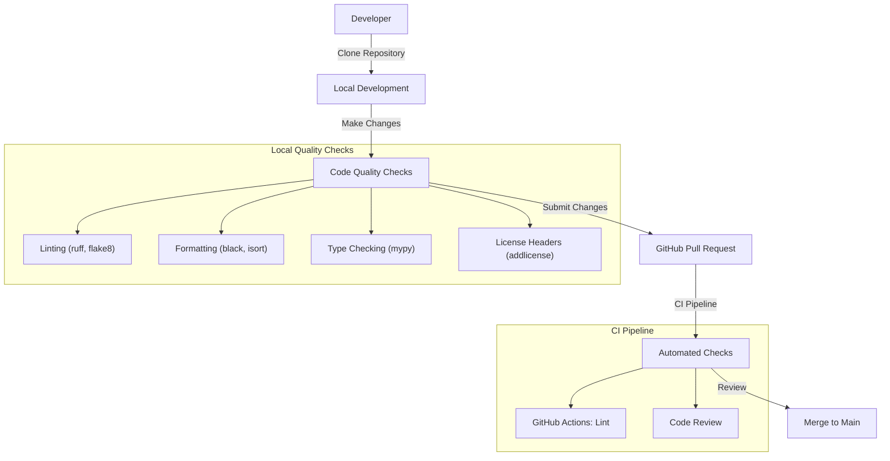
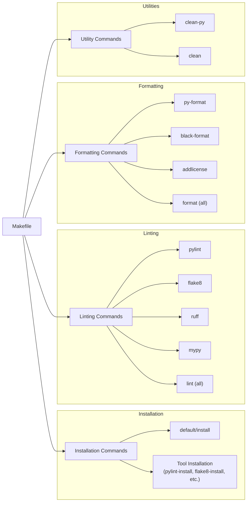
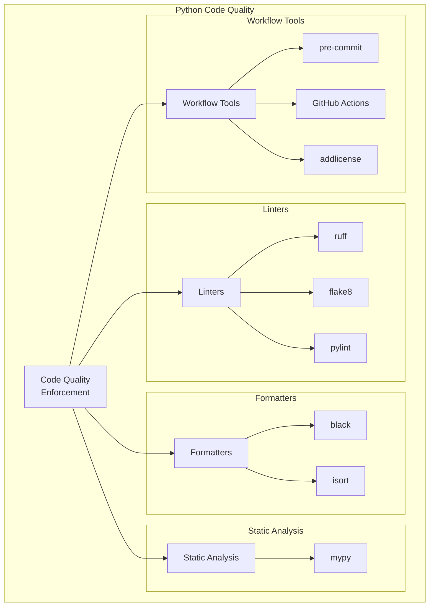
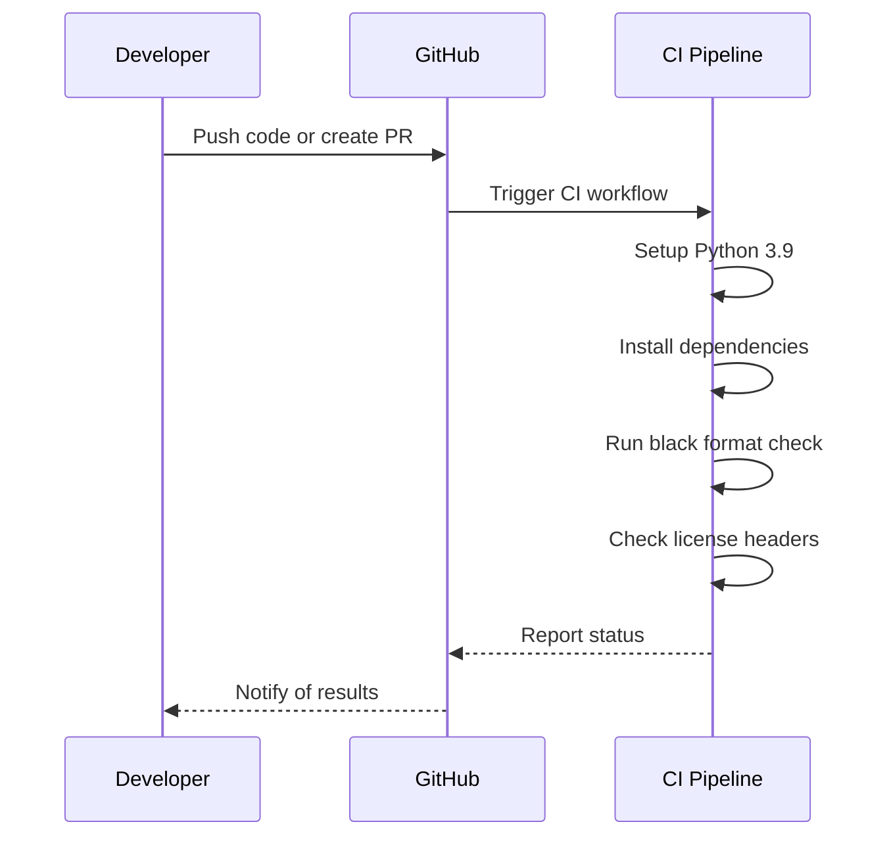
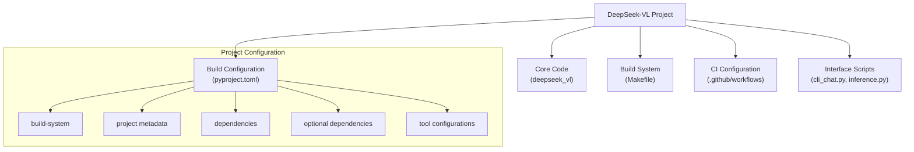
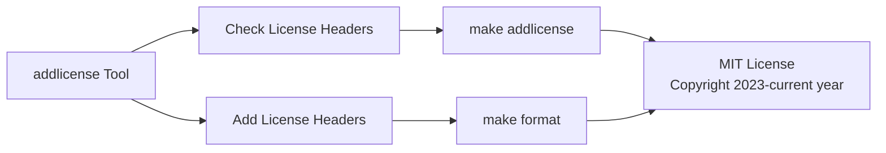

<!-- source: DeepWiki mcp.deepwiki.com · repo deepseek-ai/DeepSeek-VL · page 5 Development · fetched 2026-10-30 -->

# Development

<details>
<summary>Relevant source files</summary>

The following files were used as context for generating this wiki page:

- [.github/workflows/lint.yml](.github/workflows/lint.yml)
- [Makefile](Makefile)
- [pyproject.toml](pyproject.toml)

</details>


This page provides technical information for developers interested in contributing to or modifying the DeepSeek-VL codebase. It covers the build system, code quality tools, and project configuration. For instructions on installing and using DeepSeek-VL, see [Getting Started](#2).

## Development Workflow Overview

The DeepSeek-VL development workflow includes several components to ensure code quality and consistency. The following diagram illustrates the main development processes:



Sources: [.github/workflows/lint.yml](), [Makefile]()

## Build System

DeepSeek-VL uses a Makefile-based build system to streamline development tasks. The build system provides commands for installation, linting, formatting, and cleaning.

### Build System Components



Sources: [Makefile:13-99]()

### Common Development Commands

The following table summarizes the key commands available for developers:

| Command | Description | Source |
|---------|-------------|--------|
| `make` or `make install` | Default command to install the project | [Makefile:13-14]() |
| `make lint` | Run all linting tools (ruff, flake8, py-format, mypy, pylint, addlicense) | [Makefile:86]() |
| `make format` | Format code with isort, black, and add license headers | [Makefile:88-91]() |
| `make clean` | Clean Python cache files | [Makefile:93-99]() |
| `make pre-commit` | Run pre-commit hooks on all files | [Makefile:81-82]() |

Sources: [Makefile:13-99]()

## Code Quality

DeepSeek-VL enforces code quality through a combination of linting, formatting, and static analysis tools. These tools are integrated into the development workflow through the Makefile and GitHub Actions.

### Code Quality Tools



Sources: [.github/workflows/lint.yml](), [Makefile:21-82](), [pyproject.toml:37-50]()

### Continuous Integration

DeepSeek-VL uses GitHub Actions for continuous integration, automatically running linting checks on pull requests and pushes to the main branch.



Sources: [.github/workflows/lint.yml:1-56]()

### Linting Configuration

The linting tools are configured through the `pyproject.toml` file and the Makefile. Here's an overview of the linting dependencies:

| Tool | Purpose | Configuration |
|------|---------|---------------|
| black | Code formatting | Configured in `pyproject.toml` |
| isort | Import sorting | Configured via Makefile with project-specific settings |
| flake8 | Style guide enforcement | Multiple plugins for different checks |
| ruff | Fast Python linter | Can fix issues automatically with `make ruff-fix` |
| mypy | Static type checking | Configured to install missing types |
| pylint | Comprehensive linting | Includes spelling checks |

Sources: [Makefile:21-82](), [pyproject.toml:37-50]()

## Project Configuration

DeepSeek-VL uses `pyproject.toml` for project configuration, defining package metadata, dependencies, and build requirements.

### Project Structure



Sources: [pyproject.toml:1-53]()

### Dependencies

DeepSeek-VL has core dependencies and optional dependencies for different use cases:

#### Core Dependencies

```
torch>=2.0.1
transformers>=4.38.2
timm>=0.9.16
accelerate
sentencepiece
attrdict
einops
```

#### Optional Dependencies Groups

| Group | Purpose | Notable Dependencies |
|-------|---------|---------------------|
| gradio | Web UI interface | gradio, mdtex2html, tiktoken |
| lint | Development tools | isort, black, pylint, flake8, ruff |

Sources: [pyproject.toml:14-50]()

### Build Configuration

The build configuration is defined in `pyproject.toml` and uses setuptools as the build backend:

```
[build-system]
requires = ["setuptools>=40.6.0", "wheel"]
build-backend = "setuptools.build_meta"
```

The project is configured to exclude the `images` directory from the package:

```
[tool.setuptools]
packages = {find = {exclude = ["images"]}}
```

Sources: [pyproject.toml:1-4](), [pyproject.toml:52-53]()

## License Management

DeepSeek-VL includes a license management system using the `addlicense` tool to ensure proper license headers are added to source files.



Sources: [Makefile:51-55](), [Makefile:88-91]()

The license headers are set to MIT license with copyright attribution to DeepSeek and the years 2023 to the current year.

## Development Setup Guide

To set up a development environment for DeepSeek-VL:

1. Clone the repository:
   ```bash
   git clone https://github.com/deepseek-ai/DeepSeek-VL.git
   cd DeepSeek-VL
   ```

2. Install in development mode with linting tools:
   ```bash
   pip install -vvv --no-build-isolation --editable '.[lint]'
   ```

3. Set up pre-commit hooks:
   ```bash
   make pre-commit-install
   ```

4. Run code quality checks before submitting changes:
   ```bash
   make lint
   ```

5. Format code:
   ```bash
   make format
   ```

Sources: [.github/workflows/lint.yml:42-48](), [Makefile:81-86]()

---

