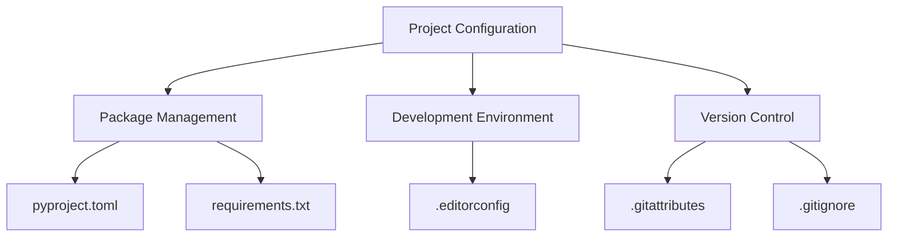
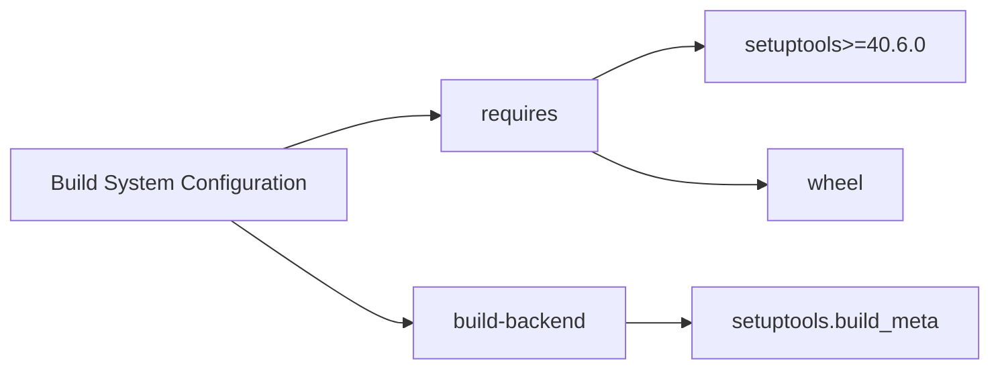
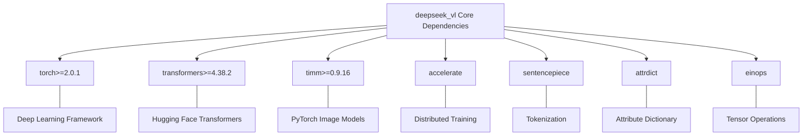
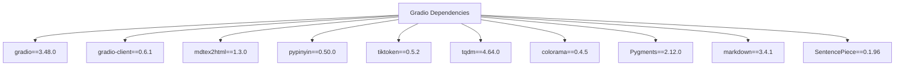
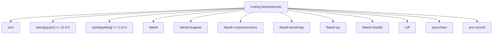
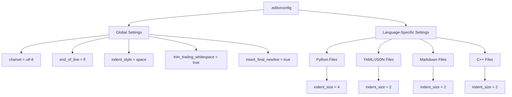
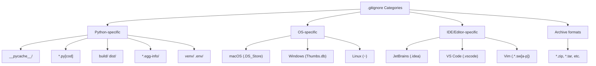
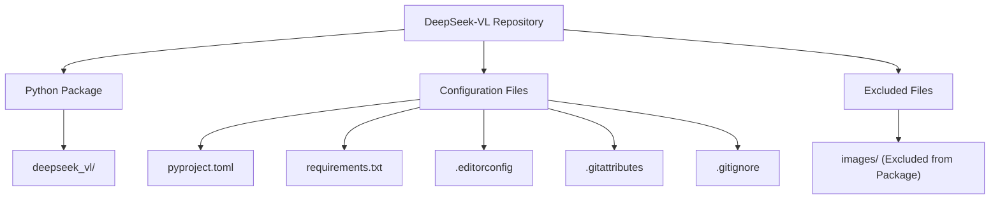
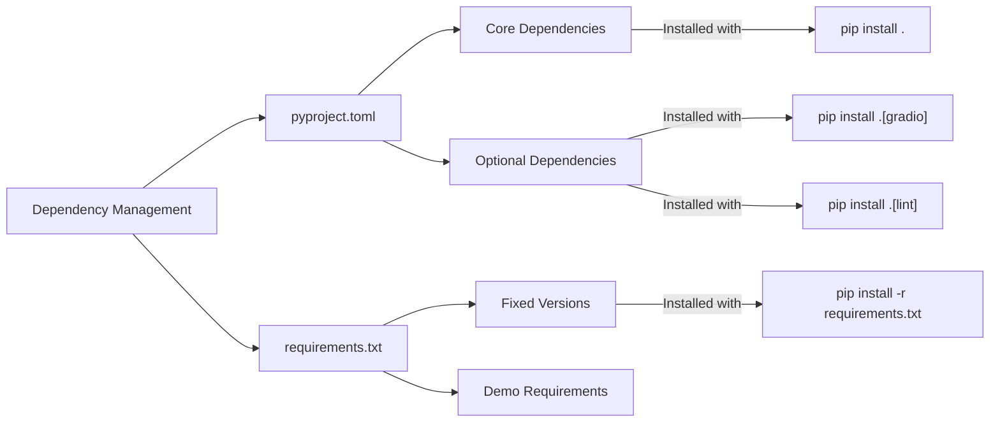
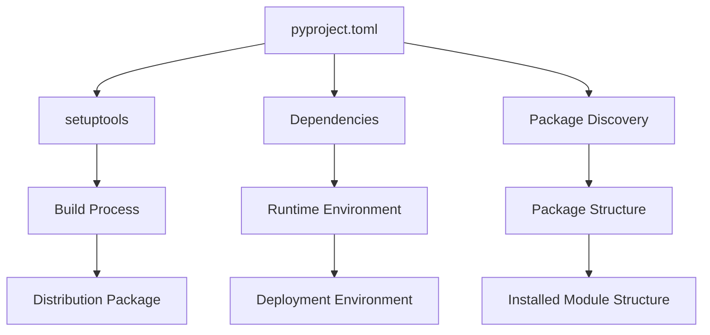

<!-- source: DeepWiki mcp.deepwiki.com · repo deepseek-ai/DeepSeek-VL · page 5.3 Project Configuration · fetched 2026-10-30 -->

# Project Configuration

<details>
<summary>Relevant source files</summary>

The following files were used as context for generating this wiki page:

- [.editorconfig](.editorconfig)
- [.gitattributes](.gitattributes)
- [.gitignore](.gitignore)
- [pyproject.toml](pyproject.toml)
- [requirements.txt](requirements.txt)

</details>


This document details the project structure, dependencies, and configuration files of the DeepSeek-VL repository. It explains how the codebase is organized and configured to ensure proper functionality and development workflow. For information about the build system itself, see [Build System](#5.1), and for code quality tools, see [Code Quality](#5.2).

## Configuration Files Overview

DeepSeek-VL uses several configuration files to manage different aspects of the project:



Sources: [pyproject.toml](), [requirements.txt](), [.editorconfig](), [.gitattributes](), [.gitignore]()

## Package Configuration

The main project configuration is defined in `pyproject.toml`, which follows the PEP 518 and PEP 621 standards for Python package metadata and build requirements.

### Build System

The project uses `setuptools` for building the package:



Sources: [pyproject.toml:1-3]()

### Project Metadata

The package metadata includes the name, version, description, and other identifying information:

| Field | Value |
|-------|-------|
| Name | deepseek_vl |
| Version | 1.0.0 |
| Description | DeepSeek-VL |
| Authors | DeepSeek-AI |
| License | LICENSE-CODE |
| Homepage | https://github.com/deepseek-ai/DeepSeek-VL |
| Python Requirement | >=3.8 |

Sources: [pyproject.toml:5-13]()

### Core Dependencies

DeepSeek-VL has the following core dependencies:



Sources: [pyproject.toml:14-22](), [requirements.txt:1-7]()

### Optional Dependencies

The project defines two sets of optional dependencies:

1. **Gradio dependencies** - For the web interface:



2. **Linting dependencies** - For code quality tools:



Sources: [pyproject.toml:24-50](), [requirements.txt:9-19]()

### Package Discovery

The project uses setuptools' package discovery mechanism to find packages, excluding the `images` directory:

```python
[tool.setuptools]
packages = {find = {exclude = ["images"]}}
```

Sources: [pyproject.toml:52-53]()

## Development Environment Configuration

### Editor Configuration

The `.editorconfig` file ensures consistent coding styles across different editors and IDEs:



Sources: [.editorconfig]()

Key features of the editor configuration:
- UTF-8 encoding for all files
- Unix-style line endings (LF)
- Space-based indentation with varying sizes per file type
- Consistent handling of trailing whitespace and final newlines

### Version Control Configuration

#### Git Attributes

The `.gitattributes` file specifies how Git should handle different file types:

```
* text eol=lf
*.ipynb linguist-detectable=false
*.png binary
*.jpg binary
*.jpeg binary
*.gif binary
*.pdf binary
```

This configuration ensures:
- Text files use LF line endings
- Jupyter notebooks are excluded from language statistics
- Binary files (images, PDFs) are treated as binary by Git

Sources: [.gitattributes]()

#### Git Ignore Patterns

The `.gitignore` file is extensive and organized by categories:



Sources: [.gitignore]()

The `.gitignore` file is comprehensive, covering:
- Python bytecode, build artifacts, and virtual environments
- Operating system temporary files and metadata
- IDE/editor-specific files and directories
- Package and archive formats

## Project Structure

The DeepSeek-VL project structure is defined by the package organization and exclusions:



Sources: [pyproject.toml:52-53]()

## Dependency Management

DeepSeek-VL uses both `pyproject.toml` and `requirements.txt` for dependency management:



Sources: [pyproject.toml:14-50](), [requirements.txt]()

The key differences:
- `pyproject.toml` defines dependencies in a structured way with core and optional groups
- `requirements.txt` provides a flattened list with exact versions, primarily for reproducibility

## Integration with the Build System

The project configuration directly impacts how the build system processes the DeepSeek-VL package:



Sources: [pyproject.toml]()

For details on the actual build process, see [Build System](#5.1).

---

