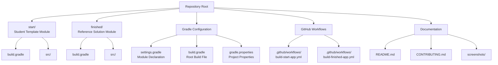
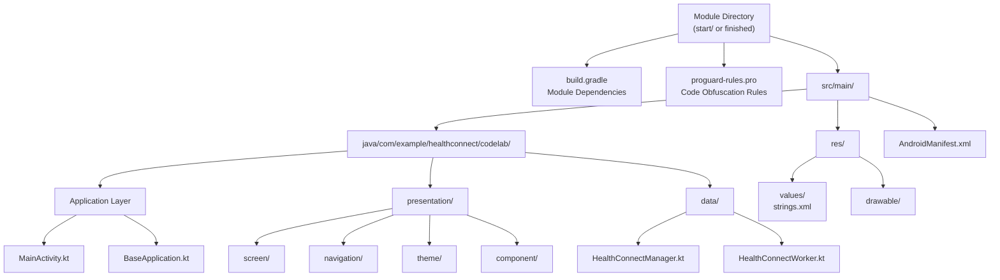
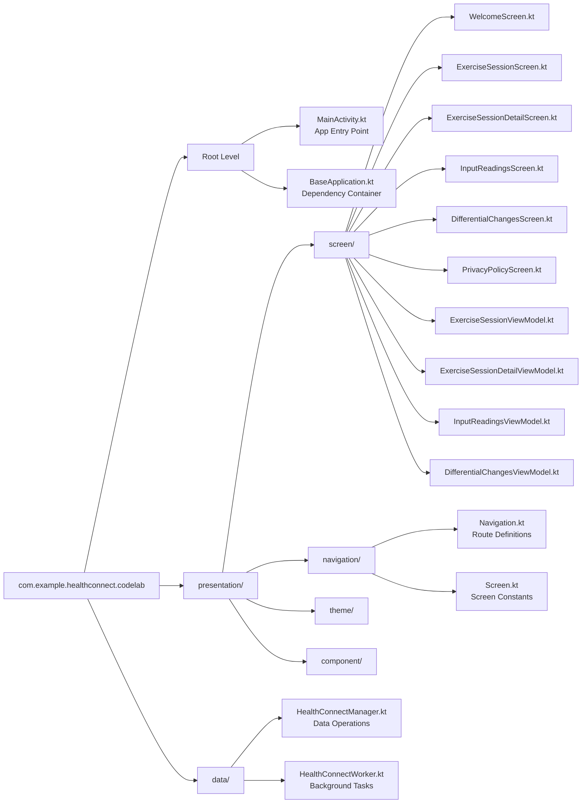
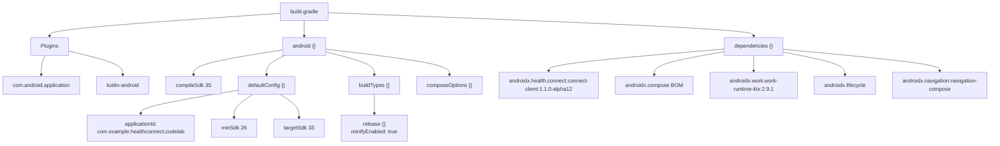
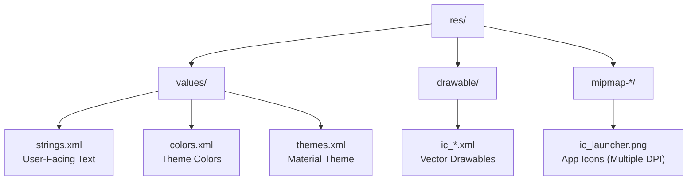

<!-- source: DeepWiki mcp.deepwiki.com · repo android/android-health-connect-codelab · page 3 Project Structure · fetched 2026-10-23 -->

# Project Structure

Relevant source files

The following files were used as context for generating this wiki page:

- [README.md](README.md)
- [finished/build.gradle](finished/build.gradle)
- [screenshots/hc1.png](screenshots/hc1.png)
- [start/build.gradle](start/build.gradle)

## Purpose and Scope

This page documents the overall organization of the Health Connect Codelab repository, including the directory layout, file organization, and the purpose of major structural components. It provides a high-level map of where different code artifacts reside within the project.

For detailed information about:
- The pedagogical differences between the start and finished modules, see [Start vs Finished Modules](#3.1)
- Gradle dependencies and build configuration, see [Build Configuration](#3.2)
- GitHub Actions workflows and continuous integration, see [CI/CD Pipeline](#3.3)

## Repository Root Structure

The repository follows a multi-module Gradle project structure with two parallel application modules designed for educational purposes.

**Sources:** [README.md:1-31](), repository structure inferred from build system configuration

### Key Root-Level Files

| File | Purpose |
|------|---------|
| `settings.gradle` | Declares both `start` and `finished` as application modules |
| `build.gradle` | Root-level build configuration and common properties |
| `gradle.properties` | Defines version variables for dependencies (lifecycle, navigation, etc.) |
| `README.md` | Setup instructions and prerequisites for the codelab |
| `.github/workflows/` | Contains CI/CD pipeline definitions for automated builds |

**Sources:** [README.md:1-31]()

## Module Structure

Both the `start` and `finished` modules share an identical directory structure, differing only in implementation completeness. Each module is a standalone Android application with the same package structure.

**Sources:** [start/build.gradle:1-96](), [finished/build.gradle:1-96]()

### Package Organization

The source code follows a layered architecture pattern with clear separation between presentation, business logic, and data access:

**Sources:** Inferred from architectural patterns described in system diagrams

## Feature-to-File Mapping

The codelab is organized around three primary feature areas, each with dedicated UI and business logic files:

| Feature | Screen Composable | ViewModel | Data Operations |
|---------|-------------------|-----------|-----------------|
| Exercise Sessions | `ExerciseSessionScreen.kt` | `ExerciseSessionViewModel.kt` | `HealthConnectManager.writeExerciseSession()` `HealthConnectManager.readExerciseSessions()` |
| Exercise Detail | `ExerciseSessionDetailScreen.kt` | `ExerciseSessionDetailViewModel.kt` | `HealthConnectManager.readAssociatedSessionData()` |
| Weight Input | `InputReadingsScreen.kt` | `InputReadingsViewModel.kt` | `HealthConnectManager.writeWeightInput()` `HealthConnectManager.readWeightInputs()` `HealthConnectManager.computeWeeklyAverage()` |
| Differential Changes | `DifferentialChangesScreen.kt` | `DifferentialChangesViewModel.kt` | `HealthConnectManager.getChangesToken()` `HealthConnectManager.getChanges()` |
| Welcome/Privacy | `WelcomeScreen.kt` `PrivacyPolicyScreen.kt` | N/A (stateless) | N/A |

**Sources:** Feature organization inferred from Diagram 6 (Feature Module Breakdown) in system architecture

## Build Configuration Files

Each module contains a `build.gradle` file that is nearly identical between `start` and `finished`, ensuring consistent build behavior:

**Sources:** [start/build.gradle:1-96](), [finished/build.gradle:1-96]()

### Critical Dependencies

| Dependency | Version | Purpose |
|------------|---------|---------|
| `androidx.health.connect:connect-client` | 1.1.0-alpha12 | Health Connect SDK for data operations |
| `androidx.compose:compose-bom` | 2022.10.00 | Jetpack Compose UI framework |
| `androidx.work:work-runtime-ktx` | 2.9.1 | Background task scheduling |
| `androidx.lifecycle:lifecycle-viewmodel-compose` | Variable | ViewModel integration with Compose |
| `androidx.navigation:navigation-compose` | Variable | Declarative navigation |
| `androidx.concurrent:concurrent-futures-ktx` | Variable | Bridge between ListenableFuture and coroutines |

**Sources:** [start/build.gradle:66-96](), [finished/build.gradle:66-96]()

## Resource Organization

The `res/` directory contains all non-code resources following standard Android conventions:

**Sources:** Standard Android project structure conventions

### String Resource Organization

The `strings.xml` file organizes user-facing strings by feature area:

| String Key Pattern | Feature Area | Example |
|-------------------|--------------|---------|
| `welcome_*` | Welcome screen | `welcome_message` |
| `exercise_*` | Exercise sessions | `exercise_session_detail` |
| `weight_*` | Weight input | `weight_entry_done` |
| `button_*` | Action buttons | `button_insert_exercise` |
| `label_*` | Form labels | `label_weight` |
| `not_enabled_*` | Error states | `not_enabled_description` |
| `permissions_*` | Permission rationale | `permissions_rationale` |

**Sources:** String organization inferred from UI screen requirements

## Manifest Configuration

The `AndroidManifest.xml` file in each module's `src/main/` directory declares the application structure and required permissions:

```mermaid
graph TB
    Manifest["AndroidManifest.xml"]
    
    Manifest --> Application["<application>"]
    Manifest --> Permissions["<uses-permission>"]
    Manifest --> Queries["<queries>"]
    
    Application --> MainActivity["MainActivity<br/>LAUNCHER Activity"]
    Application --> DeepLink["Intent Filters<br/>Permission Rationale"]
    
    Permissions --> HealthPerms["Health Connect Permissions"]
    
    HealthPerms --> ReadExercise["READ_EXERCISE"]
    HealthPerms --> WriteExercise["WRITE_EXERCISE"]
    HealthPerms --> ReadSteps["READ_STEPS"]
    HealthPerms --> WriteSteps["WRITE_STEPS"]
    HealthPerms --> ReadHR["READ_HEART_RATE"]
    HealthPerms --> WriteHR["WRITE_HEART_RATE"]
    HealthPerms --> ReadWeight["READ_WEIGHT"]
    HealthPerms --> WriteWeight["WRITE_WEIGHT"]
    HealthPerms --> ReadCalories["READ_TOTAL_CALORIES_BURNED"]
    HealthPerms --> WriteCalories["WRITE_TOTAL_CALORIES_BURNED"]
    HealthPerms --> BgRead["READ_HEALTH_DATA_IN_BACKGROUND"]
    HealthPerms --> History["READ_HEALTH_DATA_HISTORY"]
    
    Queries --> HCPackage["<package><br/>com.google.android.apps.healthdata"]
```

**Sources:** Permission requirements inferred from Diagram 4 (Permission Management System)

## Navigation and Routing

The navigation system defines string-based routes that map to screen composables:

| Route Constant | Screen Composable | Navigation Arguments |
|----------------|-------------------|---------------------|
| `Screen.WELCOME_SCREEN` | `WelcomeScreen` | None |
| `Screen.EXERCISE_SESSION_SCREEN` | `ExerciseSessionScreen` | None |
| `Screen.EXERCISE_SESSION_DETAIL_SCREEN` | `ExerciseSessionDetailScreen` | `uid: String` (session ID) |
| `Screen.INPUT_READINGS_SCREEN` | `InputReadingsScreen` | None |
| `Screen.DIFFERENTIAL_CHANGES_SCREEN` | `DifferentialChangesScreen` | None |
| `Screen.PRIVACY_POLICY` | `PrivacyPolicyScreen` | None |

The `Navigation.kt` file in `presentation/navigation/` contains the `NavHost` setup with route definitions and ViewModel factory integration.

**Sources:** Navigation structure inferred from Diagram 1 (Overall System Architecture)

## Gradle Wrapper and Build Scripts

The repository includes Gradle wrapper scripts for cross-platform builds:

| File | Purpose |
|------|---------|
| `gradlew` | Unix/Linux/macOS build script |
| `gradlew.bat` | Windows build script |
| `gradle/wrapper/gradle-wrapper.properties` | Gradle distribution configuration |
| `gradle/wrapper/gradle-wrapper.jar` | Gradle wrapper binary |

These files ensure consistent Gradle versions across development environments without requiring a system-wide Gradle installation.

**Sources:** [README.md:18]() (references "gradlew build" command)

## Relationship to Other Documentation

This page provides a structural overview. For more detailed information:

- **Module Differences**: See [Start vs Finished Modules](#3.1) for what's implemented vs stubbed
- **Dependencies**: See [Build Configuration](#3.2) for detailed dependency management
- **Automation**: See [CI/CD Pipeline](#3.3) for build workflows
- **Architecture**: See [Architecture Overview](#4) for MVVM pattern details
- **Entry Point**: See [Application Entry Point](#4.1) for MainActivity and BaseApplication
- **Navigation Details**: See [Navigation System](#4.2) for route handling and deep linking

**Sources:** Table of contents structure

---

