# Page: Overview

# Overview

<details>
<summary>Relevant source files</summary>

The following files were used as context for generating this wiki page:

- [README.md](README.md)
- [finished/src/main/res/values/strings.xml](finished/src/main/res/values/strings.xml)
- [screenshots/hc1.png](screenshots/hc1.png)
- [start/src/main/res/values/strings.xml](start/src/main/res/values/strings.xml)

</details>


This document provides an overview of the Health Connect Codelab, a hands-on tutorial application designed to teach developers how to integrate Android's Health Connect platform into their applications. This page covers the educational structure, demonstrated features, and learning objectives. For specific setup instructions and prerequisites, see [Getting Started](#2). For details on the project organization, see [Project Structure](#3). For architectural details, see [Architecture Overview](#4).

## Purpose and Scope

The Health Connect Codelab is a pedagogical Android application that demonstrates Health Connect API integration through practical examples. The codebase is structured as a dual-module project containing both a skeleton implementation (`start/`) for students and a complete reference solution (`finished/`). 

**Sources:** [README.md:1-31]()

## What is Health Connect

Health Connect is Android's centralized platform for health and fitness data, allowing applications to read and write health records (exercise sessions, weight measurements, heart rate, steps, calories) with user permission. This codelab teaches developers how to:

- Check for Health Connect availability on devices
- Request and manage health data permissions
- Perform CRUD operations on health records
- Aggregate health statistics
- Track incremental data changes
- Execute background health data operations

**Sources:** [start/src/main/res/values/strings.xml:26-31](), [README.md:3-10]()

## Dual Module Architecture

The repository implements a learning-by-doing approach through two parallel modules:

| Module | Purpose | Implementation Status | Primary Use Case |
|--------|---------|----------------------|------------------|
| `start/` | Student workspace | Skeleton with TODO placeholders | Initial development environment |
| `finished/` | Reference solution | Fully implemented | Solution verification and comparison |

Both modules share identical:
- String resources for UI text ([start/src/main/res/values/strings.xml]() and [finished/src/main/res/values/strings.xml]())
- Android manifest permissions
- Build configuration (SDK versions, dependencies)
- UI screen structures

**Codelab Learning Flow:**

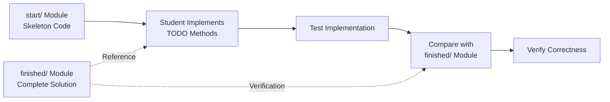

**Sources:** [README.md:1-31]()

## Demonstrated Features

The codelab demonstrates six distinct Health Connect integration patterns through dedicated screens:

### Feature Matrix

| Feature | Screen | Key Operations | Record Types |
|---------|--------|----------------|--------------|
| Exercise Session Management | `ExerciseSessionScreen` | Write sessions, read sessions list | `ExerciseSessionRecord`, `HeartRateRecord`, `StepsRecord`, `TotalCaloriesBurnedRecord` |
| Exercise Session Details | `ExerciseSessionDetailScreen` | Read aggregated metrics, time-series data | Same as above |
| Weight Input & Tracking | `InputReadingsScreen` | Write weight, read history, compute averages | `WeightRecord` |
| Differential Changes | `DifferentialChangesScreen` | Token-based sync, change tracking | All record types |
| Background Data Access | Exercise screen actions | WorkManager integration | `StepsRecord` |
| Permission Management | All screens | Request permissions, check availability | N/A |

**Sources:** [start/src/main/res/values/strings.xml:17-139]()

## Application Structure Overview

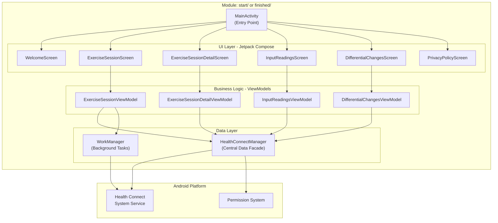

**Sources:** [README.md:1-31](), [start/src/main/res/values/strings.xml:17-24]()

## Technology Stack

The codelab demonstrates modern Android development practices using:

| Technology | Purpose | Integration Point |
|------------|---------|-------------------|
| **Health Connect SDK** | Health data access | `HealthConnectManager` class |
| **Jetpack Compose** | Declarative UI | All screen Composables |
| **ViewModel** | State management | Screen-specific ViewModels |
| **Kotlin Coroutines** | Asynchronous operations | All data operations |
| **WorkManager** | Background processing | Step reading worker |
| **Navigation Compose** | Screen routing | `MainActivity` navigation setup |

The application follows the MVVM (Model-View-ViewModel) architecture pattern with unidirectional data flow. For detailed architectural discussion, see [Architecture Overview](#4).

**Sources:** [README.md:18-19]()

## Learning Objectives

By completing this codelab, developers will learn to:

1. **Availability Checking**: Determine if Health Connect is installed and supported on the device (see [Health Connect Availability](#5.1))
2. **Permission Management**: Request and verify health data permissions using the three-tier permission model (see [Permission Management](#5.2))
3. **Writing Health Records**: Insert exercise sessions with associated records (steps, calories, heart rate time series) and weight measurements (see [Writing Health Data](#5.5))
4. **Reading Health Records**: Query health data with time range filters and data origin filtering (see [Reading Health Data](#5.4))
5. **Aggregations**: Compute statistics like weekly averages, exercise session metrics, and heart rate statistics (see [Aggregations and Statistics](#5.6))
6. **Differential Sync**: Implement token-based incremental synchronization to detect changes efficiently (see [Differential Changes Tracking](#5.7))
7. **Background Work**: Execute health data operations in the background using WorkManager (see [Background Work with WorkManager](#5.8))
8. **Error Handling**: Handle Health Connect exceptions and provide appropriate user feedback (see [Error Handling and User Feedback](#9.2))

**Sources:** [start/src/main/res/values/strings.xml:68-124]()

## Key Implementation Points for Students

The `start/` module contains placeholder implementations with `TODO` comments in critical methods. Students implement:

### Exercise Session Feature (see [Feature: Exercise Sessions](#6))
- `writeExerciseSession()` - Insert exercise records with associated heart rate, steps, calories
- `readExerciseSessions()` - Query exercise session records
- `readAssociatedSessionData()` - Retrieve detailed metrics for a specific session

### Weight Input Feature (see [Feature: Weight Input](#7))
- `writeWeightInput()` - Insert weight measurements
- `readWeightInputs()` - Query weight records with time ranges
- `computeWeeklyAverage()` - Aggregate weight data

### Differential Changes Feature (see [Feature: Differential Changes](#8))
- `getChangesToken()` - Obtain initial sync token
- `getChanges()` - Retrieve incremental changes since token

### Background Operations (see [Background Work with WorkManager](#5.8))
- `enqueueReadStepWorker()` - Schedule background step reading

**Sources:** [start/src/main/res/values/strings.xml:68-139]()

## Module File Structure Comparison

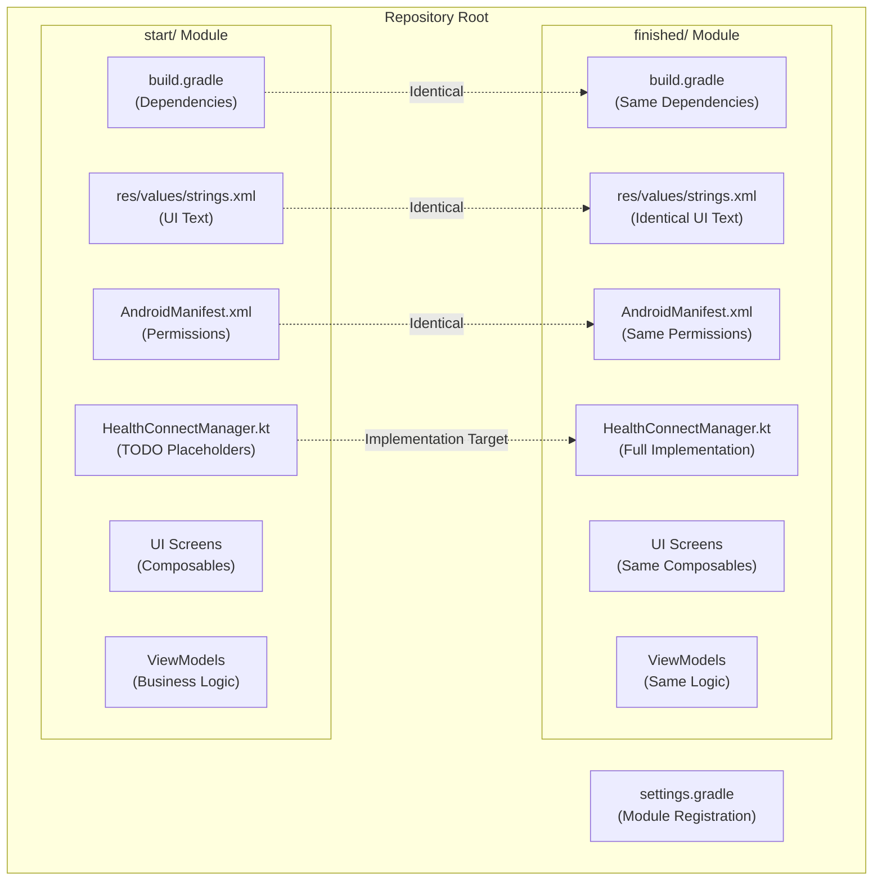

**Sources:** [README.md:1-31](), [start/src/main/res/values/strings.xml:1-140](), [finished/src/main/res/values/strings.xml:1-140]()

## Prerequisites for Codelab Completion

| Requirement | Specification | Verification Method |
|-------------|---------------|---------------------|
| Android Device/Emulator | API level 27 (Android 8.1) or higher | System settings |
| Health Connect APK | Required for Android 13 and lower | Check installed apps or follow installation link |
| Development Environment | Android Studio with Kotlin support | Build project successfully |
| Gradle | Version specified in wrapper | `./gradlew build` |

For detailed setup instructions, see [Getting Started](#2).

**Sources:** [README.md:7-10]()

## User Interface Preview

The codelab demonstrates six distinct screens:

1. **Welcome Screen** - Health Connect availability status and navigation entry point ([strings.xml:26-31]())
2. **Exercise Sessions** - List view of recorded exercise sessions with insert functionality ([strings.xml:68-76]())
3. **Exercise Session Detail** - Detailed metrics for a specific exercise session ([strings.xml:78-90]())
4. **Record Weight** - Weight input form with history and weekly average ([strings.xml:106-114]())
5. **Differential Changes** - Token-based change tracking interface ([strings.xml:116-124]())
6. **Privacy Policy** - Placeholder privacy policy screen ([strings.xml:34-39]())

**Sources:** [start/src/main/res/values/strings.xml:17-139]()

## Navigation Between Pages

This overview provides a high-level introduction to the codelab. For deeper exploration:

- **Setup and Prerequisites**: [Getting Started](#2)
- **Code Organization**: [Project Structure](#3) and [Start vs Finished Modules](#3.1)
- **Architecture Patterns**: [Architecture Overview](#4)
- **Core Data Operations**: [Data Layer - HealthConnectManager](#5)
- **Specific Features**: [Exercise Sessions](#6), [Weight Input](#7), [Differential Changes](#8)
- **UI Implementation**: [UI Architecture Patterns](#9)
- **Step-by-Step Guide**: [Implementation Guide for Students](#12)

**Sources:** [README.md:1-31]()

---

# Page: Getting Started

# Getting Started

<details>
<summary>Relevant source files</summary>

The following files were used as context for generating this wiki page:

- [.github/workflows/build-finished-app.yml](.github/workflows/build-finished-app.yml)
- [.github/workflows/build-start-app.yml](.github/workflows/build-start-app.yml)
- [README.md](README.md)
- [finished/build.gradle](finished/build.gradle)
- [screenshots/hc1.png](screenshots/hc1.png)

</details>


This document provides setup instructions, system requirements, and build procedures for the Health Connect Codelab. It covers environment prerequisites, dependency installation, and commands to build both the `start` (student template) and `finished` (reference solution) modules.

For information about the project's overall structure and how the dual-module architecture works, see [Project Structure](#3). For details about specific build configurations and dependencies, see [Build Configuration](#3.2).

---

## System Requirements

The Health Connect Codelab requires specific Android versions and development tools to function correctly.

### Android Device or Emulator

| Requirement | Specification |
|-------------|---------------|
| **Minimum API Level** | 26 (Android 8.0) |
| **Target API Level** | 33 (Android 13) |
| **Compile SDK** | 35 |
| **Recommended** | API level 27 or greater |

The application defines `minSdk 26` in [finished/build.gradle:27]() and [start/build.gradle:27](), meaning devices running Android 8.0 or higher are supported. However, Health Connect behavior varies by Android version, particularly regarding permission handling and APK installation requirements.

Sources: [README.md:9](), [finished/build.gradle:23-34]()

### Health Connect APK Installation

For devices running **Android 13 and lower**, the Health Connect APK must be manually installed from the Play Store before using this codelab. This is a system-level service that provides the health data platform.

| Android Version | Installation Method |
|-----------------|---------------------|
| Android 13 and lower | Manual installation from [Play Store][health-connect-apk] required |
| Android 14 and higher | Health Connect is pre-installed as a platform module |

The Health Connect APK package identifier is `com.google.android.apps.healthdata`. The application checks for Health Connect availability using `HealthConnectClient.getSdkStatus()` as documented in the Data Layer (see [Health Connect Availability](#5.1)).

Sources: [README.md:10]()

---

## Development Environment Setup

### Java Development Kit (JDK)

The project requires **JDK 17** with the Zulu distribution. This is enforced in the CI/CD pipeline.

```yaml
distribution: 'zulu'
java-version: '17'
```

The build configuration targets Java 8 bytecode compatibility for runtime:

```gradle
compileOptions {
    sourceCompatibility JavaVersion.VERSION_1_8
    targetCompatibility JavaVersion.VERSION_1_8
}
kotlinOptions {
    jvmTarget = '1.8'
}
```

Sources: [.github/workflows/build-start-app.yml:18-22](), [finished/build.gradle:44-50]()

### Android Studio

Use the latest stable version of Android Studio. Open the project using **File > Open** and select the root directory containing `settings.gradle`.

### Gradle Build System

The project uses Gradle with the following configuration:

| Property | Value |
|----------|-------|
| Gradle Plugin | `com.android.application` |
| Kotlin Plugin | `kotlin-android` |
| Kotlin Compiler Extension | `1.4.0` (for Compose) |

The root `settings.gradle` declares both modules:

```gradle
include ':start'
include ':finished'
```

Sources: [finished/build.gradle:17-20](), [finished/build.gradle:52-57]()

---

## Build Module Architecture

The codebase contains two independent Android application modules that can be built separately.

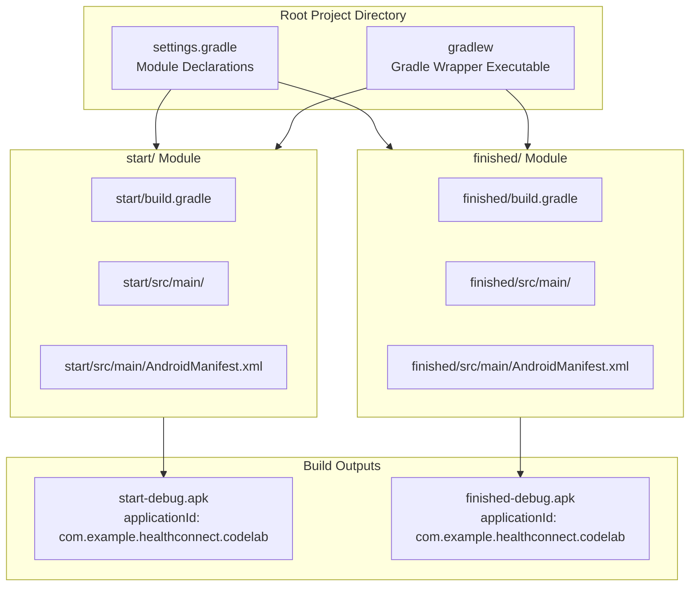

**Module Isolation**: Both modules share the same `applicationId` (`com.example.healthconnect.codelab`) and dependencies but are built independently. The `start` module contains skeleton implementations with TODO markers, while the `finished` module provides complete reference implementations. For architectural details, see [Start vs Finished Modules](#3.1).

Sources: [finished/build.gradle:26](), [README.md:18]()

---

## Building the Project

### Using Gradle Wrapper (Command Line)

Make the Gradle wrapper executable (Linux/macOS):

```bash
chmod +x ./gradlew
```

#### Build the Start Module

```bash
./gradlew :start:assembleDebug
```

This command compiles the student template module and produces `start/build/outputs/apk/debug/start-debug.apk`.

#### Build the Finished Module

```bash
./gradlew :finished:assembleDebug
```

This command compiles the reference solution module and produces `finished/build/outputs/apk/debug/finished-debug.apk`.

#### Build Both Modules

```bash
./gradlew build
```

This command builds both modules in parallel, executing their respective `assembleDebug` tasks.

Sources: [README.md:18](), [.github/workflows/build-start-app.yml:28-31](), [.github/workflows/build-finished-app.yml:28-31]()

### Using Android Studio

1. Open the project in Android Studio
2. Select the build variant from the **Build Variants** panel:
   - Choose `start` to work with the student template
   - Choose `finished` to view the reference solution
3. Click **Build > Make Project** or use the toolbar build button
4. To install and run, select a device/emulator and click **Run**

---

## Build Configuration Details

### Dependencies

Both modules declare identical dependencies, including:

| Dependency | Version | Purpose |
|------------|---------|---------|
| `androidx.health.connect:connect-client` | `1.1.0-alpha12` | Health Connect SDK |
| `androidx.compose:compose-bom` | `2022.10.00` | Jetpack Compose UI framework |
| `androidx.work:work-runtime-ktx` | `2.9.1` | Background task scheduling |
| `androidx.navigation:navigation-compose` | `$navigation_compose_version` | Navigation framework |
| `androidx.lifecycle:lifecycle-viewmodel-compose` | `$lifecycle_version` | ViewModel integration |

The Health Connect client dependency is the core SDK that provides the `HealthConnectClient` interface used throughout the application.

Sources: [finished/build.gradle:66-83]()

### Build Types

The project defines two build types:

**Debug Build** (default):
- No minification
- Full debugging symbols
- Used for development and testing

**Release Build**:
```gradle
buildTypes {
    release {
        minifyEnabled true
        shrinkResources true
        proguardFiles getDefaultProguardFile('proguard-android-optimize.txt'), 'proguard-rules.pro'
    }
}
```

Sources: [finished/build.gradle:37-43]()

---

## Continuous Integration Build Process

The GitHub Actions workflows demonstrate the automated build process for both modules.

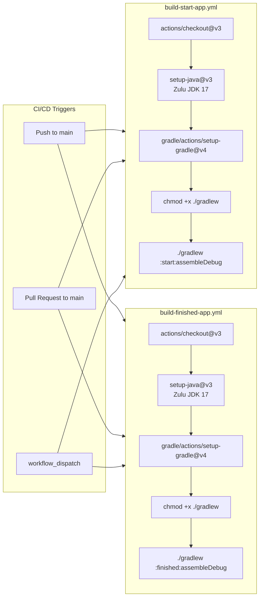

Both workflows run on `ubuntu-latest` and use Gradle caching to optimize build times. The `setup-gradle` action automatically caches Gradle dependencies and build outputs.

Sources: [.github/workflows/build-start-app.yml:1-32](), [.github/workflows/build-finished-app.yml:1-32]()

---

## Verification Steps

After building, verify the setup:

### 1. Check APK Generation

Verify that APK files are created:
- **Start module**: `start/build/outputs/apk/debug/start-debug.apk`
- **Finished module**: `finished/build/outputs/apk/debug/finished-debug.apk`

### 2. Install on Device/Emulator

```bash
adb install start/build/outputs/apk/debug/start-debug.apk
```

or

```bash
adb install finished/build/outputs/apk/debug/finished-debug.apk
```

### 3. Verify Health Connect Availability

After installation, launch the app. The `WelcomeScreen` displays the Health Connect availability status. If Health Connect is not installed (Android 13 and lower), the app will show an "Install Health Connect" button.

The availability check is performed by `HealthConnectManager.checkAvailability()`, which queries the SDK status. See [Health Connect Availability](#5.1) for implementation details.

### 4. Grant Permissions

The app requires multiple Health Connect permissions to function. On first launch, navigate through the permission flow to grant:
- Read/Write Exercise Sessions
- Read/Write Heart Rate
- Read/Write Steps
- Read/Write Weight
- Read/Write Total Calories Burned

Permission management is detailed in [Permission Management](#5.2).

Sources: [README.md:16-18]()

---

## Next Steps

After successfully building and installing the application:

1. **For Learners**: Start with the `start` module and implement the TODO methods marked in `HealthConnectManager`. See [Implementation Guide for Students](#12) for step-by-step instructions.

2. **For Reference**: Consult the `finished` module to see complete implementations of all Health Connect operations.

3. **Understanding Architecture**: Review [Architecture Overview](#4) to understand the MVVM pattern and data flow.

4. **Explore Features**: Navigate through the three main features: [Exercise Sessions](#6), [Weight Input](#7), and [Differential Changes](#8).

Sources: [README.md:1-31]()

---

# Page: Project Structure

# Project Structure

<details>
<summary>Relevant source files</summary>

The following files were used as context for generating this wiki page:

- [README.md](README.md)
- [finished/build.gradle](finished/build.gradle)
- [screenshots/hc1.png](screenshots/hc1.png)
- [start/build.gradle](start/build.gradle)

</details>


## Purpose and Scope

This page documents the overall organization of the Health Connect Codelab repository, including the directory layout, file organization, and the purpose of major structural components. It provides a high-level map of where different code artifacts reside within the project.

For detailed information about:
- The pedagogical differences between the start and finished modules, see [Start vs Finished Modules](#3.1)
- Gradle dependencies and build configuration, see [Build Configuration](#3.2)
- GitHub Actions workflows and continuous integration, see [CI/CD Pipeline](#3.3)

## Repository Root Structure

The repository follows a multi-module Gradle project structure with two parallel application modules designed for educational purposes.

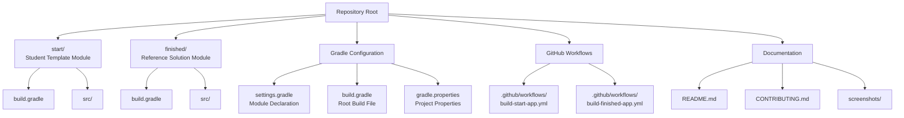

**Sources:** [README.md:1-31](), repository structure inferred from build system configuration

### Key Root-Level Files

| File | Purpose |
|------|---------|
| `settings.gradle` | Declares both `start` and `finished` as application modules |
| `build.gradle` | Root-level build configuration and common properties |
| `gradle.properties` | Defines version variables for dependencies (lifecycle, navigation, etc.) |
| `README.md` | Setup instructions and prerequisites for the codelab |
| `.github/workflows/` | Contains CI/CD pipeline definitions for automated builds |

**Sources:** [README.md:1-31]()

## Module Structure

Both the `start` and `finished` modules share an identical directory structure, differing only in implementation completeness. Each module is a standalone Android application with the same package structure.

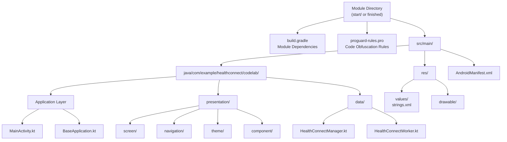

**Sources:** [start/build.gradle:1-96](), [finished/build.gradle:1-96]()

### Package Organization

The source code follows a layered architecture pattern with clear separation between presentation, business logic, and data access:

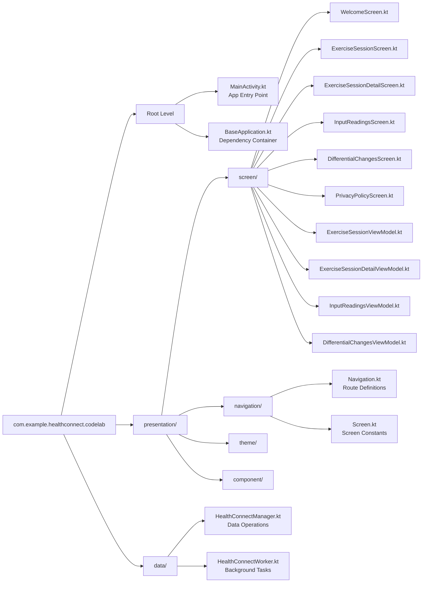

**Sources:** Inferred from architectural patterns described in system diagrams

## Feature-to-File Mapping

The codelab is organized around three primary feature areas, each with dedicated UI and business logic files:

| Feature | Screen Composable | ViewModel | Data Operations |
|---------|-------------------|-----------|-----------------|
| Exercise Sessions | `ExerciseSessionScreen.kt` | `ExerciseSessionViewModel.kt` | `HealthConnectManager.writeExerciseSession()`<br/>`HealthConnectManager.readExerciseSessions()` |
| Exercise Detail | `ExerciseSessionDetailScreen.kt` | `ExerciseSessionDetailViewModel.kt` | `HealthConnectManager.readAssociatedSessionData()` |
| Weight Input | `InputReadingsScreen.kt` | `InputReadingsViewModel.kt` | `HealthConnectManager.writeWeightInput()`<br/>`HealthConnectManager.readWeightInputs()`<br/>`HealthConnectManager.computeWeeklyAverage()` |
| Differential Changes | `DifferentialChangesScreen.kt` | `DifferentialChangesViewModel.kt` | `HealthConnectManager.getChangesToken()`<br/>`HealthConnectManager.getChanges()` |
| Welcome/Privacy | `WelcomeScreen.kt`<br/>`PrivacyPolicyScreen.kt` | N/A (stateless) | N/A |

**Sources:** Feature organization inferred from Diagram 6 (Feature Module Breakdown) in system architecture

## Build Configuration Files

Each module contains a `build.gradle` file that is nearly identical between `start` and `finished`, ensuring consistent build behavior:

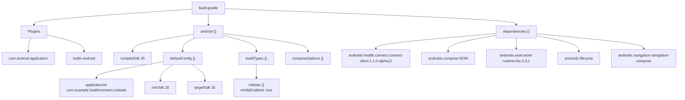

**Sources:** [start/build.gradle:1-96](), [finished/build.gradle:1-96]()

### Critical Dependencies

| Dependency | Version | Purpose |
|------------|---------|---------|
| `androidx.health.connect:connect-client` | 1.1.0-alpha12 | Health Connect SDK for data operations |
| `androidx.compose:compose-bom` | 2022.10.00 | Jetpack Compose UI framework |
| `androidx.work:work-runtime-ktx` | 2.9.1 | Background task scheduling |
| `androidx.lifecycle:lifecycle-viewmodel-compose` | Variable | ViewModel integration with Compose |
| `androidx.navigation:navigation-compose` | Variable | Declarative navigation |
| `androidx.concurrent:concurrent-futures-ktx` | Variable | Bridge between ListenableFuture and coroutines |

**Sources:** [start/build.gradle:66-96](), [finished/build.gradle:66-96]()

## Resource Organization

The `res/` directory contains all non-code resources following standard Android conventions:

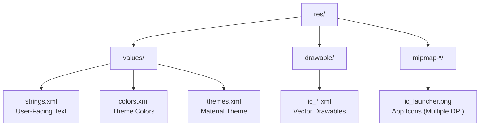

**Sources:** Standard Android project structure conventions

### String Resource Organization

The `strings.xml` file organizes user-facing strings by feature area:

| String Key Pattern | Feature Area | Example |
|-------------------|--------------|---------|
| `welcome_*` | Welcome screen | `welcome_message` |
| `exercise_*` | Exercise sessions | `exercise_session_detail` |
| `weight_*` | Weight input | `weight_entry_done` |
| `button_*` | Action buttons | `button_insert_exercise` |
| `label_*` | Form labels | `label_weight` |
| `not_enabled_*` | Error states | `not_enabled_description` |
| `permissions_*` | Permission rationale | `permissions_rationale` |

**Sources:** String organization inferred from UI screen requirements

## Manifest Configuration

The `AndroidManifest.xml` file in each module's `src/main/` directory declares the application structure and required permissions:

```mermaid
graph TB
    Manifest["AndroidManifest.xml"]
    
    Manifest --> Application["<application>"]
    Manifest --> Permissions["<uses-permission>"]
    Manifest --> Queries["<queries>"]
    
    Application --> MainActivity["MainActivity<br/>LAUNCHER Activity"]
    Application --> DeepLink["Intent Filters<br/>Permission Rationale"]
    
    Permissions --> HealthPerms["Health Connect Permissions"]
    
    HealthPerms --> ReadExercise["READ_EXERCISE"]
    HealthPerms --> WriteExercise["WRITE_EXERCISE"]
    HealthPerms --> ReadSteps["READ_STEPS"]
    HealthPerms --> WriteSteps["WRITE_STEPS"]
    HealthPerms --> ReadHR["READ_HEART_RATE"]
    HealthPerms --> WriteHR["WRITE_HEART_RATE"]
    HealthPerms --> ReadWeight["READ_WEIGHT"]
    HealthPerms --> WriteWeight["WRITE_WEIGHT"]
    HealthPerms --> ReadCalories["READ_TOTAL_CALORIES_BURNED"]
    HealthPerms --> WriteCalories["WRITE_TOTAL_CALORIES_BURNED"]
    HealthPerms --> BgRead["READ_HEALTH_DATA_IN_BACKGROUND"]
    HealthPerms --> History["READ_HEALTH_DATA_HISTORY"]
    
    Queries --> HCPackage["<package><br/>com.google.android.apps.healthdata"]
```

**Sources:** Permission requirements inferred from Diagram 4 (Permission Management System)

## Navigation and Routing

The navigation system defines string-based routes that map to screen composables:

| Route Constant | Screen Composable | Navigation Arguments |
|----------------|-------------------|---------------------|
| `Screen.WELCOME_SCREEN` | `WelcomeScreen` | None |
| `Screen.EXERCISE_SESSION_SCREEN` | `ExerciseSessionScreen` | None |
| `Screen.EXERCISE_SESSION_DETAIL_SCREEN` | `ExerciseSessionDetailScreen` | `uid: String` (session ID) |
| `Screen.INPUT_READINGS_SCREEN` | `InputReadingsScreen` | None |
| `Screen.DIFFERENTIAL_CHANGES_SCREEN` | `DifferentialChangesScreen` | None |
| `Screen.PRIVACY_POLICY` | `PrivacyPolicyScreen` | None |

The `Navigation.kt` file in `presentation/navigation/` contains the `NavHost` setup with route definitions and ViewModel factory integration.

**Sources:** Navigation structure inferred from Diagram 1 (Overall System Architecture)

## Gradle Wrapper and Build Scripts

The repository includes Gradle wrapper scripts for cross-platform builds:

| File | Purpose |
|------|---------|
| `gradlew` | Unix/Linux/macOS build script |
| `gradlew.bat` | Windows build script |
| `gradle/wrapper/gradle-wrapper.properties` | Gradle distribution configuration |
| `gradle/wrapper/gradle-wrapper.jar` | Gradle wrapper binary |

These files ensure consistent Gradle versions across development environments without requiring a system-wide Gradle installation.

**Sources:** [README.md:18]() (references "gradlew build" command)

## Relationship to Other Documentation

This page provides a structural overview. For more detailed information:

- **Module Differences**: See [Start vs Finished Modules](#3.1) for what's implemented vs stubbed
- **Dependencies**: See [Build Configuration](#3.2) for detailed dependency management
- **Automation**: See [CI/CD Pipeline](#3.3) for build workflows
- **Architecture**: See [Architecture Overview](#4) for MVVM pattern details
- **Entry Point**: See [Application Entry Point](#4.1) for MainActivity and BaseApplication
- **Navigation Details**: See [Navigation System](#4.2) for route handling and deep linking

**Sources:** Table of contents structure

---

# Page: Start vs Finished Modules

# Start vs Finished Modules

<details>
<summary>Relevant source files</summary>

The following files were used as context for generating this wiki page:

- [finished/src/main/java/com/example/healthconnect/codelab/data/HealthConnectManager.kt](finished/src/main/java/com/example/healthconnect/codelab/data/HealthConnectManager.kt)
- [finished/src/main/java/com/example/healthconnect/codelab/presentation/screen/exercisesession/ExerciseSessionViewModel.kt](finished/src/main/java/com/example/healthconnect/codelab/presentation/screen/exercisesession/ExerciseSessionViewModel.kt)
- [start/src/main/java/com/example/healthconnect/codelab/data/HealthConnectManager.kt](start/src/main/java/com/example/healthconnect/codelab/data/HealthConnectManager.kt)
- [start/src/main/java/com/example/healthconnect/codelab/presentation/screen/exercisesession/ExerciseSessionViewModel.kt](start/src/main/java/com/example/healthconnect/codelab/presentation/screen/exercisesession/ExerciseSessionViewModel.kt)

</details>


## Purpose and Scope

This document explains the pedagogical structure of the Health Connect Codelab, which provides two parallel modules: a student template (`start/`) and a reference solution (`finished/`). This dual-module approach allows learners to implement Health Connect functionality incrementally while having access to a working reference implementation. For information about the overall project organization, see [Project Structure](#3). For details on building these modules, see [Build Configuration](#3.2).

## Dual-Module Architecture

The codelab implements a template-and-solution pattern where both modules share identical UI, navigation, and ViewModels, but differ in their data layer implementations.

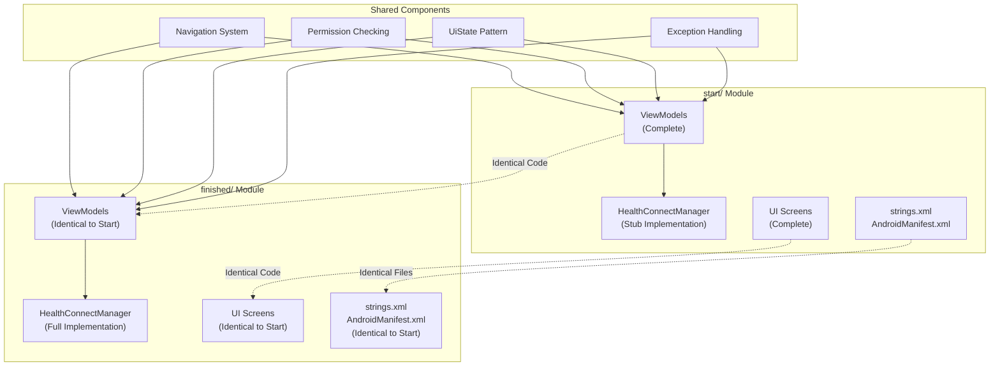

**Sources:** [start/src/main/java/com/example/healthconnect/codelab/data/HealthConnectManager.kt:1-215](), [finished/src/main/java/com/example/healthconnect/codelab/data/HealthConnectManager.kt:1-346]()

## Start Module: Student Template

The `start/` module provides a functional application skeleton where the presentation and business logic layers are complete, but data layer methods contain `TODO` markers and stub implementations.

### Complete Components in Start Module

The following components are fully implemented and identical to the finished module:

| Component | Status | Purpose |
|-----------|--------|---------|
| `ExerciseSessionViewModel` | ✓ Complete | State management and permission checks |
| `ExerciseSessionScreen` | ✓ Complete | UI rendering and user interactions |
| `InputReadingsViewModel` | ✓ Complete | Weight input state management |
| `DifferentialChangesViewModel` | ✓ Complete | Changes tracking state management |
| `tryWithPermissionsCheck()` | ✓ Complete | Permission wrapper with error handling |
| `UiState` sealed class | ✓ Complete | State transitions (Uninitialized/Done/Error) |

**Sources:** [start/src/main/java/com/example/healthconnect/codelab/presentation/screen/exercisesession/ExerciseSessionViewModel.kt:44-178]()

### Stub Implementations in Start Module

The `HealthConnectManager` class contains seven TODO methods that students must implement:

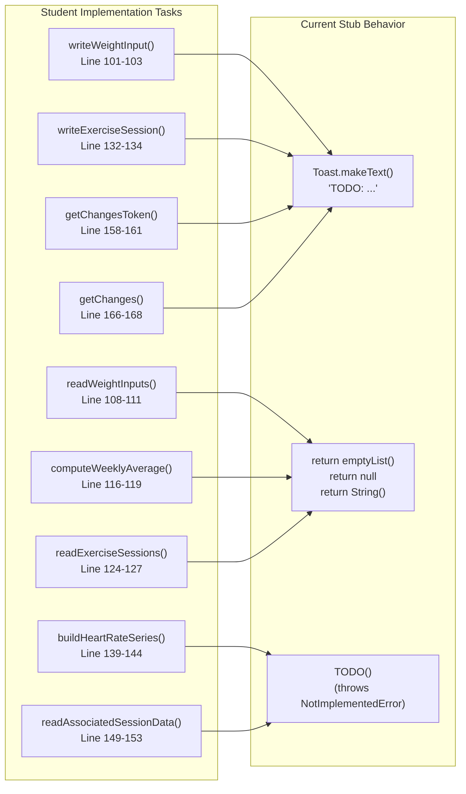

**Sources:** [start/src/main/java/com/example/healthconnect/codelab/data/HealthConnectManager.kt:99-168]()

### Stub Implementation Patterns

The start module uses three stub patterns:

1. **Toast Placeholder** - Shows "TODO" message to user:
   ```kotlin
   // Line 102
   Toast.makeText(context, "TODO: write weight input", Toast.LENGTH_SHORT).show()
   ```

2. **Empty Return** - Returns empty collections or null:
   ```kotlin
   // Lines 108-111
   suspend fun readWeightInputs(start: Instant, end: Instant): List<WeightRecord> {
     // Toast.makeText(context, "TODO: read weight inputs", Toast.LENGTH_SHORT).show()
     return emptyList()
   }
   ```

3. **TODO() Call** - Throws `NotImplementedError`:
   ```kotlin
   // Line 143
   private fun buildHeartRateSeries(...): HeartRateRecord {
     TODO()
   }
   ```

**Sources:** [start/src/main/java/com/example/healthconnect/codelab/data/HealthConnectManager.kt:101-144]()

## Finished Module: Reference Solution

The `finished/` module contains complete implementations of all Health Connect operations, serving as both a reference and a verification of correct implementation patterns.

### Implemented Data Operations

```mermaid
graph TB
    subgraph WriteOps["Write Operations"]
        WriteWeight["writeWeightInput()<br/>Lines 100-115"]
        WriteSession["writeExerciseSession()<br/>Lines 159-189"]
        BuildHR["buildHeartRateSeries()<br/>Lines 194-217"]
    end
    
    subgraph ReadOps["Read Operations"]
        ReadWeight["readWeightInputs()<br/>Lines 120-127"]
        ReadSessions["readExerciseSessions()<br/>Lines 147-154"]
        ReadDetail["readAssociatedSessionData()<br/>Lines 222-261"]
    end
    
    subgraph AggOps["Aggregation Operations"]
        AvgWeight["computeWeeklyAverage()<br/>Lines 132-139"]
    end
    
    subgraph SyncOps["Sync Operations"]
        GetToken["getChangesToken()<br/>Lines 266-278"]
        GetChanges["getChanges()<br/>Lines 283-299"]
    end
    
    subgraph HealthConnectSDK["Health Connect SDK Calls"]
        InsertRecords["healthConnectClient.insertRecords()"]
        ReadRecords["healthConnectClient.readRecords()"]
        Aggregate["healthConnectClient.aggregate()"]
        GetChangesToken["healthConnectClient.getChangesToken()"]
        GetChangesAPI["healthConnectClient.getChanges()"]
    end
    
    WriteWeight --> InsertRecords
    WriteSession --> InsertRecords
    
    ReadWeight --> ReadRecords
    ReadSessions --> ReadRecords
    ReadDetail --> ReadRecords
    ReadDetail --> Aggregate
    
    AvgWeight --> Aggregate
    
    GetToken --> GetChangesToken
    GetChanges --> GetChangesAPI
```

**Sources:** [finished/src/main/java/com/example/healthconnect/codelab/data/HealthConnectManager.kt:100-299]()

### Implementation Highlights

Key implementation patterns demonstrated in the finished module:

| Method | Key Features | Lines |
|--------|-------------|-------|
| `writeWeightInput()` | Creates `WeightRecord` with manual entry metadata, uses try-catch for error handling | 100-115 |
| `writeExerciseSession()` | Inserts multiple related records (ExerciseSessionRecord, StepsRecord, TotalCaloriesBurnedRecord, HeartRateRecord) in single transaction | 159-189 |
| `buildHeartRateSeries()` | Generates time-series samples with 30-second intervals | 194-217 |
| `readAssociatedSessionData()` | Combines aggregate metrics and raw time-series data using `dataOriginFilter` | 222-261 |
| `getChanges()` | Implements paginated change retrieval with token expiration handling | 283-299 |

**Sources:** [finished/src/main/java/com/example/healthconnect/codelab/data/HealthConnectManager.kt:100-299]()

## Key Differences Between Modules

The primary differences exist exclusively in `HealthConnectManager`. The table below maps each TODO in the start module to its complete implementation:

| Function | Start Module Behavior | Finished Module Implementation | 
|----------|----------------------|-------------------------------|
| `writeWeightInput()` | Shows TODO toast | Creates `WeightRecord`, calls `insertRecords()`, handles exceptions |
| `readWeightInputs()` | Returns `emptyList()` | Builds `ReadRecordsRequest`, returns `response.records` |
| `computeWeeklyAverage()` | Returns `null` | Builds `AggregateRequest` with `WEIGHT_AVG`, returns aggregated `Mass` |
| `readExerciseSessions()` | Returns `emptyList()` | Reads `ExerciseSessionRecord` with time range filter |
| `writeExerciseSession()` | Shows TODO toast | Inserts ExerciseSession + Steps + Calories + HeartRate in single batch |
| `buildHeartRateSeries()` | Throws `NotImplementedError` | Generates samples in 30-second intervals with random BPM |
| `readAssociatedSessionData()` | Throws `NotImplementedError` | Reads session by UID, aggregates metrics, reads raw heart rate data |
| `getChangesToken()` | Returns empty `String()` | Calls `getChangesToken()` with record type set |
| `getChanges()` | Emits nothing | Implements paginated Flow with token expiration check |

**Sources:** [start/src/main/java/com/example/healthconnect/codelab/data/HealthConnectManager.kt:99-168](), [finished/src/main/java/com/example/healthconnect/codelab/data/HealthConnectManager.kt:100-299]()

### Code Comparison: writeWeightInput()

**Start Module** [start/src/main/java/com/example/healthconnect/codelab/data/HealthConnectManager.kt:99-103]():
```kotlin
suspend fun writeWeightInput(weightInput: Double) {
  Toast.makeText(context, "TODO: write weight input", Toast.LENGTH_SHORT).show()
}
```

**Finished Module** [finished/src/main/java/com/example/healthconnect/codelab/data/HealthConnectManager.kt:100-115]():
```kotlin
suspend fun writeWeightInput(weightInput: Double) {
  val time = ZonedDateTime.now().withNano(0)
  val weightRecord = WeightRecord(
    metadata = Metadata.manualEntry(),
    weight = Mass.kilograms(weightInput),
    time = time.toInstant(),
    zoneOffset = time.offset
  )
  val records = listOf(weightRecord)
  try {
    healthConnectClient.insertRecords(records)
    Toast.makeText(context, "Successfully insert records", Toast.LENGTH_SHORT).show()
  } catch (e: Exception) {
    Toast.makeText(context, e.message.toString(), Toast.LENGTH_SHORT).show()
  }
}
```

## Shared Infrastructure

Both modules share identical implementations for infrastructure that is not part of the learning objectives:

### Permission Management
Both modules contain the same permission checking logic in ViewModels:

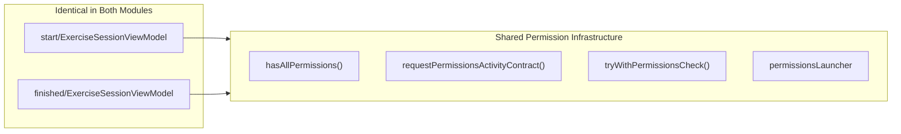

**Sources:** [start/src/main/java/com/example/healthconnect/codelab/presentation/screen/exercisesession/ExerciseSessionViewModel.kt:80-154](), [finished/src/main/java/com/example/healthconnect/codelab/presentation/screen/exercisesession/ExerciseSessionViewModel.kt:80-154]()

### Error Handling
The `tryWithPermissionsCheck()` wrapper method is identical in both modules and handles four exception types:
- `RemoteException` - Health Connect service issues
- `SecurityException` - Permission violations
- `IOException` - Network/data access errors
- `IllegalStateException` - Invalid state transitions

**Sources:** [start/src/main/java/com/example/healthconnect/codelab/presentation/screen/exercisesession/ExerciseSessionViewModel.kt:130-154](), [finished/src/main/java/com/example/healthconnect/codelab/presentation/screen/exercisesession/ExerciseSessionViewModel.kt:130-154]()

### UiState Management
Both modules use the same sealed class pattern with UUID-based error deduplication:

[start/src/main/java/com/example/healthconnect/codelab/presentation/screen/exercisesession/ExerciseSessionViewModel.kt:156-163]():
```kotlin
sealed class UiState {
  object Uninitialized : UiState()
  object Done : UiState()
  data class Error(val exception: Throwable, val uuid: UUID = UUID.randomUUID()) : UiState()
}
```

## Learning Path

The recommended approach for students working through this codelab:

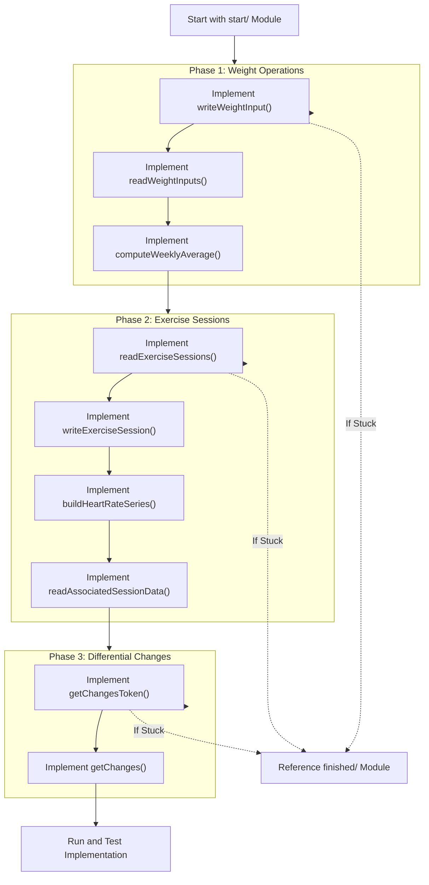

### Implementation Order Rationale

1. **Weight Operations First** - Simplest CRUD operations with single record types
2. **Exercise Sessions Second** - More complex with multiple related records and time-series data
3. **Differential Changes Last** - Most advanced with pagination and token management

**Sources:** [start/src/main/java/com/example/healthconnect/codelab/data/HealthConnectManager.kt:99-168]()

## Helper Functions

Both modules contain identical helper functions that students can use:

| Function | Purpose | Availability |
|----------|---------|--------------|
| `readData<T>()` | Reusable generic function for reading any record type with time/origin filters | Lines 183-193 (start), 314-324 (finished) |
| `checkAvailability()` | Determines Health Connect installation status | Lines 70-76 (both) |
| `isFeatureAvailable()` | Checks if specific Health Connect features are available | Lines 78-82 (both) |
| `hasAllPermissions()` | Validates permission grants | Lines 90-92 (both) |
| `enqueueReadStepWorker()` | Queues background work | Lines 173-178 (start), 304-309 (finished) |

**Sources:** [start/src/main/java/com/example/healthconnect/codelab/data/HealthConnectManager.kt:183-193](), [finished/src/main/java/com/example/healthconnect/codelab/data/HealthConnectManager.kt:314-324]()

## Build and CI/CD Independence

Both modules are built independently with separate CI/CD workflows, ensuring that changes to one module don't break the other. Each module has its own `build.gradle` with identical dependency configurations. For details on the build system, see [Build Configuration](#3.2) and [CI/CD Pipeline](#3.3).

**Sources:** High-level architecture diagrams

---

# Page: Build Configuration

# Build Configuration

<details>
<summary>Relevant source files</summary>

The following files were used as context for generating this wiki page:

- [finished/build.gradle](finished/build.gradle)
- [start/build.gradle](start/build.gradle)

</details>


## Purpose and Scope

This document details the Gradle build configuration for the Health Connect Codelab project. It covers the Android SDK settings, Gradle plugins, Kotlin compiler options, Jetpack Compose configuration, and all dependency declarations used in both the `start` and `finished` modules. 

For information about the CI/CD workflows that build these modules, see [CI/CD Pipeline](#3.3). For details on the module structure and pedagogical differences between start and finished, see [Start vs Finished Modules](#3.1).

---

## Configuration Identity

Both `start/build.gradle` and `finished/build.gradle` are **byte-for-byte identical**. This ensures that students working in the `start` module have the exact same dependencies and build environment as the reference `finished` module, eliminating configuration-related issues during the codelab.

**Sources:** [finished/build.gradle:1-96](), [start/build.gradle:1-96]()

---

## Build Configuration Architecture

```mermaid
graph TB
    subgraph "Root Project"
        SettingsGradle["settings.gradle<br/>Module Registration"]
    end
    
    subgraph "start/ Module"
        StartBuildGradle["start/build.gradle"]
        StartSrcMain["start/src/main/"]
        StartManifest["start/AndroidManifest.xml"]
    end
    
    subgraph "finished/ Module"
        FinBuildGradle["finished/build.gradle"]
        FinSrcMain["finished/src/main/"]
        FinManifest["finished/AndroidManifest.xml"]
    end
    
    subgraph "Build System"
        GradleWrapper["gradlew / gradle-wrapper"]
        AGP["Android Gradle Plugin 8.x"]
        KotlinPlugin["Kotlin Android Plugin"]
    end
    
    subgraph "External Dependencies"
        MavenCentral["Maven Central"]
        GoogleMaven["Google Maven"]
        HealthConnectSDK["androidx.health.connect:connect-client"]
        ComposeBOM["androidx.compose:compose-bom"]
        WorkManager["androidx.work:work-runtime-ktx"]
    end
    
    SettingsGradle --> StartBuildGradle
    SettingsGradle --> FinBuildGradle
    
    StartBuildGradle --> AGP
    StartBuildGradle --> KotlinPlugin
    FinBuildGradle --> AGP
    FinBuildGradle --> KotlinPlugin
    
    StartBuildGradle --> StartSrcMain
    StartBuildGradle --> StartManifest
    FinBuildGradle --> FinSrcMain
    FinBuildGradle --> FinManifest
    
    StartBuildGradle --> MavenCentral
    StartBuildGradle --> GoogleMaven
    FinBuildGradle --> MavenCentral
    FinBuildGradle --> GoogleMaven
    
    MavenCentral --> HealthConnectSDK
    GoogleMaven --> ComposeBOM
    MavenCentral --> WorkManager
    
    StartBuildGradle --> HealthConnectSDK
    StartBuildGradle --> ComposeBOM
    StartBuildGradle --> WorkManager
    FinBuildGradle --> HealthConnectSDK
    FinBuildGradle --> ComposeBOM
    FinBuildGradle --> WorkManager
```

**Sources:** [finished/build.gradle:1-96](), [start/build.gradle:1-96]()

---

## Gradle Plugins

The build configuration applies two Gradle plugins:

| Plugin ID | Purpose |
|-----------|---------|
| `com.android.application` | Configures the module as an Android application (produces APK/AAB) |
| `kotlin-android` | Enables Kotlin compilation for Android |

These plugins are declared in [finished/build.gradle:17-20]() and [start/build.gradle:17-20]().

**Sources:** [finished/build.gradle:17-20](), [start/build.gradle:17-20]()

---

## Android SDK Configuration

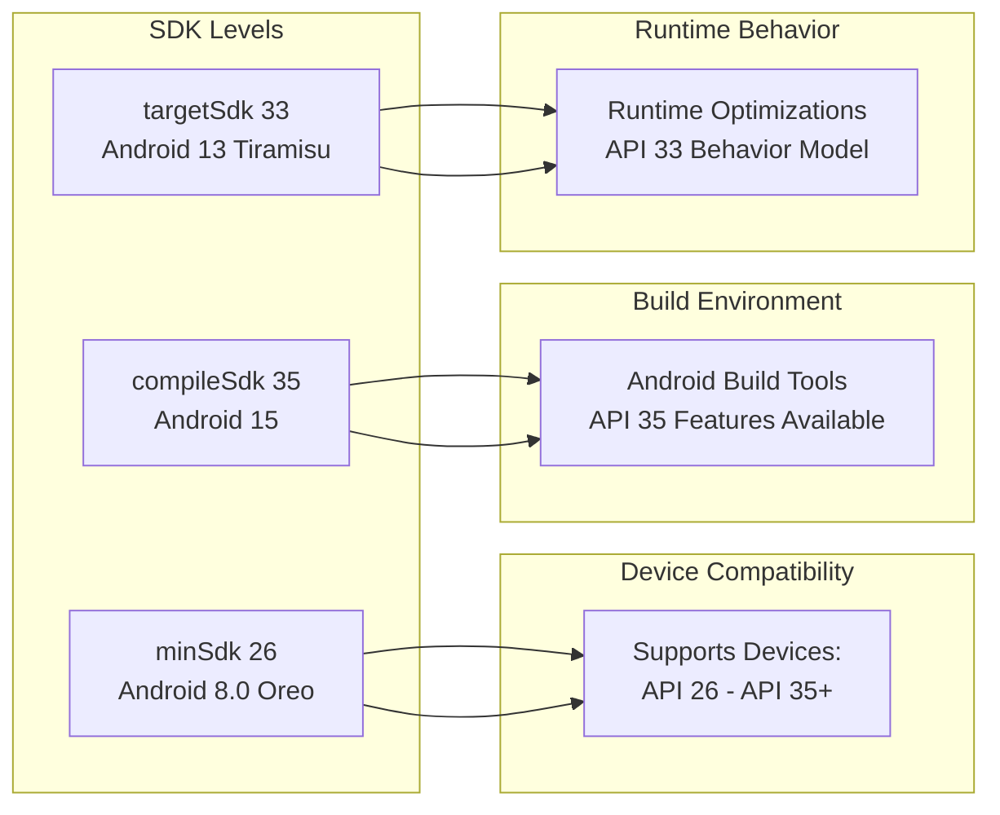

### SDK Version Details

| Configuration | Value | Rationale |
|---------------|-------|-----------|
| `compileSdk` | `35` | Latest Android 15 SDK for build-time compilation. Provides access to newest APIs and tools. |
| `minSdk` | `26` | Android 8.0 (Oreo). Health Connect requires API 26+ for core functionality. |
| `targetSdk` | `33` | Android 13 (Tiramisu). Ensures compatibility with Health Connect's permission model introduced in Android 13. |

The `minSdk 26` requirement aligns with Health Connect's minimum API level, which relies on features introduced in Android 8.0. The `targetSdk 33` is set to Android 13 because Health Connect's permission system and intent filters differ between API 33 and API 34+, as documented in the manifest configuration.

**Sources:** [finished/build.gradle:23-28](), [start/build.gradle:23-28]()

---

## Application Configuration

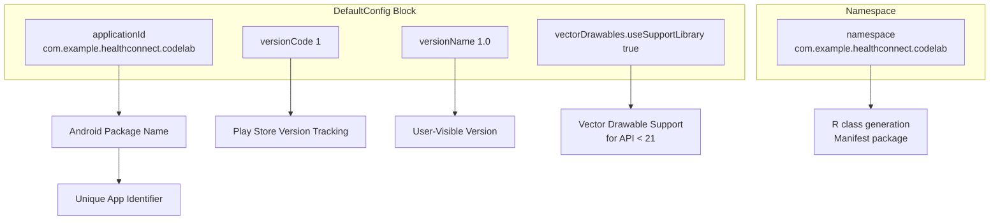

| Property | Value | Location |
|----------|-------|----------|
| `applicationId` | `com.example.healthconnect.codelab` | [finished/build.gradle:26]() |
| `versionCode` | `1` | [finished/build.gradle:29]() |
| `versionName` | `"1.0"` | [finished/build.gradle:30]() |
| `namespace` | `com.example.healthconnect.codelab` | [finished/build.gradle:63]() |
| `vectorDrawables.useSupportLibrary` | `true` | [finished/build.gradle:32-34]() |

The `namespace` property defines the package name for generated resources (R class) and must match the package structure in `AndroidManifest.xml`.

**Sources:** [finished/build.gradle:25-34, 63](), [start/build.gradle:25-34, 63]()

---

## Build Types

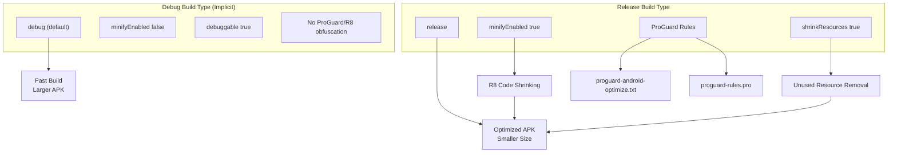

### Release Build Type Configuration

The release build type is explicitly configured with optimization flags:

| Property | Value | Purpose |
|----------|-------|---------|
| `minifyEnabled` | `true` | Enables R8 code shrinking, obfuscation, and optimization |
| `shrinkResources` | `true` | Removes unused resources from the APK |
| `proguardFiles` | `proguard-android-optimize.txt`, `proguard-rules.pro` | ProGuard/R8 rule sets for optimization |

The debug build type uses default settings (no minification, debuggable enabled).

**Sources:** [finished/build.gradle:37-42](), [start/build.gradle:37-42]()

---

## Kotlin and Java Compilation Settings

```mermaid
graph LR
    subgraph "Java Configuration"
        JavaSource["sourceCompatibility<br/>VERSION_1_8"]
        JavaTarget["targetCompatibility<br/>VERSION_1_8"]
    end
    
    subgraph "Kotlin Configuration"
        KotlinJVM["jvmTarget '1.8'"]
        KotlinFreeArgs["freeCompilerArgs<br/>-Xjvm-default=all-compatibility"]
    end
    
    subgraph "Bytecode Output"
        JavaSource --> Java8Bytecode["Java 8 Bytecode"]
        JavaTarget --> Java8Bytecode
        KotlinJVM --> Java8Bytecode
    end
    
    subgraph "Kotlin Features"
        KotlinFreeArgs --> DefaultMethods["JVM Default Methods<br/>Interface Compatibility"]
    end
    
    Java8Bytecode --> MinSDK26Compat["Compatible with minSdk 26"]
```

### Compile Options

**Java Compatibility** ([finished/build.gradle:44-47]()):
- `sourceCompatibility JavaVersion.VERSION_1_8`
- `targetCompatibility JavaVersion.VERSION_1_8`

**Kotlin Options** ([finished/build.gradle:48-51]()):
- `jvmTarget = '1.8'`: Generates Java 8 bytecode
- `freeCompilerArgs = ['-Xjvm-default=all-compatibility']`: Enables JVM default method compatibility for interfaces

The `-Xjvm-default=all-compatibility` flag allows Kotlin interfaces to compile with JVM default methods while maintaining compatibility with older code that doesn't expect them. This is important for interoperability with Java code and Android framework APIs.

**Sources:** [finished/build.gradle:44-51](), [start/build.gradle:44-51]()

---

## Jetpack Compose Configuration

```mermaid
graph TB
    subgraph "Compose Build Features"
        EnableCompose["buildFeatures.compose true"]
    end
    
    subgraph "Compose Compiler"
        CompilerExt["kotlinCompilerExtensionVersion<br/>1.4.0"]
    end
    
    subgraph "Compose Dependencies"
        ComposeBOM["compose-bom:2022.10.00"]
        ComposeUI["androidx.compose.ui:ui"]
        ComposeMaterial["androidx.compose.material:material"]
        ComposePreview["androidx.compose.ui:ui-tooling-preview"]
        ComposeTooling["androidx.compose.ui:ui-tooling (debug)"]
        ComposeIcons["material-icons-extended"]
    end
    
    subgraph "Generated Code"
        ComposeCompiler["Compose Compiler"]
        ComposeRuntime["Compose Runtime"]
    end
    
    EnableCompose --> ComposeCompiler
    CompilerExt --> ComposeCompiler
    ComposeBOM --> ComposeUI
    ComposeBOM --> ComposeMaterial
    ComposeBOM --> ComposePreview
    ComposeCompiler --> ComposeRuntime
    ComposeRuntime --> UIRendering["UI Rendering Engine"]
```

### Compose Build Features

**Enabled Features** ([finished/build.gradle:52-54]()):
- `compose = true`: Enables Jetpack Compose build support

**Compose Options** ([finished/build.gradle:55-57]()):
- `kotlinCompilerExtensionVersion = "1.4.0"`: Specifies the Compose compiler plugin version

### Compose Compiler Version Compatibility

The `kotlinCompilerExtensionVersion "1.4.0"` must be compatible with the Kotlin version used by the `kotlin-android` plugin. Version 1.4.0 of the Compose compiler is compatible with Kotlin 1.8.x.

**Sources:** [finished/build.gradle:52-57](), [start/build.gradle:52-57]()

---

## Packaging Options

```mermaid
graph TB
    subgraph "Packaging Exclusions"
        PackagingOptions["packagingOptions.resources"]
        ExcludeAL["Exclude /META-INF/AL2.0"]
        ExcludeLGPL["Exclude /META-INF/LGPL2.1"]
    end
    
    subgraph "License Files"
        AL2["Apache License 2.0<br/>Duplicate in Dependencies"]
        LGPL["LGPL 2.1<br/>Duplicate in Dependencies"]
    end
    
    PackagingOptions --> ExcludeAL
    PackagingOptions --> ExcludeLGPL
    ExcludeAL --> AL2
    ExcludeLGPL --> LGPL
    
    AL2 --> NoDuplicates["Prevents APK Build Failures<br/>from Duplicate Files"]
    LGPL --> NoDuplicates
```

The packaging options exclude duplicate license files that appear in multiple dependencies:

```
excludes += '/META-INF/{AL2.0,LGPL2.1}'
```

This prevents build failures caused by duplicate META-INF files from transitive dependencies.

**Sources:** [finished/build.gradle:58-62](), [start/build.gradle:58-62]()

---

## Dependency Architecture

```mermaid
graph TB
    subgraph "Dependency Categories"
        HealthConnect["Health Connect SDK"]
        ComposeStack["Jetpack Compose Stack"]
        AndroidX["AndroidX Libraries"]
        BackgroundWork["Background Processing"]
        Utilities["Utility Libraries"]
    end
    
    subgraph "Health Connect"
        HCSDK["androidx.health.connect:connect-client:1.1.0-alpha12"]
    end
    
    subgraph "Compose BOM"
        BOM["androidx.compose:compose-bom:2022.10.00"]
        BOM --> ComposeUI["compose.ui:ui"]
        BOM --> ComposeMaterial["compose.material:material"]
        BOM --> ComposePreview["compose.ui:ui-tooling-preview"]
        BOM --> ComposeIcons["compose.material:material-icons-extended"]
    end
    
    subgraph "Lifecycle & ViewModel"
        ViewModelCompose["lifecycle-viewmodel-compose"]
        LifecycleRuntime["lifecycle-runtime-ktx"]
    end
    
    subgraph "Navigation"
        NavCompose["navigation-compose"]
    end
    
    subgraph "Background Work"
        WorkManagerKTX["work-runtime-ktx:2.9.1"]
    end
    
    subgraph "Concurrency"
        ConcurrentFutures["concurrent-futures-ktx"]
    end
    
    subgraph "Activity"
        ActivityCompose["activity-compose"]
    end
    
    subgraph "Desugaring"
        Desugaring["desugar_jdk_libs:1.2.2"]
    end
    
    HealthConnect --> HCSDK
    ComposeStack --> BOM
    AndroidX --> ViewModelCompose
    AndroidX --> LifecycleRuntime
    AndroidX --> NavCompose
    AndroidX --> ActivityCompose
    BackgroundWork --> WorkManagerKTX
    Utilities --> ConcurrentFutures
    Utilities --> Desugaring
```

**Sources:** [finished/build.gradle:66-96](), [start/build.gradle:66-96]()

---

## Dependency Breakdown

### Health Connect SDK

| Dependency | Version | Configuration | Purpose |
|------------|---------|---------------|---------|
| `androidx.health.connect:connect-client` | `1.1.0-alpha12` | `implementation` | Core Health Connect client library for reading/writing health data |

**Location:** [finished/build.gradle:73]()

This is the primary dependency for the codelab, providing the `HealthConnectClient` class and all health record types (ExerciseSessionRecord, WeightRecord, etc.).

---

### Jetpack Compose Dependencies

The Compose Bill of Materials (BOM) is used to manage version alignment across Compose libraries:

```gradle
def composeBom = platform('androidx.compose:compose-bom:2022.10.00')
implementation(composeBom)
```

**Location:** [finished/build.gradle:69-70]()

**Compose Libraries:**

| Library | Purpose |
|---------|---------|
| `androidx.compose.ui:ui` | Core UI primitives and composables |
| `androidx.compose.material:material` | Material Design components |
| `androidx.compose.ui:ui-tooling-preview` | Preview annotations for Android Studio |
| `androidx.compose.material:material-icons-extended` | Extended Material icon set |
| `androidx.compose.ui:ui-tooling` (debug only) | Tooling support for Compose preview and inspection |

**Locations:** [finished/build.gradle:85-93]()

The BOM ensures all Compose libraries use compatible versions without explicit version declarations.

---

### Lifecycle and ViewModel

```mermaid
graph LR
    subgraph "Lifecycle Components"
        ViewModelLib["lifecycle-viewmodel-compose"]
        RuntimeLib["lifecycle-runtime-ktx"]
    end
    
    ViewModelLib --> ViewModelIntegration["ViewModel + Compose Integration"]
    RuntimeLib --> LifecycleObservation["Lifecycle-Aware Components"]
    
    ViewModelIntegration --> Screens["Screen Composables"]
    LifecycleObservation --> MainActivity["MainActivity"]
```

| Dependency | Version Variable | Purpose |
|------------|------------------|---------|
| `androidx.lifecycle:lifecycle-viewmodel-compose` | `$lifecycle_version` | Integration between ViewModel and Compose, provides `viewModel()` function |
| `androidx.lifecycle:lifecycle-runtime-ktx` | `$lifecycle_version` | Kotlin extensions for lifecycle-aware components |

**Locations:** [finished/build.gradle:76, 90]()

The `lifecycle-viewmodel-compose` dependency is critical for the codelab's architecture, as it provides the `viewModel()` composable function used in screens like `ExerciseSessionScreen` and `InputReadingsScreen`.

---

### Navigation

| Dependency | Version Variable | Purpose |
|------------|------------------|---------|
| `androidx.navigation:navigation-compose` | `$navigation_compose_version` | Jetpack Navigation integration with Compose |

**Location:** [finished/build.gradle:79]()

This library provides the `NavHost`, `NavController`, and composable navigation functions used in `MainActivity` to implement the app's navigation system. See [Navigation System](#4.2) for implementation details.

---

### Background Work

| Dependency | Version | Purpose |
|------------|---------|---------|
| `androidx.work:work-runtime-ktx` | `2.9.1` | WorkManager for background task scheduling |

**Location:** [finished/build.gradle:68]()

Used by `HealthConnectManager.enqueueReadStepWorker()` to schedule background reading of step data. See [Background Work with WorkManager](#5.8) for implementation details.

---

### Activity Compose

| Dependency | Version Variable | Purpose |
|------------|------------------|---------|
| `androidx.activity:activity-compose` | `$activity_compose_version` | Bridge between ComponentActivity and Compose |

**Location:** [finished/build.gradle:91]()

Provides `setContent` extension function used in `MainActivity` to set the Compose UI tree as the activity's content.

---

### Concurrency Utilities

| Dependency | Version Variable | Purpose |
|------------|------------------|---------|
| `androidx.concurrent:concurrent-futures-ktx` | `$concurrent_futures_version` | Kotlin coroutines bridge for ListenableFuture |

**Location:** [finished/build.gradle:82]()

Allows converting between `ListenableFuture` (used by some Health Connect APIs) and Kotlin suspend functions via `await()` extension.

---

### Core Library Desugaring

```mermaid
graph TB
    subgraph "Java 8+ APIs"
        StreamAPI["Stream API"]
        TimeAPI["java.time (JSR-310)"]
        OptionalAPI["Optional"]
        FunctionAPI["Function/Predicate"]
    end
    
    subgraph "Desugaring Process"
        DesugarLib["desugar_jdk_libs:1.2.2"]
    end
    
    subgraph "Target Devices"
        API26["API 26+ Devices"]
        LegacyAPI["API < 26 Devices"]
    end
    
    StreamAPI --> DesugarLib
    TimeAPI --> DesugarLib
    OptionalAPI --> DesugarLib
    FunctionAPI --> DesugarLib
    
    DesugarLib --> API26
    DesugarLib --> LegacyAPI
    
    API26 --> BackportedAPIs["Backported Java 8+ APIs"]
    LegacyAPI --> BackportedAPIs
```

| Dependency | Version | Configuration | Purpose |
|------------|---------|---------------|---------|
| `com.android.tools:desugar_jdk_libs` | `1.2.2` | `coreLibraryDesugaring` | Backports Java 8+ APIs to older Android versions |

**Location:** [finished/build.gradle:95]()

Enables use of `java.time` APIs (Instant, LocalDate, etc.) on API levels below 26, even though the app's minSdk is already 26. This provides compatibility for devices that don't have complete Java 8 library support and enables certain Java 8+ language features.

**Sources:** [finished/build.gradle:95](), [start/build.gradle:95]()

---

## Version Variables

The build files reference version variables for several dependencies:

| Variable Name | Referenced Dependencies |
|---------------|------------------------|
| `$lifecycle_version` | `lifecycle-viewmodel-compose`, `lifecycle-runtime-ktx` |
| `$navigation_compose_version` | `navigation-compose` |
| `$activity_compose_version` | `activity-compose` |
| `$concurrent_futures_version` | `concurrent-futures-ktx` |

These variables are defined in the root project's `gradle.properties` file or in a parent `build.gradle` file, allowing centralized version management across modules.

**Sources:** [finished/build.gradle:76-91](), [start/build.gradle:76-91]()

---

## Build Configuration Summary

| Aspect | Configuration |
|--------|---------------|
| **Module Type** | Android Application (APK-producing) |
| **Language** | Kotlin with Java 8 bytecode target |
| **UI Framework** | Jetpack Compose 1.4.0 |
| **Minimum Android** | API 26 (Android 8.0) |
| **Target Android** | API 33 (Android 13) |
| **Compile SDK** | API 35 (Android 15) |
| **Primary Dependency** | Health Connect SDK 1.1.0-alpha12 |
| **Background Work** | WorkManager 2.9.1 |
| **Release Optimization** | R8 minification + resource shrinking enabled |

Both `start` and `finished` modules share this identical configuration, ensuring a consistent development experience for codelab participants regardless of which module they're working in.

**Sources:** [finished/build.gradle:1-96](), [start/build.gradle:1-96]()

---

# Page: CI/CD Pipeline

# CI/CD Pipeline

<details>
<summary>Relevant source files</summary>

The following files were used as context for generating this wiki page:

- [.github/workflows/build-finished-app.yml](.github/workflows/build-finished-app.yml)
- [.github/workflows/build-start-app.yml](.github/workflows/build-start-app.yml)

</details>


## Purpose and Scope

This document describes the CI/CD automation system that builds and validates both the `start` and `finished` modules of the Health Connect Codelab. The pipeline uses GitHub Actions to ensure that both the student template and reference solution remain buildable and functional throughout development.

For information about the structure of the start and finished modules themselves, see [Start vs Finished Modules](#3.1). For details on the Gradle configuration used by these builds, see [Build Configuration](#3.2).

## Workflow Architecture

The CI/CD system consists of two parallel GitHub Actions workflows, each responsible for building one module independently. This separation ensures that changes to either module are validated without interference.

### Dual Workflow Structure

```mermaid
graph TB
    subgraph "GitHub Repository"
        MainBranch["main branch"]
        PRBranch["Pull Request"]
        ManualTrigger["workflow_dispatch"]
    end
    
    subgraph "Workflow Files"
        StartWorkflow[".github/workflows/<br/>build-start-app.yml"]
        FinishedWorkflow[".github/workflows/<br/>build-finished-app.yml"]
    end
    
    subgraph "Build Jobs"
        StartJob["Job: build<br/>runs-on: ubuntu-latest"]
        FinishedJob["Job: build<br/>runs-on: ubuntu-latest"]
    end
    
    subgraph "Build Targets"
        StartModule["Module: start<br/>:start:assembleDebug"]
        FinishedModule["Module: finished<br/>:finished:assembleDebug"]
    end
    
    subgraph "Build Artifacts"
        StartAPK["start-debug.apk"]
        FinishedAPK["finished-debug.apk"]
    end
    
    MainBranch --> StartWorkflow
    MainBranch --> FinishedWorkflow
    PRBranch --> StartWorkflow
    PRBranch --> FinishedWorkflow
    ManualTrigger --> StartWorkflow
    ManualTrigger --> FinishedWorkflow
    
    StartWorkflow --> StartJob
    FinishedWorkflow --> FinishedJob
    
    StartJob --> StartModule
    FinishedJob --> FinishedModule
    
    StartModule --> StartAPK
    FinishedModule --> FinishedAPK
```

**Sources:** [.github/workflows/build-start-app.yml:1-32](), [.github/workflows/build-finished-app.yml:1-32]()

The two workflows are structurally identical except for their names and the specific module they build:
- `build-start-app.yml` builds the `start` module
- `build-finished-app.yml` builds the `finished` module

## Trigger Configuration

Both workflows use identical trigger configurations, ensuring parallel validation of code changes.

| Trigger Type | Configuration | Purpose |
|-------------|---------------|---------|
| `push` | Branches: `main` | Validates commits to the main branch |
| `pull_request` | Branches: `main` | Validates PR changes before merge |
| `workflow_dispatch` | Manual | Allows on-demand builds |

The trigger section appears at [.github/workflows/build-start-app.yml:4-9]() and [.github/workflows/build-finished-app.yml:4-9]():

```yaml
on:
  workflow_dispatch:
  push:
    branches: [ main ]
  pull_request:
    branches: [ main ]
```

**Sources:** [.github/workflows/build-start-app.yml:4-9](), [.github/workflows/build-finished-app.yml:4-9]()

## Build Job Configuration

### Execution Environment

Both workflows execute on `ubuntu-latest` runners, as specified at [.github/workflows/build-start-app.yml:13]() and [.github/workflows/build-finished-app.yml:13](). This provides a consistent Linux environment for builds.

```mermaid
graph LR
    subgraph "Build Job Configuration"
        JobDef["jobs.build"]
        Runner["runs-on: ubuntu-latest"]
        Steps["steps[]"]
    end
    
    JobDef --> Runner
    JobDef --> Steps
    
    subgraph "Build Steps Sequence"
        Step1["actions/checkout@v3"]
        Step2["actions/setup-java@v3"]
        Step3["gradle/actions/setup-gradle@v4"]
        Step4["chmod +x gradlew"]
        Step5["./gradlew :module:assembleDebug"]
    end
    
    Steps --> Step1
    Step1 --> Step2
    Step2 --> Step3
    Step3 --> Step4
    Step4 --> Step5
```

**Sources:** [.github/workflows/build-start-app.yml:11-31](), [.github/workflows/build-finished-app.yml:11-31]()

## Build Steps

### Step 1: Code Checkout

```yaml
- uses: actions/checkout@v3
```

Uses the GitHub Actions checkout action to clone the repository at [.github/workflows/build-start-app.yml:15]() and [.github/workflows/build-finished-app.yml:15]().

### Step 2: JDK Configuration

```yaml
- name: Set Up JDK
  uses: actions/setup-java@v3
  with:
    distribution: 'zulu'
    java-version: '17'
    cache: 'gradle'
```

Configures the Java Development Kit at [.github/workflows/build-start-app.yml:17-22]() and [.github/workflows/build-finished-app.yml:17-22]():

| Configuration | Value | Purpose |
|--------------|-------|---------|
| `distribution` | `zulu` | Uses Azul Zulu OpenJDK distribution |
| `java-version` | `17` | Installs Java 17, matching project requirements |
| `cache` | `gradle` | Enables Gradle dependency caching |

### Step 3: Gradle Setup

```yaml
- name: Setup Gradle
  uses: gradle/actions/setup-gradle@v4
```

Uses the official Gradle action at [.github/workflows/build-start-app.yml:24-25]() and [.github/workflows/build-finished-app.yml:24-25]() to configure Gradle with built-in caching for build artifacts and wrapper distributions.

### Step 4: Gradlew Permissions

```yaml
- name: Make gradlew executable
  run: chmod +x ./gradlew
```

Ensures the Gradle wrapper script has execute permissions at [.github/workflows/build-start-app.yml:27-28]() and [.github/workflows/build-finished-app.yml:27-28](). This is necessary on Linux systems where file permissions are not preserved in Git.

### Step 5: Module Assembly

The final step differs between workflows to target the appropriate module:

**Start Module Build:**
```yaml
- name: Build start app
  run: ./gradlew :start:assembleDebug
```
Located at [.github/workflows/build-start-app.yml:30-31]()

**Finished Module Build:**
```yaml
- name: Build finished app
  run: ./gradlew :finished:assembleDebug
```
Located at [.github/workflows/build-finished-app.yml:30-31]()

The `:module:assembleDebug` task compiles the specified module and produces a debug APK.

**Sources:** [.github/workflows/build-start-app.yml:15-31](), [.github/workflows/build-finished-app.yml:15-31]()

## Build Step Execution Flow

```mermaid
sequenceDiagram
    participant GH as "GitHub Actions Runner"
    participant Repo as "Repository"
    participant JDK as "JDK 17 Setup"
    participant Cache as "Gradle Cache"
    participant Gradle as "Gradle Wrapper"
    participant Module as "Target Module"
    
    GH->>Repo: actions/checkout@v3
    Repo-->>GH: Source code cloned
    
    GH->>JDK: actions/setup-java@v3
    Note over JDK: distribution: zulu<br/>version: 17
    JDK-->>GH: Java 17 installed
    
    GH->>Cache: Check Gradle cache
    Cache-->>GH: Cache restored (if exists)
    
    GH->>Gradle: gradle/actions/setup-gradle@v4
    Gradle-->>GH: Gradle configured
    
    GH->>Gradle: chmod +x ./gradlew
    GH->>Gradle: ./gradlew :module:assembleDebug
    
    Gradle->>Module: Compile sources
    Gradle->>Module: Process resources
    Gradle->>Module: Package APK
    Module-->>Gradle: Build successful
    
    Gradle->>Cache: Update cache
    Gradle-->>GH: APK produced
```

**Sources:** [.github/workflows/build-start-app.yml:14-31](), [.github/workflows/build-finished-app.yml:14-31]()

## Caching Strategy

The CI/CD pipeline implements two levels of caching to optimize build performance:

### Java Distribution Cache

The `setup-java` action enables caching of Gradle dependencies through the `cache: 'gradle'` parameter at [.github/workflows/build-start-app.yml:22]() and [.github/workflows/build-finished-app.yml:22](). This caches:
- Gradle dependency downloads (jars, aars)
- Maven repository metadata
- Gradle wrapper distributions

### Gradle Build Cache

The `setup-gradle` action at [.github/workflows/build-start-app.yml:24-25]() and [.github/workflows/build-finished-app.yml:24-25]() provides additional caching for:
- Gradle build artifacts
- Task outputs
- Incremental compilation results

```mermaid
graph TB
    subgraph "Cache Layers"
        JavaCache["Java Action Cache<br/>cache: gradle"]
        GradleCache["Gradle Action Cache<br/>setup-gradle@v4"]
    end
    
    subgraph "Cached Artifacts"
        Dependencies["Dependencies<br/>.gradle/caches"]
        Wrapper["Gradle Wrapper<br/>.gradle/wrapper"]
        BuildCache["Build Outputs<br/>build/"]
        TaskOutputs["Task Outputs<br/>.gradle/task-cache"]
    end
    
    JavaCache --> Dependencies
    JavaCache --> Wrapper
    GradleCache --> BuildCache
    GradleCache --> TaskOutputs
    
    subgraph "Cache Benefits"
        Faster["Faster builds<br/>Skip downloads"]
        Efficient["Efficient CI<br/>Lower network usage"]
    end
    
    Dependencies --> Faster
    BuildCache --> Faster
    Faster --> Efficient
```

**Sources:** [.github/workflows/build-start-app.yml:17-25](), [.github/workflows/build-finished-app.yml:17-25]()

Cache keys are automatically managed by the actions based on:
- `build.gradle` files
- `gradle.properties`
- `gradle-wrapper.properties`

## Module-Specific Build Commands

The workflows execute module-specific Gradle tasks to isolate builds:

| Module | Gradle Task | Workflow File | Line Reference |
|--------|------------|---------------|----------------|
| `start` | `:start:assembleDebug` | `build-start-app.yml` | [31]() |
| `finished` | `:finished:assembleDebug` | `build-finished-app.yml` | [31]() |

The `:module:` prefix ensures Gradle builds only the specified module and its dependencies, not the entire multi-module project. The `assembleDebug` task produces a debug-signed APK without running tests or lint checks.

**Sources:** [.github/workflows/build-start-app.yml:30-31](), [.github/workflows/build-finished-app.yml:30-31]()

## Continuous Validation Benefits

The parallel workflow architecture provides several quality assurance benefits:

```mermaid
graph TB
    subgraph "Code Changes"
        Commit["git commit"]
        Push["git push to main"]
        PR["Pull Request"]
    end
    
    subgraph "Validation Layer"
        StartValidation["Start Module Build"]
        FinishValidation["Finished Module Build"]
    end
    
    subgraph "Quality Gates"
        StartPass{{"Start Builds?"}}
        FinishPass{{"Finished Builds?"}}
    end
    
    subgraph "Outcomes"
        BothPass["Both Pass: Merge Safe"]
        OneFail["One Fails: Investigation Required"]
        BothFail["Both Fail: Systemic Issue"]
    end
    
    Commit --> Push
    Commit --> PR
    Push --> StartValidation
    Push --> FinishValidation
    PR --> StartValidation
    PR --> FinishValidation
    
    StartValidation --> StartPass
    FinishValidation --> FinishPass
    
    StartPass -->|Yes| FinishPass
    StartPass -->|No| OneFail
    FinishPass -->|Yes| BothPass
    FinishPass -->|No| OneFail
    StartPass -->|No| BothFail
    FinishPass -->|No| BothFail
```

**Sources:** [.github/workflows/build-start-app.yml:1-32](), [.github/workflows/build-finished-app.yml:1-32]()

### Validation Scenarios

1. **Start Module Fails, Finished Passes:** Indicates incomplete or incorrect student template code that needs fixing
2. **Finished Module Fails, Start Passes:** Suggests issues in the reference solution implementation
3. **Both Modules Fail:** Points to systemic problems (dependency updates, SDK changes, shared configuration issues)
4. **Both Modules Pass:** Confirms both learning template and reference solution remain functional

This dual validation is essential for a codelab repository where both versions must remain in working order—the `start` module as a functional skeleton for students, and the `finished` module as a verified reference implementation.

## Workflow Execution Matrix

| Aspect | Start Workflow | Finished Workflow | Shared |
|--------|----------------|-------------------|--------|
| Workflow Name | "Build Health Connect Codelab - Start App" | "Build Health Connect Codelab - Finished App" | - |
| File Path | `.github/workflows/build-start-app.yml` | `.github/workflows/build-finished-app.yml` | - |
| Runner OS | `ubuntu-latest` | `ubuntu-latest` | ✓ |
| Java Version | 17 | 17 | ✓ |
| Java Distribution | Zulu | Zulu | ✓ |
| Gradle Action | `setup-gradle@v4` | `setup-gradle@v4` | ✓ |
| Build Task | `:start:assembleDebug` | `:finished:assembleDebug` | - |
| Output APK | `start/build/outputs/apk/debug/` | `finished/build/outputs/apk/debug/` | - |
| Triggers | `push`, `pull_request`, `workflow_dispatch` | `push`, `pull_request`, `workflow_dispatch` | ✓ |

**Sources:** [.github/workflows/build-start-app.yml:1-32](), [.github/workflows/build-finished-app.yml:1-32]()

## Workflow Status and Monitoring

Both workflows appear as separate status checks in GitHub:
- "Build Health Connect Codelab - Start App" check
- "Build Health Connect Codelab - Finished App" check

Pull requests must pass both checks before merge, ensuring neither module breaks due to changes. The `workflow_dispatch` trigger allows manual execution for testing or demonstration purposes without requiring a code push.

**Sources:** [.github/workflows/build-start-app.yml:1-10](), [.github/workflows/build-finished-app.yml:1-10]()

---

# Page: Architecture Overview

# Architecture Overview

<details>
<summary>Relevant source files</summary>

The following files were used as context for generating this wiki page:

- [finished/src/main/java/com/example/healthconnect/codelab/data/HealthConnectManager.kt](finished/src/main/java/com/example/healthconnect/codelab/data/HealthConnectManager.kt)
- [finished/src/main/java/com/example/healthconnect/codelab/presentation/MainActivity.kt](finished/src/main/java/com/example/healthconnect/codelab/presentation/MainActivity.kt)
- [finished/src/main/java/com/example/healthconnect/codelab/presentation/navigation/HealthConnectNavigation.kt](finished/src/main/java/com/example/healthconnect/codelab/presentation/navigation/HealthConnectNavigation.kt)

</details>


## Purpose and Scope

This document presents the high-level architecture of the Health Connect Codelab application, explaining how the major components interact and how data flows through the system. The application implements the **MVVM (Model-View-ViewModel)** architectural pattern with a clear three-layer structure: Presentation, Data, and External Systems. This document focuses on architectural patterns, component responsibilities, and data flow principles.

For implementation details of specific components, see:
- Application initialization and entry point: [Application Entry Point](#4.1)
- Screen routing and navigation flow: [Navigation System](#4.2)
- Data operations and Health Connect integration: [Data Layer - HealthConnectManager](#5)
- Individual feature implementations: [Feature: Exercise Sessions](#6), [Feature: Weight Input](#7), [Feature: Differential Changes](#8)

**Sources:** [finished/src/main/java/com/example/healthconnect/codelab/data/HealthConnectManager.kt:1-346](), [finished/src/main/java/com/example/healthconnect/codelab/presentation/MainActivity.kt:1-36](), [finished/src/main/java/com/example/healthconnect/codelab/presentation/navigation/HealthConnectNavigation.kt:1-232]()

## Architectural Pattern: MVVM

The codelab implements the **Model-View-ViewModel (MVVM)** pattern, a widely-adopted architectural approach for Android applications that promotes separation of concerns and testability. The three components are:

| Component | Responsibility | Implementation |
|-----------|----------------|----------------|
| **View** | UI rendering and user interaction | Jetpack Compose `@Composable` functions in `presentation/screen/` |
| **ViewModel** | Business logic, state management, UI state transformation | `*ViewModel` classes extending `ViewModel` |
| **Model** | Data operations, business domain logic | `HealthConnectManager` and Health Connect SDK types |

The MVVM pattern enables:
- **Testability**: ViewModels contain no Android framework dependencies and can be unit tested
- **Separation of Concerns**: UI logic is decoupled from business logic and data access
- **Lifecycle Awareness**: ViewModels survive configuration changes, preserving state
- **Unidirectional Data Flow**: Data flows in one direction (Model → ViewModel → View) with events flowing upward

**Sources:** [finished/src/main/java/com/example/healthconnect/codelab/presentation/navigation/HealthConnectNavigation.kt:75-125]()

## Three-Layer Architecture

The application is structured into three distinct layers, each with clearly defined responsibilities:

```mermaid
graph TB
    subgraph PresentationLayer["Presentation Layer"]
        MainActivity["MainActivity<br/>(Entry Point)"]
        
        subgraph Navigation["Navigation"]
            HealthConnectNavigation["HealthConnectNavigation<br/>NavHost, Route Management"]
            Screen["Screen<br/>(Route Definitions)"]
        end
        
        subgraph Screens["Composable Screens"]
            WelcomeScreen["WelcomeScreen"]
            ExerciseSessionScreen["ExerciseSessionScreen"]
            ExerciseSessionDetailScreen["ExerciseSessionDetailScreen"]
            InputReadingsScreen["InputReadingsScreen"]
            DifferentialChangesScreen["DifferentialChangesScreen"]
            PrivacyPolicyScreen["PrivacyPolicyScreen"]
        end
        
        subgraph ViewModels["ViewModels"]
            ExerciseSessionViewModel["ExerciseSessionViewModel"]
            ExerciseSessionDetailViewModel["ExerciseSessionDetailViewModel"]
            InputReadingsViewModel["InputReadingsViewModel"]
            DifferentialChangesViewModel["DifferentialChangesViewModel"]
        end
    end
    
    subgraph DataLayer["Data Layer"]
        BaseApplication["BaseApplication<br/>(DI Container)"]
        HealthConnectManager["HealthConnectManager<br/>(Data Facade)"]
        WorkManager["WorkManager<br/>ReadStepWorker"]
    end
    
    subgraph ExternalLayer["External Systems Layer"]
        HealthConnectClient["HealthConnectClient<br/>(SDK API)"]
        PermissionController["PermissionController<br/>(Permission System)"]
        HealthConnectPlatform["Health Connect Platform<br/>(Android System Service)"]
    end
    
    MainActivity --> BaseApplication
    MainActivity --> HealthConnectNavigation
    HealthConnectNavigation --> Screens
    Screens --> ViewModels
    ViewModels --> HealthConnectManager
    HealthConnectManager --> HealthConnectClient
    HealthConnectManager --> PermissionController
    HealthConnectManager --> WorkManager
    HealthConnectClient --> HealthConnectPlatform
    PermissionController --> HealthConnectPlatform
```

**Sources:** [finished/src/main/java/com/example/healthconnect/codelab/presentation/MainActivity.kt:22-35](), [finished/src/main/java/com/example/healthconnect/codelab/data/HealthConnectManager.kt:59-75](), [finished/src/main/java/com/example/healthconnect/codelab/presentation/navigation/HealthConnectNavigation.kt:48-231]()

### Layer Responsibilities

#### Presentation Layer
Located in `finished/src/main/java/com/example/healthconnect/codelab/presentation/`:

- **MainActivity**: Application entry point, initializes dependency injection
- **Navigation Components**: Routes users between screens based on navigation actions
- **Composable Screens**: Render UI, handle user interactions, observe ViewModel state
- **ViewModels**: Manage UI state, execute business logic, coordinate data operations

#### Data Layer
Located in `finished/src/main/java/com/example/healthconnect/codelab/data/`:

- **HealthConnectManager**: Central facade for all Health Connect operations
- **WorkManager Integration**: Background data synchronization via `ReadStepWorker`
- **Data Models**: Domain objects like `ExerciseSessionData`, `HealthConnectAvailability`

#### External Systems Layer

- **Health Connect SDK**: Android Health Connect client library (`HealthConnectClient`)
- **Permission System**: Android runtime permissions via `PermissionController`
- **Health Connect Platform**: System-level service storing health and fitness data

**Sources:** [finished/src/main/java/com/example/healthconnect/codelab/data/HealthConnectManager.kt:59-68](), [finished/src/main/java/com/example/healthconnect/codelab/presentation/MainActivity.kt:25-34]()

## Component Responsibilities

The following table details the core components and their specific responsibilities:

| Component | File Path | Key Responsibilities |
|-----------|-----------|---------------------|
| `MainActivity` | `presentation/MainActivity.kt` | App entry point, creates `HealthConnectApp` composable, accesses `BaseApplication` for dependencies |
| `BaseApplication` | `BaseApplication.kt` | Dependency injection container, creates and holds singleton `HealthConnectManager` instance |
| `HealthConnectNavigation` | `presentation/navigation/HealthConnectNavigation.kt` | Defines `NavHost`, creates ViewModels with factories, manages navigation routes and deep links |
| `HealthConnectManager` | `data/HealthConnectManager.kt` | Centralizes Health Connect operations (read/write/aggregate/changes), manages availability and permissions |
| `*ViewModel` classes | `presentation/screen/*/` | State management, permission checking, error handling, delegates data operations to `HealthConnectManager` |
| `*Screen` composables | `presentation/screen/*/` | UI rendering, user input handling, observes ViewModel state, triggers ViewModel actions |
| `ReadStepWorker` | `workers/ReadStepWorker.kt` | Background work execution, reads step data when app is not in foreground |

**Sources:** [finished/src/main/java/com/example/healthconnect/codelab/presentation/MainActivity.kt:22-35](), [finished/src/main/java/com/example/healthconnect/codelab/data/HealthConnectManager.kt:59-95](), [finished/src/main/java/com/example/healthconnect/codelab/presentation/navigation/HealthConnectNavigation.kt:75-95]()

## Unidirectional Data Flow

The application implements a unidirectional data flow pattern where data flows downward through the component hierarchy and events flow upward:

```mermaid
graph TB
    User["User<br/>(Interactions)"]
    
    subgraph ViewLayer["View Layer"]
        Composable["@Composable Functions<br/>ExerciseSessionScreen<br/>InputReadingsScreen<br/>DifferentialChangesScreen"]
    end
    
    subgraph ViewModelLayer["ViewModel Layer"]
        ViewModel["ViewModel Classes<br/>ExerciseSessionViewModel<br/>InputReadingsViewModel<br/>DifferentialChangesViewModel"]
        
        subgraph State["Observable State"]
            uiState["uiState: UiState<br/>(Uninitialized/Done/Error)"]
            permissionsGranted["permissionsGranted: State<Boolean>"]
            dataLists["sessionsList/readingsList<br/>State<List<T>>"]
        end
    end
    
    subgraph DataLayer2["Data Layer"]
        HealthConnectManager2["HealthConnectManager"]
        
        subgraph Operations["Operations"]
            Write["writeExerciseSession<br/>writeWeightInput"]
            Read["readExerciseSessions<br/>readWeightInputs"]
            Aggregate["computeWeeklyAverage<br/>readAssociatedSessionData"]
            Changes["getChanges<br/>getChangesToken"]
        end
    end
    
    subgraph Platform["Health Connect Platform"]
        Records["Health Records Storage<br/>ExerciseSessionRecord<br/>WeightRecord<br/>StepsRecord"]
    end
    
    User -->|"Click Events"| Composable
    Composable -->|"Action Calls"| ViewModel
    
    ViewModel --> uiState
    ViewModel --> permissionsGranted
    ViewModel --> dataLists
    
    uiState -.->|"Observes"| Composable
    permissionsGranted -.->|"Observes"| Composable
    dataLists -.->|"Observes"| Composable
    
    ViewModel -->|"Delegates"| HealthConnectManager2
    HealthConnectManager2 --> Operations
    Operations --> Records
    
    Records -.->|"Returns Data"| Operations
    Operations -.->|"Returns Data"| ViewModel
    ViewModel -.->|"Updates State"| State
```

**Data Flow Direction:**
1. **User → View**: User interactions (button clicks, text input) trigger composable callbacks
2. **View → ViewModel**: Composables invoke ViewModel methods (e.g., `insertExerciseSession()`, `inputReadings()`)
3. **ViewModel → HealthConnectManager**: ViewModels delegate data operations to `HealthConnectManager`
4. **HealthConnectManager → Platform**: Manager calls Health Connect SDK APIs
5. **Platform → HealthConnectManager → ViewModel**: Results flow back, updating ViewModel state
6. **ViewModel → View**: State changes trigger UI recomposition via Compose's reactive system

**Sources:** [finished/src/main/java/com/example/healthconnect/codelab/presentation/navigation/HealthConnectNavigation.kt:95-124](), [finished/src/main/java/com/example/healthconnect/codelab/data/HealthConnectManager.kt:100-189]()

## State Management Pattern

The application uses Jetpack Compose's state management system with the following patterns:

### ViewModel State Objects

Each ViewModel exposes observable state using `mutableStateOf()` from Compose:

```mermaid
graph LR
    subgraph ViewModelState["ViewModel State Properties"]
        uiState["uiState: MutableState<UiState><br/>(Uninitialized/Done/Error)"]
        permissionsGranted["permissionsGranted: MutableState<Boolean>"]
        dataState["sessionsList/readingsList<br/>MutableState<List<T>>"]
        aggregateState["weeklyAvg/sessionMetrics<br/>MutableState<T?>"]
    end
    
    subgraph Composables["Composable Functions"]
        ScreenComposable["ExerciseSessionScreen<br/>InputReadingsScreen<br/>etc."]
    end
    
    subgraph StateObservation["State Observation"]
        byDelegate["val sessionsList by viewModel.sessionsList<br/>val permissionsGranted by viewModel.permissionsGranted"]
    end
    
    ViewModelState -.->|"Delegated Property"| StateObservation
    StateObservation -.->|"Reads State"| Composables
    Composables -.->|"Recomposes on Change"| Composables
```

**Key State Types:**

| State Property | Type | Purpose |
|----------------|------|---------|
| `uiState` | `UiState` (sealed class) | Tracks operation status: `Uninitialized`, `Done`, `Error` |
| `permissionsGranted` | `Boolean` | Whether all required permissions are granted |
| `sessionsList` / `readingsList` | `List<T>` | Lists of health records for display |
| `weeklyAvg` / `sessionMetrics` | Aggregate types | Computed statistics from health data |

**State Update Flow:**
1. ViewModel methods call `HealthConnectManager` methods (suspend functions)
2. On success, ViewModel updates state properties: `uiState.value = UiState.Done`, `sessionsList.value = result`
3. Compose runtime detects state changes and schedules recomposition
4. Composables reading these states recompose with new values

**Sources:** [finished/src/main/java/com/example/healthconnect/codelab/presentation/navigation/HealthConnectNavigation.kt:81-94](), [finished/src/main/java/com/example/healthconnect/codelab/data/HealthConnectManager.kt:62-63]()

## Dependency Management

The application uses manual dependency injection through the `BaseApplication` class:

```mermaid
graph TB
    BaseApplication["BaseApplication<br/>(Application subclass)"]
    
    MainActivity["MainActivity"]
    
    HealthConnectManager["HealthConnectManager<br/>(singleton instance)"]
    
    HealthConnectNavigation["HealthConnectNavigation<br/>(Composable)"]
    
    subgraph Factories["ViewModel Factories"]
        ExerciseFactory["ExerciseSessionViewModelFactory"]
        InputFactory["InputReadingsViewModelFactory"]
        DetailFactory["ExerciseSessionDetailViewModelFactory"]
        ChangesFactory["DifferentialChangesViewModelFactory"]
    end
    
    subgraph ViewModels2["ViewModel Instances"]
        ExerciseVM["ExerciseSessionViewModel"]
        InputVM["InputReadingsViewModel"]
        DetailVM["ExerciseSessionDetailViewModel"]
        ChangesVM["DifferentialChangesViewModel"]
    end
    
    BaseApplication -->|"Creates on startup"| HealthConnectManager
    MainActivity -->|"Accesses application"| BaseApplication
    BaseApplication -->|"Provides instance"| HealthConnectManager
    MainActivity -->|"Passes to composable"| HealthConnectNavigation
    HealthConnectNavigation -->|"Provides to factory"| Factories
    Factories -->|"Creates ViewModels"| ViewModels2
    ViewModels2 -->|"Uses for operations"| HealthConnectManager
```

**Dependency Injection Flow:**

1. **Application Level**: `BaseApplication` creates `HealthConnectManager` instance in `onCreate()` [BaseApplication.kt]
2. **Activity Level**: `MainActivity.onCreate()` retrieves `healthConnectManager` from `application` cast [finished/src/main/java/com/example/healthconnect/codelab/presentation/MainActivity.kt:29]()
3. **Composable Level**: `MainActivity` passes manager to `HealthConnectApp` and `HealthConnectNavigation`
4. **ViewModel Creation**: Navigation composables create ViewModels using factory pattern, passing `healthConnectManager` to factories [finished/src/main/java/com/example/healthconnect/codelab/presentation/navigation/HealthConnectNavigation.kt:76-79]()

This approach provides:
- **Singleton Pattern**: Single `HealthConnectManager` instance shared across all ViewModels
- **Lifecycle Management**: Manager survives activity recreation
- **Testability**: Easy to replace with mock implementations in tests

**Sources:** [finished/src/main/java/com/example/healthconnect/codelab/presentation/MainActivity.kt:22-35](), [finished/src/main/java/com/example/healthconnect/codelab/presentation/navigation/HealthConnectNavigation.kt:75-80]()

## Key Architectural Decisions

### Centralized Health Connect Operations

All Health Connect SDK interactions are centralized in `HealthConnectManager` rather than scattered across ViewModels:

**Benefits:**
- **Single Source of Truth**: One class manages all Health Connect state (availability, permissions, client instance)
- **Code Reusability**: Common operations like reading data with time filters are implemented once [finished/src/main/java/com/example/healthconnect/codelab/data/HealthConnectManager.kt:314-324]()
- **Testability**: ViewModels can be tested by mocking only `HealthConnectManager` interface
- **Consistency**: Error handling, permission checks, and API patterns are consistent

**Pattern Example:**
ViewModels call methods like `writeExerciseSession()`, `readWeightInputs()`, `computeWeeklyAverage()` rather than directly using `HealthConnectClient` [finished/src/main/java/com/example/healthconnect/codelab/data/HealthConnectManager.kt:100-189]()

### Jetpack Compose for UI

The application uses Jetpack Compose (declarative UI) instead of traditional XML layouts:

**Benefits:**
- **Reactive UI**: UI automatically updates when ViewModel state changes
- **Less Boilerplate**: No separate XML files, view binding, or findViewById calls
- **Type Safety**: Compile-time verification of composable parameters
- **State Management**: Built-in state hoisting and delegation patterns

**Implementation:**
All screens are `@Composable` functions that observe ViewModel state via delegated properties (`val sessionsList by viewModel.sessionsList`)

### ViewModel State Management

ViewModels manage state using Compose's `mutableStateOf()` rather than LiveData:

**Benefits:**
- **Compose Integration**: Direct compatibility with Compose's reactive system
- **Simplicity**: No need for lifecycle-aware observers
- **Performance**: Granular recomposition only for changed state

**Pattern:**
```
var sessionsList = mutableStateOf<List<ExerciseSessionRecord>>(listOf())
    private set
```

This exposes a read-only public property with private setter, ensuring state changes only through ViewModel methods.

### Permission Handling Architecture

Permissions are checked at the ViewModel level before any data operations:

**Pattern:**
1. ViewModel checks `hasAllPermissions()` on initialization
2. If permissions missing, Screen displays request button
3. User grants permissions via `ActivityResultLauncher`
4. ViewModel rechecks permissions and loads data

This prevents unauthorized data access attempts and provides clear user guidance [finished/src/main/java/com/example/healthconnect/codelab/presentation/navigation/HealthConnectNavigation.kt:81-94]()

**Sources:** [finished/src/main/java/com/example/healthconnect/codelab/data/HealthConnectManager.kt:59-95](), [finished/src/main/java/com/example/healthconnect/codelab/presentation/navigation/HealthConnectNavigation.kt:75-124]()

## Cross-Cutting Concerns

### Error Handling

Error handling is implemented at multiple layers:

```mermaid
graph TB
    UserAction["User Action<br/>(Button Click)"]
    
    ViewModel["ViewModel Method"]
    
    TryCatch["try-catch block<br/>in ViewModel"]
    
    HealthConnectManager["HealthConnectManager<br/>suspend function"]
    
    SDKException["Health Connect SDK<br/>throws Exception"]
    
    StateUpdate["uiState = UiState.Error<br/>exception stored"]
    
    Screen["Screen Composable<br/>observes uiState"]
    
    ErrorCallback["onError callback<br/>triggered"]
    
    Snackbar["Scaffold shows<br/>Snackbar with error"]
    
    UserAction --> ViewModel
    ViewModel --> TryCatch
    TryCatch --> HealthConnectManager
    HealthConnectManager --> SDKException
    SDKException -.->|"Exception thrown"| TryCatch
    TryCatch --> StateUpdate
    StateUpdate -.->|"State change"| Screen
    Screen --> ErrorCallback
    ErrorCallback --> Snackbar
```

**Error Flow:**
1. ViewModels wrap `HealthConnectManager` calls in try-catch blocks
2. Caught exceptions are stored in `uiState = UiState.Error(exception)`
3. Screens observe `uiState` and invoke `onError` callback
4. Navigation layer displays snackbar via `showExceptionSnackbar()` [finished/src/main/java/com/example/healthconnect/codelab/presentation/navigation/HealthConnectNavigation.kt:116]()

### Background Operations

Background work is managed through WorkManager integration:

- `HealthConnectManager.enqueueReadStepWorker()` schedules background tasks [finished/src/main/java/com/example/healthconnect/codelab/data/HealthConnectManager.kt:304-309]()
- `ReadStepWorker` performs data operations when app is backgrounded
- Worker requires `READ_HEALTH_DATA_IN_BACKGROUND` permission

This architecture supports periodic sync and data monitoring without keeping the app in foreground.

**Sources:** [finished/src/main/java/com/example/healthconnect/codelab/data/HealthConnectManager.kt:304-309](), [finished/src/main/java/com/example/healthconnect/codelab/presentation/navigation/HealthConnectNavigation.kt:115-117]()

---

# Page: Application Entry Point

# Application Entry Point

<details>
<summary>Relevant source files</summary>

The following files were used as context for generating this wiki page:

- [finished/src/main/java/com/example/healthconnect/codelab/presentation/MainActivity.kt](finished/src/main/java/com/example/healthconnect/codelab/presentation/MainActivity.kt)

</details>


## Purpose and Scope

This document describes the application initialization flow for the Health Connect Codelab, covering the `MainActivity` as the Android entry point, the `BaseApplication` class for dependency management, and the Jetpack Compose setup. This page focuses on the application lifecycle initialization and how the UI composition is established.

For details about the navigation system and routing that takes place after initialization, see [Navigation System](#4.2). For information about the `HealthConnectManager` dependency being injected, see [Data Layer - HealthConnectManager](#5).

---

## MainActivity: The Application Entry Point

The `MainActivity` class serves as the single entry point for the Health Connect Codelab application. It extends `ComponentActivity`, which is the base class for activities that enable Jetpack Compose integration.

### Class Structure

```mermaid
graph TB
    ComponentActivity["ComponentActivity<br/>(Framework Class)"]
    MainActivity["MainActivity<br/>Single Activity Entry Point"]
    onCreate["onCreate(savedInstanceState: Bundle?)"]
    application["application property<br/>(inherited)"]
    setContent["setContent { ... }<br/>(Compose Extension)"]
    
    ComponentActivity --> MainActivity
    MainActivity --> onCreate
    onCreate --> application
    onCreate --> setContent
    
    style MainActivity fill:#f9f9f9
    style onCreate fill:#f0f0f0
```

**Diagram: MainActivity Class Hierarchy and Key Methods**

The `MainActivity` implementation is minimal by design, containing only the essential initialization logic in the `onCreate` method. It does not manage any UI state directly—all presentation logic is delegated to Composable functions and ViewModels.

**Sources:** [finished/src/main/java/com/example/healthconnect/codelab/presentation/MainActivity.kt:25-35]()

---

## BaseApplication and Dependency Injection

The application uses the Application class pattern for dependency management. The `BaseApplication` class (extending `android.app.Application`) serves as the application-level dependency container.

### Dependency Retrieval Pattern

```mermaid
graph LR
    MainActivity["MainActivity"]
    application["application property"]
    BaseApplication["BaseApplication<br/>(Custom Application Class)"]
    healthConnectManager["healthConnectManager property"]
    HCManager["HealthConnectManager<br/>(Data Layer Facade)"]
    
    MainActivity --> application
    application -->|"cast as"| BaseApplication
    BaseApplication --> healthConnectManager
    healthConnectManager --> HCManager
    
    style BaseApplication fill:#f9f9f9
    style HCManager fill:#f9f9f9
```

**Diagram: Dependency Injection Flow**

In `MainActivity.onCreate`, the application instance is cast to `BaseApplication` to access the `healthConnectManager` property:

```kotlin
val healthConnectManager = (application as BaseApplication).healthConnectManager
```

This pattern provides:
- **Single Instance Management**: The `HealthConnectManager` is instantiated once at the application level
- **Lifecycle Alignment**: The manager exists for the entire application lifecycle
- **Simple Dependency Access**: Activities and other components can retrieve dependencies via the application instance

The `BaseApplication` class must be declared in `AndroidManifest.xml` as the `android:name` attribute of the `<application>` tag to ensure Android uses this custom application class instead of the default.

**Sources:** [finished/src/main/java/com/example/healthconnect/codelab/presentation/MainActivity.kt:29]()

---

## Application Initialization Flow

The following diagram illustrates the complete initialization sequence from app launch to UI rendering:

```mermaid
sequenceDiagram
    participant System as "Android System"
    participant BaseApp as "BaseApplication"
    participant MainActivity as "MainActivity"
    participant Compose as "Jetpack Compose Runtime"
    participant HCApp as "HealthConnectApp<br/>(Composable)"
    participant Nav as "Navigation System"
    
    System->>BaseApp: onCreate()
    BaseApp->>BaseApp: Initialize healthConnectManager
    Note over BaseApp: HealthConnectManager instance created
    
    System->>MainActivity: onCreate(savedInstanceState)
    MainActivity->>BaseApp: Retrieve application instance
    BaseApp-->>MainActivity: Return BaseApplication
    MainActivity->>BaseApp: Access healthConnectManager property
    BaseApp-->>MainActivity: Return HealthConnectManager instance
    
    MainActivity->>Compose: setContent { ... }
    Note over MainActivity,Compose: Compose UI initialization begins
    
    Compose->>HCApp: Invoke HealthConnectApp(healthConnectManager)
    Note over HCApp: Set up navigation and theme
    
    HCApp->>Nav: Initialize Navigation Host
    Note over Nav: Route to WelcomeScreen or<br/>last saved destination
    
    Nav-->>System: UI ready and displayed
```

**Diagram: Application Initialization Sequence**

### Initialization Steps

| Step | Component | Action | Description |
|------|-----------|--------|-------------|
| 1 | `BaseApplication` | `onCreate()` | Application class is instantiated; `healthConnectManager` is initialized |
| 2 | `MainActivity` | `onCreate(Bundle?)` | Activity lifecycle begins; receives savedInstanceState for restoration |
| 3 | `MainActivity` | Retrieve dependency | Casts `application` to `BaseApplication` and accesses `healthConnectManager` |
| 4 | `MainActivity` | `setContent { }` | Establishes Compose UI tree; triggers composition |
| 5 | Compose Runtime | Composition | Invokes `HealthConnectApp` Composable function |
| 6 | `HealthConnectApp` | UI Setup | Initializes navigation, theme, and routes to initial screen |

**Sources:** [finished/src/main/java/com/example/healthconnect/codelab/presentation/MainActivity.kt:26-34]()

---

## Jetpack Compose Integration

The application uses Jetpack Compose as its UI framework, with `MainActivity` establishing the Compose UI tree through the `setContent` extension function.

### setContent and Composition

```mermaid
graph TB
    setContent["setContent { ... }<br/>Extension on ComponentActivity"]
    ComposeView["ComposeView<br/>(Internal Framework Component)"]
    HealthConnectApp["HealthConnectApp<br/>(Root Composable)"]
    Theme["App Theme"]
    NavHost["NavHost<br/>(Navigation Container)"]
    Screens["Screen Composables<br/>(WelcomeScreen, etc.)"]
    
    setContent --> ComposeView
    ComposeView --> HealthConnectApp
    HealthConnectApp --> Theme
    HealthConnectApp --> NavHost
    NavHost --> Screens
    
    style HealthConnectApp fill:#f9f9f9
    style NavHost fill:#f9f9f9
```

**Diagram: Compose UI Hierarchy**

The `setContent` block at [finished/src/main/java/com/example/healthconnect/codelab/presentation/MainActivity.kt:31-33]() establishes the Compose UI hierarchy:

```kotlin
setContent {
  HealthConnectApp(healthConnectManager = healthConnectManager)
}
```

### Key Characteristics

| Aspect | Details |
|--------|---------|
| **Entry Point** | `HealthConnectApp` Composable function is the root of the UI tree |
| **Parameter Passing** | `healthConnectManager` is passed down from Activity scope into Compose scope |
| **Recomposition Scope** | The entire UI tree can recompose based on state changes managed by ViewModels |
| **Lifecycle Awareness** | Compose lifecycle is automatically tied to Activity lifecycle through `ComponentActivity` |

### HealthConnectApp Composable

The `HealthConnectApp` Composable function serves as the root container that:

1. **Receives Dependencies**: Accepts `healthConnectManager` as a parameter
2. **Establishes Theme**: Applies Material Design theming
3. **Initializes Navigation**: Sets up `NavHost` with route definitions
4. **Manages Global State**: Can provide app-level state through CompositionLocal if needed

For the detailed navigation setup within `HealthConnectApp`, see [Navigation System](#4.2).

**Sources:** [finished/src/main/java/com/example/healthconnect/codelab/presentation/MainActivity.kt:31-33]()

---

## Code Entity Reference

The following table maps the conceptual components described in this document to their actual code entities:

| Concept | Code Entity | File Path | Lines |
|---------|-------------|-----------|-------|
| Application Entry Point | `MainActivity` class | `finished/src/main/java/com/example/healthconnect/codelab/presentation/MainActivity.kt` | 25-35 |
| Lifecycle Initialization | `onCreate(Bundle?)` method | `finished/src/main/java/com/example/healthconnect/codelab/presentation/MainActivity.kt` | 26-34 |
| Dependency Container | `BaseApplication` class | Inferred from cast | 29 |
| Dependency Retrieval | `application as BaseApplication` | `finished/src/main/java/com/example/healthconnect/codelab/presentation/MainActivity.kt` | 29 |
| Data Facade Access | `.healthConnectManager` property | `finished/src/main/java/com/example/healthconnect/codelab/presentation/MainActivity.kt` | 29 |
| Compose Root Setup | `setContent { }` block | `finished/src/main/java/com/example/healthconnect/codelab/presentation/MainActivity.kt` | 31-33 |
| Root Composable | `HealthConnectApp(...)` function | `finished/src/main/java/com/example/healthconnect/codelab/presentation/MainActivity.kt` | 32 |

---

## Architectural Implications

The `MainActivity` design demonstrates several architectural patterns:

### Single Activity Architecture

The application follows the Single Activity pattern recommended by Android:
- **Single Entry Point**: Only one `Activity` in the entire application
- **Navigation via Compose**: Screen transitions handled by Compose Navigation, not Activity intents
- **Simplified State Management**: No need to manage state across multiple Activity instances
- **Deep Linking**: Deep links are handled by navigation routes, not Activity intent filters

### Dependency Injection Pattern

While this codelab uses manual dependency injection via `BaseApplication`, the pattern demonstrates:
- **Inversion of Control**: `MainActivity` depends on abstractions (`HealthConnectManager`) rather than creating dependencies
- **Testability**: Dependencies can be mocked by providing different `BaseApplication` implementations
- **Centralized Dependency Graph**: All dependencies originate from a single location

For production applications, frameworks like Hilt or Koin could replace `BaseApplication` while maintaining the same dependency access pattern in `MainActivity`.

**Sources:** [finished/src/main/java/com/example/healthconnect/codelab/presentation/MainActivity.kt:25-35]()

---

## Module Differences: Start vs. Finished

Both the `start` and `finished` modules contain identical `MainActivity` implementations. This is because:

1. **Complete from the Start**: The entry point setup is provided as working code in the student template
2. **Focus on Data Layer**: The learning objectives center on implementing Health Connect operations, not Activity setup
3. **Standard Boilerplate**: Activity initialization is standard Android boilerplate that doesn't teach Health Connect concepts

Students working through the codelab will not modify `MainActivity`; their implementation work occurs in:
- `HealthConnectManager` methods (see [Data Layer - HealthConnectManager](#5))
- ViewModel logic (see feature-specific sections)

**Sources:** [finished/src/main/java/com/example/healthconnect/codelab/presentation/MainActivity.kt:1-36]()

---

# Page: Navigation System

# Navigation System

<details>
<summary>Relevant source files</summary>

The following files were used as context for generating this wiki page:

- [finished/src/main/java/com/example/healthconnect/codelab/presentation/navigation/HealthConnectNavigation.kt](finished/src/main/java/com/example/healthconnect/codelab/presentation/navigation/HealthConnectNavigation.kt)
- [start/src/main/java/com/example/healthconnect/codelab/presentation/navigation/HealthConnectNavigation.kt](start/src/main/java/com/example/healthconnect/codelab/presentation/navigation/HealthConnectNavigation.kt)

</details>


## Purpose and Scope

This document describes the navigation infrastructure used in the Health Connect Codelab application. The navigation system is implemented using Jetpack Compose Navigation and manages routing between six feature screens, handles deep linking for permission rationale, passes navigation arguments, and integrates with the permission system and error handling mechanisms. The navigation logic is centralized in the `HealthConnectNavigation` composable function.

For information about the application entry point that initializes this navigation system, see [Application Entry Point](#4.1). For details about individual screen implementations and their ViewModels, see feature-specific sections ([Exercise Sessions](#6), [Weight Input](#7), [Differential Changes](#8)).

---

## Navigation Architecture

The navigation system follows a centralized routing pattern where all navigation configuration is defined in a single composable function that receives dependencies from the application layer.

### Navigation Component Structure

```mermaid
graph TB
    MainActivity["MainActivity"]
    HealthConnectNavigation["HealthConnectNavigation()"]
    NavHost["NavHost"]
    NavController["NavHostController"]
    HealthConnectManager["HealthConnectManager"]
    ScaffoldState["ScaffoldState"]
    
    subgraph "Route Destinations"
        WelcomeRoute["composable(Screen.WelcomeScreen.route)"]
        PrivacyRoute["composable(Screen.PrivacyPolicy.route)"]
        ExerciseRoute["composable(Screen.ExerciseSessions.route)"]
        ExerciseDetailRoute["composable(Screen.ExerciseSessionDetail.route + /{UID_NAV_ARGUMENT})"]
        InputRoute["composable(Screen.InputReadings.route)"]
        DiffChangesRoute["composable(Screen.DifferentialChanges.route)"]
    end
    
    MainActivity --> NavController
    MainActivity --> HealthConnectManager
    MainActivity --> ScaffoldState
    
    NavController --> HealthConnectNavigation
    HealthConnectManager --> HealthConnectNavigation
    ScaffoldState --> HealthConnectNavigation
    
    HealthConnectNavigation --> NavHost
    NavHost --> WelcomeRoute
    NavHost --> PrivacyRoute
    NavHost --> ExerciseRoute
    NavHost --> ExerciseDetailRoute
    NavHost --> InputRoute
    NavHost --> DiffChangesRoute
```

**Sources:** [finished/src/main/java/com/example/healthconnect/codelab/presentation/navigation/HealthConnectNavigation.kt:48-55]()

---

## Route Definitions and Screen Enum

The application uses a `Screen` sealed class (referenced but not shown in the navigation file) that defines route constants. The navigation system references these routes through the `Screen` class properties:

| Screen Destination | Route Property | Navigation Arguments |
|-------------------|----------------|---------------------|
| Welcome Screen | `Screen.WelcomeScreen.route` | None |
| Privacy Policy | `Screen.PrivacyPolicy.route` | None (deep link enabled) |
| Exercise Sessions | `Screen.ExerciseSessions.route` | None |
| Exercise Session Detail | `Screen.ExerciseSessionDetail.route` | `UID_NAV_ARGUMENT` |
| Input Readings | `Screen.InputReadings.route` | None |
| Differential Changes | `Screen.DifferentialChanges.route` | None |

The `UID_NAV_ARGUMENT` constant is used for passing exercise session identifiers to the detail screen.

**Sources:** [finished/src/main/java/com/example/healthconnect/codelab/presentation/navigation/HealthConnectNavigation.kt:55,57,66,75,126,158,194]()

---

## NavHost Configuration

The `HealthConnectNavigation` function creates a `NavHost` that manages the backstack and handles navigation between composable destinations.

### NavHost Setup

```mermaid
graph LR
    NavHostInit["NavHost(navController, startDestination)"]
    StartDest["startDestination = Screen.WelcomeScreen.route"]
    Composables["composable() blocks"]
    
    NavHostInit --> StartDest
    NavHostInit --> Composables
```

The `NavHost` is initialized with:
- **navController**: The `NavHostController` passed from `MainActivity`
- **startDestination**: Set to `Screen.WelcomeScreen.route`, making the welcome screen the initial destination

Inside the `NavHost` lambda, the `availability` state is observed from `HealthConnectManager`, which is then passed to the `WelcomeScreen` to display Health Connect availability status.

**Sources:** [finished/src/main/java/com/example/healthconnect/codelab/presentation/navigation/HealthConnectNavigation.kt:55-64]()

---

## ViewModel Factory Pattern

Each feature screen instantiates its ViewModel using a custom factory that provides required dependencies. The pattern follows this structure for all screens:

### ViewModel Instantiation Pattern

```mermaid
graph TB
    ComposableBlock["composable(route)"]
    ViewModelCall["viewModel(factory = XFactory())"]
    Factory["ViewModelFactory constructor"]
    HealthConnectManager["HealthConnectManager dependency"]
    AdditionalArgs["Additional arguments (e.g., uid)"]
    ViewModelInstance["ViewModel instance"]
    
    ComposableBlock --> ViewModelCall
    ViewModelCall --> Factory
    HealthConnectManager --> Factory
    AdditionalArgs --> Factory
    Factory --> ViewModelInstance
```

### Example: Exercise Session Screen

At [finished/src/main/java/com/example/healthconnect/codelab/presentation/navigation/HealthConnectNavigation.kt:76-80](), the `ExerciseSessionViewModel` is instantiated:

```kotlin
val viewModel: ExerciseSessionViewModel = viewModel(
  factory = ExerciseSessionViewModelFactory(
    healthConnectManager = healthConnectManager
  )
)
```

### Example: Exercise Session Detail Screen with Arguments

At [finished/src/main/java/com/example/healthconnect/codelab/presentation/navigation/HealthConnectNavigation.kt:126-132](), the `ExerciseSessionDetailViewModel` receives both the UID argument and the `HealthConnectManager`:

```kotlin
val uid = it.arguments?.getString(UID_NAV_ARGUMENT)!!
val viewModel: ExerciseSessionDetailViewModel = viewModel(
  factory = ExerciseSessionDetailViewModelFactory(
    uid = uid,
    healthConnectManager = healthConnectManager
  )
)
```

### ViewModel Factories by Screen

| Screen | ViewModel | Factory Class | Dependencies |
|--------|-----------|---------------|-------------|
| Exercise Sessions | `ExerciseSessionViewModel` | `ExerciseSessionViewModelFactory` | `healthConnectManager` |
| Exercise Detail | `ExerciseSessionDetailViewModel` | `ExerciseSessionDetailViewModelFactory` | `uid`, `healthConnectManager` |
| Input Readings | `InputReadingsViewModel` | `InputReadingsViewModelFactory` | `healthConnectManager` |
| Differential Changes | `DifferentialChangesViewModel` | `DifferentialChangesViewModelFactory` | `healthConnectManager` |

**Sources:** [finished/src/main/java/com/example/healthconnect/codelab/presentation/navigation/HealthConnectNavigation.kt:76-80,128-132,159-162,195-198]()

---

## State Observation and Delegation

Each composable block observes ViewModel state using Kotlin's delegated properties with the `by` keyword. This enables automatic recomposition when state changes.

### State Observation Pattern

```mermaid
graph LR
    ViewModel["ViewModel"]
    MutableState["MutableState<T>"]
    DelegatedProperty["val property by viewModel.state"]
    Recomposition["UI Recomposition"]
    
    ViewModel --> MutableState
    MutableState --> DelegatedProperty
    DelegatedProperty --> Recomposition
```

### Example: Exercise Session State Observation

At [finished/src/main/java/com/example/healthconnect/codelab/presentation/navigation/HealthConnectNavigation.kt:81-89](), multiple state properties are observed:

```kotlin
val permissionsGranted by viewModel.permissionsGranted
val sessionsList by viewModel.sessionsList
val permissions = viewModel.permissions
val backgroundReadPermissions = viewModel.backgroundReadPermissions
val backgroundReadAvailable by viewModel.backgroundReadAvailable
val backgroundReadGranted by viewModel.backgroundReadGranted
val historyReadPermissions = viewModel.historyReadPermissions
val historyReadAvailable by viewModel.historyReadAvailable
val historyReadGranted by viewModel.historyReadGranted
```

Note that some properties use delegation (`by`) while others do not. Properties marked with `by` are `MutableState` objects that trigger recomposition, while non-delegated properties are typically immutable lists or constants.

**Sources:** [finished/src/main/java/com/example/healthconnect/codelab/presentation/navigation/HealthConnectNavigation.kt:81-89,134-136,164-167,200-202]()

---

## Navigation with Arguments

The Exercise Session Detail screen demonstrates parameter passing through navigation arguments.

### Navigation Argument Flow

```mermaid
graph TB
    ExerciseScreen["ExerciseSessionScreen"]
    OnDetailsClick["onDetailsClick callback"]
    Navigate["navController.navigate()"]
    RouteWithArg["Screen.ExerciseSessionDetail.route + / + uid"]
    NavHost["NavHost matches route pattern"]
    ComposableBlock["composable(route + /{UID_NAV_ARGUMENT})"]
    ExtractArg["it.arguments?.getString(UID_NAV_ARGUMENT)"]
    ViewModelFactory["ExerciseSessionDetailViewModelFactory(uid)"]
    DetailScreen["ExerciseSessionDetailScreen"]
    
    ExerciseScreen --> OnDetailsClick
    OnDetailsClick --> Navigate
    Navigate --> RouteWithArg
    RouteWithArg --> NavHost
    NavHost --> ComposableBlock
    ComposableBlock --> ExtractArg
    ExtractArg --> ViewModelFactory
    ViewModelFactory --> DetailScreen
```

### Implementation Details

At [finished/src/main/java/com/example/healthconnect/codelab/presentation/navigation/HealthConnectNavigation.kt:112-114](), the navigation is triggered:

```kotlin
onDetailsClick = { uid ->
  navController.navigate(Screen.ExerciseSessionDetail.route + "/" + uid)
}
```

The route pattern includes a placeholder: [finished/src/main/java/com/example/healthconnect/codelab/presentation/navigation/HealthConnectNavigation.kt:126]()

```kotlin
composable(Screen.ExerciseSessionDetail.route + "/{$UID_NAV_ARGUMENT}")
```

The argument is extracted from the backstack entry: [finished/src/main/java/com/example/healthconnect/codelab/presentation/navigation/HealthConnectNavigation.kt:127]()

```kotlin
val uid = it.arguments?.getString(UID_NAV_ARGUMENT)!!
```

**Sources:** [finished/src/main/java/com/example/healthconnect/codelab/presentation/navigation/HealthConnectNavigation.kt:112-114,126-127]()

---

## Deep Linking Configuration

The Privacy Policy screen implements deep linking to handle the permission rationale intent from the Health Connect system.

### Deep Link Architecture

```mermaid
graph TB
    HealthConnect["Health Connect System"]
    Intent["Intent with action"]
    Action["androidx.health.ACTION_SHOW_PERMISSIONS_RATIONALE"]
    DeepLink["navDeepLink block"]
    PrivacyRoute["Screen.PrivacyPolicy.route"]
    PrivacyScreen["PrivacyPolicyScreen"]
    
    HealthConnect --> Intent
    Intent --> Action
    Action --> DeepLink
    DeepLink --> PrivacyRoute
    PrivacyRoute --> PrivacyScreen
```

At [finished/src/main/java/com/example/healthconnect/codelab/presentation/navigation/HealthConnectNavigation.kt:65-74](), the deep link is configured:

```kotlin
composable(
  route = Screen.PrivacyPolicy.route,
  deepLinks = listOf(
    navDeepLink {
      action = "androidx.health.ACTION_SHOW_PERMISSIONS_RATIONALE"
    }
  )
) {
  PrivacyPolicyScreen()
}
```

This configuration allows the Android system to launch the Privacy Policy screen when the Health Connect permission rationale intent is triggered. This is particularly relevant for Android 14+ where apps must provide a rationale before requesting Health Connect permissions.

**Sources:** [finished/src/main/java/com/example/healthconnect/codelab/presentation/navigation/HealthConnectNavigation.kt:65-74]()

---

## Permission Launcher Integration

Each screen that requires Health Connect permissions integrates a permission launcher using `rememberLauncherForActivityResult`.

### Permission Flow Integration

```mermaid
graph TB
    ComposableBlock["composable() block"]
    ViewModel["ViewModel"]
    PermissionsLauncher["viewModel.permissionsLauncher"]
    RememberLauncher["rememberLauncherForActivityResult()"]
    Callback["onPermissionsResult callback"]
    LauncherInstance["permissionsLauncher"]
    ScreenComposable["Screen Composable"]
    OnPermissionsLaunch["onPermissionsLaunch callback"]
    Launch["permissionsLauncher.launch(values)"]
    SystemDialog["Android Permission Dialog"]
    ResultCallback["Callback invoked"]
    InitialLoad["viewModel.initialLoad()"]
    
    ComposableBlock --> ViewModel
    ViewModel --> PermissionsLauncher
    Callback --> InitialLoad
    RememberLauncher --> LauncherInstance
    PermissionsLauncher --> RememberLauncher
    Callback --> RememberLauncher
    LauncherInstance --> ScreenComposable
    ScreenComposable --> OnPermissionsLaunch
    OnPermissionsLaunch --> Launch
    Launch --> SystemDialog
    SystemDialog --> ResultCallback
    ResultCallback --> Callback
```

### Example: Exercise Session Permission Launcher

At [finished/src/main/java/com/example/healthconnect/codelab/presentation/navigation/HealthConnectNavigation.kt:90-94](), the launcher is set up:

```kotlin
val onPermissionsResult = { viewModel.initialLoad() }
val permissionsLauncher =
  rememberLauncherForActivityResult(viewModel.permissionsLauncher) {
    onPermissionsResult()
  }
```

The launcher is then passed to the screen composable at [finished/src/main/java/com/example/healthconnect/codelab/presentation/navigation/HealthConnectNavigation.kt:121-123]():

```kotlin
onPermissionsLaunch = { values ->
  permissionsLauncher.launch(values)
}
```

This pattern ensures that:
1. The launcher is remembered across recompositions
2. When permissions are granted/denied, `viewModel.initialLoad()` is called to refresh data
3. The screen can trigger permission requests through the `onPermissionsLaunch` callback

**Sources:** [finished/src/main/java/com/example/healthconnect/codelab/presentation/navigation/HealthConnectNavigation.kt:90-94,118-123,137-141,168-172,203-206]()

---

## Error Handling Integration

The navigation layer integrates error handling by passing error callbacks to each screen that invoke the `showExceptionSnackbar` function.

### Error Handling Flow

```mermaid
graph LR
    ScreenComposable["Screen Composable"]
    OnErrorCallback["onError callback"]
    ShowExceptionSnackbar["showExceptionSnackbar()"]
    ScaffoldState["scaffoldState"]
    CoroutineScope["rememberCoroutineScope()"]
    Snackbar["Snackbar Display"]
    
    ScreenComposable --> OnErrorCallback
    OnErrorCallback --> ShowExceptionSnackbar
    ScaffoldState --> ShowExceptionSnackbar
    CoroutineScope --> ShowExceptionSnackbar
    ShowExceptionSnackbar --> Snackbar
```

At [finished/src/main/java/com/example/healthconnect/codelab/presentation/navigation/HealthConnectNavigation.kt:54](), a coroutine scope is created:

```kotlin
val scope = rememberCoroutineScope()
```

Each screen receives an error handler at various locations (e.g., [finished/src/main/java/com/example/healthconnect/codelab/presentation/navigation/HealthConnectNavigation.kt:115-117]()):

```kotlin
onError = { exception ->
  showExceptionSnackbar(scaffoldState, scope, exception)
}
```

The `showExceptionSnackbar` function (defined elsewhere in the codebase) displays error messages to users using the Material `ScaffoldState` snackbar mechanism. This pattern centralizes error presentation and ensures consistent error handling across all screens.

**Sources:** [finished/src/main/java/com/example/healthconnect/codelab/presentation/navigation/HealthConnectNavigation.kt:54,115-117,147-149,183-185,220-222]()

---

## Summary of Navigation Patterns

The navigation system implements several key patterns:

| Pattern | Purpose | Implementation Location |
|---------|---------|------------------------|
| Centralized Route Management | Single source of truth for navigation | `HealthConnectNavigation` composable |
| ViewModel Factory Injection | Provide dependencies to ViewModels | Each `composable()` block |
| State Delegation | Automatic recomposition on state changes | `by` keyword on state properties |
| Navigation Arguments | Pass data between screens | Route pattern with `{UID_NAV_ARGUMENT}` |
| Deep Linking | Handle system intents | `navDeepLink` configuration |
| Permission Launcher Pattern | Request and handle permissions | `rememberLauncherForActivityResult` |
| Error Callback Integration | Consistent error handling | `onError` callbacks to screens |

The navigation implementation in both the start and finished modules is identical, as navigation configuration does not require students to implement any TODO items. The complexity lies in the ViewModel implementations and data operations that are triggered through navigation, which are covered in feature-specific documentation sections.

**Sources:** [finished/src/main/java/com/example/healthconnect/codelab/presentation/navigation/HealthConnectNavigation.kt:48-231](), [start/src/main/java/com/example/healthconnect/codelab/presentation/navigation/HealthConnectNavigation.kt:48-231]()

---

# Page: Data Layer - HealthConnectManager

# Data Layer - HealthConnectManager

<details>
<summary>Relevant source files</summary>

The following files were used as context for generating this wiki page:

- [finished/src/main/java/com/example/healthconnect/codelab/data/HealthConnectManager.kt](finished/src/main/java/com/example/healthconnect/codelab/data/HealthConnectManager.kt)
- [start/src/main/java/com/example/healthconnect/codelab/data/HealthConnectManager.kt](start/src/main/java/com/example/healthconnect/codelab/data/HealthConnectManager.kt)

</details>


## Purpose and Scope

This document provides a comprehensive overview of the `HealthConnectManager` class, which serves as the central data access layer for all Health Connect operations in the codebase. The class acts as a facade that abstracts the complexity of the Android Health Connect SDK, providing a clean API for reading and writing health records, managing permissions, and tracking data changes.

For specific implementation details on subsystems, see:
- Health Connect availability checking: [Health Connect Availability](#5.1)
- Permission system details: [Permission Management](#5.2)
- Record type specifications: [Health Records and Data Types](#5.3)
- Reading patterns: [Reading Health Data](#5.4)
- Writing patterns: [Writing Health Data](#5.5)
- Aggregation logic: [Aggregations and Statistics](#5.6)
- Change tracking: [Differential Changes Tracking](#5.7)
- Background work: [Background Work with WorkManager](#5.8)

## Class Overview

The `HealthConnectManager` class is located at [start/src/main/java/com/example/healthconnect/codelab/data/HealthConnectManager.kt:60]() and [finished/src/main/java/com/example/healthconnect/codelab/data/HealthConnectManager.kt:59](). It is a single, non-singleton class instantiated with a `Context` parameter and serves as the sole interface between the application's ViewModels and the Health Connect platform.

```mermaid
graph TB
    subgraph "Presentation Layer"
        ExerciseVM["ExerciseSessionViewModel"]
        InputVM["InputReadingsViewModel"]
        DiffVM["DifferentialChangesViewModel"]
        ExerciseDetailVM["ExerciseSessionDetailViewModel"]
    end
    
    subgraph "Data Layer"
        HCM["HealthConnectManager"]
        
        subgraph "HealthConnectManager Properties"
            HCClient["healthConnectClient<br/>HealthConnectClient"]
            Availability["availability<br/>MutableState"]
        end
        
        subgraph "HealthConnectManager Methods"
            Write["writeWeightInput<br/>writeExerciseSession"]
            Read["readWeightInputs<br/>readExerciseSessions<br/>readAssociatedSessionData"]
            Aggregate["computeWeeklyAverage"]
            Changes["getChangesToken<br/>getChanges"]
            Permissions["hasAllPermissions<br/>requestPermissionsActivityContract"]
            Features["checkAvailability<br/>isFeatureAvailable"]
            Worker["enqueueReadStepWorker"]
        end
    end
    
    subgraph "Health Connect SDK"
        HC["HealthConnectClient.getOrCreate"]
        PermController["PermissionController"]
        Records["Health Records Storage"]
    end
    
    ExerciseVM --> HCM
    InputVM --> HCM
    DiffVM --> HCM
    ExerciseDetailVM --> HCM
    
    HCM --> HCClient
    HCM --> Availability
    HCM --> Write
    HCM --> Read
    HCM --> Aggregate
    HCM --> Changes
    HCM --> Permissions
    HCM --> Features
    HCM --> Worker
    
    HCClient --> HC
    Permissions --> PermController
    Write --> Records
    Read --> Records
    Aggregate --> Records
    Changes --> Records
```

**Diagram: HealthConnectManager Position in Application Architecture**

Sources: [start/src/main/java/com/example/healthconnect/codelab/data/HealthConnectManager.kt:60-202](), [finished/src/main/java/com/example/healthconnect/codelab/data/HealthConnectManager.kt:59-345]()

### Key Properties

| Property | Type | Visibility | Description |
|----------|------|------------|-------------|
| `context` | `Context` | `private` | Android Context for SDK interactions |
| `healthConnectClient` | `HealthConnectClient` | `private` | Lazy-initialized Health Connect client instance |
| `availability` | `MutableState<HealthConnectAvailability>` | `var` (private setter) | Observable state tracking Health Connect installation status |

Sources: [start/src/main/java/com/example/healthconnect/codelab/data/HealthConnectManager.kt:60-64](), [finished/src/main/java/com/example/healthconnect/codelab/data/HealthConnectManager.kt:59-63]()

## Initialization and Lifecycle

The `HealthConnectManager` initializes the `healthConnectClient` lazily using `HealthConnectClient.getOrCreate(context)` [start/src/main/java/com/example/healthconnect/codelab/data/HealthConnectManager.kt:61](). This lazy initialization ensures the client is only created when first accessed, optimizing startup performance.

During object construction, the `init` block immediately calls `checkAvailability()` to determine if Health Connect is installed on the device [start/src/main/java/com/example/healthconnect/codelab/data/HealthConnectManager.kt:66-68]().

```mermaid
sequenceDiagram
    participant App as "Application"
    participant HCM as "HealthConnectManager"
    participant SDK as "HealthConnectClient SDK"
    
    App->>HCM: new HealthConnectManager(context)
    activate HCM
    Note over HCM: init block executes
    HCM->>HCM: checkAvailability()
    HCM->>SDK: getSdkStatus(context)
    SDK-->>HCM: SDK_AVAILABLE / NOT_AVAILABLE
    HCM->>HCM: availability.value = [status]
    deactivate HCM
    
    Note over App,HCM: Later, on first data operation...
    App->>HCM: readWeightInputs()
    HCM->>HCM: Access healthConnectClient
    Note over HCM: Lazy initialization triggers
    HCM->>SDK: HealthConnectClient.getOrCreate(context)
    SDK-->>HCM: HealthConnectClient instance
    HCM->>SDK: readRecords(request)
    SDK-->>HCM: Response
    HCM-->>App: List<WeightRecord>
```

**Diagram: HealthConnectManager Initialization and First Access Sequence**

Sources: [start/src/main/java/com/example/healthconnect/codelab/data/HealthConnectManager.kt:60-68](), [finished/src/main/java/com/example/healthconnect/codelab/data/HealthConnectManager.kt:59-67]()

## Core Responsibilities

The `HealthConnectManager` class encapsulates four primary responsibilities:

### 1. Availability and Feature Management

- **`checkAvailability()`** [start/src/main/java/com/example/healthconnect/codelab/data/HealthConnectManager.kt:70-76](): Determines if Health Connect is installed, supported, or unavailable on the device
- **`isFeatureAvailable(feature: Int)`** [start/src/main/java/com/example/healthconnect/codelab/data/HealthConnectManager.kt:78-82](): Checks if specific Health Connect features (like background read) are available

### 2. Permission Management

- **`hasAllPermissions(permissions: Set<String>)`** [start/src/main/java/com/example/healthconnect/codelab/data/HealthConnectManager.kt:90-92](): Verifies if all specified permissions are granted
- **`requestPermissionsActivityContract()`** [start/src/main/java/com/example/healthconnect/codelab/data/HealthConnectManager.kt:94-96](): Returns an `ActivityResultContract` for requesting Health Connect permissions

### 3. Data Operations (CRUD)

The manager provides methods for creating, reading, and aggregating health records across five record types: `WeightRecord`, `ExerciseSessionRecord`, `StepsRecord`, `HeartRateRecord`, and `TotalCaloriesBurnedRecord`.

### 4. Change Tracking and Synchronization

- **`getChangesToken()`**: Obtains a token for differential change tracking
- **`getChanges(token: String)`**: Retrieves incremental changes since the token was issued

Sources: [start/src/main/java/com/example/healthconnect/codelab/data/HealthConnectManager.kt:60-202]()

## Method Categories

The following table categorizes all public methods exposed by `HealthConnectManager`:

| Category | Method | Return Type | Purpose |
|----------|--------|-------------|---------|
| **Availability** | `checkAvailability()` | `Unit` | Updates availability state |
| | `isFeatureAvailable(feature: Int)` | `Boolean` | Checks specific feature support |
| **Permissions** | `hasAllPermissions(permissions: Set<String>)` | `Boolean` | Verifies permission grants |
| | `requestPermissionsActivityContract()` | `ActivityResultContract` | Returns permission request contract |
| **Weight Operations** | `writeWeightInput(weightInput: Double)` | `Unit` | Inserts weight measurement |
| | `readWeightInputs(start: Instant, end: Instant)` | `List<WeightRecord>` | Retrieves weight records |
| | `computeWeeklyAverage(start: Instant, end: Instant)` | `Mass?` | Calculates average weight |
| **Exercise Operations** | `readExerciseSessions(start: Instant, end: Instant)` | `List<ExerciseSessionRecord>` | Retrieves exercise sessions |
| | `writeExerciseSession(start: ZonedDateTime, end: ZonedDateTime)` | `Unit` | Inserts exercise session with associated data |
| | `readAssociatedSessionData(uid: String)` | `ExerciseSessionData` | Reads aggregated and raw session data |
| **Change Tracking** | `getChangesToken()` | `String` | Obtains changes token |
| | `getChanges(token: String)` | `Flow<ChangesMessage>` | Streams incremental changes |
| **Background Work** | `enqueueReadStepWorker()` | `Unit` | Schedules background step reading |

Sources: [start/src/main/java/com/example/healthconnect/codelab/data/HealthConnectManager.kt:70-178](), [finished/src/main/java/com/example/healthconnect/codelab/data/HealthConnectManager.kt:69-309]()

## Data Flow Architecture

```mermaid
graph LR
    subgraph "ViewModel Layer"
        VM["ViewModel<br/>e.g. InputReadingsViewModel"]
    end
    
    subgraph "HealthConnectManager"
        PublicAPI["Public Methods<br/>writeWeightInput<br/>readWeightInputs<br/>computeWeeklyAverage"]
        HelperFunc["Helper Function<br/>readData<T>"]
        Client["healthConnectClient<br/>HealthConnectClient"]
    end
    
    subgraph "Health Connect SDK"
        InsertAPI["insertRecords"]
        ReadAPI["readRecords"]
        AggregateAPI["aggregate"]
        ChangesAPI["getChanges<br/>getChangesToken"]
    end
    
    subgraph "Platform Storage"
        Storage["Health Records<br/>Device Storage"]
    end
    
    VM -->|"1. Call public method"| PublicAPI
    PublicAPI -->|"2. Use helper or direct call"| HelperFunc
    HelperFunc -->|"3. Build request"| Client
    PublicAPI -->|"3. Build request"| Client
    Client -->|"4. SDK operation"| InsertAPI
    Client -->|"4. SDK operation"| ReadAPI
    Client -->|"4. SDK operation"| AggregateAPI
    Client -->|"4. SDK operation"| ChangesAPI
    InsertAPI -->|"5. Persist"| Storage
    ReadAPI -->|"5. Query"| Storage
    AggregateAPI -->|"5. Compute"| Storage
    ChangesAPI -->|"5. Track"| Storage
    Storage -->|"6. Return data"| Client
    Client -->|"7. Return response"| PublicAPI
    PublicAPI -->|"8. Return result"| VM
```

**Diagram: Data Flow Through HealthConnectManager**

Sources: [start/src/main/java/com/example/healthconnect/codelab/data/HealthConnectManager.kt:60-202](), [finished/src/main/java/com/example/healthconnect/codelab/data/HealthConnectManager.kt:59-345]()

### Flow Description

1. **ViewModel Invocation**: A ViewModel calls a public method on `HealthConnectManager` (e.g., `readWeightInputs(start, end)`)
2. **Request Construction**: The method constructs appropriate request objects (`ReadRecordsRequest`, `AggregateRequest`, etc.)
3. **Client Delegation**: The request is passed to `healthConnectClient`
4. **SDK Interaction**: The SDK performs the operation (insert, read, aggregate, or change tracking)
5. **Platform Access**: The SDK interacts with the Health Connect platform storage
6. **Response Return**: Data flows back through the same layers
7. **Result Processing**: `HealthConnectManager` may transform the response before returning
8. **ViewModel Update**: The ViewModel receives the result and updates UI state

## Helper Functions

The `HealthConnectManager` includes private helper functions that reduce code duplication:

### `readData<T : Record>`

Located at [start/src/main/java/com/example/healthconnect/codelab/data/HealthConnectManager.kt:183-193]() and [finished/src/main/java/com/example/healthconnect/codelab/data/HealthConnectManager.kt:314-324](), this inline generic function provides a reusable pattern for reading any record type:

```mermaid
graph TD
    Input["Input:<br/>timeRangeFilter: TimeRangeFilter<br/>dataOriginFilter: Set<DataOrigin>"]
    Build["Build ReadRecordsRequest<br/>with T::class"]
    Call["healthConnectClient.readRecords"]
    Extract["Extract records from response"]
    Output["Output: List<T>"]
    
    Input --> Build
    Build --> Call
    Call --> Extract
    Extract --> Output
```

**Diagram: readData Helper Function Flow**

The function accepts two parameters:
- `timeRangeFilter`: Specifies the time window for records
- `dataOriginFilter`: Optional filter for specific data sources (defaults to empty set)

This helper is used internally by methods like `readAssociatedSessionData` to retrieve `HeartRateRecord` data with consistent filtering [finished/src/main/java/com/example/healthconnect/codelab/data/HealthConnectManager.kt:249]().

### `isSupported`

A simple private function [start/src/main/java/com/example/healthconnect/codelab/data/HealthConnectManager.kt:195]() that checks if the Android version is at least `O_MR1` (API 27), the minimum SDK required for Health Connect support.

Sources: [start/src/main/java/com/example/healthconnect/codelab/data/HealthConnectManager.kt:183-195](), [finished/src/main/java/com/example/healthconnect/codelab/data/HealthConnectManager.kt:314-326]()

## Supporting Data Structures

### HealthConnectAvailability Enum

Defined at [start/src/main/java/com/example/healthconnect/codelab/data/HealthConnectManager.kt:210-214](), this enum represents three possible states:

| State | Description |
|-------|-------------|
| `INSTALLED` | Health Connect APK is installed and available |
| `NOT_INSTALLED` | Device supports Health Connect but APK not installed |
| `NOT_SUPPORTED` | Device does not support Health Connect (Android version too old) |

### ChangesMessage Sealed Class

Located at [start/src/main/java/com/example/healthconnect/codelab/data/HealthConnectManager.kt:198-201](), this sealed class represents two message types in the changes flow:

```mermaid
classDiagram
    class ChangesMessage {
        <<sealed>>
    }
    class NoMoreChanges {
        +String nextChangesToken
    }
    class ChangeList {
        +List~Change~ changes
    }
    
    ChangesMessage <|-- NoMoreChanges
    ChangesMessage <|-- ChangeList
```

**Diagram: ChangesMessage Type Hierarchy**

- **`NoMoreChanges`**: Signals that all changes have been retrieved; contains the token for the next sync
- **`ChangeList`**: Contains a batch of changes to process

Sources: [start/src/main/java/com/example/healthconnect/codelab/data/HealthConnectManager.kt:198-214](), [finished/src/main/java/com/example/healthconnect/codelab/data/HealthConnectManager.kt:329-345]()

## Implementation Pattern: Start vs Finished

The codebase maintains two parallel implementations:

### Start Module (Template)

The start module at [start/src/main/java/com/example/healthconnect/codelab/data/HealthConnectManager.kt]() contains TODO placeholders for student implementation. Key methods like `writeWeightInput` [start/src/main/java/com/example/healthconnect/codelab/data/HealthConnectManager.kt:101-103](), `readExerciseSessions` [start/src/main/java/com/example/healthconnect/codelab/data/HealthConnectManager.kt:124-127](), and `getChanges` [start/src/main/java/com/example/healthconnect/codelab/data/HealthConnectManager.kt:166-168]() show Toast messages and return empty/null values.

### Finished Module (Reference)

The finished module at [finished/src/main/java/com/example/healthconnect/codelab/data/HealthConnectManager.kt]() contains complete implementations. For example, `writeWeightInput` [finished/src/main/java/com/example/healthconnect/codelab/data/HealthConnectManager.kt:100-115]() creates a `WeightRecord` with proper metadata and inserts it, while `getChanges` [finished/src/main/java/com/example/healthconnect/codelab/data/HealthConnectManager.kt:283-299]() implements full token-based change retrieval with expiration handling.

Sources: [start/src/main/java/com/example/healthconnect/codelab/data/HealthConnectManager.kt:1-215](), [finished/src/main/java/com/example/healthconnect/codelab/data/HealthConnectManager.kt:1-346]()

## Usage Patterns

ViewModels interact with `HealthConnectManager` following consistent patterns:

```mermaid
sequenceDiagram
    participant VM as "ViewModel"
    participant HCM as "HealthConnectManager"
    participant UI as "UI State"
    
    UI->>VM: User action trigger
    VM->>VM: Check permissions
    alt Permissions granted
        VM->>HCM: Call data method
        HCM-->>VM: Return result
        VM->>VM: Update state
        VM->>UI: Trigger recomposition
    else Permissions not granted
        VM->>UI: Show permission request
    end
```

**Diagram: Typical ViewModel-to-HealthConnectManager Interaction Pattern**

Example from `InputReadingsViewModel`:
1. User clicks "Enter Weight"
2. ViewModel checks `permissionsGranted` state
3. If granted, calls `healthConnectManager.writeWeightInput(weight)`
4. On success/error, updates `uiState` and `weightRecords` state
5. UI recomposes based on new state

The manager methods are all suspend functions, enabling ViewModels to call them from coroutines (typically `viewModelScope.launch`). Error handling is typically done at the ViewModel level, with exceptions caught and converted to UI error states.

Sources: [finished/src/main/java/com/example/healthconnect/codelab/data/HealthConnectManager.kt:59-345]()

## Integration with WorkManager

The `enqueueReadStepWorker()` method [start/src/main/java/com/example/healthconnect/codelab/data/HealthConnectManager.kt:173-178]() demonstrates integration with Android's WorkManager for background operations. It creates a `OneTimeWorkRequest` for `ReadStepWorker` with a 10-second initial delay and enqueues it using `WorkManager.getInstance(context)`.

This pattern allows health data reading to continue even when the app is not in the foreground, subject to proper permissions (background read permission). See [Background Work with WorkManager](#5.8) for detailed implementation.

Sources: [start/src/main/java/com/example/healthconnect/codelab/data/HealthConnectManager.kt:173-178](), [finished/src/main/java/com/example/healthconnect/codelab/data/HealthConnectManager.kt:304-309]()

---

# Page: Health Connect Availability

# Health Connect Availability

<details>
<summary>Relevant source files</summary>

The following files were used as context for generating this wiki page:

- [finished/src/main/java/com/example/healthconnect/codelab/data/HealthConnectManager.kt](finished/src/main/java/com/example/healthconnect/codelab/data/HealthConnectManager.kt)
- [finished/src/main/res/values/strings.xml](finished/src/main/res/values/strings.xml)
- [start/src/main/res/values/strings.xml](start/src/main/res/values/strings.xml)

</details>


## Purpose and Scope

This document describes how the application determines whether Health Connect is available on the device and manages the availability state throughout the application lifecycle. Health Connect availability checking is the first critical step before any health data operations can be performed.

For information about permission management after availability is confirmed, see [Permission Management](#5.2). For details on the actual data operations that require an available Health Connect instance, see [Reading Health Data](#5.4) and [Writing Health Data](#5.5).

---

## Overview

Health Connect is not guaranteed to be present on all Android devices. The application must handle three distinct availability scenarios before attempting any health data operations:

1. **Health Connect is installed and ready** - The app can proceed with permission requests and data operations
2. **Health Connect is supported but not installed** - The user must install the Health Connect APK from Google Play
3. **Health Connect is not supported** - The device's Android version is too old to support Health Connect

The `HealthConnectManager` class centralizes availability checking and exposes the current availability state as observable state that UI components can react to.

**Sources:** [finished/src/main/java/com/example/healthconnect/codelab/data/HealthConnectManager.kt:59-75]()

---

## Availability State Enumeration

The `HealthConnectAvailability` enum defines three mutually exclusive states:

| State | Description | User Action Required |
|-------|-------------|---------------------|
| `INSTALLED` | Health Connect APK is installed and available | None - app can request permissions |
| `NOT_INSTALLED` | Device supports Health Connect but APK is missing | Install Health Connect from Google Play |
| `NOT_SUPPORTED` | Android version is too old (< API 27) | Upgrade device OS or use different device |

```kotlin
enum class HealthConnectAvailability {
  INSTALLED,
  NOT_INSTALLED,
  NOT_SUPPORTED
}
```

The availability state is stored as a mutable state object in `HealthConnectManager`:

```kotlin
var availability = mutableStateOf(HealthConnectAvailability.NOT_SUPPORTED)
  private set
```

This allows Jetpack Compose UI components to automatically recompose when availability changes.

**Sources:** [finished/src/main/java/com/example/healthconnect/codelab/data/HealthConnectManager.kt:341-345](), [finished/src/main/java/com/example/healthconnect/codelab/data/HealthConnectManager.kt:62-63]()

---

## Availability State Machine

```mermaid
stateDiagram-v2
    [*] --> CheckingAvailability: HealthConnectManager initialized
    
    CheckingAvailability --> INSTALLED: SDK_AVAILABLE == true
    CheckingAvailability --> NOT_INSTALLED: isSupported() == true<br/>SDK_AVAILABLE == false
    CheckingAvailability --> NOT_SUPPORTED: isSupported() == false
    
    INSTALLED --> [*]: Can request permissions
    NOT_INSTALLED --> InstallFlow: User clicks install link
    NOT_SUPPORTED --> [*]: Show error message
    
    InstallFlow --> CheckingAvailability: checkAvailability() called again
    
    note right of INSTALLED
        HealthConnectClient.getSdkStatus()
        returns SDK_AVAILABLE
    end note
    
    note right of NOT_INSTALLED
        Build.VERSION.SDK_INT >= O_MR1
        but HC APK not installed
    end note
    
    note right of NOT_SUPPORTED
        Build.VERSION.SDK_INT < O_MR1
        (API level < 27)
    end note
```

**Sources:** [finished/src/main/java/com/example/healthconnect/codelab/data/HealthConnectManager.kt:65-75]()

---

## Availability Checking Implementation

### Initialization

The `HealthConnectManager` checks availability immediately upon instantiation via an `init` block:

```kotlin
init {
  checkAvailability()
}
```

This ensures the availability state is set before any UI components attempt to interact with Health Connect.

**Sources:** [finished/src/main/java/com/example/healthconnect/codelab/data/HealthConnectManager.kt:65-67]()

### The checkAvailability() Method

The `checkAvailability()` function implements a hierarchical checking strategy:

```kotlin
fun checkAvailability() {
  availability.value = when {
    HealthConnectClient.getSdkStatus(context) == SDK_AVAILABLE -> HealthConnectAvailability.INSTALLED
    isSupported() -> HealthConnectAvailability.NOT_INSTALLED
    else -> HealthConnectAvailability.NOT_SUPPORTED
  }
}
```

**Checking Logic:**

1. **First Priority - SDK Available Check**: Calls `HealthConnectClient.getSdkStatus(context)` and compares the result to `SDK_AVAILABLE` constant. If true, Health Connect is ready to use.

2. **Second Priority - Support Check**: If SDK is not available, calls `isSupported()` to determine if the device's Android version meets minimum requirements. If true, Health Connect is supported but the user needs to install the APK.

3. **Fallback - Not Supported**: If neither condition is met, the device cannot run Health Connect at all.

**Sources:** [finished/src/main/java/com/example/healthconnect/codelab/data/HealthConnectManager.kt:69-75]()

### Minimum SDK Requirement

The minimum supported Android version is defined as a constant:

```kotlin
const val MIN_SUPPORTED_SDK = Build.VERSION_CODES.O_MR1
```

`Build.VERSION_CODES.O_MR1` corresponds to API level 27 (Android 8.1 Oreo MR1). The `isSupported()` helper function performs the version check:

```kotlin
private fun isSupported() = Build.VERSION.SDK_INT >= MIN_SUPPORTED_SDK
```

**Sources:** [finished/src/main/java/com/example/healthconnect/codelab/data/HealthConnectManager.kt:54](), [finished/src/main/java/com/example/healthconnect/codelab/data/HealthConnectManager.kt:326]()

---

## Availability Checking Sequence

```mermaid
sequenceDiagram
    participant App as "BaseApplication"
    participant HCM as "HealthConnectManager"
    participant SDK as "HealthConnectClient"
    participant OS as "Android OS"
    
    App->>HCM: Constructor called
    activate HCM
    HCM->>HCM: init block executes
    HCM->>HCM: checkAvailability()
    
    HCM->>SDK: getSdkStatus(context)
    SDK->>OS: Query package manager
    OS-->>SDK: SDK status code
    SDK-->>HCM: Status code
    
    alt SDK_AVAILABLE
        HCM->>HCM: availability = INSTALLED
    else SDK not available
        HCM->>HCM: isSupported()
        HCM->>OS: Build.VERSION.SDK_INT
        OS-->>HCM: API level
        alt API >= 27
            HCM->>HCM: availability = NOT_INSTALLED
        else API < 27
            HCM->>HCM: availability = NOT_SUPPORTED
        end
    end
    
    deactivate HCM
    HCM-->>App: HealthConnectManager instance
```

**Sources:** [finished/src/main/java/com/example/healthconnect/codelab/data/HealthConnectManager.kt:59-75]()

---

## Feature Availability Checking

Beyond basic Health Connect availability, certain features may not be available even when Health Connect is installed. The `isFeatureAvailable()` method checks for specific feature support:

```kotlin
fun isFeatureAvailable(feature: Int): Boolean{
  return healthConnectClient
    .features
    .getFeatureStatus(feature) == HealthConnectFeatures.FEATURE_STATUS_AVAILABLE
}
```

This method queries the `HealthConnectClient.features` API to determine if a specific feature (identified by an integer constant) has status `FEATURE_STATUS_AVAILABLE`.

### Common Feature Checks

The application uses this method to check for features like:

- **Background Read Permission**: Allows reading health data when the app is in the background
- **History Read Permission**: Enables access to historical health data

UI components conditionally enable or disable buttons based on feature availability:

```
if (isFeatureAvailable(HealthConnectFeatures.FEATURE_READ_HEALTH_DATA_IN_BACKGROUND)) {
  // Show "Request Background Read" button
} else {
  // Show "Background Read is not available" message
}
```

**Sources:** [finished/src/main/java/com/example/healthconnect/codelab/data/HealthConnectManager.kt:77-81]()

---

## UI Integration and User Feedback

### String Resources for Availability States

The application defines string resources for each availability state to provide appropriate user feedback:

#### NOT_INSTALLED State

```xml
<string name="not_installed_description">
  Health Connect is supported on this device, but is not currently installed.
</string>
<string name="not_installed_link_text">
  To use this sample, and other apps using Health Connect, please install the Health Connect
  package from Google Play.
</string>
```

These strings guide users to install the Health Connect APK from Google Play using the package identifier:

```xml
<string name="health_connect_package">com.google.android.apps.healthdata</string>
<string name="market_url">market://details</string>
```

#### NOT_SUPPORTED State

```xml
<string name="not_supported_description">
  Health Connect is only supported on Android devices running API level %1$d or above.
</string>
<string name="not_supported_link_text">
  Please visit the Health Connect guides to learn more about device compatibility and using
  Health Connect.
</string>
```

The `%1$d` placeholder is formatted with `MIN_SUPPORTED_SDK` value (27) at runtime.

#### INSTALLED State

```xml
<string name="installed_welcome_message">
  Health Connect is installed on this device. Use the menu to explore the sample, with each
  screen demonstrating a different aspect of Health Connect functionality.
</string>
```

**Sources:** [finished/src/main/res/values/strings.xml:46-63](), [finished/src/main/res/values/strings.xml:28-31]()

---

## Availability State Flow in Application Lifecycle

```mermaid
graph TB
    AppStart["Application Start"]
    CreateHCM["BaseApplication creates<br/>HealthConnectManager instance"]
    InitBlock["init block calls<br/>checkAvailability()"]
    QuerySDK["Query SDK status via<br/>HealthConnectClient.getSdkStatus()"]
    
    CheckResult{"SDK Status?"}
    SetInstalled["availability = INSTALLED"]
    CheckSupport{"isSupported()?<br/>(API >= 27)"}
    SetNotInstalled["availability = NOT_INSTALLED"]
    SetNotSupported["availability = NOT_SUPPORTED"]
    
    WelcomeScreen["WelcomeScreen composable"]
    ObserveState["Observe availability.value"]
    
    RenderUI{"Render UI based<br/>on state"}
    ShowInstalled["Show installed message<br/>& navigation menu"]
    ShowNotInstalled["Show install prompt<br/>with Play Store link"]
    ShowNotSupported["Show not supported message<br/>with documentation link"]
    
    UserInstalls["User installs HC APK"]
    Recheck["checkAvailability() called again"]
    
    AppStart --> CreateHCM
    CreateHCM --> InitBlock
    InitBlock --> QuerySDK
    QuerySDK --> CheckResult
    
    CheckResult -->|"SDK_AVAILABLE"| SetInstalled
    CheckResult -->|"Not available"| CheckSupport
    CheckSupport -->|"true"| SetNotInstalled
    CheckSupport -->|"false"| SetNotSupported
    
    SetInstalled --> WelcomeScreen
    SetNotInstalled --> WelcomeScreen
    SetNotSupported --> WelcomeScreen
    
    WelcomeScreen --> ObserveState
    ObserveState --> RenderUI
    
    RenderUI -->|"INSTALLED"| ShowInstalled
    RenderUI -->|"NOT_INSTALLED"| ShowNotInstalled
    RenderUI -->|"NOT_SUPPORTED"| ShowNotSupported
    
    ShowNotInstalled --> UserInstalls
    UserInstalls --> Recheck
    Recheck --> QuerySDK
```

**Sources:** [finished/src/main/java/com/example/healthconnect/codelab/data/HealthConnectManager.kt:59-75]()

---

## Lazy Initialization of HealthConnectClient

The `HealthConnectManager` uses lazy initialization for the `HealthConnectClient` instance:

```kotlin
private val healthConnectClient by lazy { HealthConnectClient.getOrCreate(context) }
```

This ensures that:

1. The client is only created when first accessed
2. Subsequent accesses reuse the same instance
3. No client creation overhead occurs if availability checking determines Health Connect is not supported

The `HealthConnectClient.getOrCreate()` factory method handles retrieving or instantiating the singleton client for the given context.

**Sources:** [finished/src/main/java/com/example/healthconnect/codelab/data/HealthConnectManager.kt:60]()

---

## Key Implementation Details

### State Exposure Pattern

The `availability` property uses a common Kotlin pattern for exposing mutable state:

```kotlin
var availability = mutableStateOf(HealthConnectAvailability.NOT_SUPPORTED)
  private set
```

- **Public getter**: UI components can read the current value and observe changes
- **Private setter**: Only `HealthConnectManager` can modify the state, preventing external corruption

This ensures unidirectional data flow where the manager is the single source of truth for availability state.

### Re-checking Availability

The `checkAvailability()` method is public, allowing the application to re-check availability after the user installs Health Connect:

```kotlin
// User returns from Play Store after installing HC
healthConnectManager.checkAvailability()
// availability.value updates automatically, triggering UI recomposition
```

**Sources:** [finished/src/main/java/com/example/healthconnect/codelab/data/HealthConnectManager.kt:62-63](), [finished/src/main/java/com/example/healthconnect/codelab/data/HealthConnectManager.kt:69-75]()

---

## Summary

The Health Connect availability system provides a robust, three-state model that handles device compatibility and APK installation status. The key components are:

| Component | File | Purpose |
|-----------|------|---------|
| `HealthConnectAvailability` enum | [HealthConnectManager.kt:341-345]() | Defines three availability states |
| `MIN_SUPPORTED_SDK` constant | [HealthConnectManager.kt:54]() | Specifies minimum Android API level (27) |
| `availability` property | [HealthConnectManager.kt:62-63]() | Observable state for UI components |
| `checkAvailability()` method | [HealthConnectManager.kt:69-75]() | Determines current availability state |
| `isSupported()` method | [HealthConnectManager.kt:326]() | Checks Android version compatibility |
| `isFeatureAvailable()` method | [HealthConnectManager.kt:77-81]() | Checks for specific HC feature support |

This architecture ensures that the application gracefully handles all device scenarios before attempting any health data operations, providing clear user feedback and actionable next steps in each case.

**Sources:** [finished/src/main/java/com/example/healthconnect/codelab/data/HealthConnectManager.kt:54-82](), [finished/src/main/java/com/example/healthconnect/codelab/data/HealthConnectManager.kt:326](), [finished/src/main/java/com/example/healthconnect/codelab/data/HealthConnectManager.kt:341-345]()

---

# Page: Permission Management

# Permission Management

<details>
<summary>Relevant source files</summary>

The following files were used as context for generating this wiki page:

- [finished/src/main/AndroidManifest.xml](finished/src/main/AndroidManifest.xml)
- [finished/src/main/java/com/example/healthconnect/codelab/data/HealthConnectManager.kt](finished/src/main/java/com/example/healthconnect/codelab/data/HealthConnectManager.kt)
- [finished/src/main/java/com/example/healthconnect/codelab/presentation/screen/exercisesession/ExerciseSessionViewModel.kt](finished/src/main/java/com/example/healthconnect/codelab/presentation/screen/exercisesession/ExerciseSessionViewModel.kt)

</details>


## Purpose and Scope

This document details the permission management system used throughout the Health Connect codelab to control access to health data. The system implements a three-tier permission model with runtime permission checks, feature availability detection, and integration with Android's permission framework.

For information about how permissions integrate with the Health Connect platform availability, see [Health Connect Availability](#5.1). For details on the specific health record types that require permissions, see [Health Records and Data Types](#5.3).

---

## Three-Tier Permission Model

The codelab implements three distinct permission tiers to handle different access scenarios:

```mermaid
graph TB
    subgraph "Permission Tiers"
        subgraph "Tier 1: Core Permissions"
            ExerciseR["ExerciseSessionRecord READ"]
            ExerciseW["ExerciseSessionRecord WRITE"]
            StepsR["StepsRecord READ"]
            StepsW["StepsRecord WRITE"]
            CaloriesW["TotalCaloriesBurnedRecord WRITE"]
            HeartRateW["HeartRateRecord WRITE"]
        end
        
        subgraph "Tier 2: Background Read"
            BgRead["READ_HEALTH_DATA_IN_BACKGROUND"]
        end
        
        subgraph "Tier 3: History Read"
            HistRead["READ_HEALTH_DATA_HISTORY"]
        end
    end
    
    subgraph "Feature Availability Check"
        BgFeature["HealthConnectFeatures.FEATURE_READ_HEALTH_DATA_IN_BACKGROUND"]
        HistFeature["HealthConnectFeatures.FEATURE_READ_HEALTH_DATA_HISTORY"]
    end
    
    BgRead -.->|"requires"| BgFeature
    HistRead -.->|"requires"| HistFeature
    
    subgraph "ViewModel State Management"
        CoreState["permissionsGranted: MutableState<Boolean>"]
        BgAvailable["backgroundReadAvailable: MutableState<Boolean>"]
        BgGranted["backgroundReadGranted: MutableState<Boolean>"]
        HistAvailable["historyReadAvailable: MutableState<Boolean>"]
        HistGranted["historyReadGranted: MutableState<Boolean>"]
    end
    
    ExerciseR --> CoreState
    ExerciseW --> CoreState
    StepsR --> CoreState
    StepsW --> CoreState
    CaloriesW --> CoreState
    HeartRateW --> CoreState
    
    BgFeature --> BgAvailable
    BgRead --> BgGranted
    HistFeature --> HistAvailable
    HistRead --> HistGranted
```

**Tier 1: Core Permissions** are required for basic data operations. The `ExerciseSessionViewModel` defines a set of core permissions that must all be granted before any health data operations can proceed:

[finished/src/main/java/com/example/healthconnect/codelab/presentation/screen/exercisesession/ExerciseSessionViewModel.kt:46-54]()

These permissions cover reading and writing exercise sessions, steps, calories, and heart rate data.

**Tier 2: Background Read Permission** allows the application to read health data when running in the background via WorkManager:

[finished/src/main/java/com/example/healthconnect/codelab/presentation/screen/exercisesession/ExerciseSessionViewModel.kt:56]()

**Tier 3: History Read Permission** allows access to historical health data beyond the default time window:

[finished/src/main/java/com/example/healthconnect/codelab/presentation/screen/exercisesession/ExerciseSessionViewModel.kt:57]()

**Sources:** [finished/src/main/java/com/example/healthconnect/codelab/presentation/screen/exercisesession/ExerciseSessionViewModel.kt:46-57]()

---

## Permission Declaration in Manifest

All Health Connect permissions must be declared in the AndroidManifest.xml before they can be requested at runtime. The codelab declares twelve distinct health permissions:

| Permission | Purpose |
|------------|---------|
| `android.permission.health.READ_HEART_RATE` | Read heart rate records |
| `android.permission.health.WRITE_HEART_RATE` | Write heart rate records |
| `android.permission.health.READ_STEPS` | Read step count records |
| `android.permission.health.WRITE_STEPS` | Write step count records |
| `android.permission.health.READ_EXERCISE` | Read exercise session records |
| `android.permission.health.WRITE_EXERCISE` | Write exercise session records |
| `android.permission.health.READ_TOTAL_CALORIES_BURNED` | Read calorie burn records |
| `android.permission.health.WRITE_TOTAL_CALORIES_BURNED` | Write calorie burn records |
| `android.permission.health.READ_WEIGHT` | Read weight records |
| `android.permission.health.WRITE_WEIGHT` | Write weight records |
| `android.permission.health.READ_HEALTH_DATA_IN_BACKGROUND` | Background data access |
| `android.permission.health.READ_HEALTH_DATA_HISTORY` | Historical data access |

[finished/src/main/AndroidManifest.xml:16-27]()

**Sources:** [finished/src/main/AndroidManifest.xml:16-27]()

---

## Permission Checking Flow

The permission checking flow determines whether the application has the necessary permissions before attempting health data operations.

```mermaid
sequenceDiagram
    participant VM as "ViewModel"
    participant HCM as "HealthConnectManager"
    participant PC as "PermissionController"
    participant HCC as "HealthConnectClient"
    
    VM->>HCM: hasAllPermissions(permissions: Set<String>)
    HCM->>HCC: permissionController.getGrantedPermissions()
    HCC-->>HCM: grantedPermissions: Set<String>
    HCM->>HCM: grantedPermissions.containsAll(permissions)
    HCM-->>VM: Boolean result
    
    alt All permissions granted
        VM->>VM: permissionsGranted.value = true
        VM->>VM: Execute data operation
    else Permissions missing
        VM->>VM: permissionsGranted.value = false
        VM->>VM: Display permission request UI
    end
```

The `HealthConnectManager.hasAllPermissions` method is the central permission checking function:

[finished/src/main/java/com/example/healthconnect/codelab/data/HealthConnectManager.kt:89-91]()

This method delegates to `PermissionController.getGrantedPermissions()`, which queries the Health Connect platform for currently granted permissions. The method returns `true` only if all requested permissions are present in the granted set.

ViewModels call this method within a `tryWithPermissionsCheck` wrapper that performs permission checks before executing data operations:

[finished/src/main/java/com/example/healthconnect/codelab/presentation/screen/exercisesession/ExerciseSessionViewModel.kt:130-154]()

The wrapper function performs multiple permission checks:
1. Core permissions (line 131)
2. Background read feature availability (lines 132-134)
3. History read feature availability (lines 135-137)
4. Background read permission grant status (line 138)
5. History read permission grant status (line 139)

If all core permissions are granted, the `block` lambda executes (line 142). Otherwise, the operation is skipped and the UI state updates to reflect the missing permissions.

**Sources:** [finished/src/main/java/com/example/healthconnect/codelab/data/HealthConnectManager.kt:89-91](), [finished/src/main/java/com/example/healthconnect/codelab/presentation/screen/exercisesession/ExerciseSessionViewModel.kt:130-154]()

---

## Permission Request Flow

When permissions are not granted, the application must request them using Android's `ActivityResultContract` pattern.

```mermaid
graph LR
    subgraph "ViewModel Layer"
        PL["permissionsLauncher: ActivityResultLauncher"]
        PermSet["permissions: Set<String>"]
    end
    
    subgraph "HealthConnectManager"
        Contract["requestPermissionsActivityContract()"]
        PC["PermissionController.createRequestPermissionResultContract()"]
    end
    
    subgraph "UI Layer"
        Button["Request Permissions Button"]
        Click["onClick handler"]
    end
    
    subgraph "Android System"
        Dialog["Health Connect Permission Dialog"]
        Result["User grants/denies permissions"]
    end
    
    Contract --> PC
    PC --> PL
    Button --> Click
    Click -->|"permissionsLauncher.launch(permissions)"| PL
    PL --> Dialog
    Dialog --> Result
    Result -->|"Set<String> granted"| PL
    PL --> PermSet
    PermSet --> Recheck["Re-check permissions"]
```

The `HealthConnectManager` provides an `ActivityResultContract` for permission requests:

[finished/src/main/java/com/example/healthconnect/codelab/data/HealthConnectManager.kt:93-95]()

This method returns the contract created by `PermissionController.createRequestPermissionResultContract()`, which is specifically designed for Health Connect permissions.

ViewModels initialize a launcher with this contract:

[finished/src/main/java/com/example/healthconnect/codelab/presentation/screen/exercisesession/ExerciseSessionViewModel.kt:80]()

The UI layer invokes the launcher when the user clicks a "Request Permissions" button, passing the required permission set. The Android system displays a Health Connect permission dialog, and the result flows back to the launcher, triggering a re-check of permission state.

**Sources:** [finished/src/main/java/com/example/healthconnect/codelab/data/HealthConnectManager.kt:93-95](), [finished/src/main/java/com/example/healthconnect/codelab/presentation/screen/exercisesession/ExerciseSessionViewModel.kt:80]()

---

## Feature Availability Detection

Some permission tiers (background read and history read) are only available on devices with specific Health Connect platform capabilities. The application must check feature availability before requesting or using these permissions.

```mermaid
graph TB
    subgraph "Feature Availability Check"
        Check["isFeatureAvailable(feature: Int)"]
        Features["healthConnectClient.features"]
        Status["getFeatureStatus(feature)"]
    end
    
    subgraph "Feature Constants"
        BgFeature["FEATURE_READ_HEALTH_DATA_IN_BACKGROUND"]
        HistFeature["FEATURE_READ_HEALTH_DATA_HISTORY"]
    end
    
    subgraph "Status Values"
        Available["FEATURE_STATUS_AVAILABLE"]
        Unavailable["FEATURE_STATUS_UNAVAILABLE"]
    end
    
    subgraph "ViewModel State"
        BgAvail["backgroundReadAvailable: Boolean"]
        HistAvail["historyReadAvailable: Boolean"]
    end
    
    Check --> Features
    Features --> Status
    Status --> Available
    Status --> Unavailable
    
    BgFeature --> Check
    HistFeature --> Check
    
    Available -->|"true"| BgAvail
    Available -->|"true"| HistAvail
    Unavailable -->|"false"| BgAvail
    Unavailable -->|"false"| HistAvail
```

The `HealthConnectManager.isFeatureAvailable` method queries the Health Connect client for feature support:

[finished/src/main/java/com/example/healthconnect/codelab/data/HealthConnectManager.kt:77-81]()

ViewModels call this method to determine whether background read and history read features are available:

[finished/src/main/java/com/example/healthconnect/codelab/presentation/screen/exercisesession/ExerciseSessionViewModel.kt:132-137]()

The availability state is stored in `MutableState` properties:

[finished/src/main/java/com/example/healthconnect/codelab/presentation/screen/exercisesession/ExerciseSessionViewModel.kt:62-72]()

These state properties control UI visibility. If a feature is not available, the UI hides or disables the corresponding permission request button, preventing users from attempting to request unavailable permissions.

**Sources:** [finished/src/main/java/com/example/healthconnect/codelab/data/HealthConnectManager.kt:77-81](), [finished/src/main/java/com/example/healthconnect/codelab/presentation/screen/exercisesession/ExerciseSessionViewModel.kt:62-72](), [finished/src/main/java/com/example/healthconnect/codelab/presentation/screen/exercisesession/ExerciseSessionViewModel.kt:132-137]()

---

## Permission State Management in ViewModels

ViewModels maintain five distinct state properties to track permission status:

| State Property | Type | Purpose |
|----------------|------|---------|
| `permissionsGranted` | `MutableState<Boolean>` | Whether all core permissions are granted |
| `backgroundReadAvailable` | `MutableState<Boolean>` | Whether background read feature is supported |
| `backgroundReadGranted` | `MutableState<Boolean>` | Whether background read permission is granted |
| `historyReadAvailable` | `MutableState<Boolean>` | Whether history read feature is supported |
| `historyReadGranted` | `MutableState<Boolean>` | Whether history read permission is granted |

[finished/src/main/java/com/example/healthconnect/codelab/presentation/screen/exercisesession/ExerciseSessionViewModel.kt:59-72]()

The `tryWithPermissionsCheck` wrapper function updates all five state properties before executing any data operation:

```mermaid
stateDiagram-v2
    [*] --> CheckPermissions
    CheckPermissions --> CheckCorePermissions
    CheckCorePermissions --> CheckBackgroundFeature
    CheckBackgroundFeature --> CheckHistoryFeature
    CheckHistoryFeature --> CheckBackgroundGranted
    CheckBackgroundGranted --> CheckHistoryGranted
    
    CheckHistoryGranted --> ExecuteOperation: Core permissions granted
    CheckHistoryGranted --> SkipOperation: Core permissions denied
    
    ExecuteOperation --> SetDoneState
    SkipOperation --> SetDoneState
    
    SetDoneState --> [*]: Return UiState.Done
    
    CheckPermissions --> SetErrorState: Exception thrown
    CheckCorePermissions --> SetErrorState: Exception thrown
    ExecuteOperation --> SetErrorState: Exception thrown
    
    SetErrorState --> [*]: Return UiState.Error
```

The permission check sequence:
1. Call `hasAllPermissions(permissions)` to check core permissions (line 131)
2. Call `isFeatureAvailable` for background read feature (lines 132-134)
3. Call `isFeatureAvailable` for history read feature (lines 135-137)
4. Call `hasAllPermissions` for background read permission (line 138)
5. Call `hasAllPermissions` for history read permission (line 139)
6. If core permissions granted, execute the `block` lambda (line 142)
7. Return `UiState.Done` or catch exceptions and return `UiState.Error` (lines 145-153)

This pattern ensures that ViewModels never attempt health data operations without proper permissions, while simultaneously maintaining accurate UI state for conditional rendering.

**Sources:** [finished/src/main/java/com/example/healthconnect/codelab/presentation/screen/exercisesession/ExerciseSessionViewModel.kt:59-72](), [finished/src/main/java/com/example/healthconnect/codelab/presentation/screen/exercisesession/ExerciseSessionViewModel.kt:130-154]()

---

## Permission Rationale Intent Filters

Android requires applications to provide permission rationale deep links that allow users to navigate from Health Connect settings back to the application. The manifest declares two intent filters to handle different Android versions:

**Android 13 and below:**

[finished/src/main/AndroidManifest.xml:48-50]()

This intent filter handles the `androidx.health.ACTION_SHOW_PERMISSIONS_RATIONALE` action, which Health Connect uses on Android 13 and earlier to request permission rationale explanations.

**Android 14 and above:**

[finished/src/main/AndroidManifest.xml:53-56]()

Starting with Android 14, the system uses the standardized `android.intent.action.VIEW_PERMISSION_USAGE` action with the `android.intent.category.HEALTH_PERMISSIONS` category for permission management deep linking.

When a user navigates to permission settings in Health Connect and selects the application, these intent filters ensure that the system launches the application's main activity, where the user can view permission rationale and request permissions.

**Sources:** [finished/src/main/AndroidManifest.xml:48-56]()

---

## Permission and Data Operation Integration

The following diagram illustrates how permission management integrates with data operations across the application layers:

```mermaid
graph TB
    subgraph "UI Screen Layer"
        Screen["ExerciseSessionScreen"]
        Button["Request Permissions Button"]
        List["Exercise Sessions List"]
    end
    
    subgraph "ViewModel Layer"
        VM["ExerciseSessionViewModel"]
        PermState["permissionsGranted"]
        Launcher["permissionsLauncher"]
        Wrapper["tryWithPermissionsCheck"]
    end
    
    subgraph "Data Layer"
        HCM["HealthConnectManager"]
        HasPerms["hasAllPermissions"]
        Contract["requestPermissionsActivityContract"]
        ReadSessions["readExerciseSessions"]
    end
    
    subgraph "Health Connect Platform"
        PC["PermissionController"]
        Granted["getGrantedPermissions"]
        Dialog["Permission Dialog"]
        Data["Exercise Session Data"]
    end
    
    Screen --> PermState
    PermState -->|"false"| Button
    PermState -->|"true"| List
    
    Button --> Launcher
    Launcher --> Dialog
    Dialog --> PC
    PC --> Granted
    Granted --> HasPerms
    
    VM --> Wrapper
    Wrapper --> HasPerms
    HasPerms --> PermState
    
    Wrapper -->|"if granted"| ReadSessions
    ReadSessions --> Data
    Data --> List
    
    Contract --> Launcher
```

Key integration points:

1. **UI Conditional Rendering**: Screens observe `permissionsGranted` state to determine whether to display permission request buttons or data content.

2. **Permission-Gated Operations**: All data operations (like `insertExerciseSession` at lines 90-107 or `initialLoad` at lines 82-88) are wrapped in `tryWithPermissionsCheck`, ensuring permission checks occur before each operation.

3. **Permission Request Flow**: The UI triggers the `permissionsLauncher` with the required permission set, which launches the system dialog. Results flow back through the launcher callback, triggering a state update.

4. **Automatic Re-check**: After permission requests complete, ViewModels automatically re-check permission status and execute previously-blocked operations if permissions were granted.

**Sources:** [finished/src/main/java/com/example/healthconnect/codelab/presentation/screen/exercisesession/ExerciseSessionViewModel.kt:82-107](), [finished/src/main/java/com/example/healthconnect/codelab/presentation/screen/exercisesession/ExerciseSessionViewModel.kt:130-154](), [finished/src/main/java/com/example/healthconnect/codelab/data/HealthConnectManager.kt:89-95]()

---

# Page: Health Records and Data Types

# Health Records and Data Types

<details>
<summary>Relevant source files</summary>

The following files were used as context for generating this wiki page:

- [finished/src/main/java/com/example/healthconnect/codelab/data/HealthConnectManager.kt](finished/src/main/java/com/example/healthconnect/codelab/data/HealthConnectManager.kt)
- [finished/src/main/res/values/strings.xml](finished/src/main/res/values/strings.xml)
- [start/src/main/res/values/strings.xml](start/src/main/res/values/strings.xml)

</details>


## Purpose and Scope

This page documents the five Health Connect record types used in this codelab application: `ExerciseSessionRecord`, `WeightRecord`, `StepsRecord`, `HeartRateRecord`, and `TotalCaloriesBurnedRecord`. It covers their structure, fields, metadata properties, and relationships to each other.

For information about reading these records from Health Connect, see [Reading Health Data](#5.4). For writing records, see [Writing Health Data](#5.5). For aggregating data across records, see [Aggregations and Statistics](#5.6).

---

## Record Types Overview

The codelab uses five distinct Health Connect record types, each representing a different category of health data:

| Record Type | Purpose | Time Representation | Key Fields |
|-------------|---------|---------------------|------------|
| `ExerciseSessionRecord` | Represents a period of physical activity | Interval (start/end time) | `exerciseType`, `title`, `startTime`, `endTime` |
| `WeightRecord` | Captures body weight measurements | Instant (single point in time) | `weight` (Mass), `time` |
| `StepsRecord` | Tracks step count over a period | Interval (start/end time) | `count`, `startTime`, `endTime` |
| `HeartRateRecord` | Records heart rate measurements | Interval with samples | `samples` (list of Sample objects), `startTime`, `endTime` |
| `TotalCaloriesBurnedRecord` | Tracks total energy expenditure | Interval (start/end time) | `energy` (Energy), `startTime`, `endTime` |

Sources: [finished/src/main/java/com/example/healthconnect/codelab/data/HealthConnectManager.kt:28-33]()

---

## Record Type Relationships

The following diagram shows how these record types relate to each other and which types can be associated together:

```mermaid
graph TB
    subgraph "Health Connect Record Types"
        ExerciseSession["ExerciseSessionRecord<br/>Interval Record<br/>Primary Activity Container"]
        Weight["WeightRecord<br/>Instant Record<br/>Body Measurement"]
        Steps["StepsRecord<br/>Interval Record<br/>Step Count"]
        HeartRate["HeartRateRecord<br/>Series Record<br/>Heart Rate Samples"]
        Calories["TotalCaloriesBurnedRecord<br/>Interval Record<br/>Energy Expenditure"]
    end
    
    subgraph "Associated Data Pattern"
        ExerciseSession -->|"Has associated<br/>same time range"| Steps
        ExerciseSession -->|"Has associated<br/>same time range"| HeartRate
        ExerciseSession -->|"Has associated<br/>same time range"| Calories
    end
    
    subgraph "Independent Tracking"
        Weight -->|"No direct<br/>association"| ExerciseSession
    end
    
    subgraph "Change Tracking"
        TokenRequest["ChangesTokenRequest"]
        TokenRequest -->|"Tracks changes for"| ExerciseSession
        TokenRequest -->|"Tracks changes for"| Steps
        TokenRequest -->|"Tracks changes for"| HeartRate
        TokenRequest -->|"Tracks changes for"| Calories
        TokenRequest -->|"Tracks changes for"| Weight
    end
```

**Diagram: Record Type Relationships and Associations**

Sources: [finished/src/main/java/com/example/healthconnect/codelab/data/HealthConnectManager.kt:159-189](), [finished/src/main/java/com/example/healthconnect/codelab/data/HealthConnectManager.kt:222-261](), [finished/src/main/java/com/example/healthconnect/codelab/data/HealthConnectManager.kt:266-278]()

---

## ExerciseSessionRecord

`ExerciseSessionRecord` represents a conceptual period of physical activity. It is an interval record with start and end times.

### Structure

```mermaid
classDiagram
    class ExerciseSessionRecord {
        +Metadata metadata
        +Instant startTime
        +ZoneOffset startZoneOffset
        +Instant endTime
        +ZoneOffset endZoneOffset
        +Int exerciseType
        +String? title
    }
    
    class Metadata {
        +String id
        +DataOrigin dataOrigin
        +Instant lastModifiedTime
        +Long clientRecordId
        +Int clientRecordVersion
        +Device? device
    }
    
    ExerciseSessionRecord --> Metadata
```

**Diagram: ExerciseSessionRecord Structure**

### Key Fields

- **`metadata`**: Contains record identification and provenance information (see Metadata section)
- **`startTime`** / **`endTime`**: The time range of the exercise session as `Instant` objects
- **`startZoneOffset`** / **`endZoneOffset`**: Time zone offsets as `ZoneOffset` for proper local time interpretation
- **`exerciseType`**: Integer constant identifying the type of exercise (e.g., `EXERCISE_TYPE_RUNNING`)
- **`title`**: Optional string title for the session (e.g., "Morning Run #5")

### Usage in Codebase

The codelab writes `ExerciseSessionRecord` with randomly generated titles and the running exercise type:

[finished/src/main/java/com/example/healthconnect/codelab/data/HealthConnectManager.kt:162-169]()

Exercise sessions are read using time range filters:

[finished/src/main/java/com/example/healthconnect/codelab/data/HealthConnectManager.kt:147-154]()

Sources: [finished/src/main/java/com/example/healthconnect/codelab/data/HealthConnectManager.kt:28](), [finished/src/main/java/com/example/healthconnect/codelab/data/HealthConnectManager.kt:159-189]()

---

## WeightRecord

`WeightRecord` captures a body weight measurement at a specific point in time. It is an instant record.

### Structure

```mermaid
classDiagram
    class WeightRecord {
        +Metadata metadata
        +Mass weight
        +Instant time
        +ZoneOffset zoneOffset
    }
    
    class Mass {
        +Double value
        +String unit
        +kilograms(Double) Mass
        +inKilograms() Double
    }
    
    WeightRecord --> Metadata
    WeightRecord --> Mass
```

**Diagram: WeightRecord Structure**

### Key Fields

- **`metadata`**: Standard metadata for the record
- **`weight`**: The body weight as a `Mass` object, typically created using `Mass.kilograms(Double)`
- **`time`**: The instant when the measurement was taken
- **`zoneOffset`**: Time zone offset for the measurement

### Usage in Codebase

Writing a weight record:

[finished/src/main/java/com/example/healthconnect/codelab/data/HealthConnectManager.kt:100-115]()

Reading weight records within a time range:

[finished/src/main/java/com/example/healthconnect/codelab/data/HealthConnectManager.kt:120-127]()

Computing weekly average weight:

[finished/src/main/java/com/example/healthconnect/codelab/data/HealthConnectManager.kt:132-139]()

Sources: [finished/src/main/java/com/example/healthconnect/codelab/data/HealthConnectManager.kt:33](), [finished/src/main/java/com/example/healthconnect/codelab/data/HealthConnectManager.kt:100-139]()

---

## StepsRecord

`StepsRecord` tracks the number of steps taken during a time interval. It is an interval record.

### Structure

```mermaid
classDiagram
    class StepsRecord {
        +Metadata metadata
        +Long count
        +Instant startTime
        +ZoneOffset startZoneOffset
        +Instant endTime
        +ZoneOffset endZoneOffset
    }
    
    StepsRecord --> Metadata
```

**Diagram: StepsRecord Structure**

### Key Fields

- **`metadata`**: Standard metadata for the record
- **`count`**: The total number of steps as a `Long` value
- **`startTime`** / **`endTime`**: The time interval during which steps were counted
- **`startZoneOffset`** / **`endZoneOffset`**: Time zone offsets

### Usage in Codebase

`StepsRecord` is written alongside `ExerciseSessionRecord` with randomly generated step counts:

[finished/src/main/java/com/example/healthconnect/codelab/data/HealthConnectManager.kt:171-178]()

It is also read in the background by `ReadStepWorker` for background data synchronization.

Sources: [finished/src/main/java/com/example/healthconnect/codelab/data/HealthConnectManager.kt:31](), [finished/src/main/java/com/example/healthconnect/codelab/data/HealthConnectManager.kt:171-178]()

---

## HeartRateRecord

`HeartRateRecord` represents heart rate measurements over a time interval, stored as a series of samples. It is a series record.

### Structure

```mermaid
classDiagram
    class HeartRateRecord {
        +Metadata metadata
        +List~Sample~ samples
        +Instant startTime
        +ZoneOffset startZoneOffset
        +Instant endTime
        +ZoneOffset endZoneOffset
    }
    
    class Sample {
        +Instant time
        +Long beatsPerMinute
    }
    
    HeartRateRecord --> Metadata
    HeartRateRecord --> "1..*" Sample
```

**Diagram: HeartRateRecord Structure**

### Key Fields

- **`metadata`**: Standard metadata for the record
- **`samples`**: A list of `HeartRateRecord.Sample` objects, each containing:
  - `time`: The instant of the measurement
  - `beatsPerMinute`: The heart rate value as `Long`
- **`startTime`** / **`endTime`**: The overall time range covered by all samples
- **`startZoneOffset`** / **`endZoneOffset`**: Time zone offsets

### Sample Generation Pattern

The codelab generates heart rate samples at 30-second intervals:

[finished/src/main/java/com/example/healthconnect/codelab/data/HealthConnectManager.kt:194-217]()

This pattern creates synthetic heart rate data ranging from 80 to 160 BPM, with samples every 30 seconds throughout the exercise session duration.

Sources: [finished/src/main/java/com/example/healthconnect/codelab/data/HealthConnectManager.kt:29](), [finished/src/main/java/com/example/healthconnect/codelab/data/HealthConnectManager.kt:194-217]()

---

## TotalCaloriesBurnedRecord

`TotalCaloriesBurnedRecord` tracks total energy expenditure during a time interval. It is an interval record.

### Structure

```mermaid
classDiagram
    class TotalCaloriesBurnedRecord {
        +Metadata metadata
        +Energy energy
        +Instant startTime
        +ZoneOffset startZoneOffset
        +Instant endTime
        +ZoneOffset endZoneOffset
    }
    
    class Energy {
        +Double value
        +String unit
        +calories(Double) Energy
        +inCalories() Double
        +kilocalories(Double) Energy
        +inKilocalories() Double
    }
    
    TotalCaloriesBurnedRecord --> Metadata
    TotalCaloriesBurnedRecord --> Energy
```

**Diagram: TotalCaloriesBurnedRecord Structure**

### Key Fields

- **`metadata`**: Standard metadata for the record
- **`energy`**: The total energy burned as an `Energy` object, created using `Energy.calories(Double)` or `Energy.kilocalories(Double)`
- **`startTime`** / **`endTime`**: The time interval for energy expenditure
- **`startZoneOffset`** / **`endZoneOffset`**: Time zone offsets

### Usage in Codebase

Written alongside exercise sessions with randomized calorie values:

[finished/src/main/java/com/example/healthconnect/codelab/data/HealthConnectManager.kt:179-186]()

Sources: [finished/src/main/java/com/example/healthconnect/codelab/data/HealthConnectManager.kt:32](), [finished/src/main/java/com/example/healthconnect/codelab/data/HealthConnectManager.kt:179-186]()

---

## Metadata and Common Properties

All Health Connect records share a common `Metadata` object that provides identification and provenance information.

### Metadata Structure

```mermaid
graph LR
    subgraph "Metadata Fields"
        ID["id: String<br/>Unique record identifier"]
        DataOrigin["dataOrigin: DataOrigin<br/>App that created record"]
        LastMod["lastModifiedTime: Instant<br/>When record was modified"]
        ClientID["clientRecordId: Long<br/>Client-side identifier"]
        ClientVer["clientRecordVersion: Int<br/>Version number"]
        Device["device: Device?<br/>Source device info"]
    end
    
    ManualEntry["Metadata.manualEntry()"]
    ManualEntry -->|"Creates metadata with<br/>manual entry origin"| DataOrigin
```

**Diagram: Metadata Structure and Creation**

### Creating Metadata

The codelab uses `Metadata.manualEntry()` for all inserted records:

[finished/src/main/java/com/example/healthconnect/codelab/data/HealthConnectManager.kt:103]()

This factory method creates metadata indicating the record was manually entered by the user (via the app UI) rather than automatically captured by a sensor.

### DataOrigin Usage

`DataOrigin` identifies which application created a record. When reading associated session data, the codelab filters by data origin to ensure consistency:

[finished/src/main/java/com/example/healthconnect/codelab/data/HealthConnectManager.kt:242-246]()

Sources: [finished/src/main/java/com/example/healthconnect/codelab/data/HealthConnectManager.kt:34-35](), [finished/src/main/java/com/example/healthconnect/codelab/data/HealthConnectManager.kt:103](), [finished/src/main/java/com/example/healthconnect/codelab/data/HealthConnectManager.kt:242-246]()

---

## Record Time Patterns

Health Connect records follow two time patterns:

### Instant Records

Records representing a single point in time (e.g., `WeightRecord`):
- Have a single `time: Instant` field
- Have a single `zoneOffset: ZoneOffset` field

### Interval Records

Records representing a time range (e.g., `ExerciseSessionRecord`, `StepsRecord`, `TotalCaloriesBurnedRecord`):
- Have `startTime: Instant` and `endTime: Instant` fields
- Have `startZoneOffset: ZoneOffset` and `endZoneOffset: ZoneOffset` fields
- Allow for time zone changes during the interval

### Series Records

Records containing multiple time-stamped samples (e.g., `HeartRateRecord`):
- Are interval records with overall start/end times
- Contain a `samples` list where each sample has its own timestamp
- All sample timestamps must fall within the record's start/end range

```mermaid
graph TD
    subgraph "Time Pattern Classification"
        Instant["Instant Records<br/>Single Point in Time"]
        Interval["Interval Records<br/>Time Range"]
        Series["Series Records<br/>Multiple Samples"]
    end
    
    subgraph "Record Types by Pattern"
        Instant --> Weight["WeightRecord"]
        
        Interval --> Exercise["ExerciseSessionRecord"]
        Interval --> Steps["StepsRecord"]
        Interval --> Calories["TotalCaloriesBurnedRecord"]
        
        Series --> HeartRate["HeartRateRecord<br/>(also interval-based)"]
    end
    
    subgraph "Time Fields"
        Weight -->|"time"| T1["Instant + ZoneOffset"]
        Exercise -->|"startTime, endTime"| T2["Two Instants + ZoneOffsets"]
        HeartRate -->|"startTime, endTime + samples"| T3["Interval + Sample.time"]
    end
```

**Diagram: Record Time Patterns**

Sources: [finished/src/main/java/com/example/healthconnect/codelab/data/HealthConnectManager.kt:100-115](), [finished/src/main/java/com/example/healthconnect/codelab/data/HealthConnectManager.kt:159-189](), [finished/src/main/java/com/example/healthconnect/codelab/data/HealthConnectManager.kt:194-217]()

---

## Record Association Pattern

Exercise sessions can have associated records that share the same time range. The codelab demonstrates this by writing multiple records together and reading them as a group.

### Writing Associated Records

When creating an exercise session, multiple records are inserted in a single operation:

```mermaid
graph LR
    subgraph "Single Insert Operation"
        InsertCall["healthConnectClient.insertRecords()"]
        
        InsertCall --> List["List of Records"]
        
        List --> Ex["ExerciseSessionRecord<br/>startTime: T1, endTime: T2"]
        List --> St["StepsRecord<br/>startTime: T1, endTime: T2"]
        List --> Cal["TotalCaloriesBurnedRecord<br/>startTime: T1, endTime: T2"]
        List --> HR["HeartRateRecord<br/>startTime: T1, endTime: T2"]
    end
    
    subgraph "Time Alignment"
        Ex -->|"Same time range"| SharedTime["Shared Time Range<br/>T1 to T2"]
        St -->|"Same time range"| SharedTime
        Cal -->|"Same time range"| SharedTime
        HR -->|"Same time range"| SharedTime
    end
```

**Diagram: Associated Record Writing Pattern**

[finished/src/main/java/com/example/healthconnect/codelab/data/HealthConnectManager.kt:160-189]()

### Reading Associated Records

When reading an exercise session's associated data, the pattern is:

1. Read the specific `ExerciseSessionRecord` by UID
2. Extract its time range
3. Read other record types filtered by:
   - The same time range (`TimeRangeFilter.between()`)
   - The same data origin (`dataOriginFilter`)

[finished/src/main/java/com/example/healthconnect/codelab/data/HealthConnectManager.kt:222-261]()

This pattern ensures that only data from the same source (app) and time period is retrieved, maintaining data consistency.

Sources: [finished/src/main/java/com/example/healthconnect/codelab/data/HealthConnectManager.kt:159-189](), [finished/src/main/java/com/example/healthconnect/codelab/data/HealthConnectManager.kt:222-261]()

---

## Record Types in Differential Changes

All five record types can be tracked using the differential changes API. The `ChangesTokenRequest` specifies which record types to monitor:

[finished/src/main/java/com/example/healthconnect/codelab/data/HealthConnectManager.kt:266-278]()

Changes can be of type:
- **Upserted**: Record was inserted or updated
- **Deleted**: Record was removed

The string resources provide localized labels for each record type in the changes UI:

| Record Type | String Resource Key |
|-------------|---------------------|
| `ExerciseSessionRecord` | `differential_changes_type_exercise_session` |
| `StepsRecord` | `differential_changes_type_steps` |
| `TotalCaloriesBurnedRecord` | `differential_changes_type_total_calories` |
| `HeartRateRecord` | `differential_changes_type_heart_rate_series` |
| `WeightRecord` | `differential_changes_type_weight` |

Sources: [finished/src/main/java/com/example/healthconnect/codelab/data/HealthConnectManager.kt:266-278](), [finished/src/main/res/values/strings.xml:126-135]()

---

## Summary Table: Record Properties

| Property | ExerciseSessionRecord | WeightRecord | StepsRecord | HeartRateRecord | TotalCaloriesBurnedRecord |
|----------|----------------------|--------------|-------------|-----------------|---------------------------|
| Time Pattern | Interval | Instant | Interval | Series (Interval + Samples) | Interval |
| Primary Value | `exerciseType`, `title` | `weight` (Mass) | `count` (Long) | `samples` (List<Sample>) | `energy` (Energy) |
| Can Associate with Exercise | N/A (is the exercise) | No | Yes | Yes | Yes |
| Aggregation Metrics | `EXERCISE_DURATION_TOTAL` | `WEIGHT_AVG` | `COUNT_TOTAL` | `BPM_MIN`, `BPM_MAX`, `BPM_AVG` | `ENERGY_TOTAL` |
| Used in Background Read | No | No | Yes | No | No |

Sources: [finished/src/main/java/com/example/healthconnect/codelab/data/HealthConnectManager.kt:28-33](), [finished/src/main/java/com/example/healthconnect/codelab/data/HealthConnectManager.kt:231-238]()

---

# Page: Reading Health Data

# Reading Health Data

<details>
<summary>Relevant source files</summary>

The following files were used as context for generating this wiki page:

- [finished/src/main/java/com/example/healthconnect/codelab/data/HealthConnectManager.kt](finished/src/main/java/com/example/healthconnect/codelab/data/HealthConnectManager.kt)

</details>


## Purpose and Scope

This page explains the data reading patterns implemented in the Health Connect Codelab. It covers how to query health records using time range filters, data origin filters, and the reusable helper functions that abstract common read operations. For information about the record types themselves, see [Health Records and Data Types](#5.3). For writing data, see [Writing Health Data](#5.5). For computing aggregations and statistics, see [Aggregations and Statistics](#5.6).

---

## Read Operations Overview

The `HealthConnectManager` class provides three categories of read operations:

| Operation Type | Method | Purpose | Line Reference |
|---------------|---------|---------|----------------|
| **List Reads** | `readWeightInputs()` | Retrieve multiple weight records in a time range | [finished/src/main/java/com/example/healthconnect/codelab/data/HealthConnectManager.kt:120-127]() |
| **List Reads** | `readExerciseSessions()` | Retrieve multiple exercise sessions in a time range | [finished/src/main/java/com/example/healthconnect/codelab/data/HealthConnectManager.kt:147-154]() |
| **Single Record Read** | `readRecord()` | Read a specific record by UID (via SDK) | [finished/src/main/java/com/example/healthconnect/codelab/data/HealthConnectManager.kt:225]() |
| **Associated Data Read** | `readAssociatedSessionData()` | Read aggregates and time-series data for a session | [finished/src/main/java/com/example/healthconnect/codelab/data/HealthConnectManager.kt:222-261]() |
| **Generic Helper** | `readData<T>()` | Reusable private function for any record type | [finished/src/main/java/com/example/healthconnect/codelab/data/HealthConnectManager.kt:314-324]() |

All read operations follow a consistent pattern: construct a request object, execute it via the `healthConnectClient`, and extract records from the response.

```mermaid
graph TD
    ViewModel["ViewModel<br/>(e.g., ExerciseSessionViewModel)"]
    HCManager["HealthConnectManager"]
    ReadMethod["Read Method<br/>(readExerciseSessions,<br/>readWeightInputs)"]
    RequestBuilder["Build ReadRecordsRequest"]
    HCClient["healthConnectClient.readRecords()"]
    Response["Response.records<br/>(List of Records)"]
    
    ViewModel -->|"Calls with time range"| HCManager
    HCManager -->|"Delegates to"| ReadMethod
    ReadMethod -->|"Step 1: Construct"| RequestBuilder
    RequestBuilder -->|"Step 2: Execute"| HCClient
    HCClient -->|"Step 3: Extract"| Response
    Response -->|"Returns"| ViewModel
    
    RequestBuilder -.->|"Contains"| TimeFilter["TimeRangeFilter"]
    RequestBuilder -.->|"Contains"| RecordType["recordType: KClass"]
    RequestBuilder -.->|"Optional"| DataOrigin["dataOriginFilter"]
```

**Sources:** [finished/src/main/java/com/example/healthconnect/codelab/data/HealthConnectManager.kt:120-154](), [finished/src/main/java/com/example/healthconnect/codelab/data/HealthConnectManager.kt:314-324]()

---

## ReadRecordsRequest Structure

Every list-based read operation constructs a `ReadRecordsRequest` with three key parameters:

### Required Parameters

1. **`recordType`**: A Kotlin class reference (`KClass`) specifying the record type to query (e.g., `WeightRecord::class`, `ExerciseSessionRecord::class`)
2. **`timeRangeFilter`**: A `TimeRangeFilter` defining the time bounds for the query

### Optional Parameters

3. **`dataOriginFilter`**: A `Set<DataOrigin>` to restrict results to specific apps (empty set means all origins)

The SDK's `HealthConnectClient.readRecords()` method accepts this request and returns a response object containing a `records` property with the matched records.

```mermaid
classDiagram
    class ReadRecordsRequest {
        +recordType: KClass~out Record~
        +timeRangeFilter: TimeRangeFilter
        +dataOriginFilter: Set~DataOrigin~
    }
    
    class TimeRangeFilter {
        <<interface>>
        +between(start: Instant, end: Instant)
    }
    
    class DataOrigin {
        +packageName: String
    }
    
    class HealthConnectClient {
        +readRecords(request: ReadRecordsRequest): Response
    }
    
    class Response {
        +records: List~Record~
        +pageToken: String?
    }
    
    ReadRecordsRequest --> TimeRangeFilter
    ReadRecordsRequest --> DataOrigin
    HealthConnectClient --> ReadRecordsRequest
    HealthConnectClient --> Response
    Response --> Record
```

**Sources:** [finished/src/main/java/com/example/healthconnect/codelab/data/HealthConnectManager.kt:121-125](), [finished/src/main/java/com/example/healthconnect/codelab/data/HealthConnectManager.kt:318-322]()

---

## Time Range Filtering

All read operations require a time range to scope the query. The codebase uses `TimeRangeFilter.between(start, end)` consistently, where `start` and `end` are `Instant` objects.

### Reading Weight Inputs Example

The `readWeightInputs()` method demonstrates the standard time filtering pattern:

```kotlin
// Signature: suspend fun readWeightInputs(start: Instant, end: Instant): List<WeightRecord>

val request = ReadRecordsRequest(
    recordType = WeightRecord::class,
    timeRangeFilter = TimeRangeFilter.between(start, end)
)
val response = healthConnectClient.readRecords(request)
return response.records
```

The method accepts `Instant` parameters from the caller (typically a ViewModel), constructs the filter, and returns the filtered list of `WeightRecord` objects.

**Sources:** [finished/src/main/java/com/example/healthconnect/codelab/data/HealthConnectManager.kt:120-127]()

### Reading Exercise Sessions Example

The `readExerciseSessions()` method uses an identical pattern for `ExerciseSessionRecord`:

```kotlin
// Signature: suspend fun readExerciseSessions(start: Instant, end: Instant): List<ExerciseSessionRecord>

val request = ReadRecordsRequest(
    recordType = ExerciseSessionRecord::class,
    timeRangeFilter = TimeRangeFilter.between(start, end)
)
val response = healthConnectClient.readRecords(request)
return response.records
```

**Sources:** [finished/src/main/java/com/example/healthconnect/codelab/data/HealthConnectManager.kt:147-154]()

---

## Data Origin Filtering

Data origin filtering restricts query results to records written by specific applications. This is particularly useful when reading associated session data to avoid mixing data from different apps.

### Use Case: Reading Associated Session Data

The `readAssociatedSessionData()` method demonstrates data origin filtering. After reading a specific exercise session record, it uses that session's data origin to filter subsequent queries:

```mermaid
sequenceDiagram
    participant Caller
    participant HCManager as HealthConnectManager
    participant HCClient as healthConnectClient
    
    Caller->>HCManager: readAssociatedSessionData(uid)
    HCManager->>HCClient: readRecord(ExerciseSessionRecord, uid)
    HCClient-->>HCManager: exerciseSession record
    
    Note over HCManager: Extract metadata.dataOrigin
    
    HCManager->>HCManager: Build timeRangeFilter from session times
    HCManager->>HCManager: Set dataOriginFilter = session.dataOrigin
    
    HCManager->>HCClient: aggregate(aggregateRequest)
    HCClient-->>HCManager: aggregate data (duration, steps, HR stats)
    
    HCManager->>HCManager: readData<HeartRateRecord>(timeFilter, originFilter)
    HCManager->>HCClient: readRecords(HeartRateRecord request)
    HCClient-->>HCManager: heart rate samples
    
    HCManager-->>Caller: ExerciseSessionData
```

The relevant code shows how the data origin is extracted and applied:

```kotlin
// Line 225: Read the specific exercise session
val exerciseSession = healthConnectClient.readRecord(ExerciseSessionRecord::class, uid)

// Lines 227-230: Use the session's time bounds
val timeRangeFilter = TimeRangeFilter.between(
    startTime = exerciseSession.record.startTime,
    endTime = exerciseSession.record.endTime
)

// Lines 239-242: Extract the data origin from the session's metadata
val dataOriginFilter = setOf(exerciseSession.record.metadata.dataOrigin)

// Lines 243-247: Apply the filter to the aggregate request
val aggregateRequest = AggregateRequest(
    metrics = aggregateDataTypes,
    timeRangeFilter = timeRangeFilter,
    dataOriginFilter = dataOriginFilter
)

// Line 249: Apply the same filter to raw data reads
val heartRateData = readData<HeartRateRecord>(timeRangeFilter, dataOriginFilter)
```

This ensures that the statistics and time-series data returned are only from the same app that created the exercise session, preventing data contamination across apps.

**Sources:** [finished/src/main/java/com/example/healthconnect/codelab/data/HealthConnectManager.kt:222-261]()

---

## The readData Helper Function

The `readData<T : Record>()` private function is a reusable, type-safe helper that eliminates code duplication for reading any record type. It uses Kotlin's reified type parameters to construct requests without explicitly passing the class reference.

### Function Signature and Implementation

```kotlin
// Lines 314-324
private suspend inline fun <reified T : Record> readData(
    timeRangeFilter: TimeRangeFilter,
    dataOriginFilter: Set<DataOrigin> = setOf(),
): List<T> {
    val request = ReadRecordsRequest(
        recordType = T::class,
        dataOriginFilter = dataOriginFilter,
        timeRangeFilter = timeRangeFilter
    )
    return healthConnectClient.readRecords(request).records
}
```

### Key Features

| Feature | Description |
|---------|-------------|
| **Reified Type Parameter** | `<reified T : Record>` allows using `T::class` at runtime without explicitly passing the class |
| **Inline Function** | The `inline` keyword ensures zero runtime overhead by inserting the function body at call sites |
| **Default Parameter** | `dataOriginFilter` defaults to an empty set, meaning "all origins" if not specified |
| **Type Safety** | Returns `List<T>` where `T` is the specific record type, providing compile-time type checking |

### Usage Example

In `readAssociatedSessionData()`, the helper is called to read heart rate records:

```kotlin
// Line 249
val heartRateData = readData<HeartRateRecord>(timeRangeFilter, dataOriginFilter)
```

The compiler infers `T = HeartRateRecord`, so `readData` constructs a `ReadRecordsRequest` with `recordType = HeartRateRecord::class` and returns `List<HeartRateRecord>`.

```mermaid
graph LR
    Caller["Caller:<br/>readAssociatedSessionData()"]
    ReadDataHelper["readData&lt;HeartRateRecord&gt;()"]
    Request["ReadRecordsRequest<br/>recordType = HeartRateRecord::class<br/>timeRangeFilter<br/>dataOriginFilter"]
    SDK["healthConnectClient.readRecords()"]
    Result["List&lt;HeartRateRecord&gt;"]
    
    Caller -->|"Type: HeartRateRecord<br/>Filters: time, origin"| ReadDataHelper
    ReadDataHelper -->|"Constructs"| Request
    Request -->|"Executes"| SDK
    SDK -->|"Returns"| Result
    Result -->|"Type-safe result"| Caller
```

**Sources:** [finished/src/main/java/com/example/healthconnect/codelab/data/HealthConnectManager.kt:314-324](), [finished/src/main/java/com/example/healthconnect/codelab/data/HealthConnectManager.kt:249]()

---

## Reading Single Records by UID

While most read operations query lists of records by time range, the SDK also supports reading a single record by its unique identifier (UID). This is used in `readAssociatedSessionData()` to retrieve a specific exercise session:

```kotlin
// Line 225
val exerciseSession = healthConnectClient.readRecord(ExerciseSessionRecord::class, uid)
```

### Return Value Structure

The SDK's `readRecord()` method returns an object containing a `record` property:

```kotlin
// Line 226-230: Access the record and its time bounds
val timeRangeFilter = TimeRangeFilter.between(
    startTime = exerciseSession.record.startTime,
    endTime = exerciseSession.record.endTime
)

// Line 242: Access the record's metadata
val dataOriginFilter = setOf(exerciseSession.record.metadata.dataOrigin)
```

The `exerciseSession` object wraps the actual `ExerciseSessionRecord`, which is accessed via the `.record` property.

**Sources:** [finished/src/main/java/com/example/healthconnect/codelab/data/HealthConnectManager.kt:225-242]()

---

## Reading Associated Session Data

The `readAssociatedSessionData()` method demonstrates a complex read pattern that combines multiple operations:

1. **Single record read by UID** (the exercise session)
2. **Aggregate read** (statistics like total steps, duration, heart rate min/max/avg)
3. **Time-series read** (raw heart rate samples)

### Method Flow

```mermaid
graph TD
    Input["Input: uid (String)"]
    ReadSession["healthConnectClient.readRecord()<br/>Get ExerciseSessionRecord by UID"]
    ExtractMetadata["Extract:<br/>• startTime, endTime → timeRangeFilter<br/>• metadata.dataOrigin → dataOriginFilter"]
    
    AggReq["Build AggregateRequest:<br/>• EXERCISE_DURATION_TOTAL<br/>• StepsRecord.COUNT_TOTAL<br/>• TotalCaloriesBurnedRecord.ENERGY_TOTAL<br/>• HeartRateRecord.BPM_MIN/MAX/AVG"]
    
    ExecAgg["healthConnectClient.aggregate()"]
    
    ReadHR["readData&lt;HeartRateRecord&gt;()<br/>with timeRangeFilter and dataOriginFilter"]
    
    BuildResult["Construct ExerciseSessionData:<br/>• uid<br/>• totalActiveTime (from aggregate)<br/>• totalSteps (from aggregate)<br/>• totalEnergyBurned (from aggregate)<br/>• minHeartRate (from aggregate)<br/>• maxHeartRate (from aggregate)<br/>• avgHeartRate (from aggregate)<br/>• heartRateSeries (raw samples)"]
    
    Return["Return ExerciseSessionData"]
    
    Input --> ReadSession
    ReadSession --> ExtractMetadata
    ExtractMetadata --> AggReq
    ExtractMetadata --> ReadHR
    AggReq --> ExecAgg
    ExecAgg --> BuildResult
    ReadHR --> BuildResult
    BuildResult --> Return
```

### Implementation Details

The method signature and key steps:

```kotlin
// Line 222-224
suspend fun readAssociatedSessionData(uid: String): ExerciseSessionData {
    // Step 1: Read the session by UID
    val exerciseSession = healthConnectClient.readRecord(ExerciseSessionRecord::class, uid)
    
    // Step 2: Build time range filter from session times
    val timeRangeFilter = TimeRangeFilter.between(
        startTime = exerciseSession.record.startTime,
        endTime = exerciseSession.record.endTime
    )
    
    // Step 3: Define aggregate metrics (lines 231-238)
    val aggregateDataTypes = setOf(
        ExerciseSessionRecord.EXERCISE_DURATION_TOTAL,
        StepsRecord.COUNT_TOTAL,
        TotalCaloriesBurnedRecord.ENERGY_TOTAL,
        HeartRateRecord.BPM_AVG,
        HeartRateRecord.BPM_MAX,
        HeartRateRecord.BPM_MIN,
    )
    
    // Step 4: Extract data origin filter (lines 239-242)
    val dataOriginFilter = setOf(exerciseSession.record.metadata.dataOrigin)
    
    // Step 5: Execute aggregate request (lines 243-248)
    val aggregateRequest = AggregateRequest(
        metrics = aggregateDataTypes,
        timeRangeFilter = timeRangeFilter,
        dataOriginFilter = dataOriginFilter
    )
    val aggregateData = healthConnectClient.aggregate(aggregateRequest)
    
    // Step 6: Read time-series heart rate data (line 249)
    val heartRateData = readData<HeartRateRecord>(timeRangeFilter, dataOriginFilter)
    
    // Step 7: Construct result object (lines 251-260)
    return ExerciseSessionData(
        uid = uid,
        totalActiveTime = aggregateData[ExerciseSessionRecord.EXERCISE_DURATION_TOTAL],
        totalSteps = aggregateData[StepsRecord.COUNT_TOTAL],
        totalEnergyBurned = aggregateData[TotalCaloriesBurnedRecord.ENERGY_TOTAL],
        minHeartRate = aggregateData[HeartRateRecord.BPM_MIN],
        maxHeartRate = aggregateData[HeartRateRecord.BPM_MAX],
        avgHeartRate = aggregateData[HeartRateRecord.BPM_AVG],
        heartRateSeries = heartRateData,
    )
}
```

### Data Origin Filtering Rationale

The comment at lines 239-242 explains the filtering decision:

> "Limit the data read to just the application that wrote the session. This may or may not be desirable depending on the use case: In some cases, it may be useful to combine with data written by other apps."

By filtering to the session's origin, the method ensures that statistics and time-series data come from the same source, preventing situations where one app creates a session and another app's data influences the statistics.

**Sources:** [finished/src/main/java/com/example/healthconnect/codelab/data/HealthConnectManager.kt:222-261]()

---

## Summary Table: Read Methods and Their Parameters

| Method | Parameters | Returns | Time Filter | Origin Filter | Use Case |
|--------|-----------|---------|-------------|---------------|----------|
| `readWeightInputs()` | `start: Instant`<br/>`end: Instant` | `List<WeightRecord>` | `TimeRangeFilter.between(start, end)` | None (all origins) | Display weight history |
| `readExerciseSessions()` | `start: Instant`<br/>`end: Instant` | `List<ExerciseSessionRecord>` | `TimeRangeFilter.between(start, end)` | None (all origins) | Display exercise session list |
| `readAssociatedSessionData()` | `uid: String` | `ExerciseSessionData` | Session's start/end times | Session's data origin only | Display detailed session metrics |
| `readData<T>()` (private) | `timeRangeFilter: TimeRangeFilter`<br/>`dataOriginFilter: Set<DataOrigin>` | `List<T>` | Provided by caller | Optional (defaults to all) | Reusable helper for any record type |

**Sources:** [finished/src/main/java/com/example/healthconnect/codelab/data/HealthConnectManager.kt:120-154](), [finished/src/main/java/com/example/healthconnect/codelab/data/HealthConnectManager.kt:222-261](), [finished/src/main/java/com/example/healthconnect/codelab/data/HealthConnectManager.kt:314-324]()

---

# Page: Writing Health Data

# Writing Health Data

<details>
<summary>Relevant source files</summary>

The following files were used as context for generating this wiki page:

- [finished/src/main/java/com/example/healthconnect/codelab/data/HealthConnectManager.kt](finished/src/main/java/com/example/healthconnect/codelab/data/HealthConnectManager.kt)

</details>


## Purpose and Scope

This document explains how to write (insert) health records into Health Connect using the `HealthConnectManager` class. It covers the core write operations for individual records like `WeightRecord` and compound operations that write multiple related records together such as exercise sessions with associated steps, calories, and heart rate data.

For reading health data from Health Connect, see [Reading Health Data](#5.4). For computing aggregations and statistics from existing data, see [Aggregations and Statistics](#5.6).

## Overview of Write Operations

The `HealthConnectManager` provides two primary methods for writing health data:

| Method | Purpose | Records Written |
|--------|---------|----------------|
| `writeWeightInput(weightInput: Double)` | Records a single weight measurement | `WeightRecord` |
| `writeExerciseSession(start: ZonedDateTime, end: ZonedDateTime)` | Records an exercise session with associated metrics | `ExerciseSessionRecord`, `StepsRecord`, `TotalCaloriesBurnedRecord`, `HeartRateRecord` |

Both methods use the `HealthConnectClient.insertRecords()` API to persist data. All write operations are asynchronous suspend functions that must be called from a coroutine context.

Sources: [finished/src/main/java/com/example/healthconnect/codelab/data/HealthConnectManager.kt:98-217]()

## The insertRecords API

All write operations in Health Connect use the `insertRecords()` method:

```kotlin
healthConnectClient.insertRecords(records: List<Record>)
```

This method accepts a list of `Record` objects and persists them atomically. If any record in the list fails validation or encounters an error, the entire operation fails and no records are written.

### Write Operation Flow

```mermaid
graph TD
    ViewModel["ViewModel<br/>(e.g., InputReadingsViewModel)"]
    WriteMethod["HealthConnectManager<br/>writeWeightInput()<br/>writeExerciseSession()"]
    CreateRecords["Create Record Objects<br/>WeightRecord/ExerciseSessionRecord/etc"]
    InsertAPI["healthConnectClient.insertRecords()"]
    Platform["Health Connect Platform<br/>Record Storage"]
    ErrorHandler["Exception Handler<br/>Toast/Error State"]
    
    ViewModel -->|"User Action"| WriteMethod
    WriteMethod --> CreateRecords
    CreateRecords --> InsertAPI
    InsertAPI -->|"Success"| Platform
    InsertAPI -->|"Exception"| ErrorHandler
    ErrorHandler --> ViewModel
    Platform -->|"Confirmation"| ViewModel
```

Sources: [finished/src/main/java/com/example/healthconnect/codelab/data/HealthConnectManager.kt:100-115, 159-189]()

## Writing Single Records: Weight Input

The `writeWeightInput()` method demonstrates the basic pattern for writing a single health record.

### Implementation Pattern

```mermaid
graph LR
    Input["weightInput: Double"]
    Time["ZonedDateTime.now()"]
    Metadata["Metadata.manualEntry()"]
    WeightRecord["WeightRecord<br/>weight: Mass.kilograms()<br/>time: Instant<br/>zoneOffset: ZoneOffset"]
    List["listOf(weightRecord)"]
    Insert["insertRecords()"]
    
    Input --> WeightRecord
    Time --> WeightRecord
    Metadata --> WeightRecord
    WeightRecord --> List
    List --> Insert
```

### Key Components

| Component | Purpose | Example |
|-----------|---------|---------|
| **Timestamp** | Records the exact time of measurement | `ZonedDateTime.now().withNano(0)` |
| **Metadata** | Indicates data source and entry method | `Metadata.manualEntry()` |
| **Value Conversion** | Converts raw input to typed units | `Mass.kilograms(weightInput)` |
| **Zone Offset** | Stores timezone information | `time.offset` |

### Code Location

The complete implementation is at [finished/src/main/java/com/example/healthconnect/codelab/data/HealthConnectManager.kt:100-115]():

- **Lines 101-107**: Creates the `WeightRecord` with current timestamp, metadata, and converted mass value
- **Lines 108**: Wraps the record in a list (required by `insertRecords()`)
- **Lines 109-114**: Try-catch block with success/error Toast messages

### Metadata and Manual Entry

All records created in this codelab use `Metadata.manualEntry()` to indicate they were entered by the user through the app's UI. The metadata also automatically captures the app's package name as the `DataOrigin`, which can be used later to filter reads to only app-generated data.

Sources: [finished/src/main/java/com/example/healthconnect/codelab/data/HealthConnectManager.kt:100-115]()

## Writing Multiple Related Records: Exercise Sessions

The `writeExerciseSession()` method demonstrates writing multiple related records in a single transaction. This is the recommended pattern when records are logically connected (e.g., steps and calories burned during a run).

### Multi-Record Write Structure

```mermaid
graph TD
    StartTime["start: ZonedDateTime"]
    EndTime["end: ZonedDateTime"]
    
    StartTime --> ExerciseRecord
    EndTime --> ExerciseRecord
    StartTime --> StepsRecord
    EndTime --> StepsRecord
    StartTime --> CaloriesRecord
    EndTime --> CaloriesRecord
    StartTime --> HeartRateHelper
    EndTime --> HeartRateHelper
    
    ExerciseRecord["ExerciseSessionRecord<br/>exerciseType: EXERCISE_TYPE_RUNNING<br/>title: 'My Run #X'"]
    StepsRecord["StepsRecord<br/>count: 1000-4000 steps"]
    CaloriesRecord["TotalCaloriesBurnedRecord<br/>energy: 140-160 kcal"]
    HeartRateHelper["buildHeartRateSeries()<br/>Generates samples every 30s"]
    HeartRateRecord["HeartRateRecord<br/>samples: List<Sample>"]
    
    HeartRateHelper --> HeartRateRecord
    
    ExerciseRecord --> RecordsList["listOf(<br/>ExerciseSessionRecord,<br/>StepsRecord,<br/>TotalCaloriesBurnedRecord,<br/>HeartRateRecord<br/>)"]
    StepsRecord --> RecordsList
    CaloriesRecord --> RecordsList
    HeartRateRecord --> RecordsList
    
    RecordsList --> InsertRecords["insertRecords()"]
```

### Record Construction Details

#### ExerciseSessionRecord
[finished/src/main/java/com/example/healthconnect/codelab/data/HealthConnectManager.kt:162-170]()

- **Exercise Type**: Uses `ExerciseSessionRecord.EXERCISE_TYPE_RUNNING` constant
- **Title**: Generates random title for demonstration (`"My Run #X"`)
- **Time Range**: Defines the conceptual period of the exercise

#### StepsRecord
[finished/src/main/java/com/example/healthconnect/codelab/data/HealthConnectManager.kt:171-178]()

- **Count**: Random value between 1000-4000 steps
- **Time Range**: Same as exercise session (steps occurred during the run)

#### TotalCaloriesBurnedRecord
[finished/src/main/java/com/example/healthconnect/codelab/data/HealthConnectManager.kt:179-186]()

- **Energy**: Random value between 1.4-1.6 calories (using Energy.calories())
- **Time Range**: Same as exercise session

#### HeartRateRecord (Time-Series)
[finished/src/main/java/com/example/healthconnect/codelab/data/HealthConnectManager.kt:187-188, 194-217]()

- Built using the `buildHeartRateSeries()` helper function
- Contains multiple samples taken throughout the exercise

Sources: [finished/src/main/java/com/example/healthconnect/codelab/data/HealthConnectManager.kt:159-189]()

## Building Time-Series Data: Heart Rate Samples

Time-series records like `HeartRateRecord` contain multiple data points sampled over a time period. The `buildHeartRateSeries()` helper function demonstrates this pattern.

### Sample Generation Algorithm

```mermaid
graph TD
    Start["sessionStartTime: ZonedDateTime"]
    End["sessionEndTime: ZonedDateTime"]
    InitList["samples = mutableListOf()"]
    InitTime["time = sessionStartTime"]
    
    Start --> InitList
    Start --> InitTime
    End --> WhileLoop
    
    WhileLoop{"time.isBefore<br/>(sessionEndTime)?"}
    CreateSample["HeartRateRecord.Sample(<br/>time: Instant,<br/>beatsPerMinute: 80-160 BPM<br/>)"]
    AddSample["samples.add(sample)"]
    Increment["time = time.plusSeconds(30)"]
    
    WhileLoop -->|"Yes"| CreateSample
    CreateSample --> AddSample
    AddSample --> Increment
    Increment --> WhileLoop
    
    WhileLoop -->|"No"| BuildRecord["HeartRateRecord(<br/>metadata,<br/>startTime,<br/>endTime,<br/>samples<br/>)"]
```

### Sample Construction

Each `HeartRateRecord.Sample` contains:

| Field | Type | Description |
|-------|------|-------------|
| `time` | `Instant` | Exact timestamp of measurement |
| `beatsPerMinute` | `Long` | Heart rate value (80-160 BPM in demo) |

The algorithm:
1. Starts at `sessionStartTime`
2. Creates a sample every 30 seconds
3. Generates random BPM values between 80-160
4. Continues until reaching `sessionEndTime`
5. Wraps all samples in a single `HeartRateRecord`

### Time-Series Record Structure

The resulting `HeartRateRecord` includes:

- **Overall time range**: `startTime` and `endTime` of the session
- **Samples list**: Individual measurements with precise timestamps
- **Zone offsets**: Timezone information for start and end times
- **Metadata**: Standard manual entry metadata

Sources: [finished/src/main/java/com/example/healthconnect/codelab/data/HealthConnectManager.kt:194-217]()

## Time Handling and Zone Offsets

All write operations require both `Instant` (absolute time) and `ZoneOffset` (timezone) values.

### ZonedDateTime Pattern

```mermaid
graph LR
    ZDT["ZonedDateTime.now()"]
    Nano["withNano(0)"]
    Instant["toInstant()"]
    Offset["offset"]
    
    ZDT --> Nano
    Nano --> Instant
    Nano --> Offset
    
    Instant --> Record["Record<br/>time/startTime/endTime"]
    Offset --> Record2["Record<br/>zoneOffset/startZoneOffset/endZoneOffset"]
```

### Key Time Components

| Component | Usage | Example |
|-----------|-------|---------|
| `ZonedDateTime.now()` | Get current time with timezone | Creates timestamp for weight measurement |
| `.withNano(0)` | Remove nanoseconds for cleaner timestamps | Optional precision adjustment |
| `.toInstant()` | Convert to absolute time | Required for record fields |
| `.offset` | Extract timezone offset | Required for record timezone fields |

This pattern ensures:
- Health Connect can correctly order events regardless of timezone
- Users see data in their local timezone
- Daylight saving time changes are handled correctly

Sources: [finished/src/main/java/com/example/healthconnect/codelab/data/HealthConnectManager.kt:101-107, 159-189]()

## Error Handling

Both write methods implement try-catch error handling with user feedback via Toast messages.

### Error Handling Pattern

```mermaid
graph TD
    WriteMethod["writeWeightInput() or<br/>writeExerciseSession()"]
    TryBlock["try {<br/>healthConnectClient.insertRecords()<br/>}"]
    Success["Toast: 'Successfully insert records'"]
    CatchBlock["catch (e: Exception) {<br/>Toast: e.message<br/>}"]
    
    WriteMethod --> TryBlock
    TryBlock -->|"Success"| Success
    TryBlock -->|"Exception"| CatchBlock
```

### Common Exception Types

While the current implementation catches all exceptions generically, Health Connect can throw:

- `SecurityException`: Missing required permissions
- `IllegalArgumentException`: Invalid record data (e.g., end time before start time)
- `IOException`: Connection issues with Health Connect service
- `RemoteException`: Health Connect APK issues

### Production Considerations

The codelab's Toast-based error handling is simplified for demonstration. Production implementations should:

1. **Propagate errors** to ViewModels for proper UI state management
2. **Distinguish exception types** for user-friendly error messages
3. **Retry logic** for transient failures
4. **Logging** for debugging and analytics

Sources: [finished/src/main/java/com/example/healthconnect/codelab/data/HealthConnectManager.kt:109-114]()

## Integration with ViewModels

Write operations are triggered from ViewModels in response to user actions:

### Write Flow from UI to Storage

```mermaid
graph LR
    User["User Input"]
    Screen["Composable Screen"]
    VM["ViewModel"]
    Permission["tryWithPermissionsCheck()"]
    HCM["HealthConnectManager"]
    Write["writeWeightInput() or<br/>writeExerciseSession()"]
    HC["Health Connect Platform"]
    
    User --> Screen
    Screen -->|"Button Click"| VM
    VM --> Permission
    Permission -->|"Permissions OK"| HCM
    HCM --> Write
    Write --> HC
```

ViewModels call write methods within their permission-checking wrappers to ensure:
- Required permissions are granted before attempting writes
- Users are prompted for permissions if needed
- Errors are caught and converted to UI state

For details on permission checking patterns, see [Permission Management](#5.2).

Sources: [finished/src/main/java/com/example/healthconnect/codelab/data/HealthConnectManager.kt:100-189]()

## Summary

Writing health data to Health Connect follows these key patterns:

1. **Create record objects** with proper metadata, timestamps, and zone offsets
2. **Use typed units** (e.g., `Mass.kilograms()`, `Energy.calories()`) for values
3. **Write related records together** in a single `insertRecords()` call for atomicity
4. **Build time-series data** using sample lists for interval-based measurements
5. **Handle errors** and provide user feedback

The two primary write operations demonstrated are:
- **Simple writes**: Single records like `WeightRecord` ([writeWeightInput:100-115]())
- **Complex writes**: Multiple related records like exercise sessions with steps, calories, and heart rate ([writeExerciseSession:159-189]())

Both patterns ensure data consistency, proper timezone handling, and appropriate metadata tagging.

Sources: [finished/src/main/java/com/example/healthconnect/codelab/data/HealthConnectManager.kt:98-217]()

---

# Page: Aggregations and Statistics

# Aggregations and Statistics

<details>
<summary>Relevant source files</summary>

The following files were used as context for generating this wiki page:

- [finished/src/main/java/com/example/healthconnect/codelab/data/HealthConnectManager.kt](finished/src/main/java/com/example/healthconnect/codelab/data/HealthConnectManager.kt)

</details>


## Purpose and Scope

This page documents the aggregation and statistical computation patterns used in the Health Connect Codelab. It explains how to compute aggregate metrics (such as averages, totals, minimums, and maximums) over time-filtered health data using the Health Connect SDK's `AggregateRequest` API. 

For reading raw health records without aggregation, see [Reading Health Data](#5.4). For writing health data, see [Writing Health Data](#5.5).

**Sources:** [finished/src/main/java/com/example/healthconnect/codelab/data/HealthConnectManager.kt:1-346]()

---

## Aggregation Model Overview

The Health Connect SDK provides an aggregation API that computes statistical summaries over health records within a specified time range. Rather than reading all individual records and computing statistics manually, aggregations are performed server-side by the Health Connect platform, returning only the computed results.

### Aggregation Flow

```mermaid
graph TB
    VM["ViewModel<br/>(UI State Management)"]
    HCM["HealthConnectManager"]
    AggReq["AggregateRequest"]
    HC["HealthConnectClient"]
    Platform["Health Connect Platform"]
    Response["AggregateResponse"]
    
    VM -->|"Calls aggregate function"| HCM
    HCM -->|"Constructs"| AggReq
    AggReq -->|"Includes metrics set"| Metrics["Set&lt;AggregateMetric&gt;"]
    AggReq -->|"Includes time filter"| TimeFilter["TimeRangeFilter"]
    AggReq -->|"Optional: data filter"| DataFilter["Set&lt;DataOrigin&gt;"]
    
    HCM -->|"Passes request to"| HC
    HC -->|"Sends to"| Platform
    Platform -->|"Computes aggregates"| Platform
    Platform -->|"Returns"| Response
    Response -->|"Contains metric values"| Results["Map of metrics to values"]
    Results -->|"Returned to"| VM
    
    style HCM fill:#f9f9f9
    style Platform fill:#f9f9f9
    style AggReq fill:#f9f9f9
```

**Sources:** [finished/src/main/java/com/example/healthconnect/codelab/data/HealthConnectManager.kt:132-139](), [finished/src/main/java/com/example/healthconnect/codelab/data/HealthConnectManager.kt:222-261]()

---

## Building AggregateRequest

An `AggregateRequest` consists of three primary components:

| Component | Type | Purpose | Required |
|-----------|------|---------|----------|
| `metrics` | `Set<AggregateMetric>` | Specifies which aggregate metrics to compute | Yes |
| `timeRangeFilter` | `TimeRangeFilter` | Defines the time window for aggregation | Yes |
| `dataOriginFilter` | `Set<DataOrigin>` | Filters records by source application | No |

### AggregateRequest Structure

```mermaid
graph LR
    AggReq["AggregateRequest"]
    
    Metrics["metrics:<br/>Set&lt;AggregateMetric&gt;"]
    Time["timeRangeFilter:<br/>TimeRangeFilter"]
    Origin["dataOriginFilter:<br/>Set&lt;DataOrigin&gt;"]
    
    AggReq --> Metrics
    AggReq --> Time
    AggReq --> Origin
    
    Metrics --> M1["WeightRecord.WEIGHT_AVG"]
    Metrics --> M2["StepsRecord.COUNT_TOTAL"]
    Metrics --> M3["HeartRateRecord.BPM_MAX"]
    
    Time --> T1["TimeRangeFilter.between(start, end)"]
    
    Origin --> O1["exerciseSession.metadata.dataOrigin"]
```

**Sources:** [finished/src/main/java/com/example/healthconnect/codelab/data/HealthConnectManager.kt:36-37](), [finished/src/main/java/com/example/healthconnect/codelab/data/HealthConnectManager.kt:133-136]()

---

## Weight Aggregation: Weekly Average

The `computeWeeklyAverage()` function demonstrates the simplest aggregation pattern, computing the average weight over a specified time period.

### Implementation Pattern

```mermaid
graph TB
    Start["computeWeeklyAverage(start, end)"]
    Create["Create AggregateRequest"]
    SetMetrics["metrics = {WeightRecord.WEIGHT_AVG}"]
    SetTime["timeRangeFilter = between(start, end)"]
    Call["healthConnectClient.aggregate(request)"]
    Extract["response[WeightRecord.WEIGHT_AVG]"]
    Return["Return Mass?"]
    
    Start --> Create
    Create --> SetMetrics
    Create --> SetTime
    SetMetrics --> Call
    SetTime --> Call
    Call --> Extract
    Extract --> Return
    
    style Create fill:#f9f9f9
    style Call fill:#f9f9f9
```

### Code Location

The function is implemented at [finished/src/main/java/com/example/healthconnect/codelab/data/HealthConnectManager.kt:132-139]():

- **Line 133-136**: Constructs `AggregateRequest` with `WeightRecord.WEIGHT_AVG` metric
- **Line 137**: Calls `healthConnectClient.aggregate(request)` to perform server-side computation
- **Line 138**: Extracts the average weight value from the response using bracket notation

The response type is `Mass?` (nullable), as there may be no weight records in the specified time range.

**Sources:** [finished/src/main/java/com/example/healthconnect/codelab/data/HealthConnectManager.kt:132-139]()

---

## Exercise Session Aggregation

The `readAssociatedSessionData()` function demonstrates a more complex aggregation pattern, computing multiple metrics simultaneously for a single exercise session.

### Multi-Metric Aggregation Flow

```mermaid
graph TB
    Start["readAssociatedSessionData(uid)"]
    ReadSession["Read ExerciseSessionRecord by uid"]
    ExtractTime["Extract startTime and endTime"]
    BuildFilter["TimeRangeFilter.between(startTime, endTime)"]
    
    DefineMetrics["Define aggregateDataTypes:<br/>6 metrics"]
    M1["EXERCISE_DURATION_TOTAL"]
    M2["COUNT_TOTAL"]
    M3["ENERGY_TOTAL"]
    M4["BPM_AVG"]
    M5["BPM_MAX"]
    M6["BPM_MIN"]
    
    OriginFilter["dataOriginFilter = session.metadata.dataOrigin"]
    BuildReq["Build AggregateRequest"]
    CallAggregate["healthConnectClient.aggregate(request)"]
    ReadRaw["Read raw HeartRateRecord data"]
    Combine["Combine aggregated + raw data"]
    Return["Return ExerciseSessionData"]
    
    Start --> ReadSession
    ReadSession --> ExtractTime
    ExtractTime --> BuildFilter
    BuildFilter --> DefineMetrics
    
    DefineMetrics --> M1
    DefineMetrics --> M2
    DefineMetrics --> M3
    DefineMetrics --> M4
    DefineMetrics --> M5
    DefineMetrics --> M6
    
    M1 --> BuildReq
    M2 --> BuildReq
    M3 --> BuildReq
    M4 --> BuildReq
    M5 --> BuildReq
    M6 --> BuildReq
    OriginFilter --> BuildReq
    
    BuildReq --> CallAggregate
    CallAggregate --> ReadRaw
    ReadRaw --> Combine
    Combine --> Return
    
    style DefineMetrics fill:#f9f9f9
    style CallAggregate fill:#f9f9f9
```

### Aggregate Metrics Defined

At [finished/src/main/java/com/example/healthconnect/codelab/data/HealthConnectManager.kt:231-238](), six aggregate metrics are defined:

| Metric | Record Type | Purpose |
|--------|-------------|---------|
| `EXERCISE_DURATION_TOTAL` | `ExerciseSessionRecord` | Total active time during the session |
| `COUNT_TOTAL` | `StepsRecord` | Total step count |
| `ENERGY_TOTAL` | `TotalCaloriesBurnedRecord` | Total calories burned |
| `BPM_AVG` | `HeartRateRecord` | Average heart rate |
| `BPM_MAX` | `HeartRateRecord` | Maximum heart rate |
| `BPM_MIN` | `HeartRateRecord` | Minimum heart rate |

**Sources:** [finished/src/main/java/com/example/healthconnect/codelab/data/HealthConnectManager.kt:222-261]()

---

## Available Aggregate Metrics by Record Type

Each Health Connect record type provides specific aggregate metrics as static fields on the record class.

### Aggregate Metrics Mapping

```mermaid
graph LR
    subgraph "WeightRecord"
        W1["WEIGHT_AVG"]
        W2["WEIGHT_MAX"]
        W3["WEIGHT_MIN"]
    end
    
    subgraph "StepsRecord"
        S1["COUNT_TOTAL"]
    end
    
    subgraph "TotalCaloriesBurnedRecord"
        C1["ENERGY_TOTAL"]
    end
    
    subgraph "HeartRateRecord"
        H1["BPM_AVG"]
        H2["BPM_MAX"]
        H3["BPM_MIN"]
        H4["MEASUREMENTS_COUNT"]
    end
    
    subgraph "ExerciseSessionRecord"
        E1["EXERCISE_DURATION_TOTAL"]
    end
    
    AggReq["AggregateRequest.metrics"]
    
    W1 -.-> AggReq
    S1 -.-> AggReq
    C1 -.-> AggReq
    H1 -.-> AggReq
    H2 -.-> AggReq
    H3 -.-> AggReq
    E1 -.-> AggReq
```

### Usage Pattern

Aggregate metrics are referenced as static fields on their respective record types:

- `WeightRecord.WEIGHT_AVG` - Used at [finished/src/main/java/com/example/healthconnect/codelab/data/HealthConnectManager.kt:134]()
- `StepsRecord.COUNT_TOTAL` - Used at [finished/src/main/java/com/example/healthconnect/codelab/data/HealthConnectManager.kt:233]()
- `TotalCaloriesBurnedRecord.ENERGY_TOTAL` - Used at [finished/src/main/java/com/example/healthconnect/codelab/data/HealthConnectManager.kt:234]()
- `HeartRateRecord.BPM_AVG`, `BPM_MAX`, `BPM_MIN` - Used at [finished/src/main/java/com/example/healthconnect/codelab/data/HealthConnectManager.kt:235-237]()
- `ExerciseSessionRecord.EXERCISE_DURATION_TOTAL` - Used at [finished/src/main/java/com/example/healthconnect/codelab/data/HealthConnectManager.kt:232]()

**Sources:** [finished/src/main/java/com/example/healthconnect/codelab/data/HealthConnectManager.kt:231-238]()

---

## Combining Aggregated and Raw Data

The `readAssociatedSessionData()` function demonstrates combining server-computed aggregates with raw time-series data. This pattern is useful when both summary statistics and detailed data points are needed.

### Combined Data Pattern

```mermaid
graph TB
    Session["ExerciseSessionRecord<br/>(from uid)"]
    
    subgraph "Aggregated Data Path"
        AggReq["AggregateRequest<br/>(6 metrics)"]
        AggCall["healthConnectClient.aggregate()"]
        AggResult["AggregateResponse<br/>(statistics)"]
    end
    
    subgraph "Raw Data Path"
        ReadReq["ReadRecordsRequest<br/>(HeartRateRecord)"]
        ReadCall["readData&lt;HeartRateRecord&gt;()"]
        RawResult["List&lt;HeartRateRecord&gt;<br/>(samples)"]
    end
    
    Combined["ExerciseSessionData"]
    
    Session --> AggReq
    Session --> ReadReq
    
    AggReq --> AggCall
    AggCall --> AggResult
    
    ReadReq --> ReadCall
    ReadCall --> RawResult
    
    AggResult --> Combined
    RawResult --> Combined
    
    Combined --> Duration["totalActiveTime"]
    Combined --> Steps["totalSteps"]
    Combined --> Energy["totalEnergyBurned"]
    Combined --> MinHR["minHeartRate"]
    Combined --> MaxHR["maxHeartRate"]
    Combined --> AvgHR["avgHeartRate"]
    Combined --> Series["heartRateSeries<br/>(raw samples)"]
    
    style Combined fill:#f9f9f9
```

### Implementation Details

At [finished/src/main/java/com/example/healthconnect/codelab/data/HealthConnectManager.kt:248-260]():

1. **Line 248**: Aggregate request is executed, returning summary statistics
2. **Line 249**: Raw heart rate data is read using the `readData<HeartRateRecord>()` helper
3. **Lines 251-260**: Results are combined into `ExerciseSessionData` object
   - **Lines 253-258**: Aggregated metrics extracted from response using bracket notation
   - **Line 259**: Raw heart rate series included directly

This pattern enables displaying both summary cards (e.g., "Total Steps: 2500") and detailed charts (e.g., heart rate over time graph) from a single data retrieval operation.

**Sources:** [finished/src/main/java/com/example/healthconnect/codelab/data/HealthConnectManager.kt:248-260]()

---

## Data Origin Filtering in Aggregations

Aggregations can be filtered by data source using the `dataOriginFilter` parameter. This ensures that aggregated statistics only include data from specific applications.

### Data Origin Filter Usage

At [finished/src/main/java/com/example/healthconnect/codelab/data/HealthConnectManager.kt:239-246]():

```mermaid
graph TB
    Session["ExerciseSessionRecord"]
    Metadata["record.metadata"]
    Origin["dataOrigin"]
    Filter["dataOriginFilter = setOf(origin)"]
    
    AggReq["AggregateRequest"]
    Comment["Only aggregate data<br/>written by same app<br/>that created the session"]
    
    Session --> Metadata
    Metadata --> Origin
    Origin --> Filter
    Filter --> AggReq
    AggReq --> Comment
    
    style Comment fill:#f9f9f9
```

### Filter Rationale

The data origin filter at [finished/src/main/java/com/example/healthconnect/codelab/data/HealthConnectManager.kt:242]() restricts aggregation to records with the same `dataOrigin` as the exercise session. This ensures:

1. **Consistency**: Steps, calories, and heart rate aggregates only include data written alongside the session
2. **Accuracy**: Prevents mixing data from different sources (e.g., manual entries vs. fitness tracker data)
3. **Optionality**: The comment at [finished/src/main/java/com/example/healthconnect/codelab/data/HealthConnectManager.kt:239-241]() notes this may or may not be desirable depending on use case

The `dataOriginFilter` parameter is optional in `AggregateRequest`. When omitted, all records matching the time range are included regardless of source.

**Sources:** [finished/src/main/java/com/example/healthconnect/codelab/data/HealthConnectManager.kt:239-246]()

---

## Extracting Aggregate Results

After calling `healthConnectClient.aggregate()`, results are extracted from the `AggregateResponse` using bracket notation with the aggregate metric as the key.

### Response Extraction Pattern

| Operation | Syntax | Return Type | Example |
|-----------|--------|-------------|---------|
| Extract single metric | `response[metric]` | Nullable value type | `response[WeightRecord.WEIGHT_AVG]` → `Mass?` |
| Check for value | `response[metric] != null` | Boolean | Used to determine if data exists |
| Multiple extractions | Sequential bracket access | Various types | See exercise session example |

### Type Safety

Each aggregate metric has a corresponding return type:

- `WEIGHT_AVG` → `Mass?`
- `COUNT_TOTAL` → `Long?`
- `ENERGY_TOTAL` → `Energy?`
- `BPM_AVG`, `BPM_MAX`, `BPM_MIN` → `Long?`
- `EXERCISE_DURATION_TOTAL` → `Duration?`

All values are nullable because the time range may contain no matching records.

**Sources:** [finished/src/main/java/com/example/healthconnect/codelab/data/HealthConnectManager.kt:138](), [finished/src/main/java/com/example/healthconnect/codelab/data/HealthConnectManager.kt:253-258]()

---

## Summary

The Health Connect aggregation system provides:

1. **Server-Side Computation**: Aggregates are computed by the Health Connect platform, not in-app
2. **Efficient Retrieval**: Only summary statistics are returned, not all raw records
3. **Multi-Metric Support**: Multiple aggregates can be requested in a single operation
4. **Time Filtering**: All aggregations are scoped to a specific time range via `TimeRangeFilter`
5. **Origin Filtering**: Optional filtering by data source for consistent aggregations
6. **Hybrid Queries**: Aggregated statistics can be combined with raw data in the same function

The two primary aggregation patterns in the codebase are:
- **Simple aggregation**: `computeWeeklyAverage()` - single metric over time range
- **Complex aggregation**: `readAssociatedSessionData()` - multiple metrics with raw data combination

**Sources:** [finished/src/main/java/com/example/healthconnect/codelab/data/HealthConnectManager.kt:132-261]()

---

# Page: Differential Changes Tracking

# Differential Changes Tracking

<details>
<summary>Relevant source files</summary>

The following files were used as context for generating this wiki page:

- [finished/src/main/java/com/example/healthconnect/codelab/data/HealthConnectManager.kt](finished/src/main/java/com/example/healthconnect/codelab/data/HealthConnectManager.kt)
- [finished/src/main/res/values/strings.xml](finished/src/main/res/values/strings.xml)
- [start/src/main/res/values/strings.xml](start/src/main/res/values/strings.xml)

</details>


## Purpose and Scope

This document describes the differential changes tracking system in Health Connect, which enables efficient incremental synchronization of health data. The system uses token-based change tracking to detect modifications (insertions, updates, deletions) in Health Connect records without needing to read the entire dataset on each sync operation.

This page covers the token generation mechanism, change retrieval flow, pagination handling, and token expiration management. For information about the UI implementation that displays these changes, see [Feature: Differential Changes](#8). For details on the specific record types that can be tracked, see [Health Records and Data Types](#5.3).

---

## Overview

The differential changes API provides a mechanism to track changes across multiple Health Connect record types using tokens. A **changes token** represents a specific point in time in the Health Connect data store. By comparing the current state against a previously obtained token, applications can efficiently identify only the data that has changed since that token was created.

The system tracks two types of changes:
- **Upserted records**: Records that were inserted or updated
- **Deleted records**: Records that were removed from Health Connect

**Sources:** [finished/src/main/java/com/example/healthconnect/codelab/data/HealthConnectManager.kt:264-299]()

---

## Token-Based Synchronization Model

### Token Lifecycle Diagram

```mermaid
graph TB
    Initial["Initial State<br/>No Token"]
    GetToken["getChangesToken()<br/>Request Token"]
    TokenObtained["Token Obtained<br/>String Token Stored"]
    TimePass["Time Passes<br/>Data Changes in HC"]
    GetChanges["getChanges(token)<br/>Retrieve Changes"]
    ProcessChanges["Process Changes<br/>ChangeList/NoMoreChanges"]
    UpdateToken["Store New Token<br/>nextChangesToken"]
    
    Initial --> GetToken
    GetToken --> TokenObtained
    TokenObtained --> TimePass
    TimePass --> GetChanges
    GetChanges --> ProcessChanges
    ProcessChanges --> UpdateToken
    UpdateToken --> TimePass
    
    GetChanges -->|Token Expired| TokenExpired["IOException<br/>'Changes token has expired'"]
    TokenExpired --> GetToken
```

**Sources:** [finished/src/main/java/com/example/healthconnect/codelab/data/HealthConnectManager.kt:266-299]()

---

## Changes Token Generation

The `getChangesToken()` method obtains a new changes token from Health Connect. This token represents a snapshot of the current state and can be used later to detect subsequent changes.

### Method Signature and Implementation

```kotlin
suspend fun getChangesToken(): String
```

The implementation at [finished/src/main/java/com/example/healthconnect/codelab/data/HealthConnectManager.kt:266-278]() creates a `ChangesTokenRequest` specifying which record types to track.

### Tracked Record Types

The system tracks changes for five record types:

| Record Type | Purpose |
|------------|---------|
| `ExerciseSessionRecord` | Exercise activities with duration and type |
| `StepsRecord` | Step count measurements |
| `TotalCaloriesBurnedRecord` | Calorie expenditure data |
| `HeartRateRecord` | Heart rate measurements and series |
| `WeightRecord` | Body weight measurements |

**Note:** The token tracks changes only for the record types specified in the `ChangesTokenRequest`. If additional record types need tracking, they must be explicitly included in the request.

**Sources:** [finished/src/main/java/com/example/healthconnect/codelab/data/HealthConnectManager.kt:266-278]()

---

## Retrieving Changes with Tokens

The `getChanges()` method retrieves all changes that have occurred since the token was created. It returns a `Flow<ChangesMessage>` to handle pagination and asynchronous data emission.

### Method Signature

```kotlin
suspend fun getChanges(token: String): Flow<ChangesMessage>
```

### Change Retrieval Architecture

```mermaid
graph LR
    Input["token: String"]
    FlowStart["flow { }"]
    InitToken["nextChangesToken = token"]
    LoopStart{"do-while loop"}
    GetChangesCall["healthConnectClient.getChanges(nextChangesToken)"]
    CheckExpired{"response.changesTokenExpired?"}
    ThrowError["throw IOException<br/>'Changes token has expired'"]
    EmitChangeList["emit(ChangesMessage.ChangeList)"]
    UpdateToken["nextChangesToken = response.nextChangesToken"]
    CheckMore{"response.hasMore?"}
    EmitNoMore["emit(ChangesMessage.NoMoreChanges)"]
    
    Input --> FlowStart
    FlowStart --> InitToken
    InitToken --> LoopStart
    LoopStart --> GetChangesCall
    GetChangesCall --> CheckExpired
    CheckExpired -->|true| ThrowError
    CheckExpired -->|false| EmitChangeList
    EmitChangeList --> UpdateToken
    UpdateToken --> CheckMore
    CheckMore -->|true| LoopStart
    CheckMore -->|false| EmitNoMore
```

**Sources:** [finished/src/main/java/com/example/healthconnect/codelab/data/HealthConnectManager.kt:283-299]()

---

## Pagination Handling

Health Connect returns changes in pages to manage memory efficiently. The `getChanges()` method implements automatic pagination using a do-while loop that continues until all changes are retrieved.

### Pagination Flow

1. **Initial Request**: Call `healthConnectClient.getChanges(token)` with the provided token
2. **Emit Changes**: Emit the list of changes as `ChangesMessage.ChangeList`
3. **Update Token**: Store `response.nextChangesToken` for the next iteration
4. **Check Continuation**: Evaluate `response.hasMore` flag
5. **Loop or Complete**: If `hasMore` is true, repeat with `nextChangesToken`; otherwise, emit `ChangesMessage.NoMoreChanges` with the final token

The do-while loop structure at [finished/src/main/java/com/example/healthconnect/codelab/data/HealthConnectManager.kt:285-298]() ensures that at least one request is made and continues until `response.hasMore` returns false.

**Sources:** [finished/src/main/java/com/example/healthconnect/codelab/data/HealthConnectManager.kt:283-299]()

---

## ChangesMessage Sealed Class

The `ChangesMessage` sealed class provides a type-safe way to represent the two possible states of the change retrieval flow.

### Class Structure

```mermaid
classDiagram
    class ChangesMessage {
        <<sealed>>
    }
    class NoMoreChanges {
        +String nextChangesToken
    }
    class ChangeList {
        +List~Change~ changes
    }
    
    ChangesMessage <|-- NoMoreChanges
    ChangesMessage <|-- ChangeList
```

### Message Types

| Type | Purpose | Data |
|------|---------|------|
| `ChangeList` | Represents a page of changes | `List<Change>` - the actual change records |
| `NoMoreChanges` | Signals completion of pagination | `nextChangesToken: String` - token for next sync |

The sealed class definition at [finished/src/main/java/com/example/healthconnect/codelab/data/HealthConnectManager.kt:329-332]() ensures exhaustive when-expression handling in consumers.

**Sources:** [finished/src/main/java/com/example/healthconnect/codelab/data/HealthConnectManager.kt:328-332]()

---

## Token Expiration Handling

Changes tokens expire after 30 days. The system checks for expiration on every change retrieval attempt.

### Expiration Detection and Handling

The `response.changesTokenExpired` boolean flag indicates whether the provided token is still valid. When a token has expired, the method at [finished/src/main/java/com/example/healthconnect/codelab/data/HealthConnectManager.kt:287-294]() throws an `IOException` with the message "Changes token has expired".

### Best Practices for Token Expiration

1. **Regular Usage**: Use the changes API frequently (at least monthly) to prevent expiration
2. **Expiration Fallback**: Implement fallback logic to obtain a new token when expiration occurs
3. **Alternative Sync**: Consider implementing date-based data import as a fallback when tokens expire
4. **Token Persistence**: Store the latest token persistently to survive app restarts

The comment at [finished/src/main/java/com/example/healthconnect/codelab/data/HealthConnectManager.kt:288-293]() references the official Health Connect documentation on token expiration and recommends ensuring regular API usage.

**Sources:** [finished/src/main/java/com/example/healthconnect/codelab/data/HealthConnectManager.kt:283-299]()

---

## Complete Data Flow Architecture

### End-to-End Change Tracking Flow

```mermaid
sequenceDiagram
    participant VM as DifferentialChangesViewModel
    participant HCM as HealthConnectManager
    participant HC as healthConnectClient
    participant Flow as Flow~ChangesMessage~
    
    Note over VM: User enables tracking
    VM->>HCM: getChangesToken()
    HCM->>HC: getChangesToken(ChangesTokenRequest)
    HC-->>HCM: token: String
    HCM-->>VM: token
    Note over VM: Store token
    
    Note over VM: User requests changes
    VM->>HCM: getChanges(token)
    HCM->>Flow: Create flow
    
    loop While hasMore
        HCM->>HC: getChanges(nextChangesToken)
        HC-->>HCM: ChangesResponse
        
        alt Token Expired
            HCM-->>VM: IOException
        else Token Valid
            HCM->>Flow: emit(ChangeList)
            Note over HCM: Update nextChangesToken
        end
    end
    
    HCM->>Flow: emit(NoMoreChanges)
    Flow-->>VM: Complete
    Note over VM: Store new token
```

**Sources:** [finished/src/main/java/com/example/healthconnect/codelab/data/HealthConnectManager.kt:266-299]()

---

## Change Record Structure

Each `Change` object in the changes list contains information about what was modified. The Health Connect SDK defines the `Change` class with the following characteristics:

### Change Properties

| Property | Type | Description |
|----------|------|-------------|
| Record reference | Varies | The actual record that changed (upserted) or its metadata (deleted) |
| Change type | Enum | Indicates whether the record was upserted or deleted |
| Record type | Class | The specific record class (e.g., `ExerciseSessionRecord::class`) |

The changes can be differentiated and processed based on their record type, allowing ViewModels to update different parts of the UI accordingly.

**Sources:** [finished/src/main/res/values/strings.xml:116-135]()

---

## String Resources for Change Display

The application provides localized strings for displaying change information to users. These strings are defined at [finished/src/main/res/values/strings.xml:116-135]() and [start/src/main/res/values/strings.xml:116-135]().

### UI String Categories

**General Change Tracking Strings:**
- `differential_changes_title_text`: Explanation of enabling change tracking
- `differential_changes_continuation_text`: Instructions for retrieving changes
- `differential_changes_switch_text`: Toggle label for "Track changes"
- `differential_changes_button_text`: Button text "Get new changes"
- `differential_changes_empty`: Message when no changes found
- `differential_changes_current_token`: Display format for current token

**Change Type Labels:**
- `differential_changes_upserted`: Header for inserted/updated records
- `differential_changes_deleted`: Header for deleted records

**Record Type Names:**
The strings file includes human-readable names for all trackable record types:
- Exercise session, Exercise event, Speed series, Heart rate series
- Total calories, Steps, Weight
- Sleep session, Sleep stage, Distance

**Sources:** [finished/src/main/res/values/strings.xml:116-135](), [start/src/main/res/values/strings.xml:116-135]()

---

## Implementation Considerations

### Memory Management

The Flow-based approach with pagination ensures that large change sets don't consume excessive memory. Each `ChangeList` emission contains only a subset of changes, allowing the collector to process and discard data incrementally.

### Concurrency

Both `getChangesToken()` and `getChanges()` are suspend functions, designed to be called from coroutines. The Flow emission is sequential within the do-while loop, ensuring changes are processed in order.

### Error Handling

The primary error condition is token expiration, which throws `IOException`. Consumers should catch this exception and implement appropriate recovery logic, typically by obtaining a fresh token with `getChangesToken()`.

### Token Storage

The application is responsible for persisting tokens between sessions. The final `nextChangesToken` from `ChangesMessage.NoMoreChanges` should be stored and used for subsequent change retrievals.

**Sources:** [finished/src/main/java/com/example/healthconnect/codelab/data/HealthConnectManager.kt:266-299]()

---

# Page: Background Work with WorkManager

# Background Work with WorkManager

<details>
<summary>Relevant source files</summary>

The following files were used as context for generating this wiki page:

- [finished/src/main/java/com/example/healthconnect/codelab/data/HealthConnectManager.kt](finished/src/main/java/com/example/healthconnect/codelab/data/HealthConnectManager.kt)
- [finished/src/main/java/com/example/healthconnect/codelab/presentation/MainActivity.kt](finished/src/main/java/com/example/healthconnect/codelab/presentation/MainActivity.kt)

</details>


## Purpose and Scope

This document covers the integration of WorkManager with Health Connect for performing background data operations. The codelab demonstrates how to enqueue background work to read health data (specifically step counts) when the app is not in the foreground, using Android's WorkManager library.

For information about the broader data access patterns, see [Data Layer - HealthConnectManager](#5). For permission requirements specific to background access, see [Permission Management](#5.2).

## Overview of Background Work Architecture

The Health Connect Codelab implements background data reading using WorkManager to demonstrate accessing health data while the app is backgrounded. This pattern is essential for applications that need to synchronize or process health data periodically without user interaction.

```mermaid
graph TB
    subgraph "Presentation Layer"
        UI["UI Screen<br/>(ExerciseSessionScreen)"]
        ViewModel["ExerciseSessionViewModel"]
    end
    
    subgraph "Data Layer"
        HCM["HealthConnectManager"]
        enqueueMethod["enqueueReadStepWorker()"]
    end
    
    subgraph "WorkManager System"
        WM["WorkManager Instance"]
        WorkRequest["OneTimeWorkRequest<br/>ReadStepWorker"]
    end
    
    subgraph "Worker Execution"
        Worker["ReadStepWorker"]
        doWork["doWork() method"]
    end
    
    subgraph "Health Connect"
        HC["HealthConnectClient"]
        StepsData["StepsRecord data"]
    end
    
    UI -->|"User triggers<br/>background read"| ViewModel
    ViewModel -->|"Calls"| enqueueMethod
    enqueueMethod -->|"Creates"| WorkRequest
    WorkRequest -->|"10 second delay"| WM
    WM -->|"Executes at<br/>scheduled time"| Worker
    Worker -->|"Executes"| doWork
    doWork -->|"Reads steps via"| HC
    HC -->|"Returns"| StepsData
    
    HCM --> enqueueMethod
```

**Sources:** [finished/src/main/java/com/example/healthconnect/codelab/data/HealthConnectManager.kt:304-309]()

## WorkManager Integration in HealthConnectManager

The `HealthConnectManager` class provides the `enqueueReadStepWorker()` method to schedule background work. This method creates a `OneTimeWorkRequest` configured with a 10-second initial delay before execution.

### Method Implementation

The enqueuing logic is implemented as follows:

| Aspect | Implementation Detail |
|--------|----------------------|
| Method Name | `enqueueReadStepWorker()` |
| Worker Type | `OneTimeWorkRequest<ReadStepWorker>` |
| Initial Delay | 10 seconds |
| Work Policy | Single execution (OneTime) |
| WorkManager Instance | Context-scoped singleton |

The method creates a work request builder, configures the delay, builds the request, and enqueues it with the WorkManager instance for the application context.

**Sources:** [finished/src/main/java/com/example/healthconnect/codelab/data/HealthConnectManager.kt:304-309]()

## The ReadStepWorker Class

The `ReadStepWorker` is a custom Worker implementation that executes background health data operations. While the worker class itself is imported from `com.example.healthconnect.codelab.workers.ReadStepWorker`, its integration demonstrates key patterns for background Health Connect access.

```mermaid
graph LR
    subgraph "Worker Lifecycle"
        Enqueue["Work Enqueued"]
        Delay["10 Second Delay"]
        Execute["doWork() Called"]
        Result["Return Result"]
    end
    
    subgraph "Worker Responsibilities"
        Init["Initialize Context"]
        GetClient["Get HealthConnectClient"]
        CheckPerms["Check Permissions"]
        ReadData["Read StepsRecord"]
        Process["Process Results"]
    end
    
    Enqueue --> Delay
    Delay --> Execute
    Execute --> Init
    Init --> GetClient
    GetClient --> CheckPerms
    CheckPerms --> ReadData
    ReadData --> Process
    Process --> Result
```

### Worker Characteristics

| Characteristic | Value/Description |
|----------------|-------------------|
| Base Class | `Worker` (from androidx.work) |
| Execution Context | Background thread managed by WorkManager |
| Permission Requirement | `READ_HEALTH_DATA_IN_BACKGROUND` |
| Data Type Read | `StepsRecord` |
| Failure Handling | Returns `Result.failure()` on exception |
| Success Handling | Returns `Result.success()` on completion |

**Sources:** [finished/src/main/java/com/example/healthconnect/codelab/data/HealthConnectManager.kt:42-44]()

## Enqueuing Configuration

The work request is configured with specific parameters to control its execution behavior:

```mermaid
graph TD
    Builder["OneTimeWorkRequestBuilder<br/><ReadStepWorker>"]
    Delay["setInitialDelay()<br/>10 seconds"]
    Build["build()"]
    Request["OneTimeWorkRequest Instance"]
    Enqueue["WorkManager.enqueue()"]
    
    Builder --> Delay
    Delay --> Build
    Build --> Request
    Request --> Enqueue
```

### Configuration Details

The `OneTimeWorkRequestBuilder` pattern creates a single-execution work request. The 10-second delay ensures the work doesn't execute immediately, demonstrating how to schedule deferred background operations. The `TimeUnit.SECONDS` parameter explicitly specifies the delay unit.

The WorkManager singleton instance is retrieved via `WorkManager.getInstance(context)`, ensuring the work request is properly tracked within the application's WorkManager database.

**Sources:** [finished/src/main/java/com/example/healthconnect/codelab/data/HealthConnectManager.kt:305-308]()

## Background Read Permissions

Background access to Health Connect data requires specific permissions beyond standard read permissions. The worker must verify that the `READ_HEALTH_DATA_IN_BACKGROUND` permission is granted before attempting to access health data.

```mermaid
graph TB
    WorkerStart["Worker Starts"]
    CheckPerm{"Has Background<br/>Read Permission?"}
    ReadData["Read StepsRecord<br/>from Health Connect"]
    Fail["Return Result.failure()"]
    Success["Return Result.success()"]
    
    WorkerStart --> CheckPerm
    CheckPerm -->|"No"| Fail
    CheckPerm -->|"Yes"| ReadData
    ReadData -->|"Exception"| Fail
    ReadData -->|"Success"| Success
```

### Permission Requirements

| Permission | Purpose | Required For |
|-----------|---------|--------------|
| `READ_STEPS` | Read step count data | Accessing StepsRecord |
| `READ_HEALTH_DATA_IN_BACKGROUND` | Background data access | Worker execution |

Without the background read permission, the worker will fail to access Health Connect data even if the standard read permission is granted. The application must request this permission separately (see [Permission Management](#5.2)).

**Sources:** [finished/src/main/java/com/example/healthconnect/codelab/data/HealthConnectManager.kt:304-309]()

## Integration with Application Context

The WorkManager integration pattern relies on the application context to maintain the WorkManager lifecycle across activity recreations.

```mermaid
graph TD
    subgraph "Application Lifecycle"
        BaseApp["BaseApplication"]
        HCMInstance["HealthConnectManager<br/>singleton"]
    end
    
    subgraph "Activity Lifecycle"
        MainActivity["MainActivity"]
        GetHCM["Get healthConnectManager"]
    end
    
    subgraph "WorkManager Lifecycle"
        WMInstance["WorkManager.getInstance()"]
        WorkQueue["Work Request Queue"]
    end
    
    BaseApp --> HCMInstance
    MainActivity --> GetHCM
    GetHCM --> HCMInstance
    HCMInstance -->|"Uses context to get"| WMInstance
    WMInstance --> WorkQueue
```

The `HealthConnectManager` is instantiated with the application context, ensuring that WorkManager operations are tied to the application lifecycle rather than individual activities. This prevents work cancellation when activities are destroyed.

**Sources:** [finished/src/main/java/com/example/healthconnect/codelab/presentation/MainActivity.kt:29-32](), [finished/src/main/java/com/example/healthconnect/codelab/data/HealthConnectManager.kt:59-60]()

## Usage Pattern in the Application

The background work is triggered from the presentation layer through the ViewModel layer, maintaining clean architectural separation.

### Invocation Flow

```mermaid
sequenceDiagram
    participant User
    participant Screen as ExerciseSessionScreen
    participant VM as ViewModel
    participant HCM as HealthConnectManager
    participant WM as WorkManager
    participant Worker as ReadStepWorker
    
    User->>Screen: Trigger background read
    Screen->>VM: Call method
    VM->>HCM: enqueueReadStepWorker()
    HCM->>WM: enqueue(workRequest)
    Note over WM: Wait 10 seconds
    WM->>Worker: Execute doWork()
    Worker->>Worker: Read StepsRecord
    Worker->>WM: Result.success()
```

The user initiates background work through a UI action. The screen delegates to its ViewModel, which calls the `enqueueReadStepWorker()` method on the `HealthConnectManager` instance. The work request is then handled independently by WorkManager, executing after the configured delay regardless of whether the originating activity is still active.

**Sources:** [finished/src/main/java/com/example/healthconnect/codelab/data/HealthConnectManager.kt:304-309]()

## Work Request Lifecycle

The OneTimeWorkRequest follows a specific lifecycle from creation to completion:

| State | Description | Duration |
|-------|-------------|----------|
| Enqueued | Work added to WorkManager queue | Immediate |
| Scheduled | Waiting for delay to elapse | 10 seconds |
| Running | Worker executing doWork() method | Variable |
| Succeeded | Result.success() returned | Terminal state |
| Failed | Result.failure() returned | Terminal state |

WorkManager persists the work request state across application restarts, ensuring reliable execution even if the app process is killed during the delay period.

**Sources:** [finished/src/main/java/com/example/healthconnect/codelab/data/HealthConnectManager.kt:305-308]()

## Key Design Patterns

The WorkManager integration demonstrates several important patterns:

1. **Separation of Concerns**: The worker logic is separate from the data manager, which is separate from the UI layer
2. **Context Management**: Uses application context to prevent lifecycle issues
3. **Delayed Execution**: Demonstrates scheduling work for future execution
4. **Permission Awareness**: Background work must verify background-specific permissions
5. **Singleton WorkManager**: Uses the shared WorkManager instance rather than creating new instances

These patterns ensure that background health data access is reliable, maintainable, and follows Android best practices for background work execution.

**Sources:** [finished/src/main/java/com/example/healthconnect/codelab/data/HealthConnectManager.kt:42-44](), [finished/src/main/java/com/example/healthconnect/codelab/data/HealthConnectManager.kt:304-309]()

---

# Page: Feature: Exercise Sessions

# Feature: Exercise Sessions

<details>
<summary>Relevant source files</summary>

The following files were used as context for generating this wiki page:

- [finished/src/main/java/com/example/healthconnect/codelab/presentation/screen/exercisesession/ExerciseSessionScreen.kt](finished/src/main/java/com/example/healthconnect/codelab/presentation/screen/exercisesession/ExerciseSessionScreen.kt)
- [finished/src/main/java/com/example/healthconnect/codelab/presentation/screen/exercisesession/ExerciseSessionViewModel.kt](finished/src/main/java/com/example/healthconnect/codelab/presentation/screen/exercisesession/ExerciseSessionViewModel.kt)

</details>


## Purpose and Scope

This document provides an overview of the Exercise Session feature in the Health Connect Codelab. The feature enables users to view, create, and inspect exercise sessions stored in Health Connect. It demonstrates reading `ExerciseSessionRecord` data, writing exercise sessions with associated time-series data (heart rate, steps, calories), and navigating to detailed session views.

For detailed information about the HealthConnectManager methods used by this feature, see [Data Layer - HealthConnectManager](#5). For UI architecture patterns and state management, see [UI Architecture Patterns](#9). For the detail view implementation, see [Exercise Session Detail View](#6.3).

---

## Feature Architecture

The Exercise Session feature consists of four primary components organized into a list-detail pattern:

| Component | File Path | Responsibility |
|-----------|-----------|----------------|
| `ExerciseSessionScreen` | [finished/src/main/java/com/example/healthconnect/codelab/presentation/screen/exercisesession/ExerciseSessionScreen.kt]() | Displays list of exercise sessions and permission controls |
| `ExerciseSessionViewModel` | [finished/src/main/java/com/example/healthconnect/codelab/presentation/screen/exercisesession/ExerciseSessionViewModel.kt]() | Manages state, permissions, and data operations for the list view |
| `ExerciseSessionDetailScreen` | (Not in provided files) | Displays detailed metrics for a single exercise session |
| `ExerciseSessionDetailViewModel` | (Not in provided files) | Manages state and data operations for the detail view |

```mermaid
graph TB
    subgraph "Exercise Session Feature"
        Screen["ExerciseSessionScreen<br/>Composable"]
        VM["ExerciseSessionViewModel"]
        DetailScreen["ExerciseSessionDetailScreen<br/>Composable"]
        DetailVM["ExerciseSessionDetailViewModel"]
    end
    
    subgraph "State Objects"
        SessionsList["sessionsList: List&lt;ExerciseSessionRecord&gt;"]
        PermState["permissionsGranted: Boolean"]
        BgReadState["backgroundReadGranted: Boolean"]
        HistReadState["historyReadGranted: Boolean"]
        UIState["uiState: UiState"]
    end
    
    subgraph "Data Layer"
        HCM["HealthConnectManager"]
        WriteEx["writeExerciseSession()"]
        ReadEx["readExerciseSessions()"]
        ReadDetail["readAssociatedSessionData()"]
        EnqueueWorker["enqueueReadStepWorker()"]
    end
    
    Screen --> VM
    Screen --> DetailScreen
    DetailScreen --> DetailVM
    
    VM --> SessionsList
    VM --> PermState
    VM --> BgReadState
    VM --> HistReadState
    VM --> UIState
    
    VM --> HCM
    DetailVM --> HCM
    
    HCM --> WriteEx
    HCM --> ReadEx
    HCM --> ReadDetail
    HCM --> EnqueueWorker
```

**Sources:** [finished/src/main/java/com/example/healthconnect/codelab/presentation/screen/exercisesession/ExerciseSessionScreen.kt:44-188](), [finished/src/main/java/com/example/healthconnect/codelab/presentation/screen/exercisesession/ExerciseSessionViewModel.kt:44-164]()

---

## User Journey and Data Flow

The Exercise Session feature supports three primary user flows: viewing existing sessions, creating new sessions, and examining session details.

### Flow 1: Viewing Exercise Sessions

```mermaid
sequenceDiagram
    participant User
    participant Screen as "ExerciseSessionScreen"
    participant VM as "ExerciseSessionViewModel"
    participant HCM as "HealthConnectManager"
    participant HC as "Health Connect Platform"
    
    User->>Screen: "Navigate to Exercise Session screen"
    Screen->>VM: "LaunchedEffect triggers initialLoad()"
    VM->>VM: "tryWithPermissionsCheck()"
    VM->>HCM: "hasAllPermissions(permissions)"
    HCM-->>VM: "true"
    VM->>VM: "readExerciseSessions()"
    VM->>HCM: "readExerciseSessions(start, end)"
    HCM->>HC: "HealthConnectClient.readRecords()"
    HC-->>HCM: "List<ExerciseSessionRecord>"
    HCM-->>VM: "List<ExerciseSessionRecord>"
    VM->>VM: "sessionsList.value = records"
    VM->>VM: "uiState = UiState.Done"
    Screen->>Screen: "Recompose with sessionsList"
    Screen->>User: "Display exercise sessions in LazyColumn"
```

**Sources:** [finished/src/main/java/com/example/healthconnect/codelab/presentation/screen/exercisesession/ExerciseSessionScreen.kt:71-85](), [finished/src/main/java/com/example/healthconnect/codelab/presentation/screen/exercisesession/ExerciseSessionViewModel.kt:82-114]()

### Flow 2: Creating Exercise Sessions

```mermaid
sequenceDiagram
    participant User
    participant Screen as "ExerciseSessionScreen"
    participant VM as "ExerciseSessionViewModel"
    participant HCM as "HealthConnectManager"
    participant HC as "Health Connect Platform"
    
    User->>Screen: "Click 'Insert Exercise Session'"
    Screen->>VM: "onInsertClick() → insertExerciseSession()"
    VM->>VM: "Generate random session times"
    VM->>VM: "tryWithPermissionsCheck()"
    VM->>HCM: "writeExerciseSession(start, end)"
    HCM->>HC: "insertRecords([ExerciseSession, Steps, Calories, HeartRate])"
    HC-->>HCM: "Success"
    HCM-->>VM: "Success"
    VM->>VM: "readExerciseSessions()"
    VM->>HCM: "readExerciseSessions(start, end)"
    HCM-->>VM: "Updated list"
    VM->>VM: "sessionsList.value = updated list"
    Screen->>Screen: "Recompose with new session"
    Screen->>User: "Display updated session list"
```

**Sources:** [finished/src/main/java/com/example/healthconnect/codelab/presentation/screen/exercisesession/ExerciseSessionScreen.kt:110-115](), [finished/src/main/java/com/example/healthconnect/codelab/presentation/screen/exercisesession/ExerciseSessionViewModel.kt:90-107]()

### Flow 3: Navigating to Session Details

When a user taps on an exercise session row, the application navigates to the detail screen, passing the session's UID as a navigation argument. The detail screen then loads associated data including aggregated metrics and time-series heart rate samples.

**Sources:** [finished/src/main/java/com/example/healthconnect/codelab/presentation/screen/exercisesession/ExerciseSessionScreen.kt:173-183]()

---

## Core Data Operations

The Exercise Session feature uses the following `HealthConnectManager` methods:

| Method | Purpose | Called By | Time Range |
|--------|---------|-----------|------------|
| `readExerciseSessions(startTime, endTime)` | Retrieves all exercise sessions within a time range | `ExerciseSessionViewModel.readExerciseSessions()` | Last 90 days to now |
| `writeExerciseSession(startTime, endTime)` | Creates a new exercise session with steps, calories, and heart rate data | `ExerciseSessionViewModel.insertExerciseSession()` | Generated random time within today |
| `enqueueReadStepWorker()` | Schedules background work to read step data | `ExerciseSessionViewModel.enqueueReadStepWorker()` | N/A (background task) |
| `readAssociatedSessionData(uid)` | Retrieves detailed metrics for a specific session | `ExerciseSessionDetailViewModel` (not in provided files) | N/A |

The `readExerciseSessions()` method queries for records from 90 days prior to the current day, as seen in [finished/src/main/java/com/example/healthconnect/codelab/presentation/screen/exercisesession/ExerciseSessionViewModel.kt:110-111]():

```kotlin
val start = ZonedDateTime.now().truncatedTo(ChronoUnit.DAYS).minusDays(90)
val now = Instant.now()
```

**Sources:** [finished/src/main/java/com/example/healthconnect/codelab/presentation/screen/exercisesession/ExerciseSessionViewModel.kt:109-114]()

---

## Permission Management

The Exercise Session feature manages three distinct permission sets, each controlling different aspects of Health Connect access:

### Permission Set Definitions

```mermaid
graph LR
    subgraph "Core Permissions (permissions)"
        ExWrite["WRITE ExerciseSessionRecord"]
        ExRead["READ ExerciseSessionRecord"]
        StepsWrite["WRITE StepsRecord"]
        StepsRead["READ StepsRecord"]
        CalWrite["WRITE TotalCaloriesBurnedRecord"]
        HRWrite["WRITE HeartRateRecord"]
    end
    
    subgraph "Background Read (backgroundReadPermissions)"
        BgRead["READ_HEALTH_DATA_IN_BACKGROUND"]
    end
    
    subgraph "History Read (historyReadPermissions)"
        HistRead["READ_HEALTH_DATA_HISTORY"]
    end
    
    subgraph "State Flags"
        PermGranted["permissionsGranted"]
        BgAvail["backgroundReadAvailable"]
        BgGranted["backgroundReadGranted"]
        HistAvail["historyReadAvailable"]
        HistGranted["historyReadGranted"]
    end
    
    ExWrite --> PermGranted
    ExRead --> PermGranted
    StepsWrite --> PermGranted
    StepsRead --> PermGranted
    CalWrite --> PermGranted
    HRWrite --> PermGranted
    
    BgRead --> BgAvail
    BgRead --> BgGranted
    
    HistRead --> HistAvail
    HistRead --> HistGranted
```

**Sources:** [finished/src/main/java/com/example/healthconnect/codelab/presentation/screen/exercisesession/ExerciseSessionViewModel.kt:46-72]()

### Permission State Management

The `tryWithPermissionsCheck()` method [finished/src/main/java/com/example/healthconnect/codelab/presentation/screen/exercisesession/ExerciseSessionViewModel.kt:130-154]() performs comprehensive permission checking before executing any Health Connect operation:

1. **Check core permissions** - Verifies all read/write permissions for exercise, steps, calories, and heart rate
2. **Check feature availability** - Determines if background read and history read features are available on the device
3. **Check special permissions** - Verifies background read and history read permissions are granted
4. **Execute operation** - Only if core permissions are granted
5. **Handle errors** - Catches `RemoteException`, `SecurityException`, `IOException`, and `IllegalStateException`

The UI conditionally renders three types of buttons based on permission state:

- **Permission Request Button** - Shown when core permissions are not granted [finished/src/main/java/com/example/healthconnect/codelab/presentation/screen/exercisesession/ExerciseSessionScreen.kt:93-102]()
- **Background Read Button** - Shown when background permission is available but not granted [finished/src/main/java/com/example/healthconnect/codelab/presentation/screen/exercisesession/ExerciseSessionScreen.kt:117-135]()
- **History Read Button** - Shown when history read permission is available but not granted [finished/src/main/java/com/example/healthconnect/codelab/presentation/screen/exercisesession/ExerciseSessionScreen.kt:152-171]()

**Sources:** [finished/src/main/java/com/example/healthconnect/codelab/presentation/screen/exercisesession/ExerciseSessionViewModel.kt:130-154](), [finished/src/main/java/com/example/healthconnect/codelab/presentation/screen/exercisesession/ExerciseSessionScreen.kt:93-171]()

---

## State Management

The `ExerciseSessionViewModel` uses a `UiState` sealed class to represent the loading lifecycle:

```mermaid
stateDiagram-v2
    [*] --> Uninitialized: "ViewModel created"
    Uninitialized --> Done: "initialLoad() succeeds"
    Uninitialized --> Error: "initialLoad() fails"
    Done --> Done: "insertExerciseSession() succeeds"
    Done --> Error: "insertExerciseSession() fails"
    Error --> Done: "Retry succeeds"
    Error --> Error: "Retry fails"
    Done --> [*]: "Screen disposed"
    Error --> [*]: "Screen disposed"
```

The sealed class definition [finished/src/main/java/com/example/healthconnect/codelab/presentation/screen/exercisesession/ExerciseSessionViewModel.kt:156-163]():

- **`UiState.Uninitialized`** - Initial state before any data has been loaded
- **`UiState.Done`** - Operation completed successfully
- **`UiState.Error(exception, uuid)`** - Operation failed with an exception; includes a unique UUID to prevent duplicate error displays during recomposition

The screen observes `uiState` using `LaunchedEffect` [finished/src/main/java/com/example/healthconnect/codelab/presentation/screen/exercisesession/ExerciseSessionScreen.kt:71-85]() and triggers initial loading when in the `Uninitialized` state. When an error occurs, it uses UUID comparison to avoid showing the same error multiple times.

**Sources:** [finished/src/main/java/com/example/healthconnect/codelab/presentation/screen/exercisesession/ExerciseSessionViewModel.kt:156-163](), [finished/src/main/java/com/example/healthconnect/codelab/presentation/screen/exercisesession/ExerciseSessionScreen.kt:67-85]()

---

## Exercise Session Creation

The `insertExerciseSession()` method [finished/src/main/java/com/example/healthconnect/codelab/presentation/screen/exercisesession/ExerciseSessionViewModel.kt:90-107]() generates a random exercise session with the following characteristics:

### Time Generation Algorithm

```mermaid
graph LR
    Now["ZonedDateTime.now()"]
    StartOfDay["startOfDay<br/>now.truncatedTo(DAYS)"]
    LatestStart["latestStartOfSession<br/>now.minusMinutes(30)"]
    RandomOffset["offset = Random.nextDouble()"]
    
    SessionStart["startOfSession<br/>startOfDay + (duration * offset)"]
    SessionEnd["endOfSession<br/>startOfSession + 30 min"]
    
    Now --> StartOfDay
    Now --> LatestStart
    StartOfDay --> SessionStart
    LatestStart --> SessionStart
    RandomOffset --> SessionStart
    SessionStart --> SessionEnd
```

This algorithm ensures:
- Sessions are created within the current day
- Session start times are at least 30 minutes before the current time
- Session duration is exactly 30 minutes
- Start time is randomly distributed between midnight and (now - 30 minutes)

The method then calls `healthConnectManager.writeExerciseSession(startOfSession, endOfSession)` which creates:
- An `ExerciseSessionRecord`
- Associated `StepsRecord` data
- Associated `TotalCaloriesBurnedRecord` data
- Associated `HeartRateRecord` time-series data

After successful insertion, the method calls `readExerciseSessions()` to refresh the list with the newly created session.

**Sources:** [finished/src/main/java/com/example/healthconnect/codelab/presentation/screen/exercisesession/ExerciseSessionViewModel.kt:90-107]()

---

## Background Work Integration

The Exercise Session feature includes integration with WorkManager for background data operations. When the user clicks the "Read Steps in Background" button (shown after background read permission is granted), the screen calls `onBackgroundReadClick()` which triggers `viewModel.enqueueReadStepWorker()` [finished/src/main/java/com/example/healthconnect/codelab/presentation/screen/exercisesession/ExerciseSessionViewModel.kt:116-118]().

This demonstrates Health Connect's background read capability, which allows apps to access health data when running in the background. The feature is only available on certain Android versions and requires the `READ_HEALTH_DATA_IN_BACKGROUND` permission.

**Sources:** [finished/src/main/java/com/example/healthconnect/codelab/presentation/screen/exercisesession/ExerciseSessionScreen.kt:137-149](), [finished/src/main/java/com/example/healthconnect/codelab/presentation/screen/exercisesession/ExerciseSessionViewModel.kt:116-118]()

---

## UI Component Hierarchy

The `ExerciseSessionScreen` Composable uses a `LazyColumn` to efficiently render the session list:

```mermaid
graph TB
    LazyColumn["LazyColumn<br/>fillMaxSize()"]
    
    subgraph "Conditional Items - No Permissions"
        PermButton["Button: Request Permissions"]
    end
    
    subgraph "Conditional Items - Permissions Granted"
        InsertButton["Button: Insert Exercise Session"]
        BgReadButton["Button: Request Background Read<br/>or Read Steps in Background"]
        HistReadButton["Button: Request History Read"]
    end
    
    subgraph "Dynamic Items"
        SessionRow1["ExerciseSessionRow (Session 1)"]
        SessionRow2["ExerciseSessionRow (Session 2)"]
        SessionRowN["ExerciseSessionRow (Session N)"]
    end
    
    LazyColumn --> PermButton
    LazyColumn --> InsertButton
    LazyColumn --> BgReadButton
    LazyColumn --> HistReadButton
    LazyColumn --> SessionRow1
    LazyColumn --> SessionRow2
    LazyColumn --> SessionRowN
```

Each `ExerciseSessionRow` displays:
- Start time (converted to `ZonedDateTime` using session's `startZoneOffset`)
- End time (converted to `ZonedDateTime` using session's `endZoneOffset`)
- Session UID (`metadata.id`)
- Data origin package name (`metadata.dataOrigin.packageName`)
- Session title (or "No title" if null)

When clicked, the row calls `onDetailsClick(uid)`, which navigates to the detail screen.

**Sources:** [finished/src/main/java/com/example/healthconnect/codelab/presentation/screen/exercisesession/ExerciseSessionScreen.kt:88-187]()

---

## ViewModel Factory Pattern

The feature uses a `ViewModelFactory` to inject dependencies [finished/src/main/java/com/example/healthconnect/codelab/presentation/screen/exercisesession/ExerciseSessionViewModel.kt:166-178]():

```kotlin
class ExerciseSessionViewModelFactory(
    private val healthConnectManager: HealthConnectManager,
) : ViewModelProvider.Factory {
  override fun <T : ViewModel> create(modelClass: Class<T>): T {
    if (modelClass.isAssignableFrom(ExerciseSessionViewModel::class.java)) {
      @Suppress("UNCHECKED_CAST")
      return ExerciseSessionViewModel(
        healthConnectManager = healthConnectManager
      ) as T
    }
    throw IllegalArgumentException("Unknown ViewModel class")
  }
}
```

This pattern allows the `HealthConnectManager` instance to be injected into the ViewModel, enabling proper separation of concerns and testability.

**Sources:** [finished/src/main/java/com/example/healthconnect/codelab/presentation/screen/exercisesession/ExerciseSessionViewModel.kt:166-178]()

---

## Related Documentation

For implementation details of specific components:
- **Screen UI implementation** - See [ExerciseSessionScreen UI](#6.1)
- **ViewModel state management** - See [ExerciseSessionViewModel Logic](#6.2)
- **Detail view implementation** - See [Exercise Session Detail View](#6.3)
- **Health Connect data operations** - See [Data Layer - HealthConnectManager](#5)
- **Permission handling patterns** - See [Permission Management](#5.2)
- **UI state patterns** - See [State Management with UiState](#9.1)
- **Error handling** - See [Error Handling and User Feedback](#9.2)

---

# Page: ExerciseSessionScreen UI

# ExerciseSessionScreen UI

<details>
<summary>Relevant source files</summary>

The following files were used as context for generating this wiki page:

- [finished/src/main/java/com/example/healthconnect/codelab/presentation/screen/exercisesession/ExerciseSessionScreen.kt](finished/src/main/java/com/example/healthconnect/codelab/presentation/screen/exercisesession/ExerciseSessionScreen.kt)
- [finished/src/main/res/values/strings.xml](finished/src/main/res/values/strings.xml)
- [start/src/main/java/com/example/healthconnect/codelab/presentation/screen/exercisesession/ExerciseSessionScreen.kt](start/src/main/java/com/example/healthconnect/codelab/presentation/screen/exercisesession/ExerciseSessionScreen.kt)
- [start/src/main/res/values/strings.xml](start/src/main/res/values/strings.xml)

</details>


This document describes the `ExerciseSessionScreen` Composable function, which displays a list of exercise sessions and provides UI controls for permissions management and data operations. This page focuses on the UI layer implementation. For the business logic and state management, see [ExerciseSessionViewModel Logic](#6.2). For the detail view of individual sessions, see [Exercise Session Detail View](#6.3).

## Purpose and Scope

The `ExerciseSessionScreen` is the primary UI component for the exercise session feature. It implements a scrollable list interface that displays `ExerciseSessionRecord` objects from the current day. The screen conditionally renders different UI elements based on permission states, handles error reporting with deduplication, and delegates user actions to callback functions provided by the navigation layer.

**Sources:** [finished/src/main/java/com/example/healthconnect/codelab/presentation/screen/exercisesession/ExerciseSessionScreen.kt:44-46]()

## Composable Function Signature

The `ExerciseSessionScreen` function is located at [finished/src/main/java/com/example/healthconnect/codelab/presentation/screen/exercisesession/ExerciseSessionScreen.kt:48-65](). It accepts 14 parameters organized into four categories:

### Permission Parameters

| Parameter | Type | Description |
|-----------|------|-------------|
| `permissions` | `Set<String>` | Core Health Connect permissions (read/write for exercise, steps, heart rate, etc.) |
| `permissionsGranted` | `Boolean` | Whether core permissions have been granted |
| `backgroundReadPermissions` | `Set<String>` | Background read permission set |
| `backgroundReadAvailable` | `Boolean` | Whether background read is available on the device |
| `backgroundReadGranted` | `Boolean` | Whether background read permission is granted |
| `historyReadPermissions` | `Set<String>` | History read permission set |
| `historyReadAvailable` | `Boolean` | Whether history read is available on the device |
| `historyReadGranted` | `Boolean` | Whether history read permission is granted |

### Data Parameters

| Parameter | Type | Description |
|-----------|------|-------------|
| `sessionsList` | `List<ExerciseSessionRecord>` | Exercise sessions to display in the list |
| `uiState` | `ExerciseSessionViewModel.UiState` | Current UI state (Uninitialized/Done/Error) |

### Callback Parameters

| Parameter | Type | Description |
|-----------|------|-------------|
| `onBackgroundReadClick` | `() -> Unit` | Invoked when user triggers background step reading |
| `onInsertClick` | `() -> Unit` | Invoked when user clicks "Insert session" button |
| `onDetailsClick` | `(String) -> Unit` | Invoked when user clicks a session row, receives session UID |
| `onError` | `(Throwable?) -> Unit` | Invoked when an error needs to be displayed |
| `onPermissionsResult` | `() -> Unit` | Invoked to refresh data after permission check |
| `onPermissionsLaunch` | `(Set<String>) -> Unit` | Invoked to launch permission request dialog |

**Sources:** [finished/src/main/java/com/example/healthconnect/codelab/presentation/screen/exercisesession/ExerciseSessionScreen.kt:48-65]()

## UI State Management and Lifecycle

```mermaid
graph TB
    Recompose["Screen Recomposition"]
    LaunchedEffect["LaunchedEffect(uiState)"]
    ErrorId["errorId: MutableState<UUID>"]
    
    CheckState{"uiState type?"}
    Uninitialized["Uninitialized"]
    Error["Error"]
    Done["Done"]
    
    OnPermResult["onPermissionsResult()"]
    CheckErrorId{"errorId.value != uiState.uuid?"}
    OnError["onError(exception)"]
    UpdateErrorId["errorId.value = uiState.uuid"]
    
    Recompose --> LaunchedEffect
    LaunchedEffect --> CheckState
    
    CheckState -->|"is Uninitialized"| Uninitialized
    CheckState -->|"is Error"| Error
    CheckState -->|"is Done"| Done
    
    Uninitialized --> OnPermResult
    Error --> CheckErrorId
    CheckErrorId -->|"Yes (new error)"| OnError
    OnError --> UpdateErrorId
    CheckErrorId -->|"No (duplicate)"| Done
    
    ErrorId -.->|"Persists across"| Recompose
```

**Diagram: ExerciseSessionScreen State Management Flow**

The screen implements error deduplication using a `rememberSaveable` state holder at [finished/src/main/java/com/example/healthconnect/codelab/presentation/screen/exercisesession/ExerciseSessionScreen.kt:69](). This `errorId` persists across configuration changes and prevents duplicate error notifications when the screen recomposes with the same error state.

The `LaunchedEffect(uiState)` block at [finished/src/main/java/com/example/healthconnect/codelab/presentation/screen/exercisesession/ExerciseSessionScreen.kt:71-85]() performs two key operations:

1. **Initial Data Load**: If `uiState is ExerciseSessionViewModel.UiState.Uninitialized`, it invokes `onPermissionsResult()` to trigger permission checking and data loading.

2. **Error Handling with Deduplication**: If `uiState is ExerciseSessionViewModel.UiState.Error`, it compares the error's UUID with the saved `errorId`. Only if they differ does it call `onError()` and update `errorId`, preventing duplicate error messages.

**Sources:** [finished/src/main/java/com/example/healthconnect/codelab/presentation/screen/exercisesession/ExerciseSessionScreen.kt:67-85]()

## Conditional UI Rendering

```mermaid
graph TD
    UiStateCheck{"uiState != Uninitialized?"}
    LazyColumn["LazyColumn (fillMaxSize)"]
    
    PermCheck{"permissionsGranted?"}
    
    PermButton["Permission Request Button"]
    
    InsertButton["Insert Session Button"]
    
    BgReadCheck{"backgroundReadGranted?"}
    BgAvailCheck{"backgroundReadAvailable?"}
    RequestBgButton["Request Background Read Button (enabled)"]
    RequestBgButtonDisabled["Request Background Read Button (disabled)"]
    ReadBgButton["Read Steps in Background Button"]
    
    HistCheck{"historyReadGranted?"}
    HistAvailCheck{"historyReadAvailable?"}
    RequestHistButton["Request History Read Button (enabled)"]
    RequestHistButtonDisabled["Request History Read Button (disabled)"]
    
    SessionItems["items(sessionsList) → ExerciseSessionRow"]
    
    UiStateCheck -->|"Yes"| LazyColumn
    UiStateCheck -->|"No"| NoRender["No UI rendered"]
    
    LazyColumn --> PermCheck
    
    PermCheck -->|"No"| PermButton
    PermCheck -->|"Yes"| InsertButton
    
    InsertButton --> BgReadCheck
    BgReadCheck -->|"No"| BgAvailCheck
    BgAvailCheck -->|"Yes"| RequestBgButton
    BgAvailCheck -->|"No"| RequestBgButtonDisabled
    BgReadCheck -->|"Yes"| ReadBgButton
    
    ReadBgButton --> HistCheck
    RequestBgButton --> HistCheck
    RequestBgButtonDisabled --> HistCheck
    
    HistCheck -->|"No"| HistAvailCheck
    HistAvailCheck -->|"Yes"| RequestHistButton
    HistAvailCheck -->|"No"| RequestHistButtonDisabled
    HistCheck -->|"Yes"| SessionItems
    
    RequestHistButton --> SessionItems
    RequestHistButtonDisabled --> SessionItems
```

**Diagram: ExerciseSessionScreen Conditional Rendering Logic**

The screen's UI structure is entirely conditional based on permission states. At [finished/src/main/java/com/example/healthconnect/codelab/presentation/screen/exercisesession/ExerciseSessionScreen.kt:87](), the outer conditional checks if `uiState != ExerciseSessionViewModel.UiState.Uninitialized`. If still uninitialized, no UI is rendered.

Once initialized, a `LazyColumn` is rendered with modifiers `fillMaxSize()`, `Arrangement.Top`, and `Alignment.CenterHorizontally` [finished/src/main/java/com/example/healthconnect/codelab/presentation/screen/exercisesession/ExerciseSessionScreen.kt:88-92]().

**Sources:** [finished/src/main/java/com/example/healthconnect/codelab/presentation/screen/exercisesession/ExerciseSessionScreen.kt:87-187]()

## Permission Request Flow

### Core Permissions Request

When `!permissionsGranted`, a single button is rendered at [finished/src/main/java/com/example/healthconnect/codelab/presentation/screen/exercisesession/ExerciseSessionScreen.kt:94-102](). This button:

- Displays the text from `R.string.permissions_button_label` ("Request permissions")
- Invokes `onPermissionsLaunch(permissions)` when clicked
- Is the only interactive element until core permissions are granted

### Insert Session Button

Once core permissions are granted, the "Insert session" button appears at [finished/src/main/java/com/example/healthconnect/codelab/presentation/screen/exercisesession/ExerciseSessionScreen.kt:104-116]() with:

- Text from `R.string.insert_exercise_session` ("Insert session")
- `onClick` handler calling `onInsertClick()`
- Modifiers: `fillMaxWidth()`, `height(48.dp)`, `padding(4.dp)`

### Background Read Permission Flow

The background read section at [finished/src/main/java/com/example/healthconnect/codelab/presentation/screen/exercisesession/ExerciseSessionScreen.kt:117-150]() implements a three-state logic:

```mermaid
graph LR
    State1["!backgroundReadGranted"]
    
    Available{"backgroundReadAvailable?"}
    EnabledButton["Button: 'Request Background Read' (enabled)"]
    DisabledButton["Button: 'Background Read is not available' (disabled)"]
    
    State2["backgroundReadGranted"]
    ActionButton["Button: 'Read steps in background'"]
    
    State1 --> Available
    Available -->|"true"| EnabledButton
    Available -->|"false"| DisabledButton
    
    State2 --> ActionButton
    
    EnabledButton -.->|"onClick"| LaunchPerm["onPermissionsLaunch(backgroundReadPermissions)"]
    ActionButton -.->|"onClick"| BgRead["onBackgroundReadClick()"]
```

**Diagram: Background Read Permission State Machine**

**Sources:** [finished/src/main/java/com/example/healthconnect/codelab/presentation/screen/exercisesession/ExerciseSessionScreen.kt:117-150]()

### History Read Permission Flow

The history read section at [finished/src/main/java/com/example/healthconnect/codelab/presentation/screen/exercisesession/ExerciseSessionScreen.kt:152-171]() follows an identical pattern to background read:

- If `!historyReadGranted`, renders a request button
- Button is `enabled = historyReadAvailable`
- Text differs based on availability: `R.string.request_history_read` vs `R.string.history_read_is_not_available`
- `onClick` invokes `onPermissionsLaunch(historyReadPermissions)`

**Sources:** [finished/src/main/java/com/example/healthconnect/codelab/presentation/screen/exercisesession/ExerciseSessionScreen.kt:152-171](), [finished/src/main/res/values/strings.xml:75-76]()

## Exercise Session List Rendering

```mermaid
graph TB
    ItemsBlock["items(sessionsList)"]
    SessionRecord["session: ExerciseSessionRecord"]
    
    ExtractStart["ZonedDateTime.ofInstant(session.startTime, session.startZoneOffset)"]
    ExtractEnd["ZonedDateTime.ofInstant(session.endTime, session.endZoneOffset)"]
    ExtractId["session.metadata.id"]
    ExtractOrigin["session.metadata.dataOrigin.packageName"]
    ExtractTitle["session.title ?: stringResource(R.string.no_title)"]
    
    ExerciseSessionRow["ExerciseSessionRow(...)"]
    OnDetailsClick["onDetailsClick(uid)"]
    
    ItemsBlock --> SessionRecord
    SessionRecord --> ExtractStart
    SessionRecord --> ExtractEnd
    SessionRecord --> ExtractId
    SessionRecord --> ExtractOrigin
    SessionRecord --> ExtractTitle
    
    ExtractStart --> ExerciseSessionRow
    ExtractEnd --> ExerciseSessionRow
    ExtractId --> ExerciseSessionRow
    ExtractOrigin --> ExerciseSessionRow
    ExtractTitle --> ExerciseSessionRow
    
    ExerciseSessionRow -.->|"User clicks row"| OnDetailsClick
```

**Diagram: Exercise Session List Item Rendering**

The session list is rendered at [finished/src/main/java/com/example/healthconnect/codelab/presentation/screen/exercisesession/ExerciseSessionScreen.kt:173-184]() using the `items` function from `LazyColumn`. For each `session` in `sessionsList`:

1. **Time Conversion**: Start and end times are converted from `Instant` to `ZonedDateTime` using the session's zone offsets
2. **Metadata Extraction**: The session's `metadata.id` and `metadata.dataOrigin.packageName` are extracted
3. **Title Handling**: The session's `title` field is used, falling back to `R.string.no_title` ("[No title]") if null
4. **Row Component**: All extracted data is passed to `ExerciseSessionRow`, which renders the visual representation
5. **Click Handling**: The `onDetailsClick` callback is passed through, receiving the session's UID when clicked

The `ExerciseSessionRow` component is a reusable UI element defined elsewhere in the codebase (see section 9 for common UI patterns).

**Sources:** [finished/src/main/java/com/example/healthconnect/codelab/presentation/screen/exercisesession/ExerciseSessionScreen.kt:173-184](), [finished/src/main/res/values/strings.xml:70]()

## Screen Component Hierarchy

```mermaid
graph TD
    ESS["ExerciseSessionScreen"]
    
    LE["LaunchedEffect(uiState)"]
    ES["errorId: rememberSaveable"]
    
    LC["LazyColumn"]
    
    ItemPerm["item: Permission Button"]
    ItemInsert["item: Insert Session Button"]
    ItemBgRead["item: Background Read Buttons"]
    ItemHist["item: History Read Buttons"]
    ItemsList["items(sessionsList)"]
    
    ESR["ExerciseSessionRow (for each session)"]
    
    ESS --> LE
    ESS --> ES
    ESS --> LC
    
    LC --> ItemPerm
    LC --> ItemInsert
    LC --> ItemBgRead
    LC --> ItemHist
    LC --> ItemsList
    
    ItemsList --> ESR
```

**Diagram: ExerciseSessionScreen Component Tree**

**Sources:** [finished/src/main/java/com/example/healthconnect/codelab/presentation/screen/exercisesession/ExerciseSessionScreen.kt:48-188]()

## String Resources

The screen uses the following string resources from [finished/src/main/res/values/strings.xml]():

| String Resource ID | Value | Usage Location |
|-------------------|-------|----------------|
| `permissions_button_label` | "Request permissions" | Core permission button |
| `insert_exercise_session` | "Insert session" | Insert session button |
| `request_background_read` | "Request Background Read" | Background permission button (available) |
| `background_read_is_not_available` | "Background Read is not available" | Background permission button (unavailable) |
| `read_steps_in_background` | "Read steps in background" | Background read action button |
| `request_history_read` | "Request History Read" | History permission button (available) |
| `history_read_is_not_available` | "History Read is not available" | History permission button (unavailable) |
| `no_title` | "[No title]" | Fallback for sessions without titles |

**Sources:** [finished/src/main/res/values/strings.xml:65-76]()

## Preview Composable

The `ExerciseSessionScreenPreview` function at [finished/src/main/java/com/example/healthconnect/codelab/presentation/screen/exercisesession/ExerciseSessionScreen.kt:190-230]() demonstrates the screen's appearance with sample data. It creates:

- Two `ExerciseSessionRecord` instances (one running, one walking)
- Sample timestamps using `ZonedDateTime.now()` with 30-minute durations
- Manual entry metadata with random UUIDs
- Different exercise types (`EXERCISE_TYPE_RUNNING`, `EXERCISE_TYPE_WALKING`)

The preview shows the screen with `permissionsGranted = true`, `backgroundReadGranted = false`, `historyReadGranted = false`, and `uiState = Done`, demonstrating the typical state after core permissions are granted but before optional permissions.

**Sources:** [finished/src/main/java/com/example/healthconnect/codelab/presentation/screen/exercisesession/ExerciseSessionScreen.kt:190-230]()

## Module Consistency

The `ExerciseSessionScreen` implementation is identical in both the `start` and `finished` modules. The screen's UI structure is complete in the starter template because it depends on ViewModel callbacks for functionality. The learning exercise focuses on implementing the ViewModel logic and `HealthConnectManager` methods that the UI invokes, not on building the UI itself.

**Sources:** [start/src/main/java/com/example/healthconnect/codelab/presentation/screen/exercisesession/ExerciseSessionScreen.kt:1-231](), [finished/src/main/java/com/example/healthconnect/codelab/presentation/screen/exercisesession/ExerciseSessionScreen.kt:1-231]()

---

# Page: ExerciseSessionViewModel Logic

# ExerciseSessionViewModel Logic

<details>
<summary>Relevant source files</summary>

The following files were used as context for generating this wiki page:

- [finished/src/main/java/com/example/healthconnect/codelab/presentation/screen/exercisesession/ExerciseSessionViewModel.kt](finished/src/main/java/com/example/healthconnect/codelab/presentation/screen/exercisesession/ExerciseSessionViewModel.kt)
- [start/src/main/java/com/example/healthconnect/codelab/presentation/screen/exercisesession/ExerciseSessionViewModel.kt](start/src/main/java/com/example/healthconnect/codelab/presentation/screen/exercisesession/ExerciseSessionViewModel.kt)

</details>


## Purpose and Scope

This document explains the `ExerciseSessionViewModel` class, which manages state and business logic for the Exercise Session feature. The ViewModel handles permission checking, exercise session data operations (read/write), error handling with UUID deduplication, and integration with background work scheduling.

For information about the UI layer that consumes this ViewModel, see [ExerciseSessionScreen UI](#6.1). For details about the underlying data operations, see [Data Layer - HealthConnectManager](#5).

**Sources:** [finished/src/main/java/com/example/healthconnect/codelab/presentation/screen/exercisesession/ExerciseSessionViewModel.kt:1-179]()

---

## Class Overview and Dependencies

The `ExerciseSessionViewModel` extends `ViewModel` from Jetpack Lifecycle and depends on a single `HealthConnectManager` instance for all Health Connect operations. It follows the MVVM pattern, exposing observable state properties that drive UI recomposition.

```mermaid
graph TB
    subgraph "ViewModel Layer"
        ESVM["ExerciseSessionViewModel"]
        Factory["ExerciseSessionViewModelFactory"]
        Factory -->|"creates"| ESVM
    end
    
    subgraph "Dependencies"
        HCM["HealthConnectManager"]
        ESVM -->|"delegates to"| HCM
    end
    
    subgraph "Observable State"
        PermState["permissionsGranted: MutableState&lt;Boolean&gt;"]
        BgReadAvail["backgroundReadAvailable: MutableState&lt;Boolean&gt;"]
        BgReadGrant["backgroundReadGranted: MutableState&lt;Boolean&gt;"]
        HistAvail["historyReadAvailable: MutableState&lt;Boolean&gt;"]
        HistGrant["historyReadGranted: MutableState&lt;Boolean&gt;"]
        SessionsList["sessionsList: MutableState&lt;List&lt;ExerciseSessionRecord&gt;&gt;"]
        UIState["uiState: UiState"]
    end
    
    ESVM -->|"exposes"| PermState
    ESVM -->|"exposes"| BgReadAvail
    ESVM -->|"exposes"| BgReadGrant
    ESVM -->|"exposes"| HistAvail
    ESVM -->|"exposes"| HistGrant
    ESVM -->|"exposes"| SessionsList
    ESVM -->|"exposes"| UIState
    
    subgraph "Coroutine Context"
        VMS["viewModelScope"]
        ESVM -->|"launches coroutines in"| VMS
    end
```

**Sources:** [finished/src/main/java/com/example/healthconnect/codelab/presentation/screen/exercisesession/ExerciseSessionViewModel.kt:44-80](), [finished/src/main/java/com/example/healthconnect/codelab/presentation/screen/exercisesession/ExerciseSessionViewModel.kt:166-178]()

---

## Permission Model and State Management

The ViewModel defines three distinct permission sets with corresponding state properties to track availability and grant status.

### Permission Set Definitions

| Permission Set | Purpose | State Properties |
|----------------|---------|------------------|
| **`permissions`** | Core read/write permissions for exercise sessions and associated data | `permissionsGranted` |
| **`backgroundReadPermissions`** | Permission to read health data while app is in background | `backgroundReadAvailable`, `backgroundReadGranted` |
| **`historyReadPermissions`** | Permission to access historical health data beyond default time limits | `historyReadAvailable`, `historyReadGranted` |

```mermaid
graph LR
    subgraph "Core Permissions"
        P1["HealthPermission.WRITE ExerciseSessionRecord"]
        P2["HealthPermission.READ ExerciseSessionRecord"]
        P3["HealthPermission.WRITE StepsRecord"]
        P4["HealthPermission.READ StepsRecord"]
        P5["HealthPermission.WRITE TotalCaloriesBurnedRecord"]
        P6["HealthPermission.WRITE HeartRateRecord"]
    end
    
    subgraph "Background Read Permissions"
        BP1["PERMISSION_READ_HEALTH_DATA_IN_BACKGROUND"]
    end
    
    subgraph "History Read Permissions"
        HP1["PERMISSION_READ_HEALTH_DATA_HISTORY"]
    end
    
    CoreSet["permissions: Set&lt;String&gt;"]
    BgSet["backgroundReadPermissions: Set&lt;String&gt;"]
    HistSet["historyReadPermissions: Set&lt;String&gt;"]
    
    P1 --> CoreSet
    P2 --> CoreSet
    P3 --> CoreSet
    P4 --> CoreSet
    P5 --> CoreSet
    P6 --> CoreSet
    
    BP1 --> BgSet
    HP1 --> HistSet
    
    Launcher["permissionsLauncher"]
    CoreSet -.->|"requested via"| Launcher
    BgSet -.->|"requested via"| Launcher
    HistSet -.->|"requested via"| Launcher
```

**Sources:** [finished/src/main/java/com/example/healthconnect/codelab/presentation/screen/exercisesession/ExerciseSessionViewModel.kt:46-72](), [finished/src/main/java/com/example/healthconnect/codelab/presentation/screen/exercisesession/ExerciseSessionViewModel.kt:80]()

---

## UiState Pattern

The ViewModel uses a sealed class pattern to represent three distinct UI states. The `Error` state includes a unique UUID to prevent duplicate snackbar displays during recomposition.

```mermaid
classDiagram
    class UiState {
        <<sealed>>
    }
    
    class Uninitialized {
        <<object>>
        +Initial state before any operations
    }
    
    class Done {
        <<object>>
        +Successful operation completion
    }
    
    class Error {
        +exception: Throwable
        +uuid: UUID
        +Failure state with unique identifier
    }
    
    UiState <|-- Uninitialized
    UiState <|-- Done
    UiState <|-- Error
    
    note for Error "UUID prevents duplicate\nsnackbars on recomposition"
```

**State Transition Rules:**
- Initial state: `Uninitialized`
- After any successful operation (with or without permissions): `Done`
- After any caught exception: `Error(exception, randomUUID)`
- The UUID in `Error` is randomly generated on each exception occurrence

**Sources:** [finished/src/main/java/com/example/healthconnect/codelab/presentation/screen/exercisesession/ExerciseSessionViewModel.kt:156-163]()

---

## Core Public Functions

### initialLoad()

Called when the screen is first displayed. Triggers a permission check and loads the exercise sessions list.

```mermaid
sequenceDiagram
    participant UI as ExerciseSessionScreen
    participant VM as ExerciseSessionViewModel
    participant TryWith as tryWithPermissionsCheck
    participant Read as readExerciseSessions
    participant HCM as HealthConnectManager
    
    UI->>VM: initialLoad()
    VM->>VM: viewModelScope.launch
    VM->>TryWith: tryWithPermissionsCheck { readExerciseSessions() }
    TryWith->>TryWith: Check permissions
    alt Permissions granted
        TryWith->>Read: execute block
        Read->>HCM: readExerciseSessions(start, end)
        HCM-->>Read: List<ExerciseSessionRecord>
        Read->>VM: sessionsList.value = records
        TryWith->>VM: uiState = UiState.Done
    else Permissions not granted
        TryWith->>VM: permissionsGranted.value = false
        TryWith->>VM: uiState = UiState.Done
    end
```

**Sources:** [finished/src/main/java/com/example/healthconnect/codelab/presentation/screen/exercisesession/ExerciseSessionViewModel.kt:82-88]()

---

### insertExerciseSession()

Generates a random exercise session starting at a random time between the start of the current day and 30 minutes ago, with a 30-minute duration. After inserting, it refreshes the sessions list.

**Time Calculation Algorithm:**
1. `startOfDay` = Current date at 00:00:00
2. `latestStartOfSession` = Current time minus 30 minutes
3. `offset` = Random double between 0.0 and 1.0
4. `startOfSession` = `startOfDay` + (duration between start and latest) * offset
5. `endOfSession` = `startOfSession` + 30 minutes

```mermaid
graph TD
    Insert["insertExerciseSession()"]
    Launch["viewModelScope.launch"]
    TryWith["tryWithPermissionsCheck"]
    CalcStart["Calculate startOfDay<br/>truncate to DAYS"]
    CalcLatest["Calculate latestStartOfSession<br/>now - 30 minutes"]
    GenOffset["Generate random offset<br/>Random.nextDouble()"]
    CalcSession["startOfSession = startOfDay +<br/>(duration * offset) seconds"]
    CalcEnd["endOfSession = startOfSession<br/>+ 30 minutes"]
    Write["healthConnectManager.writeExerciseSession"]
    Refresh["readExerciseSessions()"]
    
    Insert --> Launch
    Launch --> TryWith
    TryWith --> CalcStart
    CalcStart --> CalcLatest
    CalcLatest --> GenOffset
    GenOffset --> CalcSession
    CalcSession --> CalcEnd
    CalcEnd --> Write
    Write --> Refresh
```

**Sources:** [finished/src/main/java/com/example/healthconnect/codelab/presentation/screen/exercisesession/ExerciseSessionViewModel.kt:90-107]()

---

### readExerciseSessions()

Private suspend function that reads exercise sessions from the last 90 days and updates `sessionsList`.

**Time Range:**
- Start: Current date at 00:00:00 minus 90 days
- End: Current instant (`Instant.now()`)

**Sources:** [finished/src/main/java/com/example/healthconnect/codelab/presentation/screen/exercisesession/ExerciseSessionViewModel.kt:109-114]()

---

### enqueueReadStepWorker()

Delegates to `HealthConnectManager` to enqueue a background worker for reading step data. This demonstrates integration with WorkManager for background data access.

**Sources:** [finished/src/main/java/com/example/healthconnect/codelab/presentation/screen/exercisesession/ExerciseSessionViewModel.kt:116-118]()

---

## Permission Check Wrapper: tryWithPermissionsCheck()

This is the central error handling and permission checking mechanism used by all public data operation functions. It follows a specific execution flow with comprehensive error handling.

```mermaid
graph TD
    Start["tryWithPermissionsCheck(block)"]
    CheckCore["Check core permissions<br/>hasAllPermissions(permissions)"]
    CheckBgAvail["Check background read availability<br/>isFeatureAvailable(FEATURE_READ_HEALTH_DATA_IN_BACKGROUND)"]
    CheckHistAvail["Check history read availability<br/>isFeatureAvailable(FEATURE_READ_HEALTH_DATA_HISTORY)"]
    CheckBgGrant["Check background read granted<br/>hasAllPermissions(backgroundReadPermissions)"]
    CheckHistGrant["Check history read granted<br/>hasAllPermissions(historyReadPermissions)"]
    UpdateStates["Update all permission state properties"]
    
    PermGranted{"permissionsGranted == true?"}
    ExecBlock["Execute block()"]
    SkipBlock["Skip block execution"]
    SetDone["uiState = UiState.Done"]
    
    Catch["Catch exceptions:<br/>RemoteException, SecurityException,<br/>IOException, IllegalStateException"]
    SetError["uiState = UiState.Error(exception, UUID)"]
    
    Start --> CheckCore
    CheckCore --> CheckBgAvail
    CheckBgAvail --> CheckHistAvail
    CheckHistAvail --> CheckBgGrant
    CheckBgGrant --> CheckHistGrant
    CheckHistGrant --> UpdateStates
    UpdateStates --> PermGranted
    PermGranted -->|Yes| ExecBlock
    PermGranted -->|No| SkipBlock
    ExecBlock --> SetDone
    SkipBlock --> SetDone
    
    ExecBlock -.->|Exception thrown| Catch
    Catch --> SetError
```

**Exception Handling:**

The function catches four specific exception types that Health Connect operations may throw:

| Exception Type | Cause | Handling |
|----------------|-------|----------|
| `RemoteException` | IPC communication failure with Health Connect service | Set `uiState` to `Error` |
| `SecurityException` | Permission denied or security policy violation | Set `uiState` to `Error` |
| `IOException` | Network or storage I/O failure | Set `uiState` to `Error` |
| `IllegalStateException` | Invalid state (e.g., Health Connect not available) | Set `uiState` to `Error` |

**State Updates Performed:**
1. `permissionsGranted.value` = result of core permissions check
2. `backgroundReadAvailable.value` = feature availability check
3. `historyReadAvailable.value` = feature availability check  
4. `backgroundReadGranted.value` = background permissions check
5. `historyReadGranted.value` = history permissions check
6. `uiState` = `Done` or `Error(exception, UUID)`

**Sources:** [finished/src/main/java/com/example/healthconnect/codelab/presentation/screen/exercisesession/ExerciseSessionViewModel.kt:120-154]()

---

## Complete Data Flow

This diagram shows the end-to-end flow from user interaction to UI state update.

```mermaid
sequenceDiagram
    participant User
    participant Screen as ExerciseSessionScreen
    participant VM as ExerciseSessionViewModel
    participant Try as tryWithPermissionsCheck
    participant HCM as HealthConnectManager
    participant HC as Health Connect Platform
    
    User->>Screen: Click "Insert Session"
    Screen->>VM: insertExerciseSession()
    activate VM
    VM->>VM: viewModelScope.launch
    VM->>Try: tryWithPermissionsCheck { ... }
    activate Try
    
    Try->>HCM: hasAllPermissions(permissions)
    HCM->>HC: getGrantedPermissions()
    HC-->>HCM: granted set
    HCM-->>Try: true/false
    Try->>VM: permissionsGranted.value = result
    
    Try->>HCM: isFeatureAvailable(BACKGROUND_READ)
    HCM-->>Try: true/false
    Try->>VM: backgroundReadAvailable.value = result
    
    Try->>HCM: isFeatureAvailable(HISTORY_READ)
    HCM-->>Try: true/false
    Try->>VM: historyReadAvailable.value = result
    
    Try->>HCM: hasAllPermissions(backgroundReadPermissions)
    HCM-->>Try: true/false
    Try->>VM: backgroundReadGranted.value = result
    
    Try->>HCM: hasAllPermissions(historyReadPermissions)
    HCM-->>Try: true/false
    Try->>VM: historyReadGranted.value = result
    
    alt Permissions granted
        Try->>VM: Generate random session times
        Try->>HCM: writeExerciseSession(start, end)
        HCM->>HC: insertRecords(...)
        HC-->>HCM: success
        HCM-->>Try: success
        Try->>HCM: readExerciseSessions(start, end)
        HCM->>HC: readRecords(...)
        HC-->>HCM: List<ExerciseSessionRecord>
        HCM-->>Try: sessions
        Try->>VM: sessionsList.value = sessions
        Try->>VM: uiState = UiState.Done
    else Exception caught
        HC-->>HCM: throws exception
        HCM-->>Try: throws exception
        Try->>VM: uiState = UiState.Error(exception, UUID)
    end
    
    deactivate Try
    deactivate VM
    
    VM-->>Screen: State change triggers recomposition
    Screen-->>User: UI updates (list or error snackbar)
```

**Sources:** [finished/src/main/java/com/example/healthconnect/codelab/presentation/screen/exercisesession/ExerciseSessionViewModel.kt:82-154]()

---

## ViewModelFactory Pattern

The `ExerciseSessionViewModelFactory` implements the Factory pattern required by Jetpack Lifecycle to construct ViewModels with custom dependencies.

```mermaid
classDiagram
    class ViewModelProvider_Factory {
        <<interface>>
        +create(modelClass: Class~T~) T
    }
    
    class ExerciseSessionViewModelFactory {
        -healthConnectManager: HealthConnectManager
        +create(modelClass: Class~T~) T
    }
    
    class ExerciseSessionViewModel {
        -healthConnectManager: HealthConnectManager
    }
    
    ViewModelProvider_Factory <|.. ExerciseSessionViewModelFactory
    ExerciseSessionViewModelFactory ..> ExerciseSessionViewModel : creates
    ExerciseSessionViewModelFactory --> HealthConnectManager : injects
```

**Factory Implementation:**
- Constructor accepts `HealthConnectManager` dependency
- `create()` checks if requested class is `ExerciseSessionViewModel`
- Instantiates ViewModel with injected dependency
- Throws `IllegalArgumentException` for unknown ViewModel classes

**Sources:** [finished/src/main/java/com/example/healthconnect/codelab/presentation/screen/exercisesession/ExerciseSessionViewModel.kt:166-178]()

---

## State Property Access Patterns

All mutable state properties follow a consistent pattern to prevent external modification while allowing observation.

| Property | Type | Visibility | External Access |
|----------|------|------------|-----------------|
| `permissionsGranted` | `MutableState<Boolean>` | Public getter | Read-only |
| `backgroundReadAvailable` | `MutableState<Boolean>` | Public getter | Read-only |
| `backgroundReadGranted` | `MutableState<Boolean>` | Public getter | Read-only |
| `historyReadAvailable` | `MutableState<Boolean>` | Public getter | Read-only |
| `historyReadGranted` | `MutableState<Boolean>` | Public getter | Read-only |
| `sessionsList` | `MutableState<List<ExerciseSessionRecord>>` | Public getter | Read-only |
| `uiState` | `UiState` | Public getter | Read-only |

All state properties use `private set` to ensure only the ViewModel can modify state, while the UI can observe changes. This enforces unidirectional data flow.

**Sources:** [finished/src/main/java/com/example/healthconnect/codelab/presentation/screen/exercisesession/ExerciseSessionViewModel.kt:59-78]()

---

## Integration Points

### HealthConnectManager Methods Used

| Method | Purpose | Called From |
|--------|---------|-------------|
| `hasAllPermissions(Set<String>)` | Check if all specified permissions are granted | `tryWithPermissionsCheck()` |
| `isFeatureAvailable(String)` | Check if a Health Connect feature is available on device | `tryWithPermissionsCheck()` |
| `requestPermissionsActivityContract()` | Get ActivityResultContract for permission requests | Initialization |
| `writeExerciseSession(ZonedDateTime, ZonedDateTime)` | Write exercise session with associated data | `insertExerciseSession()` |
| `readExerciseSessions(Instant, Instant)` | Read exercise sessions within time range | `readExerciseSessions()` |
| `enqueueReadStepWorker()` | Schedule background worker for step reading | `enqueueReadStepWorker()` |

**Sources:** [finished/src/main/java/com/example/healthconnect/codelab/presentation/screen/exercisesession/ExerciseSessionViewModel.kt:80-154]()

---

# Page: Exercise Session Detail View

# Exercise Session Detail View

<details>
<summary>Relevant source files</summary>

The following files were used as context for generating this wiki page:

- [finished/src/main/java/com/example/healthconnect/codelab/data/HealthConnectManager.kt](finished/src/main/java/com/example/healthconnect/codelab/data/HealthConnectManager.kt)
- [finished/src/main/java/com/example/healthconnect/codelab/presentation/navigation/HealthConnectNavigation.kt](finished/src/main/java/com/example/healthconnect/codelab/presentation/navigation/HealthConnectNavigation.kt)

</details>


## Purpose and Scope

This document explains the architecture and implementation of the Exercise Session Detail View, which displays comprehensive metrics for a single exercise session. This includes how the detail screen receives a session UID through navigation arguments, retrieves both aggregated statistics and time-series data, and renders the information to the user.

For information about the exercise session list view, see [ExerciseSessionScreen UI](#6.1). For details on how sessions are created and managed, see [ExerciseSessionViewModel Logic](#6.2). For the underlying data operations, see [Reading Health Data](#5.4) and [Aggregations and Statistics](#5.6).

## Navigation to Detail Screen

The detail screen is accessed by navigating to a route that includes the session's unique identifier (UID) as a path parameter. The navigation system extracts this UID and passes it to the ViewModel during initialization.

**Navigation Route Structure**

```mermaid
graph LR
    ExerciseList["ExerciseSessionScreen<br/>(List View)"]
    NavController["NavController"]
    DetailRoute["Route: ExerciseSessionDetail/{uid}"]
    DetailScreen["ExerciseSessionDetailScreen"]
    
    ExerciseList -->|"onDetailsClick(uid)"| NavController
    NavController -->|"navigate(route + uid)"| DetailRoute
    DetailRoute -->|"Extract UID argument"| DetailScreen
    
    DetailRoute -.->|"Arguments: UID_NAV_ARGUMENT"| DetailScreen
```

**Sources:** [finished/src/main/java/com/example/healthconnect/codelab/presentation/navigation/HealthConnectNavigation.kt:112-114](), [finished/src/main/java/com/example/healthconnect/codelab/presentation/navigation/HealthConnectNavigation.kt:126-127]()

The navigation route is defined with a path parameter: `Screen.ExerciseSessionDetail.route + "/{$UID_NAV_ARGUMENT}"`. When a user taps a session in the list, the `onDetailsClick` callback is invoked with the session's UID, triggering navigation to the detail route with the UID appended.

The navigation argument is extracted from the `NavBackStackEntry`:

```kotlin
val uid = it.arguments?.getString(UID_NAV_ARGUMENT)!!
```

**Sources:** [finished/src/main/java/com/example/healthconnect/codelab/presentation/navigation/HealthConnectNavigation.kt:127]()

## ViewModel Initialization and Architecture

The `ExerciseSessionDetailViewModel` is instantiated using a factory pattern that requires both the session UID and the `HealthConnectManager` instance. This ensures the ViewModel has the necessary context to retrieve session-specific data.

**ViewModel Factory Pattern**

```mermaid
graph TB
    NavBackStack["NavBackStackEntry"]
    UIDArg["UID Argument<br/>(String)"]
    Factory["ExerciseSessionDetailViewModelFactory"]
    HCManager["HealthConnectManager"]
    ViewModel["ExerciseSessionDetailViewModel"]
    State["ViewModel State:<br/>- permissionsGranted<br/>- sessionMetrics<br/>- uiState"]
    
    NavBackStack -->|"Extract"| UIDArg
    UIDArg -->|"Constructor param"| Factory
    HCManager -->|"Constructor param"| Factory
    Factory -->|"Creates"| ViewModel
    ViewModel -->|"Maintains"| State
```

**Sources:** [finished/src/main/java/com/example/healthconnect/codelab/presentation/navigation/HealthConnectNavigation.kt:128-133]()

The factory receives the UID as a constructor parameter and passes it to the ViewModel, which stores it internally. The ViewModel maintains three primary state objects:

| State Property | Type | Purpose |
|----------------|------|---------|
| `permissionsGranted` | `State<Boolean>` | Tracks whether required permissions are granted |
| `sessionMetrics` | `State<ExerciseSessionData?>` | Holds the retrieved session metrics (aggregated + time-series) |
| `uiState` | `UiState` | Represents loading/success/error states |

**Sources:** [finished/src/main/java/com/example/healthconnect/codelab/presentation/navigation/HealthConnectNavigation.kt:134-136]()

## Data Retrieval Flow

When the detail screen loads and permissions are confirmed, the ViewModel calls `HealthConnectManager.readAssociatedSessionData(uid)` to retrieve comprehensive session information. This single method orchestrates multiple Health Connect operations.

**Data Retrieval Architecture**

```mermaid
graph TB
    DetailVM["ExerciseSessionDetailViewModel"]
    InitialLoad["initialLoad()"]
    TryWithPerms["tryWithPermissionsCheck()"]
    HCManager["HealthConnectManager"]
    ReadMethod["readAssociatedSessionData(uid)"]
    
    subgraph "Health Connect Operations"
        ReadRecord["readRecord()<br/>ExerciseSessionRecord"]
        AggRequest["aggregate()<br/>AggregateRequest"]
        ReadData["readData&lt;HeartRateRecord&gt;()"]
    end
    
    subgraph "Return Data"
        ExSessionData["ExerciseSessionData:<br/>- totalActiveTime<br/>- totalSteps<br/>- totalEnergyBurned<br/>- min/max/avgHeartRate<br/>- heartRateSeries"]
    end
    
    DetailVM --> InitialLoad
    InitialLoad --> TryWithPerms
    TryWithPerms --> HCManager
    HCManager --> ReadMethod
    ReadMethod --> ReadRecord
    ReadMethod --> AggRequest
    ReadMethod --> ReadData
    
    ReadRecord -->|"Session metadata"| ExSessionData
    AggRequest -->|"Aggregated metrics"| ExSessionData
    ReadData -->|"Time-series samples"| ExSessionData
    
    ExSessionData --> DetailVM
```

**Sources:** [finished/src/main/java/com/example/healthconnect/codelab/data/HealthConnectManager.kt:222-261]()

The `readAssociatedSessionData` method performs the following operations:

1. **Read Session Record**: Retrieves the `ExerciseSessionRecord` by UID to obtain start/end times
2. **Create Time Filter**: Constructs a `TimeRangeFilter` using the session's time boundaries
3. **Filter by Data Origin**: Limits results to data written by the same app that created the session
4. **Aggregate Metrics**: Requests aggregated statistics for duration, steps, calories, and heart rate
5. **Read Time-Series Data**: Retrieves raw `HeartRateRecord` samples within the session timeframe

**Sources:** [finished/src/main/java/com/example/healthconnect/codelab/data/HealthConnectManager.kt:222-261]()

## Session Data Model

The retrieved data is encapsulated in an `ExerciseSessionData` object, which combines both aggregated statistics and time-series measurements.

**ExerciseSessionData Structure**

```mermaid
classDiagram
    class ExerciseSessionData {
        +String uid
        +Duration? totalActiveTime
        +Long? totalSteps
        +Energy? totalEnergyBurned
        +Long? minHeartRate
        +Long? maxHeartRate
        +Long? avgHeartRate
        +List~HeartRateRecord~ heartRateSeries
    }
    
    class HeartRateRecord {
        +Instant startTime
        +Instant endTime
        +List~Sample~ samples
    }
    
    class Sample {
        +Instant time
        +Long beatsPerMinute
    }
    
    ExerciseSessionData --> HeartRateRecord : contains list
    HeartRateRecord --> Sample : contains list
```

**Sources:** [finished/src/main/java/com/example/healthconnect/codelab/data/HealthConnectManager.kt:251-260]()

The data model includes:

**Aggregated Metrics:**
- `totalActiveTime`: Total duration of the exercise session
- `totalSteps`: Cumulative step count during the session
- `totalEnergyBurned`: Total calories burned
- `minHeartRate`, `maxHeartRate`, `avgHeartRate`: Heart rate statistics

**Time-Series Data:**
- `heartRateSeries`: List of `HeartRateRecord` objects containing individual heart rate samples with timestamps

All metrics are nullable, as not every session may have all data types recorded.

**Sources:** [finished/src/main/java/com/example/healthconnect/codelab/data/HealthConnectManager.kt:251-260]()

## Aggregated Metrics Retrieval

The aggregated metrics are obtained through a single `aggregate()` call to the Health Connect client, which efficiently computes statistics across multiple record types.

**Aggregate Request Configuration**

```mermaid
graph TB
    AggRequest["AggregateRequest"]
    
    subgraph "Configuration Parameters"
        Metrics["metrics: Set&lt;AggregateMetric&gt;"]
        TimeFilter["timeRangeFilter:<br/>between(startTime, endTime)"]
        OriginFilter["dataOriginFilter:<br/>session.metadata.dataOrigin"]
    end
    
    subgraph "Requested Metrics"
        ExDuration["EXERCISE_DURATION_TOTAL"]
        StepsCount["StepsRecord.COUNT_TOTAL"]
        CalEnergy["TotalCaloriesBurned.ENERGY_TOTAL"]
        HRAvg["HeartRateRecord.BPM_AVG"]
        HRMax["HeartRateRecord.BPM_MAX"]
        HRMin["HeartRateRecord.BPM_MIN"]
    end
    
    AggRequest --> Metrics
    AggRequest --> TimeFilter
    AggRequest --> OriginFilter
    
    Metrics --> ExDuration
    Metrics --> StepsCount
    Metrics --> CalEnergy
    Metrics --> HRAvg
    Metrics --> HRMax
    Metrics --> HRMin
```

**Sources:** [finished/src/main/java/com/example/healthconnect/codelab/data/HealthConnectManager.kt:231-248]()

The aggregate request includes six distinct metrics:

```kotlin
val aggregateDataTypes = setOf(
  ExerciseSessionRecord.EXERCISE_DURATION_TOTAL,
  StepsRecord.COUNT_TOTAL,
  TotalCaloriesBurnedRecord.ENERGY_TOTAL,
  HeartRateRecord.BPM_AVG,
  HeartRateRecord.BPM_MAX,
  HeartRateRecord.BPM_MIN,
)
```

**Data Origin Filtering**: The request is filtered to include only data from the same origin as the exercise session. This prevents mixing data from different apps, which may have different accuracy or context. However, depending on use case requirements, this filter could be removed to aggregate data from all sources.

**Sources:** [finished/src/main/java/com/example/healthconnect/codelab/data/HealthConnectManager.kt:231-248]()

## Time-Series Data Retrieval

In addition to aggregated statistics, the detail view retrieves raw time-series data for heart rate, allowing the UI to render detailed charts or sample-by-sample displays.

**Time-Series Retrieval Process**

```mermaid
graph LR
    ReadMethod["readAssociatedSessionData()"]
    Helper["readData&lt;HeartRateRecord&gt;()"]
    ReadRequest["ReadRecordsRequest"]
    HCClient["healthConnectClient.readRecords()"]
    Response["List&lt;HeartRateRecord&gt;"]
    
    ReadMethod -->|"Calls generic helper"| Helper
    Helper -->|"Creates"| ReadRequest
    ReadRequest -->|"Parameters:<br/>- recordType: HeartRateRecord::class<br/>- timeRangeFilter<br/>- dataOriginFilter"| HCClient
    HCClient -->|"Returns"| Response
    Response -->|"Assigned to<br/>heartRateSeries field"| ReadMethod
```

**Sources:** [finished/src/main/java/com/example/healthconnect/codelab/data/HealthConnectManager.kt:249](), [finished/src/main/java/com/example/healthconnect/codelab/data/HealthConnectManager.kt:314-324]()

The time-series retrieval uses the reusable `readData<T>` helper function with `HeartRateRecord` as the type parameter. This function constructs a `ReadRecordsRequest` with:

- **Record Type**: `HeartRateRecord::class` (using reified type parameter)
- **Time Range Filter**: Same filter used for aggregates (session start to end time)
- **Data Origin Filter**: Same origin filter to maintain consistency

Each `HeartRateRecord` contains a list of `Sample` objects, where each sample has:
- `time`: The exact `Instant` when the measurement was taken
- `beatsPerMinute`: The heart rate value (as `Long`)

**Sources:** [finished/src/main/java/com/example/healthconnect/codelab/data/HealthConnectManager.kt:249](), [finished/src/main/java/com/example/healthconnect/codelab/data/HealthConnectManager.kt:314-324]()

## Permission Management

The detail view follows the same permission pattern as other features, checking for required permissions before attempting data reads and providing a UI mechanism to request them if missing.

**Permission Flow in Detail View**

```mermaid
graph TB
    Screen["ExerciseSessionDetailScreen"]
    PermGranted{"permissionsGranted?"}
    ShowButton["Render Permission<br/>Request Button"]
    Launcher["ActivityResultLauncher"]
    ViewModel["ExerciseSessionDetailViewModel"]
    LoadData["initialLoad()"]
    ShowMetrics["Render sessionMetrics"]
    
    Screen --> PermGranted
    PermGranted -->|"false"| ShowButton
    PermGranted -->|"true"| LoadData
    ShowButton -->|"User clicks"| Launcher
    Launcher -->|"onPermissionsResult"| ViewModel
    ViewModel -->|"Re-check & load"| LoadData
    LoadData -->|"Updates state"| ShowMetrics
```

**Sources:** [finished/src/main/java/com/example/healthconnect/codelab/presentation/navigation/HealthConnectNavigation.kt:134-156]()

The detail screen requires read permissions for:
- `ExerciseSessionRecord`
- `StepsRecord`
- `TotalCaloriesBurnedRecord`
- `HeartRateRecord`

The ViewModel exposes:
- `permissions`: The set of required permission strings
- `permissionsGranted`: Boolean state indicating whether all permissions are granted
- `permissionsLauncher`: The `ActivityResultContract` for requesting permissions

The screen uses these properties to:
1. Conditionally render a permission request button when `permissionsGranted` is `false`
2. Launch the permission request flow when the button is clicked
3. Call `initialLoad()` after permissions are granted to retrieve data

**Sources:** [finished/src/main/java/com/example/healthconnect/codelab/presentation/navigation/HealthConnectNavigation.kt:134-156]()

## UI State Management

The detail view uses the standard `UiState` pattern to represent loading, success, and error states during data retrieval operations.

**State Transition Flow**

```mermaid
stateDiagram-v2
    [*] --> Uninitialized : Screen created
    Uninitialized --> Done : initialLoad() succeeds
    Uninitialized --> Error : initialLoad() fails
    Error --> Done : Retry succeeds
    Done --> Error : onError callback
    Error --> [*] : User navigates away
    Done --> [*] : User navigates away
```

**Sources:** [finished/src/main/java/com/example/healthconnect/codelab/presentation/navigation/HealthConnectNavigation.kt:146-149]()

The screen receives:
- `uiState`: The current `UiState` value from the ViewModel
- `sessionMetrics`: The `ExerciseSessionData?` populated when `uiState` is `Done`
- `onError`: A callback that displays exceptions via snackbar

The UI renders different content based on the state:
- **Uninitialized**: Show loading indicator
- **Done**: Render the session metrics with aggregated and time-series data
- **Error**: Display error message (handled via snackbar through `onError` callback)

**Sources:** [finished/src/main/java/com/example/healthconnect/codelab/presentation/navigation/HealthConnectNavigation.kt:146-149]()

## Code Entity Mapping

The following table maps the natural language concepts discussed in this document to their concrete code entities:

| Concept | Code Entity | Location |
|---------|-------------|----------|
| Detail Screen Route | `Screen.ExerciseSessionDetail.route + "/{$UID_NAV_ARGUMENT}"` | HealthConnectNavigation.kt:126 |
| UID Navigation Argument | `UID_NAV_ARGUMENT` constant | HealthConnectNavigation.kt:127 |
| Detail Screen Composable | `ExerciseSessionDetailScreen` | HealthConnectNavigation.kt:142 |
| Detail ViewModel | `ExerciseSessionDetailViewModel` | HealthConnectNavigation.kt:128 |
| ViewModel Factory | `ExerciseSessionDetailViewModelFactory` | HealthConnectNavigation.kt:129 |
| Data Retrieval Method | `readAssociatedSessionData(uid: String)` | HealthConnectManager.kt:222 |
| Session Data Model | `ExerciseSessionData` | HealthConnectManager.kt:251-260 |
| Aggregate Request | `AggregateRequest` | HealthConnectManager.kt:243 |
| Time-Series Helper | `readData<HeartRateRecord>()` | HealthConnectManager.kt:249 |
| Permission State | `permissionsGranted` | HealthConnectNavigation.kt:134 |
| Session Metrics State | `sessionMetrics` | HealthConnectNavigation.kt:135 |
| UI State | `uiState` | HealthConnectNavigation.kt:146 |

**Sources:** [finished/src/main/java/com/example/healthconnect/codelab/presentation/navigation/HealthConnectNavigation.kt:126-156](), [finished/src/main/java/com/example/healthconnect/codelab/data/HealthConnectManager.kt:222-261]()

---

# Page: Feature: Weight Input

# Feature: Weight Input

<details>
<summary>Relevant source files</summary>

The following files were used as context for generating this wiki page:

- [finished/src/main/java/com/example/healthconnect/codelab/data/HealthConnectManager.kt](finished/src/main/java/com/example/healthconnect/codelab/data/HealthConnectManager.kt)
- [finished/src/main/java/com/example/healthconnect/codelab/presentation/screen/inputreadings/InputReadingsScreen.kt](finished/src/main/java/com/example/healthconnect/codelab/presentation/screen/inputreadings/InputReadingsScreen.kt)
- [start/src/main/java/com/example/healthconnect/codelab/presentation/screen/inputreadings/InputReadingsScreen.kt](start/src/main/java/com/example/healthconnect/codelab/presentation/screen/inputreadings/InputReadingsScreen.kt)

</details>


## Purpose and Scope

The Weight Input feature enables users to record body weight measurements and track their weight history over time. This feature demonstrates fundamental Health Connect operations including writing individual health records, reading historical data with time-based filtering, and computing aggregate statistics (weekly averages).

This document provides an overview of the Weight Input feature's architecture, data flow, and key components. For detailed UI implementation, see [InputReadingsScreen UI](#7.1). For specific data operation implementations, see [Weight Data Operations](#7.2). For general information about the Health Connect data layer, see [Data Layer - HealthConnectManager](#5). For permission management details, see [Permission Management](#5.2).

**Sources:** [finished/src/main/java/com/example/healthconnect/codelab/data/HealthConnectManager.kt:100-139](), [start/src/main/java/com/example/healthconnect/codelab/presentation/screen/inputreadings/InputReadingsScreen.kt:1-219]()

---

## Feature Architecture

The Weight Input feature follows the MVVM (Model-View-ViewModel) architecture pattern, with clear separation between presentation, business logic, and data access layers.

### Component Interaction Diagram

```mermaid
graph TB
    subgraph "Presentation Layer"
        InputScreen["InputReadingsScreen<br/>(Composable)"]
        
        subgraph "Screen State"
            WeightInput["weightInput: String<br/>(mutable state)"]
            ValidationLogic["hasValidDoubleInRange()<br/>(validation function)"]
        end
    end
    
    subgraph "Business Logic Layer"
        InputVM["InputReadingsViewModel"]
        
        subgraph "Observable State"
            ReadingsList["readingsList: List&lt;WeightRecord&gt;"]
            WeeklyAvg["weeklyAvg: Mass?"]
            UiState["uiState: UiState"]
            PermissionsGranted["permissionsGranted: Boolean"]
        end
    end
    
    subgraph "Data Layer"
        HCM["HealthConnectManager"]
        
        subgraph "Weight Operations"
            WriteWeight["writeWeightInput(Double)"]
            ReadWeight["readWeightInputs(Instant, Instant)"]
            ComputeAvg["computeWeeklyAverage(Instant, Instant)"]
        end
    end
    
    subgraph "Health Connect Platform"
        WeightRecords["WeightRecord Storage"]
    end
    
    InputScreen --> WeightInput
    InputScreen --> ValidationLogic
    InputScreen --> InputVM
    
    InputVM --> ReadingsList
    InputVM --> WeeklyAvg
    InputVM --> UiState
    InputVM --> PermissionsGranted
    
    InputVM --> HCM
    
    HCM --> WriteWeight
    HCM --> ReadWeight
    HCM --> ComputeAvg
    
    WriteWeight --> WeightRecords
    ReadWeight --> WeightRecords
    ComputeAvg --> WeightRecords
    
    WeightRecords -.->|"Data Updates"| InputVM
```

**Sources:** [finished/src/main/java/com/example/healthconnect/codelab/presentation/screen/inputreadings/InputReadingsScreen.kt:57-67](), [finished/src/main/java/com/example/healthconnect/codelab/data/HealthConnectManager.kt:100-139]()

---

## Data Model: WeightRecord

The feature works with `WeightRecord` objects from the Health Connect SDK. Each weight record represents a single body weight measurement at a specific point in time.

| Field | Type | Description |
|-------|------|-------------|
| `metadata` | `Metadata` | Record metadata including data origin and entry method |
| `weight` | `Mass` | Weight measurement (typically in kilograms) |
| `time` | `Instant` | Timestamp when measurement was taken |
| `zoneOffset` | `ZoneOffset?` | Time zone offset for the measurement |

The `Mass` type is a Health Connect unit class that encapsulates weight values with proper unit handling. The SDK provides factory methods like `Mass.kilograms(value)` for creating instances.

**Sources:** [finished/src/main/java/com/example/healthconnect/codelab/data/HealthConnectManager.kt:102-107](), [start/src/main/java/com/example/healthconnect/codelab/presentation/screen/inputreadings/InputReadingsScreen.kt:45-46]()

---

## User Flow and Interactions

### Complete User Journey

```mermaid
sequenceDiagram
    participant User
    participant InputScreen as "InputReadingsScreen"
    participant Validation as "hasValidDoubleInRange()"
    participant ViewModel as "InputReadingsViewModel"
    participant HCManager as "HealthConnectManager"
    participant HealthConnect as "Health Connect Platform"
    
    User->>InputScreen: Opens Weight Input screen
    InputScreen->>ViewModel: LaunchedEffect triggers onPermissionsResult()
    ViewModel->>HCManager: Check permissions
    HCManager-->>ViewModel: permissionsGranted status
    
    alt Permissions Not Granted
        ViewModel-->>InputScreen: permissionsGranted = false
        InputScreen->>User: Display "Request Permissions" button
        User->>InputScreen: Click permissions button
        InputScreen->>ViewModel: onPermissionsLaunch(permissions)
        ViewModel->>HCManager: requestPermissionsActivityContract()
        HCManager->>HealthConnect: Request permissions
        HealthConnect-->>User: System permission dialog
        User->>HealthConnect: Grant permissions
    end
    
    ViewModel->>HCManager: readWeightInputs(start, end)
    HCManager->>HealthConnect: Read weight records
    HealthConnect-->>HCManager: List<WeightRecord>
    HCManager-->>ViewModel: Update readingsList
    
    ViewModel->>HCManager: computeWeeklyAverage(start, end)
    HCManager->>HealthConnect: Aggregate weight data
    HealthConnect-->>HCManager: Mass? (average)
    HCManager-->>ViewModel: Update weeklyAvg
    
    ViewModel-->>InputScreen: Update UI state
    InputScreen->>User: Display readings list and weekly average
    
    User->>InputScreen: Enter weight value (e.g., "72.5")
    InputScreen->>Validation: hasValidDoubleInRange("72.5")
    Validation-->>InputScreen: true (valid)
    InputScreen->>User: Enable "Add Reading" button
    
    User->>InputScreen: Click "Add Reading"
    InputScreen->>ViewModel: onInsertClick(72.5)
    ViewModel->>HCManager: writeWeightInput(72.5)
    HCManager->>HealthConnect: insertRecords([WeightRecord])
    HealthConnect-->>HCManager: Success
    HCManager->>User: Show Toast "Successfully insert records"
    
    ViewModel->>HCManager: Refresh readWeightInputs()
    HCManager->>HealthConnect: Read updated records
    HealthConnect-->>ViewModel: Updated readings list
    ViewModel-->>InputScreen: Refresh UI with new reading
```

**Sources:** [finished/src/main/java/com/example/healthconnect/codelab/presentation/screen/inputreadings/InputReadingsScreen.kt:73-86](), [finished/src/main/java/com/example/healthconnect/codelab/data/HealthConnectManager.kt:100-139]()

---

## Input Validation

The feature implements client-side validation to ensure data quality before submission to Health Connect.

### Validation Logic

The `hasValidDoubleInRange` function [start/src/main/java/com/example/healthconnect/codelab/presentation/screen/inputreadings/InputReadingsScreen.kt:92-97]() validates weight input with the following criteria:

1. **Type Validation**: Input must be parseable as a `Double` using `toDoubleOrNull()`
2. **Range Validation**: Value must be ≤ 1000 kg (upper bound sanity check)

```mermaid
graph TD
    Input["User Input String"]
    Parse["toDoubleOrNull()"]
    CheckNull{"tempVal == null?"}
    CheckRange{"tempVal <= 1000?"}
    Invalid["Return false<br/>(Invalid)"]
    Valid["Return true<br/>(Valid)"]
    
    Input --> Parse
    Parse --> CheckNull
    CheckNull -->|"Yes (null)"| Invalid
    CheckNull -->|"No (valid Double)"| CheckRange
    CheckRange -->|"No (> 1000)"| Invalid
    CheckRange -->|"Yes (<= 1000)"| Valid
```

When validation fails:
- The `OutlinedTextField` displays an error state (`isError = true`) [start/src/main/java/com/example/healthconnect/codelab/presentation/screen/inputreadings/InputReadingsScreen.kt:124]()
- An error message "Enter a valid weight: 0 <= weight <= 1000" appears below the input field [start/src/main/java/com/example/healthconnect/codelab/presentation/screen/inputreadings/InputReadingsScreen.kt:128-135]()
- The "Add Reading" button is disabled [start/src/main/java/com/example/healthconnect/codelab/presentation/screen/inputreadings/InputReadingsScreen.kt:138]()

**Sources:** [start/src/main/java/com/example/healthconnect/codelab/presentation/screen/inputreadings/InputReadingsScreen.kt:92-150]()

---

## Data Operations Overview

The feature performs three primary data operations through `HealthConnectManager`:

### 1. Write Operation: `writeWeightInput`

**Location:** [finished/src/main/java/com/example/healthconnect/codelab/data/HealthConnectManager.kt:100-115]()

Creates a new `WeightRecord` with the following characteristics:
- **Timestamp**: Current time (`ZonedDateTime.now().withNano(0)`) with nanoseconds zeroed
- **Metadata**: Manual entry marker (`Metadata.manualEntry()`)
- **Weight**: User-provided value converted to `Mass.kilograms(weightInput)`
- **Zone Offset**: Local time zone offset

The operation uses `healthConnectClient.insertRecords()` to persist the record and displays a Toast notification on success or error.

### 2. Read Operation: `readWeightInputs`

**Location:** [finished/src/main/java/com/example/healthconnect/codelab/data/HealthConnectManager.kt:120-127]()

Retrieves historical weight records within a specified time range:
- Uses `ReadRecordsRequest` with `recordType = WeightRecord::class`
- Applies `TimeRangeFilter.between(start, end)` for temporal filtering
- Returns `List<WeightRecord>` ordered by timestamp

### 3. Aggregate Operation: `computeWeeklyAverage`

**Location:** [finished/src/main/java/com/example/healthconnect/codelab/data/HealthConnectManager.kt:132-139]()

Computes the average weight over a time period:
- Uses `AggregateRequest` with metric `WeightRecord.WEIGHT_AVG`
- Applies time range filter for the aggregation window
- Returns `Mass?` (nullable in case no data exists in the time range)
- The result is extracted from the aggregate response using `response[WeightRecord.WEIGHT_AVG]`

**Sources:** [finished/src/main/java/com/example/healthconnect/codelab/data/HealthConnectManager.kt:100-139]()

---

## State Management

The feature uses the `UiState` sealed class pattern for managing screen state transitions.

### UiState States

| State | Description | Trigger |
|-------|-------------|---------|
| `Uninitialized` | Initial state before any data loading | Screen first composition |
| `Done` | Successful data operation completion | After successful read/write/aggregate |
| `Error` | Operation failure with exception details | Exception thrown during data operation |

The `UiState.Error` state includes:
- `exception: Throwable?` - The exception that caused the error
- `uuid: UUID` - Unique identifier for error deduplication [start/src/main/java/com/example/healthconnect/codelab/presentation/screen/inputreadings/InputReadingsScreen.kt:71]()

### State-Driven UI Rendering

```mermaid
graph LR
    Uninitialized["UiState.Uninitialized"]
    Done["UiState.Done"]
    Error["UiState.Error"]
    
    Loading["Show Loading State<br/>(Empty UI)"]
    Content["Show Content<br/>(Input Form + List)"]
    ErrorNotif["Show Error Notification<br/>(via onError callback)"]
    
    Uninitialized --> Loading
    Uninitialized -->|"onPermissionsResult()"| Done
    Done --> Content
    Error --> ErrorNotif
    Error -->|"Recovery attempt"| Done
```

The `LaunchedEffect(uiState)` block [start/src/main/java/com/example/healthconnect/codelab/presentation/screen/inputreadings/InputReadingsScreen.kt:73-86]() handles state transitions:
- **Uninitialized**: Triggers `onPermissionsResult()` to initiate data loading
- **Error**: Calls `onError(uiState.exception)` with UUID-based deduplication to prevent repeated error notifications during recomposition

**Sources:** [start/src/main/java/com/example/healthconnect/codelab/presentation/screen/inputreadings/InputReadingsScreen.kt:61-87]()

---

## UI Components

The `InputReadingsScreen` composable [start/src/main/java/com/example/healthconnect/codelab/presentation/screen/inputreadings/InputReadingsScreen.kt:56-187]() renders a vertically scrolling layout using `LazyColumn`:

### Component Breakdown

| Component | Condition | Purpose |
|-----------|-----------|---------|
| Permission Button | `!permissionsGranted` | Request necessary Health Connect permissions |
| `OutlinedTextField` | `permissionsGranted` | Weight input field with validation feedback |
| Error Text | Invalid input | Display validation error message |
| "Add Reading" Button | `permissionsGranted` | Submit validated weight value |
| "Previous Readings" Section | Always (when granted) | Display historical weight records |
| Weight Record Items | For each record in `readingsList` | Show timestamp and weight value |
| "Weekly Average" Section | Always (when granted) | Display computed weekly average or "0.0 kg" |

### Display Formatting

- **Timestamps**: Formatted using `DateTimeFormatter.ofLocalizedDateTime(FormatStyle.MEDIUM)` [start/src/main/java/com/example/healthconnect/codelab/presentation/screen/inputreadings/InputReadingsScreen.kt:163]()
- **Weight Values**: Displayed with unit suffix from string resources (`R.string.kilograms`)
- **Weekly Average**: Truncated to 5 characters using `.take(5)` for compact display [finished/src/main/java/com/example/healthconnect/codelab/presentation/screen/inputreadings/InputReadingsScreen.kt:181]()

**Sources:** [start/src/main/java/com/example/healthconnect/codelab/presentation/screen/inputreadings/InputReadingsScreen.kt:99-186]()

---

## Error Handling

The feature implements robust error handling with deduplication to prevent redundant error notifications:

### Error Deduplication Mechanism

```mermaid
graph TB
    UiStateChange["UiState changes to Error"]
    CheckErrorId{"errorId.value != uiState.uuid?"}
    CallOnError["onError(uiState.exception)"]
    UpdateErrorId["errorId.value = uiState.uuid"]
    Ignore["Ignore (duplicate error)"]
    
    UiStateChange --> CheckErrorId
    CheckErrorId -->|"True (new error)"| CallOnError
    CallOnError --> UpdateErrorId
    CheckErrorId -->|"False (same error)"| Ignore
```

The `errorId` is a `rememberSaveable` state that persists across recompositions and configuration changes [start/src/main/java/com/example/healthconnect/codelab/presentation/screen/inputreadings/InputReadingsScreen.kt:71](). When a new error occurs:

1. The ViewModel transitions to `UiState.Error` with a unique UUID
2. The `LaunchedEffect` detects the state change
3. If the UUID differs from the stored `errorId`, `onError()` is invoked
4. The `errorId` is updated to the new UUID
5. Subsequent recompositions with the same error UUID are ignored

This pattern prevents duplicate error dialogs or snackbars when the screen recomposes due to other state changes.

**Sources:** [start/src/main/java/com/example/healthconnect/codelab/presentation/screen/inputreadings/InputReadingsScreen.kt:69-86]()

---

## Integration Points

The Weight Input feature integrates with other system components:

- **Permission System**: Requires `WRITE_WEIGHT` and `READ_WEIGHT` permissions. See [Permission Management](#5.2) for details.
- **Navigation**: Accessible via the app's navigation graph. See [Navigation System](#4.2) for routing configuration.
- **String Resources**: All user-facing text is externalized to `R.string` resources for localization. See [String Resources and Localization](#10).
- **HealthConnectManager**: All data operations are delegated to this central facade. See [Data Layer - HealthConnectManager](#5).

**Sources:** [finished/src/main/java/com/example/healthconnect/codelab/data/HealthConnectManager.kt:59-333](), [start/src/main/java/com/example/healthconnect/codelab/presentation/screen/inputreadings/InputReadingsScreen.kt:48]()

---

# Page: InputReadingsScreen UI

# InputReadingsScreen UI

<details>
<summary>Relevant source files</summary>

The following files were used as context for generating this wiki page:

- [finished/src/main/java/com/example/healthconnect/codelab/presentation/screen/inputreadings/InputReadingsScreen.kt](finished/src/main/java/com/example/healthconnect/codelab/presentation/screen/inputreadings/InputReadingsScreen.kt)
- [finished/src/main/res/values/strings.xml](finished/src/main/res/values/strings.xml)
- [start/src/main/java/com/example/healthconnect/codelab/presentation/screen/inputreadings/InputReadingsScreen.kt](start/src/main/java/com/example/healthconnect/codelab/presentation/screen/inputreadings/InputReadingsScreen.kt)
- [start/src/main/res/values/strings.xml](start/src/main/res/values/strings.xml)

</details>


## Purpose and Scope

This page documents the UI implementation of the `InputReadingsScreen` composable, which provides the user interface for recording body weight measurements in the Health Connect codelab. The screen handles weight input validation, displays historical weight readings, and shows weekly averages. 

For details on the underlying weight data operations (reading from and writing to Health Connect), see [Weight Data Operations](#7.2). For the ViewModel that manages state and business logic, see [Weight Data Operations](#7.2).

**Sources:** [start/src/main/java/com/example/healthconnect/codelab/presentation/screen/inputreadings/InputReadingsScreen.kt:1-219](), [finished/src/main/java/com/example/healthconnect/codelab/presentation/screen/inputreadings/InputReadingsScreen.kt:1-219]()

---

## Composable Function Signature

The `InputReadingsScreen` composable is defined in both the start and finished modules with identical implementations, as the UI layer is already complete for students.

| Parameter | Type | Description |
|-----------|------|-------------|
| `permissions` | `Set<String>` | Set of Health Connect permissions required for this feature |
| `permissionsGranted` | `Boolean` | Whether all required permissions have been granted |
| `readingsList` | `List<WeightRecord>` | List of historical weight measurements to display |
| `uiState` | `InputReadingsViewModel.UiState` | Current state of the screen (Uninitialized/Done/Error) |
| `onInsertClick` | `(Double) -> Unit` | Callback invoked when user adds a new weight measurement |
| `onError` | `(Throwable?) -> Unit` | Callback for error handling and user notification |
| `onPermissionsResult` | `() -> Unit` | Callback to trigger initial data load after permission check |
| `weeklyAvg` | `Mass?` | Calculated weekly average weight, or null if unavailable |
| `onPermissionsLaunch` | `(Set<String>) -> Unit` | Callback to launch the permission request flow |

**Sources:** [start/src/main/java/com/example/healthconnect/codelab/presentation/screen/inputreadings/InputReadingsScreen.kt:56-67]()

---

## Screen Architecture and Data Flow

The following diagram illustrates how the `InputReadingsScreen` composable receives data from the ViewModel and triggers operations through callbacks.

```mermaid
graph TB
    subgraph "InputReadingsViewModel"
        VMState["uiState:<br/>Uninitialized/Done/Error"]
        VMReadingsList["readingsList:<br/>List&lt;WeightRecord&gt;"]
        VMWeeklyAvg["weeklyAvg:<br/>Mass?"]
        VMPermissions["permissionsGranted:<br/>Boolean"]
    end
    
    subgraph "InputReadingsScreen Composable"
        LaunchedEffectBlock["LaunchedEffect(uiState)"]
        PermissionCheck{"permissionsGranted?"}
        InputField["OutlinedTextField:<br/>weightInput"]
        Validation["hasValidDoubleInRange()"]
        AddButton["Button: Add"]
        ReadingsList["LazyColumn items:<br/>readingsList"]
        WeeklyAvgDisplay["Text: Weekly Average"]
    end
    
    subgraph "User Interactions"
        UserInput["User enters weight"]
        UserClickAdd["User clicks Add"]
        UserRequestPerms["User clicks<br/>Request Permissions"]
    end
    
    VMState --> LaunchedEffectBlock
    VMReadingsList --> ReadingsList
    VMWeeklyAvg --> WeeklyAvgDisplay
    VMPermissions --> PermissionCheck
    
    LaunchedEffectBlock -->|"Uninitialized"| OnPermResult["onPermissionsResult()"]
    LaunchedEffectBlock -->|"Error"| OnError["onError(exception)"]
    
    UserInput --> InputField
    InputField --> Validation
    Validation -->|"Valid"| AddButton
    UserClickAdd --> AddButton
    AddButton --> OnInsert["onInsertClick(weight)"]
    
    PermissionCheck -->|"false"| PermButton["Button:<br/>Request Permissions"]
    UserRequestPerms --> PermButton
    PermButton --> OnPermLaunch["onPermissionsLaunch(permissions)"]
    
    OnPermResult -.->|"Triggers ViewModel"| VMState
    OnInsert -.->|"Triggers ViewModel"| VMState
    OnPermLaunch -.->|"System Dialog"| VMPermissions
```

**Sources:** [start/src/main/java/com/example/healthconnect/codelab/presentation/screen/inputreadings/InputReadingsScreen.kt:56-187]()

---

## Initialization and Error Handling with LaunchedEffect

The screen uses `LaunchedEffect` to handle initialization and error states reactively. This effect observes the `uiState` parameter and triggers appropriate callbacks.

### Error ID Deduplication

```mermaid
graph LR
    subgraph "Error Handling Pattern"
        SavedErrorId["errorId = rememberSaveable<br/>{mutableStateOf(UUID.randomUUID())}"]
        UiStateError["uiState is<br/>InputReadingsViewModel.UiState.Error"]
        CheckUUID{"errorId.value !=<br/>uiState.uuid?"}
        CallOnError["onError(uiState.exception)"]
        UpdateUUID["errorId.value = uiState.uuid"]
    end
    
    SavedErrorId --> UiStateError
    UiStateError --> CheckUUID
    CheckUUID -->|"Yes: New error"| CallOnError
    CallOnError --> UpdateUUID
    CheckUUID -->|"No: Already handled"| SkipError["Skip error notification"]
```

The screen uses UUID-based deduplication to prevent re-displaying the same error message when the composable recomposes or configuration changes occur. Each error state carries a unique UUID, and the screen tracks the last processed error ID using `rememberSaveable`.

**Sources:** [start/src/main/java/com/example/healthconnect/codelab/presentation/screen/inputreadings/InputReadingsScreen.kt:69-86]()

---

## Input Validation: hasValidDoubleInRange

The screen defines a local validation function to ensure weight inputs are valid before enabling the Add button.

### Validation Logic Flow

```mermaid
graph TD
    UserTypesInput["User types in<br/>OutlinedTextField"]
    HasValidFunc["hasValidDoubleInRange(weight)"]
    ToDouble["weight.toDoubleOrNull()"]
    CheckNull{"tempVal == null?"}
    CheckRange{"tempVal &lt;= 1000?"}
    
    UserTypesInput --> HasValidFunc
    HasValidFunc --> ToDouble
    ToDouble --> CheckNull
    CheckNull -->|"Yes"| ReturnFalse["return false"]
    CheckNull -->|"No"| CheckRange
    CheckRange -->|"Yes"| ReturnTrue["return true"]
    CheckRange -->|"No"| ReturnFalse
    
    ReturnTrue --> EnableButton["Add button enabled"]
    ReturnTrue --> HideError["Error message hidden"]
    ReturnFalse --> DisableButton["Add button disabled"]
    ReturnFalse --> ShowError["Show error:<br/>'Weight must be<br/>between 0 and 1000'"]
```

The validation function performs two checks:
1. **Parsability**: Attempts to parse the string as a `Double` using `toDoubleOrNull()`
2. **Range validation**: Ensures the value is less than or equal to 1000 (implicit lower bound of 0 from `toDoubleOrNull()` behavior)

**Sources:** [start/src/main/java/com/example/healthconnect/codelab/presentation/screen/inputreadings/InputReadingsScreen.kt:91-97]()

---

## UI Component Hierarchy

The screen renders different content based on the `uiState` and `permissionsGranted` state.

```mermaid
graph TB
    RootCheck{"uiState != Uninitialized?"}
    LazyColumnRoot["LazyColumn<br/>fillMaxSize<br/>verticalArrangement.Top<br/>horizontalAlignment.CenterHorizontally"]
    PermCheck{"permissionsGranted?"}
    
    RootCheck -->|"Yes"| LazyColumnRoot
    RootCheck -->|"No"| RenderNothing["Render nothing"]
    
    LazyColumnRoot --> PermCheck
    
    subgraph "When Permissions NOT Granted"
        PermButton["item { Button }<br/>'Request permissions'"]
    end
    
    subgraph "When Permissions Granted"
        InputSection["item { ... }"]
        ReadingsItems["items(readingsList) { ... }"]
        AvgSection["item { Weekly Avg }"]
        
        InputSection --> TextField["OutlinedTextField"]
        InputSection --> ErrorText["Error Text<br/>(conditional)"]
        InputSection --> AddBtn["Button: Add"]
        InputSection --> PrevLabel["Text: 'Previous Readings'"]
        
        ReadingsItems --> ReadingRow["Row: weight + timestamp"]
        
        AvgSection --> AvgLabel["Text: 'Weekly Average'"]
        AvgSection --> AvgValue["Text: weight value"]
    end
    
    PermCheck -->|"No"| PermButton
    PermCheck -->|"Yes"| InputSection
    PermCheck -->|"Yes"| ReadingsItems
    PermCheck -->|"Yes"| AvgSection
```

**Sources:** [start/src/main/java/com/example/healthconnect/codelab/presentation/screen/inputreadings/InputReadingsScreen.kt:99-186]()

---

## Weight Input Form Components

### OutlinedTextField Configuration

The weight input field is configured with specific keyboard options and validation display:

| Property | Value | Purpose |
|----------|-------|---------|
| `value` | `weightInput` (mutable state) | Current text field content |
| `onValueChange` | Updates `weightInput` | Reactive input handling |
| `label` | `stringResource(R.string.weight_input)` | "New Record (Kg)" |
| `isError` | `!hasValidDoubleInRange(weightInput)` | Red border when invalid |
| `keyboardOptions` | `KeyboardType.Number` | Shows numeric keyboard |
| `keyboardActions` | Checks validation | Custom action on keyboard done |

### Error Message Display

When validation fails, an error message appears below the text field:

```kotlin
if (!hasValidDoubleInRange(weightInput)) {
    Text(
        text = stringResource(id = R.string.valid_weight_error_message),
        color = MaterialTheme.colors.error,
        style = MaterialTheme.typography.caption,
        modifier = Modifier.padding(start = 16.dp)
    )
}
```

The message displays: "Weight must be between 0 and 1000"

**Sources:** [start/src/main/java/com/example/healthconnect/codelab/presentation/screen/inputreadings/InputReadingsScreen.kt:115-135](), [start/src/main/res/values/strings.xml:109-114]()

---

## Add Button Behavior

The Add button implements several important behaviors:

```mermaid
graph LR
    AddButton["Button"]
    EnabledProp["enabled =<br/>hasValidDoubleInRange(weightInput)"]
    OnClickLambda["onClick lambda"]
    CallOnInsert["onInsertClick(weightInput.toDouble())"]
    ClearField["weightInput = ''"]
    
    AddButton --> EnabledProp
    AddButton --> OnClickLambda
    OnClickLambda --> CallOnInsert
    CallOnInsert --> ClearField
    
    EnabledProp -.->|"false: grayed out"| DisabledUI["Disabled button appearance"]
    EnabledProp -.->|"true: clickable"| EnabledUI["Enabled button appearance"]
```

Key behaviors:
1. **Conditional enabling**: Only enabled when `hasValidDoubleInRange(weightInput)` returns true
2. **Value conversion**: Converts the validated string to `Double` before passing to callback
3. **Field clearing**: Resets `weightInput` to empty string after successful submission
4. **Label**: Displays "Add" from string resources

**Sources:** [start/src/main/java/com/example/healthconnect/codelab/presentation/screen/inputreadings/InputReadingsScreen.kt:137-149]()

---

## Previous Readings List Display

The historical weight readings are displayed using the `items()` function within the `LazyColumn`.

### WeightRecord Display Pattern

```mermaid
graph TB
    ItemsFunc["items(readingsList) { reading -> }"]
    RowContainer["Row<br/>horizontalArrangement.SpaceEvenly<br/>verticalAlignment.CenterVertically"]
    
    GetFormatter["DateTimeFormatter.ofLocalizedDateTime<br/>(FormatStyle.MEDIUM)"]
    GetZonedTime["dateTimeWithOffsetOrDefault<br/>(reading.time, reading.zoneOffset)"]
    FormatTime["formatter.format(zonedDateTime)"]
    
    WeightText["Text: '${reading.weight} '"]
    TimeText["Text: formatter.format(zonedDateTime)"]
    
    ItemsFunc --> RowContainer
    RowContainer --> WeightText
    RowContainer --> TimeText
    
    TimeText -.-> GetFormatter
    TimeText -.-> GetZonedTime
    TimeText -.-> FormatTime
```

### Date Formatting

The screen uses `DateTimeFormatter.ofLocalizedDateTime(FormatStyle.MEDIUM)` to format timestamps in a user-friendly, localized format. The `dateTimeWithOffsetOrDefault` utility function handles zone offset conversion from the `WeightRecord` data.

Each reading displays:
- **Weight value**: Directly from `reading.weight` property of the `WeightRecord`
- **Timestamp**: Formatted local date and time

**Sources:** [start/src/main/java/com/example/healthconnect/codelab/presentation/screen/inputreadings/InputReadingsScreen.kt:157-171]()

---

## Weekly Average Display Section

The final item in the `LazyColumn` displays the computed weekly average weight.

### Weekly Average Rendering Logic

```mermaid
graph TD
    AvgItem["item { ... }"]
    TitleText["Text: 'Weekly Average'<br/>fontSize = 24.sp<br/>color = primary"]
    CheckAvg{"weeklyAvg == null?"}
    
    NullCase["Text: '0.0 Kg'"]
    ValueCase["Text: '$weeklyAvg'.take(5) + ' Kg'"]
    
    AvgItem --> TitleText
    TitleText --> CheckAvg
    CheckAvg -->|"Yes"| NullCase
    CheckAvg -->|"No"| ValueCase
```

### String Formatting

The weekly average value uses a simple truncation approach:
- **When null**: Displays `"0.0 Kg"` as placeholder
- **When present**: Converts `Mass` object to string, takes first 5 characters, appends " Kg" from string resources

The `.take(5)` operation limits the displayed precision, preventing overly long decimal values from affecting the UI layout.

**Sources:** [start/src/main/java/com/example/healthconnect/codelab/presentation/screen/inputreadings/InputReadingsScreen.kt:172-183](), [start/src/main/res/values/strings.xml:112-113]()

---

## String Resources

The screen uses the following string resources for localization:

| Resource ID | Value | Usage |
|-------------|-------|-------|
| `R.string.permissions_button_label` | "Request permissions" | Permission request button |
| `R.string.weight_input` | "New Record (Kg)" | Text field label |
| `R.string.valid_weight_error_message` | "Weight must be between 0 and 1000" | Validation error message |
| `R.string.add_readings_button` | "Add" | Add button label |
| `R.string.previous_readings` | "Previous Measurements" | Section header |
| `R.string.weekly_avg` | "Weekly Average" | Average section header |
| `R.string.kilograms` | "Kg\u0020" | Unit display with non-breaking space |

**Sources:** [start/src/main/res/values/strings.xml:65-114]()

---

## Preview Function

The screen includes a `@Preview` composable for design-time preview in Android Studio:

```mermaid
graph LR
    PreviewFunc["@Composable<br/>InputReadingsScreenPreview()"]
    CreateTime["inputTime = Instant.now()"]
    ThemeWrapper["HealthConnectTheme<br/>(darkTheme = false)"]
    CallScreen["InputReadingsScreen(...)"]
    
    SampleData["Sample data:<br/>- weeklyAvg: 54.5 Kg<br/>- 2 WeightRecords<br/>- permissionsGranted: true<br/>- uiState: Done"]
    
    PreviewFunc --> CreateTime
    CreateTime --> ThemeWrapper
    ThemeWrapper --> CallScreen
    CallScreen --> SampleData
```

The preview demonstrates the screen in a fully populated state with:
- Two sample `WeightRecord` entries at 54.0 Kg and 55.0 Kg
- Weekly average of 54.5 Kg
- Permissions already granted
- UI state set to `Done`
- Light theme enabled

**Sources:** [start/src/main/java/com/example/healthconnect/codelab/presentation/screen/inputreadings/InputReadingsScreen.kt:189-216]()

---

## State Management Pattern Summary

The `InputReadingsScreen` follows a unidirectional data flow pattern common in Jetpack Compose:

| Flow Direction | Mechanism | Example |
|----------------|-----------|---------|
| **ViewModel → UI** | State parameters | `readingsList`, `weeklyAvg`, `permissionsGranted`, `uiState` |
| **UI → ViewModel** | Callback lambdas | `onInsertClick()`, `onPermissionsLaunch()`, `onPermissionsResult()` |
| **Error Handling** | Error callback with UUID deduplication | `onError(exception)` with `errorId` tracking |
| **Initialization** | `LaunchedEffect` observing `uiState` | Triggers `onPermissionsResult()` when `Uninitialized` |

This pattern ensures that:
1. The UI is a pure function of the ViewModel state
2. All data modifications flow through the ViewModel
3. Errors are handled consistently with deduplication to prevent repeated notifications
4. The screen is testable and previewable with mock data

**Sources:** [start/src/main/java/com/example/healthconnect/codelab/presentation/screen/inputreadings/InputReadingsScreen.kt:56-187]()

---

# Page: Weight Data Operations

# Weight Data Operations

<details>
<summary>Relevant source files</summary>

The following files were used as context for generating this wiki page:

- [finished/src/main/java/com/example/healthconnect/codelab/data/HealthConnectManager.kt](finished/src/main/java/com/example/healthconnect/codelab/data/HealthConnectManager.kt)
- [finished/src/main/java/com/example/healthconnect/codelab/presentation/screen/inputreadings/InputReadingsScreen.kt](finished/src/main/java/com/example/healthconnect/codelab/presentation/screen/inputreadings/InputReadingsScreen.kt)
- [start/src/main/java/com/example/healthconnect/codelab/presentation/screen/inputreadings/InputReadingsScreen.kt](start/src/main/java/com/example/healthconnect/codelab/presentation/screen/inputreadings/InputReadingsScreen.kt)

</details>


## Purpose and Scope

This page documents the data operations for managing weight measurements in the Health Connect Codelab. It covers three primary operations: writing `WeightRecord` instances to Health Connect, reading weight history with time-based filtering, and computing aggregated statistics (weekly averages). 

For information about the weight input UI components and user interactions, see [InputReadingsScreen UI](#7.1). For general Health Connect data patterns applicable to all record types, see [Reading Health Data](#5.4) and [Writing Health Data](#5.5).

**Sources:** [finished/src/main/java/com/example/healthconnect/codelab/data/HealthConnectManager.kt:98-139]()

## Operation Overview

The weight data operations are implemented as three methods in `HealthConnectManager`. All operations interact directly with the Health Connect SDK's `HealthConnectClient` to persist and retrieve weight measurements.

```mermaid
graph TB
    subgraph "HealthConnectManager Weight Operations"
        writeWeightInput["writeWeightInput(weightInput: Double)"]
        readWeightInputs["readWeightInputs(start: Instant, end: Instant)"]
        computeWeeklyAverage["computeWeeklyAverage(start: Instant, end: Instant)"]
    end
    
    subgraph "Health Connect SDK"
        insertRecords["healthConnectClient.insertRecords()"]
        readRecords["healthConnectClient.readRecords()"]
        aggregate["healthConnectClient.aggregate()"]
    end
    
    subgraph "Health Connect Platform"
        WeightRecordStorage["WeightRecord Storage"]
    end
    
    writeWeightInput --> insertRecords
    readWeightInputs --> readRecords
    computeWeeklyAverage --> aggregate
    
    insertRecords --> WeightRecordStorage
    readRecords --> WeightRecordStorage
    aggregate --> WeightRecordStorage
```

**Sources:** [finished/src/main/java/com/example/healthconnect/codelab/data/HealthConnectManager.kt:98-139]()

## Writing Weight Records

The `writeWeightInput` method creates a `WeightRecord` instance and writes it to Health Connect. The implementation captures the current timestamp with nanosecond precision zeroed out for consistency.

### WeightRecord Construction

```mermaid
graph LR
    Input["weightInput: Double<br/>(kilograms)"]
    Time["ZonedDateTime.now()<br/>.withNano(0)"]
    
    subgraph "WeightRecord Creation"
        Metadata["Metadata.manualEntry()"]
        Mass["Mass.kilograms(weightInput)"]
        TimeConversion["time: Instant<br/>zoneOffset: ZoneOffset"]
    end
    
    Record["WeightRecord"]
    InsertRecords["healthConnectClient<br/>.insertRecords(records)"]
    
    Input --> Mass
    Time --> TimeConversion
    Metadata --> Record
    Mass --> Record
    TimeConversion --> Record
    Record --> InsertRecords
```

The method implementation follows this pattern:

| Step | Operation | Implementation Detail |
|------|-----------|----------------------|
| 1 | Get current time | `ZonedDateTime.now().withNano(0)` - zeroes nanoseconds |
| 2 | Create WeightRecord | Constructs record with manual entry metadata |
| 3 | Set weight value | `Mass.kilograms(weightInput)` converts Double to Mass type |
| 4 | Set timestamp | `time = time.toInstant()` and `zoneOffset = time.offset` |
| 5 | Insert record | `healthConnectClient.insertRecords(listOf(weightRecord))` |
| 6 | User feedback | Toast message on success or exception |

**Key Implementation Details:**
- The weight is wrapped in `Mass.kilograms()` to provide type safety and unit conversion capabilities
- `Metadata.manualEntry()` marks the record as user-entered (not from a device sensor)
- Time is stored both as an `Instant` (absolute point in time) and a `ZoneOffset` (timezone information)
- The method uses `.withNano(0)` to ensure consistent timestamp granularity

**Sources:** [finished/src/main/java/com/example/healthconnect/codelab/data/HealthConnectManager.kt:100-115]()

## Reading Weight Records

The `readWeightInputs` method retrieves historical weight measurements within a specified time range. It returns a list of `WeightRecord` instances ordered by timestamp.

### Read Request Flow

```mermaid
sequenceDiagram
    participant Caller
    participant readWeightInputs
    participant ReadRecordsRequest
    participant healthConnectClient
    participant Platform as "Health Connect Platform"
    
    Caller->>readWeightInputs: start: Instant, end: Instant
    readWeightInputs->>ReadRecordsRequest: Create request<br/>recordType = WeightRecord::class<br/>timeRangeFilter = between(start, end)
    readWeightInputs->>healthConnectClient: readRecords(request)
    healthConnectClient->>Platform: Query weight records
    Platform-->>healthConnectClient: ReadRecordsResponse
    healthConnectClient-->>readWeightInputs: response
    readWeightInputs->>readWeightInputs: Extract response.records
    readWeightInputs-->>Caller: List<WeightRecord>
```

### Request Configuration

The `ReadRecordsRequest` is constructed with two key parameters:

| Parameter | Type | Purpose |
|-----------|------|---------|
| `recordType` | `KClass<WeightRecord>` | Specifies the record type to retrieve |
| `timeRangeFilter` | `TimeRangeFilter` | Filters records between start and end timestamps |

**Filtering Behavior:**
- `TimeRangeFilter.between(start, end)` includes records where `start <= record.time <= end`
- The filter operates on the record's `time` field (the measurement timestamp)
- Records are returned in chronological order by default
- All weight records matching the time range are included, regardless of which app wrote them

**Sources:** [finished/src/main/java/com/example/healthconnect/codelab/data/HealthConnectManager.kt:120-127]()

## Computing Weekly Averages

The `computeWeeklyAverage` method uses Health Connect's aggregation API to calculate the average weight over a specified time period (typically 7 days). It returns a `Mass?` value that may be null if no data exists.

### Aggregation Request Pattern

```mermaid
graph TB
    subgraph "Input Parameters"
        StartTime["start: Instant"]
        EndTime["end: Instant"]
    end
    
    subgraph "AggregateRequest Construction"
        Metrics["metrics = setOf(<br/>WeightRecord.WEIGHT_AVG<br/>)"]
        TimeFilter["timeRangeFilter =<br/>TimeRangeFilter.between(start, end)"]
    end
    
    subgraph "Health Connect Aggregation"
        AggregateCall["healthConnectClient.aggregate(request)"]
        Computation["Platform computes<br/>average across all<br/>WeightRecords in range"]
    end
    
    subgraph "Result"
        Response["AggregateResponse"]
        Extract["response[WeightRecord.WEIGHT_AVG]"]
        Result["Mass? (nullable)"]
    end
    
    StartTime --> TimeFilter
    EndTime --> TimeFilter
    Metrics --> AggregateCall
    TimeFilter --> AggregateCall
    AggregateCall --> Computation
    Computation --> Response
    Response --> Extract
    Extract --> Result
```

### Aggregation Metric

The method uses `WeightRecord.WEIGHT_AVG`, which is a predefined aggregation metric provided by the Health Connect SDK. This metric:

- Computes the arithmetic mean of all `WeightRecord.weight` values in the time range
- Returns `null` if no weight records exist in the specified period
- Includes all weight records regardless of data origin (unless explicitly filtered)
- The result is returned as a `Mass` object, preserving the unit information

### Null Handling

The return type `Mass?` is nullable because:
- No weight records may exist in the specified time range
- The aggregation operation can fail if permissions are insufficient
- The Health Connect platform may return null for empty datasets

**Typical Usage Pattern:**
```kotlin
val weeklyAvg = computeWeeklyAverage(startOfWeek, endOfWeek)
if (weeklyAvg != null) {
    // Display average: weeklyAvg is a Mass object
} else {
    // Display "No data" or "0.0 kg"
}
```

**Sources:** [finished/src/main/java/com/example/healthconnect/codelab/data/HealthConnectManager.kt:132-139]()

## Data Type Specifications

### WeightRecord Structure

The `WeightRecord` class (from Health Connect SDK) contains the following fields:

| Field | Type | Description | Set By |
|-------|------|-------------|--------|
| `metadata` | `Metadata` | Record metadata including data origin | `Metadata.manualEntry()` |
| `weight` | `Mass` | The weight measurement | `Mass.kilograms(value)` |
| `time` | `Instant` | Timestamp of measurement (UTC) | `zonedDateTime.toInstant()` |
| `zoneOffset` | `ZoneOffset?` | Timezone offset at measurement time | `zonedDateTime.offset` |

### Mass Unit Type

The `Mass` type provides:
- Type-safe weight representation
- Automatic unit conversion (kilograms, pounds, etc.)
- String formatting via `toString()` (e.g., "54.5 kg")
- Factory methods: `Mass.kilograms()`, `Mass.pounds()`, `Mass.grams()`

**Sources:** [finished/src/main/java/com/example/healthconnect/codelab/data/HealthConnectManager.kt:100-139]()

## Complete Data Flow

The following diagram shows how weight data flows from user input through the ViewModel to Health Connect storage and back to the UI.

```mermaid
graph TB
    subgraph "Presentation Layer"
        InputScreen["InputReadingsScreen<br/>(Composable)"]
        InputVM["InputReadingsViewModel"]
        
        ReadingsList["readingsList: List&lt;WeightRecord&gt;"]
        WeeklyAvgState["weeklyAvg: Mass?"]
    end
    
    subgraph "Data Layer"
        HCM["HealthConnectManager"]
        
        Write["writeWeightInput(Double)"]
        Read["readWeightInputs(Instant, Instant)"]
        Aggregate["computeWeeklyAverage(Instant, Instant)"]
    end
    
    subgraph "Health Connect SDK"
        Client["HealthConnectClient"]
        
        Insert["insertRecords(List&lt;Record&gt;)"]
        ReadAPI["readRecords(ReadRecordsRequest)"]
        AggAPI["aggregate(AggregateRequest)"]
    end
    
    subgraph "Health Connect Platform"
        Storage["WeightRecord Storage"]
    end
    
    InputScreen -->|"User enters weight"| InputVM
    InputVM -->|"onInsertClick(Double)"| Write
    Write --> Insert
    Insert --> Storage
    
    InputVM -->|"Load data"| Read
    Read --> ReadAPI
    ReadAPI --> Storage
    Storage -->|"List&lt;WeightRecord&gt;"| ReadAPI
    ReadAPI -->|"response.records"| Read
    Read --> ReadingsList
    ReadingsList --> InputScreen
    
    InputVM -->|"Calculate average"| Aggregate
    Aggregate --> AggAPI
    AggAPI --> Storage
    Storage -->|"Computed Mass?"| AggAPI
    AggAPI -->|"response[WEIGHT_AVG]"| Aggregate
    Aggregate --> WeeklyAvgState
    WeeklyAvgState --> InputScreen
    
    Write --> HCM
    Read --> HCM
    Aggregate --> HCM
    Insert --> Client
    ReadAPI --> Client
    AggAPI --> Client
```

**Sources:** [finished/src/main/java/com/example/healthconnect/codelab/data/HealthConnectManager.kt:98-139](), [finished/src/main/java/com/example/healthconnect/codelab/presentation/screen/inputreadings/InputReadingsScreen.kt:56-187]()

## Error Handling

All three weight operations include error handling through try-catch blocks or exception propagation:

| Operation | Error Handling | User Feedback |
|-----------|---------------|---------------|
| `writeWeightInput` | Catches `Exception`, displays Toast with error message | Toast notification |
| `readWeightInputs` | Exceptions propagate to caller (ViewModel) | ViewModel updates UiState.Error |
| `computeWeeklyAverage` | Exceptions propagate to caller (ViewModel) | ViewModel updates UiState.Error |

**Common Exception Types:**
- `SecurityException`: Insufficient permissions to access weight data
- `IOException`: Network or platform communication issues
- `IllegalStateException`: Health Connect client not available

The ViewModel layer (documented in [InputReadingsViewModel Logic](#7.1)) wraps these operations with `tryWithPermissionsCheck` to ensure permissions are granted before attempting data access.

**Sources:** [finished/src/main/java/com/example/healthconnect/codelab/data/HealthConnectManager.kt:100-139]()

## Integration with InputReadingsViewModel

The weight operations are invoked by `InputReadingsViewModel` methods, which manage state transitions and permission checking:

```mermaid
graph LR
    subgraph "InputReadingsViewModel"
        WriteClick["User clicks insert button"]
        ReadData["readWeightInput() called"]
        
        TryWithPerms["tryWithPermissionsCheck { }"]
    end
    
    subgraph "HealthConnectManager"
        WriteOp["writeWeightInput(weight)"]
        ReadOp["readWeightInputs(start, end)"]
        AggOp["computeWeeklyAverage(start, end)"]
    end
    
    WriteClick --> TryWithPerms
    ReadData --> TryWithPerms
    
    TryWithPerms -->|"If permissions granted"| WriteOp
    TryWithPerms -->|"If permissions granted"| ReadOp
    TryWithPerms -->|"If permissions granted"| AggOp
    
    TryWithPerms -->|"If denied"| UIStateError["uiState = Error"]
```

The ViewModel ensures that:
1. Permissions are checked before each operation
2. Results update observable state properties (`readingsList`, `weeklyAvg`)
3. Errors are captured and exposed via `UiState.Error` with UUID-based deduplication
4. UI recomposition is triggered when state changes

**Sources:** [finished/src/main/java/com/example/healthconnect/codelab/data/HealthConnectManager.kt:98-139]()

---

# Page: Feature: Differential Changes

# Feature: Differential Changes

<details>
<summary>Relevant source files</summary>

The following files were used as context for generating this wiki page:

- [finished/src/main/java/com/example/healthconnect/codelab/data/HealthConnectManager.kt](finished/src/main/java/com/example/healthconnect/codelab/data/HealthConnectManager.kt)
- [finished/src/main/java/com/example/healthconnect/codelab/presentation/navigation/HealthConnectNavigation.kt](finished/src/main/java/com/example/healthconnect/codelab/presentation/navigation/HealthConnectNavigation.kt)
- [finished/src/main/res/values/strings.xml](finished/src/main/res/values/strings.xml)
- [start/src/main/res/values/strings.xml](start/src/main/res/values/strings.xml)

</details>


## Purpose and Scope

This document describes the differential changes tracking feature, which enables incremental synchronization of Health Connect data using token-based change detection. This feature allows applications to efficiently monitor modifications (insertions, updates, deletions) to health records without repeatedly querying the entire dataset.

For general information about Health Connect data operations, see [Data Layer - HealthConnectManager](#5). For details on the specific record types that can be tracked, see [Health Records and Data Types](#5.3).

---

## Overview

The differential changes feature implements an incremental sync pattern where the application:

1. Obtains a **changes token** representing a snapshot point in time
2. Stores this token for later use
3. Subsequently retrieves all changes that occurred since that token was created
4. Processes upserted (inserted/updated) and deleted records
5. Updates to the next token for future sync operations

This pattern is significantly more efficient than repeatedly reading entire time ranges of data, particularly for applications that need to synchronize data with external systems or maintain local caches.

**Sources:** [finished/src/main/java/com/example/healthconnect/codelab/data/HealthConnectManager.kt:264-299]()

---

## Token-Based Synchronization Model

```mermaid
graph TD
    subgraph "Token Lifecycle"
        Initial["Initial State:<br/>No Token"]
        ObtainToken["Obtain Token via<br/>getChangesToken()"]
        StoreToken["Store Token:<br/>changesToken = '...'"]
        QueryChanges["Query Changes via<br/>getChanges(token)"]
        ProcessChanges["Process Changes:<br/>Upserts & Deletions"]
        UpdateToken["Update Token:<br/>nextChangesToken"]
    end
    
    subgraph "Time Progression"
        T0["Time T0:<br/>Token Created"]
        T1["Time T1:<br/>Changes Occur"]
        T2["Time T2:<br/>Query Changes"]
    end
    
    Initial --> ObtainToken
    ObtainToken --> StoreToken
    StoreToken --> T0
    T0 --> T1
    T1 --> T2
    T2 --> QueryChanges
    QueryChanges --> ProcessChanges
    ProcessChanges --> UpdateToken
    UpdateToken --> StoreToken
    
    subgraph "Expiration Handling"
        ExpCheck{"Token Valid?"}
        ExpError["IOException:<br/>Token Expired"]
        Fallback["Fallback:<br/>Full Data Read"]
    end
    
    QueryChanges --> ExpCheck
    ExpCheck -->|"Valid"| ProcessChanges
    ExpCheck -->|"Expired"| ExpError
    ExpError --> Fallback
    Fallback --> ObtainToken
```

### Token Characteristics

| Property | Details |
|----------|---------|
| **Validity Period** | 30 days from creation |
| **Scope** | Specific record types specified in `ChangesTokenRequest` |
| **Storage** | Application must persist token between sessions |
| **Uniqueness** | Each token is unique and non-transferable |

Tokens expire after 30 days to prevent indefinite accumulation of change history in the Health Connect system. Applications must check for expiration and handle it gracefully by falling back to a full data read and obtaining a new token.

**Sources:** [finished/src/main/java/com/example/healthconnect/codelab/data/HealthConnectManager.kt:286-294]()

---

## Data Flow Architecture

```mermaid
sequenceDiagram
    participant User
    participant DCS as DifferentialChangesScreen
    participant DCVM as DifferentialChangesViewModel
    participant HCM as HealthConnectManager
    participant HC as HealthConnectClient
    participant Store as Health Connect Storage
    
    rect 
        Note over User,Store: Phase 1: Enable Tracking
        User->>DCS: Toggle "Track changes" switch
        DCS->>DCVM: enableOrDisableChanges(true)
        DCVM->>HCM: getChangesToken()
        HCM->>HC: getChangesToken(ChangesTokenRequest)
        HC->>Store: Query change tracking token
        Store-->>HC: Return token string
        HC-->>HCM: Token: "abc123..."
        HCM-->>DCVM: Token stored
        DCVM-->>DCS: changesToken updated
    end
    
    rect 
        Note over User,Store: Phase 2: Retrieve Changes
        User->>DCS: Click "Get new changes"
        DCS->>DCVM: getChanges()
        DCVM->>HCM: getChanges(token)
        HCM->>HC: getChanges(token)
        HC->>Store: Query changes since token
        Store-->>HC: Changes list + hasMore flag
        HC-->>HCM: ChangesMessage.ChangeList
        HCM-->>HCM: Check hasMore, loop if needed
        HC-->>HCM: ChangesMessage.NoMoreChanges(nextToken)
        HCM-->>DCVM: Flow<ChangesMessage>
        DCVM-->>DCVM: Collect changes
        DCVM-->>DCS: Display upserted/deleted records
    end
```

The data flow implements a two-phase operation:

1. **Token Acquisition Phase**: User enables tracking, triggering token generation and storage
2. **Change Retrieval Phase**: User requests changes, triggering paginated change retrieval

**Sources:** [finished/src/main/java/com/example/healthconnect/codelab/presentation/navigation/HealthConnectNavigation.kt:194-229]()

---

## Obtaining a Changes Token

The `getChangesToken()` method creates a snapshot token for specified record types.

### Implementation Details

```
suspend fun getChangesToken(): String {
  return healthConnectClient.getChangesToken(
    ChangesTokenRequest(
      setOf(
        ExerciseSessionRecord::class,
        StepsRecord::class,
        TotalCaloriesBurnedRecord::class,
        HeartRateRecord::class,
        WeightRecord::class
      )
    )
  )
}
```

### Record Types Tracked

The following record types are included in the changes token:

| Record Type | Purpose |
|-------------|---------|
| `ExerciseSessionRecord` | Exercise activities and sessions |
| `StepsRecord` | Step count data |
| `TotalCaloriesBurnedRecord` | Calorie expenditure |
| `HeartRateRecord` | Heart rate time series |
| `WeightRecord` | Body weight measurements |

These types align with the data written and read by other features in the application (Exercise Sessions, Weight Input).

**Sources:** [finished/src/main/java/com/example/healthconnect/codelab/data/HealthConnectManager.kt:266-278]()

---

## Retrieving Changes

The `getChanges(token)` method retrieves all changes since the token was created, emitting them as a Flow for efficient processing.

### Flow-Based Change Retrieval

```mermaid
graph LR
    subgraph "getChanges Flow Emission Pattern"
        Start["Start Flow<br/>with token"]
        CallAPI["Call HC<br/>getChanges(token)"]
        CheckExp{"Token<br/>Expired?"}
        Throw["Throw IOException"]
        EmitList["Emit<br/>ChangeList"]
        CheckMore{"hasMore?"}
        UpdateToken["nextToken =<br/>response.nextChangesToken"]
        EmitFinal["Emit<br/>NoMoreChanges"]
        End["End Flow"]
    end
    
    Start --> CallAPI
    CallAPI --> CheckExp
    CheckExp -->|"Yes"| Throw
    CheckExp -->|"No"| EmitList
    EmitList --> CheckMore
    CheckMore -->|"Yes"| UpdateToken
    UpdateToken --> CallAPI
    CheckMore -->|"No"| EmitFinal
    EmitFinal --> End
```

### Pagination Handling

The Health Connect API returns changes in pages. The implementation loops until `hasMore` is false:

```
do {
  val response = healthConnectClient.getChanges(nextChangesToken)
  if (response.changesTokenExpired) {
    throw IOException("Changes token has expired")
  }
  emit(ChangesMessage.ChangeList(response.changes))
  nextChangesToken = response.nextChangesToken
} while (response.hasMore)
emit(ChangesMessage.NoMoreChanges(nextChangesToken))
```

The loop:
1. Fetches a page of changes
2. Checks for token expiration
3. Emits the change list
4. Updates the token for the next page
5. Continues until all pages are retrieved
6. Emits the final token

**Sources:** [finished/src/main/java/com/example/healthconnect/codelab/data/HealthConnectManager.kt:283-299]()

---

## Changes Message Types

The `ChangesMessage` sealed class provides type-safe representation of the Flow emissions.

### Class Hierarchy

```mermaid
classDiagram
    class ChangesMessage {
        <<sealed>>
    }
    
    class NoMoreChanges {
        +String nextChangesToken
    }
    
    class ChangeList {
        +List~Change~ changes
    }
    
    ChangesMessage <|-- NoMoreChanges
    ChangesMessage <|-- ChangeList
    
    class Change {
        <<from SDK>>
        +Record? record
        +String uid
        +ChangeType type
    }
    
    ChangeList --> Change
```

### Message Type Usage

| Message Type | Purpose | Data Contained |
|--------------|---------|----------------|
| `ChangesMessage.ChangeList` | Intermediate emission during pagination | `List<Change>` containing upserted/deleted records |
| `ChangesMessage.NoMoreChanges` | Final emission when all changes retrieved | `nextChangesToken` for subsequent sync operations |

The ViewModel collects these messages and accumulates the `Change` objects:

```kotlin
// Collector pattern in ViewModel
healthConnectManager.getChanges(token).collect { message ->
  when (message) {
    is ChangesMessage.ChangeList -> {
      // Accumulate changes
      changes.addAll(message.changes)
    }
    is ChangesMessage.NoMoreChanges -> {
      // Update token for next sync
      changesToken = message.nextChangesToken
    }
  }
}
```

**Sources:** [finished/src/main/java/com/example/healthconnect/codelab/data/HealthConnectManager.kt:329-332]()

---

## Processing Change Records

Each `Change` object from the Health Connect SDK contains:

- **`record`**: The actual record object (null if deleted)
- **`uid`**: Unique identifier for the record
- **Type information**: Whether the change is an upsert or deletion

### Change Type Categorization

```mermaid
graph TD
    subgraph "Change Processing"
        ChangeObj["Change Object"]
        CheckType{"record != null?"}
        Upserted["Upserted Record:<br/>Insert or Update"]
        Deleted["Deleted Record:<br/>UID only"]
        
        DisplayUpsert["Display in<br/>Upserted Section"]
        DisplayDelete["Display in<br/>Deleted Section"]
    end
    
    ChangeObj --> CheckType
    CheckType -->|"Yes"| Upserted
    CheckType -->|"No"| Deleted
    Upserted --> DisplayUpsert
    Deleted --> DisplayDelete
    
    subgraph "Record Type Resolution"
        RecordObj["record: Record"]
        TypeCheck{"instanceof?"}
        Exercise["ExerciseSessionRecord"]
        Steps["StepsRecord"]
        Calories["TotalCaloriesBurnedRecord"]
        HeartRate["HeartRateRecord"]
        Weight["WeightRecord"]
    end
    
    Upserted --> RecordObj
    RecordObj --> TypeCheck
    TypeCheck --> Exercise
    TypeCheck --> Steps
    TypeCheck --> Calories
    TypeCheck --> HeartRate
    TypeCheck --> Weight
```

The UI categorizes changes into two lists:
- **Upserted**: Records that were created or modified (have non-null `record` field)
- **Deleted**: Records that were removed (have null `record` field, only `uid` available)

**Sources:** [finished/src/main/res/values/strings.xml:123-124]()

---

## Token Lifecycle and Expiration

### Expiration Handling

```mermaid
stateDiagram-v2
    [*] --> NoToken: App First Launch
    NoToken --> ValidToken: getChangesToken()
    ValidToken --> ValidToken: getChanges()<br/>within 30 days
    ValidToken --> ExpiredToken: 30 days elapsed
    ExpiredToken --> ErrorState: getChanges()<br/>throws IOException
    ErrorState --> FullSync: Fallback Strategy
    FullSync --> ValidToken: getChangesToken()<br/>after full read
    ValidToken --> [*]: App Session End
```

### Error Handling Strategy

When a token expires:

1. **Detection**: The `response.changesTokenExpired` flag is checked
2. **Exception**: `IOException("Changes token has expired")` is thrown
3. **Fallback**: Application should:
   - Perform a full data read for the required time range
   - Obtain a new token via `getChangesToken()`
   - Resume using differential changes for future syncs

### Best Practices

| Practice | Rationale |
|----------|-----------|
| **Use changes API regularly** | Prevents token expiration (< 30 days) |
| **Persist token** | Enables cross-session synchronization |
| **Implement fallback** | Handles expiration gracefully |
| **Monitor sync frequency** | Balances efficiency with freshness |

The 30-day expiration prevents indefinite storage of change history in Health Connect, requiring applications to sync data at least monthly.

**Sources:** [finished/src/main/java/com/example/healthconnect/codelab/data/HealthConnectManager.kt:287-293]()

---

## UI Integration

### Screen Structure

The `DifferentialChangesScreen` provides:

1. **Enable/Disable Toggle**: Switch to start/stop change tracking
2. **Current Token Display**: Shows truncated token string
3. **Get Changes Button**: Retrieves new changes since last sync
4. **Changes Display**: Lists upserted and deleted records

### UI String Resources

| String Resource | Usage |
|----------------|-------|
| `differential_changes_title_text` | Explains token concept |
| `differential_changes_continuation_text` | Instructions for retrieving changes |
| `differential_changes_switch_text` | Toggle label: "Track changes" |
| `differential_changes_button_text` | Button label: "Get new changes" |
| `differential_changes_empty` | Shown when no changes found |
| `differential_changes_current_token` | Format string for token display |
| `differential_changes_upserted` | Section header for upserted records |
| `differential_changes_deleted` | Section header for deleted records |

### Record Type Display Labels

Each record type has a corresponding display string:

| Record Type | String Resource |
|-------------|-----------------|
| `ExerciseSessionRecord` | `differential_changes_type_exercise_session` |
| `StepsRecord` | `differential_changes_type_steps` |
| `TotalCaloriesBurnedRecord` | `differential_changes_type_total_calories` |
| `HeartRateRecord` | `differential_changes_type_heart_rate_series` |
| `WeightRecord` | `differential_changes_type_weight` |

**Sources:** [finished/src/main/res/values/strings.xml:116-135](), [finished/src/main/java/com/example/healthconnect/codelab/presentation/navigation/HealthConnectNavigation.kt:194-229]()

---

## Complete Integration Flow

```mermaid
flowchart TD
    subgraph "User Actions"
        ToggleOn["User enables<br/>'Track changes'"]
        ClickGet["User clicks<br/>'Get new changes'"]
    end
    
    subgraph "ViewModel State"
        VMInitial["changesToken = null<br/>changes = emptyList()"]
        VMWithToken["changesToken = 'abc...'<br/>changes = emptyList()"]
        VMWithChanges["changesToken = 'xyz...'<br/>changes = [...]"]
    end
    
    subgraph "HealthConnectManager Operations"
        GetToken["getChangesToken():<br/>Returns token string"]
        GetChanges["getChanges(token):<br/>Returns Flow"]
    end
    
    subgraph "UI Rendering"
        ShowToggle["Show toggle OFF<br/>Button disabled"]
        ShowButton["Show toggle ON<br/>Button enabled"]
        ShowResults["Display upserted<br/>and deleted records"]
    end
    
    VMInitial --> ShowToggle
    ShowToggle --> ToggleOn
    ToggleOn --> GetToken
    GetToken --> VMWithToken
    VMWithToken --> ShowButton
    ShowButton --> ClickGet
    ClickGet --> GetChanges
    GetChanges --> VMWithChanges
    VMWithChanges --> ShowResults
```

The integration follows a clear state progression:

1. **Initial State**: No token, toggle off, button disabled
2. **Tracking Enabled**: Token obtained, toggle on, button enabled
3. **Changes Retrieved**: Changes list populated, next token stored

This design ensures users cannot retrieve changes until a token exists, preventing error conditions.

**Sources:** [finished/src/main/java/com/example/healthconnect/codelab/presentation/navigation/HealthConnectNavigation.kt:207-218](), [finished/src/main/java/com/example/healthconnect/codelab/data/HealthConnectManager.kt:264-299]()

---

# Page: UI Architecture Patterns

# UI Architecture Patterns

<details>
<summary>Relevant source files</summary>

The following files were used as context for generating this wiki page:

- [finished/src/main/java/com/example/healthconnect/codelab/presentation/screen/exercisesession/ExerciseSessionScreen.kt](finished/src/main/java/com/example/healthconnect/codelab/presentation/screen/exercisesession/ExerciseSessionScreen.kt)
- [finished/src/main/java/com/example/healthconnect/codelab/presentation/screen/inputreadings/InputReadingsScreen.kt](finished/src/main/java/com/example/healthconnect/codelab/presentation/screen/inputreadings/InputReadingsScreen.kt)
- [start/src/main/java/com/example/healthconnect/codelab/presentation/screen/inputreadings/InputReadingsScreen.kt](start/src/main/java/com/example/healthconnect/codelab/presentation/screen/inputreadings/InputReadingsScreen.kt)

</details>


## Purpose and Scope

This document describes the common UI architecture patterns used across all Composable screens in the Health Connect Codelab. These patterns provide consistent approaches to state management, error handling, conditional rendering, and user interaction throughout the application. The patterns are built on Jetpack Compose and follow modern Android UI development best practices.

For detailed information about the `UiState` sealed class pattern and state transitions, see [State Management with UiState](#9.1). For error handling specifics and user feedback mechanisms, see [Error Handling and User Feedback](#9.2).

For feature-specific UI implementations, refer to [ExerciseSessionScreen UI](#6.1), [InputReadingsScreen UI](#7.1), or [Differential Changes](#8).

---

## Composable Screen Structure

All screens in the codelab follow a consistent structural pattern. Each screen is implemented as a `@Composable` function that receives state and callback parameters from its associated ViewModel, ensuring unidirectional data flow and clear separation of concerns.

```mermaid
graph TB
    subgraph "Composable Function Signature Pattern"
        Params["Screen Composable Parameters"]
        
        subgraph "State Parameters (Read-Only)"
            PermState["permissions: Set<String><br/>permissionsGranted: Boolean"]
            DataState["sessionsList/readingsList<br/>Data from ViewModel"]
            UiState["uiState: UiState<br/>(Uninitialized/Done/Error)"]
            FeatureFlags["backgroundReadAvailable<br/>historyReadAvailable<br/>Feature availability flags"]
        end
        
        subgraph "Callback Parameters (Write-Only)"
            UserActions["onInsertClick: () -> Unit<br/>onDetailsClick: (String) -> Unit<br/>User-triggered actions"]
            PermActions["onPermissionsLaunch: (Set<String>) -> Unit<br/>onPermissionsResult: () -> Unit<br/>Permission flows"]
            ErrorHandling["onError: (Throwable?) -> Unit<br/>Error notification"]
        end
    end
    
    subgraph "Composable Body Structure"
        ErrorMemo["rememberSaveable { errorId }"]
        LaunchedEff["LaunchedEffect(uiState)<br/>Initialization & Error Handling"]
        ConditionalCheck["if (uiState != Uninitialized)"]
        LazyCol["LazyColumn<br/>Main UI Content"]
        
        ErrorMemo --> LaunchedEff
        LaunchedEff --> ConditionalCheck
        ConditionalCheck --> LazyCol
    end
    
    Params --> PermState
    Params --> DataState
    Params --> UiState
    Params --> FeatureFlags
    Params --> UserActions
    Params --> PermActions
    Params --> ErrorHandling
    
    PermState --> LazyCol
    DataState --> LazyCol
    UiState --> LaunchedEff
    
    UserActions --> LazyCol
    PermActions --> LazyCol
    ErrorHandling --> LaunchedEff
    
    style Params fill:#f9f9f9
    style LaunchedEff fill:#e8f4f8
    style LazyCol fill:#f0e8f8
```

**Sources:**
- [finished/src/main/java/com/example/healthconnect/codelab/presentation/screen/exercisesession/ExerciseSessionScreen.kt:47-65]()
- [finished/src/main/java/com/example/healthconnect/codelab/presentation/screen/inputreadings/InputReadingsScreen.kt:56-67]()

---

## Parameter Categories

All Composable screens receive parameters organized into three distinct categories, ensuring clear contracts between the UI layer and ViewModels:

| Parameter Category | Purpose | Example Parameters | Mutability |
|-------------------|---------|-------------------|------------|
| **State Parameters** | Provide read-only data from ViewModel | `permissionsGranted`, `sessionsList`, `uiState`, `weeklyAvg` | Read-only (val) |
| **Callback Parameters** | Allow UI to trigger ViewModel actions | `onInsertClick`, `onPermissionsLaunch`, `onError` | Function references |
| **Feature Availability Flags** | Indicate platform capability status | `backgroundReadAvailable`, `historyReadAvailable` | Read-only (val) |

This parameter organization enforces unidirectional data flow: state flows down from ViewModel to UI, events flow up from UI to ViewModel.

**Sources:**
- [finished/src/main/java/com/example/healthconnect/codelab/presentation/screen/exercisesession/ExerciseSessionScreen.kt:48-64]()
- [finished/src/main/java/com/example/healthconnect/codelab/presentation/screen/inputreadings/InputReadingsScreen.kt:57-66]()

---

## LaunchedEffect Pattern for Initialization

All screens use `LaunchedEffect` to perform initialization logic and error handling. The effect is keyed on `uiState`, ensuring it re-executes whenever the state changes. This pattern handles two critical responsibilities: initial data loading and error propagation.

```mermaid
graph TD
    LaunchedEffectBlock["LaunchedEffect(uiState)"]
    
    CheckInit{"uiState is<br/>Uninitialized?"}
    TriggerLoad["onPermissionsResult()<br/>Trigger data load"]
    
    CheckError{"uiState is Error<br/>AND<br/>errorId != uiState.uuid?"}
    NotifyError["onError(uiState.exception)<br/>errorId.value = uiState.uuid"]
    
    Continue["Continue execution"]
    
    LaunchedEffectBlock --> CheckInit
    CheckInit -->|Yes| TriggerLoad
    CheckInit -->|No| CheckError
    
    TriggerLoad --> CheckError
    
    CheckError -->|Yes| NotifyError
    CheckError -->|No| Continue
    
    NotifyError --> Continue
    
    style LaunchedEffectBlock fill:#e8f4f8
    style TriggerLoad fill:#d4edda
    style NotifyError fill:#f8d7da
```

The initialization pattern follows this exact sequence in all screens:

1. **Check for Uninitialized State**: If `uiState is Uninitialized`, call `onPermissionsResult()` to trigger the initial data load
2. **Check for Error State**: If `uiState is Error`, compare the error UUID with the remembered `errorId` to prevent duplicate notifications
3. **Update Error ID**: If a new error is detected, call `onError()` and update the remembered `errorId`

**Sources:**
- [finished/src/main/java/com/example/healthconnect/codelab/presentation/screen/exercisesession/ExerciseSessionScreen.kt:71-85]()
- [finished/src/main/java/com/example/healthconnect/codelab/presentation/screen/inputreadings/InputReadingsScreen.kt:73-86]()

---

## Error ID Deduplication with rememberSaveable

To prevent repeated error notifications during recomposition or configuration changes (like screen rotation), all screens implement a UUID-based error deduplication pattern using `rememberSaveable`.

```kotlin
// Pattern used across all screens
val errorId = rememberSaveable { mutableStateOf(UUID.randomUUID()) }
```

This pattern works as follows:

1. **Initial Creation**: A random UUID is generated and stored in a `MutableState` wrapped by `rememberSaveable`
2. **Survive Configuration Changes**: The `rememberSaveable` wrapper ensures the UUID persists across configuration changes
3. **Error Comparison**: When an error occurs, the error's UUID (from `uiState.uuid`) is compared with the remembered `errorId.value`
4. **Conditional Notification**: Only if the UUIDs differ is the error notification triggered, and the `errorId` is updated to the new error's UUID

This prevents the same error from being shown multiple times when:
- The Composable recomposes due to other state changes
- The device undergoes a configuration change (rotation, language change, etc.)
- The user navigates away and back to the screen

**Sources:**
- [finished/src/main/java/com/example/healthconnect/codelab/presentation/screen/exercisesession/ExerciseSessionScreen.kt:69]()
- [finished/src/main/java/com/example/healthconnect/codelab/presentation/screen/inputreadings/InputReadingsScreen.kt:71]()

---

## Conditional Rendering Based on UiState

All screens guard their main content behind a check for the `Uninitialized` state. This prevents rendering empty or invalid UI while initial data is being loaded.

```mermaid
graph LR
    UiStateCheck{"uiState !=<br/>Uninitialized?"}
    RenderContent["LazyColumn<br/>with full content"]
    RenderNothing["No UI rendered<br/>(blank screen)"]
    
    UiStateCheck -->|Yes| RenderContent
    UiStateCheck -->|No| RenderNothing
    
    style RenderContent fill:#d4edda
    style RenderNothing fill:#f8f9fa
```

This pattern ensures:
- No flash of empty content on screen launch
- Clean separation between loading and ready states
- Consistent behavior across all screens

The check appears immediately after the `LaunchedEffect` block and before the `LazyColumn`:

**Sources:**
- [finished/src/main/java/com/example/healthconnect/codelab/presentation/screen/exercisesession/ExerciseSessionScreen.kt:87-88]()
- [finished/src/main/java/com/example/healthconnect/codelab/presentation/screen/inputreadings/InputReadingsScreen.kt:99-100]()

---

## Permission-Based Conditional Rendering

Within the main `LazyColumn`, all screens implement a permission-gated UI pattern that shows different content based on whether required permissions are granted.

```mermaid
graph TB
    LazyColumnItems["LazyColumn items DSL"]
    
    PermCheck{"permissionsGranted?"}
    
    subgraph "No Permissions Branch"
        PermButton["Button:<br/>Request Permissions"]
        LaunchPerms["onPermissionsLaunch(permissions)"]
    end
    
    subgraph "Permissions Granted Branch"
        FeatureUI["Feature-specific UI:<br/>- Insert buttons<br/>- Data entry forms<br/>- List items<br/>- Background/history permission buttons"]
        DataOperations["User interactions trigger<br/>ViewModel callbacks"]
    end
    
    LazyColumnItems --> PermCheck
    PermCheck -->|No| PermButton
    PermButton --> LaunchPerms
    
    PermCheck -->|Yes| FeatureUI
    FeatureUI --> DataOperations
    
    style PermButton fill:#ffc107
    style FeatureUI fill:#d4edda
```

The pattern uses the `LazyColumn` DSL's conditional `item` blocks:

```
if (!permissionsGranted) {
  item {
    Button(onClick = { onPermissionsLaunch(permissions) }) {
      Text("Request Permissions")
    }
  }
} else {
  // Feature-specific UI items
  item { /* Insert button */ }
  item { /* Input form */ }
  items(dataList) { /* List items */ }
}
```

This ensures users always see appropriate UI for their permission state, with clear calls-to-action when permissions are needed.

**Sources:**
- [finished/src/main/java/com/example/healthconnect/codelab/presentation/screen/exercisesession/ExerciseSessionScreen.kt:93-103]()
- [finished/src/main/java/com/example/healthconnect/codelab/presentation/screen/inputreadings/InputReadingsScreen.kt:105-113]()

---

## Multi-Tier Permission UI Pattern

The `ExerciseSessionScreen` demonstrates an advanced pattern for handling multiple permission tiers (core, background read, history read). Each permission type has conditional UI that adapts to both permission status and feature availability.

```mermaid
graph TB
    PermGranted{"Core permissions<br/>granted?"}
    
    InsertButton["Insert Exercise Button<br/>Always visible"]
    
    BgCheck{"Background read<br/>granted?"}
    BgAvailable{"Background read<br/>available?"}
    
    BgRequestButton["Request Background Read<br/>Button (enabled)"]
    BgDisabledButton["Background Read Unavailable<br/>Button (disabled)"]
    BgActionButton["Read Steps in Background<br/>Action Button"]
    
    HistCheck{"History read<br/>granted?"}
    HistAvailable{"History read<br/>available?"}
    
    HistRequestButton["Request History Read<br/>Button (enabled)"]
    HistDisabledButton["History Read Unavailable<br/>Button (disabled)"]
    
    SessionList["items(sessionsList)<br/>Display exercise sessions"]
    
    PermGranted -->|Yes| InsertButton
    InsertButton --> BgCheck
    
    BgCheck -->|No| BgAvailable
    BgAvailable -->|Yes| BgRequestButton
    BgAvailable -->|No| BgDisabledButton
    
    BgCheck -->|Yes| BgActionButton
    
    BgRequestButton --> HistCheck
    BgDisabledButton --> HistCheck
    BgActionButton --> HistCheck
    
    HistCheck -->|No| HistAvailable
    HistAvailable -->|Yes| HistRequestButton
    HistAvailable -->|No| HistDisabledButton
    
    HistCheck -->|Yes| SessionList
    HistRequestButton --> SessionList
    HistDisabledButton --> SessionList
    
    style InsertButton fill:#d4edda
    style BgActionButton fill:#d4edda
    style BgRequestButton fill:#fff3cd
    style HistRequestButton fill:#fff3cd
    style BgDisabledButton fill:#f8d7da
    style HistDisabledButton fill:#f8d7da
```

This pattern handles three states for each optional permission:
1. **Granted**: Show action button that uses the permission
2. **Not Granted & Available**: Show enabled request button
3. **Not Granted & Unavailable**: Show disabled button with explanatory text

**Sources:**
- [finished/src/main/java/com/example/healthconnect/codelab/presentation/screen/exercisesession/ExerciseSessionScreen.kt:104-171]()

---

## List Rendering with LazyColumn

All screens that display collections of data use `LazyColumn` with the `items()` function for efficient rendering. This pattern provides scrolling performance optimization and automatic recycling of list items.

### Pattern Structure

```
LazyColumn(
  modifier = Modifier.fillMaxSize(),
  verticalArrangement = Arrangement.Top,
  horizontalAlignment = Alignment.CenterHorizontally
) {
  // Static items (buttons, headers)
  item { /* ... */ }
  
  // Dynamic list items
  items(dataList) { dataItem ->
    DataItemRow(dataItem, onItemClick)
  }
}
```

### Key Characteristics

| Aspect | Implementation | Purpose |
|--------|---------------|---------|
| **Sizing** | `modifier = Modifier.fillMaxSize()` | Fills available screen space |
| **Arrangement** | `verticalArrangement = Arrangement.Top` | Items start from top |
| **Alignment** | `horizontalAlignment = Alignment.CenterHorizontally` | Centers items horizontally |
| **Static Items** | `item { }` blocks | Buttons, headers, forms |
| **Dynamic Items** | `items(list) { }` lambda | Data-driven list items |

The `items()` function automatically handles:
- Efficient rendering of only visible items
- Recycling of list item Composables
- Proper key management for recomposition optimization

**Sources:**
- [finished/src/main/java/com/example/healthconnect/codelab/presentation/screen/exercisesession/ExerciseSessionScreen.kt:88-187]()
- [finished/src/main/java/com/example/healthconnect/codelab/presentation/screen/inputreadings/InputReadingsScreen.kt:100-186]()

---

## Input Validation Pattern

The `InputReadingsScreen` demonstrates a comprehensive input validation pattern for user-entered data. This pattern provides real-time validation feedback and prevents invalid data submission.

```mermaid
graph TB
    UserInput["User types in<br/>OutlinedTextField"]
    
    LocalState["var weightInput by<br/>remember { mutableStateOf('') }"]
    
    ValidationFunc["hasValidDoubleInRange(weight: String)<br/>- Parse to Double<br/>- Check <= 1000"]
    
    ValidationResult{"Validation<br/>passes?"}
    
    subgraph "UI Feedback"
        ShowError["TextField isError=true<br/>Error message below field"]
        EnableButton["Button enabled=true"]
        DisableButton["Button enabled=false"]
    end
    
    SubmitAction["onInsertClick(weightInput.toDouble())<br/>Clear input field"]
    
    UserInput --> LocalState
    LocalState --> ValidationFunc
    ValidationFunc --> ValidationResult
    
    ValidationResult -->|No| ShowError
    ValidationResult -->|No| DisableButton
    ValidationResult -->|Yes| EnableButton
    
    EnableButton --> SubmitAction
    
    style ShowError fill:#f8d7da
    style EnableButton fill:#d4edda
    style DisableButton fill:#f8d7da
    style ValidationFunc fill:#e8f4f8
```

### Validation Implementation

The validation function `hasValidDoubleInRange()` is defined as a local function within the Composable:

```
fun hasValidDoubleInRange(weight: String): Boolean {
  val tempVal = weight.toDoubleOrNull()
  return if (tempVal == null) {
    false
  } else tempVal <= 1000
}
```

### UI Integration Points

| Component | Validation Usage | Effect |
|-----------|-----------------|--------|
| `OutlinedTextField` | `isError = !hasValidDoubleInRange(weightInput)` | Red border when invalid |
| Error Text | Conditionally rendered if validation fails | Shows "valid_weight_error_message" |
| Submit Button | `enabled = hasValidDoubleInRange(weightInput)` | Disabled when invalid |
| `KeyboardActions` | Checks validation result | Keyboard behavior modification |

The pattern ensures:
- Immediate visual feedback during typing
- Prevention of invalid data submission
- Clear user guidance on validation rules
- Input field clearing after successful submission

**Sources:**
- [finished/src/main/java/com/example/healthconnect/codelab/presentation/screen/inputreadings/InputReadingsScreen.kt:89-149]()

---

## Preview Composable Pattern

All screen Composables include a `@Preview` annotated function that provides a preview in Android Studio. These previews use sample data to demonstrate the UI in various states without requiring runtime execution.

### Preview Structure

```
@Preview
@Composable
fun ScreenNamePreview() {
  HealthConnectTheme(darkTheme = false) {
    ScreenComposable(
      permissions = setOf(),
      permissionsGranted = true,
      dataList = listOf(/* sample data *),
      uiState = UiState.Done
      // ... other parameters with preview values
    )
  }
}
```

### Preview Best Practices

| Practice | Implementation | Purpose |
|----------|---------------|---------|
| **Theme Wrapper** | Wrap in `HealthConnectTheme {}` | Apply app theming to preview |
| **Realistic Data** | Provide sample records with realistic values | Show actual UI appearance |
| **Common State** | Usually show `UiState.Done` state | Display functional UI state |
| **Multiple Previews** | Can create multiple preview functions | Show different states (empty, error, etc.) |

The preview pattern enables rapid UI development by:
- Showing immediate visual feedback without building/running the app
- Testing different states by varying preview parameters
- Validating layout and styling changes quickly
- Documenting expected UI appearance

**Sources:**
- [finished/src/main/java/com/example/healthconnect/codelab/presentation/screen/exercisesession/ExerciseSessionScreen.kt:190-230]()
- [finished/src/main/java/com/example/healthconnect/codelab/presentation/screen/inputreadings/InputReadingsScreen.kt:189-216]()

---

## Local State Management with remember

In addition to ViewModel state, screens use local Composable state for UI-specific concerns that don't need to survive process death or be shared across screens.

### Common Local State Patterns

| Use Case | Implementation | Scope |
|----------|---------------|-------|
| **Form Input** | `var weightInput by remember { mutableStateOf("") }` | Temporary input text |
| **Error Deduplication** | `val errorId = rememberSaveable { mutableStateOf(UUID.randomUUID()) }` | Survives config changes |
| **UI-Only State** | `var isExpanded by remember { mutableStateOf(false) }` | Expandable sections |

### remember vs rememberSaveable

- **`remember`**: Survives recomposition, lost on configuration change (e.g., form inputs that should reset)
- **`rememberSaveable`**: Survives recomposition AND configuration changes (e.g., error IDs that should persist)

The choice between these depends on whether the state should be preserved during configuration changes like screen rotation.

**Sources:**
- [finished/src/main/java/com/example/healthconnect/codelab/presentation/screen/inputreadings/InputReadingsScreen.kt:89]()
- [finished/src/main/java/com/example/healthconnect/codelab/presentation/screen/exercisesession/ExerciseSessionScreen.kt:69]()

---

## Navigation Callback Pattern

Screens that navigate to other screens receive callback functions with specific type signatures that include navigation arguments. This pattern ensures type-safe navigation with required parameters.

### Navigation Callback Types

```
// Simple navigation (no arguments)
onInsertClick: () -> Unit

// Navigation with string argument (e.g., record ID)
onDetailsClick: (String) -> Unit

// Permission launch with permission set
onPermissionsLaunch: (Set<String>) -> Unit
```

The pattern separates navigation logic (implemented in the ViewModel/Navigation layer) from the UI presentation. The Composable screen never performs navigation directly; it only invokes callbacks when user actions require navigation.

**Example from ExerciseSessionScreen:**

When a user clicks on an exercise session row, the screen calls `onDetailsClick(uid)` with the session's unique ID. The ViewModel handles this callback by triggering navigation to the detail screen with the appropriate navigation argument.

**Sources:**
- [finished/src/main/java/com/example/healthconnect/codelab/presentation/screen/exercisesession/ExerciseSessionScreen.kt:61]()
- [finished/src/main/java/com/example/healthconnect/codelab/presentation/screen/exercisesession/ExerciseSessionScreen.kt:180-182]()

---

## Data Formatting Pattern

Screens consistently format health data for display using utility functions and standard formatting libraries. This ensures consistent presentation across the application.

### Common Formatting Patterns

| Data Type | Formatting Approach | Example |
|-----------|-------------------|---------|
| **Date/Time** | `DateTimeFormatter.ofLocalizedDateTime(FormatStyle.MEDIUM)` | "Jan 15, 2024, 3:30:00 PM" |
| **ZonedDateTime** | `dateTimeWithOffsetOrDefault(instant, offset)` | Convert Instant to ZonedDateTime |
| **Mass** | String interpolation with truncation: `"$weeklyAvg".take(5)` | "54.5 kg" |
| **Metadata** | Extract package name: `session.metadata.dataOrigin.packageName` | "com.example.app" |

### Date/Time Formatting Example

```
val formatter = DateTimeFormatter.ofLocalizedDateTime(FormatStyle.MEDIUM)
val zonedDateTime = dateTimeWithOffsetOrDefault(reading.time, reading.zoneOffset)
Text(text = formatter.format(zonedDateTime))
```

This pattern uses:
- Standard Java time formatting for localization support
- Helper function `dateTimeWithOffsetOrDefault()` to handle null zone offsets
- Consistent formatter creation within the Composable scope

**Sources:**
- [finished/src/main/java/com/example/healthconnect/codelab/presentation/screen/inputreadings/InputReadingsScreen.kt:163-169]()
- [finished/src/main/java/com/example/healthconnect/codelab/presentation/screen/exercisesession/ExerciseSessionScreen.kt:175-179]()

---

## Common UI Component Usage

All screens follow consistent patterns for using Material Design components from Jetpack Compose Material.

### Button Patterns

```mermaid
graph LR
    subgraph "Button Usage Patterns"
        PrimaryAction["Primary Action Button<br/>- Full width<br/>- Standard height (48.dp)<br/>- Padding (4.dp)"]
        
        PermissionRequest["Permission Request Button<br/>- Conditional rendering<br/>- May be disabled<br/>- Explains unavailability"]
        
        ItemAction["Item Action Button<br/>- Within list items<br/>- Triggers navigation/detail view"]
    end
    
    subgraph "Common Modifiers"
        FillWidth["Modifier.fillMaxWidth()"]
        SetHeight["Modifier.height(48.dp)"]
        SetPadding["Modifier.padding(4.dp)"]
    end
    
    PrimaryAction --> FillWidth
    PrimaryAction --> SetHeight
    PrimaryAction --> SetPadding
    
    style PrimaryAction fill:#d4edda
    style PermissionRequest fill:#fff3cd
```

### Text Components

| Component | Usage | Example |
|-----------|-------|---------|
| **Section Headers** | Large text with primary color | `Text(text = "Previous Readings", fontSize = 24.sp, color = MaterialTheme.colors.primary)` |
| **Error Messages** | Caption style with error color | `Text(text = errorMessage, color = MaterialTheme.colors.error, style = MaterialTheme.typography.caption)` |
| **Data Display** | Standard text with no styling | `Text(text = "${reading.weight}")` |

### TextField Patterns

Input fields use `OutlinedTextField` with:
- Value binding to local state
- Label from string resources
- `isError` flag for validation feedback
- `KeyboardOptions` for input type (e.g., `KeyboardType.Number`)
- Error text displayed conditionally below the field

**Sources:**
- [finished/src/main/java/com/example/healthconnect/codelab/presentation/screen/exercisesession/ExerciseSessionScreen.kt:105-115]()
- [finished/src/main/java/com/example/healthconnect/codelab/presentation/screen/inputreadings/InputReadingsScreen.kt:115-149]()

---

## String Resource Integration

All user-facing text is externalized to string resources, ensuring localization support and centralized text management. Screens consistently use `stringResource()` to retrieve localized strings.

### String Resource Access Pattern

```
Text(text = stringResource(R.string.permissions_button_label))
```

### Common String Categories

| Category | Purpose | Example Resource ID |
|----------|---------|-------------------|
| **Button Labels** | Action button text | `R.string.insert_exercise_session` |
| **Error Messages** | Validation/error feedback | `R.string.valid_weight_error_message` |
| **Section Headers** | Screen section titles | `R.string.previous_readings` |
| **Permission Messages** | Permission request explanations | `R.string.request_background_read` |
| **Feature Unavailable** | Platform capability messages | `R.string.background_read_is_not_available` |

This pattern ensures:
- Easy translation to multiple languages
- Consistent terminology across the app
- Centralized text management for updates
- Compile-time verification of resource IDs

**Sources:**
- [finished/src/main/java/com/example/healthconnect/codelab/presentation/screen/exercisesession/ExerciseSessionScreen.kt:100]()
- [finished/src/main/java/com/example/healthconnect/codelab/presentation/screen/inputreadings/InputReadingsScreen.kt:122]()

---

## Summary

The Health Connect Codelab employs consistent UI architecture patterns across all screens, providing a maintainable and predictable codebase. Key patterns include:

1. **Structured Parameters**: Clear separation of state, callbacks, and feature flags
2. **LaunchedEffect Initialization**: Standardized data loading and error handling
3. **Error Deduplication**: UUID-based prevention of duplicate error notifications
4. **Conditional Rendering**: Permission-gated and state-gated UI display
5. **List Rendering**: Efficient `LazyColumn` with `items()` function
6. **Input Validation**: Real-time validation with UI feedback
7. **Local State Management**: Appropriate use of `remember` and `rememberSaveable`
8. **Navigation Callbacks**: Type-safe navigation through callback parameters
9. **Preview Composables**: Development-time UI visualization
10. **String Resources**: Complete externalization of user-facing text

These patterns create a consistent development experience and ensure that all screens behave predictably from both developer and user perspectives.

---

# Page: State Management with UiState

# State Management with UiState

<details>
<summary>Relevant source files</summary>

The following files were used as context for generating this wiki page:

- [finished/src/main/java/com/example/healthconnect/codelab/presentation/screen/exercisesession/ExerciseSessionViewModel.kt](finished/src/main/java/com/example/healthconnect/codelab/presentation/screen/exercisesession/ExerciseSessionViewModel.kt)
- [finished/src/main/java/com/example/healthconnect/codelab/presentation/screen/inputreadings/InputReadingsScreen.kt](finished/src/main/java/com/example/healthconnect/codelab/presentation/screen/inputreadings/InputReadingsScreen.kt)
- [start/src/main/java/com/example/healthconnect/codelab/presentation/screen/inputreadings/InputReadingsScreen.kt](start/src/main/java/com/example/healthconnect/codelab/presentation/screen/inputreadings/InputReadingsScreen.kt)

</details>


This document explains the `UiState` sealed class pattern used throughout the Health Connect Codelab for managing UI state and coordinating between ViewModels and Composable screens. The pattern provides a standardized approach for representing initialization, success, and error states across all features. For information about how errors are displayed to users and exception handling, see [Error Handling and User Feedback](#9.2). For broader UI architectural patterns, see [UI Architecture Patterns](#9).

## Overview of the UiState Pattern

The codebase uses a sealed class hierarchy to represent three distinct UI states:

| State | Purpose | ViewModel Usage | UI Response |
|-------|---------|-----------------|-------------|
| `Uninitialized` | Initial state before first data load | Default state on ViewModel creation | Triggers initial permission check and data loading |
| `Done` | Successful completion of operation | Set after successful data read/write | Enables normal UI display and interaction |
| `Error` | Operation failed with exception | Set in catch blocks with exception details | Displays error message, preserves UUID for deduplication |

Sources: [finished/src/main/java/com/example/healthconnect/codelab/presentation/screen/exercisesession/ExerciseSessionViewModel.kt:156-163]()

## UiState Sealed Class Definition

The `UiState` sealed class is defined within each ViewModel with identical structure:

```kotlin
sealed class UiState {
    object Uninitialized : UiState()
    object Done : UiState()
    data class Error(val exception: Throwable, val uuid: UUID = UUID.randomUUID()) : UiState()
}
```

**Key Design Decisions:**
- **Object for Uninitialized/Done**: These states carry no additional data, so they use singleton objects
- **Data class for Error**: Contains `exception` for error details and `uuid` for deduplication
- **Random UUID generation**: Each `Error` instance gets a unique identifier to prevent duplicate error notifications during recomposition

Sources: [finished/src/main/java/com/example/healthconnect/codelab/presentation/screen/exercisesession/ExerciseSessionViewModel.kt:156-163]()

## State Management in ViewModels

### State Exposure Pattern

ViewModels expose `uiState` as a mutable state property that Composable screens observe:

```kotlin
var uiState: UiState by mutableStateOf(UiState.Uninitialized)
    private set
```

The `private set` modifier ensures that only the ViewModel can modify state, maintaining unidirectional data flow.

Sources: [finished/src/main/java/com/example/healthconnect/codelab/presentation/screen/exercisesession/ExerciseSessionViewModel.kt:77-78]()

### State Transition Flow

```mermaid
stateDiagram-v2
    [*] --> Uninitialized: ViewModel created
    Uninitialized --> Done: tryWithPermissionsCheck succeeds
    Uninitialized --> Error: tryWithPermissionsCheck throws exception
    Done --> Done: Subsequent successful operations
    Done --> Error: Operation throws exception
    Error --> Done: Subsequent successful operation
    Error --> Error: Subsequent operation fails (new UUID)
    
    note right of Done
        permissionsGranted checked
        block() executed successfully
    end note
    
    note right of Error
        RemoteException
        SecurityException
        IOException
        IllegalStateException
    end note
```

Sources: [finished/src/main/java/com/example/healthconnect/codelab/presentation/screen/exercisesession/ExerciseSessionViewModel.kt:130-154]()

### The tryWithPermissionsCheck Pattern

The `tryWithPermissionsCheck` function encapsulates state transition logic:

```mermaid
flowchart TD
    Start["tryWithPermissionsCheck called"]
    CheckPerms["Check permissions via HealthConnectManager"]
    UpdatePermState["Update permissionsGranted state"]
    PermsGranted{"All permissions granted?"}
    ExecuteBlock["Execute block()"]
    SetDone["uiState = UiState.Done"]
    CatchException["Catch exception"]
    SetError["uiState = UiState.Error(exception)"]
    Return["Return"]
    
    Start --> CheckPerms
    CheckPerms --> UpdatePermState
    UpdatePermState --> PermsGranted
    PermsGranted -->|Yes| ExecuteBlock
    PermsGranted -->|No| SetDone
    ExecuteBlock --> SetDone
    ExecuteBlock -->|Exception thrown| CatchException
    CatchException --> SetError
    SetDone --> Return
    SetError --> Return
```

**Caught Exception Types:**
- `RemoteException`: Health Connect service communication failure
- `SecurityException`: Permission violations
- `IOException`: Network or storage errors
- `IllegalStateException`: Invalid operation state

Sources: [finished/src/main/java/com/example/healthconnect/codelab/presentation/screen/exercisesession/ExerciseSessionViewModel.kt:130-154]()

## UI Response to State Changes

### LaunchedEffect Pattern

Composable screens use `LaunchedEffect(uiState)` to react to state changes. This effect re-executes whenever `uiState` changes:

```mermaid
graph TB
    LaunchedEffect["LaunchedEffect(uiState)"]
    CheckUninitialized{"uiState is Uninitialized?"}
    TriggerLoad["onPermissionsResult()"]
    CheckError{"uiState is Error?"}
    CheckUUID{"errorId != uiState.uuid?"}
    ShowError["onError(uiState.exception)"]
    UpdateErrorId["errorId = uiState.uuid"]
    NoAction["No action"]
    
    LaunchedEffect --> CheckUninitialized
    CheckUninitialized -->|Yes| TriggerLoad
    CheckUninitialized -->|No| CheckError
    CheckError -->|Yes| CheckUUID
    CheckError -->|No| NoAction
    CheckUUID -->|Yes| ShowError
    CheckUUID -->|No| NoAction
    ShowError --> UpdateErrorId
```

Sources: [finished/src/main/java/com/example/healthconnect/codelab/presentation/screen/inputreadings/InputReadingsScreen.kt:73-86]()

### Conditional UI Rendering

The UI renders different content based on `uiState`:

| State Check | UI Behavior | Code Location |
|-------------|-------------|---------------|
| `uiState != Uninitialized` | Show main content | [InputReadingsScreen.kt:99]() |
| `uiState is Uninitialized` | Trigger initial load in LaunchedEffect | [InputReadingsScreen.kt:75-76]() |
| `uiState is Error` | Show error notification if UUID differs | [InputReadingsScreen.kt:83-86]() |
| `uiState is Done` | Normal rendering, no special action | Implicit when not other states |

Sources: [finished/src/main/java/com/example/healthconnect/codelab/presentation/screen/inputreadings/InputReadingsScreen.kt:73-99]()

## Error Deduplication with UUID

### The UUID Pattern

Each `Error` state instance contains a randomly generated UUID to prevent duplicate error notifications during recomposition:

```kotlin
// In Screen Composable
val errorId = rememberSaveable { mutableStateOf(UUID.randomUUID()) }

LaunchedEffect(uiState) {
    if (uiState is InputReadingsViewModel.UiState.Error && errorId.value != uiState.uuid) {
        onError(uiState.exception)
        errorId.value = uiState.uuid
    }
}
```

**Deduplication Flow:**

```mermaid
sequenceDiagram
    participant VM as ViewModel
    participant Screen as Screen Composable
    participant ErrorId as errorId State
    
    Note over VM: Operation fails
    VM->>VM: uiState = Error(exception, uuid=ABC)
    VM->>Screen: State change triggers recomposition
    Screen->>ErrorId: Check errorId.value
    ErrorId-->>Screen: Returns old UUID (XYZ)
    Screen->>Screen: ABC != XYZ, show error
    Screen->>ErrorId: Set errorId = ABC
    
    Note over Screen: Recomposition occurs
    Screen->>ErrorId: Check errorId.value
    ErrorId-->>Screen: Returns ABC
    Screen->>Screen: ABC == ABC, skip error display
```

**Why This Matters:**
- Configuration changes (rotation) trigger recomposition
- Without UUID tracking, same error would show multiple times
- `rememberSaveable` persists `errorId` across configuration changes

Sources: [finished/src/main/java/com/example/healthconnect/codelab/presentation/screen/inputreadings/InputReadingsScreen.kt:71-86](), [finished/src/main/java/com/example/healthconnect/codelab/presentation/screen/exercisesession/ExerciseSessionViewModel.kt:160-162]()

## ViewModel-Screen State Coordination

The following diagram shows how state flows between ViewModel and Screen:

```mermaid
graph TB
    subgraph "ViewModel Layer"
        VMState["var uiState: UiState by mutableStateOf(Uninitialized)"]
        TryFunc["tryWithPermissionsCheck"]
        DataOps["Data Operations (read/write)"]
    end
    
    subgraph "Screen Composable"
        LaunchedEff["LaunchedEffect(uiState)"]
        ErrorIdState["errorId: MutableState<UUID>"]
        UIRender["Conditional UI Rendering"]
    end
    
    subgraph "User Interactions"
        InitialLoad["Initial Screen Load"]
        UserAction["User Action (insert/refresh)"]
    end
    
    subgraph "HealthConnectManager"
        HCOps["Health Connect Operations"]
    end
    
    InitialLoad --> LaunchedEff
    LaunchedEff -->|"uiState is Uninitialized"| TryFunc
    UserAction --> TryFunc
    TryFunc --> DataOps
    DataOps --> HCOps
    HCOps -->|Success| VMState
    HCOps -->|Exception| VMState
    VMState -->|"State change"| LaunchedEff
    LaunchedEff -->|"Check uiState"| ErrorIdState
    ErrorIdState -->|"Unique error"| UIRender
    VMState --> UIRender
```

Sources: [finished/src/main/java/com/example/healthconnect/codelab/presentation/screen/exercisesession/ExerciseSessionViewModel.kt:77-154](), [finished/src/main/java/com/example/healthconnect/codelab/presentation/screen/inputreadings/InputReadingsScreen.kt:73-99]()

## Usage Across Features

All feature ViewModels implement the same `UiState` pattern:

| ViewModel Class | UiState Definition Location | State Transitions Triggered By |
|-----------------|---------------------------|-------------------------------|
| `ExerciseSessionViewModel` | [ExerciseSessionViewModel.kt:156-163]() | `initialLoad()`, `insertExerciseSession()` |
| `ExerciseSessionDetailViewModel` | Similar pattern | Session detail loading |
| `InputReadingsViewModel` | Similar pattern | `initialLoad()`, `insertWeightInput()` |
| `DifferentialChangesViewModel` | Similar pattern | `enableChangesTracking()`, `readChanges()` |

**Consistency Benefits:**
- Uniform error handling across all features
- Predictable state management for developers
- Reusable UI patterns for LaunchedEffect handling
- Testable state transitions

Sources: [finished/src/main/java/com/example/healthconnect/codelab/presentation/screen/exercisesession/ExerciseSessionViewModel.kt:156-163]()

## State Transition Example

Here's a complete flow through the state lifecycle when a user inserts an exercise session:

```mermaid
sequenceDiagram
    participant User
    participant Screen as ExerciseSessionScreen
    participant VM as ExerciseSessionViewModel
    participant HCM as HealthConnectManager
    participant HC as Health Connect
    
    Note over VM: uiState = Uninitialized
    User->>Screen: Opens screen
    Screen->>Screen: LaunchedEffect detects Uninitialized
    Screen->>VM: initialLoad()
    VM->>VM: tryWithPermissionsCheck { readExerciseSessions() }
    VM->>HCM: hasAllPermissions()
    HCM-->>VM: true
    VM->>HCM: readExerciseSessions()
    HCM->>HC: Read request
    HC-->>HCM: List<ExerciseSessionRecord>
    HCM-->>VM: Sessions list
    VM->>VM: uiState = Done
    VM-->>Screen: State update
    Screen->>Screen: Render sessions list
    
    Note over User: User clicks insert button
    User->>Screen: Click "Insert exercise"
    Screen->>VM: insertExerciseSession()
    VM->>VM: tryWithPermissionsCheck { writeExerciseSession() }
    VM->>HCM: writeExerciseSession()
    HCM->>HC: Write request
    HC-->>HCM: Success
    HCM-->>VM: Success
    VM->>VM: uiState = Done
    VM->>VM: readExerciseSessions() (refresh)
    VM-->>Screen: Updated sessions list
```

Sources: [finished/src/main/java/com/example/healthconnect/codelab/presentation/screen/exercisesession/ExerciseSessionViewModel.kt:82-154]()

## Best Practices

**When implementing state management:**
1. **Always initialize to Uninitialized**: Allows screens to trigger initial data load
2. **Use tryWithPermissionsCheck pattern**: Centralizes permission checking and error handling
3. **Set Done state even without block execution**: When permissions aren't granted, set Done to prevent infinite loops
4. **Generate new UUID for each Error**: Ensures error deduplication works correctly
5. **Use rememberSaveable for errorId**: Preserves error tracking across configuration changes
6. **Check uiState before rendering**: Prevents rendering with stale data during Uninitialized state

Sources: [finished/src/main/java/com/example/healthconnect/codelab/presentation/screen/exercisesession/ExerciseSessionViewModel.kt:130-154](), [finished/src/main/java/com/example/healthconnect/codelab/presentation/screen/inputreadings/InputReadingsScreen.kt:71-99]()

---

# Page: Error Handling and User Feedback

# Error Handling and User Feedback

<details>
<summary>Relevant source files</summary>

The following files were used as context for generating this wiki page:

- [finished/src/main/java/com/example/healthconnect/codelab/presentation/navigation/HealthConnectNavigation.kt](finished/src/main/java/com/example/healthconnect/codelab/presentation/navigation/HealthConnectNavigation.kt)
- [finished/src/main/java/com/example/healthconnect/codelab/presentation/screen/exercisesession/ExerciseSessionViewModel.kt](finished/src/main/java/com/example/healthconnect/codelab/presentation/screen/exercisesession/ExerciseSessionViewModel.kt)

</details>


## Purpose and Scope

This page documents the error handling patterns and user feedback mechanisms used throughout the Health Connect Codelab application. It covers the centralized error handling wrapper (`tryWithPermissionsCheck`), the UiState sealed class pattern, exception types caught from Health Connect operations, UUID-based error deduplication to prevent duplicate UI notifications, and the snackbar-based user feedback system.

For information about permission management logic, see [5.2](#5.2). For details on state management patterns more broadly, see [9.1](#9.1).

---

## Error Handling Architecture Overview

The application implements a consistent error handling pattern across all ViewModels, where Health Connect operations are wrapped in a try-catch block that handles known exception types, manages permission state, and updates UI state accordingly.

```mermaid
graph TB
    subgraph "UI Layer"
        Screen["Screen Composable"]
        Snackbar["ScaffoldState Snackbar"]
    end
    
    subgraph "ViewModel Layer"
        TryWrapper["tryWithPermissionsCheck()"]
        UiStateVar["uiState: UiState"]
        PermCheck["hasAllPermissions()"]
        
        subgraph "UiState Sealed Class"
            Uninitialized["UiState.Uninitialized"]
            Done["UiState.Done"]
            ErrorState["UiState.Error(exception, uuid)"]
        end
    end
    
    subgraph "Data Layer"
        HCM["HealthConnectManager"]
        Operations["writeExerciseSession()<br/>readExerciseSessions()<br/>writeWeightInput()"]
    end
    
    subgraph "Health Connect Platform"
        HC["Health Connect SDK"]
        ExceptionTypes["RemoteException<br/>SecurityException<br/>IOException<br/>IllegalStateException"]
    end
    
    Screen -->|"Observes"| UiStateVar
    Screen -->|"Calls action"| TryWrapper
    TryWrapper -->|"1. Check"| PermCheck
    TryWrapper -->|"2. Execute if granted"| Operations
    Operations --> HCM
    HCM --> HC
    HC -.->|"Throws"| ExceptionTypes
    ExceptionTypes -.->|"Caught by"| TryWrapper
    TryWrapper -->|"3. Update"| UiStateVar
    UiStateVar --> Uninitialized
    UiStateVar --> Done
    UiStateVar --> ErrorState
    ErrorState -->|"onError callback"| Snackbar
    
    style TryWrapper fill:#f9f9f9
    style UiStateVar fill:#f9f9f9
    style ExceptionTypes fill:#f9f9f9
```

**Sources:** [finished/src/main/java/com/example/healthconnect/codelab/presentation/screen/exercisesession/ExerciseSessionViewModel.kt:130-154](), [finished/src/main/java/com/example/healthconnect/codelab/presentation/navigation/HealthConnectNavigation.kt:115-117]()

---

## UiState Sealed Class Pattern

All ViewModels in the application use a consistent `UiState` sealed class to represent the current operational state. This pattern provides type-safe state management and enables predictable UI behavior.

### UiState Structure

The sealed class defines three possible states:

| State | Description | Use Case |
|-------|-------------|----------|
| `Uninitialized` | Initial state before any operation | Default state when ViewModel is created |
| `Done` | Operation completed successfully | Successful data read/write, permissions granted |
| `Error(exception, uuid)` | Operation failed with exception | Any caught exception during Health Connect operations |

The `Error` state includes two properties:
- `exception: Throwable` - The actual exception that was caught
- `uuid: UUID` - A randomly generated identifier for deduplication (see [UUID-based Error Deduplication](#uuid-based-error-deduplication))

```mermaid
classDiagram
    class UiState {
        <<sealed>>
    }
    
    class Uninitialized {
        object
    }
    
    class Done {
        object
    }
    
    class Error {
        +Throwable exception
        +UUID uuid
        +UUID.randomUUID() default
    }
    
    UiState <|-- Uninitialized
    UiState <|-- Done
    UiState <|-- Error
    
    note for Error "UUID prevents duplicate<br/>snackbar recomposition"
```

**Sources:** [finished/src/main/java/com/example/healthconnect/codelab/presentation/screen/exercisesession/ExerciseSessionViewModel.kt:156-163]()

---

## tryWithPermissionsCheck Wrapper Function

The `tryWithPermissionsCheck` function is the core error handling mechanism used by all ViewModels. It provides three key services: permission verification, exception handling, and state management.

### Function Signature and Behavior

Located in ViewModels like `ExerciseSessionViewModel`, this suspend function wraps Health Connect operations:

```mermaid
sequenceDiagram
    participant Caller as ViewModel Action
    participant Wrapper as tryWithPermissionsCheck
    participant HCM as HealthConnectManager
    participant HC as Health Connect SDK
    participant State as uiState Variable
    
    Caller->>Wrapper: Call with block: suspend () -> Unit
    Wrapper->>HCM: hasAllPermissions(permissions)
    HCM-->>Wrapper: Boolean result
    
    alt Permissions Granted
        Wrapper->>HCM: isFeatureAvailable() checks
        Wrapper->>Wrapper: Execute block()
        Wrapper->>HC: Health Connect operation
        
        alt Success
            HC-->>Wrapper: Data returned
            Wrapper->>State: uiState = Done
        else RemoteException
            HC-->>Wrapper: RemoteException thrown
            Wrapper->>State: uiState = Error(remoteException)
        else SecurityException
            HC-->>Wrapper: SecurityException thrown
            Wrapper->>State: uiState = Error(securityException)
        else IOException
            HC-->>Wrapper: IOException thrown
            Wrapper->>State: uiState = Error(ioException)
        else IllegalStateException
            HC-->>Wrapper: IllegalStateException thrown
            Wrapper->>State: uiState = Error(illegalStateException)
        end
    else Permissions Not Granted
        Wrapper->>State: permissionsGranted = false
        Wrapper->>State: uiState = Done
        Note over Wrapper,State: Block not executed,<br/>UI shows permission button
    end
```

**Sources:** [finished/src/main/java/com/example/healthconnect/codelab/presentation/screen/exercisesession/ExerciseSessionViewModel.kt:130-154]()

### Permission State Updates

Before executing the operation block, the wrapper updates multiple permission-related state variables:

| State Variable | Source | Purpose |
|----------------|--------|---------|
| `permissionsGranted` | `hasAllPermissions(permissions)` | Core read/write permissions granted |
| `backgroundReadAvailable` | `isFeatureAvailable(FEATURE_READ_HEALTH_DATA_IN_BACKGROUND)` | Device supports background reading |
| `backgroundReadGranted` | `hasAllPermissions(backgroundReadPermissions)` | Background permission granted |
| `historyReadAvailable` | `isFeatureAvailable(FEATURE_READ_HEALTH_DATA_HISTORY)` | Device supports history reading |
| `historyReadGranted` | `hasAllPermissions(historyReadPermissions)` | History permission granted |

**Sources:** [finished/src/main/java/com/example/healthconnect/codelab/presentation/screen/exercisesession/ExerciseSessionViewModel.kt:131-139]()

---

## Exception Types from Health Connect

The application handles four specific exception types that the Health Connect SDK is known to throw. Each exception type indicates a different category of failure:

```mermaid
graph LR
    subgraph "Health Connect SDK Operations"
        ReadOp["Read Operations"]
        WriteOp["Write Operations"]
        AggOp["Aggregate Operations"]
    end
    
    subgraph "Exception Types Caught"
        Remote["RemoteException<br/><br/>Service communication failure"]
        Security["SecurityException<br/><br/>Permission denied at runtime"]
        IO["IOException<br/><br/>Data transfer/storage failure"]
        Illegal["IllegalStateException<br/><br/>Invalid operation state"]
    end
    
    subgraph "Error Handling"
        Catch["try-catch blocks in<br/>tryWithPermissionsCheck"]
        UiError["UiState.Error(exception)"]
    end
    
    ReadOp -.->|"may throw"| Remote
    ReadOp -.->|"may throw"| Security
    WriteOp -.->|"may throw"| Remote
    WriteOp -.->|"may throw"| IO
    AggOp -.->|"may throw"| Illegal
    
    Remote --> Catch
    Security --> Catch
    IO --> Catch
    Illegal --> Catch
    
    Catch --> UiError
```

**Sources:** [finished/src/main/java/com/example/healthconnect/codelab/presentation/screen/exercisesession/ExerciseSessionViewModel.kt:145-152]()

### Exception Categories

| Exception Type | Typical Causes | Application Response |
|----------------|----------------|----------------------|
| `RemoteException` | Health Connect service unavailable, IPC failure | Show error snackbar, operation fails gracefully |
| `SecurityException` | Permission revoked after initial check, unauthorized access | Show error snackbar, re-check permissions |
| `IOException` | Data write/read failure, storage issues | Show error snackbar, retry may help |
| `IllegalStateException` | Invalid operation sequence, malformed request | Show error snackbar, indicates code bug |

---

## UUID-based Error Deduplication

The `UiState.Error` class includes a UUID field generated with `UUID.randomUUID()` as a default parameter value. This design pattern prevents duplicate error snackbars during recomposition cycles.

### Problem: Recomposition Duplicate Snackbars

Without the UUID, the same `Error` instance would trigger multiple snackbar displays during Compose recomposition, since the error state object reference remains the same:

```mermaid
graph TB
    subgraph "Without UUID - Problem"
        Error1["UiState.Error(exception)"]
        Recomp1["Recomposition #1"]
        Recomp2["Recomposition #2"]
        Recomp3["Recomposition #3"]
        Snackbar1["Snackbar shown"]
        Snackbar2["Snackbar shown AGAIN"]
        Snackbar3["Snackbar shown AGAIN"]
        
        Error1 --> Recomp1 --> Snackbar1
        Error1 --> Recomp2 --> Snackbar2
        Error1 --> Recomp3 --> Snackbar3
    end
    
    subgraph "With UUID - Solution"
        Error2["UiState.Error(exception, UUID_1)"]
        Recomp4["Recomposition #1"]
        Recomp5["Recomposition #2"]
        Recomp6["Recomposition #3"]
        Snackbar4["Snackbar shown once"]
        Check1["UUID_1 already shown?"]
        Check2["UUID_1 already shown?"]
        
        Error2 --> Recomp4 --> Snackbar4
        Error2 --> Recomp5 --> Check1 --> |"Yes, skip"| NoSnack1["No snackbar"]
        Error2 --> Recomp6 --> Check2 --> |"Yes, skip"| NoSnack2["No snackbar"]
    end
    
    style Snackbar2 fill:#f9f9f9
    style Snackbar3 fill:#f9f9f9
    style NoSnack1 fill:#f9f9f9
    style NoSnack2 fill:#f9f9f9
```

**Sources:** [finished/src/main/java/com/example/healthconnect/codelab/presentation/screen/exercisesession/ExerciseSessionViewModel.kt:160-162]()

### UUID Implementation Details

The UUID is generated as a default parameter in the `Error` data class:

```kotlin
data class Error(val exception: Throwable, val uuid: UUID = UUID.randomUUID()) : UiState()
```

This means:
- Each new `Error` instance automatically gets a unique UUID
- Screen composables can track which UUIDs have already triggered snackbars
- The same error (by exception content) can be distinguished across different occurrences

**Sources:** [finished/src/main/java/com/example/healthconnect/codelab/presentation/screen/exercisesession/ExerciseSessionViewModel.kt:162]()

---

## User Feedback via Snackbars

The application uses Material Design snackbars (via `ScaffoldState`) to display error messages to users. The snackbar system is integrated into the navigation architecture.

### Snackbar Display Flow

```mermaid
graph TB
    subgraph "Screen Composable"
        LaunchedEffect["LaunchedEffect(uiState)"]
        OnError["onError callback"]
    end
    
    subgraph "Navigation Layer"
        NavGraph["HealthConnectNavigation"]
        ShowSnackbar["showExceptionSnackbar()"]
        ScaffoldStateParam["scaffoldState: ScaffoldState"]
    end
    
    subgraph "ViewModel"
        UiStateChange["uiState changes to Error"]
        ErrorObj["UiState.Error(exception, uuid)"]
    end
    
    subgraph "UI Rendering"
        Scaffold["Scaffold with ScaffoldState"]
        SnackbarHost["SnackbarHost"]
        SnackbarUI["Snackbar visible to user"]
    end
    
    UiStateChange --> ErrorObj
    ErrorObj --> LaunchedEffect
    LaunchedEffect -->|"if (uiState is Error)"| OnError
    OnError -->|"pass exception"| ShowSnackbar
    NavGraph -->|"provides"| ScaffoldStateParam
    ScaffoldStateParam --> ShowSnackbar
    ShowSnackbar -->|"scaffoldState.snackbarHostState.showSnackbar()"| SnackbarHost
    SnackbarHost --> SnackbarUI
    Scaffold --> SnackbarHost
```

**Sources:** [finished/src/main/java/com/example/healthconnect/codelab/presentation/navigation/HealthConnectNavigation.kt:116](), [finished/src/main/java/com/example/healthconnect/codelab/presentation/navigation/HealthConnectNavigation.kt:43]()

### Navigation Integration Pattern

Each screen in the navigation graph receives an `onError` callback that invokes `showExceptionSnackbar`:

| Screen Route | onError Implementation | Line Reference |
|--------------|------------------------|----------------|
| `ExerciseSessions` | `showExceptionSnackbar(scaffoldState, scope, exception)` | [finished/src/main/java/com/example/healthconnect/codelab/presentation/navigation/HealthConnectNavigation.kt:115-117]() |
| `ExerciseSessionDetail` | `showExceptionSnackbar(scaffoldState, scope, exception)` | [finished/src/main/java/com/example/healthconnect/codelab/presentation/navigation/HealthConnectNavigation.kt:147-149]() |
| `InputReadings` | `showExceptionSnackbar(scaffoldState, scope, exception)` | [finished/src/main/java/com/example/healthconnect/codelab/presentation/navigation/HealthConnectNavigation.kt:183-185]() |
| `DifferentialChanges` | `showExceptionSnackbar(scaffoldState, scope, exception)` | [finished/src/main/java/com/example/healthconnect/codelab/presentation/navigation/HealthConnectNavigation.kt:220-222]() |

**Sources:** [finished/src/main/java/com/example/healthconnect/codelab/presentation/navigation/HealthConnectNavigation.kt:75-229]()

### showExceptionSnackbar Function

This function (referenced but implementation not shown in provided files) is a utility that:
1. Takes `ScaffoldState`, `CoroutineScope`, and `Throwable` parameters
2. Launches a coroutine in the provided scope
3. Calls `scaffoldState.snackbarHostState.showSnackbar()` with the exception message
4. Handles the asynchronous nature of snackbar display

**Sources:** [finished/src/main/java/com/example/healthconnect/codelab/presentation/navigation/HealthConnectNavigation.kt:43]()

---

## Permission Error Handling Pattern

Permission failures are handled differently from other exceptions. When permissions are not granted, the operation block is not executed, and the UI conditionally renders a permission request button instead of showing an error.

### Permission Check vs Exception Flow

```mermaid
stateDiagram-v2
    [*] --> PermissionCheck: Action triggered
    
    PermissionCheck --> ExecuteOperation: All permissions granted
    PermissionCheck --> ShowPermissionButton: Permissions missing
    
    ExecuteOperation --> OperationSuccess: No exception
    ExecuteOperation --> CatchException: Exception thrown
    
    OperationSuccess --> UiStateDone: Update uiState
    CatchException --> UiStateError: Update uiState with exception
    
    ShowPermissionButton --> UiStateDone: permissionsGranted = false
    ShowPermissionButton --> RenderButton: UI recomposes
    
    UiStateDone --> [*]
    UiStateError --> ShowSnackbar: onError callback
    ShowSnackbar --> [*]
    RenderButton --> UserClick: User grants permissions
    UserClick --> PermissionCheck: Re-trigger initialLoad
```

**Sources:** [finished/src/main/java/com/example/healthconnect/codelab/presentation/screen/exercisesession/ExerciseSessionViewModel.kt:130-154]()

### Conditional UI Rendering Based on Permission State

The screens observe the `permissionsGranted` state variable and render different UI elements:

| Permission State | UI Element Displayed | User Action Available |
|------------------|----------------------|----------------------|
| `permissionsGranted == false` | "Request Permissions" button | Launch permission request |
| `permissionsGranted == true` | Feature UI (forms, lists, buttons) | Use feature normally |
| Exception caught | Feature UI + Snackbar with error | Retry operation |

**Sources:** [finished/src/main/java/com/example/healthconnect/codelab/presentation/navigation/HealthConnectNavigation.kt:81-124]()

---

## Error State Propagation in ViewModels

All feature ViewModels follow the same error handling pattern. Here's how the pattern is consistently applied:

### Common ViewModel Structure

```mermaid
graph TB
    subgraph "ExerciseSessionViewModel"
        ESVM_TryWrapper["tryWithPermissionsCheck"]
        ESVM_State["uiState: UiState"]
        ESVM_Insert["insertExerciseSession()"]
        ESVM_Read["readExerciseSessions()"]
    end
    
    subgraph "InputReadingsViewModel"
        IRVM_TryWrapper["tryWithPermissionsCheck"]
        IRVM_State["uiState: UiState"]
        IRVM_Input["inputReadings()"]
        IRVM_Read["readWeightInputs()"]
    end
    
    subgraph "DifferentialChangesViewModel"
        DCVM_TryWrapper["tryWithPermissionsCheck"]
        DCVM_State["uiState: UiState"]
        DCVM_GetChanges["getChanges()"]
        DCVM_Enable["enableOrDisableChanges()"]
    end
    
    subgraph "ExerciseSessionDetailViewModel"
        ESDVM_TryWrapper["tryWithPermissionsCheck"]
        ESDVM_State["uiState: UiState"]
        ESDVM_Load["initialLoad()"]
    end
    
    ESVM_Insert --> ESVM_TryWrapper
    ESVM_Read --> ESVM_TryWrapper
    ESVM_TryWrapper --> ESVM_State
    
    IRVM_Input --> IRVM_TryWrapper
    IRVM_Read --> IRVM_TryWrapper
    IRVM_TryWrapper --> IRVM_State
    
    DCVM_GetChanges --> DCVM_TryWrapper
    DCVM_Enable --> DCVM_TryWrapper
    DCVM_TryWrapper --> DCVM_State
    
    ESDVM_Load --> ESDVM_TryWrapper
    ESDVM_TryWrapper --> ESDVM_State
    
    style ESVM_TryWrapper fill:#f9f9f9
    style IRVM_TryWrapper fill:#f9f9f9
    style DCVM_TryWrapper fill:#f9f9f9
    style ESDVM_TryWrapper fill:#f9f9f9
```

**Sources:** [finished/src/main/java/com/example/healthconnect/codelab/presentation/screen/exercisesession/ExerciseSessionViewModel.kt:44-178]()

### Typical Usage Pattern in Actions

ViewModel action methods follow this consistent pattern:

1. Launch coroutine in `viewModelScope`
2. Call `tryWithPermissionsCheck` with operation block
3. Inside block, call `HealthConnectManager` methods
4. Update observable state variables (e.g., `sessionsList.value`)
5. `tryWithPermissionsCheck` automatically updates `uiState`

Example from `insertExerciseSession()`:

```kotlin
fun insertExerciseSession() {
    viewModelScope.launch {
        tryWithPermissionsCheck {
            // Generate session data
            healthConnectManager.writeExerciseSession(startOfSession, endOfSession)
            readExerciseSessions() // Refresh list
        }
    }
}
```

**Sources:** [finished/src/main/java/com/example/healthconnect/codelab/presentation/screen/exercisesession/ExerciseSessionViewModel.kt:90-107]()

---

## Summary Table: Error Handling Components

| Component | Location | Responsibility |
|-----------|----------|----------------|
| `UiState` sealed class | ViewModels | Type-safe state representation (Uninitialized/Done/Error) |
| `tryWithPermissionsCheck` | ViewModels | Permission checking, exception catching, state updates |
| `uuid` in `UiState.Error` | Error data class | Prevents duplicate snackbar displays during recomposition |
| `showExceptionSnackbar` | Navigation utility | Displays error messages via ScaffoldState snackbar |
| `onError` callbacks | Navigation graph | Connects ViewModel errors to snackbar system |
| `permissionsGranted` state | ViewModels | Controls conditional UI rendering for permission requests |
| Exception catch blocks | `tryWithPermissionsCheck` | Handles RemoteException, SecurityException, IOException, IllegalStateException |

**Sources:** [finished/src/main/java/com/example/healthconnect/codelab/presentation/screen/exercisesession/ExerciseSessionViewModel.kt:44-178](), [finished/src/main/java/com/example/healthconnect/codelab/presentation/navigation/HealthConnectNavigation.kt:48-231]()

---

# Page: String Resources and Localization

# String Resources and Localization

<details>
<summary>Relevant source files</summary>

The following files were used as context for generating this wiki page:

- [finished/src/main/res/values/strings.xml](finished/src/main/res/values/strings.xml)
- [start/src/main/res/values/strings.xml](start/src/main/res/values/strings.xml)

</details>


## Purpose and Scope

This document describes the string resource management system used in the Health Connect Codelab. It covers the organization of user-facing text in the `strings.xml` files, the categorization of strings by feature area, formatting conventions, and the localization approach. Both the `start` and `finished` modules share identical string resources to ensure consistent UI text across the learning template and reference solution.

For information about how these strings are used in UI components, see [UI Architecture Patterns](#9). For details on the screens that consume these strings, see sections on specific features ([Exercise Sessions](#6), [Weight Input](#7), [Differential Changes](#8)).

---

## String Resource File Location

Both modules contain identical string resource files:

| Module | File Path |
|--------|-----------|
| Start | `start/src/main/res/values/strings.xml` |
| Finished | `finished/src/main/res/values/strings.xml` |

The files are structured as standard Android XML string resources following the `<resources>` root element pattern. All 139 lines in both files are identical, ensuring that students working through the codelab see the same user interface text regardless of which module they are building.

**Sources:** [start/src/main/res/values/strings.xml:1-139](), [finished/src/main/res/values/strings.xml:1-139]()

---

## String Organization Structure

The `strings.xml` file uses XML comments to organize strings into logical feature groups. This organizational structure mirrors the application's screen-based architecture.

```mermaid
graph TB
    StringsXML["strings.xml<br/>(139 lines)"]
    
    subgraph "Common Strings"
        AppName["app_name"]
        Menu["menu"]
        ScreenTitles["Screen Titles<br/>welcome_screen<br/>exercise_sessions<br/>exercise_session_detail<br/>sleep_sessions<br/>sleep_session_detail<br/>differential_changes"]
    end
    
    subgraph "Welcome Feature"
        WelcomeMsg["welcome_message"]
        Logo["health_connect_logo"]
        InstalledMsg["installed_welcome_message"]
    end
    
    subgraph "Privacy Policy"
        PrivacyTitle["privacy_policy"]
        PrivacyDesc["privacy_policy_description"]
    end
    
    subgraph "Availability States"
        NotInstalledStrings["not_installed_tag<br/>not_installed_description<br/>not_installed_link_text<br/>market_url<br/>health_connect_package<br/>onboarding_url"]
        NotSupportedStrings["not_supported_tag<br/>not_supported_description<br/>not_supported_link_text<br/>not_supported_url"]
    end
    
    subgraph "Exercise Session Feature"
        ExerciseScreenStrings["insert_exercise_session<br/>no_title<br/>delete_button<br/>request_background_read<br/>background_read_is_not_available<br/>read_steps_in_background<br/>request_history_read<br/>history_read_is_not_available"]
        ExerciseDetailStrings["total_active_duration<br/>total_steps<br/>total_distance<br/>total_energy<br/>hr_stats<br/>hr_series<br/>speed_stats<br/>speed_series<br/>min_label<br/>max_label<br/>avg_label<br/>label_and_value"]
    end
    
    subgraph "Sleep Session Feature"
        SleepStrings["generate_sleep_data<br/>sleep_notes_array<br/>sleep_notes<br/>sleep_duration<br/>sleep_time<br/>sleep_stages"]
    end
    
    subgraph "Weight Input Feature"
        WeightStrings["input_readings<br/>delete_button_readings<br/>weight_input<br/>add_readings_button<br/>previous_readings<br/>weekly_avg<br/>kilograms<br/>valid_weight_error_message"]
    end
    
    subgraph "Differential Changes Feature"
        DiffStrings["differential_changes_title_text<br/>differential_changes_continuation_text<br/>differential_changes_switch_text<br/>differential_changes_button_text<br/>differential_changes_empty<br/>differential_changes_current_token<br/>differential_changes_upserted<br/>differential_changes_deleted"]
        DiffTypeStrings["differential_changes_type_*<br/>(10 record type labels)"]
    end
    
    subgraph "Shared Strings"
        SharedStrings["permissions_button_label<br/>not_available_abbrev<br/>settings"]
    end
    
    StringsXML --> AppName
    StringsXML --> Menu
    StringsXML --> ScreenTitles
    StringsXML --> WelcomeMsg
    StringsXML --> Logo
    StringsXML --> InstalledMsg
    StringsXML --> PrivacyTitle
    StringsXML --> PrivacyDesc
    StringsXML --> NotInstalledStrings
    StringsXML --> NotSupportedStrings
    StringsXML --> ExerciseScreenStrings
    StringsXML --> ExerciseDetailStrings
    StringsXML --> SleepStrings
    StringsXML --> WeightStrings
    StringsXML --> DiffStrings
    StringsXML --> DiffTypeStrings
    StringsXML --> SharedStrings
```

**Sources:** [start/src/main/res/values/strings.xml:13-139]()

---

## String Categories and Resource IDs

### Application Identity

| Resource ID | Value | Purpose |
|-------------|-------|---------|
| `app_name` | "Health Connect Codelab" | Application display name |
| `menu` | "menu" | Menu content description |

### Screen Titles

Screen titles are used in top app bar components and navigation labels:

| Resource ID | Screen | Lines |
|-------------|--------|-------|
| `welcome_screen` | Welcome/Home | [18]() |
| `exercise_sessions` | Exercise session list | [19]() |
| `exercise_session_detail` | Exercise session detail view | [20]() |
| `sleep_sessions` | Sleep session list (unused) | [21]() |
| `sleep_session_detail` | Sleep session detail (unused) | [22]() |
| `differential_changes` | Changes tracking screen | [23]() |

**Note:** Sleep session strings are defined but not implemented in the current codelab version.

**Sources:** [start/src/main/res/values/strings.xml:14-23]()

### Welcome Screen Strings

```mermaid
graph LR
    WelcomeScreen["WelcomeScreen<br/>Composable"]
    
    WelcomeMsg["R.string.welcome_message<br/>'Welcome to Health Connect!'"]
    Logo["R.string.health_connect_logo<br/>'Health Connect logo'"]
    InstalledMsg["R.string.installed_welcome_message<br/>(Multi-line guidance text)"]
    
    WelcomeScreen --> WelcomeMsg
    WelcomeScreen --> Logo
    WelcomeScreen --> InstalledMsg
```

The `installed_welcome_message` [28-31]() is a multi-line string that explains the app's purpose to users when Health Connect is detected on the device.

**Sources:** [start/src/main/res/values/strings.xml:26-31]()

### Privacy Policy Strings

| Resource ID | Purpose | Lines |
|-------------|---------|-------|
| `privacy_policy` | Screen title | [34]() |
| `privacy_policy_description` | Placeholder policy text explaining data handling | [35-39]() |

**Sources:** [start/src/main/res/values/strings.xml:34-39]()

### Availability State Strings

#### Not Installed State

When Health Connect is not installed on the device:

| Resource ID | Purpose | Lines |
|-------------|---------|-------|
| `not_installed_tag` | Tag identifier | [42]() |
| `not_installed_description` | User-facing message | [46-48]() |
| `not_installed_link_text` | Installation instructions | [49-52]() |
| `market_url` | Google Play market URI scheme | [43]() |
| `health_connect_package` | Package name: `com.google.android.apps.healthdata` | [44]() |
| `onboarding_url` | Deep link: `healthconnect://onboarding` | [45]() |

#### Not Supported State

When the device doesn't support Health Connect (API level too low):

| Resource ID | Purpose | Lines |
|-------------|---------|-------|
| `not_supported_tag` | Tag identifier | [55]() |
| `not_supported_description` | Formatted message with API level parameter | [57-59]() |
| `not_supported_link_text` | Link to developer documentation | [60-63]() |
| `not_supported_url` | Documentation URL | [56]() |

**Sources:** [start/src/main/res/values/strings.xml:42-63]()

### Exercise Session Feature Strings

#### Main Screen

| Resource ID | Purpose | Lines |
|-------------|---------|-------|
| `insert_exercise_session` | Button text for creating sessions | [69]() |
| `no_title` | Placeholder for sessions without titles | [70]() |
| `delete_button` | Delete action label | [71]() |
| `request_background_read` | Background permission button | [72]() |
| `background_read_is_not_available` | Feature unavailable message | [73]() |
| `read_steps_in_background` | Background worker action | [74]() |
| `request_history_read` | History permission button | [75]() |
| `history_read_is_not_available` | Feature unavailable message | [76]() |

#### Detail Screen

The detail screen displays aggregated metrics and time-series data:

| Resource ID | Metric | Lines |
|-------------|--------|-------|
| `total_active_duration` | Exercise duration | [79]() |
| `total_steps` | Step count | [80]() |
| `total_distance` | Distance traveled | [81]() |
| `total_energy` | Calories burned | [82]() |
| `hr_stats` | Heart rate statistics (bpm) | [83]() |
| `hr_series` | Heart rate time series (bpm) | [84]() |
| `speed_stats` | Speed statistics (m/s) | [85]() |
| `speed_series` | Speed time series (m/s) | [86]() |

Statistic labels:

| Resource ID | Value | Lines |
|-------------|-------|-------|
| `min_label` | "Min" | [87]() |
| `max_label` | "Max" | [88]() |
| `avg_label` | "Avg" | [89]() |
| `label_and_value` | "%1$s: %2$s" (format string) | [90]() |

**Sources:** [start/src/main/res/values/strings.xml:68-90]()

### Sleep Session Strings (Unused)

The codelab defines sleep session strings but does not implement the feature:

| Resource ID | Lines |
|-------------|-------|
| `generate_sleep_data` | [93]() |
| `sleep_notes_array` (string-array) | [94-100]() |
| `sleep_notes` | [101]() |
| `sleep_duration` | [102]() |
| `sleep_time` | [103]() |
| `sleep_stages` | [104]() |

The `sleep_notes_array` is a string-array resource containing 5 example sleep notes [94-100]().

**Sources:** [start/src/main/res/values/strings.xml:93-104]()

### Weight Input Feature Strings

```mermaid
graph TB
    InputReadingsScreen["InputReadingsScreen<br/>Composable"]
    
    subgraph "Screen Title"
        InputReadings["R.string.input_readings<br/>'Record weight'"]
    end
    
    subgraph "Input Form"
        WeightInput["R.string.weight_input<br/>'New Record (Kg)'"]
        AddButton["R.string.add_readings_button<br/>'Add'"]
        ValidationError["R.string.valid_weight_error_message<br/>'Weight must be between 0 and 1000'"]
    end
    
    subgraph "Data Display"
        PreviousReadings["R.string.previous_readings<br/>' Previous Measurements '"]
        WeeklyAvg["R.string.weekly_avg<br/>' Weekly Average '"]
        Kilograms["R.string.kilograms<br/>'Kg\u0020'"]
        DeleteButton["R.string.delete_button_readings<br/>'Delete'"]
    end
    
    InputReadingsScreen --> InputReadings
    InputReadingsScreen --> WeightInput
    InputReadingsScreen --> AddButton
    InputReadingsScreen --> ValidationError
    InputReadingsScreen --> PreviousReadings
    InputReadingsScreen --> WeeklyAvg
    InputReadingsScreen --> Kilograms
    InputReadingsScreen --> DeleteButton
```

**Key details:**
- `kilograms` [113]() uses Unicode escape `\u0020` for a trailing space
- `valid_weight_error_message` [114]() defines the validation range (0-1000 kg)

**Sources:** [start/src/main/res/values/strings.xml:107-114]()

### Differential Changes Feature Strings

#### Instructional Text

| Resource ID | Purpose | Lines |
|-------------|---------|-------|
| `differential_changes_title_text` | Explanation of token-based tracking | [117]() |
| `differential_changes_continuation_text` | Button usage instructions (note typo: "Connnect") | [118]() |
| `differential_changes_switch_text` | Toggle label | [119]() |
| `differential_changes_button_text` | Action button label | [120]() |

#### Status Display

| Resource ID | Purpose | Lines |
|-------------|---------|-------|
| `differential_changes_empty` | No changes found message | [121]() |
| `differential_changes_current_token` | Token display format: "Current token: %1$s" | [122]() |
| `differential_changes_upserted` | Section header for new/updated records | [123]() |
| `differential_changes_deleted` | Section header for deleted records | [124]() |

#### Record Type Labels

The codelab defines 10 record type labels for displaying changes:

| Resource ID | Record Type | Lines |
|-------------|-------------|-------|
| `differential_changes_type_exercise_session` | ExerciseSessionRecord | [126]() |
| `differential_changes_type_exercise_event` | ExerciseEventRecord | [127]() |
| `differential_changes_type_speed_series` | SpeedRecord | [128]() |
| `differential_changes_type_heart_rate_series` | HeartRateRecord | [129]() |
| `differential_changes_type_total_calories` | TotalCaloriesBurnedRecord | [130]() |
| `differential_changes_type_steps` | StepsRecord | [131]() |
| `differential_changes_type_sleep_session` | SleepSessionRecord | [132]() |
| `differential_changes_type_sleep_stage` | SleepStageRecord | [133]() |
| `differential_changes_type_distance` | DistanceRecord | [134]() |
| `differential_changes_type_weight` | WeightRecord | [135]() |

**Sources:** [start/src/main/res/values/strings.xml:117-135]()

### Shared Strings

| Resource ID | Usage Context | Lines |
|-------------|---------------|-------|
| `permissions_button_label` | "Request permissions" - Used across multiple screens | [65]() |
| `not_available_abbrev` | "N/A" - Displayed when data is not available | [66]() |
| `settings` | Navigation to Health Connect settings | [138]() |

**Sources:** [start/src/main/res/values/strings.xml:65-66](), [start/src/main/res/values/strings.xml:138]()

---

## String Formatting and Special Characters

### Format String Parameters

The codelab uses Android's string formatting conventions for dynamic content:

| Resource ID | Format Parameters | Example Usage |
|-------------|-------------------|---------------|
| `not_supported_description` | `%1$d` (integer) | API level number |
| `differential_changes_current_token` | `%1$s` (string) | Token value |
| `label_and_value` | `%1$s` (label), `%2$s` (value) | "Min: 60", "Max: 180" |

**Format string syntax:**
```xml
<string name="label_and_value">%1$s: %2$s</string>
```

Usage in Kotlin:
```kotlin
getString(R.string.label_and_value, "Min", "60")
// Result: "Min: 60"
```

**Sources:** [start/src/main/res/values/strings.xml:58](), [start/src/main/res/values/strings.xml:90](), [start/src/main/res/values/strings.xml:122]()

### Unicode Escape Sequences

The `kilograms` string uses a Unicode escape for whitespace:

```xml
<string name="kilograms">Kg\u0020</string>
```

The escape sequence `\u0020` represents a space character, ensuring consistent trailing whitespace in the UI.

**Sources:** [start/src/main/res/values/strings.xml:113]()

### Multi-line Strings

Several strings span multiple lines for readability in the XML file. Android automatically collapses whitespace:

```xml
<string name="installed_welcome_message">
    Health Connect is installed on this device. Use the menu to explore the sample, with each
    screen demonstrating a different aspect of Health Connect functionality.
</string>
```

The rendered output will have whitespace normalized to single spaces between words.

**Sources:** [start/src/main/res/values/strings.xml:28-31](), [start/src/main/res/values/strings.xml:35-39](), [start/src/main/res/values/strings.xml:46-52](), [start/src/main/res/values/strings.xml:57-63]()

---

## Configuration Strings

Several strings serve as configuration values rather than user-facing text:

### Health Connect Integration

| Resource ID | Value | Purpose | Lines |
|-------------|-------|---------|-------|
| `health_connect_package` | `com.google.android.apps.healthdata` | Package name for availability checks | [44]() |
| `market_url` | `market://details` | Google Play Store URI scheme | [43]() |
| `onboarding_url` | `healthconnect://onboarding` | Deep link to Health Connect onboarding | [45]() |
| `not_supported_url` | `https://developer.android.com/health-connect` | Documentation URL | [56]() |

These configuration strings are used programmatically by `HealthConnectManager` for feature availability detection and deep linking.

**Sources:** [start/src/main/res/values/strings.xml:43-45](), [start/src/main/res/values/strings.xml:56]()

---

## String Resource Usage in UI Components

The following diagram shows the flow from string resources to rendered UI:

```mermaid
graph TB
    StringsXML["strings.xml<br/>Resource File"]
    
    subgraph "Build Process"
        RClass["R.string.*<br/>Generated Resource IDs"]
    end
    
    subgraph "Composable Functions"
        StringResource["stringResource(R.string.*)"]
        StringArrayResource["stringArrayResource(R.array.*)"]
    end
    
    subgraph "UI Components"
        Text["Text(text = ...)"]
        TextField["TextField(label = ...)"]
        Button["Button { Text(...) }"]
        TopAppBar["TopAppBar(title = ...)"]
    end
    
    subgraph "Screens"
        WelcomeScreen["WelcomeScreen"]
        ExerciseScreen["ExerciseSessionScreen"]
        InputScreen["InputReadingsScreen"]
        DiffScreen["DifferentialChangesScreen"]
    end
    
    StringsXML --> RClass
    RClass --> StringResource
    RClass --> StringArrayResource
    
    StringResource --> Text
    StringResource --> TextField
    StringResource --> Button
    StringResource --> TopAppBar
    
    Text --> WelcomeScreen
    TextField --> InputScreen
    Button --> ExerciseScreen
    TopAppBar --> DiffScreen
```

### String Resource Access Pattern

In Jetpack Compose, strings are accessed using the `stringResource()` function:

```kotlin
Text(text = stringResource(R.string.welcome_message))
```

For formatted strings:

```kotlin
Text(
    text = stringResource(
        R.string.not_supported_description,
        MIN_SUPPORTED_SDK_VERSION
    )
)
```

For string arrays:

```kotlin
val sleepNotes = stringArrayResource(R.array.sleep_notes_array)
```

**Sources:** [start/src/main/res/values/strings.xml:1-139]()

---

## Localization Strategy

### Current State

The codelab currently provides **only English language strings**. There is a single `values/strings.xml` file with no locale-specific variants (e.g., `values-es/strings.xml`, `values-fr/strings.xml`).

### File Location Pattern

To support additional languages, the standard Android resource qualifier system would be used:

```
start/src/main/res/
├── values/strings.xml              # Default (English)
├── values-es/strings.xml           # Spanish (not present)
├── values-fr/strings.xml           # French (not present)
└── values-de/strings.xml           # German (not present)
```

### Localization-Ready Design

The codebase follows localization best practices:

1. **No hardcoded strings** in Kotlin code
2. **All user-facing text** extracted to `strings.xml`
3. **Format parameters** used for dynamic content (prevents word order issues)
4. **Content descriptions** provided for accessibility (e.g., `health_connect_logo`)

### Example Localization Flow

```mermaid
graph TB
    DeviceLocale["Device Locale<br/>(e.g., es-ES)"]
    
    ResourceLookup{"Resource Qualifier<br/>Matching"}
    
    LocalizedStrings["values-es/strings.xml<br/>(if exists)"]
    DefaultStrings["values/strings.xml<br/>(fallback)"]
    
    SelectedStrings["Selected Strings"]
    
    App["Application UI"]
    
    DeviceLocale --> ResourceLookup
    ResourceLookup -->|Match Found| LocalizedStrings
    ResourceLookup -->|No Match| DefaultStrings
    
    LocalizedStrings --> SelectedStrings
    DefaultStrings --> SelectedStrings
    
    SelectedStrings --> App
```

Android automatically selects the appropriate string resource file based on device locale settings. If a localized version isn't found, it falls back to the default `values/strings.xml`.

**Sources:** [start/src/main/res/values/strings.xml:1-139](), [finished/src/main/res/values/strings.xml:1-139]()

---

## Consistency Between Modules

Both the `start` and `finished` modules share **identical** string resources:

| Aspect | Status |
|--------|--------|
| File size | Identical (139 lines) |
| String count | Identical (78 strings + 1 array) |
| Resource IDs | Identical |
| Content | Identical |
| Comments | Identical |

This consistency ensures that:
1. Students see the same UI text while implementing functionality
2. Reference solution maintains identical user experience
3. No string-related bugs can occur from module differences
4. Documentation references apply to both modules

**Sources:** [start/src/main/res/values/strings.xml:1-139](), [finished/src/main/res/values/strings.xml:1-139]()

---

## Summary

The Health Connect Codelab uses a single, comprehensive `strings.xml` file containing 78 string resources and 1 string-array resource. The file is organized with XML comments grouping strings by feature area, making it easy to locate and maintain specific text. Both modules share identical string resources to ensure UI consistency across the learning experience.

The strings support:
- **9 feature areas** (Welcome, Privacy Policy, Exercise, Weight, Changes, etc.)
- **Format parameters** for dynamic content insertion
- **Configuration values** for Health Connect integration
- **Multi-line text** for detailed explanations
- **Accessibility** through content descriptions

While currently only English is supported, the codebase follows Android localization best practices, making it straightforward to add additional language translations by creating locale-specific `values-XX/strings.xml` files.

---

# Page: Android Manifest Configuration

# Android Manifest Configuration

<details>
<summary>Relevant source files</summary>

The following files were used as context for generating this wiki page:

- [finished/src/main/AndroidManifest.xml](finished/src/main/AndroidManifest.xml)

</details>


This document details the Android Manifest configuration required for the Health Connect Codelab application. The manifest declares all Health Connect permissions, configures the application entry point, sets up intent filters for permission rationale handling across different Android versions, and establishes package visibility for Health Connect system services.

For information about how these permissions are checked and requested at runtime, see [Permission Management](#5.2). For details on the application entry point and initialization, see [Application Entry Point](#4.1).

## Overview

The manifest file is identical in both the `start` and `finished` modules, located at [finished/src/main/AndroidManifest.xml:1-65](). The configuration includes:

- 12 Health Connect permissions (read/write pairs for 5 data types, plus 2 special permissions)
- Application component declaration with `BaseApplication` as the custom Application class
- `MainActivity` with three intent filters: launcher, permission rationale (Android 13-), and permission usage (Android 14+)
- Package visibility query for the Health Connect system package

**Sources:** [finished/src/main/AndroidManifest.xml:1-65]()

## Health Connect Permissions Declaration

### Permission Structure

The manifest declares three categories of Health Connect permissions, all under the `android.permission.health` namespace:

```mermaid
graph TD
    subgraph "Core Data Type Permissions"
        HR["READ_HEART_RATE<br/>WRITE_HEART_RATE"]
        Steps["READ_STEPS<br/>WRITE_STEPS"]
        Exercise["READ_EXERCISE<br/>WRITE_EXERCISE"]
        Calories["READ_TOTAL_CALORIES_BURNED<br/>WRITE_TOTAL_CALORIES_BURNED"]
        Weight["READ_WEIGHT<br/>WRITE_WEIGHT"]
    end
    
    subgraph "Special Access Permissions"
        Background["READ_HEALTH_DATA_IN_BACKGROUND"]
        History["READ_HEALTH_DATA_HISTORY"]
    end
    
    Manifest["AndroidManifest.xml<br/>uses-permission elements"]
    
    Manifest --> HR
    Manifest --> Steps
    Manifest --> Exercise
    Manifest --> Calories
    Manifest --> Weight
    Manifest --> Background
    Manifest --> History
```

**Diagram: Health Connect Permission Categories in AndroidManifest.xml**

**Sources:** [finished/src/main/AndroidManifest.xml:15-27]()

### Core Data Type Permissions

The manifest declares read and write permissions for five Health Connect record types:

| Record Type | Read Permission | Write Permission | Line Reference |
|-------------|-----------------|------------------|----------------|
| Heart Rate | `android.permission.health.READ_HEART_RATE` | `android.permission.health.WRITE_HEART_RATE` | [16-17]() |
| Steps | `android.permission.health.READ_STEPS` | `android.permission.health.WRITE_STEPS` | [18-19]() |
| Exercise Session | `android.permission.health.READ_EXERCISE` | `android.permission.health.WRITE_EXERCISE` | [20-21]() |
| Calories | `android.permission.health.READ_TOTAL_CALORIES_BURNED` | `android.permission.health.WRITE_TOTAL_CALORIES_BURNED` | [22-23]() |
| Weight | `android.permission.health.READ_WEIGHT` | `android.permission.health.WRITE_WEIGHT` | [24-25]() |

These permissions correspond directly to the `PERMISSIONS` set used by `HealthConnectManager` for runtime permission checking. Each permission must be explicitly declared in the manifest before it can be requested at runtime.

**Sources:** [finished/src/main/AndroidManifest.xml:16-25]()

### Special Access Permissions

Two additional permissions extend the app's capabilities:

**READ_HEALTH_DATA_IN_BACKGROUND** [finished/src/main/AndroidManifest.xml:26]()
- Allows reading health data when the app is not in the foreground
- Required for WorkManager background operations (see [Background Work with WorkManager](#5.8))
- Used by the step reading worker that executes periodically

**READ_HEALTH_DATA_HISTORY** [finished/src/main/AndroidManifest.xml:27]()
- Enables access to health data older than 30 days
- Required for reading historical exercise sessions and weight measurements
- Used by features that display long-term trends or historical records

**Sources:** [finished/src/main/AndroidManifest.xml:26-27]()

## Application Component Configuration

### Application Element

The `<application>` element at [finished/src/main/AndroidManifest.xml:29-59]() configures the application-level settings:

| Attribute | Value | Purpose |
|-----------|-------|---------|
| `android:name` | `com.example.healthconnect.codelab.presentation.BaseApplication` | Custom Application class for initialization |
| `android:label` | `@string/app_name` | Display name: "Health Connect Codelab" |
| `android:icon` | `@mipmap/ic_launcher` | App icon resource |
| `android:theme` | `@style/Theme.HealthConnect` | Material Design theme |
| `android:allowBackup` | `true` | Enable automatic backup |
| `android:supportsRtl` | `true` | Right-to-left layout support |

The `BaseApplication` class handles dependency injection and global initialization. See [Application Entry Point](#4.1) for implementation details.

**Sources:** [finished/src/main/AndroidManifest.xml:29-36]()

### MainActivity Declaration

The `<activity>` element at [finished/src/main/AndroidManifest.xml:37-58]() declares the main entry point:

```xml
<activity
    android:name="com.example.healthconnect.codelab.presentation.MainActivity"
    android:exported="true"
    android:theme="@style/Theme.HealthConnect">
```

The `android:exported="true"` attribute is required because the activity handles intent actions from external sources (launcher, Health Connect system).

**Sources:** [finished/src/main/AndroidManifest.xml:37-40]()

## Intent Filters for Permission Rationale

### Three Intent Filter Types

The manifest configures three distinct intent filters for different purposes:

```mermaid
graph LR
    subgraph "Intent Filters on MainActivity"
        Launcher["Launcher Intent Filter<br/>android.intent.action.MAIN<br/>android.intent.category.LAUNCHER"]
        
        Rationale13["Permission Rationale (Android 13-)<br/>androidx.health.ACTION_SHOW_PERMISSIONS_RATIONALE"]
        
        Rationale14["Permission Usage (Android 14+)<br/>android.intent.action.VIEW_PERMISSION_USAGE<br/>android.intent.category.HEALTH_PERMISSIONS"]
    end
    
    subgraph "External Triggers"
        HomeScreen["Android Launcher"]
        HC13["Health Connect (Android 13-)"]
        HC14["Health Connect (Android 14+)"]
    end
    
    HomeScreen -->|"Launch app"| Launcher
    HC13 -->|"Show rationale link"| Rationale13
    HC14 -->|"View permissions link"| Rationale14
    
    Launcher --> Navigation["Navigate to WelcomeScreen"]
    Rationale13 --> Navigation2["Navigate to PrivacyPolicyScreen"]
    Rationale14 --> Navigation2
```

**Diagram: Intent Filter Flow and Permission Rationale Handling**

**Sources:** [finished/src/main/AndroidManifest.xml:41-56]()

### Launcher Intent Filter

Located at [finished/src/main/AndroidManifest.xml:41-44](), this standard intent filter makes the app appear in the device launcher:

```xml
<intent-filter>
  <action android:name="android.intent.action.MAIN" />
  <category android:name="android.intent.category.LAUNCHER" />
</intent-filter>
```

This is the primary entry point when users tap the app icon.

**Sources:** [finished/src/main/AndroidManifest.xml:41-44]()

### Permission Rationale Intent Filter (Android 13-)

Located at [finished/src/main/AndroidManifest.xml:46-50](), this intent filter handles permission rationale requests on Android 13 and earlier:

```xml
<!-- Permission handling for Android 13- -->
<intent-filter>
  <action android:name="androidx.health.ACTION_SHOW_PERMISSIONS_RATIONALE" />
</intent-filter>
```

When users view app permissions in Health Connect settings on Android 13-, tapping "App info" or similar links triggers this intent. The `Navigation` component in the app detects this action and routes to `PrivacyPolicyScreen` via the `Screen.PrivacyPolicy.route` deep link.

**Sources:** [finished/src/main/AndroidManifest.xml:46-50]()

### Permission Usage Intent Filter (Android 14+)

Located at [finished/src/main/AndroidManifest.xml:52-56](), this intent filter provides Android 14+ compatibility:

```xml
<!-- Permission handling for Android 14+ -->
<intent-filter>
  <action android:name="android.intent.action.VIEW_PERMISSION_USAGE"/>
  <category android:name="android.intent.category.HEALTH_PERMISSIONS"/>
</intent-filter>
```

Starting with Android 14 (API 34), Health Connect uses a new intent action. This filter ensures the app can still display permission rationale on newer Android versions. Both intent filters can coexist because Android automatically selects the appropriate one based on the system version.

**Sources:** [finished/src/main/AndroidManifest.xml:52-56]()

### Permission Rationale Flow

The complete flow from manifest declaration to UI navigation:

```mermaid
sequenceDiagram
    participant HC as "Health Connect Settings"
    participant System as "Android System"
    participant Manifest as "AndroidManifest.xml"
    participant Activity as "MainActivity"
    participant Nav as "Navigation Component"
    participant UI as "PrivacyPolicyScreen"
    
    HC->>System: "User taps 'App info' link"
    System->>Manifest: "Check intent filters"
    
    alt Android 13-
        Manifest->>System: "ACTION_SHOW_PERMISSIONS_RATIONALE"
    else Android 14+
        Manifest->>System: "VIEW_PERMISSION_USAGE + HEALTH_PERMISSIONS"
    end
    
    System->>Activity: "Start MainActivity with intent"
    Activity->>Nav: "Process intent action"
    Nav->>Nav: "Match action to Screen.PrivacyPolicy.route"
    Nav->>UI: "Navigate to PrivacyPolicyScreen"
    UI->>HC: "User can return to Health Connect"
```

**Diagram: Permission Rationale Intent Processing Sequence**

**Sources:** [finished/src/main/AndroidManifest.xml:46-56]()

## Package Visibility Query

### Health Connect Package Declaration

The `<queries>` element at [finished/src/main/AndroidManifest.xml:62-64]() declares visibility for the Health Connect system package:

```xml
<queries>
  <package android:name="com.google.android.apps.healthdata" />
</queries>
```

This declaration is required due to Android 11+ package visibility restrictions. Without this query element, the app cannot:
- Check if Health Connect is installed via `PackageManager`
- Launch the Health Connect app for initial setup
- Verify Health Connect availability using `HealthConnectClient.isAvailable()`

The package name `com.google.android.apps.healthdata` refers to the Health Connect system service installed on compatible Android devices.

**Sources:** [finished/src/main/AndroidManifest.xml:61-64]()

### Package Visibility Impact

The following operations require this package visibility declaration:

```mermaid
graph TD
    Query["queries element<br/>com.google.android.apps.healthdata"]
    
    subgraph "Enabled Operations"
        Check["HealthConnectClient.isAvailable()"]
        Install["Check installation status"]
        Launch["Launch Health Connect setup"]
        SDK["HealthConnectClient initialization"]
    end
    
    Query --> Check
    Query --> Install
    Query --> Launch
    Query --> SDK
    
    Check --> HCManager["HealthConnectManager.hasAllPermissions()"]
    Install --> Availability["HealthConnectManager.availability StateFlow"]
    Launch --> UI["WelcomeScreen deep link"]
    SDK --> Client["HealthConnectClient instance"]
```

**Diagram: Package Visibility Dependencies in HealthConnectManager**

**Sources:** [finished/src/main/AndroidManifest.xml:61-64]()

## Manifest-Runtime Permission Mapping

The relationship between manifest declarations and runtime permission handling:

```mermaid
graph TB
    subgraph "AndroidManifest.xml"
        ManifestPerms["uses-permission declarations<br/>lines 16-27"]
        IntentFilters["intent-filter declarations<br/>lines 41-56"]
        QueriesElement["queries element<br/>lines 62-64"]
    end
    
    subgraph "HealthConnectManager"
        PERMISSIONS["PERMISSIONS Set<br/>(10 core permissions)"]
        PERMISSIONS_BACKGROUND["PERMISSIONS_BACKGROUND Set<br/>(1 permission)"]
        PERMISSIONS_HISTORY["PERMISSIONS_HISTORY Set<br/>(1 permission)"]
        hasAllPermissions["hasAllPermissions()"]
        checkPermissions["checkPermissions()"]
    end
    
    subgraph "Navigation Component"
        DeepLink["Deep link handling<br/>Screen.PrivacyPolicy.route"]
    end
    
    subgraph "Runtime Behavior"
        PermissionRequest["ActivityResultContract<br/>RequestMultiplePermissions"]
        InstallCheck["HealthConnectClient.isAvailable()"]
        RationaleUI["PrivacyPolicyScreen display"]
    end
    
    ManifestPerms -->|"Declares requestable permissions"| PERMISSIONS
    ManifestPerms -->|"Declares requestable permissions"| PERMISSIONS_BACKGROUND
    ManifestPerms -->|"Declares requestable permissions"| PERMISSIONS_HISTORY
    
    PERMISSIONS --> checkPermissions
    PERMISSIONS_BACKGROUND --> checkPermissions
    PERMISSIONS_HISTORY --> checkPermissions
    
    checkPermissions --> hasAllPermissions
    hasAllPermissions --> PermissionRequest
    
    IntentFilters --> DeepLink
    DeepLink --> RationaleUI
    
    QueriesElement --> InstallCheck
```

**Diagram: Manifest Configuration to Runtime Permission Flow**

Each `<uses-permission>` element in the manifest enables the corresponding permission string to be requested via `HealthConnectClient.permissionController.getGrantedPermissions()` and `ActivityResultContracts.RequestMultiplePermissions()`. The manifest declarations are prerequisites; without them, runtime permission requests will fail silently.

**Sources:** [finished/src/main/AndroidManifest.xml:15-64]()

## Version Compatibility Considerations

### Android Version Differences

| Android Version | Intent Filter Used | Package Visibility | Permission UI Location |
|-----------------|-------------------|-------------------|----------------------|
| Android 11-12 | N/A (pre-Health Connect) | Required | N/A |
| Android 13 | `ACTION_SHOW_PERMISSIONS_RATIONALE` | Required | Health Connect app |
| Android 14+ | `VIEW_PERMISSION_USAGE` + `HEALTH_PERMISSIONS` | Required | System Settings integration |

The manifest is designed to support all Health Connect-compatible Android versions (13+) while maintaining backward compatibility with the package visibility query required since Android 11.

**Sources:** [finished/src/main/AndroidManifest.xml:46-56]()

## Summary of Manifest Requirements

For a Health Connect application to function correctly, the manifest must include:

1. **All required Health Connect permissions** as `<uses-permission>` elements
2. **Custom Application class** in the `android:name` attribute of `<application>`
3. **Exported MainActivity** with `android:exported="true"`
4. **Three intent filters**: launcher, Android 13- rationale, Android 14+ rationale
5. **Package visibility query** for `com.google.android.apps.healthdata`

Omitting any of these elements will result in runtime failures when attempting to access Health Connect functionality.

**Sources:** [finished/src/main/AndroidManifest.xml:1-65]()

---

# Page: Implementation Guide for Students

# Implementation Guide for Students

<details>
<summary>Relevant source files</summary>

The following files were used as context for generating this wiki page:

- [README.md](README.md)
- [finished/src/main/java/com/example/healthconnect/codelab/data/HealthConnectManager.kt](finished/src/main/java/com/example/healthconnect/codelab/data/HealthConnectManager.kt)
- [screenshots/hc1.png](screenshots/hc1.png)
- [start/src/main/java/com/example/healthconnect/codelab/data/HealthConnectManager.kt](start/src/main/java/com/example/healthconnect/codelab/data/HealthConnectManager.kt)

</details>


## Purpose and Scope

This guide provides a step-by-step walkthrough for implementing the TODO methods in the **start** module of the Health Connect Codelab. The start module contains stub implementations with TODO comments and placeholder Toast messages that students must complete to create a fully functional Health Connect application.

This document focuses on the practical implementation tasks. For conceptual information about the overall architecture, see [Architecture Overview](#4). For detailed explanations of permission management, see [Permission Management](#5.2). For information about Health Connect record types, see [Health Records and Data Types](#5.3).

---

## Learning Path Overview

The codelab uses a dual-module structure where the **start** module provides skeleton code and the **finished** module provides reference solutions. All TODO items are located in `HealthConnectManager.kt`.

```mermaid
graph TB
    Start["Start Module<br/>start/src/main/java/.../HealthConnectManager.kt"]
    
    subgraph "Implementation Tasks"
        T1["Task 1: Weight Operations<br/>writeWeightInput<br/>readWeightInputs<br/>computeWeeklyAverage"]
        T2["Task 2: Exercise Session Read<br/>readExerciseSessions"]
        T3["Task 3: Exercise Session Write<br/>writeExerciseSession<br/>buildHeartRateSeries"]
        T4["Task 4: Session Details<br/>readAssociatedSessionData"]
        T5["Task 5: Change Tracking<br/>getChangesToken<br/>getChanges"]
    end
    
    Finished["Finished Module<br/>finished/src/main/java/.../HealthConnectManager.kt"]
    
    Start --> T1
    T1 --> T2
    T2 --> T3
    T3 --> T4
    T4 --> T5
    T5 --> Finished
    
    Finished -.->|"Reference Solution"| T1
    Finished -.->|"Reference Solution"| T2
    Finished -.->|"Reference Solution"| T3
    Finished -.->|"Reference Solution"| T4
    Finished -.->|"Reference Solution"| T5
```

**Implementation Progression**: Tasks are ordered from simplest (single record write/read) to most complex (multi-record writes with associated data and change tracking).

**Sources**: [start/src/main/java/com/example/healthconnect/codelab/data/HealthConnectManager.kt:1-215](), [finished/src/main/java/com/example/healthconnect/codelab/data/HealthConnectManager.kt:1-346]()

---

## TODO Method Summary

The following table lists all methods that require implementation:

| Method | Lines (Start) | Lines (Finished) | Complexity | Purpose |
|--------|---------------|------------------|------------|---------|
| `writeWeightInput` | [99-103]() | [100-115]() | Low | Insert a single WeightRecord |
| `readWeightInputs` | [108-111]() | [120-127]() | Low | Query WeightRecords in time range |
| `computeWeeklyAverage` | [116-119]() | [132-139]() | Low | Aggregate WeightRecord average |
| `readExerciseSessions` | [124-127]() | [147-154]() | Low | Query ExerciseSessionRecords |
| `writeExerciseSession` | [132-134]() | [159-189]() | High | Insert exercise with associated records |
| `buildHeartRateSeries` | [139-144]() | [194-217]() | Medium | Build HeartRateRecord with samples |
| `readAssociatedSessionData` | [149-153]() | [222-261]() | High | Read aggregated and raw session data |
| `getChangesToken` | [158-161]() | [266-278]() | Low | Obtain token for change tracking |
| `getChanges` | [166-168]() | [283-299]() | Medium | Retrieve changes using token |

**Sources**: [start/src/main/java/com/example/healthconnect/codelab/data/HealthConnectManager.kt:99-168](), [finished/src/main/java/com/example/healthconnect/codelab/data/HealthConnectManager.kt:100-299]()

---

## Task 1: Weight Operations

### Task 1.1: Implement `writeWeightInput`

**Objective**: Write a single `WeightRecord` to Health Connect with the current timestamp.

```mermaid
graph LR
    Input["weightInput: Double<br/>(kilograms)"]
    
    subgraph "Implementation Steps"
        S1["Create ZonedDateTime.now()"]
        S2["Build WeightRecord<br/>with Metadata.manualEntry()"]
        S3["Call healthConnectClient<br/>.insertRecords()"]
        S4["Handle success/error<br/>with Toast"]
    end
    
    Output["Record inserted<br/>in Health Connect"]
    
    Input --> S1
    S1 --> S2
    S2 --> S3
    S3 --> S4
    S4 --> Output
```

**Implementation Steps**:

1. **Create timestamp**: Use `ZonedDateTime.now().withNano(0)` to get current time without nanoseconds
2. **Build WeightRecord**: Construct with:
   - `metadata = Metadata.manualEntry()` (indicates user-entered data)
   - `weight = Mass.kilograms(weightInput)` (convert Double to Mass type)
   - `time = time.toInstant()` (convert ZonedDateTime to Instant)
   - `zoneOffset = time.offset` (store timezone offset)
3. **Insert records**: Create list containing the record and call `healthConnectClient.insertRecords(records)`
4. **Error handling**: Wrap in try-catch and display Toast messages

**Key Classes**: `WeightRecord`, `Mass`, `Metadata`, `ZonedDateTime`

**Reference Implementation**: [finished/src/main/java/com/example/healthconnect/codelab/data/HealthConnectManager.kt:100-115]()

**Sources**: [finished/src/main/java/com/example/healthconnect/codelab/data/HealthConnectManager.kt:100-115]()

---

### Task 1.2: Implement `readWeightInputs`

**Objective**: Query all `WeightRecord` entries within a specified time range.

```mermaid
graph LR
    Input["start: Instant<br/>end: Instant"]
    
    subgraph "Implementation Steps"
        S1["Create ReadRecordsRequest<br/>recordType = WeightRecord::class"]
        S2["Set timeRangeFilter<br/>TimeRangeFilter.between()"]
        S3["Call healthConnectClient<br/>.readRecords()"]
        S4["Extract .records<br/>from response"]
    end
    
    Output["List&lt;WeightRecord&gt;"]
    
    Input --> S1
    S1 --> S2
    S2 --> S3
    S3 --> S4
    S4 --> Output
```

**Implementation Steps**:

1. **Create request**: Instantiate `ReadRecordsRequest` with:
   - `recordType = WeightRecord::class` (specify record type using Kotlin reflection)
   - `timeRangeFilter = TimeRangeFilter.between(start, end)` (filter by time range)
2. **Execute query**: Call `healthConnectClient.readRecords(request)` (returns response object)
3. **Return results**: Access `response.records` property to get `List<WeightRecord>`

**Key Classes**: `ReadRecordsRequest`, `TimeRangeFilter`

**Reference Implementation**: [finished/src/main/java/com/example/healthconnect/codelab/data/HealthConnectManager.kt:120-127]()

**Sources**: [finished/src/main/java/com/example/healthconnect/codelab/data/HealthConnectManager.kt:120-127]()

---

### Task 1.3: Implement `computeWeeklyAverage`

**Objective**: Calculate the average weight over a time period using Health Connect's aggregation API.

```mermaid
graph LR
    Input["start: Instant<br/>end: Instant"]
    
    subgraph "Implementation Steps"
        S1["Create AggregateRequest<br/>metrics = WeightRecord.WEIGHT_AVG"]
        S2["Set timeRangeFilter"]
        S3["Call healthConnectClient<br/>.aggregate()"]
        S4["Extract metric<br/>response[WEIGHT_AVG]"]
    end
    
    Output["Mass? (nullable)"]
    
    Input --> S1
    S1 --> S2
    S2 --> S3
    S3 --> S4
    S4 --> Output
```

**Implementation Steps**:

1. **Create aggregate request**: Build `AggregateRequest` with:
   - `metrics = setOf(WeightRecord.WEIGHT_AVG)` (request specific aggregate metric)
   - `timeRangeFilter = TimeRangeFilter.between(start, end)` (define time window)
2. **Execute aggregation**: Call `healthConnectClient.aggregate(request)`
3. **Extract result**: Use bracket syntax `response[WeightRecord.WEIGHT_AVG]` to get `Mass?`

**Note**: Returns `null` if no data exists in the time range.

**Key Classes**: `AggregateRequest`, `WeightRecord.WEIGHT_AVG`

**Reference Implementation**: [finished/src/main/java/com/example/healthconnect/codelab/data/HealthConnectManager.kt:132-139]()

**Sources**: [finished/src/main/java/com/example/healthconnect/codelab/data/HealthConnectManager.kt:132-139]()

---

## Task 2: Implement `readExerciseSessions`

**Objective**: Query all `ExerciseSessionRecord` entries in a time range.

```mermaid
graph LR
    Input["start: Instant<br/>end: Instant"]
    
    subgraph "Implementation Steps"
        S1["Create ReadRecordsRequest<br/>recordType = ExerciseSessionRecord::class"]
        S2["Set timeRangeFilter"]
        S3["Call healthConnectClient<br/>.readRecords()"]
        S4["Return response.records"]
    end
    
    Output["List&lt;ExerciseSessionRecord&gt;"]
    
    Input --> S1
    S1 --> S2
    S2 --> S3
    S3 --> S4
    S4 --> Output
```

**Implementation Steps**:

1. **Create request**: Build `ReadRecordsRequest` with:
   - `recordType = ExerciseSessionRecord::class`
   - `timeRangeFilter = TimeRangeFilter.between(start, end)`
2. **Execute query**: Call `healthConnectClient.readRecords(request)`
3. **Return records**: Access `response.records`

**Pattern**: This follows the same pattern as `readWeightInputs`, just with a different record type.

**Key Classes**: `ExerciseSessionRecord`

**Reference Implementation**: [finished/src/main/java/com/example/healthconnect/codelab/data/HealthConnectManager.kt:147-154]()

**Sources**: [finished/src/main/java/com/example/healthconnect/codelab/data/HealthConnectManager.kt:147-154]()

---

## Task 3: Exercise Session Write Operations

### Task 3.1: Implement `buildHeartRateSeries`

**Objective**: Generate a `HeartRateRecord` with time-series samples at 30-second intervals.

```mermaid
graph TB
    Input["sessionStartTime: ZonedDateTime<br/>sessionEndTime: ZonedDateTime"]
    
    subgraph "Build Samples Loop"
        Init["Initialize:<br/>samples = mutableListOf()<br/>time = sessionStartTime"]
        Loop{"time < sessionEndTime?"}
        Sample["Create HeartRateRecord.Sample<br/>time = time.toInstant()<br/>beatsPerMinute = random(80-160)"]
        Append["samples.add(sample)"]
        Increment["time = time.plusSeconds(30)"]
        
        Init --> Loop
        Loop -->|Yes| Sample
        Sample --> Append
        Append --> Increment
        Increment --> Loop
    end
    
    Record["Build HeartRateRecord<br/>with metadata, times, and samples"]
    Output["HeartRateRecord"]
    
    Input --> Init
    Loop -->|No| Record
    Record --> Output
```

**Implementation Steps**:

1. **Initialize loop**: Create `mutableListOf<HeartRateRecord.Sample>()` and set `time = sessionStartTime`
2. **Generate samples**: While `time.isBefore(sessionEndTime)`:
   - Create `HeartRateRecord.Sample(time = time.toInstant(), beatsPerMinute = (80 + Random.nextInt(80)).toLong())`
   - Add sample to list
   - Increment: `time = time.plusSeconds(30)`
3. **Build record**: Create `HeartRateRecord` with:
   - `metadata = Metadata.manualEntry()`
   - `startTime = sessionStartTime.toInstant()`
   - `startZoneOffset = sessionStartTime.offset`
   - `endTime = sessionEndTime.toInstant()`
   - `endZoneOffset = sessionEndTime.offset`
   - `samples = samples` (list built in loop)

**Key Classes**: `HeartRateRecord`, `HeartRateRecord.Sample`

**Reference Implementation**: [finished/src/main/java/com/example/healthconnect/codelab/data/HealthConnectManager.kt:194-217]()

**Sources**: [finished/src/main/java/com/example/healthconnect/codelab/data/HealthConnectManager.kt:194-217]()

---

### Task 3.2: Implement `writeExerciseSession`

**Objective**: Write an `ExerciseSessionRecord` along with associated `StepsRecord`, `TotalCaloriesBurnedRecord`, and `HeartRateRecord` in a single transaction.

```mermaid
graph TB
    Input["start: ZonedDateTime<br/>end: ZonedDateTime"]
    
    subgraph "Build Records"
        Ex["ExerciseSessionRecord<br/>exerciseType = EXERCISE_TYPE_RUNNING<br/>title = 'My Run #random'"]
        Steps["StepsRecord<br/>count = random(1000-4000)"]
        Cal["TotalCaloriesBurnedRecord<br/>energy = random(1.4-1.6 cal)"]
        HR["buildHeartRateSeries(start, end)"]
    end
    
    Combine["Combine into single list:<br/>listOf(Ex, Steps, Cal) + HR"]
    Insert["healthConnectClient<br/>.insertRecords(list)"]
    
    Input --> Ex
    Input --> Steps
    Input --> Cal
    Input --> HR
    
    Ex --> Combine
    Steps --> Combine
    Cal --> Combine
    HR --> Combine
    
    Combine --> Insert
```

**Implementation Steps**:

1. **Build ExerciseSessionRecord**:
   - `metadata = Metadata.manualEntry()`
   - `startTime = start.toInstant()`, `startZoneOffset = start.offset`
   - `endTime = end.toInstant()`, `endZoneOffset = end.offset`
   - `exerciseType = ExerciseSessionRecord.EXERCISE_TYPE_RUNNING`
   - `title = "My Run #${Random.nextInt(0, 60)}"` (generates random title)

2. **Build StepsRecord**:
   - Same metadata and time fields
   - `count = (1000 + 1000 * Random.nextInt(3)).toLong()` (1000-3000 steps)

3. **Build TotalCaloriesBurnedRecord**:
   - Same metadata and time fields
   - `energy = Energy.calories((140 + Random.nextInt(20)) * 0.01)` (1.4-1.6 calories)

4. **Build HeartRateRecord**: Call `buildHeartRateSeries(start, end)`

5. **Insert all records**: Combine into list using `listOf(exercise, steps, calories) + heartRate` and call `healthConnectClient.insertRecords(list)`

**Key Insight**: Multiple records can be inserted atomically in a single `insertRecords` call. The `+` operator concatenates the list with the heart rate record.

**Key Classes**: `ExerciseSessionRecord`, `StepsRecord`, `TotalCaloriesBurnedRecord`, `Energy`, `Random`

**Reference Implementation**: [finished/src/main/java/com/example/healthconnect/codelab/data/HealthConnectManager.kt:159-189]()

**Sources**: [finished/src/main/java/com/example/healthconnect/codelab/data/HealthConnectManager.kt:159-189]()

---

## Task 4: Implement `readAssociatedSessionData`

**Objective**: Read a specific exercise session by UID and retrieve both aggregated metrics and raw heart rate time-series data.

```mermaid
graph TB
    Input["uid: String"]
    
    subgraph "Read Session"
        ReadSession["healthConnectClient<br/>.readRecord(ExerciseSessionRecord, uid)"]
        Extract["Extract startTime and endTime<br/>from exerciseSession.record"]
        TimeFilter["Create TimeRangeFilter<br/>.between(startTime, endTime)"]
        Origin["Get dataOriginFilter<br/>from session metadata"]
    end
    
    subgraph "Read Aggregates"
        AggMetrics["Define aggregate metrics:<br/>EXERCISE_DURATION_TOTAL<br/>COUNT_TOTAL<br/>ENERGY_TOTAL<br/>BPM_AVG/MAX/MIN"]
        AggReq["Create AggregateRequest<br/>with metrics, timeFilter, originFilter"]
        AggData["Execute aggregate()"]
    end
    
    subgraph "Read Raw Data"
        ReadHR["Call readData&lt;HeartRateRecord&gt;<br/>with timeFilter, originFilter"]
    end
    
    Combine["Build ExerciseSessionData<br/>with all aggregated and raw data"]
    Output["ExerciseSessionData"]
    
    Input --> ReadSession
    ReadSession --> Extract
    Extract --> TimeFilter
    Extract --> Origin
    
    TimeFilter --> AggMetrics
    Origin --> AggMetrics
    AggMetrics --> AggReq
    AggReq --> AggData
    
    TimeFilter --> ReadHR
    Origin --> ReadHR
    
    AggData --> Combine
    ReadHR --> Combine
    Combine --> Output
```

**Implementation Steps**:

1. **Read specific session**: Call `healthConnectClient.readRecord(ExerciseSessionRecord::class, uid)` to get single record by UID

2. **Extract time range**: Create `TimeRangeFilter.between(exerciseSession.record.startTime, exerciseSession.record.endTime)`

3. **Extract data origin**: Get `dataOriginFilter = setOf(exerciseSession.record.metadata.dataOrigin)` to limit reads to same app

4. **Define aggregate metrics**:
   ```
   setOf(
       ExerciseSessionRecord.EXERCISE_DURATION_TOTAL,
       StepsRecord.COUNT_TOTAL,
       TotalCaloriesBurnedRecord.ENERGY_TOTAL,
       HeartRateRecord.BPM_AVG,
       HeartRateRecord.BPM_MAX,
       HeartRateRecord.BPM_MIN
   )
   ```

5. **Create aggregate request**: Build `AggregateRequest` with metrics, `timeRangeFilter`, and `dataOriginFilter`

6. **Execute aggregation**: `val aggregateData = healthConnectClient.aggregate(aggregateRequest)`

7. **Read heart rate samples**: Call helper method `readData<HeartRateRecord>(timeRangeFilter, dataOriginFilter)`

8. **Build result object**: Return `ExerciseSessionData` with:
   - `uid = uid`
   - `totalActiveTime = aggregateData[ExerciseSessionRecord.EXERCISE_DURATION_TOTAL]`
   - `totalSteps = aggregateData[StepsRecord.COUNT_TOTAL]`
   - `totalEnergyBurned = aggregateData[TotalCaloriesBurnedRecord.ENERGY_TOTAL]`
   - `minHeartRate = aggregateData[HeartRateRecord.BPM_MIN]`
   - `maxHeartRate = aggregateData[HeartRateRecord.BPM_MAX]`
   - `avgHeartRate = aggregateData[HeartRateRecord.BPM_AVG]`
   - `heartRateSeries = heartRateData`

**Key Insight**: The `readData` helper method (already implemented at [start/src/main/java/com/example/healthconnect/codelab/data/HealthConnectManager.kt:183-193]()) provides reusable logic for reading any record type with time and origin filters.

**Key Classes**: `ExerciseSessionData`, `TimeRangeFilter`, `DataOrigin`

**Reference Implementation**: [finished/src/main/java/com/example/healthconnect/codelab/data/HealthConnectManager.kt:222-261]()

**Sources**: [finished/src/main/java/com/example/healthconnect/codelab/data/HealthConnectManager.kt:222-261](), [start/src/main/java/com/example/healthconnect/codelab/data/HealthConnectManager.kt:183-193]()

---

## Task 5: Change Tracking Operations

### Task 5.1: Implement `getChangesToken`

**Objective**: Obtain an initial token for tracking changes to specified record types.

```mermaid
graph LR
    subgraph "Record Types"
        Types["setOf(<br/>ExerciseSessionRecord::class,<br/>StepsRecord::class,<br/>TotalCaloriesBurnedRecord::class,<br/>HeartRateRecord::class,<br/>WeightRecord::class<br/>)"]
    end
    
    Request["Create ChangesTokenRequest<br/>with record types"]
    Call["healthConnectClient<br/>.getChangesToken()"]
    Output["String (token)"]
    
    Types --> Request
    Request --> Call
    Call --> Output
```

**Implementation Steps**:

1. **Define record types**: Create set of KClass objects for all record types to track:
   - `ExerciseSessionRecord::class`
   - `StepsRecord::class`
   - `TotalCaloriesBurnedRecord::class`
   - `HeartRateRecord::class`
   - `WeightRecord::class`

2. **Create request**: Build `ChangesTokenRequest(recordTypes)` with the set

3. **Get token**: Call `healthConnectClient.getChangesToken(request)` and return the String result

**Key Classes**: `ChangesTokenRequest`, `KClass`

**Reference Implementation**: [finished/src/main/java/com/example/healthconnect/codelab/data/HealthConnectManager.kt:266-278]()

**Sources**: [finished/src/main/java/com/example/healthconnect/codelab/data/HealthConnectManager.kt:266-278]()

---

### Task 5.2: Implement `getChanges`

**Objective**: Retrieve all changes since a given token, handling pagination and token expiration.

```mermaid
graph TB
    Input["token: String"]
    
    Init["nextChangesToken = token"]
    
    subgraph "Pagination Loop"
        Call["response = healthConnectClient<br/>.getChanges(nextChangesToken)"]
        CheckExpired{"response.changesTokenExpired?"}
        ThrowError["throw IOException<br/>'Changes token has expired'"]
        EmitChanges["emit ChangesMessage.ChangeList<br/>(response.changes)"]
        UpdateToken["nextChangesToken = response.nextChangesToken"]
        HasMore{"response.hasMore?"}
    end
    
    EmitFinal["emit ChangesMessage.NoMoreChanges<br/>(nextChangesToken)"]
    
    Input --> Init
    Init --> Call
    Call --> CheckExpired
    CheckExpired -->|Yes| ThrowError
    CheckExpired -->|No| EmitChanges
    EmitChanges --> UpdateToken
    UpdateToken --> HasMore
    HasMore -->|Yes| Call
    HasMore -->|No| EmitFinal
```

**Implementation Steps**:

1. **Initialize token**: `var nextChangesToken = token`

2. **Start pagination loop**: Use `do-while` loop to handle pagination:
   ```
   do {
       // Process changes
   } while (response.hasMore)
   ```

3. **Get changes**: Call `healthConnectClient.getChanges(nextChangesToken)`

4. **Check token expiration**: If `response.changesTokenExpired == true`, throw `IOException("Changes token has expired")`

5. **Emit changes**: Use `emit(ChangesMessage.ChangeList(response.changes))` to send changes downstream

6. **Update token**: Set `nextChangesToken = response.nextChangesToken` for next iteration

7. **Check pagination**: Loop continues while `response.hasMore == true`

8. **Emit completion**: After loop exits, emit `ChangesMessage.NoMoreChanges(nextChangesToken)` with final token

**Return Type**: `Flow<ChangesMessage>` - Uses Kotlin Flow for asynchronous streaming

**Token Validity**: Tokens expire after 30 days. Apps must use the changes API regularly to avoid expiration.

**Key Classes**: `ChangesMessage`, `Flow`, `Change`

**Reference Implementation**: [finished/src/main/java/com/example/healthconnect/codelab/data/HealthConnectManager.kt:283-299]()

**Sources**: [finished/src/main/java/com/example/healthconnect/codelab/data/HealthConnectManager.kt:283-299]()

---

## Code Entity Reference Map

The following diagram maps the TODO methods to their usage in the UI layer:

```mermaid
graph TB
    subgraph "HealthConnectManager Methods"
        W1["writeWeightInput()"]
        R1["readWeightInputs()"]
        A1["computeWeeklyAverage()"]
        R2["readExerciseSessions()"]
        W2["writeExerciseSession()"]
        R3["readAssociatedSessionData()"]
        T1["getChangesToken()"]
        T2["getChanges()"]
    end
    
    subgraph "ViewModels"
        InputVM["InputReadingsViewModel"]
        ExVM["ExerciseSessionViewModel"]
        ExDetailVM["ExerciseSessionDetailViewModel"]
        DiffVM["DifferentialChangesViewModel"]
    end
    
    subgraph "UI Screens"
        InputScreen["InputReadingsScreen"]
        ExScreen["ExerciseSessionScreen"]
        ExDetailScreen["ExerciseSessionDetailScreen"]
        DiffScreen["DifferentialChangesScreen"]
    end
    
    InputScreen --> InputVM
    ExScreen --> ExVM
    ExDetailScreen --> ExDetailVM
    DiffScreen --> DiffVM
    
    InputVM --> W1
    InputVM --> R1
    InputVM --> A1
    
    ExVM --> R2
    ExVM --> W2
    
    ExDetailVM --> R3
    
    DiffVM --> T1
    DiffVM --> T2
```

**Sources**: [start/src/main/java/com/example/healthconnect/codelab/data/HealthConnectManager.kt:99-168]()

---

## Testing Your Implementation

### Manual Testing Steps

1. **Test Weight Operations** (Tasks 1.1-1.3):
   - Navigate to "Input Readings" screen
   - Ensure permissions are granted
   - Enter a weight value (e.g., 70.5 kg)
   - Click "Add weight" - verify Toast shows success
   - Verify weight appears in list below
   - Check weekly average is displayed

2. **Test Exercise Session Read** (Task 2):
   - Navigate to "Exercise Sessions" screen
   - Grant permissions if needed
   - Click "Generate sample data" to create test sessions
   - Verify sessions appear in LazyColumn list

3. **Test Exercise Session Write** (Tasks 3.1-3.2):
   - On "Exercise Sessions" screen
   - Click "Generate sample data"
   - Verify new exercise appears with title like "My Run #X"
   - Note that heart rate, steps, and calories are generated randomly

4. **Test Session Details** (Task 4):
   - From exercise list, click on any session
   - Verify navigation to detail screen
   - Check that aggregated metrics display (duration, steps, calories, heart rate stats)
   - Verify heart rate chart shows time-series data

5. **Test Change Tracking** (Tasks 5.1-5.2):
   - Navigate to "Differential Changes" screen
   - Click "Enable tracking" - this calls `getChangesToken()`
   - Add/modify data in other screens
   - Return to changes screen and click "Get changes"
   - Verify list shows upserted or deleted records

### Common Issues and Solutions

| Issue | Cause | Solution |
|-------|-------|----------|
| NullPointerException when building records | Missing required field | Verify all required fields (metadata, time, zoneOffset) are set |
| Empty list returned from queries | No data in time range | Use broader time range or generate sample data first |
| Permission denied errors | Permissions not granted | Check `hasAllPermissions()` before operations |
| Token expired exception | Token older than 30 days | Get new token using `getChangesToken()` |
| Type mismatch in aggregation | Wrong metric type | Ensure metric type matches record (e.g., `WeightRecord.WEIGHT_AVG`) |
| Heart rate series not displaying | Empty samples list | Verify loop condition and sample generation in `buildHeartRateSeries` |

**Sources**: General implementation knowledge

---

## Build and Run

### Building the Start Module

```bash
./gradlew :start:assembleDebug
```

The APK will be generated at: `start/build/outputs/apk/debug/start-debug.apk`

### Comparing with Finished Module

To verify your implementation matches the reference:

1. Build both modules:
   ```bash
   ./gradlew :start:assembleDebug
   ./gradlew :finished:assembleDebug
   ```

2. Install and test both APKs on the same device

3. Compare functionality screen-by-screen

4. Review differences in `HealthConnectManager.kt` between modules

**Sources**: [README.md:1-31]()

---

## Additional Resources

### Relevant Wiki Pages

- [Data Layer - HealthConnectManager](#5) - Comprehensive overview of all data operations
- [Reading Health Data](#5.4) - Deep dive into query patterns
- [Writing Health Data](#5.5) - Detailed write operation examples  
- [Aggregations and Statistics](#5.6) - Aggregation API usage
- [Differential Changes Tracking](#5.7) - Change tracking concepts

### Key API References

- **HealthConnectClient**: Main entry point for all Health Connect operations
- **Record Types**: `WeightRecord`, `ExerciseSessionRecord`, `StepsRecord`, `HeartRateRecord`, `TotalCaloriesBurnedRecord`
- **Request Types**: `ReadRecordsRequest`, `AggregateRequest`, `ChangesTokenRequest`
- **Filter Types**: `TimeRangeFilter`, `DataOrigin`

**Sources**: [start/src/main/java/com/example/healthconnect/codelab/data/HealthConnectManager.kt:1-215](), [finished/src/main/java/com/example/healthconnect/codelab/data/HealthConnectManager.kt:1-346]()