# Page: Overview

# Overview

<details>
<summary>Relevant source files</summary>

The following files were used as context for generating this wiki page:

- [.github/workflows/build_test.yaml](.github/workflows/build_test.yaml)
- [.github/workflows/copy-branch.yml](.github/workflows/copy-branch.yml)
- [.google/packaging.yaml](.google/packaging.yaml)
- [CONTRIBUTING.md](CONTRIBUTING.md)
- [LICENSE](LICENSE)
- [README.md](README.md)
- [gradle/init.gradle.kts](gradle/init.gradle.kts)
- [gradle/libs.versions.toml](gradle/libs.versions.toml)
- [gradle/wrapper/gradle-wrapper.properties](gradle/wrapper/gradle-wrapper.properties)
- [screenshots/screenshots.png](screenshots/screenshots.png)
- [screenshots/todoapp.gif](screenshots/todoapp.gif)

</details>


This document provides an overview of the Android Architecture Samples repository, explaining its purpose as a demonstration of modern Android development best practices, the TODO application domain used as the implementation example, and the core technologies employed throughout the codebase.

For detailed information about specific architectural layers, see [Application Architecture](#2). For build configuration details, see [Build System and Project Structure](#4). For testing approaches, see [Testing Strategy](#5).

## Purpose and Scope

The Android Architecture Samples repository demonstrates modern Android application architecture patterns through a functional TODO application. The repository showcases how to structure an Android app using current best practices for maintainability, testability, and scalability. The implementation uses Jetpack Compose for UI, follows the MVVM (Model-View-ViewModel) pattern with a unidirectional data flow, and employs industry-standard libraries from the Android Jetpack ecosystem.

**Sources:** [README.md:1-22]()

## Repository Goals

This repository serves as a reference implementation demonstrating:

- **Declarative UI** with Jetpack Compose replacing traditional XML layouts
- **Single-activity architecture** using Navigation Compose for screen transitions
- **Reactive programming** with Kotlin Flow and Coroutines for asynchronous operations
- **Layered architecture** separating UI, presentation, and data concerns
- **Dependency injection** using Hilt for managing object graphs
- **Comprehensive testing** covering unit, integration, and end-to-end scenarios
- **Product flavors** for separating mock and production configurations

The implementation prioritizes architectural clarity over production-ready features. It intentionally omits complex production concerns like authentication, advanced networking, and complex business logic to maintain focus on structural patterns.

**Sources:** [README.md:3-13](), [README.md:23-26]()

## The TODO Application Domain

The application implements a task management system with the following capabilities:

| Feature | Description |
|---------|-------------|
| Task List | Display all tasks with filtering options (All, Active, Completed) |
| Task Creation | Add new tasks with title and description |
| Task Editing | Modify existing task details |
| Task Completion | Mark tasks as complete or active |
| Task Deletion | Remove tasks from the system |
| Statistics | View aggregate statistics about task completion |

The TODO app domain was chosen because it is simple enough for quick comprehension but complex enough to demonstrate realistic architectural challenges including state management, data persistence, navigation flows, and testing strategies.

**Sources:** [README.md:19-21]()

## Core Technology Stack

### Technology Stack with Versions

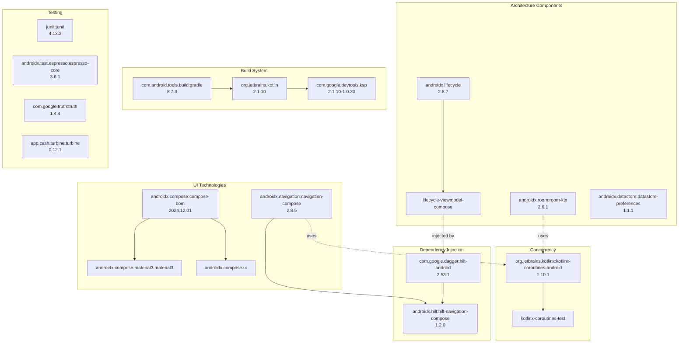

**Diagram: Core Dependencies with Artifact Coordinates**

The technology stack is centrally managed in the version catalog at [gradle/libs.versions.toml:1-153](). Key technologies include:

- **Jetpack Compose BOM 2024.12.01**: Manages all Compose dependencies with aligned versions
- **Kotlin 2.1.10**: Primary programming language with coroutines support
- **Hilt 2.53.1**: Dependency injection framework
- **Room 2.6.1**: Local database persistence layer
- **Navigation Compose 2.8.5**: Navigation framework for single-activity architecture
- **Kotlin Coroutines 1.10.1**: Asynchronous programming with Flow/StateFlow
- **Android Gradle Plugin 8.7.3**: Build system
- **KSP 2.1.10-1.0.30**: Kotlin Symbol Processing for annotation processing

**Sources:** [gradle/libs.versions.toml:1-60](), [gradle/libs.versions.toml:61-137]()

### SDK Configuration

| Property | Value | Purpose |
|----------|-------|---------|
| `minSdk` | 21 | Minimum supported Android version (Android 5.0 Lollipop) |
| `compileSdk` | 35 | SDK version used for compilation |
| `targetSdk` | 35 | Target SDK version for runtime behavior |
| JDK Version | 17 | Java Development Kit version |
| Gradle | 8.11.1 | Build tool version |

The minimum SDK of 21 provides broad device coverage while the compile/target SDK of 35 enables access to the latest Android platform features.

**Sources:** [gradle/libs.versions.toml:34](), [gradle/libs.versions.toml:47](), [gradle/libs.versions.toml:57](), [.github/workflows/build_test.yaml:36-37](), [gradle/wrapper/gradle-wrapper.properties:3]()

## Project Module Structure

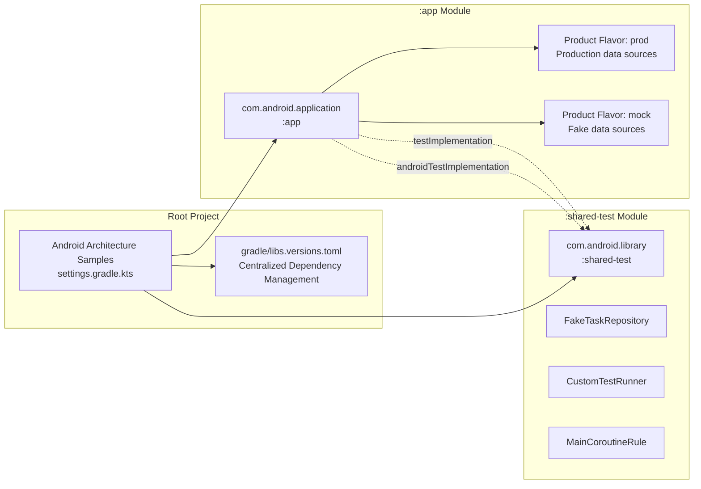

**Diagram: Project Module Organization**

The repository contains two Gradle modules:

1. **`:app`** - The main Android application module with two product flavors:
   - **`mock`**: Uses fake/in-memory data sources for rapid development and testing
   - **`prod`**: Uses production data sources (Room database with simulated network)

2. **`:shared-test`** - A shared library module containing test utilities used by both unit tests and instrumented tests, including `FakeTaskRepository`, `FakeTaskDao`, `CustomTestRunner` for Hilt testing, and `MainCoroutineRule` for coroutine testing

Version management is centralized in [gradle/libs.versions.toml:1-153]() using Gradle's version catalog feature, ensuring consistent dependency versions across all modules.

**Sources:** [README.md:11-12](), [gradle/libs.versions.toml:1-153]()

## High-Level Architecture Overview

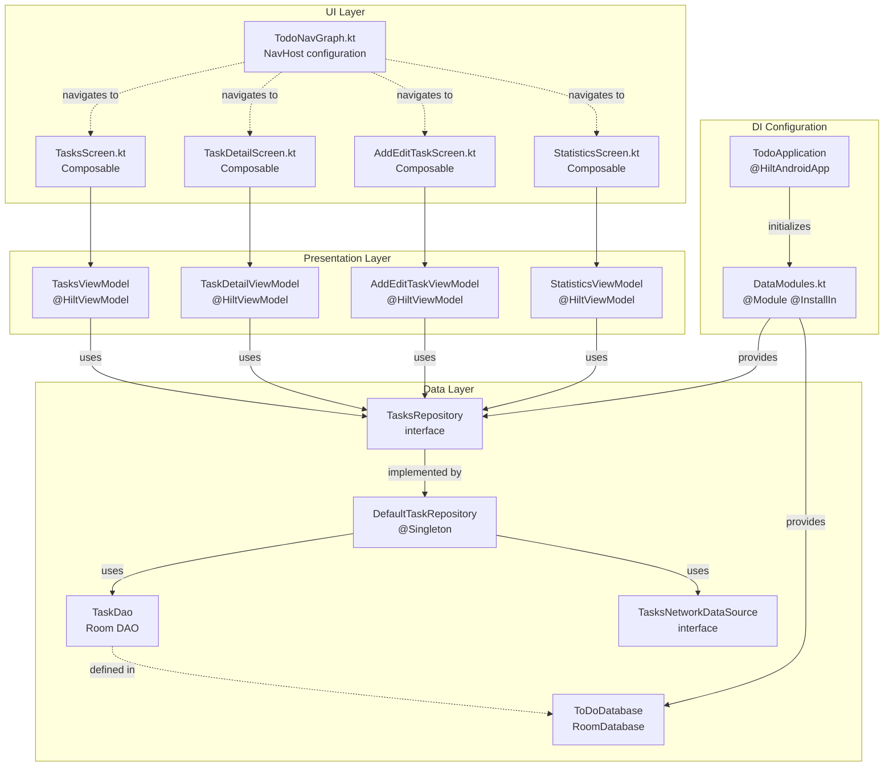

**Diagram: Core Application Architecture with Code Entities**

The application follows a three-layer MVVM architecture:

- **UI Layer**: Jetpack Compose screens (`TasksScreen`, `TaskDetailScreen`, `AddEditTaskScreen`, `StatisticsScreen`) render UI based on state from ViewModels. Navigation is managed by `TodoNavGraph`.

- **Presentation Layer**: ViewModels (`TasksViewModel`, `TaskDetailViewModel`, `AddEditTaskViewModel`, `StatisticsViewModel`) annotated with `@HiltViewModel` manage UI state using `StateFlow` and handle user actions. They interact exclusively with the `TasksRepository` interface.

- **Data Layer**: `DefaultTaskRepository` implements the `TasksRepository` interface and coordinates between local persistence (`TaskDao` from Room's `ToDoDatabase`) and network operations (`TasksNetworkDataSource`).

Dependency injection is configured via Hilt, with the `TodoApplication` class annotated with `@HiltAndroidApp` and data source bindings defined in `DataModules`.

**Sources:** [README.md:6-10]()

## What This Repository Is and Is Not

### What It Is

- **Architecture demonstration**: Shows how to structure an Android app with testable, maintainable patterns
- **Learning resource**: Provides clear examples of modern Android development practices
- **Reference implementation**: Illustrates proper use of Jetpack libraries and architectural components

### What It Is Not

| Not Included | Alternative Resource |
|--------------|---------------------|
| Production-ready template | [Architecture Templates](https://github.com/android/architecture-templates) |
| UI/Material Design showcase | [Compose Samples](https://github.com/android/compose-samples) |
| Complete production app with authentication, real networking | [Now in Android](https://github.com/android/nowinandroid) |

The repository deliberately omits production concerns such as:
- User authentication and authorization
- Real network APIs with error handling and retry logic
- Complex business logic and validation
- Advanced UI animations and Material Design patterns
- Multi-module feature architecture

This focus on architectural patterns rather than production features allows developers to understand core concepts without production complexity obscuring the architectural patterns.

**Sources:** [README.md:23-26]()

## Target Audience

The repository is designed for:

| Audience Level | Use Case |
|----------------|----------|
| **Intermediate developers** | Learn how to structure Android apps in a testable and maintainable way |
| **Beginners** | Understand modern Android architecture patterns through practical examples |
| **Advanced developers** | Quick reference for specific architectural patterns and testing approaches |

The codebase assumes familiarity with Kotlin and basic Android development concepts but provides clear examples of advanced patterns like reactive data flow, dependency injection, and comprehensive testing strategies.

**Sources:** [README.md:28-31]()

## Getting Started

To work with the repository:

1. Clone the repository:
   ```bash
   git clone git@github.com:android/architecture-samples.git
   ```

2. Open the `architecture-samples/` directory in Android Studio

3. The project uses Gradle Wrapper version 8.11.1, which will be automatically downloaded when building

4. Build the project to download all dependencies managed by the version catalog

The repository uses GitHub Actions for continuous integration, running builds and tests on every push to the main branch. The build configuration ensures consistent builds across development and CI environments.

**Sources:** [README.md:33-43](), [gradle/wrapper/gradle-wrapper.properties:3](), [.github/workflows/build_test.yaml:1-60]()

## License

The repository is licensed under the Apache License 2.0. All code is copyright 2024 Google, Inc. (and 2014 for the original project). Contributors must sign the Google Individual Contributor License Agreement before contributions can be accepted.

**Sources:** [README.md:45-65](), [LICENSE:1-201](), [CONTRIBUTING.md:1-30]()

---

# Page: Application Architecture

# Application Architecture

<details>
<summary>Relevant source files</summary>

The following files were used as context for generating this wiki page:

- [.google/packaging.yaml](.google/packaging.yaml)
- [CONTRIBUTING.md](CONTRIBUTING.md)
- [LICENSE](LICENSE)
- [README.md](README.md)
- [app/src/main/AndroidManifest.xml](app/src/main/AndroidManifest.xml)
- [app/src/main/java/com/example/android/architecture/blueprints/todoapp/TodoActivity.kt](app/src/main/java/com/example/android/architecture/blueprints/todoapp/TodoActivity.kt)
- [app/src/main/java/com/example/android/architecture/blueprints/todoapp/TodoNavigation.kt](app/src/main/java/com/example/android/architecture/blueprints/todoapp/TodoNavigation.kt)
- [app/src/main/java/com/example/android/architecture/blueprints/todoapp/addedittask/AddEditTaskViewModel.kt](app/src/main/java/com/example/android/architecture/blueprints/todoapp/addedittask/AddEditTaskViewModel.kt)
- [app/src/main/java/com/example/android/architecture/blueprints/todoapp/data/Task.kt](app/src/main/java/com/example/android/architecture/blueprints/todoapp/data/Task.kt)
- [app/src/main/java/com/example/android/architecture/blueprints/todoapp/di/CoroutinesModule.kt](app/src/main/java/com/example/android/architecture/blueprints/todoapp/di/CoroutinesModule.kt)
- [app/src/main/java/com/example/android/architecture/blueprints/todoapp/di/DataModules.kt](app/src/main/java/com/example/android/architecture/blueprints/todoapp/di/DataModules.kt)
- [app/src/main/java/com/example/android/architecture/blueprints/todoapp/statistics/StatisticsViewModel.kt](app/src/main/java/com/example/android/architecture/blueprints/todoapp/statistics/StatisticsViewModel.kt)
- [app/src/main/java/com/example/android/architecture/blueprints/todoapp/taskdetail/TaskDetailViewModel.kt](app/src/main/java/com/example/android/architecture/blueprints/todoapp/taskdetail/TaskDetailViewModel.kt)
- [app/src/main/java/com/example/android/architecture/blueprints/todoapp/tasks/TasksViewModel.kt](app/src/main/java/com/example/android/architecture/blueprints/todoapp/tasks/TasksViewModel.kt)
- [app/src/test/java/com/example/android/architecture/blueprints/todoapp/addedittask/AddEditTaskViewModelTest.kt](app/src/test/java/com/example/android/architecture/blueprints/todoapp/addedittask/AddEditTaskViewModelTest.kt)
- [app/src/test/java/com/example/android/architecture/blueprints/todoapp/statistics/StatisticsViewModelTest.kt](app/src/test/java/com/example/android/architecture/blueprints/todoapp/statistics/StatisticsViewModelTest.kt)
- [app/src/test/java/com/example/android/architecture/blueprints/todoapp/taskdetail/TaskDetailViewModelTest.kt](app/src/test/java/com/example/android/architecture/blueprints/todoapp/taskdetail/TaskDetailViewModelTest.kt)
- [app/src/test/java/com/example/android/architecture/blueprints/todoapp/tasks/TasksViewModelTest.kt](app/src/test/java/com/example/android/architecture/blueprints/todoapp/tasks/TasksViewModelTest.kt)
- [screenshots/screenshots.png](screenshots/screenshots.png)
- [screenshots/todoapp.gif](screenshots/todoapp.gif)

</details>


## Purpose and Scope

This document describes the high-level application architecture of the Android Architecture Samples TODO app. It explains the three-layer MVVM pattern implementation, the single-activity design with Navigation Compose, reactive data flow with Kotlin Flow/StateFlow, and how architectural components interact.

For implementation details of specific layers, see:
- UI components and Compose screens: [UI Layer with Jetpack Compose](#2.1)
- ViewModel implementations: [Presentation Layer with ViewModels](#2.2)
- Repository and data sources: [Data Layer and Repository Pattern](#2.3)
- Navigation structure and routes: [Navigation with Jetpack Navigation Compose](#2.4)

For dependency injection configuration, see [Dependency Injection with Hilt](#3).

## Architectural Layers

The application follows a three-layer MVVM (Model-View-ViewModel) architecture pattern that separates concerns and enables testability.

### Layer Separation Diagram

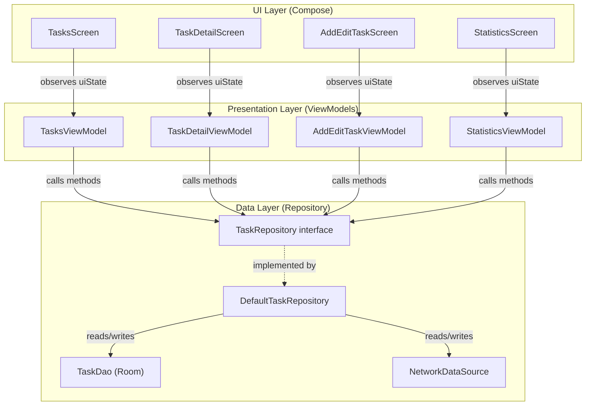

**Sources:** [README.md:1-66](), [app/src/main/java/com/example/android/architecture/blueprints/todoapp/tasks/TasksViewModel.kt:1-196](), [app/src/main/java/com/example/android/architecture/blueprints/todoapp/di/DataModules.kt:1-70]()

## Single-Activity Architecture

The application uses a single-activity pattern where all navigation occurs within `TodoActivity` using Jetpack Navigation Compose.

| Component | File | Purpose |
|-----------|------|---------|
| `TodoActivity` | [app/src/main/java/com/example/android/architecture/blueprints/todoapp/TodoActivity.kt:28-40]() | Single entry point, hosts `TodoNavGraph` |
| `TodoNavGraph` | Referenced in [app/src/main/java/com/example/android/architecture/blueprints/todoapp/TodoActivity.kt:36]() | Navigation graph definition |
| `TodoNavigationActions` | [app/src/main/java/com/example/android/architecture/blueprints/todoapp/TodoNavigation.kt:61-106]() | Navigation helper class |
| `TodoDestinations` | [app/src/main/java/com/example/android/architecture/blueprints/todoapp/TodoNavigation.kt:51-56]() | Route definitions |

The activity is annotated with `@AndroidEntryPoint` to enable Hilt dependency injection and calls `setContent` to launch the Compose UI.

**Sources:** [app/src/main/java/com/example/android/architecture/blueprints/todoapp/TodoActivity.kt:1-41](), [app/src/main/java/com/example/android/architecture/blueprints/todoapp/TodoNavigation.kt:1-107]()

## Presentation Layer Pattern

Each screen has a corresponding ViewModel that:
1. Exposes UI state via `StateFlow`
2. Handles user actions through public methods
3. Interacts exclusively with the `TaskRepository`
4. Never directly accesses data sources

### ViewModel State Management

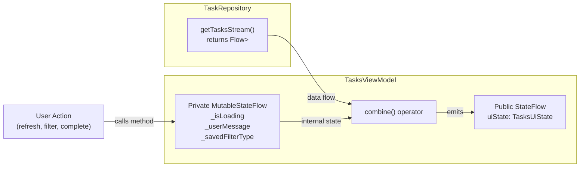

Each ViewModel follows this pattern:
- **Private state holders**: `MutableStateFlow` instances for internal state
- **Repository streams**: Data flows from repository
- **State combination**: `combine()` operator merges multiple flows
- **Public state**: Immutable `StateFlow` exposed to UI

**Sources:** [app/src/main/java/com/example/android/architecture/blueprints/todoapp/tasks/TasksViewModel.kt:63-100](), [app/src/main/java/com/example/android/architecture/blueprints/todoapp/taskdetail/TaskDetailViewModel.kt:59-93]()

## Data Model

The core data model is the `Task` data class:

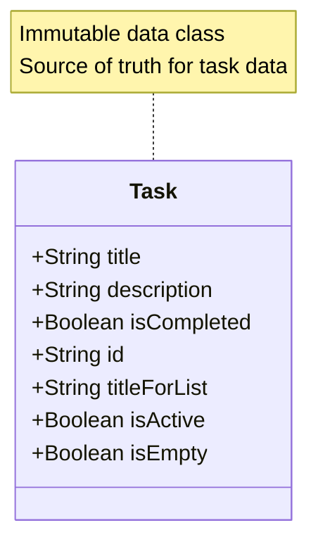

| Property | Type | Description |
|----------|------|-------------|
| `id` | `String` | Unique identifier |
| `title` | `String` | Task title |
| `description` | `String` | Task description |
| `isCompleted` | `Boolean` | Completion status |
| `isActive` | `Boolean` | Computed: `!isCompleted` |
| `titleForList` | `String` | Display title (fallback to description) |
| `isEmpty` | `Boolean` | Validation property |

**Sources:** [app/src/main/java/com/example/android/architecture/blueprints/todoapp/data/Task.kt:1-46]()

## Reactive Data Flow

The architecture uses Kotlin Coroutines and Flow for reactive, asynchronous data flow.

### Data Flow Pattern

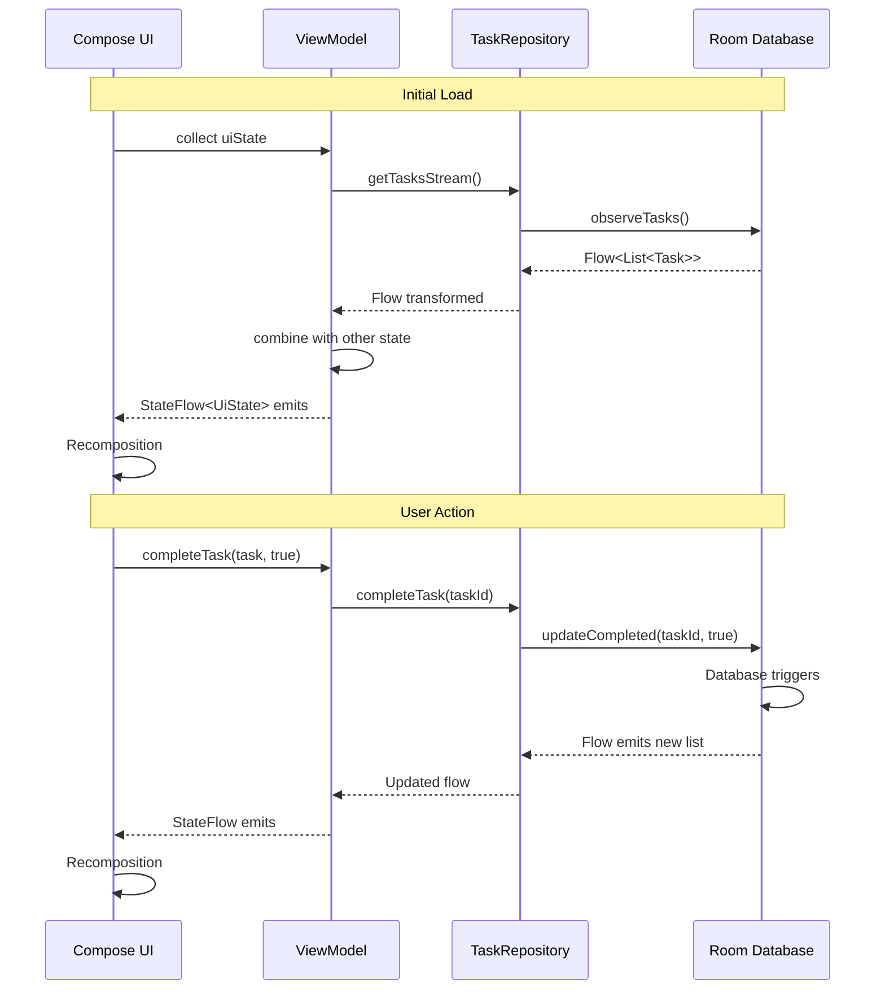

### Flow Configuration

The architecture uses a specific Flow sharing strategy defined in `WhileUiSubscribed`:

| Pattern | Implementation | Purpose |
|---------|----------------|---------|
| State sharing | `stateIn(scope, started, initial)` | Converts cold Flow to hot StateFlow |
| Subscription strategy | `WhileUiSubscribed` | Stops upstream when no collectors |
| Scope | `viewModelScope` | Lifecycle-aware cancellation |
| Initial value | UI state with `isLoading = true` | Shows loading on first launch |

This pattern ensures:
- Data streams automatically stop when UI is not visible
- State is preserved during configuration changes
- No memory leaks from active subscriptions
- Automatic cancellation when ViewModel is cleared

**Sources:** [app/src/main/java/com/example/android/architecture/blueprints/todoapp/tasks/TasksViewModel.kt:76-100](), [app/src/main/java/com/example/android/architecture/blueprints/todoapp/taskdetail/TaskDetailViewModel.kt:66-93]()

## UI State Pattern

Each ViewModel exposes a single immutable `UiState` data class that represents the complete UI state.

### Example: TasksUiState

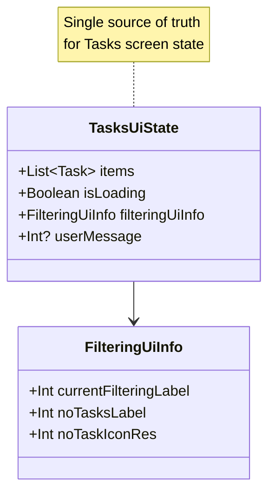

### UI State Examples

| ViewModel | UI State Class | Key Properties |
|-----------|---------------|----------------|
| `TasksViewModel` | `TasksUiState` | `items`, `isLoading`, `filteringUiInfo`, `userMessage` |
| `TaskDetailViewModel` | `TaskDetailUiState` | `task`, `isLoading`, `userMessage`, `isTaskDeleted` |
| `AddEditTaskViewModel` | `AddEditTaskUiState` | `title`, `description`, `isTaskCompleted`, `isLoading`, `isTaskSaved` |
| `StatisticsViewModel` | `StatisticsUiState` | `isEmpty`, `isLoading`, `activeTasksPercent`, `completedTasksPercent` |

**Sources:** [app/src/main/java/com/example/android/architecture/blueprints/todoapp/tasks/TasksViewModel.kt:44-52](), [app/src/main/java/com/example/android/architecture/blueprints/todoapp/taskdetail/TaskDetailViewModel.kt:38-46](), [app/src/main/java/com/example/android/architecture/blueprints/todoapp/addedittask/AddEditTaskViewModel.kt:33-43](), [app/src/main/java/com/example/android/architecture/blueprints/todoapp/statistics/StatisticsViewModel.kt:34-42]()

## ViewModel Lifecycle Management

ViewModels are lifecycle-aware and use `viewModelScope` for coroutine management.

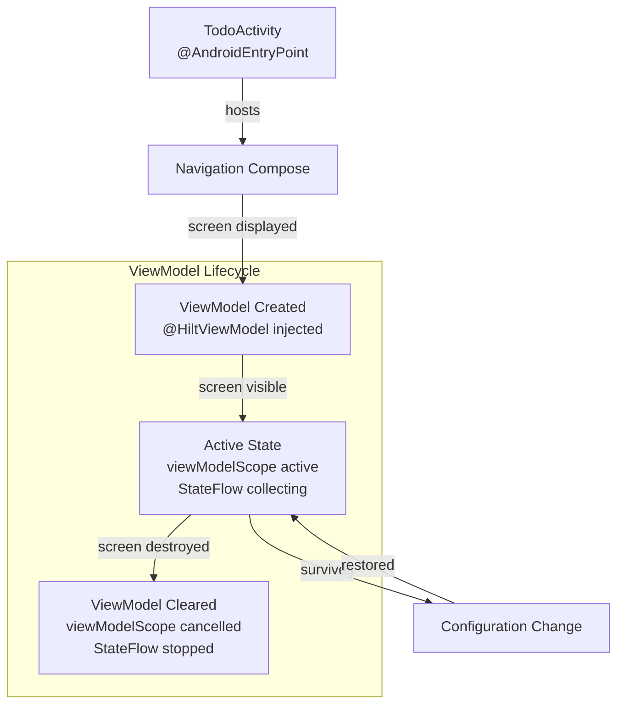

### ViewModel Characteristics

1. **Hilt Integration**: Annotated with `@HiltViewModel` and use constructor injection
2. **Lifecycle Scope**: `viewModelScope` automatically cancels when ViewModel is cleared
3. **Configuration Survival**: ViewModels survive configuration changes (rotation, etc.)
4. **SavedStateHandle**: Used to preserve state across process death

**Sources:** [app/src/main/java/com/example/android/architecture/blueprints/todoapp/tasks/TasksViewModel.kt:57-61](), [app/src/main/java/com/example/android/architecture/blueprints/todoapp/taskdetail/TaskDetailViewModel.kt:51-55]()

## Dependency Injection Architecture

The application uses Hilt for dependency injection with module-based configuration.

### Hilt Module Structure

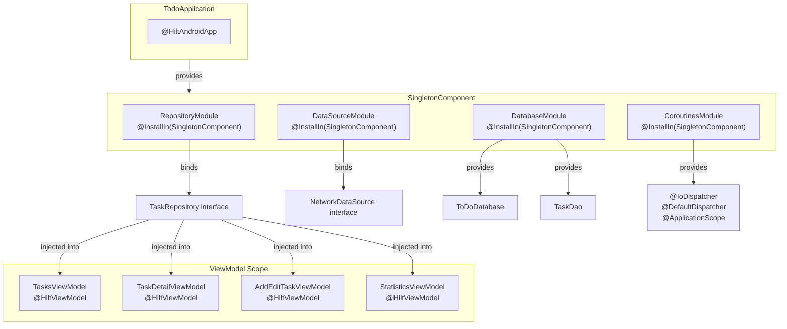

### Dependency Modules

| Module | Purpose | Key Bindings |
|--------|---------|--------------|
| `RepositoryModule` | Repository bindings | `DefaultTaskRepository` → `TaskRepository` |
| `DataSourceModule` | Data source bindings | `TaskNetworkDataSource` → `NetworkDataSource` |
| `DatabaseModule` | Room database | `ToDoDatabase`, `TaskDao` providers |
| `CoroutinesModule` | Coroutine configuration | `@IoDispatcher`, `@DefaultDispatcher`, `@ApplicationScope` |

### Custom Qualifiers

The application defines custom qualifier annotations for coroutine dispatchers:

```
@IoDispatcher - Dispatches.IO for I/O operations
@DefaultDispatcher - Dispatchers.Default for CPU-intensive work
@ApplicationScope - Application-scoped CoroutineScope
```

**Sources:** [app/src/main/java/com/example/android/architecture/blueprints/todoapp/di/DataModules.kt:1-70](), [app/src/main/java/com/example/android/architecture/blueprints/todoapp/di/CoroutinesModule.kt:1-61]()

## Error Handling Pattern

The architecture uses a consistent error handling pattern with the `Async` sealed class wrapper.

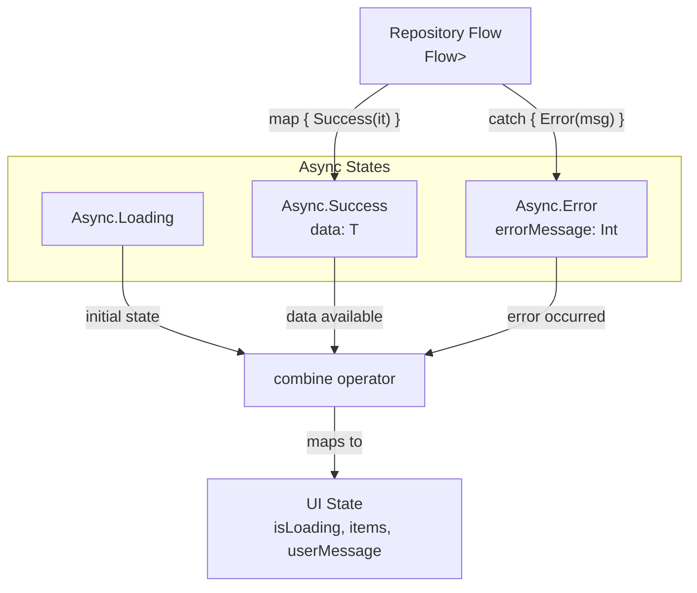

### Error Handling Flow

1. **Repository Stream**: Emits data or throws exception
2. **Map to Success**: `map { Async.Success(it) }` wraps successful data
3. **Catch Errors**: `catch { emit(Async.Error(message)) }` handles failures
4. **UI State Mapping**: ViewModel maps `Async` state to UI properties
5. **User Notification**: Error messages shown via `userMessage` property

Example from TasksViewModel:

```
private val _filteredTasksAsync =
    combine(taskRepository.getTasksStream(), _savedFilterType) { tasks, type ->
        filterTasks(tasks, type)
    }
        .map { Async.Success(it) }
        .catch<Async<List<Task>>> { emit(Async.Error(R.string.loading_tasks_error)) }
```

**Sources:** [app/src/main/java/com/example/android/architecture/blueprints/todoapp/tasks/TasksViewModel.kt:69-74](), [app/src/main/java/com/example/android/architecture/blueprints/todoapp/taskdetail/TaskDetailViewModel.kt:62-64]()

## State Persistence

The architecture uses `SavedStateHandle` for state preservation across process death.

### SavedStateHandle Usage

| ViewModel | Saved State | Purpose |
|-----------|-------------|---------|
| `TasksViewModel` | `TASKS_FILTER_SAVED_STATE_KEY` | Preserves selected filter (All/Active/Completed) |
| `TaskDetailViewModel` | `TASK_ID_ARG` | Task ID from navigation arguments |
| `AddEditTaskViewModel` | `TASK_ID_ARG` | Task ID for edit mode |

The `SavedStateHandle.getStateFlow()` extension creates a `StateFlow` from saved state:

```
private val _savedFilterType = 
    savedStateHandle.getStateFlow(TASKS_FILTER_SAVED_STATE_KEY, ALL_TASKS)
```

This ensures:
- Filter selection survives configuration changes
- Filter selection survives process death
- Reactive updates when state changes
- Integration with ViewModel state flows

**Sources:** [app/src/main/java/com/example/android/architecture/blueprints/todoapp/tasks/TasksViewModel.kt:58-64](), [app/src/main/java/com/example/android/architecture/blueprints/todoapp/taskdetail/TaskDetailViewModel.kt:54-57](), [app/src/main/java/com/example/android/architecture/blueprints/todoapp/addedittask/AddEditTaskViewModel.kt:49-54]()

## Testing Architecture Support

The architecture is designed for comprehensive testing with clear separation of concerns.

### ViewModel Testing Pattern

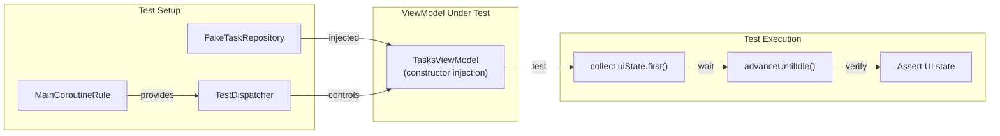

### Testing Benefits of Architecture

1. **ViewModel Independence**: ViewModels depend only on repository interface
2. **Fake Implementations**: Easy to provide fake repository for testing
3. **State Observability**: UI state exposed via StateFlow is easy to test
4. **Coroutine Control**: `MainCoroutineRule` controls coroutine execution timing
5. **Synchronous Testing**: `runTest` and `advanceUntilIdle()` make async code testable

Example test structure:
- Setup: Create `FakeTaskRepository` with test data
- Inject: Pass fake repository to ViewModel constructor
- Act: Call ViewModel methods
- Assert: Collect `uiState` and verify properties

**Sources:** [app/src/test/java/com/example/android/architecture/blueprints/todoapp/tasks/TasksViewModelTest.kt:43-66](), [app/src/test/java/com/example/android/architecture/blueprints/todoapp/taskdetail/TaskDetailViewModelTest.kt:43-66]()

## Key Architectural Decisions

### Decision Summary Table

| Aspect | Decision | Rationale |
|--------|----------|-----------|
| **Architecture Pattern** | MVVM with three layers | Clear separation of UI, business logic, and data |
| **Activity Structure** | Single Activity | Simplified navigation, consistent transitions |
| **UI Framework** | Jetpack Compose | Declarative UI, reduced boilerplate |
| **State Management** | StateFlow | Reactive, lifecycle-aware, type-safe |
| **Navigation** | Navigation Compose | Type-safe navigation, deep linking support |
| **DI Framework** | Hilt | Android-optimized, ViewModel integration |
| **Async Operations** | Kotlin Coroutines + Flow | Structured concurrency, cancellation support |
| **Database** | Room | Type-safe SQL, Flow integration |
| **Repository Pattern** | Interface abstraction | Testability, flexibility |

### Architectural Constraints

1. **Unidirectional Data Flow**: Data flows from Repository → ViewModel → UI
2. **No Business Logic in UI**: Compose functions only render state
3. **ViewModels Don't Reference UI**: No Android UI imports in ViewModels
4. **Repository Abstraction**: ViewModels depend on interface, not implementation
5. **Immutable State**: UI state data classes are immutable

**Sources:** [README.md:1-66](), [app/src/main/java/com/example/android/architecture/blueprints/todoapp/tasks/TasksViewModel.kt:1-196]()

---

# Page: UI Layer with Jetpack Compose

# UI Layer with Jetpack Compose

<details>
<summary>Relevant source files</summary>

The following files were used as context for generating this wiki page:

- [app/src/main/AndroidManifest.xml](app/src/main/AndroidManifest.xml)
- [app/src/main/java/com/example/android/architecture/blueprints/todoapp/TodoActivity.kt](app/src/main/java/com/example/android/architecture/blueprints/todoapp/TodoActivity.kt)
- [app/src/main/java/com/example/android/architecture/blueprints/todoapp/TodoNavGraph.kt](app/src/main/java/com/example/android/architecture/blueprints/todoapp/TodoNavGraph.kt)
- [app/src/main/java/com/example/android/architecture/blueprints/todoapp/TodoNavigation.kt](app/src/main/java/com/example/android/architecture/blueprints/todoapp/TodoNavigation.kt)
- [app/src/main/java/com/example/android/architecture/blueprints/todoapp/addedittask/AddEditTaskScreen.kt](app/src/main/java/com/example/android/architecture/blueprints/todoapp/addedittask/AddEditTaskScreen.kt)
- [app/src/main/java/com/example/android/architecture/blueprints/todoapp/di/CoroutinesModule.kt](app/src/main/java/com/example/android/architecture/blueprints/todoapp/di/CoroutinesModule.kt)
- [app/src/main/java/com/example/android/architecture/blueprints/todoapp/di/DataModules.kt](app/src/main/java/com/example/android/architecture/blueprints/todoapp/di/DataModules.kt)
- [app/src/main/java/com/example/android/architecture/blueprints/todoapp/statistics/StatisticsScreen.kt](app/src/main/java/com/example/android/architecture/blueprints/todoapp/statistics/StatisticsScreen.kt)
- [app/src/main/java/com/example/android/architecture/blueprints/todoapp/taskdetail/TaskDetailScreen.kt](app/src/main/java/com/example/android/architecture/blueprints/todoapp/taskdetail/TaskDetailScreen.kt)
- [app/src/main/java/com/example/android/architecture/blueprints/todoapp/tasks/TasksScreen.kt](app/src/main/java/com/example/android/architecture/blueprints/todoapp/tasks/TasksScreen.kt)
- [app/src/main/res/values/strings.xml](app/src/main/res/values/strings.xml)
- [app/src/test/java/com/example/android/architecture/blueprints/todoapp/statistics/StatisticsUtilsTest.kt](app/src/test/java/com/example/android/architecture/blueprints/todoapp/statistics/StatisticsUtilsTest.kt)

</details>


## Purpose and Scope

This document describes the UI layer implementation using Jetpack Compose in the TODO application. It covers the four main screen components (Tasks, Task Detail, Add/Edit Task, and Statistics), their composable structures, UI state handling patterns, and Material 3 theming. For information about ViewModel implementations that provide state to these screens, see [Presentation Layer with ViewModels](#2.2). For navigation between screens, see [Navigation with Jetpack Navigation Compose](#2.4).

## Overview

The UI layer is built entirely with Jetpack Compose using a single-activity architecture. All user interface is implemented as composable functions that declare UI based on state, following the declarative UI paradigm. The application uses Material 3 design components and follows modern Compose patterns including state hoisting, side effects with `LaunchedEffect`, and lifecycle-aware state collection with `collectAsStateWithLifecycle`.

The entry point for the UI is `TodoActivity`, which sets the content with the `TodoTheme` wrapper and navigation graph:

[app/src/main/java/com/example/android/architecture/blueprints/todoapp/TodoActivity.kt:31-39]()

Sources: [app/src/main/java/com/example/android/architecture/blueprints/todoapp/TodoActivity.kt]()

## Screen Architecture

The application consists of four primary screens, each implemented as a top-level composable function that follows a consistent pattern:

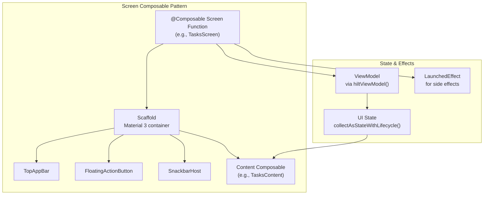

Sources: [app/src/main/java/com/example/android/architecture/blueprints/todoapp/tasks/TasksScreen.kt](), [app/src/main/java/com/example/android/architecture/blueprints/todoapp/taskdetail/TaskDetailScreen.kt](), [app/src/main/java/com/example/android/architecture/blueprints/todoapp/addedittask/AddEditTaskScreen.kt](), [app/src/main/java/com/example/android/architecture/blueprints/todoapp/statistics/StatisticsScreen.kt]()

### TasksScreen

The `TasksScreen` displays a filterable list of tasks with support for marking tasks complete, adding new tasks, and navigating to task details. It is the start destination of the navigation graph.

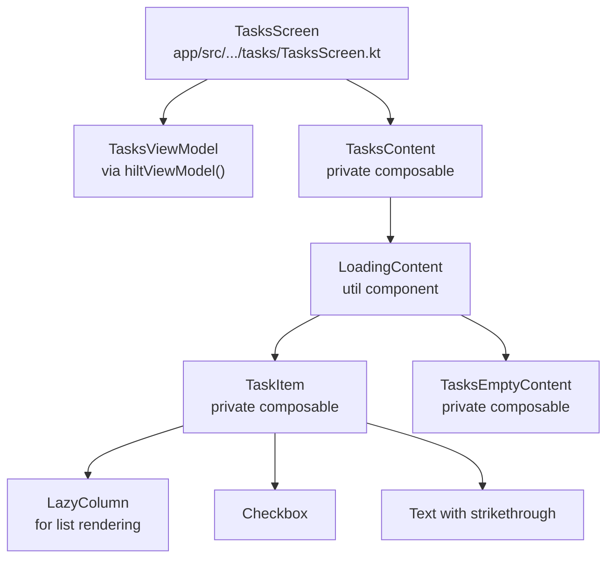

The screen structure follows this pattern:

| Component | Purpose | Location |
|-----------|---------|----------|
| `TasksScreen` | Top-level screen composable with Scaffold | [app/src/main/java/com/example/android/architecture/blueprints/todoapp/tasks/TasksScreen.kt:67-129]() |
| `TasksContent` | Content area showing loading/empty/tasks list | [app/src/main/java/com/example/android/architecture/blueprints/todoapp/tasks/TasksScreen.kt:131-173]() |
| `TaskItem` | Individual task row with checkbox | [app/src/main/java/com/example/android/architecture/blueprints/todoapp/tasks/TasksScreen.kt:175-208]() |
| `TasksEmptyContent` | Empty state with image and message | [app/src/main/java/com/example/android/architecture/blueprints/todoapp/tasks/TasksScreen.kt:210-228]() |

Key UI patterns in TasksScreen:

**Scaffold with TopAppBar and FAB:**
[app/src/main/java/com/example/android/architecture/blueprints/todoapp/tasks/TasksScreen.kt:78-95]()

**UI State Collection:**
[app/src/main/java/com/example/android/architecture/blueprints/todoapp/tasks/TasksScreen.kt:97]()

**Task List Rendering:**
[app/src/main/java/com/example/android/architecture/blueprints/todoapp/tasks/TasksScreen.kt:162-170]()

The task item displays a checkbox and text with conditional strikethrough for completed tasks:
[app/src/main/java/com/example/android/architecture/blueprints/todoapp/tasks/TasksScreen.kt:195-206]()

Sources: [app/src/main/java/com/example/android/architecture/blueprints/todoapp/tasks/TasksScreen.kt]()

### TaskDetailScreen

The `TaskDetailScreen` shows the full details of a single task, allowing users to view the title and description, toggle completion status, edit the task, or delete it.

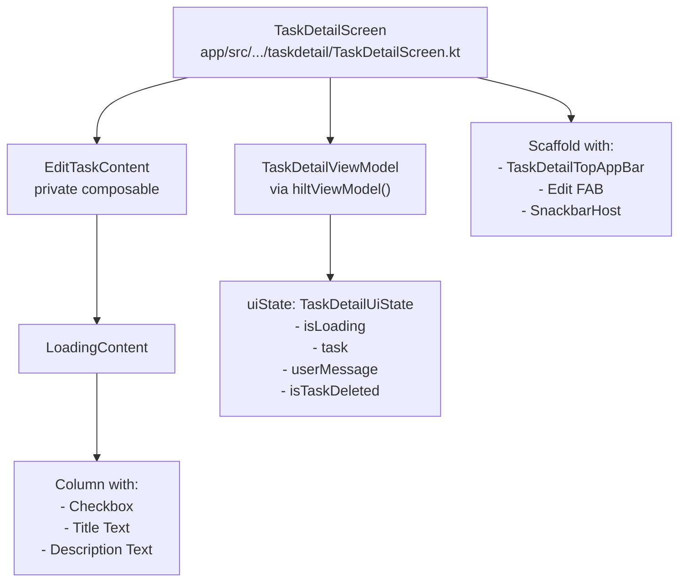

The screen observes task deletion state to trigger navigation:
[app/src/main/java/com/example/android/architecture/blueprints/todoapp/taskdetail/TaskDetailScreen.kt:93-97]()

The content area uses `LoadingContent` to handle loading, empty, and populated states:
[app/src/main/java/com/example/android/architecture/blueprints/todoapp/taskdetail/TaskDetailScreen.kt:118-145]()

Sources: [app/src/main/java/com/example/android/architecture/blueprints/todoapp/taskdetail/TaskDetailScreen.kt]()

### AddEditTaskScreen

The `AddEditTaskScreen` provides a form for creating new tasks or editing existing ones. It uses `OutlinedTextField` components for title and description input.

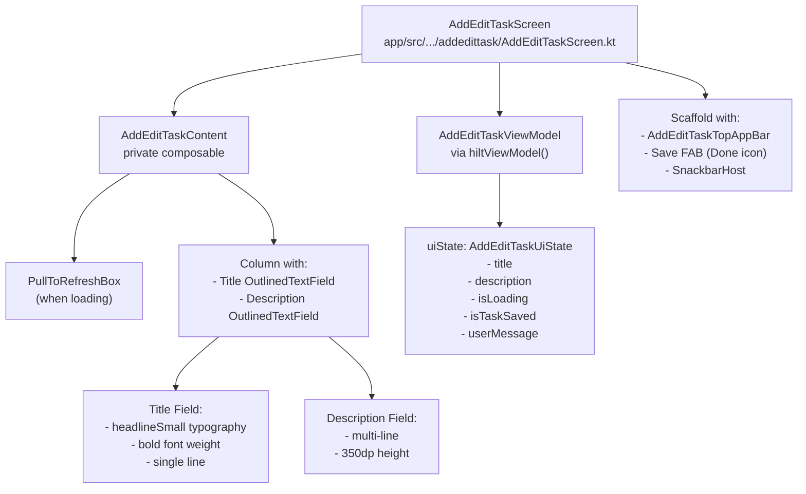

The screen uses custom `OutlinedTextFieldDefaults.colors` to create transparent borders for a cleaner appearance:
[app/src/main/java/com/example/android/architecture/blueprints/todoapp/addedittask/AddEditTaskScreen.kt:133-137]()

Text fields configuration:
[app/src/main/java/com/example/android/architecture/blueprints/todoapp/addedittask/AddEditTaskScreen.kt:138-161]()

The screen monitors the `isTaskSaved` flag to trigger navigation after successful save:
[app/src/main/java/com/example/android/architecture/blueprints/todoapp/addedittask/AddEditTaskScreen.kt:91-95]()

Sources: [app/src/main/java/com/example/android/architecture/blueprints/todoapp/addedittask/AddEditTaskScreen.kt]()

### StatisticsScreen

The `StatisticsScreen` displays completion statistics showing the percentage of active and completed tasks.

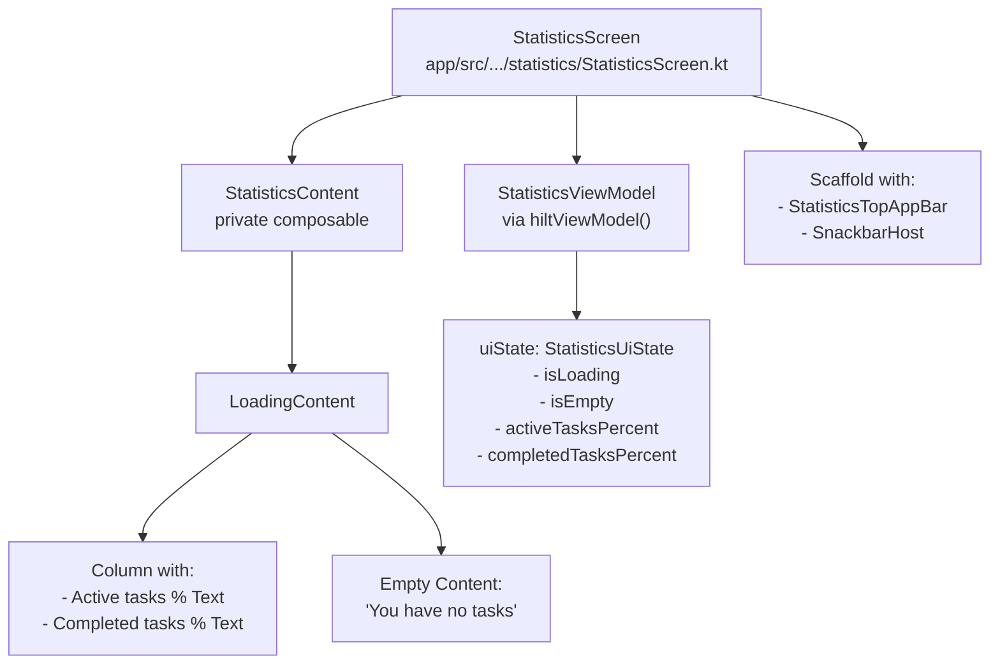

The statistics are displayed using formatted string resources:
[app/src/main/java/com/example/android/architecture/blueprints/todoapp/statistics/StatisticsScreen.kt:99-105]()

Sources: [app/src/main/java/com/example/android/architecture/blueprints/todoapp/statistics/StatisticsScreen.kt]()

## Common UI Patterns

### Scaffold Structure

All screens use the Material 3 `Scaffold` composable as the root layout container, providing consistent structure for app bars, floating action buttons, and snackbars.

Typical scaffold configuration:
[app/src/main/java/com/example/android/architecture/blueprints/todoapp/tasks/TasksScreen.kt:78-96]()

Sources: [app/src/main/java/com/example/android/architecture/blueprints/todoapp/tasks/TasksScreen.kt]()

### UI State Collection

All screens follow a consistent pattern for collecting UI state from ViewModels using `collectAsStateWithLifecycle()`, which ensures the Flow collection is lifecycle-aware and automatically stops when the screen is not visible.

Pattern used across all screens:
```kotlin
val uiState by viewModel.uiState.collectAsStateWithLifecycle()
```

Examples:
- [app/src/main/java/com/example/android/architecture/blueprints/todoapp/tasks/TasksScreen.kt:97]()
- [app/src/main/java/com/example/android/architecture/blueprints/todoapp/taskdetail/TaskDetailScreen.kt:72]()
- [app/src/main/java/com/example/android/architecture/blueprints/todoapp/addedittask/AddEditTaskScreen.kt:79]()
- [app/src/main/java/com/example/android/architecture/blueprints/todoapp/statistics/StatisticsScreen.kt:55]()

Sources: [app/src/main/java/com/example/android/architecture/blueprints/todoapp/tasks/TasksScreen.kt](), [app/src/main/java/com/example/android/architecture/blueprints/todoapp/taskdetail/TaskDetailScreen.kt](), [app/src/main/java/com/example/android/architecture/blueprints/todoapp/addedittask/AddEditTaskScreen.kt](), [app/src/main/java/com/example/android/architecture/blueprints/todoapp/statistics/StatisticsScreen.kt]()

### Snackbar Message Handling

All screens implement a consistent pattern for displaying user messages via snackbars using `LaunchedEffect` to observe UI state changes.

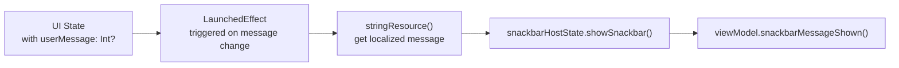

Example implementation from TasksScreen:
[app/src/main/java/com/example/android/architecture/blueprints/todoapp/tasks/TasksScreen.kt:112-118]()

The pattern ensures messages are shown only once by clearing them after display.

Sources: [app/src/main/java/com/example/android/architecture/blueprints/todoapp/tasks/TasksScreen.kt](), [app/src/main/java/com/example/android/architecture/blueprints/todoapp/taskdetail/TaskDetailScreen.kt:84-90](), [app/src/main/java/com/example/android/architecture/blueprints/todoapp/addedittask/AddEditTaskScreen.kt:98-104]()

### Loading Content Pattern

The application uses a shared `LoadingContent` utility composable that handles three states: loading, empty, and content-populated. It integrates Material 3's `PullToRefreshBox` for manual refresh capability.

Usage pattern:
```kotlin
LoadingContent(
    loading = uiState.isLoading,
    empty = condition,
    emptyContent = { EmptyStateComposable() },
    onRefresh = viewModel::refresh
) {
    // Main content composables
}
```

Examples:
- [app/src/main/java/com/example/android/architecture/blueprints/todoapp/tasks/TasksScreen.kt:143-172]()
- [app/src/main/java/com/example/android/architecture/blueprints/todoapp/taskdetail/TaskDetailScreen.kt:118-145]()
- [app/src/main/java/com/example/android/architecture/blueprints/todoapp/statistics/StatisticsScreen.kt:81-108]()

Sources: [app/src/main/java/com/example/android/architecture/blueprints/todoapp/tasks/TasksScreen.kt](), [app/src/main/java/com/example/android/architecture/blueprints/todoapp/taskdetail/TaskDetailScreen.kt](), [app/src/main/java/com/example/android/architecture/blueprints/todoapp/statistics/StatisticsScreen.kt]()

## ViewModel Integration

All screens obtain their ViewModels through Hilt injection using the `hiltViewModel()` composable function. This integration happens at the top-level screen composable, with the ViewModel provided as a default parameter.

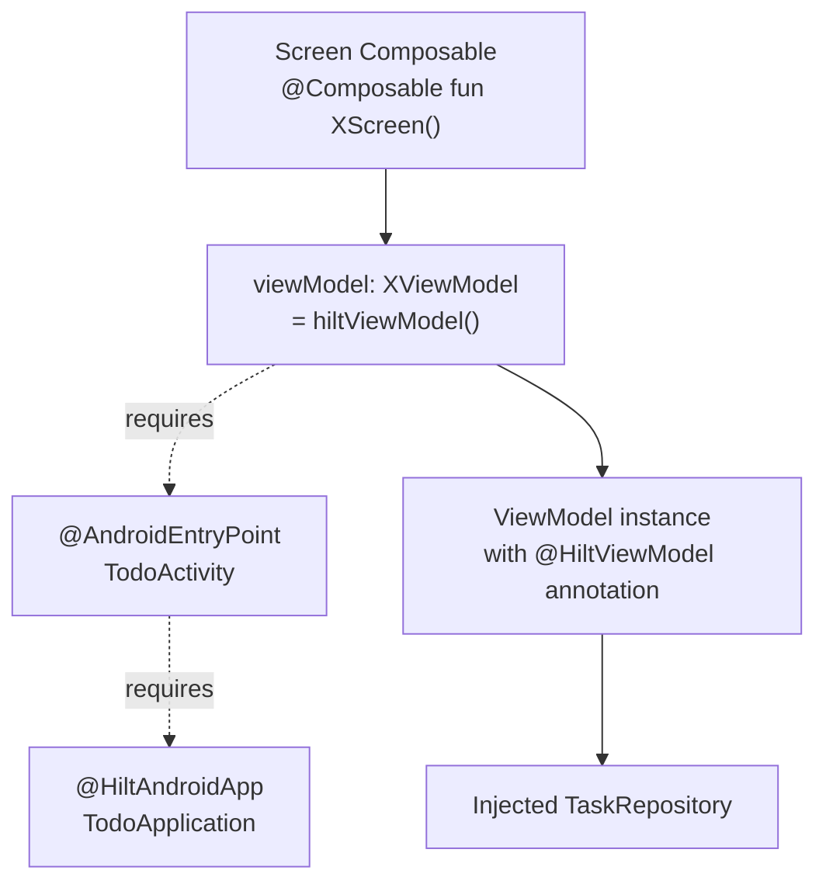

Pattern used consistently:
- [app/src/main/java/com/example/android/architecture/blueprints/todoapp/tasks/TasksScreen.kt:75]()
- [app/src/main/java/com/example/android/architecture/blueprints/todoapp/taskdetail/TaskDetailScreen.kt:58]()
- [app/src/main/java/com/example/android/architecture/blueprints/todoapp/addedittask/AddEditTaskScreen.kt:66]()
- [app/src/main/java/com/example/android/architecture/blueprints/todoapp/statistics/StatisticsScreen.kt:47]()

The ViewModels are lifecycle-scoped to the back stack entry by default, ensuring proper state preservation during navigation.

Sources: [app/src/main/java/com/example/android/architecture/blueprints/todoapp/tasks/TasksScreen.kt](), [app/src/main/java/com/example/android/architecture/blueprints/todoapp/taskdetail/TaskDetailScreen.kt](), [app/src/main/java/com/example/android/architecture/blueprints/todoapp/addedittask/AddEditTaskScreen.kt](), [app/src/main/java/com/example/android/architecture/blueprints/todoapp/statistics/StatisticsScreen.kt](), [app/src/main/java/com/example/android/architecture/blueprints/todoapp/TodoActivity.kt:28]()

## Material 3 Theming

The application uses Material 3 components throughout the UI layer. The `TodoTheme` composable provides the theming context for all screens.

Key Material 3 components used:

| Component | Usage | Example Location |
|-----------|-------|------------------|
| `Scaffold` | Base layout structure | All screen files |
| `TopAppBar` variants | Navigation and actions | Utility top app bars |
| `FloatingActionButton` | Primary actions (Add, Save, Edit) | All screens with FABs |
| `OutlinedTextField` | Text input | [AddEditTaskScreen.kt:138-161]() |
| `Checkbox` | Task completion toggle | [TasksScreen.kt:191-194](), [TaskDetailScreen.kt:137]() |
| `Text` | Typography with Material styles | All screens |
| `Surface` | Preview containers | Preview composables |
| `PullToRefreshBox` | Pull-to-refresh gesture | Loading content |
| `SnackbarHost` | Message display | All scaffold implementations |

Typography styles used:
- `MaterialTheme.typography.headlineSmall` - Task titles, section headers
- `MaterialTheme.typography.bodySmall` - Task descriptions

The theme is applied at the activity level:
[app/src/main/java/com/example/android/architecture/blueprints/todoapp/TodoActivity.kt:35-36]()

Sources: [app/src/main/java/com/example/android/architecture/blueprints/todoapp/TodoActivity.kt](), [app/src/main/java/com/example/android/architecture/blueprints/todoapp/tasks/TasksScreen.kt](), [app/src/main/java/com/example/android/architecture/blueprints/todoapp/addedittask/AddEditTaskScreen.kt]()

## Preview Support

All screens and major composable components include `@Preview` annotations for Compose preview functionality in Android Studio. Previews are configured to display various states including empty, loading, and populated content.

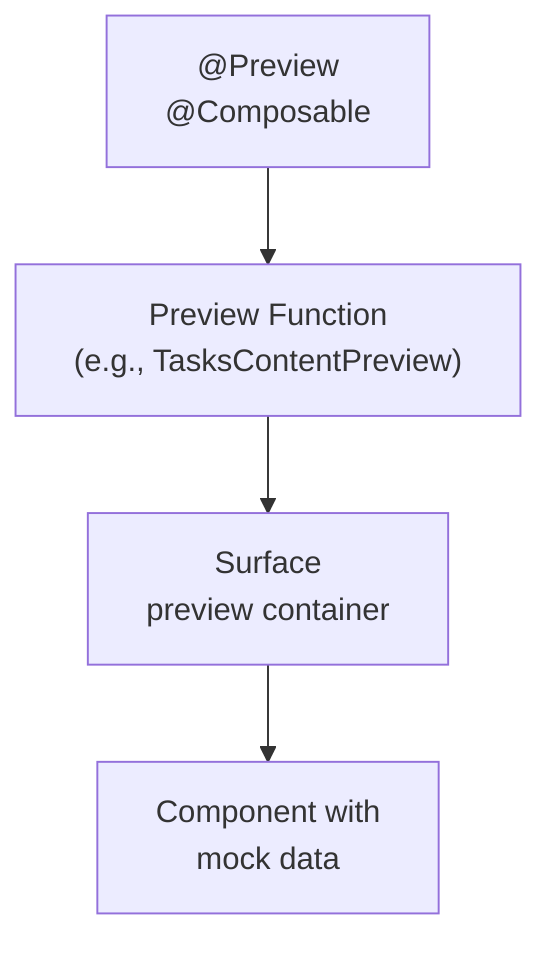

Examples of preview implementations:

**TasksScreen previews:**
- Content with tasks: [app/src/main/java/com/example/android/architecture/blueprints/todoapp/tasks/TasksScreen.kt:230-278]()
- Empty content: [app/src/main/java/com/example/android/architecture/blueprints/todoapp/tasks/TasksScreen.kt:280-297]()
- Single task item: [app/src/main/java/com/example/android/architecture/blueprints/todoapp/tasks/TasksScreen.kt:312-347]()

**TaskDetailScreen previews:**
- Active task: [app/src/main/java/com/example/android/architecture/blueprints/todoapp/taskdetail/TaskDetailScreen.kt:148-165]()
- Completed task: [app/src/main/java/com/example/android/architecture/blueprints/todoapp/taskdetail/TaskDetailScreen.kt:168-185]()
- Empty state: [app/src/main/java/com/example/android/architecture/blueprints/todoapp/taskdetail/TaskDetailScreen.kt:187-204]()

**StatisticsScreen previews:**
- With data: [app/src/main/java/com/example/android/architecture/blueprints/todoapp/statistics/StatisticsScreen.kt:111-123]()
- Empty: [app/src/main/java/com/example/android/architecture/blueprints/todoapp/statistics/StatisticsScreen.kt:125-131]()

Preview composables use mock data to demonstrate different UI states without requiring a running application or data layer dependencies.

Sources: [app/src/main/java/com/example/android/architecture/blueprints/todoapp/tasks/TasksScreen.kt](), [app/src/main/java/com/example/android/architecture/blueprints/todoapp/taskdetail/TaskDetailScreen.kt](), [app/src/main/java/com/example/android/architecture/blueprints/todoapp/statistics/StatisticsScreen.kt]()

## String Resources

All user-facing text is externalized to string resources, supporting internationalization and consistent messaging across the application.

Key string categories:

| Category | Purpose | Examples |
|----------|---------|----------|
| Navigation | Screen titles, menu items | `app_name`, `list_title`, `statistics_title` |
| Actions | Button labels, content descriptions | `add_task`, `edit_task`, `cd_save_task`, `refresh` |
| Messages | User feedback, confirmations | `task_marked_complete`, `successfully_saved_task_message` |
| Empty states | No data messages | `no_tasks_all`, `no_tasks_active`, `statistics_no_tasks` |
| Filters | Task filtering labels | `nav_all`, `nav_active`, `nav_completed` |
| Errors | Error messages | `loading_tasks_error`, `empty_task_message` |

String resources are accessed using `stringResource(id)`:
- [app/src/main/java/com/example/android/architecture/blueprints/todoapp/tasks/TasksScreen.kt:155]()
- [app/src/main/java/com/example/android/architecture/blueprints/todoapp/taskdetail/TaskDetailScreen.kt:139-140]()
- [app/src/main/java/com/example/android/architecture/blueprints/todoapp/addedittask/AddEditTaskScreen.kt:144]()

All string definitions are located in:
[app/src/main/res/values/strings.xml:17-72]()

Sources: [app/src/main/res/values/strings.xml](), [app/src/main/java/com/example/android/architecture/blueprints/todoapp/tasks/TasksScreen.kt](), [app/src/main/java/com/example/android/architecture/blueprints/todoapp/taskdetail/TaskDetailScreen.kt](), [app/src/main/java/com/example/android/architecture/blueprints/todoapp/addedittask/AddEditTaskScreen.kt]()

## State Hoisting Pattern

The application follows Compose best practices by hoisting state to the appropriate level. Screen-level composables are stateful (receiving ViewModels), while content composables are stateless (receiving state and callbacks).

```mermaid
graph TB
    subgraph "Stateful Layer"
        ScreenComposable["Screen Composable<br/>(e.g., TasksScreen)"]
        ViewModel["ViewModel"]
        State["Observed State"]
    end
    
    subgraph "Stateless Layer"
        ContentComposable["Content Composable<br/>(e.g., TasksContent)"]
        Props["State as Parameters"]
        Callbacks["Callbacks as Parameters"]
    end
    
    ScreenComposable --> ViewModel
    ViewModel --> State
    State --> Props
    ScreenComposable --> ContentComposable
    Props --> ContentComposable
    Callbacks --> ContentComposable
    ContentComposable -.->|"invokes"| Callbacks
    Callbacks -.->|"calls"| ViewModel
```

Example of state hoisting:

**Stateful screen:**
[app/src/main/java/com/example/android/architecture/blueprints/todoapp/tasks/TasksScreen.kt:67-77]()

**Stateless content:**
[app/src/main/java/com/example/android/architecture/blueprints/todoapp/tasks/TasksScreen.kt:131-142]()

This pattern enables:
- Easier testing of content composables with mock data
- Reusability of content composables in previews
- Clear separation between business logic and UI rendering

Sources: [app/src/main/java/com/example/android/architecture/blueprints/todoapp/tasks/TasksScreen.kt](), [app/src/main/java/com/example/android/architecture/blueprints/todoapp/taskdetail/TaskDetailScreen.kt](), [app/src/main/java/com/example/android/architecture/blueprints/todoapp/addedittask/AddEditTaskScreen.kt]()

---

# Page: Presentation Layer with ViewModels

# Presentation Layer with ViewModels

<details>
<summary>Relevant source files</summary>

The following files were used as context for generating this wiki page:

- [app/src/main/java/com/example/android/architecture/blueprints/todoapp/addedittask/AddEditTaskViewModel.kt](app/src/main/java/com/example/android/architecture/blueprints/todoapp/addedittask/AddEditTaskViewModel.kt)
- [app/src/main/java/com/example/android/architecture/blueprints/todoapp/data/Task.kt](app/src/main/java/com/example/android/architecture/blueprints/todoapp/data/Task.kt)
- [app/src/main/java/com/example/android/architecture/blueprints/todoapp/statistics/StatisticsViewModel.kt](app/src/main/java/com/example/android/architecture/blueprints/todoapp/statistics/StatisticsViewModel.kt)
- [app/src/main/java/com/example/android/architecture/blueprints/todoapp/taskdetail/TaskDetailViewModel.kt](app/src/main/java/com/example/android/architecture/blueprints/todoapp/taskdetail/TaskDetailViewModel.kt)
- [app/src/main/java/com/example/android/architecture/blueprints/todoapp/tasks/TasksViewModel.kt](app/src/main/java/com/example/android/architecture/blueprints/todoapp/tasks/TasksViewModel.kt)
- [app/src/test/java/com/example/android/architecture/blueprints/todoapp/addedittask/AddEditTaskViewModelTest.kt](app/src/test/java/com/example/android/architecture/blueprints/todoapp/addedittask/AddEditTaskViewModelTest.kt)
- [app/src/test/java/com/example/android/architecture/blueprints/todoapp/statistics/StatisticsViewModelTest.kt](app/src/test/java/com/example/android/architecture/blueprints/todoapp/statistics/StatisticsViewModelTest.kt)
- [app/src/test/java/com/example/android/architecture/blueprints/todoapp/taskdetail/TaskDetailViewModelTest.kt](app/src/test/java/com/example/android/architecture/blueprints/todoapp/taskdetail/TaskDetailViewModelTest.kt)
- [app/src/test/java/com/example/android/architecture/blueprints/todoapp/tasks/TasksViewModelTest.kt](app/src/test/java/com/example/android/architecture/blueprints/todoapp/tasks/TasksViewModelTest.kt)

</details>


The presentation layer implements ViewModels that manage UI state and coordinate data operations between the UI layer and the data layer. Each screen has a dedicated ViewModel that exposes state as `StateFlow` and handles user interactions.

## 1. ViewModel Architecture Overview

The application implements four ViewModels annotated with `@HiltViewModel` for dependency injection:

| ViewModel | Screen | Primary Responsibilities |
|-----------|--------|-------------------------|
| `TasksViewModel` | Tasks List | Filter tasks, mark complete/active, clear completed, refresh |
| `TaskDetailViewModel` | Task Detail | Load single task, mark complete/active, delete |
| `AddEditTaskViewModel` | Add/Edit Task | Create new task, update existing task, validate input |
| `StatisticsViewModel` | Statistics | Calculate completion percentages |

All ViewModels receive `TaskRepository` via constructor injection. `TasksViewModel`, `TaskDetailViewModel`, and `AddEditTaskViewModel` also receive `SavedStateHandle` for state preservation.

**Diagram: ViewModel Class Structure and Dependencies**

```mermaid
classDiagram
    class TasksViewModel {
        -TaskRepository taskRepository
        -SavedStateHandle savedStateHandle
        -MutableStateFlow~Int?~ _userMessage
        -MutableStateFlow~Boolean~ _isLoading
        +StateFlow~TasksUiState~ uiState
        +setFiltering(TasksFilterType)
        +clearCompletedTasks()
        +completeTask(Task, Boolean)
        +refresh()
        +showEditResultMessage(Int)
        +snackbarMessageShown()
    }
    
    class TaskDetailViewModel {
        -TaskRepository taskRepository
        -SavedStateHandle savedStateHandle
        -MutableStateFlow~Int?~ _userMessage
        -MutableStateFlow~Boolean~ _isLoading
        -MutableStateFlow~Boolean~ _isTaskDeleted
        +String taskId
        +StateFlow~TaskDetailUiState~ uiState
        +deleteTask()
        +setCompleted(Boolean)
        +refresh()
        +snackbarMessageShown()
    }
    
    class AddEditTaskViewModel {
        -TaskRepository taskRepository
        -SavedStateHandle savedStateHandle
        -MutableStateFlow~AddEditTaskUiState~ _uiState
        -String? taskId
        +StateFlow~AddEditTaskUiState~ uiState
        +saveTask()
        +updateTitle(String)
        +updateDescription(String)
        +snackbarMessageShown()
    }
    
    class StatisticsViewModel {
        -TaskRepository taskRepository
        +StateFlow~StatisticsUiState~ uiState
        +refresh()
    }
    
    class TaskRepository {
        <<interface>>
        +Flow~List~Task~~ getTasksStream()
        +Flow~Task?~ getTaskStream(String)
        +suspend createTask(String, String) String
        +suspend updateTask(String, String, String)
        +suspend completeTask(String)
        +suspend activateTask(String)
        +suspend deleteTask(String)
        +suspend refresh()
    }
    
    TasksViewModel --> TaskRepository
    TaskDetailViewModel --> TaskRepository
    AddEditTaskViewModel --> TaskRepository
    StatisticsViewModel --> TaskRepository
```

Sources:
- [app/src/main/java/com/example/android/architecture/blueprints/todoapp/tasks/TasksViewModel.kt:57-186]()
- [app/src/main/java/com/example/android/architecture/blueprints/todoapp/taskdetail/TaskDetailViewModel.kt:51-133]()
- [app/src/main/java/com/example/android/architecture/blueprints/todoapp/addedittask/AddEditTaskViewModel.kt:48-148]()
- [app/src/main/java/com/example/android/architecture/blueprints/todoapp/statistics/StatisticsViewModel.kt:47-88]()

## 2. UI State Management with StateFlow

Each ViewModel exposes a single `StateFlow<UiState>` that encapsulates all UI state. The state classes are immutable data classes that represent the complete UI state at any point in time.

**Diagram: State Flow Pattern from Repository to UI**

```mermaid
flowchart LR
    A["TaskRepository<br/>getTasksStream()"] --> B["Flow Operators<br/>map, combine, catch"]
    B --> C["Async Wrapper<br/>Loading/Success/Error"]
    C --> D["stateIn()<br/>WhileUiSubscribed"]
    D --> E["StateFlow&lt;TasksUiState&gt;"]
    E --> F["UI Layer<br/>collectAsStateWithLifecycle()"]
    
    G["User Actions<br/>completeTask()"] --> H["viewModelScope.launch"]
    H --> I["TaskRepository<br/>completeTask()"]
    I --> A
```

Sources:
- [app/src/main/java/com/example/android/architecture/blueprints/todoapp/tasks/TasksViewModel.kt:69-100]()
- [app/src/main/java/com/example/android/architecture/blueprints/todoapp/taskdetail/TaskDetailViewModel.kt:62-93]()

### 2.1 UI State Data Classes

| UI State Class | Properties | Purpose |
|----------------|-----------|---------|
| `TasksUiState` | `items: List<Task>`<br/>`isLoading: Boolean`<br/>`filteringUiInfo: FilteringUiInfo`<br/>`userMessage: Int?` | Contains filtered task list, loading state, filter info, and optional user message resource ID |
| `TaskDetailUiState` | `task: Task?`<br/>`isLoading: Boolean`<br/>`userMessage: Int?`<br/>`isTaskDeleted: Boolean` | Contains single task data, loading state, message, and deletion flag for navigation |
| `AddEditTaskUiState` | `title: String`<br/>`description: String`<br/>`isTaskCompleted: Boolean`<br/>`isLoading: Boolean`<br/>`userMessage: Int?`<br/>`isTaskSaved: Boolean` | Contains editable task fields, loading state, validation message, and save completion flag |
| `StatisticsUiState` | `isEmpty: Boolean`<br/>`isLoading: Boolean`<br/>`activeTasksPercent: Float`<br/>`completedTasksPercent: Float` | Contains computed statistics percentages and empty state indicator |

Sources:
- [app/src/main/java/com/example/android/architecture/blueprints/todoapp/tasks/TasksViewModel.kt:47-52]()
- [app/src/main/java/com/example/android/architecture/blueprints/todoapp/taskdetail/TaskDetailViewModel.kt:41-46]()
- [app/src/main/java/com/example/android/architecture/blueprints/todoapp/addedittask/AddEditTaskViewModel.kt:36-43]()
- [app/src/main/java/com/example/android/architecture/blueprints/todoapp/statistics/StatisticsViewModel.kt:37-42]()

### 2.2 Reactive State Transformations

ViewModels construct the `StateFlow<UiState>` by combining multiple reactive streams using Flow operators. The pattern uses:

1. **Flow from Repository** - Reactive data source (e.g., `taskRepository.getTasksStream()`)
2. **Transformations** - `map`, `combine`, `distinctUntilChanged` to process data
3. **Error Handling** - `catch` operator to convert exceptions to error state
4. **Async Wrapper** - `Async<T>` sealed class with `Loading`, `Success<T>`, and `Error` states
5. **State Conversion** - `stateIn()` with `WhileUiSubscribed` to convert Flow to StateFlow

**Diagram: TasksViewModel State Transformation Pipeline**

```mermaid
flowchart TB
    A["taskRepository<br/>.getTasksStream()"] --> B["combine with<br/>_savedFilterType"]
    B --> C["filterTasks()<br/>apply filter logic"]
    C --> D["map to<br/>Async.Success"]
    D --> E["catch errors<br/>emit Async.Error"]
    
    F["_filterUiInfo"] --> G["combine()"]
    H["_isLoading"] --> G
    I["_userMessage"] --> G
    E --> G
    
    G --> J["map to<br/>TasksUiState"]
    J --> K["stateIn()<br/>viewModelScope<br/>WhileUiSubscribed"]
    K --> L["StateFlow&lt;TasksUiState&gt;"]
```

Sources:
- [app/src/main/java/com/example/android/architecture/blueprints/todoapp/tasks/TasksViewModel.kt:63-100]()
- [app/src/main/java/com/example/android/architecture/blueprints/todoapp/util/Async.kt]()

## 3. User Action Handling

ViewModels expose functions that UI components call to handle user actions. These functions execute operations in `viewModelScope` and update state flows.

### 3.1 Repository Operations with State Updates

Most actions trigger repository operations and update local state. The pattern uses `viewModelScope.launch` for coroutine execution:

**Diagram: Task Completion Flow**

```mermaid
sequenceDiagram
    participant UI as "TasksScreen"
    participant VM as "TasksViewModel"
    participant Repo as "TaskRepository"
    participant Flow as "StateFlow&lt;TasksUiState&gt;"
    
    UI->>VM: completeTask(task, true)
    activate VM
    VM->>VM: viewModelScope.launch
    VM->>Repo: completeTask(task.id)
    Repo-->>VM: suspend function returns
    VM->>VM: showSnackbarMessage(R.string.task_marked_complete)
    VM->>Flow: _userMessage.value = message
    deactivate VM
    Flow-->>UI: Updated state emitted
    UI->>UI: Display snackbar
    UI->>VM: snackbarMessageShown()
    VM->>Flow: _userMessage.value = null
```

The `completeTask` function in `TasksViewModel` demonstrates this pattern:

- Launches coroutine in `viewModelScope`
- Calls repository suspend function
- Updates `_userMessage` state flow
- UI observes state changes and displays feedback

Sources:
- [app/src/main/java/com/example/android/architecture/blueprints/todoapp/tasks/TasksViewModel.kt:114-122]()
- [app/src/main/java/com/example/android/architecture/blueprints/todoapp/taskdetail/TaskDetailViewModel.kt:100-109]()

### 3.2 Direct State Mutations

`AddEditTaskViewModel` uses a different pattern with a mutable `_uiState` for form field updates:

**Diagram: Form Field Update Pattern**

```mermaid
flowchart LR
    A["User types in<br/>TextField"] --> B["updateTitle(newTitle)"]
    B --> C["_uiState.update()<br/>copy with new title"]
    C --> D["StateFlow emits<br/>new state"]
    D --> E["TextField<br/>displays new value"]
```

The `updateTitle` and `updateDescription` functions use `MutableStateFlow.update` for immediate state changes without repository calls. This provides instant UI feedback during text input.

Sources:
- [app/src/main/java/com/example/android/architecture/blueprints/todoapp/addedittask/AddEditTaskViewModel.kt:59-60]()
- [app/src/main/java/com/example/android/architecture/blueprints/todoapp/addedittask/AddEditTaskViewModel.kt:90-100]()

### 3.3 Validation and Save Logic

The `saveTask` function in `AddEditTaskViewModel` validates input before persisting:

1. Check if `title` or `description` is empty
2. If invalid, update state with error message resource ID
3. If valid, call `createNewTask()` or `updateTask()` based on whether `taskId` is null
4. Set `isTaskSaved = true` to trigger navigation in UI

Sources:
- [app/src/main/java/com/example/android/architecture/blueprints/todoapp/addedittask/AddEditTaskViewModel.kt:69-82]()
- [app/src/main/java/com/example/android/architecture/blueprints/todoapp/addedittask/AddEditTaskViewModel.kt:102-123]()

## 4. Coroutine Management and Async Operations

### 4.1 viewModelScope Lifecycle

All coroutines are launched in `viewModelScope`, which automatically cancels when the ViewModel is cleared. This prevents memory leaks and ensures operations don't continue after the UI is destroyed.

**Diagram: viewModelScope Coroutine Lifecycle**

```mermaid
flowchart TB
    A["ViewModel Created<br/>by Hilt"] --> B["User Action<br/>refresh()"]
    B --> C["viewModelScope.launch<br/>coroutine started"]
    C --> D["taskRepository.refresh()<br/>suspend call"]
    D --> E["_isLoading.value = false<br/>state updated"]
    
    F["ViewModel Cleared<br/>onCleared()"] --> G["viewModelScope<br/>cancelled"]
    G --> H["All coroutines<br/>cancelled"]
```

Sources:
- [app/src/main/java/com/example/android/architecture/blueprints/todoapp/tasks/TasksViewModel.kt:140-146]()
- [app/src/main/java/com/example/android/architecture/blueprints/todoapp/taskdetail/TaskDetailViewModel.kt:111-117]()

### 4.2 Loading State Pattern

`TasksViewModel` and `TaskDetailViewModel` use a `MutableStateFlow<Boolean>` to track loading state during manual refresh operations:

The `refresh()` function pattern:
1. Set `_isLoading.value = true`
2. Launch coroutine in `viewModelScope`
3. Call repository suspend function
4. Set `_isLoading.value = false`
5. UI observes combined state that includes `isLoading`

Sources:
- [app/src/main/java/com/example/android/architecture/blueprints/todoapp/tasks/TasksViewModel.kt:68]()
- [app/src/main/java/com/example/android/architecture/blueprints/todoapp/tasks/TasksViewModel.kt:140-146]()

### 4.3 Error Handling with Async Wrapper

ViewModels use the `Async<T>` sealed class to represent asynchronous state:

```kotlin
sealed class Async<out T> {
    object Loading : Async<Nothing>()
    data class Error(val errorMessage: Int) : Async<Nothing>()
    data class Success<out T>(val data: T) : Async<T>()
}
```

Repository flows are wrapped with `Async` using `map` and `catch` operators:

1. Map successful emissions to `Async.Success(data)`
2. Catch exceptions and emit `Async.Error(messageResourceId)`
3. Transform `Async` to `UiState` in `combine` or `map`
4. Handle each case: `Loading` shows spinner, `Error` shows message, `Success` displays data

Sources:
- [app/src/main/java/com/example/android/architecture/blueprints/todoapp/tasks/TasksViewModel.kt:69-74]()
- [app/src/main/java/com/example/android/architecture/blueprints/todoapp/tasks/TasksViewModel.kt:79-94]()
- [app/src/main/java/com/example/android/architecture/blueprints/todoapp/taskdetail/TaskDetailViewModel.kt:62-87]()

### 4.4 WhileUiSubscribed Sharing Strategy

The `stateIn` operator converts Flow to StateFlow with `WhileUiSubscribed` sharing strategy:

```kotlin
val uiState: StateFlow<TasksUiState> = combine(...)
    .stateIn(
        scope = viewModelScope,
        started = WhileUiSubscribed,
        initialValue = TasksUiState(isLoading = true)
    )
```

`WhileUiSubscribed` stops upstream flows when the UI is not visible (with a 5-second timeout), conserving resources while maintaining state.

Sources:
- [app/src/main/java/com/example/android/architecture/blueprints/todoapp/tasks/TasksViewModel.kt:96-100]()
- [app/src/main/java/com/example/android/architecture/blueprints/todoapp/util/WhileUiSubscribed.kt]()

## 5. State Preservation with SavedStateHandle

`SavedStateHandle` preserves ViewModel state across configuration changes and process death. Navigation arguments are automatically saved to `SavedStateHandle` by the Navigation library.

### 5.1 Navigation Arguments

ViewModels extract navigation arguments from `SavedStateHandle`:

| ViewModel | Argument Key | Type | Usage |
|-----------|-------------|------|-------|
| `TaskDetailViewModel` | `TodoDestinationsArgs.TASK_ID_ARG` | `String` (non-null) | Load specific task from repository |
| `AddEditTaskViewModel` | `TodoDestinationsArgs.TASK_ID_ARG` | `String?` (nullable) | null = create mode, non-null = edit mode |

The argument extraction happens in constructor or property initialization:

```kotlin
// TaskDetailViewModel - task ID required
val taskId: String = savedStateHandle[TodoDestinationsArgs.TASK_ID_ARG]!!

// AddEditTaskViewModel - task ID optional
private val taskId: String? = savedStateHandle[TodoDestinationsArgs.TASK_ID_ARG]
```

Sources:
- [app/src/main/java/com/example/android/architecture/blueprints/todoapp/taskdetail/TaskDetailViewModel.kt:57]()
- [app/src/main/java/com/example/android/architecture/blueprints/todoapp/addedittask/AddEditTaskViewModel.kt:54]()
- [app/src/main/java/com/example/android/architecture/blueprints/todoapp/TodoDestinationsArgs.kt]()

### 5.2 Filter State Persistence

`TasksViewModel` persists the current filter selection using `SavedStateHandle.getStateFlow()`:

```kotlin
private val _savedFilterType = 
    savedStateHandle.getStateFlow(TASKS_FILTER_SAVED_STATE_KEY, ALL_TASKS)
```

This creates a `StateFlow` that automatically persists changes. When `setFiltering()` is called:

```kotlin
fun setFiltering(requestType: TasksFilterType) {
    savedStateHandle[TASKS_FILTER_SAVED_STATE_KEY] = requestType
}
```

The value is saved to `SavedStateHandle` and `_savedFilterType` flow emits the new value. This flow is combined with task data to filter the list reactively.

Sources:
- [app/src/main/java/com/example/android/architecture/blueprints/todoapp/tasks/TasksViewModel.kt:63-64]()
- [app/src/main/java/com/example/android/architecture/blueprints/todoapp/tasks/TasksViewModel.kt:102-104]()
- [app/src/main/java/com/example/android/architecture/blueprints/todoapp/tasks/TasksViewModel.kt:189]()

## 6. ViewModel Testing Strategy

ViewModels are unit tested using `FakeTaskRepository` and `MainCoroutineRule` to control coroutine execution.

**Diagram: ViewModel Test Setup**

```mermaid
flowchart TB
    A["@Rule<br/>MainCoroutineRule"] --> B["Test Dispatcher<br/>Controls coroutine timing"]
    
    C["FakeTaskRepository"] --> D["In-memory data storage<br/>Controllable behavior"]
    
    E["@Before<br/>setupViewModel()"] --> F["Create FakeTaskRepository"]
    F --> G["Add test data<br/>tasksRepository.addTasks()"]
    G --> H["Create ViewModel<br/>with fake dependencies"]
    
    B --> H
    D --> H
```

Sources:
- [app/src/test/java/com/example/android/architecture/blueprints/todoapp/tasks/TasksViewModelTest.kt:45-66]()
- [app/src/test/java/com/example/android/architecture/blueprints/todoapp/taskdetail/TaskDetailViewModelTest.kt:44-66]()
- [shared-test/src/main/java/com/example/android/architecture/blueprints/todoapp/MainCoroutineRule.kt]()

### 6.1 Testing State Flows

Tests verify `StateFlow` emissions using `Flow.first()` to collect the current state:

**Common test pattern:**
1. Perform action on ViewModel
2. Collect state with `uiState.first()`
3. Assert state properties

Example from `TasksViewModelTest`:
- Test calls `tasksViewModel.completeTask(task, true)`
- Verify repository state: `tasksRepository.savedTasks.value[task.id]?.isCompleted`
- Verify ViewModel state: `tasksViewModel.uiState.first().userMessage`

Sources:
- [app/src/test/java/com/example/android/architecture/blueprints/todoapp/tasks/TasksViewModelTest.kt:196-210]()
- [app/src/test/java/com/example/android/architecture/blueprints/todoapp/taskdetail/TaskDetailViewModelTest.kt:68-74]()

### 6.2 Testing Loading States

Loading states are tested using `StandardTestDispatcher` to control coroutine timing:

1. Set `Dispatchers.setMain(StandardTestDispatcher())` for delayed execution
2. Launch collector in background coroutine
3. Assert initial loading state is `true`
4. Call `advanceUntilIdle()` to execute all pending coroutines
5. Assert final loading state is `false`

This pattern verifies that loading indicators appear and disappear correctly.

Sources:
- [app/src/test/java/com/example/android/architecture/blueprints/todoapp/taskdetail/TaskDetailViewModelTest.kt:146-166]()
- [app/src/test/java/com/example/android/architecture/blueprints/todoapp/tasks/TasksViewModelTest.kt:68-91]()
- [app/src/test/java/com/example/android/architecture/blueprints/todoapp/addedittask/AddEditTaskViewModelTest.kt:85-102]()

### 6.3 Testing Error Handling

Tests verify error states by configuring `FakeTaskRepository` to throw errors:

```kotlin
tasksRepository.setShouldThrowError(true)
```

Then assert that:
- State contains error message resource ID
- Task data is null or empty
- Error is displayed in UI state

Sources:
- [app/src/test/java/com/example/android/architecture/blueprints/todoapp/tasks/TasksViewModelTest.kt:126-140]()
- [app/src/test/java/com/example/android/architecture/blueprints/todoapp/taskdetail/TaskDetailViewModelTest.kt:111-119]()

### 6.4 Testing Validation Logic

`AddEditTaskViewModel` tests verify input validation:

- Empty title test: Assert `userMessage == R.string.empty_task_message`
- Empty description test: Assert `userMessage == R.string.empty_task_message`
- Valid input test: Assert task is saved to repository

Sources:
- [app/src/test/java/com/example/android/architecture/blueprints/todoapp/addedittask/AddEditTaskViewModelTest.kt:122-163]()

## 7. Communication with UI Layer

The UI observes the ViewModel's state using `collectAsStateWithLifecycle()` to efficiently collect the state flow:

```mermaid
sequenceDiagram
    participant Composable as "Screen Composable"
    participant ViewModel as "ViewModel"
    participant Repository as "Repository"
    
    Composable->>ViewModel: hiltViewModel()
    Composable->>ViewModel: uiState.collectAsStateWithLifecycle()
    ViewModel->>Repository: getTasksStream()
    Repository-->>ViewModel: Flow<List<Task>>
    ViewModel-->>Composable: StateFlow<UiState>
    Composable->>Composable: Render UI based on state
    Composable->>ViewModel: User interaction (e.g., completeTask())
    ViewModel->>Repository: Repository operation
    Repository-->>ViewModel: Updated data
    ViewModel-->>Composable: Updated StateFlow<UiState>
    Composable->>Composable: Re-render UI
```

### 7.1 Side Effects with LaunchedEffect

The UI handles side effects like messages and navigation events using `LaunchedEffect`:

```
// Handle user messages
uiState.userMessage?.let { userMessage ->
    val snackbarText = stringResource(userMessage)
    LaunchedEffect(snackbarHostState, viewModel, userMessage, snackbarText) {
        snackbarHostState.showSnackbar(snackbarText)
        viewModel.snackbarMessageShown()
    }
}

// Handle navigation when task is saved
LaunchedEffect(uiState.isTaskSaved) {
    if (uiState.isTaskSaved) {
        onTaskUpdate()
    }
}
```

Sources:
- [app/src/main/java/com/example/android/architecture/blueprints/todoapp/taskdetail/TaskDetailScreen.kt:84-97]()
- [app/src/main/java/com/example/android/architecture/blueprints/todoapp/addedittask/AddEditTaskScreen.kt:91-104]()

## Summary

The presentation layer in this architecture uses ViewModels to:

1. Encapsulate UI state in immutable data classes
2. Expose state as StateFlow for reactive UI updates
3. Handle user events and business logic
4. Communicate with the data layer through repositories
5. Manage asynchronous operations with coroutines
6. Preserve state across configuration changes with SavedStateHandle

This separation of concerns allows for clean, testable code where UI components remain focused on rendering, while ViewModels handle the business logic and state management.

---

# Page: Data Layer and Repository Pattern

# Data Layer and Repository Pattern

<details>
<summary>Relevant source files</summary>

The following files were used as context for generating this wiki page:

- [app/src/androidTest/java/com/example/android/architecture/blueprints/todoapp/data/source/local/TaskDaoTest.kt](app/src/androidTest/java/com/example/android/architecture/blueprints/todoapp/data/source/local/TaskDaoTest.kt)
- [app/src/main/java/com/example/android/architecture/blueprints/todoapp/TodoApplication.kt](app/src/main/java/com/example/android/architecture/blueprints/todoapp/TodoApplication.kt)
- [app/src/main/java/com/example/android/architecture/blueprints/todoapp/data/DefaultTaskRepository.kt](app/src/main/java/com/example/android/architecture/blueprints/todoapp/data/DefaultTaskRepository.kt)
- [app/src/main/java/com/example/android/architecture/blueprints/todoapp/data/TaskRepository.kt](app/src/main/java/com/example/android/architecture/blueprints/todoapp/data/TaskRepository.kt)
- [app/src/main/java/com/example/android/architecture/blueprints/todoapp/data/source/local/TaskDao.kt](app/src/main/java/com/example/android/architecture/blueprints/todoapp/data/source/local/TaskDao.kt)
- [app/src/main/java/com/example/android/architecture/blueprints/todoapp/data/source/local/ToDoDatabase.kt](app/src/main/java/com/example/android/architecture/blueprints/todoapp/data/source/local/ToDoDatabase.kt)
- [app/src/main/java/com/example/android/architecture/blueprints/todoapp/data/source/network/TaskNetworkDataSource.kt](app/src/main/java/com/example/android/architecture/blueprints/todoapp/data/source/network/TaskNetworkDataSource.kt)
- [app/src/test/java/com/example/android/architecture/blueprints/todoapp/data/DefaultTaskRepositoryTest.kt](app/src/test/java/com/example/android/architecture/blueprints/todoapp/data/DefaultTaskRepositoryTest.kt)
- [shared-test/src/main/java/com/example/android/architecture/blueprints/todoapp/data/FakeTaskRepository.kt](shared-test/src/main/java/com/example/android/architecture/blueprints/todoapp/data/FakeTaskRepository.kt)
- [shared-test/src/main/java/com/example/android/architecture/blueprints/todoapp/data/source/local/FakeTaskDao.kt](shared-test/src/main/java/com/example/android/architecture/blueprints/todoapp/data/source/local/FakeTaskDao.kt)

</details>


## Overview

The data layer implements the Repository pattern to provide a clean API for data access, abstracting local (Room) and network data sources from the rest of the application. The `DefaultTaskRepository` serves as the single source of truth, coordinating between `TaskDao` (Room database) and `NetworkDataSource` (simulated remote API). The layer handles data synchronization, model transformations between layers, and exposes reactive streams via Kotlin Flow.

This page documents the `TaskRepository` interface, `DefaultTaskRepository` implementation, local and network data sources, data model mappings, and the synchronization strategy.

For how ViewModels consume this repository, see page 2.2.

## Architecture Overview

The repository pattern centralizes data access and abstracts data sources from the presentation layer. ViewModels depend only on the `TaskRepository` interface, allowing the concrete implementation to coordinate between local and remote sources transparently.

**Diagram: Data Layer Component Architecture**

```mermaid
graph TB
    subgraph "Presentation Layer"
        TasksViewModel["TasksViewModel"]
        TaskDetailViewModel["TaskDetailViewModel"]
        AddEditViewModel["AddEditTaskViewModel"]
        StatisticsViewModel["StatisticsViewModel"]
    end
    
    subgraph "Data Layer"
        TaskRepository["TaskRepository<br/>(interface)"]
        DefaultTaskRepository["DefaultTaskRepository<br/>@Singleton"]
        
        subgraph "Local Data Source"
            TaskDao["TaskDao<br/>(Room interface)"]
            ToDoDatabase["ToDoDatabase<br/>(Room DB)"]
            LocalTask["LocalTask<br/>(entity)"]
        end
        
        subgraph "Network Data Source"
            NetworkDataSource["NetworkDataSource<br/>(interface)"]
            TaskNetworkDataSource["TaskNetworkDataSource"]
            NetworkTask["NetworkTask<br/>(model)"]
        end
    end
    
    TasksViewModel --> TaskRepository
    TaskDetailViewModel --> TaskRepository
    AddEditViewModel --> TaskRepository
    StatisticsViewModel --> TaskRepository
    
    TaskRepository --> DefaultTaskRepository
    DefaultTaskRepository --> TaskDao
    DefaultTaskRepository --> NetworkDataSource
    
    TaskDao --> ToDoDatabase
    TaskDao --> LocalTask
    NetworkDataSource --> TaskNetworkDataSource
    TaskNetworkDataSource --> NetworkTask
```

Sources: [app/src/main/java/com/example/android/architecture/blueprints/todoapp/data/TaskRepository.kt](), [app/src/main/java/com/example/android/architecture/blueprints/todoapp/data/DefaultTaskRepository.kt]()

## TaskRepository Interface

The `TaskRepository` interface defines all operations for task data access. It provides both reactive (Flow-based) and one-shot (suspend function) APIs.

**Diagram: TaskRepository Interface Contract**

```mermaid
classDiagram
    class TaskRepository {
        <<interface>>
        +getTasksStream() Flow~List~Task~~
        +getTasks(forceUpdate: Boolean = false) List~Task~
        +refresh()
        +getTaskStream(taskId: String) Flow~Task?~
        +getTask(taskId: String, forceUpdate: Boolean = false) Task?
        +refreshTask(taskId: String)
        +createTask(title: String, description: String) String
        +updateTask(taskId: String, title: String, description: String)
        +completeTask(taskId: String)
        +activateTask(taskId: String)
        +clearCompletedTasks()
        +deleteAllTasks()
        +deleteTask(taskId: String)
    }
```

### API Categories

| Category | Methods | Purpose |
|----------|---------|---------|
| **Reactive Reads** | `getTasksStream()`, `getTaskStream(taskId)` | Observe data changes via Flow |
| **One-Shot Reads** | `getTasks(forceUpdate)`, `getTask(taskId, forceUpdate)` | Fetch data synchronously |
| **Refresh** | `refresh()`, `refreshTask(taskId)` | Force network sync |
| **Write Operations** | `createTask()`, `updateTask()`, `completeTask()`, `activateTask()` | Modify individual tasks |
| **Bulk Operations** | `clearCompletedTasks()`, `deleteAllTasks()`, `deleteTask()` | Batch modifications |

The `forceUpdate` parameter controls whether data should be refreshed from the network before returning. By default, cached local data is returned.

Sources: [app/src/main/java/com/example/android/architecture/blueprints/todoapp/data/TaskRepository.kt:24-51]()

## DefaultTaskRepository Implementation

`DefaultTaskRepository` is the concrete singleton implementation that coordinates between `TaskDao` (local) and `NetworkDataSource` (remote). It implements a local-first data access pattern with background synchronization.

### Constructor and Dependencies

The repository is injected with four dependencies:

| Dependency | Type | Qualifier | Purpose |
|------------|------|-----------|---------|
| `networkDataSource` | `NetworkDataSource` | None | Remote data operations |
| `localDataSource` | `TaskDao` | None | Room database operations |
| `dispatcher` | `CoroutineDispatcher` | `@DefaultDispatcher` | Background thread for complex operations (UUID generation, mapping) |
| `scope` | `CoroutineScope` | `@ApplicationScope` | Fire-and-forget background operations (network sync) |

The `@Singleton` annotation ensures a single instance throughout the app lifecycle.

Sources: [app/src/main/java/com/example/android/architecture/blueprints/todoapp/data/DefaultTaskRepository.kt:43-49]()

### Read Operations

Read operations follow a local-first strategy with optional network refresh:

**Diagram: Read Operation Flow**

```mermaid
sequenceDiagram
    participant VM as "ViewModel"
    participant Repo as "DefaultTaskRepository"
    participant Local as "TaskDao"
    participant Network as "NetworkDataSource"
    
    VM->>Repo: "getTasks(forceUpdate=false)"
    
    alt forceUpdate = true
        Repo->>Repo: "refresh()"
        Repo->>Network: "loadTasks()"
        Network-->>Repo: "List<NetworkTask>"
        Repo->>Repo: "withContext(dispatcher) { map }"
        Repo->>Local: "deleteAll()"
        Repo->>Local: "upsertAll(List<LocalTask>)"
    end
    
    Repo->>Local: "getAll()"
    Local-->>Repo: "List<LocalTask>"
    Repo->>Repo: "withContext(dispatcher) { toExternal() }"
    Repo-->>VM: "List<Task>"
```

Key methods:
- `getTasks(forceUpdate)`: Returns task list, optionally refreshing from network
- `getTask(taskId, forceUpdate)`: Returns single task, optionally refreshing
- `getTasksStream()`: Returns Flow that emits on local data changes
- `getTaskStream(taskId)`: Returns Flow for single task observation

Sources: [app/src/main/java/com/example/android/architecture/blueprints/todoapp/data/DefaultTaskRepository.kt:77-113]()

### Write Operations

Write operations immediately persist to local database, then asynchronously sync to network:

**Diagram: Write Operation Flow (Local-First, Sync Later)**

```mermaid
sequenceDiagram
    participant VM as "ViewModel"
    participant Repo as "DefaultTaskRepository"
    participant Local as "TaskDao"
    participant Scope as "ApplicationScope"
    participant Network as "NetworkDataSource"
    
    VM->>Repo: "createTask(title, description)"
    Repo->>Repo: "withContext(dispatcher) { UUID.randomUUID() }"
    Repo->>Local: "upsert(LocalTask)"
    Local-->>Repo: "Success"
    Repo->>Repo: "saveTasksToNetwork()"
    
    Note over Repo,Scope: "Fire-and-forget background sync"
    Repo->>Scope: "launch { ... }"
    Repo-->>VM: "Return taskId"
    
    Note over Scope,Network: "Async in background"
    Scope->>Local: "getAll()"
    Local-->>Scope: "List<LocalTask>"
    Scope->>Scope: "withContext(dispatcher) { toNetwork() }"
    Scope->>Network: "saveTasks(List<NetworkTask>)"
```

Write operations include:
- `createTask(title, description)`: Generates UUID, saves locally, syncs to network
- `updateTask(taskId, title, description)`: Updates existing task
- `completeTask(taskId)` / `activateTask(taskId)`: Toggle completion status
- `deleteTask(taskId)` / `deleteAllTasks()` / `clearCompletedTasks()`: Remove tasks

All write operations follow the same pattern:
1. Generate ID if needed (using `dispatcher` for UUID generation)
2. Update `localDataSource` immediately
3. Call `saveTasksToNetwork()` for background sync
4. Return immediately (non-blocking)

Sources: [app/src/main/java/com/example/android/architecture/blueprints/todoapp/data/DefaultTaskRepository.kt:51-138]()

### Dispatcher Usage

The repository uses `@DefaultDispatcher` for CPU-intensive operations:
- **UUID generation**: `UUID.randomUUID()` on line 54-56
- **Data mapping**: `toExternal()`, `toNetwork()` transformations on lines 82, 89, 177-179

These operations run on a background thread pool to avoid blocking the main thread or I/O operations.

Sources: [app/src/main/java/com/example/android/architecture/blueprints/todoapp/data/DefaultTaskRepository.kt:54-56](), [app/src/main/java/com/example/android/architecture/blueprints/todoapp/data/DefaultTaskRepository.kt:81-90]()

## Data Models and Layer Separation

The codebase maintains three distinct data models, each optimized for its layer:

| Model | Layer | Purpose | File Location |
|-------|-------|---------|---------------|
| `Task` | Domain/Presentation | Business logic and UI state | `data/Task.kt` |
| `LocalTask` | Data (Persistence) | Room database entity with `@Entity` annotation | `data/source/local/LocalTask.kt` |
| `NetworkTask` | Data (Network) | Network API communication | `data/source/network/NetworkTask.kt` |

**Diagram: Data Model Relationships**

```mermaid
classDiagram
    class Task {
        +id: String
        +title: String
        +description: String
        +isCompleted: Boolean
        +isActive: Boolean
    }
    
    class LocalTask {
        +id: String
        +title: String
        +description: String
        +isCompleted: Boolean
    }
    
    class NetworkTask {
        +id: String
        +title: String
        +shortDescription: String
        +isCompleted: Boolean
    }
    
    Task <-- LocalTask : "toExternal()"
    Task <-- NetworkTask : "toExternal()"
    LocalTask <-- Task : "toLocal()"
    NetworkTask <-- Task : "toNetwork()"
```

### Mapping Functions

The repository layer uses extension functions for transformations:

| Function | Signature | Purpose |
|----------|-----------|---------|
| `LocalTask.toExternal()` | `LocalTask -> Task` | Convert database entity to domain model |
| `List<LocalTask>.toExternal()` | `List<LocalTask> -> List<Task>` | Batch convert from database |
| `Task.toLocal()` | `Task -> LocalTask` | Convert domain model to database entity |
| `NetworkTask.toExternal()` | `NetworkTask -> Task` | Convert network model to domain model |
| `List<NetworkTask>.toExternal()` | `List<NetworkTask> -> List<Task>` | Batch convert from network |
| `Task.toNetwork()` | `Task -> NetworkTask` | Convert domain model to network model |
| `List<LocalTask>.toNetwork()` | `List<LocalTask> -> List<NetworkTask>` | Database to network for sync |

These mappings are executed on the `@DefaultDispatcher` when processing collections to avoid blocking I/O operations.

**Example mapping usage in repository:**
- Reading from database: `localDataSource.getAll().toExternal()` at line 82
- Syncing to network: `localTasks.toNetwork()` at line 178
- Refreshing from network: `remoteTasks.toLocal()` at line 161

Sources: [app/src/main/java/com/example/android/architecture/blueprints/todoapp/data/DefaultTaskRepository.kt:82](), [app/src/main/java/com/example/android/architecture/blueprints/todoapp/data/DefaultTaskRepository.kt:161](), [app/src/main/java/com/example/android/architecture/blueprints/todoapp/data/DefaultTaskRepository.kt:178]()

## Local Storage with Room

The local storage is implemented using Room, which provides an abstraction layer over SQLite.

```mermaid
classDiagram
    class ToDoDatabase {
        +taskDao(): TaskDao
    }
    
    class TaskDao {
        +observeAll(): Flow~List~LocalTask~~
        +observeById(taskId: String): Flow~LocalTask~
        +getAll(): List~LocalTask~
        +getById(taskId: String): LocalTask?
        +upsert(task: LocalTask)
        +upsertAll(tasks: List~LocalTask~)
        +updateCompleted(taskId: String, completed: Boolean)
        +deleteById(taskId: String): Int
        +deleteAll()
        +deleteCompleted(): Int
    }
    
    class LocalTask {
        +id: String
        +title: String
        +description: String
        +isCompleted: Boolean
    }
    
    ToDoDatabase --> TaskDao
    TaskDao --> LocalTask
```

### Room Database Definition

The `ToDoDatabase` class is a Room database that contains the `LocalTask` table:

```
@Database(entities = [LocalTask::class], version = 1, exportSchema = false)
abstract class ToDoDatabase : RoomDatabase() {
    abstract fun taskDao(): TaskDao
}
```

Sources: [app/src/main/java/com/example/android/architecture/blueprints/todoapp/data/source/local/ToDoDatabase.kt]()

### TaskDao Interface

The `TaskDao` interface defines the database operations for tasks:

```
@Dao
interface TaskDao {
    @Query("SELECT * FROM task")
    fun observeAll(): Flow<List<LocalTask>>
    
    @Query("SELECT * FROM task")
    suspend fun getAll(): List<LocalTask>
    
    // Other operations...
}
```

The DAO provides both suspend functions for one-time operations and Flow-based APIs for observing data changes.

Sources: [app/src/main/java/com/example/android/architecture/blueprints/todoapp/data/source/local/TaskDao.kt]()

## Network Data Source

The network data source is responsible for communicating with remote APIs:

```mermaid
classDiagram
    class NetworkDataSource {
        +loadTasks(): List~NetworkTask~
        +saveTasks(tasks: List~NetworkTask~)
    }
    
    class TaskNetworkDataSource {
        -tasks: List~NetworkTask~
        -accessMutex: Mutex
        +loadTasks(): List~NetworkTask~
        +saveTasks(tasks: List~NetworkTask~)
    }
    
    NetworkDataSource <|-- TaskNetworkDataSource
```

### Implementation Details

In this sample app, `TaskNetworkDataSource` simulates a network data source with artificial delay:

```
class TaskNetworkDataSource @Inject constructor() : NetworkDataSource {
    // A mutex is used to ensure that reads and writes are thread-safe.
    private val accessMutex = Mutex()
    private var tasks = listOf(/* Initial tasks *)

    override suspend fun loadTasks(): List<NetworkTask> = accessMutex.withLock {
        delay(SERVICE_LATENCY_IN_MILLIS)
        return tasks
    }

    override suspend fun saveTasks(newTasks: List<NetworkTask>) = accessMutex.withLock {
        delay(SERVICE_LATENCY_IN_MILLIS)
        tasks = newTasks
    }
}
```

The implementation uses a `Mutex` to ensure thread-safety and simulates network latency with `delay()`.

Sources: [app/src/main/java/com/example/android/architecture/blueprints/todoapp/data/source/network/TaskNetworkDataSource.kt]()

## Synchronization Strategy

The repository implements a simplified bidirectional synchronization pattern. The implementation acknowledges this is a naive approach suitable for demonstration but not production use (see comments at lines 141-149).

**Diagram: Synchronization Flows**

```mermaid
flowchart TB
    subgraph "Write Path: Local-First, Sync Later"
        W1["User Action"]
        W2["DefaultTaskRepository<br/>createTask/updateTask/deleteTask"]
        W3["TaskDao.upsert/delete<br/>(immediate)"]
        W4["Return to caller<br/>(non-blocking)"]
        W5["saveTasksToNetwork()<br/>(fire-and-forget)"]
        W6["ApplicationScope.launch"]
        W7["TaskDao.getAll()"]
        W8["toNetwork() mapping"]
        W9["NetworkDataSource.saveTasks()"]
    end
    
    subgraph "Read Path: Cache-First with Refresh Option"
        R1["ViewModel.getTasks<br/>(forceUpdate=true)"]
        R2["DefaultTaskRepository.refresh()"]
        R3["NetworkDataSource.loadTasks()"]
        R4["TaskDao.deleteAll()"]
        R5["TaskDao.upsertAll()"]
        R6["TaskDao.getAll()"]
        R7["toExternal() mapping"]
        R8["Return List<Task>"]
    end
    
    W1 --> W2
    W2 --> W3
    W3 --> W4
    W2 --> W5
    W5 --> W6
    W6 --> W7
    W7 --> W8
    W8 --> W9
    
    R1 --> R2
    R2 --> R3
    R3 --> R4
    R4 --> R5
    R5 --> R6
    R6 --> R7
    R7 --> R8
```

### Write-to-Network Synchronization (Local → Remote)

After every write operation (`createTask`, `updateTask`, `completeTask`, `activateTask`, `deleteTask`, `clearCompletedTasks`, `deleteAllTasks`), the repository calls `saveTasksToNetwork()`:

1. Launches coroutine on `@ApplicationScope` (fire-and-forget)
2. Fetches all tasks from `TaskDao.getAll()`
3. Maps to network format: `localTasks.toNetwork()`
4. Sends to `NetworkDataSource.saveTasks()`
5. Catches and ignores exceptions (acknowledged limitation)

This pattern returns immediately to the caller without waiting for network completion. In production, this should use WorkManager for reliable background sync and expose network status to the UI.

Sources: [app/src/main/java/com/example/android/architecture/blueprints/todoapp/data/DefaultTaskRepository.kt:173-186]()

### Read-from-Network Synchronization (Remote → Local)

The `refresh()` method implements a "delete all and replace" strategy:

1. Calls `NetworkDataSource.loadTasks()` to fetch remote data
2. Deletes all local data: `localDataSource.deleteAll()`
3. Inserts network data: `localDataSource.upsertAll(remoteTasks.toLocal())`
4. All operations wrapped in `withContext(dispatcher)` for background execution

This is triggered by:
- `getTasks(forceUpdate = true)`
- `getTask(taskId, forceUpdate = true)`
- `refreshTask(taskId)` (refreshes all tasks, not just one)

The strategy is acknowledged as naive (line 143-145) - production apps should implement proper conflict resolution instead of wholesale replacement.

Sources: [app/src/main/java/com/example/android/architecture/blueprints/todoapp/data/DefaultTaskRepository.kt:157-163]()

### Limitations and Production Considerations

The code includes explicit comments about improvements needed for production:

1. **Proper sync strategy**: Current "one-way sync everything" should be replaced with efficient incremental sync (line 143-145)
2. **Error handling**: Network failures are caught but not exposed to UI (line 181-184)
3. **Background work**: Should use WorkManager for guaranteed delivery (line 168-171)
4. **Conflict resolution**: No handling of concurrent modifications
5. **Incremental sync**: No delta sync, always replaces entire dataset

Reference: [Android offline-first architecture guide](https://developer.android.com/topic/architecture/data-layer/offline-first) mentioned at line 144.

Sources: [app/src/main/java/com/example/android/architecture/blueprints/todoapp/data/DefaultTaskRepository.kt:140-149](), [app/src/main/java/com/example/android/architecture/blueprints/todoapp/data/DefaultTaskRepository.kt:165-172]()

## Dependency Injection with Hilt

Data layer components are provided through Hilt modules in `di/DataModules.kt`. The setup ensures singleton scoping and proper abstraction binding.

**Diagram: Hilt Module Configuration**

```mermaid
graph TB
    subgraph "Hilt Modules (@InstallIn SingletonComponent)"
        DataModules["DataModules.kt"]
    end
    
    subgraph "Abstract Bindings"
        BindRepo["@Binds TaskRepository → DefaultTaskRepository"]
        BindNetwork["@Binds NetworkDataSource → TaskNetworkDataSource"]
    end
    
    subgraph "Provides Functions"
        ProvideDB["@Provides ToDoDatabase"]
        ProvideDao["@Provides TaskDao"]
    end
    
    subgraph "Injected Into"
        DefaultTaskRepository["DefaultTaskRepository<br/>@Inject constructor"]
    end
    
    DataModules --> BindRepo
    DataModules --> BindNetwork
    DataModules --> ProvideDB
    DataModules --> ProvideDao
    
    BindRepo --> DefaultTaskRepository
    BindNetwork --> DefaultTaskRepository
    ProvideDao --> DefaultTaskRepository
```

### Module Configuration

The data layer DI is defined in `DataModules.kt`:

| Binding | Type | Scope | Purpose |
|---------|------|-------|---------|
| `TaskRepository` | `@Binds` | `@Singleton` | Binds interface to `DefaultTaskRepository` |
| `NetworkDataSource` | `@Binds` | `@Singleton` | Binds interface to `TaskNetworkDataSource` |
| `ToDoDatabase` | `@Provides` | `@Singleton` | Creates Room database instance |
| `TaskDao` | `@Provides` | None | Extracts DAO from database |

**Database Creation:**
Room database is built with:
- Database name: `"Tasks.db"`
- Entity: `LocalTask::class`
- Version: 1
- Export schema: false (should be true in production, per line 25)

**Coroutine Dependencies:**
From `CoroutinesModule.kt`:
- `@DefaultDispatcher`: Provides `Dispatchers.Default` for CPU-bound work
- `@IoDispatcher`: Provides `Dispatchers.IO` for I/O operations
- `@ApplicationScope`: Provides `CoroutineScope(SupervisorJob() + Dispatchers.Default)` for background work

These qualifiers are used in `DefaultTaskRepository` constructor to inject the correct dispatcher and scope.

Sources: [app/src/main/java/com/example/android/architecture/blueprints/todoapp/di/DataModules.kt](), [app/src/main/java/com/example/android/architecture/blueprints/todoapp/data/source/local/ToDoDatabase.kt:22-31]()

## Summary

The data layer in the TodoApp architecture implements the repository pattern to provide a clean interface for data access. Key features include:

1. A well-defined `TaskRepository` interface that abstracts data operations
2. Offline-first architecture with Room database as the single source of truth
3. Background synchronization with a simulated network data source
4. Reactive data flow using Kotlin Flow for observing changes
5. Clear separation of data models for different layers
6. Dependency injection with Hilt for providing repository and data sources

This implementation demonstrates modern Android architecture practices, particularly showing how to create a robust, testable data layer that can handle various data sources while providing a consistent API to the rest of the application.

---

# Page: Navigation with Jetpack Navigation Compose

# Navigation with Jetpack Navigation Compose

<details>
<summary>Relevant source files</summary>

The following files were used as context for generating this wiki page:

- [app/src/androidTest/java/com/example/android/architecture/blueprints/todoapp/tasks/AppNavigationTest.kt](app/src/androidTest/java/com/example/android/architecture/blueprints/todoapp/tasks/AppNavigationTest.kt)
- [app/src/main/AndroidManifest.xml](app/src/main/AndroidManifest.xml)
- [app/src/main/java/com/example/android/architecture/blueprints/todoapp/TodoActivity.kt](app/src/main/java/com/example/android/architecture/blueprints/todoapp/TodoActivity.kt)
- [app/src/main/java/com/example/android/architecture/blueprints/todoapp/TodoNavGraph.kt](app/src/main/java/com/example/android/architecture/blueprints/todoapp/TodoNavGraph.kt)
- [app/src/main/java/com/example/android/architecture/blueprints/todoapp/TodoNavigation.kt](app/src/main/java/com/example/android/architecture/blueprints/todoapp/TodoNavigation.kt)
- [app/src/main/java/com/example/android/architecture/blueprints/todoapp/addedittask/AddEditTaskScreen.kt](app/src/main/java/com/example/android/architecture/blueprints/todoapp/addedittask/AddEditTaskScreen.kt)
- [app/src/main/java/com/example/android/architecture/blueprints/todoapp/di/CoroutinesModule.kt](app/src/main/java/com/example/android/architecture/blueprints/todoapp/di/CoroutinesModule.kt)
- [app/src/main/java/com/example/android/architecture/blueprints/todoapp/di/DataModules.kt](app/src/main/java/com/example/android/architecture/blueprints/todoapp/di/DataModules.kt)
- [app/src/main/java/com/example/android/architecture/blueprints/todoapp/statistics/StatisticsScreen.kt](app/src/main/java/com/example/android/architecture/blueprints/todoapp/statistics/StatisticsScreen.kt)
- [app/src/main/java/com/example/android/architecture/blueprints/todoapp/taskdetail/TaskDetailScreen.kt](app/src/main/java/com/example/android/architecture/blueprints/todoapp/taskdetail/TaskDetailScreen.kt)
- [app/src/main/java/com/example/android/architecture/blueprints/todoapp/tasks/TasksScreen.kt](app/src/main/java/com/example/android/architecture/blueprints/todoapp/tasks/TasksScreen.kt)
- [app/src/test/java/com/example/android/architecture/blueprints/todoapp/statistics/StatisticsUtilsTest.kt](app/src/test/java/com/example/android/architecture/blueprints/todoapp/statistics/StatisticsUtilsTest.kt)

</details>


## Purpose and Scope

This document explains the single-activity navigation architecture implemented in the Todo application using Jetpack Navigation Compose. It covers the `TodoNavGraph` implementation, route definitions with navigation arguments, navigation actions with back stack management, drawer integration, and navigation result handling. For information about UI implementation with Compose, see page 2.1. For details about ViewModels that receive navigation events, see page 2.2.

## Navigation Architecture Overview

The Todo application uses Jetpack Navigation Compose to manage navigation between different screens. The navigation system is built around a central navigation graph that defines all destinations and their relationships.

```mermaid
graph TD
    subgraph "Navigation Components"
        NavController["NavHostController"]
        NavGraph["TodoNavGraph"]
        NavActions["TodoNavigationActions"]
        Routes["TodoDestinations"]
        Args["TodoDestinationsArgs"]
    end

    NavGraph --> NavController
    NavActions --> NavController
    Routes --> NavGraph
    Args --> Routes

    subgraph "Activity"
        TodoActivity["TodoActivity"]
    end

    TodoActivity --> NavGraph
```

**Diagram: Navigation Architecture Components**

Sources: [app/src/main/java/com/example/android/architecture/blueprints/todoapp/TodoNavigation.kt:18-106](), [app/src/main/java/com/example/android/architecture/blueprints/todoapp/TodoActivity.kt:28-40]()

## Navigation Routes and Destinations

The application defines a set of destinations with corresponding routes. Each route is a string that may include optional or required arguments.

```mermaid
classDiagram
    class TodoScreens {
        +TASKS_SCREEN: String = "tasks"
        +STATISTICS_SCREEN: String = "statistics"
        +TASK_DETAIL_SCREEN: String = "task"
        +ADD_EDIT_TASK_SCREEN: String = "addEditTask"
    }
    
    class TodoDestinationsArgs {
        +USER_MESSAGE_ARG: String = "userMessage"
        +TASK_ID_ARG: String = "taskId"
        +TITLE_ARG: String = "title"
    }
    
    class TodoDestinations {
        +TASKS_ROUTE: String = "tasks?userMessage={userMessage}"
        +STATISTICS_ROUTE: String = "statistics"
        +TASK_DETAIL_ROUTE: String = "task/{taskId}"
        +ADD_EDIT_TASK_ROUTE: String = "addEditTask/{title}?taskId={taskId}"
    }
    
    TodoScreens -- TodoDestinations
    TodoDestinationsArgs -- TodoDestinations
```

**Diagram: Navigation Routes and Arguments**

Sources: [app/src/main/java/com/example/android/architecture/blueprints/todoapp/TodoNavigation.kt:32-56]()

### Route Definitions

The application defines the following routes:

| Route Name | Route String | Description |
|------------|--------------|-------------|
| `TASKS_ROUTE` | `tasks?userMessage={userMessage}` | Main tasks list screen with optional user message |
| `STATISTICS_ROUTE` | `statistics` | Statistics screen showing task completion metrics |
| `TASK_DETAIL_ROUTE` | `task/{taskId}` | Task detail screen with required task ID parameter |
| `ADD_EDIT_TASK_ROUTE` | `addEditTask/{title}?taskId={taskId}` | Screen for adding or editing a task, with required title and optional task ID |

Sources: [app/src/main/java/com/example/android/architecture/blueprints/todoapp/TodoNavigation.kt:51-56]()

## Navigation Actions

The `TodoNavigationActions` class encapsulates navigation logic, providing methods to navigate between different screens while handling the navigation stack appropriately.

```mermaid
sequenceDiagram
    participant UI as "UI Components"
    participant Actions as "TodoNavigationActions"
    participant Controller as "NavHostController"
    
    UI->>Actions: navigateToTasks(userMessage)
    Actions->>Controller: navigate(route)
    Note over Controller: popUpTo, launchSingleTop, restoreState
    
    UI->>Actions: navigateToStatistics()
    Actions->>Controller: navigate(route)
    Note over Controller: popUpTo, launchSingleTop, restoreState
    
    UI->>Actions: navigateToTaskDetail(taskId)
    Actions->>Controller: navigate(route)
    
    UI->>Actions: navigateToAddEditTask(title, taskId)
    Actions->>Controller: navigate(route)
```

**Diagram: Navigation Actions Flow**

Sources: [app/src/main/java/com/example/android/architecture/blueprints/todoapp/TodoNavigation.kt:61-106]()

### Key Navigation Methods

The `TodoNavigationActions` class provides the following methods for navigation:

#### `navigateToTasks(userMessage: Int = 0)`

Navigates to the tasks list screen with optional result message.

**Back Stack Management**:
- Determines if navigation originates from drawer: `navigatesFromDrawer = userMessage == 0`
- When from drawer: Uses `saveState = true` and `restoreState = true` to preserve state
- When from drawer: Sets `inclusive = false` to keep the start destination
- When from screen: Sets `inclusive = true` and no state preservation
- Always uses `launchSingleTop = true` to prevent duplicate instances

Sources: [app/src/main/java/com/example/android/architecture/blueprints/todoapp/TodoNavigation.kt:63-76]()

#### `navigateToStatistics()`

Navigates to the statistics screen from the drawer.

**Back Stack Management**:
- Pops up to the graph's start destination with `popUpTo(navController.graph.findStartDestination().id)`
- Uses `saveState = true` to preserve the tasks screen state
- Uses `restoreState = true` to restore previous statistics state if returning
- Uses `launchSingleTop = true` to prevent multiple copies

Sources: [app/src/main/java/com/example/android/architecture/blueprints/todoapp/TodoNavigation.kt:79-92]()

#### `navigateToTaskDetail(taskId: String)`

Navigates to the detail screen for a specific task. Simply navigates without back stack modifications, allowing the task detail to be added to the stack.

Sources: [app/src/main/java/com/example/android/architecture/blueprints/todoapp/TodoNavigation.kt:95-96]()

#### `navigateToAddEditTask(title: Int, taskId: String?)`

Navigates to the add/edit task screen with title resource ID and optional task ID.
- `title`: String resource ID for the top bar title (R.string.add_task or R.string.edit_task)
- `taskId`: Task ID for editing (null when adding new task)

Sources: [app/src/main/java/com/example/android/architecture/blueprints/todoapp/TodoNavigation.kt:99-105]()

## TodoNavGraph Implementation

The `TodoNavGraph` composable function is the central implementation of the navigation system, setting up the `NavHost` and defining all navigation destinations.

```mermaid
graph TB
    subgraph "TodoNavGraph Composable"
        NavHost["NavHost<br/>startDestination: TASKS_ROUTE"]
        NavController["NavHostController<br/>rememberNavController()"]
        NavActions["TodoNavigationActions"]
        DrawerState["DrawerState<br/>rememberDrawerState()"]
        CoroutineScope["CoroutineScope<br/>rememberCoroutineScope()"]
    end
    
    subgraph "Composable Destinations"
        TasksComposable["composable(TASKS_ROUTE)<br/>arguments: userMessage"]
        StatsComposable["composable(STATISTICS_ROUTE)"]
        DetailComposable["composable(TASK_DETAIL_ROUTE)<br/>arguments: taskId"]
        AddEditComposable["composable(ADD_EDIT_TASK_ROUTE)<br/>arguments: title, taskId"]
    end
    
    subgraph "Screen Components"
        TasksScreen["TasksScreen"]
        StatisticsScreen["StatisticsScreen"]
        TaskDetailScreen["TaskDetailScreen"]
        AddEditTaskScreen["AddEditTaskScreen"]
    end
    
    subgraph "AppModalDrawer"
        Drawer["AppModalDrawer<br/>Wraps tasks & stats screens"]
    end
    
    NavController --> NavActions
    NavHost --> TasksComposable
    NavHost --> StatsComposable
    NavHost --> DetailComposable
    NavHost --> AddEditComposable
    
    TasksComposable --> Drawer
    StatsComposable --> Drawer
    Drawer --> TasksScreen
    Drawer --> StatisticsScreen
    DetailComposable --> TaskDetailScreen
    AddEditComposable --> AddEditTaskScreen
    
    DrawerState --> Drawer
    CoroutineScope -.-> Drawer
```

**Diagram: TodoNavGraph Structure and Components**

The `TodoNavGraph` function sets up:
- `NavHostController` for navigation control
- `DrawerState` for managing the modal drawer
- `CoroutineScope` for launching drawer animations
- `TodoNavigationActions` wrapper around the `NavController`
- `NavHost` with four composable destinations

Sources: [app/src/main/java/com/example/android/architecture/blueprints/todoapp/TodoNavGraph.kt:46-114]()

### NavHost Setup

The `NavHost` is configured with:
- Start destination: `TodoDestinations.TASKS_ROUTE`
- Four composable destinations with type-safe argument definitions

Each destination is defined using the `composable` function with route strings and argument specifications using `navArgument` with `NavType`.

Sources: [app/src/main/java/com/example/android/architecture/blueprints/todoapp/TodoNavGraph.kt:60-113]()

### Navigation Arguments

Arguments are defined for each route using `navArgument`:

| Route | Argument | Type | Required | Default |
|-------|----------|------|----------|---------|
| `TASKS_ROUTE` | `userMessage` | `IntType` | No | `0` |
| `TASK_DETAIL_ROUTE` | `taskId` | `StringType` (path) | Yes | N/A |
| `ADD_EDIT_TASK_ROUTE` | `title` | `IntType` (path) | Yes | N/A |
| `ADD_EDIT_TASK_ROUTE` | `taskId` | `StringType` | No | `null` |

Path arguments (in curly braces) are required, while query parameters (after `?`) are optional.

Sources: [app/src/main/java/com/example/android/architecture/blueprints/todoapp/TodoNavGraph.kt:67-91]()

## Navigation Graph Screen Connections

The navigation graph connects screens through user interactions and navigation callbacks.

```mermaid
graph TD
    TasksScreen["TasksScreen<br/>tasks?userMessage=..."]
    StatisticsScreen["StatisticsScreen<br/>statistics"]
    TaskDetailScreen["TaskDetailScreen<br/>task/{taskId}"]
    AddEditTaskScreen["AddEditTaskScreen<br/>addEditTask/{title}?taskId=..."]
    
    TasksScreen -->|"onTaskClick(task)"| TaskDetailScreen
    TasksScreen -->|"onAddTask()"| AddEditTaskScreen
    TaskDetailScreen -->|"onEditTask(taskId)"| AddEditTaskScreen
    TasksScreen <-->|"drawer"| StatisticsScreen
    
    TaskDetailScreen -->|"onBack()"| TasksScreen
    AddEditTaskScreen -->|"onBack()"| TaskDetailScreen
    AddEditTaskScreen -->|"onTaskUpdate()"| TasksScreen
    TaskDetailScreen -->|"onDeleteTask()"| TasksScreen
```

**Diagram: Screen Navigation Flows**

Navigation occurs through:
- **User actions**: Clicking tasks, FAB buttons, drawer items
- **Completion callbacks**: `onTaskUpdate()`, `onDeleteTask()`, `onBack()`
- **Navigation results**: Passing result codes back to the tasks screen

Sources: [app/src/main/java/com/example/android/architecture/blueprints/todoapp/TodoNavGraph.kt:65-113](), [app/src/androidTest/java/com/example/android/architecture/blueprints/todoapp/tasks/AppNavigationTest.kt:73-180]()

## Navigation Implementation in TodoActivity

The navigation system is set up in the `TodoActivity`, which is the entry point of the application.

```kotlin
@AndroidEntryPoint
class TodoActivity : ComponentActivity() {
    override fun onCreate(savedInstanceState: Bundle?) {
        super.onCreate(savedInstanceState)
        enableEdgeToEdge()
        setContent {
            TodoTheme {
                TodoNavGraph()
            }
        }
    }
}
```

The `TodoNavGraph` composable function sets up the navigation host and defines all navigation destinations in the application.

Sources: [app/src/main/java/com/example/android/architecture/blueprints/todoapp/TodoActivity.kt:28-40](), [app/src/main/AndroidManifest.xml:26-34]()

## Back Navigation Handling

The application handles back navigation properly, allowing users to navigate backward through the navigation stack.

### Back Button Navigation

The application supports back navigation through:

1. System back button press
2. Back arrow in the app bar

When navigating from the edit task screen, pressing back returns to the task detail screen. Pressing back again returns to the tasks list screen, showing the proper hierarchical navigation.

Sources: [app/src/androidTest/java/com/example/android/architecture/blueprints/todoapp/tasks/AppNavigationTest.kt:131-180]()

## Drawer Navigation and Integration

The navigation drawer is integrated into the `TodoNavGraph` through the `AppModalDrawer` composable, which wraps the tasks and statistics screens.

```mermaid
sequenceDiagram
    participant User
    participant Screen as "TasksScreen/StatisticsScreen"
    participant Drawer as "AppModalDrawer"
    participant Scope as "CoroutineScope"
    participant DrawerState
    participant NavActions as "TodoNavigationActions"
    
    User->>Screen: Click drawer icon
    Screen->>Scope: launch { drawerState.open() }
    Scope->>DrawerState: open()
    DrawerState->>Drawer: Display drawer
    
    User->>Drawer: Click "Tasks"
    Drawer->>NavActions: navigateToTasks()
    NavActions->>Screen: Navigate to tasks
    
    User->>Drawer: Click "Statistics"
    Drawer->>NavActions: navigateToStatistics()
    NavActions->>Screen: Navigate to statistics
```

**Diagram: Drawer Navigation Integration**

The drawer integration involves:
- `AppModalDrawer` wrapping the tasks and statistics screens
- `DrawerState` managed by `rememberDrawerState()` in `TodoNavGraph`
- `CoroutineScope` used to launch drawer animations: `coroutineScope.launch { drawerState.open() }`
- `openDrawer` callback passed to screens, which launches the coroutine to open the drawer

Only the tasks and statistics screens are wrapped in the drawer. The task detail and add/edit screens are standalone without drawer access.

Sources: [app/src/main/java/com/example/android/architecture/blueprints/todoapp/TodoNavGraph.kt:71-84](), [app/src/androidTest/java/com/example/android/architecture/blueprints/todoapp/tasks/AppNavigationTest.kt:73-107]()

## Navigation Results

The application uses result codes to communicate navigation outcomes back to the tasks screen. These results trigger appropriate user messages (snackbars).

### Result Constants

Three result constants are defined:

```kotlin
const val ADD_EDIT_RESULT_OK = Activity.RESULT_FIRST_USER + 1
const val DELETE_RESULT_OK = Activity.RESULT_FIRST_USER + 2
const val EDIT_RESULT_OK = Activity.RESULT_FIRST_USER + 3
```

Sources: [app/src/main/java/com/example/android/architecture/blueprints/todoapp/TodoNavGraph.kt:117-119]()

### Result Flow

```mermaid
sequenceDiagram
    participant AddEdit as "AddEditTaskScreen"
    participant Detail as "TaskDetailScreen"
    participant NavActions as "TodoNavigationActions"
    participant Tasks as "TasksScreen"
    
    Note over AddEdit: User saves new task
    AddEdit->>NavActions: navigateToTasks(ADD_EDIT_RESULT_OK)
    NavActions->>Tasks: Navigate with userMessage=ADD_EDIT_RESULT_OK
    Tasks->>Tasks: Display snackbar: "Task added"
    
    Note over AddEdit: User saves edited task
    AddEdit->>NavActions: navigateToTasks(EDIT_RESULT_OK)
    NavActions->>Tasks: Navigate with userMessage=EDIT_RESULT_OK
    Tasks->>Tasks: Display snackbar: "Task updated"
    
    Note over Detail: User deletes task
    Detail->>NavActions: navigateToTasks(DELETE_RESULT_OK)
    NavActions->>Tasks: Navigate with userMessage=DELETE_RESULT_OK
    Tasks->>Tasks: Display snackbar: "Task deleted"
```

**Diagram: Navigation Result Flow**

Results are passed as the `userMessage` argument to the tasks route:
- After adding a task: `ADD_EDIT_RESULT_OK` is passed
- After editing a task: `EDIT_RESULT_OK` is passed
- After deleting a task: `DELETE_RESULT_OK` is passed

The `TasksScreen` receives these results and displays appropriate snackbar messages.

Sources: [app/src/main/java/com/example/android/architecture/blueprints/todoapp/TodoNavGraph.kt:96-110](), [app/src/main/java/com/example/android/architecture/blueprints/todoapp/tasks/TasksScreen.kt:120-127]()

## Testing Navigation

The application includes comprehensive tests for navigation flows in `AppNavigationTest.kt`. These tests verify:

1. Drawer navigation between tasks and statistics screens
2. Opening the drawer using the Android home icon
3. Back navigation through task detail and edit screens

```kotlin
@Test
fun drawerNavigationFromTasksToStatistics() {
    // Test navigation from tasks to statistics and back via drawer
}

@Test
fun taskDetailScreen_doubleUIBackButton() = runTest {
    // Test back navigation from edit screen to detail and then to tasks
}
```

Sources: [app/src/androidTest/java/com/example/android/architecture/blueprints/todoapp/tasks/AppNavigationTest.kt:72-194]()

## Best Practices Demonstrated

The navigation implementation in this application demonstrates several Navigation Compose best practices:

1. **Encapsulated Navigation Logic**: Navigation actions are encapsulated in a dedicated class
2. **Proper Back Stack Management**: Using `popUpTo`, `saveState`, and `restoreState` for proper back navigation
3. **Single-Top Navigation**: Using `launchSingleTop` to avoid duplicate destinations
4. **Typed Arguments**: Clear definition of navigation arguments
5. **Navigation Testing**: Comprehensive tests for navigation flows

These practices create a maintainable and predictable navigation system that provides a good user experience.

---

# Page: Dependency Injection with Hilt

# Dependency Injection with Hilt

<details>
<summary>Relevant source files</summary>

The following files were used as context for generating this wiki page:

- [app/build.gradle.kts](app/build.gradle.kts)
- [app/src/main/AndroidManifest.xml](app/src/main/AndroidManifest.xml)
- [app/src/main/java/com/example/android/architecture/blueprints/todoapp/TodoActivity.kt](app/src/main/java/com/example/android/architecture/blueprints/todoapp/TodoActivity.kt)
- [app/src/main/java/com/example/android/architecture/blueprints/todoapp/TodoApplication.kt](app/src/main/java/com/example/android/architecture/blueprints/todoapp/TodoApplication.kt)
- [app/src/main/java/com/example/android/architecture/blueprints/todoapp/TodoNavigation.kt](app/src/main/java/com/example/android/architecture/blueprints/todoapp/TodoNavigation.kt)
- [app/src/main/java/com/example/android/architecture/blueprints/todoapp/data/source/local/ToDoDatabase.kt](app/src/main/java/com/example/android/architecture/blueprints/todoapp/data/source/local/ToDoDatabase.kt)
- [app/src/main/java/com/example/android/architecture/blueprints/todoapp/di/CoroutinesModule.kt](app/src/main/java/com/example/android/architecture/blueprints/todoapp/di/CoroutinesModule.kt)
- [app/src/main/java/com/example/android/architecture/blueprints/todoapp/di/DataModules.kt](app/src/main/java/com/example/android/architecture/blueprints/todoapp/di/DataModules.kt)
- [build.gradle.kts](build.gradle.kts)
- [gradle.properties](gradle.properties)
- [settings.gradle.kts](settings.gradle.kts)
- [shared-test/.gitignore](shared-test/.gitignore)
- [shared-test/build.gradle.kts](shared-test/build.gradle.kts)
- [shared-test/src/main/AndroidManifest.xml](shared-test/src/main/AndroidManifest.xml)
- [shared-test/src/main/java/com/example/android/architecture/blueprints/todoapp/CustomTestRunner.kt](shared-test/src/main/java/com/example/android/architecture/blueprints/todoapp/CustomTestRunner.kt)
- [shared-test/src/main/java/com/example/android/architecture/blueprints/todoapp/MainCoroutineRule.kt](shared-test/src/main/java/com/example/android/architecture/blueprints/todoapp/MainCoroutineRule.kt)

</details>


This document covers the implementation of dependency injection in the Android Architecture Samples Todo application using Hilt. It explains how Hilt is configured, how modules are organized, and how dependencies are provided and consumed throughout the application.

## Overview

Hilt is a dependency injection library built on top of Dagger that simplifies dependency injection in Android applications. In this Todo application, Hilt manages the creation and provision of various components including repositories, data sources, database objects, and coroutine-related dependencies.

```mermaid
graph TD
    TodoApplication["TodoApplication<br/>@HiltAndroidApp"]
    SingletonComponent["SingletonComponent<br/>(Hilt Component)"]
    
    subgraph Modules["Hilt Modules"]
        RepositoryModule["RepositoryModule<br/>@InstallIn(SingletonComponent)"]
        DataSourceModule["DataSourceModule<br/>@InstallIn(SingletonComponent)"]
        DatabaseModule["DatabaseModule<br/>@InstallIn(SingletonComponent)"]
        CoroutinesModule["CoroutinesModule<br/>@InstallIn(SingletonComponent)"]
    end
    
    subgraph ProvidedDeps["Provided Dependencies"]
        TaskRepository["TaskRepository<br/>(@Binds DefaultTaskRepository)"]
        NetworkDataSource["NetworkDataSource<br/>(@Binds TaskNetworkDataSource)"]
        ToDoDatabase["ToDoDatabase<br/>(@Provides)"]
        TaskDao["TaskDao<br/>(@Provides)"]
        Dispatchers["CoroutineDispatcher<br/>@IoDispatcher, @DefaultDispatcher"]
        AppScope["CoroutineScope<br/>@ApplicationScope"]
    end
    
    subgraph Consumers["Dependency Consumers"]
        DefaultTaskRepository["DefaultTaskRepository<br/>@Inject constructor"]
        ViewModels["ViewModels<br/>@HiltViewModel"]
        TodoActivity["TodoActivity<br/>@AndroidEntryPoint"]
    end
    
    TodoApplication -->|"creates"| SingletonComponent
    SingletonComponent --> Modules
    
    RepositoryModule -.->|"binds"| TaskRepository
    DataSourceModule -.->|"binds"| NetworkDataSource
    DatabaseModule -.->|"provides"| ToDoDatabase
    DatabaseModule -.->|"provides"| TaskDao
    CoroutinesModule -.->|"provides"| Dispatchers
    CoroutinesModule -.->|"provides"| AppScope
    
    TaskRepository --> ViewModels
    NetworkDataSource --> DefaultTaskRepository
    TaskDao --> DefaultTaskRepository
    Dispatchers --> DefaultTaskRepository
    AppScope --> DefaultTaskRepository
```

**Title: Hilt Architecture and Dependency Flow**

Sources: [app/src/main/java/com/example/android/architecture/blueprints/todoapp/TodoApplication.kt:28-29](), [app/src/main/java/com/example/android/architecture/blueprints/todoapp/TodoActivity.kt:28](), [app/src/main/java/com/example/android/architecture/blueprints/todoapp/di/DataModules.kt:35-69](), [app/src/main/java/com/example/android/architecture/blueprints/todoapp/di/CoroutinesModule.kt:42-60]()

## Hilt Setup

### Application Configuration

The entry point for Hilt is the `TodoApplication` class, annotated with `@HiltAndroidApp`. This annotation triggers Hilt's code generation and creates the `SingletonComponent` that serves as the base for the dependency graph.

Sources: [app/src/main/java/com/example/android/architecture/blueprints/todoapp/TodoApplication.kt:28-29]()

### Activity Entry Point

The `TodoActivity` is annotated with `@AndroidEntryPoint`, which enables field injection and allows Hilt to provide dependencies to the activity and its Compose hierarchy. This annotation is required for any Android component that needs Hilt injection.

Sources: [app/src/main/java/com/example/android/architecture/blueprints/todoapp/TodoActivity.kt:28-29]()

### Build Configuration

Hilt requires the following plugins in [app/build.gradle.kts:17-23]():
- `hilt` plugin (version 2.53.1 from version catalog)
- `ksp` plugin for annotation processing

Key dependencies include:
- `hilt.android.core` for runtime support
- `androidx.hilt.navigation.compose` for Navigation integration
- `hilt.compiler` for code generation (applied with `ksp`)

The `testInstrumentationRunner` is set to `CustomTestRunner` to enable Hilt in instrumented tests.

Sources: [app/build.gradle.kts:21](), [app/build.gradle.kts:36](), [app/build.gradle.kts:127-129](), [app/build.gradle.kts:166-167](), [app/build.gradle.kts:196-197]()

## Module Structure

The application organizes its dependencies in several Hilt modules, each focused on providing a specific category of dependencies:

### Repository Module

The `RepositoryModule` is responsible for binding the concrete implementation of the repository interfaces:

```kotlin
@Module
@InstallIn(SingletonComponent::class)
abstract class RepositoryModule {
    @Singleton
    @Binds
    abstract fun bindTaskRepository(repository: DefaultTaskRepository): TaskRepository
}
```

This module uses the `@Binds` annotation to tell Hilt how to fulfill requests for a `TaskRepository` by providing the `DefaultTaskRepository` implementation.

Sources: [app/src/main/java/com/example/android/architecture/blueprints/todoapp/di/DataModules.kt:35-42]()

### DataSource Module

The `DataSourceModule` provides the network data source implementation:

```kotlin
@Module
@InstallIn(SingletonComponent::class)
abstract class DataSourceModule {
    @Singleton
    @Binds
    abstract fun bindNetworkDataSource(dataSource: TaskNetworkDataSource): NetworkDataSource
}
```

This module binds the `TaskNetworkDataSource` implementation to the `NetworkDataSource` interface.

Sources: [app/src/main/java/com/example/android/architecture/blueprints/todoapp/di/DataModules.kt:44-51]()

### Database Module

The `DatabaseModule` provides the Room database and DAO implementations:

```kotlin
@Module
@InstallIn(SingletonComponent::class)
object DatabaseModule {
    @Singleton
    @Provides
    fun provideDataBase(@ApplicationContext context: Context): ToDoDatabase {
        return Room.databaseBuilder(
            context.applicationContext,
            ToDoDatabase::class.java,
            "Tasks.db"
        ).build()
    }

    @Provides
    fun provideTaskDao(database: ToDoDatabase): TaskDao = database.taskDao()
}
```

This module uses the `@Provides` annotation because the creation of database objects requires parameters and configuration that can't be handled with `@Binds` alone.

Sources: [app/src/main/java/com/example/android/architecture/blueprints/todoapp/di/DataModules.kt:53-69]()

### Coroutines Module

The `CoroutinesModule` provides coroutine-related dependencies:

```kotlin
@Module
@InstallIn(SingletonComponent::class)
object CoroutinesModule {
    @Provides
    @IoDispatcher
    fun providesIODispatcher(): CoroutineDispatcher = Dispatchers.IO

    @Provides
    @DefaultDispatcher
    fun providesDefaultDispatcher(): CoroutineDispatcher = Dispatchers.Default

    @Provides
    @Singleton
    @ApplicationScope
    fun providesCoroutineScope(
        @DefaultDispatcher dispatcher: CoroutineDispatcher
    ): CoroutineScope = CoroutineScope(SupervisorJob() + dispatcher)
}
```

This module introduces custom qualifiers (`@IoDispatcher`, `@DefaultDispatcher`, `@ApplicationScope`) to differentiate between similar types of dependencies.

Sources: [app/src/main/java/com/example/android/architecture/blueprints/todoapp/di/CoroutinesModule.kt:30-60]()

## Dependency Diagram

```mermaid
graph TB
    subgraph Interfaces["Interface Layer"]
        TaskRepository["TaskRepository"]
        NetworkDataSource["NetworkDataSource"]
        TaskDao["TaskDao"]
    end
    
    subgraph Implementations["Implementation Layer"]
        DefaultTaskRepository["DefaultTaskRepository<br/>@Inject @Singleton"]
        TaskNetworkDataSource["TaskNetworkDataSource<br/>@Inject @Singleton"]
    end
    
    subgraph Database["Database Layer"]
        ToDoDatabase["ToDoDatabase<br/>Room.databaseBuilder()"]
        LocalTask["LocalTask<br/>@Entity"]
    end
    
    subgraph Qualifiers["Custom Qualifiers"]
        IoDispatcher["@IoDispatcher<br/>Dispatchers.IO"]
        DefaultDispatcher["@DefaultDispatcher<br/>Dispatchers.Default"]
        ApplicationScope["@ApplicationScope<br/>SupervisorJob + Default"]
    end
    
    DefaultTaskRepository -->|"implements"| TaskRepository
    TaskNetworkDataSource -->|"implements"| NetworkDataSource
    
    DefaultTaskRepository -->|"@Inject"| NetworkDataSource
    DefaultTaskRepository -->|"@Inject"| TaskDao
    DefaultTaskRepository -->|"@Inject @DefaultDispatcher"| DefaultDispatcher
    DefaultTaskRepository -->|"@Inject @ApplicationScope"| ApplicationScope
    
    ToDoDatabase -->|"provides"| TaskDao
    TaskDao -->|"queries"| LocalTask
```

**Title: Dependency Graph with Hilt Annotations**

Sources: [app/src/main/java/com/example/android/architecture/blueprints/todoapp/di/DataModules.kt:35-69](), [app/src/main/java/com/example/android/architecture/blueprints/todoapp/di/CoroutinesModule.kt:30-60]()

## Dependency Consumers

### Constructor Injection in Data Layer

Repository and data source classes use constructor injection with the `@Inject` annotation. The `DefaultTaskRepository` constructor demonstrates how to inject dependencies with custom qualifiers:

| Parameter | Type | Qualifier | Purpose |
|-----------|------|-----------|---------|
| `networkDataSource` | `NetworkDataSource` | none | Remote data access |
| `localDataSource` | `TaskDao` | none | Local database access |
| `dispatcher` | `CoroutineDispatcher` | `@DefaultDispatcher` | Background computation |
| `scope` | `CoroutineScope` | `@ApplicationScope` | Application-lifetime coroutine scope |

The `@Singleton` scope ensures only one instance exists throughout the application lifecycle.

Sources: [app/src/main/java/com/example/android/architecture/blueprints/todoapp/data/DefaultTaskRepository.kt:42-49]()

### ViewModel Injection

ViewModels use the `@HiltViewModel` annotation combined with constructor injection. Hilt automatically provides dependencies when ViewModels are created through `hiltViewModel()` in Compose.

```mermaid
graph LR
    ComposableScreen["Composable Screen"]
    hiltViewModel["hiltViewModel<T>()"]
    HiltViewModel["@HiltViewModel class"]
    TaskRepository["TaskRepository"]
    SavedStateHandle["SavedStateHandle"]
    
    ComposableScreen -->|"calls"| hiltViewModel
    hiltViewModel -->|"creates"| HiltViewModel
    HiltViewModel -->|"@Inject constructor"| TaskRepository
    HiltViewModel -->|"@Inject constructor"| SavedStateHandle
```

**Title: ViewModel Dependency Injection Flow**

Sources: [app/build.gradle.kts:128]()

Example ViewModel structure (not showing actual code):
- `TasksViewModel`: Injects `TaskRepository`
- `TaskDetailViewModel`: Injects `TaskRepository` and `SavedStateHandle`
- `AddEditTaskViewModel`: Injects `TaskRepository`
- `StatisticsViewModel`: Injects `TaskRepository`

All ViewModels are scoped to their respective Compose destinations through the Navigation library integration provided by `androidx.hilt.navigation.compose`.

Sources: [app/build.gradle.kts:128]()

## Scopes and Qualifiers

### Component Scopes

The application uses the `@Singleton` scope from the `SingletonComponent` to ensure dependencies live for the entire application lifetime:

| Class | Scope | Reason |
|-------|-------|--------|
| `DefaultTaskRepository` | `@Singleton` | Single source of truth for task data |
| `TaskNetworkDataSource` | `@Singleton` | Shared network client |
| `ToDoDatabase` | `@Singleton` | Single database instance |
| `CoroutineScope` with `@ApplicationScope` | `@Singleton` | Application-lifetime coroutine scope |

Sources: [app/src/main/java/com/example/android/architecture/blueprints/todoapp/di/DataModules.kt:39](), [app/src/main/java/com/example/android/architecture/blueprints/todoapp/di/DataModules.kt:48](), [app/src/main/java/com/example/android/architecture/blueprints/todoapp/di/DataModules.kt:57](), [app/src/main/java/com/example/android/architecture/blueprints/todoapp/di/CoroutinesModule.kt:55]()

### Custom Qualifiers

Three custom qualifiers disambiguate between coroutine-related dependencies:

| Qualifier | Type | Provides | Usage |
|-----------|------|----------|-------|
| `@IoDispatcher` | `CoroutineDispatcher` | `Dispatchers.IO` | I/O operations (database, network) |
| `@DefaultDispatcher` | `CoroutineDispatcher` | `Dispatchers.Default` | CPU-intensive work |
| `@ApplicationScope` | `CoroutineScope` | `SupervisorJob() + Default` | Application-lifetime coroutines |

The qualifiers are defined in [app/src/main/java/com/example/android/architecture/blueprints/todoapp/di/CoroutinesModule.kt:30-40]() with `@Qualifier` and `@Retention(AnnotationRetention.RUNTIME)` annotations.

**Providing qualified dependencies:**
```
@Provides
@IoDispatcher
fun providesIODispatcher(): CoroutineDispatcher = Dispatchers.IO
```

**Injecting qualified dependencies:**
```
@Inject constructor(
    @DefaultDispatcher private val dispatcher: CoroutineDispatcher,
    @ApplicationScope private val scope: CoroutineScope
)
```

Sources: [app/src/main/java/com/example/android/architecture/blueprints/todoapp/di/CoroutinesModule.kt:30-60]()

## Component Hierarchy

```mermaid
graph TB
    SingletonComponent["SingletonComponent<br/>(Application Lifetime)"]
    
    subgraph ScopedDeps["@Singleton Dependencies"]
        TaskRepository["DefaultTaskRepository<br/>@Singleton"]
        NetworkDataSource["TaskNetworkDataSource<br/>@Singleton"]
        ToDoDatabase["ToDoDatabase<br/>@Singleton"]
        AppScope["CoroutineScope<br/>@ApplicationScope @Singleton"]
    end
    
    subgraph UnscopedDeps["Unscoped Dependencies"]
        TaskDao["TaskDao<br/>(from ToDoDatabase)"]
        IODisp["CoroutineDispatcher<br/>@IoDispatcher"]
        DefaultDisp["CoroutineDispatcher<br/>@DefaultDispatcher"]
    end
    
    SingletonComponent --> ScopedDeps
    SingletonComponent --> UnscopedDeps
    
    ToDoDatabase -.->|"taskDao()"| TaskDao
```

**Title: Component Scopes and Dependency Lifetimes**

The `@Singleton` scope ensures dependencies live for the entire application lifetime. Unscoped dependencies (TaskDao, dispatchers) are created each time they're requested, though dispatchers return the same underlying `Dispatchers.IO` and `Dispatchers.Default` instances.

Sources: [app/src/main/java/com/example/android/architecture/blueprints/todoapp/di/DataModules.kt:35-69](), [app/src/main/java/com/example/android/architecture/blueprints/todoapp/di/CoroutinesModule.kt:42-60]()

## Testing Infrastructure

### CustomTestRunner for Hilt Tests

The `CustomTestRunner` enables Hilt in instrumented tests by replacing the standard `TodoApplication` with `HiltTestApplication`. This is configured as the `testInstrumentationRunner` in the app's build configuration.

```mermaid
graph TD
    InstrumentedTest["Instrumented Test"]
    CustomTestRunner["CustomTestRunner"]
    HiltTestApplication["HiltTestApplication"]
    TestModules["Test Modules"]
    TestComponents["Test Hilt Components"]
    
    InstrumentedTest -->|"runs with"| CustomTestRunner
    CustomTestRunner -->|"creates"| HiltTestApplication
    HiltTestApplication -->|"initializes"| TestComponents
    TestModules -->|"installs into"| TestComponents
```

**Title: Hilt Test Infrastructure Setup**

Sources: [shared-test/src/main/java/com/example/android/architecture/blueprints/todoapp/CustomTestRunner.kt:24-28](), [app/build.gradle.kts:36]()

### Writing Hilt Tests

Instrumented tests use `@HiltAndroidTest` to enable Hilt's testing features. Tests can replace production modules with test modules using `@UninstallModules` and provide test implementations using `@BindValue` or custom test modules.

The `:shared-test` module provides test utilities and fake implementations:
- `CustomTestRunner`: Configures Hilt for instrumented tests
- `FakeTaskRepository`: In-memory implementation of `TaskRepository`
- `FakeTaskDao`: In-memory implementation of `TaskDao`
- `MainCoroutineRule`: Test rule for coroutine testing

Sources: [shared-test/build.gradle.kts:16-56](), [shared-test/src/main/java/com/example/android/architecture/blueprints/todoapp/CustomTestRunner.kt:24-28]()

### Test Dependencies

The build configuration includes Hilt testing dependencies for both unit and instrumented tests:

| Test Type | Dependency | Annotation Processor |
|-----------|------------|---------------------|
| JVM Unit Tests | `hilt.android.testing` | `kspTest(hilt.compiler)` |
| Instrumented Tests | `hilt.android.testing` | `kspAndroidTest(hilt.compiler)` |

Sources: [app/build.gradle.kts:166-167](), [app/build.gradle.kts:196-197](), [shared-test/build.gradle.kts:48-50]()

## Summary

Hilt provides a structured and standardized way to implement dependency injection in the Todo application. By using modules, scopes, and qualifiers, the application achieves:

1. Clear separation of dependencies by type and purpose
2. Control over the lifecycle of dependencies
3. Disambiguation between similar types of dependencies
4. Testability through fake implementations

This approach helps maintain a clean architecture where components are loosely coupled and can be easily replaced or mocked for testing.

---

# Page: Build System and Project Structure

# Build System and Project Structure

<details>
<summary>Relevant source files</summary>

The following files were used as context for generating this wiki page:

- [.github/ci-gradle.properties](.github/ci-gradle.properties)
- [.github/workflows/build_test.yaml](.github/workflows/build_test.yaml)
- [.github/workflows/copy-branch.yml](.github/workflows/copy-branch.yml)
- [app/build.gradle.kts](app/build.gradle.kts)
- [build.gradle.kts](build.gradle.kts)
- [gradle.properties](gradle.properties)
- [gradle/init.gradle.kts](gradle/init.gradle.kts)
- [gradle/libs.versions.toml](gradle/libs.versions.toml)
- [gradle/wrapper/gradle-wrapper.properties](gradle/wrapper/gradle-wrapper.properties)
- [settings.gradle.kts](settings.gradle.kts)
- [shared-test/.gitignore](shared-test/.gitignore)
- [shared-test/build.gradle.kts](shared-test/build.gradle.kts)
- [shared-test/src/main/AndroidManifest.xml](shared-test/src/main/AndroidManifest.xml)
- [shared-test/src/main/java/com/example/android/architecture/blueprints/todoapp/CustomTestRunner.kt](shared-test/src/main/java/com/example/android/architecture/blueprints/todoapp/CustomTestRunner.kt)
- [shared-test/src/main/java/com/example/android/architecture/blueprints/todoapp/MainCoroutineRule.kt](shared-test/src/main/java/com/example/android/architecture/blueprints/todoapp/MainCoroutineRule.kt)

</details>


## Purpose and Scope

This document details the build system configuration, project structure, and dependency management for the Android Architecture Samples repository. It explains the Gradle build system setup, project organization, and how dependencies are managed. For information about the testing approach, see [Testing Strategy](#5).

## Project Structure Overview

The Architecture Samples project follows a multi-module structure, with a main app module and a shared test module. This organization promotes separation of concerns and reusability of testing code.

```mermaid
graph TD
    subgraph "Project Root"
        RootGradle["build.gradle.kts"]
        Settings["settings.gradle.kts"]
        Properties["gradle.properties"]
        VersionCatalog["gradle/libs.versions.toml"]
        GradleWrapper["gradle-wrapper.properties"]
        
        subgraph "app module"
            AppGradle["app/build.gradle.kts"]
            AppSource["Source code (src/main)"]
            AppTest["Unit tests (src/test)"]
            AppAndroidTest["Instrumentation tests (src/androidTest)"]
        end
        
        subgraph "shared-test module"
            TestGradle["shared-test/build.gradle.kts"]
            TestUtils["Test utilities"]
            TestRunner["Custom test runner"]
        end
        
        GithubWorkflows["GitHub Actions workflows"]
    end
    
    RootGradle -->|"applies plugins"| AppGradle
    RootGradle -->|"applies plugins"| TestGradle
    Settings -->|"includes modules"| AppGradle
    Settings -->|"includes modules"| TestGradle
    VersionCatalog -->|"provides dependency versions"| AppGradle
    VersionCatalog -->|"provides dependency versions"| TestGradle
    Properties -->|"configures"| RootGradle
    GradleWrapper -->|"defines Gradle version"| RootGradle
    GithubWorkflows -->|"executes"| RootGradle
    AppGradle -->|"configures"| AppSource
    AppGradle -->|"configures"| AppTest
    AppGradle -->|"configures"| AppAndroidTest
    TestGradle -->|"configures"| TestUtils
    TestGradle -->|"configures"| TestRunner
    AppGradle -->|"depends on"| TestGradle
```

Sources: [settings.gradle.kts](), [app/build.gradle.kts](), [shared-test/build.gradle.kts](), [gradle/libs.versions.toml](), [gradle.properties](), [gradle/wrapper/gradle-wrapper.properties]()

## Gradle Configuration

### Gradle Wrapper

The project uses Gradle Wrapper (version 8.11.1) to ensure build consistency across different environments:

```
distributionUrl=https\://services.gradle.org/distributions/gradle-8.11.1-bin.zip
```

Sources: [gradle/wrapper/gradle-wrapper.properties:3-3]()

### Root Build Configuration

The root `build.gradle.kts` file defines the plugins used throughout the project:

```mermaid
graph LR
    RootBuildGradle["build.gradle.kts"] -->|"applies"| AndroidApp["android.application"]
    RootBuildGradle -->|"applies"| AndroidLib["android.library"]
    RootBuildGradle -->|"applies"| KotlinAndroid["kotlin.android"]
    RootBuildGradle -->|"applies"| KSP["ksp"]
    RootBuildGradle -->|"applies"| Hilt["hilt"]
    RootBuildGradle -->|"applies"| ComposeCompiler["compose.compiler"]
    
    AndroidApp -->|"used by"| AppModule["app module"]
    AndroidLib -->|"used by"| SharedTestModule["shared-test module"]
    KotlinAndroid -->|"used by"| AppModule
    KotlinAndroid -->|"used by"| SharedTestModule
    KSP -->|"used by"| AppModule
    KSP -->|"used by"| SharedTestModule
    Hilt -->|"used by"| AppModule
    Hilt -->|"used by"| SharedTestModule
    ComposeCompiler -->|"used by"| AppModule
```

Sources: [build.gradle.kts:16-23]()

### Gradle Properties

The project defines several Gradle properties to optimize build performance:

| Property | Value | Purpose |
|----------|-------|---------|
| org.gradle.jvmargs | -Xmx2048m -Dfile.encoding=UTF-8 | Memory allocation for the Gradle daemon |
| android.enableJetifier | true | Enables Jetifier for AndroidX compatibility |
| android.useAndroidX | true | Uses AndroidX libraries |
| ksp.incremental.apt | true | Enables incremental annotation processing |
| org.gradle.unsafe.configuration-cache | true | Enables Gradle configuration cache |

Sources: [gradle.properties:13-22]()

## Version Catalog

The project uses Gradle's version catalog feature for centralized dependency management in `gradle/libs.versions.toml`:

```mermaid
graph TD
    subgraph "Version Catalog Structure"
        Versions["[versions]"]
        Libraries["[libraries]"]
        Plugins["[plugins]"]
    end
    
    Versions -->|"referenced by"| Libraries
    Versions -->|"referenced by"| Plugins
    
    Libraries -->|"used in"| AppBuildGradle["app/build.gradle.kts"]
    Libraries -->|"used in"| SharedTestBuildGradle["shared-test/build.gradle.kts"]
    Plugins -->|"applied in"| RootBuildGradle["build.gradle.kts"]
    Plugins -->|"applied in"| AppBuildGradle
    Plugins -->|"applied in"| SharedTestBuildGradle
    
    AppBuildGradle -->|"implementation"| DependencyBlock["dependencies {...}"]
    AppBuildGradle -->|"testImplementation"| DependencyBlock
    AppBuildGradle -->|"androidTestImplementation"| DependencyBlock
    AppBuildGradle -->|"ksp"| DependencyBlock
```

Key aspects of the version catalog:

1. **Versions section** - Defines all dependency versions in one place
2. **Libraries section** - Defines library coordinates with references to versions
3. **Plugins section** - Defines Gradle plugins with references to versions

This approach provides several benefits:
- Centralized version management
- Consistency across modules
- Type-safe access to dependencies in build scripts

Sources: [gradle/libs.versions.toml:1-152]()

## App Module Configuration

The `app/build.gradle.kts` file contains the primary build configuration for the application module:

### Basic Configuration

```
namespace = "com.example.android.architecture.blueprints.todoapp"
compileSdk = libs.versions.compileSdk.get().toInt()

defaultConfig {
    applicationId = "com.example.android.architecture.blueprints.main"
    minSdk = libs.versions.minSdk.get().toInt()
    targetSdk = libs.versions.targetSdk.get().toInt()
    versionCode = 1
    versionName = "1.0"
    
    testInstrumentationRunner = "com.example.android.architecture.blueprints.todoapp.CustomTestRunner"
}
```

Sources: [app/build.gradle.kts:25-42]()

### Build Types

The project defines two build types with specific configurations:

| Build Type | Features |
|------------|----------|
| Debug | Minification disabled, Test coverage enabled, ProGuard configured for tests |
| Release | Minification enabled, Resource shrinking enabled, ProGuard configured |

Sources: [app/build.gradle.kts:45-59]()

### Compile Options and Feature Flags

```
compileOptions {
    sourceCompatibility = JavaVersion.VERSION_17
    targetCompatibility = JavaVersion.VERSION_17
}

kotlinOptions {
    jvmTarget = "17"
}

buildFeatures {
    compose = true
    buildConfig = true
}
```

Sources: [app/build.gradle.kts:80-92]()

## Dependency Management

The app module's dependencies are organized into logical groups:

```mermaid
flowchart TD
    subgraph "App Dependencies"
        AppDeps["Core Application Dependencies"]
        ArchDeps["Architecture Components"]
        HiltDeps["Hilt Dependency Injection"]
        ComposeDeps["Jetpack Compose"]
        TestDeps["Testing Dependencies"]
    end
    
    AppDeps -->|"includes"| Timber["timber"]
    AppDeps -->|"includes"| Coroutines["kotlinx.coroutines.android"]
    
    ArchDeps -->|"includes"| Room["room.runtime/ktx/compiler"]
    ArchDeps -->|"includes"| Lifecycle["androidx.lifecycle.*"]
    
    HiltDeps -->|"includes"| HiltAndroid["hilt.android.core"]
    HiltDeps -->|"includes"| HiltNavCompose["androidx.hilt.navigation.compose"]
    HiltDeps -->|"includes"| HiltCompiler["hilt.compiler"]
    
    ComposeDeps -->|"uses"| ComposeBom["androidx.compose.bom"]
    ComposeDeps -->|"includes"| ComposeFoundation["androidx.compose.foundation"]
    ComposeDeps -->|"includes"| ComposeMaterial["androidx.compose.material3"]
    ComposeDeps -->|"includes"| ComposeNavigation["androidx.navigation.compose"]
    
    TestDeps -->|"includes"| JUnit["junit4"]
    TestDeps -->|"includes"| TestCoroutines["kotlinx.coroutines.test"]
    TestDeps -->|"includes"| ComposeTest["androidx.compose.ui.test"]
    TestDeps -->|"includes"| HiltTest["hilt.android.testing"]
```

Key dependency categories:

1. **Core Application Dependencies** - Fundamental libraries like Kotlin Coroutines and Timber logging
2. **Architecture Components** - Room database, Lifecycle components
3. **Hilt Dependency Injection** - Core Hilt libraries and compiler
4. **Jetpack Compose** - UI toolkit components 
5. **Testing Dependencies** - JUnit, Espresso, Compose test libraries

The project uses Jetpack Compose BOM (Bill of Materials) to ensure compatible versions:

```kotlin
val composeBom = platform(libs.androidx.compose.bom)
implementation(composeBom)
```

Sources: [app/build.gradle.kts:111-197]()

## Shared Test Module

The `shared-test` module contains common test utilities used across different test types:

```
implementation(project(":app"))
implementation(libs.kotlinx.coroutines.android)
implementation(libs.kotlinx.coroutines.test)
implementation(libs.junit4)
implementation(libs.androidx.test.core.ktx)
implementation(libs.androidx.test.ext)
implementation(libs.androidx.test.rules)
implementation(libs.hilt.android.core)
implementation(libs.hilt.android.testing)
ksp(libs.hilt.compiler)

// Room
implementation(libs.room.runtime)
implementation(libs.room.ktx)
ksp(libs.room.compiler)
```

The module includes a custom test runner (`CustomTestRunner`) for Hilt and coroutine testing utilities (`MainCoroutineRule`).

Sources: [shared-test/build.gradle.kts:22-56](), [shared-test/src/main/java/com/example/android/architecture/blueprints/todoapp/CustomTestRunner.kt:24-28](), [shared-test/src/main/java/com/example/android/architecture/blueprints/todoapp/MainCoroutineRule.kt:41-54]()

## CI/CD Integration

The project uses GitHub Actions for continuous integration and delivery:

```mermaid
flowchart TD
    subgraph "GitHub Actions Workflows"
        BuildTest["build_test.yaml"]
        CopyBranch["copy-branch.yml"]
    end
    
    BuildTest -->|"runs on"| Ubuntu["ubuntu-latest"]
    BuildTest -->|"sets up"| Java["JDK 17"]
    BuildTest -->|"sets up"| Android["Android SDK"]
    BuildTest -->|"runs"| Emulator["Android emulator API 29"]
    
    Emulator -->|"executes"| InstrumentationTests["./gradlew :app:connectedCheck"]
    
    BuildTest -->|"triggered by"| Push["push to main"]
    BuildTest -->|"triggered by"| PR["pull request to main"]
    BuildTest -->|"triggered by"| Manual["workflow_dispatch"]
    
    CopyBranch -->|"duplicates"| MainToMaster["main branch to master branch"]
```

Key CI features:
- Runs on Ubuntu with JDK 17
- Sets up the Android environment
- Executes instrumentation tests on an Android emulator
- Uploads test reports as artifacts

Sources: [.github/workflows/build_test.yaml:1-60](), [.github/workflows/copy-branch.yml:1-33]()

## Repository Structure

The complete project structure:

| Path | Purpose |
|------|---------|
| `/app` | Main application module |
| `/shared-test` | Shared test utilities module |
| `/gradle` | Gradle configuration files, wrapper, and version catalog |
| `/.github` | GitHub Actions workflows and CI configuration |
| `/app/src/main` | Application source code |
| `/app/src/test` | Unit tests |
| `/app/src/androidTest` | Instrumentation tests |
| `/shared-test/src/main` | Shared test utilities |

Sources: [settings.gradle.kts:32-33]()

## Build Customization and Optimization

The project includes several build optimizations:

1. **Configuration cache** - Enabled for faster build startup
2. **Custom CI Gradle properties** - Optimizes CI build performance
3. **Spotless integration** - Code style checking via init script
4. **KSP incremental processing** - Faster annotation processing

Sources: [gradle.properties:22-22](), [.github/ci-gradle.properties:17-27](), [gradle/init.gradle.kts:17-59]()

---

# Page: Testing Strategy

# Testing Strategy

<details>
<summary>Relevant source files</summary>

The following files were used as context for generating this wiki page:

- [.google/packaging.yaml](.google/packaging.yaml)
- [CONTRIBUTING.md](CONTRIBUTING.md)
- [LICENSE](LICENSE)
- [README.md](README.md)
- [app/build.gradle.kts](app/build.gradle.kts)
- [app/src/main/java/com/example/android/architecture/blueprints/todoapp/addedittask/AddEditTaskViewModel.kt](app/src/main/java/com/example/android/architecture/blueprints/todoapp/addedittask/AddEditTaskViewModel.kt)
- [app/src/main/java/com/example/android/architecture/blueprints/todoapp/data/Task.kt](app/src/main/java/com/example/android/architecture/blueprints/todoapp/data/Task.kt)
- [app/src/main/java/com/example/android/architecture/blueprints/todoapp/statistics/StatisticsViewModel.kt](app/src/main/java/com/example/android/architecture/blueprints/todoapp/statistics/StatisticsViewModel.kt)
- [app/src/main/java/com/example/android/architecture/blueprints/todoapp/taskdetail/TaskDetailViewModel.kt](app/src/main/java/com/example/android/architecture/blueprints/todoapp/taskdetail/TaskDetailViewModel.kt)
- [app/src/main/java/com/example/android/architecture/blueprints/todoapp/tasks/TasksViewModel.kt](app/src/main/java/com/example/android/architecture/blueprints/todoapp/tasks/TasksViewModel.kt)
- [app/src/test/java/com/example/android/architecture/blueprints/todoapp/addedittask/AddEditTaskViewModelTest.kt](app/src/test/java/com/example/android/architecture/blueprints/todoapp/addedittask/AddEditTaskViewModelTest.kt)
- [app/src/test/java/com/example/android/architecture/blueprints/todoapp/statistics/StatisticsViewModelTest.kt](app/src/test/java/com/example/android/architecture/blueprints/todoapp/statistics/StatisticsViewModelTest.kt)
- [app/src/test/java/com/example/android/architecture/blueprints/todoapp/taskdetail/TaskDetailViewModelTest.kt](app/src/test/java/com/example/android/architecture/blueprints/todoapp/taskdetail/TaskDetailViewModelTest.kt)
- [app/src/test/java/com/example/android/architecture/blueprints/todoapp/tasks/TasksViewModelTest.kt](app/src/test/java/com/example/android/architecture/blueprints/todoapp/tasks/TasksViewModelTest.kt)
- [build.gradle.kts](build.gradle.kts)
- [gradle.properties](gradle.properties)
- [screenshots/screenshots.png](screenshots/screenshots.png)
- [screenshots/todoapp.gif](screenshots/todoapp.gif)
- [settings.gradle.kts](settings.gradle.kts)
- [shared-test/.gitignore](shared-test/.gitignore)
- [shared-test/build.gradle.kts](shared-test/build.gradle.kts)
- [shared-test/src/main/AndroidManifest.xml](shared-test/src/main/AndroidManifest.xml)
- [shared-test/src/main/java/com/example/android/architecture/blueprints/todoapp/CustomTestRunner.kt](shared-test/src/main/java/com/example/android/architecture/blueprints/todoapp/CustomTestRunner.kt)
- [shared-test/src/main/java/com/example/android/architecture/blueprints/todoapp/MainCoroutineRule.kt](shared-test/src/main/java/com/example/android/architecture/blueprints/todoapp/MainCoroutineRule.kt)

</details>


This page documents the comprehensive testing approach used in the Android Architecture Samples repository. It covers unit, integration, and UI testing methodologies implemented across the application. For specific UI testing techniques with Jetpack Compose, see [UI Testing with Compose](#5.1). For detailed unit and integration testing approaches, see [Unit and Integration Testing](#5.2).

## Testing Pyramid Overview

The project follows the testing pyramid approach, with a solid foundation of unit tests, complemented by integration tests and UI tests.

```mermaid
graph TD
    subgraph "Testing Pyramid"
        UI["UI Tests (End-to-End)"]
        Integration["Integration Tests"]
        Unit["Unit Tests"]
    end
    
    Unit --> Integration
    Integration --> UI
    
    subgraph "Coverage & Speed"
        Speed["Execution Speed"]
        Coverage["Test Coverage"]
    end
    
    UI -.-> Coverage
    Unit -.-> Speed
```

Sources: 
- [app/src/androidTest/java/com/example/android/architecture/blueprints/todoapp/tasks/TasksScreenTest.kt:42-53]()
- [app/src/androidTest/java/com/example/android/architecture/blueprints/todoapp/tasks/AppNavigationTest.kt:48-51]()
- [app/src/androidTest/java/com/example/android/architecture/blueprints/todoapp/tasks/TasksTest.kt:53-56]()

## Test Categories and Implementation

The testing strategy includes three main categories of tests, each serving a specific purpose:

| Test Type | Purpose | Location | Annotation |
|-----------|---------|----------|------------|
| **Unit Tests** | Test individual components in isolation | `src/test/` | `@SmallTest` |
| **Integration Tests** | Test interactions between components | `src/androidTest/` | `@MediumTest` |
| **UI/E2E Tests** | Test complete user flows | `src/androidTest/` | `@LargeTest` |

### Unit Tests

Unit tests focus on testing the behavior of individual components in isolation, typically using mocks or fakes for dependencies. They run on the JVM without requiring an Android device or emulator.

### Integration Tests

Integration tests verify that different components work correctly together. These tests require the Android framework and run on a device or emulator.

```kotlin
@MediumTest
@RunWith(AndroidJUnit4::class)
@HiltAndroidTest
@ExperimentalCoroutinesApi
class TaskDetailScreenTest {
    // Test implementation
}
```

Sources:
- [app/src/androidTest/java/com/example/android/architecture/blueprints/todoapp/taskdetail/TaskDetailScreenTest.kt:45-49]()
- [app/src/androidTest/java/com/example/android/architecture/blueprints/todoapp/statistics/StatisticsScreenTest.kt:42-45]()

### UI/E2E Tests

UI tests validate full user flows and interaction with the UI. They provide the highest level of confidence but run more slowly than other test types.

```kotlin
@RunWith(AndroidJUnit4::class)
@LargeTest
@HiltAndroidTest
@OptIn(ExperimentalCoroutinesApi::class)
class TasksTest {
    // End-to-end test implementation
}
```

Sources:
- [app/src/androidTest/java/com/example/android/architecture/blueprints/todoapp/tasks/TasksTest.kt:53-57]()
- [app/src/androidTest/java/com/example/android/architecture/blueprints/todoapp/tasks/AppNavigationTest.kt:48-51]()

## Testing Architecture

```mermaid
graph TD
    subgraph "Test Types"
        UnitTests["Unit Tests"]
        IntegrationTests["Integration Tests"]
        UITests["UI Tests"]
    end
    
    subgraph "Test Targets"
        ViewModelTests["ViewModel Tests"]
        RepositoryTests["Repository Tests"]
        ScreenTests["Screen Tests"]
        NavigationTests["Navigation Tests"]
        EndToEndTests["End-to-End Tests"]
    end
    
    subgraph "Testing Tools"
        JUnit["JUnit"]
        ComposeTest["Compose Testing"]
        HiltTest["Hilt Testing"]
        CoroutinesTest["Coroutines Test"]
    end
    
    UnitTests --> ViewModelTests
    UnitTests --> RepositoryTests
    IntegrationTests --> RepositoryTests
    IntegrationTests --> ScreenTests
    UITests --> ScreenTests
    UITests --> NavigationTests
    UITests --> EndToEndTests
    
    JUnit --- UnitTests
    JUnit --- IntegrationTests
    JUnit --- UITests
    ComposeTest --- ScreenTests
    ComposeTest --- NavigationTests
    HiltTest --- IntegrationTests
    HiltTest --- UITests
    CoroutinesTest --- UnitTests
    CoroutinesTest --- IntegrationTests
```

Sources:
- [app/src/androidTest/java/com/example/android/architecture/blueprints/todoapp/tasks/TasksScreenTest.kt:47-54]()
- [app/src/androidTest/java/com/example/android/architecture/blueprints/todoapp/tasks/AppNavigationTest.kt:48-51]()

## UI Testing with Jetpack Compose

The project uses Jetpack Compose's built-in testing capabilities to test the UI layer. The `createAndroidComposeRule` is used to set up and interact with Compose UI components.

### Key Components of Compose UI Testing

```mermaid
flowchart LR
    ComposeRule["createAndroidComposeRule"]
    SemanticsMatcher["SemanticsMatcher"]
    Assertions["Assertions"]
    Actions["UI Actions"]
    
    ComposeRule --> SemanticsMatcher
    SemanticsMatcher --> Assertions
    SemanticsMatcher --> Actions
    
    subgraph "Common Semantics Matchers"
        Text["hasText()"]
        Toggle["isToggleable()"]
        SetText["hasSetTextAction()"]
    end
    
    subgraph "Common Actions"
        Click["performClick()"]
        Input["performTextInput()"]
        Replace["performTextReplacement()"]
    end
    
    subgraph "Common Assertions"
        IsDisplayed["assertIsDisplayed()"]
        DoesNotExist["assertDoesNotExist()"]
        IsOn["assertIsOn()"]
        IsOff["assertIsOff()"]
    end
    
    SemanticsMatcher --> Text
    SemanticsMatcher --> Toggle
    SemanticsMatcher --> SetText
    
    Actions --> Click
    Actions --> Input
    Actions --> Replace
    
    Assertions --> IsDisplayed
    Assertions --> DoesNotExist
    Assertions --> IsOn
    Assertions --> IsOff
```

Sources:
- [app/src/androidTest/java/com/example/android/architecture/blueprints/todoapp/tasks/TasksScreenTest.kt:20-27]()
- [app/src/androidTest/java/com/example/android/architecture/blueprints/todoapp/taskdetail/TaskDetailScreenTest.kt:20-24]()

### Sample UI Test Structure

1. Test setup with Hilt and Compose
2. Create or retrieve test data
3. Set content to test
4. Perform UI interactions
5. Verify expected outcomes

```kotlin
@Test
fun displayTask_whenRepositoryHasData() = runTest {
    // GIVEN - One task already in the repository
    repository.createTask("TITLE1", "DESCRIPTION1")

    // WHEN - On startup
    setContent()

    // THEN - Verify task is displayed on screen
    composeTestRule.onNodeWithText("TITLE1").assertIsDisplayed()
}
```

Sources:
- [app/src/androidTest/java/com/example/android/architecture/blueprints/todoapp/tasks/TasksScreenTest.kt:71-81]()
- [app/src/androidTest/java/com/example/android/architecture/blueprints/todoapp/addedittask/AddEditTaskScreenTest.kt:86-98]()

## Navigation Testing

Navigation testing ensures that users can navigate correctly between different screens of the application.

```mermaid
flowchart TD
    subgraph "Navigation Test Components"
        NavTest["AppNavigationTest"]
        ComposeRule["composeTestRule"]
        TodoNavGraph["TodoNavGraph"]
        NavigationActions["Drawer, Back Button, Clicks"]
    end
    
    NavTest --> ComposeRule
    ComposeRule --> TodoNavGraph
    NavTest --> NavigationActions
    
    subgraph "Test Cases"
        DrawerNav["Drawer Navigation Tests"]
        BackNav["Back Button Tests"]
        DeepNav["Deep Navigation Tests"]
    end
    
    NavigationActions --> DrawerNav
    NavigationActions --> BackNav
    NavigationActions --> DeepNav
```

Navigation tests verify:
- Drawer navigation between Tasks and Statistics screens
- Back button navigation from detail and edit screens
- UI element navigation (clicking on tasks, buttons, etc.)

Sources:
- [app/src/androidTest/java/com/example/android/architecture/blueprints/todoapp/tasks/AppNavigationTest.kt:72-107]()
- [app/src/androidTest/java/com/example/android/architecture/blueprints/todoapp/tasks/AppNavigationTest.kt:130-157]()

## End-to-End Testing

End-to-end tests validate complete user flows from start to finish. The `TasksTest` class contains large end-to-end tests that simulate user interactions across multiple screens.

Key E2E test flows include:
- Creating, editing, and deleting tasks
- Marking tasks as complete/active
- Filtering tasks by status
- Navigation between different screens

Sources:
- [app/src/androidTest/java/com/example/android/architecture/blueprints/todoapp/tasks/TasksTest.kt:79-111]()
- [app/src/androidTest/java/com/example/android/architecture/blueprints/todoapp/tasks/TasksTest.kt:114-141]()

## Testing Asynchronous Operations

The repository uses `SimpleCountingIdlingResource` to handle asynchronous operations during Espresso tests:

```kotlin
class SimpleCountingIdlingResource(private val resourceName: String) : IdlingResource {
    private val counter = AtomicInteger(0)
    
    // Indicates whether the resource is idle
    override fun isIdleNow() = counter.get() == 0
    
    // Increments the counter
    fun increment() {
        counter.getAndIncrement()
    }
    
    // Decrements the counter
    fun decrement() {
        val counterVal = counter.decrementAndGet()
        if (counterVal == 0) {
            resourceCallback?.onTransitionToIdle()
        }
    }
}
```

This utility ensures that tests wait for asynchronous operations (like database operations or network calls) to complete before continuing.

Sources:
- [app/src/main/java/com/example/android/architecture/blueprints/todoapp/util/SimpleCountingIdlingResource.kt:32-70]()

## Test Structure and Organization

Tests are organized by screen/feature and test type:

1. **Screen-specific tests**:
   - TasksScreenTest
   - AddEditTaskScreenTest
   - TaskDetailScreenTest
   - StatisticsScreenTest

2. **Cross-screen tests**:
   - AppNavigationTest
   - TasksTest (end-to-end)

Each test class follows a consistent structure:
- Setup with Hilt and Compose rules
- Test methods with clear naming
- Given-When-Then structure in test methods

Sources:
- [app/src/androidTest/java/com/example/android/architecture/blueprints/todoapp/tasks/TasksScreenTest.kt:42-54]()
- [app/src/androidTest/java/com/example/android/architecture/blueprints/todoapp/addedittask/AddEditTaskScreenTest.kt:51-62]()

## Best Practices

The testing strategy demonstrates several best practices:

1. **Clear test boundaries** - Unit, integration, and UI tests have distinct scopes
2. **Dependency injection with Hilt** - For providing test dependencies
3. **Consistent naming** - Tests follow a descriptive naming pattern
4. **Test organization** - Tests organized by feature and type
5. **Isolated tests** - Each test is independent and does not rely on others
6. **Given-When-Then structure** - Clear test stages for readability
7. **Test setup helper methods** - For common test setup operations

Sources:
- [app/src/androidTest/java/com/example/android/architecture/blueprints/todoapp/tasks/TasksScreenTest.kt:71-81]()
- [app/src/androidTest/java/com/example/android/architecture/blueprints/todoapp/tasks/TasksTest.kt:114-141]()

## Testing Tools and Libraries

| Tool/Library | Purpose | Usage |
|--------------|---------|-------|
| **JUnit4** | Basic testing framework | All test classes |
| **AndroidX Test** | Android-specific testing utilities | UI and integration tests |
| **Compose Testing** | Testing Compose UI components | All UI tests |
| **Hilt Testing** | Dependency injection in tests | All UI and integration tests |
| **Kotlinx Coroutines Test** | Testing coroutine code | Tests involving suspending functions |
| **Espresso** | UI interaction testing | Navigation and E2E tests |

---

# Page: UI Testing with Compose

# UI Testing with Compose

<details>
<summary>Relevant source files</summary>

The following files were used as context for generating this wiki page:

- [app/src/androidTest/java/com/example/android/architecture/blueprints/todoapp/statistics/StatisticsScreenTest.kt](app/src/androidTest/java/com/example/android/architecture/blueprints/todoapp/statistics/StatisticsScreenTest.kt)
- [app/src/androidTest/java/com/example/android/architecture/blueprints/todoapp/taskdetail/TaskDetailScreenTest.kt](app/src/androidTest/java/com/example/android/architecture/blueprints/todoapp/taskdetail/TaskDetailScreenTest.kt)
- [app/src/androidTest/java/com/example/android/architecture/blueprints/todoapp/tasks/AppNavigationTest.kt](app/src/androidTest/java/com/example/android/architecture/blueprints/todoapp/tasks/AppNavigationTest.kt)
- [app/src/androidTest/java/com/example/android/architecture/blueprints/todoapp/tasks/TasksScreenTest.kt](app/src/androidTest/java/com/example/android/architecture/blueprints/todoapp/tasks/TasksScreenTest.kt)
- [app/src/androidTest/java/com/example/android/architecture/blueprints/todoapp/tasks/TasksTest.kt](app/src/androidTest/java/com/example/android/architecture/blueprints/todoapp/tasks/TasksTest.kt)
- [app/src/main/java/com/example/android/architecture/blueprints/todoapp/util/SimpleCountingIdlingResource.kt](app/src/main/java/com/example/android/architecture/blueprints/todoapp/util/SimpleCountingIdlingResource.kt)

</details>


## Purpose and Scope

This document details the UI testing implementation for the Android Architecture Samples application using Jetpack Compose's testing APIs. It covers instrumented tests for individual screens, navigation flows, end-to-end user journeys, and integration with Espresso for synchronization. For unit and integration testing of ViewModels and repositories, see [Unit and Integration Testing](#5.2). For overall testing strategy and infrastructure, see [Testing Strategy](#5).

All UI tests in this application are instrumented tests that run on a device or emulator, leveraging the Android Test framework with Hilt for dependency injection.

## Test Infrastructure and Setup

### Test Components and Dependencies

UI tests use a standardized infrastructure consisting of JUnit rules, Hilt integration, and Compose test utilities.

```mermaid
graph TB
    subgraph "Test Class Structure"
        TestClass["@HiltAndroidTest<br/>Test Class"]
        HiltRule["HiltAndroidRule<br/>order = 0"]
        InstantRule["InstantTaskExecutorRule<br/>order = 1<br/>(optional)"]
        ComposeRule["createAndroidComposeRule<br/>HiltTestActivity<br/>order = 2"]
    end
    
    subgraph "Test Infrastructure"
        HiltTestActivity["HiltTestActivity<br/>Empty activity for tests"]
        CustomTestRunner["CustomTestRunner<br/>HiltTestApplication"]
        TaskRepository["TaskRepository<br/>@Inject lateinit var"]
    end
    
    subgraph "Test Execution"
        BeforeMethod["@Before init()<br/>hiltRule.inject()"]
        TestMethod["@Test<br/>runTest { }"]
        SetContent["setContent {<br/>TodoTheme { } }"]
    end
    
    TestClass --> HiltRule
    TestClass --> InstantRule
    TestClass --> ComposeRule
    
    HiltRule --> CustomTestRunner
    ComposeRule --> HiltTestActivity
    HiltRule --> TaskRepository
    
    TestMethod --> BeforeMethod
    TestMethod --> SetContent
    SetContent --> ComposeRule
```

**Sources:** [app/src/androidTest/java/com/example/android/architecture/blueprints/todoapp/tasks/TasksScreenTest.kt:54-69](), [app/src/androidTest/java/com/example/android/architecture/blueprints/todoapp/tasks/AppNavigationTest.kt:51-70]()

### Rule Ordering and Initialization Pattern

All UI tests follow a consistent setup pattern with ordered JUnit rules:

| Rule Order | Rule Type | Purpose |
|------------|-----------|---------|
| 0 | `HiltAndroidRule` | Initializes Hilt dependency injection for the test |
| 1 | `InstantTaskExecutorRule` | Ensures Architecture Components execute synchronously (optional, used in navigation tests) |
| 2 | `createAndroidComposeRule<HiltTestActivity>()` | Provides Compose test APIs and launches test activity |

The `@Before` method calls `hiltRule.inject()` to inject dependencies before each test. Tests marked with `@MediumTest` test individual screens, while `@LargeTest` tests cover complete user flows.

**Sources:** [app/src/androidTest/java/com/example/android/architecture/blueprints/todoapp/tasks/TasksScreenTest.kt:56-69](), [app/src/androidTest/java/com/example/android/architecture/blueprints/todoapp/tasks/AppNavigationTest.kt:53-70]()

### Test Activity and Content Setup

Tests use `HiltTestActivity`, an empty activity that serves as a host for Compose content. Content is set using `composeTestRule.setContent { }`:

```mermaid
sequenceDiagram
    participant Test as "Test Method"
    participant ComposeRule as "composeTestRule"
    participant Theme as "TodoTheme"
    participant Content as "Screen/NavGraph"
    
    Test->>ComposeRule: setContent { }
    ComposeRule->>Theme: TodoTheme { }
    Theme->>Content: TasksScreen() or<br/>TodoNavGraph()
    Content-->>ComposeRule: Composed UI
    Test->>ComposeRule: onNodeWithText(...)<br/>onNodeWithContentDescription(...)
```

For screen-level tests, the specific screen composable is set with required parameters. For end-to-end tests, `TodoNavGraph()` is set to test complete navigation flows.

**Sources:** [app/src/androidTest/java/com/example/android/architecture/blueprints/todoapp/tasks/TasksScreenTest.kt:256-271](), [app/src/androidTest/java/com/example/android/architecture/blueprints/todoapp/tasks/TasksTest.kt:292-298]()

## Compose Test APIs

### Semantic Tree Finders and Matchers

The Compose testing framework provides finders to locate nodes in the semantic tree:

```mermaid
graph LR
    subgraph "Finders (onNodeWith...)"
        Text["onNodeWithText<br/>String or StringRes"]
        ContentDesc["onNodeWithContentDescription<br/>String or StringRes"]
        Custom["onNode<br/>SemanticsMatcher"]
        Multiple["onAllNodesWithText<br/>Returns multiple nodes"]
    end
    
    subgraph "Semantic Matchers"
        Toggleable["isToggleable()<br/>For checkboxes"]
        TextAction["hasSetTextAction()<br/>For text fields"]
        HasText["hasText()<br/>Exact text match"]
        Combined["and / or<br/>Combine matchers"]
    end
    
    subgraph "Actions"
        Click["performClick()"]
        TextInput["performTextInput()"]
        TextReplace["performTextReplacement()"]
    end
    
    subgraph "Assertions"
        Displayed["assertIsDisplayed()"]
        NotExist["assertDoesNotExist()"]
        NotDisplayed["assertIsNotDisplayed()"]
        IsOn["assertIsOn()<br/>Checked state"]
        IsOff["assertIsOff()<br/>Unchecked state"]
    end
    
    Text --> Actions
    ContentDesc --> Actions
    Custom --> Actions
    
    Toggleable --> Custom
    TextAction --> Custom
    HasText --> Custom
    
    Actions --> Assertions
```

**Sources:** [app/src/androidTest/java/com/example/android/architecture/blueprints/todoapp/tasks/TasksScreenTest.kt:20-26](), [app/src/androidTest/java/com/example/android/architecture/blueprints/todoapp/tasks/TasksTest.kt:20-32]()

### Common Test Patterns

The codebase demonstrates several reusable test patterns:

**Pattern 1: Finding UI elements by string resources**
```
composeTestRule.onNodeWithText(activity.getString(R.string.label_all))
composeTestRule.onNodeWithContentDescription(activity.getString(R.string.open_drawer))
```

**Pattern 2: Finding text fields using composite matchers**
```
composeTestRule.onNode(hasSetTextAction() and hasText(activity.getString(R.string.title_hint)))
```

**Pattern 3: Finding toggleable elements (checkboxes)**
```
composeTestRule.onNode(isToggleable()).performClick()
composeTestRule.onNode(isToggleable()).assertIsOff()
```

**Pattern 4: Verifying multiple nodes exist**
```
assertTrue(
    composeTestRule.onAllNodesWithText(activity.getString(R.string.statistics_title))
        .fetchSemanticsNodes().isNotEmpty()
)
```

**Sources:** [app/src/androidTest/java/com/example/android/architecture/blueprints/todoapp/tasks/TasksTest.kt:300-310](), [app/src/androidTest/java/com/example/android/architecture/blueprints/todoapp/tasks/AppNavigationTest.kt:124-127]()

## Screen-Level UI Tests

### TasksScreenTest - Task List Screen

`TasksScreenTest` provides integration tests for the main task list screen, testing filtering, task state toggling, and data display.

```mermaid
graph TB
    subgraph "TasksScreenTest Test Cases"
        DisplayTask["displayTask_whenRepositoryHasData<br/>Verify task appears on screen"]
        ActiveTask["displayActiveTask<br/>Test active filter"]
        CompletedTask["displayCompletedTask<br/>Test completed filter"]
        MarkComplete["markTaskAsComplete<br/>Toggle to completed state"]
        MarkActive["markTaskAsActive<br/>Toggle to active state"]
        ShowAll["showAllTasks<br/>Verify all filter"]
        ShowActive["showActiveTasks<br/>Verify active filter"]
        ShowCompleted["showCompletedTasks<br/>Verify completed filter"]
        ClearCompleted["clearCompletedTasks<br/>Menu action test"]
        NoTasksAll["noTasks_AllTasksFilter_AddTaskViewVisible"]
        NoTasksCompleted["noTasks_CompletedTasksFilter_AddTaskViewNotVisible"]
        NoTasksActive["noTasks_ActiveTasksFilter_AddTaskViewNotVisible"]
    end
    
    subgraph "Test Setup"
        Repository["repository.createTask()<br/>repository.completeTask()"]
        SetContent["setContent()<br/>TasksScreen with<br/>injected ViewModel"]
    end
    
    subgraph "Helper Methods"
        OpenFilter["openFilterAndSelectOption()<br/>Click filter, select option"]
    end
    
    DisplayTask --> Repository
    ActiveTask --> Repository
    CompletedTask --> Repository
    MarkComplete --> Repository
    MarkActive --> Repository
    ShowAll --> Repository
    ShowActive --> Repository
    ShowCompleted --> Repository
    ClearCompleted --> Repository
    
    DisplayTask --> SetContent
    OpenFilter --> ActiveTask
    OpenFilter --> CompletedTask
    OpenFilter --> ShowAll
```

The test manually instantiates `TasksViewModel` with the injected repository and a `SavedStateHandle`:

```
TasksScreen(
    viewModel = TasksViewModel(repository, SavedStateHandle()),
    userMessage = R.string.successfully_added_task_message,
    onUserMessageDisplayed = { },
    onAddTask = { },
    onTaskClick = { },
    openDrawer = { }
)
```

**Sources:** [app/src/androidTest/java/com/example/android/architecture/blueprints/todoapp/tasks/TasksScreenTest.kt:71-254](), [app/src/androidTest/java/com/example/android/architecture/blueprints/todoapp/tasks/TasksScreenTest.kt:256-271]()

### TaskDetailScreenTest - Task Detail Screen

`TaskDetailScreenTest` verifies the task detail screen displays task data correctly for both active and completed tasks:

| Test Case | Setup | Verification |
|-----------|-------|--------------|
| `activeTaskDetails_DisplayedInUi` | Create active task via repository | Title, description displayed; checkbox is off |
| `completedTaskDetails_DisplayedInUi` | Create and complete task via repository | Title, description displayed; checkbox is on |

Both tests create a task through the repository, then set content with `TaskDetailScreen` composable, passing a manually constructed `TaskDetailViewModel`:

```
TaskDetailScreen(
    viewModel = TaskDetailViewModel(
        repository,
        SavedStateHandle(mapOf("taskId" to activeTaskId))
    ),
    onEditTask = { /*TODO*/ },
    onBack = { },
    onDeleteTask = { },
)
```

**Sources:** [app/src/androidTest/java/com/example/android/architecture/blueprints/todoapp/taskdetail/TaskDetailScreenTest.kt:65-99](), [app/src/androidTest/java/com/example/android/architecture/blueprints/todoapp/taskdetail/TaskDetailScreenTest.kt:101-117]()

### StatisticsScreenTest - Statistics Screen

`StatisticsScreenTest` validates the statistics screen calculates and displays task completion percentages correctly:

```mermaid
sequenceDiagram
    participant Test as "tasks_showsNonEmptyMessage"
    participant Repo as "TaskRepository"
    participant Screen as "StatisticsScreen"
    participant UI as "Compose UI"
    
    Test->>Repo: createTask("Title1", "Description1")
    Test->>Repo: createTask("Title2", "Description2")<br/>completeTask(it)
    Note over Test: 50% active, 50% completed
    
    Test->>Screen: setContent {<br/>StatisticsScreen(viewModel) }
    Screen->>UI: Render statistics
    
    Test->>UI: onNodeWithText(<br/>"Active tasks: 50.0%")
    UI-->>Test: assertIsDisplayed()
    
    Test->>UI: onNodeWithText(<br/>"Completed tasks: 50.0%")
    UI-->>Test: assertIsDisplayed()
```

**Sources:** [app/src/androidTest/java/com/example/android/architecture/blueprints/todoapp/statistics/StatisticsScreenTest.kt:63-91]()

## Navigation Testing

### AppNavigationTest - Navigation Flows

`AppNavigationTest` tests navigation between screens using the drawer menu and verifies back navigation behavior:

```mermaid
graph TB
    subgraph "Navigation Test Cases"
        DrawerNav["drawerNavigationFromTasksToStatistics<br/>Drawer menu navigation"]
        TasksIcon["tasksScreen_clickOnAndroidHomeIcon_OpensNavigation<br/>Open drawer from tasks"]
        StatsIcon["statsScreen_clickOnAndroidHomeIcon_OpensNavigation<br/>Open drawer from stats"]
        DoubleUIBack["taskDetailScreen_doubleUIBackButton<br/>UI back button twice"]
        DoubleBack["taskDetailScreen_doubleBackButton<br/>System back button twice"]
    end
    
    subgraph "Navigation Components Tested"
        TodoNavGraph["TodoNavGraph<br/>Full navigation graph"]
        Drawer["Navigation Drawer<br/>open_drawer content description"]
        BackButton["Back Navigation<br/>menu_back content description"]
        SystemBack["pressBack()<br/>Espresso.pressBack()"]
    end
    
    DrawerNav --> TodoNavGraph
    TasksIcon --> Drawer
    StatsIcon --> Drawer
    DoubleUIBack --> BackButton
    DoubleBack --> SystemBack
```

Navigation tests set the entire `TodoNavGraph` as content rather than individual screens:

```
composeTestRule.setContent {
    TodoTheme {
        TodoNavGraph()
    }
}
```

This allows testing complete navigation flows including the drawer menu, navigation to different screens, and back navigation:

**Sources:** [app/src/androidTest/java/com/example/android/architecture/blueprints/todoapp/tasks/AppNavigationTest.kt:72-89](), [app/src/androidTest/java/com/example/android/architecture/blueprints/todoapp/tasks/AppNavigationTest.kt:131-180](), [app/src/androidTest/java/com/example/android/architecture/blueprints/todoapp/tasks/AppNavigationTest.kt:182-193]()

### Drawer Navigation Pattern

Opening and navigating via the drawer follows this pattern:

1. Find and click the drawer icon by content description: `composeTestRule.onNodeWithContentDescription(activity.getString(R.string.open_drawer)).performClick()`
2. Verify drawer items are displayed/not displayed using `assertIsDisplayed()` / `assertIsNotDisplayed()`
3. Click on a menu item by text: `composeTestRule.onNodeWithText(activity.getString(R.string.statistics_title)).performClick()`
4. Verify the destination screen loaded

**Sources:** [app/src/androidTest/java/com/example/android/architecture/blueprints/todoapp/tasks/AppNavigationTest.kt:190-193](), [app/src/androidTest/java/com/example/android/architecture/blueprints/todoapp/tasks/AppNavigationTest.kt:92-107]()

### Back Navigation Testing

The codebase tests two forms of back navigation:

**UI Back Button (Compose):**
```
composeTestRule.onNodeWithContentDescription(activity.getString(R.string.menu_back))
    .performClick()
```

**System Back Button (Espresso):**
```
import androidx.test.espresso.Espresso.pressBack
pressBack()
```

Tests verify that clicking back from edit screen returns to detail screen, and clicking back again returns to the task list.

**Sources:** [app/src/androidTest/java/com/example/android/architecture/blueprints/todoapp/tasks/AppNavigationTest.kt:131-157](), [app/src/androidTest/java/com/example/android/architecture/blueprints/todoapp/tasks/AppNavigationTest.kt:159-180]()

## End-to-End Testing

### TasksTest - Complete User Journeys

`TasksTest` contains large end-to-end tests that exercise complete user workflows across multiple screens:

```mermaid
graph TB
    subgraph "E2E Test Scenarios"
        EditTask["editTask<br/>View -> Edit -> Save -> Verify"]
        CreateDelete["createOneTask_deleteTask<br/>Create -> Delete -> Verify"]
        DeleteOne["createTwoTasks_deleteOneTask<br/>Multiple tasks, delete one"]
        MarkCompleteDetail["markTaskAsCompleteOnDetailScreen_taskIsCompleteInList<br/>Detail -> List consistency"]
        MarkActiveDetail["markTaskAsActiveOnDetailScreen_taskIsActiveInList<br/>Detail -> List consistency"]
        MarkBoth1["markTaskAsCompleteAndActiveOnDetailScreen_taskIsActiveInList<br/>Toggle twice"]
        MarkBoth2["markTaskAsActiveAndCompleteOnDetailScreen_taskIsCompleteInList<br/>Toggle twice"]
        CreateTask["createTask<br/>FAB -> Create -> Verify"]
    end
    
    subgraph "Screen Flow"
        TaskList["Tasks List Screen"]
        TaskDetail["Task Detail Screen"]
        EditScreen["Add/Edit Screen"]
    end
    
    EditTask --> TaskList
    EditTask --> TaskDetail
    EditTask --> EditScreen
    
    CreateDelete --> TaskList
    CreateDelete --> TaskDetail
    
    MarkCompleteDetail --> TaskList
    MarkCompleteDetail --> TaskDetail
```

**Sources:** [app/src/androidTest/java/com/example/android/architecture/blueprints/todoapp/tasks/TasksTest.kt:78-111](), [app/src/androidTest/java/com/example/android/architecture/blueprints/todoapp/tasks/TasksTest.kt:113-141]()

### E2E Test Pattern: Edit Task Flow

The `editTask()` test demonstrates a complete multi-screen user journey:

1. **Setup:** Create task via repository: `repository.createTask("TITLE1", "DESCRIPTION")`
2. **Navigate:** Click task in list to open detail screen
3. **Verify Detail Screen:** Check title, description, completion state displayed correctly
4. **Navigate to Edit:** Click edit button by content description
5. **Edit:** Use `performTextReplacement()` on text fields found by `hasSetTextAction() and hasText()`
6. **Save:** Click save button by content description
7. **Verify List:** Check new title appears, old title doesn't exist

This pattern demonstrates finding text fields using composite semantic matchers:

```
private fun findTextField(text: String): SemanticsNodeInteraction {
    return composeTestRule.onNode(
        hasSetTextAction() and hasText(text)
    )
}
```

**Sources:** [app/src/androidTest/java/com/example/android/architecture/blueprints/todoapp/tasks/TasksTest.kt:78-111](), [app/src/androidTest/java/com/example/android/architecture/blueprints/todoapp/tasks/TasksTest.kt:306-310]()

### Create Task Flow

The `createTask()` test demonstrates creating a new task through the UI:

```mermaid
sequenceDiagram
    participant Test as "Test"
    participant FAB as "Floating Action Button"
    participant AddEdit as "Add/Edit Screen"
    participant List as "Tasks List"
    
    Test->>FAB: onNodeWithContentDescription<br/>(R.string.add_task)<br/>.performClick()
    FAB->>AddEdit: Navigate to add screen
    
    Test->>AddEdit: findTextField(R.string.title_hint)<br/>.performTextInput("title")
    Test->>AddEdit: findTextField(R.string.description_hint)<br/>.performTextInput("description")
    Test->>AddEdit: onNodeWithContentDescription<br/>(R.string.cd_save_task)<br/>.performClick()
    
    AddEdit->>List: Navigate back to list
    
    Test->>List: onNodeWithText("title")<br/>.assertIsDisplayed()
```

**Sources:** [app/src/androidTest/java/com/example/android/architecture/blueprints/todoapp/tasks/TasksTest.kt:275-290]()

## Espresso Integration and Synchronization

### SimpleCountingIdlingResource

The codebase includes `SimpleCountingIdlingResource`, a custom `IdlingResource` implementation for Espresso synchronization:

```mermaid
graph LR
    subgraph "SimpleCountingIdlingResource"
        Counter["AtomicInteger counter"]
        Callback["ResourceCallback"]
        Increment["increment()<br/>counter++"]
        Decrement["decrement()<br/>counter--"]
        IsIdle["isIdleNow()<br/>counter == 0"]
    end
    
    subgraph "Usage Pattern"
        BeforeOp["Before async operation<br/>resource.increment()"]
        AfterOp["After async operation<br/>resource.decrement()"]
    end
    
    subgraph "Espresso Integration"
        Espresso["Espresso Test Runner"]
        Wait["Wait for isIdleNow() == true"]
    end
    
    BeforeOp --> Increment
    AfterOp --> Decrement
    
    Decrement --> IsIdle
    IsIdle --> Callback
    Callback --> Espresso
    Espresso --> Wait
```

The resource maintains an atomic counter. When counter reaches 0, it transitions to idle and notifies Espresso via `resourceCallback.onTransitionToIdle()`. This ensures Espresso waits for async operations to complete before proceeding with test actions.

**Sources:** [app/src/main/java/com/example/android/architecture/blueprints/todoapp/util/SimpleCountingIdlingResource.kt:32-70]()

### Espresso and Compose API Integration

Tests combine Espresso APIs with Compose testing:

| API Source | Purpose | Example |
|------------|---------|---------|
| Espresso | System back navigation | `Espresso.pressBack()` |
| Espresso | Idling resources | `SimpleCountingIdlingResource` |
| Compose Test | UI interactions | `composeTestRule.onNodeWithText().performClick()` |
| Compose Test | Assertions | `assertIsDisplayed()`, `assertDoesNotExist()` |

The integration is seamless - Compose tests can use Espresso's `pressBack()` for system back button testing alongside Compose semantic finders for UI verification.

**Sources:** [app/src/androidTest/java/com/example/android/architecture/blueprints/todoapp/tasks/AppNavigationTest.kt:27-28](), [app/src/androidTest/java/com/example/android/architecture/blueprints/todoapp/tasks/AppNavigationTest.kt:174-179]()

### Test Annotations and Filters

UI tests use test size annotations to categorize execution time:

| Annotation | Purpose | Typical Tests |
|------------|---------|---------------|
| `@MediumTest` | Single screen integration tests | `TasksScreenTest`, `TaskDetailScreenTest`, `StatisticsScreenTest` |
| `@LargeTest` | Multi-screen E2E tests | `AppNavigationTest`, `TasksTest` |

These annotations allow selective test execution based on time constraints: `./gradlew connectedMediumTest` or `./gradlew connectedLargeTest`.

**Sources:** [app/src/androidTest/java/com/example/android/architecture/blueprints/todoapp/tasks/TasksScreenTest.kt:48-49](), [app/src/androidTest/java/com/example/android/architecture/blueprints/todoapp/tasks/TasksTest.kt:53-54](), [app/src/androidTest/java/com/example/android/architecture/blueprints/todoapp/tasks/AppNavigationTest.kt:48-49]()

---

# Page: Unit and Integration Testing

# Unit and Integration Testing

<details>
<summary>Relevant source files</summary>

The following files were used as context for generating this wiki page:

- [app/build.gradle.kts](app/build.gradle.kts)
- [app/src/androidTest/java/com/example/android/architecture/blueprints/todoapp/data/source/local/TaskDaoTest.kt](app/src/androidTest/java/com/example/android/architecture/blueprints/todoapp/data/source/local/TaskDaoTest.kt)
- [app/src/main/java/com/example/android/architecture/blueprints/todoapp/addedittask/AddEditTaskViewModel.kt](app/src/main/java/com/example/android/architecture/blueprints/todoapp/addedittask/AddEditTaskViewModel.kt)
- [app/src/main/java/com/example/android/architecture/blueprints/todoapp/data/DefaultTaskRepository.kt](app/src/main/java/com/example/android/architecture/blueprints/todoapp/data/DefaultTaskRepository.kt)
- [app/src/main/java/com/example/android/architecture/blueprints/todoapp/data/Task.kt](app/src/main/java/com/example/android/architecture/blueprints/todoapp/data/Task.kt)
- [app/src/main/java/com/example/android/architecture/blueprints/todoapp/data/TaskRepository.kt](app/src/main/java/com/example/android/architecture/blueprints/todoapp/data/TaskRepository.kt)
- [app/src/main/java/com/example/android/architecture/blueprints/todoapp/data/source/local/TaskDao.kt](app/src/main/java/com/example/android/architecture/blueprints/todoapp/data/source/local/TaskDao.kt)
- [app/src/main/java/com/example/android/architecture/blueprints/todoapp/data/source/network/TaskNetworkDataSource.kt](app/src/main/java/com/example/android/architecture/blueprints/todoapp/data/source/network/TaskNetworkDataSource.kt)
- [app/src/main/java/com/example/android/architecture/blueprints/todoapp/statistics/StatisticsViewModel.kt](app/src/main/java/com/example/android/architecture/blueprints/todoapp/statistics/StatisticsViewModel.kt)
- [app/src/main/java/com/example/android/architecture/blueprints/todoapp/taskdetail/TaskDetailViewModel.kt](app/src/main/java/com/example/android/architecture/blueprints/todoapp/taskdetail/TaskDetailViewModel.kt)
- [app/src/main/java/com/example/android/architecture/blueprints/todoapp/tasks/TasksViewModel.kt](app/src/main/java/com/example/android/architecture/blueprints/todoapp/tasks/TasksViewModel.kt)
- [app/src/test/java/com/example/android/architecture/blueprints/todoapp/addedittask/AddEditTaskViewModelTest.kt](app/src/test/java/com/example/android/architecture/blueprints/todoapp/addedittask/AddEditTaskViewModelTest.kt)
- [app/src/test/java/com/example/android/architecture/blueprints/todoapp/data/DefaultTaskRepositoryTest.kt](app/src/test/java/com/example/android/architecture/blueprints/todoapp/data/DefaultTaskRepositoryTest.kt)
- [app/src/test/java/com/example/android/architecture/blueprints/todoapp/statistics/StatisticsViewModelTest.kt](app/src/test/java/com/example/android/architecture/blueprints/todoapp/statistics/StatisticsViewModelTest.kt)
- [app/src/test/java/com/example/android/architecture/blueprints/todoapp/taskdetail/TaskDetailViewModelTest.kt](app/src/test/java/com/example/android/architecture/blueprints/todoapp/taskdetail/TaskDetailViewModelTest.kt)
- [app/src/test/java/com/example/android/architecture/blueprints/todoapp/tasks/TasksViewModelTest.kt](app/src/test/java/com/example/android/architecture/blueprints/todoapp/tasks/TasksViewModelTest.kt)
- [build.gradle.kts](build.gradle.kts)
- [gradle.properties](gradle.properties)
- [settings.gradle.kts](settings.gradle.kts)
- [shared-test/.gitignore](shared-test/.gitignore)
- [shared-test/build.gradle.kts](shared-test/build.gradle.kts)
- [shared-test/src/main/AndroidManifest.xml](shared-test/src/main/AndroidManifest.xml)
- [shared-test/src/main/java/com/example/android/architecture/blueprints/todoapp/CustomTestRunner.kt](shared-test/src/main/java/com/example/android/architecture/blueprints/todoapp/CustomTestRunner.kt)
- [shared-test/src/main/java/com/example/android/architecture/blueprints/todoapp/MainCoroutineRule.kt](shared-test/src/main/java/com/example/android/architecture/blueprints/todoapp/MainCoroutineRule.kt)
- [shared-test/src/main/java/com/example/android/architecture/blueprints/todoapp/data/FakeTaskRepository.kt](shared-test/src/main/java/com/example/android/architecture/blueprints/todoapp/data/FakeTaskRepository.kt)
- [shared-test/src/main/java/com/example/android/architecture/blueprints/todoapp/data/source/local/FakeTaskDao.kt](shared-test/src/main/java/com/example/android/architecture/blueprints/todoapp/data/source/local/FakeTaskDao.kt)

</details>


This page explains the unit and integration testing approach used to verify non-UI components in the Architecture Samples application. The testing strategy emphasizes fast, reliable unit tests with test doubles from the `:shared-test` module, complemented by integration tests that verify component interactions. For UI testing, see page 5.1.

## Test Organization and Scope

Tests are organized by execution environment and scope:

| Test Category | Location | Execution | Target Components | Primary Dependencies |
|--------------|----------|-----------|-------------------|---------------------|
| JVM Unit Tests | `app/src/test/` | JVM only (fast) | ViewModels, Repository logic | `testImplementation`, `:shared-test` module |
| Instrumented Tests | `app/src/androidTest/` | Device/emulator | DAO with Room, UI screens | `androidTestImplementation`, `:shared-test` module |

The `:shared-test` module at [shared-test/build.gradle.kts:1-56]() provides reusable test infrastructure including `FakeTaskRepository`, `FakeTaskDao`, `FakeNetworkDataSource`, `MainCoroutineRule`, and `CustomTestRunner`. Both JVM and instrumented tests depend on this module as declared in [app/build.gradle.kts:179]() and [app/build.gradle.kts:193]().

### Test Execution Configuration

Unit tests are configured at [app/build.gradle.kts:62-78]() to:
- Include Android resources via `isIncludeAndroidResources = true`
- Log all test events (PASSED, FAILED, SKIPPED, STANDARD_OUT, STANDARD_ERROR)
- Report detailed test results

The build configuration enables test coverage with `isTestCoverageEnabled = true` in debug builds at [app/build.gradle.kts:48]().

Sources: [app/build.gradle.kts:62-78](), [app/build.gradle.kts:152-198](), [shared-test/build.gradle.kts:1-56]()

## ViewModel Unit Testing

ViewModel unit tests verify presentation logic by replacing the `TaskRepository` dependency with `FakeTaskRepository` from the `:shared-test` module. Tests observe state via `StateFlow` and verify transformations from repository data to UI state.

### ViewModel Test Structure and Pattern

**Diagram: ViewModel Testing Architecture**
```mermaid
graph TB
    MainCoroutineRule["MainCoroutineRule<br/>@get:Rule<br/>UnconfinedTestDispatcher"] --> TestEnvironment["Test Environment"]
    FakeTaskRepository["FakeTaskRepository<br/>from :shared-test"] --> TestEnvironment
    SavedStateHandle["SavedStateHandle<br/>with test data"] --> TestEnvironment
    
    TestEnvironment --> TasksViewModel["TasksViewModel"]
    TestEnvironment --> TaskDetailViewModel["TaskDetailViewModel"]
    TestEnvironment --> StatisticsViewModel["StatisticsViewModel"]
    TestEnvironment --> AddEditTaskViewModel["AddEditTaskViewModel"]
    
    TasksViewModel --> TasksUiState["TasksUiState<br/>StateFlow"]
    TaskDetailViewModel --> TaskDetailUiState["TaskDetailUiState<br/>StateFlow"]
    StatisticsViewModel --> StatisticsUiState["StatisticsUiState<br/>StateFlow"]
    AddEditTaskViewModel --> AddEditTaskUiState["AddEditTaskUiState<br/>StateFlow"]
    
    Test["Test Methods"] --> Verify["Collect and verify<br/>uiState.first()"]
```

All ViewModel tests follow this pattern from [app/src/test/java/com/example/android/architecture/blueprints/todoapp/tasks/TasksViewModelTest.kt:43-66]():
1. Declare `MainCoroutineRule` as a JUnit `@Rule` to control coroutine execution
2. Initialize `FakeTaskRepository` in `@Before` setup with test data
3. Create ViewModel with fake repository and `SavedStateHandle`
4. Invoke ViewModel methods that trigger state changes
5. Collect from `uiState` StateFlow using `.first()` and assert with Truth library

### TasksViewModel Testing

`TasksViewModelTest` at [app/src/test/java/com/example/android/architecture/blueprints/todoapp/tasks/TasksViewModelTest.kt:1-228]() tests the tasks list screen logic:

**Test: Loading State Toggle**
- Uses `StandardTestDispatcher` via `Dispatchers.setMain()` at [app/src/test/java/com/example/android/architecture/blueprints/todoapp/tasks/TasksViewModelTest.kt:71]() to prevent eager execution
- Calls `refresh()` at [app/src/test/java/com/example/android/architecture/blueprints/todoapp/tasks/TasksViewModelTest.kt:78]()
- Asserts `isLoading` is true before `advanceUntilIdle()` at [app/src/test/java/com/example/android/architecture/blueprints/todoapp/tasks/TasksViewModelTest.kt:81]()
- Asserts `isLoading` is false after coroutines complete at [app/src/test/java/com/example/android/architecture/blueprints/todoapp/tasks/TasksViewModelTest.kt:87]()

**Test: Filtering Active/Completed Tasks**
- Tests filtering logic at [app/src/test/java/com/example/android/architecture/blueprints/todoapp/tasks/TasksViewModelTest.kt:94-123]()
- Verifies `setFiltering(TasksFilterType.ACTIVE_TASKS)` at [app/src/test/java/com/example/android/architecture/blueprints/todoapp/tasks/TasksViewModelTest.kt:97]() correctly filters to 1 active task
- Verifies `setFiltering(TasksFilterType.COMPLETED_TASKS)` filters to 2 completed tasks

**Test: Error Handling**
- Configures `FakeTaskRepository.setShouldThrowError(true)` at [app/src/test/java/com/example/android/architecture/blueprints/todoapp/tasks/TasksViewModelTest.kt:128]()
- Verifies empty items list and error message in UI state at [app/src/test/java/com/example/android/architecture/blueprints/todoapp/tasks/TasksViewModelTest.kt:138-139]()

**Test: Task Actions**
- Tests `completeTask()` at [app/src/test/java/com/example/android/architecture/blueprints/todoapp/tasks/TasksViewModelTest.kt:196-210]() updates repository and shows snackbar
- Tests `clearCompletedTasks()` at [app/src/test/java/com/example/android/architecture/blueprints/todoapp/tasks/TasksViewModelTest.kt:143-163]() removes completed tasks

Sources: [app/src/test/java/com/example/android/architecture/blueprints/todoapp/tasks/TasksViewModelTest.kt:1-228](), [app/src/main/java/com/example/android/architecture/blueprints/todoapp/tasks/TasksViewModel.kt:44-186]()

### TaskDetailViewModel Testing

`TaskDetailViewModelTest` at [app/src/test/java/com/example/android/architecture/blueprints/todoapp/taskdetail/TaskDetailViewModelTest.kt:1-167]() verifies task detail screen logic:

**Test: Task Retrieval**
- Tests `getActiveTaskFromRepositoryAndLoadIntoView()` at [app/src/test/java/com/example/android/architecture/blueprints/todoapp/taskdetail/TaskDetailViewModelTest.kt:69-74]()
- ViewModel constructed with `SavedStateHandle(mapOf(TodoDestinationsArgs.TASK_ID_ARG to "0"))` at [app/src/test/java/com/example/android/architecture/blueprints/todoapp/taskdetail/TaskDetailViewModelTest.kt:64]()
- Verifies `uiState.first().task` matches expected title and description

**Test: Complete/Activate Actions**
- Tests `setCompleted(true)` at [app/src/test/java/com/example/android/architecture/blueprints/todoapp/taskdetail/TaskDetailViewModelTest.kt:83]() marks task complete
- Tests `setCompleted(false)` at [app/src/test/java/com/example/android/architecture/blueprints/todoapp/taskdetail/TaskDetailViewModelTest.kt:101]() activates task
- Verifies repository state changes and snackbar messages

**Test: Error Scenarios**
- Tests repository error handling at [app/src/test/java/com/example/android/architecture/blueprints/todoapp/taskdetail/TaskDetailViewModelTest.kt:111-119]()
- Tests task not found scenario at [app/src/test/java/com/example/android/architecture/blueprints/todoapp/taskdetail/TaskDetailViewModelTest.kt:122-133]()
- Verifies correct error messages in `userMessage` field

**Test: Task Deletion**
- Tests `deleteTask()` at [app/src/test/java/com/example/android/architecture/blueprints/todoapp/taskdetail/TaskDetailViewModelTest.kt:136-143]()
- Verifies task removed from repository using `FakeTaskRepository.savedTasks` at [app/src/test/java/com/example/android/architecture/blueprints/todoapp/taskdetail/TaskDetailViewModelTest.kt:142]()

Sources: [app/src/test/java/com/example/android/architecture/blueprints/todoapp/taskdetail/TaskDetailViewModelTest.kt:1-167](), [app/src/main/java/com/example/android/architecture/blueprints/todoapp/taskdetail/TaskDetailViewModel.kt:38-133]()

### StatisticsViewModel Testing

`StatisticsViewModelTest` at [app/src/test/java/com/example/android/architecture/blueprints/todoapp/statistics/StatisticsViewModelTest.kt:1-106]() verifies statistics calculation:

**Test: Empty Results**
- Tests empty repository at [app/src/test/java/com/example/android/architecture/blueprints/todoapp/statistics/StatisticsViewModelTest.kt:59-65]()
- Verifies `uiState.isEmpty` is true

**Test: Statistics Calculation**
- Tests with 1 active and 3 completed tasks at [app/src/test/java/com/example/android/architecture/blueprints/todoapp/statistics/StatisticsViewModelTest.kt:68-82]()
- Verifies `activeTasksPercent` equals 25f and `completedTasksPercent` equals 75f at [app/src/test/java/com/example/android/architecture/blueprints/todoapp/statistics/StatisticsViewModelTest.kt:79-80]()

**Test: Loading State**
- Uses `StandardTestDispatcher` to control timing at [app/src/test/java/com/example/android/architecture/blueprints/todoapp/statistics/StatisticsViewModelTest.kt:87]()
- Collects `isLoading` in a launch block at [app/src/test/java/com/example/android/architecture/blueprints/todoapp/statistics/StatisticsViewModelTest.kt:90-94]()
- Verifies loading true initially, then false after `advanceUntilIdle()` at [app/src/test/java/com/example/android/architecture/blueprints/todoapp/statistics/StatisticsViewModelTest.kt:97-103]()

Sources: [app/src/test/java/com/example/android/architecture/blueprints/todoapp/statistics/StatisticsViewModelTest.kt:1-106](), [app/src/main/java/com/example/android/architecture/blueprints/todoapp/statistics/StatisticsViewModel.kt:34-88]()

### AddEditTaskViewModel Testing

`AddEditTaskViewModelTest` at [app/src/test/java/com/example/android/architecture/blueprints/todoapp/addedittask/AddEditTaskViewModelTest.kt:1-164]() tests task creation and editing:

**Test: Task Creation**
- Tests `saveTask()` with valid title and description at [app/src/test/java/com/example/android/architecture/blueprints/todoapp/addedittask/AddEditTaskViewModelTest.kt:63-82]()
- Uses `updateTitle()` and `updateDescription()` at [app/src/test/java/com/example/android/architecture/blueprints/todoapp/addedittask/AddEditTaskViewModelTest.kt:72-73]() to modify state
- Verifies task saved in `FakeTaskRepository.savedTasks.value` at [app/src/test/java/com/example/android/architecture/blueprints/todoapp/addedittask/AddEditTaskViewModelTest.kt:77]()

**Test: Task Loading for Edit**
- Tests loading existing task at [app/src/test/java/com/example/android/architecture/blueprints/todoapp/addedittask/AddEditTaskViewModelTest.kt:105-119]()
- ViewModel loads task in `init` block based on `SavedStateHandle` at [app/src/main/java/com/example/android/architecture/blueprints/todoapp/addedittask/AddEditTaskViewModel.kt:62-66]()
- Verifies loaded state matches repository data

**Test: Validation Errors**
- Tests empty title at [app/src/test/java/com/example/android/architecture/blueprints/todoapp/addedittask/AddEditTaskViewModelTest.kt:122-129]()
- Tests empty description at [app/src/test/java/com/example/android/architecture/blueprints/todoapp/addedittask/AddEditTaskViewModelTest.kt:132-139]()
- Tests both empty at [app/src/test/java/com/example/android/architecture/blueprints/todoapp/addedittask/AddEditTaskViewModelTest.kt:142-149]()
- All verify `userMessage` equals `R.string.empty_task_message` at [app/src/test/java/com/example/android/architecture/blueprints/todoapp/addedittask/AddEditTaskViewModelTest.kt:162]()

Sources: [app/src/test/java/com/example/android/architecture/blueprints/todoapp/addedittask/AddEditTaskViewModelTest.kt:1-164](), [app/src/main/java/com/example/android/architecture/blueprints/todoapp/addedittask/AddEditTaskViewModel.kt:33-148]()

## Repository Integration Testing

Repository integration tests verify the `DefaultTaskRepository` implementation by testing its coordination between local (`TaskDao`) and remote (`NetworkDataSource`) data sources. These tests use `FakeTaskDao` and `FakeNetworkDataSource` from `:shared-test` module.

**Diagram: Repository Integration Test Architecture**
```mermaid
graph TB
    Test["DefaultTaskRepositoryTest<br/>testScope.runTest"] --> Repository["DefaultTaskRepository"]
    
    FakeNetworkDataSource["FakeNetworkDataSource<br/>from :shared-test<br/>networkTasks list"] --> Repository
    FakeTaskDao["FakeTaskDao<br/>from :shared-test<br/>_tasks map"] --> Repository
    
    UnconfinedTestDispatcher["UnconfinedTestDispatcher<br/>testDispatcher"] --> Repository
    TestScope["TestScope<br/>testScope"] --> Repository
    
    Repository --> LocalOps["Local Operations<br/>upsert, getAll, deleteAll"]
    Repository --> NetworkOps["Network Operations<br/>loadTasks, saveTasks"]
    Repository --> Sync["Synchronization<br/>refresh, saveTasksToNetwork"]
    
    Test --> Assertions["Assertions<br/>Truth.assertThat"]
```

### Repository Test Setup

`DefaultTaskRepositoryTest` at [app/src/test/java/com/example/android/architecture/blueprints/todoapp/data/DefaultTaskRepositoryTest.kt:1-285]() initializes test infrastructure:

```
@ExperimentalCoroutinesApi
@Before
fun createRepository() {
    networkDataSource = FakeNetworkDataSource(networkTasks.toMutableList())
    localDataSource = FakeTaskDao(localTasks)
    taskRepository = DefaultTaskRepository(
        networkDataSource = networkDataSource,
        localDataSource = localDataSource,
        dispatcher = testDispatcher,
        scope = testScope
    )
}
```

The test uses:
- `UnconfinedTestDispatcher` at [app/src/test/java/com/example/android/architecture/blueprints/todoapp/data/DefaultTaskRepositoryTest.kt:52]() for immediate coroutine execution
- `TestScope` at [app/src/test/java/com/example/android/architecture/blueprints/todoapp/data/DefaultTaskRepositoryTest.kt:53]() to control test coroutine lifecycle
- `testScope.runTest {}` wrapper for each test at [app/src/test/java/com/example/android/architecture/blueprints/todoapp/data/DefaultTaskRepositoryTest.kt:74]()

Sources: [app/src/test/java/com/example/android/architecture/blueprints/todoapp/data/DefaultTaskRepositoryTest.kt:34-70]()

### Repository Caching Tests

**Test: Caching After First API Call**
- Tests that `getTasks(forceUpdate=true)` at [app/src/test/java/com/example/android/architecture/blueprints/todoapp/data/DefaultTaskRepositoryTest.kt:84]() fetches from network
- Modifies `networkDataSource.tasks` after first call at [app/src/test/java/com/example/android/architecture/blueprints/todoapp/data/DefaultTaskRepositoryTest.kt:87]()
- Second `getTasks()` call without force update at [app/src/test/java/com/example/android/architecture/blueprints/todoapp/data/DefaultTaskRepositoryTest.kt:90]() returns cached data
- Asserts second result equals initial result at [app/src/test/java/com/example/android/architecture/blueprints/todoapp/data/DefaultTaskRepositoryTest.kt:94]()

**Test: Force Refresh Overrides Cache**
- Tests `getTasks(forceUpdate=true)` at [app/src/test/java/com/example/android/architecture/blueprints/todoapp/data/DefaultTaskRepositoryTest.kt:129]() after cache is populated
- Verifies refreshed tasks match new network data at [app/src/test/java/com/example/android/architecture/blueprints/todoapp/data/DefaultTaskRepositoryTest.kt:132]()

Sources: [app/src/test/java/com/example/android/architecture/blueprints/todoapp/data/DefaultTaskRepositoryTest.kt:82-133]()

### Repository Data Synchronization Tests

**Test: Save to Local and Remote**
- Tests `createTask()` at [app/src/test/java/com/example/android/architecture/blueprints/todoapp/data/DefaultTaskRepositoryTest.kt:109]() saves to both sources
- Verifies `networkDataSource.tasks` contains new task ID at [app/src/test/java/com/example/android/architecture/blueprints/todoapp/data/DefaultTaskRepositoryTest.kt:112]()
- Verifies `localDataSource.tasks` contains new task ID at [app/src/test/java/com/example/android/architecture/blueprints/todoapp/data/DefaultTaskRepositoryTest.kt:113]()

**Test: Refresh Replaces Local Data**
- Tests `refresh()` implementation at [app/src/test/java/com/example/android/architecture/blueprints/todoapp/data/DefaultTaskRepositoryTest.kt:167-175]()
- Verifies `getTasks(true)` replaces local with network data
- Confirms local data source matches network data after refresh at [app/src/test/java/com/example/android/architecture/blueprints/todoapp/data/DefaultTaskRepositoryTest.kt:174]()

Sources: [app/src/test/java/com/example/android/architecture/blueprints/todoapp/data/DefaultTaskRepositoryTest.kt:107-175]()

### Repository Task Operations Tests

**Test: Complete/Activate Task**
- Tests `completeTask()` at [app/src/test/java/com/example/android/architecture/blueprints/todoapp/data/DefaultTaskRepositoryTest.kt:178-190]()
- Verifies task marked complete in repository at [app/src/test/java/com/example/android/architecture/blueprints/todoapp/data/DefaultTaskRepositoryTest.kt:189]()
- Tests `activateTask()` at [app/src/test/java/com/example/android/architecture/blueprints/todoapp/data/DefaultTaskRepositoryTest.kt:193-206]()
- Verifies task marked active at [app/src/test/java/com/example/android/architecture/blueprints/todoapp/data/DefaultTaskRepositoryTest.kt:205]()

**Test: Clear Completed Tasks**
- Tests `clearCompletedTasks()` at [app/src/test/java/com/example/android/architecture/blueprints/todoapp/data/DefaultTaskRepositoryTest.kt:244-254]()
- Sets up completed and active tasks at [app/src/test/java/com/example/android/architecture/blueprints/todoapp/data/DefaultTaskRepositoryTest.kt:246]()
- Verifies only active tasks remain at [app/src/test/java/com/example/android/architecture/blueprints/todoapp/data/DefaultTaskRepositoryTest.kt:251-253]()

**Test: Delete Operations**
- Tests `deleteAllTasks()` at [app/src/test/java/com/example/android/architecture/blueprints/todoapp/data/DefaultTaskRepositoryTest.kt:257-269]()
- Tests `deleteTask()` at [app/src/test/java/com/example/android/architecture/blueprints/todoapp/data/DefaultTaskRepositoryTest.kt:272-284]()
- Verifies repository returns empty list or excludes deleted task

Sources: [app/src/test/java/com/example/android/architecture/blueprints/todoapp/data/DefaultTaskRepositoryTest.kt:178-284]()

### Repository Error Handling Tests

**Test: Network Unavailable Falls Back to Local**
- Sets `networkDataSource.tasks = null` at [app/src/test/java/com/example/android/architecture/blueprints/todoapp/data/DefaultTaskRepositoryTest.kt:150]()
- Tests `getTasks()` without force update at [app/src/test/java/com/example/android/architecture/blueprints/todoapp/data/DefaultTaskRepositoryTest.kt:153]()
- Verifies repository returns local data at [app/src/test/java/com/example/android/architecture/blueprints/todoapp/data/DefaultTaskRepositoryTest.kt:153]()

**Test: Network Error with Force Update**
- Tests that `getTasks(true)` at [app/src/test/java/com/example/android/architecture/blueprints/todoapp/data/DefaultTaskRepositoryTest.kt:141]() throws exception when network unavailable
- Declares `@Test(expected = Exception::class)` at [app/src/test/java/com/example/android/architecture/blueprints/todoapp/data/DefaultTaskRepositoryTest.kt:135]()

**Test: Both Sources Unavailable**
- Sets both `networkDataSource.tasks = null` and `localDataSource.tasks = null` at [app/src/test/java/com/example/android/architecture/blueprints/todoapp/data/DefaultTaskRepositoryTest.kt:159-160]()
- Expects exception when calling `getTasks()` at [app/src/test/java/com/example/android/architecture/blueprints/todoapp/data/DefaultTaskRepositoryTest.kt:163]()

Sources: [app/src/test/java/com/example/android/architecture/blueprints/todoapp/data/DefaultTaskRepositoryTest.kt:135-164]()

## Test Infrastructure: Shared-Test Module

The `:shared-test` module at [shared-test/build.gradle.kts:1-56]() provides reusable test doubles and utilities. It depends on the `:app` module at [shared-test/build.gradle.kts:41]() and includes coroutine testing, JUnit, AndroidX Test, and Hilt testing libraries.

### FakeTaskRepository

`FakeTaskRepository` at [shared-test/src/main/java/com/example/android/architecture/blueprints/todoapp/data/FakeTaskRepository.kt:1-152]() is an in-memory implementation of `TaskRepository` used for ViewModel testing.

**Diagram: FakeTaskRepository Internal Structure**
```mermaid
graph TB
    FakeTaskRepository["FakeTaskRepository<br/>implements TaskRepository"] --> Internal["Internal State"]
    
    Internal --> SavedTasks["_savedTasks<br/>MutableStateFlow<br/>LinkedHashMap&lt;String, Task&gt;"]
    Internal --> ShouldThrowError["shouldThrowError<br/>Boolean flag"]
    
    SavedTasks --> PublicTasks["savedTasks<br/>StateFlow (public)"]
    SavedTasks --> ObservableTasks["observableTasks<br/>Flow&lt;List&lt;Task&gt;&gt;"]
    
    FakeTaskRepository --> Methods["Methods"]
    Methods --> CreateTask["createTask()<br/>generates UUID"]
    Methods --> GetTasks["getTasks()<br/>from observableTasks.first()"]
    Methods --> CompleteTask["completeTask()<br/>updates _savedTasks"]
    Methods --> DeleteTask["deleteTask()<br/>removes from map"]
    Methods --> AddTasks["addTasks()<br/>@VisibleForTesting"]
    
    Tests["Test Classes"] --> |"use"| AddTasks
    Tests --> |"observe"| PublicTasks
    Tests --> |"configure"| ShouldThrowError
```

**Key Implementation Details:**
- Uses `LinkedHashMap<String, Task>` at [shared-test/src/main/java/com/example/android/architecture/blueprints/todoapp/data/FakeTaskRepository.kt:36]() to maintain insertion order
- Exposes `savedTasks: StateFlow` at [shared-test/src/main/java/com/example/android/architecture/blueprints/todoapp/data/FakeTaskRepository.kt:37]() for test verification
- Provides `setShouldThrowError(Boolean)` at [shared-test/src/main/java/com/example/android/architecture/blueprints/todoapp/data/FakeTaskRepository.kt:47-49]() to simulate error conditions
- Implements `observableTasks` at [shared-test/src/main/java/com/example/android/architecture/blueprints/todoapp/data/FakeTaskRepository.kt:39-45]() that throws if error flag set
- Provides `addTasks(vararg tasks: Task)` at [shared-test/src/main/java/com/example/android/architecture/blueprints/todoapp/data/FakeTaskRepository.kt:143-151]() marked `@VisibleForTesting` for test setup
- No-op implementation for `refresh()` and `refreshTask()` at [shared-test/src/main/java/com/example/android/architecture/blueprints/todoapp/data/FakeTaskRepository.kt:51-57]()

Sources: [shared-test/src/main/java/com/example/android/architecture/blueprints/todoapp/data/FakeTaskRepository.kt:1-152]()

### FakeTaskDao

`FakeTaskDao` at [shared-test/src/main/java/com/example/android/architecture/blueprints/todoapp/data/source/local/FakeTaskDao.kt:1-79]() is an in-memory implementation of `TaskDao` used for repository testing.

**Implementation Details:**
- Uses `MutableMap<String, LocalTask>` at [shared-test/src/main/java/com/example/android/architecture/blueprints/todoapp/data/source/local/FakeTaskDao.kt:23]() for storage
- Provides getter/setter for `tasks: List<LocalTask>?` at [shared-test/src/main/java/com/example/android/architecture/blueprints/todoapp/data/source/local/FakeTaskDao.kt:25-29]() to allow null for error testing
- Implements all `TaskDao` methods except `observeAll()` and `observeById()` which throw `TODO("Not implemented")` at [shared-test/src/main/java/com/example/android/architecture/blueprints/todoapp/data/source/local/FakeTaskDao.kt:72-78]()
- Used in `DefaultTaskRepositoryTest` to replace Room database

Sources: [shared-test/src/main/java/com/example/android/architecture/blueprints/todoapp/data/source/local/FakeTaskDao.kt:1-79]()

### FakeNetworkDataSource

While not explicitly shown in provided files, `FakeNetworkDataSource` is used in `DefaultTaskRepositoryTest` at [app/src/test/java/com/example/android/architecture/blueprints/todoapp/data/DefaultTaskRepositoryTest.kt:49]() to replace the real network data source. It allows setting `tasks` to null to simulate network unavailability.

Sources: [app/src/test/java/com/example/android/architecture/blueprints/todoapp/data/DefaultTaskRepositoryTest.kt:49-61]()

### Test Double Comparison

| Test Double | Implementation | Location | Primary Use | State Management |
|-------------|---------------|----------|-------------|------------------|
| `FakeTaskRepository` | Full working implementation | `:shared-test` | ViewModel tests | In-memory map with StateFlow |
| `FakeTaskDao` | Partial implementation | `:shared-test` | Repository tests | In-memory map |
| `FakeNetworkDataSource` | Mutable list wrapper | `:shared-test` | Repository tests | Mutable list |

Sources: [shared-test/src/main/java/com/example/android/architecture/blueprints/todoapp/data/FakeTaskRepository.kt:32](), [shared-test/src/main/java/com/example/android/architecture/blueprints/todoapp/data/source/local/FakeTaskDao.kt:21]()

## Coroutine Testing with MainCoroutineRule

All unit tests use `MainCoroutineRule` from the `:shared-test` module to control coroutine execution and timing.

**Diagram: MainCoroutineRule in Test Execution**
```mermaid
graph TB
    TestClass["Test Class"] --> Rule["MainCoroutineRule<br/>@get:Rule"]
    
    Rule --> Setup["starting()<br/>Dispatchers.setMain(testDispatcher)"]
    Rule --> Teardown["finished()<br/>Dispatchers.resetMain()"]
    Rule --> TestDispatcher["testDispatcher<br/>UnconfinedTestDispatcher (default)"]
    
    Setup --> TestExecution["Test Method Execution<br/>runTest { }"]
    TestExecution --> Teardown
    
    TestExecution --> MainContext["viewModelScope<br/>uses Main dispatcher"]
    TestExecution --> CoroutineControl["Test Dispatcher Control<br/>advanceUntilIdle()<br/>StandardTestDispatcher"]
```

### MainCoroutineRule Implementation

`MainCoroutineRule` at [shared-test/src/main/java/com/example/android/architecture/blueprints/todoapp/MainCoroutineRule.kt:1-54]() is a JUnit `TestWatcher` that:

1. **Sets Main Dispatcher**: Calls `Dispatchers.setMain(testDispatcher)` in `starting()` at [shared-test/src/main/java/com/example/android/architecture/blueprints/todoapp/MainCoroutineRule.kt:45-48]()
2. **Resets Main Dispatcher**: Calls `Dispatchers.resetMain()` in `finished()` at [shared-test/src/main/java/com/example/android/architecture/blueprints/todoapp/MainCoroutineRule.kt:50-53]()
3. **Default Dispatcher**: Uses `UnconfinedTestDispatcher()` by default at [shared-test/src/main/java/com/example/android/architecture/blueprints/todoapp/MainCoroutineRule.kt:42]()

**Usage Pattern in Tests:**
```
@ExperimentalCoroutinesApi
@get:Rule
val mainCoroutineRule = MainCoroutineRule()
```

This declaration appears in:
- [app/src/test/java/com/example/android/architecture/blueprints/todoapp/tasks/TasksViewModelTest.kt:52-54]()
- [app/src/test/java/com/example/android/architecture/blueprints/todoapp/taskdetail/TaskDetailViewModelTest.kt:46-48]()
- [app/src/test/java/com/example/android/architecture/blueprints/todoapp/statistics/StatisticsViewModelTest.kt:48-50]()
- [app/src/test/java/com/example/android/architecture/blueprints/todoapp/addedittask/AddEditTaskViewModelTest.kt:50-52]()

Sources: [shared-test/src/main/java/com/example/android/architecture/blueprints/todoapp/MainCoroutineRule.kt:1-54]()

### Controlling Coroutine Timing

**UnconfinedTestDispatcher (Default Behavior):**
- Executes coroutines eagerly and immediately
- ViewModels initialize and complete synchronously
- Used in most tests for simplicity

**StandardTestDispatcher (Explicit Control):**
Some tests require explicit timing control using `StandardTestDispatcher`:

```kotlin
Dispatchers.setMain(StandardTestDispatcher())
```

This pattern is used in:
- `TasksViewModelTest.loadAllTasksFromRepository_loadingTogglesAndDataLoaded()` at [app/src/test/java/com/example/android/architecture/blueprints/todoapp/tasks/TasksViewModelTest.kt:71]()
- `TaskDetailViewModelTest.loadTask_loading()` at [app/src/test/java/com/example/android/architecture/blueprints/todoapp/taskdetail/TaskDetailViewModelTest.kt:148]()
- `StatisticsViewModelTest.loadTasks_loading()` at [app/src/test/java/com/example/android/architecture/blueprints/todoapp/statistics/StatisticsViewModelTest.kt:87]()

These tests use `advanceUntilIdle()` to execute pending coroutines at [app/src/test/java/com/example/android/architecture/blueprints/todoapp/tasks/TasksViewModelTest.kt:84](), [app/src/test/java/com/example/android/architecture/blueprints/todoapp/taskdetail/TaskDetailViewModelTest.kt:161](), [app/src/test/java/com/example/android/architecture/blueprints/todoapp/statistics/StatisticsViewModelTest.kt:100](), allowing verification of loading states before and after async operations complete.

Sources: [app/src/test/java/com/example/android/architecture/blueprints/todoapp/tasks/TasksViewModelTest.kt:69-91](), [app/src/test/java/com/example/android/architecture/blueprints/todoapp/taskdetail/TaskDetailViewModelTest.kt:146-166](), [app/src/test/java/com/example/android/architecture/blueprints/todoapp/statistics/StatisticsViewModelTest.kt:85-105]()

### StateFlow Testing Pattern

All ViewModels expose `uiState: StateFlow<*UiState>` which tests collect using `.first()`:

**Collection Pattern:**
```kotlin
val uiState = viewModel.uiState.first()
assertThat(uiState.property).isEqualTo(expectedValue)
```

This pattern appears throughout:
- `TasksViewModelTest` at [app/src/test/java/com/example/android/architecture/blueprints/todoapp/tasks/TasksViewModelTest.kt:81]()
- `TaskDetailViewModelTest` at [app/src/test/java/com/example/android/architecture/blueprints/todoapp/taskdetail/TaskDetailViewModelTest.kt:70]()
- `StatisticsViewModelTest` at [app/src/test/java/com/example/android/architecture/blueprints/todoapp/statistics/StatisticsViewModelTest.kt:63]()

The `.first()` suspending function waits for the first emission from the StateFlow, which is appropriate for tests using `runTest {}` coroutine test scope.

For continuous collection (testing multiple emissions), tests use:
```kotlin
val job = launch {
    viewModel.uiState.collect { /* assertions */ }
}
// ... perform actions
job.cancel()
```

This pattern is used in loading state tests at [app/src/test/java/com/example/android/architecture/blueprints/todoapp/taskdetail/TaskDetailViewModelTest.kt:151-155]() and [app/src/test/java/com/example/android/architecture/blueprints/todoapp/statistics/StatisticsViewModelTest.kt:90-94]().

Sources: [app/src/test/java/com/example/android/architecture/blueprints/todoapp/tasks/TasksViewModelTest.kt:69-91](), [app/src/test/java/com/example/android/architecture/blueprints/todoapp/taskdetail/TaskDetailViewModelTest.kt:146-166]()

## Testing Utilities

The project includes utilities to help with testing:

1. **SimpleCountingIdlingResource** - For synchronizing with asynchronous operations in tests
2. **Test Rules** - For setting up test environments

Sources: app/src/main/java/com/example/android/architecture/blueprints/todoapp/util/SimpleCountingIdlingResource.kt

## Best Practices

Based on the codebase, here are the testing best practices demonstrated:

1. **Test Structure** - Follow the Given-When-Then pattern
2. **Naming Conventions** - Clear, descriptive test names
3. **Test Isolation** - Each test should be independent
4. **Coverage** - Test both happy paths and edge cases
5. **Readability** - Keep tests simple and focused

Example test pattern from StatisticsUtilsTest:

```
@Test
fun functionName_condition_expectedResult() {
    // Given
    val input = ...
    
    // When
    val result = functionUnderTest(input)
    
    // Then
    assertThat(result.property, is(expectedValue))
}
```

Sources: app/src/test/java/com/example/android/architecture/blueprints/todoapp/statistics/StatisticsUtilsTest.kt

## Running Tests

Unit tests can be run using:

```
./gradlew test
```

Integration tests can be run using:

```
./gradlew connectedAndroidTest
```

The project's CI/CD pipeline automatically runs these tests on each commit. For more details on the CI/CD setup, see [CI/CD Pipeline](#6).

---

# Page: CI/CD Pipeline

# CI/CD Pipeline

<details>
<summary>Relevant source files</summary>

The following files were used as context for generating this wiki page:

- [.github/ci-gradle.properties](.github/ci-gradle.properties)
- [.github/workflows/build_test.yaml](.github/workflows/build_test.yaml)
- [.github/workflows/copy-branch.yml](.github/workflows/copy-branch.yml)
- [gradle/init.gradle.kts](gradle/init.gradle.kts)
- [gradle/libs.versions.toml](gradle/libs.versions.toml)
- [gradle/wrapper/gradle-wrapper.properties](gradle/wrapper/gradle-wrapper.properties)

</details>


This document describes the Continuous Integration and Continuous Delivery (CI/CD) setup for the Android Architecture Samples repository. It covers the GitHub Actions workflows, CI configuration, and build processes used to ensure code quality and automate testing.

## Overview

The CI/CD pipeline for this project is implemented using GitHub Actions and consists of multiple workflows for building, testing, and managing branches. These automated processes help maintain code quality by running tests on every code change and ensuring consistent code formatting.

```mermaid
flowchart TD
    subgraph "CI/CD Pipeline"
        PR["Pull Request / 
        Push to main"] --> Build
        Build["Build & Test Workflow"] --> TestReport["Generate Test Reports"]
        Build --> InstrumentationTests["Run Instrumentation Tests"]
        
        Push["Push to main branch"] --> CopyBranch["Copy Branch Workflow"]
        CopyBranch --> MasterSync["Sync master branch"]
    end
    
    subgraph "Repository"
        App["Android App"]
        Gradle["Gradle Configuration"]
        CIConfig["CI Configuration"]
    end
    
    Build --> App
    CIConfig --> Build
    Gradle --> Build
```

Sources: [.github/workflows/build_test.yaml](), [.github/workflows/copy-branch.yml]()

## GitHub Actions Workflows

The project uses the following GitHub Actions workflows:

| Workflow | File | Purpose |
|----------|------|---------|
| Build and Test | `.github/workflows/build_test.yaml` | Builds the application and runs instrumentation tests |
| Copy Branch | `.github/workflows/copy-branch.yml` | Duplicates main branch to the old master branch for compatibility |

### Build and Test Workflow

The primary workflow that builds the project and runs automated tests whenever code is pushed to the main branch or a pull request is created.

```mermaid
sequenceDiagram
    participant Dev as "Developer"
    participant GH as "GitHub"
    participant Runner as "GitHub Runner"
    participant Emulator as "Android Emulator"
    
    Dev->>GH: "Push to main or Create PR"
    GH->>Runner: "Trigger build_test workflow"
    Runner->>Runner: "Set up environment (JDK, Android SDK)"
    Runner->>Runner: "Configure Gradle with CI settings"
    Runner->>Emulator: "Launch Android Emulator (API 29)"
    Runner->>Runner: "Run ./gradlew :app:connectedCheck"
    Emulator->>Runner: "Return test results"
    Runner->>GH: "Upload test reports"
    GH->>Dev: "Show workflow results"
```

The workflow performs the following steps:
1. Checks out the code repository
2. Sets up KVM permissions for the Android emulator
3. Configures Gradle with CI-specific properties
4. Sets up JDK 17
5. Configures Gradle and Android SDK
6. Runs instrumentation tests on an Android emulator (API level 29)
7. Uploads test reports as artifacts

Sources: [.github/workflows/build_test.yaml:12-60]()

### Copy Branch Workflow

This workflow is triggered whenever code is pushed to the main branch. It helps maintain backward compatibility by duplicating the main branch to the old master branch.

Sources: [.github/workflows/copy-branch.yml:1-33]()

## CI Configuration

### Gradle Properties for CI

The CI environment uses specific Gradle properties to optimize build performance and handling of warnings:

```mermaid
graph TD
    subgraph "CI Gradle Configuration"
        CIProps["ci-gradle.properties"] --> GradleSettings["Gradle Settings"]
        GradleSettings --> Performance["Performance Settings"]
        GradleSettings --> WarningConfig["Warning Configuration"]
    end
    
    subgraph "Performance Settings"
        NoDaemon["org.gradle.daemon=false"]
        Parallel["org.gradle.parallel=true"]
        Workers["org.gradle.workers.max=2"]
    end
    
    subgraph "Warning Configuration"
        KotlinIncremental["kotlin.incremental=false"]
        WarningsAsErrors["warningsAsErrors=false"]
    end
```

Key CI Gradle properties include:
- Disabling the Gradle daemon for CI environments
- Enabling parallel execution with limited worker threads
- Disabling Kotlin incremental compilation
- Configuring warning handling

Sources: [.github/ci-gradle.properties:17-27]()

## Build System Configuration

The project uses a modern Gradle configuration with version catalogs for dependency management:

### Gradle Version

The project uses Gradle 8.11.1, defined in the Gradle wrapper properties:

Sources: [gradle/wrapper/gradle-wrapper.properties:1-6]()

### Dependency Management

Dependencies and plugin versions are managed centrally in the `libs.versions.toml` file, which:
- Defines version numbers for all libraries and tools
- Organizes dependencies into logical groups
- Configures Gradle plugins used in the project

This approach ensures consistent dependencies across all modules and simplifies updates.

Sources: [gradle/libs.versions.toml:1-153]()

## Code Quality Tools

### Spotless Integration

The project uses Spotless for code formatting, which is integrated via an initialization script to ensure compatibility with Gradle's configuration cache:

```mermaid
graph TD
    subgraph "Code Quality Tools"
        Init["init.gradle.kts"] --> Spotless["Spotless Plugin"]
        Spotless --> KotlinFormat["Kotlin Formatting"]
        Spotless --> KTSFormat["KTS Script Formatting"]
        Spotless --> XMLFormat["XML Formatting"]
    end
    
    KotlinFormat --> KtLint["ktlint v0.44.0"]
    KotlinFormat --> LicenseHeader["License Headers"]
```

The initialization script:
1. Applies the Spotless plugin to all subprojects
2. Configures Kotlin formatting using ktlint
3. Sets up license header verification for Kotlin, KTS, and XML files

Sources: [gradle/init.gradle.kts:17-59]()

## CI/CD Component Integration

This diagram shows how the CI/CD components interact with the project's code structure:

```mermaid
graph TB
    subgraph "GitHub Workflows"
        BuildTest["build_test.yaml"]
        CopyBranch["copy-branch.yml"]
    end
    
    subgraph "CI Configuration"
        CIProps["ci-gradle.properties"]
    end
    
    subgraph "Gradle Configuration"
        LibsVersions["libs.versions.toml"]
        GradleWrapper["gradle-wrapper.properties"]
        InitGradle["init.gradle.kts"]
    end
    
    subgraph "App Code"
        AppModule["app module"]
        Tests["Unit/Instrumentation Tests"]
    end
    
    BuildTest --> CIProps
    BuildTest --> Tests
    BuildTest --> AppModule
    LibsVersions --> AppModule
    CopyBranch --> AppModule
    InitGradle --> AppModule
```

Sources: [.github/workflows/build_test.yaml](), [.github/workflows/copy-branch.yml](), [.github/ci-gradle.properties](), [gradle/libs.versions.toml](), [gradle/wrapper/gradle-wrapper.properties](), [gradle/init.gradle.kts]()

## Workflow Triggers

GitHub Actions workflows are triggered by different events:

| Workflow | Triggered By |
|----------|-------------|
| Build and Test | - Manual dispatch<br>- Push to main branch<br>- Pull request to main branch |
| Copy Branch | - Manual dispatch<br>- Push to main branch |

Sources: [.github/workflows/build_test.yaml:3-10](), [.github/workflows/copy-branch.yml:7-10]()

## Testing in CI

The CI pipeline places special emphasis on automated testing through:

1. **Instrumentation Tests** - Run on an Android emulator with API level 29
2. **Test Reporting** - Test reports are uploaded as artifacts for review

```mermaid
graph TD
    subgraph "CI Testing Process"
        BuildStep["./gradlew :app:connectedCheck"] --> EmulatorSetup["Set up Android Emulator"]
        EmulatorSetup --> RunTests["Run Instrumentation Tests"]
        RunTests --> Reports["Generate Test Reports"]
        Reports --> UploadArtifacts["Upload Test Artifacts"]
    end
```

Sources: [.github/workflows/build_test.yaml:46-59]()

## Summary

The CI/CD pipeline for the Android Architecture Samples project provides:

1. Automated building and testing on code changes
2. Branch synchronization for backward compatibility
3. Consistent code formatting through Spotless
4. Centralized dependency management
5. Optimized Gradle configuration for CI environments

This setup ensures code quality and provides quick feedback to developers when issues are introduced.