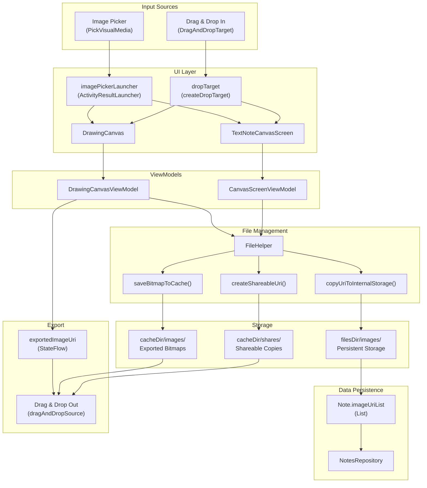
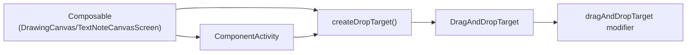
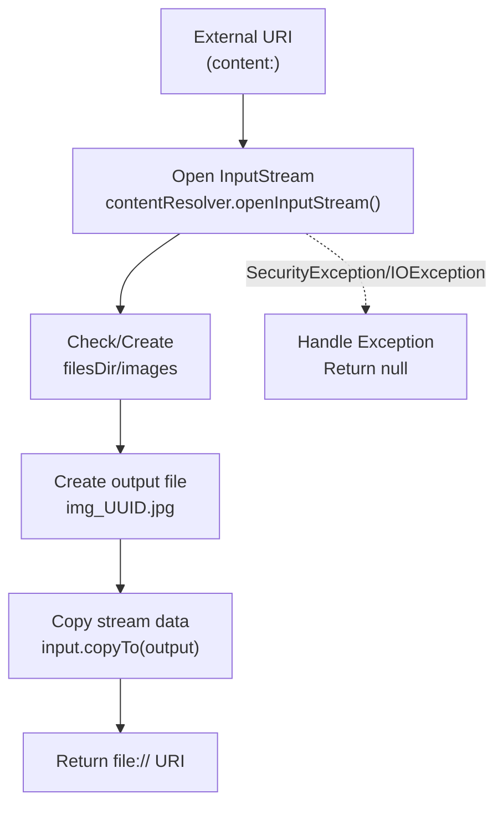
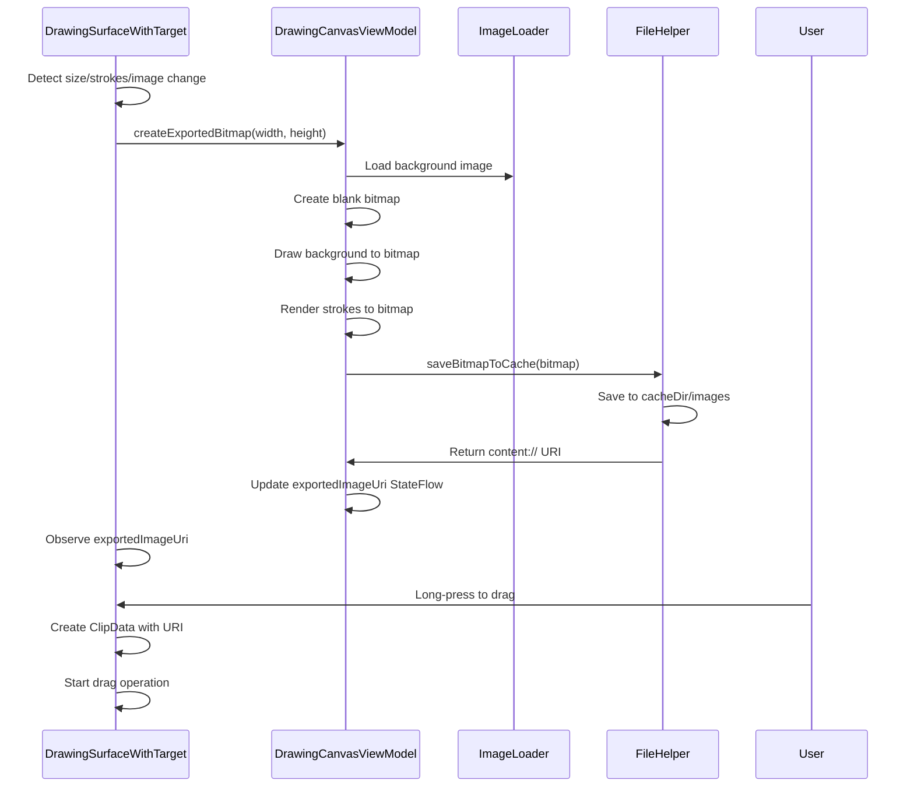

<!-- source: DeepWiki mcp.deepwiki.com · repo android/cahier · page 3.4 Image Management · fetched 2026-10-23 -->

# Image Management

<details>
<summary>Relevant source files</summary>

The following files were used as context for generating this wiki page:

- [app/src/main/java/com/example/cahier/ui/ConfirmationDialog.kt](app/src/main/java/com/example/cahier/ui/ConfirmationDialog.kt)
- [app/src/main/java/com/example/cahier/ui/DrawingCanvas.kt](app/src/main/java/com/example/cahier/ui/DrawingCanvas.kt)
- [app/src/main/java/com/example/cahier/ui/TextNoteCanvasScreen.kt](app/src/main/java/com/example/cahier/ui/TextNoteCanvasScreen.kt)
- [app/src/main/java/com/example/cahier/ui/utils/DragAndDropUtils.kt](app/src/main/java/com/example/cahier/ui/utils/DragAndDropUtils.kt)
- [app/src/main/java/com/example/cahier/utils/FileHelper.kt](app/src/main/java/com/example/cahier/utils/FileHelper.kt)

</details>


## Purpose and Scope

This document describes how the Cahier application handles images across both text notes and drawing notes. It covers the complete image lifecycle: importing images through various input methods, storing them persistently in internal storage, displaying them in the UI, and exporting them for sharing. 

For information about how the drawing canvas itself renders strokes and drawings, see [Drawing Surface & Stroke Rendering](#3.1.2). For details on file system organization and FileProvider configuration, see [File Management](#6.1).

---

## Overview

Images in Cahier serve two distinct purposes:
- **Text Notes**: Multiple images can be attached as discrete items in a scrollable list
- **Drawing Notes**: A single background image provides a canvas layer beneath ink strokes

The system manages three categories of URIs:
1. **External URIs**: Temporary URIs from the image picker or drag-and-drop sources
2. **Internal URIs**: Persistent file:// URIs stored in `filesDir/images`
3. **Shareable URIs**: Temporary content:// URIs in `cacheDir` for cross-app sharing

Sources: [app/src/main/java/com/example/cahier/utils/FileHelper.kt:1-109]()

---

## Architecture Overview



**Diagram: Image Management System Architecture**

Sources: [app/src/main/java/com/example/cahier/ui/DrawingCanvas.kt:87-140](), [app/src/main/java/com/example/cahier/ui/TextNoteCanvasScreen.kt:89-149](), [app/src/main/java/com/example/cahier/utils/FileHelper.kt:38-109]()

---

## Image Import

### Image Picker Integration

Both drawing and text notes use the Android Photo Picker through `ActivityResultContracts.PickVisualMedia`. The launcher is initialized in the composable and invokes ViewModel methods when a URI is selected.

**Drawing Notes:**

```mermaid
sequenceDiagram
    participant User
    participant DrawingCanvas
    participant imagePickerLauncher
    participant DVM as DrawingCanvasViewModel
    participant FH as FileHelper
    participant Note
    
    User->>DrawingCanvas: Tap image icon
    DrawingCanvas->>imagePickerLauncher: launch(PickVisualMediaRequest)
    imagePickerLauncher->>User: Show system picker
    User->>imagePickerLauncher: Select image
    imagePickerLauncher->>DrawingCanvas: Return Uri
    DrawingCanvas->>DrawingCanvas: Check if image exists
    alt imageUriList is not empty
        DrawingCanvas->>DrawingCanvas: Show confirmation dialog
        User->>DrawingCanvas: Confirm replacement
        DrawingCanvas->>DVM: replaceImage(uri)
    else imageUriList is empty
        DrawingCanvas->>DVM: processAndAddImageFromPicker(uri)
    end
    DVM->>FH: copyUriToInternalStorage(uri)
    FH->>FH: Copy to filesDir/images
    FH->>DVM: Return file:// URI
    DVM->>Note: Update imageUriList
```

**Diagram: Drawing Note Image Picker Flow**

Sources: [app/src/main/java/com/example/cahier/ui/DrawingCanvas.kt:97-124]()

The drawing canvas only allows a single background image. When a user selects an image while one already exists, a `ConfirmationDialog` appears [app/src/main/java/com/example/cahier/ui/DrawingCanvas.kt:110-124]().

**Text Notes:**

[app/src/main/java/com/example/cahier/ui/TextNoteCanvasScreen.kt:115-121]()

```kotlin
val imagePickerLauncher = rememberLauncherForActivityResult(
    contract = ActivityResultContracts.PickVisualMedia()
) { uri: Uri? ->
    uri?.let {
        canvasScreenViewModel.handlePickedImageUri(it)
    }
}
```

Text notes support multiple images with no replacement confirmation. Images are appended to the `imageUriList` and displayed in a `LazyColumn` [app/src/main/java/com/example/cahier/ui/TextNoteCanvasScreen.kt:401-410]().

Sources: [app/src/main/java/com/example/cahier/ui/DrawingCanvas.kt:97-108](), [app/src/main/java/com/example/cahier/ui/TextNoteCanvasScreen.kt:115-121](), [app/src/main/java/com/example/cahier/ui/ConfirmationDialog.kt:13-36]()

### Drag-and-Drop Import

Both note types support dragging images from external applications into the canvas. The implementation uses a custom `createDropTarget()` utility function that handles permission management.

**Drop Target Creation:**



**Diagram: Drop Target Initialization**

[app/src/main/java/com/example/cahier/ui/utils/DragAndDropUtils.kt:30-45]()

The `createDropTarget()` function creates a `DragAndDropTarget` that:
1. Extracts the URI from the `DragAndDropEvent`
2. Requests `DragAndDropPermissions` from the activity
3. Invokes a callback with both the URI and permissions

**Drawing Canvas Implementation:**

[app/src/main/java/com/example/cahier/ui/DrawingCanvas.kt:283-287]()

```kotlin
val dropTarget = remember {
    createDropTarget(activity) { uri, permissions ->
        drawingCanvasViewModel.handleDroppedUri(uri, permissions)
    }
}
```

The drop target is attached to the drawing surface using the `dragAndDropTarget` modifier [app/src/main/java/com/example/cahier/ui/DrawingCanvas.kt:314-319](), which filters events to only accept image MIME types:

```kotlin
.dragAndDropTarget(
    shouldStartDragAndDrop = { event ->
        event.mimeTypes().any { it.startsWith("image/") }
    },
    target = dropTarget
)
```

**Text Note Implementation:**

Text notes use an identical pattern [app/src/main/java/com/example/cahier/ui/TextNoteCanvasScreen.kt:188-200](), with the drop target applied to the entire `Surface` composable.

Sources: [app/src/main/java/com/example/cahier/ui/utils/DragAndDropUtils.kt:29-45](), [app/src/main/java/com/example/cahier/ui/DrawingCanvas.kt:283-319](), [app/src/main/java/com/example/cahier/ui/TextNoteCanvasScreen.kt:188-200]()

---

## File Management and Storage

The `FileHelper` class centralizes all file operations, ensuring consistent handling of URIs across the application.

### Internal Storage Strategy

| Operation | Source | Destination | Method |
|-----------|--------|-------------|--------|
| Import (picker/drag-drop) | External content:// URI | `filesDir/images/img_<UUID>.jpg` | `copyUriToInternalStorage()` |
| Export for drag-drop | Internal file:// URI | `cacheDir/images/shared_image_<UUID>.png` | `saveBitmapToCache()` |
| Share from text notes | Internal file:// URI | `cacheDir/shares/<filename>` | `createShareableUri()` |

### URI Copying Process



**Diagram: URI Copying Flow**

[app/src/main/java/com/example/cahier/utils/FileHelper.kt:47-71]()

The copying process is critical because:
- External URIs from drag-and-drop have temporary permissions
- The image picker returns URIs that may not persist
- Internal file:// URIs remain accessible across app restarts

The method uses `withContext(Dispatchers.IO)` for background thread execution and handles both `SecurityException` and `IOException` [app/src/main/java/com/example/cahier/utils/FileHelper.kt:64-70]().

### Cache Management

Two cache directories serve different purposes:

**1. `cacheDir/images` - Exported Drawing Bitmaps**

[app/src/main/java/com/example/cahier/utils/FileHelper.kt:78-89]()

Drawing notes generate bitmap exports that combine the background image and ink strokes. These are saved to the cache directory and exposed via FileProvider for drag-and-drop export. The bitmap is saved in PNG format with 100% quality [app/src/main/java/com/example/cahier/utils/FileHelper.kt:85]().

**2. `cacheDir/shares` - Shareable Copies**

[app/src/main/java/com/example/cahier/utils/FileHelper.kt:96-108]()

Text notes create temporary copies of permanent files for sharing. This approach:
- Preserves the original file in internal storage
- Provides a FileProvider-compatible URI for other apps
- Copies the file with `overwrite = true` to handle repeated shares [app/src/main/java/com/example/cahier/utils/FileHelper.kt:103]()

Sources: [app/src/main/java/com/example/cahier/utils/FileHelper.kt:38-109]()

---

## Image Display

### Drawing Note Background

Drawing notes display a single background image beneath the ink strokes. The image is rendered by the `DrawingSurface` composable.

[app/src/main/java/com/example/cahier/ui/DrawingCanvas.kt:362]()

```kotlin
backgroundImageUri = uiState.note.imageUriList?.firstOrNull(),
```

The URI is passed directly to the drawing surface, which uses Coil's `AsyncImage` to load and display it. The image is only shown when `imageUriList` contains at least one entry. The list structure allows for potential future expansion, though currently only the first image is used.

### Text Note Image List

Text notes display all images in a scrollable list within a `LazyColumn`:

[app/src/main/java/com/example/cahier/ui/TextNoteCanvasScreen.kt:401-410]()

```kotlin
items(
    items = note.imageUriList ?: emptyList(),
    key = { it },
) { imageUriString ->
    NoteImage(
        imageUriString = imageUriString,
        onCreateShareableUri = onCreateShareableUri,
    )
}
```

Each image is rendered by the `NoteImage` composable [app/src/main/java/com/example/cahier/ui/TextNoteCanvasScreen.kt:415-457](), which:
- Uses Coil's `AsyncImage` for loading [app/src/main/java/com/example/cahier/ui/TextNoteCanvasScreen.kt:447-455]()
- Applies `ContentScale.FillWidth` for responsive sizing
- Configures drag-and-drop export (see Image Export section)

Sources: [app/src/main/java/com/example/cahier/ui/DrawingCanvas.kt:362](), [app/src/main/java/com/example/cahier/ui/TextNoteCanvasScreen.kt:401-457]()

---

## Image Export

### Drawing Note Export

Drawing notes export the entire canvas (background image + ink strokes) as a single bitmap. The export process is triggered automatically when the canvas or image changes.



**Diagram: Drawing Export and Drag Initiation**

[app/src/main/java/com/example/cahier/ui/DrawingCanvas.kt:296-308]()

The export is regenerated via `LaunchedEffect` whenever:
- The canvas size changes
- Strokes are added/removed
- The background image changes

The drag operation uses the Android View system's `startDragAndDrop()` rather than Compose's `dragAndDropSource` modifier [app/src/main/java/com/example/cahier/ui/DrawingCanvas.kt:343-357](). This is documented as necessary because the Ink API's drawing gestures conflict with Compose's long-press-to-drag gesture detection.

### Text Note Export

Text notes support dragging individual images from the list. Each `NoteImage` composable configures its own drag source:

[app/src/main/java/com/example/cahier/ui/TextNoteCanvasScreen.kt:420-431]()

```kotlin
LaunchedEffect(imageUriString) {
    val shareableUri = onCreateShareableUri(imageUriString)
    shareableUri.let {
        clipData = ClipData(
            ClipDescription("Image", arrayOf("image/*")),
            ClipData.Item(shareableUri.toString()),
        )
    }
}
```

The `dragAndDropSource` modifier [app/src/main/java/com/example/cahier/ui/TextNoteCanvasScreen.kt:438-445]() provides the ClipData when a drag is initiated:

```kotlin
.dragAndDropSource { _ ->
    clipData?.let {
        DragAndDropTransferData(
            clipData = it,
            flags = View.DRAG_FLAG_GLOBAL or View.DRAG_FLAG_GLOBAL_URI_READ,
        )
    }
}
```

The flags `DRAG_FLAG_GLOBAL` and `DRAG_FLAG_GLOBAL_URI_READ` allow dragging to external applications with read permissions.

Sources: [app/src/main/java/com/example/cahier/ui/DrawingCanvas.kt:296-357](), [app/src/main/java/com/example/cahier/ui/TextNoteCanvasScreen.kt:420-445]()

---

## ViewModel Integration

### DrawingCanvasViewModel

| Method | Purpose | Parameters | Return |
|--------|---------|------------|--------|
| `processAndAddImageFromPicker()` | Handle picked image | `Uri` | - |
| `replaceImage()` | Replace existing image | `Uri?` | - |
| `handleDroppedUri()` | Handle dropped image | `Uri`, `DragAndDropPermissions?` | - |
| `createExportedBitmap()` | Generate export bitmap | `width: Int`, `height: Int` | - |

All import methods follow the same pattern:
1. Call `FileHelper.copyUriToInternalStorage()` to copy to persistent storage
2. Update `Note.imageUriList` with the new file:// URI
3. Persist the note via `NotesRepository`

### CanvasScreenViewModel

| Method | Purpose | Parameters | Return |
|--------|---------|------------|--------|
| `handlePickedImageUri()` | Handle picked image | `Uri` | - |
| `handleDroppedUri()` | Handle dropped image | `Uri`, `DragAndDropPermissions?` | - |
| `createShareableUri()` | Create shareable copy | `String` | `Uri` (suspend) |

The `createShareableUri()` method is unique to text notes and returns a `suspend` function result. It converts internal file:// URIs to FileProvider content:// URIs by:
1. Creating a `File` from the URI string
2. Calling `FileHelper.createShareableUri()` to copy to cache
3. Returning the content:// URI for external access

Sources: [app/src/main/java/com/example/cahier/ui/DrawingCanvas.kt:97-140](), [app/src/main/java/com/example/cahier/ui/TextNoteCanvasScreen.kt:115-149]()

---

## Data Model

Images are stored as a list of URI strings in the `Note` entity:

```kotlin
data class Note(
    val id: Int,
    val title: String,
    // ... other fields
    val imageUriList: List<String>? = null
)
```

The list structure supports:
- **Drawing Notes**: Single image (only first element used)
- **Text Notes**: Multiple images (all elements rendered)
- **Null safety**: Optional field with null default

URI strings are stored in their canonical form (typically `file:///data/user/0/com.example.cahier/files/images/img_<UUID>.jpg`). Room stores this field directly as JSON via type converters defined elsewhere in the data layer.

Sources: Database schema and Note entity (referenced but not shown in provided files)

---

## Permission Handling

### Temporary Permissions

Drag-and-drop operations from external apps provide temporary URI read permissions. The `createDropTarget()` function requests these permissions via `ComponentActivity.requestDragAndDropPermissions()` [app/src/main/java/com/example/cahier/ui/utils/DragAndDropUtils.kt:37]().

These permissions are only valid for the duration of the drag operation. To maintain access, the URI content must be copied to internal storage immediately via `FileHelper.copyUriToInternalStorage()`.

### FileProvider Configuration

Shareable URIs use FileProvider to grant other apps temporary access to cached files. The FileProvider authority is constructed as `${context.packageName}.provider` [app/src/main/java/com/example/cahier/utils/FileHelper.kt:87](), [app/src/main/java/com/example/cahier/utils/FileHelper.kt:105]().

For complete FileProvider configuration details, see [Android Manifest & Permissions](#7.1).

Sources: [app/src/main/java/com/example/cahier/ui/utils/DragAndDropUtils.kt:29-45](), [app/src/main/java/com/example/cahier/utils/FileHelper.kt:78-108]()

---

## Error Handling

The image management system handles several error scenarios:

### Security Exceptions

[app/src/main/java/com/example/cahier/utils/FileHelper.kt:64-66]()

`SecurityException` occurs when attempting to read a URI without proper permissions. The `copyUriToInternalStorage()` method catches this exception, logs it, and returns `null`. ViewModels should handle null returns gracefully.

### IO Exceptions

[app/src/main/java/com/example/cahier/utils/FileHelper.kt:67-70]()

`IOException` occurs for file system errors (disk full, corrupted file, etc.). These are also caught, logged, and result in a null return value.

### Missing Images

If a stored URI no longer points to a valid file (e.g., user cleared app data), Coil's `AsyncImage` handles the failure gracefully by not displaying anything. No crash occurs since Coil manages image loading errors internally.

Sources: [app/src/main/java/com/example/cahier/utils/FileHelper.kt:47-71]()

---

