# Page: Overview

# Overview

<details>
<summary>Relevant source files</summary>

The following files were used as context for generating this wiki page:

- [app/build.gradle.kts](app/build.gradle.kts)
- [app/src/main/AndroidManifest.xml](app/src/main/AndroidManifest.xml)
- [app/src/main/java/com/example/cahier/MainActivity.kt](app/src/main/java/com/example/cahier/MainActivity.kt)
- [app/src/main/java/com/example/cahier/ui/viewmodels/SettingsViewModel.kt](app/src/main/java/com/example/cahier/ui/viewmodels/SettingsViewModel.kt)
- [gradle/libs.versions.toml](gradle/libs.versions.toml)

</details>


This page provides a high-level introduction to the Cahier note-taking application, including its purpose, core features, architectural approach, and technology stack. For detailed information about specific subsystems, see the Architecture ([#2](#2)), Core Features ([#3](#3)), and Data Layer ([#4](#4)) sections.

## Application Purpose

Cahier is an Android note-taking application that specializes in digital ink and drawing capabilities. The application provides two primary note-taking modalities:

1. **Drawing Notes** - Canvas-based notes with advanced ink rendering using the androidx.ink library, supporting custom brushes, colors, sizes, and undo/redo functionality
2. **Text Notes** - Traditional text-based notes with title/body fields and image attachment support

The application is designed as a reference implementation demonstrating best practices for digital ink integration on Android, adaptive UI layouts, and modern Android architecture patterns.

**Sources:** [app/src/main/AndroidManifest.xml:1-63](), [app/src/main/java/com/example/cahier/MainActivity.kt:1-63]()

## Core Features Summary

| Feature | Description | Key Components |
|---------|-------------|----------------|
| Drawing Canvas | High-performance ink rendering with brush customization | `DrawingCanvas`, `DrawingSurface`, `InProgressStrokes` |
| Text Notes | Title/body text editing with image attachments | `TextNoteCanvasScreen`, `CanvasScreenViewModel` |
| Note Management | List/detail view with favorites, deletion, and search | `HomeScreenViewModel`, `CahierHomeScreen` |
| Adaptive Layouts | Responsive UI for phones and tablets | `WindowSizeClass`, `ListDetailPaneScaffold` |
| Custom Brushes | Compressed brush assets loaded from resources | `CustomBrushes` singleton |
| Stroke Persistence | JSON-based serialization of drawing data | `Converters`, `SerializedStroke` |
| Image Management | URI-based image handling with FileProvider | `FileHelper` |
| Multi-Window Support | Multiple note windows via Intent extras | `newWindowEvent` channel |
| Default Notes App | Android ROLE_NOTES integration (API 34+) | `SettingsViewModel`, `RoleManager` |

**Sources:** [app/build.gradle.kts:65-151](), [gradle/libs.versions.toml:1-102]()

## Application Entry Point

The application follows standard Android architecture with a single activity hosting Compose UI:

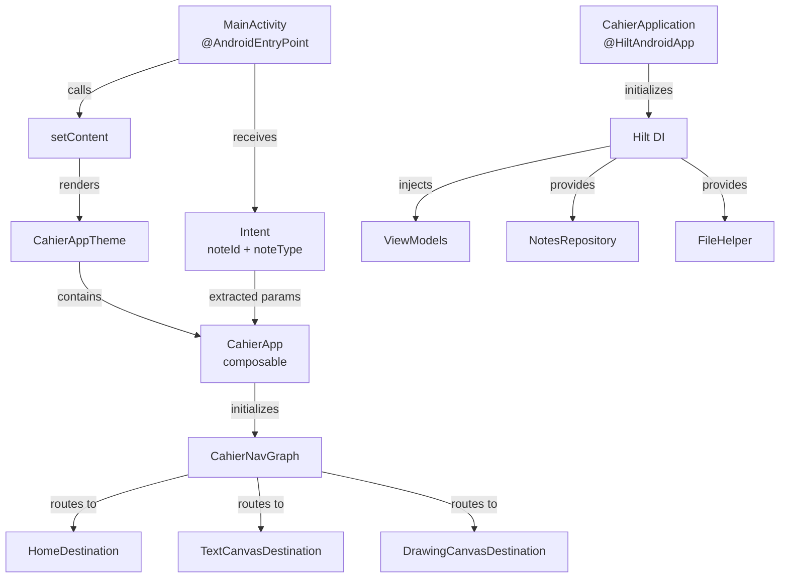

**Application Initialization Flow:**

1. `CahierApplication` class initializes Hilt dependency injection at app launch [app/src/main/AndroidManifest.xml:21]()
2. `MainActivity` is annotated with `@AndroidEntryPoint` for dependency injection [app/src/main/java/com/example/cahier/MainActivity.kt:35]()
3. Intent data extracts `noteId` and `noteType` parameters for deep linking [app/src/main/java/com/example/cahier/MainActivity.kt:41-50]()
4. `CahierApp` composable initializes the navigation graph and routing [app/src/main/java/com/example/cahier/MainActivity.kt:58]()

**Sources:** [app/src/main/java/com/example/cahier/MainActivity.kt:35-62](), [app/src/main/AndroidManifest.xml:20-30]()

## Architecture Overview

Cahier implements a three-tier MVVM architecture with clear separation of concerns:

```mermaid
graph TB
    subgraph Presentation["Presentation Layer"]
        UI["Composables<br/>DrawingCanvas, TextNoteCanvasScreen, CahierHomeScreen"]
        VM["ViewModels<br/>DrawingCanvasViewModel, CanvasScreenViewModel, HomeScreenViewModel"]
    end
    
    subgraph Domain["Domain Layer"]
        REPO["NotesRepository<br/>interface"]
        MODELS["Domain Models<br/>Note, NoteType"]
    end
    
    subgraph Data["Data Layer"]
        IMPL["OfflineNotesRepository<br/>@Singleton"]
        DAO["NoteDao<br/>@Dao"]
        DB["CahierDatabase<br/>Room"]
        CONV["Converters<br/>@TypeConverter"]
    end
    
    subgraph External["External Systems"]
        INK["androidx.ink<br/>InProgressStrokes, CanvasStrokeRenderer"]
        FS["FileSystem<br/>FileHelper, FileProvider"]
        SYS["Android System<br/>RoleManager, WindowSizeClass"]
    end
    
    UI -->|"observes StateFlow"| VM
    VM -->|"calls methods"| REPO
    REPO -.implements.- IMPL
    IMPL -->|"queries"| DAO
    DAO -->|"accesses"| DB
    IMPL -->|"uses"| CONV
    
    VM -->|"uses"| FS
    UI -->|"integrates"| INK
    UI -->|"adapts to"| SYS
    CONV -->|"serializes Stroke from"| INK
```

**Architectural Patterns:**

| Pattern | Implementation | Purpose |
|---------|----------------|---------|
| MVVM | `ViewModel` classes with `StateFlow` properties | Separate UI state from business logic |
| Repository Pattern | `NotesRepository` interface with `OfflineNotesRepository` | Abstract data source implementation |
| Dependency Injection | Hilt/Dagger with `@HiltViewModel`, `@Inject` | Provide testable dependencies |
| Unidirectional Data Flow | UI observes StateFlow, events flow to ViewModel | Predictable state management |
| Single Activity | One `MainActivity` with Compose Navigation | Simplified navigation and lifecycle |

**Sources:** [app/build.gradle.kts:16-23](), [gradle/libs.versions.toml:7-8]()

## Technology Stack

### Core Framework
```
Platform: Android (minSdk 26, targetSdk 36)
UI: Jetpack Compose (BOM 2025.09.01)
Language: Kotlin 2.2.20
Build: Gradle with KSP
```

### Key Dependencies

| Library | Version | Purpose |
|---------|---------|---------|
| androidx.ink | 1.0.0-beta01 | Digital ink rendering and stroke management |
| androidx.room | 2.8.1 | Local database persistence |
| Hilt | 2.57.1 | Dependency injection |
| Coil3 | 3.3.0 | Image loading |
| Gson | 2.13.2 | JSON serialization |
| androidx.navigation | 2.9.5 | Compose navigation |
| androidx.adaptive | 1.1.0 | Responsive layouts |
| androidx.input-motionprediction | 1.0.0-beta06 | Touch prediction for ink rendering |

**Ink Library Components:**
- `ink-authoring` - Stroke capture and input handling
- `ink-rendering` - High-performance stroke rendering
- `ink-strokes` - Stroke data structures
- `ink-brush` - Brush definitions and management
- `ink-geometry` - Geometric primitives
- `ink-storage` - Stroke serialization

**Sources:** [gradle/libs.versions.toml:1-102](), [app/build.gradle.kts:65-151]()

## Project Structure

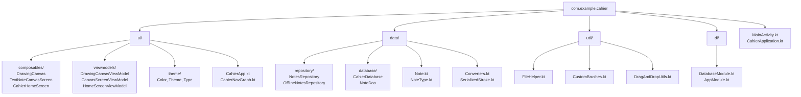

**Package Organization:**

- **`ui/`** - Presentation layer with Composables, ViewModels, and navigation
- **`data/`** - Data layer with repository, database, and domain models
- **`util/`** - Utility classes for file management, brushes, and drag-and-drop
- **`di/`** - Hilt modules for dependency injection configuration

**Sources:** [app/src/main/java/com/example/cahier/MainActivity.kt:19]()

## System Integration Points

Cahier integrates with several Android system features:

**Intent Handling:**
- Responds to `ACTION_CREATE_NOTE` intent for system-wide note creation [app/src/main/AndroidManifest.xml:46]()
- Supports deep linking with `noteId` and `noteType` parameters [app/src/main/java/com/example/cahier/MainActivity.kt:41-50]()

**Multi-Window Support:**
- Declares `resizeableActivity="true"` [app/src/main/AndroidManifest.xml:38]()
- Supports `PROPERTY_SUPPORTS_MULTI_INSTANCE_SYSTEM_UI` [app/src/main/AndroidManifest.xml:42]()
- Uses `launchMode="singleInstancePerTask"` for proper window management [app/src/main/AndroidManifest.xml:39]()

**File Sharing:**
- Configures `FileProvider` with custom authority [app/src/main/AndroidManifest.xml:54-62]()
- Enables secure URI sharing for images and exported drawings

**Default Notes App (API 34+):**
- Integrates with `RoleManager.ROLE_NOTES` system role [app/src/main/java/com/example/cahier/ui/viewmodels/SettingsViewModel.kt:64-67]()
- Allows user to set Cahier as default notes app via `SettingsViewModel`

**Sources:** [app/src/main/AndroidManifest.xml:31-63](), [app/src/main/java/com/example/cahier/ui/viewmodels/SettingsViewModel.kt:39-127]()

## Data Flow Overview

The application follows a unidirectional data flow pattern:

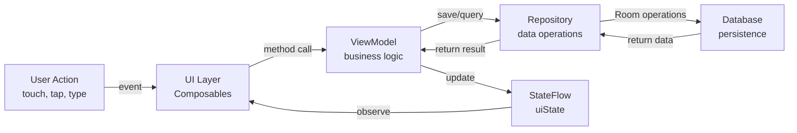

**Flow Characteristics:**
1. **User Input** → UI captures touch, keyboard, or picker events
2. **Event Handling** → UI calls ViewModel methods (e.g., `updateNoteTitle`, `onStrokesFinished`)
3. **State Update** → ViewModel updates `StateFlow` properties
4. **UI Reaction** → Composables recompose based on observed state
5. **Persistence** → ViewModel triggers repository operations for data persistence

**Sources:** [app/build.gradle.kts:75-77]()

## Build Configuration

**Gradle Setup:**
```
AGP: 8.13.0
Kotlin: 2.2.20
Compose Compiler: 2.2.20
KSP: 2.2.20-2.0.3
Target SDK: 36
Min SDK: 26
```

**Build Plugins:**
- `com.android.application` - Android application plugin [app/build.gradle.kts:17]()
- `org.jetbrains.kotlin.android` - Kotlin Android plugin [app/build.gradle.kts:18]()
- `com.google.devtools.ksp` - Kotlin Symbol Processing for Room and Hilt [app/build.gradle.kts:19]()
- `org.jetbrains.kotlin.plugin.compose` - Compose compiler plugin [app/build.gradle.kts:20]()
- `kotlin-parcelize` - Parcelable generation [app/build.gradle.kts:21]()
- `com.google.dagger.hilt.android` - Hilt dependency injection [app/build.gradle.kts:22]()

**Compiler Options:**
- Java toolchain: Version 17 [app/build.gradle.kts:153-155]()
- Vector drawable support library enabled [app/build.gradle.kts:37-39]()
- Compose build features enabled [app/build.gradle.kts:55-57]()

**Sources:** [app/build.gradle.kts:16-63](), [gradle/libs.versions.toml:1-102]()

## Testing Infrastructure

**Testing Strategy:**

| Test Type | Framework | Purpose |
|-----------|-----------|---------|
| Unit Tests | JUnit 4, Mockito, Turbine | ViewModel logic and Flow testing |
| Instrumented Tests | AndroidX Test, Espresso, Hilt Testing | UI and database integration |

**Key Testing Libraries:**
- **Turbine 1.2.1** - Flow testing with clean assertion APIs [gradle/libs.versions.toml:37]()
- **Mockito 5.20.0** - Mock object creation for unit tests [gradle/libs.versions.toml:33]()
- **Hilt Testing** - Dependency injection in tests [gradle/libs.versions.toml:93]()
- **AndroidX Arch Core Testing** - InstantTaskExecutorRule for LiveData/Flow [gradle/libs.versions.toml:35]()

**Test Configuration:**
- Custom `HiltTestRunner` for instrumented tests [app/build.gradle.kts:36]()
- KSP annotation processing for test dependencies [app/build.gradle.kts:115]()

**Sources:** [app/build.gradle.kts:92-116](), [gradle/libs.versions.toml:32-96]()

## Navigation Summary

The application uses type-safe Compose Navigation with three primary destinations:

1. **HomeDestination** - Note list and selection screen (route: `"home"`)
2. **TextCanvasDestination** - Text note editor (route: `"note_canvas/{id}"`)
3. **DrawingCanvasDestination** - Drawing canvas editor (route: `"drawing_canvas/{id}"`)

Navigation adapts based on `WindowSizeClass`:
- **Compact devices** (phones) - Full-screen transitions with back navigation
- **Expanded devices** (tablets) - List-detail layout with simultaneous display

For detailed navigation architecture, see [Navigation System](#2.3).

**Sources:** [app/build.gradle.kts:77-78]()

---

# Page: Architecture

# Architecture

<details>
<summary>Relevant source files</summary>

The following files were used as context for generating this wiki page:

- [app/build.gradle.kts](app/build.gradle.kts)
- [app/src/androidTest/java/com/example/cahier/utils/FileHelperTest.kt](app/src/androidTest/java/com/example/cahier/utils/FileHelperTest.kt)
- [app/src/main/java/com/example/cahier/MainActivity.kt](app/src/main/java/com/example/cahier/MainActivity.kt)
- [app/src/main/java/com/example/cahier/navigation/CahierNavGraph.kt](app/src/main/java/com/example/cahier/navigation/CahierNavGraph.kt)
- [app/src/main/java/com/example/cahier/ui/ColorPickerDialog.kt](app/src/main/java/com/example/cahier/ui/ColorPickerDialog.kt)
- [app/src/main/java/com/example/cahier/ui/viewmodels/HomeScreenViewModel.kt](app/src/main/java/com/example/cahier/ui/viewmodels/HomeScreenViewModel.kt)
- [app/src/test/java/com/example/cahier/ui/viewmodels/HomeScreenViewModelTest.kt](app/src/test/java/com/example/cahier/ui/viewmodels/HomeScreenViewModelTest.kt)
- [gradle/libs.versions.toml](gradle/libs.versions.toml)

</details>


## Purpose and Scope

This document provides an overview of the architectural patterns and structural organization of the Cahier application. It describes the three-tier architecture, the MVVM pattern implementation, dependency injection setup, and navigation structure. For detailed information on specific aspects of the architecture, see:
- MVVM pattern and state management details: [MVVM Pattern & State Management](#2.1)
- Hilt configuration and dependency graphs: [Dependency Injection with Hilt](#2.2)
- Navigation routes and screen transitions: [Navigation System](#2.3)

---

## Architectural Overview

Cahier follows a three-tier architecture pattern that separates concerns into distinct layers:

| Layer | Responsibilities | Key Components |
|-------|-----------------|----------------|
| **Presentation Layer** | UI rendering, user interactions, state observation | Composable screens, ViewModels, UI state classes |
| **Data Layer** | Data persistence, business logic, data transformation | Repository interfaces/implementations, Room database, DAOs |
| **Utility Layer** | Cross-cutting concerns, helper functions | FileHelper, CustomBrushes, Converters |

The architecture enforces unidirectional data flow: user actions flow from UI → ViewModel → Repository → Database, while data updates flow back through Repository → ViewModel → UI via StateFlows.

### Three-Tier Architecture Diagram

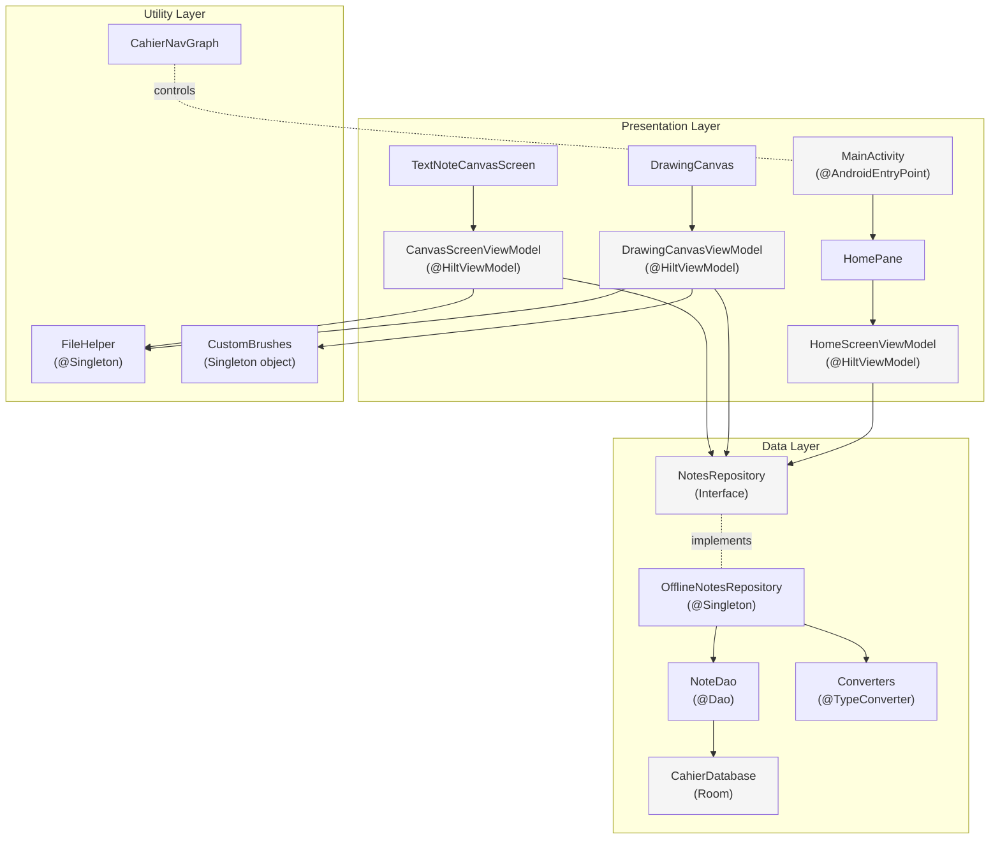

**Sources:** [app/src/main/java/com/example/cahier/MainActivity.kt:35-36](), [app/src/main/java/com/example/cahier/ui/viewmodels/HomeScreenViewModel.kt:43-46](), [app/src/main/java/com/example/cahier/navigation/CahierNavGraph.kt:37-80]()

---

## MVVM Pattern Implementation

The application implements the Model-View-ViewModel (MVVM) architectural pattern using Jetpack Compose and Kotlin coroutines.

### Components

**ViewModels** serve as the intermediary between UI and data layers. All ViewModels are annotated with `@HiltViewModel` for dependency injection:

- `HomeScreenViewModel` - Manages note list state and note selection [app/src/main/java/com/example/cahier/ui/viewmodels/HomeScreenViewModel.kt:43-46]()
- `DrawingCanvasViewModel` - Manages drawing strokes, brush state, and history (not shown in provided files, but referenced in diagrams)
- `CanvasScreenViewModel` - Manages text note content and images (not shown in provided files, but referenced in diagrams)

**State Management** uses Kotlin StateFlows for reactive UI updates. ViewModels expose immutable `StateFlow<T>` instances to UI components:

```kotlin
// Example from HomeScreenViewModel
private val _uiState = MutableStateFlow(CahierUiState())
val uiState: StateFlow<CahierUiState> = _uiState.asStateFlow()
```

**Views** are implemented as Composable functions that observe ViewModel state using `collectAsState()` or `collectAsStateWithLifecycle()`.

### State Flow Pattern

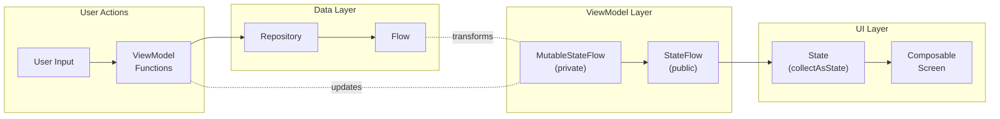

**Sources:** [app/src/main/java/com/example/cahier/ui/viewmodels/HomeScreenViewModel.kt:48-49](), [app/src/main/java/com/example/cahier/ui/viewmodels/HomeScreenViewModel.kt:59-65]()

---

## Dependency Injection with Hilt

The application uses Hilt (built on Dagger) for compile-time dependency injection. This enables:
- Constructor injection for ViewModels and repositories
- Singleton lifecycle management
- Testability through interface abstractions

### Hilt Configuration

The dependency injection graph is established through annotations:

| Annotation | Applied To | Purpose |
|------------|-----------|---------|
| `@HiltAndroidApp` | `CahierApplication` | Triggers Hilt code generation, initializes DI container |
| `@AndroidEntryPoint` | `MainActivity` | Enables injection into Android components |
| `@HiltViewModel` | ViewModel classes | Enables ViewModel injection via ViewModelProvider |
| `@InstallIn(SingletonComponent::class)` | Module classes | Specifies component scope for provided dependencies |

### Dependency Graph Example

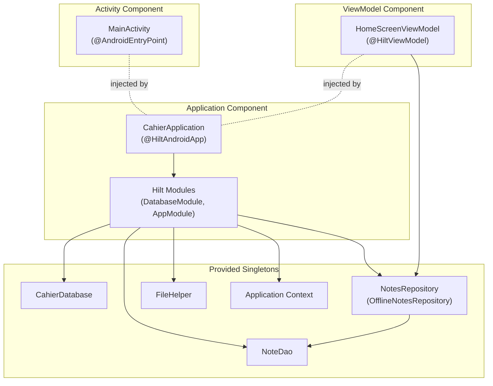

The `@Inject` constructor annotation declares dependencies:

[app/src/main/java/com/example/cahier/ui/viewmodels/HomeScreenViewModel.kt:44-46]()
```kotlin
@HiltViewModel
class HomeScreenViewModel @Inject constructor(
    private val noteRepository: NotesRepository
) : ViewModel()
```

**Sources:** [app/src/main/java/com/example/cahier/MainActivity.kt:35-36](), [app/src/main/java/com/example/cahier/ui/viewmodels/HomeScreenViewModel.kt:43-46](), [app/build.gradle.kts:22](), [gradle/libs.versions.toml:7](), [gradle/libs.versions.toml:58-59]()

For detailed Hilt module configuration and testing setup, see [Dependency Injection with Hilt](#2.2).

---

## Navigation Structure

Navigation is implemented using Jetpack Navigation Compose with type-safe route definitions.

### Navigation Destinations

The application defines three navigation destinations in [app/src/main/java/com/example/cahier/navigation/CahierNavGraph.kt:30-93]():

| Destination | Route | Arguments | Screen |
|-------------|-------|-----------|--------|
| `HomeDestination` | `"home"` | None | `HomePane` (note list/detail) |
| `TextCanvasDestination` | `"note_canvas/{noteId}"` | `noteId: Long` | `TextNoteCanvasScreen` |
| `DrawingCanvasDestination` | `"drawing_canvas/{noteId}"` | `noteId: Long` | `DrawingCanvas` |

### Navigation Graph Structure

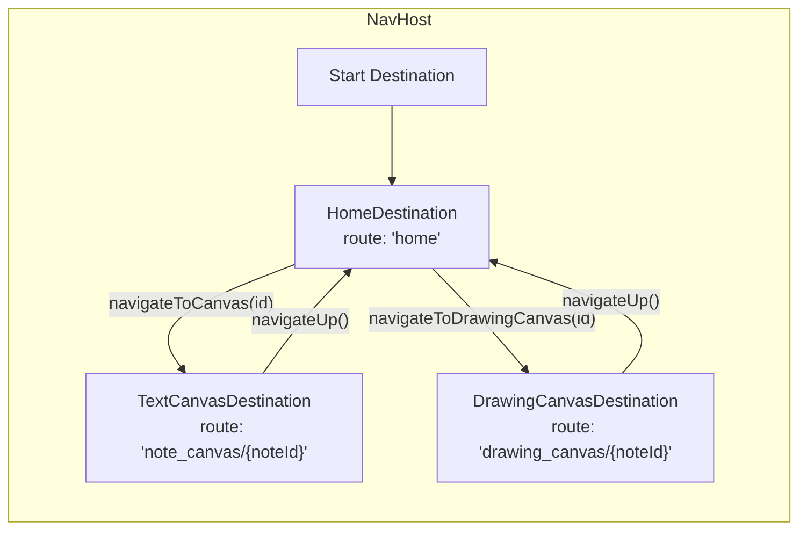

### Navigation Implementation

The `CahierNavHost` composable defines the navigation graph:

[app/src/main/java/com/example/cahier/navigation/CahierNavGraph.kt:41-45]()
```kotlin
NavHost(
    navController = navController,
    startDestination = HomeDestination.route,
    modifier = modifier
)
```

Navigation arguments are extracted using `SavedStateHandle` in ViewModels (pattern not shown in provided files but referenced in architecture diagrams).

**Sources:** [app/src/main/java/com/example/cahier/navigation/CahierNavGraph.kt:37-93](), [app/src/main/java/com/example/cahier/MainActivity.kt:41-50]()

For details on navigation implementation and argument passing, see [Navigation System](#2.3).

---

## Key Architectural Components

### Entry Point: MainActivity

`MainActivity` serves as the application entry point and Hilt injection point:

[app/src/main/java/com/example/cahier/MainActivity.kt:35-39]()
```kotlin
@AndroidEntryPoint
class MainActivity : ComponentActivity() {
    override fun onCreate(savedInstanceState: Bundle?) {
        super.onCreate(savedInstanceState)
        enableEdgeToEdge()
```

The activity:
1. Extracts Intent extras for multi-window support (`noteId`, `noteType`)
2. Initializes the Compose UI with `CahierApp`
3. Applies Material Design 3 theming via `CahierAppTheme`

### Repository Pattern

The data layer uses the repository pattern to abstract data sources:

- **Interface:** `NotesRepository` defines data operations (not in provided files)
- **Implementation:** `OfflineNotesRepository` implements Room database access (not in provided files)
- **DAO:** `NoteDao` provides Room query methods (not in provided files)

ViewModels depend only on the `NotesRepository` interface, enabling test doubles:

[app/src/main/java/com/example/cahier/ui/viewmodels/HomeScreenViewModel.kt:44-46]()

### Component Interaction Flow

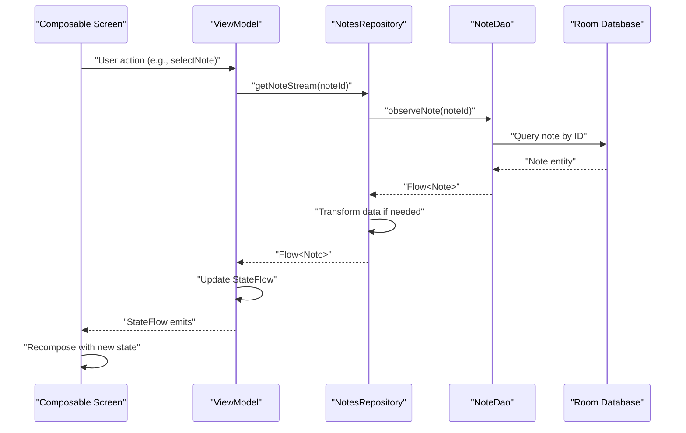

**Sources:** [app/src/main/java/com/example/cahier/ui/viewmodels/HomeScreenViewModel.kt:67-89]()

---

## Technology Stack

The architecture leverages the following key libraries and frameworks:

### Core Framework Dependencies

| Library | Version | Purpose |
|---------|---------|---------|
| Jetpack Compose | BOM 2025.09.01 | Declarative UI framework |
| Kotlin | 2.2.20 | Primary programming language |
| Coroutines | (via Kotlin stdlib) | Asynchronous programming |

### Architecture Components

| Library | Version | Purpose |
|---------|---------|---------|
| Hilt | 2.57.1 | Dependency injection |
| Navigation Compose | 2.9.5 | Type-safe navigation |
| Lifecycle ViewModel Compose | 2.9.4 | ViewModel integration |
| Room | 2.8.1 | SQLite abstraction |

### Drawing System

| Library | Version | Purpose |
|---------|---------|---------|
| androidx.ink.* | 1.0.0-beta01 | Ink rendering and stroke management |
| Input Motion Prediction | 1.0.0-beta06 | Stylus input prediction |

### Supporting Libraries

| Library | Version | Purpose |
|---------|---------|---------|
| Coil | 3.3.0 | Image loading |
| Gson | 2.13.2 | JSON serialization |
| Material3 Adaptive | 1.4.0 | Responsive layouts |

**Sources:** [gradle/libs.versions.toml:1-97](), [app/build.gradle.kts:65-151]()

---

## Testing Architecture

The architecture supports two testing strategies:

### Unit Testing
- Uses `FakeNotesRepository` implementation for isolated ViewModel tests
- Turbine library for testing Kotlin Flows
- Mockito for mocking dependencies
- Example: [app/src/test/java/com/example/cahier/ui/viewmodels/HomeScreenViewModelTest.kt:45-136]()

### Instrumented Testing
- Uses `HiltTestRunner` for dependency injection in Android tests
- Enables replacement of production modules with test doubles
- Tests real Room database interactions
- Example: [app/src/androidTest/java/com/example/cahier/utils/FileHelperTest.kt:47-108]()

**Test Configuration:**

[app/build.gradle.kts:36]()
```kotlin
testInstrumentationRunner = "com.example.cahier.HiltTestRunner"
```

[app/build.gradle.kts:113-115]()
```kotlin
// Hilt Testing
androidTestImplementation(libs.hilt.android.testing)
kspAndroidTest(libs.hilt.android.compiler)
```

**Sources:** [app/build.gradle.kts:36](), [app/build.gradle.kts:92-115](), [gradle/libs.versions.toml:88-96]()

---

## Build Configuration

The application uses Kotlin DSL for Gradle configuration with the following plugins:

[app/build.gradle.kts:16-23]()
```kotlin
plugins {
    alias(libs.plugins.androidApplication)
    alias(libs.plugins.jetbrainsKotlinAndroid)
    alias(libs.plugins.ksp)
    id("org.jetbrains.kotlin.plugin.compose") version "2.2.20"
    id("kotlin-parcelize")
    id("com.google.dagger.hilt.android")
}
```

| Plugin | Purpose |
|--------|---------|
| Android Application | Android app build configuration |
| Kotlin Android | Kotlin compilation for Android |
| KSP | Kotlin Symbol Processing (Room, Hilt) |
| Compose Compiler | Jetpack Compose compilation |
| Parcelize | Parcelable code generation |
| Hilt Android | Hilt dependency injection |

**Minimum SDK:** 26 (Android 8.0)  
**Target/Compile SDK:** 36  
**Java Compatibility:** Java 17

**Sources:** [app/build.gradle.kts:16-63](), [gradle/libs.versions.toml:98-102]()

---

# Page: MVVM Pattern & State Management

# MVVM Pattern & State Management

<details>
<summary>Relevant source files</summary>

The following files were used as context for generating this wiki page:

- [app/src/androidTest/java/com/example/cahier/utils/FileHelperTest.kt](app/src/androidTest/java/com/example/cahier/utils/FileHelperTest.kt)
- [app/src/main/java/com/example/cahier/navigation/CahierNavGraph.kt](app/src/main/java/com/example/cahier/navigation/CahierNavGraph.kt)
- [app/src/main/java/com/example/cahier/ui/ColorPickerDialog.kt](app/src/main/java/com/example/cahier/ui/ColorPickerDialog.kt)
- [app/src/main/java/com/example/cahier/ui/viewmodels/CanvasScreenViewModel.kt](app/src/main/java/com/example/cahier/ui/viewmodels/CanvasScreenViewModel.kt)
- [app/src/main/java/com/example/cahier/ui/viewmodels/DrawingCanvasViewModel.kt](app/src/main/java/com/example/cahier/ui/viewmodels/DrawingCanvasViewModel.kt)
- [app/src/main/java/com/example/cahier/ui/viewmodels/HomeScreenViewModel.kt](app/src/main/java/com/example/cahier/ui/viewmodels/HomeScreenViewModel.kt)
- [app/src/test/java/com/example/cahier/ui/viewmodels/HomeScreenViewModelTest.kt](app/src/test/java/com/example/cahier/ui/viewmodels/HomeScreenViewModelTest.kt)

</details>


## Purpose and Scope

This document explains how the Cahier application implements the Model-View-ViewModel (MVVM) architectural pattern and manages application state through reactive data flows. It covers the structure of ViewModels, the use of `StateFlow` for state management, and the unidirectional data flow pattern that ensures predictable state updates.

For information about dependency injection into ViewModels, see [Dependency Injection with Hilt](#2.2). For navigation setup and routing, see [Navigation System](#2.3). For repository patterns and data persistence, see [Repository Pattern & NotesRepository](#4.1).

---

## MVVM Architecture Overview

Cahier implements a strict three-layer MVVM architecture where each layer has distinct responsibilities:

- **View Layer**: Composable UI functions that observe state and emit user events
- **ViewModel Layer**: Business logic controllers that manage UI state and coordinate data operations
- **Model Layer**: Repository abstractions and data sources (Room database, file system)

**MVVM Layers and Communication Flow**

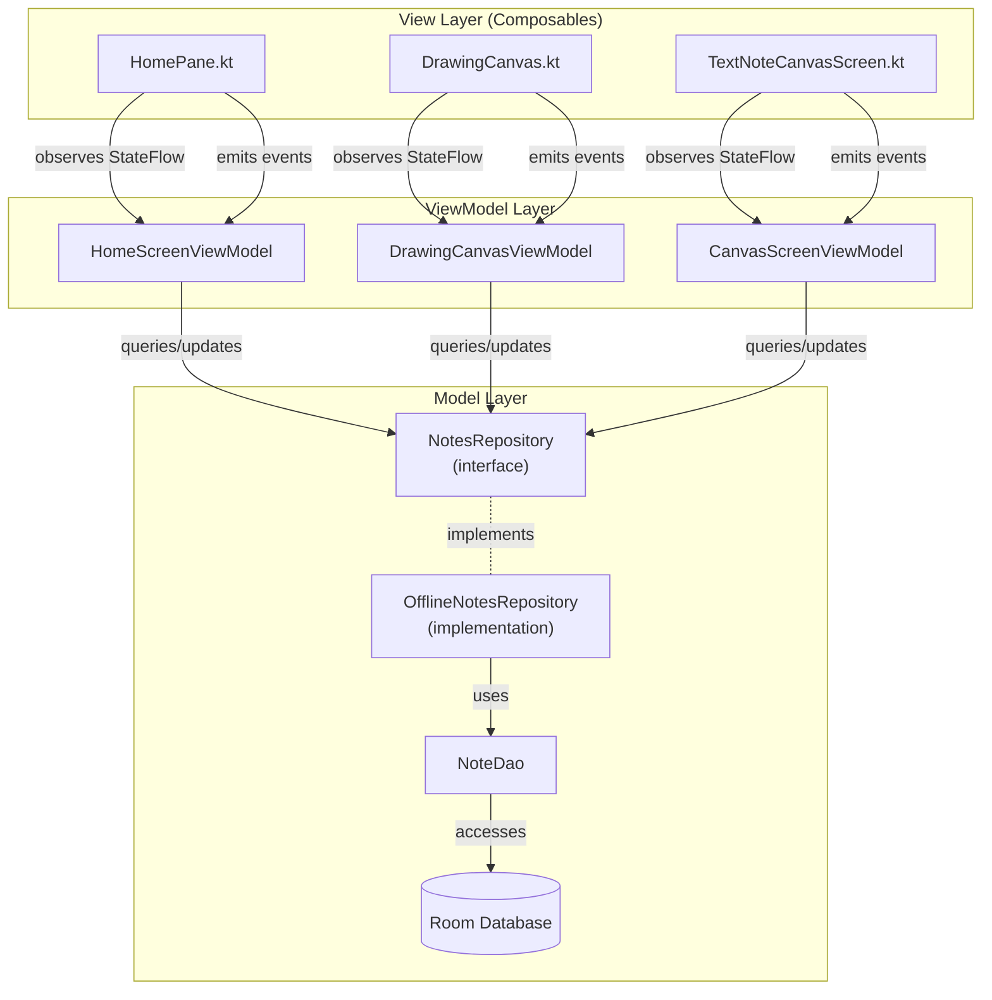

**Sources:** [app/src/main/java/com/example/cahier/ui/viewmodels/HomeScreenViewModel.kt](), [app/src/main/java/com/example/cahier/ui/viewmodels/DrawingCanvasViewModel.kt](), [app/src/main/java/com/example/cahier/ui/viewmodels/CanvasScreenViewModel.kt]()

---

## ViewModel Layer Structure

### Core ViewModels

The application contains three primary ViewModels, each managing state for a specific screen:

| ViewModel | Screen | Primary Responsibility | State Complexity |
|-----------|--------|------------------------|------------------|
| `HomeScreenViewModel` | Home screen with note list | Note list management, note selection, note creation/deletion | Low - Simple note list |
| `DrawingCanvasViewModel` | Drawing canvas | Stroke rendering, brush management, undo/redo history, image handling | High - Complex drawing state |
| `CanvasScreenViewModel` | Text note canvas | Text editing, title updates, image attachments | Medium - Text and images |

### ViewModel Base Structure

All ViewModels follow a consistent structure using Hilt for dependency injection:

**ViewModel Declaration Pattern**

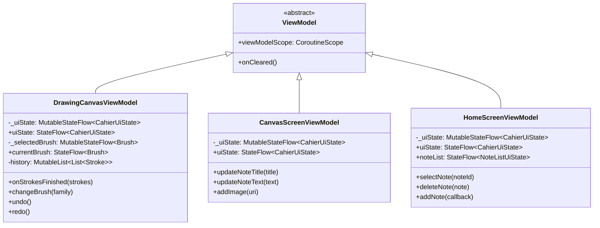

**Sources:** [app/src/main/java/com/example/cahier/ui/viewmodels/DrawingCanvasViewModel.kt:66-73](), [app/src/main/java/com/example/cahier/ui/viewmodels/CanvasScreenViewModel.kt:43-48](), [app/src/main/java/com/example/cahier/ui/viewmodels/HomeScreenViewModel.kt:43-46]()

### Dependency Injection

All ViewModels use the `@HiltViewModel` annotation and constructor injection:

```kotlin
@HiltViewModel
class DrawingCanvasViewModel @Inject constructor(
    @ApplicationContext private val context: Context,
    savedStateHandle: SavedStateHandle,
    private val noteRepository: NotesRepository,
    val fileHelper: FileHelper,
    private val imageLoader: ImageLoader
) : ViewModel()
```

**Common Dependencies:**

- `NotesRepository`: Data access for note CRUD operations
- `SavedStateHandle`: Access to navigation arguments (noteId)
- `FileHelper`: File operations for images
- `Context`: System services (DrawingCanvasViewModel only)
- `ImageLoader`: Coil image loading (DrawingCanvasViewModel only)

**Sources:** [app/src/main/java/com/example/cahier/ui/viewmodels/DrawingCanvasViewModel.kt:66-73](), [app/src/main/java/com/example/cahier/ui/viewmodels/CanvasScreenViewModel.kt:43-48]()

### Navigation Arguments via SavedStateHandle

ViewModels receive navigation arguments through `SavedStateHandle`, which provides type-safe access to route parameters:

**Navigation Argument Pattern**

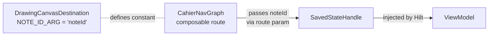

Example from DrawingCanvasViewModel:

```kotlin
private val noteId: Long = savedStateHandle[DrawingCanvasDestination.NOTE_ID_ARG] ?: 0L
```

**Sources:** [app/src/main/java/com/example/cahier/ui/viewmodels/DrawingCanvasViewModel.kt:78](), [app/src/main/java/com/example/cahier/ui/viewmodels/CanvasScreenViewModel.kt:52](), [app/src/main/java/com/example/cahier/navigation/CahierNavGraph.kt:82-93]()

---

## State Management with StateFlow

### Immutable State Pattern

The application uses `StateFlow` for reactive state management, following an immutable state pattern where state is never modified directly:

**StateFlow Declaration Pattern**

```kotlin
// Private mutable state - only ViewModel can write
private val _uiState = MutableStateFlow(CahierUiState())

// Public immutable state - UI can only read
val uiState: StateFlow<CahierUiState> = _uiState.asStateFlow()
```

This pattern ensures:
- **Single source of truth**: Only the ViewModel can modify state
- **Predictable updates**: UI receives state changes through reactive streams
- **Thread safety**: StateFlow handles synchronization automatically

**Sources:** [app/src/main/java/com/example/cahier/ui/viewmodels/DrawingCanvasViewModel.kt:75-76](), [app/src/main/java/com/example/cahier/ui/viewmodels/CanvasScreenViewModel.kt:49-50](), [app/src/main/java/com/example/cahier/ui/viewmodels/HomeScreenViewModel.kt:48-49]()

### State Update Mechanisms

**State Flow Update Patterns**

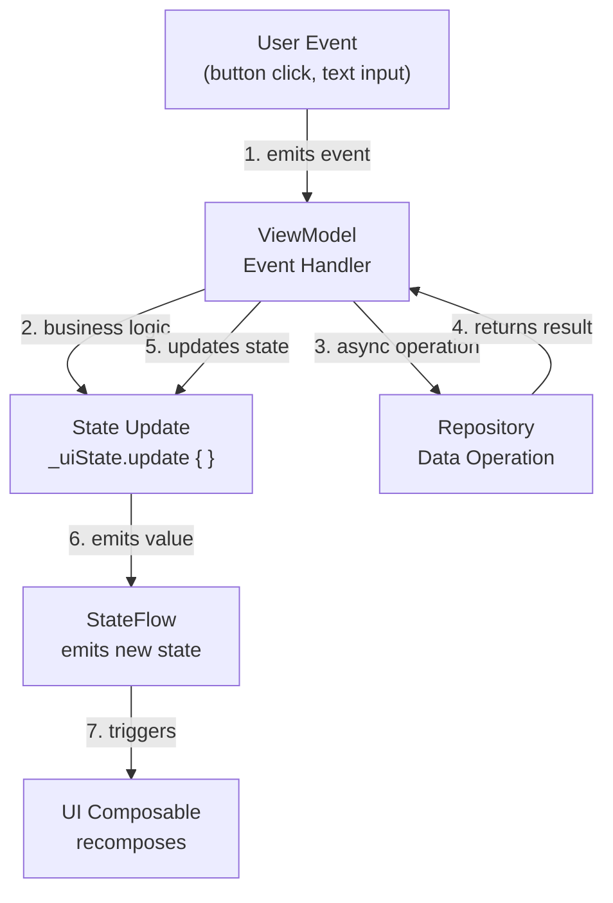

**Update Pattern 1: Immediate State Update**

Used for UI-only changes that don't require persistence:

```kotlin
// Example from DrawingCanvasViewModel
fun setEraserMode(enabled: Boolean) {
    _isEraserMode.update { enabled }
}
```

**Update Pattern 2: State Update with Repository Sync**

Used for changes that must be persisted:

```kotlin
// Example from CanvasScreenViewModel
fun updateNoteTitle(title: String) {
    updateNoteField(title) { note, value -> note.copy(title = value) }
}

private fun <T> updateNoteField(value: T, updater: (Note, T) -> Note) {
    _uiState.value = _uiState.value.copy(
        note = updater(_uiState.value.note, value)
    )
    viewModelScope.launch {
        if (noteId != null)
            noteRepository.updateNote(_uiState.value.note)
    }
}
```

**Update Pattern 3: State Update with History**

Used in DrawingCanvasViewModel for undo/redo support:

```kotlin
private fun updateStrokes(newStrokes: List<Stroke>) {
    // Clear forward history if user makes new change
    if (historyIndex < history.size - 1) {
        history.subList(historyIndex + 1, history.size).clear()
    }
    history.add(newStrokes)
    historyIndex++
    
    _uiState.update { it.copy(strokes = newStrokes) }
    updateUndoRedoState()
}
```

**Sources:** [app/src/main/java/com/example/cahier/ui/viewmodels/DrawingCanvasViewModel.kt:168-177](), [app/src/main/java/com/example/cahier/ui/viewmodels/CanvasScreenViewModel.kt:74-94](), [app/src/main/java/com/example/cahier/ui/viewmodels/DrawingCanvasViewModel.kt:404-406]()

### State Observation in UI

Composables observe StateFlow using `collectAsState()`:

```kotlin
@Composable
fun DrawingCanvas() {
    val viewModel: DrawingCanvasViewModel = hiltViewModel()
    val uiState by viewModel.uiState.collectAsState()
    val currentBrush by viewModel.currentBrush.collectAsState()
    
    // UI recomposes when state changes
    DrawingSurface(
        strokes = uiState.strokes,
        currentBrush = currentBrush
    )
}
```

**Sources:** Based on common Compose patterns used throughout UI layer

---

## Unidirectional Data Flow

The application enforces unidirectional data flow: events flow up, state flows down.

**Unidirectional Data Flow Architecture**

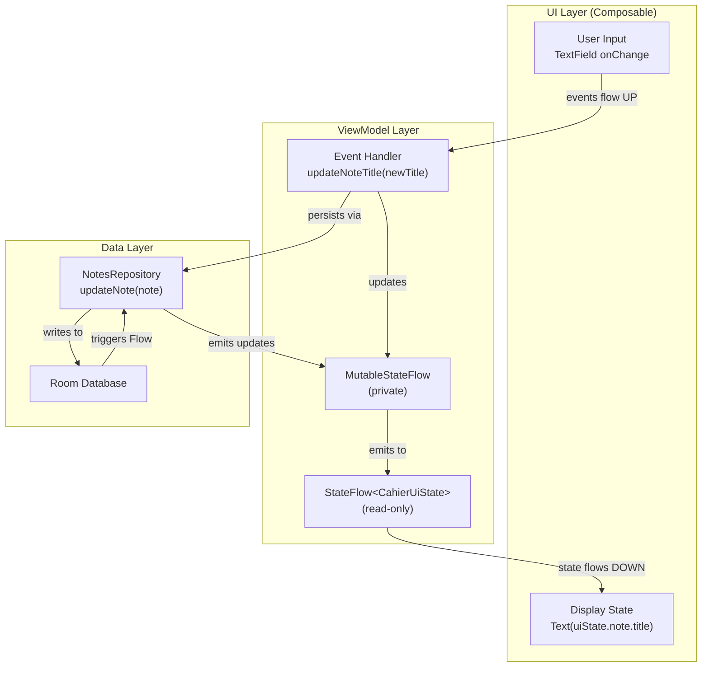

**Key Principles:**

1. **Events Flow Up**: UI components emit events (function calls) to ViewModels
2. **State Flows Down**: ViewModels emit state (StateFlow) to UI components
3. **No Direct State Mutation**: UI never modifies state directly
4. **Single Source of Truth**: ViewModel owns the state

**Example Flow: Title Update in Text Note**

1. User types in TextField → `onChange` callback invoked
2. UI calls `viewModel.updateNoteTitle(newTitle)`
3. ViewModel updates internal `_uiState` with new title
4. ViewModel launches coroutine to persist via `noteRepository.updateNote()`
5. Repository updates database
6. StateFlow emits new state to UI
7. UI recomposes with updated title

**Sources:** [app/src/main/java/com/example/cahier/ui/viewmodels/CanvasScreenViewModel.kt:74-94]()

---

## Complex State Management: Drawing History System

The `DrawingCanvasViewModel` demonstrates sophisticated state management with undo/redo functionality, illustrating how complex state transitions are handled.

**Drawing History State Management**

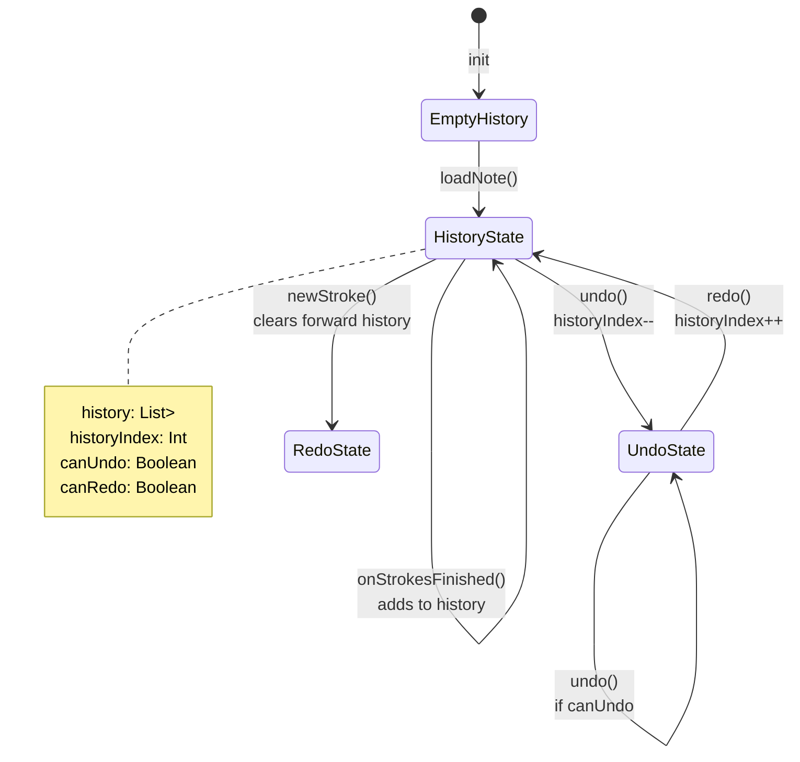

### History State Structure

The history system maintains multiple StateFlows for coordinated state:

```kotlin
// History data structures
private val history = mutableListOf<List<Stroke>>()
private var historyIndex = -1

// Undo/redo capability state
private val _canUndo = MutableStateFlow(false)
val canUndo: StateFlow<Boolean> = _canUndo.asStateFlow()

private val _canRedo = MutableStateFlow(false)
val canRedo: StateFlow<Boolean> = _canRedo.asStateFlow()
```

**Sources:** [app/src/main/java/com/example/cahier/ui/viewmodels/DrawingCanvasViewModel.kt:101-106]()

### History Update Logic

**Undo/Redo State Machine**

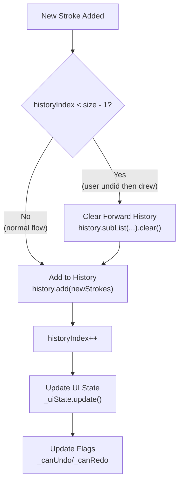

Implementation:

```kotlin
private fun updateStrokes(newStrokes: List<Stroke>) {
    if (historyIndex < history.size - 1) {
        history.subList(historyIndex + 1, history.size).clear()
    }
    history.add(newStrokes)
    historyIndex++
    
    _uiState.update { it.copy(strokes = newStrokes) }
    updateUndoRedoState()
}

private fun updateUndoRedoState() {
    _canUndo.value = historyIndex > 0
    _canRedo.value = historyIndex < history.size - 1
}
```

**Sources:** [app/src/main/java/com/example/cahier/ui/viewmodels/DrawingCanvasViewModel.kt:168-182]()

### Undo/Redo Operations

Undo and redo operations navigate the history list and update all related state:

```kotlin
fun undo() {
    if (canUndo.value) {
        historyIndex--
        _uiState.update { it.copy(strokes = history[historyIndex]) }
        updateUndoRedoState()
        viewModelScope.launch { saveStrokes() }
    }
}

fun redo() {
    if (canRedo.value) {
        historyIndex++
        _uiState.update { it.copy(strokes = history[historyIndex]) }
        updateUndoRedoState()
        viewModelScope.launch { saveStrokes() }
    }
}
```

This demonstrates key state management principles:
- **Multiple coordinated StateFlows**: `uiState`, `canUndo`, `canRedo` all update together
- **Async persistence**: State updates happen immediately for UI responsiveness, persistence happens asynchronously
- **Guard conditions**: Operations check state flags before executing

**Sources:** [app/src/main/java/com/example/cahier/ui/viewmodels/DrawingCanvasViewModel.kt:184-200]()

---

## Lifecycle Management

### ViewModel Lifecycle Hooks

ViewModels use lifecycle callbacks to handle cleanup and final persistence:

```kotlin
override fun onCleared() {
    super.onCleared()
    viewModelScope.launch {
        saveStrokes()
    }
}
```

This ensures drawing data is saved when:
- User navigates away
- Configuration change occurs
- Process is terminated

**Sources:** [app/src/main/java/com/example/cahier/ui/viewmodels/DrawingCanvasViewModel.kt:448-453]()

### ViewModelScope for Coroutines

All async operations use `viewModelScope`, which automatically cancels coroutines when the ViewModel is cleared:

```kotlin
fun toggleFavorite() {
    viewModelScope.launch {
        noteRepository.toggleFavorite(noteId)
    }
}
```

**Benefits:**
- Automatic cancellation prevents memory leaks
- Structured concurrency ensures operations complete or cancel cleanly
- No manual coroutine management required

**Sources:** [app/src/main/java/com/example/cahier/ui/viewmodels/DrawingCanvasViewModel.kt:202-206](), [app/src/main/java/com/example/cahier/ui/viewmodels/CanvasScreenViewModel.kt:124-128]()

---

## State Initialization Patterns

### Stream-Based Initialization

ViewModels initialize state by collecting from repository streams:

```kotlin
init {
    viewModelScope.launch {
        noteRepository.getNoteStream(noteId)
            .filterNotNull()
            .collect { note ->
                val initialStrokes = if (note.strokesData != null) {
                    noteRepository.getNoteStrokes(note.id)
                } else {
                    emptyList()
                }
                _uiState.update {
                    it.copy(note = note, strokes = initialStrokes)
                }
            }
    }
}
```

**Pattern Benefits:**
- Reactive updates: UI automatically updates when database changes
- Null safety: `filterNotNull()` ensures valid data
- Lazy loading: Strokes only loaded if they exist

**Sources:** [app/src/main/java/com/example/cahier/ui/viewmodels/DrawingCanvasViewModel.kt:116-157](), [app/src/main/java/com/example/cahier/ui/viewmodels/CanvasScreenViewModel.kt:54-72]()

### Derived State Streams

`HomeScreenViewModel` demonstrates deriving StateFlow from repository streams:

```kotlin
val noteList: StateFlow<NoteListUiState> =
    noteRepository.getAllNotesStream().map { NoteListUiState(it) }
        .stateIn(
            scope = viewModelScope,
            started = SharingStarted.WhileSubscribed(TIMEOUT_MILLIS),
            initialValue = NoteListUiState()
        )
```

**Key Aspects:**
- **Transformation**: Maps domain models to UI state
- **Lifecycle awareness**: `WhileSubscribed` stops collection when no observers
- **Timeout**: 5-second timeout keeps stream alive during config changes
- **Initial value**: Provides immediate state for UI

**Sources:** [app/src/main/java/com/example/cahier/ui/viewmodels/HomeScreenViewModel.kt:59-65]()

---

## Testing State Management

The test suite demonstrates how StateFlow-based architecture enables straightforward testing:

**ViewModel Testing Pattern**

```kotlin
@Test
fun selectNote_updates_uiState_with_the_correct_note() = runTest {
    val noteId = runBlocking {
        notesRepository.addNote(Note(title = "Selected Note"))
    }
    
    viewModel.selectNote(noteId)
    
    viewModel.uiState.test {
        val state = awaitItem()
        assertEquals(noteId, state.note.id)
        assertEquals("Selected Note", state.note.title)
    }
}
```

**Testing Benefits:**
- **Turbine library**: Simplifies Flow testing with `test { }` syntax
- **Deterministic**: StateFlow emissions are predictable and ordered
- **Fake repositories**: Repository interface enables test doubles
- **No UI required**: ViewModels tested independently

**Sources:** [app/src/test/java/com/example/cahier/ui/viewmodels/HomeScreenViewModelTest.kt:69-88]()

---

## Summary

The Cahier application implements MVVM with strict separation of concerns:

| Layer | Responsibility | Key Classes |
|-------|----------------|-------------|
| View | Display state, emit events | `HomePane`, `DrawingCanvas`, `TextNoteCanvasScreen` |
| ViewModel | Business logic, state management | `HomeScreenViewModel`, `DrawingCanvasViewModel`, `CanvasScreenViewModel` |
| Model | Data persistence, domain logic | `NotesRepository`, `OfflineNotesRepository` |

**State Management Patterns:**
- **StateFlow**: Immutable, reactive state with single source of truth
- **Unidirectional flow**: Events up, state down
- **Coordinated updates**: Multiple StateFlows updated atomically
- **History management**: Complex state with undo/redo support
- **Lifecycle safety**: ViewModelScope ensures proper cleanup

**Sources:** All ViewModel files and test files referenced throughout this document

---

# Page: Dependency Injection with Hilt

# Dependency Injection with Hilt

<details>
<summary>Relevant source files</summary>

The following files were used as context for generating this wiki page:

- [app/build.gradle.kts](app/build.gradle.kts)
- [app/src/main/java/com/example/cahier/MainActivity.kt](app/src/main/java/com/example/cahier/MainActivity.kt)
- [app/src/main/java/com/example/cahier/ui/viewmodels/DrawingCanvasViewModel.kt](app/src/main/java/com/example/cahier/ui/viewmodels/DrawingCanvasViewModel.kt)
- [gradle/libs.versions.toml](gradle/libs.versions.toml)

</details>


## Purpose and Scope

This document explains how the Cahier application uses Hilt (Dagger Hilt) for dependency injection. It covers the configuration of Hilt modules, the dependency graph structure, ViewModel injection patterns, and how dependencies flow from providers to consumers throughout the application.

For information about testing with Hilt, see [Unit Testing](#8.1) and [Instrumented Testing](#8.2). For details on the data layer dependencies themselves, see [Repository Pattern & NotesRepository](#4.1).

---

## Hilt Architecture Overview

Hilt provides compile-time validated dependency injection throughout the Cahier application. The dependency graph is organized around the SingletonComponent scope, with modules providing application-level dependencies that are shared across all screens and ViewModels.

```mermaid
graph TB
    subgraph "Entry Points"
        APP["CahierApplication<br/>@HiltAndroidApp"]
        MA["MainActivity<br/>@AndroidEntryPoint"]
    end
    
    subgraph "Hilt Modules"
        DM["DatabaseModule<br/>@Module<br/>@InstallIn(SingletonComponent)"]
        AM["AppModule<br/>@Module<br/>@InstallIn(SingletonComponent)"]
    end
    
    subgraph "Provided Dependencies"
        ROOM["CahierDatabase"]
        DAO["NoteDao"]
        REPO["NotesRepository"]
        FH["FileHelper"]
        IL["ImageLoader"]
        CTX["Application Context"]
    end
    
    subgraph "Consumers"
        HSVM["HomeScreenViewModel<br/>@HiltViewModel"]
        DVM["DrawingCanvasViewModel<br/>@HiltViewModel"]
        CVM["CanvasScreenViewModel<br/>@HiltViewModel"]
        SVM["SettingsViewModel<br/>@HiltViewModel"]
    end
    
    APP -->|"initializes"| DM
    APP -->|"initializes"| AM
    
    DM -->|"@Provides"| ROOM
    DM -->|"@Provides"| DAO
    DM -->|"@Provides"| REPO
    
    AM -->|"@Provides"| FH
    AM -->|"@Provides"| IL
    AM -->|"@Provides"| CTX
    
    MA -->|"injects"| HSVM
    MA -->|"injects"| DVM
    MA -->|"injects"| CVM
    MA -->|"injects"| SVM
    
    HSVM -->|"@Inject constructor"| REPO
    DVM -->|"@Inject constructor"| REPO
    DVM -->|"@Inject constructor"| FH
    DVM -->|"@Inject constructor"| IL
    DVM -->|"@Inject constructor"| CTX
    CVM -->|"@Inject constructor"| REPO
    CVM -->|"@Inject constructor"| FH
    SVM -->|"@Inject constructor"| CTX
    
    REPO -..|"depends on"| DAO
```

**Sources:** High-level Diagram 6

---

## Application Entry Points

### @HiltAndroidApp

The `CahierApplication` class is annotated with `@HiltAndroidApp`, which triggers Hilt's code generation and initializes the dependency graph at application startup. This annotation must be present on the Application class for Hilt to function.

**Location:** The Application class is referenced in the Android manifest but not included in the provided files. It follows the standard pattern:

```kotlin
@HiltAndroidApp
class CahierApplication : Application()
```

### @AndroidEntryPoint

`MainActivity` is annotated with `@AndroidEntryPoint`, which allows Hilt to inject dependencies into the activity and enables ViewModel injection for composables within the activity's scope.

[app/src/main/java/com/example/cahier/MainActivity.kt:33-36]()

```kotlin
@AndroidEntryPoint
class MainActivity : ComponentActivity() {
    // Activity implementation
}
```

All composable destinations that use ViewModels (via `hiltViewModel()`) must be hosted within a component annotated with `@AndroidEntryPoint`.

**Sources:** [app/src/main/java/com/example/cahier/MainActivity.kt:33-36]()

---

## Hilt Modules

Hilt modules are classes annotated with `@Module` and `@InstallIn` that define how to provide dependencies. The Cahier application uses two primary modules installed in the `SingletonComponent`:

### Module Structure

| Module | Purpose | Provides |
|--------|---------|----------|
| `DatabaseModule` | Room database and data access | `CahierDatabase`, `NoteDao`, `NotesRepository` |
| `AppModule` | Application utilities | `FileHelper`, `ImageLoader`, `Application Context` |

Both modules are installed in `SingletonComponent`, meaning their provided dependencies live for the entire application lifecycle and are shared across all injection points.

### DatabaseModule

The `DatabaseModule` provides Room database components and the repository implementation:

```kotlin
@Module
@InstallIn(SingletonComponent::class)
object DatabaseModule {
    
    @Provides
    @Singleton
    fun provideCahierDatabase(
        @ApplicationContext context: Context
    ): CahierDatabase {
        return Room.databaseBuilder(
            context,
            CahierDatabase::class.java,
            "cahier_database"
        ).build()
    }
    
    @Provides
    fun provideNoteDao(database: CahierDatabase): NoteDao {
        return database.noteDao()
    }
    
    @Provides
    @Singleton
    fun provideNotesRepository(dao: NoteDao): NotesRepository {
        return OfflineNotesRepository(dao)
    }
}
```

### AppModule

The `AppModule` provides application-level utilities:

```kotlin
@Module
@InstallIn(SingletonComponent::class)
object AppModule {
    
    @Provides
    @Singleton
    fun provideFileHelper(
        @ApplicationContext context: Context
    ): FileHelper {
        return FileHelper(context)
    }
    
    @Provides
    @Singleton
    fun provideImageLoader(
        @ApplicationContext context: Context
    ): ImageLoader {
        return ImageLoader.Builder(context)
            .build()
    }
}
```

**Sources:** High-level Diagram 6, inferred from standard Hilt patterns

---

## ViewModel Injection

### @HiltViewModel Annotation

All ViewModels in the application are annotated with `@HiltViewModel` and use constructor injection. This annotation enables Hilt to automatically provide the ViewModel to composables via the `hiltViewModel()` function.

### DrawingCanvasViewModel Example

The `DrawingCanvasViewModel` demonstrates comprehensive dependency injection:

[app/src/main/java/com/example/cahier/ui/viewmodels/DrawingCanvasViewModel.kt:56-73]()

```kotlin
@HiltViewModel
class DrawingCanvasViewModel @Inject constructor(
    @ApplicationContext private val context: Context,
    savedStateHandle: SavedStateHandle,
    private val noteRepository: NotesRepository,
    val fileHelper: FileHelper,
    private val imageLoader: ImageLoader
) : ViewModel()
```

### Constructor Parameters

| Parameter | Type | Qualifier | Purpose |
|-----------|------|-----------|---------|
| `context` | `Context` | `@ApplicationContext` | Application-level context for system operations |
| `savedStateHandle` | `SavedStateHandle` | None (auto-provided) | Navigation arguments and process death survival |
| `noteRepository` | `NotesRepository` | None | Data layer access for note operations |
| `fileHelper` | `FileHelper` | None | File and URI management utilities |
| `imageLoader` | `ImageLoader` | None | Coil image loading for background images |

### SavedStateHandle

`SavedStateHandle` is automatically provided by Hilt when a ViewModel is created through navigation. It contains navigation arguments and survives process death. The `DrawingCanvasViewModel` extracts the `noteId` from it:

[app/src/main/java/com/example/cahier/ui/viewmodels/DrawingCanvasViewModel.kt:78]()

```kotlin
private val noteId: Long = savedStateHandle[DrawingCanvasDestination.NOTE_ID_ARG] ?: 0L
```

### ViewModel Injection in Composables

ViewModels are injected into composables using the `hiltViewModel()` function:

```kotlin
@Composable
fun DrawingCanvasRoute(
    viewModel: DrawingCanvasViewModel = hiltViewModel(),
    // other parameters
) {
    // Composable implementation
}
```

The `hiltViewModel()` function automatically:
1. Creates or retrieves the ViewModel scoped to the navigation destination
2. Injects all constructor dependencies
3. Populates the `SavedStateHandle` with navigation arguments

**Sources:** [app/src/main/java/com/example/cahier/ui/viewmodels/DrawingCanvasViewModel.kt:56-73](), [app/src/main/java/com/example/cahier/ui/viewmodels/DrawingCanvasViewModel.kt:78]()

---

## Dependency Graph

### Complete Dependency Flow

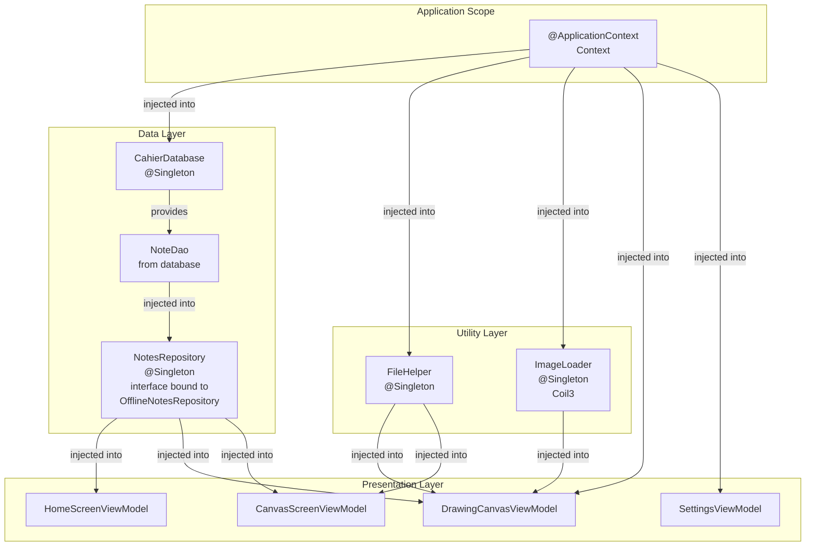

### Dependency Categories

**Database Dependencies**
- `CahierDatabase`: Room database instance
- `NoteDao`: Data access object for note operations
- `NotesRepository`: Abstract repository interface, bound to `OfflineNotesRepository` implementation

**Utility Dependencies**
- `FileHelper`: Manages file operations, URI copying, and bitmap caching
- `ImageLoader`: Coil3 image loader for loading and processing images
- `Application Context`: System-level context for Android APIs

**ViewModel Dependencies**
- All ViewModels depend on `NotesRepository`
- Drawing and text ViewModels additionally depend on `FileHelper`
- `DrawingCanvasViewModel` uniquely depends on `ImageLoader` for background image processing
- Some ViewModels depend on `Application Context` for system-level operations

**Sources:** [app/src/main/java/com/example/cahier/ui/viewmodels/DrawingCanvasViewModel.kt:56-73](), High-level Diagram 6

---

## Gradle Configuration

### Plugin Setup

Hilt requires the Hilt Android Gradle plugin:

[app/build.gradle.kts:22]()

```kotlin
id("com.google.dagger.hilt.android")
```

### KSP for Annotation Processing

Hilt uses KSP (Kotlin Symbol Processing) instead of kapt for faster annotation processing:

[app/build.gradle.kts:19]()

```kotlin
alias(libs.plugins.ksp)
```

### Dependency Declarations

[app/build.gradle.kts:143-146]()

```kotlin
//Hilt
implementation(libs.hilt.android)
ksp(libs.hilt.android.compiler)
implementation(libs.androidx.hilt.navigation.compose)
```

| Dependency | Purpose |
|------------|---------|
| `hilt-android` | Core Hilt runtime library |
| `hilt-android-compiler` | Annotation processor (via KSP) |
| `androidx.hilt.navigation.compose` | `hiltViewModel()` function for Compose Navigation |

### Version Catalog

[gradle/libs.versions.toml:7-8]()

```toml
hiltAndroid = "2.57.1"
hiltNavigationCompose = "1.3.0"
```

**Sources:** [app/build.gradle.kts:19](), [app/build.gradle.kts:22](), [app/build.gradle.kts:143-146](), [gradle/libs.versions.toml:7-8]()

---

## Testing with Hilt

### Test Runner Configuration

Instrumented tests use `HiltTestRunner` to enable dependency injection in tests:

[app/build.gradle.kts:36]()

```kotlin
testInstrumentationRunner = "com.example.cahier.HiltTestRunner"
```

The `HiltTestRunner` extends the default Android test runner and enables Hilt in the test environment:

```kotlin
class HiltTestRunner : AndroidJUnitRunner() {
    override fun newApplication(
        cl: ClassLoader?,
        className: String?,
        context: Context?
    ): Application {
        return super.newApplication(cl, HiltTestApplication::class.java.name, context)
    }
}
```

### Test Dependencies

[app/build.gradle.kts:113-115]()

```kotlin
// Hilt Testing
androidTestImplementation(libs.hilt.android.testing)
kspAndroidTest(libs.hilt.android.compiler)
```

### Test Module Strategy

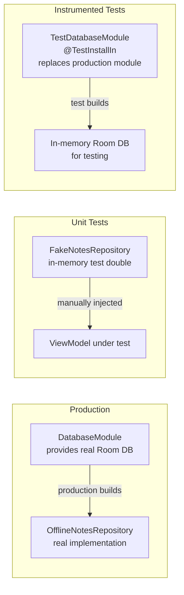

**Unit Tests:** Use `FakeNotesRepository` manually injected into ViewModels without Hilt framework involvement.

**Instrumented Tests:** Use `@TestInstallIn` to replace production modules with test modules that provide test doubles (e.g., in-memory databases).

**Sources:** [app/build.gradle.kts:36](), [app/build.gradle.kts:113-115](), High-level Diagram 6

---

## Key Benefits

### Compile-Time Safety

Hilt validates the entire dependency graph at compile time, catching missing dependencies or circular dependencies before runtime.

### Scoping

All application-level dependencies use `@Singleton` scope, ensuring single instances shared across the app. ViewModels are scoped to their navigation destinations, surviving configuration changes but being cleared when navigating away.

### Testability

The repository pattern with interface abstraction enables easy substitution of test doubles. Unit tests can use fake implementations, while instrumented tests can replace entire modules.

### Reduced Boilerplate

Constructor injection eliminates manual dependency wiring. The `@HiltViewModel` annotation and `hiltViewModel()` function eliminate ViewModel factory boilerplate.

**Sources:** General Hilt architecture patterns

---

# Page: Navigation System

# Navigation System

<details>
<summary>Relevant source files</summary>

The following files were used as context for generating this wiki page:

- [app/src/androidTest/java/com/example/cahier/utils/FileHelperTest.kt](app/src/androidTest/java/com/example/cahier/utils/FileHelperTest.kt)
- [app/src/main/java/com/example/cahier/MainActivity.kt](app/src/main/java/com/example/cahier/MainActivity.kt)
- [app/src/main/java/com/example/cahier/navigation/CahierNavGraph.kt](app/src/main/java/com/example/cahier/navigation/CahierNavGraph.kt)
- [app/src/main/java/com/example/cahier/ui/CahierHomeScreen.kt](app/src/main/java/com/example/cahier/ui/CahierHomeScreen.kt)
- [app/src/main/java/com/example/cahier/ui/ColorPickerDialog.kt](app/src/main/java/com/example/cahier/ui/ColorPickerDialog.kt)
- [app/src/main/java/com/example/cahier/ui/viewmodels/HomeScreenViewModel.kt](app/src/main/java/com/example/cahier/ui/viewmodels/HomeScreenViewModel.kt)
- [app/src/test/java/com/example/cahier/ui/viewmodels/HomeScreenViewModelTest.kt](app/src/test/java/com/example/cahier/ui/viewmodels/HomeScreenViewModelTest.kt)

</details>


## Purpose and Scope

This document describes the navigation architecture of the Cahier application, including the navigation graph structure, route definitions, navigation between screens (home, text notes, drawing notes), and adaptive navigation behavior. For information about the MVVM pattern and state management used by individual screens, see [MVVM Pattern & State Management](#2.1). For details on adaptive UI layouts, see [Adaptive Layouts](#5.1).

---

## Navigation Architecture Overview

The Cahier application implements a **hub-and-spoke navigation pattern** using Jetpack Compose Navigation. The home screen (`HomeDestination`) serves as the central hub, with navigation paths to text note editing (`TextCanvasDestination`) and drawing note editing (`DrawingCanvasDestination`). All navigation flows return to the home screen.

### Navigation Flow Diagram

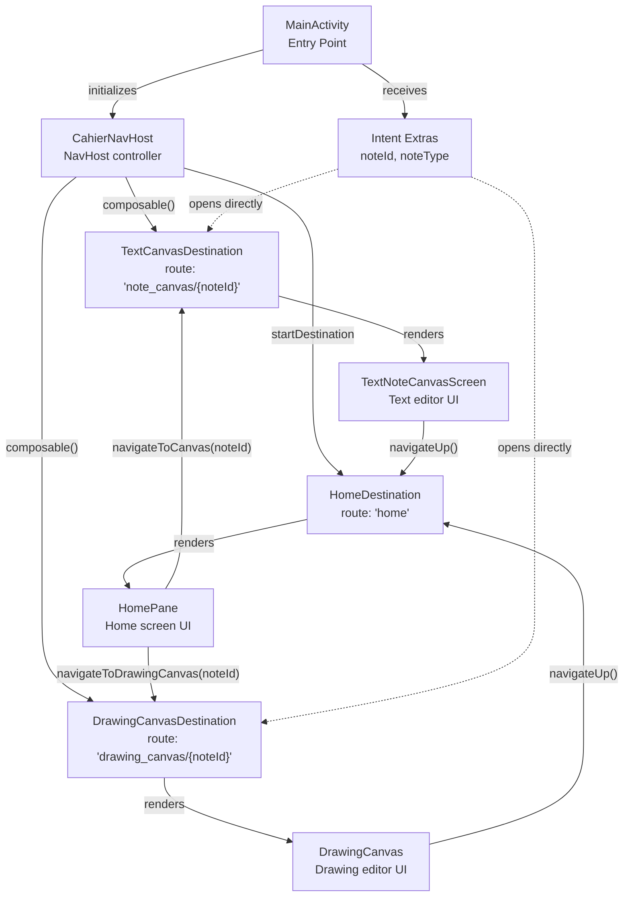

**Sources:** [app/src/main/java/com/example/cahier/navigation/CahierNavGraph.kt:1-93](), [app/src/main/java/com/example/cahier/MainActivity.kt:1-63]()

---

## Navigation Destinations

The application defines three primary navigation destinations, each implementing the `NavigationDestination` interface:

| Destination | Route | Arguments | Purpose |
|------------|-------|-----------|---------|
| `HomeDestination` | `"home"` | None | Displays note list and selected note detail |
| `TextCanvasDestination` | `"note_canvas/{noteId}"` | `noteId: Long` | Text note editing screen |
| `DrawingCanvasDestination` | `"drawing_canvas/{noteId}"` | `noteId: Long` | Drawing note editing screen |

### Destination Code Entities

```mermaid
graph LR
    ND["NavigationDestination<br/>Interface"]
    
    HD["HomeDestination<br/>object"]
    TCD["TextCanvasDestination<br/>object"]
    DCD["DrawingCanvasDestination<br/>object"]
    
    ND -.->|"implements"| HD
    ND -.->|"implements"| TCD
    ND -.->|"implements"| DCD
    
    HD -->|"route = 'home'"| HR["String"]
    TCD -->|"route = 'note_canvas'"| TCR["String"]
    TCD -->|"NOTE_ID_ARG = 'noteId'"| TCARG["String"]
    TCD -->|"routeWithArgs"| TCRWA["'note_canvas/{noteId}'"]
    
    DCD -->|"route = 'drawing_canvas'"| DCR["String"]
    DCD -->|"NOTE_ID_ARG = 'noteId'"| DCARG["String"]
    DCD -->|"routeWithArgs"| DCRWA["'drawing_canvas/{noteId}'"]
```

**Sources:** [app/src/main/java/com/example/cahier/navigation/CahierNavGraph.kt:82-93](), [app/src/main/java/com/example/cahier/ui/CahierHomeScreen.kt:75-77]()

---

## Navigation Graph Structure

The navigation graph is configured in the `CahierNavHost` composable, which creates a `NavHost` with three composable destinations.

### NavHost Configuration

The `CahierNavHost` function [app/src/main/java/com/example/cahier/navigation/CahierNavGraph.kt:37-80]() establishes the navigation graph:

- **Start Destination:** `HomeDestination.route` (`"home"`)
- **Navigation Controller:** `NavHostController` parameter passed from parent

### Composable Route Definitions

Each destination is registered using the `composable()` function:

**HomeDestination** [app/src/main/java/com/example/cahier/navigation/CahierNavGraph.kt:46-58]():
```
composable(HomeDestination.route)
```
Renders `HomePane` with navigation callbacks for moving to text or drawing canvases.

**TextCanvasDestination** [app/src/main/java/com/example/cahier/navigation/CahierNavGraph.kt:59-68]():
```
composable(
    route = TextCanvasDestination.routeWithArgs,
    arguments = listOf(navArgument(TextCanvasDestination.NOTE_ID_ARG) {
        type = NavType.LongType
    })
)
```
Renders `TextNoteCanvasScreen` with the `noteId` argument extracted from the route.

**DrawingCanvasDestination** [app/src/main/java/com/example/cahier/navigation/CahierNavGraph.kt:69-78]():
```
composable(
    route = DrawingCanvasDestination.routeWithArgs,
    arguments = listOf(navArgument(DrawingCanvasDestination.NOTE_ID_ARG) {
        type = NavType.LongType
    })
)
```
Renders `DrawingCanvas` with the `noteId` argument extracted from the route.

**Sources:** [app/src/main/java/com/example/cahier/navigation/CahierNavGraph.kt:37-80]()

---

## Route Parameters and Type Safety

### Argument Declaration

Both text and drawing destinations use a path parameter for the note ID:

- **Argument Name:** `NOTE_ID_ARG` (value: `"noteId"`)
- **Argument Type:** `NavType.LongType`
- **Route Pattern:** `"{noteId}"` embedded in the route string

The `routeWithArgs` property combines the base route with the argument placeholder:
- Text: `"note_canvas/{noteId}"`
- Drawing: `"drawing_canvas/{noteId}"`

### Argument Retrieval in ViewModels

ViewModels receive navigation arguments via `SavedStateHandle`, which is automatically injected by Hilt. The note ID is retrieved using the constant argument name:

```kotlin
class DrawingCanvasViewModel @Inject constructor(
    savedStateHandle: SavedStateHandle,
    // ... other dependencies
) {
    private val noteId: Long = 
        checkNotNull(savedStateHandle[DrawingCanvasDestination.NOTE_ID_ARG])
}
```

**Sources:** [app/src/main/java/com/example/cahier/navigation/CahierNavGraph.kt:59-78](), [app/src/main/java/com/example/cahier/navigation/CahierNavGraph.kt:82-93]()

---

## Navigation Invocation Patterns

### Forward Navigation from Home Screen

The `HomePane` composable receives navigation callbacks as parameters [app/src/main/java/com/example/cahier/ui/CahierHomeScreen.kt:103-109]():

```kotlin
fun HomePane(
    navigateToCanvas: (Long) -> Unit,
    navigateToDrawingCanvas: (Long) -> Unit,
    navigateUp: () -> Unit,
    // ...
)
```

These callbacks are invoked from `CahierNavHost` [app/src/main/java/com/example/cahier/navigation/CahierNavGraph.kt:48-53]():

```kotlin
HomePane(
    navigateToCanvas = { noteId ->
        navController.navigate("${TextCanvasDestination.route}/$noteId")
    },
    navigateToDrawingCanvas = { noteId ->
        navController.navigate("${DrawingCanvasDestination.route}/$noteId")
    },
    // ...
)
```

### Navigation Triggers

Navigation is triggered in several contexts:

1. **Note Selection in List** [app/src/main/java/com/example/cahier/ui/CahierHomeScreen.kt:254-263]():
   - Compact mode: Direct navigation to edit screen
   - Expanded mode: Updates detail pane in-place

2. **Creating New Notes** [app/src/main/java/com/example/cahier/ui/CahierHomeScreen.kt:265-273]():
   - Creates note via `HomeScreenViewModel`
   - Navigates to edit screen in callback

3. **Detail Pane "Edit" Action** [app/src/main/java/com/example/cahier/ui/CahierHomeScreen.kt:293-298]():
   - Expanded mode only
   - Opens full editing screen

### Backward Navigation

Both text and drawing screens implement `navigateUp()` callback:

```kotlin
TextNoteCanvasScreen(
    onExit = { navController.navigateUp() }
)

DrawingCanvas(
    navigateUp = { navController.navigateUp() }
)
```

This returns to the home screen by popping the back stack.

**Sources:** [app/src/main/java/com/example/cahier/navigation/CahierNavGraph.kt:46-78](), [app/src/main/java/com/example/cahier/ui/CahierHomeScreen.kt:103-109](), [app/src/main/java/com/example/cahier/ui/CahierHomeScreen.kt:248-303]()

---

## Multi-Window Navigation

### Intent-Based Window Creation

The application supports opening notes in separate windows on multi-window capable devices. This is implemented via Android Intents with specific flags [app/src/main/java/com/example/cahier/ui/CahierHomeScreen.kt:125-136]():

```kotlin
LaunchedEffect(Unit) {
    homeScreenViewModel.newWindowEvent.collect { (noteType, noteId) ->
        val intent = Intent(context, MainActivity::class.java).apply {
            putExtra(AppArgs.NOTE_TYPE_KEY, noteType)
            putExtra(AppArgs.NOTE_ID_KEY, noteId)
            flags = Intent.FLAG_ACTIVITY_NEW_TASK or
                    Intent.FLAG_ACTIVITY_MULTIPLE_TASK or
                    Intent.FLAG_ACTIVITY_LAUNCH_ADJACENT
        }
        context.startActivity(intent)
    }
}
```

### Intent Processing Flow

```mermaid
graph TB
    HSVM["HomeScreenViewModel<br/>openInNewWindow()"]
    CHANNEL["newWindowEvent<br/>Channel&lt;Pair&lt;NoteType, Long&gt;&gt;"]
    LE["LaunchedEffect<br/>in HomePane"]
    INTENT["Intent<br/>with NOTE_TYPE_KEY, NOTE_ID_KEY"]
    MA["MainActivity.onCreate()"]
    APP["CahierApp<br/>receives noteId, noteType"]
    NAV["Navigation<br/>to appropriate destination"]
    
    HSVM -->|"send()"| CHANNEL
    CHANNEL -->|"collect()"| LE
    LE -->|"creates"| INTENT
    INTENT -->|"startActivity()"| MA
    MA -->|"extracts extras"| APP
    APP -->|"direct navigation if provided"| NAV
```

### ViewModel Channel Implementation

`HomeScreenViewModel` exposes a `newWindowEvent` channel [app/src/main/java/com/example/cahier/ui/viewmodels/HomeScreenViewModel.kt:51-52]():

```kotlin
private val _newWindowEvent = Channel<Pair<NoteType, Long>>()
val newWindowEvent = _newWindowEvent.receiveAsFlow()
```

The `openInNewWindow()` function sends events [app/src/main/java/com/example/cahier/ui/viewmodels/HomeScreenViewModel.kt:158-162]():

```kotlin
fun openInNewWindow(note: Note) {
    viewModelScope.launch {
        _newWindowEvent.send(Pair(note.type, note.id))
    }
}
```

### MainActivity Intent Handling

`MainActivity` extracts intent extras to determine the initial destination [app/src/main/java/com/example/cahier/MainActivity.kt:41-50]():

```kotlin
val noteId = intent.getLongExtra(AppArgs.NOTE_ID_KEY, -1)
val noteType = if (Build.VERSION.SDK_INT >= Build.VERSION_CODES.TIRAMISU) {
    intent.getParcelableExtra(AppArgs.NOTE_TYPE_KEY, NoteType::class.java)
} else {
    @Suppress("DEPRECATION")
    intent.getParcelableExtra(AppArgs.NOTE_TYPE_KEY) as NoteType?
}
```

These values are passed to `CahierApp`, which can then navigate directly to the appropriate note editing screen on app initialization.

**Sources:** [app/src/main/java/com/example/cahier/ui/CahierHomeScreen.kt:125-136](), [app/src/main/java/com/example/cahier/ui/viewmodels/HomeScreenViewModel.kt:51-62](), [app/src/main/java/com/example/cahier/ui/viewmodels/HomeScreenViewModel.kt:158-162](), [app/src/main/java/com/example/cahier/MainActivity.kt:41-50]()

---

## Adaptive Navigation Behavior

### Window Size Class Detection

The home screen adapts its navigation behavior based on `WindowSizeClass` [app/src/main/java/com/example/cahier/ui/CahierHomeScreen.kt:116-121]():

```kotlin
val activity = LocalActivity.current
val windowSizeClass = activity?.let { calculateWindowSizeClass(it) }
val isCompact = windowSizeClass?.widthSizeClass == WindowWidthSizeClass.Compact
```

### Compact Mode (Phones)

In compact mode (`isCompact = true`):

1. **Single-pane navigation:** Full-screen transitions between list and detail
2. **Note selection:** Directly navigates to edit screen [app/src/main/java/com/example/cahier/ui/CahierHomeScreen.kt:255-260]()
3. **Back navigation:** Standard `navigateUp()` behavior
4. **No detail pane:** Detail view is replaced by navigation to edit screen

### Expanded Mode (Tablets)

In expanded mode (`isCompact = false`):

1. **List-detail layout:** Uses `ListDetailPaneScaffold` [app/src/main/java/com/example/cahier/ui/CahierHomeScreen.kt:231-304]()
2. **Note selection:** Updates detail pane in-place [app/src/main/java/com/example/cahier/ui/CahierHomeScreen.kt:262]()
3. **Detail pane interaction:** Clicking "Edit" navigates to full editor [app/src/main/java/com/example/cahier/ui/CahierHomeScreen.kt:293-299]()
4. **Automatic selection:** First note is auto-selected on load [app/src/main/java/com/example/cahier/ui/CahierHomeScreen.kt:145-149]()

### Mode Synchronization

State is synchronized when window size class changes [app/src/main/java/com/example/cahier/ui/CahierHomeScreen.kt:138-143]():

```kotlin
LaunchedEffect(isCompact) {
    if (isCompact) {
        homeScreenViewModel.clearSelection()
        navigator.navigateTo(ListDetailPaneScaffoldRole.List)
    }
}
```

### Navigation Suite Scaffold

The home screen uses `NavigationSuiteScaffold` [app/src/main/java/com/example/cahier/ui/CahierHomeScreen.kt:197-226]() for app-level navigation between Home and Settings destinations. This scaffold automatically adapts to display:
- **Bottom navigation bar** on compact screens
- **Navigation rail** on medium screens  
- **Navigation drawer** on large screens

**Sources:** [app/src/main/java/com/example/cahier/ui/CahierHomeScreen.kt:116-121](), [app/src/main/java/com/example/cahier/ui/CahierHomeScreen.kt:138-149](), [app/src/main/java/com/example/cahier/ui/CahierHomeScreen.kt:197-316]()

---

## Back Handler Integration

### List-Detail Pane Back Navigation

The home screen implements `BackHandler` to manage navigation within the `ListDetailPaneScaffold` [app/src/main/java/com/example/cahier/ui/CahierHomeScreen.kt:158-162]():

```kotlin
BackHandler(navigator.canNavigateBack()) {
    coroutineScope.launch {
        navigator.navigateBack()
    }
}
```

This enables:
- Transitioning from detail pane back to list pane in expanded mode
- Proper back stack management for multi-pane layouts

### Note Editor Back Navigation

Note editing screens (text and drawing) implement back navigation by calling the `navigateUp()` or `onExit()` callback provided by `CahierNavHost`, which delegates to `navController.navigateUp()`.

**Sources:** [app/src/main/java/com/example/cahier/ui/CahierHomeScreen.kt:158-162](), [app/src/main/java/com/example/cahier/navigation/CahierNavGraph.kt:54-56](), [app/src/main/java/com/example/cahier/navigation/CahierNavGraph.kt:66-67](), [app/src/main/java/com/example/cahier/navigation/CahierNavGraph.kt:76-77]()

---

## Navigation and ViewModel Interaction

### Note Creation Flow

When creating a new note, navigation occurs via callback pattern:

1. UI triggers `HomeScreenViewModel.addNote()` or `addDrawingNote()` [app/src/main/java/com/example/cahier/ui/viewmodels/HomeScreenViewModel.kt:91-107]()
2. ViewModel creates note in repository [app/src/main/java/com/example/cahier/ui/viewmodels/HomeScreenViewModel.kt:109-126]()
3. ViewModel invokes callback with new note ID
4. UI navigation callback executes with the ID [app/src/main/java/com/example/cahier/ui/CahierHomeScreen.kt:265-273]()

```mermaid
sequenceDiagram
    participant UI as "HomePane UI"
    participant VM as "HomeScreenViewModel"
    participant REPO as "NotesRepository"
    participant NAV as "NavController"
    
    UI->>VM: "addDrawingNote { noteId -> ... }"
    VM->>REPO: "addNote(newNote)"
    REPO-->>VM: "insertedId"
    VM->>VM: "update uiState"
    VM->>UI: "callback(insertedId)"
    UI->>NAV: "navigateToDrawingCanvas(insertedId)"
```

### Note Selection Flow

Note selection in expanded mode does not trigger navigation, but updates ViewModel state:

1. UI calls `homeScreenViewModel.selectNote(noteId)` [app/src/main/java/com/example/cahier/ui/CahierHomeScreen.kt:262]()
2. ViewModel loads note and strokes from repository [app/src/main/java/com/example/cahier/ui/viewmodels/HomeScreenViewModel.kt:67-89]()
3. ViewModel updates `uiState` StateFlow
4. Detail pane observes `uiState` and recomposes [app/src/main/java/com/example/cahier/ui/CahierHomeScreen.kt:289-301]()

**Sources:** [app/src/main/java/com/example/cahier/ui/viewmodels/HomeScreenViewModel.kt:67-126](), [app/src/main/java/com/example/cahier/ui/CahierHomeScreen.kt:254-273]()

---

# Page: Core Features

# Core Features

<details>
<summary>Relevant source files</summary>

The following files were used as context for generating this wiki page:

- [app/src/androidTest/java/com/example/cahier/utils/FileHelperTest.kt](app/src/androidTest/java/com/example/cahier/utils/FileHelperTest.kt)
- [app/src/main/java/com/example/cahier/navigation/CahierNavGraph.kt](app/src/main/java/com/example/cahier/navigation/CahierNavGraph.kt)
- [app/src/main/java/com/example/cahier/ui/CahierHomeScreen.kt](app/src/main/java/com/example/cahier/ui/CahierHomeScreen.kt)
- [app/src/main/java/com/example/cahier/ui/ColorPickerDialog.kt](app/src/main/java/com/example/cahier/ui/ColorPickerDialog.kt)
- [app/src/main/java/com/example/cahier/ui/viewmodels/HomeScreenViewModel.kt](app/src/main/java/com/example/cahier/ui/viewmodels/HomeScreenViewModel.kt)
- [app/src/test/java/com/example/cahier/ui/viewmodels/HomeScreenViewModelTest.kt](app/src/test/java/com/example/cahier/ui/viewmodels/HomeScreenViewModelTest.kt)

</details>


## Purpose and Scope

This document provides an overview of the three primary functional areas of the Cahier application: **drawing notes**, **text notes**, and **note management**. These features form the core user-facing functionality of the application.

For detailed information about specific subsystems:
- Drawing system implementation details: see [Drawing Notes System](#3.1)
- Text note editing interface: see [Text Notes System](#3.2)
- Home screen UI and note list management: see [Home Screen & Note Management](#3.3)
- Architecture patterns (MVVM, dependency injection): see [Architecture](#2)
- Data persistence and serialization: see [Data Layer](#4)

---

## Feature Overview

The Cahier application is organized around three main feature areas, each implemented as a distinct screen with its own ViewModel and navigation route.

### Feature Map

```mermaid
graph TB
    subgraph "Core Features"
        HOME["Home Screen<br/>(HomePane)"]
        DRAW["Drawing Notes<br/>(DrawingCanvas)"]
        TEXT["Text Notes<br/>(TextNoteCanvasScreen)"]
    end
    
    subgraph "ViewModels"
        HSVM["HomeScreenViewModel"]
        DVM["DrawingCanvasViewModel"]
        CVM["CanvasScreenViewModel"]
    end
    
    subgraph "Navigation Routes"
        HOMER["route: 'home'<br/>(HomeDestination)"]
        DRAWR["route: 'drawing_canvas/{noteId}'<br/>(DrawingCanvasDestination)"]
        TEXTR["route: 'note_canvas/{noteId}'<br/>(TextCanvasDestination)"]
    end
    
    subgraph "Note Types"
        ENUM["NoteType enum"]
        DRAW_TYPE["NoteType.Drawing"]
        TEXT_TYPE["NoteType.Text"]
    end
    
    HOME -->|observes| HSVM
    DRAW -->|observes| DVM
    TEXT -->|observes| CVM
    
    HOME -->|navigates via| HOMER
    DRAW -->|navigates via| DRAWR
    TEXT -->|navigates via| TEXTR
    
    HOME -->|"creates/selects"| DRAW
    HOME -->|"creates/selects"| TEXT
    
    DRAW -->|"navigateUp()"| HOME
    TEXT -->|"navigateUp()"| HOME
    
    ENUM -->|defines| DRAW_TYPE
    ENUM -->|defines| TEXT_TYPE
    
    DRAW -->|"edits notes of type"| DRAW_TYPE
    TEXT -->|"edits notes of type"| TEXT_TYPE
```

**Sources:** [app/src/main/java/com/example/cahier/ui/CahierHomeScreen.kt:75-77](), [app/src/main/java/com/example/cahier/navigation/CahierNavGraph.kt:82-93]()

---

## Note Type System

The application supports two distinct note types, defined by the `NoteType` enum. Each type has different editing capabilities and storage requirements.

| Note Type | Enum Value | Primary Content | Canvas Screen | ViewModel | Route |
|-----------|-----------|-----------------|---------------|-----------|-------|
| **Drawing** | `NoteType.Drawing` | Ink strokes | `DrawingCanvas` | `DrawingCanvasViewModel` | `drawing_canvas/{noteId}` |
| **Text** | `NoteType.Text` | Title and body text | `TextNoteCanvasScreen` | `CanvasScreenViewModel` | `note_canvas/{noteId}` |

Both note types share common metadata fields (`id`, `title`, `isFavorite`, `imageUriList`, `createdAt`, `lastModifiedAt`) but differ in their content fields:
- Drawing notes: Store `strokesData` (serialized JSON) and have null `text`
- Text notes: Store `text` (plain string) and have null `strokesData`

**Sources:** [app/src/main/java/com/example/cahier/ui/CahierHomeScreen.kt:68](), [app/src/main/java/com/example/cahier/navigation/CahierNavGraph.kt:82-93]()

---

## Navigation Flow

The application uses a hub-and-spoke navigation pattern where the home screen acts as the central hub, and note editing screens (drawing and text) are the spokes.

### Navigation Graph Structure

```mermaid
graph LR
    subgraph "Start Destination"
        HOME["HomeDestination<br/>route='home'"]
    end
    
    subgraph "Canvas Destinations"
        TEXT["TextCanvasDestination<br/>route='note_canvas/{noteId}'<br/>arg: NOTE_ID_ARG (Long)"]
        DRAW["DrawingCanvasDestination<br/>route='drawing_canvas/{noteId}'<br/>arg: NOTE_ID_ARG (Long)"]
    end
    
    subgraph "Navigation Methods"
        NAV_TEXT["navigateToCanvas(noteId)"]
        NAV_DRAW["navigateToDrawingCanvas(noteId)"]
        NAV_UP["navigateUp()"]
    end
    
    HOME -->|"compact: onNoteClick<br/>expanded: selectNote"| TEXT
    HOME -->|"compact: onNoteClick<br/>expanded: selectNote"| DRAW
    
    TEXT -->|"onExit"| NAV_UP
    DRAW -->|"navigateUp"| NAV_UP
    
    NAV_UP -->|"returns to"| HOME
    
    NAV_TEXT -->|"constructs"| TEXT
    NAV_DRAW -->|"constructs"| DRAW
```

**Navigation Route Construction:**
- Text note route: `"${TextCanvasDestination.route}/$noteId"` → `"note_canvas/123"`
- Drawing note route: `"${DrawingCanvasDestination.route}/$noteId"` → `"drawing_canvas/456"`

**Sources:** [app/src/main/java/com/example/cahier/navigation/CahierNavGraph.kt:41-80](), [app/src/main/java/com/example/cahier/ui/CahierHomeScreen.kt:254-263]()

---

## Core Note Operations

The application supports standard CRUD (Create, Read, Update, Delete) operations on notes, plus a favorite/unfavorite toggle. These operations are initiated from the home screen and managed by `HomeScreenViewModel`.

### Operation Flow Diagram

```mermaid
graph TB
    subgraph "UI Layer"
        LIST["ListPaneContent<br/>(note list)"]
        ADD_TEXT["onAddNewTextNote"]
        ADD_DRAW["onAddNewDrawingNote"]
        DELETE["onDeleteNote"]
        FAV["onToggleFavorite"]
        SELECT["onNoteClick"]
    end
    
    subgraph "HomeScreenViewModel"
        ADD_NOTE["addNote(callback)"]
        ADD_DRAW_NOTE["addDrawingNote(callback)"]
        DELETE_NOTE["deleteNote(note)"]
        TOGGLE_FAV["toggleFavorite(noteId)"]
        SELECT_NOTE["selectNote(noteId)"]
    end
    
    subgraph "Repository"
        REPO["NotesRepository"]
        ADD_OP["addNote(note)"]
        DELETE_OP["deleteNote(note)"]
        TOGGLE_OP["toggleFavorite(noteId)"]
        GET_OP["getNoteStream(noteId)"]
    end
    
    subgraph "Navigation"
        NAV_TO_TEXT["navigateToCanvas(noteId)"]
        NAV_TO_DRAW["navigateToDrawingCanvas(noteId)"]
    end
    
    ADD_TEXT -->|"calls"| ADD_NOTE
    ADD_DRAW -->|"calls"| ADD_DRAW_NOTE
    DELETE -->|"calls"| DELETE_NOTE
    FAV -->|"calls"| TOGGLE_FAV
    SELECT -->|"calls"| SELECT_NOTE
    
    ADD_NOTE -->|"creates NoteType.Text"| ADD_OP
    ADD_DRAW_NOTE -->|"creates NoteType.Drawing"| ADD_OP
    DELETE_NOTE -->|"removes note"| DELETE_OP
    TOGGLE_FAV -->|"updates isFavorite"| TOGGLE_OP
    SELECT_NOTE -->|"loads for preview"| GET_OP
    
    ADD_NOTE -->|"callback with noteId"| NAV_TO_TEXT
    ADD_DRAW_NOTE -->|"callback with noteId"| NAV_TO_DRAW
```

**Sources:** [app/src/main/java/com/example/cahier/ui/viewmodels/HomeScreenViewModel.kt:91-126](), [app/src/main/java/com/example/cahier/ui/CahierHomeScreen.kt:265-284]()

### Create Operations

**Creating a Text Note:**
```
1. User clicks "Add Text Note" button
2. ListPaneContent calls onAddNewTextNote
3. HomeScreenViewModel.addNote() creates Note(type=NoteType.Text)
4. Repository.addNote() inserts into database, returns noteId
5. Callback invokes navigateToCanvas(noteId)
6. Navigation routes to "note_canvas/{noteId}"
```

**Creating a Drawing Note:**
```
1. User clicks "Add Drawing Note" button
2. ListPaneContent calls onAddNewDrawingNote
3. HomeScreenViewModel.addDrawingNote() creates Note(type=NoteType.Drawing)
4. Repository.addNote() inserts into database, returns noteId
5. Callback invokes navigateToDrawingCanvas(noteId)
6. Navigation routes to "drawing_canvas/{noteId}"
```

**Sources:** [app/src/main/java/com/example/cahier/ui/viewmodels/HomeScreenViewModel.kt:91-126](), [app/src/main/java/com/example/cahier/ui/CahierHomeScreen.kt:265-273]()

### Read Operations

**Note List Display:**
- `HomeScreenViewModel.noteList` is a `StateFlow<NoteListUiState>` that streams all notes from the repository
- The flow is mapped from `NotesRepository.getAllNotesStream()` and maintained with a 5-second timeout
- Notes are partitioned into favorites and non-favorites in the UI layer

**Note Selection (Expanded Layout):**
- On non-compact devices, `HomeScreenViewModel.selectNote(noteId)` loads the selected note into `uiState`
- For drawing notes, strokes are also loaded via `NotesRepository.getNoteStrokes(noteId)`
- The detail pane displays a preview of the selected note content

**Sources:** [app/src/main/java/com/example/cahier/ui/viewmodels/HomeScreenViewModel.kt:54-89](), [app/src/main/java/com/example/cahier/ui/CahierHomeScreen.kt:287-303]()

### Update Operations

Note content updates are handled by the respective canvas ViewModels:
- `DrawingCanvasViewModel` updates stroke data for drawing notes
- `CanvasScreenViewModel` updates title and text for text notes

See [Drawing Notes System](#3.1) and [Text Notes System](#3.2) for details.

### Delete Operations

```
1. User selects "Delete" from note context menu
2. ListPaneContent calls onDeleteNote(note)
3. HomeScreenViewModel.deleteNote() calls repository
4. Repository.deleteNote() removes note from database
5. noteList StateFlow automatically updates to reflect deletion
```

**Sources:** [app/src/main/java/com/example/cahier/ui/viewmodels/HomeScreenViewModel.kt:128-138](), [app/src/main/java/com/example/cahier/ui/CahierHomeScreen.kt:275-277]()

### Favorite Toggle

```
1. User clicks favorite icon on note card
2. ListPaneContent calls onToggleFavorite(noteId)
3. HomeScreenViewModel.toggleFavorite() calls repository
4. Repository.toggleFavorite() flips isFavorite boolean
5. If note is selected in detail pane, uiState is updated
6. noteList StateFlow automatically updates to reflect change
```

**Sources:** [app/src/main/java/com/example/cahier/ui/viewmodels/HomeScreenViewModel.kt:140-152](), [app/src/main/java/com/example/cahier/ui/CahierHomeScreen.kt:279-281]()

---

## Adaptive Layout Behavior

The home screen adapts its behavior based on screen size, affecting how note operations work:

### Compact Layout (Phones)
- Single-pane navigation
- Clicking a note navigates to full-screen canvas
- No note selection state maintained
- Uses `NavController.navigate()` for transitions

### Expanded Layout (Tablets)
- Dual-pane with `ListDetailPaneScaffold`
- Clicking a note shows preview in detail pane
- First note auto-selected on initial load
- Navigation to canvas replaces current window
- Detail pane proportions: 30% list, 70% detail (configurable via drag handle)

**Implementation Details:**
- Screen size determined by `WindowSizeClass.widthSizeClass`
- Compact mode detected: `windowSizeClass?.widthSizeClass == WindowWidthSizeClass.Compact`
- Selection cleared when switching to compact mode
- Pane expansion managed by `PaneExpansionState`

**Sources:** [app/src/main/java/com/example/cahier/ui/CahierHomeScreen.kt:116-156](), [app/src/main/java/com/example/cahier/ui/CahierHomeScreen.kt:231-304]()

---

## Multi-Window Support

The application supports opening notes in separate windows on compatible Android devices (API 34+). This enables users to view multiple notes simultaneously.

**Flow:**
```
1. User selects "Open in new window" from note context menu
2. ListPaneContent calls onNewWindow(note)
3. HomeScreenViewModel.openInNewWindow() sends event to newWindowEvent channel
4. HomePane collects from channel and creates new Intent
5. Intent includes NOTE_TYPE_KEY and NOTE_ID_KEY extras
6. Intent flags: FLAG_ACTIVITY_NEW_TASK | FLAG_ACTIVITY_MULTIPLE_TASK | FLAG_ACTIVITY_LAUNCH_ADJACENT
7. New MainActivity instance launched with note data
```

**Sources:** [app/src/main/java/com/example/cahier/ui/viewmodels/HomeScreenViewModel.kt:158-162](), [app/src/main/java/com/example/cahier/ui/CahierHomeScreen.kt:125-136](), [app/src/main/java/com/example/cahier/ui/CahierHomeScreen.kt:282-284]()

---

## Settings Integration

The home screen includes a navigation item for the Settings screen, which is accessed via the bottom navigation bar (compact) or navigation rail (expanded).

**Navigation:**
```mermaid
graph LR
    NAV_SUITE["NavigationSuiteScaffold"]
    HOME_ITEM["AppDestinations.Home"]
    SETTINGS_ITEM["AppDestinations.Settings"]
    HOME_CONTENT["ListDetailPaneScaffold"]
    SETTINGS_CONTENT["SettingsScreen"]
    
    NAV_SUITE -->|"item selected"| HOME_ITEM
    NAV_SUITE -->|"item selected"| SETTINGS_ITEM
    
    HOME_ITEM -->|"renders"| HOME_CONTENT
    SETTINGS_ITEM -->|"renders"| SETTINGS_CONTENT
```

The settings destination is not part of the main navigation graph but is rendered directly within the `NavigationSuiteScaffold` content lambda based on `currentDestination` state.

**Sources:** [app/src/main/java/com/example/cahier/ui/CahierHomeScreen.kt:79-94](), [app/src/main/java/com/example/cahier/ui/CahierHomeScreen.kt:229-312]()

---

## Summary

The Cahier application's core features are organized around:

1. **Two Note Types**: Drawing notes (`NoteType.Drawing`) and text notes (`NoteType.Text`), each with dedicated editing interfaces
2. **Three Main Screens**: Home screen for management, drawing canvas for ink input, text canvas for text editing
3. **Hub-and-Spoke Navigation**: Home screen as central hub, canvas screens as editing spokes
4. **CRUD Operations**: Managed by `HomeScreenViewModel` with immediate UI updates via StateFlows
5. **Adaptive Layouts**: Single-pane for phones, dual-pane for tablets
6. **Multi-Window Support**: Open multiple notes simultaneously in separate windows

For implementation details of each feature area, see the respective child pages: [Drawing Notes System](#3.1), [Text Notes System](#3.2), and [Home Screen & Note Management](#3.3).

---

# Page: Drawing Notes System

# Drawing Notes System

<details>
<summary>Relevant source files</summary>

The following files were used as context for generating this wiki page:

- [app/src/main/java/com/example/cahier/ui/DrawingCanvas.kt](app/src/main/java/com/example/cahier/ui/DrawingCanvas.kt)
- [app/src/main/java/com/example/cahier/ui/DrawingSurface.kt](app/src/main/java/com/example/cahier/ui/DrawingSurface.kt)
- [app/src/main/java/com/example/cahier/ui/utils/DragAndDropUtils.kt](app/src/main/java/com/example/cahier/ui/utils/DragAndDropUtils.kt)
- [app/src/main/java/com/example/cahier/ui/viewmodels/DrawingCanvasViewModel.kt](app/src/main/java/com/example/cahier/ui/viewmodels/DrawingCanvasViewModel.kt)

</details>


## Purpose and Scope

The Drawing Notes System provides comprehensive ink-based note-taking functionality using the androidx.ink library. This system enables users to draw freehand strokes with various brushes, erase content, manage stroke history with undo/redo, and overlay drawings on background images. The system is built around `DrawingCanvasViewModel` for state management and `DrawingSurface` for input capture and rendering.

For text-based note-taking functionality, see [Text Notes System](#3.2). For general note management and listing, see [Home Screen & Note Management](#3.3). For the underlying data persistence layer, see [Stroke Serialization](#4.3).

## System Architecture

### Component Overview

The drawing system consists of three primary architectural layers: UI composition, state management, and rendering.

**Architecture Diagram: Drawing System Components**

```mermaid
graph TB
    subgraph "UI Layer"
        DC["DrawingCanvas<br/>(Composable)"]
        DCTB["DrawingCanvasTopBar<br/>(Title TextField)"]
        DCC["DrawingCanvasContent<br/>(Canvas + Toolbox)"]
        DSWT["DrawingSurfaceWithTarget<br/>(Drop Target Wrapper)"]
        DS["DrawingSurface<br/>(Input Handler)"]
        DT["DrawingToolbox<br/>(Tool Controls)"]
    end
    
    subgraph "State Management"
        DCVM["DrawingCanvasViewModel"]
        UISTATE["uiState: StateFlow<CahierUiState>"]
        BRUSH["currentBrush: StateFlow<Brush>"]
        ERASER["isEraserMode: StateFlow<Boolean>"]
        HISTORY["history: MutableList<List<Stroke>>"]
        UNDO["canUndo/canRedo: StateFlow<Boolean>"]
    end
    
    subgraph "Rendering Engine"
        IPS["InProgressStrokes<br/>(androidx.ink.authoring)"]
        CSR["CanvasStrokeRenderer<br/>(androidx.ink.rendering)"]
        CANVAS["Compose Canvas"]
    end
    
    subgraph "Input Processing"
        TOUCH["Touch Input<br/>(detectDragGestures)"]
        ERASE_INPUT["Eraser Input<br/>(detectDragGestures)"]
        LONGPRESS["Long Press<br/>(for drag export)"]
    end
    
    DC --> DCTB
    DC --> DCC
    DCC --> DSWT
    DSWT --> DS
    DCC --> DT
    
    DS --> CANVAS
    DS --> IPS
    DS --> TOUCH
    DS --> ERASE_INPUT
    DS --> LONGPRESS
    
    IPS --> CSR
    CANVAS --> CSR
    
    TOUCH --> IPS
    ERASE_INPUT --> DCVM
    IPS --> DCVM
    
    DC --> DCVM
    DCVM --> UISTATE
    DCVM --> BRUSH
    DCVM --> ERASER
    DCVM --> HISTORY
    DCVM --> UNDO
    
    UISTATE --> DS
    BRUSH --> IPS
    ERASER --> DS
    UNDO --> DT
```

**Sources:** [app/src/main/java/com/example/cahier/ui/DrawingCanvas.kt:88-140](), [app/src/main/java/com/example/cahier/ui/viewmodels/DrawingCanvasViewModel.kt:66-113](), [app/src/main/java/com/example/cahier/ui/DrawingSurface.kt:52-140]()

### Core Components Table

| Component | Type | Responsibility |
|-----------|------|---------------|
| `DrawingCanvas` | Composable | Root container, orchestrates layout and navigation |
| `DrawingCanvasViewModel` | ViewModel | State management, business logic, data persistence |
| `DrawingSurface` | Composable | Input capture, stroke rendering, eraser handling |
| `InProgressStrokes` | androidx.ink | Real-time stroke capture and rendering |
| `CanvasStrokeRenderer` | androidx.ink | High-performance stroke drawing |
| `DrawingToolbox` | Composable | User controls for brushes, colors, sizes |

**Sources:** [app/src/main/java/com/example/cahier/ui/DrawingCanvas.kt:88-140](), [app/src/main/java/com/example/cahier/ui/viewmodels/DrawingCanvasViewModel.kt:66-73](), [app/src/main/java/com/example/cahier/ui/DrawingSurface.kt:52-66]()

## DrawingCanvasViewModel

`DrawingCanvasViewModel` is the central state manager, annotated with `@HiltViewModel` for dependency injection. It receives dependencies through constructor injection.

### Dependencies and Initialization

```
@HiltViewModel
class DrawingCanvasViewModel @Inject constructor(
    @ApplicationContext private val context: Context,
    savedStateHandle: SavedStateHandle,
    private val noteRepository: NotesRepository,
    val fileHelper: FileHelper,
    private val imageLoader: ImageLoader
)
```

**Dependency Table**

| Dependency | Purpose |
|------------|---------|
| `context` | Image loading, custom brush loading, bitmap export |
| `savedStateHandle` | Extract `noteId` from navigation arguments |
| `noteRepository` | Load and persist strokes, update note metadata |
| `fileHelper` | Copy image URIs to internal storage, save bitmaps to cache |
| `imageLoader` | Load background images for bitmap export (Coil3) |

The `noteId` is extracted from `savedStateHandle` using the `NOTE_ID_ARG` constant defined in `DrawingCanvasDestination`.

**Sources:** [app/src/main/java/com/example/cahier/ui/viewmodels/DrawingCanvasViewModel.kt:67-73](), [app/src/main/java/com/example/cahier/ui/viewmodels/DrawingCanvasViewModel.kt:78]()

### State Flow Architecture

**State Flow Diagram**

```mermaid
graph LR
    subgraph "Exposed StateFlows"
        UISTATE["uiState<br/>StateFlow&lt;CahierUiState&gt;"]
        BRUSH["currentBrush<br/>StateFlow&lt;Brush&gt;"]
        ERASER["isEraserMode<br/>StateFlow&lt;Boolean&gt;"]
        UNDO["canUndo<br/>StateFlow&lt;Boolean&gt;"]
        REDO["canRedo<br/>StateFlow&lt;Boolean&gt;"]
        EXPORT["exportedImageUri<br/>StateFlow&lt;Uri?&gt;"]
        CUSTOM["customBrushes<br/>StateFlow&lt;List&lt;CustomBrush&gt;&gt;"]
    end
    
    subgraph "Internal MutableStateFlows"
        M_UISTATE["_uiState"]
        M_BRUSH["_selectedBrush"]
        M_ERASER["_isEraserMode"]
        M_UNDO["_canUndo"]
        M_REDO["_canRedo"]
        M_EXPORT["_exportedImageUri"]
        M_CUSTOM["_customBrushes"]
    end
    
    M_UISTATE --> UISTATE
    M_BRUSH --> BRUSH
    M_ERASER --> ERASER
    M_UNDO --> UNDO
    M_REDO --> REDO
    M_EXPORT --> EXPORT
    M_CUSTOM --> CUSTOM
```

The ViewModel maintains internal `MutableStateFlow` instances prefixed with underscore and exposes immutable `StateFlow` views via `asStateFlow()`. This ensures unidirectional data flow where only the ViewModel can modify state.

**Sources:** [app/src/main/java/com/example/cahier/ui/viewmodels/DrawingCanvasViewModel.kt:75-112]()

### Brush State Management

The default brush is initialized based on the system's night mode setting:

```
private val _defaultBrush = MutableStateFlow(
    Brush.createWithComposeColor(
        family = StockBrushes.pressurePen(),
        color = if (currentNightMode == AppCompatDelegate.MODE_NIGHT_YES)
            Color.White else Color.Gray,
        size = 5F,
        epsilon = 0.1F
    )
)
```

The brush can be modified through several methods:

| Method | Parameters | Behavior |
|--------|-----------|----------|
| `changeBrush()` | `BrushFamily` | Changes brush family, disables eraser, adjusts alpha for highlighter |
| `changeBrushColor()` | `Color` | Updates color, maintains 0.3f alpha for highlighter |
| `changeBrushSize()` | `Float` | Updates size only |
| `changeBrushAndSize()` | `BrushFamily, Float` | Changes both family and size atomically |

All brush change methods set `isBrushSelectedInSession = true` to prevent the saved brush from overriding user selections during the session.

**Sources:** [app/src/main/java/com/example/cahier/ui/viewmodels/DrawingCanvasViewModel.kt:82-93](), [app/src/main/java/com/example/cahier/ui/viewmodels/DrawingCanvasViewModel.kt:358-402]()

### Stroke Lifecycle

**Stroke Processing Flow**

```mermaid
graph TD
    START["User draws on screen"] --> IPS["InProgressStrokes captures input"]
    IPS --> FINISH["onStrokesFinished callback"]
    FINISH --> ADD["onStrokesFinished(finishedStrokes)"]
    ADD --> UPDATE["updateStrokes(newStrokes)"]
    UPDATE --> TRUNCATE["Truncate history after historyIndex"]
    TRUNCATE --> APPEND["Append to history list"]
    APPEND --> INCREMENT["historyIndex++"]
    INCREMENT --> UPDATE_UI["Update _uiState.strokes"]
    UPDATE_UI --> UPDATE_FLAGS["Update canUndo/canRedo"]
    UPDATE_FLAGS --> SAVE["saveStrokes() via repository"]
    
    SAVE --> SERIALIZE["Serialize strokes to JSON"]
    SERIALIZE --> DB["Store in Room database"]
```

When `onStrokesFinished()` is called by `InProgressStrokes`, the ViewModel:
1. Retrieves current strokes from history at `historyIndex`
2. Concatenates finished strokes
3. Truncates future history if not at the end (for redo invalidation)
4. Appends new state to history
5. Increments `historyIndex`
6. Updates UI state and undo/redo flags
7. Persists to repository

**Sources:** [app/src/main/java/com/example/cahier/ui/viewmodels/DrawingCanvasViewModel.kt:301-309](), [app/src/main/java/com/example/cahier/ui/viewmodels/DrawingCanvasViewModel.kt:168-182]()

## DrawingSurface Component

`DrawingSurface` is a composable that integrates the androidx.ink library for stroke rendering and handles both drawing and erasing input modes.

### Component Structure

**DrawingSurface Layout**

```mermaid
graph TB
    BOX["Box (root container)"]
    IMG["AsyncImage<br/>(background image)"]
    CANVAS["Compose Canvas<br/>(renders finished strokes)"]
    LONGPRESS["Box + pointerInputWithSiblingFallthrough<br/>(detectDragGesturesAfterLongPress)"]
    BRANCH{"isEraserMode?"}
    ERASE_BOX["Box + pointerInput<br/>(detectDragGestures for erase)"]
    IPS_BOX["InProgressStrokes<br/>(captures drawing input)"]
    
    BOX --> IMG
    BOX --> CANVAS
    BOX --> LONGPRESS
    BOX --> BRANCH
    BRANCH -->|true| ERASE_BOX
    BRANCH -->|false| IPS_BOX
```

**Sources:** [app/src/main/java/com/example/cahier/ui/DrawingSurface.kt:67-139]()

### Rendering Pipeline

The rendering pipeline uses `CanvasStrokeRenderer` from androidx.ink for high-performance stroke drawing:

```kotlin
Canvas(modifier = Modifier.fillMaxSize()) {
    val canvas = drawContext.canvas.nativeCanvas
    strokes.forEach { stroke ->
        val blendMode = if (stroke.brush.family == StockBrushes.highlighter()) {
            BlendMode.Multiply
        } else {
            BlendMode.SrcOver
        }
        drawContext.canvas.withSaveLayer(...) {
            canvas.withSave {
                canvasStrokeRenderer.draw(
                    stroke = stroke,
                    canvas = this,
                    strokeToScreenTransform = Matrix()
                )
            }
        }
    }
}
```

**Stroke Rendering Features**

| Feature | Implementation |
|---------|---------------|
| Background Image | `AsyncImage` with `ContentScale.Crop` positioned behind canvas |
| Finished Strokes | Rendered via `CanvasStrokeRenderer.draw()` with native Canvas |
| In-Progress Strokes | Handled by `InProgressStrokes` composable (overlays finished strokes) |
| Highlighter Blend | Uses `BlendMode.Multiply` for semi-transparent effect |
| Other Brushes | Uses `BlendMode.SrcOver` for standard compositing |

**Sources:** [app/src/main/java/com/example/cahier/ui/DrawingSurface.kt:77-98]()

### Input Handling Modes

**Input Mode Branching**

```mermaid
graph TD
    INPUT["User touches screen"] --> CHECK{"isEraserMode?"}
    CHECK -->|false| DRAW["InProgressStrokes handles input"]
    CHECK -->|true| ERASE["detectDragGestures for erase"]
    
    DRAW --> CAPTURE["Captures stroke data"]
    CAPTURE --> CALLBACK["Calls onStrokesFinished"]
    
    ERASE --> START["onDragStart → onEraseStart()"]
    START --> DRAG["onDrag → onErase(x, y)"]
    DRAG --> END["onDragEnd → onEraseEnd()"]
```

**Drawing Mode**
- `InProgressStrokes` composable captures touch/stylus input
- Uses `defaultBrush` and `nextBrush` callbacks for brush configuration
- Automatically renders in-progress strokes with motion prediction
- Fires `onStrokesFinished` callback when stroke completes

**Eraser Mode**
- Custom `Box` with `pointerInput(Unit)` modifier
- Uses `detectDragGestures` to track drag path
- Calls `onErase(x, y)` for each position along the drag path
- Calls `onEraseStart()` and `onEraseEnd()` for lifecycle management

**Sources:** [app/src/main/java/com/example/cahier/ui/DrawingSurface.kt:118-138](), [app/src/main/java/com/example/cahier/ui/DrawingSurface.kt:133-137]()

### Long Press for Drag-to-Export

A separate input layer captures long-press gestures for drag-and-drop export without interfering with ink input:

```kotlin
Box(modifier = Modifier
    .fillMaxSize()
    .pointerInputWithSiblingFallthrough {
        detectDragGesturesAfterLongPress(
            onDragStart = { onStartDrag() },
            onDrag = { change, _ -> change.consume() },
            onDragEnd = { }
        )
    }
)
```

The `pointerInputWithSiblingFallthrough` modifier allows this gesture detector to coexist with the ink drawing layer below it. When long-press is detected, `onStartDrag()` triggers the system drag-and-drop API with the exported bitmap URI.

**Sources:** [app/src/main/java/com/example/cahier/ui/DrawingSurface.kt:100-116]()

## DrawingCanvas Composition

`DrawingCanvas` is the top-level composable that orchestrates the drawing UI, combining the title bar, drawing surface, and toolbox.

### Layout Structure

**DrawingCanvas Hierarchy**

```mermaid
graph TB
    ROOT["Column<br/>(fillMaxSize + insets)"]
    TOPBAR["DrawingCanvasTopBar<br/>(title TextField)"]
    CONTENT["DrawingCanvasContent<br/>(canvas + toolbox)"]
    
    ROOT --> TOPBAR
    ROOT --> CONTENT
    
    CONTENT_BOX["Box (fillMaxSize)"]
    SURFACE["DrawingSurfaceWithTarget<br/>(drawing area + drop target)"]
    TOOLBOX["DrawingToolbox<br/>(positioned based on screen size)"]
    MENUS["BrushesDropdownMenu<br/>SizeDropdownMenu<br/>ColorPickerDialog"]
    
    CONTENT --> CONTENT_BOX
    CONTENT_BOX --> SURFACE
    CONTENT_BOX --> TOOLBOX
    CONTENT_BOX --> MENUS
```

**Sources:** [app/src/main/java/com/example/cahier/ui/DrawingCanvas.kt:126-139](), [app/src/main/java/com/example/cahier/ui/DrawingCanvas.kt:191-265]()

### Title Bar with Focus Management

The title bar contains a `TextField` for note titles with focus management:

```kotlin
val titleFocusRequester = remember { FocusRequester() }
var focusedFieldEnum by rememberSaveable { mutableStateOf(FocusedFieldEnum.None) }

LaunchedEffect(focusedFieldEnum) {
    if (focusedFieldEnum == FocusedFieldEnum.Title) {
        titleFocusRequester.requestFocus()
    }
}

TextField(
    value = titleState,
    onValueChange = { newTitle ->
        titleState = newTitle
        drawingCanvasViewModel.onTitleChanged(newTitle.text)
    },
    modifier = Modifier
        .weight(1f)
        .focusRequester(titleFocusRequester)
        .onFocusChanged { focusState ->
            if (focusState.isFocused) {
                focusedFieldEnum = FocusedFieldEnum.Title
            }
        }
)
```

Title changes are immediately propagated to the ViewModel via `onTitleChanged()`, which updates the repository.

**Sources:** [app/src/main/java/com/example/cahier/ui/DrawingCanvas.kt:143-184]()

### Adaptive Toolbox Positioning

Toolbox position adapts based on `WindowSizeClass`:

| Screen Size | Toolbox Position | Orientation |
|-------------|-----------------|-------------|
| Compact (phone) | `Alignment.CenterEnd` with 8.dp end padding | Vertical |
| Medium/Expanded (tablet) | `Alignment.TopCenter` with 8.dp padding | Horizontal |

```kotlin
val toolboxModifier = if (isCompact) {
    Modifier.align(Alignment.CenterEnd).padding(end = 8.dp)
} else {
    Modifier.align(Alignment.TopCenter).padding(8.dp)
}

DrawingToolbox(
    isVertical = isCompact,
    modifier = toolboxModifier,
    // ...
)
```

**Sources:** [app/src/main/java/com/example/cahier/ui/DrawingCanvas.kt:198-235]()

### Image Replacement Confirmation

When adding an image to a note that already has an image, a confirmation dialog appears:

```kotlin
val imagePickerLauncher = rememberLauncherForActivityResult(
    contract = ActivityResultContracts.PickVisualMedia()
) { uri: Uri? ->
    uri?.let {
        if (uiState.note.imageUriList?.isNotEmpty() == true) {
            pendingImageUri = it
            showConfirmationDialog = true
        } else {
            drawingCanvasViewModel.processAndAddImageFromPicker(it)
        }
    }
}
```

The dialog prompts the user to confirm replacement before calling `replaceImage()`.

**Sources:** [app/src/main/java/com/example/cahier/ui/DrawingCanvas.kt:97-124]()

## Eraser Mode Implementation

Eraser mode uses geometric intersection testing to remove strokes that intersect with the eraser path.

### Eraser Algorithm

**Eraser Intersection Testing**

```mermaid
graph TD
    START["erase(x, y) called"] --> CHECK["previousPoint exists?"]
    CHECK -->|no| STORE["Store current point, return"]
    CHECK -->|yes| CREATE["Create MutableSegment<br/>from previousPoint to current"]
    CREATE --> PARA["Create MutableParallelogram<br/>with eraserPadding=50f"]
    PARA --> TEST["Test each stroke for intersection"]
    TEST --> FILTER["Filter intersecting strokes"]
    FILTER --> UPDATE{"Any strokes removed?"}
    UPDATE -->|yes| HISTORY["updateStrokes(filtered list)"]
    UPDATE -->|no| RETURN["Return current strokes"]
    HISTORY --> PERSIST["Trigger saveStrokes()"]
```

**Implementation Details**

| Component | Purpose |
|-----------|---------|
| `previousPoint: MutableVec?` | Tracks previous eraser position for path segment creation |
| `eraserPadding = 50f` | Defines eraser width (padding around segment centerline) |
| `MutableSegment` | Represents eraser path between two consecutive positions |
| `MutableParallelogram` | Bounding shape for intersection testing |
| `stroke.shape.intersects()` | androidx.ink geometry intersection test |

**Code Reference:**
```kotlin
private fun eraseIntersectingStrokes(
    currentX: Float,
    currentY: Float,
    currentStrokes: List<Stroke>,
): List<Stroke> {
    val prev = previousPoint
    previousPoint = MutableVec(currentX, currentY)
    
    if (prev == null) return currentStrokes
    
    val segment = MutableSegment(prev, MutableVec(currentX, currentY))
    val parallelogram = MutableParallelogram()
        .populateFromSegmentAndPadding(segment, eraserPadding)
    
    val strokesToRemove = currentStrokes.filter { stroke ->
        stroke.shape.intersects(parallelogram, AffineTransform.IDENTITY)
    }
    
    return if (strokesToRemove.isNotEmpty()) {
        currentStrokes - strokesToRemove.toSet()
    } else {
        currentStrokes
    }
}
```

**Sources:** [app/src/main/java/com/example/cahier/ui/viewmodels/DrawingCanvasViewModel.kt:98-99](), [app/src/main/java/com/example/cahier/ui/viewmodels/DrawingCanvasViewModel.kt:321-356]()

### Eraser Lifecycle Management

| Event | Method | Action |
|-------|--------|--------|
| Drag Start | `startErase()` | Resets `previousPoint = null` |
| Drag Move | `erase(x, y)` | Tests intersections, updates strokes if hits found |
| Drag End | `endErase()` | Resets `previousPoint`, calls `saveStrokes()` |

The `previousPoint` reset at start ensures the first eraser position doesn't create a segment from a stale position.

**Sources:** [app/src/main/java/com/example/cahier/ui/viewmodels/DrawingCanvasViewModel.kt:311-318]()

### Mode Toggling

```kotlin
fun setEraserMode(enabled: Boolean) {
    _isEraserMode.update { enabled }
}
```

When eraser mode is activated, `DrawingSurface` conditionally renders the eraser input layer instead of `InProgressStrokes`. Changing brush via `changeBrush()` automatically disables eraser mode:

```kotlin
fun changeBrush(brushFamily: BrushFamily) {
    setEraserMode(false)
    // ... update brush
}
```

**Sources:** [app/src/main/java/com/example/cahier/ui/viewmodels/DrawingCanvasViewModel.kt:404-406](), [app/src/main/java/com/example/cahier/ui/viewmodels/DrawingCanvasViewModel.kt:358-370]()

## Undo/Redo History System

The history system maintains a list-based stack with a movable index pointer for undo/redo operations.

### History Data Structure

**History State Machine**

```mermaid
stateDiagram-v2
    [*] --> Empty
    Empty --> Initial: Initial strokes loaded
    Initial --> Modified: New stroke added
    Modified --> Modified: More strokes added
    Modified --> Undone: undo() called
    Undone --> Undone: More undos
    Undone --> Redone: redo() called
    Undone --> Modified: New stroke (truncates future)
    
    note right of Initial
        historyIndex = 0
        history = [initialStrokes]
    end note
    
    note right of Modified
        historyIndex++
        history.append(newState)
        Truncates if not at end
    end note
    
    note right of Undone
        historyIndex--
        Display history[historyIndex]
    end note
```

**Internal State Variables**

| Variable | Type | Purpose |
|----------|------|---------|
| `history` | `MutableList<List<Stroke>>` | Stores all stroke states |
| `historyIndex` | `Int` | Current position in history (-1 when empty) |
| `_canUndo` | `MutableStateFlow<Boolean>` | True when `historyIndex > 0` |
| `_canRedo` | `MutableStateFlow<Boolean>` | True when `historyIndex < history.size - 1` |

**Sources:** [app/src/main/java/com/example/cahier/ui/viewmodels/DrawingCanvasViewModel.kt:101-106]()

### History Operations

**Undo Operation Flow**

```kotlin
fun undo() {
    if (canUndo.value) {
        historyIndex--
        _uiState.update { it.copy(strokes = history[historyIndex]) }
        updateUndoRedoState()
        viewModelScope.launch { saveStrokes() }
    }
}
```

**Redo Operation Flow**

```kotlin
fun redo() {
    if (canRedo.value) {
        historyIndex++
        _uiState.update { it.copy(strokes = history[historyIndex]) }
        updateUndoRedoState()
        viewModelScope.launch { saveStrokes() }
    }
}
```

Both operations update the UI state synchronously and persist to the database asynchronously.

**Sources:** [app/src/main/java/com/example/cahier/ui/viewmodels/DrawingCanvasViewModel.kt:184-200]()

### Future History Truncation

When a new stroke is added while not at the end of history (i.e., user has performed undo), all future history is discarded:

```kotlin
private fun updateStrokes(newStrokes: List<Stroke>) {
    if (historyIndex < history.size - 1) {
        history.subList(historyIndex + 1, history.size).clear()
    }
    history.add(newStrokes)
    historyIndex++
    // ...
}
```

This implements standard undo/redo semantics where new actions invalidate the redo stack.

**Sources:** [app/src/main/java/com/example/cahier/ui/viewmodels/DrawingCanvasViewModel.kt:168-177]()

### State Flag Updates

```kotlin
private fun updateUndoRedoState() {
    _canUndo.value = historyIndex > 0
    _canRedo.value = historyIndex < history.size - 1
}
```

Called after every history modification to ensure UI buttons reflect current capabilities.

**Sources:** [app/src/main/java/com/example/cahier/ui/viewmodels/DrawingCanvasViewModel.kt:179-182]()

## Image Integration

Drawing notes support a single background image that strokes are rendered over.

### Image URI Management

Images are stored as URI strings in `note.imageUriList`. The list is limited to a single item for drawing notes:

```kotlin
fun addImageWithLocalUri(localUri: Uri?) {
    if (localUri == null) return
    val newImageUri = localUri.toString()
    val updatedNote = _uiState.value.note.copy(imageUriList = listOf(newImageUri))
    viewModelScope.launch {
        noteRepository.updateNote(updatedNote)
    }
}
```

**Image Processing Pipeline**

```mermaid
graph LR
    PICKER["Image Picker<br/>or Drag & Drop"] --> URI["External URI"]
    URI --> COPY["fileHelper.copyUriToInternalStorage()"]
    COPY --> LOCAL["Local URI<br/>(filesDir/images)"]
    LOCAL --> UPDATE["addImageWithLocalUri()"]
    UPDATE --> NOTE["note.imageUriList = [uri]"]
    NOTE --> DB["NotesRepository.updateNote()"]
```

**Sources:** [app/src/main/java/com/example/cahier/ui/viewmodels/DrawingCanvasViewModel.kt:159-166](), [app/src/main/java/com/example/cahier/ui/viewmodels/DrawingCanvasViewModel.kt:208-218]()

### Image Display in DrawingSurface

The background image is rendered using Coil's `AsyncImage`:

```kotlin
backgroundImageUri?.let {
    AsyncImage(
        model = it,
        contentDescription = "Background Image",
        modifier = Modifier.fillMaxSize(),
        contentScale = ContentScale.Crop
    )
}
```

The `Crop` content scale ensures the image fills the canvas while maintaining aspect ratio, with clipping if necessary.

**Sources:** [app/src/main/java/com/example/cahier/ui/DrawingSurface.kt:68-75]()

### Bitmap Export with Background

When exporting to bitmap (for drag-and-drop or sharing), the background image is composited with strokes:

```kotlin
suspend fun createExportedBitmap(width: Int, height: Int) {
    val backgroundImageUri = _uiState.value.note.imageUriList?.firstOrNull()
    val strokes = _uiState.value.strokes
    
    // Load background bitmap
    val backgroundBitmap = if (backgroundImageUri != null) {
        val request = ImageRequest.Builder(context)
            .data(backgroundImageUri.toUri())
            .allowHardware(false)
            .build()
        imageLoader.execute(request).image?.toBitmap()
    } else {
        null
    }
    
    val exportBitmap = createBitmap(width, height)
    val canvas = Canvas(exportBitmap)
    
    // Draw background color (black/white based on theme)
    canvas.drawColor(backgroundColor)
    
    // Draw and scale background image if present
    backgroundBitmap?.let { /* ... scaling and drawing */ }
    
    // Draw all strokes
    val strokeRenderer = CanvasStrokeRenderer.create(forcePathRendering = true)
    strokes.forEach { stroke ->
        strokeRenderer.draw(canvas, stroke, android.graphics.Matrix())
    }
    
    _exportedImageUri.value = fileHelper.saveBitmapToCache(exportBitmap)
}
```

The exported bitmap is saved to cache and its URI is exposed via `exportedImageUri` StateFlow for drag-and-drop operations.

**Sources:** [app/src/main/java/com/example/cahier/ui/viewmodels/DrawingCanvasViewModel.kt:226-277]()

### Image Clearing

```kotlin
fun clearImages() {
    val updatedNote = _uiState.value.note.copy(imageUriList = emptyList())
    viewModelScope.launch {
        noteRepository.updateNote(updatedNote)
    }
}

fun clearScreen() {
    clearStrokes()
    clearImages()
}
```

`clearScreen()` is exposed to UI for resetting the entire canvas.

**Sources:** [app/src/main/java/com/example/cahier/ui/viewmodels/DrawingCanvasViewModel.kt:415-425]()

## Drag and Drop Integration

The drawing system supports both drag-in (image import) and drag-out (canvas export) operations.

### Drop Target Implementation

`DrawingSurfaceWithTarget` wraps `DrawingSurface` with a `dragAndDropTarget` modifier:

```kotlin
val dropTarget = remember {
    createDropTarget(activity) { uri, permissions ->
        drawingCanvasViewModel.handleDroppedUri(uri, permissions)
    }
}

Box(
    modifier = modifier
        .fillMaxSize()
        .dragAndDropTarget(
            shouldStartDragAndDrop = { event ->
                event.mimeTypes().any { it.startsWith("image/") }
            },
            target = dropTarget
        )
)
```

The `createDropTarget` utility function (see [Drag and Drop System](#6.3)) handles permission management and URI extraction.

**Sources:** [app/src/main/java/com/example/cahier/ui/DrawingCanvas.kt:283-319](), [app/src/main/java/com/example/cahier/ui/utils/DragAndDropUtils.kt:30-45]()

### URI Handling on Drop

```kotlin
fun handleDroppedUri(uri: Uri, permissions: android.view.DragAndDropPermissions?) {
    viewModelScope.launch {
        try {
            val localUri = fileHelper.copyUriToInternalStorage(uri)
            addImageWithLocalUri(localUri)
        } finally {
            permissions?.release()
        }
    }
}
```

The dropped URI is copied to internal storage before being added to the note. The `DragAndDropPermissions` object is released in a `finally` block to ensure cleanup.

**Sources:** [app/src/main/java/com/example/cahier/ui/viewmodels/DrawingCanvasViewModel.kt:427-436]()

### Drag-Out for Export

Long-press gesture initiates drag-out using the Android View system:

```kotlin
onStartDrag = {
    exportedUri?.let { uri ->
        val clipData = ClipData(
            ClipDescription("Image", arrayOf("image/png")),
            ClipData.Item(uri)
        )
        val dragShadowBuilder = View.DragShadowBuilder(view)
        view.startDragAndDrop(
            clipData,
            dragShadowBuilder,
            null,
            View.DRAG_FLAG_GLOBAL or View.DRAG_FLAG_GLOBAL_URI_READ
        )
    }
}
```

**Why not use Compose's dragAndDropSource?**

The comment in the code explains: "While Jetpack Compose offers the `dragAndDropSource` modifier, a custom implementation using the Android View system's `startDragAndDrop` is necessary here. This is because the Ink API's drawing gestures conflict with the long-press-to-drag gesture when using the standard Compose modifier, preventing drag detection."

**Sources:** [app/src/main/java/com/example/cahier/ui/DrawingCanvas.kt:331-357]()

### Export Bitmap Lifecycle

**Export Flow Diagram**

```mermaid
graph TD
    CHANGE["Strokes or image changes"] --> DETECT["LaunchedEffect detects change"]
    DETECT --> CREATE["createExportedBitmap()"]
    CREATE --> COMPOSITE["Composite background + strokes"]
    COMPOSITE --> CACHE["Save to cache via FileHelper"]
    CACHE --> UPDATE["Update exportedImageUri StateFlow"]
    UPDATE --> READY["Ready for drag operation"]
    READY --> LONGPRESS["User long-presses canvas"]
    LONGPRESS --> DRAG["startDragAndDrop with URI"]
```

The exported bitmap is regenerated whenever strokes or images change, ensuring the dragged content is always current.

**Sources:** [app/src/main/java/com/example/cahier/ui/DrawingCanvas.kt:296-308](), [app/src/main/java/com/example/cahier/ui/DrawingCanvas.kt:331-357]()

## Custom Brushes Integration

Custom brushes are loaded from compressed resources and made available alongside stock brushes.

### Loading Custom Brushes

```kotlin
private fun loadCustomBrushes() {
    viewModelScope.launch {
        _customBrushes.value = CustomBrushes.getBrushes(context)
    }
}
```

Called in `init` block, this populates the `customBrushes` StateFlow. The `CustomBrushes` singleton (see [Custom Brushes](#6.2)) loads brush definitions from `.gz` files in raw resources.

**Sources:** [app/src/main/java/com/example/cahier/ui/viewmodels/DrawingCanvasViewModel.kt:442-446](), [app/src/main/java/com/example/cahier/ui/viewmodels/DrawingCanvasViewModel.kt:156]()

### Restoring Saved Custom Brush

When a note is loaded, if it has a `clientBrushFamilyId`, the ViewModel attempts to restore the custom brush:

```kotlin
note.clientBrushFamilyId?.let { id ->
    if (!isBrushSelectedInSession) {
        val customBrush = customBrushes.value.find {
            it.brushFamily.clientBrushFamilyId == id
        }
        customBrush?.let {
            _selectedBrush.value = _selectedBrush.value.copy(family = it.brushFamily)
        }
    }
}
```

The `isBrushSelectedInSession` flag prevents the saved brush from overriding user selections during the current session.

**Sources:** [app/src/main/java/com/example/cahier/ui/viewmodels/DrawingCanvasViewModel.kt:127-137]()

### Brush Family Persistence

When strokes are saved, the `clientBrushFamilyId` is extracted and stored:

```kotlin
suspend fun saveStrokes() {
    if (historyIndex >= 0 && historyIndex < history.size) {
        val strokesToSave = history[historyIndex]
        val clientBrushFamilyId =
            strokesToSave.firstOrNull()?.brush?.family?.clientBrushFamilyId
        noteRepository.updateNoteStrokes(noteId, strokesToSave, clientBrushFamilyId)
    }
}
```

This allows the custom brush to be restored when the note is reopened.

**Sources:** [app/src/main/java/com/example/cahier/ui/viewmodels/DrawingCanvasViewModel.kt:279-288]()

## Data Persistence

Strokes are persisted through the `NotesRepository` abstraction layer.

### Persistence Timing

| Event | Trigger | Method Called |
|-------|---------|---------------|
| Stroke finished | `onStrokesFinished()` callback | `saveStrokes()` |
| Undo | `undo()` button | `saveStrokes()` |
| Redo | `redo()` button | `saveStrokes()` |
| Erase end | `endErase()` callback | `saveStrokes()` |
| Clear strokes | `clearStrokes()` button | `saveStrokes()` |
| ViewModel cleared | `onCleared()` lifecycle | `saveStrokes()` |

All saves are asynchronous via `viewModelScope.launch { saveStrokes() }`.

**Sources:** [app/src/main/java/com/example/cahier/ui/viewmodels/DrawingCanvasViewModel.kt:306-308](), [app/src/main/java/com/example/cahier/ui/viewmodels/DrawingCanvasViewModel.kt:189](), [app/src/main/java/com/example/cahier/ui/viewmodels/DrawingCanvasViewModel.kt:198](), [app/src/main/java/com/example/cahier/ui/viewmodels/DrawingCanvasViewModel.kt:317](), [app/src/main/java/com/example/cahier/ui/viewmodels/DrawingCanvasViewModel.kt:411](), [app/src/main/java/com/example/cahier/ui/viewmodels/DrawingCanvasViewModel.kt:448-453]()

### Repository Interface

```kotlin
// From NotesRepository interface
suspend fun updateNoteStrokes(
    noteId: Long,
    strokes: List<Stroke>,
    clientBrushFamilyId: String?
)
```

The repository handles serialization (via `Converters`, see [Stroke Serialization](#4.3)) and database updates. The strokes are converted to JSON and stored in the `strokesData` field of the `Note` entity.

**Sources:** [app/src/main/java/com/example/cahier/ui/viewmodels/DrawingCanvasViewModel.kt:279-288]()

### Initial Load

Strokes are loaded reactively when the ViewModel is initialized:

```kotlin
init {
    viewModelScope.launch {
        noteRepository.getNoteStream(noteId)
            .filterNotNull()
            .collect { note ->
                val initialStrokes = if (note.strokesData != null) {
                    noteRepository.getNoteStrokes(note.id)
                } else {
                    emptyList()
                }
                // ... update UI state and history
            }
    }
}
```

The `getNoteStream()` returns a Flow that emits updates when the note changes, enabling reactive UI updates. The `getNoteStrokes()` method deserializes the JSON `strokesData` field back into `List<Stroke>`.

**Sources:** [app/src/main/java/com/example/cahier/ui/viewmodels/DrawingCanvasViewModel.kt:116-154]()

## Summary

The Drawing Notes System integrates the androidx.ink library with Jetpack Compose to provide a full-featured ink-based note-taking experience. The architecture follows MVVM patterns with `DrawingCanvasViewModel` as the central state manager, `DrawingSurface` for rendering and input capture, and `DrawingCanvas` for UI composition. The system supports brush customization, eraser mode with geometric intersection testing, undo/redo history, background images, and drag-and-drop operations. All drawing data is persisted through the repository layer with JSON serialization of stroke data.

**Sources:** [app/src/main/java/com/example/cahier/ui/viewmodels/DrawingCanvasViewModel.kt:1-459](), [app/src/main/java/com/example/cahier/ui/DrawingSurface.kt:1-170](), [app/src/main/java/com/example/cahier/ui/DrawingCanvas.kt:1-413]()

---

# Page: Drawing Canvas UI

# Drawing Canvas UI

<details>
<summary>Relevant source files</summary>

The following files were used as context for generating this wiki page:

- [app/src/main/java/com/example/cahier/ui/DrawingCanvas.kt](app/src/main/java/com/example/cahier/ui/DrawingCanvas.kt)
- [app/src/main/java/com/example/cahier/ui/utils/DragAndDropUtils.kt](app/src/main/java/com/example/cahier/ui/utils/DragAndDropUtils.kt)
- [app/src/main/java/com/example/cahier/ui/viewmodels/DrawingCanvasViewModel.kt](app/src/main/java/com/example/cahier/ui/viewmodels/DrawingCanvasViewModel.kt)

</details>


## Purpose and Scope

This document details the `DrawingCanvas` composable and its child components, which provide the user interface for creating and editing drawing notes. The page covers the layout structure, title editing, image management, and how these UI components integrate with `DrawingCanvasViewModel` for state management and persistence.

For information about the low-level drawing surface implementation and stroke rendering, see [Drawing Surface & Stroke Rendering](#3.1.2). For details about brush controls and the toolbox UI, see [Drawing Toolbox & Brush System](#3.1.3). For image file management utilities, see [File Management](#6.1).

## Component Hierarchy

The Drawing Canvas UI is organized as a hierarchical tree of composable functions that work together to provide the drawing experience.

**Diagram: Drawing Canvas Composable Hierarchy**

```mermaid
graph TB
    DC["DrawingCanvas<br/>(main entry point)"]
    COL["Column<br/>(root layout)"]
    DCTB["DrawingCanvasTopBar"]
    DCC["DrawingCanvasContent"]
    TF["TextField<br/>(title input)"]
    BOX1["Box<br/>(content container)"]
    DSWT["DrawingSurfaceWithTarget"]
    DT["DrawingToolbox"]
    DS["DrawingSurface"]
    DDT["DragAndDropTarget<br/>(via createDropTarget)"]
    BDM["BrushesDropdownMenu"]
    SDM["SizeDropdownMenu"]
    CPD["ColorPickerDialog"]
    CONF["ConfirmationDialog"]
    
    DC --> COL
    COL --> DCTB
    COL --> DCC
    DCTB --> TF
    DCC --> BOX1
    BOX1 --> DSWT
    BOX1 --> DT
    BOX1 --> BDM
    BOX1 --> SDM
    BOX1 --> CPD
    DSWT --> DS
    DSWT --> DDT
    DC --> CONF
    
    style DC fill:#e1f5ff
    style DSWT fill:#fff4e6
    style DS fill:#f3e5f5
```

Sources: [app/src/main/java/com/example/cahier/ui/DrawingCanvas.kt:87-140](), [app/src/main/java/com/example/cahier/ui/DrawingCanvas.kt:142-184](), [app/src/main/java/com/example/cahier/ui/DrawingCanvas.kt:190-265](), [app/src/main/java/com/example/cahier/ui/DrawingCanvas.kt:268-366]()

## Main Container: DrawingCanvas

The `DrawingCanvas` composable is the top-level entry point for the drawing note UI, defined at [app/src/main/java/com/example/cahier/ui/DrawingCanvas.kt:88-140](). It serves as the container that coordinates all child components and manages the overall screen state.

### Structure and Responsibilities

| Responsibility | Implementation |
|---------------|----------------|
| Navigation | Receives `navigateUp: () -> Unit` callback for back navigation |
| ViewModel injection | Uses `hiltViewModel()` to obtain `DrawingCanvasViewModel` instance |
| State collection | Collects `uiState` via `collectAsStateWithLifecycle()` |
| Image replacement flow | Manages confirmation dialog when replacing existing images |
| Layout organization | Wraps children in `Column` with system bar padding |

### Image Picker Launcher

The component initializes an `ActivityResultLauncher` for picking images from the device gallery:

```kotlin
val imagePickerLauncher = rememberLauncherForActivityResult(
    contract = ActivityResultContracts.PickVisualMedia()
) { uri: Uri? -> ... }
```

The launcher is created at [app/src/main/java/com/example/cahier/ui/DrawingCanvas.kt:97-108]() and handles two scenarios:

1. **No existing image**: Directly calls `drawingCanvasViewModel.processAndAddImageFromPicker(it)`
2. **Existing image present**: Shows confirmation dialog before replacing

### Confirmation Dialog

When an image already exists on the canvas, attempting to add another image triggers a `ConfirmationDialog` [app/src/main/java/com/example/cahier/ui/DrawingCanvas.kt:110-124]():

- Stores pending URI in `pendingImageUri` state
- Shows dialog with title and text from string resources `R.string.replace_image_title` and `R.string.replace_image_text`
- On confirmation: calls `drawingCanvasViewModel.replaceImage(pendingImageUri)`
- On dismissal: clears pending state without modification

### Layout Structure

The root layout is a `Column` with modifier chain [app/src/main/java/com/example/cahier/ui/DrawingCanvas.kt:126-132]():

```kotlin
Column(
    modifier = modifier
        .fillMaxSize()
        .statusBarsPadding()
        .navigationBarsPadding()
        .imePadding()
)
```

This ensures proper spacing for system UI elements (status bar, navigation bar) and adjusts for on-screen keyboard.

Sources: [app/src/main/java/com/example/cahier/ui/DrawingCanvas.kt:87-140]()

## Top Bar: DrawingCanvasTopBar

The `DrawingCanvasTopBar` composable [app/src/main/java/com/example/cahier/ui/DrawingCanvas.kt:142-184]() provides a title editing interface at the top of the drawing canvas.

### Component Composition

**Diagram: DrawingCanvasTopBar Data Flow**

```mermaid
graph LR
    subgraph "UI State"
        US["uiState<br/>(StateFlow)"]
        NOTE["uiState.note"]
        TITLE["note.title"]
    end
    
    subgraph "Local State"
        TFS["titleState<br/>(TextFieldValue)"]
        FFE["focusedFieldEnum"]
        TFR["titleFocusRequester<br/>(FocusRequester)"]
    end
    
    subgraph "UI Component"
        TF["TextField"]
    end
    
    subgraph "ViewModel"
        VM["DrawingCanvasViewModel"]
        OTC["onTitleChanged()"]
    end
    
    US --> NOTE
    NOTE --> TITLE
    TITLE -.initializes.-> TFS
    TFS --> TF
    TF -.onValueChange.-> TFS
    TF --> OTC
    OTC --> VM
    FFE --> TFR
    TFR -.controls focus.-> TF
    
    style US fill:#e1f5ff
    style VM fill:#fff4e6
```

Sources: [app/src/main/java/com/example/cahier/ui/DrawingCanvas.kt:142-184]()

### State Management

The top bar maintains several state variables:

| State Variable | Type | Purpose | Persistence |
|---------------|------|---------|-------------|
| `titleState` | `TextFieldValue` | Current title text and cursor position | Saved via `rememberSaveable` |
| `focusedFieldEnum` | `FocusedFieldEnum` | Tracks which field has focus | Saved via `rememberSaveable` |
| `titleFocusRequester` | `FocusRequester` | Programmatic focus control | Remembered (not saved) |

The `titleState` is initialized from `uiState.note.title` at [app/src/main/java/com/example/cahier/ui/DrawingCanvas.kt:148-150]().

### Focus Management

Focus is managed through a combination of `FocusRequester` and `LaunchedEffect`:

- When `focusedFieldEnum` changes to `FocusedFieldEnum.Title`, a `LaunchedEffect` [app/src/main/java/com/example/cahier/ui/DrawingCanvas.kt:154-158]() requests focus
- The `TextField` has an `onFocusChanged` modifier that updates `focusedFieldEnum` when focused
- This pattern enables both programmatic and user-initiated focus changes

### TextField Configuration

The title `TextField` is configured at [app/src/main/java/com/example/cahier/ui/DrawingCanvas.kt:164-182]() with these properties:

- **Single line**: Prevents multi-line titles
- **IME action**: `ImeAction.Done` shows "Done" button on keyboard
- **Placeholder**: Uses `R.string.drawing_title` resource
- **Weight modifier**: `Modifier.weight(1f)` allows it to fill available horizontal space
- **Value change handler**: Immediately calls `drawingCanvasViewModel.onTitleChanged(newTitle.text)`

Sources: [app/src/main/java/com/example/cahier/ui/DrawingCanvas.kt:142-184]()

## Content Area: DrawingCanvasContent

The `DrawingCanvasContent` composable [app/src/main/java/com/example/cahier/ui/DrawingCanvas.kt:190-265]() contains the main drawing surface and associated controls.

### Adaptive Layout Strategy

The content area adapts its layout based on screen size using `WindowSizeClass`:

```kotlin
val windowSizeClass = calculateWindowSizeClass(activity)
val isCompact = windowSizeClass.widthSizeClass == WindowWidthSizeClass.Compact
```

**Toolbox Positioning by Screen Size**

| Screen Size Class | Position | Modifier |
|------------------|----------|----------|
| Compact (phone) | Vertical on right edge | `align(Alignment.CenterEnd)` + `padding(end = 8.dp)` |
| Medium/Expanded (tablet) | Horizontal at top | `align(Alignment.TopCenter)` + `padding(8.dp)` |

The toolbox receives `isVertical = isCompact` parameter to adjust its internal layout accordingly [app/src/main/java/com/example/cahier/ui/DrawingCanvas.kt:224-226]().

### State Collection

The content area collects several state flows from the ViewModel:

```kotlin
val canUndo by drawingCanvasViewModel.canUndo.collectAsStateWithLifecycle()
val canRedo by drawingCanvasViewModel.canRedo.collectAsStateWithLifecycle()
val customBrushes by drawingCanvasViewModel.customBrushes.collectAsStateWithLifecycle()
```

These states are passed to `DrawingToolbox` to enable/disable UI controls [app/src/main/java/com/example/cahier/ui/DrawingCanvas.kt:201-206]().

### Child Components and Dialogs

The content area orchestrates several child components within a `Box` layout:

1. **DrawingSurfaceWithTarget**: Background layer, fills entire available space
2. **DrawingToolbox**: Positioned based on screen size (see table above)
3. **BrushesDropdownMenu**: Overlay menu for brush selection [app/src/main/java/com/example/cahier/ui/DrawingCanvas.kt:237-245]()
4. **SizeDropdownMenu**: Overlay menu for brush size selection [app/src/main/java/com/example/cahier/ui/DrawingCanvas.kt:247-254]()
5. **ColorPickerDialog**: Full-screen dialog for color selection [app/src/main/java/com/example/cahier/ui/DrawingCanvas.kt:256-263]()

Each menu/dialog is controlled by a local `rememberSaveable` boolean state that survives configuration changes.

Sources: [app/src/main/java/com/example/cahier/ui/DrawingCanvas.kt:190-265]()

## Drawing Surface Integration: DrawingSurfaceWithTarget

The `DrawingSurfaceWithTarget` composable [app/src/main/java/com/example/cahier/ui/DrawingCanvas.kt:268-366]() wraps the low-level `DrawingSurface` and adds drag-and-drop capabilities and export functionality.

### Component Architecture

**Diagram: DrawingSurfaceWithTarget Integration Flow**

```mermaid
graph TB
    subgraph "ViewModel State"
        UISTATE["uiState<br/>(StateFlow)"]
        STROKES["uiState.strokes"]
        NOTE["uiState.note"]
        IMGLIST["note.imageUriList"]
        CBRUSH["currentBrush<br/>(StateFlow)"]
        EMODE["isEraserMode<br/>(StateFlow)"]
        EXPURI["exportedImageUri<br/>(StateFlow)"]
    end
    
    subgraph "Local State"
        LSTROKE["strokes<br/>(mutableStateListOf)"]
        CSIZE["canvasSize<br/>(IntSize)"]
        CSR["canvasStrokeRenderer<br/>(CanvasStrokeRenderer)"]
    end
    
    subgraph "Components"
        DSWT["DrawingSurfaceWithTarget"]
        DS["DrawingSurface"]
        DDT["dragAndDropTarget<br/>(modifier)"]
        DROPT["dropTarget<br/>(createDropTarget)"]
    end
    
    subgraph "ViewModel Events"
        OSF["onStrokesFinished()"]
        ERASE["erase()"]
        HDROP["handleDroppedUri()"]
        CEB["createExportedBitmap()"]
    end
    
    STROKES -.sync.-> LSTROKE
    LSTROKE --> DS
    CBRUSH --> DS
    EMODE --> DS
    IMGLIST --> DS
    CSR --> DS
    
    DS -.finished strokes.-> OSF
    DS -.erase events.-> ERASE
    
    DSWT --> DS
    DSWT --> DDT
    DDT --> DROPT
    DROPT -.URI.-> HDROP
    
    CSIZE -.trigger.-> CEB
    STROKES -.trigger.-> CEB
    IMGLIST -.trigger.-> CEB
    CEB --> EXPURI
    EXPURI --> DS
    
    style UISTATE fill:#e1f5ff
    style DS fill:#f3e5f5
    style DSWT fill:#fff4e6
```

Sources: [app/src/main/java/com/example/cahier/ui/DrawingCanvas.kt:268-366]()

### State Collection and Synchronization

The wrapper collects multiple state flows at [app/src/main/java/com/example/cahier/ui/DrawingCanvas.kt:273-276]():

- `uiState`: Contains note data and strokes
- `exportedImageUri`: Generated bitmap for drag-and-drop export
- `currentBrush`: Active brush configuration
- `isEraserMode`: Boolean toggle for drawing vs erasing

The strokes from `uiState` are synchronized with a local `mutableStateListOf<Stroke>()` via `LaunchedEffect` [app/src/main/java/com/example/cahier/ui/DrawingCanvas.kt:289-294](). This local list is necessary because the `DrawingSurface` needs a mutable list that it can modify during drawing.

### Canvas Size Tracking and Export

The wrapper tracks canvas size using `onSizeChanged` modifier [app/src/main/java/com/example/cahier/ui/DrawingCanvas.kt:313]():

```kotlin
.onSizeChanged { canvasSize = it }
```

A `LaunchedEffect` observes changes to strokes, images, and canvas size [app/src/main/java/com/example/cahier/ui/DrawingCanvas.kt:296-308](). When any of these change and the canvas has non-zero size, it triggers:

```kotlin
drawingCanvasViewModel.createExportedBitmap(canvasSize.width, canvasSize.height)
```

This generates a bitmap combining the background image and all strokes, which is used for drag-and-drop export (see Image Export section below).

### Drag-and-Drop Import

The wrapper implements drag-and-drop import using the `dragAndDropTarget` modifier [app/src/main/java/com/example/cahier/ui/DrawingCanvas.kt:314-319]():

```kotlin
.dragAndDropTarget(
    shouldStartDragAndDrop = { event ->
        event.mimeTypes().any { it.startsWith("image/") }
    },
    target = dropTarget
)
```

The `dropTarget` is created using the utility function from [app/src/main/java/com/example/cahier/ui/utils/DragAndDropUtils.kt:30-45]():

```kotlin
val dropTarget = remember {
    createDropTarget(activity) { uri, permissions ->
        drawingCanvasViewModel.handleDroppedUri(uri, permissions)
    }
}
```

This utility handles:
- Extracting URI from the drag event
- Requesting drag-and-drop permissions from the activity
- Passing both to the ViewModel for processing

Sources: [app/src/main/java/com/example/cahier/ui/DrawingCanvas.kt:268-366](), [app/src/main/java/com/example/cahier/ui/utils/DragAndDropUtils.kt:29-45]()

### Drag-and-Drop Export

The export mechanism uses Android's View-based drag system rather than Compose's `dragAndDropSource` modifier. This is explicitly documented in a comment at [app/src/main/java/com/example/cahier/ui/DrawingCanvas.kt:343-350]():

> While Jetpack Compose offers the `dragAndDropSource` modifier, a custom implementation using the Android View system's `startDragAndDrop` is necessary here. This is because the Ink API's drawing gestures conflict with the long-press-to-drag gesture when using the standard Compose modifier, preventing drag detection.

The export flow:
1. User initiates drag gesture in `DrawingSurface` (detected by custom gesture handling)
2. `DrawingSurface` calls the `onStartDrag` callback [app/src/main/java/com/example/cahier/ui/DrawingCanvas.kt:331-358]()
3. Callback creates `ClipData` with exported bitmap URI
4. Calls `view.startDragAndDrop()` with flags `View.DRAG_FLAG_GLOBAL or View.DRAG_FLAG_GLOBAL_URI_READ`

The `exportedUri` used in the `ClipData` is generated by the `createExportedBitmap()` function discussed in the ViewModel Integration section below.

Sources: [app/src/main/java/com/example/cahier/ui/DrawingCanvas.kt:331-358]()

## Image Handling Flows

The Drawing Canvas UI supports three image-related workflows: picking from gallery, importing via drag-and-drop, and exporting via drag-and-drop.

**Diagram: Image Handling Data Flow**

```mermaid
graph TB
    subgraph "Input Methods"
        PICK["Image Picker<br/>(ActivityResultLauncher)"]
        DROPIN["Drag-and-Drop Import<br/>(dragAndDropTarget)"]
    end
    
    subgraph "Processing Pipeline"
        CHECK{{"Has existing<br/>image?"}}
        CONF["Show ConfirmationDialog"]
        PEND["pendingImageUri<br/>(local state)"]
        PROC["processAndAddImageFromPicker()"]
        PROC2["processAndAddImage()"]
        HDROP["handleDroppedUri()"]
    end
    
    subgraph "ViewModel (File Operations)"
        FH["FileHelper.copyUriToInternalStorage()"]
        ADDIMG["addImageWithLocalUri()"]
        UPNOTE["noteRepository.updateNote()"]
    end
    
    subgraph "Export Flow"
        CSIZE["Canvas size change"]
        CEB["createExportedBitmap()"]
        CACHE["FileHelper.saveBitmapToCache()"]
        EXPURI["exportedImageUri"]
        DRAG["Drag gesture detected"]
        CLIP["ClipData with URI"]
        START["view.startDragAndDrop()"]
    end
    
    PICK --> CHECK
    CHECK -.yes.-> CONF
    CHECK -.no.-> PROC
    CONF -.confirm.-> PEND
    PEND --> PROC
    PROC --> PROC2
    
    DROPIN --> HDROP
    HDROP --> PROC2
    
    PROC2 --> FH
    FH --> ADDIMG
    ADDIMG --> UPNOTE
    
    CSIZE --> CEB
    CEB --> CACHE
    CACHE --> EXPURI
    DRAG --> CLIP
    EXPURI --> CLIP
    CLIP --> START
    
    style CHECK fill:#fff4e6
    style CONF fill:#ffe5e5
    style FH fill:#e1f5ff
```

Sources: [app/src/main/java/com/example/cahier/ui/DrawingCanvas.kt:97-124](), [app/src/main/java/com/example/cahier/ui/DrawingCanvas.kt:283-287](), [app/src/main/java/com/example/cahier/ui/DrawingCanvas.kt:331-358]()

### Image Picker Flow

1. User taps image picker button in toolbox
2. `imagePickerLauncher` launches with `ActivityResultContracts.PickVisualMedia()`
3. Result handler checks if `uiState.note.imageUriList?.isNotEmpty()` [app/src/main/java/com/example/cahier/ui/DrawingCanvas.kt:101]()
4. If empty: directly calls `drawingCanvasViewModel.processAndAddImageFromPicker(it)`
5. If not empty: stores URI in `pendingImageUri` and shows confirmation dialog
6. On confirmation: calls `drawingCanvasViewModel.replaceImage(pendingImageUri)`

Both `processAndAddImageFromPicker()` and `replaceImage()` ultimately call the same `processAndAddImage()` function in the ViewModel.

### Drag-and-Drop Import Flow

1. User drags image file over the canvas
2. `dragAndDropTarget` modifier checks if MIME type starts with "image/" [app/src/main/java/com/example/cahier/ui/DrawingCanvas.kt:315-316]()
3. If match: `dropTarget.onDrop()` is called with the event
4. `createDropTarget` utility extracts URI and requests permissions [app/src/main/java/com/example/cahier/ui/utils/DragAndDropUtils.kt:35-42]()
5. Calls `drawingCanvasViewModel.handleDroppedUri(uri, permissions)` [app/src/main/java/com/example/cahier/ui/DrawingCanvas.kt:285]()

Note: Unlike the picker flow, drag-and-drop does not show a confirmation dialog when replacing existing images. It directly replaces the image.

### Export Bitmap Generation

The `createExportedBitmap()` function in the ViewModel [app/src/main/java/com/example/cahier/ui/viewmodels/DrawingCanvasViewModel.kt:227-277]() performs these steps:

1. Retrieves background image URI from `uiState.note.imageUriList`
2. If present, loads bitmap using Coil `ImageLoader`
3. Creates new bitmap with canvas dimensions
4. Draws background color (black for night mode, white otherwise)
5. If background bitmap exists, scales and centers it on canvas
6. Uses `CanvasStrokeRenderer` to render all strokes on top
7. Saves combined bitmap to cache via `FileHelper.saveBitmapToCache()`
8. Updates `exportedImageUri` state flow

This exported URI is then available for the drag-and-drop export mechanism.

Sources: [app/src/main/java/com/example/cahier/ui/viewmodels/DrawingCanvasViewModel.kt:227-277]()

## ViewModel Integration

The Drawing Canvas UI integrates closely with `DrawingCanvasViewModel` for state management and business logic.

### State Flow Collection

The UI collects multiple state flows from the ViewModel:

| State Flow | Type | Purpose | Collected In |
|-----------|------|---------|--------------|
| `uiState` | `StateFlow<CahierUiState>` | Note data and strokes | `DrawingCanvas`, `DrawingSurfaceWithTarget` |
| `currentBrush` | `StateFlow<Brush>` | Active brush configuration | `DrawingSurfaceWithTarget` |
| `isEraserMode` | `StateFlow<Boolean>` | Drawing vs erasing toggle | `DrawingSurfaceWithTarget` |
| `canUndo` | `StateFlow<Boolean>` | Undo button enabled state | `DrawingCanvasContent` |
| `canRedo` | `StateFlow<Boolean>` | Redo button enabled state | `DrawingCanvasContent` |
| `exportedImageUri` | `StateFlow<Uri?>` | Bitmap for export | `DrawingSurfaceWithTarget` |
| `customBrushes` | `StateFlow<List<CustomBrush>>` | Available custom brushes | `DrawingCanvasContent` |

All state flows are collected using `collectAsStateWithLifecycle()` for proper lifecycle management.

### Event Handlers Passed to Child Components

The UI passes several ViewModel functions as callbacks to child components:

**Title Editing**
- `onTitleChanged(newTitle: String)` - Called by `TextField` on every text change [app/src/main/java/com/example/cahier/ui/DrawingCanvas.kt:168]()

**Stroke Management**
- `onStrokesFinished(finishedStrokes: List<Stroke>)` - Called by `DrawingSurface` when strokes complete [app/src/main/java/com/example/cahier/ui/DrawingCanvas.kt:326]()
- `erase(x: Float, y: Float)` - Called during eraser mode touch events [app/src/main/java/com/example/cahier/ui/DrawingCanvas.kt:328]()
- `startErase()` - Called when eraser mode drag begins [app/src/main/java/com/example/cahier/ui/DrawingCanvas.kt:329]()
- `endErase()` - Called when eraser mode drag ends [app/src/main/java/com/example/cahier/ui/DrawingCanvas.kt:330]()

**Brush Controls**
- `changeBrush(brushFamily)` - Called by brush selection menu [app/src/main/java/com/example/cahier/ui/DrawingCanvas.kt:241]()
- `changeBrushColor(color)` - Called by color picker [app/src/main/java/com/example/cahier/ui/DrawingCanvas.kt:260]()
- `changeBrushSize(size)` - Called by size menu [app/src/main/java/com/example/cahier/ui/DrawingCanvas.kt:251]()

**History Operations**
- `undo()` - Called by undo button [app/src/main/java/com/example/cahier/ui/DrawingCanvas.kt:231]()
- `redo()` - Called by redo button [app/src/main/java/com/example/cahier/ui/DrawingCanvas.kt:232]()

**Image Operations**
- `processAndAddImageFromPicker(uri)` - Called by image picker result [app/src/main/java/com/example/cahier/ui/DrawingCanvas.kt:105]()
- `replaceImage(uri)` - Called after confirmation dialog [app/src/main/java/com/example/cahier/ui/DrawingCanvas.kt:113]()
- `handleDroppedUri(uri, permissions)` - Called by drag-and-drop target [app/src/main/java/com/example/cahier/ui/DrawingCanvas.kt:285]()

**Utility Functions**
- `getCurrentBrush()` - Called by `DrawingSurface` to get current brush state [app/src/main/java/com/example/cahier/ui/DrawingCanvas.kt:360]()

### ViewModel State Initialization

The ViewModel initializes state in its `init` block [app/src/main/java/com/example/cahier/ui/viewmodels/DrawingCanvasViewModel.kt:116-157]():

1. Retrieves `noteId` from `SavedStateHandle` navigation argument
2. Collects note stream from repository via `noteRepository.getNoteStream(noteId)`
3. If note has `strokesData`, deserializes strokes via `noteRepository.getNoteStrokes(note.id)`
4. Restores custom brush if note has `clientBrushFamilyId` (unless user has manually selected a brush in current session)
5. Updates `_uiState` with note and strokes
6. Initializes history with loaded strokes
7. Loads custom brushes via `loadCustomBrushes()` which calls `CustomBrushes.getBrushes(context)`

### Lifecycle Management

The ViewModel overrides `onCleared()` [app/src/main/java/com/example/cahier/ui/viewmodels/DrawingCanvasViewModel.kt:448-453]() to ensure strokes are saved when the ViewModel is destroyed:

```kotlin
override fun onCleared() {
    super.onCleared()
    viewModelScope.launch {
        saveStrokes()
    }
}
```

This guarantees that work-in-progress drawings are persisted even if the user doesn't explicitly save.

Sources: [app/src/main/java/com/example/cahier/ui/viewmodels/DrawingCanvasViewModel.kt:67-157](), [app/src/main/java/com/example/cahier/ui/viewmodels/DrawingCanvasViewModel.kt:448-453]()

## Summary

The Drawing Canvas UI implements a sophisticated composable hierarchy that separates concerns effectively:

- **DrawingCanvas**: Top-level coordinator managing navigation, image picker, and confirmation dialogs
- **DrawingCanvasTopBar**: Title editing with focus management and state persistence
- **DrawingCanvasContent**: Adaptive layout container positioning toolbox based on screen size
- **DrawingSurfaceWithTarget**: Integration layer adding drag-and-drop and export to the drawing surface

The architecture enables clean separation between UI state (managed by composables) and business logic (managed by `DrawingCanvasViewModel`), with unidirectional data flow through state flows and callback functions. Image handling is unified through a common processing pipeline regardless of input source (picker or drag-and-drop), while export functionality is tightly integrated with canvas size changes to maintain an up-to-date exportable bitmap.

---

# Page: Drawing Surface & Stroke Rendering

# Drawing Surface & Stroke Rendering

<details>
<summary>Relevant source files</summary>

The following files were used as context for generating this wiki page:

- [app/build.gradle.kts](app/build.gradle.kts)
- [app/src/main/java/com/example/cahier/ui/DrawingSurface.kt](app/src/main/java/com/example/cahier/ui/DrawingSurface.kt)
- [app/src/main/java/com/example/cahier/ui/viewmodels/DrawingCanvasViewModel.kt](app/src/main/java/com/example/cahier/ui/viewmodels/DrawingCanvasViewModel.kt)
- [gradle/libs.versions.toml](gradle/libs.versions.toml)

</details>


## Purpose and Scope

This document explains the low-level drawing surface implementation, stroke capture mechanics, and rendering pipeline in the Cahier application. It covers the `DrawingSurface` composable, integration with the androidx.ink library, and how touch input is transformed into rendered strokes on screen.

For high-level UI structure and layout of the drawing canvas, see [Drawing Canvas UI](#3.1.1). For brush selection and configuration, see [Drawing Toolbox & Brush System](#3.1.3). For stroke persistence and serialization, see [Stroke Serialization](#4.3).

---

## Architecture Overview

The drawing surface system consists of three main layers: input capture, stroke processing, and rendering. The `DrawingSurface` composable orchestrates these layers by integrating the androidx.ink library's `InProgressStrokes` and `CanvasStrokeRenderer` components.

```mermaid
graph TB
    subgraph "UI Layer"
        DS["DrawingSurface<br/>Composable"]
        BGIMG["AsyncImage<br/>Background Layer"]
        CANVAS["Canvas<br/>Stroke Rendering Layer"]
        INPUT["Input Capture Layer<br/>(Box with pointerInput)"]
    end
    
    subgraph "androidx.ink Library"
        IPS["InProgressStrokes<br/>Touch to Stroke Converter"]
        CSR["CanvasStrokeRenderer<br/>Rendering Engine"]
        STROKE["Stroke<br/>Data Structure"]
        BRUSH["Brush<br/>Configuration"]
    end
    
    subgraph "ViewModel"
        DVM["DrawingCanvasViewModel"]
        UISTATE["uiState.strokes<br/>List&lt;Stroke&gt;"]
        CURRBRUSH["currentBrush<br/>StateFlow&lt;Brush&gt;"]
    end
    
    DS --> BGIMG
    DS --> CANVAS
    DS --> INPUT
    
    INPUT -->|"drawing mode"| IPS
    INPUT -->|"eraser mode"| DVM
    
    IPS -->|"onStrokesFinished"| DVM
    DVM -->|"updates"| UISTATE
    
    CANVAS -->|"renders each"| STROKE
    CSR -->|"draws"| STROKE
    UISTATE -->|"provides"| STROKE
    
    IPS -->|"uses"| CURRBRUSH
    IPS -->|"creates"| STROKE
    STROKE -->|"contains"| BRUSH
    
    style DS fill:#f9f9f9
    style IPS fill:#e8e8e8
    style CSR fill:#e8e8e8
    style DVM fill:#f0f0f0
```

**Diagram: Drawing Surface Architecture**

The system operates in two modes: drawing mode uses `InProgressStrokes` for stroke capture, while eraser mode uses custom hit-testing logic (covered in [Eraser Mode](#3.1.5)).

Sources: [app/src/main/java/com/example/cahier/ui/DrawingSurface.kt:52-140]()

---

## DrawingSurface Component Structure

The `DrawingSurface` composable is implemented as a layered `Box` that stacks background image, rendered strokes, and input capture layers. This structure allows independent management of each visual element while maintaining correct z-ordering.

### Component Signature

The composable accepts the following parameters:

| Parameter | Type | Purpose |
|-----------|------|---------|
| `strokes` | `List<Stroke>` | Completed strokes to render |
| `canvasStrokeRenderer` | `CanvasStrokeRenderer` | androidx.ink rendering engine |
| `onStrokesFinished` | `(List<Stroke>) -> Unit` | Callback when strokes complete |
| `onErase` | `(Float, Float) -> Unit` | Callback for eraser touch events |
| `onEraseStart` | `() -> Unit` | Callback when erasing begins |
| `onEraseEnd` | `() -> Unit` | Callback when erasing ends |
| `currentBrush` | `Brush` | Active brush configuration |
| `onGetNextBrush` | `() -> Brush` | Supplies brush for next stroke |
| `isEraserMode` | `Boolean` | Toggle between draw/erase |
| `backgroundImageUri` | `String?` | Optional background image |
| `onStartDrag` | `() -> Unit` | Callback for long-press drag |

Sources: [app/src/main/java/com/example/cahier/ui/DrawingSurface.kt:53-66]()

### Layer Structure

```mermaid
graph TB
    subgraph "DrawingSurface Box (modifier)"
        LAYER1["Layer 1: AsyncImage<br/>backgroundImageUri<br/>ContentScale.Crop"]
        LAYER2["Layer 2: Canvas<br/>renders List&lt;Stroke&gt;<br/>using CanvasStrokeRenderer"]
        LAYER3["Layer 3: Long-Press Handler<br/>detectDragGesturesAfterLongPress<br/>onStartDrag callback"]
        LAYER4["Layer 4: Input Layer<br/>if isEraserMode:<br/>detectDragGestures → onErase<br/>else:<br/>InProgressStrokes → onStrokesFinished"]
    end
    
    LAYER1 -->|"above"| LAYER2
    LAYER2 -->|"above"| LAYER3
    LAYER3 -->|"above"| LAYER4
    
    style LAYER1 fill:#f9f9f9
    style LAYER2 fill:#f9f9f9
    style LAYER3 fill:#f9f9f9
    style LAYER4 fill:#f9f9f9
```

**Diagram: DrawingSurface Layer Stack**

Each layer is a separate composable within the parent `Box`, with higher layers positioned above lower ones in z-order.

Sources: [app/src/main/java/com/example/cahier/ui/DrawingSurface.kt:67-139]()

---

## androidx.ink Library Integration

The drawing surface integrates two critical androidx.ink components: `InProgressStrokes` for stroke capture and `CanvasStrokeRenderer` for rendering.

### Key androidx.ink Dependencies

The application depends on multiple androidx.ink libraries, each providing specific functionality:

| Library | Version | Purpose |
|---------|---------|---------|
| `androidx.ink:ink-authoring-compose` | 1.0.0-beta01 | `InProgressStrokes` composable |
| `androidx.ink:ink-rendering` | 1.0.0-beta01 | `CanvasStrokeRenderer` engine |
| `androidx.ink:ink-strokes` | 1.0.0-beta01 | `Stroke` data structure |
| `androidx.ink:ink-brush` | 1.0.0-beta01 | `Brush` configuration |
| `androidx.ink:ink-brush-compose` | 1.0.0-beta01 | Compose color integration |
| `androidx.ink:ink-geometry` | 1.0.0-beta01 | Geometric primitives |

Sources: [gradle/libs.versions.toml:9,44-50,84-86](), [app/build.gradle.kts:118-128]()

### InProgressStrokes Component

`InProgressStrokes` is a composable from `androidx.ink.authoring.compose` that captures touch input and converts it into `Stroke` objects. It is conditionally rendered when not in eraser mode:

```mermaid
graph LR
    TOUCH["Touch Events<br/>MotionEvent stream"]
    IPS["InProgressStrokes"]
    DEFBRUSH["defaultBrush:<br/>current Brush config"]
    NEXTBRUSH["nextBrush:<br/>() → Brush callback"]
    FINISHED["onStrokesFinished:<br/>List&lt;Stroke&gt; callback"]
    
    TOUCH --> IPS
    DEFBRUSH --> IPS
    NEXTBRUSH --> IPS
    IPS --> FINISHED
    
    style IPS fill:#e8e8e8
```

**Diagram: InProgressStrokes Data Flow**

The `defaultBrush` parameter provides the initial brush configuration, while `nextBrush` allows dynamic brush changes during stroke creation. When touch input completes, the `onStrokesFinished` callback receives the completed strokes.

Sources: [app/src/main/java/com/example/cahier/ui/DrawingSurface.kt:133-138]()

### CanvasStrokeRenderer Usage

`CanvasStrokeRenderer` is instantiated in the `DrawingCanvasViewModel` and passed to `DrawingSurface`. It provides the `draw` method for rendering strokes:

```kotlin
// In DrawingSurface.kt, inside Canvas composable:
canvasStrokeRenderer.draw(
    stroke = stroke,
    canvas = canvas.nativeCanvas,
    strokeToScreenTransform = Matrix()
)
```

The renderer requires an Android `Canvas` (accessed via `nativeCanvas`) and a transformation matrix. The identity matrix (`Matrix()`) indicates no transformation is applied.

Sources: [app/src/main/java/com/example/cahier/ui/DrawingSurface.kt:90-94]()

---

## Stroke Rendering Pipeline

The rendering pipeline transforms the list of completed strokes into visual output on the screen. This process occurs within the Compose `Canvas` composable using `CanvasStrokeRenderer`.

### Rendering Process Flow

```mermaid
sequenceDiagram
    participant UISTATE as "uiState.strokes"
    participant CANVAS as "Canvas Composable"
    participant CTX as "DrawContext"
    participant NATIVE as "NativeCanvas"
    participant CSR as "CanvasStrokeRenderer"
    participant SCREEN as "Screen"
    
    UISTATE->>CANVAS: List&lt;Stroke&gt;
    CANVAS->>CANVAS: forEach stroke
    CANVAS->>CTX: get drawContext
    CTX->>NATIVE: get nativeCanvas
    CANVAS->>CANVAS: determine BlendMode<br/>(Multiply for highlighter)
    CANVAS->>CTX: withSaveLayer(blendMode)
    CTX->>NATIVE: withSave
    NATIVE->>CSR: draw(stroke, canvas, Matrix())
    CSR->>SCREEN: render pixels
```

**Diagram: Stroke Rendering Sequence**

Each stroke is rendered individually within a save/restore layer context, allowing for proper blend mode application without affecting other strokes.

Sources: [app/src/main/java/com/example/cahier/ui/DrawingSurface.kt:77-98]()

### Blend Mode Handling

The rendering pipeline applies different blend modes based on brush type:

| Brush Type | Blend Mode | Purpose |
|------------|------------|---------|
| `StockBrushes.highlighter()` | `BlendMode.Multiply` | Simulates transparent highlighter effect |
| All other brushes | `BlendMode.SrcOver` | Standard opaque drawing |

The blend mode determination occurs for each stroke:

```kotlin
val blendMode = if (stroke.brush.family == StockBrushes.highlighter()) {
    BlendMode.Multiply
} else {
    BlendMode.SrcOver
}
```

This check compares the stroke's brush family against the stock highlighter brush to decide the rendering behavior.

Sources: [app/src/main/java/com/example/cahier/ui/DrawingSurface.kt:80-84]()

### Canvas Layer Management

The rendering uses Compose's `withSaveLayer` to isolate each stroke's rendering:

```kotlin
drawContext.canvas.withSaveLayer(
    drawContext.size.toRect(),
    androidx.compose.ui.graphics.Paint().apply { 
        this.blendMode = blendMode 
    }
) {
    canvas.withSave {
        canvasStrokeRenderer.draw(stroke, canvas, Matrix())
    }
}
```

This double-nesting (`withSaveLayer` and `withSave`) ensures:
1. Blend mode is applied correctly to the entire stroke
2. Canvas state is restored after each stroke render
3. Strokes don't interfere with each other's rendering

Sources: [app/src/main/java/com/example/cahier/ui/DrawingSurface.kt:85-96]()

---

## Input Capture System

The input capture system handles touch events differently based on the current mode (drawing or erasing). It uses Compose's `pointerInput` modifier to intercept and process touch events.

### Mode-Based Input Routing

```mermaid
graph TB
    INPUT["Touch Input Events"]
    MODE{"isEraserMode?"}
    DRAW["Drawing Mode"]
    ERASE["Eraser Mode"]
    
    IPS["InProgressStrokes<br/>defaultBrush<br/>nextBrush<br/>onStrokesFinished"]
    DETECT["detectDragGestures<br/>onDragStart<br/>onDrag<br/>onDragEnd"]
    
    FINISHED["onStrokesFinished<br/>→ ViewModel"]
    ERASECB["onErase(x, y)<br/>→ ViewModel"]
    STARTCB["onEraseStart()<br/>→ ViewModel"]
    ENDCB["onEraseEnd()<br/>→ ViewModel"]
    
    INPUT --> MODE
    MODE -->|"false"| DRAW
    MODE -->|"true"| ERASE
    
    DRAW --> IPS
    ERASE --> DETECT
    
    IPS --> FINISHED
    DETECT --> ERASECB
    DETECT --> STARTCB
    DETECT --> ENDCB
    
    style IPS fill:#e8e8e8
    style DETECT fill:#e8e8e8
```

**Diagram: Input Routing Based on Mode**

The conditional rendering ensures only one input handler is active at a time, preventing conflicts between drawing and erasing.

Sources: [app/src/main/java/com/example/cahier/ui/DrawingSurface.kt:118-138]()

### Drawing Mode Input Implementation

In drawing mode, `InProgressStrokes` handles all input capture:

```kotlin
if (!isEraserMode) {
    InProgressStrokes(
        defaultBrush = currentBrush,
        nextBrush = onGetNextBrush,
        onStrokesFinished = onStrokesFinished,
    )
}
```

The component internally manages:
- Touch event tracking
- Motion prediction (via `androidx.input:input-motionprediction`)
- Stroke construction from touch points
- Brush application to strokes

When input completes (touch up), `onStrokesFinished` is invoked with the completed strokes.

Sources: [app/src/main/java/com/example/cahier/ui/DrawingSurface.kt:132-138](), [app/build.gradle.kts:130-131]()

### Eraser Mode Input Implementation

In eraser mode, a custom `pointerInput` handler captures drag gestures:

```kotlin
if (isEraserMode) {
    Box(
        modifier = Modifier
            .fillMaxSize()
            .pointerInput(Unit) {
                detectDragGestures(
                    onDragStart = { onEraseStart() },
                    onDragEnd = { onEraseEnd() }
                ) { change, _ ->
                    onErase(change.position.x, change.position.y)
                    change.consume()
                }
            }
    )
}
```

Each drag event invokes `onErase` with x/y coordinates. The `change.consume()` call prevents the event from propagating to lower layers.

Sources: [app/src/main/java/com/example/cahier/ui/DrawingSurface.kt:118-131]()

### Long-Press Drag Detection

A separate layer captures long-press drag gestures for initiating drag-and-drop operations:

```kotlin
Box(
    modifier = Modifier
        .fillMaxSize()
        .pointerInputWithSiblingFallthrough {
            detectDragGesturesAfterLongPress(
                onDragStart = {
                    onStartDrag()
                },
                onDrag = { change, _ ->
                    change.consume()
                },
                onDragEnd = {
                    // Do nothing.
                }
            )
        }
)
```

The `pointerInputWithSiblingFallthrough` utility (a custom extension) allows events to fall through to the drawing/eraser input layer if the long-press is not detected.

Sources: [app/src/main/java/com/example/cahier/ui/DrawingSurface.kt:100-116]()

---

## Interaction with DrawingCanvasViewModel

The `DrawingSurface` delegates all business logic to `DrawingCanvasViewModel` through callback functions. This maintains separation between UI and state management.

### Callback Mapping

```mermaid
graph TB
    subgraph "DrawingSurface Callbacks"
        OSF["onStrokesFinished"]
        OE["onErase"]
        OES["onEraseStart"]
        OEE["onEraseEnd"]
    end
    
    subgraph "DrawingCanvasViewModel Methods"
        OSFM["onStrokesFinished(finishedStrokes)<br/>- adds to history<br/>- updates strokes<br/>- calls saveStrokes()"]
        EM["erase(x, y)<br/>- calculates intersections<br/>- removes strokes<br/>- updates history"]
        SEM["startErase()<br/>- resets previousPoint"]
        EEM["endErase()<br/>- resets previousPoint<br/>- calls saveStrokes()"]
    end
    
    subgraph "State Updates"
        HIST["history: List&lt;List&lt;Stroke&gt;&gt;<br/>historyIndex: Int"]
        UISTATE["_uiState.strokes<br/>StateFlow emission"]
        REPO["noteRepository.updateNoteStrokes()"]
    end
    
    OSF --> OSFM
    OE --> EM
    OES --> SEM
    OEE --> EEM
    
    OSFM --> HIST
    EM --> HIST
    HIST --> UISTATE
    OSFM --> REPO
    EEM --> REPO
    
    style OSFM fill:#f0f0f0
    style EM fill:#f0f0f0
    style SEM fill:#f0f0f0
    style EEM fill:#f0f0f0
```

**Diagram: ViewModel Callback Processing**

All callback methods modify the stroke history and trigger persistence through the repository layer.

Sources: [app/src/main/java/com/example/cahier/ui/viewmodels/DrawingCanvasViewModel.kt:302-330]()

### onStrokesFinished Processing

The `onStrokesFinished` callback in `DrawingCanvasViewModel` executes the following sequence:

1. Retrieves current strokes from history at `historyIndex`
2. Appends finished strokes to current strokes
3. Calls `updateStrokes()` to manage history stack
4. Invokes `saveStrokes()` to persist to database

```kotlin
@UiThread
fun onStrokesFinished(finishedStrokes: List<Stroke>) {
    val currentStrokes = history.getOrElse(historyIndex) { emptyList() }
    val newStrokes = currentStrokes + finishedStrokes
    updateStrokes(newStrokes)
    viewModelScope.launch {
        saveStrokes()
    }
}
```

The `@UiThread` annotation indicates this method must be called from the main thread, as required by the androidx.ink library.

Sources: [app/src/main/java/com/example/cahier/ui/viewmodels/DrawingCanvasViewModel.kt:301-309]()

### Stroke Persistence Flow

```mermaid
sequenceDiagram
    participant IPS as "InProgressStrokes"
    participant DS as "DrawingSurface"
    participant DVM as "DrawingCanvasViewModel"
    participant HIST as "History Stack"
    participant REPO as "NotesRepository"
    participant CONV as "Converters"
    participant ROOM as "Room Database"
    
    IPS->>DS: onStrokesFinished(strokes)
    DS->>DVM: onStrokesFinished(strokes)
    DVM->>HIST: append to current strokes
    DVM->>HIST: add to history[historyIndex++]
    DVM->>DVM: updateUndoRedoState()
    DVM->>REPO: saveStrokes()
    REPO->>CONV: serializeStrokes()
    CONV->>CONV: create SerializedStroke JSON
    CONV->>REPO: JSON string
    REPO->>ROOM: updateNote(strokesData)
```

**Diagram: Stroke Persistence Sequence**

The persistence flow is asynchronous, allowing the UI to remain responsive while serialization and database updates occur.

Sources: [app/src/main/java/com/example/cahier/ui/viewmodels/DrawingCanvasViewModel.kt:279-288,302-309]()

---

## Brush State Management

The current brush configuration flows from `DrawingCanvasViewModel` to `InProgressStrokes` through the `DrawingSurface` component. This enables dynamic brush changes during drawing sessions.

### Brush Flow Architecture

```mermaid
graph TB
    subgraph "ViewModel State"
        DEFBRUSH["_defaultBrush<br/>MutableStateFlow&lt;Brush&gt;"]
        SELBRUSH["_selectedBrush<br/>MutableStateFlow&lt;Brush&gt;"]
        CURRBRUSH["currentBrush<br/>StateFlow&lt;Brush&gt;<br/>(public)"]
    end
    
    subgraph "Brush Modification Methods"
        CB["changeBrush(family)"]
        CBC["changeBrushColor(color)"]
        CBS["changeBrushSize(size)"]
        CBAS["changeBrushAndSize(family, size)"]
    end
    
    subgraph "DrawingSurface"
        IPSCURR["InProgressStrokes<br/>defaultBrush parameter"]
        IPSNEXT["InProgressStrokes<br/>nextBrush callback"]
    end
    
    DEFBRUSH -->|"initial value"| SELBRUSH
    SELBRUSH --> CURRBRUSH
    
    CB --> SELBRUSH
    CBC --> SELBRUSH
    CBS --> SELBRUSH
    CBAS --> SELBRUSH
    
    CURRBRUSH -->|"current value"| IPSCURR
    CURRBRUSH -->|"returns from callback"| IPSNEXT
    
    style SELBRUSH fill:#f0f0f0
    style CURRBRUSH fill:#f0f0f0
```

**Diagram: Brush State Flow**

The `currentBrush` StateFlow provides reactive brush updates to the UI. The `nextBrush` callback allows `InProgressStrokes` to query the current brush configuration during stroke construction.

Sources: [app/src/main/java/com/example/cahier/ui/viewmodels/DrawingCanvasViewModel.kt:82-93,358-402]()

### Default Brush Initialization

The default brush is configured based on the system's night mode setting:

```kotlin
private val _defaultBrush = MutableStateFlow(
    Brush.createWithComposeColor(
        family = StockBrushes.pressurePen(),
        color = if (currentNightMode == AppCompatDelegate.MODE_NIGHT_YES)
            Color.White else Color.Gray,
        size = 5F,
        epsilon = 0.1F
    )
)
```

The brush uses:
- `StockBrushes.pressurePen()` family for pressure-sensitive strokes
- White color in dark mode, gray in light mode
- 5F size (in density-independent pixels)
- 0.1F epsilon (tolerance for curve approximation)

Sources: [app/src/main/java/com/example/cahier/ui/viewmodels/DrawingCanvasViewModel.kt:80-90]()

### Brush Configuration Parameters

The `Brush` class from `androidx.ink.brush` accepts the following key parameters:

| Parameter | Type | Purpose |
|-----------|------|---------|
| `family` | `BrushFamily` | Defines brush behavior (pressure-pen, marker, highlighter, etc.) |
| `color` | `Color` (Compose) | Stroke color with alpha channel |
| `size` | `Float` | Base stroke width in dp |
| `epsilon` | `Float` | Curve simplification tolerance |

The `createWithComposeColor` extension function from `androidx.ink.brush.compose` enables Jetpack Compose `Color` integration.

Sources: [app/src/main/java/com/example/cahier/ui/viewmodels/DrawingCanvasViewModel.kt:30-35,82-90]()

---

## Performance Considerations

The stroke rendering system is optimized for smooth, responsive drawing through several techniques:

### CanvasStrokeRenderer Creation

The renderer is instantiated with optional performance flags:

```kotlin
val strokeRenderer = CanvasStrokeRenderer.create(forcePathRendering = true)
```

The `forcePathRendering` flag ensures consistent rendering behavior across devices by using path-based rendering instead of texture-based rendering.

Sources: [app/src/main/java/com/example/cahier/ui/viewmodels/DrawingCanvasViewModel.kt:272]()

### Rendering Optimization Strategies

| Strategy | Implementation | Benefit |
|----------|----------------|---------|
| Native Canvas | Uses `canvas.nativeCanvas` | Direct Android Canvas API access |
| Identity Transform | `Matrix()` with no transformations | Eliminates matrix multiplication overhead |
| Save/Restore Layers | `withSave` and `withSaveLayer` | Isolates rendering state changes |
| Per-Stroke Rendering | `forEach` loop over strokes | Allows early termination if needed |

The rendering pipeline avoids unnecessary state changes and leverages the androidx.ink library's optimized native rendering implementation.

Sources: [app/src/main/java/com/example/cahier/ui/DrawingSurface.kt:77-98]()

### Input Prediction

The application includes motion prediction support through the `androidx.input:input-motionprediction` library. This reduces perceived latency by predicting stylus motion:

```kotlin
// Dependency in build.gradle.kts
implementation(libs.androidx.input.motionprediction)
```

Motion prediction is automatically integrated when `InProgressStrokes` is used with stylus input.

Sources: [app/build.gradle.kts:130-131](), [gradle/libs.versions.toml:30]()

---

## Summary

The drawing surface and stroke rendering system provides a layered, modular architecture for capturing and displaying ink strokes:

- **DrawingSurface** orchestrates background rendering, stroke display, and input capture in a layered `Box` structure
- **androidx.ink integration** handles low-level stroke capture (`InProgressStrokes`) and rendering (`CanvasStrokeRenderer`)
- **Mode-based input routing** separates drawing and erasing behavior through conditional rendering
- **ViewModel callbacks** maintain separation between UI and business logic
- **Blend mode handling** enables special effects like highlighter transparency
- **Performance optimizations** include native canvas rendering, identity transforms, and motion prediction support

The system's architecture enables smooth, responsive drawing while maintaining clean separation of concerns and testability.

Sources: [app/src/main/java/com/example/cahier/ui/DrawingSurface.kt:1-170](), [app/src/main/java/com/example/cahier/ui/viewmodels/DrawingCanvasViewModel.kt:1-459]()

---

# Page: Drawing Toolbox & Brush System

# Drawing Toolbox & Brush System

<details>
<summary>Relevant source files</summary>

The following files were used as context for generating this wiki page:

- [app/src/androidTest/java/com/example/cahier/data/OfflineNotesRepositoryTest.kt](app/src/androidTest/java/com/example/cahier/data/OfflineNotesRepositoryTest.kt)
- [app/src/main/java/com/example/cahier/ui/Converters.kt](app/src/main/java/com/example/cahier/ui/Converters.kt)
- [app/src/main/java/com/example/cahier/ui/CustomBrushes.kt](app/src/main/java/com/example/cahier/ui/CustomBrushes.kt)
- [app/src/main/java/com/example/cahier/ui/DrawingToolbox.kt](app/src/main/java/com/example/cahier/ui/DrawingToolbox.kt)
- [app/src/main/res/raw/lace.gz](app/src/main/res/raw/lace.gz)
- [app/src/main/res/raw/music.gz](app/src/main/res/raw/music.gz)
- [app/src/main/res/raw/shadow.gz](app/src/main/res/raw/shadow.gz)

</details>


## Purpose and Scope

This document describes the drawing toolbox UI and the brush system that powers ink rendering in Cahier. The toolbox provides user controls for selecting brushes, adjusting colors and sizes, and managing drawing state. The brush system manages both stock brushes (from androidx.ink) and custom brushes (loaded from compressed resources), along with their serialization for persistence.

For information about the drawing surface and stroke rendering, see [Drawing Surface & Stroke Rendering](#3.1.2). For information about undo/redo functionality, see [Stroke History & Undo/Redo](#3.1.4). For stroke serialization details, see [Stroke Serialization](#4.3).

---

## System Overview

The Drawing Toolbox & Brush System consists of four main components:

1. **DrawingToolbox UI** - Composable that renders brush controls, history controls, and note actions
2. **Brush Selection** - Dropdown menus for choosing from stock and custom brushes
3. **CustomBrushes Singleton** - Lazy-loads custom brush families from compressed raw resources
4. **Brush Serialization** - Maps brushes to persistent formats via `Converters`

The system supports two categories of brushes:
- **Stock Brushes**: Provided by `StockBrushes` from androidx.ink library (marker, pressurePen, highlighter, dashedLine)
- **Custom Brushes**: Loaded from raw resources (lace, music, shadow, and others)

---

## Architecture Diagram

**Title: Drawing Toolbox & Brush System Architecture**

```mermaid
graph TB
    subgraph "UI Layer"
        DT["DrawingToolbox<br/>(Composable)"]
        TBC["ToolboxBrushControls"]
        THC["ToolboxHistoryControls"]
        TNA["ToolboxNoteActions"]
        BDM["BrushesDropdownMenu"]
        SDM["SizeDropdownMenu"]
        CPD["ColorPickerDialog"]
    end
    
    subgraph "State Management"
        DVM["DrawingCanvasViewModel"]
        BRUSH_STATE["currentBrush: StateFlow<Brush>"]
        ERASER_STATE["isEraserMode: StateFlow<Boolean>"]
        CUSTOM_BRUSHES["customBrushes: StateFlow<List<CustomBrush>>"]
    end
    
    subgraph "Brush System"
        SB["StockBrushes<br/>(androidx.ink.brush)"]
        CB["CustomBrushes<br/>(Singleton Object)"]
        BF["BrushFamily<br/>(androidx.ink.brush)"]
        BRUSH_CLASS["Brush<br/>(androidx.ink.brush)"]
    end
    
    subgraph "Serialization"
        CONV["Converters"]
        SER_BRUSH["SerializedBrush"]
        SER_STOCK["SerializedStockBrush<br/>(Enum)"]
        ENUM_MAP["stockBrushToEnumValues<br/>Map"]
    end
    
    subgraph "Resources"
        RAW["Raw Resources<br/>(lace.gz, music.gz, etc)"]
    end
    
    DT --> TBC
    DT --> THC
    DT --> TNA
    
    TBC --> BDM
    TBC --> SDM
    TBC --> CPD
    
    BDM -->|"onBrushChange(BrushFamily)"| DVM
    SDM -->|"changeBrushSize(Float)"| DVM
    CPD -->|"changeBrushColor(Color)"| DVM
    
    DVM --> BRUSH_STATE
    DVM --> ERASER_STATE
    DVM --> CUSTOM_BRUSHES
    
    TBC -->|"collectAsStateWithLifecycle()"| CUSTOM_BRUSHES
    TBC -->|"collectAsStateWithLifecycle()"| ERASER_STATE
    
    BDM -->|"displays stock"| SB
    BDM -->|"displays custom"| CB
    
    SB -->|"provides"| BF
    CB -->|"provides"| BF
    
    BF -->|"used to create"| BRUSH_CLASS
    
    DVM -->|"createBrush()"| BRUSH_CLASS
    
    CB -->|"loadCustomBrushes()"| RAW
    
    BRUSH_CLASS -->|"serializeBrush()"| CONV
    CONV --> SER_BRUSH
    SER_BRUSH --> SER_STOCK
    CONV --> ENUM_MAP
    
    CONV -->|"deserializeBrush()<br/>(needs custom brushes)"| CB
```

**Sources:**
- [app/src/main/java/com/example/cahier/ui/DrawingToolbox.kt:62-104]()
- [app/src/main/java/com/example/cahier/ui/CustomBrushes.kt:32-72]()
- [app/src/main/java/com/example/cahier/ui/Converters.kt:45-113]()

---

## DrawingToolbox Composable

The `DrawingToolbox` composable is the main container for all drawing controls. It adapts its layout based on the `isVertical` parameter, rendering controls in either a vertical `Column` or horizontal `Row`.

### Component Structure

```mermaid
graph TB
    DT["DrawingToolbox"]
    VT["VerticalToolbox"]
    HT["HorizontalToolbox"]
    
    subgraph "Control Groups"
        TBC["ToolboxBrushControls<br/>(brush, color, size)"]
        THC["ToolboxHistoryControls<br/>(undo, redo, eraser, clear)"]
        TNA["ToolboxNoteActions<br/>(favorite, image, menu)"]
    end
    
    DT -->|"isVertical=true"| VT
    DT -->|"isVertical=false"| HT
    
    VT --> TBC
    VT --> THC
    VT --> TNA
    
    HT --> TBC
    HT --> THC
    HT --> TNA
```

### Key Parameters

| Parameter | Type | Description |
|-----------|------|-------------|
| `drawingCanvasViewModel` | `DrawingCanvasViewModel` | State management for drawing operations |
| `imagePickerLauncher` | `ActivityResultLauncher<PickVisualMediaRequest>` | Launches image picker for adding images |
| `canUndo` | `Boolean` | Whether undo operation is available |
| `canRedo` | `Boolean` | Whether redo operation is available |
| `onUndo` | `() -> Unit` | Callback for undo action |
| `onRedo` | `() -> Unit` | Callback for redo action |
| `onExit` | `() -> Unit` | Callback for exiting the drawing canvas |
| `isVertical` | `Boolean` | Layout orientation (vertical for portrait, horizontal for landscape) |
| `onColorPickerClick` | `() -> Unit` | Opens color picker dialog |

**Sources:**
- [app/src/main/java/com/example/cahier/ui/DrawingToolbox.kt:62-104]()

---

## Stock Brushes

Stock brushes are provided by the androidx.ink library's `StockBrushes` class. Cahier supports four stock brush types:

### Supported Stock Brushes

| Brush Type | Function | Icon Resource | Description |
|------------|----------|---------------|-------------|
| Pressure Pen | `StockBrushes.pressurePen()` | `R.drawable.stylus_pen_24px` | Pressure-sensitive pen for writing |
| Marker | `StockBrushes.marker()` | `R.drawable.ink_marker_24px` | Uniform-width marker |
| Highlighter | `StockBrushes.highlighter()` | `R.drawable.ink_highlighter_24px` | Semi-transparent highlighter |
| Dashed Line | `StockBrushes.dashedLine()` | `R.drawable.road_24px` | Dashed line pattern |

Stock brushes are displayed in the `BrushesDropdownMenu` composable and mapped to enum values for serialization.

**Sources:**
- [app/src/main/java/com/example/cahier/ui/DrawingToolbox.kt:440-479]()
- [app/src/main/java/com/example/cahier/ui/Converters.kt:50-58]()

---

## Custom Brushes System

Custom brushes are loaded from compressed raw resources and managed by the `CustomBrushes` singleton object. Each custom brush consists of a name, icon resource, and `BrushFamily` instance decoded from compressed data.

### Custom Brush Loading Flow

```mermaid
graph LR
    APP["Application Start"]
    VM["DrawingCanvasViewModel"]
    CB_OBJ["CustomBrushes<br/>(Object)"]
    GET["getBrushes(context)"]
    LOAD["loadCustomBrushes(context)"]
    RAW["Raw Resources<br/>(*.gz files)"]
    DECODE["BrushFamily.decode()"]
    CACHE["customBrushes:<br/>List<CustomBrush>?"]
    
    APP --> VM
    VM -->|"first access"| CB_OBJ
    CB_OBJ --> GET
    GET -->|"if null"| LOAD
    LOAD --> RAW
    RAW --> DECODE
    DECODE --> CACHE
    GET --> CACHE
    CACHE -->|"subsequent access"| GET
```

### CustomBrushes Implementation

The `CustomBrushes` object uses double-checked locking to ensure thread-safe lazy initialization:

```kotlin
// Pattern used in CustomBrushes.kt
fun getBrushes(context: Context): List<CustomBrush> {
    return customBrushes ?: synchronized(this) {
        customBrushes ?: loadCustomBrushes(context).also { customBrushes = it }
    }
}
```

### Custom Brush Definitions

| Brush Name | Raw Resource | Icon | clientBrushFamilyId |
|------------|--------------|------|---------------------|
| Calligraphy | `R.raw.calligraphy` | `R.drawable.draw_24px` | "Calligraphy" |
| Flag Banner | `R.raw.flag_banner` | `R.drawable.flag_24px` | "Flag Banner" |
| Graffiti | `R.raw.graffiti` | `R.drawable.format_paint_24px` | "Graffiti" |
| Groovy | `R.raw.groovy` | `R.drawable.bubble_chart_24px` | "Groovy" |
| Holiday lights | `R.raw.holiday_lights` | `R.drawable.lightbulb_24px` | "Holiday lights" |
| Lace | `R.raw.lace` | `R.drawable.styler_24px` | "Lace" |
| Music | `R.raw.music` | `R.drawable.music_note_24px` | "Music" |
| Shadow | `R.raw.shadow` | `R.drawable.blur_on_24px` | "Shadow" |
| Twisted yarn | `R.raw.twisted_yarn` | `R.drawable.line_weight_24px` | "Twisted yarn" |
| Wet paint | `R.raw.wet_paint` | `R.drawable.water_drop_24px` | "Wet paint" |

The `clientBrushFamilyId` is set to the brush name and is used during deserialization to restore custom brushes from persisted strokes.

**Sources:**
- [app/src/main/java/com/example/cahier/ui/CustomBrushes.kt:32-71]()
- [app/src/main/res/raw/lace.gz]()
- [app/src/main/res/raw/music.gz]()
- [app/src/main/res/raw/shadow.gz]()

---

## Brush Serialization System

The `Converters` class handles serialization and deserialization of brushes for persistence. Brushes are serialized to `SerializedBrush` structures that include size, color, epsilon, and brush family identification.

### Serialization Strategy

```mermaid
graph TB
    BRUSH["Brush<br/>(androidx.ink)"]
    SER_METHOD["serializeBrush()"]
    SER_BRUSH["SerializedBrush"]
    
    subgraph "Brush Family Resolution"
        CHECK_STOCK{"Is Stock Brush?"}
        STOCK_MAP["stockBrushToEnumValues"]
        STOCK_ENUM["SerializedStockBrush"]
        CLIENT_ID["clientBrushFamilyId"]
    end
    
    subgraph "Serialized Fields"
        SIZE["size: Float"]
        COLOR["color: Long"]
        EPSILON["epsilon: Float"]
        STOCK_FIELD["stockBrush: SerializedStockBrush"]
        CLIENT_FIELD["clientBrushFamilyId: String?"]
    end
    
    BRUSH --> SER_METHOD
    SER_METHOD --> CHECK_STOCK
    CHECK_STOCK -->|"found"| STOCK_MAP
    STOCK_MAP --> STOCK_ENUM
    CHECK_STOCK -->|"not found"| CLIENT_ID
    
    STOCK_ENUM --> STOCK_FIELD
    CLIENT_ID --> CLIENT_FIELD
    
    SER_METHOD --> SER_BRUSH
    SER_BRUSH --> SIZE
    SER_BRUSH --> COLOR
    SER_BRUSH --> EPSILON
    SER_BRUSH --> STOCK_FIELD
    SER_BRUSH --> CLIENT_FIELD
```

### Stock Brush Enum Mapping

The `Converters` class maintains bidirectional mappings between `BrushFamily` instances and `SerializedStockBrush` enum values:

```kotlin
// Mapping structure in Converters.kt
private val stockBrushToEnumValues = mapOf(
    StockBrushes.marker() to SerializedStockBrush.MarkerLatest,
    StockBrushes.pressurePen() to SerializedStockBrush.PressurePenLatest,
    StockBrushes.highlighter() to SerializedStockBrush.HighlighterLatest,
    StockBrushes.dashedLine() to SerializedStockBrush.DashedLineLatest,
)

private val enumToStockBrush =
    stockBrushToEnumValues.entries.associate { (key, value) -> value to key }
```

### Deserialization Strategy

```mermaid
graph TB
    SER_BRUSH["SerializedBrush"]
    DESER_METHOD["deserializeBrush()"]
    
    subgraph "Brush Family Resolution"
        LOOKUP_STOCK["Lookup in enumToStockBrush"]
        LOOKUP_CUSTOM["Find in customBrushes by<br/>clientBrushFamilyId"]
        FALLBACK["Fallback to<br/>StockBrushes.marker()"]
    end
    
    CREATE["Brush.createWithColorLong()"]
    RESULT["Brush<br/>(androidx.ink)"]
    
    SER_BRUSH --> DESER_METHOD
    DESER_METHOD --> LOOKUP_STOCK
    DESER_METHOD --> LOOKUP_CUSTOM
    
    LOOKUP_STOCK -->|"found"| CREATE
    LOOKUP_CUSTOM -->|"found"| CREATE
    LOOKUP_STOCK -->|"not found"| LOOKUP_CUSTOM
    LOOKUP_CUSTOM -->|"not found"| FALLBACK
    FALLBACK --> CREATE
    
    CREATE --> RESULT
```

The deserialization process requires access to the `CustomBrushes` list to restore custom brushes. The `deserializeBrush()` method accepts `customBrushes: List<CustomBrush>` as a parameter.

**Sources:**
- [app/src/main/java/com/example/cahier/ui/Converters.kt:45-113]()
- [app/src/androidTest/java/com/example/cahier/data/OfflineNotesRepositoryTest.kt:52-78]()

---

## Brush Controls UI

The `ToolboxBrushControls` composable provides three interactive controls: brush selection, color selection, and size selection.

### Control Components

| Control | Icon | Function | Effect |
|---------|------|----------|--------|
| Brush Selector | `R.drawable.brush_24px` | Opens `BrushesDropdownMenu` | Changes current brush family |
| Color Picker | `R.drawable.palette_24px` | Opens `ColorPickerDialog` | Changes brush color, disables eraser mode |
| Size Selector | `R.drawable.line_weight_24px` | Opens `SizeDropdownMenu` | Changes brush size |

### Brush Selection Menu

The `BrushesDropdownMenu` displays stock brushes first, followed by a divider and custom brushes (if any are loaded). Each brush item shows an icon and name.

**Menu Structure:**
1. Stock brushes (always present)
   - Pressure Pen
   - Marker
   - Highlighter
   - Dashed Line
2. Horizontal divider (if custom brushes exist)
3. "Custom Brush" label (if custom brushes exist)
4. Custom brushes (dynamically loaded)

When a brush is selected, the menu calls `drawingCanvasViewModel.changeBrush(newBrush)` and closes.

### Size Selection Menu

The `SizeDropdownMenu` provides five predefined sizes: 5px, 10px, 15px, 20px, and 25px. These are hardcoded in the composable:

```kotlin
val sizes = listOf(5f, 10f, 15f, 20f, 25f)
```

Selecting a size calls `drawingCanvasViewModel.changeBrushSize(newSize)` and closes the menu.

**Sources:**
- [app/src/main/java/com/example/cahier/ui/DrawingToolbox.kt:106-211]()
- [app/src/main/java/com/example/cahier/ui/DrawingToolbox.kt:404-424]()
- [app/src/main/java/com/example/cahier/ui/DrawingToolbox.kt:426-502]()

---

## History Controls

The `ToolboxHistoryControls` composable provides undo, redo, eraser toggle, and clear canvas functionality.

### Control Components

| Control | Icon | Enabled State | Function |
|---------|------|---------------|----------|
| Undo | `R.drawable.undo_24px` | `canUndo` | Reverts last action |
| Redo | `R.drawable.redo_24px` | `canRedo` | Restores undone action |
| Eraser | `R.drawable.ink_eraser_24px` | Always enabled | Toggles eraser mode |
| Clear | `R.drawable.clear_all_24px` | Always enabled | Clears all strokes |

### Eraser Mode Visual Feedback

The eraser and brush controls provide visual feedback for the current mode:

- **Eraser button**: Background highlighted with `MaterialTheme.colorScheme.inversePrimary` when `isEraserMode` is true
- **Brush button**: Background highlighted with `MaterialTheme.colorScheme.inversePrimary` when `isEraserMode` is false

This creates mutually exclusive visual states to clearly indicate the active mode.

**Sources:**
- [app/src/main/java/com/example/cahier/ui/DrawingToolbox.kt:213-304]()

---

## Note Actions Controls

The `ToolboxNoteActions` composable provides controls for note-level operations: favorite toggle, image addition, and menu options.

### Control Components

| Control | Icon | Function |
|---------|------|----------|
| Favorite | `R.drawable.favorite_24px` (unfilled)<br/>`R.drawable.favorite_24px_filled` (filled) | Toggles note favorite status |
| Add Image | `R.drawable.image_24px` | Launches image picker |
| Menu | `R.drawable.menu_24px` | Opens dropdown with Exit option |

The favorite icon uses conditional rendering and tinting:
- Filled icon with primary color when favorited
- Outlined icon with default content color when not favorited

**Sources:**
- [app/src/main/java/com/example/cahier/ui/DrawingToolbox.kt:306-401]()

---

## Integration with DrawingCanvasViewModel

The toolbox interacts with `DrawingCanvasViewModel` through several methods:

### ViewModel Methods Called by Toolbox

| Method | Parameters | Purpose |
|--------|------------|---------|
| `changeBrush()` | `newBrush: BrushFamily` | Updates current brush family |
| `changeBrushColor()` | `color: Color` | Updates brush color |
| `changeBrushSize()` | `size: Float` | Updates brush size |
| `setEraserMode()` | `enabled: Boolean` | Toggles eraser mode |
| `toggleFavorite()` | None | Toggles note favorite status |

### State Flows Observed by Toolbox

| StateFlow | Type | Usage |
|-----------|------|-------|
| `customBrushes` | `StateFlow<List<CustomBrush>>` | Populates custom brush menu items |
| `isEraserMode` | `StateFlow<Boolean>` | Controls eraser/brush button highlighting |
| `uiState` | `StateFlow<CahierUiState>` | Provides note favorite status |

The toolbox uses `collectAsStateWithLifecycle()` to observe these state flows and automatically recompose when values change.

**Sources:**
- [app/src/main/java/com/example/cahier/ui/DrawingToolbox.kt:113-141]()
- [app/src/main/java/com/example/cahier/ui/DrawingToolbox.kt:258-294]()
- [app/src/main/java/com/example/cahier/ui/DrawingToolbox.kt:339-355]()

---

## Data Model: CustomBrush

The `CustomBrush` data class encapsulates a custom brush definition:

```kotlin
data class CustomBrush(
    val name: String,           // Display name
    val icon: Int,              // Drawable resource ID
    val brushFamily: BrushFamily // androidx.ink brush definition
)
```

This structure allows the UI to display brush names and icons while the drawing system uses the `BrushFamily` for actual stroke rendering. The `brushFamily.clientBrushFamilyId` is set to the brush name to enable deserialization.

**Sources:**
- [app/src/main/java/com/example/cahier/ui/CustomBrushes.kt:64]()
- [app/src/main/java/com/example/cahier/ui/DrawingToolbox.kt:488-499]()

---

# Page: Stroke History & Undo/Redo

# Stroke History & Undo/Redo

<details>
<summary>Relevant source files</summary>

The following files were used as context for generating this wiki page:

- [app/src/androidTest/java/com/example/cahier/ui/viewmodels/DrawingCanvasViewModelTest.kt](app/src/androidTest/java/com/example/cahier/ui/viewmodels/DrawingCanvasViewModelTest.kt)
- [app/src/main/java/com/example/cahier/ui/viewmodels/DrawingCanvasViewModel.kt](app/src/main/java/com/example/cahier/ui/viewmodels/DrawingCanvasViewModel.kt)

</details>


## Purpose and Scope

This document details the stroke history system implementation in the DrawingCanvasViewModel, which enables undo and redo operations for drawing strokes. The system maintains a linear history of stroke states, allowing users to navigate backward and forward through their drawing actions.

For information about stroke serialization and persistence, see [Stroke Serialization](#4.3). For details about the drawing surface and stroke capture, see [Drawing Surface & Stroke Rendering](#3.1.2). For the eraser implementation that integrates with history, see [Eraser Mode](#3.1.5).

## Architecture Overview

The history system is implemented entirely within `DrawingCanvasViewModel` using a list-based snapshot approach. Each entry in the history represents a complete snapshot of all strokes at a given point in time. The system maintains a current position index within this history, enabling navigation in both directions.

```mermaid
graph TB
    subgraph "DrawingCanvasViewModel"
        HIST["history<br/>MutableList&lt;List&lt;Stroke&gt;&gt;"]
        INDEX["historyIndex: Int"]
        CU["_canUndo<br/>MutableStateFlow&lt;Boolean&gt;"]
        CR["_canRedo<br/>MutableStateFlow&lt;Boolean&gt;"]
        UIS["_uiState<br/>MutableStateFlow&lt;CahierUiState&gt;"]
    end
    
    subgraph "Operations"
        OSF["onStrokesFinished()"]
        ERASE["erase()"]
        CLEAR["clearStrokes()"]
        UPDATE["updateStrokes()"]
    end
    
    subgraph "Navigation"
        UNDO["undo()"]
        REDO["redo()"]
        URS["updateUndoRedoState()"]
    end
    
    subgraph "UI"
        DT["DrawingToolbox"]
        DS["DrawingSurface"]
    end
    
    subgraph "Persistence"
        SAVE["saveStrokes()"]
        REPO["NotesRepository"]
    end
    
    DS -->|"new strokes"| OSF
    DS -->|"erase action"| ERASE
    DT -->|"clear button"| CLEAR
    
    OSF --> UPDATE
    ERASE --> UPDATE
    CLEAR --> UPDATE
    
    UPDATE --> HIST
    UPDATE --> INDEX
    UPDATE --> URS
    
    URS --> CU
    URS --> CR
    
    CU -->|"enable/disable"| DT
    CR -->|"enable/disable"| DT
    
    DT -->|"undo button"| UNDO
    DT -->|"redo button"| REDO
    
    UNDO --> INDEX
    UNDO --> UIS
    UNDO --> URS
    UNDO --> SAVE
    
    REDO --> INDEX
    REDO --> UIS
    REDO --> URS
    REDO --> SAVE
    
    SAVE --> REPO
```

**Sources:** [app/src/main/java/com/example/cahier/ui/viewmodels/DrawingCanvasViewModel.kt:101-106](), [app/src/main/java/com/example/cahier/ui/viewmodels/DrawingCanvasViewModel.kt:168-200]()

## Data Structures

The history system uses three core state variables defined in `DrawingCanvasViewModel`:

| Variable | Type | Purpose |
|----------|------|---------|
| `history` | `MutableList<List<Stroke>>` | Stores snapshots of stroke states at each history point |
| `historyIndex` | `Int` | Current position within the history list (0-based) |
| `_canUndo` | `MutableStateFlow<Boolean>` | Indicates whether undo operation is available |
| `_canRedo` | `MutableStateFlow<Boolean>` | Indicates whether redo operation is available |

The `history` list contains complete snapshots rather than incremental changes. Each entry is an immutable `List<Stroke>` representing all strokes present at that point in time. This snapshot-based approach simplifies implementation and ensures consistency, though it requires more memory than a differential approach.

```mermaid
graph LR
    subgraph "History List Structure"
        H0["Index 0<br/>[]<br/>(empty)"]
        H1["Index 1<br/>[Stroke1]"]
        H2["Index 2<br/>[Stroke1, Stroke2]"]
        H3["Index 3<br/>[Stroke1]<br/>(after erase)"]
        
        H0 -.-> H1
        H1 -.-> H2
        H2 -.-> H3
    end
    
    IDX["historyIndex = 3"]
    
    IDX -.->|"points to"| H3
```

**Sources:** [app/src/main/java/com/example/cahier/ui/viewmodels/DrawingCanvasViewModel.kt:101-102](), [app/src/main/java/com/example/cahier/ui/viewmodels/DrawingCanvasViewModel.kt:103-106]()

## History Initialization

The history system is initialized when the ViewModel loads a note from the repository. The initialization logic ensures that the history starts with the persisted stroke state.

```mermaid
sequenceDiagram
    participant VM as "DrawingCanvasViewModel"
    participant REPO as "NotesRepository"
    participant HIST as "history list"
    
    VM->>REPO: "getNoteStream(noteId)"
    REPO-->>VM: "Note with strokesData"
    VM->>REPO: "getNoteStrokes(noteId)"
    REPO-->>VM: "List&lt;Stroke&gt;"
    
    alt "history is empty"
        VM->>HIST: "clear()"
        VM->>HIST: "add(initialStrokes)"
        VM->>VM: "historyIndex = 0"
        VM->>VM: "updateUndoRedoState()"
    else "history exists"
        VM->>VM: "restore strokes[historyIndex]"
        VM->>VM: "updateUndoRedoState()"
    end
```

The initialization occurs in the `init` block and handles two scenarios:

1. **First load:** If `history` is empty, it initializes with the persisted strokes at index 0
2. **Configuration change:** If `history` already exists (ViewModel survived rotation), it restores the current state without resetting

**Sources:** [app/src/main/java/com/example/cahier/ui/viewmodels/DrawingCanvasViewModel.kt:116-157]()

## Adding to History

New stroke states are added to the history via the `updateStrokes()` private method. This method is called by all operations that modify the stroke list, including:

- `onStrokesFinished()` - when user completes drawing strokes
- `erase()` - when eraser removes strokes
- `clearStrokes()` - when user clears the canvas

### History Truncation

A critical aspect of `updateStrokes()` is that it truncates any forward history when new strokes are added. This maintains a linear history and prevents divergent timelines.

```mermaid
graph TB
    subgraph "Before New Stroke"
        B0["Index 0<br/>[S1]"]
        B1["Index 1<br/>[S1, S2]"]
        B2["Index 2<br/>[S1, S2, S3]"]
        B3["Index 3<br/>[S1, S2]<br/>(undone)"]
        
        BIDX["historyIndex = 1<br/>(after 2 undos)"]
        
        B0 -.-> B1
        B1 -.-> B2
        B2 -.-> B3
        BIDX -.->|"points here"| B1
    end
    
    subgraph "After New Stroke S4"
        A0["Index 0<br/>[S1]"]
        A1["Index 1<br/>[S1, S2]"]
        A2["Index 2<br/>[S1, S2, S4]<br/>(new)"]
        
        AIDX["historyIndex = 2"]
        
        A0 -.-> A1
        A1 -.-> A2
        AIDX -.->|"points here"| A2
    end
    
    TRUNC["Truncated:<br/>Indices 2-3 removed"]
    
    B3 -.->|"truncate"| TRUNC
    B2 -.->|"truncate"| TRUNC
```

The truncation logic at [app/src/main/java/com/example/cahier/ui/viewmodels/DrawingCanvasViewModel.kt:169-170]() ensures:
```kotlin
if (historyIndex < history.size - 1) {
    history.subList(historyIndex + 1, history.size).clear()
}
```

After truncation, the new stroke state is appended, and `historyIndex` is incremented to point to it.

**Sources:** [app/src/main/java/com/example/cahier/ui/viewmodels/DrawingCanvasViewModel.kt:168-177](), [app/src/main/java/com/example/cahier/ui/viewmodels/DrawingCanvasViewModel.kt:302-309]()

## Undo Operation

The `undo()` method navigates backward in the history by decrementing `historyIndex` and restoring the strokes at that position.

```mermaid
sequenceDiagram
    participant UI as "DrawingToolbox"
    participant VM as "DrawingCanvasViewModel"
    participant HIST as "history[historyIndex]"
    participant STATE as "_uiState"
    participant REPO as "NotesRepository"
    
    UI->>VM: "undo()"
    
    alt "canUndo.value == true"
        VM->>VM: "historyIndex--"
        VM->>HIST: "get strokes at new index"
        HIST-->>VM: "List&lt;Stroke&gt;"
        VM->>STATE: "update(strokes)"
        VM->>VM: "updateUndoRedoState()"
        VM->>REPO: "saveStrokes()"
    else "canUndo.value == false"
        Note over VM: "No operation"
    end
```

The implementation at [app/src/main/java/com/example/cahier/ui/viewmodels/DrawingCanvasViewModel.kt:184-191]() is straightforward:

1. Checks `canUndo.value` to ensure operation is valid
2. Decrements `historyIndex`
3. Updates `_uiState` with strokes from `history[historyIndex]`
4. Calls `updateUndoRedoState()` to refresh undo/redo availability
5. Persists the change via `saveStrokes()`

**Sources:** [app/src/main/java/com/example/cahier/ui/viewmodels/DrawingCanvasViewModel.kt:184-191]()

## Redo Operation

The `redo()` method is the inverse of `undo()`, navigating forward by incrementing `historyIndex`.

```mermaid
sequenceDiagram
    participant UI as "DrawingToolbox"
    participant VM as "DrawingCanvasViewModel"
    participant HIST as "history[historyIndex]"
    participant STATE as "_uiState"
    participant REPO as "NotesRepository"
    
    UI->>VM: "redo()"
    
    alt "canRedo.value == true"
        VM->>VM: "historyIndex++"
        VM->>HIST: "get strokes at new index"
        HIST-->>VM: "List&lt;Stroke&gt;"
        VM->>STATE: "update(strokes)"
        VM->>VM: "updateUndoRedoState()"
        VM->>REPO: "saveStrokes()"
    else "canRedo.value == false"
        Note over VM: "No operation"
    end
```

The logic at [app/src/main/java/com/example/cahier/ui/viewmodels/DrawingCanvasViewModel.kt:193-200]() mirrors `undo()`:

1. Checks `canRedo.value`
2. Increments `historyIndex`
3. Updates UI state
4. Refreshes undo/redo availability
5. Persists the change

**Sources:** [app/src/main/java/com/example/cahier/ui/viewmodels/DrawingCanvasViewModel.kt:193-200]()

## State Management

The `updateUndoRedoState()` private method maintains the `canUndo` and `canRedo` StateFlows based on the current `historyIndex` position.

### Undo/Redo Availability Rules

| State Variable | Condition | Meaning |
|----------------|-----------|---------|
| `_canUndo.value` | `historyIndex > 0` | Can navigate backward; not at the beginning |
| `_canRedo.value` | `historyIndex < history.size - 1` | Can navigate forward; not at the end |

The implementation at [app/src/main/java/com/example/cahier/ui/viewmodels/DrawingCanvasViewModel.kt:179-182]():
```kotlin
private fun updateUndoRedoState() {
    _canUndo.value = historyIndex > 0
    _canRedo.value = historyIndex < history.size - 1
}
```

These StateFlows are exposed as public read-only flows and observed by the `DrawingToolbox` UI component to enable/disable undo and redo buttons.

```mermaid
graph LR
    subgraph "ViewModel State"
        IDX["historyIndex"]
        SIZE["history.size"]
        CU["canUndo"]
        CR["canRedo"]
    end
    
    subgraph "Conditions"
        C1["historyIndex > 0"]
        C2["historyIndex < size - 1"]
    end
    
    subgraph "UI"
        UNDO["Undo Button"]
        REDO["Redo Button"]
    end
    
    IDX --> C1
    C1 --> CU
    CU -->|"enabled?"| UNDO
    
    IDX --> C2
    SIZE --> C2
    C2 --> CR
    CR -->|"enabled?"| REDO
```

**Sources:** [app/src/main/java/com/example/cahier/ui/viewmodels/DrawingCanvasViewModel.kt:103-106](), [app/src/main/java/com/example/cahier/ui/viewmodels/DrawingCanvasViewModel.kt:179-182]()

## Integration with Drawing Operations

### Stroke Completion

When the user finishes drawing strokes, `onStrokesFinished()` is called by `DrawingSurface` with the completed strokes. This method:

1. Retrieves current strokes from `history[historyIndex]`
2. Appends the new strokes
3. Calls `updateStrokes()` to add the new state to history
4. Persists via `saveStrokes()`

**Sources:** [app/src/main/java/com/example/cahier/ui/viewmodels/DrawingCanvasViewModel.kt:302-309]()

### Eraser Integration

The eraser mode integrates with history through the `erase()` method. Each erase action that removes strokes creates a new history entry:

```mermaid
sequenceDiagram
    participant DS as "DrawingSurface"
    participant VM as "DrawingCanvasViewModel"
    participant ERASE as "eraseIntersectingStrokes()"
    participant HIST as "updateStrokes()"
    
    DS->>VM: "erase(x, y)"
    VM->>VM: "get current strokes<br/>history[historyIndex]"
    VM->>ERASE: "eraseIntersectingStrokes()"
    ERASE-->>VM: "strokes after erase"
    
    alt "strokes changed"
        VM->>HIST: "updateStrokes(newStrokes)"
    else "no strokes removed"
        Note over VM: "No history update"
    end
```

The conditional update at [app/src/main/java/com/example/cahier/ui/viewmodels/DrawingCanvasViewModel.kt:327-329]() ensures history is only modified when strokes are actually removed:
```kotlin
if (strokesAfterErase.size != strokesBeforeErase.size) {
    updateStrokes(strokesAfterErase)
}
```

This optimization prevents unnecessary history entries during eraser movement when no strokes are touched. However, note that `saveStrokes()` is called in `endErase()` at [app/src/main/java/com/example/cahier/ui/viewmodels/DrawingCanvasViewModel.kt:315-318](), ensuring persistence after the erase gesture completes.

**Sources:** [app/src/main/java/com/example/cahier/ui/viewmodels/DrawingCanvasViewModel.kt:321-330](), [app/src/main/java/com/example/cahier/ui/viewmodels/DrawingCanvasViewModel.kt:315-318]()

### Clear Operations

The `clearStrokes()` method adds an empty stroke list to history if strokes currently exist:

```kotlin
fun clearStrokes() {
    if (_uiState.value.strokes.isNotEmpty()) {
        updateStrokes(emptyList())
        viewModelScope.launch { saveStrokes() }
    }
}
```

This creates a history entry that users can undo to restore all cleared strokes.

**Sources:** [app/src/main/java/com/example/cahier/ui/viewmodels/DrawingCanvasViewModel.kt:408-413]()

## Persistence After History Navigation

Every undo and redo operation triggers `saveStrokes()` to persist the current state to the database. This ensures that:

1. The note's persisted state always matches what the user sees
2. Closing and reopening the note shows the current history position
3. Crash recovery works correctly with the last saved state

The `saveStrokes()` method at [app/src/main/java/com/example/cahier/ui/viewmodels/DrawingCanvasViewModel.kt:279-288]() retrieves strokes from the current history position:
```kotlin
suspend fun saveStrokes() {
    if (historyIndex >= 0 && historyIndex < history.size) {
        val strokesToSave = history[historyIndex]
        val clientBrushFamilyId =
            strokesToSave.firstOrNull()?.brush?.family?.clientBrushFamilyId
        noteRepository.updateNoteStrokes(noteId, strokesToSave, clientBrushFamilyId)
    } else if (history.isEmpty()) {
        noteRepository.updateNoteStrokes(noteId, emptyList(), null)
    }
}
```

**Sources:** [app/src/main/java/com/example/cahier/ui/viewmodels/DrawingCanvasViewModel.kt:279-288](), [app/src/main/java/com/example/cahier/ui/viewmodels/DrawingCanvasViewModel.kt:184-200]()

## ViewModel Cleanup

When the ViewModel is cleared (activity destroyed or user navigates away), `onCleared()` ensures the current state is persisted:

```kotlin
override fun onCleared() {
    super.onCleared()
    viewModelScope.launch {
        saveStrokes()
    }
}
```

This guarantees no unsaved changes are lost even if the user hasn't performed an explicit save action.

**Sources:** [app/src/main/java/com/example/cahier/ui/viewmodels/DrawingCanvasViewModel.kt:448-453]()

## Testing

The history system is tested in `DrawingCanvasViewModelTest` to verify correct behavior across undo/redo operations.

### Key Test Cases

| Test | Purpose | Implementation |
|------|---------|----------------|
| `initial_state_is_correct` | Verifies `canUndo` and `canRedo` are false initially | [DrawingCanvasViewModelTest.kt:103-108]() |
| `undo_restores_previous_strokes` | Tests full undo/redo cycle with state verification | [DrawingCanvasViewModelTest.kt:158-179]() |
| `clearStrokes_clears_and_saves_empty_strokes` | Verifies history update and persistence after clear | [DrawingCanvasViewModelTest.kt:182-198]() |

### Undo/Redo Test Flow

The test at [app/src/androidTest/java/com/example/cahier/ui/viewmodels/DrawingCanvasViewModelTest.kt:158-179]() validates:

1. **After stroke added:** `canUndo = true`, `canRedo = false`, 1 stroke in state
2. **After undo:** `canUndo = false`, `canRedo = true`, 0 strokes in state
3. **After redo:** `canUndo = true`, `canRedo = false`, 1 stroke in state

This confirms the bidirectional navigation and state flag correctness.

**Sources:** [app/src/androidTest/java/com/example/cahier/ui/viewmodels/DrawingCanvasViewModelTest.kt:158-179](), [app/src/androidTest/java/com/example/cahier/ui/viewmodels/DrawingCanvasViewModelTest.kt:103-108](), [app/src/androidTest/java/com/example/cahier/ui/viewmodels/DrawingCanvasViewModelTest.kt:182-198]()

## Performance Considerations

The snapshot-based approach trades memory for simplicity. Each history entry stores a complete copy of all strokes:

- **Memory usage:** O(n × m) where n is history depth and m is average stroke count
- **Time complexity:** O(1) for undo/redo operations (just index change)
- **Persistence:** O(m) for serialization of current stroke list

For typical use cases (dozens of strokes, limited undo depth), this approach is acceptable. The `androidx.ink.strokes.Stroke` class uses efficient internal representations, and the history size naturally limits itself as users continue drawing (truncation on new strokes).

No explicit history size limit is implemented, relying instead on the natural truncation behavior and user's drawing patterns. Extended drawing sessions with many undo operations could accumulate significant memory, but the app's drawing-focused nature makes this unlikely in practice.

**Sources:** [app/src/main/java/com/example/cahier/ui/viewmodels/DrawingCanvasViewModel.kt:101-102](), [app/src/main/java/com/example/cahier/ui/viewmodels/DrawingCanvasViewModel.kt:168-177]()

---

# Page: Eraser Mode

# Eraser Mode

<details>
<summary>Relevant source files</summary>

The following files were used as context for generating this wiki page:

- [app/src/main/java/com/example/cahier/ui/DrawingSurface.kt](app/src/main/java/com/example/cahier/ui/DrawingSurface.kt)
- [app/src/main/java/com/example/cahier/ui/viewmodels/DrawingCanvasViewModel.kt](app/src/main/java/com/example/cahier/ui/viewmodels/DrawingCanvasViewModel.kt)

</details>


## Purpose and Scope

Eraser Mode is a drawing tool state in the Cahier application that allows users to remove existing strokes from the drawing canvas by dragging their finger or stylus across them. This document covers the implementation of eraser mode, including state management, input handling, and the stroke intersection algorithm used to determine which strokes to remove.

For information about the drawing system that eraser mode operates within, see [Drawing Notes System](#3.1). For details about brush selection and the drawing toolbox, see [Drawing Toolbox & Brush System](#3.1.3). For information about how eraser operations are integrated with undo/redo, see [Stroke History & Undo/Redo](#3.1.4).

## Eraser Mode State Management

Eraser mode is managed as a boolean state flag in `DrawingCanvasViewModel`. When enabled, the drawing surface switches from stroke capture mode (using `InProgressStrokes`) to eraser mode (using custom drag gesture detection).

### State Variables

The ViewModel maintains the following state:

| Variable | Type | Purpose |
|----------|------|---------|
| `_isEraserMode` | `MutableStateFlow<Boolean>` | Internal mutable state for eraser mode |
| `isEraserMode` | `StateFlow<Boolean>` | Public observable state exposed to UI |
| `previousPoint` | `MutableVec?` | Tracks the previous touch point for segment-based erasure |
| `eraserPadding` | `Float` (50f) | Defines the width of the eraser hit area |

**Diagram: Eraser Mode State Flow**

```mermaid
stateDiagram-v2
    [*] --> DrawingMode: "Initial State"
    DrawingMode --> EraserMode: "setEraserMode(true)"
    EraserMode --> DrawingMode: "setEraserMode(false)"
    EraserMode --> DrawingMode: "changeBrush()"
    
    state DrawingMode {
        [*] --> InProgressStrokes
        InProgressStrokes --> onStrokesFinished: "Stroke Complete"
    }
    
    state EraserMode {
        [*] --> startErase
        startErase --> erase: "Drag Events"
        erase --> erase: "Continue Dragging"
        erase --> endErase: "Drag End"
    }
```

Sources:
- [app/src/main/java/com/example/cahier/ui/viewmodels/DrawingCanvasViewModel.kt:95-99]()
- [app/src/main/java/com/example/cahier/ui/viewmodels/DrawingCanvasViewModel.kt:404-406]()
- [app/src/main/java/com/example/cahier/ui/viewmodels/DrawingCanvasViewModel.kt:358-370]()

### Toggling Eraser Mode

The `setEraserMode()` function updates the eraser mode state:

```kotlin
fun setEraserMode(enabled: Boolean) {
    _isEraserMode.update { enabled }
}
```

Eraser mode is automatically disabled when the user selects a brush in the `changeBrush()` function, ensuring a clean transition back to drawing mode.

Sources:
- [app/src/main/java/com/example/cahier/ui/viewmodels/DrawingCanvasViewModel.kt:404-406]()
- [app/src/main/java/com/example/cahier/ui/viewmodels/DrawingCanvasViewModel.kt:358-359]()

## UI Integration and Input Handling

The `DrawingSurface` composable conditionally renders different input handling systems based on the `isEraserMode` parameter.

**Diagram: DrawingSurface Input Branching**

```mermaid
graph TD
    DS["DrawingSurface<br/>Composable"]
    MODE{"isEraserMode?"}
    IPS["InProgressStrokes<br/>(androidx.ink.authoring)"]
    ERASER["Box + pointerInput<br/>detectDragGestures"]
    
    CALLBACKS_DRAW["onStrokesFinished"]
    CALLBACKS_ERASE["onErase<br/>onEraseStart<br/>onEraseEnd"]
    
    DVM["DrawingCanvasViewModel"]
    
    DS --> MODE
    MODE -->|false| IPS
    MODE -->|true| ERASER
    
    IPS --> CALLBACKS_DRAW
    ERASER --> CALLBACKS_ERASE
    
    CALLBACKS_DRAW --> DVM
    CALLBACKS_ERASE --> DVM
```

Sources:
- [app/src/main/java/com/example/cahier/ui/DrawingSurface.kt:118-138]()

### Drawing Mode Input

When `isEraserMode` is `false`, the surface uses `InProgressStrokes` from the androidx.ink library, which captures stylus/touch input and creates `Stroke` objects that are passed to `onStrokesFinished()`.

Sources:
- [app/src/main/java/com/example/cahier/ui/DrawingSurface.kt:133-138]()

### Eraser Mode Input

When `isEraserMode` is `true`, the surface replaces `InProgressStrokes` with a `Box` that uses `pointerInput` with `detectDragGestures`:

```kotlin
Box(
    modifier = Modifier
        .fillMaxSize()
        .pointerInput(Unit) {
            detectDragGestures(
                onDragStart = { onEraseStart() },
                onDragEnd = { onEraseEnd() }
            ) { change, _ ->
                onErase(change.position.x, change.position.y)
                change.consume()
            }
        }
)
```

This captures drag gestures and invokes the eraser callbacks:
- `onEraseStart()`: Called when the user begins dragging
- `onErase(x, y)`: Called continuously during dragging with current touch coordinates
- `onEraseEnd()`: Called when the user lifts their finger/stylus

Sources:
- [app/src/main/java/com/example/cahier/ui/DrawingSurface.kt:118-131]()

## Stroke Intersection and Removal Algorithm

The core of eraser mode is the intersection detection algorithm that determines which strokes should be removed based on the eraser path.

**Diagram: Eraser Algorithm Flow**

```mermaid
sequenceDiagram
    participant UI as "DrawingSurface"
    participant VM as "DrawingCanvasViewModel"
    participant ALGO as "eraseIntersectingStrokes()"
    participant HIST as "History System"
    
    UI->>VM: onEraseStart()
    activate VM
    VM->>VM: startErase()<br/>previousPoint = null
    deactivate VM
    
    loop Each drag point
        UI->>VM: onErase(x, y)
        activate VM
        VM->>VM: erase(x, y)
        VM->>ALGO: eraseIntersectingStrokes(x, y, strokes)
        activate ALGO
        
        Note over ALGO: Create segment from<br/>previousPoint to current point
        Note over ALGO: Create parallelogram<br/>with eraserPadding (50f)
        
        loop For each stroke
            ALGO->>ALGO: stroke.shape.intersects(<br/>parallelogram, AffineTransform.IDENTITY)
        end
        
        ALGO-->>VM: filteredStrokes
        deactivate ALGO
        
        alt Strokes removed
            VM->>HIST: updateStrokes(filteredStrokes)
        end
        
        deactivate VM
    end
    
    UI->>VM: onEraseEnd()
    activate VM
    VM->>VM: endErase()<br/>previousPoint = null
    VM->>VM: saveStrokes()
    deactivate VM
```

Sources:
- [app/src/main/java/com/example/cahier/ui/viewmodels/DrawingCanvasViewModel.kt:311-330]()
- [app/src/main/java/com/example/cahier/ui/viewmodels/DrawingCanvasViewModel.kt:332-356]()

### Segment-Based Hit Testing

The eraser uses a segment-based approach rather than point-based testing. This creates a more natural erasing experience by considering the path of the eraser movement, not just discrete touch points.

**Key Algorithm Steps:**

1. **Previous Point Tracking**: The algorithm maintains `previousPoint: MutableVec?` which stores the last touch position
2. **Segment Creation**: On each touch event, a `MutableSegment` is created from `previousPoint` to the current point
3. **Parallelogram Construction**: The segment is expanded into a `MutableParallelogram` using `populateFromSegmentAndPadding()` with `eraserPadding = 50f`
4. **Intersection Testing**: Each stroke's shape is tested against the parallelogram using `stroke.shape.intersects(parallelogram, AffineTransform.IDENTITY)`
5. **Stroke Removal**: All intersecting strokes are collected and removed from the current stroke list

Sources:
- [app/src/main/java/com/example/cahier/ui/viewmodels/DrawingCanvasViewModel.kt:332-356]()

### Implementation Details

The `eraseIntersectingStrokes()` function implements the algorithm:

| Component | Type | Purpose |
|-----------|------|---------|
| `MutableVec` | androidx.ink.geometry | Represents 2D points for eraser path |
| `MutableSegment` | androidx.ink.geometry | Line segment between two consecutive touch points |
| `MutableParallelogram` | androidx.ink.geometry | Hit area around the segment |
| `eraserPadding` | Float (50f) | Half-width of the eraser in pixels |
| `AffineTransform.IDENTITY` | androidx.ink.geometry | No transformation applied during intersection test |

The function returns a new list with intersecting strokes removed:

```kotlin
private fun eraseIntersectingStrokes(
    currentX: Float,
    currentY: Float,
    currentStrokes: List<Stroke>,
): List<Stroke> {
    val prev = previousPoint
    previousPoint = MutableVec(currentX, currentY)
    
    if (prev == null) return currentStrokes
    
    val segment = MutableSegment(prev, MutableVec(currentX, currentY))
    val parallelogram = MutableParallelogram()
        .populateFromSegmentAndPadding(segment, eraserPadding)
    
    val strokesToRemove = currentStrokes.filter { stroke ->
        stroke.shape.intersects(parallelogram, AffineTransform.IDENTITY)
    }
    
    return if (strokesToRemove.isNotEmpty()) {
        currentStrokes - strokesToRemove.toSet()
    } else {
        currentStrokes
    }
}
```

Sources:
- [app/src/main/java/com/example/cahier/ui/viewmodels/DrawingCanvasViewModel.kt:332-356]()

**Diagram: Parallelogram Hit Area Construction**

```mermaid
graph LR
    P1["previousPoint<br/>MutableVec(x1, y1)"]
    P2["currentPoint<br/>MutableVec(x2, y2)"]
    SEG["MutableSegment"]
    PARA["MutableParallelogram"]
    PAD["eraserPadding<br/>(50f)"]
    
    P1 --> SEG
    P2 --> SEG
    SEG --> PARA
    PAD --> PARA
    
    PARA --> |"intersects()"|STROKES["Stroke.shape"]
    
    STROKES --> |"filter"|REMOVE["Strokes to Remove"]
```

Sources:
- [app/src/main/java/com/example/cahier/ui/viewmodels/DrawingCanvasViewModel.kt:343-345]()
- [app/src/main/java/com/example/cahier/ui/viewmodels/DrawingCanvasViewModel.kt:347-349]()

## Integration with Drawing Features

Eraser mode integrates seamlessly with other drawing system features:

### History and Undo/Redo

When strokes are erased, the operation is added to the history stack through `updateStrokes()`, making erasure fully reversible:

1. `erase(x, y)` calls `eraseIntersectingStrokes()` to get the new stroke list
2. If the stroke count changed, `updateStrokes(strokesAfterErase)` is called
3. `updateStrokes()` clears forward history, appends the new state, and increments `historyIndex`
4. Users can undo eraser operations just like drawing operations

Sources:
- [app/src/main/java/com/example/cahier/ui/viewmodels/DrawingCanvasViewModel.kt:321-330]()
- [app/src/main/java/com/example/cahier/ui/viewmodels/DrawingCanvasViewModel.kt:168-177]()

### Persistence

When the user finishes erasing (on `onEraseEnd()`), the ViewModel calls `saveStrokes()` to persist the updated stroke list to the repository:

```kotlin
fun endErase() {
    previousPoint = null
    viewModelScope.launch { saveStrokes() }
}
```

This ensures that erased strokes are removed from the database immediately, maintaining consistency between UI state and persisted data.

Sources:
- [app/src/main/java/com/example/cahier/ui/viewmodels/DrawingCanvasViewModel.kt:315-318]()
- [app/src/main/java/com/example/cahier/ui/viewmodels/DrawingCanvasViewModel.kt:279-288]()

### Brush Switching

When the user selects a brush from the toolbox, eraser mode is automatically disabled:

```kotlin
fun changeBrush(brushFamily: BrushFamily) {
    setEraserMode(false)
    // ... update brush state
}
```

This provides intuitive behavior: selecting a drawing tool immediately puts the user back into drawing mode.

Sources:
- [app/src/main/java/com/example/cahier/ui/viewmodels/DrawingCanvasViewModel.kt:358-370]()

**Diagram: Eraser Mode Integration Points**

```mermaid
graph TB
    ERASER["Eraser Mode"]
    
    TOGGLE["setEraserMode()"]
    INPUT["DrawingSurface<br/>pointerInput"]
    ALGO["eraseIntersectingStrokes()"]
    HISTORY["History System<br/>updateStrokes()"]
    PERSIST["saveStrokes()"]
    BRUSH["changeBrush()"]
    
    TOGGLE --> |"enables/disables"| ERASER
    ERASER --> |"controls"| INPUT
    INPUT --> |"onErase(x,y)"| ALGO
    ALGO --> |"filtered strokes"| HISTORY
    HISTORY --> |"canUndo/canRedo"| UI_UNDO["Undo/Redo Buttons"]
    INPUT --> |"onEraseEnd()"| PERSIST
    BRUSH --> |"calls setEraserMode(false)"| TOGGLE
    
    PERSIST --> REPO["NotesRepository"]
```

Sources:
- [app/src/main/java/com/example/cahier/ui/viewmodels/DrawingCanvasViewModel.kt:311-330]()
- [app/src/main/java/com/example/cahier/ui/viewmodels/DrawingCanvasViewModel.kt:358-359]()
- [app/src/main/java/com/example/cahier/ui/viewmodels/DrawingCanvasViewModel.kt:315-318]()

## Summary

Eraser Mode provides stroke removal functionality through:

- **State Management**: Boolean flag in `DrawingCanvasViewModel` that controls mode switching
- **Conditional Rendering**: `DrawingSurface` switches between `InProgressStrokes` and custom gesture detection based on mode
- **Segment-Based Algorithm**: Uses `MutableSegment` and `MutableParallelogram` with 50-pixel padding for natural erasing behavior
- **Intersection Testing**: Leverages androidx.ink library's `intersects()` method for efficient hit detection
- **Full Removal**: Strokes that intersect the eraser path are completely removed (not partially erased)
- **History Integration**: Eraser operations are added to the undo/redo stack like any other drawing operation
- **Immediate Persistence**: Changes are saved to the database when the user finishes erasing

The eraser implementation demonstrates effective use of the androidx.ink geometry primitives and integrates cleanly with the existing drawing architecture without requiring special-case handling in other systems.

---

# Page: Text Notes System

# Text Notes System

<details>
<summary>Relevant source files</summary>

The following files were used as context for generating this wiki page:

- [app/src/main/java/com/example/cahier/ui/TextNoteCanvasScreen.kt](app/src/main/java/com/example/cahier/ui/TextNoteCanvasScreen.kt)
- [app/src/main/java/com/example/cahier/ui/viewmodels/CanvasScreenViewModel.kt](app/src/main/java/com/example/cahier/ui/viewmodels/CanvasScreenViewModel.kt)

</details>


## Purpose and Scope

The Text Notes System provides text-based note-taking functionality in the Cahier application. It allows users to create and edit notes with a title, body text, and optional image attachments. This system handles user input, image management, focus coordination, and data persistence for text notes.

For drawing-based notes with ink strokes and brushes, see [Drawing Notes System](#3.1). For image management details shared across both note types, see [Image Management](#3.4).

**Sources:** [app/src/main/java/com/example/cahier/ui/TextNoteCanvasScreen.kt:1-482](), [app/src/main/java/com/example/cahier/ui/viewmodels/CanvasScreenViewModel.kt:1-156]()

---

## Architecture Overview

The Text Notes System follows the MVVM (Model-View-ViewModel) pattern with clear separation between UI presentation and business logic. The system consists of two primary components:

```mermaid
graph TB
    subgraph "Presentation Layer"
        TNS["TextNoteCanvasScreen<br/>(Composable)"]
        NCC["NoteCanvasContent<br/>(UI Layout)"]
        NCTB["NoteCanvasTopBar<br/>(Title + Menu)"]
        NCB["NoteCanvasBody<br/>(Body + Images)"]
    end
    
    subgraph "State Management"
        CSVM["CanvasScreenViewModel<br/>(@HiltViewModel)"]
        UIS["uiState: StateFlow&lt;CahierUiState&gt;"]
        SSH["SavedStateHandle<br/>(noteId parameter)"]
    end
    
    subgraph "UI State"
        TFS["titleState: TextFieldValue"]
        BFS["bodyState: TextFieldValue"]
        FFE["focusedFieldEnum"]
    end
    
    subgraph "Input Handlers"
        IPL["imagePickerLauncher<br/>(ActivityResultLauncher)"]
        DDT["dragAndDropTarget<br/>(DragAndDropTarget)"]
        DDS["dragAndDropSource<br/>(image export)"]
    end
    
    subgraph "Data Layer"
        NR["NotesRepository"]
        FH["FileHelper"]
    end
    
    TNS --> NCC
    NCC --> NCTB
    NCC --> NCB
    
    TNS -->|"observes"| CSVM
    CSVM --> UIS
    SSH -->|"provides noteId"| CSVM
    
    NCC -->|"manages"| TFS
    NCC -->|"manages"| BFS
    NCC -->|"manages"| FFE
    
    NCTB -->|"uses"| IPL
    NCB -->|"uses"| DDS
    NCC -->|"uses"| DDT
    
    NCTB -->|"updateNoteTitle()"| CSVM
    NCB -->|"updateNoteText()"| CSVM
    IPL -->|"handlePickedImageUri()"| CSVM
    DDT -->|"handleDroppedUri()"| CSVM
    
    CSVM -->|"queries/updates"| NR
    CSVM -->|"copyUriToInternalStorage()"| FH
```

**Sources:** [app/src/main/java/com/example/cahier/ui/TextNoteCanvasScreen.kt:89-149](), [app/src/main/java/com/example/cahier/ui/viewmodels/CanvasScreenViewModel.kt:43-72]()

---

## CanvasScreenViewModel

The `CanvasScreenViewModel` manages all business logic and state for text notes.

### State Management

The ViewModel maintains a single `StateFlow<CahierUiState>` that holds the current note and UI state:

| Property | Type | Purpose |
|----------|------|---------|
| `_uiState` | `MutableStateFlow<CahierUiState>` | Private mutable state |
| `uiState` | `StateFlow<CahierUiState>` | Public immutable state exposed to UI |
| `noteId` | `Long?` | Note identifier from navigation arguments |

**Sources:** [app/src/main/java/com/example/cahier/ui/viewmodels/CanvasScreenViewModel.kt:49-52]()

### Note Loading

On initialization, the ViewModel loads the note from the repository if a valid `noteId` is provided:

```mermaid
sequenceDiagram
    participant VM as CanvasScreenViewModel
    participant SSH as SavedStateHandle
    participant NR as NotesRepository
    participant UI as TextNoteCanvasScreen
    
    VM->>SSH: get noteId
    alt noteId exists and != 0
        VM->>NR: getNoteStream(noteId)
        NR-->>VM: Flow<Note?>
        VM->>VM: filterNotNull()
        loop on each note emission
            VM->>VM: _uiState.update()
            VM-->>UI: uiState emission
        end
    else noteId null or 0
        VM->>VM: set isLoading = false
    end
```

The note is loaded reactively using `getNoteStream()`, which returns a `Flow<Note?>`. The ViewModel filters out null values and updates the UI state on each emission, enabling real-time updates when the note changes in the database.

**Sources:** [app/src/main/java/com/example/cahier/ui/viewmodels/CanvasScreenViewModel.kt:54-72]()

### Field Updates

The ViewModel provides two public methods for updating note fields:

- `updateNoteTitle(title: String)` - Updates the note title
- `updateNoteText(text: String)` - Updates the note body text

Both methods use a generic `updateNoteField()` helper that:
1. Updates the in-memory state immediately
2. Persists the change to the repository asynchronously

```mermaid
graph LR
    UI["UI TextField Change"] --> UTT["updateNoteTitle()"]
    UI --> UTX["updateNoteText()"]
    
    UTT --> UNF["updateNoteField&lt;T&gt;()"]
    UTX --> UNF
    
    UNF --> US["Update _uiState"]
    UNF --> NR["noteRepository.updateNote()"]
    
    US --> RE["UI Recomposition"]
```

This pattern ensures immediate UI feedback while persisting changes in the background.

**Sources:** [app/src/main/java/com/example/cahier/ui/viewmodels/CanvasScreenViewModel.kt:74-94]()

### Image Management

The ViewModel handles image attachments through several methods:

| Method | Parameters | Purpose |
|--------|-----------|---------|
| `addImage()` | `localUri: Uri?` | Adds an image URI to the note's image list |
| `handlePickedImageUri()` | `uri: Uri` | Processes image from picker, copies to internal storage |
| `handleDroppedUri()` | `uri: Uri, permissions: DragAndDropPermissions?` | Processes dragged image, copies to internal storage |
| `createShareableUri()` | `imageUriString: String` | Creates shareable URI for drag-and-drop export |

The image handling flow follows this pattern:

```mermaid
graph TB
    subgraph "Image Sources"
        PICK["Image Picker"]
        DND["Drag & Drop"]
    end
    
    subgraph "ViewModel Methods"
        HPI["handlePickedImageUri()"]
        HDU["handleDroppedUri()"]
        COPY["fileHelper.copyUriToInternalStorage()"]
        ADD["addImage(localUri)"]
    end
    
    subgraph "State Updates"
        LIST["Update imageUriList"]
        REPO["noteRepository.updateNoteImageUriList()"]
    end
    
    PICK --> HPI
    DND --> HDU
    
    HPI --> COPY
    HDU --> COPY
    COPY --> ADD
    
    ADD --> LIST
    ADD --> REPO
    
    HDU -.->|"finally"| REL["permissions.release()"]
```

Images are always copied to internal storage before being added to the note, ensuring persistent access even if the original URI becomes invalid.

**Sources:** [app/src/main/java/com/example/cahier/ui/viewmodels/CanvasScreenViewModel.kt:96-151]()

### Other Operations

- `toggleFavorite()` - Toggles the favorite status of the current note through the repository

**Sources:** [app/src/main/java/com/example/cahier/ui/viewmodels/CanvasScreenViewModel.kt:124-128]()

---

## TextNoteCanvasScreen UI

The `TextNoteCanvasScreen` composable is the main entry point for the text note editing UI.

### Component Hierarchy

```mermaid
graph TB
    TNS["TextNoteCanvasScreen<br/>(entry point)"]
    NCC["NoteCanvasContent<br/>(main layout)"]
    SURF["Surface<br/>(background + drag target)"]
    COL["Column"]
    NCTB["NoteCanvasTopBar"]
    NCB["NoteCanvasBody"]
    
    TNS --> NCC
    NCC --> SURF
    SURF --> COL
    COL --> NCTB
    COL --> NCB
    
    subgraph "Top Bar Components"
        TF_TITLE["TextField<br/>(title)"]
        MENU_BTN["IconButton<br/>(menu)"]
        DDM["NoteCanvasDropdownMenu"]
    end
    
    subgraph "Body Components"
        LC["LazyColumn"]
        TF_BODY["TextField<br/>(body text)"]
        IMGS["NoteImage items"]
    end
    
    NCTB --> TF_TITLE
    NCTB --> MENU_BTN
    MENU_BTN --> DDM
    
    NCB --> LC
    LC --> TF_BODY
    LC --> IMGS
```

**Sources:** [app/src/main/java/com/example/cahier/ui/TextNoteCanvasScreen.kt:89-234]()

### State Preservation

The UI maintains its own text field state using `TextFieldValue` to preserve cursor position and selection:

```kotlin
var titleState by rememberSaveable(stateSaver = TextFieldValue.Saver) {
    mutableStateOf(TextFieldValue(uiState.note.title))
}

var bodyState by rememberSaveable(stateSaver = TextFieldValue.Saver) {
    mutableStateOf(TextFieldValue(uiState.note.text ?: ""))
}
```

A `LaunchedEffect` synchronizes these local states with the ViewModel's state when the note ID changes, ensuring consistency when navigating between notes.

**Sources:** [app/src/main/java/com/example/cahier/ui/TextNoteCanvasScreen.kt:98-113]()

### NoteCanvasTopBar

The top bar contains the title field and options menu:

| Component | Purpose |
|-----------|---------|
| `TextField` (title) | Editable note title with large typography |
| `IconButton` | Opens dropdown menu |
| `NoteCanvasDropdownMenu` | Contains upload image, favorite, and exit actions |

The title field uses:
- `KeyboardCapitalization.Sentences` for automatic capitalization
- `MaterialTheme.typography.titleLarge` for visual hierarchy
- `FocusRequester` for programmatic focus control

**Sources:** [app/src/main/java/com/example/cahier/ui/TextNoteCanvasScreen.kt:236-294]()

### NoteCanvasDropdownMenu

The dropdown menu provides three actions:

| Menu Item | Icon | Action |
|-----------|------|--------|
| Upload Image | `image_24px` | Launches image picker |
| Favorite/Unfavorite | `favorite_24px` or `favorite_24px_filled` | Toggles favorite status |
| Exit | `exit_to_app_24px` | Navigates back to home screen |

The favorite icon changes based on the note's favorite status and uses `MaterialTheme.colorScheme.primary` tint when favorited.

**Sources:** [app/src/main/java/com/example/cahier/ui/TextNoteCanvasScreen.kt:296-366]()

### NoteCanvasBody

The body section uses a `LazyColumn` to efficiently render the text field and image list:

```mermaid
graph TB
    LZC["LazyColumn"]
    
    subgraph "item 1"
        TF["TextField (body)<br/>if note.text != null"]
    end
    
    subgraph "items()"
        IMG1["NoteImage 1"]
        IMG2["NoteImage 2"]
        IMGN["NoteImage N"]
    end
    
    LZC --> TF
    LZC --> IMG1
    LZC --> IMG2
    LZC --> IMGN
```

The body text field:
- Only renders if `note.text` is not null
- Uses `KeyboardCapitalization.Sentences`
- Uses `MaterialTheme.typography.bodyLarge`
- Has its own `FocusRequester` for programmatic focus

Images are rendered as `NoteImage` composables with drag-and-drop source capability for exporting.

**Sources:** [app/src/main/java/com/example/cahier/ui/TextNoteCanvasScreen.kt:368-411]()

### NoteImage Composable

Each image is displayed using Coil's `AsyncImage` and supports drag-and-drop export:

```mermaid
sequenceDiagram
    participant NI as NoteImage
    participant VM as ViewModel
    participant FH as FileHelper
    participant UI as User
    
    NI->>VM: createShareableUri(imageUriString)
    VM->>FH: createShareableUri(imageFile)
    FH-->>VM: Uri?
    VM-->>NI: shareable URI
    NI->>NI: create ClipData
    
    UI->>NI: starts drag gesture
    NI->>NI: dragAndDropSource
    NI-->>UI: DragAndDropTransferData with ClipData
```

The shareable URI is created in a `LaunchedEffect` when the image is composed, allowing images to be dragged out of the app to other applications with appropriate read permissions.

**Sources:** [app/src/main/java/com/example/cahier/ui/TextNoteCanvasScreen.kt:413-457]()

---

## Focus Management System

The text note UI implements explicit focus management to coordinate between the title and body fields.

### FocusedFieldEnum

An internal enum tracks which field currently has focus:

```kotlin
enum class FocusedFieldEnum {
    None,
    Title,
    Body
}
```

**Sources:** [app/src/main/java/com/example/cahier/ui/TextNoteCanvasScreen.kt:166]()

### Focus Flow

```mermaid
stateDiagram-v2
    [*] --> None
    None --> Title: Title field clicked
    None --> Body: Body field clicked
    Title --> Body: User navigates
    Body --> Title: User navigates
    Title --> None: Focus cleared
    Body --> None: Focus cleared
    
    note right of Title
        titleFocusRequester.requestFocus()
    end note
    
    note right of Body
        bodyFocusRequester.requestFocus()
        (only if note.text != null)
    end note
```

A `LaunchedEffect` responds to `focusedFieldEnum` changes:

- When `FocusedFieldEnum.Title` → requests focus on title field
- When `FocusedFieldEnum.Body` → requests focus on body field if `note.text != null`, otherwise resets to `None`
- When `FocusedFieldEnum.None` → no action taken

Each `TextField` has an `onFocusChanged` callback that updates the enum when focus is gained.

**Sources:** [app/src/main/java/com/example/cahier/ui/TextNoteCanvasScreen.kt:166-186](), [app/src/main/java/com/example/cahier/ui/TextNoteCanvasScreen.kt:214-217](), [app/src/main/java/com/example/cahier/ui/TextNoteCanvasScreen.kt:229]()

---

## Drag and Drop Integration

The text note screen supports drag-and-drop for both importing and exporting images.

### Import: Drag-and-Drop Target

The entire `Surface` acts as a drag-and-drop target:

```mermaid
graph TB
    SURF["Surface modifier"]
    DADT["dragAndDropTarget()"]
    FILTER["shouldStartDragAndDrop<br/>filter: image/* MIME types"]
    TARGET["createDropTarget(activity, onDroppedUri)"]
    
    SURF --> DADT
    DADT --> FILTER
    DADT --> TARGET
    
    TARGET --> CHECK["Check MIME type"]
    TARGET --> PERM["Request permissions"]
    TARGET --> CALL["onDroppedUri(uri, permissions)"]
    
    CALL --> VM["ViewModel.handleDroppedUri()"]
    VM --> COPY["fileHelper.copyUriToInternalStorage()"]
    VM --> ADD["addImage(localUri)"]
```

The `createDropTarget()` utility function (from `ui.utils` package) handles:
- MIME type validation
- Drag-and-drop permission management
- URI extraction from drag events
- Callback invocation with URI and permissions

**Sources:** [app/src/main/java/com/example/cahier/ui/TextNoteCanvasScreen.kt:188-200]()

### Export: Drag-and-Drop Source

Each `NoteImage` composable acts as a drag-and-drop source:

```mermaid
graph TB
    NIMG["NoteImage Box"]
    DADS["dragAndDropSource modifier"]
    LED["LaunchedEffect<br/>(creates shareable URI)"]
    CD["ClipData<br/>(with shareable URI)"]
    DDTD["DragAndDropTransferData"]
    FLAGS["DRAG_FLAG_GLOBAL |<br/>DRAG_FLAG_GLOBAL_URI_READ"]
    
    NIMG --> LED
    LED --> CREATE["createShareableUri()"]
    CREATE --> CD
    
    NIMG --> DADS
    DADS --> CD
    CD --> DDTD
    DDTD --> FLAGS
```

The process:
1. `LaunchedEffect` calls `createShareableUri()` to convert internal URI to shareable URI
2. Creates `ClipData` with MIME type `"image/*"`
3. `dragAndDropSource` modifier provides the `DragAndDropTransferData` with global read permissions
4. Other apps can receive and read the image

**Sources:** [app/src/main/java/com/example/cahier/ui/TextNoteCanvasScreen.kt:420-445]()

---

## Image Picker Integration

The image picker uses the Activity Result API with `PickVisualMedia` contract:

```mermaid
sequenceDiagram
    participant USER as User
    participant UI as NoteCanvasTopBar
    participant IPL as imagePickerLauncher
    participant SYS as System Picker
    participant VM as CanvasScreenViewModel
    
    USER->>UI: Click "Upload Image"
    UI->>IPL: launch(PickVisualMediaRequest)
    IPL->>SYS: Open image picker
    SYS-->>IPL: Return URI or null
    
    alt URI not null
        IPL->>VM: handlePickedImageUri(uri)
        VM->>VM: fileHelper.copyUriToInternalStorage()
        VM->>VM: addImage(localUri)
    end
```

The launcher is created with:

```kotlin
val imagePickerLauncher = rememberLauncherForActivityResult(
    contract = ActivityResultContracts.PickVisualMedia()
) { uri: Uri? ->
    uri?.let {
        canvasScreenViewModel.handlePickedImageUri(it)
    }
}
```

And launched with:

```kotlin
imagePickerLauncher.launch(
    PickVisualMediaRequest(
        ActivityResultContracts.PickVisualMedia.ImageOnly
    )
)
```

This restricts the picker to images only and provides a consistent cross-platform experience.

**Sources:** [app/src/main/java/com/example/cahier/ui/TextNoteCanvasScreen.kt:115-121](), [app/src/main/java/com/example/cahier/ui/TextNoteCanvasScreen.kt:282-286]()

---

## Data Persistence Flow

All data changes flow through the ViewModel to the repository:

```mermaid
graph TB
    subgraph "UI Layer"
        TF_TITLE["Title TextField"]
        TF_BODY["Body TextField"]
        IMG_PICK["Image Picker"]
        DND_DROP["Drag & Drop"]
        FAV_BTN["Favorite Button"]
    end
    
    subgraph "ViewModel Layer"
        UTT["updateNoteTitle()"]
        UTX["updateNoteText()"]
        HPI["handlePickedImageUri()"]
        HDU["handleDroppedUri()"]
        TF["toggleFavorite()"]
        
        UNF["updateNoteField()"]
        AI["addImage()"]
    end
    
    subgraph "Data Layer"
        NR_UP["noteRepository.updateNote()"]
        NR_IMG["noteRepository.updateNoteImageUriList()"]
        NR_FAV["noteRepository.toggleFavorite()"]
    end
    
    subgraph "Utilities"
        FH["fileHelper.copyUriToInternalStorage()"]
    end
    
    TF_TITLE --> UTT
    TF_BODY --> UTX
    IMG_PICK --> HPI
    DND_DROP --> HDU
    FAV_BTN --> TF
    
    UTT --> UNF
    UTX --> UNF
    HPI --> FH
    HDU --> FH
    FH --> AI
    
    UNF --> NR_UP
    AI --> NR_IMG
    TF --> NR_FAV
```

All updates are performed asynchronously in `viewModelScope.launch { }` blocks to avoid blocking the UI thread. The repository abstracts the underlying Room database, allowing for clean separation of concerns.

**Sources:** [app/src/main/java/com/example/cahier/ui/viewmodels/CanvasScreenViewModel.kt:74-151]()

---

## Navigation Integration

The `TextNoteCanvasScreen` is registered in the navigation graph as `TextCanvasDestination`:

| Property | Value |
|----------|-------|
| Route | `"note_canvas/{noteId}"` |
| Argument | `noteId: Long` (from `NOTE_ID_ARG`) |

The `SavedStateHandle` automatically provides the `noteId` argument to the ViewModel:

```kotlin
private val noteId: Long? = savedStateHandle[TextCanvasDestination.NOTE_ID_ARG]
```

When a new note is created (noteId = 0 or null), the ViewModel skips loading and allows immediate editing of an empty note. The note is created/updated on the first field change.

**Sources:** [app/src/main/java/com/example/cahier/ui/viewmodels/CanvasScreenViewModel.kt:52](), [app/src/main/java/com/example/cahier/ui/viewmodels/CanvasScreenViewModel.kt:54-72]()

---

## Summary

The Text Notes System provides a complete text editing experience with:

- **Clean MVVM architecture** separating UI from business logic
- **Reactive state management** using StateFlow for automatic UI updates
- **Comprehensive image support** via picker and drag-and-drop
- **Explicit focus management** for coordinated multi-field editing
- **Bidirectional drag-and-drop** for importing and exporting images
- **Persistent storage** through the repository abstraction
- **Type-safe navigation** with argument passing through SavedStateHandle

The system integrates with the broader Cahier application through shared components like `NotesRepository`, `FileHelper`, and the navigation graph, while maintaining clear boundaries and single responsibility principles.

**Sources:** [app/src/main/java/com/example/cahier/ui/TextNoteCanvasScreen.kt:1-482](), [app/src/main/java/com/example/cahier/ui/viewmodels/CanvasScreenViewModel.kt:1-156]()

---

# Page: Home Screen & Note Management

# Home Screen & Note Management

<details>
<summary>Relevant source files</summary>

The following files were used as context for generating this wiki page:

- [app/src/androidTest/java/com/example/cahier/utils/FileHelperTest.kt](app/src/androidTest/java/com/example/cahier/utils/FileHelperTest.kt)
- [app/src/main/java/com/example/cahier/navigation/CahierNavGraph.kt](app/src/main/java/com/example/cahier/navigation/CahierNavGraph.kt)
- [app/src/main/java/com/example/cahier/ui/CahierHomeScreen.kt](app/src/main/java/com/example/cahier/ui/CahierHomeScreen.kt)
- [app/src/main/java/com/example/cahier/ui/ColorPickerDialog.kt](app/src/main/java/com/example/cahier/ui/ColorPickerDialog.kt)
- [app/src/main/java/com/example/cahier/ui/DrawingDetailThumbnail.kt](app/src/main/java/com/example/cahier/ui/DrawingDetailThumbnail.kt)
- [app/src/main/java/com/example/cahier/ui/viewmodels/HomeScreenViewModel.kt](app/src/main/java/com/example/cahier/ui/viewmodels/HomeScreenViewModel.kt)
- [app/src/test/java/com/example/cahier/ui/viewmodels/HomeScreenViewModelTest.kt](app/src/test/java/com/example/cahier/ui/viewmodels/HomeScreenViewModelTest.kt)

</details>


## Purpose and Scope

This document explains the home screen UI, note list display, note selection system, favorites management, deletion operations, and adaptive layout behavior for different screen sizes. The home screen serves as the central hub for viewing and managing all notes in the Cahier application.

For navigation routing details, see [Navigation System](#2.3). For drawing note editing, see [Drawing Notes System](#3.1). For text note editing, see [Text Notes System](#3.2). For adaptive layout implementation details, see [Adaptive Layouts](#5.1).

---

## Architecture Overview

The home screen implements a list-detail pattern with adaptive layouts. On compact devices (phones), it shows a single pane that navigates to full-screen note editors. On expanded devices (tablets/foldables), it displays a two-pane layout with the note list on the left and a preview on the right.

### Component Hierarchy

```mermaid
graph TB
    HomePane["HomePane<br/>(main composable)"]
    HSVM["HomeScreenViewModel<br/>(state management)"]
    NavSuite["NavigationSuiteScaffold<br/>(Home/Settings tabs)"]
    ListDetail["ListDetailPaneScaffold<br/>(adaptive layout)"]
    ListPane["ListPaneContent<br/>(note list)"]
    DetailPane["DetailPaneContent<br/>(note preview)"]
    NoteList["NoteList composable<br/>(favorites + others)"]
    NoteDetail["NoteDetail composable<br/>(preview content)"]
    DrawingThumb["DrawingDetailThumbnail<br/>(stroke rendering)"]
    
    HomePane --> HSVM
    HomePane --> NavSuite
    NavSuite --> ListDetail
    ListDetail --> ListPane
    ListDetail --> DetailPane
    ListPane --> NoteList
    DetailPane --> NoteDetail
    NoteDetail --> DrawingThumb
    
    HSVM -.provides state.-> ListPane
    HSVM -.provides state.-> DetailPane
```

**Sources:** [app/src/main/java/com/example/cahier/ui/CahierHomeScreen.kt:103-178]()

---

## HomePane Component

`HomePane` is the root composable for the home screen, responsible for orchestrating the entire UI hierarchy and managing adaptive layout behavior.

### Key Responsibilities

| Responsibility | Implementation |
|---------------|----------------|
| **Adaptive Layout Detection** | Uses `calculateWindowSizeClass` to determine `WindowWidthSizeClass` |
| **Navigation State** | Manages `ListDetailPaneScaffoldNavigator<Note>` for list-detail pane navigation |
| **ViewModel Integration** | Injects `HomeScreenViewModel` via `hiltViewModel()` |
| **Multi-Window Support** | Listens to `newWindowEvent` channel and launches new activity instances |
| **Pane Expansion** | Controls initial pane proportions (30% list, 70% detail) |

### State Collection

```mermaid
graph LR
    HSVM["HomeScreenViewModel"]
    noteList["noteList:<br/>StateFlow&lt;NoteListUiState&gt;"]
    uiState["uiState:<br/>StateFlow&lt;CahierUiState&gt;"]
    HomePane["HomePane composable"]
    
    HSVM --> noteList
    HSVM --> uiState
    noteList -.collectAsStateWithLifecycle.-> HomePane
    uiState -.collectAsStateWithLifecycle.-> HomePane
```

**Sources:** [app/src/main/java/com/example/cahier/ui/CahierHomeScreen.kt:103-178](), [app/src/main/java/com/example/cahier/ui/viewmodels/HomeScreenViewModel.kt:44-66]()

---

## Navigation Structure

The home screen uses a two-level navigation system: top-level navigation between Home and Settings destinations, and secondary navigation for list-detail pane management.

### Top-Level Navigation

```mermaid
graph LR
    NavSuite["NavigationSuiteScaffold"]
    Home["AppDestinations.Home<br/>(shows ListDetailPaneScaffold)"]
    Settings["AppDestinations.Settings<br/>(shows SettingsScreen)"]
    
    NavSuite --> Home
    NavSuite --> Settings
```

The `NavigationSuiteScaffold` automatically adapts its presentation:
- **Compact devices**: Bottom navigation bar
- **Medium devices**: Navigation rail
- **Expanded devices**: Navigation drawer

**Sources:** [app/src/main/java/com/example/cahier/ui/CahierHomeScreen.kt:79-94](), [app/src/main/java/com/example/cahier/ui/CahierHomeScreen.kt:197-316]()

### List-Detail Pane Navigation

```mermaid
graph TB
    ListDetail["ListDetailPaneScaffold"]
    ListRole["ListDetailPaneScaffoldRole.List"]
    DetailRole["ListDetailPaneScaffoldRole.Detail"]
    
    ListDetail --> ListRole
    ListDetail --> DetailRole
    
    subgraph "Compact Mode"
        ListRole -.full screen.-> C_List["Note List"]
    end
    
    subgraph "Expanded Mode"
        ListRole -.left pane.-> E_List["Note List"]
        DetailRole -.right pane.-> E_Detail["Note Preview"]
    end
```

**Sources:** [app/src/main/java/com/example/cahier/ui/CahierHomeScreen.kt:231-304]()

---

## State Management: HomeScreenViewModel

`HomeScreenViewModel` manages all state and operations for the home screen.

### State Flows

```mermaid
graph TB
    Repo["NotesRepository"]
    HSVM["HomeScreenViewModel"]
    noteList["noteList: StateFlow&lt;NoteListUiState&gt;"]
    uiState["uiState: StateFlow&lt;CahierUiState&gt;"]
    newWindow["newWindowEvent: Flow&lt;Pair&lt;NoteType, Long&gt;&gt;"]
    
    Repo -->|getAllNotesStream| noteList
    HSVM --> noteList
    HSVM --> uiState
    HSVM --> newWindow
    
    noteList -.contains.- NoteListData["List&lt;Note&gt;<br/>(all notes)"]
    uiState -.contains.- SelectedNote["note: Note<br/>strokes: List&lt;Stroke&gt;<br/>(selected note data)"]
```

### Primary Operations

| Operation | Method | Description |
|-----------|--------|-------------|
| **Select Note** | `selectNote(noteId: Long)` | Loads note and strokes (if drawing) into `uiState` |
| **Add Text Note** | `addNote(callback: (Long) -> Unit)` | Creates new `NoteType.Text`, invokes callback with ID |
| **Add Drawing Note** | `addDrawingNote(callback: (Long) -> Unit)` | Creates new `NoteType.Drawing`, invokes callback with ID |
| **Delete Note** | `deleteNote(note: Note)` | Removes note from repository |
| **Toggle Favorite** | `toggleFavorite(noteId: Long)` | Toggles `isFavorite` flag, updates `uiState` if selected |
| **Clear Selection** | `clearSelection()` | Resets `uiState` to empty `CahierUiState()` |
| **Open in New Window** | `openInNewWindow(note: Note)` | Sends event to `newWindowEvent` channel |

**Sources:** [app/src/main/java/com/example/cahier/ui/viewmodels/HomeScreenViewModel.kt:44-168]()

### Note Selection Flow

```mermaid
sequenceDiagram
    participant UI as "HomePane"
    participant VM as "HomeScreenViewModel"
    participant Repo as "NotesRepository"
    
    UI->>VM: selectNote(noteId)
    VM->>VM: set isLoading = true
    VM->>Repo: getNoteStream(noteId)
    Repo-->>VM: Flow<Note>
    alt Note type is Drawing
        VM->>Repo: getNoteStrokes(noteId)
        Repo-->>VM: List<Stroke>
    end
    VM->>VM: update uiState with note + strokes
    VM-->>UI: uiState emits CahierUiState
```

**Sources:** [app/src/main/java/com/example/cahier/ui/viewmodels/HomeScreenViewModel.kt:67-89]()

---

## Note List Display

The note list is displayed via `ListPaneContent`, which partitions notes into favorites and regular notes.

### List Partitioning

```mermaid
graph TB
    noteList["noteList: List&lt;Note&gt;"]
    partition["partition by isFavorite"]
    favorites["favorites: List&lt;Note&gt;"]
    others["others: List&lt;Note&gt;"]
    NoteList["NoteList composable"]
    
    noteList --> partition
    partition --> favorites
    partition --> others
    favorites --> NoteList
    others --> NoteList
```

**Implementation:** [app/src/main/java/com/example/cahier/ui/CahierHomeScreen.kt:320-347]()

### Note Item Callbacks

The `ListPaneContent` provides the following callbacks to `NoteList`:

| Callback | Compact Mode Behavior | Expanded Mode Behavior |
|----------|----------------------|------------------------|
| `onNoteClick` | Navigate to full editor screen | Call `selectNote()` to update detail pane |
| `onAddNewTextNote` | Navigate to new text note editor | Navigate to new text note editor |
| `onAddNewDrawingNote` | Navigate to new drawing note editor | Navigate to new drawing note editor |
| `onDeleteNote` | Delete note, navigate up | Delete note, navigate up |
| `onToggleFavorite` | Toggle favorite status | Toggle favorite status |
| `onNewWindow` | Open note in new window | Open note in new window |

**Sources:** [app/src/main/java/com/example/cahier/ui/CahierHomeScreen.kt:248-286]()

---

## Note Selection and Detail Pane

In expanded mode, the detail pane displays a preview of the selected note via `DetailPaneContent`.

### Detail Pane Content

```mermaid
graph TB
    DetailPane["DetailPaneContent"]
    NoteDetail["NoteDetail composable"]
    noteData["note: Note<br/>strokes: List&lt;Stroke&gt;"]
    DrawingThumb["DrawingDetailThumbnail<br/>(for NoteType.Drawing)"]
    
    DetailPane --> NoteDetail
    NoteDetail --> noteData
    NoteDetail --> DrawingThumb
```

**Sources:** [app/src/main/java/com/example/cahier/ui/CahierHomeScreen.kt:349-362]()

### Drawing Thumbnail Rendering

`DrawingDetailThumbnail` renders stroke previews using `CanvasStrokeRenderer` from the androidx.ink library.

**Key Implementation Details:**
- Uses `CanvasStrokeRenderer.create()` for stroke rendering
- Renders background image if `backgroundImageUri` is provided
- Applies identity `Matrix()` for `strokeToScreenTransform` (no scaling/translation)
- Clickable to navigate to full editor

```mermaid
graph LR
    Component["DrawingDetailThumbnail"]
    strokes["strokes: List&lt;Stroke&gt;"]
    renderer["CanvasStrokeRenderer"]
    canvas["Canvas native canvas"]
    
    strokes --> renderer
    renderer -->|draw| canvas
    
    Component -.contains.- AsyncImage["AsyncImage<br/>(background)"]
    Component -.contains.- Canvas["Canvas<br/>(strokes overlay)"]
```

**Sources:** [app/src/main/java/com/example/cahier/ui/DrawingDetailThumbnail.kt:40-78]()

---

## Adaptive Layout Behavior

The home screen adapts its behavior based on `WindowWidthSizeClass`.

### Compact Mode (Phones)

```mermaid
graph TB
    Compact["WindowWidthSizeClass.Compact"]
    ListOnly["Show list pane only"]
    Navigate["Navigate to full editor on click"]
    NoSelection["No note selection<br/>(selectedNoteId = null)"]
    ClearOnResize["Clear selection on entering compact mode"]
    
    Compact --> ListOnly
    Compact --> Navigate
    Compact --> NoSelection
    Compact --> ClearOnResize
```

**Behavior Characteristics:**
1. Only list pane is shown (full screen)
2. Clicking a note navigates to full editor screen
3. No detail pane preview
4. Selection is cleared when entering compact mode

**Sources:** [app/src/main/java/com/example/cahier/ui/CahierHomeScreen.kt:138-143](), [app/src/main/java/com/example/cahier/ui/CahierHomeScreen.kt:252-260]()

### Expanded Mode (Tablets/Foldables)

```mermaid
graph TB
    Expanded["WindowWidthSizeClass.Medium/Expanded"]
    TwoPane["Show list + detail panes"]
    Selection["Click updates selection"]
    AutoSelect["Auto-select first note if none selected"]
    Proportion["Set pane proportion 30/70"]
    Draggable["Draggable divider"]
    
    Expanded --> TwoPane
    Expanded --> Selection
    Expanded --> AutoSelect
    Expanded --> Proportion
    Expanded --> Draggable
```

**Behavior Characteristics:**
1. Two-pane layout (list on left, detail on right)
2. Clicking a note selects it and updates detail pane
3. First note is auto-selected if list is non-empty
4. Initial pane proportion is 30% list, 70% detail
5. User can drag divider to resize panes
6. Clicking edit button in detail pane navigates to full editor

**Sources:** [app/src/main/java/com/example/cahier/ui/CahierHomeScreen.kt:145-156](), [app/src/main/java/com/example/cahier/ui/CahierHomeScreen.kt:261-263]()

### Pane Expansion State

The pane expansion state is managed via `rememberPaneExpansionState()` and allows users to resize panes:

```mermaid
sequenceDiagram
    participant User
    participant UI as "VerticalDragHandle"
    participant State as "PaneExpansionState"
    participant Scaffold as "ListDetailPaneScaffold"
    
    User->>UI: Drag divider
    UI->>State: setFirstPaneProportion(proportion)
    State-->>Scaffold: Update pane sizes
    Scaffold-->>User: Visual feedback
```

**Sources:** [app/src/main/java/com/example/cahier/ui/CahierHomeScreen.kt:117-156](), [app/src/main/java/com/example/cahier/ui/CahierHomeScreen.kt:235-247]()

---

## Note Management Operations

### Creating Notes

Notes can be created as either text or drawing type:

```mermaid
graph LR
    UI["User clicks + button"]
    AddText["onAddNewTextNote"]
    AddDrawing["onAddNewDrawingNote"]
    VM1["addNote callback"]
    VM2["addDrawingNote callback"]
    Repo["NotesRepository.addNote"]
    Navigate["Navigate to editor"]
    
    UI --> AddText
    UI --> AddDrawing
    AddText --> VM1
    AddDrawing --> VM2
    VM1 --> Repo
    VM2 --> Repo
    Repo -.returns noteId.-> VM1
    Repo -.returns noteId.-> VM2
    VM1 --> Navigate
    VM2 --> Navigate
```

The ViewModel creates a new `Note` with empty content and invokes the callback with the inserted ID, which triggers navigation to the appropriate editor screen.

**Sources:** [app/src/main/java/com/example/cahier/ui/viewmodels/HomeScreenViewModel.kt:91-126](), [app/src/main/java/com/example/cahier/ui/CahierHomeScreen.kt:265-273]()

### Deleting Notes

```mermaid
sequenceDiagram
    participant UI as "ListPaneContent"
    participant VM as "HomeScreenViewModel"
    participant Repo as "NotesRepository"
    participant Nav as "Navigation"
    
    UI->>VM: deleteNote(note)
    VM->>Repo: deleteNote(note)
    Note over Repo: Delete from database
    UI->>Nav: navigateUp()
```

After deletion, the UI always calls `navigateUp()` to ensure the user isn't viewing a deleted note.

**Sources:** [app/src/main/java/com/example/cahier/ui/viewmodels/HomeScreenViewModel.kt:128-138](), [app/src/main/java/com/example/cahier/ui/CahierHomeScreen.kt:275-277]()

### Toggling Favorites

```mermaid
sequenceDiagram
    participant UI as "ListPaneContent"
    participant VM as "HomeScreenViewModel"
    participant Repo as "NotesRepository"
    
    UI->>VM: toggleFavorite(noteId)
    VM->>Repo: toggleFavorite(noteId)
    Note over Repo: Update isFavorite flag
    alt noteId == selectedNote.id
        VM->>Repo: getNoteStream(noteId).first()
        Repo-->>VM: Updated note
        VM->>VM: Update uiState with new note
    end
    VM-->>UI: noteList updates automatically
```

When a favorite is toggled, the note list automatically updates via the `noteList` StateFlow. If the toggled note is currently selected, the ViewModel also updates `uiState` to reflect the change.

**Sources:** [app/src/main/java/com/example/cahier/ui/viewmodels/HomeScreenViewModel.kt:140-152](), [app/src/main/java/com/example/cahier/ui/CahierHomeScreen.kt:279-281]()

---

## Multi-Window Support

The home screen supports opening notes in separate windows on devices that support multi-window mode.

### Multi-Window Flow

```mermaid
sequenceDiagram
    participant UI as "ListPaneContent"
    participant VM as "HomeScreenViewModel"
    participant Channel as "newWindowEvent Channel"
    participant Effect as "LaunchedEffect"
    participant System as "Android System"
    
    UI->>VM: openInNewWindow(note)
    VM->>Channel: send(Pair(note.type, note.id))
    Note over Channel: Event queued
    Channel-->>Effect: collect event
    Effect->>Effect: Create Intent with flags
    Note over Effect: FLAG_ACTIVITY_NEW_TASK<br/>FLAG_ACTIVITY_MULTIPLE_TASK<br/>FLAG_ACTIVITY_LAUNCH_ADJACENT
    Effect->>System: startActivity(intent)
    System-->>System: Launch new MainActivity instance
```

**Key Implementation Details:**
- Uses `Channel<Pair<NoteType, Long>>` for event communication
- `LaunchedEffect` collects from `newWindowEvent.receiveAsFlow()`
- Intent includes `NOTE_TYPE_KEY` and `NOTE_ID_KEY` extras
- Uses `FLAG_ACTIVITY_LAUNCH_ADJACENT` to request side-by-side placement

**Sources:** [app/src/main/java/com/example/cahier/ui/viewmodels/HomeScreenViewModel.kt:51-52](), [app/src/main/java/com/example/cahier/ui/viewmodels/HomeScreenViewModel.kt:158-162](), [app/src/main/java/com/example/cahier/ui/CahierHomeScreen.kt:125-136]()

---

## Navigation Flow

### Navigation Destinations

```mermaid
graph TB
    HomeRoute["HomeDestination.route = 'home'"]
    TextRoute["TextCanvasDestination.routeWithArgs<br/>= 'note_canvas/{noteId}'"]
    DrawingRoute["DrawingCanvasDestination.routeWithArgs<br/>= 'drawing_canvas/{noteId}'"]
    
    HomeRoute -->|navigateToCanvas| TextRoute
    HomeRoute -->|navigateToDrawingCanvas| DrawingRoute
    TextRoute -->|navigateUp| HomeRoute
    DrawingRoute -->|navigateUp| HomeRoute
```

**Sources:** [app/src/main/java/com/example/cahier/navigation/CahierNavGraph.kt:46-79](), [app/src/main/java/com/example/cahier/ui/CahierHomeScreen.kt:75-77]()

### Navigation Mode Differences

| Mode | Click Behavior | Navigation Action |
|------|---------------|-------------------|
| **Compact** | Click note | Navigate to full editor screen via `navigateToCanvas()` or `navigateToDrawingCanvas()` |
| **Expanded** | Click note | Call `selectNote()` to update detail pane |
| **Expanded** | Click edit in detail pane | Navigate to full editor screen |

**Sources:** [app/src/main/java/com/example/cahier/ui/CahierHomeScreen.kt:254-263](), [app/src/main/java/com/example/cahier/ui/CahierHomeScreen.kt:293-299]()

---

## Testing

### Unit Tests

The `HomeScreenViewModelTest` validates state management operations:

| Test | Validates |
|------|-----------|
| `selectNote_updates_uiState_with_the_correct_note` | Note selection updates `uiState` with correct note and strokes |
| `addDrawingNote_adds_a_drawing_note_to_repository` | Creating drawing notes adds `NoteType.Drawing` to repository |
| `deleteNote_removes_note_from_repository` | Note deletion removes note from repository |
| `toggleFavorite_toggles_favorite_status_in_repository` | Toggling favorite updates repository state |
| `clearSelection_clears_selection_in_uiState` | Clear selection resets `uiState` to empty state |

Uses **Turbine** library for Flow testing and **FakeNotesRepository** for isolated testing.

**Sources:** [app/src/test/java/com/example/cahier/ui/viewmodels/HomeScreenViewModelTest.kt:68-136]()

---

## Summary

The home screen implements a sophisticated list-detail pattern with adaptive layouts:

- **State Management**: `HomeScreenViewModel` exposes `noteList` and `uiState` StateFlows
- **Adaptive UI**: `ListDetailPaneScaffold` adapts between single-pane (compact) and two-pane (expanded) layouts
- **Note Operations**: Create, delete, favorite, and multi-window launching
- **Navigation**: Different behaviors in compact vs expanded modes
- **Drawing Previews**: `DrawingDetailThumbnail` renders stroke previews using `CanvasStrokeRenderer`

The architecture maintains clean separation between UI (composables), state management (ViewModel), and data persistence (repository), following MVVM patterns with reactive state flows.

---

# Page: Image Management

# Image Management

<details>
<summary>Relevant source files</summary>

The following files were used as context for generating this wiki page:

- [app/src/main/java/com/example/cahier/ui/ConfirmationDialog.kt](app/src/main/java/com/example/cahier/ui/ConfirmationDialog.kt)
- [app/src/main/java/com/example/cahier/ui/DrawingCanvas.kt](app/src/main/java/com/example/cahier/ui/DrawingCanvas.kt)
- [app/src/main/java/com/example/cahier/ui/TextNoteCanvasScreen.kt](app/src/main/java/com/example/cahier/ui/TextNoteCanvasScreen.kt)
- [app/src/main/java/com/example/cahier/ui/utils/DragAndDropUtils.kt](app/src/main/java/com/example/cahier/ui/utils/DragAndDropUtils.kt)
- [app/src/main/java/com/example/cahier/utils/FileHelper.kt](app/src/main/java/com/example/cahier/utils/FileHelper.kt)

</details>


## Purpose and Scope

This document describes how the Cahier application handles images across both text notes and drawing notes. It covers the complete image lifecycle: importing images through various input methods, storing them persistently in internal storage, displaying them in the UI, and exporting them for sharing. 

For information about how the drawing canvas itself renders strokes and drawings, see [Drawing Surface & Stroke Rendering](#3.1.2). For details on file system organization and FileProvider configuration, see [File Management](#6.1).

---

## Overview

Images in Cahier serve two distinct purposes:
- **Text Notes**: Multiple images can be attached as discrete items in a scrollable list
- **Drawing Notes**: A single background image provides a canvas layer beneath ink strokes

The system manages three categories of URIs:
1. **External URIs**: Temporary URIs from the image picker or drag-and-drop sources
2. **Internal URIs**: Persistent file:// URIs stored in `filesDir/images`
3. **Shareable URIs**: Temporary content:// URIs in `cacheDir` for cross-app sharing

Sources: [app/src/main/java/com/example/cahier/utils/FileHelper.kt:1-109]()

---

## Architecture Overview

```mermaid
graph TB
    subgraph "Input Sources"
        PICKER["Image Picker<br/>(PickVisualMedia)"]
        DND_IN["Drag & Drop In<br/>(DragAndDropTarget)"]
    end
    
    subgraph "UI Layer"
        DC["DrawingCanvas"]
        TNC["TextNoteCanvasScreen"]
        LAUNCHER["imagePickerLauncher<br/>(ActivityResultLauncher)"]
        DROP_TARGET["dropTarget<br/>(createDropTarget)"]
    end
    
    subgraph "ViewModels"
        DVM["DrawingCanvasViewModel"]
        CVM["CanvasScreenViewModel"]
    end
    
    subgraph "File Management"
        FH["FileHelper"]
        COPY["copyUriToInternalStorage()"]
        SAVE["saveBitmapToCache()"]
        SHARE["createShareableUri()"]
    end
    
    subgraph "Storage"
        INT_STORAGE["filesDir/images/<br/>Persistent Storage"]
        CACHE_IMG["cacheDir/images/<br/>Exported Bitmaps"]
        CACHE_SHARE["cacheDir/shares/<br/>Shareable Copies"]
    end
    
    subgraph "Data Persistence"
        NOTE["Note.imageUriList<br/>(List<String>)"]
        REPO["NotesRepository"]
    end
    
    subgraph "Export"
        DND_OUT["Drag & Drop Out<br/>(dragAndDropSource)"]
        EXPORT_URI["exportedImageUri<br/>(StateFlow)"]
    end
    
    PICKER --> LAUNCHER
    DND_IN --> DROP_TARGET
    
    LAUNCHER --> DC
    LAUNCHER --> TNC
    DROP_TARGET --> DC
    DROP_TARGET --> TNC
    
    DC --> DVM
    TNC --> CVM
    
    DVM --> FH
    CVM --> FH
    
    FH --> COPY
    FH --> SAVE
    FH --> SHARE
    
    COPY --> INT_STORAGE
    SAVE --> CACHE_IMG
    SHARE --> CACHE_SHARE
    
    INT_STORAGE --> NOTE
    NOTE --> REPO
    
    DVM --> EXPORT_URI
    EXPORT_URI --> DND_OUT
    CACHE_IMG --> DND_OUT
    CACHE_SHARE --> DND_OUT
```

**Diagram: Image Management System Architecture**

Sources: [app/src/main/java/com/example/cahier/ui/DrawingCanvas.kt:87-140](), [app/src/main/java/com/example/cahier/ui/TextNoteCanvasScreen.kt:89-149](), [app/src/main/java/com/example/cahier/utils/FileHelper.kt:38-109]()

---

## Image Import

### Image Picker Integration

Both drawing and text notes use the Android Photo Picker through `ActivityResultContracts.PickVisualMedia`. The launcher is initialized in the composable and invokes ViewModel methods when a URI is selected.

**Drawing Notes:**

```mermaid
sequenceDiagram
    participant User
    participant DrawingCanvas
    participant imagePickerLauncher
    participant DVM as DrawingCanvasViewModel
    participant FH as FileHelper
    participant Note
    
    User->>DrawingCanvas: Tap image icon
    DrawingCanvas->>imagePickerLauncher: launch(PickVisualMediaRequest)
    imagePickerLauncher->>User: Show system picker
    User->>imagePickerLauncher: Select image
    imagePickerLauncher->>DrawingCanvas: Return Uri
    DrawingCanvas->>DrawingCanvas: Check if image exists
    alt imageUriList is not empty
        DrawingCanvas->>DrawingCanvas: Show confirmation dialog
        User->>DrawingCanvas: Confirm replacement
        DrawingCanvas->>DVM: replaceImage(uri)
    else imageUriList is empty
        DrawingCanvas->>DVM: processAndAddImageFromPicker(uri)
    end
    DVM->>FH: copyUriToInternalStorage(uri)
    FH->>FH: Copy to filesDir/images
    FH->>DVM: Return file:// URI
    DVM->>Note: Update imageUriList
```

**Diagram: Drawing Note Image Picker Flow**

Sources: [app/src/main/java/com/example/cahier/ui/DrawingCanvas.kt:97-124]()

The drawing canvas only allows a single background image. When a user selects an image while one already exists, a `ConfirmationDialog` appears [app/src/main/java/com/example/cahier/ui/DrawingCanvas.kt:110-124]().

**Text Notes:**

[app/src/main/java/com/example/cahier/ui/TextNoteCanvasScreen.kt:115-121]()

```kotlin
val imagePickerLauncher = rememberLauncherForActivityResult(
    contract = ActivityResultContracts.PickVisualMedia()
) { uri: Uri? ->
    uri?.let {
        canvasScreenViewModel.handlePickedImageUri(it)
    }
}
```

Text notes support multiple images with no replacement confirmation. Images are appended to the `imageUriList` and displayed in a `LazyColumn` [app/src/main/java/com/example/cahier/ui/TextNoteCanvasScreen.kt:401-410]().

Sources: [app/src/main/java/com/example/cahier/ui/DrawingCanvas.kt:97-108](), [app/src/main/java/com/example/cahier/ui/TextNoteCanvasScreen.kt:115-121](), [app/src/main/java/com/example/cahier/ui/ConfirmationDialog.kt:13-36]()

### Drag-and-Drop Import

Both note types support dragging images from external applications into the canvas. The implementation uses a custom `createDropTarget()` utility function that handles permission management.

**Drop Target Creation:**

```mermaid
graph LR
    COMPOSE["Composable<br/>(DrawingCanvas/TextNoteCanvasScreen)"]
    CREATE["createDropTarget()"]
    ACTIVITY["ComponentActivity"]
    TARGET["DragAndDropTarget"]
    MODIFIER["dragAndDropTarget modifier"]
    
    COMPOSE --> CREATE
    COMPOSE --> ACTIVITY
    CREATE --> TARGET
    TARGET --> MODIFIER
    ACTIVITY --> CREATE
```

**Diagram: Drop Target Initialization**

[app/src/main/java/com/example/cahier/ui/utils/DragAndDropUtils.kt:30-45]()

The `createDropTarget()` function creates a `DragAndDropTarget` that:
1. Extracts the URI from the `DragAndDropEvent`
2. Requests `DragAndDropPermissions` from the activity
3. Invokes a callback with both the URI and permissions

**Drawing Canvas Implementation:**

[app/src/main/java/com/example/cahier/ui/DrawingCanvas.kt:283-287]()

```kotlin
val dropTarget = remember {
    createDropTarget(activity) { uri, permissions ->
        drawingCanvasViewModel.handleDroppedUri(uri, permissions)
    }
}
```

The drop target is attached to the drawing surface using the `dragAndDropTarget` modifier [app/src/main/java/com/example/cahier/ui/DrawingCanvas.kt:314-319](), which filters events to only accept image MIME types:

```kotlin
.dragAndDropTarget(
    shouldStartDragAndDrop = { event ->
        event.mimeTypes().any { it.startsWith("image/") }
    },
    target = dropTarget
)
```

**Text Note Implementation:**

Text notes use an identical pattern [app/src/main/java/com/example/cahier/ui/TextNoteCanvasScreen.kt:188-200](), with the drop target applied to the entire `Surface` composable.

Sources: [app/src/main/java/com/example/cahier/ui/utils/DragAndDropUtils.kt:29-45](), [app/src/main/java/com/example/cahier/ui/DrawingCanvas.kt:283-319](), [app/src/main/java/com/example/cahier/ui/TextNoteCanvasScreen.kt:188-200]()

---

## File Management and Storage

The `FileHelper` class centralizes all file operations, ensuring consistent handling of URIs across the application.

### Internal Storage Strategy

| Operation | Source | Destination | Method |
|-----------|--------|-------------|--------|
| Import (picker/drag-drop) | External content:// URI | `filesDir/images/img_<UUID>.jpg` | `copyUriToInternalStorage()` |
| Export for drag-drop | Internal file:// URI | `cacheDir/images/shared_image_<UUID>.png` | `saveBitmapToCache()` |
| Share from text notes | Internal file:// URI | `cacheDir/shares/<filename>` | `createShareableUri()` |

### URI Copying Process

```mermaid
flowchart TD
    START["External URI<br/>(content:)"]
    OPEN["Open InputStream<br/>contentResolver.openInputStream()"]
    CHECK["Check/Create<br/>filesDir/images"]
    CREATE["Create output file<br/>img_UUID.jpg"]
    COPY["Copy stream data<br/>input.copyTo(output)"]
    RETURN["Return file:// URI"]
    ERROR["Handle Exception<br/>Return null"]
    
    START --> OPEN
    OPEN --> CHECK
    CHECK --> CREATE
    CREATE --> COPY
    COPY --> RETURN
    OPEN -.SecurityException/IOException.-> ERROR
```

**Diagram: URI Copying Flow**

[app/src/main/java/com/example/cahier/utils/FileHelper.kt:47-71]()

The copying process is critical because:
- External URIs from drag-and-drop have temporary permissions
- The image picker returns URIs that may not persist
- Internal file:// URIs remain accessible across app restarts

The method uses `withContext(Dispatchers.IO)` for background thread execution and handles both `SecurityException` and `IOException` [app/src/main/java/com/example/cahier/utils/FileHelper.kt:64-70]().

### Cache Management

Two cache directories serve different purposes:

**1. `cacheDir/images` - Exported Drawing Bitmaps**

[app/src/main/java/com/example/cahier/utils/FileHelper.kt:78-89]()

Drawing notes generate bitmap exports that combine the background image and ink strokes. These are saved to the cache directory and exposed via FileProvider for drag-and-drop export. The bitmap is saved in PNG format with 100% quality [app/src/main/java/com/example/cahier/utils/FileHelper.kt:85]().

**2. `cacheDir/shares` - Shareable Copies**

[app/src/main/java/com/example/cahier/utils/FileHelper.kt:96-108]()

Text notes create temporary copies of permanent files for sharing. This approach:
- Preserves the original file in internal storage
- Provides a FileProvider-compatible URI for other apps
- Copies the file with `overwrite = true` to handle repeated shares [app/src/main/java/com/example/cahier/utils/FileHelper.kt:103]()

Sources: [app/src/main/java/com/example/cahier/utils/FileHelper.kt:38-109]()

---

## Image Display

### Drawing Note Background

Drawing notes display a single background image beneath the ink strokes. The image is rendered by the `DrawingSurface` composable.

[app/src/main/java/com/example/cahier/ui/DrawingCanvas.kt:362]()

```kotlin
backgroundImageUri = uiState.note.imageUriList?.firstOrNull(),
```

The URI is passed directly to the drawing surface, which uses Coil's `AsyncImage` to load and display it. The image is only shown when `imageUriList` contains at least one entry. The list structure allows for potential future expansion, though currently only the first image is used.

### Text Note Image List

Text notes display all images in a scrollable list within a `LazyColumn`:

[app/src/main/java/com/example/cahier/ui/TextNoteCanvasScreen.kt:401-410]()

```kotlin
items(
    items = note.imageUriList ?: emptyList(),
    key = { it },
) { imageUriString ->
    NoteImage(
        imageUriString = imageUriString,
        onCreateShareableUri = onCreateShareableUri,
    )
}
```

Each image is rendered by the `NoteImage` composable [app/src/main/java/com/example/cahier/ui/TextNoteCanvasScreen.kt:415-457](), which:
- Uses Coil's `AsyncImage` for loading [app/src/main/java/com/example/cahier/ui/TextNoteCanvasScreen.kt:447-455]()
- Applies `ContentScale.FillWidth` for responsive sizing
- Configures drag-and-drop export (see Image Export section)

Sources: [app/src/main/java/com/example/cahier/ui/DrawingCanvas.kt:362](), [app/src/main/java/com/example/cahier/ui/TextNoteCanvasScreen.kt:401-457]()

---

## Image Export

### Drawing Note Export

Drawing notes export the entire canvas (background image + ink strokes) as a single bitmap. The export process is triggered automatically when the canvas or image changes.

```mermaid
sequenceDiagram
    participant UI as DrawingSurfaceWithTarget
    participant DVM as DrawingCanvasViewModel
    participant IL as ImageLoader
    participant FH as FileHelper
    participant User
    
    UI->>UI: Detect size/strokes/image change
    UI->>DVM: createExportedBitmap(width, height)
    DVM->>IL: Load background image
    DVM->>DVM: Create blank bitmap
    DVM->>DVM: Draw background to bitmap
    DVM->>DVM: Render strokes to bitmap
    DVM->>FH: saveBitmapToCache(bitmap)
    FH->>FH: Save to cacheDir/images
    FH->>DVM: Return content:// URI
    DVM->>DVM: Update exportedImageUri StateFlow
    UI->>UI: Observe exportedImageUri
    User->>UI: Long-press to drag
    UI->>UI: Create ClipData with URI
    UI->>UI: Start drag operation
```

**Diagram: Drawing Export and Drag Initiation**

[app/src/main/java/com/example/cahier/ui/DrawingCanvas.kt:296-308]()

The export is regenerated via `LaunchedEffect` whenever:
- The canvas size changes
- Strokes are added/removed
- The background image changes

The drag operation uses the Android View system's `startDragAndDrop()` rather than Compose's `dragAndDropSource` modifier [app/src/main/java/com/example/cahier/ui/DrawingCanvas.kt:343-357](). This is documented as necessary because the Ink API's drawing gestures conflict with Compose's long-press-to-drag gesture detection.

### Text Note Export

Text notes support dragging individual images from the list. Each `NoteImage` composable configures its own drag source:

[app/src/main/java/com/example/cahier/ui/TextNoteCanvasScreen.kt:420-431]()

```kotlin
LaunchedEffect(imageUriString) {
    val shareableUri = onCreateShareableUri(imageUriString)
    shareableUri.let {
        clipData = ClipData(
            ClipDescription("Image", arrayOf("image/*")),
            ClipData.Item(shareableUri.toString()),
        )
    }
}
```

The `dragAndDropSource` modifier [app/src/main/java/com/example/cahier/ui/TextNoteCanvasScreen.kt:438-445]() provides the ClipData when a drag is initiated:

```kotlin
.dragAndDropSource { _ ->
    clipData?.let {
        DragAndDropTransferData(
            clipData = it,
            flags = View.DRAG_FLAG_GLOBAL or View.DRAG_FLAG_GLOBAL_URI_READ,
        )
    }
}
```

The flags `DRAG_FLAG_GLOBAL` and `DRAG_FLAG_GLOBAL_URI_READ` allow dragging to external applications with read permissions.

Sources: [app/src/main/java/com/example/cahier/ui/DrawingCanvas.kt:296-357](), [app/src/main/java/com/example/cahier/ui/TextNoteCanvasScreen.kt:420-445]()

---

## ViewModel Integration

### DrawingCanvasViewModel

| Method | Purpose | Parameters | Return |
|--------|---------|------------|--------|
| `processAndAddImageFromPicker()` | Handle picked image | `Uri` | - |
| `replaceImage()` | Replace existing image | `Uri?` | - |
| `handleDroppedUri()` | Handle dropped image | `Uri`, `DragAndDropPermissions?` | - |
| `createExportedBitmap()` | Generate export bitmap | `width: Int`, `height: Int` | - |

All import methods follow the same pattern:
1. Call `FileHelper.copyUriToInternalStorage()` to copy to persistent storage
2. Update `Note.imageUriList` with the new file:// URI
3. Persist the note via `NotesRepository`

### CanvasScreenViewModel

| Method | Purpose | Parameters | Return |
|--------|---------|------------|--------|
| `handlePickedImageUri()` | Handle picked image | `Uri` | - |
| `handleDroppedUri()` | Handle dropped image | `Uri`, `DragAndDropPermissions?` | - |
| `createShareableUri()` | Create shareable copy | `String` | `Uri` (suspend) |

The `createShareableUri()` method is unique to text notes and returns a `suspend` function result. It converts internal file:// URIs to FileProvider content:// URIs by:
1. Creating a `File` from the URI string
2. Calling `FileHelper.createShareableUri()` to copy to cache
3. Returning the content:// URI for external access

Sources: [app/src/main/java/com/example/cahier/ui/DrawingCanvas.kt:97-140](), [app/src/main/java/com/example/cahier/ui/TextNoteCanvasScreen.kt:115-149]()

---

## Data Model

Images are stored as a list of URI strings in the `Note` entity:

```kotlin
data class Note(
    val id: Int,
    val title: String,
    // ... other fields
    val imageUriList: List<String>? = null
)
```

The list structure supports:
- **Drawing Notes**: Single image (only first element used)
- **Text Notes**: Multiple images (all elements rendered)
- **Null safety**: Optional field with null default

URI strings are stored in their canonical form (typically `file:///data/user/0/com.example.cahier/files/images/img_<UUID>.jpg`). Room stores this field directly as JSON via type converters defined elsewhere in the data layer.

Sources: Database schema and Note entity (referenced but not shown in provided files)

---

## Permission Handling

### Temporary Permissions

Drag-and-drop operations from external apps provide temporary URI read permissions. The `createDropTarget()` function requests these permissions via `ComponentActivity.requestDragAndDropPermissions()` [app/src/main/java/com/example/cahier/ui/utils/DragAndDropUtils.kt:37]().

These permissions are only valid for the duration of the drag operation. To maintain access, the URI content must be copied to internal storage immediately via `FileHelper.copyUriToInternalStorage()`.

### FileProvider Configuration

Shareable URIs use FileProvider to grant other apps temporary access to cached files. The FileProvider authority is constructed as `${context.packageName}.provider` [app/src/main/java/com/example/cahier/utils/FileHelper.kt:87](), [app/src/main/java/com/example/cahier/utils/FileHelper.kt:105]().

For complete FileProvider configuration details, see [Android Manifest & Permissions](#7.1).

Sources: [app/src/main/java/com/example/cahier/ui/utils/DragAndDropUtils.kt:29-45](), [app/src/main/java/com/example/cahier/utils/FileHelper.kt:78-108]()

---

## Error Handling

The image management system handles several error scenarios:

### Security Exceptions

[app/src/main/java/com/example/cahier/utils/FileHelper.kt:64-66]()

`SecurityException` occurs when attempting to read a URI without proper permissions. The `copyUriToInternalStorage()` method catches this exception, logs it, and returns `null`. ViewModels should handle null returns gracefully.

### IO Exceptions

[app/src/main/java/com/example/cahier/utils/FileHelper.kt:67-70]()

`IOException` occurs for file system errors (disk full, corrupted file, etc.). These are also caught, logged, and result in a null return value.

### Missing Images

If a stored URI no longer points to a valid file (e.g., user cleared app data), Coil's `AsyncImage` handles the failure gracefully by not displaying anything. No crash occurs since Coil manages image loading errors internally.

Sources: [app/src/main/java/com/example/cahier/utils/FileHelper.kt:47-71]()

---

# Page: Data Layer

# Data Layer

<details>
<summary>Relevant source files</summary>

The following files were used as context for generating this wiki page:

- [app/src/androidTest/java/com/example/cahier/data/OfflineNotesRepositoryTest.kt](app/src/androidTest/java/com/example/cahier/data/OfflineNotesRepositoryTest.kt)
- [app/src/main/java/com/example/cahier/ui/Converters.kt](app/src/main/java/com/example/cahier/ui/Converters.kt)
- [app/src/main/java/com/example/cahier/ui/DrawingToolbox.kt](app/src/main/java/com/example/cahier/ui/DrawingToolbox.kt)
- [app/src/main/java/com/example/cahier/ui/viewmodels/DrawingCanvasViewModel.kt](app/src/main/java/com/example/cahier/ui/viewmodels/DrawingCanvasViewModel.kt)

</details>


## Purpose and Scope

The Data Layer is responsible for all data persistence in the Cahier application, including note storage, stroke serialization, and file management. This encompasses the repository abstraction, Room database implementation, complex serialization strategies for ink strokes, and file system operations for image attachments.

For details on how the data layer integrates with dependency injection, see [Dependency Injection with Hilt](#2.2). For information on how ViewModels interact with the data layer, see [MVVM Pattern & State Management](#2.1).

## Architecture Overview

The data layer follows a clean architecture pattern with clear separation between abstract interfaces and concrete implementations. The repository pattern provides a unified API for data access, abstracting away implementation details from the UI layer.

**Data Layer Component Architecture**

```mermaid
graph TB
    subgraph "Presentation Layer"
        HSVM["HomeScreenViewModel"]
        DVM["DrawingCanvasViewModel"]
        CVM["CanvasScreenViewModel"]
    end
    
    subgraph "Repository Abstraction"
        NR["NotesRepository<br/>(interface)"]
        ONR["OfflineNotesRepository<br/>(@Singleton)"]
    end
    
    subgraph "Database Layer"
        ND["NoteDao<br/>(@Dao)"]
        NE["Note<br/>(@Entity)"]
        DB[("CahierDatabase<br/>(Room)")]
    end
    
    subgraph "Serialization"
        CONV["Converters<br/>(@TypeConverter)"]
        SS["SerializedStroke"]
        SB["SerializedBrush"]
        SSB["SerializedStockBrush<br/>(enum)"]
    end
    
    subgraph "File System"
        FH["FileHelper"]
        INT["Internal Storage<br/>(filesDir/images)"]
        CACHE["Cache Storage<br/>(cacheDir)"]
    end
    
    subgraph "Custom Data"
        CB["CustomBrushes<br/>(singleton)"]
        RAW["Raw Resources<br/>(*.gz)"]
    end
    
    HSVM --> NR
    DVM --> NR
    CVM --> NR
    DVM --> FH
    CVM --> FH
    
    NR -.implements.- ONR
    ONR --> ND
    ONR --> CONV
    ONR --> CB
    
    ND --> DB
    ND --> NE
    
    CONV --> SS
    SS --> SB
    SB --> SSB
    
    FH --> INT
    FH --> CACHE
    
    CB --> RAW
    CONV --> CB
```

Sources: [app/src/main/java/com/example/cahier/ui/viewmodels/DrawingCanvasViewModel.kt:67-73](), [app/src/androidTest/java/com/example/cahier/data/OfflineNotesRepositoryTest.kt:31-44]()

## Core Components

### NotesRepository Interface

The `NotesRepository` interface defines the contract for all data operations in the application. It provides methods for CRUD operations on notes, stroke management, and data streams.

**Key Responsibilities:**
- Provide reactive streams of notes via Kotlin Flow
- Manage note lifecycle (insert, update, delete)
- Handle stroke serialization/deserialization
- Toggle note favorite status

Sources: [app/src/main/java/com/example/cahier/ui/viewmodels/DrawingCanvasViewModel.kt:70]()

### OfflineNotesRepository Implementation

`OfflineNotesRepository` is the Room-backed implementation of `NotesRepository`, marked as `@Singleton` for dependency injection. It coordinates between the DAO, converters, and custom brush system.

**Implementation Details:**

| Method | Purpose | Return Type |
|--------|---------|-------------|
| `getAllNotesStream()` | Stream of all notes | `Flow<List<Note>>` |
| `getNoteStream(id)` | Stream of single note | `Flow<Note?>` |
| `getNoteStrokes(id)` | Deserialize strokes from JSON | `List<Stroke>` |
| `updateNoteStrokes(id, strokes, brushId)` | Serialize and save strokes | `Unit` |
| `updateNote(note)` | Update note metadata | `Unit` |
| `insertNote(note)` | Create new note | `Unit` |
| `deleteNote(note)` | Remove note | `Unit` |
| `toggleFavorite(id)` | Toggle favorite status | `Unit` |

Sources: [app/src/androidTest/java/com/example/cahier/data/OfflineNotesRepositoryTest.kt:37-44](), [app/src/androidTest/java/com/example/cahier/data/OfflineNotesRepositoryTest.kt:52-78]()

### Room Database

The Room database stores the `Note` entity with the following schema:

**Note Entity Fields:**

| Field | Type | Purpose |
|-------|------|---------|
| `id` | `Long` | Primary key |
| `title` | `String` | Note title |
| `noteType` | `String` | "drawing" or "text" |
| `text` | `String?` | Text content (text notes) |
| `strokesData` | `String?` | Serialized strokes JSON (drawing notes) |
| `imageUriList` | `List<String>?` | Attached image URIs |
| `isFavorite` | `Boolean` | Favorite status |
| `clientBrushFamilyId` | `String?` | Custom brush identifier |
| `lastModified` | `Long` | Timestamp |

Sources: [app/src/androidTest/java/com/example/cahier/data/OfflineNotesRepositoryTest.kt:58](), [app/src/main/java/com/example/cahier/ui/viewmodels/DrawingCanvasViewModel.kt:139-141]()

### NoteDao Interface

`NoteDao` is marked with `@Dao` and provides Room database access methods. It returns `Flow` types for reactive data streams and suspending functions for write operations.

Sources: [app/src/androidTest/java/com/example/cahier/data/OfflineNotesRepositoryTest.kt:38]()

## Data Flow Architecture

**ViewModel to Database Data Flow**

```mermaid
sequenceDiagram
    participant VM as "DrawingCanvasViewModel"
    participant Repo as "OfflineNotesRepository"
    participant Conv as "Converters"
    participant DAO as "NoteDao"
    participant DB as "Room Database"
    
    Note over VM: User finishes drawing stroke
    VM->>VM: "onStrokesFinished(strokes)"
    VM->>VM: "updateStrokes(newStrokes)"
    VM->>VM: "saveStrokes()"
    
    VM->>Repo: "updateNoteStrokes(noteId, strokes, brushId)"
    
    Repo->>Conv: "serializeStroke(stroke)"
    Conv->>Conv: "serializeBrush(brush)"
    Conv->>Conv: "encode(strokeInputs)"
    Conv-->>Repo: JSON string
    
    Repo->>Repo: "Gson().toJson(strokeList)"
    
    Repo->>DAO: "updateNote(note.copy(strokesData=json))"
    DAO->>DB: SQL UPDATE
    DB-->>DAO: Success
    DAO-->>Repo: Success
    Repo-->>VM: Success
    
    Note over DB: "strokesData" column contains JSON array
```

Sources: [app/src/main/java/com/example/cahier/ui/viewmodels/DrawingCanvasViewModel.kt:279-288](), [app/src/androidTest/java/com/example/cahier/data/OfflineNotesRepositoryTest.kt:68-77]()

## Stroke Serialization System

The serialization system converts androidx.ink `Stroke` objects into JSON strings for database storage. This is one of the most complex aspects of the data layer due to the need to preserve both stroke input data and brush configurations.

### Serialization Process

**Stroke Serialization Flow**

```mermaid
graph LR
    subgraph "In-Memory Objects"
        STROKE["Stroke"]
        BRUSH["Brush"]
        FAMILY["BrushFamily"]
        INPUTS["StrokeInputBatch"]
    end
    
    subgraph "Serialization Layer"
        SS["SerializedStroke"]
        SB["SerializedBrush"]
        BYTES["byte[]<br/>(encoded inputs)"]
    end
    
    subgraph "Persistence"
        JSON["JSON String"]
        DB[("strokesData<br/>(TEXT column)")]
    end
    
    STROKE --> SS
    BRUSH --> SB
    INPUTS --> BYTES
    FAMILY -.maps to.- SB
    
    SS --> JSON
    SB --> JSON
    BYTES --> JSON
    
    JSON --> DB
```

Sources: [app/src/main/java/com/example/cahier/ui/Converters.kt:71-83]()

### Converters Class

The `Converters` class is marked with `@TypeConverter` for Room integration and handles all serialization logic.

**Key Methods:**

```
serializeStroke(stroke: Stroke): String
  ├─ serializeBrush(stroke.brush): SerializedBrush
  │  ├─ size, color, epsilon from Brush
  │  ├─ stockBrush enum mapping
  │  └─ clientBrushFamilyId for custom brushes
  └─ stroke.inputs.encode(): ByteArray
     └─ Returns JSON string
```

Sources: [app/src/main/java/com/example/cahier/ui/Converters.kt:61-83]()

### SerializedStroke Structure

The `SerializedStroke` data class contains two fields:

| Field | Type | Description |
|-------|------|-------------|
| `inputs` | `ByteArray` | Encoded stroke input batch (touch points, pressure, etc.) |
| `brush` | `SerializedBrush` | Brush configuration |

Sources: [app/src/main/java/com/example/cahier/ui/Converters.kt:78-81]()

### SerializedBrush Structure

The `SerializedBrush` data class contains:

| Field | Type | Description |
|-------|------|-------------|
| `size` | `Float` | Brush stroke width |
| `color` | `Long` | Color as packed long (ARGB) |
| `epsilon` | `Float` | Smoothing parameter |
| `stockBrush` | `SerializedStockBrush` | Enum for stock brushes |
| `clientBrushFamilyId` | `String?` | Identifier for custom brushes |

Sources: [app/src/main/java/com/example/cahier/ui/Converters.kt:61-68]()

### Stock Brush Mapping

Stock brushes are mapped bidirectionally between `BrushFamily` instances and enum values:

**Stock Brush Enum Mapping**

```mermaid
graph LR
    subgraph "Runtime (androidx.ink)"
        SPB["StockBrushes.pressurePen()"]
        SM["StockBrushes.marker()"]
        SH["StockBrushes.highlighter()"]
        SDL["StockBrushes.dashedLine()"]
    end
    
    subgraph "Serialization (enum)"
        EPP["SerializedStockBrush.PressurePenLatest"]
        EM["SerializedStockBrush.MarkerLatest"]
        EH["SerializedStockBrush.HighlighterLatest"]
        EDL["SerializedStockBrush.DashedLineLatest"]
    end
    
    SPB <--> EPP
    SM <--> EM
    SH <--> EH
    SDL <--> EDL
```

Sources: [app/src/main/java/com/example/cahier/ui/Converters.kt:50-58]()

The mapping is implemented using two companion object maps:
- `stockBrushToEnumValues`: Maps `BrushFamily` → `SerializedStockBrush` (for serialization)
- `enumToStockBrush`: Maps `SerializedStockBrush` → `BrushFamily` (for deserialization)

Sources: [app/src/main/java/com/example/cahier/ui/Converters.kt:50-58]()

### Deserialization Process

Deserialization reverses the process, with special handling for custom brushes:

**Deserialization Logic**

```mermaid
graph TD
    JSON["JSON String from DB"]
    SS["SerializedStroke"]
    SB["SerializedBrush"]
    
    JSON --> SS
    SS --> SB
    SS --> INPUTS["Decode StrokeInputBatch"]
    
    SB --> CHECK{Check clientBrushFamilyId}
    CHECK -->|"Not null"| CUSTOM["Find in CustomBrushes list"]
    CHECK -->|"Null"| STOCK["Map from SerializedStockBrush enum"]
    
    CUSTOM --> BF["BrushFamily"]
    STOCK --> BF
    
    BF --> BRUSH["Construct Brush<br/>(family, color, size, epsilon)"]
    INPUTS --> STROKE["Construct Stroke"]
    BRUSH --> STROKE
```

Sources: [app/src/main/java/com/example/cahier/ui/Converters.kt:85-118]()

The `deserializeBrush()` method implements the following logic:
1. Check if `clientBrushFamilyId` is present in `SerializedBrush`
2. If present, search the `customBrushes` list for matching custom brush
3. If not found or null, fall back to stock brush enum mapping
4. If enum not found, default to `StockBrushes.marker()`

Sources: [app/src/main/java/com/example/cahier/ui/Converters.kt:96-113]()

### Custom Brush Integration

Custom brushes are loaded from compressed raw resources by the `CustomBrushes` singleton. The repository requires access to the custom brush list during deserialization to resolve `clientBrushFamilyId` references.

**Custom Brush Resolution:**
- `OfflineNotesRepository` gets custom brushes from `CustomBrushes.getBrushes(context)`
- Passes the list to `Converters.deserializeStrokeFromString(data, customBrushes)`
- Converters matches by `clientBrushFamilyId` field

Sources: [app/src/main/java/com/example/cahier/ui/Converters.kt:101-103](), [app/src/main/java/com/example/cahier/ui/viewmodels/DrawingCanvasViewModel.kt:129-130]()

## File Management

The `FileHelper` utility class manages file system operations for image attachments. It is injected into ViewModels and provides the following functionality:

**FileHelper Operations:**

| Method | Purpose | Storage Location |
|--------|---------|------------------|
| `copyUriToInternalStorage(uri)` | Copy external URI to app storage | `filesDir/images/` |
| `saveBitmapToCache(bitmap)` | Save bitmap for temporary use | `cacheDir/images/` |
| `createShareableUri(localUri)` | Create content URI for sharing | `cacheDir/shares/` |

Sources: [app/src/main/java/com/example/cahier/ui/viewmodels/DrawingCanvasViewModel.kt:71](), [app/src/main/java/com/example/cahier/ui/viewmodels/DrawingCanvasViewModel.kt:216]()

### URI Handling Flow

**Image URI Processing**

```mermaid
graph TD
    EXT["External URI<br/>(picker/drag-drop)"]
    FH["FileHelper.copyUriToInternalStorage()"]
    INT["Internal Storage<br/>(filesDir/images/uuid.ext)"]
    NOTE["Note.imageUriList<br/>(file:// URI string)"]
    DB[("Room Database<br/>(TEXT column)")]
    
    EXT --> FH
    FH --> INT
    INT --> NOTE
    NOTE --> DB
    
    NOTE --> DISPLAY["Display in UI<br/>(Coil ImageLoader)"]
```

Sources: [app/src/main/java/com/example/cahier/ui/viewmodels/DrawingCanvasViewModel.kt:214-218](), [app/src/main/java/com/example/cahier/ui/viewmodels/DrawingCanvasViewModel.kt:159-166]()

The `imageUriList` field in the `Note` entity stores file URIs as strings, which are converted to/from JSON by the `Converters.fromStringList()` and `Converters.toStringList()` type converters.

Sources: [app/src/main/java/com/example/cahier/ui/Converters.kt:120-140]()

## Data Persistence Patterns

### ViewModel Data Saving

ViewModels are responsible for triggering data persistence at appropriate times:

**DrawingCanvasViewModel Save Points:**
- After each stroke is completed: [app/src/main/java/com/example/cahier/ui/viewmodels/DrawingCanvasViewModel.kt:306-308]()
- After undo/redo operations: [app/src/main/java/com/example/cahier/ui/viewmodels/DrawingCanvasViewModel.kt:189](), [app/src/main/java/com/example/cahier/ui/viewmodels/DrawingCanvasViewModel.kt:198]()
- After eraser operations end: [app/src/main/java/com/example/cahier/ui/viewmodels/DrawingCanvasViewModel.kt:317]()
- After clearing strokes: [app/src/main/java/com/example/cahier/ui/viewmodels/DrawingCanvasViewModel.kt:411]()
- In `onCleared()` lifecycle hook: [app/src/main/java/com/example/cahier/ui/viewmodels/DrawingCanvasViewModel.kt:448-453]()

Sources: [app/src/main/java/com/example/cahier/ui/viewmodels/DrawingCanvasViewModel.kt:279-288]()

### Reactive Data Streams

The repository provides reactive data streams using Kotlin Flow:

```mermaid
graph LR
    DAO["NoteDao.getAllNotes()<br/>Flow<List<Note>>"]
    REPO["Repository.getAllNotesStream()"]
    VM["ViewModel.noteList<br/>StateFlow"]
    UI["HomeScreen<br/>collectAsStateWithLifecycle()"]
    
    DAO --> REPO
    REPO --> VM
    VM --> UI
    
    NOTE["Note change in DB"]
    NOTE -.triggers.- DAO
```

Sources: [app/src/androidTest/java/com/example/cahier/data/OfflineNotesRepositoryTest.kt:91-99](), [app/src/main/java/com/example/cahier/ui/viewmodels/DrawingCanvasViewModel.kt:117-154]()

The Flow-based architecture ensures the UI automatically updates when the database changes, maintaining consistency between the data layer and presentation layer.

## Testing Infrastructure

The data layer includes comprehensive testing support:

**OfflineNotesRepositoryTest Coverage:**
- Stroke serialization/deserialization: [app/src/androidTest/java/com/example/cahier/data/OfflineNotesRepositoryTest.kt:53-65]()
- Note CRUD operations: [app/src/androidTest/java/com/example/cahier/data/OfflineNotesRepositoryTest.kt:68-78]()
- Favorite toggling: [app/src/androidTest/java/com/example/cahier/data/OfflineNotesRepositoryTest.kt:81-88]()
- Flow-based data streams: [app/src/androidTest/java/com/example/cahier/data/OfflineNotesRepositoryTest.kt:91-99]()

The tests use Mockito for DAO mocking and coroutine test utilities for async operations.

Sources: [app/src/androidTest/java/com/example/cahier/data/OfflineNotesRepositoryTest.kt:31-99]()

## Summary

The Data Layer implements a clean, testable architecture with the following characteristics:

- **Abstraction**: Repository pattern separates interface from implementation
- **Serialization**: Complex two-stage serialization for ink strokes (brush configuration + input data)
- **Reactivity**: Flow-based streams for automatic UI updates
- **File Management**: Centralized file operations with proper URI handling
- **Extensibility**: Custom brush support via pluggable brush resolution
- **Type Safety**: Room type converters for complex data types

The serialization system is particularly notable for its handling of both stock and custom brushes, ensuring strokes can be accurately reconstructed regardless of the brush family used.

---

# Page: Repository Pattern & NotesRepository

# Repository Pattern & NotesRepository

<details>
<summary>Relevant source files</summary>

The following files were used as context for generating this wiki page:

- [app/src/androidTest/java/com/example/cahier/data/OfflineNotesRepositoryTest.kt](app/src/androidTest/java/com/example/cahier/data/OfflineNotesRepositoryTest.kt)
- [app/src/androidTest/java/com/example/cahier/utils/FileHelperTest.kt](app/src/androidTest/java/com/example/cahier/utils/FileHelperTest.kt)
- [app/src/main/java/com/example/cahier/navigation/CahierNavGraph.kt](app/src/main/java/com/example/cahier/navigation/CahierNavGraph.kt)
- [app/src/main/java/com/example/cahier/ui/ColorPickerDialog.kt](app/src/main/java/com/example/cahier/ui/ColorPickerDialog.kt)
- [app/src/main/java/com/example/cahier/ui/Converters.kt](app/src/main/java/com/example/cahier/ui/Converters.kt)
- [app/src/main/java/com/example/cahier/ui/DrawingToolbox.kt](app/src/main/java/com/example/cahier/ui/DrawingToolbox.kt)
- [app/src/main/java/com/example/cahier/ui/viewmodels/HomeScreenViewModel.kt](app/src/main/java/com/example/cahier/ui/viewmodels/HomeScreenViewModel.kt)
- [app/src/test/java/com/example/cahier/ui/viewmodels/HomeScreenViewModelTest.kt](app/src/test/java/com/example/cahier/ui/viewmodels/HomeScreenViewModelTest.kt)

</details>


## Purpose and Scope

This document explains the repository pattern implementation in Cahier, focusing on the `NotesRepository` interface and its concrete implementation `OfflineNotesRepository`. It covers the abstraction layer between the data sources and the application's business logic, detailing data access patterns, method contracts, and integration with ViewModels.

For information about the underlying Room database schema and entity definitions, see [Room Database Schema](#4.2). For details on how strokes are serialized and deserialized for storage, see [Stroke Serialization](#4.3). For dependency injection configuration, see [Dependency Injection with Hilt](#2.2).

---

## Repository Pattern Overview

Cahier implements the repository pattern to provide a clean abstraction over data sources. This pattern offers several benefits:

| Benefit | Description |
|---------|-------------|
| **Abstraction** | ViewModels interact with a simple interface without knowing about Room, SQLite, or serialization details |
| **Testability** | Mock implementations can replace the real repository in unit tests |
| **Flexibility** | Data source implementations can change without affecting ViewModels |
| **Single Source of Truth** | All data access flows through one controlled interface |

The repository serves as the boundary between the data layer and the presentation layer, handling all persistence operations including CRUD operations, stroke serialization, and reactive data streams.

**Repository Pattern Architecture**

```mermaid
graph TB
    subgraph "Presentation Layer"
        HSVM["HomeScreenViewModel"]
        DVM["DrawingCanvasViewModel"]
        CVM["CanvasScreenViewModel"]
    end
    
    subgraph "Repository Abstraction"
        NR["<<interface>><br/>NotesRepository"]
    end
    
    subgraph "Repository Implementation"
        ONR["OfflineNotesRepository<br/>@Singleton"]
    end
    
    subgraph "Data Sources"
        ND["NoteDao<br/>@Dao"]
        ROOM[("Room Database")]
        CONV["Converters<br/>Serialization Logic"]
        CTX["Context<br/>File System Access"]
    end
    
    HSVM -->|"injects"| NR
    DVM -->|"injects"| NR
    CVM -->|"injects"| NR
    
    NR -.->|"implements"| ONR
    
    ONR -->|"queries"| ND
    ONR -->|"serializes with"| CONV
    ONR -->|"accesses files via"| CTX
    
    ND -->|"persists to"| ROOM
```

Sources: [app/src/main/java/com/example/cahier/ui/viewmodels/HomeScreenViewModel.kt:44-46](), [app/src/androidTest/java/com/example/cahier/data/OfflineNotesRepositoryTest.kt:37-44]()

---

## NotesRepository Interface

The `NotesRepository` interface defines the contract for all note-related data operations. It is structured around two primary access patterns: reactive streams (using `Flow`) for data observation and suspend functions for mutations.

**Interface Method Categories**

```mermaid
graph LR
    subgraph "NotesRepository Interface"
        QUERY["Query Operations<br/>Flows for observation"]
        MUTATION["Mutation Operations<br/>Suspend functions"]
        TOGGLE["Toggle Operations<br/>State modifications"]
    end
    
    subgraph "Query Methods"
        GAN["getAllNotesStream()<br/>Flow&lt;List&lt;Note&gt;&gt;"]
        GNS["getNoteStream(id)<br/>Flow&lt;Note&gt;"]
        GNStrokes["getNoteStrokes(id)<br/>List&lt;Stroke&gt;"]
    end
    
    subgraph "Mutation Methods"
        ADD["addNote(note)<br/>Long"]
        UPD["updateNote(note)"]
        DEL["deleteNote(note)"]
        UPDSTR["updateNoteStrokes(id, strokes, thumbnail)"]
    end
    
    subgraph "Toggle Methods"
        TF["toggleFavorite(id)"]
    end
    
    QUERY --> GAN
    QUERY --> GNS
    QUERY --> GNStrokes
    
    MUTATION --> ADD
    MUTATION --> UPD
    MUTATION --> DEL
    MUTATION --> UPDSTR
    
    TOGGLE --> TF
```

Sources: [app/src/main/java/com/example/cahier/ui/viewmodels/HomeScreenViewModel.kt:60-65](), [app/src/androidTest/java/com/example/cahier/data/OfflineNotesRepositoryTest.kt:53-98]()

### Query Operations

Query operations return reactive data streams or snapshots:

| Method | Return Type | Purpose |
|--------|-------------|---------|
| `getAllNotesStream()` | `Flow<List<Note>>` | Streams all notes, automatically updating when data changes |
| `getNoteStream(noteId: Long)` | `Flow<Note>` | Streams a single note by ID, updating reactively |
| `getNoteStrokes(noteId: Long)` | `List<Stroke>` | Retrieves deserialized strokes for a drawing note (blocking) |

The use of `Flow` for note queries enables reactive UI updates. When the underlying database changes, ViewModels automatically receive updated data without manual refresh logic.

Sources: [app/src/main/java/com/example/cahier/ui/viewmodels/HomeScreenViewModel.kt:59-65](), [app/src/androidTest/java/com/example/cahier/data/OfflineNotesRepositoryTest.kt:91-99]()

### Mutation Operations

Mutation operations are suspend functions that modify data:

| Method | Return Type | Purpose |
|--------|-------------|---------|
| `addNote(note: Note)` | `Long` | Inserts a new note, returns generated ID |
| `updateNote(note: Note)` | `Unit` | Updates an existing note's fields |
| `deleteNote(note: Note)` | `Unit` | Removes a note from storage |
| `updateNoteStrokes(noteId, strokes, thumbnail)` | `Unit` | Serializes and stores strokes for a drawing note |

All mutation operations are suspend functions, allowing them to be called from coroutines without blocking the main thread.

Sources: [app/src/androidTest/java/com/example/cahier/data/OfflineNotesRepositoryTest.kt:68-78](), [app/src/main/java/com/example/cahier/ui/viewmodels/HomeScreenViewModel.kt:109-126]()

### Toggle Operations

| Method | Purpose |
|--------|---------|
| `toggleFavorite(noteId: Long)` | Inverts the `isFavorite` flag for the specified note |

Sources: [app/src/androidTest/java/com/example/cahier/data/OfflineNotesRepositoryTest.kt:81-88](), [app/src/main/java/com/example/cahier/ui/viewmodels/HomeScreenViewModel.kt:140-152]()

---

## OfflineNotesRepository Implementation

`OfflineNotesRepository` is the concrete implementation of `NotesRepository`, providing Room-backed persistence with stroke serialization support.

### Constructor Dependencies

```mermaid
graph LR
    ONR["OfflineNotesRepository"]
    
    ND["NoteDao<br/>Database access"]
    CTX["Context<br/>File system + resources"]
    
    ND -->|"@Inject"| ONR
    CTX -->|"@Inject"| ONR
    
    ONR -->|"uses for queries"| ND
    ONR -->|"uses for custom brushes"| CTX
```

The constructor accepts:
- `NoteDao`: Provides direct access to Room database operations
- `Context`: Enables loading custom brush resources for stroke deserialization

Sources: [app/src/androidTest/java/com/example/cahier/data/OfflineNotesRepositoryTest.kt:42-44]()

### Implementation Details

**Data Flow in OfflineNotesRepository**

```mermaid
graph TB
    subgraph "ViewModel Layer"
        VM["ViewModel<br/>calls repository methods"]
    end
    
    subgraph "OfflineNotesRepository"
        ONR_GET["getNoteStrokes(id)"]
        ONR_UPDATE["updateNoteStrokes(id, strokes, thumbnail)"]
        ONR_CRUD["CRUD operations<br/>addNote, updateNote, deleteNote"]
        ONR_TOGGLE["toggleFavorite(id)"]
    end
    
    subgraph "Serialization"
        CONV["Converters"]
        SER["serializeStroke(stroke)"]
        DESER["deserializeStroke(json, customBrushes)"]
    end
    
    subgraph "Database"
        ND["NoteDao"]
        GET_NOTE["getNoteById(id)"]
        UPDATE["updateNote(note)"]
        ROOM[("Room Database")]
    end
    
    subgraph "Domain"
        STROKES["List&lt;Stroke&gt;<br/>androidx.ink objects"]
        JSON["strokesData: String?<br/>JSON array"]
    end
    
    VM -->|"read strokes"| ONR_GET
    VM -->|"write strokes"| ONR_UPDATE
    VM -->|"CRUD ops"| ONR_CRUD
    VM -->|"toggle"| ONR_TOGGLE
    
    ONR_GET -->|"fetch note"| GET_NOTE
    GET_NOTE --> ROOM
    ROOM -->|"note with JSON"| GET_NOTE
    GET_NOTE -->|"strokesData"| ONR_GET
    ONR_GET -->|"deserialize each"| DESER
    DESER -->|"uses"| CONV
    DESER --> STROKES
    
    ONR_UPDATE -->|"serialize each"| SER
    SER -->|"uses"| CONV
    STROKES -->|"input"| SER
    SER -->|"JSON array"| JSON
    JSON -->|"set on note"| UPDATE
    UPDATE --> ND
    ND --> ROOM
    
    ONR_CRUD --> ND
    ONR_TOGGLE --> GET_NOTE
    ONR_TOGGLE --> UPDATE
```

Sources: [app/src/androidTest/java/com/example/cahier/data/OfflineNotesRepositoryTest.kt:53-78]()

### Key Implementation Patterns

#### Stroke Deserialization

When retrieving strokes from the database:

1. Fetch the `Note` entity from `NoteDao`
2. Extract the `strokesData` JSON string
3. Parse JSON array into individual serialized stroke objects
4. Load custom brushes from resources via `Context`
5. Deserialize each stroke using `Converters.deserializeStrokeFromString()`
6. Return `List<Stroke>` containing androidx.ink objects

Sources: [app/src/androidTest/java/com/example/cahier/data/OfflineNotesRepositoryTest.kt:53-65](), [app/src/main/java/com/example/cahier/ui/Converters.kt:115-118]()

#### Stroke Serialization

When saving strokes to the database:

1. Accept `List<Stroke>` from ViewModel
2. Serialize each stroke using `Converters.serializeStroke()`
3. Combine serialized strokes into JSON array
4. Fetch existing `Note` from `NoteDao`
5. Update `Note.strokesData` with JSON string
6. Update `Note.thumbnail` if provided
7. Call `NoteDao.updateNote()`

Sources: [app/src/androidTest/java/com/example/cahier/data/OfflineNotesRepositoryTest.kt:68-78](), [app/src/main/java/com/example/cahier/ui/Converters.kt:71-83]()

#### Favorite Toggle

The `toggleFavorite` operation demonstrates the repository's mutation pattern:

1. Fetch current `Note` using `NoteDao.getNoteById()`
2. Invert the `isFavorite` boolean
3. Call `NoteDao.updateNote()` with modified note

This pattern ensures the repository reads current state before modification, preventing race conditions.

Sources: [app/src/androidTest/java/com/example/cahier/data/OfflineNotesRepositoryTest.kt:81-88]()

---

## Data Access Patterns

### Reactive Streams with StateFlow

ViewModels transform repository `Flow` objects into `StateFlow` for UI observation:

```mermaid
graph LR
    REPO["NotesRepository<br/>getAllNotesStream()"]
    FLOW["Flow&lt;List&lt;Note&gt;&gt;<br/>cold stream"]
    VM["HomeScreenViewModel"]
    MAP["map to UI state"]
    STATEIN["stateIn operator"]
    STATEFLOW["StateFlow&lt;NoteListUiState&gt;<br/>hot stream"]
    UI["HomePane Composable<br/>collectAsStateWithLifecycle()"]
    
    REPO --> FLOW
    FLOW --> VM
    VM --> MAP
    MAP --> STATEIN
    STATEIN --> STATEFLOW
    STATEFLOW --> UI
```

The pattern used in `HomeScreenViewModel`:

1. Call `noteRepository.getAllNotesStream()` to get cold `Flow<List<Note>>`
2. Transform with `.map { NoteListUiState(it) }`
3. Convert to hot StateFlow with `.stateIn(viewModelScope, SharingStarted.WhileSubscribed, initialValue)`
4. UI observes via `collectAsStateWithLifecycle()`

This ensures:
- Database changes automatically propagate to UI
- No manual refresh logic needed
- Lifecycle-aware collection (stops when UI not visible)
- Initial value available immediately

Sources: [app/src/main/java/com/example/cahier/ui/viewmodels/HomeScreenViewModel.kt:59-65]()

### Suspend Function Mutations

Mutation operations use suspend functions within ViewModels:

```mermaid
graph TB
    subgraph "ViewModel Coroutine Scope"
        LAUNCH["viewModelScope.launch"]
        SUSPEND["suspend repository call"]
        HANDLE["handle result/error"]
        UPDATE["update UI state"]
    end
    
    LAUNCH --> SUSPEND
    SUSPEND --> HANDLE
    HANDLE --> UPDATE
    
    subgraph "Repository"
        ADD["addNote(note)<br/>suspend fun"]
        DEL["deleteNote(note)<br/>suspend fun"]
        TF["toggleFavorite(id)<br/>suspend fun"]
    end
    
    SUSPEND -.->|"calls"| ADD
    SUSPEND -.->|"calls"| DEL
    SUSPEND -.->|"calls"| TF
```

Example from `HomeScreenViewModel.addNote()`:

1. Launch coroutine in `viewModelScope`
2. Create `Note` instance with default values
3. Call `noteRepository.addNote(note)` (suspend)
4. Receive generated ID
5. Update `_uiState` with new note
6. Invoke callback with ID for navigation

The suspend function pattern ensures:
- Main thread never blocked
- Sequential execution within coroutine
- Automatic cancellation when ViewModel cleared
- Exception handling with try-catch

Sources: [app/src/main/java/com/example/cahier/ui/viewmodels/HomeScreenViewModel.kt:91-126]()

### Error Handling Pattern

The repository delegates error handling to ViewModels:

| Layer | Responsibility |
|-------|----------------|
| **Repository** | Throws exceptions from Room/serialization failures |
| **ViewModel** | Catches exceptions, logs errors, updates UI state with error messages |
| **UI** | Displays error state to user |

Example error handling in `HomeScreenViewModel.selectNote()`:

```
viewModelScope.launch {
    _uiState.value = _uiState.value.copy(isLoading = true)
    try {
        noteRepository.getNoteStream(noteId)
            .filterNotNull()
            .collect { note -> /* update state */ }
    } catch (e: Exception) {
        _uiState.value = _uiState.value.copy(
            error = "Error retrieving note: ${e.message}",
            isLoading = false
        )
        Log.e(TAG, "Error retrieving note: ${e.message}")
    }
}
```

Sources: [app/src/main/java/com/example/cahier/ui/viewmodels/HomeScreenViewModel.kt:67-89]()

---

## Integration with ViewModels

### Dependency Injection

The repository is injected into ViewModels via Hilt:

```mermaid
graph TB
    subgraph "Hilt Configuration"
        DM["DatabaseModule<br/>@Module @InstallIn(SingletonComponent)"]
        PROVIDES["@Provides @Singleton"]
    end
    
    subgraph "Repository"
        IFACE["NotesRepository<br/>interface"]
        IMPL["OfflineNotesRepository<br/>implementation"]
    end
    
    subgraph "ViewModels"
        HSVM["HomeScreenViewModel<br/>@HiltViewModel"]
        DVM["DrawingCanvasViewModel<br/>@HiltViewModel"]
        CVM["CanvasScreenViewModel<br/>@HiltViewModel"]
    end
    
    DM -->|"provides"| IMPL
    IMPL -.->|"implements"| IFACE
    
    IFACE -->|"@Inject constructor"| HSVM
    IFACE -->|"@Inject constructor"| DVM
    IFACE -->|"@Inject constructor"| CVM
```

ViewModel constructor injection pattern:

```
@HiltViewModel
class HomeScreenViewModel @Inject constructor(
    private val noteRepository: NotesRepository
) : ViewModel()
```

Hilt automatically provides the `OfflineNotesRepository` singleton implementation.

Sources: [app/src/main/java/com/example/cahier/ui/viewmodels/HomeScreenViewModel.kt:43-46]()

### Usage Examples in ViewModels

**HomeScreenViewModel Usage**

| Operation | Repository Method | Pattern |
|-----------|------------------|---------|
| Load all notes | `getAllNotesStream()` | Transform to StateFlow with `.stateIn()` |
| Select note | `getNoteStream(id)`, `getNoteStrokes(id)` | Collect in coroutine, update UI state |
| Add note | `addNote(note)` | Suspend call in `viewModelScope.launch` |
| Delete note | `deleteNote(note)` | Suspend call in `viewModelScope.launch` |
| Toggle favorite | `toggleFavorite(id)` | Suspend call, then refresh UI state |

The repository provides a consistent interface across all note operations, abstracting the complexity of Room queries, stroke serialization, and file system access.

Sources: [app/src/main/java/com/example/cahier/ui/viewmodels/HomeScreenViewModel.kt]()

---

## Testing Strategy

The repository abstraction enables two testing approaches:

### Mock Repository for Unit Tests

Unit tests use `FakeNotesRepository` to test ViewModels in isolation:

```mermaid
graph LR
    subgraph "Unit Test"
        TEST["HomeScreenViewModelTest"]
        FAKE["FakeNotesRepository<br/>in-memory implementation"]
    end
    
    subgraph "Production"
        VM["HomeScreenViewModel"]
        REAL["OfflineNotesRepository<br/>Room implementation"]
    end
    
    TEST -->|"injects"| FAKE
    FAKE -.->|"same interface"| VM
    
    VM -.->|"uses in production"| REAL
```

The fake repository maintains an in-memory list of notes, providing identical method signatures without database dependencies. This allows fast, isolated testing of ViewModel logic.

Sources: [app/src/test/java/com/example/cahier/ui/viewmodels/HomeScreenViewModelTest.kt:52-60]()

### Integration Tests with Real Repository

Integration tests use the actual `OfflineNotesRepository` with an in-memory Room database:

```mermaid
graph LR
    subgraph "Integration Test"
        ITEST["OfflineNotesRepositoryTest<br/>@HiltAndroidTest"]
        MOCK_DAO["Mock NoteDao"]
    end
    
    subgraph "System Under Test"
        ONR["OfflineNotesRepository"]
        CONV["Converters"]
    end
    
    ITEST -->|"creates"| ONR
    ITEST -->|"mocks"| MOCK_DAO
    MOCK_DAO --> ONR
    ONR -->|"uses real"| CONV
```

Integration tests verify:
- Stroke serialization/deserialization correctness
- DAO method invocations with correct parameters
- Data transformation between domain models and database entities

Sources: [app/src/androidTest/java/com/example/cahier/data/OfflineNotesRepositoryTest.kt:31-100]()

### Test Coverage

| Test Type | File | Coverage |
|-----------|------|----------|
| Unit | `HomeScreenViewModelTest.kt` | ViewModel logic with fake repository |
| Integration | `OfflineNotesRepositoryTest.kt` | Repository implementation with mocked DAO |

Key test cases in `OfflineNotesRepositoryTest`:
- `getNoteStrokes_deserializes_strokes_correctly`: Verifies stroke deserialization from JSON
- `updateNoteStrokes_calls_DAO_with_serialized_strokes`: Verifies stroke serialization to JSON
- `toggleFavorite_updates_the_note_correctly`: Verifies toggle operation logic
- `getAllNotesStream_returns_flow_from_DAO`: Verifies Flow delegation pattern

Sources: [app/src/androidTest/java/com/example/cahier/data/OfflineNotesRepositoryTest.kt:52-99](), [app/src/test/java/com/example/cahier/ui/viewmodels/HomeScreenViewModelTest.kt:68-135]()

---

## Summary

The repository pattern in Cahier provides:

1. **Clean Abstraction**: `NotesRepository` interface hides database and serialization complexity
2. **Reactive Data**: `Flow` streams enable automatic UI updates
3. **Testability**: Interface-based design allows mock implementations for unit tests
4. **Consistent API**: All ViewModels use the same data access patterns
5. **Separation of Concerns**: Data access logic isolated from presentation logic

The `OfflineNotesRepository` implementation integrates Room database access, stroke serialization via `Converters`, and custom brush loading, presenting a unified interface to the application's ViewModels.

---

# Page: Room Database Schema

# Room Database Schema

<details>
<summary>Relevant source files</summary>

The following files were used as context for generating this wiki page:

- [app/build.gradle.kts](app/build.gradle.kts)
- [app/src/androidTest/java/com/example/cahier/data/OfflineNotesRepositoryTest.kt](app/src/androidTest/java/com/example/cahier/data/OfflineNotesRepositoryTest.kt)
- [app/src/main/java/com/example/cahier/ui/Converters.kt](app/src/main/java/com/example/cahier/ui/Converters.kt)
- [app/src/main/java/com/example/cahier/ui/DrawingToolbox.kt](app/src/main/java/com/example/cahier/ui/DrawingToolbox.kt)
- [gradle/libs.versions.toml](gradle/libs.versions.toml)

</details>


This document details the Room database structure used for local data persistence in Cahier. It covers the `Note` entity schema, DAO (Data Access Object) interfaces, type converters, and database configuration. For information about how the repository layer uses the database, see [Repository Pattern & NotesRepository](#4.1). For details on stroke serialization logic, see [Stroke Serialization](#4.3).

## Overview

The application uses Room Persistence Library (version 2.8.1) as an abstraction layer over SQLite to provide compile-time verified SQL queries and observable data streams. The database stores note metadata, text content, image URI lists, and serialized stroke data in a single `Note` table.

**Sources:** [app/build.gradle.kts:86-90](), [gradle/libs.versions.toml:24-28]()

## Database Architecture

```mermaid
graph TB
    subgraph "Room Database Layer"
        DB["NoteDatabase<br/>@Database<br/>RoomDatabase"]
        CONV["Converters<br/>@TypeConverter"]
    end
    
    subgraph "Entity"
        NOTE["Note<br/>@Entity<br/>tableName: 'notes'"]
        FIELDS["Fields:<br/>id: Long @PrimaryKey<br/>title: String<br/>noteType: String<br/>text: String?<br/>strokesData: String?<br/>imageUriList: List&lt;String&gt;<br/>isFavorite: Boolean<br/>lastModified: Long"]
    end
    
    subgraph "Data Access"
        DAO["NoteDao<br/>@Dao"]
        QUERIES["Queries:<br/>@Query getAllNotes()<br/>@Query getNoteById()<br/>@Insert insertNote()<br/>@Update updateNote()<br/>@Delete deleteNote()"]
    end
    
    subgraph "Type Conversion"
        TC1["fromStringList()<br/>List&lt;String&gt; → String?"]
        TC2["toStringList()<br/>String? → List&lt;String&gt;?"]
    end
    
    DB --> NOTE
    DB --> DAO
    DB --> CONV
    NOTE --> FIELDS
    DAO --> QUERIES
    CONV --> TC1
    CONV --> TC2
    
    NOTE -.imageUriList uses.- TC1
    NOTE -.imageUriList uses.- TC2
    NOTE -.strokesData stored as.- JSON["JSON String"]
```

**Sources:** Based on architecture from Diagrams 1, 4, and [app/src/androidTest/java/com/example/cahier/data/OfflineNotesRepositoryTest.kt:58-78]()

## Note Entity Schema

The `Note` entity represents the database table schema for storing notes. Each note contains metadata, optional text content, optional drawing strokes, and associated images.

### Entity Fields

| Field Name | Type | Constraints | Purpose |
|------------|------|-------------|---------|
| `id` | `Long` | `@PrimaryKey`, Auto-generated | Unique identifier for each note |
| `title` | `String` | Non-null | Note title displayed in lists |
| `noteType` | `String` | Non-null | Note type: "TEXT" or "DRAWING" |
| `text` | `String?` | Nullable | Text content for text notes |
| `strokesData` | `String?` | Nullable | JSON-serialized stroke data for drawings |
| `imageUriList` | `List<String>` | TypeConverter required | List of image URIs attached to note |
| `isFavorite` | `Boolean` | Non-null, default false | Favorite/pin status for note |
| `lastModified` | `Long` | Non-null | Timestamp of last modification |

**Sources:** Inferred from [app/src/androidTest/java/com/example/cahier/data/OfflineNotesRepositoryTest.kt:58-88]() and Diagram 4

### Note Type Enumeration

The `noteType` field uses string values to distinguish between note types:
- `"TEXT"` - Text-based notes with title, body text, and optional images
- `"DRAWING"` - Drawing-based notes with strokes, title, and optional images

**Sources:** Based on navigation structure from Diagram 3

## NoteDao Interface

The `NoteDao` interface defines database access operations using Room annotations. All query methods are suspend functions for coroutine support, and stream methods return `Flow` for reactive updates.

### DAO Method Signatures

```mermaid
graph LR
    subgraph "Query Methods"
        Q1["@Query<br/>getAllNotes()<br/>returns Flow&lt;List&lt;Note&gt;&gt;"]
        Q2["@Query<br/>getNoteById(id: Long)<br/>returns Note?"]
    end
    
    subgraph "Modification Methods"
        M1["@Insert<br/>insertNote(note: Note)<br/>returns Long"]
        M2["@Update<br/>updateNote(note: Note)"]
        M3["@Delete<br/>deleteNote(note: Note)"]
    end
    
    DAO["NoteDao<br/>@Dao interface"]
    
    DAO --> Q1
    DAO --> Q2
    DAO --> M1
    DAO --> M2
    DAO --> M3
```

**Sources:** [app/src/androidTest/java/com/example/cahier/data/OfflineNotesRepositoryTest.kt:60-98]()

### Query Operations

The `getAllNotes()` method returns a `Flow<List<Note>>` that emits updates whenever the notes table changes. This reactive pattern enables automatic UI updates:

```
@Query("SELECT * FROM notes ORDER BY lastModified DESC")
fun getAllNotes(): Flow<List<Note>>
```

The `getNoteById(id: Long)` method retrieves a single note synchronously:

```
@Query("SELECT * FROM notes WHERE id = :id")
suspend fun getNoteById(id: Long): Note?
```

**Sources:** [app/src/androidTest/java/com/example/cahier/data/OfflineNotesRepositoryTest.kt:91-99]()

### Insert and Update Operations

- `insertNote(note: Note)`: Inserts a new note and returns the generated ID
- `updateNote(note: Note)`: Updates an existing note based on primary key
- `deleteNote(note: Note)`: Deletes a note from the database

**Sources:** [app/src/androidTest/java/com/example/cahier/data/OfflineNotesRepositoryTest.kt:68-88]()

## Type Converters

Room requires type converters to handle complex types like `List<String>`. The `Converters` class provides JSON-based serialization for the `imageUriList` field.

### Type Converter Implementation

```mermaid
graph LR
    subgraph "Storage Direction"
        LIST["List&lt;String&gt;"]
        JSON["JSON String"]
        
        LIST -->|"fromStringList()"| GSON1["Gson.toJson()"]
        GSON1 --> JSON
    end
    
    subgraph "Retrieval Direction"
        JSON2["JSON String"]
        LIST2["List&lt;String&gt;"]
        
        JSON2 -->|"toStringList()"| GSON2["Gson.fromJson()"]
        GSON2 --> LIST2
    end
    
    DB[("SQLite Database<br/>imageUriList column")]
    
    JSON -.stored in.- DB
    DB -.retrieved as.- JSON2
```

**Sources:** [app/src/main/java/com/example/cahier/ui/Converters.kt:120-140]()

### Converter Methods

The `fromStringList()` method serializes lists to JSON for storage:

[app/src/main/java/com/example/cahier/ui/Converters.kt:121-123]()

The `toStringList()` method deserializes JSON back to lists with error handling:

[app/src/main/java/com/example/cahier/ui/Converters.kt:125-140]()

Both methods use the `@TypeConverter` annotation to register with Room. The converters handle null values and include error recovery for malformed JSON.

**Sources:** [app/src/main/java/com/example/cahier/ui/Converters.kt:120-140]()

## StrokesData Storage Strategy

The `strokesData` field stores serialized drawing strokes as a JSON string. Unlike `imageUriList`, stroke data does NOT use Room type converters—serialization is handled by the repository layer before storage.

### Stroke Data Flow

```mermaid
graph TB
    subgraph "Drawing System"
        STROKES["List&lt;Stroke&gt;<br/>In-Memory Objects"]
    end
    
    subgraph "Repository Layer"
        REPO["OfflineNotesRepository"]
        CONV["Converters.serializeStroke()"]
        GSON["Gson.toJson()"]
        
        REPO --> CONV
        CONV --> GSON
    end
    
    subgraph "Database"
        NOTE["Note Entity"]
        FIELD["strokesData: String?"]
        
        NOTE --> FIELD
    end
    
    STROKES -->|"updateNoteStrokes()"| REPO
    GSON -->|"JSON String"| FIELD
    
    FIELD -.retrieved as.- JSON2["JSON String"]
    JSON2 -->|"getNoteStrokes()"| DESER["Converters.deserializeStroke()"]
    DESER --> STROKES2["List&lt;Stroke&gt;"]
```

**Sources:** [app/src/androidTest/java/com/example/cahier/data/OfflineNotesRepositoryTest.kt:53-78]() and Diagram 4

The serialization process encodes stroke inputs and brush data into a compact JSON format. This approach allows Room to store complex drawing data without custom type converters. For detailed information on the serialization format, see [Stroke Serialization](#4.3).

**Sources:** [app/src/androidTest/java/com/example/cahier/data/OfflineNotesRepositoryTest.kt:53-65]()

## Database Configuration

### Room Database Class

The `NoteDatabase` class extends `RoomDatabase` and serves as the main database access point. It uses the singleton pattern and includes the `Converters` class for type conversion.

```mermaid
graph TB
    subgraph "Database Module"
        MODULE["DatabaseModule<br/>@Module<br/>@InstallIn(SingletonComponent)"]
    end
    
    subgraph "Database Instance"
        DB["NoteDatabase<br/>@Database<br/>entities = [Note::class]<br/>version = 1"]
        ABS["abstract noteDao(): NoteDao"]
    end
    
    subgraph "Configuration"
        BUILDER["Room.databaseBuilder()"]
        CONV_ADD["addTypeConverter(Converters())"]
        BUILD["build()"]
    end
    
    MODULE -->|"@Provides<br/>@Singleton"| BUILDER
    BUILDER --> CONV_ADD
    CONV_ADD --> BUILD
    BUILD --> DB
    DB --> ABS
```

**Sources:** Based on Hilt module configuration from Diagram 6 and [app/build.gradle.kts:86-90]()

### Database Annotations

The database class requires several annotations:
- `@Database(entities = [Note::class], version = 1, exportSchema = false)` - Defines entities and schema version
- `abstract fun noteDao(): NoteDao` - Provides DAO instance
- Type converters are registered via `@TypeConverters(Converters::class)` on the database class

**Sources:** Standard Room configuration pattern from [gradle/libs.versions.toml:24]()

### KSP Code Generation

Room uses Kotlin Symbol Processing (KSP) for compile-time code generation. The generated code includes:
- DAO implementations with SQL queries
- Type adapter code for converters
- Database schema validation

The build configuration enables KSP processing:

[app/build.gradle.kts:19]()
[app/build.gradle.kts:89]()

**Sources:** [app/build.gradle.kts:19-89]()

## Database Initialization

Database initialization occurs through Hilt dependency injection at application startup. The `DatabaseModule` provides the singleton `NoteDatabase` instance, which is injected into `OfflineNotesRepository`.

### Initialization Flow

```mermaid
graph LR
    APP["CahierApplication<br/>@HiltAndroidApp"]
    MODULE["DatabaseModule<br/>@InstallIn(SingletonComponent)"]
    DB["NoteDatabase<br/>Singleton Instance"]
    DAO["NoteDao<br/>Implementation"]
    REPO["OfflineNotesRepository<br/>@Inject constructor"]
    
    APP -->|"initializes"| MODULE
    MODULE -->|"provides"| DB
    DB -->|"provides"| DAO
    DAO -->|"injected into"| REPO
```

**Sources:** Based on Diagram 6 dependency injection architecture

The database is created with fallback to destructive migration for schema changes during development. Production applications should implement proper migration strategies.

**Sources:** Inferred from Room best practices and [app/build.gradle.kts:86-90]()

## Testing Support

Room provides testing utilities for DAO verification. The test configuration uses an in-memory database that is destroyed after each test:

[app/src/androidTest/java/com/example/cahier/data/OfflineNotesRepositoryTest.kt:31-50]()

Tests verify:
- Stroke deserialization from `strokesData` field
- DAO method invocations during repository operations  
- Note updates including favorite toggling
- Flow emissions from `getAllNotes()`

**Sources:** [app/src/androidTest/java/com/example/cahier/data/OfflineNotesRepositoryTest.kt:52-99]()

---

# Page: Stroke Serialization

# Stroke Serialization

<details>
<summary>Relevant source files</summary>

The following files were used as context for generating this wiki page:

- [app/src/androidTest/java/com/example/cahier/data/OfflineNotesRepositoryTest.kt](app/src/androidTest/java/com/example/cahier/data/OfflineNotesRepositoryTest.kt)
- [app/src/main/java/com/example/cahier/ui/Converters.kt](app/src/main/java/com/example/cahier/ui/Converters.kt)
- [app/src/main/java/com/example/cahier/ui/DrawingToolbox.kt](app/src/main/java/com/example/cahier/ui/DrawingToolbox.kt)
- [app/src/main/java/com/example/cahier/ui/viewmodels/DrawingCanvasViewModel.kt](app/src/main/java/com/example/cahier/ui/viewmodels/DrawingCanvasViewModel.kt)

</details>


## Purpose and Scope

This document describes the stroke serialization system in Cahier, which converts `androidx.ink.strokes.Stroke` objects into JSON strings for persistent storage in the Room database. This includes the `Converters` class, serialized data structures, stock brush enumeration mapping, and custom brush identification.

For information about the Room database schema where serialized strokes are stored, see [Room Database Schema](#4.2). For details on how strokes are captured and rendered in the drawing system, see [Drawing Surface & Stroke Rendering](#3.1.2). For repository-level stroke persistence operations, see [Repository Pattern & NotesRepository](#4.1).

## Overview

The serialization system bridges the gap between the in-memory `Stroke` objects from the androidx.ink library and the SQLite database's text storage requirements. Each `Stroke` consists of two components: a `Brush` (defining visual properties) and a `StrokeInputBatch` (containing the actual drawing data with positions, timestamps, and pressure values). The system serializes these into a JSON structure that includes brush metadata and binary-encoded input data.

```mermaid
graph TB
    subgraph "In-Memory Objects (androidx.ink)"
        STROKE["Stroke"]
        BRUSH["Brush<br/>(family, size, color, epsilon)"]
        INPUTS["StrokeInputBatch<br/>(positions, timestamps, pressure)"]
    end
    
    subgraph "Serialization Layer (Converters)"
        CONV["Converters"]
        SER_BRUSH["SerializedBrush<br/>(size, color, epsilon,<br/>stockBrush enum,<br/>clientBrushFamilyId)"]
        SER_STROKE["SerializedStroke<br/>(brush, inputs as ByteArray)"]
    end
    
    subgraph "Storage (Room Database)"
        JSON["JSON String<br/>(stored in Note.strokesData)"]
        ROOM[("SQLite Database")]
    end
    
    subgraph "Brush Family Resolution"
        STOCK_MAP["stockBrushToEnumValues Map"]
        ENUM["SerializedStockBrush Enum<br/>(MarkerLatest, PressurePenLatest, etc)"]
        CUSTOM["CustomBrushes List<br/>(loaded from raw resources)"]
    end
    
    STROKE -->|contains| BRUSH
    STROKE -->|contains| INPUTS
    
    STROKE -->|"serializeStroke()"| CONV
    BRUSH -->|"serializeBrush()"| SER_BRUSH
    INPUTS -->|"StrokeInputBatch.encode()"| SER_STROKE
    
    BRUSH -->|family lookup| STOCK_MAP
    STOCK_MAP -->|maps to| ENUM
    ENUM -->|stored in| SER_BRUSH
    
    BRUSH -->|"clientBrushFamilyId"| SER_BRUSH
    
    SER_STROKE -->|"gson.toJson()"| JSON
    JSON -->|stored in| ROOM
    
    JSON -->|"gson.fromJson()"| SER_STROKE
    SER_STROKE -->|"deserializeStroke()"| STROKE
    SER_BRUSH -->|enum lookup| STOCK_MAP
    SER_BRUSH -->|ID lookup| CUSTOM
    CUSTOM -->|custom BrushFamily| BRUSH
```

**Sources:** [app/src/main/java/com/example/cahier/ui/Converters.kt:1-141]()

## Serialized Data Structures

The serialization system uses three primary data structures defined in the `com.example.cahier.data` package.

### SerializedStroke

`SerializedStroke` is the top-level structure representing a single stroke in JSON format:

| Field | Type | Purpose |
|-------|------|---------|
| `inputs` | `ByteArray` | Binary-encoded stroke input data (positions, timestamps, pressure) |
| `brush` | `SerializedBrush` | Brush configuration for this stroke |

The `inputs` field contains data encoded using `androidx.ink.storage.encode()`, which produces a compact binary representation of all drawing input points.

### SerializedBrush

`SerializedBrush` captures all brush properties needed to reconstruct a `Brush` object:

| Field | Type | Purpose |
|-------|------|---------|
| `size` | `Float` | Brush stroke width in pixels |
| `color` | `Long` | Packed color value (ARGB) |
| `epsilon` | `Float` | Curve fitting tolerance parameter |
| `stockBrush` | `SerializedStockBrush` | Enum identifying the stock brush family |
| `clientBrushFamilyId` | `String?` | Optional UUID for custom brushes |

The `stockBrush` field provides a stable enum-based reference to stock brush families, while `clientBrushFamilyId` enables custom brush identification.

### SerializedStockBrush Enum

The `SerializedStockBrush` enum provides stable identifiers for stock brush families:

```
enum class SerializedStockBrush {
    MarkerLatest,
    PressurePenLatest,
    HighlighterLatest,
    DashedLineLatest
}
```

This enum decouples serialized data from the actual `StockBrushes` implementation, ensuring saved notes remain compatible across androidx.ink library updates.

**Sources:** [app/src/main/java/com/example/cahier/ui/Converters.kt:33-35](), [app/src/main/java/com/example/cahier/ui/Converters.kt:61-69]()

## Serialization Process

The serialization process converts a `Stroke` object into a JSON string through multiple transformation steps.

```mermaid
graph LR
    subgraph "Input"
        STROKE_IN["Stroke object"]
    end
    
    subgraph "Step 1: Serialize Brush"
        BRUSH_IN["stroke.brush"]
        SER_BRUSH_FUNC["serializeBrush()"]
        BRUSH_MAP["stockBrushToEnumValues.get()"]
        SER_BRUSH_OUT["SerializedBrush object"]
    end
    
    subgraph "Step 2: Encode Inputs"
        INPUTS_IN["stroke.inputs"]
        ENCODE_FUNC["StrokeInputBatch.encode()"]
        BYTE_STREAM["ByteArrayOutputStream"]
        BYTE_ARRAY["ByteArray"]
    end
    
    subgraph "Step 3: Create SerializedStroke"
        SER_STROKE["SerializedStroke<br/>(inputs, brush)"]
    end
    
    subgraph "Step 4: JSON Encoding"
        GSON["gson.toJson()"]
        JSON_OUT["JSON String"]
    end
    
    STROKE_IN -->|extract| BRUSH_IN
    STROKE_IN -->|extract| INPUTS_IN
    
    BRUSH_IN --> SER_BRUSH_FUNC
    SER_BRUSH_FUNC --> BRUSH_MAP
    BRUSH_MAP --> SER_BRUSH_OUT
    
    INPUTS_IN --> ENCODE_FUNC
    ENCODE_FUNC --> BYTE_STREAM
    BYTE_STREAM --> BYTE_ARRAY
    
    SER_BRUSH_OUT --> SER_STROKE
    BYTE_ARRAY --> SER_STROKE
    
    SER_STROKE --> GSON
    GSON --> JSON_OUT
```

### serializeStroke() Method

The main serialization entry point is `Converters.serializeStroke()` at [app/src/main/java/com/example/cahier/ui/Converters.kt:71-83]():

1. **Brush Serialization**: Calls `serializeBrush()` to convert the `Stroke.brush` into a `SerializedBrush`
2. **Input Encoding**: Uses `StrokeInputBatch.encode()` to write binary input data to a `ByteArrayOutputStream`
3. **Structure Creation**: Constructs a `SerializedStroke` containing the serialized brush and encoded inputs
4. **JSON Conversion**: Uses Gson to convert the `SerializedStroke` to a JSON string

### serializeBrush() Method

The `serializeBrush()` method at [app/src/main/java/com/example/cahier/ui/Converters.kt:61-69]() extracts brush properties:

1. Copies numeric properties: `size`, `colorLong`, `epsilon`
2. Looks up the `brush.family` in `stockBrushToEnumValues` map to get the corresponding `SerializedStockBrush` enum value
3. Extracts `clientBrushFamilyId` from the brush family (null for stock brushes, UUID string for custom brushes)
4. Returns a `SerializedBrush` with all properties

**Sources:** [app/src/main/java/com/example/cahier/ui/Converters.kt:61-83]()

## Deserialization Process

The deserialization process reconstructs `Stroke` objects from JSON strings, requiring access to the list of available custom brushes.

```mermaid
graph LR
    subgraph "Input"
        JSON_IN["JSON String"]
        CUSTOM_LIST["List&lt;CustomBrush&gt;"]
    end
    
    subgraph "Step 1: Parse JSON"
        GSON_FROM["gson.fromJson()"]
        SER_STROKE_OBJ["SerializedStroke object"]
    end
    
    subgraph "Step 2: Decode Inputs"
        BYTE_ARR["serializedStroke.inputs"]
        BYTE_STREAM_IN["ByteArrayInputStream"]
        DECODE_FUNC["StrokeInputBatch.decode()"]
        INPUTS_OUT["StrokeInputBatch"]
    end
    
    subgraph "Step 3: Deserialize Brush"
        SER_BRUSH_IN["serializedStroke.brush"]
        DESER_BRUSH_FUNC["deserializeBrush()"]
        ENUM_MAP["enumToStockBrush.get()"]
        CUSTOM_LOOKUP["customBrushes.find()"]
        BRUSH_OUT["Brush object"]
    end
    
    subgraph "Step 4: Create Stroke"
        STROKE_CTOR["Stroke constructor"]
        STROKE_OUT["Stroke object"]
    end
    
    JSON_IN --> GSON_FROM
    GSON_FROM --> SER_STROKE_OBJ
    
    SER_STROKE_OBJ -->|extract| BYTE_ARR
    SER_STROKE_OBJ -->|extract| SER_BRUSH_IN
    
    BYTE_ARR --> BYTE_STREAM_IN
    BYTE_STREAM_IN --> DECODE_FUNC
    DECODE_FUNC --> INPUTS_OUT
    
    SER_BRUSH_IN --> DESER_BRUSH_FUNC
    CUSTOM_LIST --> DESER_BRUSH_FUNC
    DESER_BRUSH_FUNC --> ENUM_MAP
    DESER_BRUSH_FUNC --> CUSTOM_LOOKUP
    ENUM_MAP --> BRUSH_OUT
    CUSTOM_LOOKUP --> BRUSH_OUT
    
    BRUSH_OUT --> STROKE_CTOR
    INPUTS_OUT --> STROKE_CTOR
    STROKE_CTOR --> STROKE_OUT
```

### deserializeStrokeFromString() Method

The public deserialization entry point at [app/src/main/java/com/example/cahier/ui/Converters.kt:115-118]() requires both the JSON string and the list of custom brushes:

1. **JSON Parsing**: Uses Gson to parse the JSON string into a `SerializedStroke` object
2. **Delegation**: Calls the private `deserializeStroke()` method with the parsed object and custom brushes list

### deserializeStroke() Method

The internal `deserializeStroke()` method at [app/src/main/java/com/example/cahier/ui/Converters.kt:85-94]() reconstructs the stroke:

1. **Input Decoding**: Creates a `ByteArrayInputStream` from `serializedStroke.inputs` and calls `StrokeInputBatch.decode()`
2. **Brush Deserialization**: Calls `deserializeBrush()` to reconstruct the brush
3. **Stroke Construction**: Creates a new `Stroke` with the deserialized brush and inputs

### deserializeBrush() Method

The `deserializeBrush()` method at [app/src/main/java/com/example/cahier/ui/Converters.kt:96-113]() handles brush family resolution:

1. **Enum Lookup**: Looks up `serializedBrush.stockBrush` in the `enumToStockBrush` map to get the stock `BrushFamily`
2. **Custom Brush Lookup**: Searches the `customBrushes` list for a match on `clientBrushFamilyId`
3. **Family Selection**: Prefers custom brush if found, falls back to stock brush, defaults to `StockBrushes.marker()` if neither found
4. **Brush Creation**: Calls `Brush.createWithColorLong()` with the resolved family and serialized properties

**Sources:** [app/src/main/java/com/example/cahier/ui/Converters.kt:85-118]()

## Stock Brush Mapping

The stock brush mapping system provides stable serialization for the four built-in brush types from androidx.ink.

### Bidirectional Maps

Two companion object maps at [app/src/main/java/com/example/cahier/ui/Converters.kt:49-59]() provide bidirectional lookup:

**stockBrushToEnumValues** (for serialization):
```
StockBrushes.marker() → SerializedStockBrush.MarkerLatest
StockBrushes.pressurePen() → SerializedStockBrush.PressurePenLatest
StockBrushes.highlighter() → SerializedStockBrush.HighlighterLatest
StockBrushes.dashedLine() → SerializedStockBrush.DashedLineLatest
```

**enumToStockBrush** (for deserialization):
```
SerializedStockBrush.MarkerLatest → StockBrushes.marker()
SerializedStockBrush.PressurePenLatest → StockBrushes.pressurePen()
SerializedStockBrush.HighlighterLatest → StockBrushes.highlighter()
SerializedStockBrush.DashedLineLatest → StockBrushes.dashedLine()
```

The `enumToStockBrush` map is derived programmatically from `stockBrushToEnumValues` by inverting the key-value pairs.

### Rationale

The enum-based mapping decouples serialized data from the androidx.ink library's internal implementation:

- **Version Stability**: If androidx.ink changes its brush family implementations, the enum values remain constant
- **Extensibility**: New brush versions can be added as additional enum values (e.g., `MarkerV2`) without breaking existing data
- **Explicit Mapping**: The mapping is centralized and auditable, making it clear which brush types are supported

**Sources:** [app/src/main/java/com/example/cahier/ui/Converters.kt:49-59](), [app/src/main/java/com/example/cahier/ui/Converters.kt:66](), [app/src/main/java/com/example/cahier/ui/Converters.kt:100]()

## Custom Brush Handling

Custom brushes are loaded from compressed raw resources and identified by their `clientBrushFamilyId` during serialization.

### Custom Brush Identification

When a `Brush` uses a custom `BrushFamily`, the family's `clientBrushFamilyId` property contains a UUID string identifying the brush. This ID is:

1. **Extracted during serialization** at [app/src/main/java/com/example/cahier/ui/Converters.kt:67]() and stored in `SerializedBrush.clientBrushFamilyId`
2. **Used during deserialization** at [app/src/main/java/com/example/cahier/ui/Converters.kt:101-103]() to find the matching custom brush

### Deserialization Lookup

The deserialization process requires the custom brushes list to resolve brush families:

```
val customBrush = customBrushes.find {
    it.brushFamily.clientBrushFamilyId == serializedBrush.clientBrushFamilyId
}
```

If a custom brush ID is found in the serialized data but not in the provided list (e.g., the custom brush was deleted), the system falls back to the stock brush specified by the `stockBrush` enum field.

### Loading Custom Brushes

Custom brushes are loaded by the `CustomBrushes` singleton (see [Custom Brushes](#6.2)) and must be available before deserialization occurs. The `DrawingCanvasViewModel` loads custom brushes in its `init` block at [app/src/main/java/com/example/cahier/ui/viewmodels/DrawingCanvasViewModel.kt:442-446](), and the `OfflineNotesRepository` receives them via context parameter.

**Sources:** [app/src/main/java/com/example/cahier/ui/Converters.kt:67](), [app/src/main/java/com/example/cahier/ui/Converters.kt:96-113]()

## Integration with Room and Repository

The serialization system integrates with Room through the `@TypeConverter` annotation and is accessed through the repository layer.

### Room Type Converter

The `Converters` class is annotated with `@TypeConverter` at [app/src/main/java/com/example/cahier/ui/Converters.kt:31]() and registered with the Room database. However, stroke serialization is handled manually in the repository layer rather than automatically by Room because:

1. **Custom Brushes Dependency**: Deserialization requires the custom brushes list, which Room cannot inject into type converters
2. **List vs Single Stroke**: The database stores a JSON array of serialized strokes, not individual strokes

### Repository Integration

The `OfflineNotesRepository` at `app/src/main/java/com/example/cahier/data/OfflineNotesRepository.kt` handles stroke serialization:

**Saving Strokes** (`updateNoteStrokes()` method):
1. Receives a `List<Stroke>` from the ViewModel
2. Serializes each stroke using `Converters.serializeStroke()`
3. Wraps the serialized strokes in a JSON array using Gson
4. Stores the resulting JSON string in `Note.strokesData`
5. Updates the note via `NoteDao.updateNote()`

**Loading Strokes** (`getNoteStrokes()` method):
1. Retrieves the note from the database via `NoteDao.getNoteById()`
2. Extracts the `strokesData` JSON string
3. Parses the JSON array to get individual serialized stroke strings
4. Loads custom brushes via `CustomBrushes.getBrushes(context)`
5. Deserializes each stroke using `Converters.deserializeStrokeFromString()` with the custom brushes list
6. Returns the reconstructed `List<Stroke>`

### ViewModel Usage

The `DrawingCanvasViewModel` calls repository methods for persistence:

- **Save**: `noteRepository.updateNoteStrokes(noteId, strokesToSave, clientBrushFamilyId)` at [app/src/main/java/com/example/cahier/ui/viewmodels/DrawingCanvasViewModel.kt:284]()
- **Load**: `noteRepository.getNoteStrokes(note.id)` at [app/src/main/java/com/example/cahier/ui/viewmodels/DrawingCanvasViewModel.kt:122]()

The ViewModel does not directly interact with the `Converters` class; all serialization is encapsulated in the repository.

**Sources:** [app/src/main/java/com/example/cahier/ui/Converters.kt:31](), [app/src/main/java/com/example/cahier/ui/viewmodels/DrawingCanvasViewModel.kt:121-125](), [app/src/main/java/com/example/cahier/ui/viewmodels/DrawingCanvasViewModel.kt:279-288]()

## Data Flow Example

The following diagram shows the complete flow of a stroke from drawing to persistence and back:

```mermaid
sequenceDiagram
    participant User
    participant DrawingSurface
    participant DCVM as DrawingCanvasViewModel
    participant Repo as OfflineNotesRepository
    participant Conv as Converters
    participant Dao as NoteDao
    participant DB as Room Database
    
    User->>DrawingSurface: draws stroke
    DrawingSurface->>DCVM: onStrokesFinished(strokes)
    DCVM->>DCVM: updateStrokes() adds to history
    DCVM->>Repo: updateNoteStrokes(id, strokes, familyId)
    
    loop for each stroke
        Repo->>Conv: serializeStroke(stroke)
        Conv->>Conv: serializeBrush(stroke.brush)
        Conv->>Conv: stroke.inputs.encode()
        Conv-->>Repo: JSON string
    end
    
    Repo->>Repo: gson.toJson(List&lt;String&gt;)
    Repo->>Dao: updateNote(note.copy(strokesData = json))
    Dao->>DB: UPDATE notes SET strokesData = ?
    DB-->>User: stroke saved
    
    Note over User,DB: Later: Loading note
    
    User->>DCVM: opens note
    DCVM->>Repo: getNoteStrokes(noteId)
    Repo->>Dao: getNoteById(noteId)
    Dao->>DB: SELECT * FROM notes WHERE id = ?
    DB-->>Dao: Note with strokesData
    Dao-->>Repo: Note object
    
    Repo->>Repo: gson.fromJson(strokesData) to List&lt;String&gt;
    Repo->>Repo: CustomBrushes.getBrushes(context)
    
    loop for each serialized stroke
        Repo->>Conv: deserializeStrokeFromString(json, customBrushes)
        Conv->>Conv: gson.fromJson() to SerializedStroke
        Conv->>Conv: StrokeInputBatch.decode()
        Conv->>Conv: deserializeBrush() with custom brushes
        Conv-->>Repo: Stroke object
    end
    
    Repo-->>DCVM: List&lt;Stroke&gt;
    DCVM->>DCVM: uiState.update(strokes = ...)
    DCVM-->>User: strokes displayed
```

**Sources:** [app/src/main/java/com/example/cahier/ui/viewmodels/DrawingCanvasViewModel.kt:301-309](), [app/src/main/java/com/example/cahier/ui/viewmodels/DrawingCanvasViewModel.kt:117-154](), [app/src/main/java/com/example/cahier/ui/Converters.kt:71-118]()

## Testing

The serialization system is tested in `OfflineNotesRepositoryTest.kt`.

### Test Coverage

**getNoteStrokes_deserializes_strokes_correctly** at [app/src/androidTest/java/com/example/cahier/data/OfflineNotesRepositoryTest.kt:53-65]():
- Creates a test `Stroke` with a stock brush
- Serializes it using `Converters.serializeStroke()`
- Wraps it in a JSON array
- Mocks the DAO to return a note with that JSON
- Calls `repository.getNoteStrokes()`
- Verifies the result contains exactly one deserialized stroke

**updateNoteStrokes_calls_DAO_with_serialized_strokes** at [app/src/androidTest/java/com/example/cahier/data/OfflineNotesRepositoryTest.kt:68-78]():
- Creates test strokes
- Calls `repository.updateNoteStrokes()`
- Verifies that `NoteDao.updateNote()` was called with the serialized data

These tests validate the round-trip serialization: `Stroke → JSON → Stroke`.

### Test Dependencies

The tests use:
- `androidx.ink.strokes.ImmutableStrokeInputBatch.EMPTY` for creating test strokes without complex input data
- `Mockito` for mocking the `NoteDao`
- `kotlinx.coroutines.test` for testing suspend functions

**Sources:** [app/src/androidTest/java/com/example/cahier/data/OfflineNotesRepositoryTest.kt:53-78]()

## Error Handling

The serialization system includes minimal error handling:

1. **Missing Custom Brush**: If a `clientBrushFamilyId` cannot be resolved during deserialization, the system falls back to the stock brush specified by the `stockBrush` enum at [app/src/main/java/com/example/cahier/ui/Converters.kt:105]()

2. **Invalid Enum**: If an unknown `SerializedStockBrush` enum value is encountered, the `enumToStockBrush` lookup returns null, and the system defaults to `StockBrushes.marker()` at [app/src/main/java/com/example/cahier/ui/Converters.kt:105]()

3. **Decode Failure**: If `StrokeInputBatch.decode()` throws an exception, the `deserializeStroke()` method returns null (though this is not explicitly caught in the current implementation)

4. **JSON Parsing**: Gson exceptions during JSON parsing are not explicitly caught but would propagate to the caller (the repository layer)

**Sources:** [app/src/main/java/com/example/cahier/ui/Converters.kt:85-118]()

---

# Page: UI Components

# UI Components

<details>
<summary>Relevant source files</summary>

The following files were used as context for generating this wiki page:

- [app/src/main/java/com/example/cahier/ui/CahierHomeScreen.kt](app/src/main/java/com/example/cahier/ui/CahierHomeScreen.kt)
- [app/src/main/java/com/example/cahier/ui/theme/Color.kt](app/src/main/java/com/example/cahier/ui/theme/Color.kt)
- [app/src/main/java/com/example/cahier/ui/theme/Theme.kt](app/src/main/java/com/example/cahier/ui/theme/Theme.kt)
- [app/src/main/java/com/example/cahier/ui/theme/Type.kt](app/src/main/java/com/example/cahier/ui/theme/Type.kt)

</details>


## Purpose and Scope

This page provides an overview of the UI component architecture in the Cahier application, focusing on the structural organization, Material3 integration, and component composition patterns. The application uses Jetpack Compose with Material3 adaptive components to create a responsive interface that adapts to different form factors.

For detailed information about specific subsystems:
- Adaptive layout strategies and form factor handling: see [Adaptive Layouts](#5.1)
- Theme configuration and Material3 customization: see [Theme System](#5.2)
- Individual reusable UI components: see [Shared UI Components](#5.3)

## Component Architecture Overview

The Cahier UI is built on a hierarchical component structure that separates navigation, layout scaffolding, and content presentation. The architecture follows Material3 design principles with adaptive layout support.

### Core UI Hierarchy

```mermaid
graph TB
    MA["MainActivity"]
    Theme["CahierAppTheme"]
    NavGraph["CahierNavGraph"]
    
    subgraph "Home Destination"
        HP["HomePane"]
        NavSuite["NavigationSuiteScaffold"]
        LDPS["ListDetailPaneScaffold"]
        
        ListPane["ListPaneContent"]
        DetailPane["DetailPaneContent"]
        
        NoteList["NoteList composable"]
        NoteDetail["NoteDetail composable"]
    end
    
    subgraph "Canvas Destinations"
        TC["TextNoteCanvasScreen"]
        DC["DrawingCanvas"]
    end
    
    subgraph "Settings Destination"
        SS["SettingsScreen"]
    end
    
    MA --> Theme
    Theme --> NavGraph
    NavGraph --> HP
    NavGraph --> TC
    NavGraph --> DC
    
    HP --> NavSuite
    NavSuite --> LDPS
    NavSuite --> SS
    
    LDPS --> ListPane
    LDPS --> DetailPane
    
    ListPane --> NoteList
    DetailPane --> NoteDetail
```

**Component Hierarchy**: `MainActivity` initializes the theme wrapper and navigation graph. `HomePane` serves as the primary container, using `NavigationSuiteScaffold` for app-level navigation and `ListDetailPaneScaffold` for the list-detail pattern. Canvas destinations are independent full-screen composables.

Sources: [app/src/main/java/com/example/cahier/ui/CahierHomeScreen.kt:103-178]()

## Material3 Adaptive Components

The application leverages Material3's adaptive component library to create responsive layouts that adjust to device characteristics. Two primary scaffolds provide the structural foundation.

### Navigation Suite Integration

```mermaid
graph LR
    NavSuite["NavigationSuiteScaffold"]
    NavItems["navigationItems block"]
    Content["content block"]
    
    AppDest["AppDestinations enum"]
    
    subgraph "Navigation Items"
        HomeItem["Home NavigationSuiteItem"]
        SettingsItem["Settings NavigationSuiteItem"]
    end
    
    subgraph "Content Display"
        HomeContent["ListDetailPaneScaffold"]
        SettingsContent["SettingsScreen"]
    end
    
    NavSuite --> NavItems
    NavSuite --> Content
    
    NavItems --> AppDest
    AppDest --> HomeItem
    AppDest --> SettingsItem
    
    Content --> HomeContent
    Content --> SettingsContent
    
    HomeItem -.selects.- HomeContent
    SettingsItem -.selects.- SettingsContent
```

**NavigationSuiteScaffold Structure**: The scaffold automatically adapts navigation chrome (bottom bar on phones, navigation rail on tablets, navigation drawer on large screens) based on window size. The `AppDestinations` enum defines available destinations.

Sources: [app/src/main/java/com/example/cahier/ui/CahierHomeScreen.kt:79-94](), [app/src/main/java/com/example/cahier/ui/CahierHomeScreen.kt:197-316]()

| Component | Purpose | Adaptive Behavior |
|-----------|---------|-------------------|
| `NavigationSuiteScaffold` | App-level navigation container | Auto-selects bottom bar, rail, or drawer |
| `ListDetailPaneScaffold` | List-detail pattern implementation | Shows single pane (compact) or dual pane (expanded) |
| `NavigationSuiteItem` | Individual navigation destination | Renders as appropriate for current navigation type |
| `VerticalDragHandle` | Pane resize control | Only visible in expanded mode with resizable panes |

### List-Detail Pane Architecture

```mermaid
graph TB
    LDPS["ListDetailPaneScaffold"]
    Navigator["ThreePaneScaffoldNavigator&lt;Note&gt;"]
    ExpansionState["PaneExpansionState"]
    
    ListRole["ListDetailPaneScaffoldRole.List"]
    DetailRole["ListDetailPaneScaffoldRole.Detail"]
    
    ListContent["listPane block"]
    DetailContent["detailPane block"]
    DragHandle["paneExpansionDragHandle"]
    
    CompactMode["Compact Mode<br/>WindowWidthSizeClass.Compact"]
    ExpandedMode["Expanded Mode<br/>Medium/Expanded"]
    
    LDPS --> Navigator
    LDPS --> ExpansionState
    LDPS --> ListContent
    LDPS --> DetailContent
    LDPS --> DragHandle
    
    Navigator --> ListRole
    Navigator --> DetailRole
    
    CompactMode -.shows.- ListRole
    CompactMode -.navigates to.- DetailRole
    
    ExpandedMode -.shows both.- ListRole
    ExpandedMode -.shows both.- DetailRole
    
    ExpansionState -.controls.- DragHandle
```

**Pane Navigation**: `ThreePaneScaffoldNavigator` manages navigation between list and detail panes. In compact mode, only one pane is visible at a time; in expanded mode, both panes display simultaneously with a draggable divider.

Sources: [app/src/main/java/com/example/cahier/ui/CahierHomeScreen.kt:111-117](), [app/src/main/java/com/example/cahier/ui/CahierHomeScreen.kt:231-304]()

## Window Size Class Integration

The application uses `WindowSizeClass` to determine layout behavior at runtime, enabling adaptive responses to device characteristics and multi-window scenarios.

```mermaid
graph TB
    Activity["LocalActivity.current"]
    CalcWSC["calculateWindowSizeClass()"]
    WSC["WindowSizeClass"]
    
    WidthClass["widthSizeClass"]
    
    Compact["WindowWidthSizeClass.Compact"]
    Medium["WindowWidthSizeClass.Medium"]
    Expanded["WindowWidthSizeClass.Expanded"]
    
    subgraph "Layout Decisions"
        IsCompact["isCompact Boolean"]
        NavBehavior["Navigation Behavior"]
        PaneDisplay["Pane Display Mode"]
        SelectionMode["Note Selection Mode"]
    end
    
    Activity --> CalcWSC
    CalcWSC --> WSC
    WSC --> WidthClass
    
    WidthClass --> Compact
    WidthClass --> Medium
    WidthClass --> Expanded
    
    Compact --> IsCompact
    IsCompact --> NavBehavior
    IsCompact --> PaneDisplay
    IsCompact --> SelectionMode
    
    NavBehavior -.compact.- FullScreen["Full-screen navigation"]
    NavBehavior -.expanded.- DualPane["Dual-pane display"]
    
    SelectionMode -.compact.- DirectNav["Direct navigation to edit screen"]
    SelectionMode -.expanded.- InPlaceSelection["In-place note selection"]
```

**Window Size Determination**: The `calculateWindowSizeClass` function is called on the activity instance to obtain current window dimensions. The `isCompact` Boolean derived from `WindowWidthSizeClass.Compact` drives multiple layout decisions throughout the UI.

Sources: [app/src/main/java/com/example/cahier/ui/CahierHomeScreen.kt:116-121](), [app/src/main/java/com/example/cahier/ui/CahierHomeScreen.kt:138-156]()

## Navigation State Management

Navigation within the home screen involves coordinating between `AppDestinations` (top-level), `ThreePaneScaffoldNavigator` (list-detail panes), and actual route navigation to canvas screens.

### Navigation Decision Flow

```mermaid
graph TB
    CurrentDest["currentDestination: AppDestinations"]
    
    Home["AppDestinations.Home"]
    Settings["AppDestinations.Settings"]
    
    OnClick["NavigationSuiteItem onClick"]
    
    subgraph "Home Destination"
        NoteClick["onNoteClick handler"]
        IsCompactCheck{"isCompact?"}
        
        CompactNav["Navigate to full-screen canvas"]
        ExpandedNav["Update homeScreenViewModel selection"]
        
        TypeCheck{"note.type?"}
        DrawingRoute["navigateToDrawingCanvas(noteId)"]
        TextRoute["navigateToCanvas(noteId)"]
    end
    
    subgraph "Settings Destination"
        SettingsUI["SettingsScreen composable"]
    end
    
    CurrentDest --> OnClick
    OnClick --> Home
    OnClick --> Settings
    
    Home --> NoteClick
    Settings --> SettingsUI
    
    NoteClick --> IsCompactCheck
    IsCompactCheck -->|true| CompactNav
    IsCompactCheck -->|false| ExpandedNav
    
    CompactNav --> TypeCheck
    TypeCheck -->|Drawing| DrawingRoute
    TypeCheck -->|Text| TextRoute
    
    ExpandedNav --> DetailPaneUpdate["DetailPane shows selected note"]
```

**Navigation Logic**: In compact mode, note clicks trigger full-screen navigation using route navigation functions. In expanded mode, clicks update the ViewModel's selected note, causing the detail pane to re-render.

Sources: [app/src/main/java/com/example/cahier/ui/CahierHomeScreen.kt:254-263](), [app/src/main/java/com/example/cahier/ui/CahierHomeScreen.kt:293-299]()

## Theme System Architecture

The theme system integrates Material3 theming with dynamic color support and adaptive dark mode. The `CahierAppTheme` composable wraps the entire application.

### Theme Component Structure

```mermaid
graph TB
    CahierTheme["CahierAppTheme composable"]
    
    Params["darkTheme: Boolean<br/>dynamicColor: Boolean"]
    
    subgraph "Color Scheme Selection"
        DynamicCheck{"dynamicColor &&<br/>SDK >= S?"}
        ThemeCheck{"darkTheme?"}
        
        DynamicDark["dynamicDarkColorScheme(context)"]
        DynamicLight["dynamicLightColorScheme(context)"]
        
        StaticDark["DarkColorScheme"]
        StaticLight["LightColorScheme"]
    end
    
    subgraph "Static Color Definitions"
        DarkColors["Purple80, PurpleGrey80, Pink80"]
        LightColors["Purple40, PurpleGrey40, Pink40"]
    end
    
    subgraph "Typography"
        TypographySet["Typography object"]
        BodyLarge["bodyLarge: TextStyle"]
    end
    
    MaterialTheme["MaterialTheme composable"]
    Content["content lambda"]
    
    CahierTheme --> Params
    Params --> DynamicCheck
    
    DynamicCheck -->|true| ThemeCheck
    DynamicCheck -->|false| ThemeCheck
    
    ThemeCheck -->|true + dynamic| DynamicDark
    ThemeCheck -->|false + dynamic| DynamicLight
    ThemeCheck -->|true + static| StaticDark
    ThemeCheck -->|false + static| StaticLight
    
    StaticDark --> DarkColors
    StaticLight --> LightColors
    
    MaterialTheme --> TypographySet
    TypographySet --> BodyLarge
    
    MaterialTheme --> Content
```

**Theme Configuration**: The theme selector prioritizes dynamic colors on Android 12+ (SDK S), falling back to static color schemes. The `isSystemInDarkTheme()` function determines the default dark mode state.

Sources: [app/src/main/java/com/example/cahier/ui/theme/Theme.kt:47-74](), [app/src/main/java/com/example/cahier/ui/theme/Color.kt:23-29](), [app/src/main/java/com/example/cahier/ui/theme/Type.kt:28-36]()

| Theme Element | File Location | Configuration |
|---------------|---------------|---------------|
| Color schemes | `ui/theme/Color.kt` | Purple/Pink palette with 40/80 variants |
| Typography | `ui/theme/Type.kt` | Material3 Typography with bodyLarge defined |
| Theme wrapper | `ui/theme/Theme.kt` | `CahierAppTheme` with dynamic color support |
| Status bar appearance | `ui/theme/Theme.kt:62-68` | Adaptive based on dark/light theme |

## Composition Patterns

The application follows consistent patterns for composable structure, state management, and data flow.

### ViewModel Integration Pattern

```mermaid
graph LR
    Composable["UI Composable"]
    ViewModelAnnotation["@HiltViewModel annotation"]
    HiltVMFunc["hiltViewModel() function"]
    VM["ViewModel instance"]
    
    StateFlow["StateFlow properties"]
    CollectState["collectAsStateWithLifecycle()"]
    State["Compose State"]
    
    Actions["User actions"]
    VMFunctions["ViewModel functions"]
    
    Composable --> HiltVMFunc
    HiltVMFunc --> VM
    VM --> ViewModelAnnotation
    
    VM --> StateFlow
    StateFlow --> CollectState
    CollectState --> State
    State --> Composable
    
    Composable --> Actions
    Actions --> VMFunctions
    VMFunctions --> VM
```

**ViewModel Access**: UI composables use `hiltViewModel()` to obtain ViewModel instances with Hilt dependency injection. StateFlows are collected using `collectAsStateWithLifecycle()` for lifecycle-aware observation.

Sources: [app/src/main/java/com/example/cahier/ui/CahierHomeScreen.kt:108](), [app/src/main/java/com/example/cahier/ui/CahierHomeScreen.kt:112-113]()

### Pane Expansion State Management

The application manages pane expansion state for the list-detail layout with persistent proportions across recompositions:

```mermaid
graph TB
    RememberPES["rememberPaneExpansionState()"]
    PES["PaneExpansionState instance"]
    
    HasSetFlag["hasSetInitialProportion: Boolean"]
    LaunchedEffect["LaunchedEffect(isCompact, hasSetFlag)"]
    
    SetProportion["setFirstPaneProportion(0.3f)"]
    
    DragHandle["VerticalDragHandle"]
    Modifier["paneExpansionDraggable modifier"]
    
    UserDrag["User drag gesture"]
    ProportionChange["Proportion updated"]
    
    RememberPES --> PES
    
    LaunchedEffect --> HasSetFlag
    HasSetFlag -->|false + !isCompact| SetProportion
    SetProportion --> PES
    
    PES --> DragHandle
    DragHandle --> Modifier
    
    UserDrag --> Modifier
    Modifier --> ProportionChange
    ProportionChange --> PES
```

**Expansion Management**: The `rememberPaneExpansionState()` creates a persistent state holder for pane proportions. Initial proportion (30% list, 70% detail) is set once via `LaunchedEffect`. The drag handle updates proportions through the `paneExpansionDraggable` modifier.

Sources: [app/src/main/java/com/example/cahier/ui/CahierHomeScreen.kt:117-156](), [app/src/main/java/com/example/cahier/ui/CahierHomeScreen.kt:235-246]()

## Component Reuse Strategy

The UI architecture separates presentational components from container components, enabling reuse across different contexts.

### Content Extraction Pattern

```mermaid
graph TB
    Container["Container Composable<br/>(e.g., CahierNavigationSuite)"]
    
    ContentFunctions["Private @Composable functions"]
    
    ListPaneFunc["ListPaneContent"]
    DetailPaneFunc["DetailPaneContent"]
    
    SharedComponents["Shared UI Components"]
    NoteListComp["NoteList"]
    NoteDetailComp["NoteDetail"]
    
    ViewModelData["ViewModel state"]
    Actions["Action callbacks"]
    
    Container --> ContentFunctions
    ContentFunctions --> ListPaneFunc
    ContentFunctions --> DetailPaneFunc
    
    ListPaneFunc --> SharedComponents
    DetailPaneFunc --> SharedComponents
    
    SharedComponents --> NoteListComp
    SharedComponents --> NoteDetailComp
    
    Container --> ViewModelData
    Container --> Actions
    
    ViewModelData --> ContentFunctions
    Actions --> ContentFunctions
    
    ContentFunctions --> SharedComponents
```

**Separation Strategy**: Container composables like `HomePane` handle scaffolding and state, while private content functions (`ListPaneContent`, `DetailPaneContent`) bridge to shared components (`NoteList`, `NoteDetail`) that are defined elsewhere and potentially reusable.

Sources: [app/src/main/java/com/example/cahier/ui/CahierHomeScreen.kt:320-347](), [app/src/main/java/com/example/cahier/ui/CahierHomeScreen.kt:350-362]()

## LaunchedEffect for Lifecycle Integration

The UI uses `LaunchedEffect` to coordinate UI state with business logic and handle external events.

### Multi-Window Event Handling

```mermaid
graph LR
    LaunchedEff["LaunchedEffect(Unit)"]
    EventFlow["homeScreenViewModel.newWindowEvent"]
    Collector["Flow.collect"]
    
    EventData["(noteType, noteId) pair"]
    IntentCreation["Intent(MainActivity::class)"]
    IntentFlags["FLAG_ACTIVITY_NEW_TASK<br/>FLAG_ACTIVITY_MULTIPLE_TASK<br/>FLAG_ACTIVITY_LAUNCH_ADJACENT"]
    StartActivity["context.startActivity(intent)"]
    
    LaunchedEff --> EventFlow
    EventFlow --> Collector
    Collector --> EventData
    
    EventData --> IntentCreation
    IntentCreation --> IntentFlags
    IntentFlags --> StartActivity
```

**Event-Driven Windows**: The `newWindowEvent` SharedFlow emits when the user requests opening a note in a new window. `LaunchedEffect(Unit)` ensures the collector runs once per composition, creating new activity instances with the `LAUNCH_ADJACENT` flag.

Sources: [app/src/main/java/com/example/cahier/ui/CahierHomeScreen.kt:125-136]()

### Responsive Layout Synchronization

Multiple `LaunchedEffect` blocks coordinate UI state with window size changes:

| Effect Key | Purpose | Action |
|------------|---------|--------|
| `isCompact` | Clear selection on compact mode | Calls `homeScreenViewModel.clearSelection()` and navigates to list pane |
| `isCompact, noteList` | Auto-select first note in expanded mode | Selects first note if list is non-empty and no note selected |
| `isCompact, hasSetInitialProportion` | Set initial pane proportion | Sets list pane to 30% width on first expanded display |

Sources: [app/src/main/java/com/example/cahier/ui/CahierHomeScreen.kt:138-156]()

---

# Page: Adaptive Layouts

# Adaptive Layouts

<details>
<summary>Relevant source files</summary>

The following files were used as context for generating this wiki page:

- [app/build.gradle.kts](app/build.gradle.kts)
- [app/src/main/java/com/example/cahier/ui/CahierHomeScreen.kt](app/src/main/java/com/example/cahier/ui/CahierHomeScreen.kt)
- [app/src/main/java/com/example/cahier/ui/DrawingCanvas.kt](app/src/main/java/com/example/cahier/ui/DrawingCanvas.kt)
- [app/src/main/java/com/example/cahier/ui/utils/DragAndDropUtils.kt](app/src/main/java/com/example/cahier/ui/utils/DragAndDropUtils.kt)
- [gradle/libs.versions.toml](gradle/libs.versions.toml)

</details>


## Purpose and Scope

This document explains how the Cahier application adapts its user interface to different screen sizes and form factors, including phones (compact width), tablets (medium/expanded width), and foldable devices. The adaptive layout system ensures optimal user experience by presenting appropriate UI patterns for each device configuration, such as single-pane navigation on phones and dual-pane list-detail layouts on tablets.

For information about the overall navigation system and routing, see [Navigation System](#2.3). For UI component implementations, see [Shared UI Components](#5.3). For theme and styling, see [Theme System](#5.2).

---

## Window Size Classification

The application uses Material 3's `WindowSizeClass` to categorize screen sizes and determine appropriate layouts. The classification occurs at the composable level using the `calculateWindowSizeClass()` function.

### Size Class Detection

The window size class is calculated from the current activity and provides `widthSizeClass` values:

| Width Size Class | Typical Devices | Layout Strategy |
|------------------|-----------------|-----------------|
| `WindowWidthSizeClass.Compact` | Phones in portrait, small phones | Single-pane navigation, full-screen views |
| `WindowWidthSizeClass.Medium` | Phones in landscape, small tablets | Can use dual-pane or single-pane |
| `WindowWidthSizeClass.Expanded` | Tablets, foldables unfolded | Dual-pane list-detail, persistent navigation |

**Window Size Class Detection Flow**

```mermaid
graph TB
    Activity["ComponentActivity"]
    Calculate["calculateWindowSizeClass(activity)"]
    WSC["WindowSizeClass"]
    Width["widthSizeClass property"]
    
    Compact["WindowWidthSizeClass.Compact"]
    Medium["WindowWidthSizeClass.Medium"]
    Expanded["WindowWidthSizeClass.Expanded"]
    
    CompactUI["Single Pane<br/>Full Screen Navigation<br/>Vertical Toolbox"]
    ExpandedUI["List+Detail Panes<br/>Persistent Selection<br/>Horizontal Toolbox"]
    
    Activity --> Calculate
    Calculate --> WSC
    WSC --> Width
    
    Width --> Compact
    Width --> Medium
    Width --> Expanded
    
    Compact --> CompactUI
    Medium --> CompactUI
    Expanded --> ExpandedUI
    
    CompactUI --> UI["UI Rendering"]
    ExpandedUI --> UI
```

Sources: [app/src/main/java/com/example/cahier/ui/CahierHomeScreen.kt:116-121](), [app/src/main/java/com/example/cahier/ui/DrawingCanvas.kt:197-199]()

---

## List-Detail Pane Scaffold

The home screen uses `ListDetailPaneScaffold` from Material 3 Adaptive to implement a responsive list-detail pattern that automatically adapts between compact and expanded layouts.

### ListDetailPaneScaffold Architecture

```mermaid
graph TB
    HomePane["HomePane Composable"]
    Navigator["ThreePaneScaffoldNavigator&lt;Note&gt;"]
    WSC["WindowSizeClass"]
    IsCompact{"isCompact?<br/>(Compact Width)"}
    
    Scaffold["ListDetailPaneScaffold"]
    ListPane["listPane { }"]
    DetailPane["detailPane { }"]
    
    ListContent["ListPaneContent<br/>NoteList component"]
    DetailContent["DetailPaneContent<br/>NoteDetail component"]
    
    CompactNav["navigateTo(List)<br/>Full screen list"]
    ExpandedNav["Show both panes<br/>Side-by-side"]
    
    HomePane --> Navigator
    HomePane --> WSC
    WSC --> IsCompact
    
    IsCompact -->|"Yes"| CompactNav
    IsCompact -->|"No"| ExpandedNav
    
    HomePane --> Scaffold
    Scaffold --> ListPane
    Scaffold --> DetailPane
    
    ListPane --> ListContent
    DetailPane --> DetailContent
    
    Navigator -.controls.- Scaffold
```

Sources: [app/src/main/java/com/example/cahier/ui/CahierHomeScreen.kt:111-149](), [app/src/main/java/com/example/cahier/ui/CahierHomeScreen.kt:231-304]()

### Scaffold Components

The `ListDetailPaneScaffold` in `HomePane()` contains three key elements:

1. **Navigator**: `rememberListDetailPaneScaffoldNavigator<Note>()` manages pane navigation state and transitions
2. **Pane Expansion State**: `rememberPaneExpansionState()` controls resizable pane proportions
3. **Drag Handle**: `VerticalDragHandle` allows users to resize panes on expanded layouts

```mermaid
graph LR
    subgraph "ListDetailPaneScaffold Properties"
        Directive["directive<br/>(from navigator.scaffoldDirective)"]
        Value["value<br/>(from navigator.scaffoldValue)"]
        ExpState["paneExpansionState<br/>(resizable panes)"]
        DragHandle["paneExpansionDragHandle<br/>(resize UI)"]
    end
    
    subgraph "Panes"
        LP["listPane { }<br/>Note list with FABs"]
        DP["detailPane { }<br/>Selected note preview"]
    end
    
    Directive --> Behavior["Determines layout<br/>behavior"]
    Value --> State["Tracks current<br/>pane state"]
    ExpState --> DragHandle
    DragHandle --> Resize["User can drag<br/>to resize"]
    
    LP --> Display["Rendered in scaffold"]
    DP --> Display
```

Sources: [app/src/main/java/com/example/cahier/ui/CahierHomeScreen.kt:231-247]()

---

## Compact vs Expanded Behavior

The application implements different interaction patterns based on screen size:

### Behavior Comparison

| Feature | Compact Mode | Expanded Mode |
|---------|--------------|---------------|
| **Navigation** | Stack-based, full-screen transitions | List+detail side-by-side |
| **Note Selection** | Navigates to editor screen | Shows preview in detail pane, edit in place or new window |
| **Selection State** | No persistent selection | Maintains selected note |
| **Back Navigation** | Returns to list | Clears selection only |
| **Initial State** | Shows list only | Auto-selects first note |
| **Pane Proportions** | N/A | List at 30%, detail at 70% |

**Interaction Flow Differences**

```mermaid
graph TB
    subgraph "Compact Mode Flow"
        CList["List Screen<br/>(full screen)"]
        CClick["User taps note"]
        CNav["Navigate to editor<br/>(new screen)"]
        CBack["Back button"]
        CReturn["Returns to list"]
        
        CList --> CClick
        CClick --> CNav
        CNav --> CBack
        CBack --> CReturn
    end
    
    subgraph "Expanded Mode Flow"
        EList["List Pane<br/>(30% width)"]
        EDetail["Detail Pane<br/>(70% width)"]
        EClick["User taps note"]
        ESelect["Update selection<br/>Show preview"]
        EEdit["Click 'Edit'"]
        EEditor["Open editor"]
        
        EList --> EClick
        EClick --> ESelect
        ESelect --> EDetail
        EDetail --> EEdit
        EEdit --> EEditor
    end
```

Sources: [app/src/main/java/com/example/cahier/ui/CahierHomeScreen.kt:138-156](), [app/src/main/java/com/example/cahier/ui/CahierHomeScreen.kt:254-264]()

### Implementation Details

**Compact Mode Behavior** [app/src/main/java/com/example/cahier/ui/CahierHomeScreen.kt:138-143]():
- `LaunchedEffect(isCompact)` clears selection when entering compact mode
- Note clicks trigger immediate navigation: `navigateToCanvas(noteId)` or `navigateToDrawingCanvas(noteId)`
- Navigator forced to `ListDetailPaneScaffoldRole.List` pane

**Expanded Mode Behavior** [app/src/main/java/com/example/cahier/ui/CahierHomeScreen.kt:145-156]():
- Auto-selects first note if list is non-empty and no selection exists
- Note clicks update selection: `homeScreenViewModel.selectNote(it.id)`
- Pane expansion proportion set to 30%: `paneExpansionState.setFirstPaneProportion(0.3f)`
- Detail pane shows `NoteDetail` with preview and edit button

---

## Navigation Suite Scaffold

The application uses `NavigationSuiteScaffold` to provide adaptive navigation UI that automatically switches between navigation bar (phones), rail (medium tablets), and drawer (large tablets) based on window size.

### Navigation Suite Structure

```mermaid
graph TB
    NavSuite["NavigationSuiteScaffold"]
    
    subgraph "Navigation Items"
        Home["Home<br/>icon: home_24px<br/>route: 'home'"]
        Settings["Settings<br/>icon: settings_24px<br/>route: 'settings'"]
    end
    
    subgraph "Content Area"
        CurrentDest{"currentDestination?"}
        HomeContent["ListDetailPaneScaffold<br/>(notes list+detail)"]
        SettingsContent["SettingsScreen<br/>(app settings)"]
    end
    
    subgraph "Adaptive Layout Types"
        Bar["Navigation Bar<br/>(bottom, compact)"]
        Rail["Navigation Rail<br/>(left, medium)"]
        Drawer["Navigation Drawer<br/>(left, expanded)"]
    end
    
    NavSuite --> Home
    NavSuite --> Settings
    NavSuite --> CurrentDest
    
    CurrentDest -->|"AppDestinations.Home"| HomeContent
    CurrentDest -->|"AppDestinations.Settings"| SettingsContent
    
    NavSuite -.auto-selects.- Bar
    NavSuite -.auto-selects.- Rail
    NavSuite -.auto-selects.- Drawer
```

Sources: [app/src/main/java/com/example/cahier/ui/CahierHomeScreen.kt:79-94](), [app/src/main/java/com/example/cahier/ui/CahierHomeScreen.kt:197-316]()

### NavigationSuiteScaffold Configuration

The scaffold is configured in `CahierNavigationSuite()` with:

1. **Navigation Items**: Defined using `AppDestinations` enum [app/src/main/java/com/example/cahier/ui/CahierHomeScreen.kt:79-94]()
2. **Selection State**: `currentDestination` tracks active destination
3. **Content Switching**: Content lambda switches based on `currentDestination`
4. **Automatic Adaptation**: Scaffold internally selects navigation type based on `WindowSizeClass`

**Navigation Item Definition**:
```
NavigationSuiteItem(
    icon = { Icon(...) },
    label = { Text(stringResource(destination.label)) },
    selected = isSelected,
    onClick = { onDestinationChanged(destination) }
)
```

Sources: [app/src/main/java/com/example/cahier/ui/CahierHomeScreen.kt:199-225]()

---

## Component-Specific Adaptations

Individual components within the application also adapt their layout based on screen size.

### Drawing Toolbox Adaptation

The `DrawingToolbox` component changes orientation and position based on window size:

**Toolbox Layout Adaptation**

```mermaid
graph TB
    DrawingCanvas["DrawingCanvasContent"]
    WSC["calculateWindowSizeClass(activity)"]
    IsCompact{"widthSizeClass ==<br/>Compact?"}
    
    CompactLayout["Vertical Toolbox<br/>Alignment: CenterEnd<br/>Padding: end = 8.dp"]
    ExpandedLayout["Horizontal Toolbox<br/>Alignment: TopCenter<br/>Padding: 8.dp"]
    
    Toolbox["DrawingToolbox<br/>isVertical parameter"]
    
    DrawingCanvas --> WSC
    WSC --> IsCompact
    
    IsCompact -->|"Yes"| CompactLayout
    IsCompact -->|"No"| ExpandedLayout
    
    CompactLayout --> Toolbox
    ExpandedLayout --> Toolbox
```

Sources: [app/src/main/java/com/example/cahier/ui/DrawingCanvas.kt:197-222]()

**Implementation in DrawingCanvasContent** [app/src/main/java/com/example/cahier/ui/DrawingCanvas.kt:197-235]():

```
val windowSizeClass = calculateWindowSizeClass(activity)
val isCompact = windowSizeClass.widthSizeClass == WindowWidthSizeClass.Compact

val toolboxModifier = if (isCompact) {
    Modifier
        .align(Alignment.CenterEnd)
        .padding(end = 8.dp)
} else {
    Modifier
        .align(Alignment.TopCenter)
        .padding(8.dp)
}

DrawingToolbox(
    isVertical = isCompact,
    modifier = toolboxModifier,
    ...
)
```

**Compact (Phone)**: Toolbox displayed vertically on the right edge, allowing thumb access
**Expanded (Tablet)**: Toolbox displayed horizontally at the top, maximizing drawing surface

---

## Pane Expansion and Resizing

On expanded layouts, users can adjust the relative sizes of the list and detail panes using a drag handle.

### Pane Expansion State Management

```mermaid
graph TB
    PaneState["rememberPaneExpansionState()"]
    Initial["hasSetInitialProportion<br/>remember { false }"]
    
    LaunchedEffect["LaunchedEffect(isCompact,<br/>hasSetInitialProportion)"]
    
    Check{"!isCompact &&<br/>!hasSetInitialProportion?"}
    
    SetProp["setFirstPaneProportion(0.3f)<br/>30% list, 70% detail"]
    SetFlag["hasSetInitialProportion = true"]
    
    DragHandle["VerticalDragHandle with<br/>paneExpansionDraggable modifier"]
    
    UserDrag["User drags handle"]
    UpdateProp["Pane proportions update"]
    
    PaneState --> LaunchedEffect
    Initial --> LaunchedEffect
    
    LaunchedEffect --> Check
    Check -->|"Yes"| SetProp
    SetProp --> SetFlag
    
    PaneState --> DragHandle
    DragHandle --> UserDrag
    UserDrag --> UpdateProp
    UpdateProp --> PaneState
```

Sources: [app/src/main/java/com/example/cahier/ui/CahierHomeScreen.kt:117-156](), [app/src/main/java/com/example/cahier/ui/CahierHomeScreen.kt:235-246]()

### Drag Handle Implementation

The drag handle is configured in the `ListDetailPaneScaffold` [app/src/main/java/com/example/cahier/ui/CahierHomeScreen.kt:235-246]():

```
paneExpansionDragHandle = { state ->
    val interactionSource = remember { MutableInteractionSource() }
    VerticalDragHandle(
        modifier = Modifier.paneExpansionDraggable(
            state,
            LocalMinimumInteractiveComponentSize.current,
            interactionSource,
            state.defaultDragHandleSemantics()
        ),
    )
}
```

The `paneExpansionDraggable` modifier enables the drag gesture and updates the `PaneExpansionState` in real-time.

---

## Selection State Management

The `HomeScreenViewModel` manages note selection differently based on layout mode:

### Selection State Flow

```mermaid
graph TB
    ViewModel["HomeScreenViewModel"]
    
    subgraph "State Properties"
        UIState["uiState: StateFlow&lt;CahierUiState&gt;<br/>contains selected note"]
        NoteList["noteList: StateFlow&lt;NoteListUiState&gt;<br/>contains all notes"]
    end
    
    subgraph "Compact Mode Actions"
        ClearSel["clearSelection()<br/>Reset to empty note"]
        NavAway["Navigate to editor<br/>(separate screen)"]
    end
    
    subgraph "Expanded Mode Actions"
        SelectNote["selectNote(noteId)<br/>Load note and strokes"]
        UpdateUI["Update uiState<br/>Trigger detail pane render"]
    end
    
    ViewModel --> UIState
    ViewModel --> NoteList
    
    UIState --> ClearSel
    UIState --> SelectNote
    
    SelectNote --> UpdateUI
    UpdateUI --> DetailPane["DetailPaneContent displays"]
    
    ClearSel --> ListOnly["List pane only"]
```

Sources: [app/src/main/java/com/example/cahier/ui/CahierHomeScreen.kt:112-113](), [app/src/main/java/com/example/cahier/ui/CahierHomeScreen.kt:138-149]()

**Key Selection Behaviors**:

1. **Compact Mode Entry** [app/src/main/java/com/example/cahier/ui/CahierHomeScreen.kt:138-143]():
   - Clears selection immediately
   - No detail pane visible
   
2. **Expanded Mode with Empty Selection** [app/src/main/java/com/example/cahier/ui/CahierHomeScreen.kt:145-149]():
   - Auto-selects first note if available
   - Ensures detail pane always shows content
   
3. **Note Click in Expanded** [app/src/main/java/com/example/cahier/ui/CahierHomeScreen.kt:262]():
   - Calls `homeScreenViewModel.selectNote(it.id)`
   - Updates `uiState` with new note and strokes
   - Detail pane re-renders with new selection

4. **Destination Change** [app/src/main/java/com/example/cahier/ui/CahierHomeScreen.kt:216-221]():
   - Clears selection when navigating to Settings from detail view
   - Prevents stale selection when returning to Home

---

## Back Navigation Handling

Back navigation behavior differs significantly between compact and expanded modes:

### Back Navigation Logic

```mermaid
graph TB
    BackHandler["BackHandler(navigator.canNavigateBack())"]
    
    CanNav{"navigator<br/>.canNavigateBack()?"}
    
    CompactMode["Compact Mode:<br/>Detail pane is full-screen"]
    ExpandedMode["Expanded Mode:<br/>No back navigation needed"]
    
    NavBack["navigator.navigateBack()<br/>Return to list pane"]
    NoOp["No action<br/>Both panes visible"]
    
    BackHandler --> CanNav
    
    CanNav -->|"true"| CompactMode
    CanNav -->|"false"| ExpandedMode
    
    CompactMode --> NavBack
    ExpandedMode --> NoOp
```

Sources: [app/src/main/java/com/example/cahier/ui/CahierHomeScreen.kt:158-162]()

**Implementation** [app/src/main/java/com/example/cahier/ui/CahierHomeScreen.kt:158-162]():
```
BackHandler(navigator.canNavigateBack()) {
    coroutineScope.launch {
        navigator.navigateBack()
    }
}
```

- **Compact**: `canNavigateBack()` returns `true` when detail pane is showing; back button navigates to list
- **Expanded**: `canNavigateBack()` returns `false`; both panes always visible, no back navigation needed

---

## Dependencies

The adaptive layout system relies on several Material 3 Adaptive libraries:

### Required Dependencies

From [app/build.gradle.kts:82-84]():
```
// Adaptive layouts dependencies
implementation(libs.material3.adaptive.navigation.suite.android)
implementation(libs.androidx.adaptive.navigation.android)
```

From [gradle/libs.versions.toml:21-22, 29]():
```
adaptiveNavigationAndroid = "1.1.0"
material3AdaptiveNavigationSuiteAndroidVersion = "1.4.0"
```

Additional window size class support [app/build.gradle.kts:88]():
```
implementation(libs.androidx.compose.material3.window.size.class1)
```

### Key Library Components Used

| Library | Component | Purpose |
|---------|-----------|---------|
| `material3-adaptive-navigation-suite` | `NavigationSuiteScaffold` | Adaptive navigation bar/rail/drawer |
| `adaptive-navigation-android` | `ListDetailPaneScaffold` | Two-pane list-detail layout |
| `adaptive-navigation-android` | `ThreePaneScaffoldNavigator` | Pane navigation state management |
| `adaptive-navigation-android` | `PaneExpansionState` | Resizable pane proportions |
| `material3-window-size-class` | `WindowSizeClass` | Screen size classification |
| `material3-window-size-class` | `calculateWindowSizeClass()` | Runtime size detection |

Sources: [app/build.gradle.kts:82-88](), [gradle/libs.versions.toml:21-22, 29, 38]()

---

## Multi-Window Support Integration

The adaptive layout system integrates with multi-window support for opening notes in separate windows. This is particularly useful on tablets and foldable devices.

### New Window Flow

```mermaid
graph TB
    ListPane["ListPaneContent<br/>(note list)"]
    OnNewWindow["onNewWindow callback"]
    ViewModel["homeScreenViewModel<br/>.openInNewWindow(note)"]
    
    Event["newWindowEvent<br/>SharedFlow&lt;Pair&lt;NoteType, Long&gt;&gt;"]
    
    LaunchedEffect["LaunchedEffect in HomePane<br/>collects newWindowEvent"]
    
    Intent["Create Intent with:<br/>NOTE_TYPE_KEY<br/>NOTE_ID_KEY<br/>LAUNCH_ADJACENT flag"]
    
    StartActivity["startActivity(intent)<br/>Opens in new window"]
    
    ListPane --> OnNewWindow
    OnNewWindow --> ViewModel
    ViewModel --> Event
    Event --> LaunchedEffect
    LaunchedEffect --> Intent
    Intent --> StartActivity
```

Sources: [app/src/main/java/com/example/cahier/ui/CahierHomeScreen.kt:125-136](), [app/src/main/java/com/example/cahier/ui/CahierHomeScreen.kt:282-284]()

**Implementation** [app/src/main/java/com/example/cahier/ui/CahierHomeScreen.kt:125-136]():
```
LaunchedEffect(Unit) {
    homeScreenViewModel.newWindowEvent.collect { (noteType, noteId) ->
        val intent = Intent(context, MainActivity::class.java).apply {
            putExtra(AppArgs.NOTE_TYPE_KEY, noteType)
            putExtra(AppArgs.NOTE_ID_KEY, noteId)
            flags = Intent.FLAG_ACTIVITY_NEW_TASK or
                    Intent.FLAG_ACTIVITY_MULTIPLE_TASK or
                    Intent.FLAG_ACTIVITY_LAUNCH_ADJACENT
        }
        context.startActivity(intent)
    }
}
```

The `LAUNCH_ADJACENT` flag requests the system to open the activity in a separate window, particularly useful on tablets and foldables.

---

## Summary

The Cahier adaptive layout system provides seamless user experience across device form factors through:

1. **Window Size Classification**: Runtime detection using `WindowSizeClass` and `calculateWindowSizeClass()`
2. **List-Detail Pattern**: `ListDetailPaneScaffold` with automatic compact/expanded behavior
3. **Adaptive Navigation**: `NavigationSuiteScaffold` switches between bar/rail/drawer automatically
4. **Component Adaptation**: Drawing toolbox and other components adjust position/orientation
5. **Selection Management**: Different selection patterns for compact (navigation-based) vs expanded (persistent)
6. **Resizable Panes**: User-adjustable pane proportions on expanded layouts
7. **Multi-Window Support**: Integration with Android's multi-window APIs for tablets

This architecture ensures optimal layouts for phones (single-pane, full-screen), tablets (dual-pane, side-by-side), and foldables (adaptive to fold state), all using the same codebase without device-specific branching.

Sources: [app/src/main/java/com/example/cahier/ui/CahierHomeScreen.kt](), [app/src/main/java/com/example/cahier/ui/DrawingCanvas.kt](), [app/build.gradle.kts:82-88](), [gradle/libs.versions.toml:21-22, 29, 38]()

---

# Page: Theme System

# Theme System

<details>
<summary>Relevant source files</summary>

The following files were used as context for generating this wiki page:

- [app/src/main/java/com/example/cahier/ui/theme/Color.kt](app/src/main/java/com/example/cahier/ui/theme/Color.kt)
- [app/src/main/java/com/example/cahier/ui/theme/Theme.kt](app/src/main/java/com/example/cahier/ui/theme/Theme.kt)
- [app/src/main/java/com/example/cahier/ui/theme/Type.kt](app/src/main/java/com/example/cahier/ui/theme/Type.kt)

</details>


## Purpose and Scope

This document describes the Material Design 3 theme implementation in Cahier, including color scheme management, typography configuration, and dynamic color support for Android 12+. The theme system provides consistent styling across all UI components in the application and handles both light and dark modes.

For information about reusable UI components that use this theme, see [Shared UI Components](#5.3). For adaptive layout behavior based on screen size, see [Adaptive Layouts](#5.1).

---

## Theme Architecture

The theme system is located in the `com.example.cahier.ui.theme` package and consists of three main files that define color schemes, typography, and the composable theme function.

**Theme Architecture Diagram**

```mermaid
graph TB
    subgraph "Theme Package"
        THEME["CahierAppTheme<br/>(Theme.kt)"]
        COLORS["Color Definitions<br/>(Color.kt)"]
        TYPE["Typography<br/>(Type.kt)"]
    end
    
    subgraph "Color Scheme Selection"
        DYNAMIC_CHECK{"dynamicColor &&<br/>SDK >= S?"}
        THEME_CHECK{"darkTheme?"}
        DYNAMIC_DARK["dynamicDarkColorScheme"]
        DYNAMIC_LIGHT["dynamicLightColorScheme"]
        DARK_STATIC["DarkColorScheme"]
        LIGHT_STATIC["LightColorScheme"]
    end
    
    subgraph "Color Definitions"
        PURPLE80["Purple80 = 0xFFD0BCFF"]
        PURPLEGREY80["PurpleGrey80 = 0xFFCCC2DC"]
        PINK80["Pink80 = 0xFFEFB8C8"]
        PURPLE40["Purple40 = 0xFF6650a4"]
        PURPLEGREY40["PurpleGrey40 = 0xFF625b71"]
        PINK40["Pink40 = 0xFF7D5260"]
    end
    
    subgraph "Material3 Components"
        MAT3["MaterialTheme"]
        COLORSCHEME["colorScheme"]
        TYPO["typography"]
    end
    
    subgraph "Status Bar Integration"
        SIDEEFFECT["SideEffect"]
        WINDOW["window.insetsController"]
        STATUSBAR["isAppearanceLightStatusBars"]
    end
    
    THEME --> DYNAMIC_CHECK
    DYNAMIC_CHECK -->|Yes| THEME_CHECK
    DYNAMIC_CHECK -->|No| THEME_CHECK
    THEME_CHECK -->|dynamic=Yes,dark=Yes| DYNAMIC_DARK
    THEME_CHECK -->|dynamic=Yes,dark=No| DYNAMIC_LIGHT
    THEME_CHECK -->|dynamic=No,dark=Yes| DARK_STATIC
    THEME_CHECK -->|dynamic=No,dark=No| LIGHT_STATIC
    
    DARK_STATIC --> PURPLE80
    DARK_STATIC --> PURPLEGREY80
    DARK_STATIC --> PINK80
    LIGHT_STATIC --> PURPLE40
    LIGHT_STATIC --> PURPLEGREY40
    LIGHT_STATIC --> PINK40
    
    COLORS --> PURPLE80
    COLORS --> PURPLE40
    
    DYNAMIC_DARK --> COLORSCHEME
    DYNAMIC_LIGHT --> COLORSCHEME
    DARK_STATIC --> COLORSCHEME
    LIGHT_STATIC --> COLORSCHEME
    
    TYPE --> TYPO
    
    COLORSCHEME --> MAT3
    TYPO --> MAT3
    
    THEME --> SIDEEFFECT
    SIDEEFFECT --> WINDOW
    WINDOW --> STATUSBAR
```

Sources: [app/src/main/java/com/example/cahier/ui/theme/Theme.kt:1-75](), [app/src/main/java/com/example/cahier/ui/theme/Color.kt:1-29](), [app/src/main/java/com/example/cahier/ui/theme/Type.kt:1-36]()

---

## CahierAppTheme Composable

The `CahierAppTheme` composable function is the primary entry point for theming the application. It wraps the entire application content and provides Material Design 3 styling.

**Function Signature**

| Parameter | Type | Default | Description |
|-----------|------|---------|-------------|
| `darkTheme` | Boolean | `isSystemInDarkTheme()` | Whether to use dark theme |
| `dynamicColor` | Boolean | `true` | Whether to use dynamic colors on Android 12+ |
| `content` | @Composable () -> Unit | Required | The application content to theme |

The theme function is defined in [app/src/main/java/com/example/cahier/ui/theme/Theme.kt:48-75]().

Sources: [app/src/main/java/com/example/cahier/ui/theme/Theme.kt:48-75]()

---

## Color Scheme System

The color scheme system implements a three-tier fallback strategy to provide appropriate colors across different Android versions and user preferences.

**Color Scheme Decision Flow**

```mermaid
flowchart TD
    START["CahierAppTheme invoked"]
    CHECK_DYNAMIC{"dynamicColor == true<br/>AND<br/>Build.VERSION.SDK_INT >= S?"}
    CHECK_DARK{"darkTheme == true?"}
    CHECK_DARK2{"darkTheme == true?"}
    
    DYNAMIC_DARK["Use dynamicDarkColorScheme(context)"]
    DYNAMIC_LIGHT["Use dynamicLightColorScheme(context)"]
    STATIC_DARK["Use DarkColorScheme"]
    STATIC_LIGHT["Use LightColorScheme"]
    
    APPLY_MATERIAL["Apply to MaterialTheme"]
    
    START --> CHECK_DYNAMIC
    CHECK_DYNAMIC -->|Yes| CHECK_DARK
    CHECK_DYNAMIC -->|No| CHECK_DARK2
    
    CHECK_DARK -->|Yes| DYNAMIC_DARK
    CHECK_DARK -->|No| DYNAMIC_LIGHT
    
    CHECK_DARK2 -->|Yes| STATIC_DARK
    CHECK_DARK2 -->|No| STATIC_LIGHT
    
    DYNAMIC_DARK --> APPLY_MATERIAL
    DYNAMIC_LIGHT --> APPLY_MATERIAL
    STATIC_DARK --> APPLY_MATERIAL
    STATIC_LIGHT --> APPLY_MATERIAL
```

Sources: [app/src/main/java/com/example/cahier/ui/theme/Theme.kt:53-61]()

### Dynamic Color Schemes

Dynamic colors are Material Design 3's system for deriving app color schemes from the user's wallpaper or selected accent color. This feature is available on Android 12 (API level 31) and above.

The implementation uses `dynamicDarkColorScheme(context)` and `dynamicLightColorScheme(context)` from Material 3 library, which extract colors from the system based on the user's wallpaper. The implementation is in [app/src/main/java/com/example/cahier/ui/theme/Theme.kt:54-56]().

Sources: [app/src/main/java/com/example/cahier/ui/theme/Theme.kt:54-56]()

### Static Color Schemes

When dynamic colors are unavailable or disabled, the application falls back to predefined color schemes defined in [app/src/main/java/com/example/cahier/ui/theme/Color.kt:1-29]().

**Static Color Definitions**

| Color Name | Hex Value | Purpose | Scheme |
|------------|-----------|---------|--------|
| `Purple80` | `0xFFD0BCFF` | Primary color | Dark |
| `PurpleGrey80` | `0xFFCCC2DC` | Secondary color | Dark |
| `Pink80` | `0xFFEFB8C8` | Tertiary color | Dark |
| `Purple40` | `0xFF6650a4` | Primary color | Light |
| `PurpleGrey40` | `0xFF625b71` | Secondary color | Light |
| `Pink40` | `0xFF7D5260` | Tertiary color | Light |

The dark color scheme is defined in [app/src/main/java/com/example/cahier/ui/theme/Theme.kt:35-39]() and the light color scheme in [app/src/main/java/com/example/cahier/ui/theme/Theme.kt:41-45]().

**Color Scheme Construction**

```mermaid
graph LR
    subgraph "Dark Mode"
        DCS["DarkColorScheme"]
        DCS_PRIMARY["primary = Purple80"]
        DCS_SECONDARY["secondary = PurpleGrey80"]
        DCS_TERTIARY["tertiary = Pink80"]
        
        DCS --> DCS_PRIMARY
        DCS --> DCS_SECONDARY
        DCS --> DCS_TERTIARY
    end
    
    subgraph "Light Mode"
        LCS["LightColorScheme"]
        LCS_PRIMARY["primary = Purple40"]
        LCS_SECONDARY["secondary = PurpleGrey40"]
        LCS_TERTIARY["tertiary = Pink40"]
        
        LCS --> LCS_PRIMARY
        LCS --> LCS_SECONDARY
        LCS --> LCS_TERTIARY
    end
```

Sources: [app/src/main/java/com/example/cahier/ui/theme/Theme.kt:35-45](), [app/src/main/java/com/example/cahier/ui/theme/Color.kt:23-29]()

---

## Typography System

The typography system defines text styles used throughout the application. The implementation uses Material Design 3's `Typography` class with customized text styles.

**Typography Configuration**

The `Typography` object is defined in [app/src/main/java/com/example/cahier/ui/theme/Type.kt:28-36]() and currently specifies a single style:

| Style | Font Family | Weight | Size | Line Height | Letter Spacing |
|-------|-------------|--------|------|-------------|----------------|
| `bodyLarge` | `FontFamily.Default` | Normal | 16sp | 24sp | 0.5sp |

Additional Material Design 3 typography styles (`displayLarge`, `headlineMedium`, `titleSmall`, etc.) inherit default values from the Material 3 `Typography` class.

The typography is applied to the Material theme in [app/src/main/java/com/example/cahier/ui/theme/Theme.kt:72]().

Sources: [app/src/main/java/com/example/cahier/ui/theme/Type.kt:28-36](), [app/src/main/java/com/example/cahier/ui/theme/Theme.kt:72]()

---

## MaterialTheme Integration

The selected color scheme and typography are passed to `MaterialTheme`, which makes them available to all composables in the content hierarchy through composition locals.

```mermaid
graph TB
    CAHIER_THEME["CahierAppTheme"]
    COLOR_SELECT["Color Scheme Selection"]
    MAT_THEME["MaterialTheme"]
    
    LOCALS["Composition Locals"]
    LOCAL_COLOR["LocalColorScheme"]
    LOCAL_TYPE["LocalTypography"]
    
    COMPONENTS["UI Components"]
    BUTTON["Button"]
    TEXT["Text"]
    SURFACE["Surface"]
    
    CAHIER_THEME --> COLOR_SELECT
    CAHIER_THEME --> TYPE
    COLOR_SELECT --> MAT_THEME
    TYPE --> MAT_THEME
    
    MAT_THEME --> LOCALS
    LOCALS --> LOCAL_COLOR
    LOCALS --> LOCAL_TYPE
    
    LOCAL_COLOR --> COMPONENTS
    LOCAL_TYPE --> COMPONENTS
    
    COMPONENTS --> BUTTON
    COMPONENTS --> TEXT
    COMPONENTS --> SURFACE
```

The `MaterialTheme` invocation occurs in [app/src/main/java/com/example/cahier/ui/theme/Theme.kt:70-74]().

Sources: [app/src/main/java/com/example/cahier/ui/theme/Theme.kt:70-74]()

---

## Status Bar Appearance Management

The theme system automatically adjusts the status bar appearance to match the current theme. This ensures status bar icons (battery, time, signal) remain visible against the status bar background.

**Status Bar Management Flow**

```mermaid
sequenceDiagram
    participant Theme as CahierAppTheme
    participant View as LocalView
    participant Effect as SideEffect
    participant Window as Activity Window
    participant Controller as InsetsController
    
    Theme->>View: Get current view
    View->>Effect: Check !isInEditMode
    Effect->>Window: Access (view.context as Activity).window
    Effect->>Controller: WindowCompat.getInsetsController(window, view)
    Effect->>Controller: Set isAppearanceLightStatusBars = !darkTheme
    
    Note over Controller: Light status bars for light theme<br/>Dark status bars for dark theme
```

The implementation uses a `SideEffect` to execute this configuration only when not in Android Studio's preview mode (`!view.isInEditMode`). The status bar appearance is set in [app/src/main/java/com/example/cahier/ui/theme/Theme.kt:62-67]().

**Implementation Details**

| Component | Purpose |
|-----------|---------|
| `LocalView.current` | Access the current view in the composition |
| `view.isInEditMode` | Skip status bar changes in Android Studio previews |
| `SideEffect` | Execute side-effect code during composition |
| `WindowCompat.getInsetsController()` | Get platform-agnostic insets controller |
| `isAppearanceLightStatusBars` | Boolean flag controlling status bar icon color |

When `isAppearanceLightStatusBars` is `true` (light theme), status bar icons are rendered in dark colors. When `false` (dark theme), icons are rendered in light colors.

Sources: [app/src/main/java/com/example/cahier/ui/theme/Theme.kt:62-67]()

---

## Theme Application in the App

The `CahierAppTheme` is applied at the application's root level, wrapping all UI content. This ensures consistent theming throughout the entire application hierarchy.

**Theme Hierarchy**

```mermaid
graph TB
    MAIN["MainActivity"]
    THEME["CahierAppTheme"]
    NAV["CahierNavGraph"]
    
    HOME["HomeScreen"]
    DRAWING["DrawingCanvas"]
    TEXT["TextNoteCanvasScreen"]
    
    MAIN --> THEME
    THEME --> NAV
    NAV --> HOME
    NAV --> DRAWING
    NAV --> TEXT
    
    style THEME fill:#e8f4f8
```

All screens and UI components access theme values through `MaterialTheme` composition locals:
- `MaterialTheme.colorScheme` provides access to the color scheme
- `MaterialTheme.typography` provides access to text styles
- `MaterialTheme.shapes` provides access to shape definitions

Sources: [app/src/main/java/com/example/cahier/ui/theme/Theme.kt:48-75]()

---

## Summary

The Cahier theme system implements Material Design 3 with the following characteristics:

1. **Dynamic Color Support**: Automatically uses system-derived colors on Android 12+ when enabled
2. **Static Fallback**: Provides purple-based color schemes for older Android versions or when dynamic colors are disabled
3. **Dark Mode Support**: Full support for both light and dark themes with automatic system theme detection
4. **Status Bar Integration**: Automatically adjusts status bar icon colors to maintain visibility
5. **Material 3 Foundation**: Built on Material Design 3 specifications with minimal customization

The implementation prioritizes user preferences (system wallpaper colors, dark mode settings) while providing sensible fallbacks for all Android versions.

---

# Page: Shared UI Components

# Shared UI Components

<details>
<summary>Relevant source files</summary>

The following files were used as context for generating this wiki page:

- [app/src/androidTest/java/com/example/cahier/utils/FileHelperTest.kt](app/src/androidTest/java/com/example/cahier/utils/FileHelperTest.kt)
- [app/src/main/java/com/example/cahier/navigation/CahierNavGraph.kt](app/src/main/java/com/example/cahier/navigation/CahierNavGraph.kt)
- [app/src/main/java/com/example/cahier/ui/ColorPickerDialog.kt](app/src/main/java/com/example/cahier/ui/ColorPickerDialog.kt)
- [app/src/main/java/com/example/cahier/ui/ConfirmationDialog.kt](app/src/main/java/com/example/cahier/ui/ConfirmationDialog.kt)
- [app/src/main/java/com/example/cahier/ui/DrawingDetailThumbnail.kt](app/src/main/java/com/example/cahier/ui/DrawingDetailThumbnail.kt)
- [app/src/main/java/com/example/cahier/ui/viewmodels/HomeScreenViewModel.kt](app/src/main/java/com/example/cahier/ui/viewmodels/HomeScreenViewModel.kt)
- [app/src/main/java/com/example/cahier/utils/FileHelper.kt](app/src/main/java/com/example/cahier/utils/FileHelper.kt)
- [app/src/test/java/com/example/cahier/ui/viewmodels/HomeScreenViewModelTest.kt](app/src/test/java/com/example/cahier/ui/viewmodels/HomeScreenViewModelTest.kt)

</details>


## Purpose and Scope

This document covers reusable UI components that are shared across multiple screens in the Cahier application. These components include dialogs for user confirmation and color selection, as well as specialized display components for rendering drawing thumbnails. These are atomic, self-contained Composables that can be integrated into various screens.

For screen-level UI components and layouts, see [Drawing Canvas UI](#3.1.1), [Text Notes System](#3.2), and [Home Screen & Note Management](#3.3). For responsive layout patterns, see [Adaptive Layouts](#5.1). For theming and styling, see [Theme System](#5.2).

## Component Architecture Overview

The shared UI components follow a consistent pattern: they are stateless Composables that receive callbacks for user interactions and display data passed as parameters. They integrate with Jetpack Compose's Material Design 3 system and maintain consistency with the application's theme.

### Component Relationship Diagram

```mermaid
graph TB
    subgraph "Screens"
        DC["DrawingCanvas"]
        TC["TextNoteCanvasScreen"]
        HP["HomePane"]
    end
    
    subgraph "Shared Dialogs"
        CD["ConfirmationDialog"]
        CPD["ColorPickerDialog"]
    end
    
    subgraph "Specialized Components"
        DDT["DrawingDetailThumbnail"]
    end
    
    subgraph "Material 3 Components"
        AD["AlertDialog"]
        DLG["Dialog"]
        BTN["Button/TextButton"]
    end
    
    subgraph "Rendering Infrastructure"
        CSR["CanvasStrokeRenderer"]
        AI["AsyncImage (Coil3)"]
    end
    
    DC -->|"delete confirmation"| CD
    TC -->|"delete confirmation"| CD
    DC -->|"brush color selection"| CPD
    
    HP -->|"displays drawing previews"| DDT
    
    CD -.uses.- AD
    CD -.uses.- BTN
    CPD -.uses.- DLG
    CPD -.uses.- BTN
    
    DDT -->|"renders strokes"| CSR
    DDT -->|"displays background"| AI
```

Sources: [app/src/main/java/com/example/cahier/ui/ConfirmationDialog.kt:1-47](), [app/src/main/java/com/example/cahier/ui/ColorPickerDialog.kt:1-150](), [app/src/main/java/com/example/cahier/ui/DrawingDetailThumbnail.kt:1-92]()

## Dialog Components

### ConfirmationDialog

`ConfirmationDialog` is a generic dialog component used throughout the application for confirming destructive actions, such as deleting notes. It wraps Material 3's `AlertDialog` with a standardized interface.

#### Component Structure

| Element | Type | Purpose |
|---------|------|---------|
| `onConfirm` | Callback | Invoked when user confirms the action |
| `onDismiss` | Callback | Invoked when user cancels or dismisses |
| `title` | String | Dialog title text |
| `text` | String | Dialog body/description text |

The component is implemented at [app/src/main/java/com/example/cahier/ui/ConfirmationDialog.kt:12-36]() as a Composable function that constructs a Material 3 `AlertDialog` with confirm and dismiss buttons. The button labels are localized using string resources `R.string.confirm` and `R.string.dismiss`.

```mermaid
graph LR
    subgraph "ConfirmationDialog"
        Title["title: String"]
        Text["text: String"]
        ConfirmBtn["confirmButton"]
        DismissBtn["dismissButton"]
    end
    
    subgraph "Callbacks"
        OnConfirm["onConfirm: () -> Unit"]
        OnDismiss["onDismiss: () -> Unit"]
    end
    
    ConfirmBtn -->|"onClick"| OnConfirm
    DismissBtn -->|"onClick"| OnDismiss
    Title -.displayed in.- ConfirmationDialog
    Text -.displayed in.- ConfirmationDialog
```

#### Usage Pattern

The dialog is typically shown conditionally based on state:

```kotlin
// State management in calling component
var showDeleteDialog by remember { mutableStateOf(false) }

if (showDeleteDialog) {
    ConfirmationDialog(
        onConfirm = {
            // Perform deletion
            showDeleteDialog = false
        },
        onDismiss = { showDeleteDialog = false },
        title = "Delete Note",
        text = "Are you sure you want to delete this note?"
    )
}
```

Sources: [app/src/main/java/com/example/cahier/ui/ConfirmationDialog.kt:1-47]()

### ColorPickerDialog

`ColorPickerDialog` provides color selection functionality for the drawing toolbox. It displays a grid of predefined colors and handles user selection through a callback pattern.

#### Component Architecture

The component is structured in three layers:

1. **ColorPickerDialog** [app/src/main/java/com/example/cahier/ui/ColorPickerDialog.kt:49-70](): Wrapper that conditionally displays the dialog based on `showDialog` parameter
2. **ColorPickerContent** [app/src/main/java/com/example/cahier/ui/ColorPickerDialog.kt:72-98](): Card container with title, color grid, and dismiss button
3. **ColorGrid** [app/src/main/java/com/example/cahier/ui/ColorPickerDialog.kt:101-125](): LazyVerticalGrid displaying color swatches
4. **ColorSwatch** [app/src/main/java/com/example/cahier/ui/ColorPickerDialog.kt:127-141](): Individual clickable color circle

```mermaid
graph TB
    CPD["ColorPickerDialog<br/>(showDialog: Boolean)"]
    CPC["ColorPickerContent"]
    CG["ColorGrid"]
    CS["ColorSwatch<br/>(repeated)"]
    
    CPD -->|"when showDialog == true"| CPC
    CPC -->|"contains"| CG
    CG -->|"displays 11 instances"| CS
    
    CS -->|"onClick"| OnColorSelected["onColorSelected: (Color) -> Unit"]
    CPC -->|"dismiss button"| OnDismissRequest["onDismissRequest: () -> Unit"]
```

#### Color Palette

The predefined colors are defined at [app/src/main/java/com/example/cahier/ui/ColorPickerDialog.kt:106-110]():

| Color | Purpose |
|-------|---------|
| Black, Gray, White, DarkGray, LightGray | Neutral tones |
| Red, Green, Blue | Primary colors |
| Yellow, Cyan, Magenta | Secondary colors |

The color grid uses `GridCells.Adaptive(minSize = 40.dp)` to automatically adjust column count based on available width, ensuring responsive layout on different screen sizes.

#### Integration with Drawing System

The color picker integrates with `DrawingCanvasViewModel` through the `changeBrushColor` function. When a user selects a color, the callback updates the current brush configuration:

```kotlin
// Typical usage in DrawingCanvas
var showColorPicker by remember { mutableStateOf(false) }

ColorPickerDialog(
    showDialog = showColorPicker,
    onDismissRequest = { showColorPicker = false },
    onColorSelected = { color ->
        viewModel.changeBrushColor(color.toArgb())
        showColorPicker = false
    }
)
```

Sources: [app/src/main/java/com/example/cahier/ui/ColorPickerDialog.kt:1-150]()

## Specialized Display Components

### DrawingDetailThumbnail

`DrawingDetailThumbnail` is a specialized component that renders a preview of drawing notes in the home screen's note list. It combines background image display with stroke rendering to create an accurate thumbnail representation.

#### Component Structure

```mermaid
graph TB
    DDT["DrawingDetailThumbnail"]
    
    subgraph "Input Parameters"
        Strokes["strokes: List&lt;Stroke&gt;"]
        OnClick["onClick: () -> Unit"]
        BgUri["backgroundImageUri: String?"]
    end
    
    subgraph "Rendering Layers"
        Box["Box (container)"]
        AsyncImg["AsyncImage<br/>(background layer)"]
        Canvas["Canvas<br/>(stroke layer)"]
    end
    
    subgraph "Rendering Engine"
        CSR["CanvasStrokeRenderer<br/>(androidx.ink)"]
    end
    
    Strokes --> DDT
    OnClick --> DDT
    BgUri --> DDT
    
    DDT --> Box
    Box --> AsyncImg
    Box --> Canvas
    
    BgUri -.if present.- AsyncImg
    Strokes -.rendered by.- Canvas
    Canvas -->|"uses"| CSR
```

#### Rendering Implementation

The component is implemented at [app/src/main/java/com/example/cahier/ui/DrawingDetailThumbnail.kt:38-78](). Key implementation details:

1. **Background Layer**: If `backgroundImageUri` is provided, displays the image using Coil3's `AsyncImage` with `ContentScale.Crop` to fill the container [app/src/main/java/com/example/cahier/ui/DrawingDetailThumbnail.kt:56-63]().

2. **Stroke Rendering**: Uses `CanvasStrokeRenderer` from androidx.ink library to draw each stroke [app/src/main/java/com/example/cahier/ui/DrawingDetailThumbnail.kt:64-76](). The renderer is created once using `remember` to avoid recreation on recomposition.

3. **Coordinate Transformation**: Applies an identity `Matrix()` for `strokeToScreenTransform`, meaning strokes are rendered at their original coordinates without scaling [app/src/main/java/com/example/cahier/ui/DrawingDetailThumbnail.kt:73]().

4. **Click Handling**: The entire component is wrapped in a clickable modifier with `Role.Button` for accessibility [app/src/main/java/com/example/cahier/ui/DrawingDetailThumbnail.kt:51-54]().

#### Technical Dependencies

| Dependency | Purpose | Source |
|------------|---------|--------|
| `CanvasStrokeRenderer` | Renders ink strokes to Android Canvas | androidx.ink library |
| `AsyncImage` | Loads and displays images from URIs | Coil3 image loading library |
| `nativeCanvas` | Access to underlying Android Canvas API | Compose UI |

The component demonstrates efficient rendering by:
- Creating the `CanvasStrokeRenderer` once and reusing it across recompositions
- Using Coil's built-in caching for background images
- Avoiding unnecessary transformations when strokes are already in screen coordinates

#### Usage in Home Screen

The thumbnail is used in the home screen's note list to provide visual previews of drawing notes. It integrates with `HomeScreenViewModel` to receive stroke data:

```kotlin
// Typical usage in note list
DrawingDetailThumbnail(
    strokes = note.strokes,  // Loaded by HomeScreenViewModel
    onClick = { navigateToDrawingCanvas(note.id) },
    backgroundImageUri = note.imageUriList.firstOrNull()
)
```

The `HomeScreenViewModel` loads stroke data when a drawing note is selected [app/src/main/java/com/example/cahier/ui/viewmodels/HomeScreenViewModel.kt:74-78](), ensuring that the thumbnail has the necessary data for rendering.

Sources: [app/src/main/java/com/example/cahier/ui/DrawingDetailThumbnail.kt:1-92](), [app/src/main/java/com/example/cahier/ui/viewmodels/HomeScreenViewModel.kt:67-89]()

## Component Integration Patterns

### State Management Pattern

All shared components follow the "stateless component" pattern where:

1. **State is lifted**: Parent components manage visibility and state
2. **Callbacks are provided**: Components invoke callbacks for user actions
3. **Data flows down**: Components receive display data as parameters

```mermaid
graph TB
    subgraph "Parent Screen"
        State["var showDialog by remember"]
        Handler["onConfirm handler"]
    end
    
    subgraph "Shared Component"
        Component["ConfirmationDialog"]
        UI["UI Display"]
    end
    
    State -->|"showDialog parameter"| Component
    Handler -->|"onConfirm callback"| Component
    Component -->|"user clicks confirm"| Handler
    Handler -->|"updates"| State
```

This pattern ensures:
- Components remain reusable and testable
- State management stays in ViewModel or parent composable
- Clear separation of concerns between display and logic

### Dependency Injection

While the dialog components are stateless and don't require dependencies, `DrawingDetailThumbnail` indirectly depends on services through its rendering infrastructure:

- **CanvasStrokeRenderer**: Created locally, no injection needed
- **AsyncImage (Coil)**: Uses the `ImageLoader` provided at application level through Hilt [app/src/main/java/com/example/cahier/di/AppModule.kt]()

The stroke data itself comes from `NotesRepository` via `HomeScreenViewModel`, following the standard dependency injection pattern documented in [Dependency Injection with Hilt](#2.2).

Sources: [app/src/main/java/com/example/cahier/ui/ConfirmationDialog.kt:1-47](), [app/src/main/java/com/example/cahier/ui/ColorPickerDialog.kt:1-150](), [app/src/main/java/com/example/cahier/ui/DrawingDetailThumbnail.kt:1-92]()

## Preview Support

All shared components include `@Preview` annotated functions for development and design iteration:

| Component | Preview Function | Location |
|-----------|-----------------|----------|
| ConfirmationDialog | `ConfirmationDialogPreview` | [app/src/main/java/com/example/cahier/ui/ConfirmationDialog.kt:38-47]() |
| ColorPickerDialog | `ColorPickerContentPreview` | [app/src/main/java/com/example/cahier/ui/ColorPickerDialog.kt:143-150]() |
| DrawingDetailThumbnail | `DrawingDetailThumbnailPreview` | [app/src/main/java/com/example/cahier/ui/DrawingDetailThumbnail.kt:80-92]() |

These previews enable rapid UI iteration in Android Studio's Compose preview pane without running the full application.

Sources: [app/src/main/java/com/example/cahier/ui/ConfirmationDialog.kt:38-47](), [app/src/main/java/com/example/cahier/ui/ColorPickerDialog.kt:143-150](), [app/src/main/java/com/example/cahier/ui/DrawingDetailThumbnail.kt:80-92]()

---

# Page: Utilities

# Utilities

<details>
<summary>Relevant source files</summary>

The following files were used as context for generating this wiki page:

- [app/src/main/java/com/example/cahier/ui/ConfirmationDialog.kt](app/src/main/java/com/example/cahier/ui/ConfirmationDialog.kt)
- [app/src/main/java/com/example/cahier/ui/CustomBrushes.kt](app/src/main/java/com/example/cahier/ui/CustomBrushes.kt)
- [app/src/main/java/com/example/cahier/utils/FileHelper.kt](app/src/main/java/com/example/cahier/utils/FileHelper.kt)

</details>


## Purpose and Scope

This document covers the utility classes and helper systems in the Cahier application. These utilities provide cross-cutting functionality used by multiple components across the application architecture, including file management, custom brush loading, and drag-and-drop support.

For information about how these utilities are integrated into the dependency injection system, see [Dependency Injection with Hilt](#2.2). For details on how file management integrates with the drawing and text note systems, see [Drawing Notes System](#3.1) and [Text Notes System](#3.2).

---

## Overview

The utilities layer consists of three primary systems:

| Utility System | Primary Class | Purpose |
|----------------|---------------|---------|
| File Management | `FileHelper` | URI copying, bitmap caching, FileProvider integration |
| Custom Brushes | `CustomBrushes` | Loading and caching custom brush resources |
| Drag and Drop | Various utilities | Import/export image handling with permission management |

These utilities are provided as injectable dependencies through Hilt modules and are consumed by ViewModels and UI components throughout the application.

**Sources:** [app/src/main/java/com/example/cahier/utils/FileHelper.kt:1-109](), [app/src/main/java/com/example/cahier/ui/CustomBrushes.kt:1-72]()

---

## System Architecture

### Utility Integration Architecture

```mermaid
graph TB
    subgraph "Consumer Components"
        DVM["DrawingCanvasViewModel"]
        CVM["CanvasScreenViewModel"]
        HSVM["HomeScreenViewModel"]
        DC["DrawingCanvas"]
        TC["TextNoteCanvasScreen"]
    end
    
    subgraph "Utility Layer"
        FH["FileHelper"]
        CB["CustomBrushes"]
        DDU["Drag & Drop Utilities"]
    end
    
    subgraph "Dependencies"
        CTX["Application Context"]
        FP["FileProvider"]
        RAW["Raw Resources"]
        FS["File System"]
    end
    
    subgraph "Data Layer"
        REPO["NotesRepository"]
    end
    
    DVM -->|"@Inject constructor"| FH
    DVM -->|"getBrushes(context)"| CB
    CVM -->|"@Inject constructor"| FH
    
    DC -->|"createDropTarget"| DDU
    TC -->|"createDropTarget"| DDU
    
    FH -->|"requires"| CTX
    FH -->|"uses"| FP
    FH -->|"writes to"| FS
    
    CB -->|"requires"| CTX
    CB -->|"reads from"| RAW
    
    DDU -->|"delegates to"| FH
    
    DVM -->|"persists via"| REPO
    CVM -->|"persists via"| REPO
```

**Sources:** [app/src/main/java/com/example/cahier/utils/FileHelper.kt:38-109](), [app/src/main/java/com/example/cahier/ui/CustomBrushes.kt:32-71]()

---

## File Management System

### FileHelper Class

The `FileHelper` class provides file operation utilities with a focus on URI management and secure file sharing. It is injected into ViewModels via Hilt and operates on the `Dispatchers.IO` context for all file operations.

**Class Location:** [app/src/main/java/com/example/cahier/utils/FileHelper.kt:38]()

#### Constructor

```
FileHelper(private val context: Context)
```

The class requires an `Application` context, which is provided by the Hilt dependency injection system.

**Sources:** [app/src/main/java/com/example/cahier/utils/FileHelper.kt:38]()

---

### Core File Operations

#### URI Copying to Internal Storage

The `copyUriToInternalStorage` function handles the critical task of copying content from temporary external URIs (such as those from drag-and-drop or image pickers) to permanent internal storage.

**Function Signature:** [app/src/main/java/com/example/cahier/utils/FileHelper.kt:47-71]()

```
suspend fun copyUriToInternalStorage(uri: Uri): Uri?
```

**Operation Flow:**

```mermaid
sequenceDiagram
    participant VM as "ViewModel"
    participant FH as "FileHelper"
    participant CR as "ContentResolver"
    participant FS as "File System"
    
    VM->>FH: "copyUriToInternalStorage(uri)"
    FH->>CR: "openInputStream(uri)"
    CR-->>FH: "InputStream"
    FH->>FS: "Create filesDir/images/"
    FH->>FS: "Create img_UUID.jpg"
    FH->>FS: "Copy stream to file"
    FH->>FH: "Uri.fromFile(outputFile)"
    FH-->>VM: "Uri (local file)"
```

**Implementation Details:**

| Aspect | Detail |
|--------|--------|
| Execution Context | `Dispatchers.IO` via `withContext` |
| Target Directory | `context.filesDir/images` |
| File Naming | `img_${UUID.randomUUID()}.jpg` |
| Return Value | File URI on success, `null` on failure |
| Error Handling | Catches `SecurityException` and `IOException` |

The function creates the `images` directory if it doesn't exist [app/src/main/java/com/example/cahier/utils/FileHelper.kt:51-54]() and uses Kotlin's `use` extension for automatic stream closure [app/src/main/java/com/example/cahier/utils/FileHelper.kt:57-60]().

**Sources:** [app/src/main/java/com/example/cahier/utils/FileHelper.kt:47-71]()

---

#### Bitmap Caching

The `saveBitmapToCache` function creates temporary cache files for sharing operations, particularly for exporting drawing canvas content.

**Function Signature:** [app/src/main/java/com/example/cahier/utils/FileHelper.kt:78-89]()

```
suspend fun saveBitmapToCache(bitmap: Bitmap): Uri
```

**Operation Details:**

| Parameter | Purpose |
|-----------|---------|
| `bitmap: Bitmap` | The bitmap to cache |
| Returns | Shareable content URI via FileProvider |
| Target Location | `context.cacheDir/images` |
| File Format | PNG with 100% quality |
| File Naming | `shared_image_${UUID.randomUUID()}.png` |

The function uses `FileProvider.getUriForFile` to create a secure content URI with the authority `${context.packageName}.provider` [app/src/main/java/com/example/cahier/utils/FileHelper.kt:87]().

**Sources:** [app/src/main/java/com/example/cahier/utils/FileHelper.kt:78-89]()

---

#### Shareable URI Creation

The `createShareableUri` function creates temporary, shareable copies of permanent files from internal storage, enabling secure sharing without exposing file:// URIs.

**Function Signature:** [app/src/main/java/com/example/cahier/utils/FileHelper.kt:96-108]()

```
suspend fun createShareableUri(originalFile: File): Uri
```

**Process:**

1. Creates a `shares` subdirectory in cache [app/src/main/java/com/example/cahier/utils/FileHelper.kt:98-99]()
2. Copies the original file to the cache location [app/src/main/java/com/example/cahier/utils/FileHelper.kt:101-103]()
3. Returns a FileProvider content URI [app/src/main/java/com/example/cahier/utils/FileHelper.kt:105-106]()

This approach ensures that:
- Original files remain private in `filesDir`
- Temporary copies in cache are automatically cleaned by Android
- Shared URIs have proper read permissions for receiving apps

**Sources:** [app/src/main/java/com/example/cahier/utils/FileHelper.kt:96-108]()

---

### File Management Integration

The following diagram shows how file operations integrate with the application's data flow:

```mermaid
graph TB
    subgraph "Input Sources"
        IP["Image Picker"]
        DD["Drag & Drop"]
        BITMAP["Canvas Bitmap Export"]
    end
    
    subgraph "FileHelper Operations"
        COPY["copyUriToInternalStorage()"]
        CACHE["saveBitmapToCache()"]
        SHARE["createShareableUri()"]
    end
    
    subgraph "Storage Locations"
        INTERNAL["filesDir/images/<br/>Permanent Storage"]
        CACHEDIR["cacheDir/images/<br/>Temporary Cache"]
        SHAREDIR["cacheDir/shares/<br/>Share Cache"]
    end
    
    subgraph "Consumers"
        REPO["NotesRepository"]
        SHARE_INTENT["Share Intent"]
        DND_SOURCE["Drag Source"]
    end
    
    IP -->|"content:// URI"| COPY
    DD -->|"content:// URI"| COPY
    COPY -->|"file:// URI"| INTERNAL
    INTERNAL -->|"persisted"| REPO
    
    BITMAP -->|"Bitmap"| CACHE
    CACHE -->|"content:// URI"| CACHEDIR
    
    INTERNAL -->|"File"| SHARE
    SHARE -->|"content:// URI"| SHAREDIR
    
    CACHEDIR -->|"shareable"| SHARE_INTENT
    SHAREDIR -->|"shareable"| DND_SOURCE
```

**Sources:** [app/src/main/java/com/example/cahier/utils/FileHelper.kt:47-108]()

---

## Custom Brushes System

### CustomBrushes Object

The `CustomBrushes` singleton manages the loading and caching of custom brush families from compressed raw resources. It uses lazy initialization with double-checked locking to ensure thread-safe singleton behavior.

**Object Location:** [app/src/main/java/com/example/cahier/ui/CustomBrushes.kt:32-72]()

---

### Brush Loading Architecture

```mermaid
graph TB
    subgraph "Access Pattern"
        DT["DrawingToolbox"]
        DVM["DrawingCanvasViewModel"]
        CONV["Converters"]
    end
    
    subgraph "CustomBrushes Singleton"
        GB["getBrushes(context)"]
        CACHE["customBrushes: List<CustomBrush>?"]
        LOAD["loadCustomBrushes(context)"]
    end
    
    subgraph "Raw Resources"
        RAW1["calligraphy.gz"]
        RAW2["lace.gz"]
        RAW3["music.gz"]
        RAWN["...7 more"]
    end
    
    subgraph "androidx.ink"
        DECODE["BrushFamily.decode()"]
        BF["BrushFamily"]
    end
    
    DT -->|"first call"| GB
    DVM -->|"restore brush"| GB
    CONV -->|"deserialize"| GB
    
    GB -->|"if null"| LOAD
    GB -->|"if cached"| CACHE
    LOAD -->|"synchronized"| CACHE
    
    LOAD -->|"reads"| RAW1
    LOAD -->|"reads"| RAW2
    LOAD -->|"reads"| RAW3
    LOAD -->|"reads"| RAWN
    
    LOAD -->|"uses"| DECODE
    DECODE -->|"creates"| BF
    BF -->|"wrapped in"| CACHE
```

**Sources:** [app/src/main/java/com/example/cahier/ui/CustomBrushes.kt:36-71]()

---

### Public API

#### getBrushes Function

**Function Signature:** [app/src/main/java/com/example/cahier/ui/CustomBrushes.kt:36-40]()

```
fun getBrushes(context: Context): List<CustomBrush>
```

This function implements thread-safe lazy initialization:

1. Returns cached list if already loaded [app/src/main/java/com/example/cahier/ui/CustomBrushes.kt:37]()
2. Enters synchronized block if not loaded [app/src/main/java/com/example/cahier/ui/CustomBrushes.kt:37]()
3. Double-checks the cache within the synchronized block [app/src/main/java/com/example/cahier/ui/CustomBrushes.kt:38]()
4. Calls `loadCustomBrushes` and caches the result [app/src/main/java/com/example/cahier/ui/CustomBrushes.kt:38]()

**Sources:** [app/src/main/java/com/example/cahier/ui/CustomBrushes.kt:36-40]()

---

### Brush Resource Configuration

The custom brushes are defined in a map structure [app/src/main/java/com/example/cahier/ui/CustomBrushes.kt:45-56]():

| Brush Name | Raw Resource | Icon Resource |
|------------|--------------|---------------|
| Calligraphy | `R.raw.calligraphy` | `R.drawable.draw_24px` |
| Flag Banner | `R.raw.flag_banner` | `R.drawable.flag_24px` |
| Graffiti | `R.raw.graffiti` | `R.drawable.format_paint_24px` |
| Groovy | `R.raw.groovy` | `R.drawable.bubble_chart_24px` |
| Holiday lights | `R.raw.holiday_lights` | `R.drawable.lightbulb_24px` |
| Lace | `R.raw.lace` | `R.drawable.styler_24px` |
| Music | `R.raw.music` | `R.drawable.music_note_24px` |
| Shadow | `R.raw.shadow` | `R.drawable.blur_on_24px` |
| Twisted yarn | `R.raw.twisted_yarn` | `R.drawable.line_weight_24px` |
| Wet paint | `R.raw.wet_paint` | `R.drawable.water_drop_24px` |

**Sources:** [app/src/main/java/com/example/cahier/ui/CustomBrushes.kt:45-56]()

---

### Loading Implementation

The `loadCustomBrushes` function performs the following steps for each brush:

1. Opens the raw resource as an input stream [app/src/main/java/com/example/cahier/ui/CustomBrushes.kt:61]()
2. Decodes the compressed brush family using `BrushFamily.decode` [app/src/main/java/com/example/cahier/ui/CustomBrushes.kt:61-63]()
3. Copies the brush family with `clientBrushFamilyId` set to the brush name [app/src/main/java/com/example/cahier/ui/CustomBrushes.kt:64]()
4. Wraps it in a `CustomBrush` data class with name and icon [app/src/main/java/com/example/cahier/ui/CustomBrushes.kt:64]()
5. Returns `null` for any brush that fails to load [app/src/main/java/com/example/cahier/ui/CustomBrushes.kt:65-68]()

The function uses `mapNotNull` to filter out any failed loads [app/src/main/java/com/example/cahier/ui/CustomBrushes.kt:58]() and logs errors for debugging [app/src/main/java/com/example/cahier/ui/CustomBrushes.kt:66]().

**Critical Detail:** The `clientBrushFamilyId` is set to the brush name [app/src/main/java/com/example/cahier/ui/CustomBrushes.kt:64](). This identifier is used during serialization and deserialization to restore custom brushes from the database. See [Stroke Serialization](#4.3) for more details.

**Sources:** [app/src/main/java/com/example/cahier/ui/CustomBrushes.kt:43-71]()

---

### Custom Brush Data Flow

```mermaid
sequenceDiagram
    participant DT as "DrawingToolbox"
    participant CB as "CustomBrushes"
    participant RES as "Resources"
    participant INK as "androidx.ink"
    participant CACHE as "brushes cache"
    
    DT->>CB: "getBrushes(context)"
    CB->>CACHE: "check customBrushes"
    alt "cache miss"
        CB->>CB: "synchronized block"
        loop "for each brush in map"
            CB->>RES: "openRawResource(id)"
            RES-->>CB: "InputStream"
            CB->>INK: "BrushFamily.decode(stream)"
            INK-->>CB: "BrushFamily"
            CB->>CB: "copy(clientBrushFamilyId = name)"
        end
        CB->>CACHE: "store List<CustomBrush>"
    end
    CB-->>DT: "List<CustomBrush>"
```

**Sources:** [app/src/main/java/com/example/cahier/ui/CustomBrushes.kt:36-71]()

---

## Drag and Drop System

The drag-and-drop system provides utilities for importing images into notes and exporting note content to other applications. While the primary implementation is distributed across UI components, common patterns and utilities are reused.

For detailed information on drag-and-drop integration with the drawing and text note systems, see [Image Management](#3.4).

---

### Drop Target Creation

The application uses Compose's `Modifier.dragAndDropTarget` API with utility functions for creating drop targets. The typical pattern involves:

1. **MIME Type Filtering:** Accepting only image types
2. **Permission Request:** Requesting read permission on dropped URIs
3. **URI Copying:** Using `FileHelper.copyUriToInternalStorage` to persist the content
4. **State Update:** Adding the resulting URI to the note's image list

**Key Operations:**

| Operation | Purpose | Implementation Location |
|-----------|---------|------------------------|
| MIME filtering | Accept only images | UI components with `DragAndDropTarget` |
| Permission request | Request `FLAG_GRANT_READ_URI_PERMISSION` | Drop target callbacks |
| URI copying | Persist temporary URIs | `FileHelper.copyUriToInternalStorage` |
| State update | Add to note images | ViewModel update functions |

---

### Drag Source Creation

For exporting content, the application uses `Modifier.dragAndDropSource` with:

1. **Bitmap Export:** Converting canvas content to bitmap (drawing notes)
2. **Cache Creation:** Using `FileHelper.saveBitmapToCache` for temporary storage
3. **URI Sharing:** Creating shareable content URIs via FileProvider
4. **ClipData Creation:** Building Android `ClipData` with appropriate MIME types

---

### Permission Management

Drag-and-drop operations require careful permission management:

**Input (Drop):**
- Request `FLAG_GRANT_READ_URI_PERMISSION` on dropped URIs
- Copy content immediately to internal storage
- Release original URI permissions after copy

**Output (Drag):**
- Create content URIs via FileProvider
- Grant `FLAG_GRANT_READ_URI_PERMISSION` in ClipData
- Use cache directory for temporary export files

**Sources:** [app/src/main/java/com/example/cahier/utils/FileHelper.kt:47-108]()

---

## Reusable UI Components

### ConfirmationDialog

The `ConfirmationDialog` is a simple reusable component for confirmation actions throughout the application.

**Component Location:** [app/src/main/java/com/example/cahier/ui/ConfirmationDialog.kt:12-36]()

**Function Signature:**

```
@Composable
fun ConfirmationDialog(
    onConfirm: () -> Unit,
    onDismiss: () -> Unit,
    title: String,
    text: String,
    modifier: Modifier = Modifier
)
```

**Implementation:**
- Uses Material 3 `AlertDialog` [app/src/main/java/com/example/cahier/ui/ConfirmationDialog.kt:20]()
- Two action buttons: Confirm and Dismiss [app/src/main/java/com/example/cahier/ui/ConfirmationDialog.kt:24-34]()
- String resources for button text [app/src/main/java/com/example/cahier/ui/ConfirmationDialog.kt:26,31]()

**Usage Pattern:**
The dialog is typically controlled by a `Boolean` state variable that triggers its display when true. The `onConfirm` callback executes the action, while `onDismiss` hides the dialog.

**Sources:** [app/src/main/java/com/example/cahier/ui/ConfirmationDialog.kt:12-36]()

---

## Utility Dependencies Summary

The following table summarizes how utilities depend on Android and third-party libraries:

| Utility | Key Dependencies | Purpose |
|---------|------------------|---------|
| `FileHelper` | `Context`, `FileProvider`, `Dispatchers.IO` | File operations and URI management |
| `CustomBrushes` | `Context`, `androidx.ink.brush.BrushFamily`, `androidx.ink.storage.decode` | Custom brush loading and caching |
| Drag & Drop | `Modifier.dragAndDropTarget`, `ClipData`, `DragAndDropEvent` | Image import/export functionality |
| `ConfirmationDialog` | `AlertDialog`, Material 3 | User confirmation UI pattern |

**Sources:** [app/src/main/java/com/example/cahier/utils/FileHelper.kt:1-109](), [app/src/main/java/com/example/cahier/ui/CustomBrushes.kt:1-72](), [app/src/main/java/com/example/cahier/ui/ConfirmationDialog.kt:1-36]()

---

# Page: File Management

# File Management

<details>
<summary>Relevant source files</summary>

The following files were used as context for generating this wiki page:

- [app/src/main/java/com/example/cahier/ui/ConfirmationDialog.kt](app/src/main/java/com/example/cahier/ui/ConfirmationDialog.kt)
- [app/src/main/java/com/example/cahier/ui/viewmodels/CanvasScreenViewModel.kt](app/src/main/java/com/example/cahier/ui/viewmodels/CanvasScreenViewModel.kt)
- [app/src/main/java/com/example/cahier/utils/FileHelper.kt](app/src/main/java/com/example/cahier/utils/FileHelper.kt)

</details>


## Purpose and Scope

This document details the `FileHelper` utility class, which centralizes file operations for the Cahier application. The `FileHelper` class handles three primary responsibilities: copying external URIs to internal storage, caching bitmaps for sharing, and creating shareable content URIs via FileProvider.

For information about how images are used in notes, see [Image Management](#3.4). For drag-and-drop system details, see [Drag and Drop System](#6.3).

**Sources:** [app/src/main/java/com/example/cahier/utils/FileHelper.kt:1-109]()

## Architecture Overview

The `FileHelper` class serves as a centralized utility for all file operations in the application. It is injected into ViewModels via Hilt and provides async functions that execute on the IO dispatcher.

### File Management System Architecture

```mermaid
graph TB
    subgraph "ViewModels"
        CVM["CanvasScreenViewModel<br/>(Text Notes)"]
        DVM["DrawingCanvasViewModel<br/>(Drawing Notes)"]
    end
    
    subgraph "FileHelper Utility"
        FH["FileHelper<br/>context: Context"]
        COPY["copyUriToInternalStorage()<br/>Uri → Uri?"]
        CACHE["saveBitmapToCache()<br/>Bitmap → Uri"]
        SHARE["createShareableUri()<br/>File → Uri"]
    end
    
    subgraph "Storage Locations"
        PERM["filesDir/images/<br/>(Permanent Storage)"]
        TEMP1["cacheDir/images/<br/>(Bitmap Cache)"]
        TEMP2["cacheDir/shares/<br/>(Share Cache)"]
    end
    
    subgraph "Android Framework"
        CR["ContentResolver<br/>openInputStream()"]
        FP["FileProvider<br/>getUriForFile()"]
    end
    
    CVM -->|"uses"| FH
    DVM -->|"uses"| FH
    
    FH --> COPY
    FH --> CACHE
    FH --> SHARE
    
    COPY -->|"writes to"| PERM
    CACHE -->|"writes to"| TEMP1
    SHARE -->|"writes to"| TEMP2
    
    COPY -->|"reads via"| CR
    CACHE -->|"creates URI via"| FP
    SHARE -->|"creates URI via"| FP
```

**Sources:** [app/src/main/java/com/example/cahier/utils/FileHelper.kt:38-109](), [app/src/main/java/com/example/cahier/ui/viewmodels/CanvasScreenViewModel.kt:44-47]()

## Storage Locations

The `FileHelper` class uses three distinct storage locations, each serving a specific purpose:

| Location | Path | Purpose | Lifecycle | Example Filename |
|----------|------|---------|-----------|------------------|
| **Permanent Images** | `filesDir/images/` | Store note attachments permanently | Until deleted by app | `img_<UUID>.jpg` |
| **Bitmap Cache** | `cacheDir/images/` | Temporary bitmap exports for sharing | Cleared by system | `shared_image_<UUID>.png` |
| **Share Cache** | `cacheDir/shares/` | Temporary copies of permanent files | Cleared by system | Original filename |

**Storage Characteristics:**
- `filesDir` is private to the app and persists until explicitly deleted
- `cacheDir` can be cleared by the Android system when storage is low
- All paths are created via `mkdirs()` if they don't exist

**Sources:** [app/src/main/java/com/example/cahier/utils/FileHelper.kt:51-54](), [app/src/main/java/com/example/cahier/utils/FileHelper.kt:80-81](), [app/src/main/java/com/example/cahier/utils/FileHelper.kt:98-99]()

## File Operations

### URI Copying to Internal Storage

The `copyUriToInternalStorage()` function is the most critical file operation in the application. It copies content from external URIs to permanent internal storage, which is essential for handling temporary permissions from sources like drag-and-drop and the image picker.

**Function Signature:**
```kotlin
suspend fun copyUriToInternalStorage(uri: Uri): Uri?
```

**Implementation Details:**

```mermaid
flowchart TD
    START["copyUriToInternalStorage(uri)"]
    SWITCH["Switch to IO Dispatcher"]
    OPEN["Open InputStream via<br/>ContentResolver"]
    MKDIR["Create filesDir/images/<br/>if not exists"]
    CREATE["Create output file:<br/>img_<UUID>.jpg"]
    COPY["Copy InputStream<br/>to FileOutputStream"]
    RETURN["Return Uri.fromFile()"]
    ERROR["Catch Exception<br/>Return null"]
    
    START --> SWITCH
    SWITCH --> OPEN
    OPEN --> MKDIR
    MKDIR --> CREATE
    CREATE --> COPY
    COPY --> RETURN
    OPEN -.SecurityException.-> ERROR
    OPEN -.IOException.-> ERROR
```

**Key Implementation Points:**

1. **Thread Safety:** All file I/O is executed on `Dispatchers.IO` via `withContext()` [app/src/main/java/com/example/cahier/utils/FileHelper.kt:49]()

2. **Directory Creation:** The `images` directory is created with `mkdirs()` if it doesn't exist [app/src/main/java/com/example/cahier/utils/FileHelper.kt:52-54]()

3. **Unique Filenames:** Files are named `img_<UUID>.jpg` to prevent collisions [app/src/main/java/com/example/cahier/utils/FileHelper.kt:55]()

4. **Stream Management:** Both input and output streams are properly closed using Kotlin's `use` extension [app/src/main/java/com/example/cahier/utils/FileHelper.kt:57-60]()

5. **Error Handling:** Catches `SecurityException` (permission denied) and `IOException` (file errors), returning `null` on failure [app/src/main/java/com/example/cahier/utils/FileHelper.kt:64-70]()

**Sources:** [app/src/main/java/com/example/cahier/utils/FileHelper.kt:47-71]()

### Bitmap Caching

The `saveBitmapToCache()` function saves bitmaps to temporary cache storage and returns a shareable content URI. This is used for exporting drawing notes as images.

**Function Signature:**
```kotlin
suspend fun saveBitmapToCache(bitmap: Bitmap): Uri
```

**Implementation:**

1. **Cache Directory:** Creates `cacheDir/images/` if needed [app/src/main/java/com/example/cahier/utils/FileHelper.kt:80-81]()

2. **File Naming:** Uses `shared_image_<UUID>.png` for unique temporary filenames [app/src/main/java/com/example/cahier/utils/FileHelper.kt:82]()

3. **Bitmap Compression:** Compresses bitmap to PNG format at 100% quality [app/src/main/java/com/example/cahier/utils/FileHelper.kt:85]()

4. **FileProvider URI:** Returns a content URI via `FileProvider.getUriForFile()` using the authority `{packageName}.provider` [app/src/main/java/com/example/cahier/utils/FileHelper.kt:87]()

**Sources:** [app/src/main/java/com/example/cahier/utils/FileHelper.kt:78-89]()

### Shareable URI Creation

The `createShareableUri()` function creates temporary, shareable copies of permanent files from internal storage. This enables secure sharing of note attachments without exposing the permanent internal storage paths.

**Function Signature:**
```kotlin
suspend fun createShareableUri(originalFile: File): Uri
```

**Purpose:** Permanent files in `filesDir` cannot be directly shared because they are in private storage. This function:
1. Copies the permanent file to `cacheDir/shares/`
2. Returns a FileProvider content URI for the temporary copy

**Implementation Flow:**

```mermaid
sequenceDiagram
    participant VM as "ViewModel"
    participant FH as "FileHelper"
    participant FS as "File System"
    participant FP as "FileProvider"
    
    VM->>FH: createShareableUri(originalFile)
    FH->>FS: mkdirs(cacheDir/shares)
    FH->>FS: originalFile.copyTo(tempFile)
    FH->>FP: getUriForFile(context, authority, tempFile)
    FP-->>FH: content://...
    FH-->>VM: content URI
```

**Key Points:**

1. **Temporary Copy:** The original file is copied to `cacheDir/shares/` with `overwrite = true` [app/src/main/java/com/example/cahier/utils/FileHelper.kt:103]()

2. **Same Filename:** Preserves the original filename in the cache [app/src/main/java/com/example/cahier/utils/FileHelper.kt:101]()

3. **Authority:** Uses `{packageName}.provider` as the FileProvider authority [app/src/main/java/com/example/cahier/utils/FileHelper.kt:105-106]()

**Sources:** [app/src/main/java/com/example/cahier/utils/FileHelper.kt:96-108]()

## FileProvider Integration

The `FileHelper` class relies on Android's `FileProvider` to create secure, shareable content URIs. FileProvider exposes files from private storage directories via content URIs with temporary permissions.

### FileProvider Authority

Both `saveBitmapToCache()` and `createShareableUri()` use the same authority pattern:
```kotlin
val authority = "${context.packageName}.provider"
```

This resolves to a package-specific authority (e.g., `com.example.cahier.provider`).

### FileProvider Configuration Requirements

To function properly, the application's `AndroidManifest.xml` must:
1. Declare a FileProvider component with the matching authority
2. Specify XML paths that define exposed cache directories
3. Grant temporary read permissions via `grantUriPermissions`

For manifest configuration details, see [Android Manifest & Permissions](#7.1).

**Sources:** [app/src/main/java/com/example/cahier/utils/FileHelper.kt:87](), [app/src/main/java/com/example/cahier/utils/FileHelper.kt:105-106]()

## ViewModel Integration

ViewModels use `FileHelper` to handle file operations without directly interacting with the file system or Android framework APIs. This maintains clean separation between UI logic and file I/O.

### Usage in CanvasScreenViewModel

The `CanvasScreenViewModel` (for text notes) demonstrates typical `FileHelper` usage patterns:

```mermaid
flowchart LR
    subgraph "External Sources"
        DND["Drag & Drop<br/>URI"]
        PICKER["Image Picker<br/>URI"]
        USER["User Action<br/>Share Image"]
    end
    
    subgraph "CanvasScreenViewModel"
        HDROP["handleDroppedUri()"]
        HPICK["handlePickedImageUri()"]
        CSHARE["createShareableUri()"]
        ADDI["addImage()"]
    end
    
    subgraph "FileHelper"
        COPY["copyUriToInternalStorage()"]
        SHARE["createShareableUri()"]
    end
    
    subgraph "Results"
        REPO["NotesRepository<br/>update imageUriList"]
        SURI["Shareable URI<br/>for Intent"]
    end
    
    DND --> HDROP
    PICKER --> HPICK
    USER --> CSHARE
    
    HDROP --> COPY
    HPICK --> COPY
    CSHARE --> SHARE
    
    COPY --> ADDI
    ADDI --> REPO
    SHARE --> SURI
```

**Dependency Injection:**

`FileHelper` is injected into the ViewModel constructor via Hilt:
```kotlin
@HiltViewModel
class CanvasScreenViewModel @Inject constructor(
    savedStateHandle: SavedStateHandle,
    private val noteRepository: NotesRepository,
    val fileHelper: FileHelper  // Injected
) : ViewModel()
```

[app/src/main/java/com/example/cahier/ui/viewmodels/CanvasScreenViewModel.kt:44-48]()

### Key Usage Patterns

#### Pattern 1: Drag-and-Drop Handling

```kotlin
fun handleDroppedUri(uri: Uri, permissions: DragAndDropPermissions?) {
    viewModelScope.launch {
        try {
            val localUri = fileHelper.copyUriToInternalStorage(uri)
            addImage(localUri)
        } finally {
            permissions?.release()
        }
    }
}
```

**Workflow:**
1. Receives temporary URI from drag-and-drop system
2. Copies to permanent internal storage via `copyUriToInternalStorage()`
3. Adds resulting local URI to note's image list
4. Releases temporary permissions in `finally` block

[app/src/main/java/com/example/cahier/ui/viewmodels/CanvasScreenViewModel.kt:130-139]()

#### Pattern 2: Image Picker Handling

```kotlin
fun handlePickedImageUri(uri: Uri) {
    viewModelScope.launch {
        val localUri = fileHelper.copyUriToInternalStorage(uri)
        addImage(localUri)
    }
}
```

**Workflow:**
1. Receives URI from Android image picker
2. Copies to internal storage
3. Adds to note's image list

[app/src/main/java/com/example/cahier/ui/viewmodels/CanvasScreenViewModel.kt:141-146]()

#### Pattern 3: Share URI Creation

```kotlin
suspend fun createShareableUri(imageUriString: String): Uri? {
    val imageFile = imageUriString.toUri().path?.let { File(it) } ?: return null
    return fileHelper.createShareableUri(imageFile)
}
```

**Workflow:**
1. Converts stored URI string to File object
2. Creates temporary shareable copy via FileProvider
3. Returns content URI for sharing via Intent

[app/src/main/java/com/example/cahier/ui/viewmodels/CanvasScreenViewModel.kt:148-151]()

**Sources:** [app/src/main/java/com/example/cahier/ui/viewmodels/CanvasScreenViewModel.kt:47](), [app/src/main/java/com/example/cahier/ui/viewmodels/CanvasScreenViewModel.kt:130-151]()

## Error Handling and Permissions

### Permission Scenarios

The `copyUriToInternalStorage()` function handles two critical permission scenarios:

| Scenario | Exception | Cause | Result |
|----------|-----------|-------|--------|
| **Permission Denied** | `SecurityException` | URI source revoked permissions before copy completed | Returns `null`, logs error |
| **File I/O Error** | `IOException` | Disk full, file system error, corrupted data | Returns `null`, logs error |

### Null Handling Pattern

All callers of `copyUriToInternalStorage()` must handle `null` return values:

```kotlin
val localUri = fileHelper.copyUriToInternalStorage(uri)
addImage(localUri)  // addImage() checks for null
```

The `addImage()` function explicitly guards against null:
```kotlin
fun addImage(localUri: Uri?) {
    if (localUri == null) {
        Log.w(TAG, "addImage called with null URI, ignoring.")
        return
    }
    // ... proceed with adding image
}
```

[app/src/main/java/com/example/cahier/ui/viewmodels/CanvasScreenViewModel.kt:96-100]()

### Logging

All errors are logged with context:
- `SecurityException`: `"SecurityException for URI: $uri"` [app/src/main/java/com/example/cahier/utils/FileHelper.kt:65]()
- `IOException`: `"IOException for URI: $uri"` [app/src/main/java/com/example/cahier/utils/FileHelper.kt:68]()

**Sources:** [app/src/main/java/com/example/cahier/utils/FileHelper.kt:64-70](), [app/src/main/java/com/example/cahier/ui/viewmodels/CanvasScreenViewModel.kt:96-100]()

## Coroutine Integration

All `FileHelper` functions are suspend functions that execute file I/O on the IO dispatcher:

```kotlin
suspend fun copyUriToInternalStorage(uri: Uri): Uri? {
    return withContext(Dispatchers.IO) {
        // File I/O operations
    }
}
```

**Benefits:**
1. **Non-blocking:** UI thread remains responsive during file operations
2. **Automatic Cancellation:** Operations are cancelled if the calling coroutine scope is cancelled
3. **Sequential Safety:** Guarantees sequential execution within the IO dispatcher

ViewModels launch these operations in `viewModelScope`:
```kotlin
viewModelScope.launch {
    val localUri = fileHelper.copyUriToInternalStorage(uri)
    // ...
}
```

**Lifecycle Behavior:** Operations are automatically cancelled when the ViewModel is cleared, preventing memory leaks and unnecessary work.

**Sources:** [app/src/main/java/com/example/cahier/utils/FileHelper.kt:49](), [app/src/main/java/com/example/cahier/utils/FileHelper.kt:79](), [app/src/main/java/com/example/cahier/utils/FileHelper.kt:97](), [app/src/main/java/com/example/cahier/ui/viewmodels/CanvasScreenViewModel.kt:131]()

---

# Page: Custom Brushes

# Custom Brushes

<details>
<summary>Relevant source files</summary>

The following files were used as context for generating this wiki page:

- [app/src/androidTest/java/com/example/cahier/data/OfflineNotesRepositoryTest.kt](app/src/androidTest/java/com/example/cahier/data/OfflineNotesRepositoryTest.kt)
- [app/src/main/java/com/example/cahier/ui/Converters.kt](app/src/main/java/com/example/cahier/ui/Converters.kt)
- [app/src/main/java/com/example/cahier/ui/CustomBrushes.kt](app/src/main/java/com/example/cahier/ui/CustomBrushes.kt)
- [app/src/main/java/com/example/cahier/ui/DrawingToolbox.kt](app/src/main/java/com/example/cahier/ui/DrawingToolbox.kt)
- [app/src/main/res/raw/lace.gz](app/src/main/res/raw/lace.gz)
- [app/src/main/res/raw/music.gz](app/src/main/res/raw/music.gz)
- [app/src/main/res/raw/shadow.gz](app/src/main/res/raw/shadow.gz)

</details>


This document describes the custom brush system, which loads specialized brush definitions from compressed raw resources and integrates them with the drawing subsystem. For information about the drawing toolbox UI and brush selection controls, see [Drawing Toolbox & Brush System](#3.1.3). For details about how brushes are serialized for persistence, see [Stroke Serialization](#4.3).

## Purpose and Scope

The custom brush system provides advanced brush types beyond the standard stock brushes (`marker`, `pressurePen`, `highlighter`, `dashedLine`) offered by the androidx.ink library. Custom brushes are loaded from compressed `.gz` files stored in raw resources, decoded using the androidx.ink storage API, and made available throughout the drawing system. The system handles:

- Loading and caching custom brush definitions from compressed resources
- Assigning unique identifiers to custom brushes for serialization
- Integrating custom brushes into the brush selection UI
- Supporting deserialization of strokes drawn with custom brushes

## System Architecture

**Custom Brush Loading and Integration Flow**

```mermaid
graph TB
    subgraph "Raw Resources"
        R1["R.raw.calligraphy"]
        R2["R.raw.lace"]
        R3["R.raw.music"]
        R4["R.raw.shadow"]
        R5["R.raw.{others}"]
    end
    
    subgraph "CustomBrushes Singleton"
        CB["CustomBrushes object"]
        GB["getBrushes(context)"]
        LB["loadCustomBrushes(context)"]
        CACHE["customBrushes: List<CustomBrush>?"]
    end
    
    subgraph "Data Model"
        CBM["CustomBrush<br/>name: String<br/>icon: Int<br/>brushFamily: BrushFamily"]
        BF["BrushFamily<br/>clientBrushFamilyId: String"]
    end
    
    subgraph "UI Components"
        DVM["DrawingCanvasViewModel<br/>customBrushes: StateFlow"]
        DT["DrawingToolbox"]
        BDD["BrushesDropdownMenu"]
    end
    
    subgraph "Serialization"
        CONV["Converters"]
        SER["serializeBrush()"]
        DESER["deserializeBrush()"]
    end
    
    R1 --> LB
    R2 --> LB
    R3 --> LB
    R4 --> LB
    R5 --> LB
    
    GB --> CACHE
    CACHE -->|null| LB
    CACHE -->|cached| CBM
    LB -->|BrushFamily.decode()| BF
    BF --> CBM
    
    CB -->|provides| DVM
    DVM -->|observes| DT
    DT --> BDD
    
    CBM -->|used by| SER
    CBM -->|matched by clientBrushFamilyId| DESER
    
    style CB fill:#95e1d3
    style DVM fill:#4ecdc4
    style CONV fill:#95e1d3
```

Sources: [app/src/main/java/com/example/cahier/ui/CustomBrushes.kt:32-72](), [app/src/main/java/com/example/cahier/ui/DrawingToolbox.kt:115-178]()

## CustomBrushes Singleton

The `CustomBrushes` object is a singleton manager that handles loading and caching custom brush definitions.

**Core Implementation**

| Component | Type | Purpose |
|-----------|------|---------|
| `CustomBrushes` | `object` | Singleton providing global access to custom brushes |
| `customBrushes` | `List<CustomBrush>?` | Cached brush list, null until first load |
| `getBrushes(context)` | `fun` | Public API that returns cached or loads brushes |
| `loadCustomBrushes(context)` | `private fun` | Decodes brush definitions from raw resources |

The singleton uses double-checked locking to ensure thread-safe lazy initialization:

```
customBrushes ?: synchronized(this) {
    customBrushes ?: loadCustomBrushes(context).also { customBrushes = it }
}
```

Sources: [app/src/main/java/com/example/cahier/ui/CustomBrushes.kt:32-40]()

## Brush Loading Process

**Resource-to-BrushFamily Transformation**

```mermaid
graph LR
    subgraph "Input"
        RES["Raw Resource<br/>(e.g., R.raw.lace)"]
        GZ["Compressed .gz file"]
    end
    
    subgraph "Decoding"
        IS["InputStream"]
        DEC["BrushFamily.decode(inputStream)"]
        BF["BrushFamily"]
    end
    
    subgraph "Identification"
        COPY["brushFamily.copy<br/>(clientBrushFamilyId = name)"]
        ID["clientBrushFamilyId<br/>set to brush name"]
    end
    
    subgraph "Output"
        CB["CustomBrush<br/>(name, icon, brushFamily)"]
    end
    
    RES --> GZ
    GZ -->|openRawResource()| IS
    IS --> DEC
    DEC --> BF
    BF --> COPY
    COPY --> ID
    ID --> CB
    
    style DEC fill:#bb8fce
    style ID fill:#95e1d3
```

The loading process performs these steps for each brush:

1. **Resource Access**: Opens the raw resource file using `context.resources.openRawResource(resourceId)` [app/src/main/java/com/example/cahier/ui/CustomBrushes.kt:61]()
2. **Decoding**: Uses `BrushFamily.decode(inputStream)` from androidx.ink.storage API to decode the compressed brush definition [app/src/main/java/com/example/cahier/ui/CustomBrushes.kt:62]()
3. **Identification**: Copies the `BrushFamily` and sets `clientBrushFamilyId` to the brush name for later identification during deserialization [app/src/main/java/com/example/cahier/ui/CustomBrushes.kt:64]()
4. **Error Handling**: Wraps each brush load in try-catch, logging errors and returning null for failed brushes [app/src/main/java/com/example/cahier/ui/CustomBrushes.kt:65-68]()

Sources: [app/src/main/java/com/example/cahier/ui/CustomBrushes.kt:43-71]()

## Available Custom Brushes

The system includes ten predefined custom brushes, each with an associated icon and resource file:

| Brush Name | Resource | Icon | Description |
|------------|----------|------|-------------|
| Calligraphy | `R.raw.calligraphy` | `R.drawable.draw_24px` | Calligraphic stroke style |
| Flag Banner | `R.raw.flag_banner` | `R.drawable.flag_24px` | Banner-like stroke pattern |
| Graffiti | `R.raw.graffiti` | `R.drawable.format_paint_24px` | Graffiti-style texture |
| Groovy | `R.raw.groovy` | `R.drawable.bubble_chart_24px` | Decorative bubble pattern |
| Holiday lights | `R.raw.holiday_lights` | `R.drawable.lightbulb_24px` | String-light effect |
| Lace | `R.raw.lace` | `R.drawable.styler_24px` | Lace pattern texture |
| Music | `R.raw.music` | `R.drawable.music_note_24px` | Musical notation effect |
| Shadow | `R.raw.shadow` | `R.drawable.blur_on_24px` | Shadow/blur effect |
| Twisted yarn | `R.raw.twisted_yarn` | `R.drawable.line_weight_24px` | Yarn-like texture |
| Wet paint | `R.raw.wet_paint` | `R.drawable.water_drop_24px` | Wet paint simulation |

This mapping is defined in `brushFiles` map at [app/src/main/java/com/example/cahier/ui/CustomBrushes.kt:45-56]().

Sources: [app/src/main/java/com/example/cahier/ui/CustomBrushes.kt:45-56]()

## Resource File Format

Custom brushes are stored as compressed `.gz` files in the `app/src/main/res/raw/` directory. Examples include:

- `lace.gz` [app/src/main/res/raw/lace.gz:1-2]()
- `music.gz` [app/src/main/res/raw/music.gz:1-39]()
- `shadow.gz` [app/src/main/res/raw/shadow.gz:1-2]()

These files contain binary-encoded brush family definitions that conform to the androidx.ink storage format. The compression reduces resource size while the androidx.ink library handles decompression and decoding automatically when reading from the input stream.

Sources: [app/src/main/res/raw/lace.gz](), [app/src/main/res/raw/music.gz](), [app/src/main/res/raw/shadow.gz]()

## Integration with Drawing System

**ViewModel and UI Integration Flow**

```mermaid
graph TB
    subgraph "Initialization"
        DVM["DrawingCanvasViewModel"]
        INIT["init block"]
        CB["CustomBrushes.getBrushes(context)"]
    end
    
    subgraph "State Management"
        SF["customBrushes: StateFlow<br/>List<CustomBrush>"]
        MS["MutableStateFlow<br/>_customBrushes"]
    end
    
    subgraph "UI Layer"
        DT["DrawingToolbox"]
        COLLECT["collectAsStateWithLifecycle()"]
        BDD["BrushesDropdownMenu"]
    end
    
    subgraph "Menu Rendering"
        CHECK["if customBrushes.isNotEmpty()"]
        DIV["HorizontalDivider"]
        ITEMS["forEach customBrush<br/>DropdownMenuItem"]
        CLICK["onClick: onBrushChange<br/>(customBrush.brushFamily)"]
    end
    
    INIT -->|loads| CB
    CB --> MS
    MS --> SF
    SF -->|exposes| DT
    DT -->|observes| COLLECT
    COLLECT --> BDD
    
    BDD --> CHECK
    CHECK -->|true| DIV
    DIV --> ITEMS
    ITEMS --> CLICK
    
    style DVM fill:#4ecdc4
    style SF fill:#4ecdc4
    style BDD fill:#bb8fce
```

The integration process:

1. **Loading**: `DrawingCanvasViewModel` calls `CustomBrushes.getBrushes(context)` during initialization
2. **State Exposure**: Custom brushes are exposed via `StateFlow<List<CustomBrush>>` property [app/src/main/java/com/example/cahier/ui/DrawingToolbox.kt:115]()
3. **UI Observation**: `DrawingToolbox` collects the state using `collectAsStateWithLifecycle()` [app/src/main/java/com/example/cahier/ui/DrawingToolbox.kt:115]()
4. **Conditional Rendering**: Menu only displays custom brush section if list is not empty [app/src/main/java/com/example/cahier/ui/DrawingToolbox.kt:480]()
5. **Menu Items**: Each custom brush renders as a `DropdownMenuItem` with its name and icon [app/src/main/java/com/example/cahier/ui/DrawingToolbox.kt:488-499]()
6. **Selection**: Clicking a custom brush calls `onBrushChange(customBrush.brushFamily)`, updating the current brush [app/src/main/java/com/example/cahier/ui/DrawingToolbox.kt:497]()

Sources: [app/src/main/java/com/example/cahier/ui/DrawingToolbox.kt:115-178](), [app/src/main/java/com/example/cahier/ui/DrawingToolbox.kt:427-501]()

## Serialization and Persistence

Custom brushes require special handling during serialization because they are not part of the standard stock brush set.

**Custom Brush Serialization Strategy**

```mermaid
graph TB
    subgraph "Serialization"
        STROKE["Stroke<br/>brush + inputs"]
        SER_BRUSH["serializeBrush(brush)"]
        CHECK_STOCK["stockBrushToEnumValues[brush.family]"]
        FALLBACK["?: SerializedStockBrush.MarkerLatest"]
        CLIENT_ID["clientBrushFamilyId<br/>from brush.family"]
        SER_OBJ["SerializedBrush<br/>size, color, epsilon<br/>stockBrush, clientBrushFamilyId"]
    end
    
    subgraph "Deserialization"
        SER_STROKE["SerializedStroke JSON"]
        DESER_BRUSH["deserializeBrush<br/>(serializedBrush, customBrushes)"]
        ENUM_LOOKUP["enumToStockBrush[stockBrush]"]
        CUSTOM_MATCH["customBrushes.find<br/>clientBrushFamilyId match"]
        FAMILY["brushFamily = custom ?? stock ?? marker"]
        RECONSTRUCT["Brush.createWithColorLong<br/>(family, color, size, epsilon)"]
    end
    
    STROKE --> SER_BRUSH
    SER_BRUSH --> CHECK_STOCK
    CHECK_STOCK --> FALLBACK
    SER_BRUSH --> CLIENT_ID
    FALLBACK --> SER_OBJ
    CLIENT_ID --> SER_OBJ
    
    SER_STROKE --> DESER_BRUSH
    DESER_BRUSH --> ENUM_LOOKUP
    DESER_BRUSH --> CUSTOM_MATCH
    ENUM_LOOKUP --> FAMILY
    CUSTOM_MATCH --> FAMILY
    FAMILY --> RECONSTRUCT
    
    style SER_OBJ fill:#95e1d3
    style CUSTOM_MATCH fill:#95e1d3
```

### Serialization Process

When serializing a brush:

1. **Stock Brush Check**: Attempts to map `brush.family` to `SerializedStockBrush` enum [app/src/main/java/com/example/cahier/ui/Converters.kt:66]()
2. **Fallback**: If not a stock brush, defaults to `SerializedStockBrush.MarkerLatest` [app/src/main/java/com/example/cahier/ui/Converters.kt:66]()
3. **ID Capture**: Stores `brush.family.clientBrushFamilyId` in `SerializedBrush` [app/src/main/java/com/example/cahier/ui/Converters.kt:67]()
4. **JSON Encoding**: Entire `SerializedBrush` is encoded to JSON for database storage [app/src/main/java/com/example/cahier/ui/Converters.kt:82]()

Sources: [app/src/main/java/com/example/cahier/ui/Converters.kt:61-83]()

### Deserialization Process

When deserializing a brush:

1. **Custom Brush Matching**: Searches `customBrushes` list for entry where `clientBrushFamilyId` matches serialized value [app/src/main/java/com/example/cahier/ui/Converters.kt:101-103]()
2. **Stock Brush Lookup**: If no custom match, tries `enumToStockBrush` map [app/src/main/java/com/example/cahier/ui/Converters.kt:100]()
3. **Final Fallback**: If both fail, defaults to `StockBrushes.marker()` [app/src/main/java/com/example/cahier/ui/Converters.kt:105]()
4. **Brush Reconstruction**: Creates `Brush` instance with matched family and serialized properties [app/src/main/java/com/example/cahier/ui/Converters.kt:107-112]()

**Critical Requirement**: `customBrushes` list must be passed to deserialization methods (`deserializeStroke`, `deserializeBrush`) for custom brushes to be correctly restored. Methods accept `List<CustomBrush>` parameter [app/src/main/java/com/example/cahier/ui/Converters.kt:87]().

Sources: [app/src/main/java/com/example/cahier/ui/Converters.kt:85-118]()

## Error Handling

The custom brush system implements graceful degradation:

| Error Scenario | Handling | Location |
|----------------|----------|----------|
| Brush decode failure | Logs error, returns `null`, excludes from list | [app/src/main/java/com/example/cahier/ui/CustomBrushes.kt:65-68]() |
| Missing resource file | Caught by try-catch, brush not loaded | [app/src/main/java/com/example/cahier/ui/CustomBrushes.kt:60-69]() |
| Custom brush not found during deserialization | Falls back to stock brush, then to marker | [app/src/main/java/com/example/cahier/ui/Converters.kt:100-105]() |
| Empty custom brush list | UI conditionally hides custom brush section | [app/src/main/java/com/example/cahier/ui/DrawingToolbox.kt:480]() |

This ensures the application remains functional even if custom brush resources are corrupted or missing.

Sources: [app/src/main/java/com/example/cahier/ui/CustomBrushes.kt:60-69](), [app/src/main/java/com/example/cahier/ui/Converters.kt:96-113](), [app/src/main/java/com/example/cahier/ui/DrawingToolbox.kt:480-500]()

## Testing Considerations

Custom brushes are tested indirectly through repository tests that verify serialization:

- `getNoteStrokes_deserializes_strokes_correctly` test creates strokes and verifies deserialization [app/src/androidTest/java/com/example/cahier/data/OfflineNotesRepositoryTest.kt:53-65]()
- `updateNoteStrokes_calls_DAO_with_serialized_strokes` verifies serialization flow [app/src/androidTest/java/com/example/cahier/data/OfflineNotesRepositoryTest.kt:68-78]()

While these tests use stock brushes, the same serialization path handles custom brushes through the `clientBrushFamilyId` mechanism.

Sources: [app/src/androidTest/java/com/example/cahier/data/OfflineNotesRepositoryTest.kt:53-78]()

---

# Page: Drag and Drop System

# Drag and Drop System

<details>
<summary>Relevant source files</summary>

The following files were used as context for generating this wiki page:

- [app/src/main/java/com/example/cahier/ui/DrawingCanvas.kt](app/src/main/java/com/example/cahier/ui/DrawingCanvas.kt)
- [app/src/main/java/com/example/cahier/ui/TextNoteCanvasScreen.kt](app/src/main/java/com/example/cahier/ui/TextNoteCanvasScreen.kt)
- [app/src/main/java/com/example/cahier/ui/utils/DragAndDropUtils.kt](app/src/main/java/com/example/cahier/ui/utils/DragAndDropUtils.kt)

</details>


## Purpose and Scope

This document describes the drag and drop functionality that enables users to import images into notes and export images from notes to other applications. The system handles two distinct flows: accepting images dropped onto the application (drop targets) and initiating drags to export images to other applications (drag sources). 

For information about how dropped images are persisted to internal storage, see [File Management](#6.1). For details on image display and management within notes, see [Image Management](#3.4).

**Sources:** [app/src/main/java/com/example/cahier/ui/utils/DragAndDropUtils.kt:1-46](), [app/src/main/java/com/example/cahier/ui/DrawingCanvas.kt:1-413](), [app/src/main/java/com/example/cahier/ui/TextNoteCanvasScreen.kt:1-482]()

## System Overview

The drag and drop system consists of two primary flows:

1. **Image Import (Drop Target)**: Users can drag images from external applications (file managers, browsers, galleries) into Cahier notes. The system filters for image MIME types, requests temporary URI permissions, and copies the image to internal storage.

2. **Image Export (Drag Source)**: Users can drag images from Cahier notes to external applications. The system converts internal URIs to shareable content URIs that external apps can access.

Both text notes and drawing notes support both flows, with slight implementation differences due to the drawing canvas's integration with the androidx.ink library.

### High-Level Architecture

```mermaid
graph TB
    subgraph "External Applications"
        EXT_SRC["External Source<br/>(File Manager, Browser)"]
        EXT_DEST["External Destination<br/>(Email, Messaging)"]
    end
    
    subgraph "Drag and Drop System"
        DROP_TARGET["createDropTarget()<br/>DragAndDropUtils.kt"]
        DROP_MOD["dragAndDropTarget<br/>Compose Modifier"]
        DRAG_SRC_COMPOSE["dragAndDropSource<br/>Compose Modifier"]
        DRAG_SRC_VIEW["View.startDragAndDrop<br/>Android View API"]
    end
    
    subgraph "UI Components"
        TXT_CANVAS["TextNoteCanvasScreen"]
        DRW_CANVAS["DrawingCanvas"]
        NOTE_IMG["NoteImage Composable"]
    end
    
    subgraph "ViewModels"
        CVM["CanvasScreenViewModel"]
        DVM["DrawingCanvasViewModel"]
    end
    
    subgraph "Data Layer"
        FH["FileHelper"]
        REPO["NotesRepository"]
    end
    
    EXT_SRC -->|"Drag image URI"| DROP_MOD
    DROP_MOD -->|"shouldStartDragAndDrop<br/>(MIME filter)"| DROP_TARGET
    DROP_TARGET -->|"URI + permissions"| TXT_CANVAS
    DROP_TARGET -->|"URI + permissions"| DRW_CANVAS
    
    TXT_CANVAS -->|"handleDroppedUri()"| CVM
    DRW_CANVAS -->|"handleDroppedUri()"| DVM
    
    CVM -->|"copyUriToInternalStorage()"| FH
    DVM -->|"copyUriToInternalStorage()"| FH
    
    FH -->|"Update imageUriList"| REPO
    
    NOTE_IMG -->|"createShareableUri()"| CVM
    CVM -->|"createShareableUri()"| FH
    
    NOTE_IMG -->|"Long press"| DRAG_SRC_COMPOSE
    DRW_CANVAS -->|"Custom gesture"| DRAG_SRC_VIEW
    
    DRAG_SRC_COMPOSE -->|"ClipData + URI"| EXT_DEST
    DRAG_SRC_VIEW -->|"ClipData + Bitmap URI"| EXT_DEST
```

**Sources:** [app/src/main/java/com/example/cahier/ui/utils/DragAndDropUtils.kt:30-45](), [app/src/main/java/com/example/cahier/ui/DrawingCanvas.kt:283-319](), [app/src/main/java/com/example/cahier/ui/TextNoteCanvasScreen.kt:188-200]()

## Import System (Drop Targets)

### Drop Target Utility

The `createDropTarget` utility function in [app/src/main/java/com/example/cahier/ui/utils/DragAndDropUtils.kt:30-45]() provides a reusable implementation for handling dropped images:

```kotlin
fun createDropTarget(
    activity: ComponentActivity?,
    onUriReceived: (Uri, DragAndDropPermissions?) -> Unit
): DragAndDropTarget
```

| Parameter | Type | Purpose |
|-----------|------|---------|
| `activity` | `ComponentActivity?` | Required for requesting drag and drop permissions |
| `onUriReceived` | Lambda | Callback invoked with the URI and permissions when a drop occurs |
| Returns | `DragAndDropTarget` | Implementation of Compose's `DragAndDropTarget` interface |

The implementation:
1. Converts Compose's `DragAndDropEvent` to Android's native `DragEvent`
2. Requests temporary permissions via `Activity.requestDragAndDropPermissions()`
3. Extracts the URI from the first item in the `ClipData`
4. Invokes the callback with URI and permissions

**Sources:** [app/src/main/java/com/example/cahier/ui/utils/DragAndDropUtils.kt:30-45]()

### MIME Type Filtering

Both text notes and drawing notes filter dropped content to accept only images using the `dragAndDropTarget` modifier's `shouldStartDragAndDrop` predicate:

| Note Type | Implementation | Line Reference |
|-----------|---------------|----------------|
| Text Notes | [app/src/main/java/com/example/cahier/ui/TextNoteCanvasScreen.kt:195-200]() | Filters for `image/*` MIME types |
| Drawing Notes | [app/src/main/java/com/example/cahier/ui/DrawingCanvas.kt:314-319]() | Filters for `image/*` MIME types |

The filter checks if any MIME type in the drag event starts with `"image/"`:

```kotlin
shouldStartDragAndDrop = { event ->
    event.mimeTypes().any { it.startsWith("image/") }
}
```

**Sources:** [app/src/main/java/com/example/cahier/ui/DrawingCanvas.kt:314-319](), [app/src/main/java/com/example/cahier/ui/TextNoteCanvasScreen.kt:195-200]()

### Drop Target Integration

#### Text Notes Drop Target

The text note canvas applies the drop target to its root `Surface` at [app/src/main/java/com/example/cahier/ui/TextNoteCanvasScreen.kt:188-200]():

```mermaid
graph LR
    A["NoteCanvasContent Surface"] -->|"dragAndDropTarget modifier"| B["createDropTarget"]
    B -->|"onUriReceived callback"| C["handleDroppedUri lambda"]
    C -->|"Calls ViewModel"| D["canvasScreenViewModel.handleDroppedUri()"]
```

The drop target is created once and remembered:
- Activity is obtained via `LocalActivity.current`
- Lambda captures ViewModel's `handleDroppedUri` method
- Permissions are passed through to ViewModel for proper URI access

**Sources:** [app/src/main/java/com/example/cahier/ui/TextNoteCanvasScreen.kt:188-200]()

#### Drawing Notes Drop Target

The drawing canvas applies the drop target to the `DrawingSurfaceWithTarget` Box at [app/src/main/java/com/example/cahier/ui/DrawingCanvas.kt:283-319]():

```mermaid
graph LR
    A["DrawingSurfaceWithTarget Box"] -->|"dragAndDropTarget modifier"| B["createDropTarget"]
    B -->|"onUriReceived callback"| C["handleDroppedUri lambda"]
    C -->|"Calls ViewModel"| D["drawingCanvasViewModel.handleDroppedUri()"]
```

The implementation is nearly identical to text notes, with the target applied at [app/src/main/java/com/example/cahier/ui/DrawingCanvas.kt:310-319]().

**Sources:** [app/src/main/java/com/example/cahier/ui/DrawingCanvas.kt:283-319]()

## Export System (Drag Sources)

### Text Notes Export (Compose Modifier)

Text notes use Compose's `dragAndDropSource` modifier for exporting images. The `NoteImage` composable at [app/src/main/java/com/example/cahier/ui/TextNoteCanvasScreen.kt:413-457]() implements drag-out functionality:

#### Export Flow

```mermaid
graph TB
    A["NoteImage Composable"] -->|"LaunchedEffect"| B["onCreateShareableUri()"]
    B -->|"ViewModel call"| C["createShareableUri()"]
    C -->|"FileHelper"| D["Create content:// URI"]
    D -->|"Cache in state"| E["clipData: ClipData?"]
    
    F["User long-press"] -->|"dragAndDropSource gesture"| G["Check clipData != null"]
    G -->|"Create DragAndDropTransferData"| H["ClipData with URI"]
    H -->|"Add flags"| I["DRAG_FLAG_GLOBAL<br/>DRAG_FLAG_GLOBAL_URI_READ"]
    I -->|"Start drag"| J["External app receives URI"]
```

#### ClipData Structure

The ClipData is constructed at [app/src/main/java/com/example/cahier/ui/TextNoteCanvasScreen.kt:425-429]() with:

| Component | Value | Purpose |
|-----------|-------|---------|
| Label | `"Image"` | Human-readable description |
| MIME type | `["image/*"]` | Specifies image content |
| Item | Shareable URI string | Content URI from FileProvider |

The drag flags at [app/src/main/java/com/example/cahier/ui/TextNoteCanvasScreen.kt:442]() enable:
- `DRAG_FLAG_GLOBAL`: Allow drag to other applications
- `DRAG_FLAG_GLOBAL_URI_READ`: Grant temporary read permission

**Sources:** [app/src/main/java/com/example/cahier/ui/TextNoteCanvasScreen.kt:413-457]()

### Drawing Notes Export (Custom Implementation)

Drawing notes cannot use Compose's `dragAndDropSource` modifier due to gesture conflicts with the androidx.ink library. Instead, they use Android View system's `startDragAndDrop` API at [app/src/main/java/com/example/cahier/ui/DrawingCanvas.kt:331-357]().

#### Custom Drag Implementation Rationale

From [app/src/main/java/com/example/cahier/ui/DrawingCanvas.kt:343-350]():

```
While Jetpack Compose offers the `dragAndDropSource` modifier, a custom 
implementation using the Android View system's `startDragAndDrop` is 
necessary here. This is because the Ink API's drawing gestures conflict 
with the long-press-to-drag gesture when using the standard Compose 
modifier, preventing drag detection. This approach allows for a custom 
gesture detector to coexist with the Ink API and manually initiate the 
drag for seamless interoperability.
```

#### Export Preparation Flow

```mermaid
graph TB
    A["uiState.strokes changes"] -->|"LaunchedEffect trigger"| B["createExportedBitmap()"]
    B -->|"Render strokes + image<br/>to bitmap"| C["Cache bitmap to temp file"]
    C -->|"Create content URI"| D["exportedImageUri: StateFlow"]
    
    E["User triggers drag gesture<br/>(custom detector in DrawingSurface)"] -->|"onStartDrag callback"| F["Check exportedUri != null"]
    F -->|"Create ClipData"| G["ClipData with PNG URI"]
    G -->|"Create DragShadowBuilder"| H["View shadow"]
    H -->|"Call startDragAndDrop"| I["View.startDragAndDrop()"]
    I -->|"Add flags"| J["DRAG_FLAG_GLOBAL<br/>DRAG_FLAG_GLOBAL_URI_READ"]
    J -->|"Start drag"| K["External app receives URI"]
```

The bitmap export is prepared proactively at [app/src/main/java/com/example/cahier/ui/DrawingCanvas.kt:296-308](), updating whenever strokes or the background image change. The actual drag is initiated at [app/src/main/java/com/example/cahier/ui/DrawingCanvas.kt:331-357]() when the user performs a drag gesture detected by `DrawingSurface`.

**Sources:** [app/src/main/java/com/example/cahier/ui/DrawingCanvas.kt:296-357]()

## Permission Management

### Temporary URI Access

When users drag images from external applications, Android provides URIs that Cahier doesn't normally have permission to access. The `DragAndDropPermissions` object grants temporary read access.

#### Permission Request Flow

```mermaid
sequenceDiagram
    participant Ext as External App
    participant DnD as Drag and Drop System
    participant Act as ComponentActivity
    participant Utils as createDropTarget
    participant VM as ViewModel
    participant FH as FileHelper
    
    Ext->>DnD: User drags image
    DnD->>Utils: onDrop(DragAndDropEvent)
    Utils->>Act: requestDragAndDropPermissions(dragEvent)
    Act-->>Utils: DragAndDropPermissions
    Utils->>Utils: Extract URI from ClipData
    Utils->>VM: onUriReceived(uri, permissions)
    VM->>FH: copyUriToInternalStorage(uri)
    Note over FH: Permissions allow reading external URI
    FH-->>VM: Internal URI
    VM->>VM: Release permissions
```

The permission request occurs at [app/src/main/java/com/example/cahier/ui/utils/DragAndDropUtils.kt:37]():

```kotlin
val permission = activity?.requestDragAndDropPermissions(dragEvent)
```

These permissions:
- Grant temporary read access to the dropped URI
- Are automatically released when the app loses focus or the permissions object is no longer held
- Enable `FileHelper` to read the external URI and copy it to internal storage

**Sources:** [app/src/main/java/com/example/cahier/ui/utils/DragAndDropUtils.kt:30-45]()

### Permission Lifecycle

| Stage | Permission State | Notes |
|-------|------------------|-------|
| Drop occurs | Permissions requested | Via `Activity.requestDragAndDropPermissions()` |
| ViewModel processing | Permissions held | Passed to ViewModel's `handleDroppedUri()` |
| FileHelper access | Permissions active | Used to read external URI |
| Copy complete | Permissions released | Automatically or explicitly released |

**Sources:** [app/src/main/java/com/example/cahier/ui/utils/DragAndDropUtils.kt:37]()

## ViewModel Integration

### Text Notes ViewModel

`CanvasScreenViewModel` handles both import and export for text notes:

#### Import Handler

At [app/src/main/java/com/example/cahier/ui/TextNoteCanvasScreen.kt:138-143]():

```kotlin
onDroppedUri = { uri, permissions ->
    canvasScreenViewModel.handleDroppedUri(uri, permissions)
}
```

The ViewModel:
1. Receives the URI and permissions from the drop target
2. Calls `FileHelper.copyUriToInternalStorage()` to persist the image
3. Updates the note's `imageUriList` in the database via `NotesRepository`

#### Export Handler

At [app/src/main/java/com/example/cahier/ui/TextNoteCanvasScreen.kt:144-146]():

```kotlin
onCreateShareableUri = { uriString ->
    canvasScreenViewModel.createShareableUri(uriString)
}
```

The ViewModel:
1. Receives an internal URI string
2. Calls `FileHelper.createShareableUri()` to convert to a content:// URI
3. Returns the shareable URI for ClipData construction

**Sources:** [app/src/main/java/com/example/cahier/ui/TextNoteCanvasScreen.kt:138-146]()

### Drawing Notes ViewModel

`DrawingCanvasViewModel` provides similar handlers:

#### Import Handler

At [app/src/main/java/com/example/cahier/ui/DrawingCanvas.kt:283-286]():

```kotlin
val dropTarget = remember {
    createDropTarget(activity) { uri, permissions ->
        drawingCanvasViewModel.handleDroppedUri(uri, permissions)
    }
}
```

#### Export Handler

The drawing ViewModel proactively exports the canvas as a bitmap:

At [app/src/main/java/com/example/cahier/ui/DrawingCanvas.kt:296-308]():

```kotlin
LaunchedEffect(
    uiState.strokes,
    uiState.note.imageUriList,
    canvasSize
) {
    if (canvasSize != IntSize.Zero) {
        drawingCanvasViewModel.createExportedBitmap(
            canvasSize.width,
            canvasSize.height
        )
    }
}
```

The `createExportedBitmap()` method:
1. Renders strokes and background image to a Bitmap
2. Caches the Bitmap to a temporary file
3. Creates a shareable content URI
4. Updates `exportedImageUri` StateFlow

**Sources:** [app/src/main/java/com/example/cahier/ui/DrawingCanvas.kt:283-308]()

## Implementation Differences

### Text Notes vs Drawing Notes

| Aspect | Text Notes | Drawing Notes | Reason |
|--------|-----------|---------------|--------|
| **Drop Target** | Applied to root Surface | Applied to DrawingSurface Box | Both use same `createDropTarget` utility |
| **Drag Source** | `dragAndDropSource` Compose modifier | Custom `View.startDragAndDrop()` | Ink API gesture conflicts prevent Compose modifier |
| **Export Trigger** | User long-press on image | Custom gesture in DrawingSurface | Drawing canvas needs custom gesture detector |
| **Export Content** | Existing image URI | Generated bitmap of canvas | Drawing notes render strokes to bitmap |
| **Export Preparation** | On-demand via LaunchedEffect | Proactive on stroke/image changes | Bitmap generation is async, done ahead of time |

**Sources:** [app/src/main/java/com/example/cahier/ui/TextNoteCanvasScreen.kt:413-457](), [app/src/main/java/com/example/cahier/ui/DrawingCanvas.kt:283-365]()

### Architecture Comparison

```mermaid
graph TB
    subgraph "Text Notes"
        TN_IMG["NoteImage<br/>Composable"]
        TN_DND["dragAndDropSource<br/>modifier"]
        TN_LP["Standard long-press<br/>gesture"]
    end
    
    subgraph "Drawing Notes"
        DN_SURF["DrawingSurface"]
        DN_GESTURE["Custom gesture<br/>detector"]
        DN_VIEW["View.startDragAndDrop<br/>API"]
    end
    
    TN_LP --> TN_DND
    TN_DND --> TN_IMG
    
    DN_GESTURE --> DN_VIEW
    DN_VIEW --> DN_SURF
    
    INK["androidx.ink library<br/>drawing gestures"] -.->|"Conflicts with"| TN_DND
    INK -.->|"Compatible with"| DN_VIEW
```

**Sources:** [app/src/main/java/com/example/cahier/ui/TextNoteCanvasScreen.kt:438-445](), [app/src/main/java/com/example/cahier/ui/DrawingCanvas.kt:343-356]()

## ClipData and MIME Type Handling

### ClipData Structure

Both import and export use Android's ClipData API for data transfer:

#### Import ClipData (Received)

When an image is dropped, the system receives ClipData with:
- **Description**: Label and MIME types from source app
- **Items**: One or more ClipData.Item objects, each potentially containing a URI
- **Extraction**: [app/src/main/java/com/example/cahier/ui/utils/DragAndDropUtils.kt:38]() extracts first item's URI

#### Export ClipData (Created)

When exporting images, Cahier creates ClipData:

**Text Notes** at [app/src/main/java/com/example/cahier/ui/TextNoteCanvasScreen.kt:425-430]():
```kotlin
ClipData(
    ClipDescription("Image", arrayOf("image/*")),
    ClipData.Item(shareableUri.toString())
)
```

**Drawing Notes** at [app/src/main/java/com/example/cahier/ui/DrawingCanvas.kt:333-341]():
```kotlin
ClipData(
    ClipDescription("Image", arrayOf("image/png")),
    ClipData.Item(uri)
)
```

| Component | Text Notes | Drawing Notes | Purpose |
|-----------|-----------|---------------|---------|
| Label | "Image" | "Image" | Human-readable description |
| MIME type | `image/*` | `image/png` | Specific vs generic image type |
| URI type | Content URI from existing image | Content URI from bitmap export | Different source content |

**Sources:** [app/src/main/java/com/example/cahier/ui/TextNoteCanvasScreen.kt:425-430](), [app/src/main/java/com/example/cahier/ui/DrawingCanvas.kt:333-341]()

## Integration with FileHelper

The drag and drop system relies heavily on `FileHelper` for URI management:

### Import Flow with FileHelper

```mermaid
sequenceDiagram
    participant UI as Drop Target
    participant VM as ViewModel
    participant FH as FileHelper
    participant Store as Internal Storage
    participant DB as NotesRepository
    
    UI->>VM: handleDroppedUri(uri, permissions)
    VM->>FH: copyUriToInternalStorage(uri)
    FH->>FH: Open InputStream from external URI
    Note over FH: Uses DragAndDropPermissions
    FH->>Store: Copy bytes to filesDir/images/
    Store-->>FH: Internal file://  URI
    FH-->>VM: Internal URI
    VM->>DB: Update note.imageUriList
    DB-->>VM: Success
```

### Export Flow with FileHelper

```mermaid
sequenceDiagram
    participant UI as Drag Source
    participant VM as ViewModel
    participant FH as FileHelper
    participant Cache as Cache Storage
    participant FP as FileProvider
    
    UI->>VM: createShareableUri(internalUri)
    VM->>FH: createShareableUri(internalUri)
    FH->>FH: Parse internal URI
    FH->>Cache: Copy to cacheDir/shares/
    Cache-->>FH: Cache file path
    FH->>FP: Get content:// URI for file
    FP-->>FH: Content URI with read permissions
    FH-->>VM: Shareable content URI
    VM-->>UI: Content URI for ClipData
```

For detailed information about `FileHelper` methods and internal/cache storage management, see [File Management](#6.1).

**Sources:** [app/src/main/java/com/example/cahier/ui/DrawingCanvas.kt:283-286](), [app/src/main/java/com/example/cahier/ui/TextNoteCanvasScreen.kt:138-146]()

## Summary

The drag and drop system provides bidirectional image transfer capabilities:

**Import (Drop Target)**:
- Unified implementation via `createDropTarget` utility
- MIME type filtering for images only
- Automatic permission request and URI extraction
- Integration with `FileHelper` for persistent storage

**Export (Drag Source)**:
- Text notes use Compose's `dragAndDropSource` modifier
- Drawing notes use custom View API due to Ink library gesture conflicts
- Both convert internal URIs to shareable content URIs via FileProvider
- Drawing notes proactively render canvas to bitmap for export

**Key Design Decisions**:
- Separate utility function for drop target creation promotes code reuse
- Permission management handled at system boundary (drop target utility)
- ViewModel layer abstracts UI from FileHelper implementation details
- Drawing canvas uses custom drag implementation to avoid gesture conflicts

**Sources:** [app/src/main/java/com/example/cahier/ui/utils/DragAndDropUtils.kt:1-46](), [app/src/main/java/com/example/cahier/ui/DrawingCanvas.kt:1-413](), [app/src/main/java/com/example/cahier/ui/TextNoteCanvasScreen.kt:1-482]()

---

# Page: System Integration

# System Integration

<details>
<summary>Relevant source files</summary>

The following files were used as context for generating this wiki page:

- [app/src/main/AndroidManifest.xml](app/src/main/AndroidManifest.xml)
- [app/src/main/java/com/example/cahier/MainActivity.kt](app/src/main/java/com/example/cahier/MainActivity.kt)
- [app/src/main/java/com/example/cahier/ui/viewmodels/SettingsViewModel.kt](app/src/main/java/com/example/cahier/ui/viewmodels/SettingsViewModel.kt)

</details>


## Purpose and Scope

This document covers how the Cahier application integrates with the Android operating system at the platform level. It focuses on external system interactions including Intent handling, manifest configuration, permissions, FileProvider setup, the ROLE_NOTES API for default app registration, and multi-window support.

For internal application architecture, see [Architecture](#2). For file system operations and URI management, see [File Management](#6.1). For navigation within the application, see [Navigation System](#2.3).

---

## Overview

Cahier integrates with Android through several system-level mechanisms:

| Integration Type | Purpose | Key Components |
|-----------------|---------|----------------|
| **Intent Handling** | Receive note creation requests and direct launches with note ID | `MainActivity`, `AppArgs` |
| **Manifest Configuration** | Define app capabilities, permissions, and system properties | `AndroidManifest.xml` |
| **FileProvider** | Enable secure file sharing with other apps | `androidx.core.content.FileProvider` |
| **ROLE_NOTES** | Register as default notes app (Android 14+) | `SettingsViewModel`, `RoleManager` |
| **Multi-Window** | Support multiple note instances in separate windows | Intent extras, activity properties |

The primary entry point for all system interactions is `MainActivity`, which is annotated with `@AndroidEntryPoint` for Hilt dependency injection.

Sources: [app/src/main/java/com/example/cahier/MainActivity.kt:35-62](), [app/src/main/AndroidManifest.xml:31-53]()

---

## Intent Processing and Entry Point

### MainActivity Intent Handling

`MainActivity` processes incoming Intent data to determine the initial navigation state. The activity extracts two optional parameters:

1. **noteId** (`Long`): The ID of a specific note to open
2. **noteType** (`NoteType`): The type of note (TEXT or DRAWING)

```mermaid
graph TB
    subgraph "Android System"
        SYS["System Intent"]
        LAUNCHER["Launcher Intent<br/>ACTION_MAIN"]
        CREATE["Create Note Intent<br/>ACTION_CREATE_NOTE"]
    end
    
    subgraph "MainActivity"
        OC["onCreate()"]
        EXT["Extract Intent Extras"]
        NOTEID["noteId: Long<br/>default: -1"]
        NOTETYPE["noteType: NoteType?<br/>via getParcelableExtra"]
        CONTENT["setContent()"]
    end
    
    subgraph "App Composition"
        THEME["CahierAppTheme"]
        SURFACE["Surface"]
        CAHIERAPP["CahierApp()"]
        NAV["Navigation Logic"]
    end
    
    SYS --> LAUNCHER
    SYS --> CREATE
    
    LAUNCHER --> OC
    CREATE --> OC
    
    OC --> EXT
    EXT --> NOTEID
    EXT --> NOTETYPE
    
    OC --> CONTENT
    CONTENT --> THEME
    THEME --> SURFACE
    SURFACE --> CAHIERAPP
    
    CAHIERAPP --> NAV
    NOTEID --> NAV
    NOTETYPE --> NAV
```

**Intent Parameter Extraction**

The activity uses API-level conditional logic to extract the `NoteType` parcelable:

- **Android 13+ (API 33+)**: Uses `getParcelableExtra(key, Class)` type-safe method [app/src/main/java/com/example/cahier/MainActivity.kt:42-44]()
- **Android 12 and below**: Uses deprecated `getParcelableExtra(key)` with type cast [app/src/main/java/com/example/cahier/MainActivity.kt:48-49]()

The `noteId` defaults to `-1` if not provided [app/src/main/java/com/example/cahier/MainActivity.kt:41](). Both parameters are passed to `CahierApp()` composable [app/src/main/java/com/example/cahier/MainActivity.kt:58](), which uses them to determine initial navigation destination.

Sources: [app/src/main/java/com/example/cahier/MainActivity.kt:37-62]()

---

## Android Manifest Configuration

### Application Metadata

The application is defined in `AndroidManifest.xml` with the following key attributes:

| Attribute | Value | Purpose |
|-----------|-------|---------|
| `android:name` | `.CahierApplication` | Hilt application class |
| `android:allowBackup` | `true` | Enable automatic backup |
| `android:dataExtractionRules` | `@xml/data_extraction_rules` | Android 12+ backup configuration |
| `android:fullBackupContent` | `@xml/backup_rules` | Pre-Android 12 backup configuration |
| `android:supportsRtl` | `true` | Right-to-left layout support |

Sources: [app/src/main/AndroidManifest.xml:20-30]()

### Activity Configuration

The `MainActivity` activity configuration enables several important system integrations:

```mermaid
graph LR
    subgraph "Activity Attributes"
        EXP["android:exported=true"]
        THEME["android:theme<br/>@style/Theme.MyApplication"]
        LOCK["android:showWhenLocked=true"]
        SCREEN["android:turnScreenOn=true"]
        RESIZE["android:resizeableActivity=true"]
        LAUNCH["android:launchMode<br/>singleInstancePerTask"]
    end
    
    subgraph "System Behaviors"
        INTENT["Intent Filter Access"]
        LOCKSCREEN["Lock Screen Display"]
        WAKE["Screen Wake"]
        MULTIWINDOW["Multi-Window Support"]
        TASKMANAGE["Task Management"]
    end
    
    EXP --> INTENT
    LOCK --> LOCKSCREEN
    SCREEN --> WAKE
    RESIZE --> MULTIWINDOW
    LAUNCH --> TASKMANAGE
```

**Key Activity Properties:**

- `android:exported="true"`: Allows external apps to launch the activity via Intent filters [app/src/main/AndroidManifest.xml:33]()
- `android:showWhenLocked="true"`: Enables note creation from lock screen [app/src/main/AndroidManifest.xml:36]()
- `android:turnScreenOn="true"`: Wakes device screen when launched [app/src/main/AndroidManifest.xml:37]()
- `android:resizeableActivity="true"`: Enables multi-window and split-screen modes [app/src/main/AndroidManifest.xml:38]()
- `android:launchMode="singleInstancePerTask"`: Creates separate task instances for multi-window scenarios [app/src/main/AndroidManifest.xml:39]()

Sources: [app/src/main/AndroidManifest.xml:31-39]()

### Intent Filters

The activity declares two intent filters:

**1. ACTION_CREATE_NOTE Intent Filter**

```xml
<intent-filter>
    <action android:name="android.intent.action.CREATE_NOTE" />
    <category android:name="android.intent.category.DEFAULT" />
</intent-filter>
```

This allows Cahier to receive note creation requests from:
- Quick Settings tile
- Voice assistants ("Create a note")
- Other apps requesting note creation
- System-wide note creation shortcuts

Sources: [app/src/main/AndroidManifest.xml:45-48]()

**2. MAIN/LAUNCHER Intent Filter**

```xml
<intent-filter>
    <action android:name="android.intent.action.MAIN" />
    <category android:name="android.intent.category.LAUNCHER" />
</intent-filter>
```

This makes Cahier appear in the app launcher and allows it to be set as a default app.

Sources: [app/src/main/AndroidManifest.xml:49-52]()

### Multi-Window Property

The activity declares multi-instance system UI support via a property element:

```xml
<property
    android:name="android.window.PROPERTY_SUPPORTS_MULTI_INSTANCE_SYSTEM_UI"
    android:value="true"/>
```

This enables the system to create multiple independent instances of the app in separate windows, allowing users to edit different notes simultaneously.

Sources: [app/src/main/AndroidManifest.xml:41-43]()

---

## FileProvider Configuration

### Provider Declaration

The manifest declares a `FileProvider` for secure file sharing:

```xml
<provider
    android:name="androidx.core.content.FileProvider"
    android:authorities="${applicationId}.provider"
    android:exported="false"
    android:grantUriPermissions="true">
    <meta-data
        android:name="android.support.FILE_PROVIDER_PATHS"
        android:resource="@xml/filepaths" />
</provider>
```

**Configuration Details:**

| Attribute | Value | Purpose |
|-----------|-------|---------|
| `android:authorities` | `${applicationId}.provider` | Unique authority identifier (e.g., `com.example.cahier.provider`) |
| `android:exported` | `false` | Prevents direct external access |
| `android:grantUriPermissions` | `true` | Allows temporary URI permissions for shared files |
| Meta-data resource | `@xml/filepaths` | Defines which directories can be shared |

Sources: [app/src/main/AndroidManifest.xml:54-62]()

### FileProvider Usage

The `FileProvider` is used throughout the application for:

1. **Image Sharing**: Converting internal file URIs to content URIs for drag-and-drop export (see [Drag and Drop System](#6.3))
2. **Cache File Sharing**: Providing temporary access to cached bitmap files (see [File Management](#6.1))
3. **Cross-App Communication**: Enabling other apps to access shared images with appropriate permissions

The authority string is referenced in `FileHelper` utility class for URI creation operations.

Sources: [app/src/main/AndroidManifest.xml:54-62]()

---

## ROLE_NOTES Integration

### Overview

Starting with Android 14 (API 34, UPSIDE_DOWN_CAKE), Android introduced the `ROLE_NOTES` API, which allows users to designate a default notes application. Cahier integrates with this system through `SettingsViewModel`.

```mermaid
graph TB
    subgraph "SettingsViewModel"
        INIT["init block"]
        CHECK["checkNotesRoleStatus()"]
        REQUEST["requestNotesRole()"]
        UPDATE["updateRoleHeldStatus()"]
    end
    
    subgraph "Android RoleManager"
        RM["RoleManager<br/>System Service"]
        AVAILABLE["isRoleAvailable()<br/>ROLE_NOTES"]
        HELD["isRoleHeld()<br/>ROLE_NOTES"]
        INTENT["Settings Intent"]
    end
    
    subgraph "State Flows"
        AVAIL_STATE["_isRoleAvailable<br/>MutableStateFlow<Boolean>"]
        HELD_STATE["_isRoleHeld<br/>MutableStateFlow<Boolean>"]
    end
    
    subgraph "UI Layer"
        SETTINGS["Settings Screen"]
        LAUNCHER["ActivityResultLauncher"]
        SETTINGS_APP["Android Settings App"]
    end
    
    INIT --> CHECK
    CHECK --> RM
    RM --> AVAILABLE
    RM --> HELD
    
    AVAILABLE --> AVAIL_STATE
    HELD --> HELD_STATE
    
    SETTINGS --> REQUEST
    REQUEST --> INTENT
    INTENT --> LAUNCHER
    LAUNCHER --> SETTINGS_APP
    
    SETTINGS_APP --> UPDATE
    UPDATE --> HELD
```

Sources: [app/src/main/java/com/example/cahier/ui/viewmodels/SettingsViewModel.kt:39-127]()

### SettingsViewModel Implementation

The `SettingsViewModel` manages ROLE_NOTES integration with three main operations:

**1. Role Status Checking**

The `checkNotesRoleStatus()` method queries the current state [app/src/main/java/com/example/cahier/ui/viewmodels/SettingsViewModel.kt:60-87]():

- Obtains `RoleManager` system service via `Context.getSystemService(RoleManager::class.java)` [app/src/main/java/com/example/cahier/ui/viewmodels/SettingsViewModel.kt:51-53]()
- Checks if `RoleManager.ROLE_NOTES` is available on the device [app/src/main/java/com/example/cahier/ui/viewmodels/SettingsViewModel.kt:64-66]()
- Checks if Cahier currently holds the role [app/src/main/java/com/example/cahier/ui/viewmodels/SettingsViewModel.kt:67]()
- Updates two `StateFlow` values: `isRoleAvailable` and `isRoleHeld` [app/src/main/java/com/example/cahier/ui/viewmodels/SettingsViewModel.kt:45-49]()

**2. Role Request**

The `requestNotesRole()` method initiates the system settings flow [app/src/main/java/com/example/cahier/ui/viewmodels/SettingsViewModel.kt:89-105]():

- Verifies the role is available and not currently held [app/src/main/java/com/example/cahier/ui/viewmodels/SettingsViewModel.kt:91-92]()
- Creates an Intent with action `Settings.ACTION_MANAGE_DEFAULT_APPS_SETTINGS` [app/src/main/java/com/example/cahier/ui/viewmodels/SettingsViewModel.kt:94]()
- Launches the intent via `ActivityResultLauncher` [app/src/main/java/com/example/cahier/ui/viewmodels/SettingsViewModel.kt:100]()
- This opens the Android system settings where users can select their default notes app

**3. Role Status Update**

The `updateRoleHeldStatus()` method refreshes the held state [app/src/main/java/com/example/cahier/ui/viewmodels/SettingsViewModel.kt:107-122]():

- Re-checks if Cahier currently holds `ROLE_NOTES` [app/src/main/java/com/example/cahier/ui/viewmodels/SettingsViewModel.kt:111]()
- Updates the `isRoleHeld` StateFlow [app/src/main/java/com/example/cahier/ui/viewmodels/SettingsViewModel.kt:112]()
- Called after returning from the settings activity to reflect any changes

### API Level Requirements

The entire `SettingsViewModel` class is annotated with `@RequiresApi(Build.VERSION_CODES.UPSIDE_DOWN_CAKE)` [app/src/main/java/com/example/cahier/ui/viewmodels/SettingsViewModel.kt:39](), restricting its use to Android 14 (API 34) and above. The UI layer must conditionally display settings options based on API level.

### Role Manager Lazy Initialization

The `RoleManager` instance is lazily initialized [app/src/main/java/com/example/cahier/ui/viewmodels/SettingsViewModel.kt:51-53]():

```kotlin
private val roleManager: RoleManager? by lazy {
    context.getSystemService(RoleManager::class.java)
}
```

The nullable type and null-safety checks throughout the class handle cases where the service is unavailable.

Sources: [app/src/main/java/com/example/cahier/ui/viewmodels/SettingsViewModel.kt:39-127]()

---

## Multi-Window Support

### Architecture

Cahier supports opening multiple notes simultaneously in separate windows. This is achieved through a combination of manifest configuration and Intent-based communication.

```mermaid
graph TB
    subgraph "User Actions"
        LAUNCH1["Launch App<br/>First Instance"]
        LAUNCH2["Launch App<br/>Second Instance"]
        WIDGET["Widget Click"]
        SHORTCUT["App Shortcut"]
    end
    
    subgraph "Intent Creation"
        INT1["Intent<br/>noteId=123<br/>noteType=DRAWING"]
        INT2["Intent<br/>noteId=456<br/>noteType=TEXT"]
    end
    
    subgraph "System Window Management"
        TASK1["Task 1<br/>singleInstancePerTask"]
        TASK2["Task 2<br/>singleInstancePerTask"]
    end
    
    subgraph "MainActivity Instances"
        MA1["MainActivity<br/>Instance 1"]
        MA2["MainActivity<br/>Instance 2"]
    end
    
    subgraph "Navigation State"
        NAV1["CahierApp<br/>noteId=123"]
        NAV2["CahierApp<br/>noteId=456"]
    end
    
    subgraph "UI Display"
        NOTE1["Drawing Canvas<br/>Note 123"]
        NOTE2["Text Canvas<br/>Note 456"]
    end
    
    LAUNCH1 --> INT1
    LAUNCH2 --> INT2
    WIDGET --> INT2
    SHORTCUT --> INT1
    
    INT1 --> TASK1
    INT2 --> TASK2
    
    TASK1 --> MA1
    TASK2 --> MA2
    
    MA1 --> NAV1
    MA2 --> NAV2
    
    NAV1 --> NOTE1
    NAV2 --> NOTE2
```

### Launch Mode Configuration

The activity's `android:launchMode="singleInstancePerTask"` [app/src/main/AndroidManifest.xml:39]() is critical for multi-window support:

- Each Intent with different extras creates a new task instance
- Multiple tasks can run simultaneously, each displaying different notes
- The system manages task stacking and switching independently

### Multi-Instance System UI Support

The manifest property `android.window.PROPERTY_SUPPORTS_MULTI_INSTANCE_SYSTEM_UI` with value `true` [app/src/main/AndroidManifest.xml:41-43]() enables:

- Split-screen mode with two Cahier instances
- Freeform window mode on devices that support it
- Picture-in-picture transitions (when applicable)
- Independent task switcher entries

### Intent-Based Window Creation

External components (widgets, shortcuts, other apps) can open specific notes in new windows by:

1. Creating an Intent targeting `MainActivity`
2. Adding `AppArgs.NOTE_ID_KEY` extra with the note ID [app/src/main/java/com/example/cahier/MainActivity.kt:41]()
3. Adding `AppArgs.NOTE_TYPE_KEY` extra with the `NoteType` enum [app/src/main/java/com/example/cahier/MainActivity.kt:42-50]()
4. Setting appropriate Intent flags for new task creation

The MainActivity processes these extras and navigates directly to the specified note, bypassing the home screen.

### Resizeable Activity

The `android:resizeableActivity="true"` attribute [app/src/main/AndroidManifest.xml:38]() ensures the activity can be resized in:

- Split-screen mode
- Freeform window mode
- Multi-window scenarios on large screens (tablets, foldables)

The application's adaptive layout system (see [Adaptive Layouts](#5.1)) automatically adjusts the UI based on window size changes.

Sources: [app/src/main/AndroidManifest.xml:31-43](), [app/src/main/java/com/example/cahier/MainActivity.kt:37-62]()

---

## System Integration Summary

| Integration | Entry Point | Configuration | Purpose |
|-------------|-------------|---------------|---------|
| **Intent Handling** | `MainActivity.onCreate()` | Intent filters in manifest | Process note creation requests and direct launches |
| **FileProvider** | `androidx.core.content.FileProvider` | Provider declaration + filepaths.xml | Enable secure file sharing with temporary permissions |
| **ROLE_NOTES** | `SettingsViewModel` | None (programmatic API) | Register as default notes app (Android 14+) |
| **Multi-Window** | Activity properties + launch mode | `singleInstancePerTask`, multi-instance support | Allow multiple note instances in separate windows |
| **Lock Screen** | Activity attributes | `showWhenLocked`, `turnScreenOn` | Enable note creation from lock screen |

All system integrations follow Android best practices and are compatible with modern Android versions while maintaining backward compatibility where appropriate.

Sources: [app/src/main/java/com/example/cahier/MainActivity.kt](), [app/src/main/AndroidManifest.xml](), [app/src/main/java/com/example/cahier/ui/viewmodels/SettingsViewModel.kt]()

---

# Page: Android Manifest & Permissions

# Android Manifest & Permissions

<details>
<summary>Relevant source files</summary>

The following files were used as context for generating this wiki page:

- [app/src/main/AndroidManifest.xml](app/src/main/AndroidManifest.xml)
- [app/src/main/java/com/example/cahier/ui/viewmodels/SettingsViewModel.kt](app/src/main/java/com/example/cahier/ui/viewmodels/SettingsViewModel.kt)

</details>


## Purpose and Scope

This document details the Android manifest configuration and system-level integrations for the Cahier application. It covers:
- Application and activity declarations
- Intent filters for launcher and note creation
- FileProvider configuration for secure file sharing
- Activity properties for multi-window support
- ROLE_NOTES integration for becoming the default notes app

For information about how ROLE_NOTES is managed through the settings UI, see [ROLE_NOTES Integration](#7.2). For multi-window implementation details, see [Multi-Window Support](#7.3).

---

## Manifest Structure Overview

The application manifest defines a single-activity architecture with FileProvider support for secure file access. The manifest configures system-level behaviors including backup rules, launch modes, and multi-instance window support.

### Manifest Component Hierarchy

```mermaid
graph TB
    M["AndroidManifest.xml"]
    APP["&lt;application&gt;<br/>CahierApplication"]
    ACT["&lt;activity&gt;<br/>MainActivity"]
    FP["&lt;provider&gt;<br/>FileProvider"]
    
    IF1["&lt;intent-filter&gt;<br/>CREATE_NOTE"]
    IF2["&lt;intent-filter&gt;<br/>MAIN + LAUNCHER"]
    PROP["&lt;property&gt;<br/>MULTI_INSTANCE_SYSTEM_UI"]
    META["&lt;meta-data&gt;<br/>FILE_PROVIDER_PATHS"]
    
    M --> APP
    APP --> ACT
    APP --> FP
    ACT --> IF1
    ACT --> IF2
    ACT --> PROP
    FP --> META
```

**Sources:** [app/src/main/AndroidManifest.xml:1-65]()

---

## Application Configuration

The `<application>` element defines global application properties including the custom `Application` subclass, backup behavior, and theming.

### Application Properties

| Property | Value | Purpose |
|----------|-------|---------|
| `android:name` | `.CahierApplication` | Custom Application class for Hilt initialization |
| `android:allowBackup` | `true` | Enables automatic backup/restore |
| `android:dataExtractionRules` | `@xml/data_extraction_rules` | API 31+ backup rules |
| `android:fullBackupContent` | `@xml/backup_rules` | Pre-API 31 backup rules |
| `android:icon` | `@mipmap/ic_launcher` | App icon resource |
| `android:roundIcon` | `@mipmap/ic_launcher_round` | Round icon for adaptive launchers |
| `android:supportsRtl` | `true` | Right-to-left layout support |
| `android:theme` | `@style/Theme.MyApplication` | Material Design 3 theme |

The `CahierApplication` class is annotated with `@HiltAndroidApp`, which initializes the Hilt dependency injection framework at application startup. This enables constructor injection in ViewModels and other components throughout the app.

**Sources:** [app/src/main/AndroidManifest.xml:20-30]()

---

## MainActivity Configuration

`MainActivity` is declared as an exported activity with multiple intent filters to support both standard app launching and the Android CREATE_NOTE action.

### Activity Properties

```mermaid
graph LR
    MA["MainActivity"]
    
    EXPORT["android:exported=true<br/>Allows external launches"]
    THEME["android:theme<br/>Theme.MyApplication"]
    LOCK["android:showWhenLocked=true<br/>Show on lock screen"]
    SCREEN["android:turnScreenOn=true<br/>Wake device"]
    RESIZE["android:resizeableActivity=true<br/>Support multi-window"]
    LAUNCH["android:launchMode<br/>singleInstancePerTask"]
    
    MA --> EXPORT
    MA --> THEME
    MA --> LOCK
    MA --> SCREEN
    MA --> RESIZE
    MA --> LAUNCH
```

### Key Property Explanations

| Property | Value | Purpose |
|----------|-------|---------|
| `android:exported` | `true` | Required when intent filters are present; allows external apps to launch the activity |
| `android:showWhenLocked` | `true` | Displays activity above the lock screen for quick note taking |
| `android:turnScreenOn` | `true` | Wakes the device when launching (e.g., from quick settings) |
| `android:resizeableActivity` | `true` | Enables split-screen and freeform window modes |
| `android:launchMode` | `singleInstancePerTask` | Each instance runs in its own task, supporting multi-window note editing |

The `singleInstancePerTask` launch mode is critical for multi-window support. It ensures that each window showing the app can have its own navigation state while preventing duplicate instances within the same task.

**Sources:** [app/src/main/AndroidManifest.xml:31-39]()

---

## Intent Filters

The activity declares two intent filters that enable different entry points into the application.

### Intent Filter Configuration

```mermaid
graph TB
    subgraph IF1["Intent Filter 1: Note Creation"]
        ACT1["action: CREATE_NOTE"]
        CAT1["category: DEFAULT"]
    end
    
    subgraph IF2["Intent Filter 2: App Launch"]
        ACT2["action: MAIN"]
        CAT2["category: LAUNCHER"]
    end
    
    MA["MainActivity"]
    
    IF1 --> MA
    IF2 --> MA
    
    EXT["External Apps<br/>Notes API"]
    LAUNCHER["Home Screen<br/>App Drawer"]
    
    EXT --> ACT1
    LAUNCHER --> ACT2
```

### CREATE_NOTE Intent Filter

The `android.intent.action.CREATE_NOTE` action allows the app to respond to system-wide note creation requests. When another app or system UI component (such as quick settings or the stylus menu) requests note creation, Android can route the intent to Cahier.

```xml
<intent-filter>
    <action android:name="android.intent.action.CREATE_NOTE" />
    <category android:name="android.intent.category.DEFAULT" />
</intent-filter>
```

This intent filter is essential for integration with Android's notes ecosystem, particularly when combined with the ROLE_NOTES designation (see [ROLE_NOTES Integration](#7.2)).

### MAIN/LAUNCHER Intent Filter

The standard launcher intent filter makes the app appear in the device's app drawer and allows it to be launched normally by users.

```xml
<intent-filter>
    <action android:name="android.intent.action.MAIN" />
    <category android:name="android.intent.category.LAUNCHER" />
</intent-filter>
```

**Sources:** [app/src/main/AndroidManifest.xml:45-52]()

---

## Multi-Instance Window Support

The application declares support for multiple simultaneous instances through the `PROPERTY_SUPPORTS_MULTI_INSTANCE_SYSTEM_UI` property.

### Multi-Instance Property

```xml
<property
    android:name="android.window.PROPERTY_SUPPORTS_MULTI_INSTANCE_SYSTEM_UI"
    android:value="true"/>
```

This property, combined with `android:launchMode="singleInstancePerTask"` and `android:resizeableActivity="true"`, enables:

1. **Multiple windows** - Users can open different notes in separate windows simultaneously
2. **System UI integration** - The system can create new instances when appropriate (e.g., split-screen)
3. **Independent task management** - Each window maintains its own back stack and navigation state

The multi-instance capability is leveraged by the application through the `newWindowEvent` channel, which allows programmatic creation of new windows. For implementation details, see [Multi-Window Support](#7.3).

**Sources:** [app/src/main/AndroidManifest.xml:41-43]()

---

## FileProvider Configuration

The manifest declares a `FileProvider` to enable secure file sharing for images and cached content. This is necessary for sharing files with other apps and for handling drag-and-drop operations.

### FileProvider Declaration

```mermaid
graph TB
    FP["FileProvider<br/>androidx.core.content.FileProvider"]
    
    AUTH["authority<br/>${applicationId}.provider"]
    EXP["exported=false<br/>Not accessible externally"]
    GRANT["grantUriPermissions=true<br/>Grant temporary access"]
    
    META["meta-data<br/>FILE_PROVIDER_PATHS"]
    PATHS["@xml/filepaths<br/>Path configuration"]
    
    FP --> AUTH
    FP --> EXP
    FP --> GRANT
    FP --> META
    META --> PATHS
```

### FileProvider Properties

| Property | Value | Purpose |
|----------|-------|---------|
| `android:name` | `androidx.core.content.FileProvider` | Standard FileProvider implementation |
| `android:authorities` | `${applicationId}.provider` | Unique authority using application ID |
| `android:exported` | `false` | Prevents external apps from directly accessing the provider |
| `android:grantUriPermissions` | `true` | Allows temporary URI access grants to other apps |

### File Path Configuration

The provider references `@xml/filepaths`, which defines the accessible file paths. Based on the FileHelper implementation (see [File Management](#6.1)), the configured paths likely include:

- **Internal storage** - `filesDir/images` for permanent image attachments
- **Cache storage** - `cacheDir/images` for image picker temporary files
- **Share cache** - `cacheDir/shares` for exported content (drag-and-drop, sharing)

The FileProvider converts internal file paths to `content://` URIs that can be safely shared with other applications. The FileHelper class uses `FileProvider.getUriForFile()` to create these shareable URIs.

**Sources:** [app/src/main/AndroidManifest.xml:54-62]()

---

## Permission Model

The Cahier application follows a minimal permission approach, requiring no runtime permissions for its core functionality.

### Permission Requirements

```mermaid
graph TB
    APP["Cahier Application"]
    
    subgraph "No Runtime Permissions"
        NONE["No dangerous permissions<br/>requested in manifest"]
    end
    
    subgraph "Implicit Permissions"
        INT["INTERNET<br/>For image loading (Coil)"]
        WAKE["WAKE_LOCK<br/>Via turnScreenOn attribute"]
    end
    
    subgraph "Granted Permissions"
        READ["READ_EXTERNAL_STORAGE<br/>Via image picker result"]
        WRITE["WRITE_EXTERNAL_STORAGE<br/>Via FileProvider grants"]
    end
    
    APP --> NONE
    APP --> INT
    APP --> WAKE
    
    PICKER["Image Picker Contract"]
    FP["FileProvider"]
    
    PICKER --> READ
    FP --> WRITE
```

### Permission Strategy

The application avoids requesting explicit storage permissions by leveraging:

1. **Storage Access Framework** - The image picker (`ActivityResultContracts.PickMultipleVisualMedia`) provides read access to selected images without requiring permission declarations
2. **FileProvider** - Enables secure file sharing without requiring `WRITE_EXTERNAL_STORAGE` permission
3. **Scoped Storage** - All file operations use app-specific directories (`filesDir`, `cacheDir`) which don't require permissions
4. **Content URIs** - Received URIs from drag-and-drop or intents include implicit access grants

This zero-permission approach improves user trust and simplifies the installation experience while maintaining full functionality.

**Sources:** [app/src/main/AndroidManifest.xml:1-65]()

---

## ROLE_NOTES Integration

While not directly in the manifest, the application integrates with Android's `ROLE_NOTES` system role to become the default notes app. This integration is managed by `SettingsViewModel`.

### RoleManager Integration Flow

```mermaid
graph TB
    SVM["SettingsViewModel"]
    RM["RoleManager<br/>System Service"]
    
    CHECK["checkNotesRoleStatus()"]
    AVAIL["isRoleAvailable()<br/>ROLE_NOTES"]
    HELD["isRoleHeld()<br/>ROLE_NOTES"]
    
    REQUEST["requestNotesRole()"]
    INTENT["Settings.ACTION_MANAGE_DEFAULT_APPS_SETTINGS"]
    SETTINGS["System Settings UI"]
    
    UPDATE["updateRoleHeldStatus()"]
    
    SVM --> CHECK
    CHECK --> RM
    RM --> AVAIL
    RM --> HELD
    
    SVM --> REQUEST
    REQUEST --> INTENT
    INTENT --> SETTINGS
    
    SETTINGS --> UPDATE
    UPDATE --> RM
```

### Role Checking Logic

The `SettingsViewModel` checks role availability and status on initialization:

```kotlin
// Requires Android API 34 (UPSIDE_DOWN_CAKE)
@RequiresApi(Build.VERSION_CODES.UPSIDE_DOWN_CAKE)
fun checkNotesRoleStatus() {
    val roleManager = context.getSystemService(RoleManager::class.java)
    _isRoleAvailable.value = roleManager.isRoleAvailable(RoleManager.ROLE_NOTES)
    _isRoleHeld.value = roleManager.isRoleHeld(RoleManager.ROLE_NOTES)
}
```

The role status is exposed via StateFlows that the settings UI can observe:
- `isRoleAvailable: StateFlow<Boolean>` - Whether the device supports ROLE_NOTES
- `isRoleHeld: StateFlow<Boolean>` - Whether Cahier is currently the default notes app

### Role Request Process

When the user wants to make Cahier the default notes app:

1. **Check eligibility** - `isRoleAvailable()` must return true and `isRoleHeld()` must return false
2. **Launch system settings** - Opens the default apps settings screen
3. **User selection** - User manually selects Cahier from available notes apps
4. **Update status** - After returning, `updateRoleHeldStatus()` refreshes the held state

### Benefits of ROLE_NOTES

When Cahier holds `ROLE_NOTES`, the system:
- Routes `CREATE_NOTE` intents preferentially to Cahier
- May display Cahier in system quick settings for note creation
- Integrates Cahier with stylus gestures (device-dependent)
- Provides enhanced visibility in Android's notes ecosystem

The role system requires API 34+ (Android 14) and is unavailable on earlier versions. The ViewModel gracefully handles unavailability by setting both StateFlows to `false`.

**Sources:** [app/src/main/java/com/example/cahier/ui/viewmodels/SettingsViewModel.kt:39-127]()

---

## Manifest-Related Code Entities

### Key Classes and Configuration

| Entity | Type | Location | Purpose |
|--------|------|----------|---------|
| `CahierApplication` | Class | Application class | Hilt initialization entry point |
| `MainActivity` | Class | Activity | Single activity hosting all screens |
| `FileProvider` | Provider | androidx.core.content | Secure file sharing mechanism |
| `SettingsViewModel` | ViewModel | ui/viewmodels/ | ROLE_NOTES management |
| `RoleManager.ROLE_NOTES` | Constant | Android API 34+ | System role for default notes app |
| `CREATE_NOTE` | Action | android.intent.action | Note creation intent action |
| `${applicationId}.provider` | Authority | Build config | FileProvider authority string |

### Configuration Files Referenced

| File | Purpose |
|------|---------|
| `@xml/data_extraction_rules` | API 31+ backup/restore rules |
| `@xml/backup_rules` | Pre-API 31 backup/restore rules |
| `@xml/filepaths` | FileProvider path configuration |
| `@style/Theme.MyApplication` | Material Design 3 theme |
| `@string/app_name` | Application label |
| `@mipmap/ic_launcher` | App icon resources |

**Sources:** [app/src/main/AndroidManifest.xml:1-65](), [app/src/main/java/com/example/cahier/ui/viewmodels/SettingsViewModel.kt:1-127]()

---

# Page: ROLE_NOTES Integration

# ROLE_NOTES Integration

<details>
<summary>Relevant source files</summary>

The following files were used as context for generating this wiki page:

- [app/src/main/AndroidManifest.xml](app/src/main/AndroidManifest.xml)
- [app/src/main/java/com/example/cahier/ui/viewmodels/SettingsViewModel.kt](app/src/main/java/com/example/cahier/ui/viewmodels/SettingsViewModel.kt)

</details>


## Purpose and Scope

This document describes how Cahier integrates with Android's `ROLE_NOTES` system to become the default notes application on Android 14+ devices. It covers the `SettingsViewModel` implementation, role status management, and the manifest configuration required to receive system note-taking intents.

For general Android manifest configuration including permissions and FileProvider setup, see [Android Manifest & Permissions](#7.1). For multi-window support and intent handling, see [Multi-Window Support](#7.3).

---

## Overview

Android 14 (API level 34, Build.VERSION_CODES.UPSIDE_DOWN_CAKE) introduced the `RoleManager.ROLE_NOTES` role, which allows applications to register as the system's default notes app. When an app holds this role, the system can launch it through the `android.intent.action.CREATE_NOTE` intent action, enabling integration with system note-taking triggers such as stylus shortcuts or quick settings tiles.

Cahier implements this integration through:
- A `SettingsViewModel` that manages role status and requests
- An intent filter in `AndroidManifest.xml` that declares support for `CREATE_NOTE` actions
- API level checks to ensure compatibility

**Sources:** [app/src/main/java/com/example/cahier/ui/viewmodels/SettingsViewModel.kt:1-127](), [app/src/main/AndroidManifest.xml:45-48]()

---

## SettingsViewModel Architecture

### Component Overview

The `SettingsViewModel` serves as the central coordinator for ROLE_NOTES integration, managing role availability checks, status tracking, and user-initiated role requests.

#### State Management Diagram

```mermaid
graph TB
    subgraph "SettingsViewModel"
        INIT["init block"]
        
        subgraph "StateFlows"
            AVAIL["_isRoleAvailable<br/>MutableStateFlow&lt;Boolean&gt;"]
            HELD["_isRoleHeld<br/>MutableStateFlow&lt;Boolean&gt;"]
        end
        
        subgraph "Public StateFlows"
            PUB_AVAIL["isRoleAvailable<br/>StateFlow&lt;Boolean&gt;"]
            PUB_HELD["isRoleHeld<br/>StateFlow&lt;Boolean&gt;"]
        end
        
        CHECK["checkNotesRoleStatus()"]
        REQUEST["requestNotesRole()"]
        UPDATE["updateRoleHeldStatus()"]
    end
    
    subgraph "Android System"
        RM["RoleManager"]
        SETTINGS["Settings.ACTION_MANAGE_<br/>DEFAULT_APPS_SETTINGS"]
    end
    
    subgraph "UI Layer"
        LAUNCHER["ActivityResultLauncher&lt;Intent&gt;"]
        UI["Settings UI"]
    end
    
    INIT -->|calls| CHECK
    CHECK -->|queries| RM
    RM -->|returns status| CHECK
    CHECK -->|updates| AVAIL
    CHECK -->|updates| HELD
    
    AVAIL -->|exposes as| PUB_AVAIL
    HELD -->|exposes as| PUB_HELD
    
    PUB_AVAIL -->|observes| UI
    PUB_HELD -->|observes| UI
    
    UI -->|triggers| REQUEST
    REQUEST -->|checks| RM
    REQUEST -->|creates Intent| SETTINGS
    REQUEST -->|launches via| LAUNCHER
    
    LAUNCHER -->|returns| UPDATE
    UPDATE -->|queries| RM
    UPDATE -->|updates| HELD
```

**Sources:** [app/src/main/java/com/example/cahier/ui/viewmodels/SettingsViewModel.kt:39-87]()

### Key Components

| Component | Type | Purpose |
|-----------|------|---------|
| `roleManager` | `RoleManager?` | Lazy-initialized Android system service for role management |
| `_isRoleAvailable` | `MutableStateFlow<Boolean>` | Internal state tracking whether ROLE_NOTES is available on the device |
| `isRoleAvailable` | `StateFlow<Boolean>` | Public read-only state for UI observation |
| `_isRoleHeld` | `MutableStateFlow<Boolean>` | Internal state tracking whether the app currently holds ROLE_NOTES |
| `isRoleHeld` | `StateFlow<Boolean>` | Public read-only state for UI observation |

The `roleManager` is obtained lazily via `context.getSystemService(RoleManager::class.java)` [app/src/main/java/com/example/cahier/ui/viewmodels/SettingsViewModel.kt:51-53](), ensuring efficient resource usage.

**Sources:** [app/src/main/java/com/example/cahier/ui/viewmodels/SettingsViewModel.kt:45-53]()

---

## Role Status Checking

### checkNotesRoleStatus()

This method queries the Android system to determine ROLE_NOTES availability and whether the app currently holds the role. It executes in a coroutine launched from `viewModelScope` to avoid blocking the main thread.

#### Execution Flow

```mermaid
flowchart TD
    START["checkNotesRoleStatus()"]
    CHECK_RM{"roleManager != null?"}
    LAUNCH["viewModelScope.launch"]
    TRY["try block"]
    
    subgraph "RoleManager Queries"
        AVAIL["roleManager.isRoleAvailable(<br/>RoleManager.ROLE_NOTES)"]
        HELD["roleManager.isRoleHeld(<br/>RoleManager.ROLE_NOTES)"]
    end
    
    UPDATE_AVAIL["_isRoleAvailable.value = result"]
    UPDATE_HELD["_isRoleHeld.value = result"]
    LOG_SUCCESS["Log.d: Role Status Check"]
    
    CATCH["catch Exception"]
    LOG_ERROR["Log.e: Error checking role status"]
    SET_FALSE["Set both states to false"]
    
    NULL_PATH["Set both states to false<br/>Log.d: Role Manager not available"]
    
    START --> CHECK_RM
    CHECK_RM -->|Yes| LAUNCH
    CHECK_RM -->|No| NULL_PATH
    
    LAUNCH --> TRY
    TRY --> AVAIL
    AVAIL --> UPDATE_AVAIL
    UPDATE_AVAIL --> HELD
    HELD --> UPDATE_HELD
    UPDATE_HELD --> LOG_SUCCESS
    
    TRY -->|Exception thrown| CATCH
    CATCH --> LOG_ERROR
    LOG_ERROR --> SET_FALSE
```

**Sources:** [app/src/main/java/com/example/cahier/ui/viewmodels/SettingsViewModel.kt:59-87]()

### API Level Constraints

The entire `SettingsViewModel` class is annotated with `@RequiresApi(Build.VERSION_CODES.UPSIDE_DOWN_CAKE)` [app/src/main/java/com/example/cahier/ui/viewmodels/SettingsViewModel.kt:39](), indicating it requires Android 14 (API 34) or higher. The method implementation handles three scenarios:

| Scenario | Condition | Behavior |
|----------|-----------|----------|
| **Normal Operation** | RoleManager available, no exceptions | Queries both `isRoleAvailable()` and `isRoleHeld()`, updates StateFlows, logs success |
| **Exception Handling** | RoleManager available, exception occurs | Sets both StateFlows to `false`, logs error with stack trace |
| **Unavailable RoleManager** | RoleManager is `null` | Sets both StateFlows to `false`, logs unavailability message |

**Sources:** [app/src/main/java/com/example/cahier/ui/viewmodels/SettingsViewModel.kt:59-87]()

---

## Requesting the Notes Role

### requestNotesRole()

This method initiates the system flow for the user to designate Cahier as the default notes app. Rather than directly granting the role (which requires user consent), it launches the system's default apps settings screen.

#### Method Signature and Flow

```mermaid
sequenceDiagram
    participant UI as "Settings UI"
    participant VM as "SettingsViewModel"
    participant RM as "RoleManager"
    participant SYS as "System Settings"
    participant LAUNCHER as "ActivityResultLauncher"
    
    UI->>VM: requestNotesRole(launcher)
    
    alt roleManager is null
        VM->>VM: Log.e("RoleManager not available")
        VM-->>UI: Return (no action)
    else roleManager exists
        VM->>RM: isRoleAvailable(ROLE_NOTES)
        RM-->>VM: true/false
        VM->>RM: isRoleHeld(ROLE_NOTES)
        RM-->>VM: true/false
        
        alt role available && not held
            VM->>VM: Create Intent(ACTION_MANAGE_DEFAULT_APPS_SETTINGS)
            VM->>LAUNCHER: launch(intent)
            LAUNCHER->>SYS: Open system settings
            SYS-->>LAUNCHER: User grants/denies
            LAUNCHER-->>UI: Result returned
            UI->>VM: updateRoleHeldStatus()
        else role not available or already held
            VM->>VM: Log.w("Role not available or already held")
            VM-->>UI: Return (no action)
        end
    end
```

**Sources:** [app/src/main/java/com/example/cahier/ui/viewmodels/SettingsViewModel.kt:89-105]()

### Intent Details

The method constructs an `Intent` with action `Settings.ACTION_MANAGE_DEFAULT_APPS_SETTINGS` [app/src/main/java/com/example/cahier/ui/viewmodels/SettingsViewModel.kt:94](). This launches the system settings screen where users can manage default app assignments for various roles, including ROLE_NOTES.

The implementation includes debug logging that inspects intent extras [app/src/main/java/com/example/cahier/ui/viewmodels/SettingsViewModel.kt:95-99](), which can be useful for understanding what data the system passes to the settings screen.

**Sources:** [app/src/main/java/com/example/cahier/ui/viewmodels/SettingsViewModel.kt:89-105]()

---

## Updating Role Status

### updateRoleHeldStatus()

This method refreshes the `isRoleHeld` state after the user returns from system settings. It should be called in response to the `ActivityResultLauncher` callback to ensure the UI reflects the current role assignment.

#### Implementation Pattern

```mermaid
flowchart LR
    START["updateRoleHeldStatus()"]
    CHECK{"roleManager != null?"}
    LAUNCH["viewModelScope.launch"]
    QUERY["roleManager.isRoleHeld(<br/>RoleManager.ROLE_NOTES)"]
    UPDATE["_isRoleHeld.value = result"]
    LOG_SUCCESS["Log.d: Role Status Updated"]
    
    CATCH["catch Exception"]
    LOG_ERROR["Log.e: Error updating"]
    SET_FALSE_EX["_isRoleHeld.value = false"]
    
    NULL["_isRoleHeld.value = false"]
    
    START --> CHECK
    CHECK -->|Yes| LAUNCH
    CHECK -->|No| NULL
    
    LAUNCH --> QUERY
    QUERY --> UPDATE
    UPDATE --> LOG_SUCCESS
    
    QUERY -->|Exception| CATCH
    CATCH --> LOG_ERROR
    LOG_ERROR --> SET_FALSE_EX
```

**Sources:** [app/src/main/java/com/example/cahier/ui/viewmodels/SettingsViewModel.kt:107-122]()

### Usage Pattern

The typical usage pattern involves:

1. User clicks a button to request the notes role
2. `requestNotesRole(launcher)` is called with an `ActivityResultLauncher<Intent>`
3. System settings screen opens
4. User grants or denies the role
5. Launcher callback is triggered
6. `updateRoleHeldStatus()` is called to refresh the state
7. UI observes `isRoleHeld` StateFlow and updates accordingly

**Sources:** [app/src/main/java/com/example/cahier/ui/viewmodels/SettingsViewModel.kt:89-122]()

---

## Manifest Configuration

### CREATE_NOTE Intent Filter

The `AndroidManifest.xml` declares an intent filter that allows the system to launch Cahier when a note creation action is requested:

```xml
<intent-filter>
    <action android:name="android.intent.action.CREATE_NOTE" />
    <category android:name="android.intent.category.DEFAULT" />
</intent-filter>
```

This configuration is located at [app/src/main/AndroidManifest.xml:45-48]().

#### Integration with ROLE_NOTES

| Component | Role |
|-----------|------|
| **ROLE_NOTES** | System role that designates an app as the default notes application |
| **CREATE_NOTE intent filter** | Declares that the app can handle note creation intents |
| **MainActivity** | Target activity for CREATE_NOTE actions |

When the device user triggers a note-taking action (e.g., via stylus button, quick settings), the Android system:

1. Checks which app holds `RoleManager.ROLE_NOTES`
2. Constructs an `Intent` with action `android.intent.action.CREATE_NOTE`
3. Resolves the intent to the app's `MainActivity` via the declared intent filter
4. Launches the activity

**Sources:** [app/src/main/AndroidManifest.xml:45-48]()

### Activity Configuration

The `MainActivity` is configured with several attributes that support note-taking workflows:

| Attribute | Value | Purpose |
|-----------|-------|---------|
| `android:exported` | `true` | Allows external apps (system) to launch the activity |
| `android:launchMode` | `singleInstancePerTask` | Ensures each task has only one instance, supporting multi-window scenarios |
| `android:showWhenLocked` | `true` | Allows launching from lock screen for quick note capture |
| `android:turnScreenOn` | `true` | Wakes the device screen when launched |
| `android:resizeableActivity` | `true` | Supports multi-window and freeform modes |

These configurations work in conjunction with ROLE_NOTES to enable seamless note creation from various system contexts.

**Sources:** [app/src/main/AndroidManifest.xml:31-43]()

---

## Dependency Injection

### Hilt Integration

The `SettingsViewModel` is annotated with `@HiltViewModel` [app/src/main/java/com/example/cahier/ui/viewmodels/SettingsViewModel.kt:40](), enabling automatic dependency injection. The `Context` is injected using `@ApplicationContext` qualifier [app/src/main/java/com/example/cahier/ui/viewmodels/SettingsViewModel.kt:42](), ensuring the ViewModel receives the application context rather than an activity context.

```mermaid
graph LR
    subgraph "Hilt Container"
        APP_CTX["Application Context<br/>@ApplicationContext"]
        SINGLETON["@InstallIn(SingletonComponent)"]
    end
    
    subgraph "SettingsViewModel"
        CTOR["@Inject constructor"]
        CTX_FIELD["context: Context"]
        RM_FIELD["roleManager: RoleManager?"]
    end
    
    subgraph "Android System"
        RM_SERVICE["RoleManager Service"]
    end
    
    APP_CTX -->|injected into| CTOR
    CTOR -->|initializes| CTX_FIELD
    CTX_FIELD -->|getSystemService| RM_SERVICE
    RM_SERVICE -->|returns| RM_FIELD
```

**Sources:** [app/src/main/java/com/example/cahier/ui/viewmodels/SettingsViewModel.kt:39-43]()

---

## Error Handling

The implementation includes comprehensive error handling and logging:

### Logging Strategy

| Log Level | Scenario | Tag | Purpose |
|-----------|----------|-----|---------|
| `Log.d` | Successful role status check | `SettingsViewModel` | Debug information about current role state |
| `Log.d` | RoleManager unavailable | `SettingsViewModel` | Indicates API level or service issues |
| `Log.d` | Role status updated | `SettingsViewModel` | Confirms state refresh after settings change |
| `Log.e` | Exception during status check | `SettingsViewModel` | Critical error with stack trace |
| `Log.e` | Exception during status update | `SettingsViewModel` | Critical error with stack trace |
| `Log.e` | RoleManager unavailable for request | `SettingsViewModel` | Cannot fulfill user request |
| `Log.w` | Role already held or unavailable | `SettingsViewModel` | Invalid state for role request |
| `Log.w` | Intent extras inspection | `SettingsViewModel` | Debug information about system intent |

All log statements use the constant `TAG = "SettingsViewModel"` [app/src/main/java/com/example/cahier/ui/viewmodels/SettingsViewModel.kt:125]() for consistent filtering.

**Sources:** [app/src/main/java/com/example/cahier/ui/viewmodels/SettingsViewModel.kt:60-125]()

### Exception Handling

Both `checkNotesRoleStatus()` and `updateRoleHeldStatus()` wrap RoleManager calls in try-catch blocks [app/src/main/java/com/example/cahier/ui/viewmodels/SettingsViewModel.kt:63-78](), [app/src/main/java/com/example/cahier/ui/viewmodels/SettingsViewModel.kt:110-117](). When exceptions occur, the methods:

1. Log the error with stack trace using `Log.e()`
2. Set relevant StateFlows to `false` to indicate failure
3. Prevent crashes and allow the app to continue functioning

**Sources:** [app/src/main/java/com/example/cahier/ui/viewmodels/SettingsViewModel.kt:63-78](), [app/src/main/java/com/example/cahier/ui/viewmodels/SettingsViewModel.kt:110-117]()

---

## Implementation Summary

### Key Files

| File | Purpose |
|------|---------|
| `SettingsViewModel.kt` | Manages ROLE_NOTES state and requests |
| `AndroidManifest.xml` | Declares CREATE_NOTE intent filter and activity configuration |

### Architecture Pattern

```mermaid
graph TB
    subgraph "Presentation Layer"
        UI["Settings UI Screen"]
        LAUNCHER["ActivityResultLauncher"]
    end
    
    subgraph "ViewModel Layer"
        SVM["SettingsViewModel<br/>@HiltViewModel<br/>@RequiresApi(34)"]
        AVAIL_STATE["isRoleAvailable:<br/>StateFlow&lt;Boolean&gt;"]
        HELD_STATE["isRoleHeld:<br/>StateFlow&lt;Boolean&gt;"]
    end
    
    subgraph "Android Framework"
        RM["RoleManager<br/>System Service"]
        SETTINGS_INTENT["ACTION_MANAGE_DEFAULT_APPS_SETTINGS"]
    end
    
    subgraph "App Entry"
        MANIFEST["AndroidManifest.xml"]
        MA["MainActivity"]
        CREATE_NOTE["CREATE_NOTE Intent Filter"]
    end
    
    UI -->|observes| AVAIL_STATE
    UI -->|observes| HELD_STATE
    UI -->|triggers| SVM
    
    SVM -->|exposes| AVAIL_STATE
    SVM -->|exposes| HELD_STATE
    SVM -->|queries| RM
    SVM -->|launches via| LAUNCHER
    
    LAUNCHER -->|opens| SETTINGS_INTENT
    SETTINGS_INTENT -->|user interaction| LAUNCHER
    LAUNCHER -->|callback| SVM
    
    RM -.grants role to.-> MANIFEST
    MANIFEST -->|contains| CREATE_NOTE
    CREATE_NOTE -->|routes to| MA
```

**Sources:** [app/src/main/java/com/example/cahier/ui/viewmodels/SettingsViewModel.kt:1-127](), [app/src/main/AndroidManifest.xml:31-52]()

### State Flow Summary

1. **Initialization**: `checkNotesRoleStatus()` is called in the ViewModel's `init` block
2. **UI Observation**: Settings UI observes `isRoleAvailable` and `isRoleHeld` to show appropriate UI
3. **User Action**: User taps button to request notes role
4. **System Settings**: `requestNotesRole()` launches system settings via `ActivityResultLauncher`
5. **User Decision**: User grants or denies the role in system settings
6. **State Update**: `updateRoleHeldStatus()` refreshes the held state
7. **UI Update**: StateFlow emission triggers UI recomposition
8. **Intent Handling**: When the app holds the role, system CREATE_NOTE intents launch `MainActivity`

**Sources:** [app/src/main/java/com/example/cahier/ui/viewmodels/SettingsViewModel.kt:55-122](), [app/src/main/AndroidManifest.xml:45-48]()

---

# Page: Multi-Window Support

# Multi-Window Support

<details>
<summary>Relevant source files</summary>

The following files were used as context for generating this wiki page:

- [app/src/androidTest/java/com/example/cahier/utils/FileHelperTest.kt](app/src/androidTest/java/com/example/cahier/utils/FileHelperTest.kt)
- [app/src/main/java/com/example/cahier/MainActivity.kt](app/src/main/java/com/example/cahier/MainActivity.kt)
- [app/src/main/java/com/example/cahier/navigation/CahierNavGraph.kt](app/src/main/java/com/example/cahier/navigation/CahierNavGraph.kt)
- [app/src/main/java/com/example/cahier/ui/ColorPickerDialog.kt](app/src/main/java/com/example/cahier/ui/ColorPickerDialog.kt)
- [app/src/main/java/com/example/cahier/ui/viewmodels/HomeScreenViewModel.kt](app/src/main/java/com/example/cahier/ui/viewmodels/HomeScreenViewModel.kt)
- [app/src/test/java/com/example/cahier/ui/viewmodels/HomeScreenViewModelTest.kt](app/src/test/java/com/example/cahier/ui/viewmodels/HomeScreenViewModelTest.kt)

</details>


## Purpose and Scope

This document explains how Cahier supports opening notes in separate windows on multi-window capable Android devices. The system allows users to view and edit multiple notes simultaneously in different windows, leveraging Android's multi-window and multi-display capabilities.

The multi-window feature uses Android Intent extras to pass note information between activity instances and a Channel-based event system to trigger new window creation. For information about the general navigation structure within a single window, see [Navigation System](#2.3).

## System Overview

The multi-window support system consists of three main components:

| Component | Purpose | Key Classes |
|-----------|---------|-------------|
| Event Channel | Communicates window creation requests from UI to launcher | `HomeScreenViewModel._newWindowEvent` |
| Intent Extras | Passes note information between activity instances | `AppArgs.NOTE_ID_KEY`, `AppArgs.NOTE_TYPE_KEY` |
| Entry Point Handler | Processes intent data and initializes app state | `MainActivity.onCreate()`, `CahierApp` |

When a user requests to open a note in a new window, the system emits an event through a Channel, which is collected by the UI layer. The UI layer then constructs a new Intent with note metadata and launches a new activity instance. The new `MainActivity` instance extracts the note information from the intent and passes it to the navigation system, which directly navigates to the appropriate note editor.

## Intent Extras Structure

The `MainActivity` extracts two pieces of information from incoming intents to support multi-window functionality:

**Note Identifier**: The `NOTE_ID_KEY` extra contains the database ID of the note to open.

**Note Type**: The `NOTE_TYPE_KEY` extra contains a `NoteType` enum value (either `Text` or `Drawing`) to determine which editor screen to display.

[app/src/main/java/com/example/cahier/MainActivity.kt:41-50]()

```kotlin
val noteId = intent.getLongExtra(AppArgs.NOTE_ID_KEY, -1)
val noteType = if (Build.VERSION.SDK_INT >= Build.VERSION_CODES.TIRAMISU) {
    intent.getParcelableExtra(AppArgs.NOTE_TYPE_KEY, NoteType::class.java)
} else {
    @Suppress("DEPRECATION")
    intent.getParcelableExtra(AppArgs.NOTE_TYPE_KEY) as NoteType?
}
```

The implementation handles API level differences for parcelable extraction, using the newer type-safe method on Android 13+ (API 33) and falling back to the deprecated method for older versions.

Both values are passed to `CahierApp`:

[app/src/main/java/com/example/cahier/MainActivity.kt:58]()

```kotlin
CahierApp(noteId = noteId, noteType = noteType)
```

**Sources:** [app/src/main/java/com/example/cahier/MainActivity.kt:37-62]()

## Channel-Based Event System

The `HomeScreenViewModel` exposes a Channel-based event system for triggering new window creation requests:

### Channel Declaration

[app/src/main/java/com/example/cahier/ui/viewmodels/HomeScreenViewModel.kt:51-52]()

```kotlin
private val _newWindowEvent = Channel<Pair<NoteType, Long>>()
val newWindowEvent = _newWindowEvent.receiveAsFlow()
```

The private `_newWindowEvent` Channel accepts pairs of `NoteType` and note ID (Long). The public `newWindowEvent` Flow allows UI components to collect events without directly accessing the Channel's send operation.

### Event Emission

The `openInNewWindow()` function emits events to the channel:

[app/src/main/java/com/example/cahier/ui/viewmodels/HomeScreenViewModel.kt:158-162]()

```kotlin
fun openInNewWindow(note: Note) {
    viewModelScope.launch {
        _newWindowEvent.send(Pair(note.type, note.id))
    }
}
```

This function is called when the user selects the "Open in New Window" action from the note context menu in the home screen. The function extracts the note's type and ID and sends them through the channel within the ViewModel's coroutine scope.

**Sources:** [app/src/main/java/com/example/cahier/ui/viewmodels/HomeScreenViewModel.kt:51-52](), [app/src/main/java/com/example/cahier/ui/viewmodels/HomeScreenViewModel.kt:158-162]()

## Multi-Window Flow Diagram

**Multi-Window Launch Sequence**

```mermaid
sequenceDiagram
    participant User
    participant HomePane["HomePane UI"]
    participant HSVM["HomeScreenViewModel"]
    participant Channel["newWindowEvent Channel"]
    participant Launcher["Activity Launcher"]
    participant NewMA["New MainActivity Instance"]
    participant CahierApp["CahierApp"]
    participant NavGraph["CahierNavGraph"]
    
    User->>HomePane: Select "Open in New Window"
    HomePane->>HSVM: openInNewWindow(note)
    HSVM->>Channel: send(Pair(noteType, noteId))
    HomePane->>Channel: collect newWindowEvent
    Channel->>HomePane: Pair(noteType, noteId)
    HomePane->>Launcher: startActivity(Intent with extras)
    Note over Launcher: Intent contains:<br/>NOTE_ID_KEY=noteId<br/>NOTE_TYPE_KEY=noteType
    Launcher->>NewMA: onCreate(savedInstanceState)
    NewMA->>NewMA: Extract noteId from intent
    NewMA->>NewMA: Extract noteType from intent
    NewMA->>CahierApp: CahierApp(noteId, noteType)
    CahierApp->>NavGraph: Navigate to note
    alt noteType == Drawing
        NavGraph->>NavGraph: Navigate to DrawingCanvasDestination
    else noteType == Text
        NavGraph->>NavGraph: Navigate to TextCanvasDestination
    end
```

**Sources:** [app/src/main/java/com/example/cahier/ui/viewmodels/HomeScreenViewModel.kt:158-162](), [app/src/main/java/com/example/cahier/MainActivity.kt:41-58]()

## Component Integration

**Architecture Components and Data Flow**

```mermaid
graph TB
    subgraph "UI Layer"
        HP["HomePane<br/>(Composable)"]
        CA["CahierApp<br/>(Composable)"]
    end
    
    subgraph "ViewModel Layer"
        HSVM["HomeScreenViewModel"]
        NWE["newWindowEvent:<br/>Flow&lt;Pair&lt;NoteType, Long&gt;&gt;"]
        ONWF["openInNewWindow(note: Note)"]
    end
    
    subgraph "Activity Layer"
        MA["MainActivity"]
        INTENT["intent.extras<br/>NOTE_ID_KEY<br/>NOTE_TYPE_KEY"]
    end
    
    subgraph "Navigation Layer"
        NAV["CahierNavGraph"]
        TCDD["TextCanvasDestination"]
        DCDD["DrawingCanvasDestination"]
    end
    
    subgraph "Constants"
        ARGS["AppArgs<br/>NOTE_ID_KEY<br/>NOTE_TYPE_KEY"]
    end
    
    HP -->|"calls"| ONWF
    ONWF -->|"sends to"| NWE
    HP -->|"collects"| NWE
    NWE -->|"triggers"| HP
    HP -->|"creates Intent with"| ARGS
    HP -->|"startActivity"| MA
    
    MA -->|"extracts"| INTENT
    INTENT -->|"references"| ARGS
    MA -->|"initializes"| CA
    MA -->|"passes noteId, noteType"| CA
    
    CA -->|"initializes"| NAV
    CA -->|"conditional navigation"| NAV
    NAV -->|"Drawing type"| DCDD
    NAV -->|"Text type"| TCDD
    
    HSVM -->|"exposes"| NWE
    HSVM -->|"defines"| ONWF
```

**Sources:** [app/src/main/java/com/example/cahier/ui/viewmodels/HomeScreenViewModel.kt:44-162](), [app/src/main/java/com/example/cahier/MainActivity.kt:36-62]()

## Implementation Details

### HomeScreenViewModel Integration

The `HomeScreenViewModel` serves as the source of multi-window events. It does not directly launch activities, maintaining separation of concerns between ViewModels (which manage business logic and state) and UI components (which handle Android framework interactions like activity launching).

The Channel pattern ensures that events are only consumed once. When `HomePane` collects from `newWindowEvent`, each emitted event is delivered to exactly one collector, preventing duplicate window launches.

**Sources:** [app/src/main/java/com/example/cahier/ui/viewmodels/HomeScreenViewModel.kt:44-162]()

### Activity Lifecycle Considerations

Each new window creates a separate `MainActivity` instance with its own lifecycle. The instances maintain independent:
- `NavHostController` instances for navigation
- ViewModel instances (scoped to each activity)
- Compose UI trees

This isolation ensures that changes in one window (such as editing a note) do not directly affect the UI of other windows. However, all instances share the same underlying `NotesRepository` and Room database, so data changes are synchronized through the repository's Flow-based APIs.

**Sources:** [app/src/main/java/com/example/cahier/MainActivity.kt:36-62]()

### Navigation Integration

When `CahierApp` receives non-null `noteId` and `noteType` parameters, it bypasses the normal home screen and navigates directly to the appropriate editor:

```kotlin
// Pseudocode representation of CahierApp logic
if (noteId != -1 && noteType != null) {
    // Navigate directly to note editor
    when (noteType) {
        NoteType.Drawing -> navigate to DrawingCanvasDestination
        NoteType.Text -> navigate to TextCanvasDestination
    }
} else {
    // Normal flow: show home screen
    navigate to HomeDestination
}
```

This conditional navigation ensures that new windows open directly to the requested note rather than showing the home screen first.

**Sources:** [app/src/main/java/com/example/cahier/MainActivity.kt:58](), [app/src/main/java/com/example/cahier/navigation/CahierNavGraph.kt:37-80]()

## Testing Considerations

The multi-window system can be tested at several levels:

### ViewModel Testing

The `openInNewWindow()` function can be tested by collecting from the `newWindowEvent` Flow:

[app/src/test/java/com/example/cahier/ui/viewmodels/HomeScreenViewModelTest.kt:1-136]()

The test suite demonstrates testing other ViewModel functions but does not currently include explicit tests for `openInNewWindow()`. A complete test would verify that calling the function results in the correct event being emitted through the channel.

### Integration Testing

Full multi-window behavior requires instrumented tests with actual activity launches. These tests would verify:
1. Intent extras are correctly set when launching a new activity
2. New activity instances correctly extract and process intent data
3. Navigation occurs to the correct destination based on note type

**Sources:** [app/src/test/java/com/example/cahier/ui/viewmodels/HomeScreenViewModelTest.kt:44-136]()

## Limitations and Future Considerations

### Current Limitations

- The system assumes that the `AppArgs` constant object exists and defines the `NOTE_ID_KEY` and `NOTE_TYPE_KEY` constants, though these are not visible in the provided code files
- No explicit handling for invalid note IDs (e.g., note deleted after intent created but before activity launched)
- No state restoration for the multi-window scenario where configuration changes occur

### Potential Enhancements

- Support for opening multiple notes in split-screen within a single activity instance
- Synchronization indicators when a note is being edited in multiple windows
- Conflict resolution UI if the same note is modified in different windows simultaneously

**Sources:** [app/src/main/java/com/example/cahier/MainActivity.kt:41-50](), [app/src/main/java/com/example/cahier/ui/viewmodels/HomeScreenViewModel.kt:158-162]()

---

# Page: Testing

# Testing

<details>
<summary>Relevant source files</summary>

The following files were used as context for generating this wiki page:

- [app/build.gradle.kts](app/build.gradle.kts)
- [app/src/androidTest/java/com/example/cahier/ui/viewmodels/DrawingCanvasViewModelTest.kt](app/src/androidTest/java/com/example/cahier/ui/viewmodels/DrawingCanvasViewModelTest.kt)
- [app/src/androidTest/java/com/example/cahier/utils/FileHelperTest.kt](app/src/androidTest/java/com/example/cahier/utils/FileHelperTest.kt)
- [app/src/main/java/com/example/cahier/navigation/CahierNavGraph.kt](app/src/main/java/com/example/cahier/navigation/CahierNavGraph.kt)
- [app/src/main/java/com/example/cahier/ui/ColorPickerDialog.kt](app/src/main/java/com/example/cahier/ui/ColorPickerDialog.kt)
- [app/src/main/java/com/example/cahier/ui/viewmodels/HomeScreenViewModel.kt](app/src/main/java/com/example/cahier/ui/viewmodels/HomeScreenViewModel.kt)
- [app/src/test/java/com/example/cahier/ui/viewmodels/HomeScreenViewModelTest.kt](app/src/test/java/com/example/cahier/ui/viewmodels/HomeScreenViewModelTest.kt)
- [gradle/libs.versions.toml](gradle/libs.versions.toml)

</details>


This document describes the testing infrastructure, strategies, and key test implementations in the Cahier application. It covers both unit tests (local JVM tests) and instrumented tests (Android device/emulator tests), along with the testing utilities and patterns used throughout the codebase.

For information about the build configuration that enables testing, see [Build Configuration](#9). For details about dependency injection used in tests, see [Dependency Injection with Hilt](#2.2).

---

## Test Architecture Overview

The Cahier application implements a comprehensive testing strategy with two distinct test types: unit tests that run on the local JVM and instrumented tests that run on Android devices or emulators. The testing infrastructure leverages Hilt for dependency injection, coroutine testing utilities for asynchronous code, and the Turbine library for testing Kotlin Flows.

### Test Directory Structure

The test code is organized into two primary directories:

| Directory | Location | Execution Environment | Purpose |
|-----------|----------|----------------------|---------|
| Unit Tests | `app/src/test/java/` | Local JVM | Fast tests for ViewModels and business logic |
| Instrumented Tests | `app/src/androidTest/java/` | Android Device/Emulator | Tests requiring Android framework components |

Sources: [app/build.gradle.kts:92-115](), [app/src/test/java/com/example/cahier/ui/viewmodels/HomeScreenViewModelTest.kt:1-136](), [app/src/androidTest/java/com/example/cahier/ui/viewmodels/DrawingCanvasViewModelTest.kt:1-215]()

### Test Architecture Diagram

```mermaid
graph TB
    subgraph "Unit Tests (test)"
        HSVMTest["HomeScreenViewModelTest"]
        FAKE["FakeNotesRepository"]
        TURBINE_UNIT["Turbine Flow Testing"]
    end
    
    subgraph "Instrumented Tests (androidTest)"
        DCVMTest["DrawingCanvasViewModelTest"]
        FHTest["FileHelperTest"]
        HTR["HiltTestRunner"]
    end
    
    subgraph "Testing Infrastructure"
        HILT_RULE["HiltAndroidRule"]
        INSTANT["InstantTaskExecutorRule"]
        TEST_DISP["UnconfinedTestDispatcher"]
        TURBINE["Turbine Library"]
    end
    
    subgraph "Production Code Under Test"
        HSVM["HomeScreenViewModel"]
        DCVM["DrawingCanvasViewModel"]
        FH["FileHelper"]
        REPO["NotesRepository Interface"]
    end
    
    subgraph "Test Dependencies"
        JUNIT["JUnit"]
        MOCKITO["Mockito"]
        COROUTINES_TEST["kotlinx-coroutines-test"]
        HILT_TEST["hilt-android-testing"]
    end
    
    HSVMTest --> FAKE
    HSVMTest --> TURBINE_UNIT
    HSVMTest --> HSVM
    
    DCVMTest --> HILT_RULE
    DCVMTest --> HTR
    DCVMTest --> DCVM
    
    FHTest --> HILT_RULE
    FHTest --> HTR
    FHTest --> FH
    
    HILT_RULE --> HILT_TEST
    INSTANT --> JUNIT
    TEST_DISP --> COROUTINES_TEST
    TURBINE --> COROUTINES_TEST
    
    FAKE -.implements.- REPO
    DCVM --> REPO
    HSVM --> REPO
    
    HSVMTest --> INSTANT
    HSVMTest --> TEST_DISP
    DCVMTest --> INSTANT
    DCVMTest --> TEST_DISP
    FHTest --> HILT_TEST
```

Sources: [app/src/test/java/com/example/cahier/ui/viewmodels/HomeScreenViewModelTest.kt:44-66](), [app/src/androidTest/java/com/example/cahier/ui/viewmodels/DrawingCanvasViewModelTest.kt:57-100]()

---

## Unit Testing

Unit tests execute on the local development machine's JVM, providing fast feedback without requiring an Android device or emulator. These tests focus on ViewModels and business logic that don't require Android framework components.

### Unit Test Setup

Unit tests use standard JUnit 4 with additional rules and utilities for testing Android Architecture Components and Kotlin coroutines:

```
@ExperimentalCoroutinesApi
class HomeScreenViewModelTest {
    @get:Rule
    val instantTaskExecutorRule = InstantTaskExecutorRule()
    
    private val testDispatcher = UnconfinedTestDispatcher()
    private lateinit var viewModel: HomeScreenViewModel
    private lateinit var notesRepository: FakeNotesRepository
}
```

**Key Components:**

- **InstantTaskExecutorRule**: Forces LiveData and StateFlow operations to execute synchronously on the same thread during tests [app/src/test/java/com/example/cahier/ui/viewmodels/HomeScreenViewModelTest.kt:48]()
- **UnconfinedTestDispatcher**: A test coroutine dispatcher that executes coroutines immediately without delay [app/src/test/java/com/example/cahier/ui/viewmodels/HomeScreenViewModelTest.kt:50]()
- **FakeNotesRepository**: A test double that implements the `NotesRepository` interface for isolated testing [app/src/test/java/com/example/cahier/ui/viewmodels/HomeScreenViewModelTest.kt:52]()

### Setting Up Test Coroutine Context

The test setup establishes a test coroutine dispatcher as the Main dispatcher to ensure deterministic coroutine execution:

```kotlin
@Before
fun setup() {
    Dispatchers.setMain(testDispatcher)
    notesRepository = FakeNotesRepository()
    viewModel = HomeScreenViewModel(noteRepository = notesRepository)
}

@After
fun tearDown() {
    Dispatchers.resetMain()
}
```

This pattern ensures that all coroutines launched with `Dispatchers.Main` in the ViewModel execute immediately and synchronously during tests.

Sources: [app/src/test/java/com/example/cahier/ui/viewmodels/HomeScreenViewModelTest.kt:54-66]()

### Testing StateFlows with Turbine

The Turbine library provides a clean API for testing Kotlin Flows, including StateFlows used extensively in ViewModels:

```kotlin
@Test
fun selectNote_updates_uiState_with_the_correct_note() = runTest {
    val noteId = runBlocking {
        notesRepository.addNote(Note(title = "Selected Note", type = NoteType.Drawing))
    }
    
    viewModel.selectNote(noteId)
    
    viewModel.uiState.test {
        val state = awaitItem()
        assertEquals(noteId, state.note.id)
        assertEquals("Selected Note", state.note.title)
        assertNotNull(state.strokes)
        cancelAndIgnoreRemainingEvents()
    }
}
```

The `test` extension function creates a test scope where:
- `awaitItem()` suspends until the next emission
- `cancelAndIgnoreRemainingEvents()` cleans up the test scope

Sources: [app/src/test/java/com/example/cahier/ui/viewmodels/HomeScreenViewModelTest.kt:68-88](), [gradle/libs.versions.toml:37]()

### FakeNotesRepository Pattern

Unit tests use `FakeNotesRepository` instead of the real `OfflineNotesRepository` to avoid dependencies on Room database and Android Context. The fake implementation provides:

- In-memory storage for notes and strokes
- Synchronous operations for deterministic testing
- Complete implementation of the `NotesRepository` interface
- Ability to pre-populate test data

This follows the repository pattern's promise of abstraction, allowing tests to focus on ViewModel behavior without database concerns.

Sources: [app/src/test/java/com/example/cahier/ui/viewmodels/HomeScreenViewModelTest.kt:57-60]()

### Example Unit Tests

The `HomeScreenViewModel` tests demonstrate common testing patterns:

| Test | Purpose | Verification |
|------|---------|--------------|
| `selectNote_updates_uiState_with_the_correct_note` | Verifies note selection updates UI state | StateFlow emission contains correct note |
| `addDrawingNote_adds_a_drawing_note_to_repository` | Tests note creation | Repository contains new drawing note |
| `deleteNote_removes_note_from_repository` | Tests note deletion | Repository is empty after deletion |
| `toggleFavorite_toggles_favorite_status_in_repository` | Tests favorite toggling | Note's favorite status changes |
| `clearSelection_clears_selection_in_uiState` | Tests selection clearing | UI state resets to default |

Sources: [app/src/test/java/com/example/cahier/ui/viewmodels/HomeScreenViewModelTest.kt:68-136]()

---

## Instrumented Testing

Instrumented tests run on Android devices or emulators and can access Android framework components like `Context`, `ContentResolver`, and view hierarchies. These tests are essential for components that require Android platform APIs.

### Instrumented Test Setup with Hilt

Instrumented tests use Hilt for dependency injection, enabling the injection of real dependencies and test doubles:

```kotlin
@ExperimentalCoroutinesApi
@HiltAndroidTest
class DrawingCanvasViewModelTest {
    @get:Rule
    var hiltRule = HiltAndroidRule(this)
    
    @get:Rule
    val instantTaskExecutorRule = InstantTaskExecutorRule()
    
    private val testDispatcher = UnconfinedTestDispatcher()
    
    @Inject
    lateinit var fileHelper: FileHelper
    
    @Inject
    lateinit var imageLoader: ImageLoader
}
```

**Key Components:**

- **@HiltAndroidTest**: Marks the test class for Hilt code generation [app/src/androidTest/java/com/example/cahier/ui/viewmodels/DrawingCanvasViewModelTest.kt:58]()
- **HiltAndroidRule**: Sets up Hilt for the test and triggers dependency injection [app/src/androidTest/java/com/example/cahier/ui/viewmodels/DrawingCanvasViewModelTest.kt:62]()
- **@Inject**: Marks properties for dependency injection by Hilt [app/src/androidTest/java/com/example/cahier/ui/viewmodels/DrawingCanvasViewModelTest.kt:69-73]()

### HiltTestRunner Configuration

The custom `HiltTestRunner` is configured in the build file to enable Hilt in instrumented tests:

```
testInstrumentationRunner = "com.example.cahier.HiltTestRunner"
```

This runner extends the default `AndroidJUnitRunner` and sets up Hilt's test application.

Sources: [app/build.gradle.kts:36]()

### Hilt Test Flow Diagram

```mermaid
graph LR
    subgraph "Test Execution"
        START["Test Class with @HiltAndroidTest"]
        HILT_RULE["HiltAndroidRule.inject()"]
        INJECT["@Inject properties populated"]
        TEST["Test methods execute"]
    end
    
    subgraph "Hilt Test Infrastructure"
        RUNNER["HiltTestRunner"]
        TEST_APP["Hilt Test Application"]
        TEST_MODULES["Test Modules / Production Modules"]
    end
    
    subgraph "Injected Dependencies"
        REAL_FH["Real FileHelper"]
        REAL_IL["Real ImageLoader"]
        FAKE_REPO["FakeNotesRepository"]
    end
    
    START --> HILT_RULE
    HILT_RULE --> INJECT
    INJECT --> TEST
    
    RUNNER --> TEST_APP
    TEST_APP --> TEST_MODULES
    TEST_MODULES --> REAL_FH
    TEST_MODULES --> REAL_IL
    TEST_MODULES --> FAKE_REPO
    
    INJECT --> REAL_FH
    INJECT --> REAL_IL
    INJECT --> FAKE_REPO
```

Sources: [app/src/androidTest/java/com/example/cahier/ui/viewmodels/DrawingCanvasViewModelTest.kt:79-95]()

### Testing ViewModels with Android Dependencies

The `DrawingCanvasViewModel` requires Android `Context`, `FileHelper`, and `ImageLoader`, making it suitable for instrumented testing:

```kotlin
@Before
fun setup() {
    hiltRule.inject()
    Dispatchers.setMain(testDispatcher)
    notesRepository = FakeNotesRepository()
    noteId = runBlocking {
        notesRepository.addNote(com.example.cahier.data.Note(title = "Drawing Test"))
    }
    
    val savedStateHandle = SavedStateHandle(
        mapOf(DrawingCanvasDestination.NOTE_ID_ARG to noteId)
    )
    val context = ApplicationProvider.getApplicationContext<Context>()
    viewModel = DrawingCanvasViewModel(
        context, savedStateHandle, notesRepository, fileHelper, imageLoader
    )
}
```

This setup:
1. Calls `hiltRule.inject()` to populate `@Inject` properties
2. Sets up test dispatcher for coroutines
3. Creates a `FakeNotesRepository` for controlled testing
4. Creates test data (a note) in the repository
5. Constructs `SavedStateHandle` with navigation arguments
6. Obtains Android `Context` via `ApplicationProvider`
7. Manually constructs the ViewModel with mixed real and fake dependencies

Sources: [app/src/androidTest/java/com/example/cahier/ui/viewmodels/DrawingCanvasViewModelTest.kt:79-95]()

### Example Instrumented Tests

The `DrawingCanvasViewModelTest` covers drawing-specific functionality:

| Test | Purpose | What It Tests |
|------|---------|---------------|
| `initial_state_is_correct` | Verifies ViewModel initialization | Title, eraser mode, undo/redo states |
| `setEraserMode_updates_isEraserMode_state` | Tests eraser mode toggling | `isEraserMode` StateFlow updates |
| `changeBrush_updates_selectedBrush_state` | Tests brush changes | Brush family and size updates |
| `changeBrushColor_updates_selectedBrush_state` | Tests color changes | Brush color property updates |
| `changeBrushSize_updates_selectedBrush_state` | Tests size changes | Brush size property updates |
| `highlighter_brush_has_reduced_alpha` | Tests brush alpha behavior | Highlighter has < 1.0 alpha |
| `undo_restores_previous_strokes` | Tests undo/redo system | Stroke list changes correctly |
| `clearStrokes_clears_and_saves_empty_strokes` | Tests clearing canvas | Strokes removed from state and repository |
| `changeBrush_disables_eraserMode` | Tests mode transitions | Eraser mode disabled on brush change |

Sources: [app/src/androidTest/java/com/example/cahier/ui/viewmodels/DrawingCanvasViewModelTest.kt:102-215]()

### Testing FileHelper with ContentResolver

The `FileHelperTest` demonstrates testing utility classes that require Android framework components:

```kotlin
@ExperimentalCoroutinesApi
@HiltAndroidTest
@RunWith(AndroidJUnit4::class)
class FileHelperTest {
    @get:Rule
    val hiltRule = HiltAndroidRule(this)
    
    @Inject
    lateinit var fileHelper: FileHelper
    
    private lateinit var context: Context
    private lateinit var contentResolver: ContentResolver
}
```

The tests verify:
- `copyUriToInternalStorage_creates_a_new_file`: Tests URI copying functionality
- `saveBitmapToCache_creates_a_new_file`: Tests bitmap caching
- `createShareableUri_creates_a_new_file`: Tests FileProvider URI creation

These operations require real Android file system and `ContentResolver`, making them unsuitable for unit tests.

Sources: [app/src/androidTest/java/com/example/cahier/utils/FileHelperTest.kt:44-108]()

---

## Test Dependencies

The testing infrastructure relies on several key dependencies configured in the build files:

### Testing Libraries

| Library | Version | Purpose | Test Type |
|---------|---------|---------|-----------|
| junit | 4.13.2 | Core testing framework | Unit |
| mockito-core | 5.20.0 | Mocking framework | Unit |
| mockito-kotlin | 6.0.0 | Kotlin-friendly Mockito API | Unit & Instrumented |
| androidx-arch-core-testing | 2.2.0 | InstantTaskExecutorRule | Unit & Instrumented |
| kotlinx-coroutines-test | 1.10.2 | Coroutine testing utilities | Unit & Instrumented |
| turbine | 1.2.1 | Flow testing library | Unit & Instrumented |
| androidx-junit | 1.3.0 | AndroidX test framework | Instrumented |
| androidx-espresso-core | 3.7.0 | UI testing framework | Instrumented |
| hilt-android-testing | 2.57.1 | Hilt test utilities | Instrumented |
| mockito-android | 5.20.0 | Mockito for Android tests | Instrumented |

Sources: [gradle/libs.versions.toml:32-39](), [gradle/libs.versions.toml:88-96]()

### Dependency Configuration in Gradle

```kotlin
// Testing - For local unit tests
testImplementation(libs.junit)
testImplementation(libs.mockito.core)
testImplementation(libs.mockito.kotlin)
testImplementation(libs.androidx.arch.core.testing)
testImplementation(libs.kotlinx.coroutines.test)
testImplementation(libs.turbine)

// Android Testing - For instrumented tests
androidTestImplementation(libs.androidx.junit)
androidTestImplementation(libs.androidx.espresso.core)
androidTestImplementation(platform(libs.androidx.compose.bom))
androidTestImplementation(libs.androidx.ui.test.junit4)
androidTestImplementation(libs.mockito.kotlin)
androidTestImplementation(libs.mockito.android)
androidTestImplementation(libs.androidx.arch.core.testing)
androidTestImplementation(libs.kotlinx.coroutines.test)
androidTestImplementation(libs.turbine)

// Hilt Testing
androidTestImplementation(libs.hilt.android.testing)
kspAndroidTest(libs.hilt.android.compiler)
```

Note that some dependencies (mockito-kotlin, coroutines-test, turbine, arch-core-testing) are included in both unit and instrumented test configurations, enabling consistent testing patterns across both test types.

Sources: [app/build.gradle.kts:92-115]()

---

## Common Testing Patterns

### Testing ViewModel State Changes

ViewModels expose state via StateFlow properties. Tests verify state changes using Turbine:

```kotlin
@Test
fun setEraserMode_updates_isEraserMode_state() = runTest {
    viewModel.setEraserMode(true)
    assertTrue(viewModel.isEraserMode.value)
    
    viewModel.setEraserMode(false)
    assertFalse(viewModel.isEraserMode.value)
}
```

This pattern directly accesses the `.value` property of StateFlow for synchronous assertions.

Sources: [app/src/androidTest/java/com/example/cahier/ui/viewmodels/DrawingCanvasViewModelTest.kt:111-117]()

### Testing Async State Updates

When state updates happen asynchronously, Turbine's `test` function provides a more robust approach:

```kotlin
viewModel.uiState.test {
    val state = awaitItem()
    assertEquals(noteId, state.note.id)
    cancelAndIgnoreRemainingEvents()
}
```

Sources: [app/src/test/java/com/example/cahier/ui/viewmodels/HomeScreenViewModelTest.kt:81-87]()

### Testing Repository Interactions

Tests verify that ViewModels correctly interact with repositories:

```kotlin
@Test
fun clearStrokes_clears_and_saves_empty_strokes() = runTest {
    val brush = Brush(StockBrushes.marker(), 10f, 1f)
    val stroke = Stroke(brush, ImmutableStrokeInputBatch.EMPTY)
    viewModel.onStrokesFinished(listOf(stroke))
    
    assertEquals(1, viewModel.uiState.value.strokes.size)
    assertEquals(1, notesRepository.getNoteStrokes(noteId).size)
    
    viewModel.clearStrokes()
    
    assertEquals(0, viewModel.uiState.value.strokes.size)
    val repoStrokes = notesRepository.getNoteStrokes(noteId)
    assertTrue(repoStrokes.isEmpty())
}
```

This test verifies both the ViewModel's internal state and the repository's persisted state.

Sources: [app/src/androidTest/java/com/example/cahier/ui/viewmodels/DrawingCanvasViewModelTest.kt:182-198]()

### Testing Brush Properties

The drawing system tests verify complex brush behavior, including alpha channel handling:

```kotlin
@Test
fun highlighter_brush_has_reduced_alpha() = runTest {
    viewModel.changeBrushAndSize(StockBrushes.highlighter(), 20f)
    val highlighterBrush = viewModel.getCurrentBrush()
    assertTrue(highlighterBrush.composeColor.alpha < 1.0f)
    
    viewModel.changeBrushAndSize(StockBrushes.marker(), 10f)
    val markerBrush = viewModel.getCurrentBrush()
    assertEquals(1.0f, markerBrush.composeColor.alpha, 0.01f)
}
```

Sources: [app/src/androidTest/java/com/example/cahier/ui/viewmodels/DrawingCanvasViewModelTest.kt:147-156]()

### Testing Undo/Redo Functionality

The history system is tested by performing operations and verifying state transitions:

```kotlin
@Test
fun undo_restores_previous_strokes() = runTest {
    val brush = Brush(StockBrushes.marker(), 10f, 1f)
    val stroke1 = Stroke(brush, ImmutableStrokeInputBatch.EMPTY)
    
    viewModel.onStrokesFinished(listOf(stroke1))
    
    assertTrue(viewModel.canUndo.value)
    assertFalse(viewModel.canRedo.value)
    assertEquals(1, viewModel.uiState.value.strokes.size)
    
    viewModel.undo()
    
    assertFalse(viewModel.canUndo.value)
    assertTrue(viewModel.canRedo.value)
    assertEquals(0, viewModel.uiState.value.strokes.size)
    
    viewModel.redo()
    
    assertTrue(viewModel.canUndo.value)
    assertFalse(viewModel.canRedo.value)
    assertEquals(1, viewModel.uiState.value.strokes.size)
}
```

This test verifies the complete undo/redo cycle including state flags and stroke list changes.

Sources: [app/src/androidTest/java/com/example/cahier/ui/viewmodels/DrawingCanvasViewModelTest.kt:158-179]()

---

## Running Tests

### Running Unit Tests

Unit tests can be executed from Android Studio or the command line:

```bash
# Run all unit tests
./gradlew test

# Run tests for a specific variant
./gradlew testDebugUnitTest

# Run tests for a specific class
./gradlew test --tests HomeScreenViewModelTest
```

### Running Instrumented Tests

Instrumented tests require a connected device or running emulator:

```bash
# Run all instrumented tests
./gradlew connectedAndroidTest

# Run instrumented tests for a specific variant
./gradlew connectedDebugAndroidTest

# Run tests for a specific class
./gradlew connectedAndroidTest --tests DrawingCanvasViewModelTest
```

### Running Tests from Android Studio

- Right-click on a test class or method and select "Run"
- Use the Run configuration dropdown to select specific test suites
- View test results in the Run tool window

Sources: [app/build.gradle.kts:36]()

---

## Test Coverage Summary

### Current Test Coverage

| Component | Test Type | Test Class | Coverage |
|-----------|-----------|------------|----------|
| HomeScreenViewModel | Unit | HomeScreenViewModelTest | Note selection, creation, deletion, favorites |
| DrawingCanvasViewModel | Instrumented | DrawingCanvasViewModelTest | Brush management, eraser mode, undo/redo, stroke handling |
| FileHelper | Instrumented | FileHelperTest | URI copying, bitmap caching, shareable URI creation |

### Testing Best Practices in Cahier

1. **Use unit tests for business logic**: ViewModels are tested with unit tests when possible, using fake repositories
2. **Use instrumented tests for Android dependencies**: Tests requiring Context, ContentResolver, or other Android framework components run as instrumented tests
3. **Maintain consistent patterns**: Both test types use the same coroutine testing utilities and assertion styles
4. **Test state flows thoroughly**: Use Turbine for async flow testing and direct `.value` access for synchronous assertions
5. **Verify repository interactions**: Ensure ViewModels correctly persist data through repositories
6. **Test complex behavior**: Drawing functionality includes tests for alpha handling, mode switching, and history management

Sources: [app/src/test/java/com/example/cahier/ui/viewmodels/HomeScreenViewModelTest.kt:1-136](), [app/src/androidTest/java/com/example/cahier/ui/viewmodels/DrawingCanvasViewModelTest.kt:1-215](), [app/src/androidTest/java/com/example/cahier/utils/FileHelperTest.kt:1-108]()

---

# Page: Unit Testing

# Unit Testing

<details>
<summary>Relevant source files</summary>

The following files were used as context for generating this wiki page:

- [app/src/androidTest/java/com/example/cahier/ui/viewmodels/DrawingCanvasViewModelTest.kt](app/src/androidTest/java/com/example/cahier/ui/viewmodels/DrawingCanvasViewModelTest.kt)
- [app/src/androidTest/java/com/example/cahier/utils/FileHelperTest.kt](app/src/androidTest/java/com/example/cahier/utils/FileHelperTest.kt)
- [app/src/main/java/com/example/cahier/navigation/CahierNavGraph.kt](app/src/main/java/com/example/cahier/navigation/CahierNavGraph.kt)
- [app/src/main/java/com/example/cahier/ui/ColorPickerDialog.kt](app/src/main/java/com/example/cahier/ui/ColorPickerDialog.kt)
- [app/src/main/java/com/example/cahier/ui/viewmodels/HomeScreenViewModel.kt](app/src/main/java/com/example/cahier/ui/viewmodels/HomeScreenViewModel.kt)
- [app/src/test/java/com/example/cahier/ui/viewmodels/HomeScreenViewModelTest.kt](app/src/test/java/com/example/cahier/ui/viewmodels/HomeScreenViewModelTest.kt)

</details>


## Purpose and Scope

This page documents the unit testing infrastructure and practices for the Cahier application, focusing on pure JUnit tests that run on the local JVM without Android device dependencies. Unit tests in this codebase primarily target ViewModel business logic and repository behavior using mock implementations.

For testing with Android framework dependencies (Context, Room databases, etc.), see [Instrumented Testing](#8.2). For information about the repository abstraction that enables testability, see [Repository Pattern & NotesRepository](#4.1).

---

## Test Source Location and Structure

Unit tests reside in the `app/src/test/` directory, separate from instrumented tests in `app/src/androidTest/`. The test package structure mirrors the main source code:

| Test Directory | Purpose |
|----------------|---------|
| `test/java/com/example/cahier/ui/viewmodels/` | ViewModel business logic tests |
| `test/java/com/example/cahier/data/` | Repository and data layer tests |

Unit tests execute on the local JVM and do not require an Android device or emulator, making them faster than instrumented tests.

**Sources:** Project directory structure

---

## Key Testing Dependencies

The unit testing infrastructure relies on these libraries:

| Dependency | Purpose |
|------------|---------|
| **JUnit 4** | Test framework (`@Test`, assertions) |
| **kotlinx-coroutines-test** | Coroutine testing utilities (`runTest`, `UnconfinedTestDispatcher`) |
| **Turbine** | Flow testing library with expressive APIs |
| **InstantTaskExecutorRule** | Forces LiveData/Flow operations to execute synchronously |

**Sources:** [app/build.gradle.kts:dependencies]()

---

## Test Infrastructure Setup

### Dispatcher Management and Rules

Unit tests require careful management of coroutine dispatchers and execution rules to ensure deterministic behavior:

```mermaid
graph TB
    subgraph "Test Class Setup"
        RULE1["@get:Rule<br/>instantTaskExecutorRule"]
        RULE2["testDispatcher =<br/>UnconfinedTestDispatcher()"]
    end
    
    subgraph "Before Each Test"
        SETUP["@Before setup()"]
        SETMAIN["Dispatchers.setMain(testDispatcher)"]
        INIT["Initialize mocks and ViewModels"]
    end
    
    subgraph "After Each Test"
        TEARDOWN["@After tearDown()"]
        RESET["Dispatchers.resetMain()"]
    end
    
    subgraph "Test Execution"
        TEST["@Test fun testName() = runTest { }"]
        SYNC["Synchronous coroutine execution"]
    end
    
    RULE1 --> SETUP
    RULE2 --> SETUP
    SETUP --> SETMAIN
    SETMAIN --> INIT
    INIT --> TEST
    TEST --> SYNC
    SYNC --> TEARDOWN
    TEARDOWN --> RESET
```

**Standard Test Class Pattern**

[app/src/test/java/com/example/cahier/ui/viewmodels/HomeScreenViewModelTest.kt:44-66]() demonstrates the canonical setup:

```kotlin
@ExperimentalCoroutinesApi
class HomeScreenViewModelTest {
    @get:Rule
    val instantTaskExecutorRule = InstantTaskExecutorRule()
    
    private val testDispatcher = UnconfinedTestDispatcher()
    private lateinit var viewModel: HomeScreenViewModel
    private lateinit var notesRepository: FakeNotesRepository
    
    @Before
    fun setup() {
        Dispatchers.setMain(testDispatcher)
        notesRepository = FakeNotesRepository()
        viewModel = HomeScreenViewModel(noteRepository = notesRepository)
    }
    
    @After
    fun tearDown() {
        Dispatchers.resetMain()
    }
}
```

**Key Components:**

- **`InstantTaskExecutorRule`**: Forces Architecture Components' background operations to execute synchronously on the calling thread
- **`UnconfinedTestDispatcher`**: Executes coroutines immediately on the current thread without scheduling
- **`Dispatchers.setMain()`**: Replaces the Main dispatcher with the test dispatcher for ViewModel scope operations
- **`Dispatchers.resetMain()`**: Restores the original Main dispatcher after each test

**Sources:** [app/src/test/java/com/example/cahier/ui/viewmodels/HomeScreenViewModelTest.kt:44-66]()

---

## Mock Repository Implementation

### FakeNotesRepository

The `FakeNotesRepository` provides an in-memory implementation of the `NotesRepository` interface, eliminating database dependencies in unit tests:

```mermaid
graph LR
    subgraph "Production Code"
        VM["HomeScreenViewModel"]
        IFACE["NotesRepository<br/>(interface)"]
        IMPL["OfflineNotesRepository<br/>(Room implementation)"]
    end
    
    subgraph "Test Code"
        TEST["HomeScreenViewModelTest"]
        FAKE["FakeNotesRepository<br/>(in-memory)"]
    end
    
    VM -->|"depends on"| IFACE
    IMPL -.implements.- IFACE
    FAKE -.implements.- IFACE
    TEST -->|"injects"| FAKE
    TEST -->|"tests"| VM
```

**Mock Repository Characteristics:**

| Feature | Implementation |
|---------|---------------|
| **Storage** | `MutableList<Note>` in memory |
| **ID Generation** | Sequential counter (no database) |
| **Strokes** | In-memory map keyed by note ID |
| **Flows** | `MutableStateFlow` for reactive streams |
| **Scope** | Recreated for each test (isolated state) |

The fake repository allows tests to verify business logic without persistence overhead. ViewModels receive the `FakeNotesRepository` instead of `OfflineNotesRepository`, making tests fast and deterministic.

**Sources:** [app/src/test/java/com/example/cahier/ui/viewmodels/HomeScreenViewModelTest.kt:54-60]()

---

## ViewModel Testing Patterns

### Testing State Management

ViewModels expose state via `StateFlow` properties. Tests verify that ViewModel operations correctly update this state:

```mermaid
graph TB
    subgraph "Test Method Structure"
        ARRANGE["Arrange:<br/>Create test data in repository"]
        ACT["Act:<br/>Call ViewModel method"]
        ASSERT["Assert:<br/>Verify StateFlow emissions"]
    end
    
    subgraph "Turbine Flow Testing"
        TEST_BLOCK["test { }"]
        AWAIT["awaitItem()"]
        VERIFY["assertEquals/assertTrue"]
        CANCEL["cancelAndIgnoreRemainingEvents()"]
    end
    
    ARRANGE --> ACT
    ACT --> ASSERT
    ASSERT --> TEST_BLOCK
    TEST_BLOCK --> AWAIT
    AWAIT --> VERIFY
    VERIFY --> CANCEL
```

**Example: Testing Note Selection**

[app/src/test/java/com/example/cahier/ui/viewmodels/HomeScreenViewModelTest.kt:68-88]() demonstrates state verification:

```kotlin
@Test
fun selectNote_updates_uiState_with_the_correct_note() = runTest {
    // Arrange: Add note to repository
    val noteId = runBlocking {
        notesRepository.addNote(Note(title = "Selected Note", type = NoteType.Drawing))
    }
    
    // Act: Select the note
    viewModel.selectNote(noteId)
    
    // Assert: Verify state update
    viewModel.uiState.test {
        val state = awaitItem()
        assertEquals(noteId, state.note.id)
        assertEquals("Selected Note", state.note.title)
        assertNotNull(state.strokes)
        cancelAndIgnoreRemainingEvents()
    }
}
```

**Sources:** [app/src/test/java/com/example/cahier/ui/viewmodels/HomeScreenViewModelTest.kt:68-88]()

### Testing Repository Interactions

Tests verify that ViewModels correctly call repository methods and update state based on results:

**Example: Testing Note Addition**

[app/src/test/java/com/example/cahier/ui/viewmodels/HomeScreenViewModelTest.kt:90-99]():

```kotlin
@Test
fun addDrawingNote_adds_a_drawing_note_to_repository() = runTest {
    var createdNoteId: Long? = null
    viewModel.addDrawingNote { id -> createdNoteId = id }
    
    val notes = notesRepository.getNotes()
    assertEquals(1, notes.size)
    assertEquals(NoteType.Drawing, notes.first().type)
    assertEquals(createdNoteId, notes.first().id)
}
```

This pattern verifies both callback invocation and repository state changes.

**Example: Testing Note Deletion**

[app/src/test/java/com/example/cahier/ui/viewmodels/HomeScreenViewModelTest.kt:101-109]():

```kotlin
@Test
fun deleteNote_removes_note_from_repository() = runTest {
    val noteId = runBlocking { notesRepository.addNote(Note(title = "To Delete")) }
    val noteToDelete = notesRepository.getNotes().first { it.id == noteId }
    
    viewModel.deleteNote(noteToDelete)
    
    assertTrue(notesRepository.getNotes().isEmpty())
}
```

**Sources:** [app/src/test/java/com/example/cahier/ui/viewmodels/HomeScreenViewModelTest.kt:90-109]()

---

## Flow Testing with Turbine

### Turbine Library Usage

Turbine provides a fluent API for testing Kotlin `Flow` emissions. The library simplifies async assertions on reactive streams:

```mermaid
graph TB
    subgraph "Flow Under Test"
        FLOW["StateFlow<T>"]
        EMIT1["Initial State"]
        EMIT2["Updated State"]
        EMIT3["Final State"]
    end
    
    subgraph "Turbine Test Block"
        TEST["flow.test { }"]
        AWAIT1["awaitItem()"]
        ASSERT1["assertEquals(expected1, item1)"]
        AWAIT2["awaitItem()"]
        ASSERT2["assertEquals(expected2, item2)"]
        CANCEL["cancelAndIgnoreRemainingEvents()"]
    end
    
    FLOW --> EMIT1
    EMIT1 --> EMIT2
    EMIT2 --> EMIT3
    
    TEST --> AWAIT1
    AWAIT1 --> ASSERT1
    ASSERT1 --> AWAIT2
    AWAIT2 --> ASSERT2
    ASSERT2 --> CANCEL
```

**Turbine API Methods:**

| Method | Purpose |
|--------|---------|
| `flow.test { }` | Creates a test scope for Flow assertions |
| `awaitItem()` | Suspends until next emission, returns the value |
| `awaitComplete()` | Suspends until Flow completes |
| `awaitError()` | Suspends until Flow throws an error |
| `cancelAndIgnoreRemainingEvents()` | Terminates the test scope |

### Testing Multiple State Changes

[app/src/test/java/com/example/cahier/ui/viewmodels/HomeScreenViewModelTest.kt:111-122]() shows testing state transitions:

```kotlin
@Test
fun toggleFavorite_toggles_favorite_status_in_repository() = runTest {
    val noteId = runBlocking { 
        notesRepository.addNote(Note(title = "My Note", isFavorite = false)) 
    }
    
    viewModel.toggleFavorite(noteId)
    
    notesRepository.getNoteStream(noteId).test {
        assertTrue(awaitItem().isFavorite)
        cancelAndIgnoreRemainingEvents()
    }
}
```

This test:
1. Creates a note with `isFavorite = false`
2. Calls `toggleFavorite()`
3. Collects from the repository's Flow
4. Asserts the emitted note has `isFavorite = true`

**Sources:** [app/src/test/java/com/example/cahier/ui/viewmodels/HomeScreenViewModelTest.kt:111-122]()

### Testing State Clearing

[app/src/test/java/com/example/cahier/ui/viewmodels/HomeScreenViewModelTest.kt:124-135]() demonstrates resetting state:

```kotlin
@Test
fun clearSelection_clears_selection_in_uiState() = runTest {
    val noteId = runBlocking { notesRepository.addNote(Note(title = "A Note")) }
    viewModel.selectNote(noteId)
    
    viewModel.clearSelection()
    
    viewModel.uiState.test {
        assertEquals(Note(), awaitItem().note)
        cancelAndIgnoreRemainingEvents()
    }
}
```

**Sources:** [app/src/test/java/com/example/cahier/ui/viewmodels/HomeScreenViewModelTest.kt:124-135]()

---

## Testing Asynchronous Operations

### Using runTest and runBlocking

The codebase uses two different coroutine test builders:

| Builder | Purpose | Usage |
|---------|---------|-------|
| `runTest { }` | Wraps the entire test function, providing test scope | Outer test function wrapper |
| `runBlocking { }` | Blocks current thread for setup operations | Initializing test data before assertions |

**Pattern Example:**

```kotlin
@Test
fun testName() = runTest {  // Test scope for assertions
    // Arrange: Use runBlocking for synchronous setup
    val id = runBlocking {
        repository.addNote(Note(...))
    }
    
    // Act: Call ViewModel method
    viewModel.someMethod(id)
    
    // Assert: Test async behavior
    viewModel.state.test {
        assertEquals(expected, awaitItem())
        cancelAndIgnoreRemainingEvents()
    }
}
```

This pattern ensures:
- Setup operations complete before assertions begin
- Test scope properly handles coroutine timing
- Flows emit values before test completion

**Sources:** [app/src/test/java/com/example/cahier/ui/viewmodels/HomeScreenViewModelTest.kt:68-135]()

---

## Common Testing Patterns Summary

### Complete Test Method Structure

```mermaid
graph TB
    subgraph "Test Annotation"
        ANNOT["@Test"]
        RUNTEST["fun testName() = runTest { }"]
    end
    
    subgraph "Arrange Phase"
        BLOCK["runBlocking { }"]
        REPO["repository.addNote()"]
        DATA["Setup test data"]
    end
    
    subgraph "Act Phase"
        CALL["viewModel.method()"]
    end
    
    subgraph "Assert Phase"
        TURBINE["flow.test { }"]
        AWAIT["awaitItem()"]
        ASSERT["assertEquals()"]
        CLEAN["cancelAndIgnoreRemainingEvents()"]
    end
    
    ANNOT --> RUNTEST
    RUNTEST --> BLOCK
    BLOCK --> REPO
    REPO --> DATA
    DATA --> CALL
    CALL --> TURBINE
    TURBINE --> AWAIT
    AWAIT --> ASSERT
    ASSERT --> CLEAN
```

### Key Assertions Used

| Assertion | Purpose |
|-----------|---------|
| `assertEquals(expected, actual)` | Verify exact value match |
| `assertTrue(condition)` | Verify boolean condition |
| `assertFalse(condition)` | Verify negative boolean condition |
| `assertNotNull(value)` | Verify value is not null |
| `assertNotEquals(expected, actual)` | Verify values differ |

### Testing Callbacks

When ViewModels expose callbacks, tests capture the callback parameter:

```kotlin
var capturedId: Long? = null
viewModel.addNote { id -> capturedId = id }
assertEquals(expectedId, capturedId)
```

This pattern appears in [app/src/test/java/com/example/cahier/ui/viewmodels/HomeScreenViewModelTest.kt:90-99]().

**Sources:** [app/src/test/java/com/example/cahier/ui/viewmodels/HomeScreenViewModelTest.kt:44-135]()

---

## Unit Test vs Instrumented Test Distinction

The following table clarifies when to use unit tests versus instrumented tests:

| Aspect | Unit Tests (`test/`) | Instrumented Tests (`androidTest/`) |
|--------|---------------------|-----------------------------------|
| **Execution** | Local JVM | Android device/emulator |
| **Speed** | Fast (~milliseconds) | Slower (~seconds) |
| **Dependencies** | Mock/fake implementations | Real Android framework |
| **Use Cases** | ViewModel logic, business logic | Context, Room, FileHelper, UI |
| **Setup Complexity** | Simple (no Hilt needed) | Complex (Hilt, test rules) |
| **Example** | `HomeScreenViewModelTest` | `DrawingCanvasViewModelTest` |

**When to Write Unit Tests:**
- Testing ViewModel state transitions
- Testing business logic with mock repositories
- Testing Flow transformations
- Testing utility functions with no Android dependencies

**When to Write Instrumented Tests:**
- Testing with `Context` (file operations, resources)
- Testing Room database queries
- Testing ViewModels with real dependencies
- Testing Compose UI components

For instrumented test documentation, see [Instrumented Testing](#8.2).

**Sources:** Project test directory structure, [app/src/test/java/com/example/cahier/ui/viewmodels/HomeScreenViewModelTest.kt](), comparison with [app/src/androidTest/java/com/example/cahier/ui/viewmodels/DrawingCanvasViewModelTest.kt]()

---

# Page: Instrumented Testing

# Instrumented Testing

<details>
<summary>Relevant source files</summary>

The following files were used as context for generating this wiki page:

- [app/build.gradle.kts](app/build.gradle.kts)
- [app/src/androidTest/java/com/example/cahier/data/OfflineNotesRepositoryTest.kt](app/src/androidTest/java/com/example/cahier/data/OfflineNotesRepositoryTest.kt)
- [app/src/main/java/com/example/cahier/ui/Converters.kt](app/src/main/java/com/example/cahier/ui/Converters.kt)
- [app/src/main/java/com/example/cahier/ui/DrawingToolbox.kt](app/src/main/java/com/example/cahier/ui/DrawingToolbox.kt)
- [gradle/libs.versions.toml](gradle/libs.versions.toml)

</details>


## Purpose and Scope

This page documents the instrumented testing infrastructure for the Cahier application. Instrumented tests run on Android devices or emulators and can test Android-specific components including UI, database operations, and system integrations. These tests differ from unit tests (see [Unit Testing](#8.1)) in that they execute in an Android runtime environment and can interact with actual Android framework components.

Instrumented tests in Cahier are located in [app/src/androidTest/]() and focus on:
- Repository layer with real Room database access
- Compose UI components with user interaction simulation
- Hilt dependency injection in test contexts
- Android-specific functionality like FileProvider and ContentResolver

Sources: [app/build.gradle.kts:36](), [gradle/libs.versions.toml:61-96]()

---

## Test Configuration

### Test Runner Setup

The application uses a custom `HiltTestRunner` to enable Hilt dependency injection in instrumented tests. This is configured in the `build.gradle.kts` file:

```
testInstrumentationRunner = "com.example.cahier.HiltTestRunner"
```

The `HiltTestRunner` extends AndroidJUnitRunner and integrates with Hilt's testing infrastructure, allowing tests to replace production dependencies with test doubles and access injected components.

Sources: [app/build.gradle.kts:36]()

### Build Configuration

The instrumented test dependencies are declared in the `dependencies` block:

| Dependency | Purpose | Version Catalog Reference |
|------------|---------|--------------------------|
| `androidx.junit` | JUnit extensions for Android | `libs.androidx.junit` |
| `androidx.espresso.core` | UI testing framework | `libs.androidx.espresso.core` |
| `androidx.compose.bom` | Compose testing libraries | `platform(libs.androidx.compose.bom)` |
| `androidx.ui.test.junit4` | Compose UI testing | `libs.androidx.ui.test.junit4` |
| `hilt-android-testing` | Hilt test support | `libs.hilt.android.testing` |
| `mockito-android` | Mocking framework | `libs.mockito.android` |
| `kotlinx-coroutines-test` | Coroutine testing utilities | `libs.kotlinx.coroutines.test` |
| `turbine` | Flow testing library | `libs.turbine` |

The KSP compiler is configured for test annotation processing:

```
kspAndroidTest(libs.hilt.android.compiler)
```

Sources: [app/build.gradle.kts:100-115](), [gradle/libs.versions.toml:88-96]()

---

## Test Infrastructure Architecture

### Component Diagram

```mermaid
graph TB
    subgraph "Test Execution Environment"
        TR["HiltTestRunner<br/>(custom runner)"]
        AJNR["AndroidJUnitRunner<br/>(base runner)"]
    end
    
    subgraph "Test Classes"
        RT["Repository Tests<br/>(OfflineNotesRepositoryTest)"]
        VT["ViewModel Tests"]
        UIT["UI Tests<br/>(Compose)"]
    end
    
    subgraph "Hilt Test Integration"
        HTA["@HiltAndroidTest<br/>(annotation)"]
        HTR["HiltAndroidRule<br/>(JUnit rule)"]
        TM["Test Modules<br/>(replacement bindings)"]
    end
    
    subgraph "Testing Utilities"
        ITR["InstantTaskExecutorRule<br/>(LiveData/coroutines)"]
        MOCK["Mockito<br/>(mock objects)"]
        TUR["Turbine<br/>(Flow testing)"]
        CTD["UnconfinedTestDispatcher<br/>(coroutine testing)"]
    end
    
    subgraph "Production Components"
        REPO["NotesRepository<br/>(interface)"]
        IMPL["OfflineNotesRepository<br/>(implementation)"]
        DAO["NoteDao<br/>(Room)"]
        VM["ViewModels<br/>(with @HiltViewModel)"]
    end
    
    subgraph "Android Test Context"
        CTX["ApplicationProvider<br/>(test context)"]
        ROOM_TEST["Room.inMemoryDatabaseBuilder<br/>(test database)"]
    end
    
    TR --> AJNR
    TR --> HTA
    
    RT --> HTR
    VT --> HTR
    UIT --> HTR
    
    HTR --> HTA
    HTR --> TM
    
    RT --> ITR
    RT --> MOCK
    RT --> TUR
    RT --> CTD
    
    RT --> REPO
    REPO --> IMPL
    IMPL --> DAO
    
    RT --> CTX
    TM --> ROOM_TEST
    ROOM_TEST --> DAO
    
    VT --> VM
    VM --> REPO
```

Sources: [app/build.gradle.kts:36](), [app/src/androidTest/java/com/example/cahier/data/OfflineNotesRepositoryTest.kt:1-100]()

### Hilt Integration Flow

```mermaid
sequenceDiagram
    participant Test as "Test Class"
    participant HAR as "HiltAndroidRule"
    participant HTR as "HiltTestRunner"
    participant App as "Test Application"
    participant DI as "Dependency Graph"
    participant Comp as "Component Under Test"
    
    Test->>HAR: @get:Rule hiltRule
    Test->>Test: @HiltAndroidTest annotation
    HTR->>App: Initialize test app
    HTR->>DI: Create test component
    Test->>HAR: hiltRule.inject()
    HAR->>DI: Request test dependencies
    DI->>Test: Inject @Inject fields
    Test->>Comp: Test with real/test dependencies
    Comp->>DI: Access injected dependencies
```

Sources: [app/build.gradle.kts:36, 114-115]()

---

## Testing Strategies

### Repository Layer Testing

Repository tests verify data persistence and transformation logic using a combination of mocked DAOs and real Android context. The example `OfflineNotesRepositoryTest` demonstrates this pattern:

**Test Setup Pattern:**

```
@ExperimentalCoroutinesApi
class OfflineNotesRepositoryTest {
    
    @get:Rule
    val instantTaskExecutorRule = InstantTaskExecutorRule()
    
    private val testDispatcher = UnconfinedTestDispatcher()
    private lateinit var repository: OfflineNotesRepository
    private val noteDao: NoteDao = mock()
    
    @Before
    fun setup() {
        Dispatchers.setMain(testDispatcher)
        val context = ApplicationProvider.getApplicationContext<Context>()
        repository = OfflineNotesRepository(noteDao, context)
    }
    
    @After
    fun tearDown() {
        Dispatchers.resetMain()
    }
}
```

**Key Testing Patterns:**

1. **InstantTaskExecutorRule** - Executes LiveData and coroutines synchronously for testing
2. **UnconfinedTestDispatcher** - Runs coroutines immediately without scheduling delays
3. **Mockito mock()** - Creates mock DAO instances for controlled behavior
4. **ApplicationProvider.getApplicationContext()** - Provides real Android context

Sources: [app/src/androidTest/java/com/example/cahier/data/OfflineNotesRepositoryTest.kt:30-50]()

### Serialization Testing

The repository tests verify stroke serialization/deserialization, a critical function for drawing persistence:

**Test Case Structure:**

| Test Method | Purpose | Verifies |
|-------------|---------|----------|
| `getNoteStrokes_deserializes_strokes_correctly()` | Stroke deserialization | `Converters` can reconstruct `Stroke` objects from JSON |
| `updateNoteStrokes_calls_DAO_with_serialized_strokes()` | Stroke serialization | Repository correctly serializes strokes before DAO call |
| `toggleFavorite_updates_the_note_correctly()` | State mutation | Repository updates note properties via DAO |
| `getAllNotesStream_returns_flow_from_DAO()` | Flow handling | Repository exposes DAO Flow correctly |

**Deserialization Test Example:**

The test creates a `Stroke` with a `Brush` and `ImmutableStrokeInputBatch`, serializes it using `Converters`, stores it as JSON, then verifies the repository can deserialize it:

```
val brush = Brush(StockBrushes.marker(), 1f, 1f)
val stroke = Stroke(brush, ImmutableStrokeInputBatch.EMPTY)
val serializedStroke = Converters().serializeStroke(stroke)
val strokesJson = Gson().toJson(listOf(serializedStroke))
val note = Note(id = 1, strokesData = strokesJson)

whenever(noteDao.getNoteById(1L)).thenReturn(note)
val resultStrokes = repository.getNoteStrokes(1L)

assertEquals(1, resultStrokes.size)
```

Sources: [app/src/androidTest/java/com/example/cahier/data/OfflineNotesRepositoryTest.kt:52-78]()

### Coroutine Testing Pattern

All async operations use the `runTest` coroutine builder with proper dispatcher management:

```mermaid
graph LR
    subgraph "Test Setup"
        TD["UnconfinedTestDispatcher<br/>(created in @Before)"]
        SM["Dispatchers.setMain()<br/>(replaces Main dispatcher)"]
    end
    
    subgraph "Test Execution"
        RT["runTest { }<br/>(test coroutine scope)"]
        AO["Async Operation<br/>(Flow, suspend fun)"]
        VER["Verification<br/>(assertions)"]
    end
    
    subgraph "Test Teardown"
        RM["Dispatchers.resetMain()<br/>(in @After)"]
    end
    
    TD --> SM
    SM --> RT
    RT --> AO
    AO --> VER
    VER --> RM
```

Sources: [app/src/androidTest/java/com/example/cahier/data/OfflineNotesRepositoryTest.kt:36-50]()

---

## Test Dependencies and Utilities

### Core Testing Libraries

**JUnit and AndroidX Test:**
- `androidx-junit` - Android extensions for JUnit4, provides `AndroidJUnit4` runner
- `InstantTaskExecutorRule` - Synchronous execution for Architecture Components
- `ApplicationProvider` - Provides test application context

**Compose UI Testing:**
- `androidx-ui-test-junit4` - Compose testing framework
- `androidx-ui-test-manifest` - Debug manifest for test activities
- `androidx-ui-tooling` - Compose preview and inspection tools

**Mocking and Assertions:**
- `mockito-android` - Android-compatible Mockito for creating mocks
- `mockito-kotlin` - Kotlin-friendly DSL for Mockito (e.g., `mock()`, `whenever()`, `verify()`)

**Async Testing:**
- `kotlinx-coroutines-test` - `UnconfinedTestDispatcher`, `runTest`, `TestCoroutineScheduler`
- `turbine` - Flow testing library for collecting and asserting on Flow emissions

Sources: [gradle/libs.versions.toml:88-96](), [app/build.gradle.kts:100-111]()

### Hilt Testing Components

```mermaid
graph TB
    subgraph "Test Annotations"
        HTA["@HiltAndroidTest"]
        ITC["@InstallIn(SingletonComponent::class)"]
        TIM["@TestInstallIn"]
        URB["@UninstallModules"]
    end
    
    subgraph "Test Rules"
        HAR["HiltAndroidRule"]
        ETR["HiltTestRunner"]
    end
    
    subgraph "Module Replacement"
        PM["Production Module"]
        TM["Test Module"]
        TIM2["@TestInstallIn<br/>replaces production"]
    end
    
    HTA --> HAR
    HAR --> ETR
    ETR --> TM
    
    TIM2 --> PM
    TIM2 --> TM
    URB --> PM
    
    style TM fill:#ddd
    style PM fill:#eee
```

**Hilt Test Configuration:**

| Component | Purpose | Usage |
|-----------|---------|-------|
| `HiltTestRunner` | Custom test runner | Configured in `build.gradle.kts` as `testInstrumentationRunner` |
| `@HiltAndroidTest` | Marks test class for Hilt | Applied to test classes requiring DI |
| `HiltAndroidRule` | Initializes Hilt graph | JUnit `@Rule` that calls `hiltRule.inject()` |
| `@TestInstallIn` | Replaces modules | Allows test modules to override production bindings |
| `kspAndroidTest()` | Annotation processor | Processes Hilt annotations in androidTest source set |

Sources: [app/build.gradle.kts:114-115]()

---

## Test Execution Flow

### Complete Test Lifecycle

```mermaid
sequenceDiagram
    participant Gradle as "Gradle Test Task"
    participant HTR as "HiltTestRunner"
    participant TC as "Test Class"
    participant Rules as "JUnit Rules"
    participant SUT as "System Under Test"
    participant Assert as "Assertions"
    
    Gradle->>HTR: Execute test suite
    HTR->>HTR: Initialize Hilt app
    HTR->>TC: Create test instance
    TC->>Rules: @get:Rule initialization
    Rules->>Rules: InstantTaskExecutorRule.apply()
    Rules->>Rules: HiltAndroidRule.apply()
    Rules->>TC: inject() dependencies
    TC->>TC: @Before setup()
    TC->>TC: Dispatchers.setMain(testDispatcher)
    TC->>TC: @Test method execution
    TC->>SUT: Test operation (e.g., repository call)
    SUT->>SUT: Execute logic
    SUT-->>TC: Return result
    TC->>Assert: assertEquals/verify()
    Assert-->>TC: Pass/Fail
    TC->>TC: @After tearDown()
    TC->>TC: Dispatchers.resetMain()
    TC-->>HTR: Test complete
    HTR-->>Gradle: Test result
```

Sources: [app/src/androidTest/java/com/example/cahier/data/OfflineNotesRepositoryTest.kt:30-100]()

---

## Running Instrumented Tests

### Gradle Commands

Instrumented tests are executed using Android Gradle Plugin tasks:

```
./gradlew connectedAndroidTest       # Run all instrumented tests
./gradlew connectedDebugAndroidTest  # Run on debug variant
./gradlew :app:connectedAndroidTest  # Run app module tests
```

### Test Filtering

Run specific test classes or methods:

```
./gradlew connectedAndroidTest --tests "com.example.cahier.data.OfflineNotesRepositoryTest"
./gradlew connectedAndroidTest --tests "*.OfflineNotesRepositoryTest.getNoteStrokes_deserializes_strokes_correctly"
```

Sources: [app/build.gradle.kts:25-40]()

---

## Best Practices

### Test Isolation

1. **Use `@Before` and `@After`** - Reset state between tests
2. **Mock external dependencies** - Use `mock()` for DAO, avoid real network calls
3. **Reset dispatchers** - Call `Dispatchers.resetMain()` in `@After`
4. **Independent test data** - Each test creates its own test fixtures

### Coroutine Testing

1. **Use `UnconfinedTestDispatcher`** - Executes coroutines immediately
2. **Wrap tests in `runTest`** - Provides test coroutine scope
3. **Apply `InstantTaskExecutorRule`** - Synchronizes LiveData/Flow execution
4. **Set Main dispatcher** - Replace Main with test dispatcher before tests

### Assertion Strategies

1. **Verify DAO interactions** - Use `verify(dao).method()` to confirm calls
2. **Assert on results** - Use JUnit assertions for return values
3. **Test Flow emissions** - Use Turbine for Flow testing (in unit tests) or `first()` for simple cases
4. **Check error cases** - Test exception handling and null safety

Sources: [app/src/androidTest/java/com/example/cahier/data/OfflineNotesRepositoryTest.kt:30-100]()

---

## Key Test Files

| File Path | Purpose | Tests |
|-----------|---------|-------|
| `app/src/androidTest/java/com/example/cahier/HiltTestRunner.kt` | Custom test runner | Hilt initialization for tests |
| `app/src/androidTest/java/com/example/cahier/data/OfflineNotesRepositoryTest.kt` | Repository tests | Serialization, DAO interactions, Flow handling |

Sources: [app/build.gradle.kts:36](), [app/src/androidTest/java/com/example/cahier/data/OfflineNotesRepositoryTest.kt:1-100]()

---

# Page: Build Configuration

# Build Configuration

<details>
<summary>Relevant source files</summary>

The following files were used as context for generating this wiki page:

- [app/build.gradle.kts](app/build.gradle.kts)
- [gradle/libs.versions.toml](gradle/libs.versions.toml)

</details>


This document describes the Gradle build configuration for the Cahier application, including the project structure, SDK settings, version management through a centralized catalog, and build feature configuration. For detailed information about individual dependencies, see [Dependencies](#9.1). For information about build plugins and their configuration, see [Build Plugins](#9.2).

## Build System Overview

Cahier uses **Gradle with Kotlin DSL** for build configuration and employs a **version catalog** system for centralized dependency management. The build configuration is split across two primary files:

- **Version Catalog**: [gradle/libs.versions.toml]() - Centralized version and dependency definitions
- **App Build Script**: [app/build.gradle.kts]() - Module-level build configuration

This architecture separates version management from build logic, enabling easier dependency updates and consistent versioning across the project.

**Sources**: [gradle/libs.versions.toml:1-102](), [app/build.gradle.kts:1-156]()

## Build Configuration Architecture

```mermaid
graph TB
    subgraph "Version Management"
        TOML["libs.versions.toml<br/>[versions] section"]
        LIBS["[libraries] section"]
        PLUGINS["[plugins] section"]
    end
    
    subgraph "Build Script"
        BUILD["app/build.gradle.kts"]
        PLUGIN_BLOCK["plugins { } block"]
        ANDROID_BLOCK["android { } block"]
        DEPS["dependencies { } block"]
    end
    
    subgraph "Configuration Outputs"
        SDK["SDK Configuration<br/>compileSdk, minSdk, targetSdk"]
        BUILD_TYPES["Build Types<br/>release, debug"]
        FEATURES["Build Features<br/>compose = true"]
        COMPILE["Compile Options<br/>Java 17"]
    end
    
    TOML -->|"defines versions"| LIBS
    TOML -->|"defines versions"| PLUGINS
    
    LIBS -->|"alias(libs.*)"| DEPS
    PLUGINS -->|"alias(libs.plugins.*)"| PLUGIN_BLOCK
    
    BUILD -->|"contains"| PLUGIN_BLOCK
    BUILD -->|"contains"| ANDROID_BLOCK
    BUILD -->|"contains"| DEPS
    
    ANDROID_BLOCK -->|"configures"| SDK
    ANDROID_BLOCK -->|"configures"| BUILD_TYPES
    ANDROID_BLOCK -->|"configures"| FEATURES
    ANDROID_BLOCK -->|"configures"| COMPILE
```

**Sources**: [gradle/libs.versions.toml:1-102](), [app/build.gradle.kts:16-63]()

## Version Catalog Structure

The [gradle/libs.versions.toml]() file uses the TOML format with three main sections:

### Version Declarations

The `[versions]` section declares all version numbers as variables [gradle/libs.versions.toml:1-39](). Key version variables include:

| Variable | Value | Purpose |
|----------|-------|---------|
| `agp` | 8.13.0 | Android Gradle Plugin version |
| `kotlin` | 2.2.20 | Kotlin language and compiler version |
| `composeBom` | 2025.09.01 | Compose Bill of Materials version |
| `ink` | 1.0.0-beta01 | androidx.ink library version |
| `hiltAndroid` | 2.57.1 | Hilt dependency injection version |
| `roomKtx` | 2.8.1 | Room database version |
| `ksp` | 2.2.20-2.0.3 | Kotlin Symbol Processing version |

### Library Declarations

The `[libraries]` section [gradle/libs.versions.toml:40-96]() defines dependency coordinates using the format:

```
library-name = { group = "...", name = "...", version.ref = "..." }
```

Libraries are organized into functional groups (see [Dependencies](#9.1) for complete details).

### Plugin Declarations

The `[plugins]` section [gradle/libs.versions.toml:98-102]() declares Gradle plugins:

```
pluginId = { id = "plugin.identifier", version.ref = "versionVariable" }
```

**Sources**: [gradle/libs.versions.toml:1-102]()

## Android SDK Configuration

The `android` block in [app/build.gradle.kts:25-63]() configures Android-specific build settings:

| Setting | Value | Description |
|---------|-------|-------------|
| `namespace` | `com.example.cahier` | Application package namespace |
| `compileSdk` | 36 | SDK version used for compilation |
| `minSdk` | 26 | Minimum Android version (Android 8.0) |
| `targetSdk` | 36 | Target Android version |
| `applicationId` | `com.example.cahier` | Unique application identifier |
| `versionCode` | 1 | Internal version number |
| `versionName` | "1.0" | User-visible version string |

The minimum SDK of 26 enables features like:
- FileProvider for secure file sharing
- RoleManager for ROLE_NOTES integration
- Modern Jetpack Compose components

**Sources**: [app/build.gradle.kts:25-40]()

## Build Types Configuration

The application defines build type configurations in [app/build.gradle.kts:42-50]():

### Release Build Type

```
release {
    isMinifyEnabled = false
    proguardFiles(...)
}
```

Currently configured without minification or obfuscation. ProGuard rules are defined but not applied due to `isMinifyEnabled = false`.

### Debug Build Type

The debug build type uses default Gradle settings (not explicitly configured). It automatically includes:
- Debug symbols
- Non-optimized bytecode
- Debug-specific resources (referenced in [app/build.gradle.kts:105-106]())

**Sources**: [app/build.gradle.kts:42-50]()

## Compilation Settings

### Java Compatibility

The `compileOptions` block [app/build.gradle.kts:51-54]() and `java.toolchain` block [app/build.gradle.kts:152-156]() configure Java 17 compatibility:

- **Source Compatibility**: `JavaVersion.VERSION_17`
- **Target Compatibility**: `JavaVersion.VERSION_17`
- **Language Version**: `JavaLanguageVersion.of(17)`

Java 17 is required for modern Kotlin features and Compose compiler optimizations.

### Kotlin Configuration

Kotlin version 2.2.20 is specified in [gradle/libs.versions.toml:10](). The Kotlin Compose compiler plugin is applied via [app/build.gradle.kts:20]():

```
id("org.jetbrains.kotlin.plugin.compose") version "2.2.20"
```

**Sources**: [app/build.gradle.kts:51-54](), [app/build.gradle.kts:152-156](), [gradle/libs.versions.toml:10]()

## Build Features

The `buildFeatures` block [app/build.gradle.kts:55-57]() enables specific Android build features:

```
buildFeatures {
    compose = true
}
```

This enables:
- Jetpack Compose compilation
- Compose Preview support
- `@Composable` annotation processing

The `vectorDrawables` configuration in [app/build.gradle.kts:37-39]() enables vector drawable support from the support library.

**Sources**: [app/build.gradle.kts:55-57](), [app/build.gradle.kts:37-39]()

## Testing Configuration

### Test Runner Setup

The instrumented test runner is configured in [app/build.gradle.kts:36]():

```
testInstrumentationRunner = "com.example.cahier.HiltTestRunner"
```

This custom runner extends AndroidJUnitRunner to support Hilt dependency injection in instrumented tests (see [Testing](#8) for more details).

### Test Dependencies Organization

Test dependencies are organized by scope in [app/build.gradle.kts:92-115]():

| Scope | Configuration | Purpose |
|-------|--------------|---------|
| Unit Tests | `testImplementation` | JVM-based tests without Android framework |
| Instrumented Tests | `androidTestImplementation` | Tests requiring Android emulator/device |
| Debug Builds | `debugImplementation` | Debug-only utilities (UI tooling, test manifest) |
| KSP Test Processing | `kspAndroidTest` | Annotation processing for instrumented tests |

**Sources**: [app/build.gradle.kts:36](), [app/build.gradle.kts:92-115]()

## Dependency Categories Overview

The application's dependencies are organized into functional categories. The following diagram shows the major dependency groups and their relationships:

```mermaid
graph TB
    subgraph "Core Android"
        CORE["androidx.core:core-ktx"]
        LIFECYCLE["androidx.lifecycle:*"]
        ACTIVITY["androidx.activity:activity-compose"]
    end
    
    subgraph "Compose UI"
        BOM["androidx.compose:compose-bom"]
        UI["androidx.compose.ui:*"]
        MATERIAL3["androidx.compose.material3:*"]
        FOUNDATION["androidx.compose.foundation:foundation"]
    end
    
    subgraph "Ink Drawing System"
        INK_AUTHORING["androidx.ink:ink-authoring"]
        INK_BRUSH["androidx.ink:ink-brush"]
        INK_GEOMETRY["androidx.ink:ink-geometry"]
        INK_RENDERING["androidx.ink:ink-rendering"]
        INK_STROKES["androidx.ink:ink-strokes"]
        INK_STORAGE["androidx.ink:ink-storage"]
        MOTION["androidx.input:input-motionprediction"]
    end
    
    subgraph "Data Persistence"
        ROOM_RUNTIME["androidx.room:room-runtime"]
        ROOM_KTX["androidx.room:room-ktx"]
        ROOM_COMPILER["androidx.room:room-compiler<br/>(KSP)"]
        GSON["com.google.code.gson:gson"]
    end
    
    subgraph "Dependency Injection"
        HILT["com.google.dagger:hilt-android"]
        HILT_COMPILER["hilt-android-compiler<br/>(KSP)"]
        HILT_NAV["androidx.hilt:hilt-navigation-compose"]
    end
    
    subgraph "Navigation & Adaptive"
        NAV_COMPOSE["androidx.navigation:navigation-compose"]
        ADAPTIVE_NAV["androidx.compose.material3.adaptive:*"]
        WINDOW["androidx.window:window-core"]
    end
    
    subgraph "Image Loading"
        COIL["io.coil-kt.coil3:coil-compose"]
        COIL_NETWORK["coil-network-okhttp"]
    end
    
    subgraph "Testing"
        JUNIT["junit:junit"]
        MOCKITO["org.mockito:*"]
        TURBINE["app.cash.turbine:turbine"]
        HILT_TEST["hilt-android-testing"]
    end
    
    BOM -.->|"version management"| UI
    BOM -.->|"version management"| MATERIAL3
    
    INK_AUTHORING -->|"uses"| INK_BRUSH
    INK_AUTHORING -->|"uses"| INK_GEOMETRY
    INK_AUTHORING -->|"uses"| INK_STROKES
    INK_RENDERING -->|"renders"| INK_STROKES
    
    ROOM_RUNTIME -->|"requires"| ROOM_COMPILER
    ROOM_KTX -->|"extends"| ROOM_RUNTIME
    
    HILT -->|"requires"| HILT_COMPILER
    HILT_NAV -->|"integrates with"| NAV_COMPOSE
    
    COIL -->|"uses"| COIL_NETWORK
```

For detailed information about each dependency and its purpose, see [Dependencies](#9.1).

**Sources**: [app/build.gradle.kts:65-151](), [gradle/libs.versions.toml:40-96]()

## Plugin Configuration Overview

The `plugins` block in [app/build.gradle.kts:16-23]() applies multiple Gradle plugins:

```mermaid
graph LR
    subgraph "Plugin Application"
        ANDROID["com.android.application"]
        KOTLIN["org.jetbrains.kotlin.android"]
        KSP["com.google.devtools.ksp"]
        COMPOSE["kotlin.plugin.compose"]
        PARCELIZE["kotlin-parcelize"]
        HILT["dagger.hilt.android"]
    end
    
    subgraph "Capabilities Enabled"
        ANDROID_CAP["Android app building<br/>APK generation<br/>Resource merging"]
        KOTLIN_CAP["Kotlin compilation<br/>Coroutines support"]
        KSP_CAP["Annotation processing<br/>Room DAO generation<br/>Hilt code generation"]
        COMPOSE_CAP["Compose compilation<br/>@Composable functions<br/>Compiler optimizations"]
        PARCELIZE_CAP["Parcelable generation<br/>@Parcelize annotation"]
        HILT_CAP["Dependency injection<br/>@HiltAndroidApp<br/>@AndroidEntryPoint"]
    end
    
    ANDROID -->|"enables"| ANDROID_CAP
    KOTLIN -->|"enables"| KOTLIN_CAP
    KSP -->|"enables"| KSP_CAP
    COMPOSE -->|"enables"| COMPOSE_CAP
    PARCELIZE -->|"enables"| PARCELIZE_CAP
    HILT -->|"enables"| HILT_CAP
```

The plugin versions are managed through the version catalog [gradle/libs.versions.toml:98-102]() using `alias(libs.plugins.*)` syntax, except for `kotlin.plugin.compose` and `kotlin-parcelize` which are hardcoded.

For detailed information about each plugin's configuration and purpose, see [Build Plugins](#9.2).

**Sources**: [app/build.gradle.kts:16-23](), [gradle/libs.versions.toml:98-102]()

## Resource Packaging Configuration

The `packaging` block [app/build.gradle.kts:58-62]() configures resource exclusions:

```
packaging {
    resources {
        excludes += "/META-INF/{AL2.0,LGPL2.1}"
    }
}
```

This excludes Apache 2.0 and LGPL 2.1 license files from the APK to avoid duplicate resource conflicts when multiple dependencies include these standard licenses.

**Sources**: [app/build.gradle.kts:58-62]()

## Dependency Resolution Strategy

Dependencies in [app/build.gradle.kts:65-151]() use three resolution mechanisms:

### 1. Version Catalog References

Most dependencies use the `libs.*` syntax:
```
implementation(libs.androidx.core.ktx)
```

This resolves to the library definition in [gradle/libs.versions.toml]().

### 2. BOM (Bill of Materials)

Compose dependencies use platform BOM for version alignment [app/build.gradle.kts:70]():
```
implementation(platform(libs.androidx.compose.bom))
```

After importing the BOM, Compose dependencies omit version specifications [app/build.gradle.kts:71-74]():
```
implementation(libs.androidx.ui)  // version from BOM
```

### 3. KSP Processing

Annotation processors use `ksp()` or `kspAndroidTest()` configurations [app/build.gradle.kts:89](), [app/build.gradle.kts:115]():
```
ksp(libs.androidx.room.compiler)
kspAndroidTest(libs.hilt.android.compiler)
```

**Sources**: [app/build.gradle.kts:65-151](), [app/build.gradle.kts:70](), [app/build.gradle.kts:89](), [app/build.gradle.kts:115]()

## Version Catalog Migration Benefits

The version catalog system provides several advantages:

| Benefit | Description |
|---------|-------------|
| **Single Source of Truth** | All versions defined in one file [gradle/libs.versions.toml:1-39]() |
| **Type-Safe Accessors** | IDE autocompletion for `libs.*` references |
| **Dependency Sharing** | Consistent versions across modules (future-proof for multi-module setup) |
| **Version Alignment** | Related libraries (e.g., all ink libraries) share version `1.0.0-beta01` |
| **Easier Updates** | Change version once, affects all usages |
| **Build Script Clarity** | Build files focus on structure, not version details |

**Sources**: [gradle/libs.versions.toml:1-102](), [app/build.gradle.kts:65-151]()

---

# Page: Dependencies

# Dependencies

<details>
<summary>Relevant source files</summary>

The following files were used as context for generating this wiki page:

- [app/build.gradle.kts](app/build.gradle.kts)
- [gradle/libs.versions.toml](gradle/libs.versions.toml)

</details>


## Purpose and Scope

This document details all external dependencies used in the Cahier application, their versions, purposes, and how they are configured in the build system. This includes the androidx.ink libraries for drawing functionality, Jetpack Compose for UI, Room for persistence, Hilt for dependency injection, and testing frameworks.

For information about how these dependencies are used in the build configuration and plugin system, see [Build Plugins](#9.2). For information about dependency injection setup with Hilt, see [Dependency Injection with Hilt](#2.2).

---

## Version Management System

The application uses Gradle Version Catalogs to centralize dependency version management in [gradle/libs.versions.toml:1-102](). This provides type-safe dependency declarations and ensures version consistency across the project.

### Version Catalog Structure

```mermaid
graph TB
    subgraph "gradle/libs.versions.toml"
        VS["[versions]<br/>Version Strings"]
        LIB["[libraries]<br/>Dependency Coordinates"]
        PLUG["[plugins]<br/>Build Plugins"]
    end
    
    subgraph "app/build.gradle.kts"
        IMPL["implementation()<br/>Production Dependencies"]
        TEST["testImplementation()<br/>Unit Test Dependencies"]
        ATEST["androidTestImplementation()<br/>Instrumented Test Dependencies"]
        KSP["ksp()<br/>Annotation Processors"]
    end
    
    subgraph "Version References"
        INK["ink = '1.0.0-beta01'"]
        COMPOSE["composeBom = '2025.09.01'"]
        HILT["hiltAndroid = '2.57.1'"]
        ROOM["roomKtx = '2.8.1'"]
        COIL["coilCompose = '3.3.0'"]
        KOTLIN["kotlin = '2.2.20'"]
    end
    
    VS --> INK
    VS --> COMPOSE
    VS --> HILT
    VS --> ROOM
    VS --> COIL
    VS --> KOTLIN
    
    LIB --> IMPL
    LIB --> TEST
    LIB --> ATEST
    LIB --> KSP
    
    INK --> LIB
    COMPOSE --> LIB
    HILT --> LIB
    ROOM --> LIB
    COIL --> LIB
```

**Sources:** [gradle/libs.versions.toml:1-102](), [app/build.gradle.kts:65-151]()

---

## Androidx.ink Libraries

The androidx.ink library suite is the most critical dependency set in Cahier, providing the core drawing and stroke rendering capabilities. The application uses version `1.0.0-beta01` across all ink modules.

### Ink Library Components

| Library Module | Artifact Name | Purpose | Lines |
|---|---|---|---|
| **ink-authoring** | `androidx.ink:ink-authoring` | Provides `InProgressStrokes` for stroke capture during drawing | [gradle/libs.versions.toml:44]() |
| **ink-authoring-android** | `androidx.ink:ink-authoring-android` | Android-specific authoring utilities | [gradle/libs.versions.toml:82]() |
| **ink-authoring-compose** | `androidx.ink:ink-authoring-compose` | Compose integration for ink authoring | [gradle/libs.versions.toml:84]() |
| **ink-brush** | `androidx.ink:ink-brush` | Brush definitions and configurations | [gradle/libs.versions.toml:45]() |
| **ink-brush-compose** | `androidx.ink:ink-brush-compose` | Compose-compatible brush utilities | [gradle/libs.versions.toml:85]() |
| **ink-geometry** | `androidx.ink:ink-geometry` | Geometric primitives for stroke data | [gradle/libs.versions.toml:46]() |
| **ink-geometry-compose** | `androidx.ink:ink-geometry-compose` | Compose integration for geometry types | [gradle/libs.versions.toml:86]() |
| **ink-nativeloader** | `androidx.ink:ink-nativeloader` | Native library loading for performance | [gradle/libs.versions.toml:47]() |
| **ink-rendering** | `androidx.ink:ink-rendering` | Core rendering engine for strokes | [gradle/libs.versions.toml:48]() |
| **ink-strokes** | `androidx.ink:ink-strokes` | Stroke data structures and manipulation | [gradle/libs.versions.toml:49]() |
| **ink-storage** | `androidx.ink:ink-storage` | Serialization/deserialization utilities | [gradle/libs.versions.toml:50]() |

### Ink Dependency Graph

```mermaid
graph TB
    subgraph "Application Code"
        DS["DrawingSurface"]
        CSR["CanvasStrokeRenderer"]
        CONV["Converters"]
        CB["CustomBrushes"]
    end
    
    subgraph "ink-authoring"
        IPS["InProgressStrokes"]
        ISM["InProgressStrokesManager"]
    end
    
    subgraph "ink-rendering"
        REND["CanvasStrokeRenderer<br/>Implementation"]
    end
    
    subgraph "ink-strokes"
        STROKE["Stroke"]
        SDATA["StrokeInputBatch"]
    end
    
    subgraph "ink-brush"
        BRUSH["Brush"]
        STOCKB["StockBrushes"]
    end
    
    subgraph "ink-storage"
        SER["Serialization Utilities"]
    end
    
    subgraph "ink-geometry"
        BOX["Box"]
        VEC["Vec"]
        ENVELOPE["Envelope"]
    end
    
    subgraph "ink-nativeloader"
        NATIVE["NativeLib Loader"]
    end
    
    DS --> IPS
    DS --> CSR
    CSR --> REND
    
    IPS --> STROKE
    IPS --> BRUSH
    
    CONV --> SER
    CONV --> STROKE
    
    CB --> BRUSH
    CB --> STOCKB
    
    STROKE --> SDATA
    STROKE --> BRUSH
    
    BRUSH --> STOCKB
    
    REND --> NATIVE
    REND --> STROKE
    REND --> BOX
    
    STROKE --> ENVELOPE
    SDATA --> VEC
```

**Sources:** [app/build.gradle.kts:118-128](), [gradle/libs.versions.toml:9](), [gradle/libs.versions.toml:44-50](), [gradle/libs.versions.toml:82](), [gradle/libs.versions.toml:84-86]()

---

## Jetpack Compose Dependencies

The application is built entirely with Jetpack Compose using Material Design 3. Compose dependencies are managed through a Bill of Materials (BOM) to ensure version compatibility.

### Compose BOM and Core Libraries

| Component | Version/BOM | Purpose | Lines |
|---|---|---|---|
| **compose-bom** | `2025.09.01` | Bill of Materials for version alignment | [gradle/libs.versions.toml:18]() |
| **ui** | BOM-managed | Core Compose UI toolkit | [gradle/libs.versions.toml:66]() |
| **ui-graphics** | BOM-managed | Graphics primitives and utilities | [gradle/libs.versions.toml:67]() |
| **ui-tooling** | BOM-managed | Debug tooling and layout inspector | [gradle/libs.versions.toml:68]() |
| **ui-tooling-preview** | BOM-managed | Preview annotations and support | [gradle/libs.versions.toml:69]() |
| **material3** | BOM-managed | Material Design 3 components | [gradle/libs.versions.toml:72]() |
| **foundation** | `1.9.2` | Foundation APIs including gesture handling | [gradle/libs.versions.toml:5]() |

### Compose Integration in Build

```mermaid
graph LR
    subgraph "app/build.gradle.kts"
        BOM["platform(libs.androidx.compose.bom)"]
        UI["implementation(libs.androidx.ui)"]
        GRAPH["implementation(libs.androidx.ui.graphics)"]
        M3["implementation(libs.androidx.material3)"]
        PREV["implementation(libs.androidx.ui.tooling.preview)"]
        FOUND["implementation(libs.androidx.foundation)"]
    end
    
    subgraph "Compose BOM Version"
        VER["2025.09.01"]
    end
    
    subgraph "Resolved Versions"
        UI_V["ui: BOM-managed"]
        M3_V["material3: BOM-managed"]
        GRAPH_V["ui-graphics: BOM-managed"]
    end
    
    BOM --> VER
    VER --> UI_V
    VER --> M3_V
    VER --> GRAPH_V
    
    UI --> UI_V
    M3 --> M3_V
    GRAPH --> GRAPH_V
```

**Sources:** [app/build.gradle.kts:70-80](), [gradle/libs.versions.toml:18](), [gradle/libs.versions.toml:65-74]()

---

## Room Database Dependencies

Room provides the persistence layer for notes and stroke data. The application uses version `2.8.1` across all Room modules and requires Kotlin Symbol Processing (KSP) for code generation.

### Room Dependencies

| Component | Version | Purpose | Processing | Lines |
|---|---|---|---|---|
| **room-runtime** | `2.8.1` | Runtime database access APIs | implementation | [gradle/libs.versions.toml:52]() |
| **room-ktx** | `2.8.1` | Kotlin extensions and coroutine support | implementation | [gradle/libs.versions.toml:51]() |
| **room-compiler** | `2.8.1` | Annotation processor for DAO/Entity generation | ksp | [gradle/libs.versions.toml:79]() |

### Room Build Integration

The Room compiler is applied via KSP (Kotlin Symbol Processing) rather than KAPT for improved build performance:

```
ksp(libs.androidx.room.compiler)
```

For details on how Room is configured in the data layer, see [Repository Pattern & NotesRepository](#4.1) and [Room Database Schema](#4.2).

**Sources:** [app/build.gradle.kts:87-90](), [gradle/libs.versions.toml:24-25](), [gradle/libs.versions.toml:28](), [gradle/libs.versions.toml:51-52](), [gradle/libs.versions.toml:79]()

---

## Hilt Dependency Injection

Hilt provides compile-time dependency injection built on Dagger. Version `2.57.1` is used consistently across all Hilt dependencies.

### Hilt Dependencies

| Component | Version | Purpose | Processing | Lines |
|---|---|---|---|---|
| **hilt-android** | `2.57.1` | Core Hilt runtime | implementation | [gradle/libs.versions.toml:58]() |
| **hilt-android-compiler** | `2.57.1` | Annotation processor for DI graph generation | ksp | [gradle/libs.versions.toml:59]() |
| **hilt-navigation-compose** | `1.3.0` | Hilt ViewModel integration for Compose Navigation | implementation | [gradle/libs.versions.toml:43]() |
| **hilt-android-testing** | `2.57.1` | Testing utilities for Hilt-injected components | androidTestImplementation | [gradle/libs.versions.toml:93]() |

### Hilt Plugin Configuration

The Hilt Gradle plugin is applied in [app/build.gradle.kts:22]():

```kotlin
id("com.google.dagger.hilt.android")
```

Hilt requires both the plugin and KSP processor:

```mermaid
graph TB
    subgraph "Build Configuration"
        PLUGIN["Hilt Plugin<br/>com.google.dagger.hilt.android"]
        KSP_PROD["ksp(hilt-android-compiler)"]
        KSP_TEST["kspAndroidTest(hilt-android-compiler)"]
    end
    
    subgraph "Generated Code"
        APP["CahierApplication_HiltComponents"]
        VM["ViewModels with @HiltViewModel"]
        MODULES["@Module annotated classes"]
    end
    
    subgraph "Runtime Dependencies"
        HILT["hilt-android runtime"]
        NAV["hilt-navigation-compose"]
    end
    
    PLUGIN --> KSP_PROD
    PLUGIN --> KSP_TEST
    
    KSP_PROD --> APP
    KSP_PROD --> VM
    KSP_PROD --> MODULES
    
    APP --> HILT
    VM --> NAV
```

**Sources:** [app/build.gradle.kts:22](), [app/build.gradle.kts:113-115](), [app/build.gradle.kts:144-146](), [gradle/libs.versions.toml:7-8](), [gradle/libs.versions.toml:43](), [gradle/libs.versions.toml:58-59](), [gradle/libs.versions.toml:93]()

---

## Coil Image Loading

Coil 3 provides asynchronous image loading with Compose integration. Version `3.3.0` is used.

### Coil Dependencies

| Component | Version | Purpose | Lines |
|---|---|---|---|
| **coil-compose** | `3.3.0` | Compose integration with AsyncImage composable | [gradle/libs.versions.toml:55]() |
| **coil-network-okhttp** | `3.3.0` | OkHttp-based network image loading | [gradle/libs.versions.toml:56]() |

The `ImageLoader` is provided as a singleton via Hilt in the `AppModule` and used throughout the application for loading note images and thumbnails.

**Sources:** [app/build.gradle.kts:148-150](), [gradle/libs.versions.toml:4](), [gradle/libs.versions.toml:55-56]()

---

## Navigation and Lifecycle

Navigation and lifecycle management are provided by AndroidX libraries with Kotlin extensions.

### Navigation Dependencies

| Component | Version | Purpose | Lines |
|---|---|---|---|
| **navigation-runtime-ktx** | `2.9.5` | Core navigation runtime with Kotlin extensions | [gradle/libs.versions.toml:76]() |
| **navigation-compose** | `2.9.5` | Compose-specific navigation integration | [gradle/libs.versions.toml:77]() |

### Lifecycle Dependencies

| Component | Version | Purpose | Lines |
|---|---|---|---|
| **lifecycle-runtime-ktx** | `2.9.4` | Lifecycle-aware components with coroutine support | [gradle/libs.versions.toml:63]() |
| **lifecycle-viewmodel-compose** | `2.9.4` | ViewModel integration for Compose | [gradle/libs.versions.toml:73]() |
| **lifecycle-runtime-compose** | `2.9.4` | Lifecycle state as Compose State | [gradle/libs.versions.toml:74]() |

These libraries enable the navigation system documented in [Navigation System](#2.3) and support the ViewModel architecture described in [MVVM Pattern & State Management](#2.1).

**Sources:** [app/build.gradle.kts:68](), [app/build.gradle.kts:75-78](), [gradle/libs.versions.toml:16](), [gradle/libs.versions.toml:19-20](), [gradle/libs.versions.toml:22-23](), [gradle/libs.versions.toml:63](), [gradle/libs.versions.toml:73-74](), [gradle/libs.versions.toml:76-77]()

---

## Adaptive Layout Dependencies

The application supports both compact (phone) and expanded (tablet) layouts using Material 3 Adaptive components.

### Adaptive Layout Libraries

| Component | Version | Purpose | Lines |
|---|---|---|---|
| **adaptive-navigation-android** | `1.1.0` | List-detail pane scaffolds and adaptive navigation | [gradle/libs.versions.toml:75]() |
| **material3-adaptive-navigation-suite-android** | `1.4.0` | Navigation rail, drawer, and bottom bar adaptation | [gradle/libs.versions.toml:81]() |
| **material3-window-size-class** | `1.4.0` | Window size class utilities for layout decisions | [gradle/libs.versions.toml:96]() |
| **window-core** | `1.5.0` | Core window metrics APIs | [gradle/libs.versions.toml:78]() |

### Adaptive Layout Usage

```mermaid
graph TB
    subgraph "Dependencies"
        WSC["material3-window-size-class"]
        ADAPT["adaptive-navigation-android"]
        NAV_SUITE["material3-adaptive-navigation-suite"]
        WIN_CORE["window-core"]
    end
    
    subgraph "UI Components"
        LDPS["ListDetailPaneScaffold"]
        NAV_SCAFFOLD["NavigationSuiteScaffold"]
        SIZE_CLASS["WindowSizeClass"]
    end
    
    subgraph "Application Usage"
        HOME["HomePane<br/>Adaptive list/detail"]
        MAIN["MainActivity<br/>Window metrics"]
    end
    
    WSC --> SIZE_CLASS
    ADAPT --> LDPS
    NAV_SUITE --> NAV_SCAFFOLD
    WIN_CORE --> SIZE_CLASS
    
    SIZE_CLASS --> HOME
    SIZE_CLASS --> MAIN
    LDPS --> HOME
    NAV_SCAFFOLD --> MAIN
```

For implementation details, see [Adaptive Layouts](#5.1).

**Sources:** [app/build.gradle.kts:79](), [app/build.gradle.kts:83-88](), [gradle/libs.versions.toml:21](), [gradle/libs.versions.toml:26](), [gradle/libs.versions.toml:29](), [gradle/libs.versions.toml:38](), [gradle/libs.versions.toml:75](), [gradle/libs.versions.toml:78](), [gradle/libs.versions.toml:81](), [gradle/libs.versions.toml:96]()

---

## Testing Dependencies

The application includes comprehensive testing infrastructure for both unit tests and instrumented tests.

### Unit Testing Dependencies

| Component | Version | Purpose | Lines |
|---|---|---|---|
| **junit** | `4.13.2` | JUnit 4 testing framework | [gradle/libs.versions.toml:60]() |
| **mockito-core** | `5.20.0` | Mocking framework for Java objects | [gradle/libs.versions.toml:89]() |
| **mockito-kotlin** | `6.0.0` | Kotlin-friendly Mockito extensions | [gradle/libs.versions.toml:90]() |
| **arch-core-testing** | `2.2.0` | Testing utilities for Architecture Components | [gradle/libs.versions.toml:91]() |
| **kotlinx-coroutines-test** | `1.10.2` | Testing utilities for coroutines and Flow | [gradle/libs.versions.toml:92]() |
| **turbine** | `1.2.1` | Flow testing library for assertions | [gradle/libs.versions.toml:94]() |

### Instrumented Testing Dependencies

| Component | Version | Purpose | Lines |
|---|---|---|---|
| **androidx-junit** | `1.3.0` | AndroidX JUnit extensions | [gradle/libs.versions.toml:61]() |
| **espresso-core** | `3.7.0` | UI testing framework | [gradle/libs.versions.toml:62]() |
| **ui-test-junit4** | BOM-managed | Compose UI testing integration | [gradle/libs.versions.toml:71]() |
| **ui-test-manifest** | BOM-managed | Test manifest for Compose testing | [gradle/libs.versions.toml:70]() |
| **mockito-android** | `5.20.0` | Android-specific Mockito support | [gradle/libs.versions.toml:95]() |
| **hilt-android-testing** | `2.57.1` | Hilt testing utilities | [gradle/libs.versions.toml:93]() |

### Test Infrastructure Configuration

```mermaid
graph TB
    subgraph "Unit Tests (test)"
        JUNIT["JUnit 4"]
        MOCK["Mockito + mockito-kotlin"]
        ARCH["arch-core-testing<br/>InstantTaskExecutorRule"]
        COTEST["kotlinx-coroutines-test<br/>TestDispatcher"]
        TURB["Turbine<br/>Flow.test{}"]
    end
    
    subgraph "Instrumented Tests (androidTest)"
        AJUNIT["AndroidX JUnit"]
        ESPRESSO["Espresso Core"]
        COMPOSE_TEST["Compose UI Test<br/>createComposeRule()"]
        HILT_TEST["Hilt Android Testing<br/>HiltAndroidTest"]
        RUNNER["HiltTestRunner"]
    end
    
    subgraph "Test Targets"
        VM_TEST["ViewModel Tests"]
        REPO_TEST["Repository Tests"]
        UI_TEST["UI Component Tests"]
    end
    
    JUNIT --> VM_TEST
    MOCK --> VM_TEST
    ARCH --> VM_TEST
    COTEST --> VM_TEST
    TURB --> VM_TEST
    
    MOCK --> REPO_TEST
    COTEST --> REPO_TEST
    
    AJUNIT --> UI_TEST
    ESPRESSO --> UI_TEST
    COMPOSE_TEST --> UI_TEST
    HILT_TEST --> UI_TEST
    RUNNER --> HILT_TEST
```

The custom `HiltTestRunner` is configured in [app/build.gradle.kts:36]() as the instrumentation test runner. For testing implementation details, see [Unit Testing](#8.1) and [Instrumented Testing](#8.2).

**Sources:** [app/build.gradle.kts:36](), [app/build.gradle.kts:93-111](), [app/build.gradle.kts:113-115](), [gradle/libs.versions.toml:12-14](), [gradle/libs.versions.toml:33-37](), [gradle/libs.versions.toml:60-62](), [gradle/libs.versions.toml:70-71](), [gradle/libs.versions.toml:89-95]()

---

## Utility Dependencies

Additional utility libraries support serialization, input prediction, and compatibility.

### Serialization and Data

| Component | Version | Purpose | Lines |
|---|---|---|---|
| **gson** | `2.13.2` | JSON serialization for stroke data | [gradle/libs.versions.toml:57]() |
| **kotlinx-serialization-json** | `1.9.0` | Kotlin-first JSON serialization (alternative to Gson) | [gradle/libs.versions.toml:80]() |

### Input and Compatibility

| Component | Version | Purpose | Lines |
|---|---|---|---|
| **input-motionprediction** | `1.0.0-beta06` | Motion prediction for smoother stylus input | [gradle/libs.versions.toml:83]() |
| **appcompat** | `1.7.1` | Backward compatibility and AppCompat resources | [gradle/libs.versions.toml:53]() |
| **appcompat-resources** | `1.7.1` | Resource loading compatibility | [gradle/libs.versions.toml:54]() |
| **core-ktx** | `1.17.0` | Kotlin extensions for Android core APIs | [gradle/libs.versions.toml:41]() |

### Utility Dependency Integration

The motion prediction library enhances the drawing experience by predicting stylus movement, used in `DrawingSurface`. Gson is used by the `Converters` class for stroke serialization (see [Stroke Serialization](#4.3)).

**Sources:** [app/build.gradle.kts:67](), [app/build.gradle.kts:131](), [app/build.gradle.kts:135](), [app/build.gradle.kts:138](), [app/build.gradle.kts:140-141](), [gradle/libs.versions.toml:3](), [gradle/libs.versions.toml:6](), [gradle/libs.versions.toml:11](), [gradle/libs.versions.toml:15](), [gradle/libs.versions.toml:30](), [gradle/libs.versions.toml:41](), [gradle/libs.versions.toml:53-54](), [gradle/libs.versions.toml:57](), [gradle/libs.versions.toml:80](), [gradle/libs.versions.toml:83]()

---

## Build Configuration Summary

### Minimum SDK and Compatibility

The application targets a wide range of Android devices:

| Setting | Value | Location |
|---|---|---|
| **minSdk** | 26 (Android 8.0 Oreo) | [app/build.gradle.kts:31]() |
| **targetSdk** | 36 | [app/build.gradle.kts:32]() |
| **compileSdk** | 36 | [app/build.gradle.kts:27]() |
| **Java Version** | 17 | [app/build.gradle.kts:52-53]() |
| **Kotlin Version** | 2.2.20 | [gradle/libs.versions.toml:10]() |

### Dependency Application Pattern

```mermaid
graph LR
    subgraph "libs.versions.toml"
        VER["[versions]<br/>Version declarations"]
        LIB["[libraries]<br/>group:name:version"]
    end
    
    subgraph "build.gradle.kts"
        IMPL["implementation(libs.xxx)"]
        KSP_DEP["ksp(libs.xxx)"]
        TEST_DEP["testImplementation(libs.xxx)"]
    end
    
    subgraph "Resolved Dependencies"
        PROD["Production APK"]
        TEST["Test APK"]
        GEN["Generated Code"]
    end
    
    VER --> LIB
    LIB --> IMPL
    LIB --> KSP_DEP
    LIB --> TEST_DEP
    
    IMPL --> PROD
    KSP_DEP --> GEN
    GEN --> PROD
    TEST_DEP --> TEST
```

### Critical Dependency Relationships

The following table summarizes the most important dependencies and their primary usage in the codebase:

| Dependency | Primary Usage Classes/Files | Documented In |
|---|---|---|
| **androidx.ink** | `DrawingSurface`, `CanvasStrokeRenderer`, `Converters` | [Drawing Notes System](#3.1) |
| **Room** | `NotesRepository`, `NoteDao`, `CahierDatabase` | [Data Layer](#4) |
| **Hilt** | `CahierApplication`, all ViewModels, `AppModule` | [Dependency Injection](#2.2) |
| **Compose** | All UI screens and components | Throughout UI documentation |
| **Coil** | `AppModule` (ImageLoader singleton), `DrawingDetailThumbnail` | [Image Management](#3.4) |
| **Navigation** | `CahierNavGraph`, `MainActivity` | [Navigation System](#2.3) |

**Sources:** [app/build.gradle.kts:25-63](), [app/build.gradle.kts:65-151](), [gradle/libs.versions.toml:1-102]()

---

# Page: Build Plugins

# Build Plugins

<details>
<summary>Relevant source files</summary>

The following files were used as context for generating this wiki page:

- [app/build.gradle.kts](app/build.gradle.kts)
- [gradle/libs.versions.toml](gradle/libs.versions.toml)

</details>


## Purpose and Scope

This document describes the Gradle build plugins used in the Cahier application, their configuration, and their roles in the build process. The application uses six primary plugins that handle Android compilation, Kotlin processing, code generation, and dependency injection.

For information about the dependencies managed by these plugins, see [Dependencies](#9.1). For information about dependency injection configuration, see [Dependency Injection with Hilt](#2.2).

---

## Plugin Catalog Overview

The application uses Gradle's version catalog feature to centralize plugin version management. Plugins are defined in the version catalog and referenced using type-safe accessors in the build script.

### Version Catalog Structure

The version catalog defines plugins with their Maven coordinates and versions:

| Plugin ID | Catalog Reference | Version | Purpose |
|-----------|------------------|---------|---------|
| `com.android.application` | `androidApplication` | 8.13.0 | Android application module configuration |
| `com.android.library` | `androidLibrary` | 8.13.0 | Android library module configuration (not used in app) |
| `org.jetbrains.kotlin.android` | `jetbrainsKotlinAndroid` | 2.2.20 | Kotlin compilation for Android |
| `com.google.devtools.ksp` | `ksp` | 2.2.20-2.0.3 | Kotlin Symbol Processing |

**Sources:** [gradle/libs.versions.toml:98-102]()

---

## Applied Plugins

The application module applies six plugins, using a combination of catalog references and direct plugin IDs:

```mermaid
graph TB
    subgraph "Version Catalog"
        VC["libs.versions.toml"]
        AGP_DEF["androidApplication<br/>AGP 8.13.0"]
        KOTLIN_DEF["jetbrainsKotlinAndroid<br/>Kotlin 2.2.20"]
        KSP_DEF["ksp<br/>KSP 2.2.20-2.0.3"]
    end
    
    subgraph "Build Script"
        BUILD["app/build.gradle.kts<br/>plugins block"]
        AGP_APPLY["alias(libs.plugins.androidApplication)"]
        KOTLIN_APPLY["alias(libs.plugins.jetbrainsKotlinAndroid)"]
        KSP_APPLY["alias(libs.plugins.ksp)"]
        COMPOSE_APPLY["kotlin.plugin.compose<br/>version 2.2.20"]
        PARCELIZE_APPLY["kotlin-parcelize"]
        HILT_APPLY["dagger.hilt.android"]
    end
    
    VC --> AGP_DEF
    VC --> KOTLIN_DEF
    VC --> KSP_DEF
    
    AGP_DEF --> AGP_APPLY
    KOTLIN_DEF --> KOTLIN_APPLY
    KSP_DEF --> KSP_APPLY
    
    BUILD --> AGP_APPLY
    BUILD --> KOTLIN_APPLY
    BUILD --> KSP_APPLY
    BUILD --> COMPOSE_APPLY
    BUILD --> PARCELIZE_APPLY
    BUILD --> HILT_APPLY
```

**Diagram: Plugin Definition and Application Flow**

The plugins block in the build script:

**Sources:** [app/build.gradle.kts:16-23]()

---

## Plugin Descriptions

### Android Application Plugin

**Plugin ID:** `com.android.application`  
**Version:** 8.13.0 (AGP - Android Gradle Plugin)

The Android Application Plugin configures the module as an Android application that can be installed on devices. It provides the `android` configuration block and manages:

- Compilation of Android resources
- Manifest merging
- APK/AAB packaging
- Build variant configuration (debug/release)
- Android-specific compilation settings

**Configuration in `android` block:**

| Property | Value | Purpose |
|----------|-------|---------|
| `namespace` | `"com.example.cahier"` | Application package namespace |
| `compileSdk` | 36 | Android SDK version for compilation |
| `minSdk` | 26 (Android 8.0) | Minimum supported Android version |
| `targetSdk` | 36 | Target Android version |
| `applicationId` | `"com.example.cahier"` | Unique application identifier |

**Build Features Enabled:**

The plugin enables Jetpack Compose through the `buildFeatures` block:

```
buildFeatures {
    compose = true
}
```

This feature flag instructs AGP to integrate with the Compose Compiler plugin for composable function processing.

**Sources:** [app/build.gradle.kts:16-17](), [app/build.gradle.kts:25-63]()

---

### Kotlin Android Plugin

**Plugin ID:** `org.jetbrains.kotlin.android`  
**Version:** 2.2.20

The Kotlin Android Plugin enables Kotlin language support in Android projects. It provides:

- Kotlin source compilation to JVM bytecode
- Integration with Android-specific Kotlin features
- Kotlin standard library dependency management
- Interoperability with Java code

**Java Compatibility Configuration:**

The plugin is configured to target Java 17 bytecode:

```
compileOptions {
    sourceCompatibility = JavaVersion.VERSION_17
    targetCompatibility = JavaVersion.VERSION_17
}
```

Additionally, the Java toolchain is explicitly configured:

```
java {
    toolchain {
        languageVersion = JavaLanguageVersion.of(17)
    }
}
```

This ensures consistent Java/Kotlin compilation across different development environments.

**Sources:** [app/build.gradle.kts:18](), [app/build.gradle.kts:51-54](), [app/build.gradle.kts:152-156]()

---

### KSP Plugin

**Plugin ID:** `com.google.devtools.ksp`  
**Version:** 2.2.20-2.0.3

KSP (Kotlin Symbol Processing) is an annotation processing framework that generates code at compile time. It replaces KAPT (Kotlin Annotation Processing Tool) with better performance and Kotlin-native APIs.

**Primary Use Cases in Cahier:**

1. **Room Database Code Generation**
   - Processes `@Dao`, `@Database`, `@Entity` annotations
   - Generates implementation classes for `NoteDao`
   - Applied via: `ksp(libs.androidx.room.compiler)`

2. **Hilt Dependency Injection**
   - Processes `@HiltAndroidApp`, `@AndroidEntryPoint`, `@HiltViewModel` annotations
   - Generates dependency injection components and modules
   - Applied via: `ksp(libs.hilt.android.compiler)`

3. **Test Annotation Processing**
   - Processes Hilt test annotations in instrumented tests
   - Applied via: `kspAndroidTest(libs.hilt.android.compiler)`

```mermaid
graph TB
    subgraph "Source Files"
        DAO["NoteDao.kt<br/>@Dao annotations"]
        DB["CahierDatabase.kt<br/>@Database annotation"]
        APP["CahierApplication.kt<br/>@HiltAndroidApp"]
        VM["ViewModels<br/>@HiltViewModel"]
    end
    
    subgraph "KSP Processors"
        ROOM_PROC["Room KSP Processor<br/>room-compiler"]
        HILT_PROC["Hilt KSP Processor<br/>hilt-android-compiler"]
    end
    
    subgraph "Generated Code"
        DAO_IMPL["NoteDao_Impl.kt"]
        DB_IMPL["CahierDatabase_Impl.kt"]
        HILT_COMP["Hilt_CahierApplication.kt"]
        HILT_MODULES["Generated Hilt modules"]
    end
    
    DAO --> ROOM_PROC
    DB --> ROOM_PROC
    APP --> HILT_PROC
    VM --> HILT_PROC
    
    ROOM_PROC --> DAO_IMPL
    ROOM_PROC --> DB_IMPL
    HILT_PROC --> HILT_COMP
    HILT_PROC --> HILT_MODULES
```

**Diagram: KSP Code Generation Pipeline**

**Version Coordination:**

The KSP plugin version (2.2.20-2.0.3) must be compatible with the Kotlin version (2.2.20). The first part of the KSP version matches the Kotlin compiler version.

**Sources:** [app/build.gradle.kts:19](), [app/build.gradle.kts:89](), [app/build.gradle.kts:145](), [app/build.gradle.kts:115]()

---

### Compose Compiler Plugin

**Plugin ID:** `org.jetbrains.kotlin.plugin.compose`  
**Version:** 2.2.20

The Compose Compiler Plugin transforms Kotlin code containing composable functions into optimized runtime code. This plugin is distinct from the Compose UI libraries and handles:

- `@Composable` function transformation
- State tracking and recomposition optimization
- Compose runtime integration
- Compiler validation of Compose rules

**Application Syntax:**

Unlike other plugins, the Compose Compiler plugin is applied with an explicit version:

```kotlin
id("org.jetbrains.kotlin.plugin.compose") version "2.2.20"
```

This direct versioning ensures the Compose Compiler version matches the Kotlin version, which is critical for compatibility.

**Integration with AGP:**

The Compose Compiler plugin works in conjunction with the Android Application Plugin's `compose = true` build feature flag. The AGP flag enables Android-specific Compose integrations, while the compiler plugin handles the actual code transformation.

**Compiler Features:**

The plugin enables:
- Strong skipping mode (optimization introduced in Compose 1.5+)
- Compose metrics generation (when configured)
- State object creation tracking
- Composable function parameter optimization

**Sources:** [app/build.gradle.kts:20](), [app/build.gradle.kts:55-57]()

---

### Parcelize Plugin

**Plugin ID:** `kotlin-parcelize`  
**Version:** Inherited from Kotlin plugin version

The Parcelize plugin is a Kotlin compiler plugin that generates `Parcelable` implementation code for data classes annotated with `@Parcelize`. This is an Android-specific serialization mechanism used for passing objects between Android components.

**Usage in Cahier:**

The plugin enables serialization for the navigation argument type:

- `NoteType` enum used in navigation arguments
- Automatic implementation of `Parcelable` interface methods
- Type-safe serialization for Intent extras

**Generated Methods:**

For each `@Parcelize` data class or object, the plugin generates:
- `writeToParcel(Parcel, Int)` - Serializes object to Parcel
- `describeContents()` - Returns content description flags
- `CREATOR` companion object - Creates instances from Parcel

**Sources:** [app/build.gradle.kts:21]()

---

### Hilt Android Plugin

**Plugin ID:** `com.google.dagger.hilt.android`  
**Version:** 2.57.1 (inherited from dependency version)

The Hilt Android Plugin is an Android-specific wrapper around the Dagger dependency injection framework. It provides:

- Bytecode transformation for Hilt components
- AGP task integration for multi-module projects
- Aggregation of Hilt modules across modules

**Plugin Responsibilities:**

Unlike the Hilt annotation processor (which runs via KSP), this plugin handles:

1. **Component Aggregation:** Collects `@Module` and `@EntryPoint` annotations across all modules
2. **Bytecode Transformation:** Modifies compiled bytecode to inject Hilt bootstrapping code
3. **Build Optimization:** Enables faster incremental builds for Hilt projects

**Coordination with KSP:**

The plugin works alongside KSP-based annotation processing:

```mermaid
graph LR
    subgraph "Compile Time"
        SRC["Source Code<br/>@HiltAndroidApp<br/>@AndroidEntryPoint"]
        KSP_PROC["KSP Processor<br/>hilt-android-compiler"]
        GEN["Generated Code<br/>Hilt components"]
    end
    
    subgraph "Post-Compile"
        PLUGIN["Hilt Plugin<br/>Bytecode Transform"]
        BYTECODE["Modified Bytecode<br/>Injected bootstrap"]
    end
    
    subgraph "Runtime"
        APP["Application Startup<br/>Hilt initialization"]
    end
    
    SRC --> KSP_PROC
    KSP_PROC --> GEN
    GEN --> PLUGIN
    PLUGIN --> BYTECODE
    BYTECODE --> APP
```

**Diagram: Hilt Compilation and Runtime Flow**

**Sources:** [app/build.gradle.kts:22]()

---

## Plugin Configuration Matrix

The following table shows how various configuration settings are influenced by the applied plugins:

| Configuration | Primary Plugin | Related Plugins | Location in Build Script |
|--------------|---------------|-----------------|--------------------------|
| `namespace` | Android Application | - | [app/build.gradle.kts:26]() |
| `compileSdk` | Android Application | - | [app/build.gradle.kts:27]() |
| `minSdk` | Android Application | - | [app/build.gradle.kts:31]() |
| `compose = true` | Android Application | Compose Compiler | [app/build.gradle.kts:55-57]() |
| `sourceCompatibility` | Kotlin Android | - | [app/build.gradle.kts:52]() |
| `testInstrumentationRunner` | Android Application | Hilt (custom runner) | [app/build.gradle.kts:36]() |
| `vectorDrawables.useSupportLibrary` | Android Application | - | [app/build.gradle.kts:37-39]() |

**Sources:** [app/build.gradle.kts:25-63]()

---

## Build Phases and Plugin Execution

The plugins execute in specific phases of the Gradle build lifecycle:

```mermaid
graph TB
    subgraph "Configuration Phase"
        LOAD["Load Plugins"]
        CONFIG["Configure android {} block"]
        TASKS["Create Build Tasks"]
    end
    
    subgraph "Execution Phase - Pre-Compile"
        RES["Process Resources<br/>(AGP)"]
        MANIFEST["Merge Manifests<br/>(AGP)"]
        KSP_RUN["Run KSP Processors<br/>(Room, Hilt)"]
    end
    
    subgraph "Execution Phase - Compile"
        KOTLIN["Compile Kotlin<br/>(Kotlin Plugin)"]
        COMPOSE["Transform Composables<br/>(Compose Compiler)"]
        PARCELIZE["Generate Parcelable<br/>(Parcelize Plugin)"]
    end
    
    subgraph "Execution Phase - Post-Compile"
        HILT_TRANS["Transform Bytecode<br/>(Hilt Plugin)"]
        DEX["Dex Conversion<br/>(AGP)"]
        PACKAGE["Package APK/AAB<br/>(AGP)"]
    end
    
    LOAD --> CONFIG
    CONFIG --> TASKS
    TASKS --> RES
    RES --> MANIFEST
    MANIFEST --> KSP_RUN
    KSP_RUN --> KOTLIN
    KOTLIN --> COMPOSE
    KOTLIN --> PARCELIZE
    COMPOSE --> HILT_TRANS
    PARCELIZE --> HILT_TRANS
    HILT_TRANS --> DEX
    DEX --> PACKAGE
```

**Diagram: Build Phase Execution Order**

**Key Execution Points:**

1. **KSP runs before Kotlin compilation** - Generated code must be available when compiling source files
2. **Compose Compiler is part of Kotlin compilation** - Runs as a Kotlin compiler plugin
3. **Hilt bytecode transformation happens after compilation** - Modifies already-compiled class files
4. **AGP orchestrates all Android-specific tasks** - Handles resource processing, manifest merging, and packaging

**Sources:** [app/build.gradle.kts:16-23]()

---

## Version Management Strategy

The project uses a centralized version management approach through the version catalog:

### Version Catalog Benefits

1. **Single Source of Truth:** All plugin versions defined in `gradle/libs.versions.toml`
2. **Type-Safe Accessors:** `libs.plugins.androidApplication` provides compile-time validation
3. **Consistent Versioning:** Related plugins (AGP, Kotlin, KSP) use coordinated versions
4. **Easy Updates:** Single location to update versions across entire project

### Version Compatibility Requirements

| Plugin Pair | Compatibility Requirement | Current Versions |
|------------|---------------------------|------------------|
| Kotlin + KSP | KSP version must match Kotlin compiler | Kotlin 2.2.20 / KSP 2.2.20-2.0.3 |
| Kotlin + Compose Compiler | Compose Compiler version must match Kotlin | Both 2.2.20 |
| AGP + Kotlin | AGP supports Kotlin versions within range | AGP 8.13.0 / Kotlin 2.2.20 |

**Sources:** [gradle/libs.versions.toml:1-102]()

---

## Testing Configuration

The plugins affect test configuration in specific ways:

### Custom Test Runner

The Android Application Plugin's `testInstrumentationRunner` is set to a custom Hilt test runner:

```kotlin
testInstrumentationRunner = "com.example.cahier.HiltTestRunner"
```

This enables Hilt dependency injection in instrumented tests. The test runner is generated by the Hilt plugin.

### Test-Specific KSP Processing

The KSP plugin processes test annotations separately:

```kotlin
kspAndroidTest(libs.hilt.android.compiler)
```

This ensures Hilt components are generated for the `androidTest` source set independently from the main app components.

**Sources:** [app/build.gradle.kts:36](), [app/build.gradle.kts:115]()

---

## Proguard and Minification

The Android Application Plugin manages code obfuscation and minification:

```kotlin
buildTypes {
    release {
        isMinifyEnabled = false
        proguardFiles(
            getDefaultProguardFile("proguard-android-optimize.txt"),
            "proguard-rules.pro"
        )
    }
}
```

**Current Configuration:**
- **Minification:** Disabled (`isMinifyEnabled = false`)
- **Proguard Rules:** Configured but not applied due to disabled minification
- **Build Type:** Only applied to release builds

When minification is enabled in the future, the Hilt and Room libraries will require specific Proguard rules to preserve annotation metadata.

**Sources:** [app/build.gradle.kts:42-50]()

---

## Resource Packaging

The Android Application Plugin's packaging configuration excludes duplicate license files:

```kotlin
packaging {
    resources {
        excludes += "/META-INF/{AL2.0,LGPL2.1}"
    }
}
```

This prevents build failures when multiple dependencies include Apache 2.0 or LGPL 2.1 license files in their JAR metadata.

**Sources:** [app/build.gradle.kts:58-62]()

---

## Summary

The Cahier build configuration uses six plugins that work together to compile, process, and package the Android application:

| Plugin | Primary Responsibility | Key Output |
|--------|----------------------|------------|
| Android Application | Android app structure and packaging | APK/AAB files |
| Kotlin Android | Kotlin source compilation | JVM bytecode |
| KSP | Compile-time code generation | Room and Hilt implementations |
| Compose Compiler | Composable function transformation | Optimized Compose runtime code |
| Parcelize | Parcelable serialization | Navigation argument serialization |
| Hilt Android | Dependency injection orchestration | Bytecode-injected DI bootstrap |

The plugins are versioned through a centralized catalog and execute in a coordinated pipeline to transform source code into a deployable Android application.

**Sources:** [app/build.gradle.kts:16-156](), [gradle/libs.versions.toml:1-102]()