# Page: Overview

# Overview

<details>
<summary>Relevant source files</summary>

The following files were used as context for generating this wiki page:

- [AccessibilityCodelab/build.gradle](AccessibilityCodelab/build.gradle)
- [AdvancedStateAndSideEffectsCodelab/build.gradle](AdvancedStateAndSideEffectsCodelab/build.gradle)
- [AnimationCodelab/build.gradle](AnimationCodelab/build.gradle)
- [BasicLayoutsCodelab/build.gradle](BasicLayoutsCodelab/build.gradle)
- [BasicStateCodelab/build.gradle](BasicStateCodelab/build.gradle)
- [BasicsCodelab/README.md](BasicsCodelab/README.md)
- [BasicsCodelab/build.gradle.kts](BasicsCodelab/build.gradle.kts)
- [MigrationCodelab/README.md](MigrationCodelab/README.md)
- [MigrationCodelab/build.gradle](MigrationCodelab/build.gradle)
- [NavigationCodelab/build.gradle](NavigationCodelab/build.gradle)
- [README.md](README.md)
- [TestingCodelab/build.gradle](TestingCodelab/build.gradle)
- [ThemingCodelab/README.md](ThemingCodelab/README.md)
- [ThemingCodelab/build.gradle](ThemingCodelab/build.gradle)
- [ThemingCodelabM2/build.gradle](ThemingCodelabM2/build.gradle)

</details>


This page describes the purpose, scope, and structure of the `codelab-android-compose` repository at a high level. It is intended as a starting point for developers exploring this codebase. For details on the Gradle build system, see [Build System](#3). For per-codelab deep dives, see [Codelabs](#5).

---

## Purpose

`codelab-android-compose` is a monorepo containing twelve self-contained Android Studio projects, each corresponding to a single Android Jetpack Compose learning codelab. The repository is maintained by the Android team at Google. Every directory at the root of the repository is an independent Android project with its own Gradle wrapper, build files, and application code.

The codelabs are designed to be completed individually. They do not share source code or a unified Gradle build. The only shared infrastructure is the GitHub Actions CI configuration under `.github/`.

---

## Codelab Inventory

The table below lists every codelab project in the repository, its root directory, Android application ID, the subject app it uses, and the primary Compose topic it teaches.

| Directory | Application ID | Subject App | Primary Topic |
|---|---|---|---|
| `BasicsCodelab` | `com.codelab.basics` | Custom (Greetings) | Declarative UI, state, layouts, theming |
| `BasicLayoutsCodelab` | `com.codelab.basiclayouts` | MySoothe | Composables, Modifiers |
| `BasicStateCodelab` | `com.codelabs.state` | Wellness app | State patterns, ViewModel |
| `AnimationCodelab` | `com.example.android.codelab.animation` | Custom (TabBar) | Animation APIs |
| `NavigationCodelab` | `com.example.compose.rally` | Rally (finance) | Jetpack Navigation |
| `TestingCodelab` | `com.example.compose.rally` | Rally (finance) | Semantics tree, UI testing |
| `ThemingCodelab` | `com.example.reply` | Reply (email) | Material 3 theming |
| `ThemingCodelabM2` | `com.codelab.theming` | Custom | Material 2 theming |
| `MigrationCodelab` | `com.google.samples.apps.sunflower` | Sunflower (plant) | View → Compose interop |
| `AccessibilityCodelab` | `com.example.jetnews` | JetNews | Touch targets, content descriptions |
| `AdvancedStateAndSideEffectsCodelab` | `androidx.compose.samples.crane` | Crane (travel) | Side effects, Hilt DI |
| `AdaptiveUiCodelab` | `com.example.reply` | Reply (email) | Phones, tablets, foldables |
| `PerformanceCodelab` | `com.compose.performance` | Custom | Baseline Profiles, benchmarking |

Sources: [README.md:1-63]()

---

## Repository Layout

Each top-level directory is a fully self-contained Android project. They share no Gradle root build or source code with each other.

**Repository layout diagram — directory names map directly to codelab projects:**

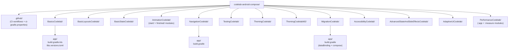

Sources: [README.md:1-63](), [BasicsCodelab/build.gradle.kts:1-22](), [MigrationCodelab/build.gradle:1-51]()

---

## Subject Apps

Several codelabs share a subject app. The table below groups codelabs by the app they build on.

| Subject App | Codelabs That Use It |
|---|---|
| Rally (finance app) | `NavigationCodelab`, `TestingCodelab` |
| Reply (email app) | `ThemingCodelab`, `AdaptiveUiCodelab` |
| Sunflower (plant app) | `MigrationCodelab` |
| JetNews | `AccessibilityCodelab` |
| Crane (travel app) | `AdvancedStateAndSideEffectsCodelab` |
| MySoothe | `BasicLayoutsCodelab` |
| Custom/standalone | `BasicsCodelab`, `BasicStateCodelab`, `AnimationCodelab`, `ThemingCodelabM2`, `PerformanceCodelab` |

---

## Intended Learning Path

The codelabs are designed to be independent but follow a natural progression from fundamental to advanced topics:

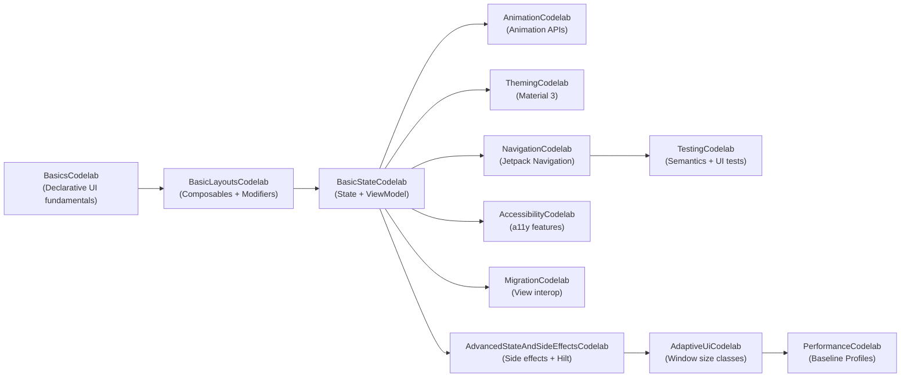

Sources: [README.md:13-63]()

---

## Common Build Conventions

Despite being independent projects, all codelabs share a consistent Gradle setup. The table below summarizes conventions that appear across all or most codelabs.

| Convention | Value | Notes |
|---|---|---|
| Android Gradle Plugin | `9.0.0` | Declared in each codelab's `build.gradle` |
| Kotlin Gradle Plugin | `2.3.0` | All except `AdvancedStateAndSideEffectsCodelab` (uses `2.3.10`) |
| Compose Compiler Plugin | `org.jetbrains.kotlin:compose-compiler-gradle-plugin:2.3.0` | Applied in all codelabs |
| Compose BOM | `androidx.compose:compose-bom:2026.01.01` | Applied in app-level `build.gradle` |
| Code style enforcement | Spotless `8.2.1` with ktlint | Present in most codelabs |
| Repositories | `google()` + `mavenCentral()` | Universal |

Two codelabs differ significantly from the common pattern:

- **`MigrationCodelab`** — adds `navigation-safe-args-gradle-plugin`, `com.android.legacy-kapt`, Room (kapt), Glide, and WorkManager. Enables `dataBinding = true` alongside `compose = true`. See [Migration Codelab](#5.8).
- **`AdvancedStateAndSideEffectsCodelab`** — adds Hilt (`dagger.hilt.android:2.59.1`), KSP (`symbol-processing-gradle-plugin:2.3.4`), and Google Maps Compose. See [Advanced State and Side Effects Codelab](#5.10).

Sources: [MigrationCodelab/build.gradle:1-51](), [AdvancedStateAndSideEffectsCodelab/build.gradle:1-66](), [BasicsCodelab/build.gradle.kts:1-22](), [ThemingCodelab/build.gradle:1-51](), [NavigationCodelab/build.gradle:1-51](), [AnimationCodelab/build.gradle:1-34](), [AccessibilityCodelab/build.gradle:1-51](), [BasicLayoutsCodelab/build.gradle:1-50](), [BasicStateCodelab/build.gradle:1-50](), [TestingCodelab/build.gradle:1-67](), [ThemingCodelabM2/build.gradle:1-41]()

---

## Material Design Version Split

Codelabs divide into two camps based on which Material Design library version they use. This affects the composables and theming APIs available in each project.

**Codelab-to-Material-version mapping:**

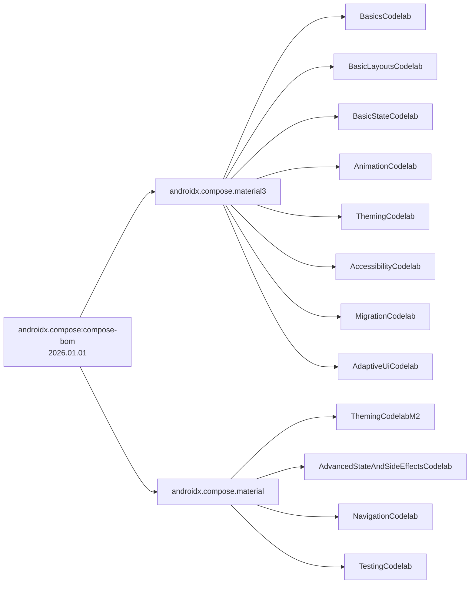

Sources: [ThemingCodelab/build.gradle:1-51](), [ThemingCodelabM2/build.gradle:1-41](), [AdvancedStateAndSideEffectsCodelab/build.gradle:1-66](), [NavigationCodelab/build.gradle:1-51]()

---

## CI/CD Overview

All twelve codelabs have a corresponding GitHub Actions workflow under `.github/workflows/`. Every workflow shares the same core steps: checkout, JDK 17 setup, Gradle setup, `assembleDebug`, `lintDebug`, and artifact upload.

Two codelabs additionally run instrumentation tests on an Android emulator matrix (API 26 and 29):

- `AdvancedStateAndSideEffectsCodelab` — uses `google_apis` emulator target
- `MigrationCodelab` — uses `default` emulator target

Three codelabs (`AccessibilityCodelab`, `NavigationCodelab`, `TestingCodelab`) trigger on both the `main` branch and an `end` branch. All others trigger on `main` only.

For full CI details, see [Continuous Integration](#4).

---

## Related Pages

| Page | Content |
|---|---|
| [Repository Structure](#2) | Directory layout and `settings.gradle` details |
| [Build System](#3) | Gradle two-level structure, root vs. app configs |
| [Continuous Integration](#4) | GitHub Actions workflows, emulator matrix |
| [Codelabs](#5) | Index of all codelabs with per-codelab deep dives |

---

# Page: Repository Structure

# Repository Structure

<details>
<summary>Relevant source files</summary>

The following files were used as context for generating this wiki page:

- [AccessibilityCodelab/build.gradle](AccessibilityCodelab/build.gradle)
- [AdvancedStateAndSideEffectsCodelab/build.gradle](AdvancedStateAndSideEffectsCodelab/build.gradle)
- [AnimationCodelab/build.gradle](AnimationCodelab/build.gradle)
- [BasicLayoutsCodelab/build.gradle](BasicLayoutsCodelab/build.gradle)
- [BasicLayoutsCodelab/settings.gradle](BasicLayoutsCodelab/settings.gradle)
- [BasicStateCodelab/build.gradle](BasicStateCodelab/build.gradle)
- [BasicStateCodelab/settings.gradle](BasicStateCodelab/settings.gradle)
- [BasicsCodelab/README.md](BasicsCodelab/README.md)
- [BasicsCodelab/build.gradle.kts](BasicsCodelab/build.gradle.kts)
- [MigrationCodelab/README.md](MigrationCodelab/README.md)
- [MigrationCodelab/build.gradle](MigrationCodelab/build.gradle)
- [NavigationCodelab/build.gradle](NavigationCodelab/build.gradle)
- [README.md](README.md)
- [TestingCodelab/build.gradle](TestingCodelab/build.gradle)
- [ThemingCodelab/README.md](ThemingCodelab/README.md)
- [ThemingCodelab/build.gradle](ThemingCodelab/build.gradle)
- [ThemingCodelabM2/build.gradle](ThemingCodelabM2/build.gradle)

</details>


## Purpose and Scope

This page describes the physical layout of the `codelab-android-compose` monorepo: the top-level directory organization, the internal structure common to each codelab project, and how `settings.gradle` defines module membership. For an introduction to what each codelab teaches, see [Overview](#1). For the Gradle plugin and dependency configuration within each codelab, see [Build System](#3).

---

## Monorepo Layout

The repository root contains one directory per codelab. There is **no shared root-level Gradle project** — each codelab directory is a fully independent Android Studio project with its own Gradle wrapper, root build file, and settings file. No cross-codelab Gradle dependencies exist.

**Top-level monorepo layout:**

```
codelab-android-compose/
├── .github/
├── README.md
├── AccessibilityCodelab/
├── AdaptiveUiCodelab/
├── AdvancedStateAndSideEffectsCodelab/
├── AnimationCodelab/
├── BasicLayoutsCodelab/
├── BasicStateCodelab/
├── BasicsCodelab/
├── MigrationCodelab/
├── NavigationCodelab/
├── PerformanceCodelab/
├── TestingCodelab/
├── ThemingCodelab/
└── ThemingCodelabM2/
```

Sources: [README.md:1-81]()

---

## Standard Codelab Project Layout

Each codelab directory follows a standard Android single-module project layout. The diagram below maps the directory tree to the specific file names used in the repository.

**Diagram: Standard single-module codelab layout**

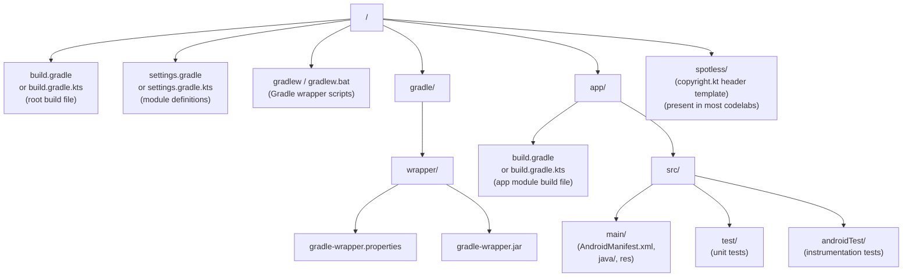

Sources: [BasicStateCodelab/settings.gradle:17-18](), [BasicLayoutsCodelab/settings.gradle:17-18](), [MigrationCodelab/build.gradle:1-51](), [ThemingCodelab/build.gradle:1-51]()

---

## Module Definitions via `settings.gradle`

Each codelab's `settings.gradle` (or `settings.gradle.kts`) sets the Gradle project name and declares which subdirectory modules are included. The project name in `settings.gradle` is what appears in Android Studio's project panel — it does not have to match the directory name.

**Known `settings.gradle` configurations:**

| Codelab Directory | `rootProject.name` | Included Modules |
|-------------------|--------------------|------------------|
| `BasicLayoutsCodelab` | `MySoothe` | `:app` |
| `BasicStateCodelab` | `BasicStateCodelab` | `:app` |
| `AnimationCodelab` | — | `:start`, `:finished` |
| `PerformanceCodelab` | — | `:app`, `:measure` |
| All others (typical) | matches directory name | `:app` |

The `BasicLayoutsCodelab` uses the project name `MySoothe` because it implements the MySoothe fitness app as its subject, demonstrating that `rootProject.name` reflects the subject app, not the codelab name.

Sources: [BasicLayoutsCodelab/settings.gradle:17-18](), [BasicStateCodelab/settings.gradle:17-18]()

---

## Multi-Module Exceptions

Two codelabs deviate from the single `:app` module structure:

**Diagram: Multi-module codelab layouts**

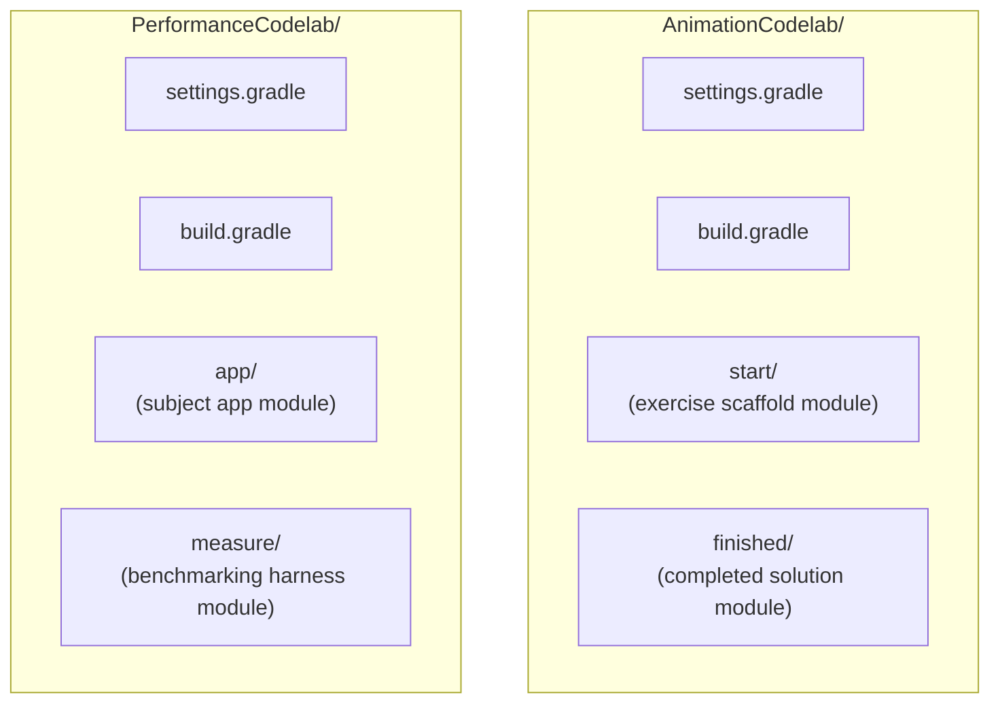

- **`AnimationCodelab`** uses a `start/` module (the exercise scaffold with `TODO` annotations) and a `finished/` module (the completed reference implementation). This pattern lets learners compare their work against the solution.
- **`PerformanceCodelab`** uses an `app/` module (the subject app under optimization) and a `measure/` module (the macro-benchmark harness that runs Baseline Profile generation). See [Performance Codelab](#5.12) for details on the `:measure` module.

---

## Root Build File Variations

Each codelab contains a root-level build file that configures plugins and repositories for all submodules. Most codelabs use Groovy DSL (`.gradle`), but `BasicsCodelab` uses Kotlin DSL (`.gradle.kts`) with a version catalog.

**Diagram: Root build file structure by codelab**

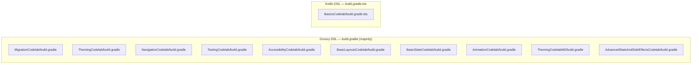

The `BasicsCodelab/build.gradle.kts` file uses `alias(libs.plugins.android.application)`, `alias(libs.plugins.kotlin.android)`, and `alias(libs.plugins.kotlin.compose)` — version catalog aliases defined in a `libs.versions.toml` file — rather than hardcoded version strings. See [Dependency Management](#3.3) for details on the version catalog.

Sources: [BasicsCodelab/build.gradle.kts:18-22](), [MigrationCodelab/build.gradle:17-51](), [ThemingCodelab/build.gradle:17-51](), [NavigationCodelab/build.gradle:17-51](), [AnimationCodelab/build.gradle:17-34]()

---

## Notable Root Build File Differences

While every root `build.gradle` declares the Android Gradle Plugin and Kotlin plugin, several codelabs add unique entries:

| Codelab | Notable Root-Level Addition |
|---------|-----------------------------|
| `MigrationCodelab` | `androidx.navigation:navigation-safe-args-gradle-plugin:2.9.7`; `com.android.legacy-kapt` plugin |
| `AdvancedStateAndSideEffectsCodelab` | `com.google.dagger:hilt-android-gradle-plugin:2.59.1`; `com.google.devtools.ksp:symbol-processing-gradle-plugin:2.3.4` |
| `AccessibilityCodelab` | Compose compiler plugin declared in `plugins {}` block as `org.jetbrains.kotlin.plugin.compose`, not in `buildscript { dependencies {} }` |
| `TestingCodelab` | `kotlinOptions.allWarningsAsErrors = true` applied to all subprojects |
| `AdvancedStateAndSideEffectsCodelab` | `configurations.configureEach { resolutionStrategy { force "junit:junit:4.13.2" } }` across all subprojects |
| `BasicsCodelab` | No `buildscript {}` block; uses `plugins {}` block with version catalog aliases only |

Sources: [MigrationCodelab/build.gradle:26-33](), [AdvancedStateAndSideEffectsCodelab/build.gradle:22-33](), [AccessibilityCodelab/build.gradle:29-32](), [TestingCodelab/build.gradle:52-66](), [AdvancedStateAndSideEffectsCodelab/build.gradle:61-65](), [BasicsCodelab/build.gradle.kts:18-22]()

---

## Spotless Code Style Configuration

Most codelabs include a `spotless/` directory at the codelab root containing a `copyright.kt` file used as the license header template. The Spotless plugin (`com.diffplug.spotless`) is applied at the root level and targets all `**/*.kt` files in the project, excluding the `build/` and `bin/` directories.

Codelabs that apply Spotless per-subproject (using `subprojects { apply plugin: 'com.diffplug.spotless' }`) include: `ThemingCodelab`, `NavigationCodelab`, `TestingCodelab`, `AccessibilityCodelab`, `BasicLayoutsCodelab`, `BasicStateCodelab`, and `AdvancedStateAndSideEffectsCodelab`.

`MigrationCodelab` applies Spotless at the `allprojects` scope [MigrationCodelab/build.gradle:36-50]().

`AnimationCodelab` and `ThemingCodelabM2` use `allprojects` for repository declarations but do not apply Spotless [AnimationCodelab/build.gradle:29-34](), [ThemingCodelabM2/build.gradle:29-41]().

Sources: [ThemingCodelab/build.gradle:34-50](), [BasicLayoutsCodelab/build.gradle:33-50](), [BasicStateCodelab/build.gradle:33-50](), [MigrationCodelab/build.gradle:43-50]()

---

# Page: Build System

# Build System

<details>
<summary>Relevant source files</summary>

The following files were used as context for generating this wiki page:

- [AccessibilityCodelab/app/build.gradle](AccessibilityCodelab/app/build.gradle)
- [AccessibilityCodelab/build.gradle](AccessibilityCodelab/build.gradle)
- [AdvancedStateAndSideEffectsCodelab/app/build.gradle](AdvancedStateAndSideEffectsCodelab/app/build.gradle)
- [AdvancedStateAndSideEffectsCodelab/build.gradle](AdvancedStateAndSideEffectsCodelab/build.gradle)
- [AnimationCodelab/build.gradle](AnimationCodelab/build.gradle)
- [AnimationCodelab/finished/build.gradle](AnimationCodelab/finished/build.gradle)
- [AnimationCodelab/start/build.gradle](AnimationCodelab/start/build.gradle)
- [BasicLayoutsCodelab/app/build.gradle](BasicLayoutsCodelab/app/build.gradle)
- [BasicLayoutsCodelab/build.gradle](BasicLayoutsCodelab/build.gradle)
- [BasicStateCodelab/build.gradle](BasicStateCodelab/build.gradle)
- [BasicsCodelab/build.gradle.kts](BasicsCodelab/build.gradle.kts)
- [MigrationCodelab/app/build.gradle](MigrationCodelab/app/build.gradle)
- [MigrationCodelab/build.gradle](MigrationCodelab/build.gradle)
- [NavigationCodelab/app/build.gradle](NavigationCodelab/app/build.gradle)
- [NavigationCodelab/build.gradle](NavigationCodelab/build.gradle)
- [TestingCodelab/app/build.gradle](TestingCodelab/app/build.gradle)
- [TestingCodelab/build.gradle](TestingCodelab/build.gradle)
- [ThemingCodelab/app/build.gradle](ThemingCodelab/app/build.gradle)
- [ThemingCodelab/build.gradle](ThemingCodelab/build.gradle)
- [ThemingCodelabM2/app/build.gradle](ThemingCodelabM2/app/build.gradle)
- [ThemingCodelabM2/build.gradle](ThemingCodelabM2/build.gradle)

</details>


This page describes the Gradle build system structure shared across all codelabs in the repository, including the two-level file layout, plugin versions, and how individual codelabs deviate from the common pattern. For details on how individual libraries are versioned and how the Compose BOM is used, see [Dependency Management](#3.3). For the Gradle wrapper configuration, see [Gradle Wrapper](#3.4). For CI pipeline integration, see [Continuous Integration](#4).

---

## Overview

Each codelab in the monorepo is a self-contained Android Gradle project. There is no shared root build file at the repository level — every codelab manages its own build independently. All codelabs follow the same two-level Gradle structure:

1. **Root `build.gradle` (or `build.gradle.kts`)** — declares classpath dependencies (plugins), repositories, and cross-project configuration such as code style enforcement.
2. **`app/build.gradle` (or `app/build.gradle.kts`)** — configures the Android application module, enables Compose, pins the BOM, and lists runtime and test dependencies.

One codelab (`BasicsCodelab`) uses Kotlin DSL (`.kts`) at both levels; all others use Groovy DSL.

---

## Two-Level Build Structure

**Diagram: Build file hierarchy across all codelabs**

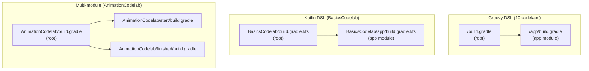

Sources: [BasicsCodelab/build.gradle.kts:1-22](), [AnimationCodelab/build.gradle:1-34](), [AnimationCodelab/start/build.gradle:1-52](), [AnimationCodelab/finished/build.gradle:1-52]()

---

## Root Build Configuration

### Common Pattern

Most codelabs declare plugins in a `buildscript {}` block at the root level. The three plugins present in nearly every root build file are:

| Plugin | Artifact | Version |
|--------|----------|---------|
| Android Gradle Plugin | `com.android.tools.build:gradle` | `9.0.0` |
| Kotlin Gradle Plugin | `org.jetbrains.kotlin:kotlin-gradle-plugin` | `2.3.0` |
| Compose Compiler Plugin | `org.jetbrains.kotlin:compose-compiler-gradle-plugin` | `2.3.0` |

Repositories declared at root level are `google()` and `mavenCentral()`, applied either to `allprojects {}` or `subprojects {}`.

Most codelabs also apply **Spotless** (`com.diffplug.spotless` version `8.2.1`) for Kotlin code style, configured with `ktlint` and a `licenseHeaderFile`.

**Diagram: Root build file anatomy**

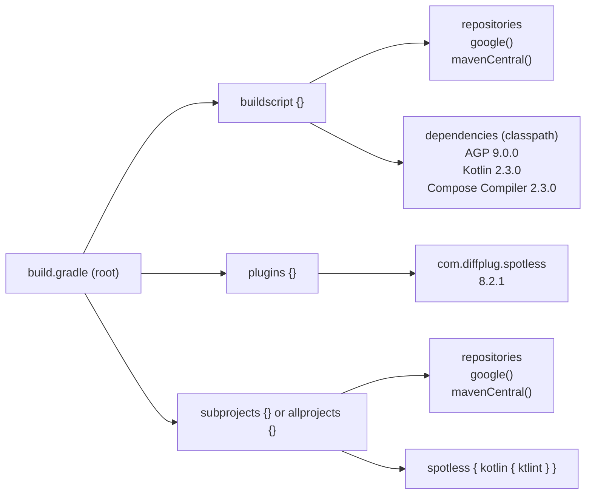

Sources: [ThemingCodelab/build.gradle:17-51](), [NavigationCodelab/build.gradle:17-51](), [BasicStateCodelab/build.gradle:16-50](), [BasicLayoutsCodelab/build.gradle:17-50]()

### Root-Level Deviations by Codelab

| Codelab | Notable Root-Level Differences |
|---------|-------------------------------|
| **BasicsCodelab** | Kotlin DSL; uses version catalog `alias(libs.plugins.*)` — no `buildscript {}` block |
| **MigrationCodelab** | Adds `androidx.navigation:navigation-safe-args-gradle-plugin:2.9.7`; adds `com.android.legacy-kapt:9.0.0` in `plugins {}` block |
| **AdvancedStateAndSideEffectsCodelab** | Adds `com.google.dagger:hilt-android-gradle-plugin:2.59.1`; adds `com.google.devtools.ksp:symbol-processing-gradle-plugin:2.3.4`; Compose compiler plugin version is `2.3.10` (differs from others) |
| **AnimationCodelab** | No Spotless; uses `allprojects {}` for repositories instead of `subprojects {}` |
| **ThemingCodelabM2** | No Spotless; uses `allprojects {}` with a global `KotlinCompile` task configuration for `-opt-in=kotlin.RequiresOptIn` |
| **AccessibilityCodelab** | Compose Compiler Plugin declared in `plugins {}` block (not `buildscript.dependencies`): `id 'org.jetbrains.kotlin.plugin.compose' version "2.3.0" apply false` |

Sources: [BasicsCodelab/build.gradle.kts:18-22](), [MigrationCodelab/build.gradle:17-50](), [AdvancedStateAndSideEffectsCodelab/build.gradle:17-66](), [AnimationCodelab/build.gradle:17-34](), [ThemingCodelabM2/build.gradle:17-41](), [AccessibilityCodelab/build.gradle:29-32]()

---

## Application Module Configuration

### Common Pattern

All `app/build.gradle` files share this structure:

**Diagram: App module build.gradle structure**

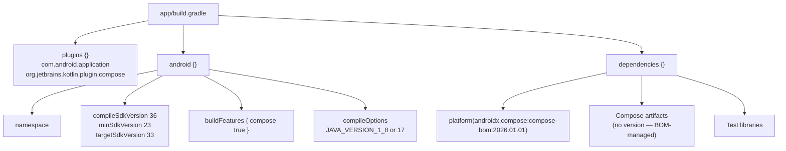

Sources: [AccessibilityCodelab/app/build.gradle:17-151](), [ThemingCodelab/app/build.gradle:17-143](), [NavigationCodelab/app/build.gradle:17-116]()

### SDK and Java Version Settings

All codelabs target the same SDK range. Java version varies slightly:

| Setting | Value |
|---------|-------|
| `compileSdkVersion` | `36` |
| `minSdkVersion` | `23` |
| `targetSdkVersion` | `33` (most) or `34` (AnimationCodelab) |
| `compileOptions` | `JavaVersion.VERSION_1_8` (most) or `JavaVersion.VERSION_17` (MigrationCodelab) |

Sources: [MigrationCodelab/app/build.gradle:41-44](), [AnimationCodelab/finished/build.gradle:26-35]()

### `buildFeatures` Flags

The `buildFeatures` block enables Compose in all codelabs. Some codelabs disable unused AGP features explicitly to reduce build overhead:

```
// AdvancedStateAndSideEffectsCodelab, TestingCodelab
buildFeatures {
    compose true
    buildConfig false
    aidl false
    renderScript false
    resValues false
    shaders false
}
```

`MigrationCodelab` is the only codelab that enables both `compose` and `dataBinding` simultaneously, supporting the hybrid View + Compose architecture:

```
// MigrationCodelab only
buildFeatures {
    dataBinding true
    compose true
}
```

Sources: [AdvancedStateAndSideEffectsCodelab/app/build.gradle:71-88](), [TestingCodelab/app/build.gradle:63-72](), [MigrationCodelab/app/build.gradle:46-49]()

### Material Version Split

All codelabs use the Compose BOM but divide into two camps by Material Design version:

| Material Version | Artifact | Codelabs |
|-----------------|----------|----------|
| Material 3 | `androidx.compose.material3:material3` | BasicsCodelab, BasicLayoutsCodelab, BasicStateCodelab, ThemingCodelab, AccessibilityCodelab, AnimationCodelab, MigrationCodelab, AdaptiveUiCodelab |
| Material 2 | `androidx.compose.material:material` | ThemingCodelabM2, AdvancedStateAndSideEffectsCodelab, NavigationCodelab, TestingCodelab |

Sources: [ThemingCodelabM2/app/build.gradle:45-56](), [AdvancedStateAndSideEffectsCodelab/app/build.gradle:105-116](), [NavigationCodelab/app/build.gradle:78-104](), [AnimationCodelab/finished/build.gradle:41-52]()

### Signing Configuration

Several codelabs include a bundled `debug.keystore` to allow CI debug builds to be upgradable across runs. This is configured in the `signingConfigs` block:

- `storePassword`: `android`
- `keyAlias`: `androiddebugkey`
- `keyPassword`: `android`

Codelabs with this pattern: AccessibilityCodelab, ThemingCodelab, NavigationCodelab, TestingCodelab, AdvancedStateAndSideEffectsCodelab.

Sources: [AccessibilityCodelab/app/build.gradle:35-43](), [ThemingCodelab/app/build.gradle:35-44](), [AdvancedStateAndSideEffectsCodelab/app/build.gradle:45-53]()

---

## Codelab-Specific Deviations

**Diagram: App-level plugin and dependency differences across codelabs**

```mermaid
graph TD
    BASE["Standard app/build.gradle\ncom.android.application\norg.jetbrains.kotlin.plugin.compose\nCompose BOM 2026.01.01\nmaterial3 or material"]

    BASE --> MC["MigrationCodelab/app/build.gradle"]
    MC --> MC1["+ apply plugin: androidx.navigation.safeargs.kotlin"]
    MC --> MC2["+ apply plugin: com.android.legacy-kapt"]
    MC --> MC3["+ dataBinding true"]
    MC --> MC4["+ kapt room-compiler:2.8.4"]
    MC --> MC5["+ kapt glide compiler:5.0.5"]
    MC --> MC6["+ room-runtime:2.8.4\n+ room-ktx:2.8.4"]
    MC --> MC7["+ work-runtime-ktx:2.11.1"]
    MC --> MC8["+ glide:5.0.5"]
    MC --> MC9["+ navigation-fragment-ktx:2.9.7"]
    MC --> MC10["+ viewpager2:1.1.0"]
    MC --> MC11["compileOptions: VERSION_17"]

    BASE --> AC["AdvancedStateAndSideEffectsCodelab/app/build.gradle"]
    AC --> AC1["+ id com.google.devtools.ksp"]
    AC --> AC2["+ id dagger.hilt.android.plugin"]
    AC --> AC3["+ hilt-android:2.59.1"]
    AC --> AC4["+ ksp hilt-compiler:2.59.1"]
    AC --> AC5["+ maps:3.1.0-beta\n+ maps-v3-ktx:3.4.0"]
    AC --> AC6["+ coil-compose:2.7.0"]
    AC --> AC7["custom testInstrumentationRunner:\nCustomTestRunner"]

    BASE --> NC["NavigationCodelab/app/build.gradle"]
    NC --> NC1["+ composeOptions {\nkotlinCompilerExtensionVersion 1.5.15\n}"]
```

Sources: [MigrationCodelab/app/build.gradle:17-107](), [AdvancedStateAndSideEffectsCodelab/app/build.gradle:17-139](), [NavigationCodelab/app/build.gradle:67-69]()

### MigrationCodelab

The most complex `app/build.gradle` in the repository. Key differences from the standard pattern:

- Applies `androidx.navigation.safeargs.kotlin` and `com.android.legacy-kapt` as additional plugins ([MigrationCodelab/app/build.gradle:18-20]())
- `buildFeatures` enables both `dataBinding true` and `compose true` ([MigrationCodelab/app/build.gradle:46-49]())
- `compileOptions` targets `JavaVersion.VERSION_17` (all others use `VERSION_1_8`) ([MigrationCodelab/app/build.gradle:41-44]())
- Uses `kapt` for annotation processing of Room (`room-compiler:2.8.4`) and Glide (`compiler:5.0.5`) ([MigrationCodelab/app/build.gradle:63-64]())
- Unique dependencies not found in any other codelab: `room-runtime`, `room-ktx`, `work-runtime-ktx`, `glide`, `navigation-fragment-ktx`, `viewpager2`, `gson`

### AdvancedStateAndSideEffectsCodelab

- Adds `com.google.devtools.ksp` and `dagger.hilt.android.plugin` to the `plugins {}` block ([AdvancedStateAndSideEffectsCodelab/app/build.gradle:17-22]())
- Uses `ksp` (not `kapt`) for `hilt-compiler` and `kotlin-metadata-jvm` ([AdvancedStateAndSideEffectsCodelab/app/build.gradle:123-124]())
- Declares a custom `testInstrumentationRunner`: `androidx.compose.samples.crane.CustomTestRunner` ([AdvancedStateAndSideEffectsCodelab/app/build.gradle:40]())
- Reads `MAPS_API_KEY` from `local.properties` via `manifestPlaceholders` ([AdvancedStateAndSideEffectsCodelab/app/build.gradle:25-42]())

### NavigationCodelab

Contains a `composeOptions {}` block setting `kotlinCompilerExtensionVersion '1.5.15'`, which is a legacy override not present in other codelabs ([NavigationCodelab/app/build.gradle:67-69]()).

### BasicsCodelab

Uses Kotlin DSL throughout. The root `build.gradle.kts` declares plugins via version catalog aliases rather than string literals:

```kotlin
alias(libs.plugins.android.application) apply false
alias(libs.plugins.kotlin.android) apply false
alias(libs.plugins.kotlin.compose) apply false
```

([BasicsCodelab/build.gradle.kts:18-22]())

---

## Kotlin Compiler Options

Several codelabs configure additional Kotlin compiler arguments in `tasks.withType(KotlinCompile)` blocks. These are typically placed either in the root `build.gradle` (under `subprojects {}`) or in `app/build.gradle`.

| Compiler Argument | Purpose | Codelabs |
|------------------|---------|----------|
| `-opt-in=kotlin.RequiresOptIn` | Enable opt-in annotations | Most codelabs |
| `-opt-in=kotlin.Experimental` | Enable experimental APIs | AccessibilityCodelab, ThemingCodelab |
| `-opt-in=kotlinx.coroutines.ExperimentalCoroutinesApi` | Experimental coroutines | TestingCodelab |
| `-opt-in=kotlinx.coroutines.FlowPreview` | Flow preview APIs | TestingCodelab |
| `allWarningsAsErrors = true` | Treat warnings as errors | TestingCodelab (root), NavigationCodelab (app), ThemingCodelabM2 (app) |
| `jvmTarget = "1.8"` | JVM bytecode target | All codelabs |

Sources: [TestingCodelab/build.gradle:52-66](), [AdvancedStateAndSideEffectsCodelab/build.gradle:52-58](), [NavigationCodelab/app/build.gradle:106-116](), [AccessibilityCodelab/app/build.gradle:135-147]()

---

## Summary: Build Configuration Matrix

| Codelab | DSL | Spotless | Compose BOM | Material | Extra Plugins | kapt/ksp |
|---------|-----|----------|-------------|----------|---------------|----------|
| BasicsCodelab | Kotlin | — | ✓ | M3 | — | — |
| BasicLayoutsCodelab | Groovy | ✓ | ✓ | M3 | — | — |
| BasicStateCodelab | Groovy | ✓ | ✓ | M3 | — | — |
| AnimationCodelab | Groovy | — | ✓ | M3 | — | — |
| NavigationCodelab | Groovy | ✓ | ✓ | M2 | — | — |
| TestingCodelab | Groovy | ✓ | ✓ | M2 | — | — |
| ThemingCodelab | Groovy | ✓ | ✓ | M3 | — | — |
| ThemingCodelabM2 | Groovy | — | ✓ | M2 | — | — |
| AccessibilityCodelab | Groovy | ✓ | ✓ | M3 | — | — |
| MigrationCodelab | Groovy | ✓ | ✓ | M3 | safe-args, legacy-kapt | kapt |
| AdvancedStateAndSideEffectsCodelab | Groovy | ✓ | ✓ | M2 | Hilt, KSP | ksp |

Sources: [MigrationCodelab/build.gradle:17-50](), [AdvancedStateAndSideEffectsCodelab/build.gradle:17-66](), [BasicsCodelab/build.gradle.kts:18-22](), [AnimationCodelab/build.gradle:17-34](), [ThemingCodelabM2/build.gradle:17-41]()

---

# Page: Root Build Configuration

# Root Build Configuration

<details>
<summary>Relevant source files</summary>

The following files were used as context for generating this wiki page:

- [AccessibilityCodelab/build.gradle](AccessibilityCodelab/build.gradle)
- [AdvancedStateAndSideEffectsCodelab/build.gradle](AdvancedStateAndSideEffectsCodelab/build.gradle)
- [AnimationCodelab/build.gradle](AnimationCodelab/build.gradle)
- [BasicLayoutsCodelab/build.gradle](BasicLayoutsCodelab/build.gradle)
- [BasicStateCodelab/build.gradle](BasicStateCodelab/build.gradle)
- [BasicsCodelab/build.gradle.kts](BasicsCodelab/build.gradle.kts)
- [MigrationCodelab/build.gradle](MigrationCodelab/build.gradle)
- [NavigationCodelab/build.gradle](NavigationCodelab/build.gradle)
- [TestingCodelab/build.gradle](TestingCodelab/build.gradle)
- [ThemingCodelab/build.gradle](ThemingCodelab/build.gradle)
- [ThemingCodelabM2/build.gradle](ThemingCodelabM2/build.gradle)

</details>


This page documents the root-level `build.gradle` (or `build.gradle.kts`) file found at the top of each codelab's directory. These files configure the plugins and repositories that apply to all subprojects within a given codelab. For details on how individual app modules are configured, see [Application Module Configuration](#3.2). For version catalog and BOM usage, see [Dependency Management](#3.3).

---

## Purpose and Scope

Each codelab in this monorepo is an independent Gradle project with its own root build file. The root build file is responsible for:

- Declaring build tool plugins (AGP, Kotlin, Compose Compiler, Spotless, KSP, Hilt, kapt)
- Specifying repository sources for resolving those plugins
- Propagating repository declarations and shared compiler configuration down to subprojects or all projects

Root build files do **not** declare application dependencies (those live in `app/build.gradle`). They are purely a coordination layer for tooling.

---

## File Locations and DSL Format

| Codelab | Root Build File | DSL |
|---|---|---|
| BasicsCodelab | `BasicsCodelab/build.gradle.kts` | Kotlin DSL |
| BasicLayoutsCodelab | `BasicLayoutsCodelab/build.gradle` | Groovy DSL |
| BasicStateCodelab | `BasicStateCodelab/build.gradle` | Groovy DSL |
| AnimationCodelab | `AnimationCodelab/build.gradle` | Groovy DSL |
| NavigationCodelab | `NavigationCodelab/build.gradle` | Groovy DSL |
| TestingCodelab | `TestingCodelab/build.gradle` | Groovy DSL |
| ThemingCodelab | `ThemingCodelab/build.gradle` | Groovy DSL |
| ThemingCodelabM2 | `ThemingCodelabM2/build.gradle` | Groovy DSL |
| MigrationCodelab | `MigrationCodelab/build.gradle` | Groovy DSL |
| AccessibilityCodelab | `AccessibilityCodelab/build.gradle` | Groovy DSL |
| AdvancedStateAndSideEffectsCodelab | `AdvancedStateAndSideEffectsCodelab/build.gradle` | Groovy DSL |

Sources: [BasicsCodelab/build.gradle.kts:1-22](), [MigrationCodelab/build.gradle:1-50]()

**BasicsCodelab** is the only codelab using Kotlin DSL. All others use Groovy DSL. This is consistent with it being the most recently updated codelab in terms of Gradle conventions (see [Basics Codelab](#5.1)).

---

## Common Plugin Set

The diagram below maps each plugin to the codelabs that declare it, using the exact artifact or plugin ID that appears in the build files.

**Diagram: Plugin Declarations Across Root Build Files**

```mermaid
graph TD
    AGP["\"com.android.tools.build:gradle:9.0.0\""]
    KOTLIN["\"org.jetbrains.kotlin:kotlin-gradle-plugin:2.3.0\""]
    COMPOSE_COMPILER["\"org.jetbrains.kotlin:compose-compiler-gradle-plugin:2.3.0\""]
    SPOTLESS["\"com.diffplug.spotless\" version 8.2.1"]
    NAVARGS["\"androidx.navigation:navigation-safe-args-gradle-plugin:2.9.7\""]
    LEGACY_KAPT["\"com.android.legacy-kapt\" version 9.0.0"]
    HILT["\"com.google.dagger:hilt-android-gradle-plugin:2.59.1\""]
    KSP["\"com.google.devtools.ksp:symbol-processing-gradle-plugin:2.3.4\""]
    KOTLIN_COMPOSE_PLUGIN["\"org.jetbrains.kotlin.plugin.compose\" version 2.3.0"]

    AGP --> B1["BasicsCodelab"]
    AGP --> B2["BasicLayoutsCodelab"]
    AGP --> B3["BasicStateCodelab"]
    AGP --> B4["AnimationCodelab"]
    AGP --> B5["NavigationCodelab"]
    AGP --> B6["TestingCodelab"]
    AGP --> B7["ThemingCodelab"]
    AGP --> B8["ThemingCodelabM2"]
    AGP --> B9["MigrationCodelab"]
    AGP --> B10["AccessibilityCodelab"]
    AGP --> B11["AdvancedStateAndSideEffectsCodelab"]

    KOTLIN --> B1
    KOTLIN --> B2
    KOTLIN --> B3
    KOTLIN --> B4
    KOTLIN --> B5
    KOTLIN --> B6
    KOTLIN --> B7
    KOTLIN --> B8
    KOTLIN --> B9
    KOTLIN --> B10

    COMPOSE_COMPILER --> B2
    COMPOSE_COMPILER --> B3
    COMPOSE_COMPILER --> B4
    COMPOSE_COMPILER --> B5
    COMPOSE_COMPILER --> B6
    COMPOSE_COMPILER --> B7
    COMPOSE_COMPILER --> B8
    COMPOSE_COMPILER --> B9
    COMPOSE_COMPILER --> B11

    SPOTLESS --> B2
    SPOTLESS --> B3
    SPOTLESS --> B4
    SPOTLESS --> B5
    SPOTLESS --> B6
    SPOTLESS --> B7
    SPOTLESS --> B9
    SPOTLESS --> B10
    SPOTLESS --> B11

    NAVARGS --> B9
    LEGACY_KAPT --> B9
    HILT --> B11
    KSP --> B11
    KOTLIN_COMPOSE_PLUGIN --> B10
```

Sources: [AnimationCodelab/build.gradle:17-27](), [MigrationCodelab/build.gradle:17-34](), [AdvancedStateAndSideEffectsCodelab/build.gradle:17-33](), [AccessibilityCodelab/build.gradle:17-32](), [BasicsCodelab/build.gradle.kts:17-22]()

---

## Plugin Declaration Patterns

There are two distinct Gradle idioms for declaring plugins in these root build files.

### Pattern A: `buildscript` + `plugins` block (Groovy DSL, most codelabs)

Most Groovy DSL codelabs split declarations across two blocks:

- A `buildscript` block that declares AGP, Kotlin, and the Compose Compiler plugin as `classpath` dependencies. These are resolved from `google()` and `mavenCentral()`.
- A `plugins` block that declares Spotless (and, where applicable, KSP or `org.jetbrains.kotlin.plugin.compose`) using the `id ... version ...` syntax.

Example structure visible at [NavigationCodelab/build.gradle:17-31]().

### Pattern B: `plugins` block only (Kotlin DSL, BasicsCodelab)

BasicsCodelab uses the modern Kotlin DSL style, declaring all three plugins — AGP, Kotlin Android, and Kotlin Compose — exclusively through `alias(libs.plugins.*)` references into the version catalog. No `buildscript` block is present.

See [BasicsCodelab/build.gradle.kts:17-22]().

### Pattern C: AccessibilityCodelab hybrid

AccessibilityCodelab places the Kotlin plugin as a `classpath` inside `buildscript` but declares the Compose Compiler plugin (`org.jetbrains.kotlin.plugin.compose`) in the outer `plugins` block with `apply false`. This differs from all other Groovy DSL codelabs, which declare the Compose Compiler plugin inside `buildscript`. See [AccessibilityCodelab/build.gradle:17-32]().

---

## Repository Configuration Scope

Groovy DSL codelabs choose between `allprojects` and `subprojects` for propagating the `google()` / `mavenCentral()` repository declarations to child modules.

**Diagram: Repository Propagation Scope per Codelab**

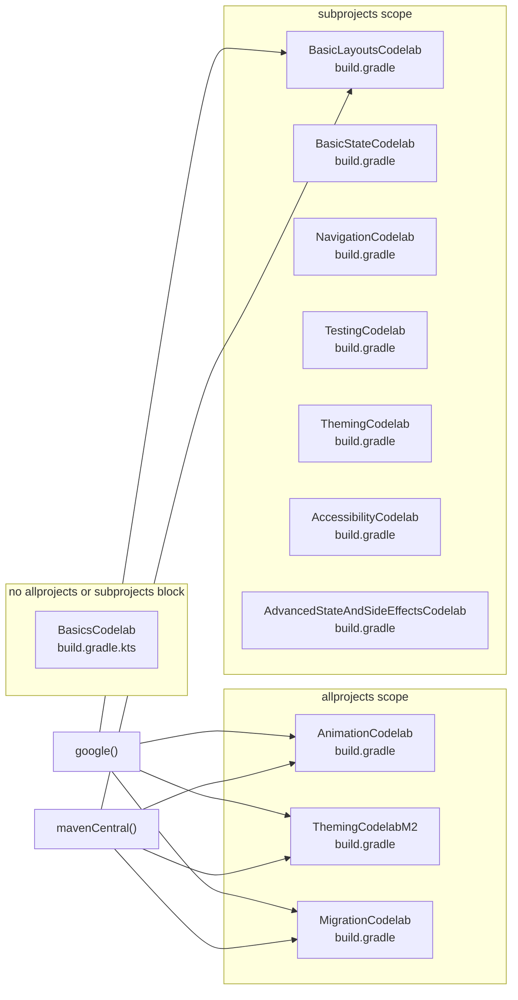

Sources: [AnimationCodelab/build.gradle:29-34](), [ThemingCodelabM2/build.gradle:29-34](), [MigrationCodelab/build.gradle:36-41](), [BasicLayoutsCodelab/build.gradle:33-38](), [BasicStateCodelab/build.gradle:33-38](), [NavigationCodelab/build.gradle:34-39](), [ThemingCodelab/build.gradle:34-39]()

The practical distinction is that `allprojects` includes the root project itself, while `subprojects` applies only to child modules. In all codelabs, only one `app` child module exists, so the difference in behavior is minimal.

---

## Spotless Configuration Details

Spotless (`com.diffplug.spotless`) is applied to enforce Kotlin code style using `ktlint`. The ktlint version and whether a license header file is enforced vary by codelab.

| Codelab | ktlint Version | License Header |
|---|---|---|
| BasicLayoutsCodelab | 0.45.2 | `spotless/copyright.kt` |
| BasicStateCodelab | 0.45.2 | `spotless/copyright.kt` |
| NavigationCodelab | 0.46.1 | `spotless/copyright.kt` |
| TestingCodelab | 0.46.1 | `spotless/copyright.kt` |
| ThemingCodelab | 0.45.2 | `spotless/copyright.kt` |
| AccessibilityCodelab | 0.45.2 | `spotless/copyright.kt` |
| AdvancedStateAndSideEffectsCodelab | 0.45.2 | `spotless/copyright.kt` |
| MigrationCodelab | 0.46.1 | *(none)* |

Sources: [BasicLayoutsCodelab/build.gradle:39-50](), [NavigationCodelab/build.gradle:40-51](), [TestingCodelab/build.gradle:39-50](), [MigrationCodelab/build.gradle:43-50](), [AdvancedStateAndSideEffectsCodelab/build.gradle:41-50]()

The `target` pattern used in all cases is `**/*.kt`, with two standard excludes: `$buildDir/**/*.kt` and `bin/**/*.kt`.

BasicLayoutsCodelab and BasicStateCodelab additionally pass `.userData([android: "true"])` to `ktlint` [BasicLayoutsCodelab/build.gradle:46]().

AnimationCodelab and BasicsCodelab declare **no Spotless plugin** at the root level.

---

## Extra `subprojects` Kotlin Compiler Options

Two codelabs add `KotlinCompile` task configuration inside their `subprojects` block.

**TestingCodelab** [TestingCodelab/build.gradle:52-66]() configures:
- `allWarningsAsErrors = true`
- `freeCompilerArgs += '-opt-in=kotlin.RequiresOptIn'`
- `freeCompilerArgs += '-opt-in=kotlinx.coroutines.ExperimentalCoroutinesApi'`
- `freeCompilerArgs += '-opt-in=kotlinx.coroutines.FlowPreview'`
- `jvmTarget = "1.8"`

**AdvancedStateAndSideEffectsCodelab** [AdvancedStateAndSideEffectsCodelab/build.gradle:52-65]() configures:
- `jvmTarget = "1.8"`
- `freeCompilerArgs += '-opt-in=kotlin.RequiresOptIn'`
- A JUnit version conflict resolution forcing `junit:junit:4.13.2`

**ThemingCodelabM2** [ThemingCodelabM2/build.gradle:35-40]() adds `freeCompilerArgs += '-opt-in=kotlin.RequiresOptIn'` inside `allprojects`.

---

## Codelab-Specific Root Plugins

The three codelabs that add plugins not found in any other root build file are:

**Diagram: Unique Root-Level Plugin Declarations**

```mermaid
graph TD
    subgraph "MigrationCodelab/build.gradle"
        MC1["classpath: \"androidx.navigation:navigation-safe-args-gradle-plugin:2.9.7\""]
        MC2["id: \"com.android.legacy-kapt\" version 9.0.0 apply false"]
    end

    subgraph "AdvancedStateAndSideEffectsCodelab/build.gradle"
        ADV1["classpath: \"com.google.dagger:hilt-android-gradle-plugin:2.59.1\""]
        ADV2["classpath: \"com.google.devtools.ksp:symbol-processing-gradle-plugin:2.3.4\""]
        ADV3["id: \"com.google.devtools.ksp\" version 2.3.4 apply false"]
        ADV4["compose-compiler-gradle-plugin:2.3.10 (differs from 2.3.0 elsewhere)"]
    end

    subgraph "AccessibilityCodelab/build.gradle"
        ACC1["id: \"org.jetbrains.kotlin.plugin.compose\" version 2.3.0 apply false"]
        ACC2["Note: no kotlin-gradle-plugin in buildscript classpath"]
    end
```

Sources: [MigrationCodelab/build.gradle:23-34](), [AdvancedStateAndSideEffectsCodelab/build.gradle:17-33](), [AccessibilityCodelab/build.gradle:29-32]()

Key notes:
- `navigation-safe-args-gradle-plugin` is needed by MigrationCodelab because it uses Navigation Fragment (a View-based navigation component), unlike all other codelabs which use Compose Navigation.
- `com.android.legacy-kapt` enables annotation processing (`kapt`) for Room in MigrationCodelab.
- `hilt-android-gradle-plugin` and `ksp` are used together in AdvancedStateAndSideEffectsCodelab, replacing `kapt` for Hilt annotation processing.
- AdvancedStateAndSideEffectsCodelab uses `compose-compiler-gradle-plugin:2.3.10` — a patch version ahead of the `2.3.0` used by all other codelabs.

---

## Version Reference Summary

| Artifact | Version | Codelabs Using It |
|---|---|---|
| `com.android.tools.build:gradle` | 9.0.0 | All |
| `org.jetbrains.kotlin:kotlin-gradle-plugin` | 2.3.0 | All except BasicsCodelab (via catalog), AdvancedState |
| `org.jetbrains.kotlin:compose-compiler-gradle-plugin` | 2.3.0 | Most (see below) |
| `org.jetbrains.kotlin:compose-compiler-gradle-plugin` | 2.3.10 | AdvancedStateAndSideEffectsCodelab |
| `com.diffplug.spotless` | 8.2.1 | All except AnimationCodelab, BasicsCodelab |
| `androidx.navigation:navigation-safe-args-gradle-plugin` | 2.9.7 | MigrationCodelab only |
| `com.android.legacy-kapt` | 9.0.0 | MigrationCodelab only |
| `com.google.dagger:hilt-android-gradle-plugin` | 2.59.1 | AdvancedStateAndSideEffectsCodelab only |
| `com.google.devtools.ksp:symbol-processing-gradle-plugin` | 2.3.4 | AdvancedStateAndSideEffectsCodelab only |

Sources: [MigrationCodelab/build.gradle:24-28](), [AdvancedStateAndSideEffectsCodelab/build.gradle:22-27](), [ThemingCodelab/build.gradle:24-27](), [BasicsCodelab/build.gradle.kts:18-22]()

---

# Page: Application Module Configuration

# Application Module Configuration

<details>
<summary>Relevant source files</summary>

The following files were used as context for generating this wiki page:

- [AccessibilityCodelab/app/build.gradle](AccessibilityCodelab/app/build.gradle)
- [AdaptiveUiCodelab/app/build.gradle.kts](AdaptiveUiCodelab/app/build.gradle.kts)
- [AdaptiveUiCodelab/app/proguard-rules.pro](AdaptiveUiCodelab/app/proguard-rules.pro)
- [AdaptiveUiCodelab/build.gradle.kts](AdaptiveUiCodelab/build.gradle.kts)
- [AdaptiveUiCodelab/settings.gradle.kts](AdaptiveUiCodelab/settings.gradle.kts)
- [AdvancedStateAndSideEffectsCodelab/app/build.gradle](AdvancedStateAndSideEffectsCodelab/app/build.gradle)
- [AnimationCodelab/finished/build.gradle](AnimationCodelab/finished/build.gradle)
- [AnimationCodelab/start/build.gradle](AnimationCodelab/start/build.gradle)
- [BasicLayoutsCodelab/app/build.gradle](BasicLayoutsCodelab/app/build.gradle)
- [BasicStateCodelab/app/build.gradle.kts](BasicStateCodelab/app/build.gradle.kts)
- [BasicsCodelab/app/build.gradle.kts](BasicsCodelab/app/build.gradle.kts)
- [MigrationCodelab/app/build.gradle](MigrationCodelab/app/build.gradle)
- [NavigationCodelab/app/build.gradle](NavigationCodelab/app/build.gradle)
- [PerformanceCodelab/app/build.gradle.kts](PerformanceCodelab/app/build.gradle.kts)
- [PerformanceCodelab/measure/build.gradle.kts](PerformanceCodelab/measure/build.gradle.kts)
- [TestingCodelab/app/build.gradle](TestingCodelab/app/build.gradle)
- [ThemingCodelab/app/build.gradle](ThemingCodelab/app/build.gradle)
- [ThemingCodelabM2/app/build.gradle](ThemingCodelabM2/app/build.gradle)

</details>


This page documents the `app/build.gradle` and `app/build.gradle.kts` files found in each codelab's application module. It covers the common patterns all codelabs share, how they differ, and the special-case configurations for specific codelabs.

For the root-level build files (plugin version declarations, repository setup), see [Root Build Configuration](#3.1). For how library versions are centrally managed via BOM and version catalogs, see [Dependency Management](#3.3).

---

## DSL Format and Plugin Application Style

The codelabs use three distinct styles of applying plugins and writing build scripts. The table below maps each codelab to its approach.

| Codelab | File | Plugin Application Style |
|---|---|---|
| BasicsCodelab | `app/build.gradle.kts` | Kotlin DSL + version catalog aliases (`alias(libs.plugins.*)`) |
| AdaptiveUiCodelab | `app/build.gradle.kts` | Kotlin DSL + version catalog aliases |
| BasicStateCodelab | `app/build.gradle.kts` | Kotlin DSL + string IDs (`id("...")`) |
| PerformanceCodelab | `app/build.gradle.kts` | Kotlin DSL + version catalog aliases |
| ThemingCodelab | `app/build.gradle` | Groovy DSL + `plugins { id '...' }` block |
| AccessibilityCodelab | `app/build.gradle` | Groovy DSL + `plugins { id '...' }` block |
| AnimationCodelab (start/finished) | `start/build.gradle`, `finished/build.gradle` | Groovy DSL + `plugins { id '...' }` block |
| NavigationCodelab | `app/build.gradle` | Groovy DSL + `plugins { id '...' }` block |
| TestingCodelab | `app/build.gradle` | Groovy DSL + `plugins { id '...' }` block |
| BasicLayoutsCodelab | `app/build.gradle` | Groovy DSL + `plugins { id '...' }` block |
| ThemingCodelabM2 | `app/build.gradle` | Groovy DSL + `plugins { id '...' }` block |
| AdvancedStateAndSideEffectsCodelab | `app/build.gradle` | Groovy DSL + `plugins { id '...' }` block |
| MigrationCodelab | `app/build.gradle` | Groovy DSL + **legacy `apply plugin:`** |

MigrationCodelab is the only codelab using the legacy `apply plugin:` syntax [MigrationCodelab/app/build.gradle:17-21]().

Sources: [BasicsCodelab/app/build.gradle.kts:20-24](), [BasicStateCodelab/app/build.gradle.kts:20-23](), [AdaptiveUiCodelab/app/build.gradle.kts:17-21](), [PerformanceCodelab/app/build.gradle.kts:16-21](), [MigrationCodelab/app/build.gradle:17-21]()

---

## SDK Version Matrix

All codelabs target a consistent SDK range. `minSdk` is slightly higher in the two newer Kotlin DSL codelabs.

| Codelab | `compileSdk` | `minSdk` | `targetSdk` |
|---|---|---|---|
| BasicsCodelab | 36 | **24** | 33 |
| BasicStateCodelab | 36 | **24** | 33 |
| BasicLayoutsCodelab | 36 | 23 | 33 |
| AnimationCodelab | 36 | 23 | **34** |
| NavigationCodelab | 36 | 23 | 33 |
| TestingCodelab | 36 | 23 | 33 |
| ThemingCodelab | 36 | 23 | 33 |
| ThemingCodelabM2 | 36 | 23 | 33 |
| AccessibilityCodelab | 36 | 23 | 33 |
| AdvancedStateAndSideEffectsCodelab | 36 | 23 | 33 |
| MigrationCodelab | 36 | 23 | 33 |
| AdaptiveUiCodelab | 36 | 23 | 33 |
| PerformanceCodelab | 36 | **21** | **34** |

Sources: [BasicsCodelab/app/build.gradle.kts:29-35](), [PerformanceCodelab/app/build.gradle.kts:26-30](), [AnimationCodelab/start/build.gradle:25-31]()

---

## Compose BOM Integration

Every codelab pins all Compose library versions through the BOM `androidx.compose:compose-bom:2026.01.01`. The BOM is declared as a `platform()` dependency and applied to the relevant configurations.

**Groovy DSL pattern** (majority of codelabs):
```
// e.g. AccessibilityCodelab/app/build.gradle
def composeBom = platform('androidx.compose:compose-bom:2026.01.01')
implementation(composeBom)
testImplementation(composeBom)
androidTestImplementation(composeBom)
```

**Kotlin DSL with version catalog** (BasicsCodelab, AdaptiveUiCodelab):
```
// e.g. AdaptiveUiCodelab/app/build.gradle.kts
val composeBom = platform(libs.androidx.compose.bom)
implementation(composeBom)
androidTestImplementation(composeBom)
```

**Kotlin DSL with string coordinates** (BasicStateCodelab):
```
// BasicStateCodelab/app/build.gradle.kts
implementation(platform("androidx.compose:compose-bom:2026.01.01"))
androidTestImplementation(platform("androidx.compose:compose-bom:2026.01.01"))
```

Not every codelab applies the BOM to all three configurations. The table below shows which configurations receive the BOM:

| Codelab | `implementation` | `testImplementation` | `androidTestImplementation` |
|---|---|---|---|
| AccessibilityCodelab | ✓ | ✓ | ✓ |
| ThemingCodelab | ✓ | ✓ | ✓ |
| BasicLayoutsCodelab | ✓ | — | ✓ |
| NavigationCodelab | ✓ | — | ✓ |
| TestingCodelab | ✓ | — | ✓ |
| AdvancedStateAndSideEffectsCodelab | ✓ | — | ✓ |
| MigrationCodelab | ✓ | — | ✓ |
| AdaptiveUiCodelab | ✓ | — | ✓ |
| ThemingCodelabM2 | ✓ | — | — |
| AnimationCodelab | ✓ | — | — |

Sources: [AccessibilityCodelab/app/build.gradle:89-93](), [ThemingCodelabM2/app/build.gradle:46-48](), [AnimationCodelab/start/build.gradle:42-43](), [AdaptiveUiCodelab/app/build.gradle.kts:64-66]()

---

## Material 2 vs. Material 3 Split

The following diagram maps each codelab's Compose material dependency to the artifact it declares.

**Codelab → Material Artifact mapping:**

```mermaid
graph TD
    BOM["\"androidx.compose:compose-bom:2026.01.01\""]

    subgraph M3["\"Material 3 (androidx.compose.material3:material3)\""]
        B["\"BasicsCodelab\""]
        BL["\"BasicLayoutsCodelab\""]
        BS["\"BasicStateCodelab\""]
        AN["\"AnimationCodelab\""]
        TC["\"ThemingCodelab\""]
        AC["\"AccessibilityCodelab\""]
        MC["\"MigrationCodelab\""]
        AD["\"AdaptiveUiCodelab\""]
        PC["\"PerformanceCodelab\""]
    end

    subgraph M2["\"Material 2 (androidx.compose.material:material)\""]
        TM2["\"ThemingCodelabM2\""]
        ADV["\"AdvancedStateAndSideEffectsCodelab\""]
        NC["\"NavigationCodelab\""]
        TEC["\"TestingCodelab\""]
    end

    BOM --> M3
    BOM --> M2
```

Sources: [BasicsCodelab/app/build.gradle.kts:80](), [ThemingCodelabM2/app/build.gradle:51](), [AdvancedStateAndSideEffectsCodelab/app/build.gradle:109](), [NavigationCodelab/app/build.gradle:91](), [TestingCodelab/app/build.gradle:96-97](), [AnimationCodelab/finished/build.gradle:48]()

---

## `buildFeatures` Configuration

All codelabs enable Compose via the `buildFeatures` block. Two codelabs go further by enabling or disabling additional features.

**Standard pattern** (most codelabs, Groovy):
```
buildFeatures {
    compose true
}
```

**Kotlin DSL equivalent** (BasicsCodelab, BasicStateCodelab, AdaptiveUiCodelab):
```
buildFeatures {
    compose = true
}
```

### MigrationCodelab — Hybrid `dataBinding` + `compose`

MigrationCodelab is the only codelab enabling both `dataBinding` and `compose` simultaneously [MigrationCodelab/app/build.gradle:46-49](). This reflects its role as a View-to-Compose migration exercise where legacy XML layouts with data binding coexist with new Compose surfaces.

```
buildFeatures {
    dataBinding true
    compose true
}
```

### AdvancedStateAndSideEffectsCodelab and TestingCodelab — Unused Feature Disabling

Both codelabs explicitly set unused AGP features to `false` to reduce build overhead:

| Feature disabled | AdvancedState | Testing |
|---|---|---|
| `buildConfig` | ✓ | ✓ |
| `aidl` | ✓ | ✓ |
| `renderScript` | ✓ | ✓ |
| `resValues` | ✓ | ✓ |
| `shaders` | ✓ | ✓ |

Sources: [AdvancedStateAndSideEffectsCodelab/app/build.gradle:71-80](), [TestingCodelab/app/build.gradle:63-72](), [MigrationCodelab/app/build.gradle:46-49]()

---

## JVM Target and Compiler Options

Most codelabs target JVM 1.8. Two codelabs require JVM 17 due to their dependencies.

| JVM Target | Codelabs |
|---|---|
| `VERSION_1_8` | BasicsCodelab, BasicStateCodelab, BasicLayoutsCodelab, AnimationCodelab, NavigationCodelab, TestingCodelab, ThemingCodelab, ThemingCodelabM2, AccessibilityCodelab, AdvancedStateAndSideEffectsCodelab, AdaptiveUiCodelab |
| `VERSION_17` | MigrationCodelab (Room kapt), PerformanceCodelab |

The JVM target is set in different ways depending on the DSL used:

- **Groovy DSL** (`compileOptions` block): `sourceCompatibility JavaVersion.VERSION_1_8`
- **Kotlin DSL** (`kotlin { compilerOptions { } }` block): `jvmTarget = JvmTarget.JVM_1_8` — used by BasicsCodelab [BasicsCodelab/app/build.gradle.kts:57-61]()
- **Groovy DSL** (`kotlinOptions` block in `android {}`): used directly in ThemingCodelabM2 [ThemingCodelabM2/app/build.gradle:36-39]()

### `tasks.withType(KotlinCompile)` Kotlin Compiler Flags

ThemingCodelab, AccessibilityCodelab, and NavigationCodelab add Kotlin compiler arguments via a task configuration block at the bottom of their build files:

- `-opt-in=kotlin.RequiresOptIn`
- `-opt-in=kotlin.Experimental` (ThemingCodelab, AccessibilityCodelab)
- `allWarningsAsErrors = true` (NavigationCodelab sets this unconditionally; others conditionally via project property)

Sources: [ThemingCodelab/app/build.gradle:126-138](), [AccessibilityCodelab/app/build.gradle:135-147](), [NavigationCodelab/app/build.gradle:106-116](), [MigrationCodelab/app/build.gradle:41-44](), [PerformanceCodelab/app/build.gradle.kts:49-56]()

---

## Per-Codelab Unique Configuration

The following diagram summarizes what each codelab adds beyond the common baseline.

```mermaid
graph TD
    baseline["\"Baseline: com.android.application\n+ org.jetbrains.kotlin.plugin.compose\n+ compose-bom\n+ buildFeatures.compose\""]

    baseline --> MIG["\"MigrationCodelab\napply plugin: androidx.navigation.safeargs.kotlin\napply plugin: com.android.legacy-kapt\ndataBinding = true\nRoom (kapt), Glide, WorkManager\nViewPager2, Navigation Fragment\""]

    baseline --> ADV["\"AdvancedStateAndSideEffectsCodelab\nid: com.google.devtools.ksp\nid: dagger.hilt.android.plugin\nHilt 2.59.1 (ksp)\nGoogle Maps Compose\nCoil\nJVM 17 not needed, keeps 1.8\""]

    baseline --> PERF["\"PerformanceCodelab\nalias: androidx.baselineprofile\ncomposeCompiler { enableStrongSkippingMode }\nisCoreLibraryDesugaringEnabled = true\nprofileinstaller, media3\nJVM 17\""]

    baseline --> NAV["\"NavigationCodelab\ncomposeOptions {\n  kotlinCompilerExtensionVersion 1.5.15\n}\nMaterial 2\""]

    baseline --> ANIM["\"AnimationCodelab\nstart/ + finished/ dual modules\n(identical build.gradle in each)\""]

    baseline --> OTHERS["\"All other codelabs:\nno extra plugins\nmaterial3 only variations\""]
```

### NavigationCodelab — Legacy `composeOptions` Block

NavigationCodelab still contains a `composeOptions { kotlinCompilerExtensionVersion '1.5.15' }` block [NavigationCodelab/app/build.gradle:67-69](). This is a holdover from the pre-Compose-compiler-plugin era; the `org.jetbrains.kotlin.plugin.compose` plugin declared in the `plugins` block supersedes it in practice.

### AdvancedStateAndSideEffectsCodelab — Google Maps API Key

The build file reads a `MAPS_API_KEY` property from `local.properties` at configuration time [AdvancedStateAndSideEffectsCodelab/app/build.gradle:25-28]() and injects it as a manifest placeholder [AdvancedStateAndSideEffectsCodelab/app/build.gradle:42]():

```
manifestPlaceholders = [MAPS_API_KEY: properties.getProperty("MAPS_API_KEY", "")]
```

A custom `testInstrumentationRunner` is also used: `androidx.compose.samples.crane.CustomTestRunner` [AdvancedStateAndSideEffectsCodelab/app/build.gradle:40]().

### PerformanceCodelab — `composeCompiler` Block

PerformanceCodelab is the only codelab to use a top-level `composeCompiler` configuration block, which exposes exercise steps for the codelab [PerformanceCodelab/app/build.gradle.kts:67-74]():

```
composeCompiler {
    enableStrongSkippingMode = false  // TODO Codelab task: Enable Strong Skipping Mode
    // TODO Codelab task: Enable Stability Configuration file
}
```

Sources: [NavigationCodelab/app/build.gradle:67-69](), [AdvancedStateAndSideEffectsCodelab/app/build.gradle:25-43](), [PerformanceCodelab/app/build.gradle.kts:67-74](), [MigrationCodelab/app/build.gradle:17-21]()

---

## Annotation Processing: `kapt` vs `ksp`

Two codelabs use annotation processing for code generation.

| Codelab | Processor | Artifact |
|---|---|---|
| MigrationCodelab | `kapt` (legacy) | `androidx.room:room-compiler:2.8.4`, `com.github.bumptech.glide:compiler:5.0.5` |
| AdvancedStateAndSideEffectsCodelab | `ksp` | `com.google.dagger:hilt-compiler:2.59.1`, `org.jetbrains.kotlin:kotlin-metadata-jvm:2.3.0` |

MigrationCodelab applies `com.android.legacy-kapt` because it predates KSP adoption [MigrationCodelab/app/build.gradle:20]().
AdvancedStateAndSideEffectsCodelab uses `com.google.devtools.ksp` and the `ksp` / `kspAndroidTest` dependency configurations [AdvancedStateAndSideEffectsCodelab/app/build.gradle:19](), [AdvancedStateAndSideEffectsCodelab/app/build.gradle:123-138]().

Sources: [MigrationCodelab/app/build.gradle:20](), [MigrationCodelab/app/build.gradle:63-64](), [AdvancedStateAndSideEffectsCodelab/app/build.gradle:19](), [AdvancedStateAndSideEffectsCodelab/app/build.gradle:123-138]()

---

## Signing Configuration

Several codelabs include a `signingConfigs.debug` block that references a committed `debug.keystore` file at the project root. This allows debug builds from CI to be upgrade-compatible.

```
signingConfigs {
    debug {
        storeFile rootProject.file('debug.keystore')
        storePassword 'android'
        keyAlias 'androiddebugkey'
        keyPassword 'android'
    }
}
```

Codelabs with this block: ThemingCodelab, AccessibilityCodelab, NavigationCodelab, TestingCodelab, AdvancedStateAndSideEffectsCodelab.

Codelabs without it (simpler setup): BasicsCodelab, BasicStateCodelab, BasicLayoutsCodelab, AnimationCodelab, ThemingCodelabM2, MigrationCodelab, AdaptiveUiCodelab, PerformanceCodelab.

Sources: [ThemingCodelab/app/build.gradle:36-43](), [AccessibilityCodelab/app/build.gradle:35-43](), [NavigationCodelab/app/build.gradle:37-45](), [TestingCodelab/app/build.gradle:37-45](), [AdvancedStateAndSideEffectsCodelab/app/build.gradle:45-53]()

---

## Test Infrastructure Variants

Several codelabs configure their test source sets in non-standard ways.

### Shared Test Source Directory (ThemingCodelab, AccessibilityCodelab)

Both codelabs define a `sharedTest` directory that is compiled into both `test` and `androidTest` configurations, allowing Robolectric and instrumented tests to share source files:

```
sourceSets {
    String sharedTestDir = 'src/sharedTest/java'
    test { java.srcDir sharedTestDir }
    androidTest { java.srcDir sharedTestDir }
}
```

Sources: [ThemingCodelab/app/build.gradle:62-71](), [AccessibilityCodelab/app/build.gradle:62-71]()

### Robolectric (AccessibilityCodelab)

AccessibilityCodelab is the only codelab adding a Robolectric dependency and configuring `testOptions.unitTests.includeAndroidResources = true` [AccessibilityCodelab/app/build.gradle:56-60](), [AccessibilityCodelab/app/build.gradle:132]().

### AnimationCodelab Dual-Module Build

AnimationCodelab has two application modules at `start/build.gradle` and `finished/build.gradle`. Both files are byte-for-byte identical [AnimationCodelab/start/build.gradle:1-52](), [AnimationCodelab/finished/build.gradle:1-52](). The `start` module is the exercise starting point; `finished` contains the completed implementation.

---

## Packaging Exclusions

All codelabs exclude the same license metadata files to prevent test APK build conflicts. The only variation is the syntax used:

| Syntax | Codelabs |
|---|---|
| `packagingOptions { excludes += "..." }` | ThemingCodelab, AccessibilityCodelab, AdvancedStateAndSideEffectsCodelab, MigrationCodelab |
| `packagingOptions { exclude "..." }` | NavigationCodelab, TestingCodelab |
| `packaging { resources { excludes += "..." } }` | BasicsCodelab, BasicStateCodelab, AdaptiveUiCodelab, PerformanceCodelab |
| `packagingOptions { resources { excludes += '...' } }` | BasicLayoutsCodelab |

Sources: [ThemingCodelab/app/build.gradle:82-85](), [BasicsCodelab/app/build.gradle.kts:65-69](), [NavigationCodelab/app/build.gradle:71-75](), [MigrationCodelab/app/build.gradle:50-55]()

---

# Page: Dependency Management

# Dependency Management

<details>
<summary>Relevant source files</summary>

The following files were used as context for generating this wiki page:

- [.github/renovate.json](.github/renovate.json)
- [AccessibilityCodelab/app/build.gradle](AccessibilityCodelab/app/build.gradle)
- [AdaptiveUiCodelab/gradle/libs.versions.toml](AdaptiveUiCodelab/gradle/libs.versions.toml)
- [AdvancedStateAndSideEffectsCodelab/app/build.gradle](AdvancedStateAndSideEffectsCodelab/app/build.gradle)
- [AnimationCodelab/finished/build.gradle](AnimationCodelab/finished/build.gradle)
- [AnimationCodelab/start/build.gradle](AnimationCodelab/start/build.gradle)
- [BasicLayoutsCodelab/app/build.gradle](BasicLayoutsCodelab/app/build.gradle)
- [MigrationCodelab/app/build.gradle](MigrationCodelab/app/build.gradle)
- [NavigationCodelab/app/build.gradle](NavigationCodelab/app/build.gradle)
- [PerformanceCodelab/gradle/libs.versions.toml](PerformanceCodelab/gradle/libs.versions.toml)
- [TestingCodelab/app/build.gradle](TestingCodelab/app/build.gradle)
- [ThemingCodelab/app/build.gradle](ThemingCodelab/app/build.gradle)
- [ThemingCodelabM2/app/build.gradle](ThemingCodelabM2/app/build.gradle)

</details>


This page explains how library versions are managed across all codelabs in the repository. The three mechanisms in use are: the **Compose BOM** (universal Compose version alignment), **version catalog files** (`libs.versions.toml`, used in newer codelabs), and **inline version strings** (used in older codelabs). Automated updates for all three are handled by the **Renovate bot**.

For details on how individual `dependencies {}` blocks are structured within each codelab's build file, see [Application Module Configuration](#3.2). For the root-level plugin declarations that reference some of these versions, see [Root Build Configuration](#3.1).

---

## The Compose BOM

Every codelab in the repository declares `androidx.compose:compose-bom` at version `2026.01.01` as a `platform(...)` dependency. This is the single universal constraint that pins all Compose library artifact versions to a tested, compatible set — no individual Compose artifact requires an explicit version string once the BOM is applied.

**Compose BOM: Artifact Resolution**

```mermaid
graph TD
    BOM["\"platform('androidx.compose:compose-bom:2026.01.01')\""]
    BOM --> UI["\"androidx.compose.ui:ui\n(no version needed)\""]
    BOM --> M3["\"androidx.compose.material3:material3\n(no version needed)\""]
    BOM --> M2["\"androidx.compose.material:material\n(no version needed)\""]
    BOM --> PREVIEW["\"androidx.compose.ui:ui-tooling-preview\n(no version needed)\""]
    BOM --> TOOLING["\"androidx.compose.ui:ui-tooling\n(no version needed)\""]
    BOM --> TESTJUNIT["\"androidx.compose.ui:ui-test-junit4\n(no version needed)\""]
    BOM --> TESTMANIFEST["\"androidx.compose.ui:ui-test-manifest\n(no version needed)\""]
```

The BOM is applied to one or more Gradle configurations depending on which test types the codelab uses:

| Configuration | Example codelab |
|---|---|
| `implementation` only | `ThemingCodelabM2`, `AnimationCodelab` |
| `implementation` + `androidTestImplementation` | `MigrationCodelab`, `NavigationCodelab`, `TestingCodelab`, `AdvancedStateAndSideEffectsCodelab` |
| `implementation` + `testImplementation` + `androidTestImplementation` | `ThemingCodelab`, `AccessibilityCodelab` |

Sources: [MigrationCodelab/app/build.gradle:59-61](), [ThemingCodelab/app/build.gradle:89-93](), [AccessibilityCodelab/app/build.gradle:89-93](), [AdvancedStateAndSideEffectsCodelab/app/build.gradle:105-107](), [AnimationCodelab/start/build.gradle:42-43](), [ThemingCodelabM2/app/build.gradle:46-47]()

---

## Version Catalog (`libs.versions.toml`)

Newer codelabs use a [Gradle version catalog](https://docs.gradle.org/current/userguide/platforms.html) located at `gradle/libs.versions.toml` inside each codelab directory. This file centralizes all version strings and module coordinates in a single file, which the `build.gradle.kts` files then reference via the type-safe `libs.*` accessor.

Two codelabs in the provided sources use this approach:

- `AdaptiveUiCodelab/gradle/libs.versions.toml`
- `PerformanceCodelab/gradle/libs.versions.toml`

The `BasicsCodelab` also uses Kotlin DSL with a version catalog (see [Basics Codelab](#5.1)).

### File Structure

A `libs.versions.toml` file is divided into three sections:

**`libs.versions.toml` Structure — AdaptiveUiCodelab**

```mermaid
graph LR
    subgraph TOML["\"AdaptiveUiCodelab/gradle/libs.versions.toml\""]
        V["\"[versions]\ncomposeBom = 2026.01.01\nlifecycle = 2.10.0\nkotlin = 2.3.0\nwindow = 1.5.1\n...\""]
        L["\"[libraries]\nandroidx-compose-bom = {module, version.ref=composeBom}\nandroidx-lifecycle-runtime-compose = {module, version.ref=lifecycle}\nandroidx-window = {module, version.ref=window}\n...\""]
        P["\"[plugins]\nandroid-application = {id, version.ref=androidGradlePlugin}\ncompose-compiler = {id, version.ref=kotlin}\n...\""]
    end
    V --> L
    V --> P
    L --> BUILD["\"app/build.gradle.kts\nlibs.androidx.compose.bom\nlibs.androidx.lifecycle.runtime.compose\nlibs.androidx.window\""]
    P --> ROOTBUILD["\"build.gradle.kts\nalias(libs.plugins.android.application)\nalias(libs.plugins.compose.compiler)\""]
```

### `[versions]` Section

Named version strings declared once, referenced by both `[libraries]` and `[plugins]`:

| Key | Value (AdaptiveUiCodelab) | Value (PerformanceCodelab) |
|---|---|---|
| `composeBom` | `2026.01.01` | `2026.01.01` |
| `kotlin` / `org-jetbrains-kotlin-android` | `2.3.0` | `2.3.0` |
| `lifecycle` / `lifecycle-viewmodel-compose` | `2.10.0` | `2.10.0` |
| `androidGradlePlugin` / `com-android-application` | `9.0.0` | `9.0.0` |
| `activityCompose` / `activity-compose` | `1.12.3` | `1.12.3` |
| `espressoCore` / `espresso-core` | `3.7.0` | `3.7.0` |
| `window` | `1.5.1` | *(not present)* |
| `benchmark` | *(not present)* | `1.4.1` |
| `androidx-baselineprofile` | *(not present)* | `1.4.1` |
| `spotless` | *(not present)* | `8.2.1` |

Sources: [AdaptiveUiCodelab/gradle/libs.versions.toml:1-12](), [PerformanceCodelab/gradle/libs.versions.toml:1-26]()

### `[libraries]` Section

Each library entry maps a type-safe accessor name to a `module` coordinate and a `version.ref` pointing into `[versions]`. Compose artifacts that are version-managed by the BOM omit `version.ref` entirely:

```toml
# version.ref points to [versions]
androidx-compose-bom    = { module = "androidx.compose:compose-bom", version.ref = "composeBom" }
androidx-window         = { module = "androidx.window:window",        version.ref = "window" }

# No version — resolved by BOM at runtime
androidx-material3           = { module = "androidx.compose.material3:material3" }
androidx-ui-tooling-preview  = { module = "androidx.compose.ui:ui-tooling-preview" }
```

Sources: [AdaptiveUiCodelab/gradle/libs.versions.toml:14-31](), [PerformanceCodelab/gradle/libs.versions.toml:28-57]()

### `[plugins]` Section

Plugin IDs and versions declared similarly, allowing `alias(libs.plugins.compose.compiler)` in build files instead of hardcoded plugin IDs and versions.

Sources: [AdaptiveUiCodelab/gradle/libs.versions.toml:33-36](), [PerformanceCodelab/gradle/libs.versions.toml:59-65]()

---

## Inline Version Strings (Older Codelabs)

Codelabs that do not use a version catalog declare version strings directly in their `app/build.gradle` files. Two patterns are in use:

**1. Literal string per dependency** (most common):
```groovy
implementation "androidx.room:room-runtime:2.8.4"
implementation "com.github.bumptech.glide:glide:5.0.5"
```

**2. Local variable for a version shared across multiple artifacts** (used in `AdvancedStateAndSideEffectsCodelab`):
```groovy
def lifecycle_version = "2.10.0"
implementation "androidx.lifecycle:lifecycle-viewmodel-compose:$lifecycle_version"
implementation "androidx.lifecycle:lifecycle-viewmodel-ktx:$lifecycle_version"
```

A third special case exists in `AdvancedStateAndSideEffectsCodelab`: a `constraints {}` block pins the version of a transitive dependency (Volley, brought in by Google Maps) that is not directly declared:

```groovy
constraints {
    implementation("com.android.volley:volley:1.2.1") {
        because("Only volley 1.2.0 or newer are available on maven.google.com")
    }
}
```

Sources: [MigrationCodelab/app/build.gradle:63-83](), [AdvancedStateAndSideEffectsCodelab/app/build.gradle:91-99](), [AdvancedStateAndSideEffectsCodelab/app/build.gradle:118-120]()

---

## Version Management Approach by Codelab

**Version Management Strategy per Codelab**

```mermaid
graph TD
    subgraph CATALOG["\"Version Catalog (libs.versions.toml)\""]
        AC["\"AdaptiveUiCodelab\ngoogle/libs.versions.toml\""]
        PC["\"PerformanceCodelab\ngradle/libs.versions.toml\""]
        BC["\"BasicsCodelab\n(Kotlin DSL + catalog)\""]
    end

    subgraph INLINE["\"Inline Version Strings (Groovy DSL)\""]
        MC["\"MigrationCodelab\""]
        TC["\"ThemingCodelab\""]
        TCM2["\"ThemingCodelabM2\""]
        ACC["\"AccessibilityCodelab\""]
        ADV["\"AdvancedStateAndSideEffectsCodelab\""]
        NAV["\"NavigationCodelab\""]
        TEST["\"TestingCodelab\""]
        ANIM["\"AnimationCodelab\""]
        BL["\"BasicLayoutsCodelab\""]
    end

    BOM["\"compose-bom:2026.01.01\n(all codelabs)\""]

    BOM --> CATALOG
    BOM --> INLINE
```

| Codelab | Compose BOM | Version Catalog | Inline Versions |
|---|:---:|:---:|:---:|
| AdaptiveUiCodelab | ✓ | ✓ | — |
| PerformanceCodelab | ✓ | ✓ | — |
| BasicsCodelab | ✓ | ✓ | — |
| MigrationCodelab | ✓ | — | ✓ |
| ThemingCodelab | ✓ | — | ✓ |
| ThemingCodelabM2 | ✓ | — | ✓ |
| AccessibilityCodelab | ✓ | — | ✓ |
| AdvancedStateAndSideEffectsCodelab | ✓ | — | ✓ |
| NavigationCodelab | ✓ | — | ✓ |
| TestingCodelab | ✓ | — | ✓ |
| AnimationCodelab | ✓ | — | ✓ |
| BasicLayoutsCodelab | ✓ | — | ✓ |

Sources: [MigrationCodelab/app/build.gradle:59](), [ThemingCodelab/app/build.gradle:89](), [ThemingCodelabM2/app/build.gradle:46](), [AccessibilityCodelab/app/build.gradle:89](), [AdvancedStateAndSideEffectsCodelab/app/build.gradle:105](), [NavigationCodelab/app/build.gradle:79](), [TestingCodelab/app/build.gradle:82](), [AnimationCodelab/start/build.gradle:42](), [BasicLayoutsCodelab/app/build.gradle:60](), [AdaptiveUiCodelab/gradle/libs.versions.toml:1-3](), [PerformanceCodelab/gradle/libs.versions.toml:16]()

---

## Automated Updates: Renovate Bot

The file [.github/renovate.json]() configures the [Renovate](https://docs.renovatebot.com) bot for automated dependency update pull requests across the entire monorepo.

**Renovate Configuration Structure**

```mermaid
graph TD
    CFG["\"renovate.json\""]
    CFG --> EXT["\"extends\nconfig:recommended\ngroup:all\n:dependencyDashboard\nschedule:daily\""]
    CFG --> BRANCHES["\"baseBranchPatterns\nmain\nend\""]
    CFG --> RULES["\"packageRules\""]
    RULES --> KG["\"groupName: Kotlin Dependencies\nmatchDatasources: maven\nmatchPackageNames:\norg.jetbrains.kotlin{/,}**\nandroidx.compose.compiler{/,}**\""]
    EXT --> SCHED["\"Runs: daily\""]
    EXT --> GROUP["\"All updates grouped\ninto a single PR\""]
    EXT --> DASH["\"GitHub Dependency\nDashboard issue\""]
    BRANCHES --> MAIN["\"main branch\""]
    BRANCHES --> END["\"end branch\""]
```

Key behaviors configured:

| Setting | Value | Effect |
|---|---|---|
| `extends: group:all` | all updates | Groups every dependency update into a single PR rather than one PR per library |
| `extends: :dependencyDashboard` | enabled | Creates a GitHub issue tracking all pending updates |
| `extends: schedule:daily` | daily | Renovate checks for updates once per day |
| `baseBranchPatterns` | `["main", "end"]` | PRs are opened against both `main` (start state) and `end` (solution state) branches |
| `packageRules[0].groupName` | `"Kotlin Dependencies"` | Groups `org.jetbrains.kotlin/**` and `androidx.compose.compiler/**` together in the dependency dashboard |

The `registryUrls` for the Kotlin Dependencies rule lists `https://dl.google.com/dl/android/maven2/` and `https://repo.maven.apache.org/maven2/`, which are the same repositories declared in each codelab's root `build.gradle` (see [Root Build Configuration](#3.1)).

Sources: [.github/renovate.json:1-29]()

---

# Page: Gradle Wrapper

# Gradle Wrapper

<details>
<summary>Relevant source files</summary>

The following files were used as context for generating this wiki page:

- [AccessibilityCodelab/gradle/wrapper/gradle-wrapper.jar](AccessibilityCodelab/gradle/wrapper/gradle-wrapper.jar)
- [AccessibilityCodelab/gradle/wrapper/gradle-wrapper.properties](AccessibilityCodelab/gradle/wrapper/gradle-wrapper.properties)
- [AccessibilityCodelab/gradlew](AccessibilityCodelab/gradlew)
- [AdvancedStateAndSideEffectsCodelab/gradle/wrapper/gradle-wrapper.jar](AdvancedStateAndSideEffectsCodelab/gradle/wrapper/gradle-wrapper.jar)
- [AdvancedStateAndSideEffectsCodelab/gradle/wrapper/gradle-wrapper.properties](AdvancedStateAndSideEffectsCodelab/gradle/wrapper/gradle-wrapper.properties)
- [AdvancedStateAndSideEffectsCodelab/gradlew](AdvancedStateAndSideEffectsCodelab/gradlew)
- [AnimationCodelab/gradle/wrapper/gradle-wrapper.jar](AnimationCodelab/gradle/wrapper/gradle-wrapper.jar)
- [AnimationCodelab/gradle/wrapper/gradle-wrapper.properties](AnimationCodelab/gradle/wrapper/gradle-wrapper.properties)
- [AnimationCodelab/gradlew](AnimationCodelab/gradlew)
- [BasicLayoutsCodelab/gradle/wrapper/gradle-wrapper.properties](BasicLayoutsCodelab/gradle/wrapper/gradle-wrapper.properties)
- [BasicStateCodelab/gradle/wrapper/gradle-wrapper.properties](BasicStateCodelab/gradle/wrapper/gradle-wrapper.properties)
- [BasicsCodelab/gradle/wrapper/gradle-wrapper.properties](BasicsCodelab/gradle/wrapper/gradle-wrapper.properties)
- [MigrationCodelab/gradle/wrapper/gradle-wrapper.properties](MigrationCodelab/gradle/wrapper/gradle-wrapper.properties)
- [NavigationCodelab/gradle/wrapper/gradle-wrapper.properties](NavigationCodelab/gradle/wrapper/gradle-wrapper.properties)
- [TestingCodelab/gradle/wrapper/gradle-wrapper.properties](TestingCodelab/gradle/wrapper/gradle-wrapper.properties)
- [ThemingCodelab/gradle/wrapper/gradle-wrapper.properties](ThemingCodelab/gradle/wrapper/gradle-wrapper.properties)
- [ThemingCodelabM2/gradle/wrapper/gradle-wrapper.properties](ThemingCodelabM2/gradle/wrapper/gradle-wrapper.properties)

</details>


## Purpose and Scope

This page documents the Gradle Wrapper setup used by every codelab in the repository. The Gradle Wrapper is the mechanism that allows a codelab to build without requiring a pre-installed Gradle on the developer's machine — it bootstraps the correct Gradle version automatically.

Every codelab directory contains three wrapper files: `gradlew` (the POSIX shell script), `gradle/wrapper/gradle-wrapper.jar` (the bootstrapping JVM runtime), and `gradle/wrapper/gradle-wrapper.properties` (the configuration file). All codelabs use identical configurations for these files.

For how Gradle is used at the project level once it is bootstrapped, see [Root Build Configuration](#3.1) and [Application Module Configuration](#3.2).

---

## File Layout

Every codelab follows this directory structure for wrapper files:

```
<CodelabDir>/
├── gradlew                              ← POSIX shell script
├── gradlew.bat                          ← Windows batch script (not covered here)
└── gradle/
    └── wrapper/
        ├── gradle-wrapper.jar           ← Bootstrapping JAR
        └── gradle-wrapper.properties    ← Wrapper configuration
```

**Sources:** [BasicsCodelab/gradle/wrapper/gradle-wrapper.properties:1-7](), [AccessibilityCodelab/gradlew:1-5]()

---

## gradle-wrapper.properties

All eleven codelabs use an identical `gradle-wrapper.properties` file. The properties are:

| Key | Value | Purpose |
|---|---|---|
| `distributionBase` | `GRADLE_USER_HOME` | Root base directory for storing the distribution |
| `distributionPath` | `wrapper/dists` | Subdirectory under `distributionBase` where distributions are unpacked |
| `distributionUrl` | `https\://services.gradle.org/distributions/gradle-9.3.1-bin.zip` | URL of the Gradle distribution to download |
| `networkTimeout` | `10000` | Timeout in milliseconds for network operations (10 seconds) |
| `validateDistributionUrl` | `true` | Enforces that `distributionUrl` is a trusted Gradle URL |
| `zipStoreBase` | `GRADLE_USER_HOME` | Root base directory for storing the downloaded ZIP |
| `zipStorePath` | `wrapper/dists` | Subdirectory under `zipStoreBase` where the ZIP is cached |

### Distribution Resolution

The downloaded distribution resolves to a local path constructed from the base and path values:

**Distribution directory:** `$GRADLE_USER_HOME/wrapper/dists/gradle-9.3.1-bin/`

`GRADLE_USER_HOME` defaults to `~/.gradle` if not set by the environment.

The `bin` suffix in `gradle-9.3.1-bin.zip` means only the runtime binaries are downloaded, not sources or documentation.

**Sources:** [BasicsCodelab/gradle/wrapper/gradle-wrapper.properties:1-7](), [ThemingCodelab/gradle/wrapper/gradle-wrapper.properties:1-7](), [MigrationCodelab/gradle/wrapper/gradle-wrapper.properties:1-7]()

---

## gradlew — Shell Script Execution Flow

The `gradlew` script is a standard POSIX shell script generated by Gradle. It is identical across all codelabs. Its job is to locate the JVM and invoke `gradle-wrapper.jar`.

**Execution flow diagram:**

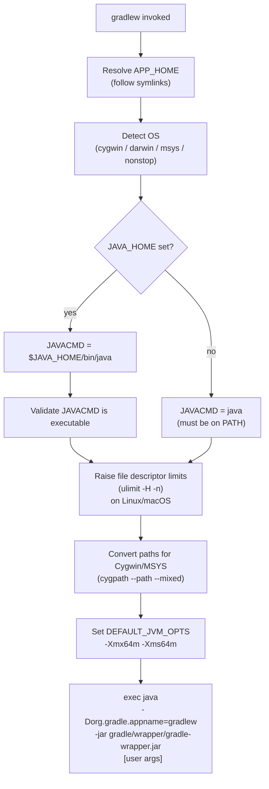

**Sources:** [AccessibilityCodelab/gradlew:67-248](), [AnimationCodelab/gradlew:67-248](), [AdvancedStateAndSideEffectsCodelab/gradlew:67-200]()

### Key Script Variables

| Variable | Set at line(s) | Description |
|---|---|---|
| `APP_HOME` | [AccessibilityCodelab/gradlew:74-89]() | Absolute path to the codelab root (resolved through symlinks) |
| `APP_BASE_NAME` | [AccessibilityCodelab/gradlew:87]() | Set to `gradlew`; passed as `-Dorg.gradle.appname` |
| `JAVACMD` | [AccessibilityCodelab/gradlew:121-142]() | Path to the `java` executable |
| `MAX_FD` | [AccessibilityCodelab/gradlew:92-161]() | Maximum file descriptors; set to system max on Linux/macOS |
| `DEFAULT_JVM_OPTS` | [AccessibilityCodelab/gradlew:203]() | JVM heap limits: `-Xmx64m -Xms64m` |

### Final Java Invocation

The script terminates with an `exec` call constructed as [AccessibilityCodelab/gradlew:211-214]():

```
java
  -Dorg.gradle.appname=gradlew
  -jar <APP_HOME>/gradle/wrapper/gradle-wrapper.jar
  [DEFAULT_JVM_OPTS] [JAVA_OPTS] [GRADLE_OPTS]
  [user-supplied arguments]
```

The environment variables `JAVA_OPTS` and `GRADLE_OPTS` are incorporated into the final argument list at [AccessibilityCodelab/gradlew:241-246]() using `xargs` and `sed` to safely handle quoted values without relying on Bash-specific features.

---

## gradle-wrapper.jar — Internal Classes

`gradle-wrapper.jar` is a self-contained bootstrapping runtime. It is committed to the repository so it requires no prior Gradle installation. The JAR contains compiled class files under the `org/gradle/` namespace.

**Class responsibility diagram:**

```mermaid
flowchart TD
    GWM["GradleWrapperMain\norg/gradle/wrapper/GradleWrapperMain"] --> CLP["CommandLineParser\norg/gradle/cli/CommandLineParser"]
    GWM --> WE["WrapperExecutor\norg/gradle/wrapper/WrapperExecutor"]
    WE --> PFH["PropertiesFileHandler\norg/gradle/wrapper/PropertiesFileHandler"]
    PFH --> WC["WrapperConfiguration\norg/gradle/wrapper/WrapperConfiguration"]
    WE --> PA["PathAssembler\norg/gradle/wrapper/PathAssembler"]
    PA --> GUH["GradleUserHomeLookup\norg/gradle/wrapper/GradleUserHomeLookup"]
    WE --> INS["Install\norg/gradle/wrapper/Install"]
    INS --> IC["Install.InstallCheck\norg/gradle/wrapper/Install$InstallCheck"]
    INS --> DL["Download\norg/gradle/wrapper/Download"]
    DL --> DDPL["Download.DefaultDownloadProgressListener\norg/gradle/wrapper/Download$DefaultDownloadProgressListener"]
    DL --> DPA["Download.ProxyAuthenticator\norg/gradle/wrapper/Download$ProxyAuthenticator"]
    INS --> EFAM["ExclusiveFileAccessManager\norg/gradle/internal/file/locking/ExclusiveFileAccessManager"]
    INS --> PTC["PathTraversalChecker\norg/gradle/internal/file/PathTraversalChecker"]
    WE --> WDUC["WrapperDistributionUrlConverter\norg/gradle/util/internal/WrapperDistributionUrlConverter"]
    WE --> BMS["BootstrapMainStarter\norg/gradle/wrapper/BootstrapMainStarter"]
```

**Sources:** [AccessibilityCodelab/gradle/wrapper/gradle-wrapper.jar:1-148]()

### Class Descriptions

| Class | Package | Role |
|---|---|---|
| `GradleWrapperMain` | `org.gradle.wrapper` | Entry point; parses arguments, delegates to `WrapperExecutor` |
| `WrapperExecutor` | `org.gradle.wrapper` | Reads properties, coordinates installation and launch |
| `PropertiesFileHandler` | `org.gradle.wrapper` | Reads and parses `gradle-wrapper.properties` |
| `WrapperConfiguration` | `org.gradle.wrapper` | Value object holding `distributionUrl`, base/path settings |
| `PathAssembler` | `org.gradle.wrapper` | Constructs local filesystem paths for the distribution |
| `GradleUserHomeLookup` | `org.gradle.wrapper` | Resolves `GRADLE_USER_HOME` |
| `Install` | `org.gradle.wrapper` | Downloads and unpacks the distribution if not present |
| `Install.InstallCheck` | `org.gradle.wrapper` | Checks whether the distribution is already installed |
| `Download` | `org.gradle.wrapper` | Performs the HTTP download of the ZIP |
| `Download.DefaultDownloadProgressListener` | `org.gradle.wrapper` | Reports download progress to stdout |
| `Download.ProxyAuthenticator` | `org.gradle.wrapper` | Handles proxy authentication |
| `ExclusiveFileAccessManager` | `org.gradle.internal.file.locking` | File locking to prevent concurrent installs |
| `PathTraversalChecker` | `org.gradle.internal.file` | Security check to prevent path traversal in the ZIP |
| `WrapperDistributionUrlConverter` | `org.gradle.util.internal` | Converts and validates the `distributionUrl` |
| `BootstrapMainStarter` | `org.gradle.wrapper` | Launches Gradle's main entry point after installation |
| `CommandLineParser` | `org.gradle.cli` | Parses command-line arguments passed through `gradlew` |

---

## End-to-End Bootstrap Flow

This diagram shows the complete sequence from invoking `./gradlew` to Gradle running a build task.

```mermaid
sequenceDiagram
    participant "Developer" as DEV
    participant "gradlew" as SCRIPT
    participant "JVM" as JVM
    participant "GradleWrapperMain" as GWM
    participant "WrapperExecutor" as WE
    participant "PropertiesFileHandler" as PFH
    participant "Install" as INS
    participant "Download" as DL
    participant "BootstrapMainStarter" as BMS

    DEV->>SCRIPT: "./gradlew assembleDebug"
    SCRIPT->>JVM: "exec java -jar gradle-wrapper.jar assembleDebug"
    JVM->>GWM: "main(args)"
    GWM->>WE: "execute(args)"
    WE->>PFH: "load gradle-wrapper.properties"
    PFH-->>WE: "WrapperConfiguration (distributionUrl, paths)"
    WE->>INS: "install(WrapperConfiguration)"
    INS->>INS: "Install.InstallCheck: already installed?"
    alt "Distribution not cached"
        INS->>DL: "download(distributionUrl)"
        DL-->>INS: "gradle-9.3.1-bin.zip"
        INS->>INS: "unzip to GRADLE_USER_HOME/wrapper/dists"
    end
    INS-->>WE: "gradleHome path"
    WE->>BMS: "start(gradleHome, args)"
    BMS-->>DEV: "Gradle build executes"
```

**Sources:** [AccessibilityCodelab/gradlew:211-248](), [AccessibilityCodelab/gradle/wrapper/gradle-wrapper.jar:1-148]()

---

## Uniformity Across Codelabs

All eleven codelabs use the identical Gradle version and wrapper configuration. The table below confirms uniformity:

| Codelab | `distributionUrl` | `networkTimeout` | `validateDistributionUrl` |
|---|---|---|---|
| BasicsCodelab | `gradle-9.3.1-bin.zip` | `10000` | `true` |
| BasicLayoutsCodelab | `gradle-9.3.1-bin.zip` | `10000` | `true` |
| BasicStateCodelab | `gradle-9.3.1-bin.zip` | `10000` | `true` |
| AnimationCodelab | `gradle-9.3.1-bin.zip` | `10000` | `true` |
| NavigationCodelab | `gradle-9.3.1-bin.zip` | `10000` | `true` |
| TestingCodelab | `gradle-9.3.1-bin.zip` | `10000` | `true` |
| ThemingCodelab | `gradle-9.3.1-bin.zip` | `10000` | `true` |
| ThemingCodelabM2 | `gradle-9.3.1-bin.zip` | `10000` | `true` |
| MigrationCodelab | `gradle-9.3.1-bin.zip` | `10000` | `true` |
| AccessibilityCodelab | `gradle-9.3.1-bin.zip` | `10000` | `true` |
| AdvancedStateAndSideEffectsCodelab | `gradle-9.3.1-bin.zip` | `10000` | `true` |

Because the wrapper configuration is uniform, any developer or CI runner that has already built one codelab will find the Gradle distribution already cached on disk when building another.

**Sources:** [BasicsCodelab/gradle/wrapper/gradle-wrapper.properties:1-7](), [ThemingCodelab/gradle/wrapper/gradle-wrapper.properties:1-7](), [MigrationCodelab/gradle/wrapper/gradle-wrapper.properties:1-7](), [AnimationCodelab/gradle/wrapper/gradle-wrapper.properties:1-7](), [NavigationCodelab/gradle/wrapper/gradle-wrapper.properties:1-7](), [AccessibilityCodelab/gradle/wrapper/gradle-wrapper.properties:1-7](), [TestingCodelab/gradle/wrapper/gradle-wrapper.properties:1-7](), [BasicLayoutsCodelab/gradle/wrapper/gradle-wrapper.properties:1-7](), [BasicStateCodelab/gradle/wrapper/gradle-wrapper.properties:1-7](), [AdvancedStateAndSideEffectsCodelab/gradle/wrapper/gradle-wrapper.properties:1-7](), [ThemingCodelabM2/gradle/wrapper/gradle-wrapper.properties:1-7]()

---

## CI Usage

The CI workflows invoke the wrapper directly. The standard build command used across all ten CI workflows is:

```
./gradlew assembleDebug lintDebug --stacktrace
```

For codelabs with instrumentation tests (`AdvancedStateAndSideEffectsCodelab`, `MigrationCodelab`), the CI additionally runs:

```
./gradlew connectedCheck
```

The CI also copies `.github/ci-gradle.properties` to `~/.gradle/gradle.properties` before the wrapper is invoked, which can supply Gradle properties such as JVM heap settings that override the `DEFAULT_JVM_OPTS` set in the `gradlew` script.

For full CI workflow details, see [Continuous Integration](#4).

---

# Page: Continuous Integration

# Continuous Integration

<details>
<summary>Relevant source files</summary>

The following files were used as context for generating this wiki page:

- [.github/renovate.json](.github/renovate.json)
- [.github/workflows/AccessibilityCodelab.yaml](.github/workflows/AccessibilityCodelab.yaml)
- [.github/workflows/AdvancedStateAndSideEffectsCodelab.yaml](.github/workflows/AdvancedStateAndSideEffectsCodelab.yaml)
- [.github/workflows/AnimationCodelab.yaml](.github/workflows/AnimationCodelab.yaml)
- [.github/workflows/BasicLayoutsCodelab.yaml](.github/workflows/BasicLayoutsCodelab.yaml)
- [.github/workflows/BasicStateCodelab.yaml](.github/workflows/BasicStateCodelab.yaml)
- [.github/workflows/BasicsCodelab.yaml](.github/workflows/BasicsCodelab.yaml)
- [.github/workflows/MigrationCodelab.yaml](.github/workflows/MigrationCodelab.yaml)
- [.github/workflows/NavigationCodelab.yaml](.github/workflows/NavigationCodelab.yaml)
- [.github/workflows/TestingCodelab.yaml](.github/workflows/TestingCodelab.yaml)
- [.github/workflows/ThemingCodelab.yaml](.github/workflows/ThemingCodelab.yaml)

</details>


This page documents the GitHub Actions CI/CD configuration for the `codelab-android-compose` monorepo. It covers workflow structure, trigger rules, the shared Gradle properties file, instrumentation test configuration, and automated dependency management. For information about what each individual codelab builds, see page [5]().

---

## Overview

Each codelab in the repository has its own dedicated GitHub Actions workflow file located under [.github/workflows/]() . All ten workflows share the same structural template and differ only in:

1. Which branches trigger a `push` event.
2. Whether an instrumentation test job is included after the build.
3. Which Android emulator `target` is used when running tests.

The workflows are triggered by three event types: `push`, `pull_request`, and `workflow_dispatch` (manual trigger).

---

## Workflow Inventory

The table below lists every workflow file, its branch trigger scope, and whether it runs instrumentation tests.

| Workflow File | Codelab | Push Triggers | Instrumentation Tests |
|---|---|---|---|
| `BasicsCodelab.yaml` | BasicsCodelab | `main` | No |
| `BasicLayoutsCodelab.yaml` | BasicLayoutsCodelab | `main` | No |
| `BasicStateCodelab.yaml` | BasicStateCodelab | `main` | No |
| `AnimationCodelab.yaml` | AnimationCodelab | `main` | No |
| `ThemingCodelab.yaml` | ThemingCodelab | `main` | No |
| `AccessibilityCodelab.yaml` | AccessibilityCodelab | `main`, `end` | No |
| `NavigationCodelab.yaml` | NavigationCodelab | `main`, `end` | No |
| `TestingCodelab.yaml` | TestingCodelab | `main`, `end` | No |
| `AdvancedStateAndSideEffectsCodelab.yaml` | AdvancedStateAndSideEffectsCodelab | `main` | Yes |
| `MigrationCodelab.yaml` | MigrationCodelab | `main` | Yes |

Sources: [.github/workflows/BasicsCodelab.yaml:1-14](), [.github/workflows/BasicLayoutsCodelab.yaml:1-14](), [.github/workflows/BasicStateCodelab.yaml:1-14](), [.github/workflows/AnimationCodelab.yaml:1-14](), [.github/workflows/ThemingCodelab.yaml:1-14](), [.github/workflows/AccessibilityCodelab.yaml:1-15](), [.github/workflows/NavigationCodelab.yaml:1-15](), [.github/workflows/TestingCodelab.yaml:1-15](), [.github/workflows/AdvancedStateAndSideEffectsCodelab.yaml:1-14](), [.github/workflows/MigrationCodelab.yaml:1-14]()

---

## Branch Trigger Patterns

All `pull_request` triggers apply to any branch. The `push` trigger is where workflows differ.

**`main` branch only (7 workflows):** BasicsCodelab, BasicLayoutsCodelab, BasicStateCodelab, AnimationCodelab, ThemingCodelab, AdvancedStateAndSideEffectsCodelab, MigrationCodelab.

**`main` + `end` branches (3 workflows):** AccessibilityCodelab, NavigationCodelab, TestingCodelab.

The `end` branch convention is used in codelabs that have a "start state" on `main` and a "completed solution" on `end`. These three codelabs need CI validation on both the exercise starting point and the finished solution. This pattern is also reflected in the Renovate configuration, which targets both branches for dependency updates (see [.github/renovate.json:9-12]()).

---

## Path Filtering

Every workflow applies path filters so that a push only triggers the workflow when relevant files have changed. Each workflow monitors two paths:

- The codelab's own directory (e.g., `AdvancedStateAndSideEffectsCodelab/**`)
- Its own workflow YAML file (e.g., `.github/workflows/AdvancedStateAndSideEffectsCodelab.yaml`)

This prevents unrelated changes from triggering every workflow simultaneously. The `SAMPLE_PATH` environment variable is set per workflow to the matching directory name and is used throughout the job steps as the working directory.

Sources: [.github/workflows/AdvancedStateAndSideEffectsCodelab.yaml:8-14](), [.github/workflows/MigrationCodelab.yaml:8-14](), [.github/workflows/AccessibilityCodelab.yaml:8-15]()

---

## Shared Build Job Structure

Every workflow's `build` job follows the same sequence of steps. The diagram below maps each step to the action or command it uses.

**Diagram: Shared Build Job Step Sequence**

```mermaid
flowchart TD
    A["actions/checkout@v6"] --> B["Copy ci-gradle.properties\n→ ~/.gradle/gradle.properties"]
    B --> C["actions/setup-java@v5\ndistribution: zulu / java-version: 17"]
    C --> D["gradle/actions/setup-gradle@v5"]
    D --> E["./gradlew assembleDebug lintDebug --stacktrace\nworking-directory: SAMPLE_PATH"]
    E --> F["upload-artifact: build-outputs\npath: app/build/outputs"]
    E --> G["upload-artifact: build-reports\npath: app/build/reports\nif: always()"]
```

Sources: [.github/workflows/BasicsCodelab.yaml:24-55](), [.github/workflows/AdvancedStateAndSideEffectsCodelab.yaml:24-54]()

Key points:
- All runners use `ubuntu-latest` with a 30-minute timeout.
- The Zulu distribution of JDK 17 is installed via `actions/setup-java@v5`.
- `gradle/actions/setup-gradle@v5` handles Gradle caching and wrapper validation.
- The Gradle command `assembleDebug lintDebug --stacktrace` compiles the debug variant and runs lint checks.
- Build outputs (APKs) are always uploaded. Build reports are uploaded unconditionally (`if: always()`) so they are available even when the build fails.

---

## The `ci-gradle.properties` File

A central file at [.github/ci-gradle.properties]() is copied into `~/.gradle/gradle.properties` at the start of every job. This allows CI-specific Gradle properties (such as memory settings or daemon configuration) to be maintained in one place and applied consistently to all ten workflows without duplicating configuration inside each YAML file.

The copy step is:

```
mkdir -p ~/.gradle ; cp .github/ci-gradle.properties ~/.gradle/gradle.properties
```

[.github/workflows/BasicsCodelab.yaml:29-29]()

---

## Instrumentation Test Jobs

Two workflows define an additional `test` job that runs Android instrumentation tests on emulated devices: `AdvancedStateAndSideEffectsCodelab` and `MigrationCodelab`.

### Job Dependency

The `test` job declares `needs: build`, so instrumentation tests only run if the build job succeeds.

[.github/workflows/AdvancedStateAndSideEffectsCodelab.yaml:57-58](), [.github/workflows/MigrationCodelab.yaml:57-58]()

### Emulator Matrix

Both workflows run tests across a matrix of two API levels.

| Parameter | AdvancedStateAndSideEffectsCodelab | MigrationCodelab |
|---|---|---|
| `api-level` | `[26, 29]` | `[26, 29]` |
| `target` | `google_apis` | *(default)* |
| `arch` | `x86` | `x86` |
| `disable-animations` | `true` | `true` |
| Script | `./gradlew connectedCheck --stacktrace` | `./gradlew connectedCheck --stacktrace` |

The `google_apis` target is required by AdvancedStateAndSideEffectsCodelab (the Crane travel app) because it uses Google Play Services for Maps integration. MigrationCodelab uses the default AOSP system image.

Sources: [.github/workflows/AdvancedStateAndSideEffectsCodelab.yaml:60-95](), [.github/workflows/MigrationCodelab.yaml:60-94]()

### KVM Hardware Acceleration

Before running the emulator, both test jobs enable KVM kernel module permissions on the GitHub Actions runner:

[.github/workflows/AdvancedStateAndSideEffectsCodelab.yaml:65-71]()

This is required for hardware-accelerated Android virtualization on Linux runners. Without it, x86 emulators either fail to start or run at unacceptable speed.

### Test Artifact Upload

Test reports are uploaded using a matrix-qualified artifact name to avoid collisions between the two parallel API-level runs:

- AdvancedStateAndSideEffectsCodelab: `test-reports-state-${{ matrix.api-level }}`
- MigrationCodelab: `test-reports-migration-${{ matrix.api-level }}`

[.github/workflows/AdvancedStateAndSideEffectsCodelab.yaml:97-103](), [.github/workflows/MigrationCodelab.yaml:97-102]()

---

## Full Pipeline Diagram (Build + Test)

The diagram below illustrates the complete two-job pipeline used by the two instrumentation-testing workflows, including the emulator runner action and artifact destinations.

**Diagram: AdvancedStateAndSideEffectsCodelab / MigrationCodelab Pipeline**

```mermaid
flowchart TD
    subgraph "build job (ubuntu-latest)"
        B1["actions/checkout@v6"]
        B2["cp ci-gradle.properties\n→ ~/.gradle/gradle.properties"]
        B3["actions/setup-java@v5\nZulu JDK 17"]
        B4["gradle/actions/setup-gradle@v5"]
        B5["./gradlew assembleDebug lintDebug"]
        B6["upload-artifact: build-outputs"]
        B7["upload-artifact: build-reports"]
        B1 --> B2 --> B3 --> B4 --> B5 --> B6
        B5 --> B7
    end

    subgraph "test job (matrix: api-level 26 / 29)"
        T0["Enable KVM perms\n/etc/udev/rules.d/99-kvm4all.rules"]
        T1["actions/checkout@v6"]
        T2["cp ci-gradle.properties\n→ ~/.gradle/gradle.properties"]
        T3["actions/setup-java@v5\nZulu JDK 17"]
        T4["gradle/actions/setup-gradle@v5"]
        T5["android-emulator-runner@v2\n./gradlew connectedCheck"]
        T6["upload-artifact: test-reports-{codelab}-{api-level}"]
        T0 --> T1 --> T2 --> T3 --> T4 --> T5 --> T6
    end

    B5 -- "needs: build" --> T0
```

Sources: [.github/workflows/AdvancedStateAndSideEffectsCodelab.yaml:19-103](), [.github/workflows/MigrationCodelab.yaml:19-102]()

---

## Automated Dependency Updates

The repository uses the Renovate bot, configured at [.github/renovate.json](). It runs on a daily schedule and targets both the `main` and `end` branches.

All dependency updates are grouped into a single pull request (`group:all`). Kotlin-related packages (`org.jetbrains.kotlin` and `androidx.compose.compiler`) are further grouped under a dedicated rule named `"Kotlin Dependencies"` for visibility.

[.github/renovate.json:1-29]()

For more information about how dependencies are declared and versioned within the codelabs themselves, see the Dependency Management section on page [3.3]().

---

# Page: Codelabs

# Codelabs

<details>
<summary>Relevant source files</summary>

The following files were used as context for generating this wiki page:

- [AccessibilityCodelab/app/build.gradle](AccessibilityCodelab/app/build.gradle)
- [AdvancedStateAndSideEffectsCodelab/app/build.gradle](AdvancedStateAndSideEffectsCodelab/app/build.gradle)
- [AnimationCodelab/finished/build.gradle](AnimationCodelab/finished/build.gradle)
- [AnimationCodelab/start/build.gradle](AnimationCodelab/start/build.gradle)
- [BasicLayoutsCodelab/app/build.gradle](BasicLayoutsCodelab/app/build.gradle)
- [BasicsCodelab/README.md](BasicsCodelab/README.md)
- [MigrationCodelab/README.md](MigrationCodelab/README.md)
- [MigrationCodelab/app/build.gradle](MigrationCodelab/app/build.gradle)
- [NavigationCodelab/app/build.gradle](NavigationCodelab/app/build.gradle)
- [README.md](README.md)
- [TestingCodelab/app/build.gradle](TestingCodelab/app/build.gradle)
- [ThemingCodelab/README.md](ThemingCodelab/README.md)
- [ThemingCodelab/app/build.gradle](ThemingCodelab/app/build.gradle)
- [ThemingCodelabM2/app/build.gradle](ThemingCodelabM2/app/build.gradle)

</details>


This page is an index of all codelabs contained in the `codelab-android-compose` monorepo. It lists each codelab's directory, application identity, subject app, primary topic, and Material Design version, with links to dedicated detail pages. For information about the build system shared across these codelabs, see page [3](). For CI/CD pipeline details, see page [4]().

---

## Overview

Each codelab is a self-contained Android Studio project under the repository root. They are ordered roughly from foundational to advanced topics.

| # | Directory | Application ID | Subject App | Primary Topic | Material | Detail Page |
|---|-----------|---------------|-------------|---------------|----------|-------------|
| 1 | `BasicsCodelab` | `com.codelab.basics` | Custom (Greetings) | Declarative UI, state, layouts, theming | M3 | [5.1]() |
| 2 | `BasicLayoutsCodelab` | `com.codelab.basiclayouts` | MySoothe | Composables, Modifiers | M3 | [5.2]() |
| 3 | `BasicStateCodelab` | `com.codelabs.state` | Wellness app | State patterns, ViewModel | M3 | [5.3]() |
| 4 | `AnimationCodelab` | `com.example.android.codelab.animation` | Custom (Home) | Animation APIs | M3 | [5.4]() |
| 5 | `NavigationCodelab` | `com.example.compose.rally` | Rally (finance) | Jetpack Navigation | M2 | [5.5]() |
| 6 | `TestingCodelab` | `com.example.compose.rally` | Rally (finance) | Semantics tree, test isolation | M2 | [5.6]() |
| 7 | `ThemingCodelab` | `com.example.reply` | Reply (email) | Material 3 theming | M3 | [5.7]() |
| 8 | `ThemingCodelabM2` | `com.codelab.theming` | Custom (Owl) | Material 2 theming | M2 | [5.7]() |
| 9 | `MigrationCodelab` | `com.google.samples.apps.sunflower` | Sunflower (plants) | View → Compose interop | M3 | [5.8]() |
| 10 | `AccessibilityCodelab` | `com.example.jetnews` | JetNews | Touch targets, content descriptions | M3 | [5.9]() |
| 11 | `AdvancedStateAndSideEffectsCodelab` | `androidx.compose.samples.crane` | Crane (travel) | Side effects, Hilt DI | M2 | [5.10]() |
| 12 | `AdaptiveUiCodelab` | `com.example.reply` | Reply (email) | Phones, tablets, foldables | M3 | [5.11]() |
| 13 | `PerformanceCodelab` | `com.compose.performance` | Custom (lists) | Baseline Profiles, benchmarking | M3 | [5.12]() |

Sources: [README.md:1-81](), [MigrationCodelab/app/build.gradle:25-26](), [AdvancedStateAndSideEffectsCodelab/app/build.gradle:31-32](), [AccessibilityCodelab/app/build.gradle:23-24](), [NavigationCodelab/app/build.gradle:22-27](), [TestingCodelab/app/build.gradle:22-27](), [ThemingCodelab/app/build.gradle:22-23](), [ThemingCodelabM2/app/build.gradle:22-23](), [AnimationCodelab/start/build.gradle:22-24](), [BasicLayoutsCodelab/app/build.gradle:22-24]()

---

## Codelab-to-Code-Entity Map

This diagram links each codelab's directory name to the concrete code identifiers that identify it at the Android application layer.

```mermaid
graph LR
  subgraph "Foundation Track"
    BC["BasicsCodelab"] --> BC_ID["applicationId:\ncom.codelab.basics"]
    BL["BasicLayoutsCodelab"] --> BL_ID["applicationId:\ncom.codelab.basiclayouts\nrootProject.name = MySoothe"]
    BS["BasicStateCodelab"] --> BS_ID["applicationId:\ncom.codelabs.state"]
  end

  subgraph "UI & Visual Track"
    AN["AnimationCodelab"] --> AN_ID["applicationId:\ncom.example.android.codelab.animation\nModules: start / finished"]
    TH["ThemingCodelab"] --> TH_ID["applicationId:\ncom.example.reply\nnamespace: com.example.reply"]
    TH2["ThemingCodelabM2"] --> TH2_ID["applicationId:\ncom.codelab.theming\nnamespace: com.codelab.theming"]
    AD["AdaptiveUiCodelab"] --> AD_ID["applicationId:\ncom.example.reply\nnamespace: com.example.reply"]
    PF["PerformanceCodelab"] --> PF_ID["applicationId:\ncom.compose.performance\nModules: :app / :measure"]
  end

  subgraph "Architecture & Integration Track"
    NA["NavigationCodelab"] --> NA_ID["applicationId:\ncom.example.compose.rally\nnamespace: com.example.compose.rally"]
    TE["TestingCodelab"] --> TE_ID["applicationId:\ncom.example.compose.rally\nnamespace: com.example.compose.rally"]
    MI["MigrationCodelab"] --> MI_ID["applicationId:\ncom.google.samples.apps.sunflower\nnamespace: com.google.samples.apps.sunflower"]
    AC["AccessibilityCodelab"] --> AC_ID["applicationId:\ncom.example.jetnews\nnamespace: com.example.jetnews"]
    AV["AdvancedStateAndSideEffectsCodelab"] --> AV_ID["applicationId:\namdroidx.compose.samples.crane\nnamespace: androidx.compose.samples.crane"]
  end
```

Sources: [MigrationCodelab/app/build.gradle:25-26](), [AdvancedStateAndSideEffectsCodelab/app/build.gradle:31-32](), [AccessibilityCodelab/app/build.gradle:23-24](), [NavigationCodelab/app/build.gradle:22-27](), [TestingCodelab/app/build.gradle:22-27](), [ThemingCodelab/app/build.gradle:22-23](), [ThemingCodelabM2/app/build.gradle:22-23](), [AnimationCodelab/start/build.gradle:22-24](), [BasicLayoutsCodelab/app/build.gradle:22-24]()

---

## Shared Subject Apps

Several codelabs share the same subject application. This is intentional — each codelab teaches a different aspect of the same codebase.

```mermaid
graph TD
  subgraph "Rally finance app"
    NAV["NavigationCodelab\ncom.example.compose.rally"]
    TST["TestingCodelab\ncom.example.compose.rally"]
  end

  subgraph "Reply email app"
    THM["ThemingCodelab\ncom.example.reply"]
    ADP["AdaptiveUiCodelab\ncom.example.reply"]
  end

  subgraph "Unique apps - one codelab each"
    BAS["BasicsCodelab\ncom.codelab.basics"]
    BLY["BasicLayoutsCodelab\ncom.codelab.basiclayouts"]
    BST["BasicStateCodelab\ncom.codelabs.state"]
    ANI["AnimationCodelab\ncom.example.android.codelab.animation"]
    TH2["ThemingCodelabM2\ncom.codelab.theming"]
    MIG["MigrationCodelab\ncom.google.samples.apps.sunflower"]
    ACC["AccessibilityCodelab\ncom.example.jetnews"]
    ADV["AdvancedStateAndSideEffectsCodelab\namdroidx.compose.samples.crane"]
    PER["PerformanceCodelab\ncom.compose.performance"]
  end
```

Sources: [NavigationCodelab/app/build.gradle:22-28](), [TestingCodelab/app/build.gradle:22-28](), [ThemingCodelab/app/build.gradle:22-24]()

---

## Key Differentiators by Codelab

| Codelab | Unique Build / Structural Feature |
|---------|-----------------------------------|
| `AnimationCodelab` | Two modules: `start/` (TODOs) and `finished/` (solutions) |
| `MigrationCodelab` | Only codelab with `dataBinding = true` and `compose = true` simultaneously; uses `kapt` for Room and Glide |
| `AdvancedStateAndSideEffectsCodelab` | Only codelab using Hilt DI (`dagger.hilt.android.plugin`) and KSP (`com.google.devtools.ksp`) |
| `PerformanceCodelab` | Two modules: `:app` (subject) and `:measure` (macro benchmarking harness) |
| `NavigationCodelab` / `TestingCodelab` | Share the same `applicationId` (`com.example.compose.rally`) |
| `ThemingCodelab` / `AdaptiveUiCodelab` | Share the same `applicationId` (`com.example.reply`) |
| `MigrationCodelab` | Uses `androidx.navigation.safeargs.kotlin` plugin for Fragment-based navigation |

Sources: [MigrationCodelab/app/build.gradle:17-56](), [AdvancedStateAndSideEffectsCodelab/app/build.gradle:17-23](), [AnimationCodelab/start/build.gradle:17-39](), [AnimationCodelab/finished/build.gradle:17-39]()

---

## Material Design Version Split

```mermaid
graph LR
  BOM["androidx.compose:compose-bom:2026.01.01"]

  subgraph "Material 3 - androidx.compose.material3"
    M3A["BasicsCodelab"]
    M3B["BasicLayoutsCodelab"]
    M3C["BasicStateCodelab"]
    M3D["AnimationCodelab"]
    M3E["ThemingCodelab"]
    M3F["MigrationCodelab"]
    M3G["AccessibilityCodelab"]
    M3H["AdaptiveUiCodelab"]
    M3I["PerformanceCodelab"]
  end

  subgraph "Material 2 - androidx.compose.material"
    M2A["ThemingCodelabM2"]
    M2B["AdvancedStateAndSideEffectsCodelab"]
    M2C["NavigationCodelab"]
    M2D["TestingCodelab"]
  end

  BOM --> M3A
  BOM --> M3B
  BOM --> M3C
  BOM --> M3D
  BOM --> M3E
  BOM --> M3F
  BOM --> M3G
  BOM --> M3H
  BOM --> M3I
  BOM --> M2A
  BOM --> M2B
  BOM --> M2C
  BOM --> M2D
```

Sources: [ThemingCodelabM2/app/build.gradle:46-56](), [AdvancedStateAndSideEffectsCodelab/app/build.gradle:105-116](), [NavigationCodelab/app/build.gradle:79-94](), [TestingCodelab/app/build.gradle:82-101](), [ThemingCodelab/app/build.gradle:88-107](), [MigrationCodelab/app/build.gradle:59-93](), [AccessibilityCodelab/app/build.gradle:88-107](), [BasicLayoutsCodelab/app/build.gradle:59-78]()

---

## CI Pipeline Classification

Two codelabs run instrumentation tests in CI; the rest are build-and-lint only. See page [4]() for the full CI pipeline documentation.

| CI Class | Codelabs | Test API Levels | Emulator Target |
|----------|----------|-----------------|-----------------|
| **Build + Lint only** | BasicsCodelab, BasicLayoutsCodelab, BasicStateCodelab, AnimationCodelab, ThemingCodelab, ThemingCodelabM2, AccessibilityCodelab, NavigationCodelab, TestingCodelab, AdaptiveUiCodelab, PerformanceCodelab | — | — |
| **Build + Instrumentation Tests** | `AdvancedStateAndSideEffectsCodelab` | API 26, 29 | `google_apis` / x86 |
| **Build + Instrumentation Tests** | `MigrationCodelab` | API 26, 29 | `default` / x86 |

Sources: [README.md:1-81](), [AdvancedStateAndSideEffectsCodelab/app/build.gradle:1-139](), [MigrationCodelab/app/build.gradle:1-107]()

---

## Codelab Detail Pages

Each codelab has a dedicated detail page covering its composable hierarchy, state management patterns, build configuration specifics, and notable design decisions:

- [5.1 — Basics Codelab]()
- [5.2 — Basic Layouts Codelab]()
- [5.3 — Basic State Codelab]()
- [5.4 — Animation Codelab]()
- [5.5 — Navigation Codelab]()
- [5.6 — Testing Codelab]()
- [5.7 — Theming Codelab]() *(covers both `ThemingCodelab` and `ThemingCodelabM2`)*
- [5.8 — Migration Codelab]()
- [5.9 — Accessibility Codelab]()
- [5.10 — Advanced State and Side Effects Codelab]()
- [5.11 — Adaptive UI Codelab]()
- [5.12 — Performance Codelab]()

---

# Page: Basics Codelab

# Basics Codelab

<details>
<summary>Relevant source files</summary>

The following files were used as context for generating this wiki page:

- [BasicStateCodelab/app/build.gradle.kts](BasicStateCodelab/app/build.gradle.kts)
- [BasicsCodelab/app/build.gradle.kts](BasicsCodelab/app/build.gradle.kts)
- [BasicsCodelab/app/src/main/AndroidManifest.xml](BasicsCodelab/app/src/main/AndroidManifest.xml)
- [BasicsCodelab/app/src/main/java/com/codelab/basics/MainActivity.kt](BasicsCodelab/app/src/main/java/com/codelab/basics/MainActivity.kt)
- [BasicsCodelab/app/src/main/res/values/themes.xml](BasicsCodelab/app/src/main/res/values/themes.xml)
- [BasicsCodelab/settings.gradle](BasicsCodelab/settings.gradle)

</details>


## Purpose and Scope

This page documents the **BasicsCodelab** project, which teaches declarative UI fundamentals in Jetpack Compose: composable function composition, hoisted state, `rememberSaveable`, lazy lists, and basic animation. The codelab lives under `BasicsCodelab/` in the monorepo.

For state patterns and ViewModel integration, see the [Basic State Codelab](#5.3). For layout and modifier techniques, see the [Basic Layouts Codelab](#5.2).

---

## Project Identity

| Property | Value |
|---|---|
| `rootProject.name` | `BasicsCodelab` |
| Application ID | `com.codelab.basics` |
| Namespace | `com.codelab.basics` |
| `compileSdk` | 36 |
| `minSdk` | 24 |
| `targetSdk` | 33 |
| Module structure | Single `:app` module |
| Build script DSL | Kotlin DSL (`build.gradle.kts`) |

Sources: [BasicsCodelab/settings.gradle:31-32](), [BasicsCodelab/app/build.gradle.kts:27-36]()

---

## Composable Hierarchy

The entire UI is contained in a single file: [BasicsCodelab/app/src/main/java/com/codelab/basics/MainActivity.kt]().

**Composable Hierarchy Diagram**

```mermaid
graph TD
    MA["MainActivity\n(ComponentActivity)"]
    THEME["BasicsCodelabTheme"]
    MYAPP["MyApp\n@Composable"]
    ONBOARD["OnboardingScreen\n@Composable"]
    GREETS["Greetings\n@Composable"]
    GREETING["Greeting\n@Composable"]
    CARD["CardContent\n@Composable"]
    LAZYCOL["LazyColumn"]
    MATCARD["Card (Material3)"]

    MA --> THEME
    THEME --> MYAPP
    MYAPP -->|"shouldShowOnboarding == true"| ONBOARD
    MYAPP -->|"shouldShowOnboarding == false"| GREETS
    GREETS --> LAZYCOL
    LAZYCOL --> GREETING
    GREETING --> MATCARD
    MATCARD --> CARD
```

Sources: [BasicsCodelab/app/src/main/java/com/codelab/basics/MainActivity.kt:57-172]()

### Component Descriptions

| Composable | Role | Key Detail |
|---|---|---|
| `MainActivity` | Entry point; `ComponentActivity` | Calls `setContent` wrapping `MyApp` in `BasicsCodelabTheme` |
| `MyApp` | Root composable; owns navigation state | Holds `shouldShowOnboarding` via `rememberSaveable` |
| `OnboardingScreen` | Welcome screen | Centered column; calls `onContinueClicked` lambda on button tap |
| `Greetings` | List screen | `LazyColumn` over a list of 1,000 generated names |
| `Greeting` | Single list row wrapper | Wraps `CardContent` in a Material3 `Card` with primary color |
| `CardContent` | Expandable row content | Owns `expanded` state via `rememberSaveable`; uses `animateContentSize` |

Sources: [BasicsCodelab/app/src/main/java/com/codelab/basics/MainActivity.kt:68-172]()

---

## Two-Screen State Machine

The app has exactly two screens. The transition between them is governed by a single `Boolean` held in `MyApp` using `rememberSaveable`. Using `rememberSaveable` (rather than plain `remember`) ensures the state survives activity recreation (e.g., screen rotation).

**State Machine Diagram**

```mermaid
stateDiagram-v2
    [*] --> OnboardingScreen : "shouldShowOnboarding = true (initial)"
    OnboardingScreen --> Greetings : "Button click → onContinueClicked()\nshouldShowOnboarding = false"
    Greetings --> Greetings : "Scroll / expand items"
    note right of OnboardingScreen
        State owned by MyApp
        rememberSaveable { mutableStateOf(true) }
    end note
```

The `onContinueClicked` callback is passed down from `MyApp` to `OnboardingScreen` as a lambda parameter — state is hoisted to `MyApp` and `OnboardingScreen` is stateless.

Sources: [BasicsCodelab/app/src/main/java/com/codelab/basics/MainActivity.kt:68-103]()

---

## Expandable Card State

`CardContent` demonstrates a second independent use of `rememberSaveable`. Each card in the list independently tracks whether it is expanded or collapsed.

**CardContent State Flow**

```mermaid
graph LR
    IC["IconButton\nonClick"]
    STATE["expanded\nrememberSaveable { mutableStateOf(false) }"]
    ANIM["animateContentSize\nspring(DampingRatioMediumBouncy, StiffnessLow)"]
    ICON["Icon\nExpandMore / ExpandLess"]
    TEXTVIS["Extra Text\nvisible if expanded == true"]

    IC -->|"expanded = !expanded"| STATE
    STATE --> ICON
    STATE --> TEXTVIS
    STATE --> ANIM
```

The `animateContentSize` modifier is applied to the `Row` in `CardContent`, with a `spring` animation spec using `Spring.DampingRatioMediumBouncy` and `Spring.StiffnessLow`. The expand/collapse icon switches between `Filled.ExpandMore` and `Filled.ExpandLess` from `androidx.compose.material.icons.filled`.

Sources: [BasicsCodelab/app/src/main/java/com/codelab/basics/MainActivity.kt:129-172]()

---

## Build Configuration

The `BasicsCodelab` uses Kotlin DSL and the **version catalog** (`libs.versions.toml`) for all dependency and plugin declarations. This is distinct from `BasicStateCodelab`, which uses hardcoded string coordinates.

**Plugin declarations** (via catalog aliases):

```
libs.plugins.android.application
libs.plugins.kotlin.android
libs.plugins.kotlin.compose
```

Sources: [BasicsCodelab/app/build.gradle.kts:20-24]()

**Key dependencies:**

| Catalog Alias | Purpose |
|---|---|
| `libs.androidx.core.ktx` | Android KTX |
| `libs.androidx.lifecycle.runtime.ktx` | Lifecycle runtime |
| `libs.androidx.activity.compose` | `ComponentActivity.setContent` |
| `libs.androidx.compose.bom` (platform) | Compose BOM version pinning |
| `libs.androidx.material3` | Material 3 components |
| `libs.androidx.material.icons.extended` | Extended icon set (ExpandMore, ExpandLess) |
| `libs.androidx.ui.tooling.preview` | `@Preview` support |

Sources: [BasicsCodelab/app/build.gradle.kts:72-89]()

`buildFeatures { compose = true }` enables the Compose compiler. JVM target is set to 1.8 via `kotlin { compilerOptions { jvmTarget = JvmTarget.JVM_1_8 } }`.

Sources: [BasicsCodelab/app/build.gradle.kts:57-69]()

---

## Comparison: BasicsCodelab vs BasicStateCodelab

These two codelabs share many surface-level similarities but differ in purpose and configuration.

| Aspect | BasicsCodelab | BasicStateCodelab |
|---|---|---|
| Package | `com.codelab.basics` | `com.codelabs.state` |
| Build script DSL | Kotlin DSL | Kotlin DSL |
| Plugin declaration | Version catalog aliases (`alias(libs.plugins.*)`) | Hardcoded plugin IDs (`id("...")`) |
| Dependency declaration | Version catalog aliases | Hardcoded string coordinates |
| ViewModel dependency | None | `lifecycle-viewmodel-compose:2.10.0` |
| State mechanism taught | `rememberSaveable`, state hoisting | ViewModel, `StateFlow`, `collectAsStateWithLifecycle` |
| Navigation model | Single boolean flag in `MyApp` | Managed via ViewModel state |
| `material-icons` dependency | `material.icons.extended` | `material-icons-core` |

Sources: [BasicsCodelab/app/build.gradle.kts:20-89](), [BasicStateCodelab/app/build.gradle.kts:20-89]()

---

## Previews

Three `@Preview` functions are declared in `MainActivity.kt`:

| Preview Function | Subject | Configuration |
|---|---|---|
| `OnboardingPreview` | `OnboardingScreen` | `widthDp=320`, `heightDp=320`, light |
| `GreetingPreview` | `Greetings` | `widthDp=320`, light + dark (`UI_MODE_NIGHT_YES`) |
| `MyAppPreview` | `MyApp` | Default, `fillMaxSize` |

The dark mode preview for `Greetings` uses `@Preview(uiMode = UI_MODE_NIGHT_YES, name = "GreetingPreviewDark")` stacked with a second light `@Preview` on `GreetingPreview`.

Sources: [BasicsCodelab/app/src/main/java/com/codelab/basics/MainActivity.kt:175-203]()

---

## Manifest

The manifest declares a single activity, `MainActivity`, as the launcher activity. The application theme is `Theme.BasicsCodelab`, which extends `android.Theme.Material.Light.NoActionBar`.

Sources: [BasicsCodelab/app/src/main/AndroidManifest.xml:15-36](), [BasicsCodelab/app/src/main/res/values/themes.xml:14-17]()

---

# Page: Basic Layouts Codelab

# Basic Layouts Codelab

<details>
<summary>Relevant source files</summary>

The following files were used as context for generating this wiki page:

- [AccessibilityCodelab/app/build.gradle](AccessibilityCodelab/app/build.gradle)
- [AdvancedStateAndSideEffectsCodelab/app/build.gradle](AdvancedStateAndSideEffectsCodelab/app/build.gradle)
- [AnimationCodelab/finished/build.gradle](AnimationCodelab/finished/build.gradle)
- [AnimationCodelab/start/build.gradle](AnimationCodelab/start/build.gradle)
- [BasicLayoutsCodelab/app/build.gradle](BasicLayoutsCodelab/app/build.gradle)
- [BasicLayoutsCodelab/settings.gradle](BasicLayoutsCodelab/settings.gradle)
- [BasicStateCodelab/settings.gradle](BasicStateCodelab/settings.gradle)
- [MigrationCodelab/app/build.gradle](MigrationCodelab/app/build.gradle)
- [NavigationCodelab/app/build.gradle](NavigationCodelab/app/build.gradle)
- [TestingCodelab/app/build.gradle](TestingCodelab/app/build.gradle)
- [ThemingCodelab/app/build.gradle](ThemingCodelab/app/build.gradle)
- [ThemingCodelabM2/app/build.gradle](ThemingCodelabM2/app/build.gradle)

</details>


## Purpose and Scope

This page documents the **BasicLayoutsCodelab**, which teaches how to build UI layouts in Jetpack Compose using composable functions and `Modifier` chains. The subject application is **MySoothe**, a wellness/fitness UI demo.

This codelab sits between the fundamentals introduced in the Basics Codelab (see [5.1](#5.1)) and the state management patterns covered in the Basic State Codelab (see [5.3](#5.3)). It is not concerned with state management, navigation, or animation — only with layout structure and modifier application.

---

## Project Identity

The codelab is its own self-contained Android project under the `BasicLayoutsCodelab/` directory.

| Property | Value |
|---|---|
| `rootProject.name` | `MySoothe` |
| Android namespace | `com.codelab.basiclayouts` |
| `applicationId` | `com.codelab.basiclayouts` |
| `compileSdk` | 36 |
| `minSdk` | 23 |
| `targetSdk` | 33 |
| Build file format | Groovy DSL (`build.gradle`) |

The project name `MySoothe` (set in `settings.gradle`) distinguishes this from the package namespace `com.codelab.basiclayouts`.

Sources: [BasicLayoutsCodelab/settings.gradle:17-18](), [BasicLayoutsCodelab/app/build.gradle:22-36]()

---

## Module Structure

The project uses the standard single-module layout shared across most codelabs in this repository.

**Module structure diagram:**

```mermaid
graph TD
    ROOT["BasicLayoutsCodelab\n(rootProject.name = MySoothe)"]
    ROOT --> APP[":app"]
    APP --> SRC["src/main\nnamespace: com.codelab.basiclayouts"]
    APP --> BUILD["app/build.gradle\nGroovy DSL"]
    APP --> SETTINGS["settings.gradle\ninclude ':app'"]
```

Sources: [BasicLayoutsCodelab/settings.gradle:17-18](), [BasicLayoutsCodelab/app/build.gradle:1-78]()

---

## Build Configuration

### Plugins

[BasicLayoutsCodelab/app/build.gradle:17-20]()

The app module applies two plugins:

| Plugin ID | Purpose |
|---|---|
| `com.android.application` | Standard Android application plugin |
| `org.jetbrains.kotlin.plugin.compose` | Enables the Compose compiler plugin |

There are no additional plugins (no Hilt, no KSP, no Navigation safe-args, no kapt). This keeps the build configuration among the simplest in the repository.

### Build Features

[BasicLayoutsCodelab/app/build.gradle:49-56]()

```
buildFeatures {
    compose true
}
```

Only `compose` is enabled. `dataBinding` is not present (unlike `MigrationCodelab`).

### Packaging

[BasicLayoutsCodelab/app/build.gradle:52-56]()

Standard license exclusions are applied:

```
packagingOptions {
    resources {
        excludes += '/META-INF/{AL2.0,LGPL2.1}'
    }
}
```

Sources: [BasicLayoutsCodelab/app/build.gradle:17-57]()

---

## Dependency Graph

**Dependency diagram (mapped to declared artifact IDs):**

```mermaid
graph TD
    BOM["compose-bom:2026.01.01"]

    BOM --> UI["compose.ui:ui"]
    BOM --> M3["compose.material3:material3"]
    BOM --> ICONS["compose.material:material-icons-extended"]
    BOM --> PREVIEW["compose.ui:ui-tooling-preview"]
    BOM --> UITEST["compose.ui:ui-test-junit4"]

    EXPLICIT["Explicit versioned deps"]
    EXPLICIT --> WINSIZE["material3-window-size-class:1.4.0"]
    EXPLICIT --> COREKTX["core-ktx:1.17.0"]
    EXPLICIT --> LIFECYCLE["lifecycle-runtime-ktx:2.10.0"]
    EXPLICIT --> ACTIVITY["activity-compose:1.12.3"]
    EXPLICIT --> MATERIAL["material:1.13.0"]

    DEBUG["debugImplementation"]
    DEBUG --> TOOLING["compose.ui:ui-tooling"]

    TEST["testImplementation"]
    TEST --> JUNIT["junit:4.13.2"]

    ANDROIDTEST["androidTestImplementation"]
    ANDROIDTEST --> EXTJUNIT["test.ext:junit:1.3.0"]
    ANDROIDTEST --> ESPRESSO["espresso-core:3.7.0"]
    ANDROIDTEST --> UITEST
```

Sources: [BasicLayoutsCodelab/app/build.gradle:59-78]()

### Notable Dependency Choices

| Dependency | Notes |
|---|---|
| `androidx.compose.material3:material3` | Material 3 (not Material 2) |
| `androidx.compose.material3:material3-window-size-class:1.4.0` | Explicit version — not covered by BOM at declaration time |
| `androidx.compose.material:material-icons-extended` | Provides the extended icon set used in MySoothe UI |
| `com.google.android.material:material:1.13.0` | View-based material library; present for `MaterialTheme` interop in XML resources |
| `androidx.lifecycle:lifecycle-runtime-ktx` | Runtime coroutine lifecycle scoping |
| `androidx.activity:activity-compose` | `ComponentActivity.setContent {}` integration |

There is no ViewModel dependency, no Navigation, and no Room — consistent with the codelab's exclusive focus on layout structure.

Sources: [BasicLayoutsCodelab/app/build.gradle:59-78]()

---

## Relationship to Other Codelabs

**Codelab comparison diagram:**

```mermaid
graph LR
    BASICS["BasicsCodelab\ncom.codelab.basics\nDeclarative UI, State"]
    BASICLAYOUTS["BasicLayoutsCodelab\ncom.codelab.basiclayouts\nComposables, Modifiers\nMySoothe app"]
    BASICSTATE["BasicStateCodelab\ncom.codelabs.state\nState patterns, ViewModel"]

    BASICS -->|"builds on"| BASICLAYOUTS
    BASICLAYOUTS -->|"builds on"| BASICSTATE
```

| Feature | BasicsCodelab | BasicLayoutsCodelab | BasicStateCodelab |
|---|---|---|---|
| Subject app | Generic greeting | MySoothe | Wellness tracker |
| Material version | M3 | M3 | M3 |
| ViewModel | No | No | Yes |
| Navigation | No | No | No |
| `lifecycle-viewmodel-compose` | No | No | Yes |
| Window size class | No | Yes | No |
| Build file DSL | Kotlin (`.kts`) | Groovy (`.gradle`) | Groovy (`.gradle`) |

Sources: [BasicLayoutsCodelab/app/build.gradle:1-78](), [BasicLayoutsCodelab/settings.gradle:17-18]()

---

## CI Integration

The BasicLayoutsCodelab participates in the standard **build-only** CI workflow (no instrumentation tests). The workflow runs `./gradlew assembleDebug lintDebug` and uploads build outputs and lint reports as artifacts. It is triggered on the `main` branch only.

For the full CI pipeline description, see [4](#4).

---

# Page: Basic State Codelab

# Basic State Codelab

<details>
<summary>Relevant source files</summary>

The following files were used as context for generating this wiki page:

- [BasicLayoutsCodelab/settings.gradle](BasicLayoutsCodelab/settings.gradle)
- [BasicStateCodelab/app/build.gradle.kts](BasicStateCodelab/app/build.gradle.kts)
- [BasicStateCodelab/settings.gradle](BasicStateCodelab/settings.gradle)
- [BasicsCodelab/app/build.gradle.kts](BasicsCodelab/app/build.gradle.kts)

</details>


This page documents the **BasicStateCodelab** project: its purpose, project identity, build configuration, and how it compares to sibling codelabs in the repository. The codelab teaches state management patterns in Jetpack Compose and integrates `ViewModel` for state hoisting.

> For declarative UI fundamentals without ViewModel, see the [Basics Codelab](#5.1). For advanced side-effect and state patterns, see the [Advanced State and Side Effects Codelab](#5.10).

---

## Purpose and Scope

BasicStateCodelab focuses on the progression of state ownership in Compose:

- Internal composable state using `remember` and `mutableStateOf`
- State hoisting from a child composable to a parent
- Delegating state ownership to a `ViewModel` via `lifecycle-viewmodel-compose`

The subject is a simple wellness/task-tracking screen rather than a dedicated named app (unlike the MySoothe app in [BasicLayoutsCodelab](#5.2)).

---

## Project Identity

| Property | Value |
|---|---|
| `rootProject.name` | `BasicStateCodelab` |
| Application ID | `com.codelabs.state` |
| Namespace | `com.codelabs.state` |
| `minSdk` | 24 |
| `targetSdk` | 33 |
| `compileSdk` | 36 |
| Settings file syntax | Groovy DSL (`.gradle`, not `.gradle.kts`) |
| App build file syntax | Kotlin DSL (`.gradle.kts`) |

Sources: [BasicStateCodelab/settings.gradle:17-18](), [BasicStateCodelab/app/build.gradle.kts:26-34]()

---

## Build Configuration

### Plugin Declarations

BasicStateCodelab applies plugins using **literal string IDs** rather than version catalog aliases. This is a key structural difference from BasicsCodelab.

**Diagram: Plugin Declaration Style Comparison**

```mermaid
graph LR
    subgraph "BasicsCodelab/app/build.gradle.kts"
        B1["alias(libs.plugins.android.application)"]
        B2["alias(libs.plugins.kotlin.android)"]
        B3["alias(libs.plugins.kotlin.compose)"]
    end
    subgraph "BasicStateCodelab/app/build.gradle.kts"
        S1["id(\"com.android.application\")"]
        S2["id(\"org.jetbrains.kotlin.plugin.compose\")"]
    end
```

Notable: BasicStateCodelab omits the `kotlin.android` plugin declaration entirely (it still applies the Compose compiler plugin via `org.jetbrains.kotlin.plugin.compose`).

Sources: [BasicStateCodelab/app/build.gradle.kts:20-23](), [BasicsCodelab/app/build.gradle.kts:20-24]()

---

### Dependency Declaration Style

BasicsCodelab uses version catalog references (`libs.*`). BasicStateCodelab uses **hardcoded string coordinates** for all dependencies.

**Diagram: Dependency Resolution Approach**

```mermaid
graph TD
    subgraph "BasicStateCodelab — direct coordinates"
        D1["\"androidx.core:core-ktx:1.17.0\""]
        D2["\"androidx.lifecycle:lifecycle-runtime-ktx:2.10.0\""]
        D3["\"androidx.lifecycle:lifecycle-viewmodel-compose:2.10.0\""]
        D4["\"androidx.activity:activity-compose:1.12.3\""]
        D5["platform(\"androidx.compose:compose-bom:2026.01.01\")"]
        D6["\"androidx.compose.material3:material3\""]
        D7["\"androidx.compose.material:material-icons-core\""]
    end
    subgraph "BasicsCodelab — version catalog"
        C1["libs.androidx.core.ktx"]
        C2["libs.androidx.lifecycle.runtime.ktx"]
        C3["libs.androidx.activity.compose"]
        C4["platform(libs.androidx.compose.bom)"]
        C5["libs.androidx.material3"]
        C6["libs.androidx.material.icons.extended"]
    end
```

Sources: [BasicStateCodelab/app/build.gradle.kts:71-89](), [BasicsCodelab/app/build.gradle.kts:72-89]()

---

### Key Dependencies

| Dependency | Coordinate | Present in BasicsCodelab? |
|---|---|---|
| `core-ktx` | `androidx.core:core-ktx:1.17.0` | Yes |
| `lifecycle-runtime-ktx` | `androidx.lifecycle:lifecycle-runtime-ktx:2.10.0` | Yes |
| **`lifecycle-viewmodel-compose`** | `androidx.lifecycle:lifecycle-viewmodel-compose:2.10.0` | **No** |
| `activity-compose` | `androidx.activity:activity-compose:1.12.3` | Yes |
| Compose BOM | `androidx.compose:compose-bom:2026.01.01` | Yes |
| `material3` | `androidx.compose.material3:material3` (BOM-managed) | Yes |
| **`material-icons-core`** | `androidx.compose.material:material-icons-core` (BOM-managed) | No (uses `icons.extended`) |

The critical addition is `lifecycle-viewmodel-compose`, which provides the `viewModel()` composable function used to obtain a `ViewModel` instance scoped to the composition.

Sources: [BasicStateCodelab/app/build.gradle.kts:71-89](), [BasicsCodelab/app/build.gradle.kts:72-89]()

---

## State Management Architecture

Based on the codelab's documented purpose, the state ownership is progressively hoisted across three stages:

**Diagram: State Hoisting Progression**

```mermaid
graph TD
    subgraph "Stage 1 — Internal State"
        C1["WellnessTaskItem composable"]
        C1 -->|"remember / mutableStateOf"| S1["checkedState : Boolean"]
    end
    subgraph "Stage 2 — State Hoisted to Parent"
        C2["WellnessTasksList composable"]
        C2 -->|"owns state, passes down"| C3["WellnessTaskItem composable"]
    end
    subgraph "Stage 3 — State in ViewModel"
        VM["WellnessViewModel"]
        VM -->|"exposes via StateFlow / mutableStateListOf"| C4["WellnessScreen composable"]
        C4 -->|"delegates to"| C5["WellnessTasksList composable"]
        ENTRY["viewModel() — from lifecycle-viewmodel-compose"]
        ENTRY -->|"resolves"| VM
    end
```

Sources: [BasicStateCodelab/app/build.gradle.kts:74]() (lifecycle-viewmodel-compose dependency)

---

## Project Settings Structure

The `settings.gradle` file uses **Groovy DSL** (not Kotlin DSL), which is distinct from several other codelabs in the repository:

```
rootProject.name = "BasicStateCodelab"
include ':app'
```

Only one module (`:app`) is included. There is no `start`/`finished` dual-module pattern (unlike AnimationCodelab or ThemingCodelab). The entire codelab is a single module where learners modify the source incrementally.

Sources: [BasicStateCodelab/settings.gradle:17-18]()

---

## Comparison with BasicsCodelab

**Diagram: BasicsCodelab vs BasicStateCodelab Structure**

```mermaid
graph LR
    subgraph "BasicsCodelab"
        BA_PKG["com.codelab.basics"]
        BA_SETTINGS["settings.gradle.kts (Kotlin DSL)"]
        BA_BUILD["build.gradle.kts — alias(libs.plugins.*)"]
        BA_DEP["No ViewModel dependency"]
        BA_ICONS["material.icons.extended"]
    end
    subgraph "BasicStateCodelab"
        BS_PKG["com.codelabs.state"]
        BS_SETTINGS["settings.gradle (Groovy DSL)"]
        BS_BUILD["build.gradle.kts — id(\"...\")"]
        BS_DEP["lifecycle-viewmodel-compose:2.10.0"]
        BS_ICONS["material-icons-core"]
    end
```

| Attribute | BasicsCodelab | BasicStateCodelab |
|---|---|---|
| Package | `com.codelab.basics` | `com.codelabs.state` |
| Settings syntax | Kotlin DSL | Groovy DSL |
| Plugin declarations | Version catalog aliases | Literal string IDs |
| Dependency declarations | Version catalog refs | Hardcoded coordinates |
| ViewModel dependency | Absent | `lifecycle-viewmodel-compose` |
| Icons artifact | `material.icons.extended` | `material-icons-core` |
| Subject app | Named composable hierarchy | Wellness task tracker |

Sources: [BasicStateCodelab/app/build.gradle.kts:1-89](), [BasicsCodelab/app/build.gradle.kts:1-89](), [BasicStateCodelab/settings.gradle:17-18]()

---

## CI Pipeline

BasicStateCodelab is a **build-only** workflow in CI. It runs `assembleDebug` and `lintDebug` but does not execute instrumentation tests. The workflow is triggered only on the `main` branch.

For the two codelabs that include full instrumentation test pipelines, see [Migration Codelab](#5.8) and [Advanced State and Side Effects Codelab](#5.10).

---

# Page: Animation Codelab

# Animation Codelab

<details>
<summary>Relevant source files</summary>

The following files were used as context for generating this wiki page:

- [AccessibilityCodelab/app/build.gradle](AccessibilityCodelab/app/build.gradle)
- [AdvancedStateAndSideEffectsCodelab/app/build.gradle](AdvancedStateAndSideEffectsCodelab/app/build.gradle)
- [AnimationCodelab/finished/build.gradle](AnimationCodelab/finished/build.gradle)
- [AnimationCodelab/finished/src/main/java/com/example/android/codelab/animation/MainActivity.kt](AnimationCodelab/finished/src/main/java/com/example/android/codelab/animation/MainActivity.kt)
- [AnimationCodelab/finished/src/main/java/com/example/android/codelab/animation/ui/Color.kt](AnimationCodelab/finished/src/main/java/com/example/android/codelab/animation/ui/Color.kt)
- [AnimationCodelab/finished/src/main/java/com/example/android/codelab/animation/ui/Theme.kt](AnimationCodelab/finished/src/main/java/com/example/android/codelab/animation/ui/Theme.kt)
- [AnimationCodelab/finished/src/main/java/com/example/android/codelab/animation/ui/home/Home.kt](AnimationCodelab/finished/src/main/java/com/example/android/codelab/animation/ui/home/Home.kt)
- [AnimationCodelab/start/build.gradle](AnimationCodelab/start/build.gradle)
- [AnimationCodelab/start/src/main/java/com/example/android/codelab/animation/MainActivity.kt](AnimationCodelab/start/src/main/java/com/example/android/codelab/animation/MainActivity.kt)
- [AnimationCodelab/start/src/main/java/com/example/android/codelab/animation/ui/Color.kt](AnimationCodelab/start/src/main/java/com/example/android/codelab/animation/ui/Color.kt)
- [AnimationCodelab/start/src/main/java/com/example/android/codelab/animation/ui/Theme.kt](AnimationCodelab/start/src/main/java/com/example/android/codelab/animation/ui/Theme.kt)
- [AnimationCodelab/start/src/main/java/com/example/android/codelab/animation/ui/home/Home.kt](AnimationCodelab/start/src/main/java/com/example/android/codelab/animation/ui/home/Home.kt)
- [AnimationCodelab/start/src/main/res/values/themes.xml](AnimationCodelab/start/src/main/res/values/themes.xml)
- [BasicLayoutsCodelab/app/build.gradle](BasicLayoutsCodelab/app/build.gradle)
- [MigrationCodelab/app/build.gradle](MigrationCodelab/app/build.gradle)
- [NavigationCodelab/app/build.gradle](NavigationCodelab/app/build.gradle)
- [TestingCodelab/app/build.gradle](TestingCodelab/app/build.gradle)
- [ThemingCodelab/app/build.gradle](ThemingCodelab/app/build.gradle)
- [ThemingCodelabM2/app/build.gradle](ThemingCodelabM2/app/build.gradle)

</details>


This page documents the **AnimationCodelab** project located in the `AnimationCodelab/` directory of the monorepo. It covers the dual-module codelab structure, the composable hierarchy inside `Home.kt`, the six Compose animation APIs that learners exercise, and the `TODO`-based exercise scaffold that connects the `start` module to the `finished` module. For information about CI configuration for this codelab, see [Continuous Integration](#4). For the build system patterns common to all codelabs, see [Build System](#3).

---

## Project Structure

The AnimationCodelab is unique in the monorepo in that it contains **two fully independent Android application modules** side by side under the same root project:

| Module | Path | Role |
|--------|------|------|
| `start` | `AnimationCodelab/start/` | Starting scaffold — animations are replaced with `TODO` markers |
| `finished` | `AnimationCodelab/finished/` | Reference solution — all animations fully implemented |

Both modules share the same application ID (`com.example.android.codelab.animation`), the same package structure, and identical `build.gradle` files.

**Module relationship diagram:**

```mermaid
graph TD
    ROOT["AnimationCodelab/"]
    ROOT --> START["start/\n(exercise scaffold)"]
    ROOT --> FINISHED["finished/\n(reference solution)"]
    START --> SBUILD["start/build.gradle"]
    FINISHED --> FBUILD["finished/build.gradle"]
    START --> SSRC["start/src/main/java/\ncom.example.android.codelab.animation"]
    FINISHED --> FSRC["finished/src/main/java/\ncom.example.android.codelab.animation"]
    SSRC --> SMA["MainActivity.kt"]
    SSRC --> SHOME["ui/home/Home.kt"]
    SSRC --> STHEME["ui/Theme.kt"]
    SSRC --> SCOLOR["ui/Color.kt"]
    FSRC --> FMA["MainActivity.kt"]
    FSRC --> FHOME["ui/home/Home.kt"]
    FSRC --> FTHEME["ui/Theme.kt"]
    FSRC --> FCOLOR["ui/Color.kt"]
```

Sources: [AnimationCodelab/start/build.gradle:1-52](), [AnimationCodelab/finished/build.gradle:1-52]()

---

## Build Configuration

Both modules use identical Groovy DSL `build.gradle` files. Key properties:

| Property | Value |
|----------|-------|
| `namespace` | `com.example.android.codelab.animation` |
| `compileSdk` | 36 |
| `minSdkVersion` | 23 |
| `targetSdk` | 34 |
| `buildFeatures.compose` | `true` |
| Compose BOM | `androidx.compose:compose-bom:2026.01.01` |

**Dependencies** (both modules are identical):

| Dependency | Purpose |
|-----------|---------|
| `androidx.activity:activity-compose` | `setContent {}` entry point |
| `androidx.compose.ui:ui` | Core UI |
| `androidx.compose.material3:material3` | Material 3 components (`Scaffold`, `TabRow`, `FloatingActionButton`, etc.) |
| `androidx.compose.material:material-icons-core` | `Icons.Default.*` |
| `androidx.compose.ui:ui-tooling-preview` | `@Preview` support |

Neither module includes any ViewModel, navigation, or test libraries. The scope is intentionally minimal — the entire codelab exercises happen inside a single composable tree.

Sources: [AnimationCodelab/start/build.gradle:1-52](), [AnimationCodelab/finished/build.gradle:1-52]()

---

## App Entry Point and Composable Hierarchy

`MainActivity` is the sole activity in both modules. Its `onCreate` calls `enableEdgeToEdge()`, then sets the Compose content to `AnimationCodelabTheme { Home() }`.

**Composable call graph:**

```mermaid
graph TD
    MA["MainActivity\nonCreate()"]
    MA --> THEME["AnimationCodelabTheme()\nui/Theme.kt"]
    THEME --> HOME["Home()\nui/home/Home.kt"]
    HOME --> SCAFFOLD["Scaffold"]
    SCAFFOLD --> HTBAR["HomeTabBar()\ntopBar"]
    SCAFFOLD --> HFAB["HomeFloatingActionButton()\nfloatingActionButton"]
    SCAFFOLD --> LAZY["LazyColumn\ncontent"]
    LAZY --> HEADER["Header()"]
    LAZY --> WX["WeatherRow() / LoadingRow()"]
    LAZY --> TR["TopicRow()"]
    LAZY --> TASKROW["TaskRow()"]
    HOME --> EDITMSG["EditMessage()"]
    HTBAR --> HTIND["HomeTabIndicator()"]
    HTBAR --> HTAB["HomeTab()"]
    HTIND --> BOX["Box with border animation"]
    WX --> LROW["LoadingRow()\n(infinite alpha animation)"]
    TASKROW --> SWIPE["swipeToDismiss() Modifier"]
```

Sources: [AnimationCodelab/start/src/main/java/com/example/android/codelab/animation/MainActivity.kt:1-37](), [AnimationCodelab/start/src/main/java/com/example/android/codelab/animation/ui/home/Home.kt:144-285]()

---

## Theme and Colors

`AnimationCodelabTheme` wraps `MaterialTheme` with a custom `lightColorScheme` defined in `Theme.kt`. The color tokens used in animations are declared in `Color.kt`:

| Constant | Hex Value | Used In |
|----------|-----------|---------|
| `Seashell` | `#f8edeb` | Background when `TabPage.Home` is selected |
| `GreenLight` | `#EBF1EE` | Background when `TabPage.Work` is selected |
| `PaleDogwood` | `#fcd5ce` | Tab indicator border when on `Home` tab |
| `Green` | `#d8e2dc` | Tab indicator border when on `Work` tab |
| `Amber600` | `#FFB300` | Sun circle in `WeatherRow` |
| `Melon` | `#fec5bb` | `primary` in color scheme |
| `Peach` | `#fec89a` | `secondary` in color scheme |

Sources: [AnimationCodelab/start/src/main/java/com/example/android/codelab/animation/ui/Color.kt:1-28](), [AnimationCodelab/start/src/main/java/com/example/android/codelab/animation/ui/Theme.kt:1-37]()

---

## State Variables in `Home()`

The `Home()` composable owns all application state. There are no ViewModels or repositories — all state is held via `remember` / `mutableStateOf` locally.

| Variable | Type | Purpose |
|----------|------|---------|
| `tabPage` | `TabPage` (`Home` or `Work`) | Currently selected tab; drives background color |
| `weatherLoading` | `Boolean` | Whether the 3-second simulated weather load is in progress |
| `tasks` | `SnapshotStateList<String>` | Task list items, populated from `R.array.tasks` |
| `expandedTopic` | `String?` | The topic currently expanded; `null` if none |
| `editMessageShown` | `Boolean` | Whether the "edit feature unavailable" banner is visible |
| `lazyListState` | `LazyListState` | Scroll state used to determine FAB expansion |

The `TabPage` enum is declared privately in `Home.kt`:

```
private enum class TabPage { Home, Work }
```

Sources: [AnimationCodelab/start/src/main/java/com/example/android/codelab/animation/ui/home/Home.kt:137-195]()

---

## Animation Exercises

The codelab structures its exercises as numbered `TODO` comments in the `start` module. Each `TODO` corresponds to a specific Compose animation API. The `finished` module contains the completed implementations.

**Exercise-to-API mapping:**

```mermaid
graph LR
    T1["TODO 1\nbackgroundColor\nin Home()"]
    T2A["TODO 2-1\nFAB text label\nin HomeFloatingActionButton()"]
    T2B["TODO 2-2\nEditMessage banner\nin EditMessage()"]
    T3["TODO 3\nTopicRow expansion\nin TopicRow()"]
    T4["TODO 4\nTab indicator position/color\nin HomeTabIndicator()"]
    T5["TODO 5\nLoadingRow alpha\nin LoadingRow()"]
    T6["TODOs 6-1 to 6-7\nSwipe-to-dismiss\nin swipeToDismiss()"]

    T1 --> API1["animateColorAsState()"]
    T2A --> API2["AnimatedVisibility"]
    T2B --> API2B["AnimatedVisibility\n+ slideInVertically\n+ slideOutVertically"]
    T3 --> API3["animateContentSize()"]
    T4 --> API4["updateTransition()\n+ animateDp()\n+ animateColor()"]
    T5 --> API5["rememberInfiniteTransition()\n+ animateFloat()\n+ infiniteRepeatable()"]
    T6 --> API6["Animatable\n+ snapTo()\n+ animateTo()\n+ animateDecay()\n+ updateBounds()"]
```

Sources: [AnimationCodelab/start/src/main/java/com/example/android/codelab/animation/ui/home/Home.kt:191-675](), [AnimationCodelab/finished/src/main/java/com/example/android/codelab/animation/ui/home/Home.kt:191-760]()

---

### TODO 1 — `animateColorAsState`

**Location:** `Home()`, line computing `backgroundColor`

**Start (`start` module):**

The `backgroundColor` variable is set by a plain `if` expression with no animation:

[AnimationCodelab/start/src/main/java/com/example/android/codelab/animation/ui/home/Home.kt:191-192]()

**Finished (`finished` module):**

`animateColorAsState` wraps the same conditional, producing a smoothly interpolated `Color` delegate:

[AnimationCodelab/finished/src/main/java/com/example/android/codelab/animation/ui/home/Home.kt:191-194]()

The resulting color is passed to `Scaffold`'s `containerColor` and to `HomeTabBar`'s `backgroundColor` parameter, so the whole screen background and tab bar transition together.

---

### TODO 2-1 — `AnimatedVisibility` (FAB label)

**Location:** `HomeFloatingActionButton()`

**Start:** The `Text` label inside the FAB is shown/hidden by a plain `if (extended)` condition — no transition.

[AnimationCodelab/start/src/main/java/com/example/android/codelab/animation/ui/home/Home.kt:309-318]()

**Finished:** The `if` block is replaced with `AnimatedVisibility(visible = extended)`, giving the label a default enter/exit fade+expand transition.

[AnimationCodelab/finished/src/main/java/com/example/android/codelab/animation/ui/home/Home.kt:308-316]()

The `extended` value is derived from `LazyListState.isScrollingUp()`, a `derivedStateOf` extension function defined in `Home.kt` that compares `firstVisibleItemIndex` and `firstVisibleItemScrollOffset` across frames.

---

### TODO 2-2 — `AnimatedVisibility` with custom enter/exit specs (EditMessage banner)

**Location:** `EditMessage(shown: Boolean)`

**Start:** `AnimatedVisibility` is already present but uses default enter/exit specs (no directional slide).

[AnimationCodelab/start/src/main/java/com/example/android/codelab/animation/ui/home/Home.kt:328-341]()

**Finished:** Custom `enter` and `exit` specs are added:

- `enter = slideInVertically(initialOffsetY = { -fullHeight }, animationSpec = tween(150, easing = LinearOutSlowInEasing))`
- `exit = slideOutVertically(targetOffsetY = { -fullHeight }, animationSpec = tween(250, easing = FastOutLinearInEasing))`

This produces a banner that slides down from above the screen on appear and slides back up on disappear.

[AnimationCodelab/finished/src/main/java/com/example/android/codelab/animation/ui/home/Home.kt:323-349]()

---

### TODO 3 — `animateContentSize`

**Location:** `TopicRow()`, on the `Column` modifier

**Start:** The `Column` inside `TopicRow` has a plain `.padding(16.dp)` modifier. When `expanded` changes, the extra body `Text` appears or disappears instantaneously.

[AnimationCodelab/start/src/main/java/com/example/android/codelab/animation/ui/home/Home.kt:398-402]()

**Finished:** `.animateContentSize()` is appended to the `Column`'s modifier chain. This single modifier causes the composable's measured size to animate smoothly when its content changes height.

[AnimationCodelab/finished/src/main/java/com/example/android/codelab/animation/ui/home/Home.kt:404-409]()

---

### TODO 4 — `updateTransition` (tab indicator)

**Location:** `HomeTabIndicator(tabPositions, tabPage)`

**Start:** `indicatorLeft`, `indicatorRight`, and `color` are computed directly from `tabPage` with no animation:

[AnimationCodelab/start/src/main/java/com/example/android/codelab/animation/ui/home/Home.kt:484-500]()

**Finished:** A `Transition<TabPage>` is created with `updateTransition(tabPage, ...)`. Three animated values are derived from it:

| Animated Value | API | Animation Spec |
|---------------|-----|----------------|
| `indicatorLeft` | `transition.animateDp` | `spring(StiffnessVeryLow)` moving right, `spring(StiffnessMedium)` moving left |
| `indicatorRight` | `transition.animateDp` | `spring(StiffnessMedium)` moving right, `spring(StiffnessVeryLow)` moving left |
| `color` | `transition.animateColor` | Default spring |

The asymmetric spring stiffness causes the indicator box to "stretch" toward the new tab before contracting, simulating a rubber-band effect.

[AnimationCodelab/finished/src/main/java/com/example/android/codelab/animation/ui/home/Home.kt:492-545]()

---

### TODO 5 — `rememberInfiniteTransition` (loading shimmer)

**Location:** `LoadingRow()`

**Start:** `alpha` is hardcoded to `1f`:

[AnimationCodelab/start/src/main/java/com/example/android/codelab/animation/ui/home/Home.kt:572-573]()

**Finished:** An `InfiniteTransition` drives `alpha` between `0f` and `1f` repeatedly:

```
rememberInfiniteTransition(label = "infinite loading")
  .animateFloat(
      initialValue = 0f,
      targetValue = 1f,
      animationSpec = infiniteRepeatable(
          animation = keyframes {
              durationMillis = 1000
              0.7f at 500
          },
          repeatMode = RepeatMode.Reverse
      )
  )
```

The `keyframes` spec causes the alpha to reach `0.7` at the halfway point of each 1000 ms cycle, then reverse. The result is a pulsing shimmer effect on the gray placeholder boxes.

[AnimationCodelab/finished/src/main/java/com/example/android/codelab/animation/ui/home/Home.kt:617-656]()

---

### TODO 6 — `Animatable` (swipe-to-dismiss gesture)

**Location:** `Modifier.swipeToDismiss(onDismissed: () -> Unit)` — a custom `Modifier` extension using `composed {}`

This is the most complex exercise, split into seven sub-TODOs (6-1 through 6-7), each adding one part of the gesture-driven animation pipeline.

**Start:** The pointer input reads touch/drag events but uses no `Animatable`. The `.offset { IntOffset(0, 0) }` at the end does not move the element.

[AnimationCodelab/start/src/main/java/com/example/android/codelab/animation/ui/home/Home.kt:633-675]()

**Finished pipeline:**

| Sub-TODO | Code construct | Effect |
|----------|---------------|--------|
| 6-1 | `val offsetX = remember { Animatable(0f) }` | Creates the animatable horizontal offset |
| 6-2 | `offsetX.stop()` on `awaitFirstDown` | Cancels any in-progress animation on new touch |
| 6-3 | `offsetX.snapTo(horizontalDragOffset)` | Immediately moves the element to follow the finger |
| 6-4 | `decay.calculateTargetValue(offsetX.value, velocity)` | Predicts fling settle position |
| 6-5 | `offsetX.updateBounds(-size.width, size.width)` | Clamps animation within screen edges |
| 6-6 | `offsetX.animateTo(0f, velocity)` or `offsetX.animateDecay(velocity, decay)` + `onDismissed()` | Snaps back if fling is too short; removes item if swiped far enough |
| 6-7 | `.offset { IntOffset(offsetX.value.roundToInt(), 0) }` | Applies the animated value to the layout position |

[AnimationCodelab/finished/src/main/java/com/example/android/codelab/animation/ui/home/Home.kt:696-760]()

---

## Summary of All Animation APIs Exercised

```mermaid
graph LR
    subgraph "Simple Value Animation"
        ASC["animateColorAsState()\nTODO 1 — backgroundColor"]
        ACZ["animateContentSize()\nTODO 3 — TopicRow Column"]
    end

    subgraph "Visibility Animation"
        AV1["AnimatedVisibility\nTODO 2-1 — FAB text"]
        AV2["AnimatedVisibility\n+ slideInVertically / slideOutVertically\nTODO 2-2 — EditMessage"]
    end

    subgraph "Coordinated Transition"
        UT["updateTransition()\nTODO 4 — HomeTabIndicator\nanimateDp + animateColor"]
    end

    subgraph "Infinite Animation"
        RIT["rememberInfiniteTransition()\nTODO 5 — LoadingRow\nanimateFloat + keyframes"]
    end

    subgraph "Gesture-Driven Animation"
        ANM["Animatable\nTODO 6 — swipeToDismiss\nsnapTo + animateTo + animateDecay"]
    end
```

Sources: [AnimationCodelab/start/src/main/java/com/example/android/codelab/animation/ui/home/Home.kt:1-695](), [AnimationCodelab/finished/src/main/java/com/example/android/codelab/animation/ui/home/Home.kt:1-760]()

---

## File Inventory

| File | Module | Purpose |
|------|--------|---------|
| `MainActivity.kt` | both | Activity entry point; calls `Home()` inside `AnimationCodelabTheme` |
| `ui/home/Home.kt` | both | All composables and animation exercises |
| `ui/Theme.kt` | both | `AnimationCodelabTheme` wrapping Material3 `lightColorScheme` |
| `ui/Color.kt` | both | Custom `Color` constants used by animations |
| `build.gradle` | both | Identical Groovy DSL module config |
| `src/main/res/values/themes.xml` | start | XML theme stub (`Theme.Animation`, no action bar) |

Sources: [AnimationCodelab/start/src/main/java/com/example/android/codelab/animation/MainActivity.kt:1-37](), [AnimationCodelab/finished/src/main/java/com/example/android/codelab/animation/MainActivity.kt:1-37](), [AnimationCodelab/start/src/main/res/values/themes.xml:1-20]()

---

# Page: Navigation Codelab

# Navigation Codelab

<details>
<summary>Relevant source files</summary>

The following files were used as context for generating this wiki page:

- [AccessibilityCodelab/app/build.gradle](AccessibilityCodelab/app/build.gradle)
- [AdvancedStateAndSideEffectsCodelab/app/build.gradle](AdvancedStateAndSideEffectsCodelab/app/build.gradle)
- [AnimationCodelab/finished/build.gradle](AnimationCodelab/finished/build.gradle)
- [AnimationCodelab/start/build.gradle](AnimationCodelab/start/build.gradle)
- [BasicLayoutsCodelab/app/build.gradle](BasicLayoutsCodelab/app/build.gradle)
- [MigrationCodelab/app/build.gradle](MigrationCodelab/app/build.gradle)
- [NavigationCodelab/app/build.gradle](NavigationCodelab/app/build.gradle)
- [NavigationCodelab/app/src/main/java/com/example/compose/rally/ui/components/RallyAnimatedCircle.kt](NavigationCodelab/app/src/main/java/com/example/compose/rally/ui/components/RallyAnimatedCircle.kt)
- [NavigationCodelab/app/src/main/java/com/example/compose/rally/ui/components/RallyTabRow.kt](NavigationCodelab/app/src/main/java/com/example/compose/rally/ui/components/RallyTabRow.kt)
- [TestingCodelab/app/build.gradle](TestingCodelab/app/build.gradle)
- [TestingCodelab/app/src/main/java/com/example/compose/rally/ui/components/AnimatedCircle.kt](TestingCodelab/app/src/main/java/com/example/compose/rally/ui/components/AnimatedCircle.kt)
- [TestingCodelab/app/src/main/java/com/example/compose/rally/ui/components/RallyTopAppBar.kt](TestingCodelab/app/src/main/java/com/example/compose/rally/ui/components/RallyTopAppBar.kt)
- [ThemingCodelab/app/build.gradle](ThemingCodelab/app/build.gradle)
- [ThemingCodelabM2/app/build.gradle](ThemingCodelabM2/app/build.gradle)

</details>


## Purpose and Scope

This page documents the **NavigationCodelab**, one of the codelabs in the `codelab-android-compose` monorepo. It covers the Rally finance demo app used as the subject, the `RallyDestination` navigation pattern, the `RallyTabRow` composable that drives tab-based navigation, the `AnimatedCircle` donut chart component, and the build configuration specific to this codelab.

The NavigationCodelab and TestingCodelab share the same `com.example.compose.rally` app identity and overlapping component implementations. For documentation on the testing patterns applied to Rally, see the [Testing Codelab](#5.6). For the Navigation Fragment-based approach used in the MigrationCodelab, see [Migration Codelab](#5.8).

---

## Subject App: Rally

The subject app is **Rally**, a fictional personal finance application. It displays financial summaries across multiple screens (Overview, Accounts, Bills) and uses a tab bar for top-level navigation. The app serves as a practical context for teaching Compose Navigation concepts.

- **Application ID:** `com.example.compose.rally`
- **Namespace:** `com.example.compose.rally`
- **Material library:** Material 2 (`androidx.compose.material:material`)

Sources: [NavigationCodelab/app/build.gradle:22-30]()

---

## Build Configuration

**Diagram: NavigationCodelab Build Dependencies**

```mermaid
graph TD
    APP["app module\ncom.example.compose.rally"]
    BOM["androidx.compose:compose-bom:2026.01.01"]
    MAT["androidx.compose.material:material\n(Material 2)"]
    ICONS["androidx.compose.material:material-icons-extended"]
    UI["androidx.compose.ui:ui"]
    FOUNDATION["androidx.compose.foundation:foundation"]
    RUNTIME["androidx.compose.runtime:runtime"]
    ACTIVITY["androidx.activity:activity-compose:1.12.3"]
    APPCOMPAT["androidx.appcompat:appcompat:1.7.1"]
    MATERIAL_ANDROID["com.google.android.material:material:1.13.0"]
    TEST_BOM["androidTestImplementation(composeBom)"]
    TEST_ESPRESSO["espresso-core / espresso-contrib"]
    TEST_COMPOSE["androidx.compose.ui:ui-test-junit4"]

    APP --> BOM
    BOM --> MAT
    BOM --> ICONS
    BOM --> UI
    BOM --> FOUNDATION
    BOM --> RUNTIME
    APP --> ACTIVITY
    APP --> APPCOMPAT
    APP --> MATERIAL_ANDROID
    APP --> TEST_BOM
    TEST_BOM --> TEST_ESPRESSO
    TEST_BOM --> TEST_COMPOSE
```

Sources: [NavigationCodelab/app/build.gradle:78-104]()

Key points about this build configuration:

| Property | Value |
|---|---|
| `compileSdkVersion` | 36 |
| `minSdkVersion` | 23 |
| `targetSdkVersion` | 33 |
| Compose BOM | `2026.01.01` |
| Material version | Material 2 (`androidx.compose.material`) |
| `buildFeatures.compose` | `true` |
| Navigation library | Not declared as a pre-existing dependency (added during codelab exercises) |

The `composeOptions.kotlinCompilerExtensionVersion` is pinned to `'1.5.15'` in this codelab's build file, which is notable since most other codelabs in the monorepo omit this field and rely solely on the Compose Compiler Gradle plugin.

Sources: [NavigationCodelab/app/build.gradle:67-69]()

---

## Navigation Architecture

### The `RallyDestination` Pattern

The NavigationCodelab uses a `RallyDestination` interface (defined in the root package `com.example.compose.rally`) to represent each navigable screen. Each destination object exposes at minimum two properties used by the tab row:

- **`route`** — A `String` that identifies the destination in the navigation graph and is also displayed as the tab label.
- **`icon`** — An `ImageVector` displayed in the tab.

This is the key architectural difference from the TestingCodelab, which uses an enum called `RallyScreen` with a `name` property as the label. The `RallyDestination` interface-based approach aligns with how `NavController` route strings work in the Compose Navigation library.

**Diagram: RallyDestination vs RallyScreen (NavigationCodelab vs TestingCodelab)**

```mermaid
graph LR
    subgraph NavigationCodelab["NavigationCodelab"]
        RDEST["RallyDestination\n(interface)\n.route: String\n.icon: ImageVector"]
        RTABROW["RallyTabRow\nallScreens: List<RallyDestination>\ncurrentScreen: RallyDestination"]
        RDEST --> RTABROW
    end

    subgraph TestingCodelab["TestingCodelab"]
        RSCREEN["RallyScreen\n(enum)\n.name: String\n.icon: ImageVector"]
        RTOPAPPBAR["RallyTopAppBar\nallScreens: List<RallyScreen>\ncurrentScreen: RallyScreen"]
        RSCREEN --> RTOPAPPBAR
    end
```

Sources: [NavigationCodelab/app/src/main/java/com/example/compose/rally/ui/components/RallyTabRow.kt:48-55](), [TestingCodelab/app/src/main/java/com/example/compose/rally/ui/components/RallyTopAppBar.kt:52-56]()

---

### `RallyTabRow` Composable

`RallyTabRow` is the primary navigation UI component. It renders a horizontal row of tabs, one per destination.

**File:** [NavigationCodelab/app/src/main/java/com/example/compose/rally/ui/components/RallyTabRow.kt]()

**Diagram: RallyTabRow Composable Hierarchy**

```mermaid
graph TD
    RTABROW["RallyTabRow\n(public @Composable)\nallScreens: List<RallyDestination>\nonTabSelected: (RallyDestination) -> Unit\ncurrentScreen: RallyDestination"]
    SURFACE["Surface\nModifier.height(TabHeight=56.dp)\nModifier.fillMaxWidth()"]
    ROW["Row\nModifier.selectableGroup()"]
    RALLYTAB["RallyTab\n(private @Composable)\ntext: String\nicon: ImageVector\nonSelected: () -> Unit\nselected: Boolean"]
    ICON["Icon\nimageVector = icon\ntint = tabTintColor (animated)"]
    TEXT["Text\ntext.uppercase(Locale.getDefault())\nvisible only when selected"]
    SPACER["Spacer\nwidth = 12.dp\nvisible only when selected"]

    RTABROW --> SURFACE
    SURFACE --> ROW
    ROW --> RALLYTAB
    RALLYTAB --> ICON
    RALLYTAB --> SPACER
    RALLYTAB --> TEXT
```

Sources: [NavigationCodelab/app/src/main/java/com/example/compose/rally/ui/components/RallyTabRow.kt:51-127]()

#### Tab Behavior Details

Each `RallyTab` composable applies the following behaviors:

| Behavior | Implementation |
|---|---|
| Color animation on selection | `animateColorAsState` with `tween(150ms, LinearEasing, 100ms delay)` for fade-in; `tween(100ms)` for fade-out |
| Size animation when selected | `Modifier.animateContentSize()` expands to show text label |
| Selection handling | `Modifier.selectable(role = Role.Tab)` |
| Ripple effect | `ripple(bounded = false)` |
| Accessibility | `clearAndSetSemantics { contentDescription = text }` — overrides default semantics with the route string |
| Inactive tab opacity | 60% (`InactiveTabOpacity = 0.60f`) |

The `contentDescription` on each tab is set to `screen.route`, meaning the route string doubles as the accessible label. This is a semantic design choice specific to the `RallyDestination` pattern.

Sources: [NavigationCodelab/app/src/main/java/com/example/compose/rally/ui/components/RallyTabRow.kt:75-127]()

---

## `AnimatedCircle` Donut Chart Component

`AnimatedCircle` is a `Canvas`-based composable that renders a multi-segment donut (ring) chart with an entrance animation. It is used on summary screens to visualize financial proportions.

**File:** [NavigationCodelab/app/src/main/java/com/example/compose/rally/ui/components/RallyAnimatedCircle.kt]()

**Diagram: AnimatedCircle State Machine and Animation**

```mermaid
stateDiagram-v2
    direction LR
    [*] --> "AnimatedCircleProgress.START": "remember { MutableTransitionState(START) }"
    "AnimatedCircleProgress.START" --> "AnimatedCircleProgress.END": "targetState = END (on remember)"
    "AnimatedCircleProgress.END" --> "AnimatedCircleProgress.END": "stable"
```

**Diagram: AnimatedCircle Composable Structure**

```mermaid
graph TD
    ANIMCIRC["AnimatedCircle\n(public @Composable)\nproportions: List<Float>\ncolors: List<Color>\nmodifier: Modifier"]
    STATE["MutableTransitionState\nSTART -> END\n(set immediately on remember)"]
    TRANS["rememberTransition(currentState)"]
    ANGLE["angleOffset: Float\ntween(delay=500ms, duration=900ms)\nLinearOutSlowInEasing\n0f..360f"]
    SHIFT["shift: Float\ntween(delay=500ms, duration=900ms)\nCubicBezierEasing(0,0.75,0.35,0.85)\n0f..30f"]
    CANVAS["Canvas(modifier)"]
    DRAWARC["drawArc(...)\nfor each proportion\nstroke: Stroke(5.dp)\ngap: DividerLengthInDegrees=1.8f"]

    ANIMCIRC --> STATE
    STATE --> TRANS
    TRANS --> ANGLE
    TRANS --> SHIFT
    ANIMCIRC --> CANVAS
    ANGLE --> DRAWARC
    SHIFT --> DRAWARC
```

Sources: [NavigationCodelab/app/src/main/java/com/example/compose/rally/ui/components/RallyAnimatedCircle.kt:42-109]()

#### Drawing Logic

The chart is drawn on a `Canvas` using the following algorithm:

1. Compute `innerRadius` from the canvas `minDimension` minus stroke width.
2. Set `startAngle = shift - 90f` (so the chart begins at the top, offset by the animated `shift`).
3. Iterate over each `proportion` in `proportions`:
   - `sweep = proportion * angleOffset` (scales the full 360° by the animation progress).
   - Call `drawArc` with `startAngle + DividerLengthInDegrees / 2` and `sweepAngle = sweep - DividerLengthInDegrees` to leave small gaps between segments.
   - Advance `startAngle += sweep`.

The `DividerLengthInDegrees = 1.8f` constant controls the gap size between segments.

Sources: [NavigationCodelab/app/src/main/java/com/example/compose/rally/ui/components/RallyAnimatedCircle.kt:85-108]()

---

## Component Sharing with TestingCodelab

Both `NavigationCodelab` and `TestingCodelab` use the `com.example.compose.rally` package and share structurally identical components. The key difference is the naming of the navigation abstraction:

| Aspect | NavigationCodelab | TestingCodelab |
|---|---|---|
| Navigation unit | `RallyDestination` (interface) | `RallyScreen` (enum) |
| Tab component | `RallyTabRow` | `RallyTopAppBar` |
| Tab label field | `screen.route` | `screen.name` |
| `AnimatedCircle` file | `RallyAnimatedCircle.kt` | `AnimatedCircle.kt` |
| `AnimatedCircle` implementation | Identical | Identical |

The `AnimatedCircle` implementation in both codelabs is byte-for-byte equivalent. The TestingCodelab uses this component as a subject for semantics testing exercises, while the NavigationCodelab uses it as a display component within screen content.

Sources: [NavigationCodelab/app/src/main/java/com/example/compose/rally/ui/components/RallyAnimatedCircle.kt:42-109](), [TestingCodelab/app/src/main/java/com/example/compose/rally/ui/components/AnimatedCircle.kt:42-109](), [TestingCodelab/app/src/main/java/com/example/compose/rally/ui/components/RallyTopAppBar.kt:52-73]()

---

## CI Pipeline

The NavigationCodelab CI workflow is a **build-only** pipeline (no instrumentation tests). It is one of the three codelabs that trigger on both the `main` branch and the `end` branch (which represents the completed codelab solution).

| Property | Value |
|---|---|
| Workflow type | Build-only (`assembleDebug`, `lintDebug`) |
| Branch triggers | `main` and `end` |
| Instrumentation tests | No |

For full CI pipeline details, see the [Continuous Integration](#4) page.

---

# Page: Testing Codelab

# Testing Codelab

<details>
<summary>Relevant source files</summary>

The following files were used as context for generating this wiki page:

- [.github/workflows/AccessibilityCodelab.yaml](.github/workflows/AccessibilityCodelab.yaml)
- [.github/workflows/AdvancedStateAndSideEffectsCodelab.yaml](.github/workflows/AdvancedStateAndSideEffectsCodelab.yaml)
- [.github/workflows/AnimationCodelab.yaml](.github/workflows/AnimationCodelab.yaml)
- [.github/workflows/BasicLayoutsCodelab.yaml](.github/workflows/BasicLayoutsCodelab.yaml)
- [.github/workflows/BasicStateCodelab.yaml](.github/workflows/BasicStateCodelab.yaml)
- [.github/workflows/BasicsCodelab.yaml](.github/workflows/BasicsCodelab.yaml)
- [.github/workflows/MigrationCodelab.yaml](.github/workflows/MigrationCodelab.yaml)
- [.github/workflows/NavigationCodelab.yaml](.github/workflows/NavigationCodelab.yaml)
- [.github/workflows/TestingCodelab.yaml](.github/workflows/TestingCodelab.yaml)
- [.github/workflows/ThemingCodelab.yaml](.github/workflows/ThemingCodelab.yaml)
- [AccessibilityCodelab/app/build.gradle](AccessibilityCodelab/app/build.gradle)
- [AdvancedStateAndSideEffectsCodelab/app/build.gradle](AdvancedStateAndSideEffectsCodelab/app/build.gradle)
- [AnimationCodelab/finished/build.gradle](AnimationCodelab/finished/build.gradle)
- [AnimationCodelab/start/build.gradle](AnimationCodelab/start/build.gradle)
- [BasicLayoutsCodelab/app/build.gradle](BasicLayoutsCodelab/app/build.gradle)
- [MigrationCodelab/app/build.gradle](MigrationCodelab/app/build.gradle)
- [NavigationCodelab/app/build.gradle](NavigationCodelab/app/build.gradle)
- [NavigationCodelab/app/src/main/java/com/example/compose/rally/ui/components/RallyAnimatedCircle.kt](NavigationCodelab/app/src/main/java/com/example/compose/rally/ui/components/RallyAnimatedCircle.kt)
- [NavigationCodelab/app/src/main/java/com/example/compose/rally/ui/components/RallyTabRow.kt](NavigationCodelab/app/src/main/java/com/example/compose/rally/ui/components/RallyTabRow.kt)
- [TestingCodelab/app/build.gradle](TestingCodelab/app/build.gradle)
- [TestingCodelab/app/src/main/java/com/example/compose/rally/ui/components/AnimatedCircle.kt](TestingCodelab/app/src/main/java/com/example/compose/rally/ui/components/AnimatedCircle.kt)
- [TestingCodelab/app/src/main/java/com/example/compose/rally/ui/components/RallyTopAppBar.kt](TestingCodelab/app/src/main/java/com/example/compose/rally/ui/components/RallyTopAppBar.kt)
- [ThemingCodelab/app/build.gradle](ThemingCodelab/app/build.gradle)
- [ThemingCodelabM2/app/build.gradle](ThemingCodelabM2/app/build.gradle)

</details>


This page documents the **TestingCodelab** project located at `TestingCodelab/` in the monorepo. It covers the Rally finance app as the test subject, the key composable components that are tested, how semantics are used to enable test access, and the codelab's build and CI configuration.

For the NavigationCodelab, which uses the same Rally app codebase but focuses on the Navigation library, see [Navigation Codelab](#5.5). For information on how CI workflows are structured across all codelabs, see [Continuous Integration](#4).

---

## Subject Application: Rally Finance App

The Testing Codelab uses the **Rally** personal finance app, identified by the application ID `com.example.compose.rally`. The same application shell is also used in the NavigationCodelab, meaning both codelabs share the same package namespace and the same overall UI structure, but differ in which components they emphasize and what the tests target.

The codelab teaches testing of Compose UI components by exercising the semantics tree rather than inspecting the view hierarchy directly—the fundamental shift in how Compose UI tests work compared to traditional View-based testing.

Sources: [TestingCodelab/app/build.gradle:22-35]()

---

## Project Identity and Build Configuration

### Build Coordinates

| Property | Value |
|---|---|
| `namespace` | `com.example.compose.rally` |
| `applicationId` | `com.example.compose.rally` |
| `minSdkVersion` | 23 |
| `targetSdkVersion` | 33 |
| `compileSdkVersion` | 36 |

### Notable Build Feature Flags

The TestingCodelab disables several AGP features that are not needed for this project:

```
buildConfig false
aidl false
renderScript false
resValues false
shaders false
```

This is documented in [TestingCodelab/app/build.gradle:64-72]().

### Material Version

TestingCodelab uses **Material 2** (`androidx.compose.material`), not Material 3. This places it in the same Material-2 group as NavigationCodelab, AdvancedStateAndSideEffectsCodelab, and ThemingCodelabM2.

Sources: [TestingCodelab/app/build.gradle:81-113]()

### Testing Dependencies

| Dependency | Configuration |
|---|---|
| `androidx.compose.ui:ui-test` | `androidTestImplementation` |
| `androidx.compose.ui:ui-test-junit4` | `androidTestImplementation` |
| `androidx.compose.ui:ui-test-manifest` | `debugImplementation` |
| `androidx.test.espresso:espresso-core:3.7.0` | `androidTestImplementation` |
| `androidx.test.espresso:espresso-contrib:3.7.0` | `androidTestImplementation` |
| `androidx.arch.core:core-testing:2.2.0` | `androidTestImplementation` |

Both `ui-test` and `ui-test-junit4` are present. `ui-test-junit4` provides the `ComposeTestRule` and `createComposeRule()` / `createAndroidComposeRule()` entry points. `ui-test-manifest` is scoped to debug builds and adds the test activity to the manifest.

Sources: [TestingCodelab/app/build.gradle:104-112]()

---

## Key Components Under Test

The codelab focuses on two composable components as the primary subjects for testing exercises.

### `RallyTopAppBar`

**File**: [TestingCodelab/app/src/main/java/com/example/compose/rally/ui/components/RallyTopAppBar.kt]()

`RallyTopAppBar` is the tab-based navigation bar at the top of the Rally app. Its signature is:

```
RallyTopAppBar(
    allScreens: List<RallyScreen>,
    onTabSelected: (RallyScreen) -> Unit,
    currentScreen: RallyScreen
)
```

It renders a `Row` inside a `Surface` with `Modifier.selectableGroup()`. Each tab is rendered by the private `RallyTab` composable.

The critical semantics detail relevant to testing is on [TestingCodelab/app/src/main/java/com/example/compose/rally/ui/components/RallyTopAppBar.kt:111]():

```
.clearAndSetSemantics { contentDescription = text }
```

This line uses `clearAndSetSemantics` to replace the default semantics of the tab `Row` with a single `contentDescription` equal to the tab's screen name. This makes each tab findable by content description in a test, while suppressing the individual semantics of the icon and text children. This pattern is a direct teaching point about how semantics interact with the testing APIs.

`RallyTab` also uses:
- `animateColorAsState` for tab tint color transitions
- `animateContentSize` for width animation when a tab is selected/deselected

[TestingCodelab/app/src/main/java/com/example/compose/rally/ui/components/RallyTopAppBar.kt:75-119]()

### `AnimatedCircle`

**File**: [TestingCodelab/app/src/main/java/com/example/compose/rally/ui/components/AnimatedCircle.kt]()

`AnimatedCircle` is a Canvas-based donut chart composable. Its signature is:

```
AnimatedCircle(
    proportions: List<Float>,
    colors: List<Color>,
    modifier: Modifier = Modifier
)
```

On first composition, it immediately transitions from `AnimatedCircleProgress.START` to `AnimatedCircleProgress.END` via a `MutableTransitionState`. Two animated floats drive the drawing:

| Animated value | Purpose | Duration | Delay |
|---|---|---|---|
| `angleOffset` | Sweep angle of each arc segment (0° → 360°) | 900ms | 500ms |
| `shift` | Rotation offset of the chart (0° → 30°) | 900ms | 500ms |

[TestingCodelab/app/src/main/java/com/example/compose/rally/ui/components/AnimatedCircle.kt:48-83]()

The animation starts automatically on composition. In a test context, controlling or advancing the animation clock is necessary to assert stable drawing state.

---

## Semantics Tree Testing Approach

Compose UI tests interact with the composition through the **semantics tree** — a parallel tree of semantic nodes generated alongside the layout tree. Each composable can contribute to or modify the semantics tree via `Modifier.semantics {}`.

The diagram below shows how semantic information flows from the `RallyTopAppBar` component to test assertions.

**Semantics Flow in `RallyTopAppBar`**

```mermaid
graph TD
    A["RallyTopAppBar\n(allScreens, onTabSelected, currentScreen)"]
    B["Surface + Row\n(.selectableGroup())"]
    C["RallyTab\n(text, icon, onSelected, selected)"]
    D["Row modifier\n.selectable(role=Role.Tab)"]
    E[".clearAndSetSemantics\n{ contentDescription = text }"]
    F["Semantics Node\ncontentDescription = screenName\nrole = Tab"]
    G["Test API\nonNodeWithContentDescription(...)"]

    A --> B
    B --> C
    C --> D
    D --> E
    E --> F
    F --> G
```

The `clearAndSetSemantics` modifier on [TestingCodelab/app/src/main/java/com/example/compose/rally/ui/components/RallyTopAppBar.kt:111]() removes all child semantics and replaces them with a single `contentDescription`. This means a test can locate the tab via `onNodeWithContentDescription("Overview")` but cannot find the child `Icon` or `Text` individually.

Sources: [TestingCodelab/app/src/main/java/com/example/compose/rally/ui/components/RallyTopAppBar.kt:95-118]()

---

## Component Structure

**TestingCodelab Component Hierarchy**

```mermaid
graph TD
    subgraph "TestingCodelab — com.example.compose.rally"
        MA["MainActivity"]
        RTAB["RallyTopAppBar\n(RallyTopAppBar.kt)"]
        RTABPVT["RallyTab\n(private, RallyTopAppBar.kt)"]
        AC["AnimatedCircle\n(AnimatedCircle.kt)"]
        RS["RallyScreen\n(enum / sealed)"]
        SCREEN["Screen Composables\n(Overview, Accounts, Bills)"]
    end

    MA --> RTAB
    MA --> SCREEN
    RTAB --> RTABPVT
    RTABPVT --> RS
    SCREEN --> AC
```

Sources: [TestingCodelab/app/src/main/java/com/example/compose/rally/ui/components/RallyTopAppBar.kt](), [TestingCodelab/app/src/main/java/com/example/compose/rally/ui/components/AnimatedCircle.kt]()

---

## Relationship to NavigationCodelab

The TestingCodelab and NavigationCodelab share the same Rally app identity (`com.example.compose.rally`) and implement closely parallel components. The table below summarizes the key differences.

| Aspect | TestingCodelab | NavigationCodelab |
|---|---|---|
| Tab bar composable | `RallyTopAppBar` | `RallyTabRow` |
| Tab type parameter | `RallyScreen` | `RallyDestination` |
| Donut chart file | `AnimatedCircle.kt` | `RallyAnimatedCircle.kt` |
| Donut chart composable | `AnimatedCircle` | `AnimatedCircle` (same name) |
| Icon `contentDescription` arg | `null` | screen name string |
| Navigation library | Not present | `navigation-compose` |
| Material version | Material 2 | Material 2 |

The `RallyTopAppBar` in TestingCodelab and `RallyTabRow` in NavigationCodelab are structurally identical — both use `clearAndSetSemantics { contentDescription = text }` and the same animation constants. The key difference is the type of the items they display: the Testing codelab uses a simpler `RallyScreen` enum, while the Navigation codelab uses `RallyDestination` objects tied into the Navigation back stack.

**Component Correspondence: TestingCodelab vs NavigationCodelab**

```mermaid
graph LR
    subgraph "TestingCodelab"
        T1["RallyTopAppBar\nRallyTopAppBar.kt"]
        T2["RallyScreen"]
        T3["AnimatedCircle\nAnimatedCircle.kt"]
    end

    subgraph "NavigationCodelab"
        N1["RallyTabRow\nRallyTabRow.kt"]
        N2["RallyDestination"]
        N3["AnimatedCircle\nRallyAnimatedCircle.kt"]
    end

    T1 -- "parallel to" --> N1
    T2 -- "replaced by" --> N2
    T3 -- "same implementation as" --> N3
```

Sources: [TestingCodelab/app/src/main/java/com/example/compose/rally/ui/components/RallyTopAppBar.kt](), [NavigationCodelab/app/src/main/java/com/example/compose/rally/ui/components/RallyTabRow.kt](), [TestingCodelab/app/src/main/java/com/example/compose/rally/ui/components/AnimatedCircle.kt](), [NavigationCodelab/app/src/main/java/com/example/compose/rally/ui/components/RallyAnimatedCircle.kt]()

---

## CI Pipeline

The TestingCodelab CI workflow is defined in [.github/workflows/TestingCodelab.yaml]().

### Trigger Branches

TestingCodelab is one of three codelabs that trigger CI on **both** `main` and `end` branches (alongside NavigationCodelab and AccessibilityCodelab). All other codelabs trigger only on `main`.

[.github/workflows/TestingCodelab.yaml:7-9]()

### Workflow Steps

The workflow is **build-only** — it does not run instrumentation tests on an emulator. This contrasts with AdvancedStateAndSideEffectsCodelab and MigrationCodelab, which have a separate `test` job with emulator matrix runs.

| Step | Action |
|---|---|
| Checkout | `actions/checkout@v6` |
| Copy CI Gradle properties | `.github/ci-gradle.properties → ~/.gradle/gradle.properties` |
| Set up JDK 17 | `actions/setup-java@v5` (Zulu distribution) |
| Set up Gradle | `gradle/actions/setup-gradle@v5` |
| Build | `./gradlew assembleDebug lintDebug --stacktrace` |
| Upload APKs | `actions/upload-artifact@v6` (build-outputs) |
| Upload reports | `actions/upload-artifact@v6` (build-reports, always) |

Sources: [.github/workflows/TestingCodelab.yaml:1-55]()

---

## Summary

| Property | Value |
|---|---|
| Directory | `TestingCodelab/` |
| Package / App ID | `com.example.compose.rally` |
| Subject app | Rally finance app |
| Primary topic | Semantics tree, composable test isolation |
| Material version | Material 2 |
| Key composables | `RallyTopAppBar`, `AnimatedCircle` |
| Test libraries | `ui-test`, `ui-test-junit4`, Espresso |
| CI branch triggers | `main`, `end` |
| CI test mode | Build-only (no emulator tests) |

---

# Page: Theming Codelab

# Theming Codelab

<details>
<summary>Relevant source files</summary>

The following files were used as context for generating this wiki page:

- [AccessibilityCodelab/app/build.gradle](AccessibilityCodelab/app/build.gradle)
- [AdvancedStateAndSideEffectsCodelab/app/build.gradle](AdvancedStateAndSideEffectsCodelab/app/build.gradle)
- [AnimationCodelab/finished/build.gradle](AnimationCodelab/finished/build.gradle)
- [AnimationCodelab/start/build.gradle](AnimationCodelab/start/build.gradle)
- [BasicLayoutsCodelab/app/build.gradle](BasicLayoutsCodelab/app/build.gradle)
- [MigrationCodelab/app/build.gradle](MigrationCodelab/app/build.gradle)
- [NavigationCodelab/app/build.gradle](NavigationCodelab/app/build.gradle)
- [TestingCodelab/app/build.gradle](TestingCodelab/app/build.gradle)
- [ThemingCodelab/app/build.gradle](ThemingCodelab/app/build.gradle)
- [ThemingCodelab/app/src/main/java/com/example/reply/ui/MainActivity.kt](ThemingCodelab/app/src/main/java/com/example/reply/ui/MainActivity.kt)
- [ThemingCodelab/app/src/main/java/com/example/reply/ui/ReplyApp.kt](ThemingCodelab/app/src/main/java/com/example/reply/ui/ReplyApp.kt)
- [ThemingCodelab/app/src/main/java/com/example/reply/ui/ReplyHomeViewModel.kt](ThemingCodelab/app/src/main/java/com/example/reply/ui/ReplyHomeViewModel.kt)
- [ThemingCodelab/app/src/main/java/com/example/reply/ui/ReplyListContent.kt](ThemingCodelab/app/src/main/java/com/example/reply/ui/ReplyListContent.kt)
- [ThemingCodelab/app/src/main/java/com/example/reply/ui/components/ReplyAppBars.kt](ThemingCodelab/app/src/main/java/com/example/reply/ui/components/ReplyAppBars.kt)
- [ThemingCodelab/app/src/main/java/com/example/reply/ui/components/ReplyEmailListItem.kt](ThemingCodelab/app/src/main/java/com/example/reply/ui/components/ReplyEmailListItem.kt)
- [ThemingCodelab/app/src/main/java/com/example/reply/ui/components/ReplyEmailThreadItem.kt](ThemingCodelab/app/src/main/java/com/example/reply/ui/components/ReplyEmailThreadItem.kt)
- [ThemingCodelab/app/src/main/java/com/example/reply/ui/theme/Color.kt](ThemingCodelab/app/src/main/java/com/example/reply/ui/theme/Color.kt)
- [ThemingCodelab/app/src/main/java/com/example/reply/ui/theme/Theme.kt](ThemingCodelab/app/src/main/java/com/example/reply/ui/theme/Theme.kt)
- [ThemingCodelab/app/src/main/java/com/example/reply/ui/theme/Type.kt](ThemingCodelab/app/src/main/java/com/example/reply/ui/theme/Type.kt)
- [ThemingCodelab/app/src/main/res/drawable-v24/ic_launcher_foreground.xml](ThemingCodelab/app/src/main/res/drawable-v24/ic_launcher_foreground.xml)
- [ThemingCodelab/app/src/main/res/mipmap-anydpi-v26/ic_launcher.xml](ThemingCodelab/app/src/main/res/mipmap-anydpi-v26/ic_launcher.xml)
- [ThemingCodelab/app/src/main/res/mipmap-anydpi-v26/ic_launcher_round.xml](ThemingCodelab/app/src/main/res/mipmap-anydpi-v26/ic_launcher_round.xml)
- [ThemingCodelab/app/src/main/res/values/strings.xml](ThemingCodelab/app/src/main/res/values/strings.xml)
- [ThemingCodelab/app/src/main/res/values/themes.xml](ThemingCodelab/app/src/main/res/values/themes.xml)
- [ThemingCodelabM2/app/build.gradle](ThemingCodelabM2/app/build.gradle)

</details>


This page documents the two theming codelabs in the repository: **ThemingCodelab** (Material 3) and **ThemingCodelabM2** (Material 2). Both teach theming in Jetpack Compose using a shared subject app concept (the Reply email app), but target different generations of Material Design. For the adaptive layout variant of the Reply app, see [Adaptive UI Codelab](#5.11).

---

## Overview

| Codelab | Directory | App ID | Material Version | Subject App |
|---|---|---|---|---|
| ThemingCodelab | `ThemingCodelab/` | `com.example.reply` | Material 3 | Reply email client |
| ThemingCodelabM2 | `ThemingCodelabM2/` | `com.codelab.theming` | Material 2 | (standalone) |

ThemingCodelab is the more fully featured project. It contains a working email client UI built entirely in Compose with Material 3, structured so that learners apply theming attributes (`colorScheme`, `typography`, `shapes`) to unstyled composables.

ThemingCodelabM2 is a simpler self-contained project targeting the older `androidx.compose.material` library.

---

## Build Configuration

### ThemingCodelab (Material 3)

[ThemingCodelab/app/build.gradle:1-143]()

Key properties:

| Property | Value |
|---|---|
| `namespace` | `com.example.reply` |
| `compileSdkVersion` | 36 |
| `minSdkVersion` | 23 |
| Compose BOM | `androidx.compose:compose-bom:2026.01.01` |
| Material library | `androidx.compose.material3:material3` |
| Icons | `androidx.compose.material:material-icons-extended` |
| ViewModel | `androidx.lifecycle:lifecycle-viewmodel-compose:2.10.0` |

The build file also defines a shared test source set (`src/sharedTest/java`) used by both Robolectric unit tests and instrumented tests, and sets `kotlinOptions.freeCompilerArgs` to enable experimental coroutines APIs.

Sources: [ThemingCodelab/app/build.gradle:17-143]()

### ThemingCodelabM2 (Material 2)

[ThemingCodelabM2/app/build.gradle:1-56]()

Key properties:

| Property | Value |
|---|---|
| `namespace` | `com.codelab.theming` |
| `compileSdkVersion` | 36 |
| `minSdkVersion` | 23 |
| Compose BOM | `androidx.compose:compose-bom:2026.01.01` |
| Material library | `androidx.compose.material:material` |

ThemingCodelabM2 is leaner: no Lifecycle/ViewModel dependencies, no test infrastructure beyond the BOM, and uses `kotlinOptions` directly inside the `android` block (Groovy DSL inline style) rather than a separate `tasks.withType` block.

Sources: [ThemingCodelabM2/app/build.gradle:1-56]()

---

## ThemingCodelab: Architecture

### Composable Hierarchy Diagram

**Diagram: ThemingCodelab composable call tree**

```mermaid
graph TD
    MainActivity["MainActivity\n(ComponentActivity)"]
    ReplyApp["ReplyApp()"]
    ReplyAppContent["ReplyAppContent()"]
    ReplyInboxScreen["ReplyInboxScreen()"]
    EmptyComingSoon["EmptyComingSoon()"]
    NavigationBar["NavigationBar\n(M3)"]
    ReplyEmailListContent["ReplyEmailListContent()"]
    ReplyEmailList["ReplyEmailList()"]
    ReplyEmailDetail["ReplyEmailDetail()"]
    ReplySearchBar["ReplySearchBar()"]
    ReplyEmailListItem["ReplyEmailListItem()"]
    EmailDetailAppBar["EmailDetailAppBar()"]
    ReplyEmailThreadItem["ReplyEmailThreadItem()"]
    LargeFloatingActionButton["LargeFloatingActionButton"]

    MainActivity --> ReplyApp
    ReplyApp --> ReplyAppContent
    ReplyAppContent --> ReplyInboxScreen
    ReplyAppContent --> EmptyComingSoon
    ReplyAppContent --> NavigationBar
    ReplyInboxScreen --> ReplyEmailListContent
    ReplyInboxScreen --> LargeFloatingActionButton
    ReplyEmailListContent --> ReplyEmailList
    ReplyEmailListContent --> ReplyEmailDetail
    ReplyEmailList --> ReplySearchBar
    ReplyEmailList --> ReplyEmailListItem
    ReplyEmailDetail --> EmailDetailAppBar
    ReplyEmailDetail --> ReplyEmailThreadItem
```

Sources: [ThemingCodelab/app/src/main/java/com/example/reply/ui/MainActivity.kt:32-52](), [ThemingCodelab/app/src/main/java/com/example/reply/ui/ReplyApp.kt:38-92](), [ThemingCodelab/app/src/main/java/com/example/reply/ui/ReplyListContent.kt:46-149]()

---

### Navigation and Route Definitions

Navigation state in `ReplyAppContent` is managed with a simple `remember { mutableStateOf(ReplyRoute.INBOX) }` — there is no `NavController` or Navigation Compose library involved. Switching tabs updates `selectedDestination`, and `ReplyInboxScreen` is shown only for `INBOX`; all other routes display `EmptyComingSoon`.

**Diagram: Route definitions and destination configuration**

```mermaid
graph LR
    ReplyRoute["ReplyRoute (object)"]
    INBOX["INBOX = \"Inbox\""]
    ARTICLES["ARTICLES = \"Articles\""]
    DM["DM = \"DirectMessages\""]
    GROUPS["GROUPS = \"Groups\""]

    TOP_LEVEL_DESTINATIONS["TOP_LEVEL_DESTINATIONS (List)"]
    D1["ReplyTopLevelDestination\nroute=INBOX\nicon=Icons.Default.Inbox"]
    D2["ReplyTopLevelDestination\nroute=ARTICLES\nicon=Icons.Default.Article"]
    D3["ReplyTopLevelDestination\nroute=DM\nicon=Icons.Outlined.ChatBubbleOutline"]
    D4["ReplyTopLevelDestination\nroute=GROUPS\nicon=Icons.Default.People"]

    ReplyRoute --> INBOX
    ReplyRoute --> ARTICLES
    ReplyRoute --> DM
    ReplyRoute --> GROUPS

    TOP_LEVEL_DESTINATIONS --> D1
    TOP_LEVEL_DESTINATIONS --> D2
    TOP_LEVEL_DESTINATIONS --> D3
    TOP_LEVEL_DESTINATIONS --> D4
```

`ReplyTopLevelDestination` is a data class with fields `route: String`, `selectedIcon: ImageVector`, `unselectedIcon: ImageVector`, and `iconTextId: Int`.

Sources: [ThemingCodelab/app/src/main/java/com/example/reply/ui/ReplyApp.kt:95-134]()

---

### ViewModel and State

`ReplyHomeViewModel` exposes a single `StateFlow<ReplyHomeUIState>` named `uiState`. The ViewModel loads emails from `LocalEmailsDataProvider.allEmails` on initialization.

**`ReplyHomeUIState` fields:**

| Field | Type | Description |
|---|---|---|
| `emails` | `List<Email>` | Full email list |
| `selectedEmail` | `Email?` | Currently selected email |
| `isDetailOnlyOpen` | `Boolean` | True when detail screen occupies full pane (single-pane mode) |
| `loading` | `Boolean` | Initial loading flag |
| `error` | `String?` | Error message, if any |

**ViewModel public methods:**

| Method | Behavior |
|---|---|
| `setSelectedEmail(emailId: Long)` | Finds email by ID, sets `selectedEmail` and `isDetailOnlyOpen = true` |
| `closeDetailScreen()` | Resets `isDetailOnlyOpen = false`, resets `selectedEmail` to first email |

`MainActivity` collects `uiState` via `collectAsState()` and passes callbacks into `ReplyApp`.

Sources: [ThemingCodelab/app/src/main/java/com/example/reply/ui/ReplyHomeViewModel.kt:28-72](), [ThemingCodelab/app/src/main/java/com/example/reply/ui/MainActivity.kt:32-52]()

---

### Theme System

**Diagram: ThemingCodelab theme layer (code entities)**

```mermaid
graph TD
    ReplyTheme["ReplyTheme()\nui/theme/Theme.kt"]
    MaterialTheme["MaterialTheme()\nM3 composable"]
    DarkColorScheme["DarkColorScheme\ndarkColorScheme()"]
    LightColorScheme["LightColorScheme\nlightColorScheme()"]
    Purple80["Purple80 = 0xFFD0BCFF"]
    PurpleGrey80["PurpleGrey80 = 0xFFCCC2DC"]
    Pink80["Pink80 = 0xFFEFB8C8"]
    Purple40["Purple40 = 0xFF6650a4"]
    PurpleGrey40["PurpleGrey40 = 0xFF625b71"]
    Pink40["Pink40 = 0xFF7D5260"]
    Typography["Typography\nui/theme/Type.kt"]
    bodyLarge["bodyLarge: FontFamily.Default\n16sp / 24sp lineHeight"]

    ReplyTheme --> MaterialTheme
    ReplyTheme --> DarkColorScheme
    ReplyTheme --> LightColorScheme
    DarkColorScheme --> Purple80
    DarkColorScheme --> PurpleGrey80
    DarkColorScheme --> Pink80
    LightColorScheme --> Purple40
    LightColorScheme --> PurpleGrey40
    LightColorScheme --> Pink40
    MaterialTheme --> Typography
    Typography --> bodyLarge
```

`ReplyTheme` is the top-level theme composable. It selects between `DarkColorScheme` and `LightColorScheme` based on a `darkTheme: Boolean` parameter (defaulting to `false`), then passes the chosen scheme into `MaterialTheme`.

Note: the `MainActivity` does **not** call `ReplyTheme` in the starting state of the codelab — applying `ReplyTheme` as a wrapper around `ReplyApp` inside `setContent` is one of the exercises learners complete.

Sources: [ThemingCodelab/app/src/main/java/com/example/reply/ui/theme/Theme.kt:1-51](), [ThemingCodelab/app/src/main/java/com/example/reply/ui/theme/Color.kt:1-30](), [ThemingCodelab/app/src/main/java/com/example/reply/ui/theme/Type.kt:1-51]()

---

### UI Components

#### `ReplySearchBar`

Location: [ThemingCodelab/app/src/main/java/com/example/reply/ui/components/ReplyAppBars.kt:44-72]()

A `Row` composable placed at the top of the email list. Contains:
- `Icons.Default.Search` icon
- `Text` with `style = MaterialTheme.typography.bodyMedium`
- `ReplyProfileImage` (avatar thumbnail, 32dp)

This component is where learners observe the effect of applying `MaterialTheme.typography` styles and `MaterialTheme.colorScheme` background colors.

#### `EmailDetailAppBar`

Location: [ThemingCodelab/app/src/main/java/com/example/reply/ui/components/ReplyAppBars.kt:74-133]()

A Material 3 `TopAppBar` that shows:
- `email.subject` styled with `MaterialTheme.typography.titleMedium` and `colorScheme.onSurfaceVariant`
- Thread count in `MaterialTheme.typography.labelMedium` and `colorScheme.outline`
- A `FilledIconButton` (back) shown only when `isFullScreen == true`, styled with `colorScheme.surface` / `colorScheme.onSurface`
- A `MoreVert` action icon tinted with `colorScheme.onSurfaceVariant`

#### `ReplyEmailListItem`

Location: [ThemingCodelab/app/src/main/java/com/example/reply/ui/components/ReplyEmailListItem.kt:44-104]()

A `Card` composable for each email in the list. Clickable via `navigateToDetail(email.id)`. Contains sender avatar, sender name, creation timestamp, subject, and truncated body (2-line max with `TextOverflow.Ellipsis`). Uses `semantics { selected = isSelected }` for accessibility.

#### `ReplyEmailThreadItem`

Location: [ThemingCodelab/app/src/main/java/com/example/reply/ui/components/ReplyEmailThreadItem.kt:42-116]()

Renders an individual message within an email thread. Contains:
- Sender avatar + name + timestamp row
- Star/un-star `IconButton` (tinted with `colorScheme.secondary` when starred, `colorScheme.outline` when not)
- Subject and full body text
- Reply / Reply All `Button` row

---

### Screen-Level Composables

**`ReplyInboxScreen`** ([ThemingCodelab/app/src/main/java/com/example/reply/ui/ReplyListContent.kt:46-79]())

`Box` containing `ReplyEmailListContent` (weighted fill) and a `LargeFloatingActionButton` anchored to the bottom-end corner.

**`ReplyEmailListContent`** ([ThemingCodelab/app/src/main/java/com/example/reply/ui/ReplyListContent.kt:81-104]())

Conditional display:
- If `isDetailOnlyOpen == true` and `selectedEmail != null`: shows `ReplyEmailDetail` with a `BackHandler` wired to `closeDetailScreen()`.
- Otherwise: shows `ReplyEmailList`.

**`ReplyEmailList`** ([ThemingCodelab/app/src/main/java/com/example/reply/ui/ReplyListContent.kt:106-127]())

`LazyColumn` with a sticky header item (`ReplySearchBar`) followed by one `ReplyEmailListItem` per email, keyed by `email.id`.

**`ReplyEmailDetail`** ([ThemingCodelab/app/src/main/java/com/example/reply/ui/ReplyListContent.kt:129-149]())

`LazyColumn` with `EmailDetailAppBar` as a header item, followed by one `ReplyEmailThreadItem` per `email.threads` entry, keyed by thread `id`.

---

### Data Flow Diagram

**Diagram: State and data flow in ThemingCodelab**

```mermaid
flowchart TD
    LocalEmailsDataProvider["LocalEmailsDataProvider\n.allEmails"]
    ReplyHomeViewModel["ReplyHomeViewModel\n(ViewModel)"]
    ReplyHomeUIState["ReplyHomeUIState\n(StateFlow)"]
    MainActivity["MainActivity\nsetContent {}"]
    ReplyApp["ReplyApp()"]
    ReplyAppContent["ReplyAppContent()"]
    ReplyInboxScreen["ReplyInboxScreen()"]
    ReplyEmailListContent["ReplyEmailListContent()"]

    LocalEmailsDataProvider -- "init()" --> ReplyHomeViewModel
    ReplyHomeViewModel -- "uiState: StateFlow" --> ReplyHomeUIState
    ReplyHomeUIState -- "collectAsState()" --> MainActivity
    MainActivity -- "replyHomeUIState\ncloseDetailScreen\nnavigateToDetail" --> ReplyApp
    ReplyApp --> ReplyAppContent
    ReplyAppContent --> ReplyInboxScreen
    ReplyInboxScreen --> ReplyEmailListContent
```

Sources: [ThemingCodelab/app/src/main/java/com/example/reply/ui/ReplyHomeViewModel.kt:28-72](), [ThemingCodelab/app/src/main/java/com/example/reply/ui/MainActivity.kt:32-52](), [ThemingCodelab/app/src/main/java/com/example/reply/ui/ReplyApp.kt:38-92](), [ThemingCodelab/app/src/main/java/com/example/reply/ui/ReplyListContent.kt:81-104]()

---

## ThemingCodelabM2: Overview

ThemingCodelabM2 is a standalone, simpler project targeting the Material 2 theming APIs (`androidx.compose.material`). Its package is `com.codelab.theming` and it has no ViewModel, no navigation, and no shared data providers.

The key difference from ThemingCodelab is the Material library version:

| Aspect | ThemingCodelab | ThemingCodelabM2 |
|---|---|---|
| Material lib | `material3` | `material` |
| Color API | `darkColorScheme()` / `lightColorScheme()` | `darkColors()` / `lightColors()` |
| Typography | `androidx.compose.material3.Typography` | `androidx.compose.material.Typography` |
| Theme wrapper | `MaterialTheme` (M3) | `MaterialTheme` (M2) |

Sources: [ThemingCodelabM2/app/build.gradle:44-55]()

---

## File Structure Summary

```
ThemingCodelab/
└── app/src/main/java/com/example/reply/
    ├── ui/
    │   ├── MainActivity.kt          — ComponentActivity, setContent, collectAsState
    │   ├── ReplyApp.kt              — ReplyApp, ReplyAppContent, ReplyRoute, TOP_LEVEL_DESTINATIONS
    │   ├── ReplyHomeViewModel.kt    — ReplyHomeViewModel, ReplyHomeUIState
    │   ├── ReplyListContent.kt      — ReplyInboxScreen, ReplyEmailListContent, ReplyEmailList, ReplyEmailDetail
    │   ├── theme/
    │   │   ├── Color.kt             — Purple80/40, PurpleGrey80/40, Pink80/40
    │   │   ├── Theme.kt             — ReplyTheme, DarkColorScheme, LightColorScheme
    │   │   └── Type.kt              — Typography (bodyLarge)
    │   └── components/
    │       ├── ReplyAppBars.kt      — ReplySearchBar, EmailDetailAppBar
    │       ├── ReplyEmailListItem.kt — ReplyEmailListItem
    │       └── ReplyEmailThreadItem.kt — ReplyEmailThreadItem

ThemingCodelabM2/
└── app/src/main/java/com/codelab/theming/
    └── (M2 theming exercises — no shared code with ThemingCodelab)
```

Sources: [ThemingCodelab/app/build.gradle:17-20](), [ThemingCodelabM2/app/build.gradle:17-20]()

---

# Page: Migration Codelab

# Migration Codelab

<details>
<summary>Relevant source files</summary>

The following files were used as context for generating this wiki page:

- [.github/workflows/AccessibilityCodelab.yaml](.github/workflows/AccessibilityCodelab.yaml)
- [.github/workflows/AdvancedStateAndSideEffectsCodelab.yaml](.github/workflows/AdvancedStateAndSideEffectsCodelab.yaml)
- [.github/workflows/AnimationCodelab.yaml](.github/workflows/AnimationCodelab.yaml)
- [.github/workflows/BasicLayoutsCodelab.yaml](.github/workflows/BasicLayoutsCodelab.yaml)
- [.github/workflows/BasicStateCodelab.yaml](.github/workflows/BasicStateCodelab.yaml)
- [.github/workflows/BasicsCodelab.yaml](.github/workflows/BasicsCodelab.yaml)
- [.github/workflows/MigrationCodelab.yaml](.github/workflows/MigrationCodelab.yaml)
- [.github/workflows/NavigationCodelab.yaml](.github/workflows/NavigationCodelab.yaml)
- [.github/workflows/TestingCodelab.yaml](.github/workflows/TestingCodelab.yaml)
- [.github/workflows/ThemingCodelab.yaml](.github/workflows/ThemingCodelab.yaml)
- [AccessibilityCodelab/app/build.gradle](AccessibilityCodelab/app/build.gradle)
- [AccessibilityCodelab/build.gradle](AccessibilityCodelab/build.gradle)
- [AdvancedStateAndSideEffectsCodelab/app/build.gradle](AdvancedStateAndSideEffectsCodelab/app/build.gradle)
- [AdvancedStateAndSideEffectsCodelab/build.gradle](AdvancedStateAndSideEffectsCodelab/build.gradle)
- [AnimationCodelab/build.gradle](AnimationCodelab/build.gradle)
- [AnimationCodelab/finished/build.gradle](AnimationCodelab/finished/build.gradle)
- [AnimationCodelab/start/build.gradle](AnimationCodelab/start/build.gradle)
- [BasicLayoutsCodelab/app/build.gradle](BasicLayoutsCodelab/app/build.gradle)
- [BasicLayoutsCodelab/build.gradle](BasicLayoutsCodelab/build.gradle)
- [BasicStateCodelab/build.gradle](BasicStateCodelab/build.gradle)
- [BasicsCodelab/README.md](BasicsCodelab/README.md)
- [BasicsCodelab/build.gradle.kts](BasicsCodelab/build.gradle.kts)
- [MigrationCodelab/README.md](MigrationCodelab/README.md)
- [MigrationCodelab/app/build.gradle](MigrationCodelab/app/build.gradle)
- [MigrationCodelab/build.gradle](MigrationCodelab/build.gradle)
- [NavigationCodelab/app/build.gradle](NavigationCodelab/app/build.gradle)
- [NavigationCodelab/build.gradle](NavigationCodelab/build.gradle)
- [README.md](README.md)
- [TestingCodelab/app/build.gradle](TestingCodelab/app/build.gradle)
- [TestingCodelab/build.gradle](TestingCodelab/build.gradle)
- [ThemingCodelab/README.md](ThemingCodelab/README.md)
- [ThemingCodelab/app/build.gradle](ThemingCodelab/app/build.gradle)
- [ThemingCodelab/build.gradle](ThemingCodelab/build.gradle)
- [ThemingCodelabM2/app/build.gradle](ThemingCodelabM2/app/build.gradle)
- [ThemingCodelabM2/build.gradle](ThemingCodelabM2/build.gradle)

</details>


## Purpose and Scope

This page documents the `MigrationCodelab` project, which teaches incremental migration of a View-based Android app to Jetpack Compose. The subject app is **Sunflower**, a plant-tracking application. The codelab specifically focuses on migrating the Plant Details screen from XML layouts to Compose while keeping the rest of the app in its original View form.

This is the only codelab in the repository that demonstrates View and Compose interoperability in a single build. For codelabs that are fully Compose from the start, see the index at [5]().

---

## Subject App: Sunflower

The Sunflower app (`com.google.samples.apps.sunflower`) presents three screens:

- **Plant list** — a browsable catalog of plants backed by a `RecyclerView`
- **Plant details** — the migration target, showing a plant's name, description, and image
- **My Garden** — a list of plants added by the user, also backed by a `RecyclerView`

The app uses a conventional MVVM stack with Room for persistence, LiveData for observability, WorkManager for background seeding, and Glide for image loading. Navigation is handled via the Fragment-based `navigation-fragment-ktx` library, not Compose Navigation.

Sources: [MigrationCodelab/README.md](), [MigrationCodelab/app/build.gradle:26-33]()

---

## Branch Model

The repository uses two branches to distinguish exercise stages:

| Branch | Role |
|--------|------|
| `main` | Starting point — Plant Details screen is in XML/Views |
| `end`  | Solution — Plant Details screen is migrated to Compose |

The CI workflow only triggers on `main` (and pull requests), meaning the `end` branch is not separately validated by CI.

Sources: [MigrationCodelab/README.md:8-9](), [.github/workflows/MigrationCodelab.yaml:6-14]()

---

## Build Configuration

### Root-Level Build

**Root build plugins and classpath** — [MigrationCodelab/build.gradle]()

```
MigrationCodelab/build.gradle
```

The root build file declares four classpath entries and two plugins, which together enable the unique feature set of this codelab:

| Declaration | Artifact | Purpose |
|-------------|----------|---------|
| `classpath` | `com.android.tools.build:gradle:9.0.0` | Android Gradle Plugin |
| `classpath` | `org.jetbrains.kotlin:kotlin-gradle-plugin:2.3.0` | Kotlin compilation |
| `classpath` | `androidx.navigation:navigation-safe-args-gradle-plugin:2.9.7` | Safe Args code generation for Fragment navigation |
| `classpath` | `org.jetbrains.kotlin:compose-compiler-gradle-plugin:2.3.0` | Compose compiler |
| `plugin` | `com.diffplug.spotless:8.2.1` | Code formatting (ktlint 0.46.1) |
| `plugin` | `com.android.legacy-kapt:9.0.0` | Legacy kapt support for Room and Glide annotation processors |

`navigation-safe-args-gradle-plugin` and `com.android.legacy-kapt` are **not present in any other codelab** in this repository.

Sources: [MigrationCodelab/build.gradle:17-34]()

### App-Level Build

The app module applies four plugins in sequence:

**Plugin application order** — [MigrationCodelab/app/build.gradle:17-21]()

```
com.android.application
androidx.navigation.safeargs.kotlin
org.jetbrains.kotlin.plugin.compose
com.android.legacy-kapt
```

Key `android {}` block settings:

| Setting | Value | Note |
|---------|-------|------|
| `namespace` | `com.google.samples.apps.sunflower` | |
| `compileSdkVersion` | 36 | |
| `minSdkVersion` | 23 | |
| `targetSdkVersion` | 33 | |
| `sourceCompatibility` | `JavaVersion.VERSION_17` | Most other codelabs use `VERSION_1_8` |
| `targetCompatibility` | `JavaVersion.VERSION_17` | Most other codelabs use `VERSION_1_8` |

Sources: [MigrationCodelab/app/build.gradle:17-55]()

### Hybrid View + Compose Setup

The defining characteristic of this codelab is the simultaneous activation of both `dataBinding` and `compose` in `buildFeatures`:

```
buildFeatures {
    dataBinding true
    compose true
}
```

[MigrationCodelab/app/build.gradle:46-49]()

No other codelab in this repository enables `dataBinding`. This flag is what allows XML layouts with `<data>` binding expressions to coexist with Compose `@Composable` functions in the same module. The `compose = true` flag activates the Compose compiler plugin for that module.

The following diagram shows how the plugin and feature flags connect:

**Hybrid Build Feature Activation**

```mermaid
graph TD
    root["MigrationCodelab/build.gradle"]
    app["MigrationCodelab/app/build.gradle"]

    root -- "classpath" --> safeargs["androidx.navigation:navigation-safe-args-gradle-plugin:2.9.7"]
    root -- "classpath" --> composePlugin["org.jetbrains.kotlin:compose-compiler-gradle-plugin:2.3.0"]
    root -- "plugin id" --> legacyKapt["com.android.legacy-kapt:9.0.0"]

    app -- "apply plugin" --> nav["androidx.navigation.safeargs.kotlin"]
    app -- "apply plugin" --> compileCompose["org.jetbrains.kotlin.plugin.compose"]
    app -- "apply plugin" --> kapt["com.android.legacy-kapt"]

    app -- "buildFeatures" --> dbFlag["dataBinding = true\n(XML data binding)"]
    app -- "buildFeatures" --> composeFlag["compose = true\n(Compose compiler)"]

    kapt -- "generates stubs for" --> roomCompiler["room-compiler:2.8.4"]
    kapt -- "generates stubs for" --> glideCompiler["glide:compiler:5.0.5"]
    nav -- "generates" --> safeArgsClasses["Safe Args navigation classes"]
    dbFlag -- "enables" --> xmlBindings["XML layout data binding"]
    composeFlag -- "enables" --> composables["@Composable functions"]
```

Sources: [MigrationCodelab/app/build.gradle:17-56](), [MigrationCodelab/build.gradle:17-34]()

---

## Dependencies

### Unique Runtime Dependencies

The following dependencies appear in `MigrationCodelab` but in no other codelab in this repository:

| Library | Coordinate | Role |
|---------|-----------|------|
| Room runtime | `androidx.room:room-runtime:2.8.4` | SQLite ORM for plant and garden data |
| Room KTX | `androidx.room:room-ktx:2.8.4` | Coroutine-friendly Room extensions |
| Room compiler (kapt) | `androidx.room:room-compiler:2.8.4` | Generates DAO implementation code |
| Glide | `com.github.bumptech.glide:glide:5.0.5` | Image loading for plant photos |
| Glide compiler (kapt) | `com.github.bumptech.glide:compiler:5.0.5` | Generates Glide API extensions |
| WorkManager | `androidx.work:work-runtime-ktx:2.11.1` | Background plant data seeding |
| ViewPager2 | `androidx.viewpager2:viewpager2:1.1.0` | Swipeable page views |
| Navigation Fragment | `androidx.navigation:navigation-fragment-ktx:2.9.7` | Fragment-based navigation |
| Navigation UI | `androidx.navigation:navigation-ui-ktx:2.9.7` | Toolbar/drawer integration for navigation |
| RecyclerView | `androidx.recyclerview:recyclerview:1.4.0` | Plant list and garden list |
| ConstraintLayout | `androidx.constraintlayout:constraintlayout:2.2.1` | XML layout constraint system |
| Gson | `com.google.code.gson:gson:2.13.2` | JSON parsing for seed data |
| Tracing | `androidx.tracing:tracing:1.3.0` | Performance tracing |

Sources: [MigrationCodelab/app/build.gradle:58-107]()

### Compose Dependencies

Compose libraries are version-managed via the BOM (`androidx.compose:compose-bom:2026.01.01`). The subset used by this codelab:

| Artifact | Purpose |
|----------|---------|
| `androidx.compose.runtime:runtime` | Core Compose runtime |
| `androidx.compose.ui:ui` | UI toolkit |
| `androidx.compose.foundation:foundation` | Layout primitives |
| `androidx.compose.foundation:foundation-layout` | Box, Row, Column, etc. |
| `androidx.compose.material3:material3` | Material 3 components |
| `androidx.compose.runtime:runtime-livedata` | `observeAsState()` for LiveData interop |
| `androidx.compose.ui:ui-tooling-preview` | `@Preview` support |

The `runtime-livedata` artifact is particularly important to this codelab: it bridges the existing LiveData-based ViewModel (part of the View layer) with Compose composables via `observeAsState()`, enabling interop without rewriting data layer code.

Sources: [MigrationCodelab/app/build.gradle:85-107]()

### Dependency Architecture Diagram

**Dependency roles in the hybrid Sunflower app**

```mermaid
graph LR
    subgraph "View Layer"
        XML["XML Layouts\n(dataBinding=true)"]
        RecyclerView["recyclerview:1.4.0"]
        ViewPager2["viewpager2:1.1.0"]
        NavFrag["navigation-fragment-ktx:2.9.7"]
        Glide["glide:5.0.5"]
    end

    subgraph "Compose Layer"
        Material3["material3\n(via BOM)"]
        RuntimeLD["runtime-livedata\n(observeAsState)"]
        ComposeUI["compose.ui:ui\n(via BOM)"]
    end

    subgraph "Data Layer"
        Room["room-runtime:2.8.4\nroom-ktx:2.8.4"]
        WorkMgr["work-runtime-ktx:2.11.1"]
        LiveData["lifecycle-livedata-ktx:2.10.0"]
        Gson["gson:2.13.2"]
    end

    LiveData -- "observed via" --> RuntimeLD
    Room -- "persists" --> LiveData
    WorkMgr -- "seeds via" --> Gson
    NavFrag -- "navigates to" --> XML
    NavFrag -- "navigates to" --> ComposeUI
    Glide -- "loads images in" --> XML
    Glide -- "loads images in" --> ComposeUI
```

Sources: [MigrationCodelab/app/build.gradle:58-107]()

---

## CI Pipeline

MigrationCodelab is one of only two codelabs (along with `AdvancedStateAndSideEffectsCodelab`) that run instrumentation tests in CI. The workflow file is [.github/workflows/MigrationCodelab.yaml]().

### Trigger Conditions

| Event | Branch |
|-------|--------|
| `push` | `main` only |
| `pull_request` | any path matching `MigrationCodelab/**` |
| `workflow_dispatch` | manual |

This is a `main`-only trigger. The `end` branch is **not** CI-validated, unlike codelabs such as `AccessibilityCodelab`, `NavigationCodelab`, and `TestingCodelab` which also trigger on the `end` branch.

### Job Structure

**MigrationCodelab CI workflow**

```mermaid
graph TD
    trigger["Push to main\nor Pull Request"]

    subgraph "build job"
        B1["actions/checkout@v6"]
        B2["cp ci-gradle.properties\n→ ~/.gradle/gradle.properties"]
        B3["setup-java@v5\nZulu JDK 17"]
        B4["gradle/actions/setup-gradle@v5"]
        B5["./gradlew assembleDebug lintDebug --stacktrace\nworking-dir: MigrationCodelab"]
        B6["upload-artifact: build-outputs\napp/build/outputs"]
        B7["upload-artifact: build-reports\napp/build/reports"]
        B1 --> B2 --> B3 --> B4 --> B5 --> B6
        B5 --> B7
    end

    subgraph "test job (needs: build)"
        T0["matrix: api-level: 26, 29"]
        T1["Enable KVM\n(udev rules for /dev/kvm)"]
        T2["actions/checkout@v6"]
        T3["setup-java@v5 / setup-gradle@v5"]
        T4["android-emulator-runner@v2\napi-level: matrix\narch: x86\ndisable-animations: true\nscript: ./gradlew connectedCheck"]
        T5["upload-artifact:\ntest-reports-migration-{api-level}"]
        T0 --> T1 --> T2 --> T3 --> T4 --> T5
    end

    trigger --> B1
    B5 --> test job
```

Sources: [.github/workflows/MigrationCodelab.yaml]()

### Emulator Configuration vs. AdvancedStateAndSideEffectsCodelab

A notable difference between the two instrumentation-test codelabs:

| Setting | MigrationCodelab | AdvancedStateAndSideEffectsCodelab |
|---------|-----------------|-----------------------------------|
| `target` | *(not set — defaults to `default`)* | `google_apis` |
| `arch` | `x86` | `x86` |
| `api-level` matrix | `[26, 29]` | `[26, 29]` |
| Test report prefix | `test-reports-migration-` | `test-reports-state-` |

Sources: [.github/workflows/MigrationCodelab.yaml:87-101](), [.github/workflows/AdvancedStateAndSideEffectsCodelab.yaml:87-102]()

---

## Comparison with Other Codelabs

The table below highlights what makes MigrationCodelab structurally distinct from all other codelabs in the repository.

| Feature | MigrationCodelab | Other Codelabs |
|---------|----------------|---------------|
| `dataBinding = true` | ✅ | ✗ |
| `compose = true` | ✅ | ✅ |
| `kapt` (via `com.android.legacy-kapt`) | ✅ | ✗ |
| `navigation-safe-args-gradle-plugin` | ✅ | ✗ |
| Fragment-based Navigation | ✅ | ✗ (most use Navigation Compose) |
| Room | ✅ | ✗ |
| Glide | ✅ | ✗ |
| WorkManager | ✅ | ✗ |
| ViewPager2 | ✅ | ✗ |
| Java 17 compile target | ✅ | ✗ (most use Java 1.8) |
| Material 3 | ✅ | Varies (see [5.7]()) |
| Instrumentation tests in CI | ✅ | Only `AdvancedStateAndSideEffectsCodelab` also has these |
| CI triggers on `end` branch | ✗ | Some codelabs do (e.g. `AccessibilityCodelab`) |
| Groovy DSL (not Kotlin DSL) | ✅ | Mixed — see [3.2]() |

Sources: [MigrationCodelab/app/build.gradle](), [MigrationCodelab/build.gradle](), [.github/workflows/MigrationCodelab.yaml]()

---

# Page: Accessibility Codelab

# Accessibility Codelab

<details>
<summary>Relevant source files</summary>

The following files were used as context for generating this wiki page:

- [AccessibilityCodelab/app/build.gradle](AccessibilityCodelab/app/build.gradle)
- [AccessibilityCodelab/app/src/main/java/com/example/jetnews/ui/AppDrawer.kt](AccessibilityCodelab/app/src/main/java/com/example/jetnews/ui/AppDrawer.kt)
- [AccessibilityCodelab/app/src/main/java/com/example/jetnews/ui/JetnewsApp.kt](AccessibilityCodelab/app/src/main/java/com/example/jetnews/ui/JetnewsApp.kt)
- [AccessibilityCodelab/app/src/main/java/com/example/jetnews/ui/JetnewsNavGraph.kt](AccessibilityCodelab/app/src/main/java/com/example/jetnews/ui/JetnewsNavGraph.kt)
- [AccessibilityCodelab/app/src/main/java/com/example/jetnews/ui/article/ArticleScreen.kt](AccessibilityCodelab/app/src/main/java/com/example/jetnews/ui/article/ArticleScreen.kt)
- [AccessibilityCodelab/app/src/main/java/com/example/jetnews/ui/article/PostContent.kt](AccessibilityCodelab/app/src/main/java/com/example/jetnews/ui/article/PostContent.kt)
- [AccessibilityCodelab/app/src/main/java/com/example/jetnews/ui/components/InsetAwareTopAppBar.kt](AccessibilityCodelab/app/src/main/java/com/example/jetnews/ui/components/InsetAwareTopAppBar.kt)
- [AccessibilityCodelab/app/src/main/java/com/example/jetnews/ui/home/HomeScreen.kt](AccessibilityCodelab/app/src/main/java/com/example/jetnews/ui/home/HomeScreen.kt)
- [AccessibilityCodelab/app/src/main/java/com/example/jetnews/ui/interests/InterestsScreen.kt](AccessibilityCodelab/app/src/main/java/com/example/jetnews/ui/interests/InterestsScreen.kt)
- [AccessibilityCodelab/app/src/main/java/com/example/jetnews/ui/theme/Color.kt](AccessibilityCodelab/app/src/main/java/com/example/jetnews/ui/theme/Color.kt)
- [AdvancedStateAndSideEffectsCodelab/app/build.gradle](AdvancedStateAndSideEffectsCodelab/app/build.gradle)
- [AnimationCodelab/finished/build.gradle](AnimationCodelab/finished/build.gradle)
- [AnimationCodelab/start/build.gradle](AnimationCodelab/start/build.gradle)
- [BasicLayoutsCodelab/app/build.gradle](BasicLayoutsCodelab/app/build.gradle)
- [MigrationCodelab/app/build.gradle](MigrationCodelab/app/build.gradle)
- [NavigationCodelab/app/build.gradle](NavigationCodelab/app/build.gradle)
- [TestingCodelab/app/build.gradle](TestingCodelab/app/build.gradle)
- [ThemingCodelab/app/build.gradle](ThemingCodelab/app/build.gradle)
- [ThemingCodelabM2/app/build.gradle](ThemingCodelabM2/app/build.gradle)

</details>


## Purpose and Scope

This page documents the `AccessibilityCodelab`, located in the `AccessibilityCodelab/` directory of the monorepo. It covers the JetNews subject app's architecture, navigation structure, composable hierarchy, data layer, and the content rendering pipeline that the codelab uses to teach Compose accessibility patterns.

This codelab is concerned with making a working Compose app accessible — covering content descriptions, touch target sizing, semantics merging, and state descriptions. For the build system conventions shared across all codelabs, see page [3](). For the CI pipeline, see page [4]().

---

## Subject App: JetNews

The subject application is a news-reading app with package name `com.example.jetnews`. It provides three screens (Home, Interests, Article) connected via Compose Navigation, wrapped in a Material 3 `ModalNavigationDrawer`.

| Property | Value |
|---|---|
| Application ID | `com.example.jetnews` |
| Namespace | `com.example.jetnews` |
| Min SDK | 23 |
| Compile SDK | 36 |
| Material version | Material 3 (`material3`) |
| Navigation | `navigation-compose:2.9.7` |
| Test runner | `AndroidJUnitRunner` + Robolectric |

Sources: [AccessibilityCodelab/app/build.gradle:1-152]()

---

## Build Configuration

The codelab uses a Groovy DSL `build.gradle` with the standard two-plugin setup: `com.android.application` and `org.jetbrains.kotlin.plugin.compose`. No Hilt, KSP, kapt, or safe-args are used.

**Key dependencies not present in most other codelabs:**

| Dependency | Purpose |
|---|---|
| `accompanist-swiperefresh:0.36.0` | Pull-to-refresh gesture on post lists |
| `accompanist-systemuicontroller:0.36.0` | Transparent status bar / system UI tinting |
| `navigation-compose:2.9.7` | Compose-native Navigation component |
| `robolectric:4.16.1` | Unit tests running against Android framework |
| `material-icons-extended` | Extended icon set (Home, ListAlt, ArrowBack, AccountCircle) |

A shared test source directory is configured at `src/sharedTest/java`, making test classes available to both the `test` and `androidTest` source sets.

Sources: [AccessibilityCodelab/app/build.gradle:88-151]()

---

## Application Entry Point

**Top-level composable call chain:**

```
MainActivity
  └── JetnewsApp(appContainer: AppContainer)
        └── JetnewsTheme
              └── ModalNavigationDrawer
                    ├── drawerContent: AppDrawer
                    └── content: Scaffold → JetnewsNavGraph
```

`JetnewsApp` [AccessibilityCodelab/app/src/main/java/com/example/jetnews/ui/JetnewsApp.kt:43-84]() is the root composable. It:

- Installs `JetnewsTheme` and sets transparent system bars via `rememberSystemUiController`
- Creates and holds `NavController` and `DrawerState`
- Reads the current back-stack route via `navController.currentBackStackEntryAsState()` to pass `currentRoute` into `AppDrawer`
- Embeds `JetnewsNavGraph` inside the drawer's `content` lambda

Sources: [AccessibilityCodelab/app/src/main/java/com/example/jetnews/ui/JetnewsApp.kt:1-84]()

---

## Navigation Graph

**Navigation route diagram:**

```mermaid
graph TD
    A["JetnewsNavGraph"] --> B["NavHost\nstartDestination = HOME_ROUTE"]
    B --> C["composable(\"home\")\nHomeScreen"]
    B --> D["composable(\"interests\")\nInterestsScreen"]
    B --> E["composable(\"post/{postId}\")\nArticleScreen"]
    C -->|"navigateToArticle(postId)"| E
    E -->|"actions.upPress"| C
```

Sources: [AccessibilityCodelab/app/src/main/java/com/example/jetnews/ui/JetnewsNavGraph.kt:1-95]()

Route constants are defined in the `MainDestinations` object:

| Constant | Value | Destination |
|---|---|---|
| `HOME_ROUTE` | `"home"` | `HomeScreen` |
| `INTERESTS_ROUTE` | `"interests"` | `InterestsScreen` |
| `ARTICLE_ROUTE` | `"post"` | `ArticleScreen` |
| `ARTICLE_ID_KEY` | `"postId"` | URL path argument |

Navigation actions are encapsulated in `MainActions(navController)`, which exposes `navigateToArticle: (String) -> Unit` and `upPress: () -> Unit`.

Sources: [AccessibilityCodelab/app/src/main/java/com/example/jetnews/ui/JetnewsNavGraph.kt:40-95]()

---

## Data Layer

The app uses a simple in-memory data layer surfaced through `AppContainer`.

**Data container diagram:**

```mermaid
graph LR
    AC["AppContainer"] --> PR["PostsRepository"]
    AC --> IR["InterestsRepository"]
    PR -->|"getPosts() : List<Post>"| HS["HomeScreen"]
    PR -->|"getPost(id) : Post?"| AS["ArticleScreen"]
    IR -->|"topics : TopicsMap"| IS["InterestsScreen"]
    IR -->|"observeTopicsSelected() : Flow<Set<TopicSelection>>"| IS
    IR -->|"toggleTopicSelection(TopicSelection)"| IS
```

- `TopicsMap` is a type alias for `Map<String, List<String>>` (section name → list of topic strings).
- `TopicSelection(section: String, topic: String)` is the data class used as the key for tracking selected topics.
- `InterestsRepository.observeTopicsSelected()` returns a `Flow`, consumed in `InterestsScreen` via `collectAsState`.

Sources: [AccessibilityCodelab/app/src/main/java/com/example/jetnews/ui/interests/InterestsScreen.kt:62-83](), [AccessibilityCodelab/app/src/main/java/com/example/jetnews/ui/home/HomeScreen.kt:62-72]()

---

## Screen Composables

### HomeScreen

`HomeScreen` follows the stateful/stateless split pattern:

- **Stateful** `HomeScreen(postsRepository, navigateToArticle, openDrawer)`: calls `postsRepository.getPosts()` and delegates.
- **Stateless** `HomeScreen(posts, navigateToArticle, openDrawer)`: manages a `Scaffold` with `InsetAwareTopAppBar` and `PostList`.

`PostList` [AccessibilityCodelab/app/src/main/java/com/example/jetnews/ui/home/HomeScreen.kt:123-143]() divides the post list:

| Slot | Posts | Layout |
|---|---|---|
| History | indices 0–2 | `LazyColumn` with `PostCardHistory` |
| Popular | indices 3–4 | `PostListPopularSection` → horizontal `LazyRow` with `PostCardPopular` |

`rememberContentPaddingForScreen` computes bottom-inset-aware padding using `WindowInsets.systemBars`.

Sources: [AccessibilityCodelab/app/src/main/java/com/example/jetnews/ui/home/HomeScreen.kt:1-211]()

---

### InterestsScreen

`InterestsScreen` also follows the stateful/stateless split:

- **Stateful**: reads `selectedTopics` from `interestsRepository.observeTopicsSelected()` as `collectAsState`, and wires `onTopicSelect` to `interestsRepository.toggleTopicSelection()` via `rememberCoroutineScope`.
- **Stateless**: accepts `topics: TopicsMap`, `selectedTopics: Set<TopicSelection>`, and `onTopicSelect`.

`TopicItem` renders a `Row` containing:
1. A 56×56dp topic image (decorative, `contentDescription = null`)
2. A `Text` label
3. A spacer
4. A `Checkbox` bound to `onToggle`

`TopicDivider` renders a full-width `Divider` with `start = 90.dp` padding to align with the text.

> **Accessibility note:** The `TopicItem` row exposes a separate `Checkbox` touch target. One key exercise in this codelab is merging these into a single semantics node and ensuring the entire row is the interactable element, meeting the 48dp minimum touch target requirement.

Sources: [AccessibilityCodelab/app/src/main/java/com/example/jetnews/ui/interests/InterestsScreen.kt:1-201]()

---

### ArticleScreen

- **Stateful**: resolves `Post` from `postsRepository.getPost(postId)` and delegates.
- **Stateless**: renders a `Scaffold` with `InsetAwareTopAppBar` showing the publication name, a back arrow, and `PostContent`.

An `AlertDialog` called `FunctionalityNotAvailablePopup` is shown when features are triggered that aren't implemented.

Sources: [AccessibilityCodelab/app/src/main/java/com/example/jetnews/ui/article/ArticleScreen.kt:1-149]()

---

## PostContent Rendering Pipeline

`PostContent` is the composable that renders a full article. It uses a `LazyColumn` and dispatches items to sub-composables.

**PostContent composition diagram:**

```mermaid
graph TD
    PC["PostContent(post: Post)"] --> PHI["PostHeaderImage\n(hero image, contentDescription=null)"]
    PC --> TT["Text(post.title)\nheadlineMedium"]
    PC --> TS["Text(post.subtitle)\nbodyMedium"]
    PC --> PM["PostMetadata(post.metadata)"]
    PC --> PL["items(post.paragraphs) → Paragraph(it)"]
    PM --> IMG["Image(AccountCircle)\ncontentDescription=null"]
    PM --> META["Text(author.name)\nText(date • readTime)"]
    PL --> PG["Paragraph(paragraph)"]
    PG -->|"ParagraphType.Bullet"| BP["BulletParagraph"]
    PG -->|"ParagraphType.CodeBlock"| CBP["CodeBlockParagraph"]
    PG -->|"ParagraphType.Header"| HT["Text (headlineSmall)"]
    PG -->|"else"| DT["Text (bodyLarge)"]
```

Sources: [AccessibilityCodelab/app/src/main/java/com/example/jetnews/ui/article/PostContent.kt:77-113]()

### ParagraphType Rendering

`ParagraphType.getTextAndParagraphStyle()` is an extension function that maps enum values to `ParagraphStyling(textStyle, paragraphStyle, trailingPadding)`:

| `ParagraphType` | Text Style | Trailing Padding |
|---|---|---|
| `Caption` | `bodyLarge` | 24dp |
| `Title` | `headlineMedium` | 24dp |
| `Subhead` | `titleLarge` | 16dp |
| `Text` | `bodyLarge` (lineHeight 28sp) | 24dp |
| `Header` | `headlineSmall` | 16dp |
| `CodeBlock` | `bodyLarge` (Monospace) | 24dp |
| `Quote` | `bodyLarge` | 24dp |
| `Bullet` | `bodyLarge` (8sp textIndent) | 24dp |

Sources: [AccessibilityCodelab/app/src/main/java/com/example/jetnews/ui/article/PostContent.kt:250-285]()

### MarkupType Annotation

`paragraphToAnnotatedString` converts a `Paragraph`'s `markups: List<Markup>` into `AnnotatedString.Range<SpanStyle>` entries via `Markup.toAnnotatedStringItem()`:

| `MarkupType` | Applied Style |
|---|---|
| `Italic` | `fontStyle = FontStyle.Italic` |
| `Link` | `textDecoration = TextDecoration.Underline` |
| `Bold` | `fontWeight = FontWeight.Bold` |
| `Code` | `fontFamily = Monospace` + `background = codeBlockBackground` |

`codeBlockBackground` is defined as a `ColorScheme` extension property: `onSurface.copy(alpha = .15f)`.

Sources: [AccessibilityCodelab/app/src/main/java/com/example/jetnews/ui/article/PostContent.kt:287-338]()

---

## AppDrawer

`AppDrawer` is the navigation drawer content composable:

```
AppDrawer(currentRoute, navigateToHome, navigateToInterests, closeDrawer)
  ├── JetNewsLogo   (ic_jetnews_logo + ic_jetnews_wordmark, both contentDescription=null)
  ├── Divider
  ├── DrawerButton("Home",      Icons.Filled.Home,    isSelected = currentRoute == HOME_ROUTE)
  └── DrawerButton("Interests", Icons.Filled.ListAlt, isSelected = currentRoute == INTERESTS_ROUTE)
```

`DrawerButton` uses `TextButton` inside a `Surface` and adjusts `textIconColor` and `backgroundColor` based on `isSelected`. The image inside each button has `contentDescription = null` (decorative) because the button label already conveys the meaning.

Sources: [AccessibilityCodelab/app/src/main/java/com/example/jetnews/ui/AppDrawer.kt:51-158]()

---

## Shared Component: InsetAwareTopAppBar

`InsetAwareTopAppBar` [AccessibilityCodelab/app/src/main/java/com/example/jetnews/ui/components/InsetAwareTopAppBar.kt:38-64]() wraps `TopAppBar` inside a `Surface` with:

- `shadowElevation = elevation` (default 4dp)
- `Modifier.statusBarsPadding()` applied to the inner `TopAppBar`
- Transparent `containerColor` so the `Surface` background shows behind the status bar

This component is used on all three screens to implement edge-to-edge drawing with proper inset handling.

Sources: [AccessibilityCodelab/app/src/main/java/com/example/jetnews/ui/components/InsetAwareTopAppBar.kt:1-64]()

---

## Full Composable Hierarchy

```mermaid
graph TD
    MA["MainActivity"] --> JA["JetnewsApp(AppContainer)"]
    JA --> JT["JetnewsTheme"]
    JT --> MND["ModalNavigationDrawer"]
    MND --> AD["AppDrawer"]
    AD --> JNL["JetNewsLogo"]
    AD --> DB1["DrawerButton(\"Home\")"]
    AD --> DB2["DrawerButton(\"Interests\")"]
    MND --> SC["Scaffold"]
    SC --> NG["JetnewsNavGraph(NavHostController, DrawerState)"]
    NG --> HM["HomeScreen"]
    NG --> IS["InterestsScreen"]
    NG --> AS["ArticleScreen"]
    HM --> IATB1["InsetAwareTopAppBar"]
    HM --> PL["PostList"]
    PL --> PCH["PostCardHistory"]
    PL --> PPS["PostListPopularSection → PostCardPopular"]
    IS --> IATB2["InsetAwareTopAppBar"]
    IS --> LC["LazyColumn → TopicItem"]
    AS --> IATB3["InsetAwareTopAppBar"]
    AS --> PCT["PostContent"]
    PCT --> PGR["Paragraph → BulletParagraph / CodeBlockParagraph / Text"]
```

Sources: [AccessibilityCodelab/app/src/main/java/com/example/jetnews/ui/JetnewsApp.kt:1-84](), [AccessibilityCodelab/app/src/main/java/com/example/jetnews/ui/JetnewsNavGraph.kt:1-95](), [AccessibilityCodelab/app/src/main/java/com/example/jetnews/ui/home/HomeScreen.kt:1-211](), [AccessibilityCodelab/app/src/main/java/com/example/jetnews/ui/interests/InterestsScreen.kt:1-201](), [AccessibilityCodelab/app/src/main/java/com/example/jetnews/ui/article/ArticleScreen.kt:1-149](), [AccessibilityCodelab/app/src/main/java/com/example/jetnews/ui/article/PostContent.kt:1-349]()

---

## Accessibility Features Taught

The codelab uses this app as a vehicle to teach specific Compose accessibility APIs. Key patterns identifiable in the codebase:

| Pattern | Location | Notes |
|---|---|---|
| `contentDescription = null` for decorative images | `PostHeaderImage`, `JetNewsLogo`, `PostMetadata` author icon | Suppresses TalkBack announcement for purely visual images |
| `contentDescription` string resource for interactive icons | `InsetAwareTopAppBar` navigation icon (`cd_open_navigation_drawer`) | Ensures TalkBack announces the icon's action |
| Checkbox accessibility | `TopicItem` in `InterestsScreen` | Exercise: merge the row into a single semantics node |
| Minimum touch target (48dp) | `TopicItem`, `DrawerButton`, `IconButton` | Exercises target size enforcement |
| `Modifier.statusBarsPadding()` | `InsetAwareTopAppBar` | Edge-to-edge with proper inset handling for screen readers |

The CI workflow for `AccessibilityCodelab` triggers on both `main` and `end` branches (the `end` branch typically representing the completed exercise solution), and runs `assembleDebug` + `lintDebug` only — no instrumentation tests in CI. See page [4]() for the full CI pipeline documentation.

Sources: [AccessibilityCodelab/app/build.gradle:1-152](), [AccessibilityCodelab/app/src/main/java/com/example/jetnews/ui/article/PostContent.kt:115-128](), [AccessibilityCodelab/app/src/main/java/com/example/jetnews/ui/interests/InterestsScreen.kt:147-176]()

---

# Page: Advanced State and Side Effects Codelab

# Advanced State and Side Effects Codelab

<details>
<summary>Relevant source files</summary>

The following files were used as context for generating this wiki page:

- [.github/workflows/AccessibilityCodelab.yaml](.github/workflows/AccessibilityCodelab.yaml)
- [.github/workflows/AdvancedStateAndSideEffectsCodelab.yaml](.github/workflows/AdvancedStateAndSideEffectsCodelab.yaml)
- [.github/workflows/AnimationCodelab.yaml](.github/workflows/AnimationCodelab.yaml)
- [.github/workflows/BasicLayoutsCodelab.yaml](.github/workflows/BasicLayoutsCodelab.yaml)
- [.github/workflows/BasicStateCodelab.yaml](.github/workflows/BasicStateCodelab.yaml)
- [.github/workflows/BasicsCodelab.yaml](.github/workflows/BasicsCodelab.yaml)
- [.github/workflows/MigrationCodelab.yaml](.github/workflows/MigrationCodelab.yaml)
- [.github/workflows/NavigationCodelab.yaml](.github/workflows/NavigationCodelab.yaml)
- [.github/workflows/TestingCodelab.yaml](.github/workflows/TestingCodelab.yaml)
- [.github/workflows/ThemingCodelab.yaml](.github/workflows/ThemingCodelab.yaml)
- [AccessibilityCodelab/app/build.gradle](AccessibilityCodelab/app/build.gradle)
- [AccessibilityCodelab/build.gradle](AccessibilityCodelab/build.gradle)
- [AdvancedStateAndSideEffectsCodelab/app/build.gradle](AdvancedStateAndSideEffectsCodelab/app/build.gradle)
- [AdvancedStateAndSideEffectsCodelab/build.gradle](AdvancedStateAndSideEffectsCodelab/build.gradle)
- [AnimationCodelab/build.gradle](AnimationCodelab/build.gradle)
- [AnimationCodelab/finished/build.gradle](AnimationCodelab/finished/build.gradle)
- [AnimationCodelab/start/build.gradle](AnimationCodelab/start/build.gradle)
- [BasicLayoutsCodelab/app/build.gradle](BasicLayoutsCodelab/app/build.gradle)
- [BasicLayoutsCodelab/build.gradle](BasicLayoutsCodelab/build.gradle)
- [BasicStateCodelab/build.gradle](BasicStateCodelab/build.gradle)
- [BasicsCodelab/build.gradle.kts](BasicsCodelab/build.gradle.kts)
- [MigrationCodelab/app/build.gradle](MigrationCodelab/app/build.gradle)
- [MigrationCodelab/build.gradle](MigrationCodelab/build.gradle)
- [NavigationCodelab/app/build.gradle](NavigationCodelab/app/build.gradle)
- [NavigationCodelab/build.gradle](NavigationCodelab/build.gradle)
- [TestingCodelab/app/build.gradle](TestingCodelab/app/build.gradle)
- [TestingCodelab/build.gradle](TestingCodelab/build.gradle)
- [ThemingCodelab/app/build.gradle](ThemingCodelab/app/build.gradle)
- [ThemingCodelab/build.gradle](ThemingCodelab/build.gradle)
- [ThemingCodelabM2/app/build.gradle](ThemingCodelabM2/app/build.gradle)
- [ThemingCodelabM2/build.gradle](ThemingCodelabM2/build.gradle)

</details>


This page documents the `AdvancedStateAndSideEffectsCodelab` project: its subject app, build configuration, unique dependencies, Hilt dependency injection setup, Google Maps integration, and CI pipeline. This is the most infrastructure-heavy codelab in the monorepo due to Hilt DI and maps support.

For general build system patterns shared across all codelabs, see [Build System](#3). For CI pipeline structure shared across all codelabs, see [Continuous Integration](#4).

---

## Subject App: Crane

The codelab uses the **Crane** travel app as its exercise subject.

| Property | Value |
|---|---|
| Application ID | `androidx.compose.samples.crane` |
| Namespace | `androidx.compose.samples.crane` |
| Min SDK | 23 |
| Target SDK | 33 |
| Compile SDK | 36 |
| Material version | Material 2 (`androidx.compose.material:material`) |
| Test runner | `androidx.compose.samples.crane.CustomTestRunner` |

The Crane app is a travel-themed UI that exercises advanced Compose patterns: side effects, coroutine-aware state, and Hilt-injected dependencies. It is one of only two codelabs in the monorepo that uses Hilt DI (the other codelabs do not use a DI framework).

Sources: [AdvancedStateAndSideEffectsCodelab/app/build.gradle:30-43]()

---

## Build Configuration

### Root Build File

The root `build.gradle` for this codelab is distinct from all others in the monorepo: it registers both the **Hilt Gradle plugin** and the **KSP symbol processing plugin** at the root level.

**Root-level plugin declarations:**

| Plugin | Version | Purpose |
|---|---|---|
| `com.google.dagger:hilt-android-gradle-plugin` | 2.59.1 | Hilt DI code generation |
| `com.google.devtools.ksp:symbol-processing-gradle-plugin` | 2.3.4 | KSP annotation processing |
| `org.jetbrains.kotlin:compose-compiler-gradle-plugin` | 2.3.10 | Compose compiler |
| `com.android.tools.build:gradle` | 9.0.0 | AGP |
| `com.diffplug.spotless` | 8.2.1 | Code style (ktlint 0.45.2) |

A notable subproject-level configuration forces JUnit to `4.13.2` to resolve a version conflict introduced by `androidx.test` and Hilt, which both transitively pull in `4.12`:

[AdvancedStateAndSideEffectsCodelab/build.gradle:61-65]()

Sources: [AdvancedStateAndSideEffectsCodelab/build.gradle:17-66]()

### App Module Build File

The `app/build.gradle` applies four plugins:

```
com.android.application
com.google.devtools.ksp
org.jetbrains.kotlin.plugin.compose
dagger.hilt.android.plugin
```

Several unused AGP build features are explicitly disabled to reduce build overhead:

[AdvancedStateAndSideEffectsCodelab/app/build.gradle:71-80]()

| Feature flag | Value |
|---|---|
| `compose` | `true` |
| `buildConfig` | `false` |
| `aidl` | `false` |
| `renderScript` | `false` |
| `resValues` | `false` |
| `shaders` | `false` |

**Google Maps API key** is read from `local.properties` at configuration time and injected as an `AndroidManifest` placeholder `MAPS_API_KEY`:

[AdvancedStateAndSideEffectsCodelab/app/build.gradle:24-28]()
[AdvancedStateAndSideEffectsCodelab/app/build.gradle:42-43]()

Sources: [AdvancedStateAndSideEffectsCodelab/app/build.gradle:17-88]()

---

## Dependency Overview

The following diagram maps the major dependency groups to the artifacts declared in `app/build.gradle`.

**Dependency group map:**

```mermaid
graph TD
    subgraph "Compose (via BOM 2026.01.01)"
        C1["androidx.compose.runtime:runtime"]
        C2["androidx.compose.material:material (M2)"]
        C3["androidx.compose.foundation:foundation"]
        C4["androidx.compose.animation:animation"]
        C5["androidx.compose.ui:ui-tooling-preview"]
    end

    subgraph "Hilt DI"
        H1["com.google.dagger:hilt-android:2.59.1"]
        H2["ksp: hilt-compiler:2.59.1"]
        H3["ksp: kotlin-metadata-jvm:2.3.0"]
        H4["androidTest: hilt-android-testing:2.59.1"]
        H5["kspAndroidTest: hilt-compiler:2.59.1"]
    end

    subgraph "Google Maps"
        M1["com.google.android.libraries.maps:maps:3.1.0-beta"]
        M2["com.google.maps.android:maps-v3-ktx:3.4.0"]
        M3["constraint: com.android.volley:volley:1.2.1"]
    end

    subgraph "Image Loading"
        I1["io.coil-kt:coil-compose:2.7.0"]
    end

    subgraph "Lifecycle / ViewModel"
        L1["lifecycle-viewmodel-compose:2.10.0"]
        L2["lifecycle-viewmodel-ktx:2.10.0"]
    end

    subgraph "Test"
        T1["androidx.compose.ui:ui-test-junit4"]
        T2["kotlinx-coroutines-test:1.10.2"]
        T3["CustomTestRunner"]
    end

    APP["app/build.gradle"] --> C1
    APP --> H1
    APP --> M1
    APP --> I1
    APP --> L1
    APP --> T1
```

Sources: [AdvancedStateAndSideEffectsCodelab/app/build.gradle:90-138]()

---

## Hilt Dependency Injection

This codelab is the **only project** in the monorepo that uses Hilt. KSP is used instead of `kapt` for annotation processing, which is a more modern approach compared to the legacy-kapt usage in `MigrationCodelab` (see [Migration Codelab](#5.8)).

### KSP vs kapt

| Codelab | Annotation processor | Tool |
|---|---|---|
| AdvancedStateAndSideEffectsCodelab | Hilt | `ksp` |
| MigrationCodelab | Room, Glide | `kapt` (legacy) |

The `ksp` and `kspAndroidTest` configurations are used to supply Hilt's compiler and Kotlin metadata:

[AdvancedStateAndSideEffectsCodelab/app/build.gradle:122-138]()

### Hilt Test Infrastructure

Instrumentation tests use `CustomTestRunner` (declared at `testInstrumentationRunner "androidx.compose.samples.crane.CustomTestRunner"`) instead of the default `AndroidJUnitRunner`. This is the standard pattern for Hilt-based instrumentation tests: a custom runner initializes Hilt's test application. The test classpath includes:

- `com.google.dagger:hilt-android:2.59.1` (runtime)
- `com.google.dagger:hilt-android-testing:2.59.1`
- `kspAndroidTest "com.google.dagger:hilt-compiler:2.59.1"`
- `kspAndroidTest "org.jetbrains.kotlin:kotlin-metadata-jvm:2.3.0"`

Sources: [AdvancedStateAndSideEffectsCodelab/app/build.gradle:122-138](), [AdvancedStateAndSideEffectsCodelab/app/build.gradle:40-41]()

---

## Google Maps Integration

This codelab integrates Google Maps, which is unique among all codelabs in the monorepo. Two libraries are used:

| Library | Version | Purpose |
|---|---|---|
| `com.google.android.libraries.maps:maps` | 3.1.0-beta | Core Maps SDK (non-Play Services variant) |
| `com.google.maps.android:maps-v3-ktx` | 3.4.0 | Kotlin extensions for the Maps v3 SDK |

`Volley` is a transitive dependency of the Maps SDK; a constraint pins it to `1.2.1` to ensure it is available on `maven.google.com`:

[AdvancedStateAndSideEffectsCodelab/app/build.gradle:94-98]()

The API key is injected at build time from `local.properties` using a manifest placeholder, meaning the app will compile without a key (the placeholder will be empty) but maps will not function at runtime without a valid key.

Sources: [AdvancedStateAndSideEffectsCodelab/app/build.gradle:92-98](), [AdvancedStateAndSideEffectsCodelab/app/build.gradle:25-28]()

---

## Module and Plugin Architecture

The following diagram shows how the build plugins and major frameworks relate to the `app` module.

**Build plugin and framework wiring:**

```mermaid
graph LR
    subgraph "Root build.gradle"
        RH["hilt-android-gradle-plugin:2.59.1"]
        RK["symbol-processing-gradle-plugin:2.3.4"]
        RC["compose-compiler-gradle-plugin:2.3.10"]
        RA["gradle AGP:9.0.0"]
    end

    subgraph "app/build.gradle plugins"
        P1["com.android.application"]
        P2["com.google.devtools.ksp"]
        P3["org.jetbrains.kotlin.plugin.compose"]
        P4["dagger.hilt.android.plugin"]
    end

    subgraph "Annotation processing (KSP)"
        KA["hilt-compiler:2.59.1"]
        KB["kotlin-metadata-jvm:2.3.0"]
    end

    subgraph "Runtime DI"
        DA["hilt-android:2.59.1"]
        DB["CustomTestRunner"]
    end

    RA --> P1
    RK --> P2
    RC --> P3
    RH --> P4

    P4 --> DA
    P2 --> KA
    P2 --> KB
    DA --> DB
```

Sources: [AdvancedStateAndSideEffectsCodelab/build.gradle:17-28](), [AdvancedStateAndSideEffectsCodelab/app/build.gradle:17-22]()

---

## CI Pipeline

The workflow is defined in [.github/workflows/AdvancedStateAndSideEffectsCodelab.yaml:1-103]() and is one of only two workflows in the monorepo that run instrumentation tests (the other is `MigrationCodelab`).

### Trigger Conditions

| Event | Branch / Path filter |
|---|---|
| `push` | `main` branch, `AdvancedStateAndSideEffectsCodelab/**` |
| `pull_request` | `AdvancedStateAndSideEffectsCodelab/**` |
| `workflow_dispatch` | Manual trigger |

This codelab triggers only on `main` (not `end`), unlike `AccessibilityCodelab`, `NavigationCodelab`, and `TestingCodelab` which trigger on both `main` and `end`.

### Job Structure

The workflow has two sequential jobs:

```mermaid
flowchart TD
    subgraph "job: build"
        B1["actions/checkout@v6"]
        B2["Copy ci-gradle.properties"]
        B3["actions/setup-java@v5 (Zulu JDK 17)"]
        B4["gradle/actions/setup-gradle@v5"]
        B5["./gradlew assembleDebug lintDebug"]
        B6["upload-artifact: build-outputs"]
        B7["upload-artifact: build-reports"]
        B1 --> B2 --> B3 --> B4 --> B5 --> B6
        B5 --> B7
    end

    subgraph "job: test (needs: build)"
        T0["Enable KVM perms"]
        T1["actions/checkout@v6"]
        T2["Copy ci-gradle.properties"]
        T3["actions/setup-java@v5 (Zulu JDK 17)"]
        T4["gradle/actions/setup-gradle@v5"]
        T5["android-emulator-runner@v2\nmatrix: api-level 26, 29\ntarget: google_apis / arch: x86"]
        T6["./gradlew connectedCheck"]
        T7["upload-artifact: test-reports-state-{api-level}"]
        T0 --> T1 --> T2 --> T3 --> T4 --> T5 --> T6 --> T7
    end

    B5 -->|"needs: build"| T0
```

### Emulator Matrix Configuration

| Parameter | Value |
|---|---|
| `api-level` | `[26, 29]` (matrix) |
| `target` | `google_apis` |
| `arch` | `x86` |
| `disable-animations` | `true` |
| `script` | `./gradlew connectedCheck --stacktrace` |

The `google_apis` target is notable: it differs from `MigrationCodelab`, which uses the `default` target. The `google_apis` system image includes Google Play Services, which is required for the Maps SDK.

### Artifact Outputs

| Artifact name | Path | Condition |
|---|---|---|
| `build-outputs` | `app/build/outputs` | Always |
| `build-reports` | `app/build/reports` | Always |
| `test-reports-state-26` | `app/build/reports` | Always (even on failure) |
| `test-reports-state-29` | `app/build/reports` | Always (even on failure) |

Sources: [.github/workflows/AdvancedStateAndSideEffectsCodelab.yaml:1-103]()

---

## Comparison with Other Codelabs

| Feature | AdvancedStateAndSideEffectsCodelab | MigrationCodelab | Others |
|---|---|---|---|
| DI framework | Hilt 2.59.1 | None | None |
| Annotation processor | KSP | legacy-kapt | None |
| Maps SDK | Yes (v3 non-Play-Services) | No | No |
| Material version | Material 2 | Material 3 | Varies |
| Instrumentation tests | Yes (CI) | Yes (CI) | No |
| Emulator target | `google_apis` | `default` | N/A |
| Custom test runner | `CustomTestRunner` | `AndroidJUnitRunner` | `AndroidJUnitRunner` |
| CI branch triggers | `main` only | `main` only | Most: `main` only; some: `main` + `end` |
| Image loading | Coil | Glide | None or Coil |

Sources: [AdvancedStateAndSideEffectsCodelab/app/build.gradle:1-139](), [AdvancedStateAndSideEffectsCodelab/build.gradle:1-66](), [.github/workflows/AdvancedStateAndSideEffectsCodelab.yaml:1-103]()

---

# Page: Adaptive UI Codelab

# Adaptive UI Codelab

<details>
<summary>Relevant source files</summary>

The following files were used as context for generating this wiki page:

- [AdaptiveUiCodelab/app/build.gradle.kts](AdaptiveUiCodelab/app/build.gradle.kts)
- [AdaptiveUiCodelab/app/proguard-rules.pro](AdaptiveUiCodelab/app/proguard-rules.pro)
- [AdaptiveUiCodelab/app/src/main/java/com/example/reply/data/Email.kt](AdaptiveUiCodelab/app/src/main/java/com/example/reply/data/Email.kt)
- [AdaptiveUiCodelab/app/src/main/java/com/example/reply/data/EmailsRepositoryImpl.kt](AdaptiveUiCodelab/app/src/main/java/com/example/reply/data/EmailsRepositoryImpl.kt)
- [AdaptiveUiCodelab/app/src/main/java/com/example/reply/data/local/LocalEmailsDataProvider.kt](AdaptiveUiCodelab/app/src/main/java/com/example/reply/data/local/LocalEmailsDataProvider.kt)
- [AdaptiveUiCodelab/app/src/main/java/com/example/reply/ui/MainActivity.kt](AdaptiveUiCodelab/app/src/main/java/com/example/reply/ui/MainActivity.kt)
- [AdaptiveUiCodelab/app/src/main/java/com/example/reply/ui/ReplyApp.kt](AdaptiveUiCodelab/app/src/main/java/com/example/reply/ui/ReplyApp.kt)
- [AdaptiveUiCodelab/app/src/main/java/com/example/reply/ui/ReplyHomeViewModel.kt](AdaptiveUiCodelab/app/src/main/java/com/example/reply/ui/ReplyHomeViewModel.kt)
- [AdaptiveUiCodelab/app/src/main/java/com/example/reply/ui/ReplyListContent.kt](AdaptiveUiCodelab/app/src/main/java/com/example/reply/ui/ReplyListContent.kt)
- [AdaptiveUiCodelab/app/src/main/java/com/example/reply/ui/ReplyNavigation.kt](AdaptiveUiCodelab/app/src/main/java/com/example/reply/ui/ReplyNavigation.kt)
- [AdaptiveUiCodelab/app/src/main/java/com/example/reply/ui/theme/Theme.kt](AdaptiveUiCodelab/app/src/main/java/com/example/reply/ui/theme/Theme.kt)
- [AdaptiveUiCodelab/app/src/main/res/values/strings.xml](AdaptiveUiCodelab/app/src/main/res/values/strings.xml)
- [AdaptiveUiCodelab/build.gradle.kts](AdaptiveUiCodelab/build.gradle.kts)
- [AdaptiveUiCodelab/gradle/libs.versions.toml](AdaptiveUiCodelab/gradle/libs.versions.toml)
- [AdaptiveUiCodelab/settings.gradle.kts](AdaptiveUiCodelab/settings.gradle.kts)
- [PerformanceCodelab/app/build.gradle.kts](PerformanceCodelab/app/build.gradle.kts)
- [PerformanceCodelab/gradle/libs.versions.toml](PerformanceCodelab/gradle/libs.versions.toml)
- [PerformanceCodelab/measure/build.gradle.kts](PerformanceCodelab/measure/build.gradle.kts)

</details>


## Purpose and Scope

This page documents the `AdaptiveUiCodelab` project: its subject app (Reply), composable hierarchy, data layer, ViewModel pattern, and key dependencies used to teach adaptive layout design for phones, tablets, and foldables.

The codelab's primary exercise areas are (a) swapping between `NavigationBar`, `NavigationRail`, and `NavigationDrawer` based on window size, and (b) showing a two-pane list/detail layout on wider screens. Both of these exercise points are marked with `TODO` comments in the starting code.

> **Note:** The ThemingCodelab (see [5.7](#5.7)) also uses an app named "Reply" with the same package `com.example.reply`. They are separate, independent projects. The AdaptiveUiCodelab focuses on adaptive layouts; the ThemingCodelab focuses on Material 3 color schemes and typography.

---

## Project Identity and Build Configuration

| Property | Value |
|---|---|
| Root project name | `Reply` |
| Application ID | `com.example.reply` |
| Module | `:app` |
| Namespace | `com.example.reply` |
| `minSdk` | 23 |
| `compileSdk` | 36 |
| Build DSL | Kotlin DSL (`.gradle.kts`) |
| Material version | Material 3 |

[AdaptiveUiCodelab/settings.gradle.kts:31-32]()  
[AdaptiveUiCodelab/app/build.gradle.kts:22-29]()

### Key Dependencies

| Library alias | Artifact | Purpose |
|---|---|---|
| `androidx.compose.bom` | `androidx.compose:compose-bom:2026.01.01` | Version alignment for all Compose libraries |
| `androidx.material3` | `androidx.compose.material3:material3` | Material 3 UI components |
| `androidx.material.icons.extended` | `androidx.compose.material:material-icons-extended` | Navigation icons |
| `androidx.window` | `androidx.window:window:1.5.1` | Window size class APIs |
| `androidx.lifecycle.viewmodel.compose` | `androidx.lifecycle:lifecycle-viewmodel-compose:2.10.0` | `viewModel()` composable integration |
| `androidx.lifecycle.runtime.compose` | `androidx.lifecycle:lifecycle-runtime-compose:2.10.0` | `collectAsStateWithLifecycle()` |
| `kotlinx.coroutines.android` | `org.jetbrains.kotlinx:kotlinx-coroutines-android:1.10.2` | Coroutine support |

The `androidx.window` library is the codelab-specific dependency not present in most other codelabs. It provides `WindowSizeClass` and related APIs for deciding which navigation component and layout to display.

[AdaptiveUiCodelab/gradle/libs.versions.toml:1-36]()  
[AdaptiveUiCodelab/app/build.gradle.kts:63-86]()

---

## App Architecture Overview

**Diagram: Top-level runtime flow**

```mermaid
flowchart TD
    MA["MainActivity"]
    RHV["ReplyHomeViewModel"]
    ER["EmailsRepository\n(interface)"]
    ERI["EmailsRepositoryImpl"]
    LEDP["LocalEmailsDataProvider\n(object)"]
    RHUIS["ReplyHomeUIState\n(data class)"]
    RA["ReplyApp\n(composable)"]
    RNWUI["ReplyNavigationWrapperUI\n(composable)"]
    RAC["ReplyAppContent\n(composable)"]
    RLP["ReplyListPane\n(composable)"]
    RDP["ReplyDetailPane\n(composable)"]

    MA --> RHV
    RHV --> ER
    ER --> ERI
    ERI --> LEDP
    RHV --> RHUIS
    MA --> RA
    RA --> RNWUI
    RNWUI --> RAC
    RAC --> RLP
    RAC -.->|"adaptive\ntwo-pane"| RDP
```

Sources: [AdaptiveUiCodelab/app/src/main/java/com/example/reply/ui/MainActivity.kt:32-54](), [AdaptiveUiCodelab/app/src/main/java/com/example/reply/ui/ReplyApp.kt:38-99](), [AdaptiveUiCodelab/app/src/main/java/com/example/reply/ui/ReplyHomeViewModel.kt:29-56]()

---

## Entry Point: `MainActivity`

`MainActivity` extends `ComponentActivity` and:

1. Calls `enableEdgeToEdge()` so content renders under system bars.
2. Disables navigation bar contrast enforcement on Android Q+ (`window.isNavigationBarContrastEnforced = false`).
3. Instantiates `ReplyHomeViewModel` via `viewModels()`.
4. Collects `viewModel.uiState` with `collectAsStateWithLifecycle()`.
5. Passes UI state and the `viewModel::setSelectedEmail` callback into `ReplyApp`.

The file also includes three `@Preview` composables that cover phone (default), tablet (700dp wide), and desktop (1000dp wide) form factors.

[AdaptiveUiCodelab/app/src/main/java/com/example/reply/ui/MainActivity.kt:32-93]()

---

## UI Composable Hierarchy

**Diagram: Composable call tree**

```mermaid
graph TD
    RA["ReplyApp"]
    RNWUI["ReplyNavigationWrapperUI"]
    NB["NavigationBar\n(Material 3)"]
    NBI["NavigationBarItem\n(per ReplyDestination)"]
    RAC["ReplyAppContent"]
    RLP["ReplyListPane"]
    RSB["ReplySearchBar"]
    RELI["ReplyEmailListItem\n(per Email)"]
    RPI1["ReplyProfileImage"]
    RDP["ReplyDetailPane"]
    RETI["ReplyEmailThreadItem\n(per Email + replies)"]
    RPI2["ReplyProfileImage"]

    RA --> RNWUI
    RNWUI --> NB
    NB --> NBI
    RNWUI --> RAC
    RAC --> RLP
    RLP --> RSB
    RLP --> RELI
    RELI --> RPI1
    RAC -.->|"exercise placeholder"| RDP
    RDP --> RETI
    RETI --> RPI2
```

Sources: [AdaptiveUiCodelab/app/src/main/java/com/example/reply/ui/ReplyApp.kt:38-99](), [AdaptiveUiCodelab/app/src/main/java/com/example/reply/ui/ReplyListContent.kt:65-317]()

### `ReplyApp`

[AdaptiveUiCodelab/app/src/main/java/com/example/reply/ui/ReplyApp.kt:38-49]()

Top-level composable. Delegates all layout to `ReplyNavigationWrapperUI` for the navigation chrome, and `ReplyAppContent` for the content area.

### `ReplyNavigationWrapperUI`

[AdaptiveUiCodelab/app/src/main/java/com/example/reply/ui/ReplyApp.kt:51-87]()

Manages a `selectedDestination: ReplyDestination` state variable. Currently renders a `NavigationBar` at the bottom of the screen populated from `ReplyDestination.entries`. Contains the comment `// You will implement adaptive navigation here`, marking it as the primary exercise location for replacing `NavigationBar` with `NavigationRail` or `NavigationDrawer` based on window size.

### `ReplyAppContent`

[AdaptiveUiCodelab/app/src/main/java/com/example/reply/ui/ReplyApp.kt:89-99]()

Currently renders only `ReplyListPane`. Contains the comment `// You will implement an adaptive two-pane layout here`, marking where students add `ReplyDetailPane` alongside the list for wider screens.

### `ReplyListPane`

[AdaptiveUiCodelab/app/src/main/java/com/example/reply/ui/ReplyListContent.kt:65-86]()

A `LazyColumn` that renders `ReplySearchBar` as a header, then one `ReplyEmailListItem` per email. Uses `WindowInsets.safeDrawing` for padding.

Accepts:
- `replyHomeUIState: ReplyHomeUIState` — the list of emails to display
- `onEmailClick: (Email) -> Unit` — click callback forwarded from the ViewModel

### `ReplyDetailPane`

[AdaptiveUiCodelab/app/src/main/java/com/example/reply/ui/ReplyListContent.kt:88-108]()

A `LazyColumn` that renders the selected `Email` as a `ReplyEmailThreadItem`, followed by thread replies. This pane appears alongside `ReplyListPane` on wider screens (two-pane layout) but is the sole view on compact displays after an email is selected.

### `ReplyEmailListItem`

[AdaptiveUiCodelab/app/src/main/java/com/example/reply/ui/ReplyListContent.kt:111-175]()

A `Card` that shows:
- `ReplyProfileImage` (sender avatar)
- Sender first name and `createAt` timestamp
- Star `IconButton`
- Subject and a 2-line body preview (`TextOverflow.Ellipsis`)

### `ReplyEmailThreadItem`

[AdaptiveUiCodelab/app/src/main/java/com/example/reply/ui/ReplyListContent.kt:177-268]()

A `Card` showing the full email body plus Reply / Reply All buttons.

### `ReplySearchBar`

[AdaptiveUiCodelab/app/src/main/java/com/example/reply/ui/ReplyListContent.kt:287-317]()

A static `Row` styled as a search pill: search icon, placeholder text, and the user's avatar.

---

## Navigation Destinations

The `ReplyDestination` enum defines all four navigation entries used to populate `NavigationBar` (and in the completed codelab, `NavigationRail` / `NavigationDrawer`).

[AdaptiveUiCodelab/app/src/main/java/com/example/reply/ui/ReplyNavigation.kt:29-40]()

| Enum entry | Label resource | Icon |
|---|---|---|
| `Inbox` | `tab_inbox` | `Icons.Default.Inbox` |
| `Articles` | `tab_article` | `Icons.Default.Article` |
| `Messages` | `tab_dm` | `Icons.Outlined.Chat` |
| `Groups` | `tab_groups` | `Icons.Outlined.People` |

---

## Data Layer

**Diagram: Data layer class relationships**

```mermaid
classDiagram
    class EmailsRepository {
        <<interface>>
        +getAllEmails() Flow~List~Email~~
        +getCategoryEmails(category) Flow~List~Email~~
        +getAllFolders() List~String~
        +getEmailFromId(id) Flow~Email?~
    }

    class EmailsRepositoryImpl {
        +getAllEmails() Flow~List~Email~~
        +getCategoryEmails(category) Flow~List~Email~~
        +getAllFolders() List~String~
        +getEmailFromId(id) Flow~Email?~
    }

    class LocalEmailsDataProvider {
        <<object>>
        +allEmails List~Email~
        +get(id) Email?
        +create() Email
        +createReplyTo(replyToId) Email
        +getAllFolders() List~String~
    }

    class Email {
        +id Long
        +sender Account
        +recipients List~Account~
        +subject String
        +body String
        +attachments List~EmailAttachment~
        +isImportant Boolean
        +isStarred Boolean
        +mailbox MailboxType
        +createAt String
        +replies List~Email~
    }

    EmailsRepositoryImpl ..|> EmailsRepository
    EmailsRepositoryImpl --> LocalEmailsDataProvider
    LocalEmailsDataProvider --> Email
    Email --> Email : "replies"
```

Sources: [AdaptiveUiCodelab/app/src/main/java/com/example/reply/data/Email.kt:25-46](), [AdaptiveUiCodelab/app/src/main/java/com/example/reply/data/EmailsRepositoryImpl.kt:23-41](), [AdaptiveUiCodelab/app/src/main/java/com/example/reply/data/local/LocalEmailsDataProvider.kt:28-313]()

### `Email`

[AdaptiveUiCodelab/app/src/main/java/com/example/reply/data/Email.kt:25-46]()

Immutable data class. The `replies: List<Email>` field allows nested email threads. Computed properties include `senderPreview`, `hasBody`, `hasAttachments`, `recipientsPreview`, and `nonUserAccountRecipients`.

### `EmailsRepositoryImpl`

[AdaptiveUiCodelab/app/src/main/java/com/example/reply/data/EmailsRepositoryImpl.kt:23-41]()

Concrete implementation of `EmailsRepository`. All methods wrap `LocalEmailsDataProvider` data in `flow { emit(...) }`. There is no network layer — all data is static and local.

### `LocalEmailsDataProvider`

[AdaptiveUiCodelab/app/src/main/java/com/example/reply/data/local/LocalEmailsDataProvider.kt:28-313]()

Singleton `object` holding 12 hardcoded `Email` entries across mailboxes (`INBOX`, `SENT`, `DRAFTS`, `TRASH`, `SPAM`). Also provides a `replies` list reused across multiple emails.

---

## ViewModel and UI State

[AdaptiveUiCodelab/app/src/main/java/com/example/reply/ui/ReplyHomeViewModel.kt:29-62]()

`ReplyHomeViewModel` holds and exposes all state for the home screen.

```
ReplyHomeViewModel
  ├── emailsRepository: EmailsRepository       (default: EmailsRepositoryImpl)
  ├── _uiState: MutableStateFlow<ReplyHomeUIState>
  ├── uiState: StateFlow<ReplyHomeUIState>      (exposed to UI)
  ├── observeEmails()                           (called in init block)
  └── setSelectedEmail(email: Email)            (TODO stub for exercise)
```

`ReplyHomeUIState` is a simple data class:

| Field | Type | Default |
|---|---|---|
| `emails` | `List<Email>` | `emptyList()` |
| `loading` | `Boolean` | `false` |
| `error` | `String?` | `null` |

The `setSelectedEmail` function body is left empty with a `// You will implement email selection here.` comment. Students are expected to add a `selectedEmail` field to `ReplyHomeUIState` and update it here to drive `ReplyDetailPane`.

---

## Theming

`ReplyTheme` in [AdaptiveUiCodelab/app/src/main/java/com/example/reply/ui/theme/Theme.kt:88-108]() wraps `MaterialTheme` (Material 3). It applies:

| Condition | Color scheme used |
|---|---|
| Android 12+ (`>= Build.VERSION_CODES.S`) and `dynamicColor = true` | `dynamicDarkColorScheme` / `dynamicLightColorScheme` |
| `darkTheme = true` | `replyDarkColorScheme` (custom static) |
| Otherwise | `replyLightColorScheme` (custom static) |

Both `replyDarkColorScheme` and `replyLightColorScheme` are private `val`s defined in the same file, with fully specified Material 3 color roles (primary, secondary, tertiary, error, surface, background, outline, and their variants).

The `replyTypography` value is defined in a separate `Typography.kt` file (not shown) and is passed as the `typography` parameter to `MaterialTheme`.

---

## Codelab Exercise Summary

The starting code provides a functional single-pane email app. The exercises require students to make the layout adaptive:

| Exercise area | File | Marker comment |
|---|---|---|
| Adaptive navigation (bar → rail → drawer) | `ReplyApp.kt` | `// You will implement adaptive navigation here.` |
| Two-pane list + detail | `ReplyApp.kt` | `// You will implement an adaptive two-pane layout here.` |
| Email selection state | `ReplyHomeViewModel.kt` | `// You will implement email selection here.` |

All three changes require reading from `WindowSizeClass` (provided by `androidx.window:window:1.5.1`) to decide which layout variant to show. The three `@Preview` composables in `MainActivity.kt` — default phone, 700dp tablet, 1000dp desktop — are provided so students can verify all breakpoints without a physical device.

Sources: [AdaptiveUiCodelab/app/src/main/java/com/example/reply/ui/ReplyApp.kt:58-99](), [AdaptiveUiCodelab/app/src/main/java/com/example/reply/ui/ReplyHomeViewModel.kt:53-55](), [AdaptiveUiCodelab/app/src/main/java/com/example/reply/ui/MainActivity.kt:56-93](), [AdaptiveUiCodelab/gradle/libs.versions.toml:12]()

---

# Page: Performance Codelab

# Performance Codelab

<details>
<summary>Relevant source files</summary>

The following files were used as context for generating this wiki page:

- [AdaptiveUiCodelab/app/build.gradle.kts](AdaptiveUiCodelab/app/build.gradle.kts)
- [AdaptiveUiCodelab/app/proguard-rules.pro](AdaptiveUiCodelab/app/proguard-rules.pro)
- [AdaptiveUiCodelab/build.gradle.kts](AdaptiveUiCodelab/build.gradle.kts)
- [AdaptiveUiCodelab/gradle/libs.versions.toml](AdaptiveUiCodelab/gradle/libs.versions.toml)
- [AdaptiveUiCodelab/settings.gradle.kts](AdaptiveUiCodelab/settings.gradle.kts)
- [PerformanceCodelab/app/build.gradle.kts](PerformanceCodelab/app/build.gradle.kts)
- [PerformanceCodelab/gradle/libs.versions.toml](PerformanceCodelab/gradle/libs.versions.toml)
- [PerformanceCodelab/measure/build.gradle.kts](PerformanceCodelab/measure/build.gradle.kts)

</details>


## Purpose and Scope

This page documents the **PerformanceCodelab**, located at `PerformanceCodelab/` in the repository. It covers the two-module project structure, the Baseline Profile generation pipeline, the benchmarking harness configuration using Managed Virtual Devices, and the three Compose-specific optimization exercises (Strong Skipping Mode, Stability Configuration, and Composition Tracing) that learners are expected to complete.

This codelab's subject app (`com.compose.performance`) is distinct from the Reply email app used in the Adaptive UI Codelab. For documentation on the Reply app and its adaptive layout system, see [Adaptive UI Codelab](#5.11).

---

## Module Structure

PerformanceCodelab is the only codelab in this repository that uses a **two-module** project layout. The modules have clearly separated roles:

| Module | Gradle Namespace | Android Plugin | Role |
|--------|-----------------|----------------|------|
| `:app` | `com.compose.performance` | `com.android.application` | Subject app under test |
| `:measure` | `com.compose.performance.measure` | `com.android.test` | Benchmarking and profile generation harness |

The `:measure` module references `:app` as its target via `targetProjectPath = ":app"` in [PerformanceCodelab/measure/build.gradle.kts:55]().

The `:app` module declares `:measure` as a provider of its Baseline Profile artifact via `baselineProfile(project(":measure"))` in [PerformanceCodelab/app/build.gradle.kts:98]().

**Module Dependency Diagram**

```mermaid
graph TD
    measure[":measure\ncom.android.test\ncom.compose.performance.measure"]
    app[":app\ncom.android.application\ncom.compose.performance"]
    measure -- "targetProjectPath" --> app
    app -- "baselineProfile(project)" --> measure
```

Sources: [PerformanceCodelab/app/build.gradle.kts:1-108](), [PerformanceCodelab/measure/build.gradle.kts:1-81]()

---

## Build Configuration

### `:app` Module

[PerformanceCodelab/app/build.gradle.kts]() applies three plugins:

- `com.android.application`
- `androidx.baselineprofile` — integrates Baseline Profile generation into the app build
- `org.jetbrains.kotlin.plugin.compose` (aliased as `compose`) — the Compose compiler plugin

Key build settings in the `release` build type [PerformanceCodelab/app/build.gradle.kts:39-47]():

| Setting | Value | Effect |
|---------|-------|--------|
| `isMinifyEnabled` | `true` | R8 code shrinking enabled for release |
| `isProfileable` | `true` | Allows profiling of release builds |
| `isShrinkResources` | `true` | Resource shrinking enabled |

Core library desugaring is enabled (`isCoreLibraryDesugaringEnabled = true`) to support `kotlinx-datetime` on older API levels [PerformanceCodelab/app/build.gradle.kts:52]().

The `composeCompiler` block [PerformanceCodelab/app/build.gradle.kts:67-74]() contains the exercise entry points:

```
composeCompiler {
    enableStrongSkippingMode = false   // TODO: enable
    // TODO: add stability configuration file
}
```

### `:measure` Module

[PerformanceCodelab/measure/build.gradle.kts]() applies two plugins:

- `com.android.test`
- `androidx.baselineprofile`

The module configures a **Managed Virtual Device** named `pixel6Api33` [PerformanceCodelab/measure/build.gradle.kts:57-63]():

| Property | Value |
|----------|-------|
| `device` | `"Pixel 6"` |
| `apiLevel` | `33` |
| `systemImageSource` | `"aosp"` |

The `baselineProfile` block [PerformanceCodelab/measure/build.gradle.kts:68-71]() instructs the plugin to use that managed device instead of a connected device:

```
baselineProfile {
    managedDevices += "pixel6Api33"
    useConnectedDevices = false
}
```

A suppression argument for emulator-based runs is set in `testInstrumentationRunnerArguments`:

```
testInstrumentationRunnerArguments["androidx.benchmark.suppressErrors"] = "EMULATOR"
```

[PerformanceCodelab/measure/build.gradle.kts:46]()

Sources: [PerformanceCodelab/app/build.gradle.kts:1-108](), [PerformanceCodelab/measure/build.gradle.kts:1-81]()

---

## Dependency Overview

### `:app` Dependencies

**Runtime dependencies** relevant to performance and profiling:

| Alias in `libs` | Library | Version | Purpose |
|-----------------|---------|---------|---------|
| `profileinstaller` | `androidx.profileinstaller:profileinstaller` | 1.4.1 | Installs Baseline Profiles at app startup |
| `androidx.tracing.ktx` | `androidx.tracing:tracing-ktx` | 1.3.0 | Tracing API for custom trace sections |
| `compose.bom` | `androidx.compose:compose-bom` | 2026.01.01 | BOM version management |
| `material3` | `androidx.compose.material3:material3` | 1.4.0 | UI components |
| `coil.compose` | `io.coil-kt:coil-compose` | 2.7.0 | Image loading |
| `androidx.media3.exoplayer` | `androidx.media3:media3-exoplayer` | 1.9.1 | Video playback |

**TODO dependency** (codelab exercise):

| Alias | Library | Version | Purpose |
|-------|---------|---------|---------|
| `androidx.runtime-tracing` | `androidx.compose.runtime:runtime-tracing` | 1.10.2 | Composition Tracing support |

[PerformanceCodelab/app/build.gradle.kts:76-108]()

### `:measure` Dependencies

| Alias in `libs` | Library | Purpose |
|-----------------|---------|---------|
| `androidx.test.ext.junit` | `androidx.test.ext:junit` | Test runner |
| `espresso.core` | `androidx.test.espresso:espresso-core` | UI interaction |
| `uiautomator` | `androidx.test.uiautomator:uiautomator` | UI automation for benchmarks |
| `benchmark.macro.junit4` | `androidx.benchmark:benchmark-macro-junit4` | Macrobenchmark framework |

**TODO dependencies** (codelab exercise):

| Alias | Library | Version | Purpose |
|-------|---------|---------|---------|
| `androidx.tracing.perfetto` | `androidx.tracing:tracing-perfetto` | 1.0.1 | Perfetto tracing integration |
| `androidx.tracing.perfetto.binary` | `androidx.tracing:tracing-perfetto-binary` | 1.0.1 | Native binary for Perfetto |

[PerformanceCodelab/measure/build.gradle.kts:73-80]()

Sources: [PerformanceCodelab/gradle/libs.versions.toml:1-68](), [PerformanceCodelab/app/build.gradle.kts:76-108](), [PerformanceCodelab/measure/build.gradle.kts:73-80]()

---

## Baseline Profile Generation Pipeline

The Baseline Profile pipeline connects the `:measure` module (which generates profiles) to the `:app` module (which consumes them).

**Baseline Profile Pipeline**

```mermaid
sequenceDiagram
    participant MVD as "pixel6Api33\n(ManagedVirtualDevice)"
    participant measure as ":measure module\n(benchmark-macro-junit4)"
    participant plugin as "androidx.baselineprofile\nplugin"
    participant app as ":app module\n(profileinstaller)"
    participant release as "Release APK\n(Baseline Profile embedded)"

    measure->>MVD: "Run profile generator tests\n(generateBaselineProfile task)"
    MVD-->>measure: "Raw profile data"
    measure->>plugin: "Profile rules file"
    plugin->>app: "Write baseline-prof.txt\nto app/src/main/baseline-prof.txt"
    app->>release: "R8 compiles profile\ninto release APK"
    release->>release: "profileinstaller installs\nprofile at app startup"
```

Sources: [PerformanceCodelab/measure/build.gradle.kts:55-71](), [PerformanceCodelab/app/build.gradle.kts:16-20](), [PerformanceCodelab/app/build.gradle.kts:89](), [PerformanceCodelab/app/build.gradle.kts:98]()

---

## Codelab Exercise Steps (TODO Tasks)

The codelab is structured around four `TODO Codelab task` annotations in the build files. Each represents a distinct optimization technique.

**Exercise Overview**

```mermaid
graph LR
    A["Exercise 1\nStrong Skipping Mode\n(app/build.gradle.kts)"]
    B["Exercise 2\nStability Configuration File\n(app/build.gradle.kts)"]
    C["Exercise 3a\nadd runtime-tracing dep\n(app/build.gradle.kts)"]
    D["Exercise 3b\nadd tracing-perfetto deps\n(measure/build.gradle.kts)"]
    E["Exercise 3c\nadd fullTracing.enable arg\n(measure/build.gradle.kts)"]

    A --> B
    B --> C
    C --> D
    D --> E
```

### Exercise 1: Strong Skipping Mode

**Location:** [PerformanceCodelab/app/build.gradle.kts:67-74]()

**What it does:** When `enableStrongSkippingMode` is set to `true` in the `composeCompiler` block, the Compose compiler allows skipping recomposition of composables with unstable parameters by using instance equality (`===`) comparison instead of structural equality. This reduces unnecessary recompositions.

**Current state:** `enableStrongSkippingMode = false` — learner must change to `true`.

### Exercise 2: Stability Configuration File

**Location:** [PerformanceCodelab/app/build.gradle.kts:73]()

**What it does:** A stability configuration file allows declaring external classes (e.g., from third-party libraries) as stable to the Compose compiler, preventing unnecessary recompositions when those classes are used as composable parameters.

**Current state:** The configuration property is commented out as a `TODO` — learner must add the `stabilityConfigurationFile` property pointing to a configuration file.

### Exercise 3: Composition Tracing

Composition Tracing requires changes in **both** modules.

**Step 3a — `:app` dependency** [PerformanceCodelab/app/build.gradle.kts:92]():
Add `implementation(libs.androidx.runtime.tracing)` to enable the `runtime-tracing` library, which instruments composable function calls with trace events.

**Step 3b — `:measure` dependencies** [PerformanceCodelab/measure/build.gradle.kts:79]():
Add `implementation(libs.androidx.tracing.perfetto)` and `implementation(libs.androidx.tracing.perfetto.binary)` to the `:measure` module.

**Step 3c — `:measure` runner argument** [PerformanceCodelab/measure/build.gradle.kts:52]():
Add `testInstrumentationRunnerArguments["androidx.benchmark.fullTracing.enable"] = "true"` to the `defaultConfig` block to activate full Composition Tracing output in benchmark runs.

| Exercise | File | Symbol | Action |
|----------|------|--------|--------|
| 1 | `app/build.gradle.kts` | `enableStrongSkippingMode` | Change `false` → `true` |
| 2 | `app/build.gradle.kts` | `stabilityConfigurationFile` | Add property referencing config file |
| 3a | `app/build.gradle.kts` | `androidx.runtime-tracing` | Add `implementation` dependency |
| 3b | `measure/build.gradle.kts` | `androidx.tracing.perfetto(-binary)` | Add `implementation` dependencies |
| 3c | `measure/build.gradle.kts` | `androidx.benchmark.fullTracing.enable` | Add runner argument |

Sources: [PerformanceCodelab/app/build.gradle.kts:67-74](), [PerformanceCodelab/app/build.gradle.kts:92](), [PerformanceCodelab/measure/build.gradle.kts:46-52](), [PerformanceCodelab/measure/build.gradle.kts:79]()

---

## Version Catalog

The codelab uses a `libs.versions.toml` version catalog at [PerformanceCodelab/gradle/libs.versions.toml](). Versions specific to the performance and profiling stack:

| Version Key | Value | Used By |
|-------------|-------|---------|
| `benchmark` | `1.4.1` | `benchmark-macro-junit4` |
| `androidx-baselineprofile` | `1.4.1` | `androidx.baselineprofile` plugin |
| `profileinstaller` | `1.4.1` | `profileinstaller` library |
| `runtime-tracing` | `1.10.2` | `runtime-tracing` library |
| `tracing-ktx` | `1.3.0` | `tracing-ktx` library |
| `tracing-perfetto` | `1.0.1` | `tracing-perfetto` and `tracing-perfetto-binary` |
| `compose-bom` | `2026.01.01` | All Compose UI libraries |
| `material3` | `1.4.0` | Material 3 components (pinned outside BOM) |

Sources: [PerformanceCodelab/gradle/libs.versions.toml:1-68]()

---

## Relationship to Other Codelabs

The PerformanceCodelab is unique in this repository for several reasons:

- It is the **only codelab** with a dedicated `:measure` test module acting as a benchmarking harness.
- It is one of the few codelabs enabling `isMinifyEnabled = true` and `isShrinkResources = true` in the release build type (most other codelabs leave these disabled).
- It is the **only codelab** using `isProfileable = true` for profiling release builds.
- It uses `com.android.test` plugin (in `:measure`) instead of `com.android.application` or `com.android.library`, which is unique to this codelab.
- Unlike most codelabs that target a single app feature, this codelab focuses on instrumentation tooling that spans the entire app.

For the Adaptive UI Codelab, which shares the Reply email app but focuses on window size class adaptation rather than performance, see [Adaptive UI Codelab](#5.11).