<!-- source: DeepWiki mcp.deepwiki.com · repo android/compose-samples · page 5.1 UI State Management Patterns · fetched 2026-10-23 -->

# UI State Management Patterns

<details>
<summary>Relevant source files</summary>

The following files were used as context for generating this wiki page:

- [JetNews/app/src/main/java/com/example/jetnews/ui/JetnewsApp.kt](JetNews/app/src/main/java/com/example/jetnews/ui/JetnewsApp.kt)
- [JetNews/app/src/main/java/com/example/jetnews/ui/article/ArticleScreen.kt](JetNews/app/src/main/java/com/example/jetnews/ui/article/ArticleScreen.kt)
- [JetNews/app/src/main/java/com/example/jetnews/ui/article/PostContent.kt](JetNews/app/src/main/java/com/example/jetnews/ui/article/PostContent.kt)
- [JetNews/app/src/main/java/com/example/jetnews/ui/home/PostCardTop.kt](JetNews/app/src/main/java/com/example/jetnews/ui/home/PostCardTop.kt)
- [JetNews/app/src/main/java/com/example/jetnews/ui/home/PostCardYourNetwork.kt](JetNews/app/src/main/java/com/example/jetnews/ui/home/PostCardYourNetwork.kt)
- [JetNews/app/src/main/java/com/example/jetnews/ui/home/PostCards.kt](JetNews/app/src/main/java/com/example/jetnews/ui/home/PostCards.kt)
- [JetNews/app/src/main/java/com/example/jetnews/ui/interests/InterestsScreen.kt](JetNews/app/src/main/java/com/example/jetnews/ui/interests/InterestsScreen.kt)
- [JetNews/app/src/main/java/com/example/jetnews/ui/interests/SelectTopicButton.kt](JetNews/app/src/main/java/com/example/jetnews/ui/interests/SelectTopicButton.kt)
- [JetNews/app/src/main/res/values/strings.xml](JetNews/app/src/main/res/values/strings.xml)
- [Jetcaster/core/data/src/main/java/com/example/jetcaster/core/data/repository/EpisodeStore.kt](Jetcaster/core/data/src/main/java/com/example/jetcaster/core/data/repository/EpisodeStore.kt)
- [Jetcaster/core/designsystem/src/main/java/com/example/jetcaster/designsystem/component/PodcastImage.kt](Jetcaster/core/designsystem/src/main/java/com/example/jetcaster/designsystem/component/PodcastImage.kt)
- [Jetcaster/core/designsystem/src/main/java/com/example/jetcaster/designsystem/theme/Type.kt](Jetcaster/core/designsystem/src/main/java/com/example/jetcaster/designsystem/theme/Type.kt)
- [Jetcaster/core/designsystem/src/main/java/com/example/jetcaster/designsystem/theme/Typography.kt](Jetcaster/core/designsystem/src/main/java/com/example/jetcaster/designsystem/theme/Typography.kt)
- [Jetcaster/core/designsystem/src/main/res/font/roboto_flex.ttf](Jetcaster/core/designsystem/src/main/res/font/roboto_flex.ttf)
- [Jetcaster/mobile/src/main/java/com/example/jetcaster/ui/home/Home.kt](Jetcaster/mobile/src/main/java/com/example/jetcaster/ui/home/Home.kt)
- [Jetcaster/mobile/src/main/java/com/example/jetcaster/ui/home/HomeViewModel.kt](Jetcaster/mobile/src/main/java/com/example/jetcaster/ui/home/HomeViewModel.kt)
- [Jetcaster/mobile/src/main/java/com/example/jetcaster/ui/home/category/PodcastCategory.kt](Jetcaster/mobile/src/main/java/com/example/jetcaster/ui/home/category/PodcastCategory.kt)
- [Jetcaster/mobile/src/main/java/com/example/jetcaster/ui/home/discover/Discover.kt](Jetcaster/mobile/src/main/java/com/example/jetcaster/ui/home/discover/Discover.kt)
- [Jetcaster/mobile/src/main/java/com/example/jetcaster/ui/home/library/Library.kt](Jetcaster/mobile/src/main/java/com/example/jetcaster/ui/home/library/Library.kt)
- [Jetcaster/mobile/src/main/java/com/example/jetcaster/ui/player/PlayerScreen.kt](Jetcaster/mobile/src/main/java/com/example/jetcaster/ui/player/PlayerScreen.kt)
- [Jetcaster/mobile/src/main/java/com/example/jetcaster/ui/podcast/PodcastDetailsScreen.kt](Jetcaster/mobile/src/main/java/com/example/jetcaster/ui/podcast/PodcastDetailsScreen.kt)
- [Jetcaster/mobile/src/main/java/com/example/jetcaster/ui/podcast/PodcastDetailsViewModel.kt](Jetcaster/mobile/src/main/java/com/example/jetcaster/ui/podcast/PodcastDetailsViewModel.kt)
- [Jetcaster/mobile/src/main/java/com/example/jetcaster/ui/theme/Theme.kt](Jetcaster/mobile/src/main/java/com/example/jetcaster/ui/theme/Theme.kt)
- [Jetcaster/mobile/src/main/java/com/example/jetcaster/ui/tooling/DevicePreviews.kt](Jetcaster/mobile/src/main/java/com/example/jetcaster/ui/tooling/DevicePreviews.kt)
- [Jetchat/app/src/androidTest/java/com/example/compose/jetchat/ConversationTest.kt](Jetchat/app/src/androidTest/java/com/example/compose/jetchat/ConversationTest.kt)
- [Jetchat/app/src/androidTest/java/com/example/compose/jetchat/NavigationTest.kt](Jetchat/app/src/androidTest/java/com/example/compose/jetchat/NavigationTest.kt)
- [Jetchat/app/src/androidTest/java/com/example/compose/jetchat/UserInputTest.kt](Jetchat/app/src/androidTest/java/com/example/compose/jetchat/UserInputTest.kt)
- [Jetchat/app/src/main/java/com/example/compose/jetchat/MainViewModel.kt](Jetchat/app/src/main/java/com/example/compose/jetchat/MainViewModel.kt)
- [Jetchat/app/src/main/java/com/example/compose/jetchat/NavActivity.kt](Jetchat/app/src/main/java/com/example/compose/jetchat/NavActivity.kt)
- [Jetchat/app/src/main/java/com/example/compose/jetchat/components/AnimatingFabContent.kt](Jetchat/app/src/main/java/com/example/compose/jetchat/components/AnimatingFabContent.kt)
- [Jetchat/app/src/main/java/com/example/compose/jetchat/components/JetchatAppBar.kt](Jetchat/app/src/main/java/com/example/compose/jetchat/components/JetchatAppBar.kt)
- [Jetchat/app/src/main/java/com/example/compose/jetchat/components/JetchatDrawer.kt](Jetchat/app/src/main/java/com/example/compose/jetchat/components/JetchatDrawer.kt)
- [Jetchat/app/src/main/java/com/example/compose/jetchat/components/JetchatScaffold.kt](Jetchat/app/src/main/java/com/example/compose/jetchat/components/JetchatScaffold.kt)
- [Jetchat/app/src/main/java/com/example/compose/jetchat/conversation/Conversation.kt](Jetchat/app/src/main/java/com/example/compose/jetchat/conversation/Conversation.kt)
- [Jetchat/app/src/main/java/com/example/compose/jetchat/conversation/ConversationFragment.kt](Jetchat/app/src/main/java/com/example/compose/jetchat/conversation/ConversationFragment.kt)
- [Jetchat/app/src/main/java/com/example/compose/jetchat/conversation/ConversationUiState.kt](Jetchat/app/src/main/java/com/example/compose/jetchat/conversation/ConversationUiState.kt)
- [Jetchat/app/src/main/java/com/example/compose/jetchat/conversation/JumpToBottom.kt](Jetchat/app/src/main/java/com/example/compose/jetchat/conversation/JumpToBottom.kt)
- [Jetchat/app/src/main/java/com/example/compose/jetchat/conversation/UserInput.kt](Jetchat/app/src/main/java/com/example/compose/jetchat/conversation/UserInput.kt)
- [Jetchat/app/src/main/java/com/example/compose/jetchat/profile/Profile.kt](Jetchat/app/src/main/java/com/example/compose/jetchat/profile/Profile.kt)
- [Jetchat/app/src/main/java/com/example/compose/jetchat/profile/ProfileFragment.kt](Jetchat/app/src/main/java/com/example/compose/jetchat/profile/ProfileFragment.kt)
- [Jetchat/app/src/main/java/com/example/compose/jetchat/profile/ProfileViewModel.kt](Jetchat/app/src/main/java/com/example/compose/jetchat/profile/ProfileViewModel.kt)
- [Jetchat/app/src/main/res/layout/content_main.xml](Jetchat/app/src/main/res/layout/content_main.xml)

</details>


## Purpose and Scope

This document compares and contrasts state management approaches across the Compose samples repository, focusing on three distinct patterns: Jetcaster's production-ready Redux-style architecture with `StateFlow<UiState>`, JetNews's evolved ViewModel patterns, and Jetchat's LiveData integration showing the transition from traditional Android state management to modern Compose patterns. For information about adaptive UI design that consumes this state, see [Adaptive UI and Responsive Design](#5.2).

## Overview of State Management Patterns

The repository demonstrates three distinct evolutionary stages of state management in Android apps:

**Pattern Comparison**

| Sample | Pattern | State Type | State Holder | Complexity | Use Case |
|--------|---------|-----------|--------------|------------|----------|
| Jetcaster | Redux-style | `StateFlow<HomeScreenUiState>` | ViewModel | Advanced | Production-ready podcast app with complex state |
| JetNews | Standard ViewModel | `StateFlow<HomeUiState>` (sealed) | ViewModel | Medium | News reader with adaptive layouts |
| Jetchat | LiveData + StateFlow | `LiveData` / `MutableStateFlow` | ViewModel | Low-Medium | Chat app bridging traditional and modern patterns |

Sources: [Jetcaster/mobile/src/main/java/com/example/jetcaster/ui/home/HomeViewModel.kt:55-62](), [JetNews/app/src/main/java/com/example/jetnews/ui/interests/InterestsScreen.kt:177-179](), [Jetchat/app/src/main/java/com/example/compose/jetchat/MainViewModel.kt:26-31]()

**Common Architecture**

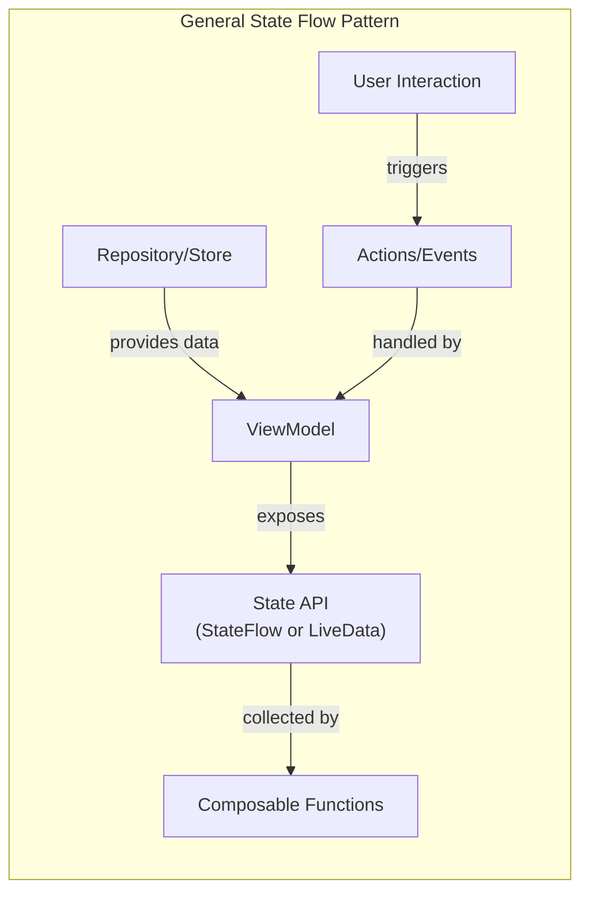

Sources: [Jetcaster/mobile/src/main/java/com/example/jetcaster/ui/home/HomeViewModel.kt:55-62](), [Jetchat/app/src/main/java/com/example/compose/jetchat/MainViewModel.kt:26-31]()

## Jetcaster: Production-Ready Redux-Style Architecture

Jetcaster demonstrates the most sophisticated state management approach in the repository, implementing a Redux-inspired pattern suitable for production applications.

**Redux-Style State Flow in HomeViewModel**

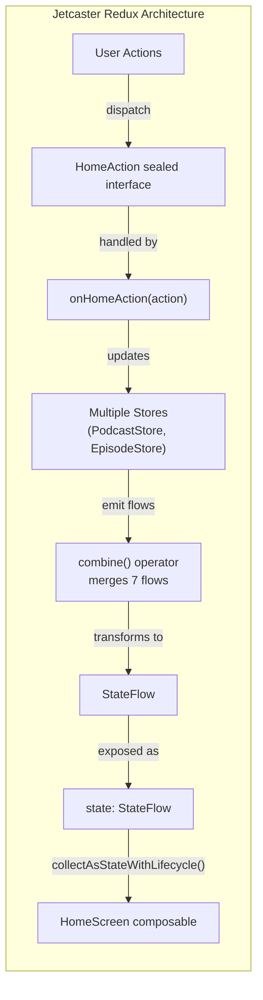

Sources: [Jetcaster/mobile/src/main/java/com/example/jetcaster/ui/home/HomeViewModel.kt:55-147](), [Jetcaster/mobile/src/main/java/com/example/jetcaster/ui/home/Home.kt:196-197]()

**State Structure**

The `HomeScreenUiState` data class encapsulates all screen state:

```kotlin
@Immutable
data class HomeScreenUiState(
    val isLoading: Boolean = true,
    val errorMessage: String? = null,
    val featuredPodcasts: ImmutableList<PodcastInfo> = persistentListOf(),
    val selectedHomeCategory: HomeCategory = HomeCategory.Discover,
    val homeCategories: List<HomeCategory> = emptyList(),
    val filterableCategoriesModel: FilterableCategoriesModel = FilterableCategoriesModel(),
    val podcastCategoryFilterResult: PodcastCategoryFilterResult = PodcastCategoryFilterResult(),
    val library: LibraryInfo = LibraryInfo(),
)
```

Sources: [Jetcaster/mobile/src/main/java/com/example/jetcaster/ui/home/HomeViewModel.kt:229-238]()

**Action-Based State Updates**

User interactions are modeled as sealed interface actions, dispatched to a single handler:

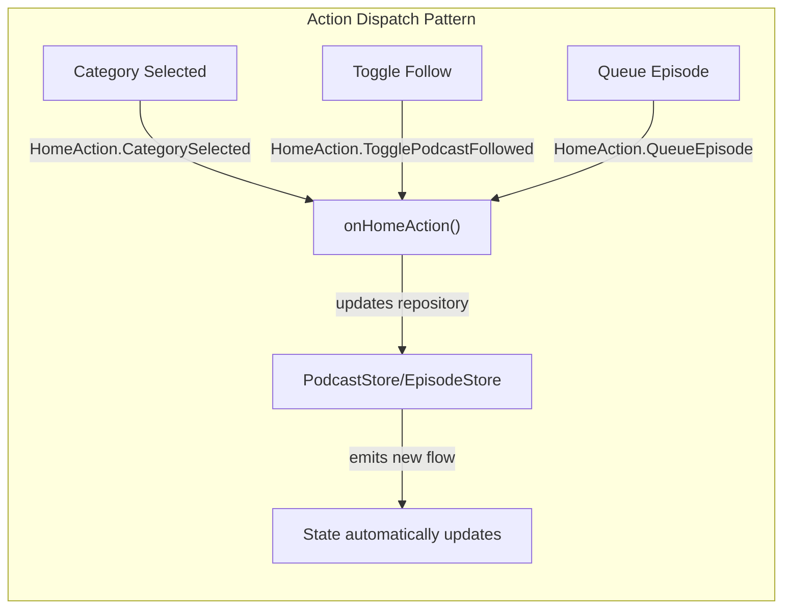

Sources: [Jetcaster/mobile/src/main/java/com/example/jetcaster/ui/home/HomeViewModel.kt:161-171](), [Jetcaster/mobile/src/main/java/com/example/jetcaster/ui/home/HomeViewModel.kt:218-226]()

**Flow Combining Strategy**

The ViewModel uses the `combine()` operator to merge multiple data sources into a single state stream:

```kotlin
combine(
    homeCategories,
    selectedHomeCategory,
    subscribedPodcasts,
    refreshing,
    _selectedCategory.flatMapLatest { selectedCategory ->
        filterableCategoriesUseCase(selectedCategory)
    },
    _selectedCategory.flatMapLatest {
        podcastCategoryFilterUseCase(it)
    },
    subscribedPodcasts.flatMapLatest { podcasts ->
        episodeStore.episodesInPodcasts(
            podcastUris = podcasts.map { it.podcast.uri },
            limit = 20,
        )
    },
) { /* transform to HomeScreenUiState */ }
```

This pattern ensures that any change in any data source automatically triggers state recomputation.

Sources: [Jetcaster/mobile/src/main/java/com/example/jetcaster/ui/home/HomeViewModel.kt:88-134]()

**State Collection in UI**

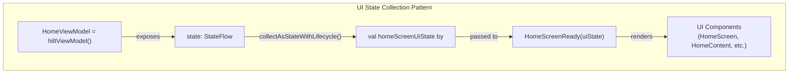

Sources: [Jetcaster/mobile/src/main/java/com/example/jetcaster/ui/home/Home.kt:195-210]()

## JetNews: Standard ViewModel with StateFlow

JetNews represents a modern, straightforward approach to state management using StateFlow with sealed interfaces for type-safe state representation.

**Sealed Interface State Pattern**

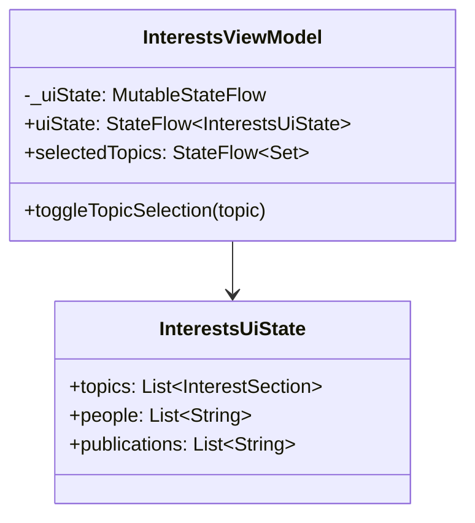

Sources: [JetNews/app/src/main/java/com/example/jetnews/ui/interests/InterestsScreen.kt:177-212]()

**State Collection and Usage**

The `rememberTabContent()` function collects multiple state flows for different sections:

```kotlin
@Composable
fun rememberTabContent(interestsViewModel: InterestsViewModel): List<TabContent> {
    val uiState by interestsViewModel.uiState.collectAsStateWithLifecycle()
    
    val topicsSection = TabContent(Sections.Topics) {
        val selectedTopics by interestsViewModel.selectedTopics.collectAsStateWithLifecycle()
        TabWithSections(
            sections = uiState.topics,
            selectedTopics = selectedTopics,
            onTopicSelect = { interestsViewModel.toggleTopicSelection(it) },
        )
    }
    // ... similar for people and publications
}
```

Sources: [JetNews/app/src/main/java/com/example/jetnews/ui/interests/InterestsScreen.kt:177-212]()

**Direct State Updates**

JetNews ViewModels typically update state directly through methods:

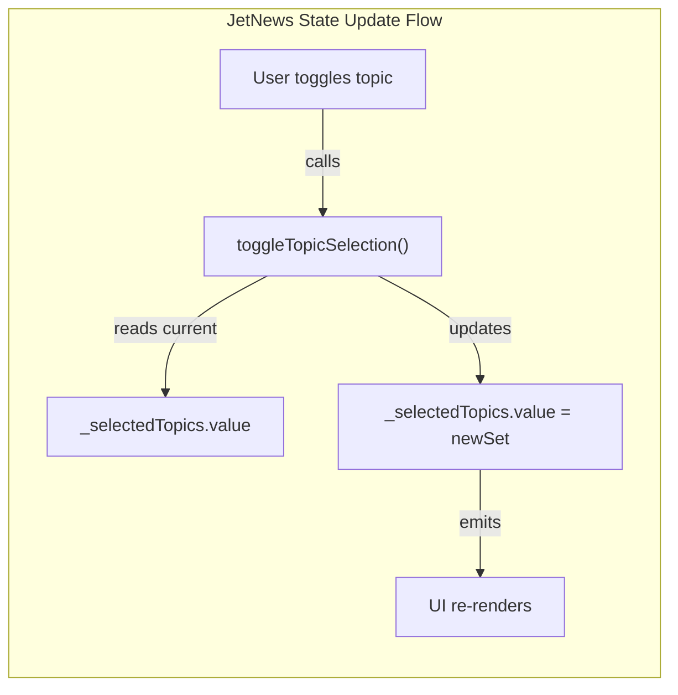

Sources: [JetNews/app/src/main/java/com/example/jetnews/ui/interests/InterestsScreen.kt:177-212]()

## Jetchat: LiveData Integration and Migration Pattern

Jetchat demonstrates the bridge between traditional Android development with LiveData and modern Compose patterns, showing how apps can gradually migrate to StateFlow.

**Hybrid State Management Architecture**

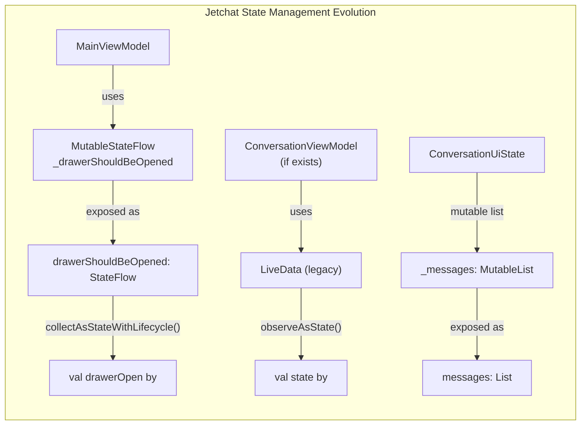

Sources: [Jetchat/app/src/main/java/com/example/compose/jetchat/MainViewModel.kt:26-33](), [Jetchat/app/src/main/java/com/example/compose/jetchat/profile/ProfileFragment.kt:31-32](), [Jetchat/app/src/main/java/com/example/compose/jetchat/conversation/ConversationUiState.kt:23-30]()

**LiveData Usage in Profile Screen**

Jetchat's ProfileFragment shows LiveData usage with Compose interop:

```kotlin
@Composable
fun ProfileFragment() {
    val viewModel: ProfileViewModel by viewModels()
    
    val userData by viewModel.userData.observeAsState()
    // LiveData converted to State for Compose
}
```

Sources: [Jetchat/app/src/main/java/com/example/compose/jetchat/profile/ProfileFragment.kt:31-32]()

**Modern StateFlow in MainViewModel**

The MainViewModel demonstrates the modern StateFlow pattern:

```kotlin
class MainViewModel : ViewModel() {
    private val _drawerShouldBeOpened = MutableStateFlow(false)
    val drawerShouldBeOpened = _drawerShouldBeOpened.asStateFlow()

    fun openDrawer() {
        _drawerShouldBeOpened.value = true
    }

    fun resetOpenDrawerAction() {
        _drawerShouldBeOpened.value = false
    }
}
```

Sources: [Jetchat/app/src/main/java/com/example/compose/jetchat/MainViewModel.kt:26-33]()

**Mutable State List Pattern**

The `ConversationUiState` uses a mutable list pattern for dynamic message updates:

```kotlin
class ConversationUiState(
    val channelName: String,
    val channelMembers: Int,
    initialMessages: List<Message>
) {
    private val _messages: MutableList<Message> = initialMessages.toMutableStateList()
    val messages: List<Message> = _messages

    fun addMessage(msg: Message) {
        _messages.add(0, msg) // Add to beginning
    }
}
```

This pattern is simpler than StateFlow for lists that need frequent modifications.

Sources: [Jetchat/app/src/main/java/com/example/compose/jetchat/conversation/ConversationUiState.kt:23-30]()

**Fragment Integration**

Jetchat demonstrates Fragment-based architecture integration:

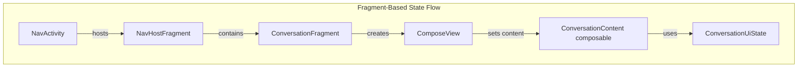

Sources: [Jetchat/app/src/main/java/com/example/compose/jetchat/NavActivity.kt:47-117](), [Jetchat/app/src/main/java/com/example/compose/jetchat/conversation/ConversationFragment.kt:35-62]()

## Evolution from LiveData to StateFlow

The samples demonstrate the migration path from traditional LiveData to modern StateFlow patterns.

**Comparison: LiveData vs StateFlow**

| Aspect | LiveData (Jetchat) | StateFlow (JetNews, Jetcaster) |
|--------|-------------------|--------------------------------|
| **API** | `observeAsState()` | `collectAsStateWithLifecycle()` |
| **Lifecycle Awareness** | Built-in | Via `collectAsStateWithLifecycle()` |
| **Initial Value** | Nullable, requires handling | Required, always available |
| **Operators** | Limited | Full Kotlin Flow operators |
| **Coroutine Support** | Limited | Native |
| **Testability** | Requires LiveData test utilities | Standard coroutine testing |
| **Compose Integration** | Requires conversion | Native support |

Sources: [Jetchat/app/src/main/java/com/example/compose/jetchat/profile/ProfileFragment.kt:31-32](), [JetNews/app/src/main/java/com/example/jetnews/ui/interests/InterestsScreen.kt:179](), [Jetcaster/mobile/src/main/java/com/example/jetcaster/ui/home/Home.kt:196]()

**Migration Pattern Example**

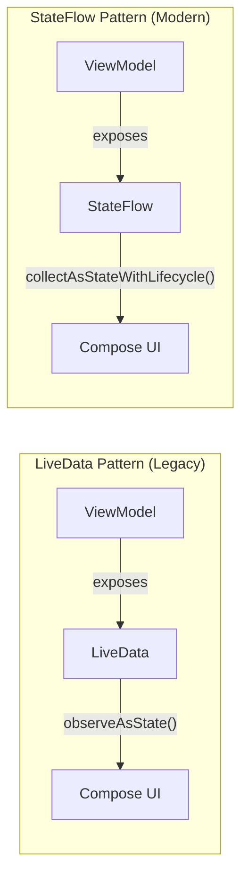

Sources: [Jetchat/app/src/main/java/com/example/compose/jetchat/MainViewModel.kt:26-33](), [Jetcaster/mobile/src/main/java/com/example/jetcaster/ui/home/HomeViewModel.kt:84-86]()

**Why StateFlow is Preferred**

1. **Flow Operators**: Can use `map`, `flatMapLatest`, `combine`, etc.
2. **Coroutine Native**: Works seamlessly with coroutine APIs
3. **Initial Value**: Always has a value, no null handling needed
4. **Testability**: Easier to test with coroutine test utilities
5. **Performance**: Better performance characteristics than LiveData

The Jetcaster sample shows the most advanced usage, while Jetchat shows the transition period where both patterns coexist.

Sources: [Jetcaster/mobile/src/main/java/com/example/jetcaster/ui/home/HomeViewModel.kt:88-144]()

## State Collection and Lifecycle Management

All modern samples use `collectAsStateWithLifecycle()` for lifecycle-aware state collection.

**State Collection Pattern Across Samples**

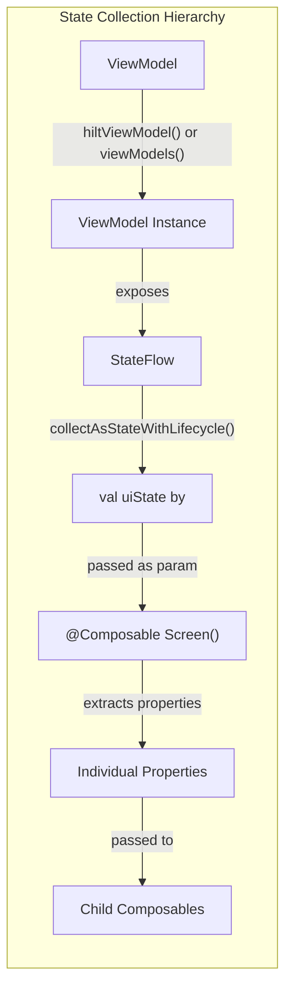

Sources: [Jetcaster/mobile/src/main/java/com/example/jetcaster/ui/home/Home.kt:195-210](), [JetNews/app/src/main/java/com/example/jetnews/ui/interests/InterestsScreen.kt:177-189]()

**Jetcaster Example: Complete Collection Chain**

```kotlin
@Composable
fun MainScreen(
    windowSizeClass: WindowSizeClass,
    navigateToPlayer: (EpisodeInfo) -> Unit,
    viewModel: HomeViewModel = hiltViewModel()
) {
    val homeScreenUiState by viewModel.state.collectAsStateWithLifecycle()
    val uiState = homeScreenUiState
    
    HomeScreenReady(
        uiState = uiState,
        windowSizeClass = windowSizeClass,
        navigateToPlayer = navigateToPlayer,
        viewModel = viewModel,
    )
}
```

Sources: [Jetcaster/mobile/src/main/java/com/example/jetcaster/ui/home/Home.kt:195-210]()

**JetNews Example: Multiple State Collections**

In InterestsScreen, multiple StateFlows are collected independently:

```kotlin
@Composable
fun rememberTabContent(interestsViewModel: InterestsViewModel): List<TabContent> {
    // Collect main UI state
    val uiState by interestsViewModel.uiState.collectAsStateWithLifecycle()
    
    val topicsSection = TabContent(Sections.Topics) {
        // Collect selected topics separately
        val selectedTopics by interestsViewModel.selectedTopics.collectAsStateWithLifecycle()
        TabWithSections(
            sections = uiState.topics,
            selectedTopics = selectedTopics,
            onTopicSelect = { interestsViewModel.toggleTopicSelection(it) },
        )
    }
}
```

This pattern allows different parts of state to be collected at different composition levels.

Sources: [JetNews/app/src/main/java/com/example/jetnews/ui/interests/InterestsScreen.kt:177-212]()

## State Update Patterns Comparison

Different samples use different patterns for updating state.

**State Update Approaches**

| Pattern | Sample | Example | Complexity |
|---------|--------|---------|------------|
| Direct Assignment | Jetchat | `_state.value = newValue` | Low |
| Copy with Modification | JetNews | `_state.value.copy(property = value)` | Medium |
| Flow Operators | Jetcaster | `combine(flow1, flow2) { ... }` | High |
| Action Dispatch | Jetcaster | `onHomeAction(HomeAction.CategorySelected)` | High |

Sources: [Jetchat/app/src/main/java/com/example/compose/jetchat/MainViewModel.kt:31-33](), [JetNews/app/src/main/java/com/example/jetnews/ui/interests/InterestsScreen.kt:188](), [Jetcaster/mobile/src/main/java/com/example/jetcaster/ui/home/HomeViewModel.kt:161-171]()

**Jetcaster: Action-Based Updates**

```mermaid
flowchart TD
    subgraph "Action Dispatch Pattern"
        UserEvent["User Event\n(e.g., follow podcast)"] --> |"creates"| Action["HomeAction.TogglePodcastFollowed(podcast)"]
        Action --> |"dispatched to"| Handler["onHomeAction(action: HomeAction)"]
        Handler --> |"when (action)"| Match["Pattern Match"]
        Match --> |"calls"| Method["onTogglePodcastFollowed(podcast)"]
        Method --> |"updates"| Repository["podcastStore.togglePodcastFollowed()"]
        Repository --> |"emits new data"| Flow["Flow updates"]
        Flow --> |"combine() recalculates"| NewState["New HomeScreenUiState"]
    end
```

Sources: [Jetcaster/mobile/src/main/java/com/example/jetcaster/ui/home/HomeViewModel.kt:161-192]()

**JetNews: Direct Method Calls**

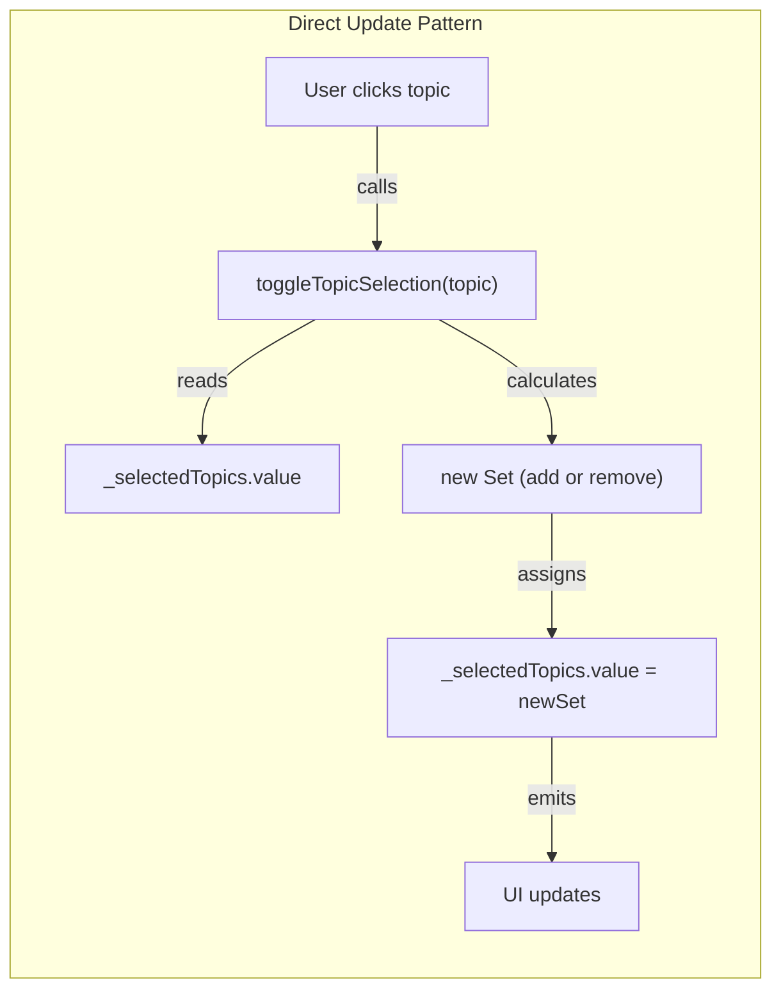

Sources: [JetNews/app/src/main/java/com/example/jetnews/ui/interests/InterestsScreen.kt:188]()

**Jetchat: Simple Boolean Toggle**

```kotlin
private val _drawerShouldBeOpened = MutableStateFlow(false)

fun openDrawer() {
    _drawerShouldBeOpened.value = true
}

fun resetOpenDrawerAction() {
    _drawerShouldBeOpened.value = false
}
```

Sources: [Jetchat/app/src/main/java/com/example/compose/jetchat/MainViewModel.kt:26-33]()

## Case Study: Podcast Selection in Jetcaster

A complete flow showing Jetcaster's sophisticated state management:

**User Follows a Podcast**

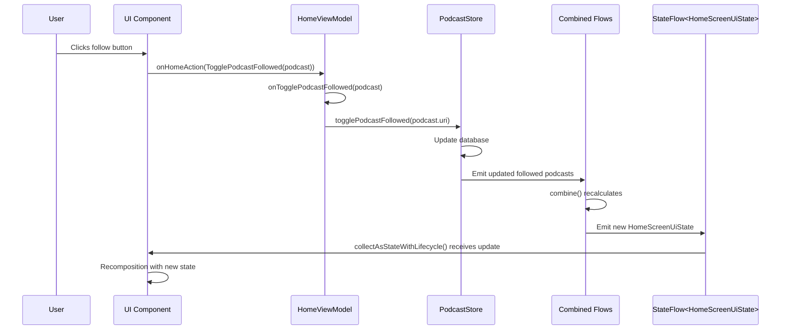

Sources: [Jetcaster/mobile/src/main/java/com/example/jetcaster/ui/home/HomeViewModel.kt:161-192](), [Jetcaster/mobile/src/main/java/com/example/jetcaster/ui/home/Home.kt:265-280]()

## Loading and Error State Handling

All samples include loading and error states as part of their UI state.

**Loading State Patterns**

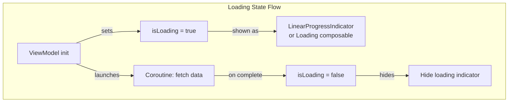

Sources: [Jetcaster/mobile/src/main/java/com/example/jetcaster/ui/home/HomeViewModel.kt:149-159](), [Jetcaster/mobile/src/main/java/com/example/jetcaster/ui/home/Home.kt:406-412]()

**Error State Handling in Jetcaster**

```kotlin
@Immutable
data class HomeScreenUiState(
    val isLoading: Boolean = true,
    val errorMessage: String? = null,
    // ... other properties
)

// In UI
if (uiState.errorMessage != null) {
    HomeScreenError(onRetry = viewModel::refresh)
}
```

The error state is displayed as an overlay with a retry action.

Sources: [Jetcaster/mobile/src/main/java/com/example/jetcaster/ui/home/HomeViewModel.kt:229-238](), [Jetcaster/mobile/src/main/java/com/example/jetcaster/ui/home/Home.kt:206-209]()

**Error Handling with catch()**

Jetcaster uses Flow's `catch()` operator to handle errors gracefully:

```kotlin
combine(/* ... multiple flows ... *) {
    // Transform to HomeScreenUiState
}.catch { throwable ->
    emit(
        HomeScreenUiState(
            isLoading = false,
            errorMessage = throwable.message,
        ),
    )
}.collect {
    _state.value = it
}
```

This ensures errors in any data source are caught and converted to error state.

Sources: [Jetcaster/mobile/src/main/java/com/example/jetcaster/ui/home/HomeViewModel.kt:134-144]()

## Best Practices for UI State Management

Based on the samples, here are the recommended practices for UI state management:

1. **Use data classes for state representation**: Makes state immutable and structured
2. **Single source of truth**: State should be defined and managed in one place (ViewModel)
3. **Unidirectional data flow**: State flows down, events flow up
4. **Lifecycle-aware state collection**: Use `collectAsStateWithLifecycle()` to respect component lifecycle
5. **State transformation**: Transform internal state to UI-friendly state when needed
6. **Immutable updates**: Always use `copy()` to create new state instances
7. **Type-safe state representation**: Use sealed classes/interfaces for complex state with multiple variants

Sources: [Reply/app/src/main/java/com/example/reply/ui/ReplyHomeViewModel.kt:30-85](), [JetNews/app/src/main/java/com/example/jetnews/ui/home/HomeViewModel.kt:42-115]()

## Conclusion

The Compose samples repository demonstrates a consistent approach to UI state management using ViewModels, StateFlow, and immutable data classes. This architecture provides a solid foundation for building complex, reactive UIs with Jetpack Compose while maintaining a clear separation of concerns and facilitating testability.

The pattern of defining state as immutable data classes, managing it in ViewModels with StateFlow, and collecting it in UI components with lifecycle awareness is a recommended approach for Compose applications.

---

