# Page: Overview

# Overview

<details>
<summary>Relevant source files</summary>

The following files were used as context for generating this wiki page:

- [JetLagged/gradle/libs.versions.toml](JetLagged/gradle/libs.versions.toml)
- [JetNews/README.md](JetNews/README.md)
- [JetNews/gradle/libs.versions.toml](JetNews/gradle/libs.versions.toml)
- [Jetcaster/README.md](Jetcaster/README.md)
- [Jetcaster/docs/tabletop.png](Jetcaster/docs/tabletop.png)
- [Jetcaster/gradle/libs.versions.toml](Jetcaster/gradle/libs.versions.toml)
- [Jetchat/README.md](Jetchat/README.md)
- [Jetchat/gradle/libs.versions.toml](Jetchat/gradle/libs.versions.toml)
- [Jetchat/screenshots/widget.png](Jetchat/screenshots/widget.png)
- [Jetchat/screenshots/widget_discoverability.png](Jetchat/screenshots/widget_discoverability.png)
- [Jetsnack/README.md](Jetsnack/README.md)
- [Jetsnack/gradle/libs.versions.toml](Jetsnack/gradle/libs.versions.toml)
- [README.md](README.md)
- [Reply/gradle/libs.versions.toml](Reply/gradle/libs.versions.toml)
- [readme/jetcaster-hero.png](readme/jetcaster-hero.png)
- [scripts/updateDeps.sh](scripts/updateDeps.sh)

</details>


This wiki page provides an introduction to the Compose-Samples repository, a collection of Jetpack Compose sample applications for Android developers. The repository demonstrates different use cases, complexity levels, and APIs through standalone sample applications that showcase various aspects of Jetpack Compose.

This page covers the high-level structure of the repository, the purpose of each sample application, common architectural patterns used across samples, and the build infrastructure that ties them all together.

Sources: [README.md:1-14]()

## Repository Organization

The Compose-Samples repository is structured as a collection of independent Android Studio projects, each demonstrating different features and patterns of Jetpack Compose.

### Repository Structure Diagram

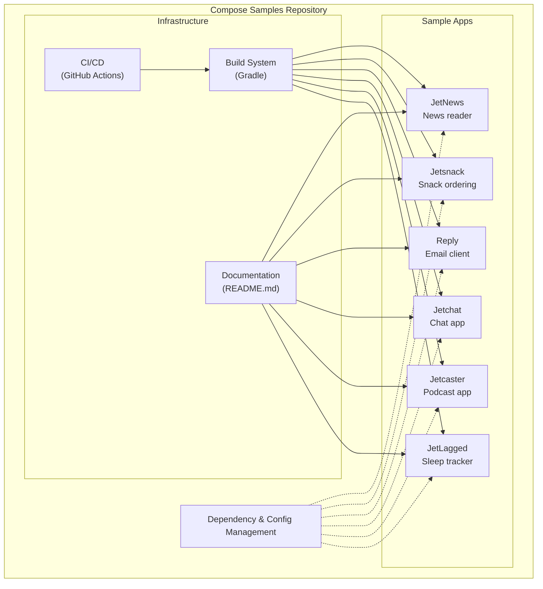

Sources: [README.md:1-43]()

### Version Catalog System

The repository uses Gradle Version Catalogs for centralized dependency management. The system has a hub-and-spoke architecture where `scripts/libs.versions.toml` serves as the global template that is duplicated to each sample's `gradle/libs.versions.toml` file.

#### Version Catalog Hub-and-Spoke Pattern

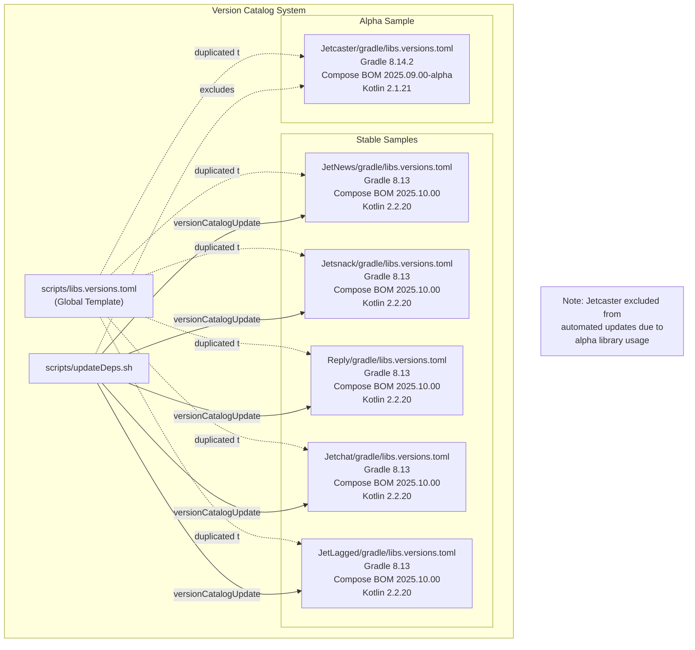

**Key characteristics:**
- Five stable samples share common versions (Gradle 8.13, Compose BOM 2025.10.00, Kotlin 2.2.20, AGP 8.13.0)
- Jetcaster uses alpha/preview libraries (Compose BOM 2025.09.00-alpha, Gradle 8.14.2, Kotlin 2.1.21, AGP 8.10.1)
- The `updateDeps.sh` script runs `./gradlew versionCatalogUpdate` on stable samples but explicitly excludes Jetcaster
- All samples converge on common SDK targets: `compileSdk = 36`, `minSdk = 23`

Sources: [scripts/updateDeps.sh:1-35](), [Jetcaster/gradle/libs.versions.toml:1-11](), [JetNews/gradle/libs.versions.toml:1-11](), [Jetsnack/gradle/libs.versions.toml:1-11](), [README.md:82-90]()

## Sample Applications

The repository contains six active sample applications, each demonstrating different aspects of Jetpack Compose at varying complexity levels. The samples are independent Android Studio projects that can be imported and run separately.

### Active Samples

| Sample | Description | Complexity | Key Demonstrations | Importance Score |
|--------|-------------|------------|-------------------|------------------|
| **JetNews** | Blog/news reader with Material Design 3 | Medium | Adaptive layouts, Navigation drawer, Glance widgets, Custom layouts | 191.20 |
| **Jetsnack** | Food/snack ordering app | Medium | Custom design system (`JetsnackTheme`), Shared element transitions, Custom layouts (`CollapsingImageLayout`) | 154.58 |
| **Jetchat** | Chat application | Low-Medium | Text input management, Fragment integration, `BackHandler`, Emoji selector, Material 3 | 110.57 |
| **Reply** | Email client | Medium | Adaptive UI (`WindowSizeClass`), Foldable support (`DevicePosture`), Navigation Suite (Bottom/Rail/Drawer) | 104.67 |
| **Jetcaster** | Podcast app (mobile, TV, Wear) | Advanced | Redux-style architecture, Room database, Dynamic theming, Multi-platform (`SupportingPaneScaffold`) | 88.17 |
| **JetLagged** | Sleep tracker | Medium | Custom graphics (`RuntimeShader`), Data visualization, Predictive back gesture | 51.76 |

All samples target Android API levels: `compileSdk = 36`, `minSdk = 23`, with `targetSdk` ranging from 33-36.

Sources: [README.md:16-31](), [Jetcaster/gradle/libs.versions.toml:34-60](), [JetNews/gradle/libs.versions.toml:33-58](), [Jetsnack/gradle/libs.versions.toml:29-56](), [Reply/gradle/libs.versions.toml:33-58](), [Jetchat/gradle/libs.versions.toml:33-58](), [JetLagged/gradle/libs.versions.toml:29-54]()

### Obsolete Samples

Four samples were removed from the repository in 2024 to keep it maintainable but remain accessible in the git history:

| Sample | Purpose | Removed Date | Commit |
|--------|---------|--------------|--------|
| Crane | Travel app | 2024-08-02 | ee8e272 |
| Owl | Learning app | 2024-08-02 | ee8e272 |
| Jetsurvey | Survey app | 2024-08-02 | ee8e272 |
| Rally | Finance app | 2024-08-02 | ee8e272 |

Sources: [README.md:92-104]()

### Architecture Patterns Across Samples

Each sample demonstrates distinct architectural patterns and UI approaches:

#### Architecture Pattern Mapping

```mermaid
flowchart TB
    subgraph "Jetcaster - Redux Architecture"
        JCHomeVM["HomeViewModel"]
        JCHomeViewState["StateFlow&lt;HomeViewState&gt;"]
        JCPodcastStore["PodcastStore"]
        JCEpisodeStore["EpisodeStore"]
        JCRoom["JetcasterDatabase<br/>(Room)"]
        JCHomeUI["Home.kt"]
        
        JCHomeVM -->|exposes| JCHomeViewState
        JCHomeVM --> JCPodcastStore
        JCHomeVM --> JCEpisodeStore
        JCPodcastStore --> JCRoom
        JCEpisodeStore --> JCRoom
        JCHomeViewState -->|collectAsStateWithLifecycle| JCHomeUI
    end
    
    subgraph "Reply - Adaptive UI"
        ReplyApp["ReplyApp.kt"]
        WSC["WindowSizeClass"]
        DevicePosture["DevicePosture<br/>(BookPosture/Tabletop)"]
        NavSuite["NavigationSuiteScaffold<br/>(Bottom/Rail/Drawer)"]
        ContentType["ContentType<br/>(Single/Dual Pane)"]
        
        ReplyApp --> WSC
        ReplyApp --> DevicePosture
        WSC --> NavSuite
        DevicePosture --> ContentType
    end
    
    subgraph "Jetsnack - Custom Design System"
        JSTheme["JetsnackTheme.kt"]
        JSColorPalette["JetsnackColorPalette"]
        JSComponents["Wrapped Material Components<br/>(Button.kt, Card.kt)"]
        JSCustomLayouts["Custom Layouts<br/>(CollapsingImageLayout,<br/>JetsnackBottomNavLayout)"]
        SharedTrans["SharedTransitionLayout"]
        
        JSTheme --> JSColorPalette
        JSTheme --> JSComponents
        JSComponents --> JSCustomLayouts
        JSCustomLayouts --> SharedTrans
    end
    
    subgraph "Jetchat - Fragment Integration"
        NavActivity["NavActivity"]
        NavComponent["Navigation Component<br/>(Fragments)"]
        ComposeView["ComposeView in Fragments"]
        ConvVM["ConversationViewModel<br/>(LiveData)"]
        
        NavActivity --> NavComponent
        NavComponent --> ComposeView
        ComposeView --> ConvVM
    end
    
    subgraph "JetNews - Material 3"
        JNApp["JetnewsApp.kt"]
        JNNavGraph["JetnewsNavGraph.kt"]
        JNScreens["Home/Article/Interests"]
        JNAdaptive["calculateWindowSizeClass"]
        JNWidget["JetnewsGlanceWidget"]
        
        JNApp --> JNNavGraph
        JNNavGraph --> JNScreens
        JNScreens --> JNAdaptive
        JNApp -.separate.-> JNWidget
    end
    
    subgraph "JetLagged - Custom Graphics"
        JLHome["HomeScreenCards.kt"]
        RuntimeShader["RuntimeShader<br/>(Mesh gradients)"]
        CustomLayouts["Custom Layouts<br/>(SleepGraphRow,<br/>HeartRateGraph)"]
        PredictiveBack["Predictive Back Gesture"]
        
        JLHome --> RuntimeShader
        JLHome --> CustomLayouts
        JLHome --> PredictiveBack
    end
```

Sources: [Jetcaster/README.md:43-62](), [Jetsnack/README.md:26-41](), [JetNews/README.md:22-32](), [Jetchat/README.md:38-47](), [README.md:43-73]()

## Shared Infrastructure

The repository includes shared infrastructure components that support all samples:

### Build System

All samples use a consistent build configuration:

| Component | Configuration |
|-----------|---------------|
| **Gradle Version** | 8.13 (stable samples), 8.14.2 (Jetcaster) |
| **Android Gradle Plugin** | 8.13.0 (stable), 8.10.1 (Jetcaster) |
| **Kotlin** | 2.2.20 (stable), 2.1.21 (Jetcaster) |
| **Compose Compiler** | Kotlin plugin: `org.jetbrains.kotlin.plugin.compose` |
| **Compose BOM** | 2025.10.00 (stable), 2025.09.00-alpha (Jetcaster) |

**Common Plugins Applied:**
- `com.android.application` (all samples)
- `org.jetbrains.kotlin.android` (all samples)
- `org.jetbrains.kotlin.plugin.compose` (all samples)
- `com.diffplug.spotless` (code formatting, all samples)
- `org.jetbrains.kotlin.plugin.parcelize` (Jetsnack, JetLagged)
- `org.jetbrains.kotlin.plugin.serialization` (Reply)
- `com.google.dagger.hilt.android` + `com.google.devtools.ksp` (Jetcaster only)

Sources: [Jetcaster/gradle/libs.versions.toml:172-187](), [Jetsnack/gradle/libs.versions.toml:157-172](), [JetNews/gradle/libs.versions.toml:162-177]()

### Code Formatting

All samples use Spotless for consistent code formatting:
- Configuration: `spotless/copyright.kt` defines the copyright header
- Format all: `./scripts/format.sh` runs `spotlessApply` on all samples
- Check format: Navigate to sample and run `./gradlew spotlessCheck`

Sources: [README.md:76-80]()

## CI/CD System

The repository uses GitHub Actions with a reusable workflow pattern to build and test samples:

### CI/CD Pipeline Architecture

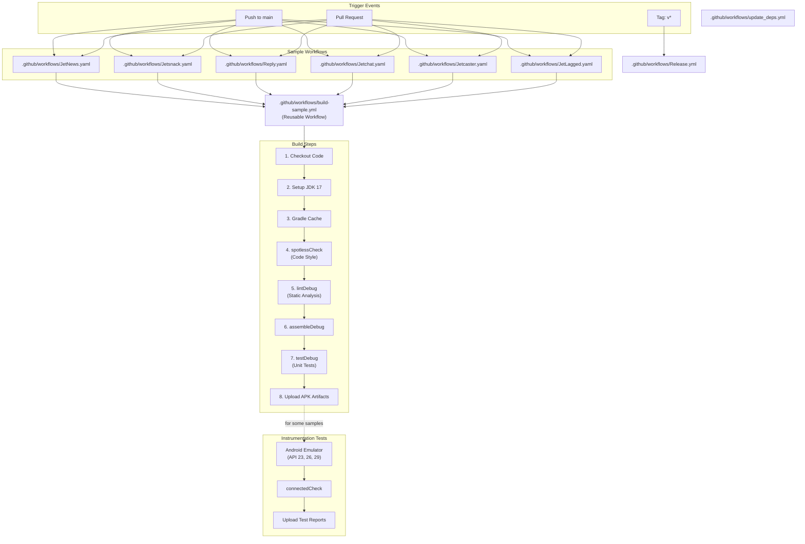

**Quality Gates (Sequential):**
1. **Code Style:** `spotlessCheck` enforces consistent formatting via ktlint
2. **Static Analysis:** `lintDebug` runs Android Lint checks
3. **Compilation:** `assembleDebug` verifies the build succeeds
4. **Unit Tests:** `testDebug` runs local JUnit tests
5. **Instrumentation Tests:** `connectedCheck` runs UI tests on emulators (API levels 23, 26, 29) for JetNews, Jetchat, Reply, and JetLagged

**Additional Workflows:**
- `update_deps.yml`: Automated dependency updates via pull requests
- `Release.yml`: Builds all sample APKs on version tags and publishes to GitHub Releases

Sources: [README.md:76-90]()

## Key High-Level Features

The sample applications collectively demonstrate a range of Jetpack Compose features:

1. **Custom Layouts**
   - `InterestsScreen` in JetNews [JetNews/app/src/main/java/com/example/jetnews/ui/interests/InterestsScreen.kt]()
   - `AnimatedFabContent` in Jetchat [Jetchat/app/src/main/java/com/example/compose/jetchat/components/AnimatingFabContent.kt]()
   - `Grid` in Jetsnack [Jetsnack/app/src/main/java/com/example/jetsnack/ui/components/Grid.kt]()
   - `CollapsingImageLayout` in Jetsnack [Jetsnack/app/src/main/java/com/example/jetsnack/ui/snackdetail/SnackDetail.kt]()

2. **Theming**
   - Material 3 in Jetchat [Jetchat/app/src/main/java/com/example/compose/jetchat/theme/Themes.kt]()
   - Dynamic theming in Jetcaster [Jetcaster/app/src/main/java/com/example/jetcaster/util/DynamicTheming.kt]()
   - Custom design system in Jetsnack [Jetsnack/app/src/main/java/com/example/jetsnack/ui/theme/Theme.kt]()

3. **Adaptive UI**
   - Supporting pane in Jetcaster [Jetcaster/app/src/main/java/com/example/jetcaster/ui/home/Home.kt]()
   - Window size classes in JetNews [JetNews/app/src/main/java/com/example/jetnews/ui/MainActivity.kt]()

4. **Platform Support**
   - TV support in Jetcaster [Jetcaster/tv-app]()
   - Wear OS support in Jetcaster [Jetcaster/wear]()

Sources: [README.md:43-73]()

---

# Page: Build System and Dependency Management

# Build System and Dependency Management

<details>
<summary>Relevant source files</summary>

The following files were used as context for generating this wiki page:

- [JetLagged/build.gradle.kts](JetLagged/build.gradle.kts)
- [JetLagged/gradle/libs.versions.toml](JetLagged/gradle/libs.versions.toml)
- [JetNews/build.gradle.kts](JetNews/build.gradle.kts)
- [JetNews/gradle/libs.versions.toml](JetNews/gradle/libs.versions.toml)
- [Jetcaster/build.gradle.kts](Jetcaster/build.gradle.kts)
- [Jetcaster/gradle/libs.versions.toml](Jetcaster/gradle/libs.versions.toml)
- [Jetchat/build.gradle.kts](Jetchat/build.gradle.kts)
- [Jetchat/gradle/libs.versions.toml](Jetchat/gradle/libs.versions.toml)
- [Jetsnack/build.gradle.kts](Jetsnack/build.gradle.kts)
- [Jetsnack/gradle/libs.versions.toml](Jetsnack/gradle/libs.versions.toml)
- [Reply/build.gradle.kts](Reply/build.gradle.kts)
- [Reply/gradle/libs.versions.toml](Reply/gradle/libs.versions.toml)
- [scripts/updateDeps.sh](scripts/updateDeps.sh)

</details>


This document provides a technical overview of the build system and dependency management infrastructure used across the Jetpack Compose samples repository. It explains how dependencies and build configurations are centralized, maintained, and distributed to ensure consistency across all sample applications.

## Centralized Dependency Management Architecture

The Compose Samples repository implements a centralized dependency management system to maintain consistency across most sample projects. This hub-and-spoke architecture uses a global version catalog that is duplicated to individual samples, with special handling for samples that require different dependency versions.

### Hub-and-Spoke Distribution Pattern

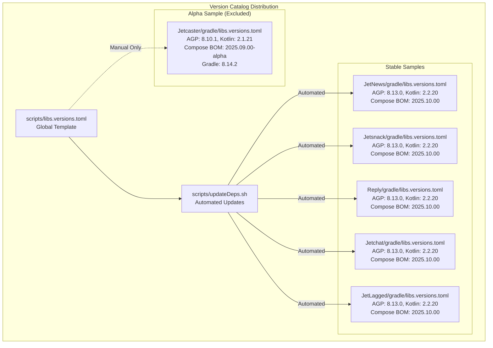

The repository maintains two tiers of samples with different dependency strategies:

- **Stable Samples** (5 projects): JetNews, Jetsnack, Reply, Jetchat, JetLagged receive automated dependency updates through the `updateDeps.sh` script and use stable Compose releases
- **Alpha Sample** (1 project): Jetcaster is excluded from automated updates and uses alpha-stage Compose libraries for early adoption testing

Sources: [scripts/updateDeps.sh:1-35](), [Jetcaster/gradle/libs.versions.toml:1-188](), [Jetsnack/gradle/libs.versions.toml:1-173](), [Reply/gradle/libs.versions.toml:1-178](), [Jetchat/gradle/libs.versions.toml:1-178](), [JetNews/gradle/libs.versions.toml:1-178](), [JetLagged/gradle/libs.versions.toml:1-174]()

## Version Catalog System

The repository uses Gradle's Version Catalog feature to manage dependencies through TOML files. The primary source of truth is the global `scripts/libs.versions.toml` file, which is then duplicated to each sample application.

### Version Catalog Structure

Each `libs.versions.toml` file follows the same structure with three main sections:

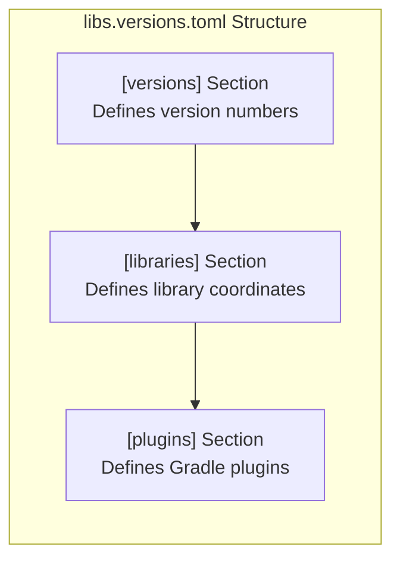

1. **Versions Section**: Defines version constants for dependencies
2. **Libraries Section**: Defines library coordinates with references to versions
3. **Plugins Section**: Defines Gradle plugins with version references

### Key Version Declarations

The version catalog defines crucial SDK and dependency versions. All samples converge on common compilation targets but diverge in framework versions:

#### Stable Samples (JetNews, Jetsnack, Reply, Jetchat, JetLagged)

| Configuration | Version |
|---------------|---------|
| `compileSdk` | 36 |
| `minSdk` | 23 |
| `targetSdk` | 33 or 36 |
| `androidGradlePlugin` | 8.13.0 |
| `kotlin` | 2.2.20 |
| `androidx-compose-bom` | 2025.10.00 |
| `coroutines` | 1.10.2 |
| Gradle Wrapper | 8.13 |

#### Alpha Sample (Jetcaster)

| Configuration | Version |
|---------------|---------|
| `compileSdk` | 36 |
| `minSdk` | 23 |
| `targetSdk` | 33 |
| `androidGradlePlugin` | 8.10.1 |
| `kotlin` | 2.1.21 |
| `androidx-compose-bom` | 2025.09.00 (alpha) |
| `coroutines` | 1.10.2 |
| Gradle Wrapper | 8.14.2 |

The version divergence allows Jetcaster to serve as an early adoption testing ground for alpha-stage Compose libraries while other samples maintain stability with production-ready releases.

Sources: [Jetcaster/gradle/libs.versions.toml:5-60](), [Jetsnack/gradle/libs.versions.toml:1-56](), [Reply/gradle/libs.versions.toml:5-59](), [Jetchat/gradle/libs.versions.toml:5-59](), [JetNews/gradle/libs.versions.toml:5-59](), [JetLagged/gradle/libs.versions.toml:1-55]()

### Library Declarations

Libraries are declared with references to the version constants:

```toml
# Compose libraries
androidx-compose-bom = { module = "androidx.compose:compose-bom", version.ref = "androidx-compose-bom" }
androidx-compose-ui = { module = "androidx.compose.ui:ui" }
androidx-compose-material3 = { module = "androidx.compose.material3:material3" }
```

Sources: [scripts/libs.versions.toml:60-159]()

### Plugin Declarations

Gradle plugins are declared with their IDs and versions:

```toml
android-application = { id = "com.android.application", version.ref = "androidGradlePlugin" }
kotlin-android = { id = "org.jetbrains.kotlin.android", version.ref = "kotlin" }
compose = { id = "org.jetbrains.kotlin.plugin.compose", version.ref = "kotlin" }
```

Sources: [scripts/libs.versions.toml:160-175]()

## Gradle Configuration Patterns

Each sample application follows a common pattern for its build configuration, with a hierarchical plugin architecture that provides both core and conditional plugins based on sample requirements.

### Root Project Configuration

The root `build.gradle.kts` in each sample applies plugins and configures code formatting:

#### Core Plugins Applied to All Samples

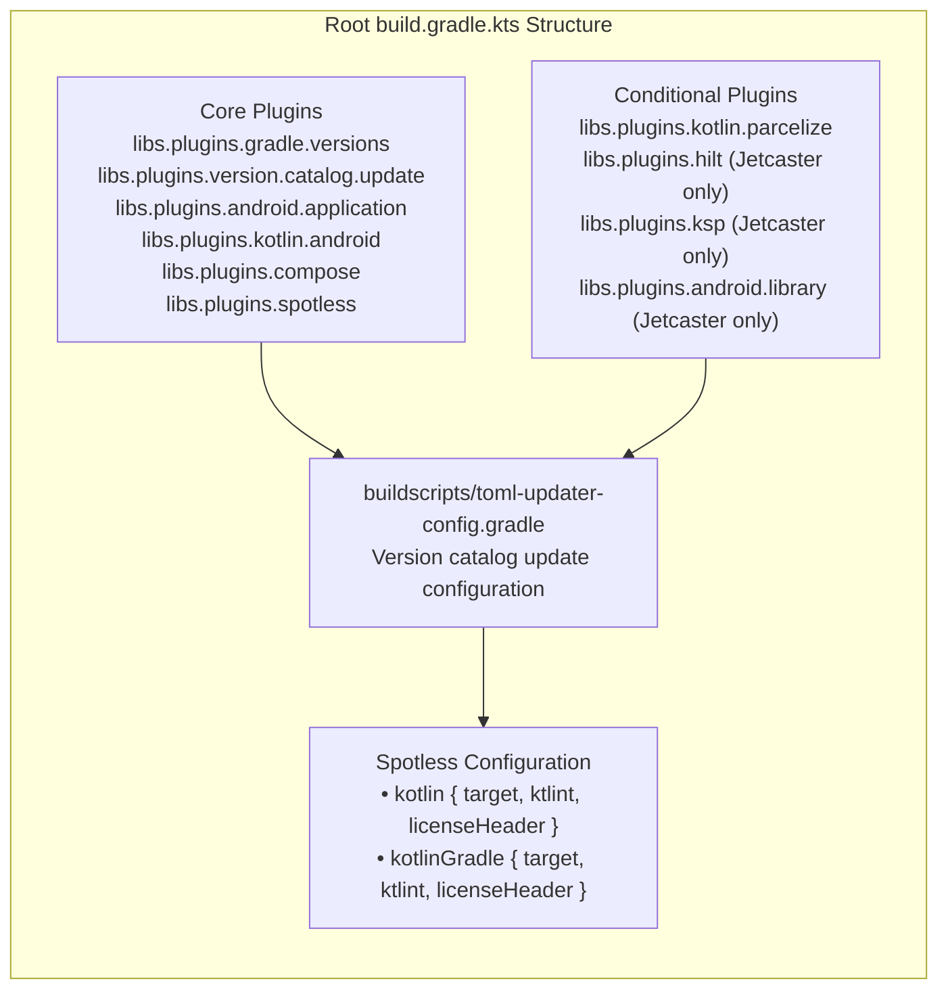

#### Plugin Distribution by Sample

| Sample | Core Plugins | Additional Plugins |
|--------|-------------|-------------------|
| JetNews | ✓ | `kotlin.parcelize` |
| Jetsnack | ✓ | `kotlin.parcelize` |
| Reply | ✓ | `kotlin.parcelize`, `kotlin.serialization` |
| Jetchat | ✓ | `kotlin.parcelize` |
| JetLagged | ✓ | `kotlin.parcelize` |
| Jetcaster | ✓ | `kotlin.parcelize`, `hilt`, `ksp`, `android.library` |

The Spotless plugin enforces consistent code formatting across all samples, with configurations for both Kotlin source files and Gradle build scripts. All samples apply the license header from `spotless/copyright.kt`.

Sources: [JetNews/build.gradle.kts:17-47](), [Jetsnack/build.gradle.kts:17-47](), [Reply/build.gradle.kts:17-47](), [Jetchat/build.gradle.kts:17-47](), [JetLagged/build.gradle.kts:17-47](), [Jetcaster/build.gradle.kts:17-50]()

### App Module Configuration

The app module's `build.gradle.kts` follows a consistent pattern across all samples:

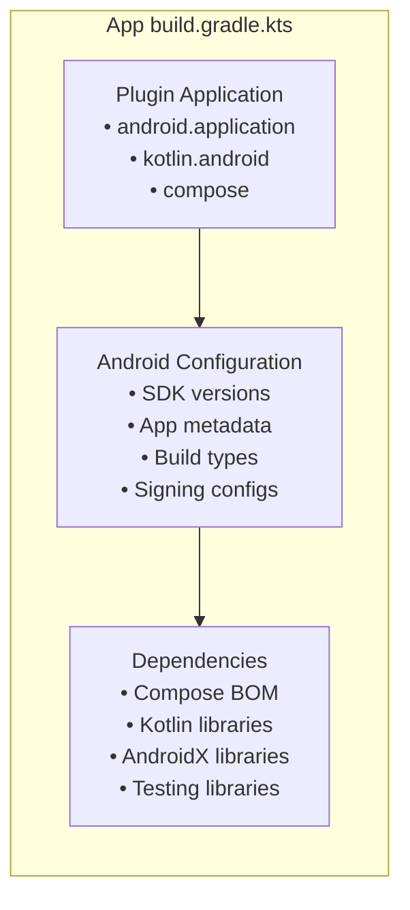

Key configurations include:

1. **SDK Versions**: Referenced from the version catalog
   ```kotlin
   compileSdk = libs.versions.compileSdk.get().toInt()
   minSdk = libs.versions.minSdk.get().toInt()
   targetSdk = libs.versions.targetSdk.get().toInt()
   ```

2. **Build Features**:
   ```kotlin
   buildFeatures {
       compose = true
   }
   ```

3. **Dependencies via Compose BOM**:
   ```kotlin
   val composeBom = platform(libs.androidx.compose.bom)
   implementation(composeBom)
   androidTestImplementation(composeBom)
   ```

4. **Signing Configuration**: Standardized across all samples
   ```kotlin
   signingConfigs {
       val userKeystore = File(System.getProperty("user.home"), ".android/debug.keystore")
       val localKeystore = rootProject.file("debug_2.keystore")
       val hasKeyInfo = userKeystore.exists()
       create("release") {
           storeFile = if (hasKeyInfo) userKeystore else localKeystore
           // Additional configuration...
       }
   }
   ```

Sources: [JetNews/app/build.gradle.kts:17-129](), [Jetsnack/app/build.gradle.kts:17-135](), [Reply/app/build.gradle.kts:17-137](), [Jetchat/app/build.gradle.kts:17-125](), [JetLagged/app/build.gradle.kts:17-139]()

## Dependency Update Mechanism

The repository implements an automated dependency update system with selective application based on library maturity.

### Automated Update Workflow

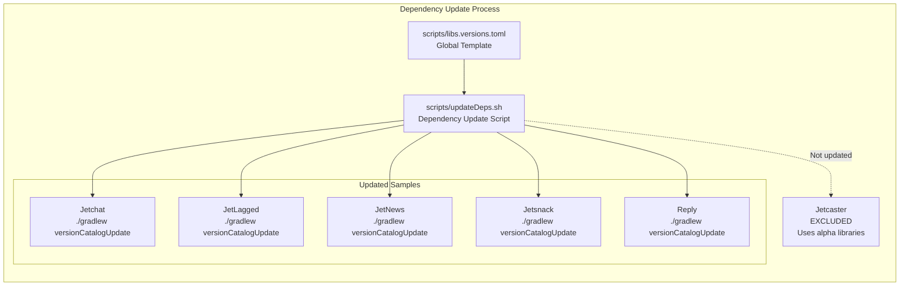

### Update Script Implementation

The `updateDeps.sh` script explicitly excludes Jetcaster from automated updates:

```bash
# Note: Jetcaster is temporarily excluded as it is using alpha libraries
# which we don't want to upgrade in parallel with stable releases.

cd Jetchat; ./gradlew versionCatalogUpdate; cd ..
cd JetLagged; ./gradlew versionCatalogUpdate; cd ..
cd JetNews; ./gradlew versionCatalogUpdate; cd ..
cd Jetsnack; ./gradlew versionCatalogUpdate; cd ..
cd Reply; ./gradlew versionCatalogUpdate; cd ..
```

This exclusion prevents alpha-stage dependencies in Jetcaster from being automatically upgraded to stable releases, allowing it to serve as an early adoption testing ground.

### Version Catalog Headers

Most samples include a header comment indicating duplication policy:

```toml
#####
# This file is duplicated to individual samples from the global scripts/libs.versions.toml
# Do not add a dependency to an individual sample, edit the global version instead.
#####
```

This comment appears in: Jetcaster, Reply, Jetchat, and JetNews. Jetsnack and JetLagged use the same system but lack this specific comment header.

Sources: [scripts/updateDeps.sh:17-35](), [Jetcaster/gradle/libs.versions.toml:1-4](), [Reply/gradle/libs.versions.toml:1-4](), [Jetchat/gradle/libs.versions.toml:1-4](), [JetNews/gradle/libs.versions.toml:1-4]()

## Gradle Wrapper Configuration

The repository uses different Gradle wrapper versions across samples, reflecting different upgrade cadences:

### Gradle Version Distribution

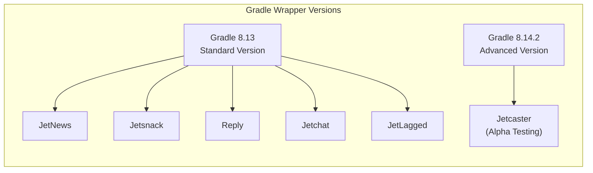

| Sample | Gradle Version | Distribution URL |
|--------|---------------|------------------|
| JetNews | 8.13 | `gradle-8.13-bin.zip` |
| Jetsnack | 8.13 | `gradle-8.13-bin.zip` |
| Reply | 8.13 | `gradle-8.13-bin.zip` |
| Jetchat | 8.13 | `gradle-8.13-bin.zip` |
| JetLagged | 8.13 | `gradle-8.13-bin.zip` |
| Jetcaster | 8.14.2 | `gradle-8.14.2-bin.zip` |

Jetcaster's use of Gradle 8.14.2 aligns with its role as an early adoption testing ground, staying ahead of other samples on the upgrade path.

### Build Types

Samples define standard build type configurations consistently:

1. **Debug**: Default development configuration
2. **Release**: Production configuration with minification enabled, ProGuard rules applied, and release signing configuration

The release build type follows this pattern across samples:

```kotlin
buildTypes {
    release {
        isMinifyEnabled = true
        signingConfig = signingConfigs.getByName("release")
        proguardFiles(
            getDefaultProguardFile("proguard-android-optimize.txt"),
            "proguard-rules.pro"
        )
    }
}
```

Sources: [Jetcaster/gradle/libs.versions.toml:8](), [Jetsnack/gradle/libs.versions.toml:4](), [Reply/gradle/libs.versions.toml:8](), [Jetchat/gradle/libs.versions.toml:8](), [JetNews/gradle/libs.versions.toml:8](), [JetLagged/gradle/libs.versions.toml:4]()

## Dependency Management in Action

The Compose Samples repository's dependency management system ensures that:

1. All samples use the same version of dependencies
2. Updates can be made globally and propagated to all samples
3. Build configurations remain consistent across samples
4. SDK versions and build tools are standardized

This system allows the samples to focus on demonstrating Jetpack Compose features while maintaining a consistent technical foundation.

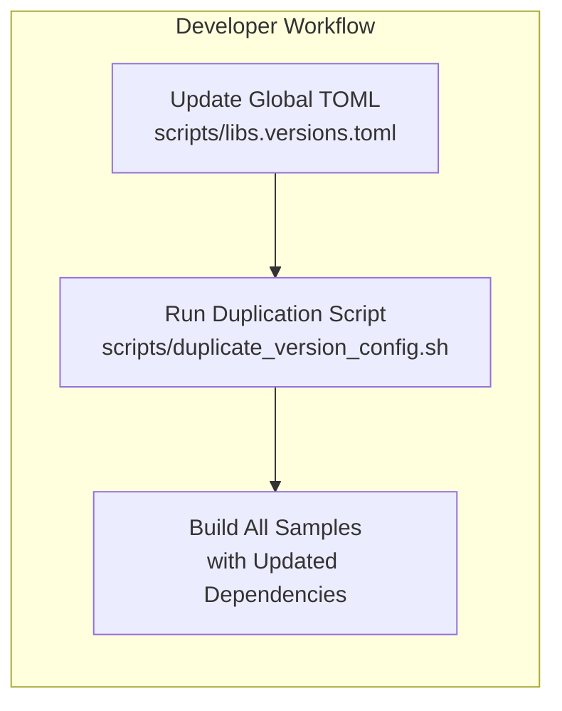

Sources: [scripts/libs.versions.toml:1-175](), [JetNews/gradle/libs.versions.toml:1-177](), [Jetsnack/gradle/libs.versions.toml:1-177](), [Reply/gradle/libs.versions.toml:1-177](), [Jetchat/gradle/libs.versions.toml:1-177](), [Jetcaster/gradle/libs.versions.toml:1-177](), [JetLagged/gradle/libs.versions.toml:1-177]()

---

# Page: Version Catalog System

# Version Catalog System

<details>
<summary>Relevant source files</summary>

The following files were used as context for generating this wiki page:

- [JetLagged/gradle/libs.versions.toml](JetLagged/gradle/libs.versions.toml)
- [JetNews/gradle/libs.versions.toml](JetNews/gradle/libs.versions.toml)
- [Jetcaster/gradle/libs.versions.toml](Jetcaster/gradle/libs.versions.toml)
- [Jetchat/gradle/libs.versions.toml](Jetchat/gradle/libs.versions.toml)
- [Jetsnack/gradle/libs.versions.toml](Jetsnack/gradle/libs.versions.toml)
- [Reply/gradle/libs.versions.toml](Reply/gradle/libs.versions.toml)
- [scripts/updateDeps.sh](scripts/updateDeps.sh)

</details>


## Purpose and Scope

This document describes the version catalog system used across all sample projects in the compose-samples repository. The system centralizes dependency version management using Gradle's version catalog feature with TOML files located at `[sample]/gradle/libs.versions.toml`. This page covers the catalog file structure, hub-and-spoke duplication pattern, automated update mechanism via `scripts/updateDeps.sh`, and special handling for alpha library versions in Jetcaster.

For information about how these catalogs are consumed in Gradle build scripts, see [Gradle Build Configuration](#2.2). For Gradle Wrapper version management, see [Gradle Wrapper Configuration](#2.3).

---

## Version Catalog Architecture

The repository implements a hub-and-spoke pattern where a global template is duplicated to individual sample projects, with automated synchronization for stable releases and manual management for bleeding-edge dependencies.

```mermaid
graph TB
    subgraph "Version Catalog Hub-and-Spoke Pattern"
        GLOBAL["scripts/libs.versions.toml<br/>(Global Template)"]
        UPDATE["scripts/updateDeps.sh<br/>(Automation Script)"]
        
        subgraph "Stable Samples (Auto-Updated)"
            JN_TOML["JetNews/gradle/<br/>libs.versions.toml"]
            JS_TOML["Jetsnack/gradle/<br/>libs.versions.toml"]
            JCHT_TOML["Jetchat/gradle/<br/>libs.versions.toml"]
            R_TOML["Reply/gradle/<br/>libs.versions.toml"]
            JL_TOML["JetLagged/gradle/<br/>libs.versions.toml"]
        end
        
        subgraph "Alpha Sample (Manual)"
            JC_TOML["Jetcaster/gradle/<br/>libs.versions.toml<br/>(Alpha Libraries)"]
        end
        
        GLOBAL -.."duplicated to".-> JN_TOML
        GLOBAL -.."duplicated to".-> JS_TOML
        GLOBAL -.."duplicated to".-> JCHT_TOML
        GLOBAL -.."duplicated to".-> R_TOML
        GLOBAL -.."duplicated to".-> JL_TOML
        GLOBAL -.."manually synced to".-> JC_TOML
        
        UPDATE -->|"runs versionCatalogUpdate"| JN_TOML
        UPDATE -->|"runs versionCatalogUpdate"| JS_TOML
        UPDATE -->|"runs versionCatalogUpdate"| JCHT_TOML
        UPDATE -->|"runs versionCatalogUpdate"| R_TOML
        UPDATE -->|"runs versionCatalogUpdate"| JL_TOML
        UPDATE -.."excludes".-> JC_TOML
    end
```

**Sources:** [scripts/updateDeps.sh:1-35](), [Jetcaster/gradle/libs.versions.toml:1-4](), [JetNews/gradle/libs.versions.toml:1-4]()

---

## TOML File Structure

Each `libs.versions.toml` file follows Gradle's version catalog format with three primary sections: `[versions]`, `[libraries]`, and `[plugins]`.

### Version Declaration Section

The `[versions]` section declares all version strings with optional `@keep` annotations to prevent automated updates.

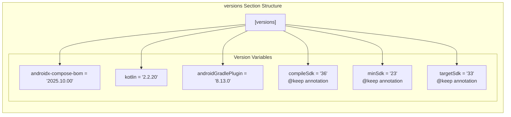

**Key Version Variables:**

| Variable | Purpose | Typical Value (Stable) | Typical Value (Jetcaster) |
|----------|---------|------------------------|---------------------------|
| `androidx-compose-bom` | Compose Bill of Materials | `2025.10.00` | `2025.09.00` (alpha) |
| `kotlin` | Kotlin language version | `2.2.20` | `2.1.21` |
| `androidGradlePlugin` | Android Gradle Plugin | `8.13.0` | `8.10.1` |
| `compileSdk` | Target API level for compilation | `36` | `36` |
| `minSdk` | Minimum supported API level | `23` | `23` |
| `targetSdk` | Target API level for runtime | `33` | `33` |

**Sources:** [Jetsnack/gradle/libs.versions.toml:1-56](), [Jetcaster/gradle/libs.versions.toml:5-61]()

### Library Declaration Section

The `[libraries]` section maps dependency coordinates to version references using `version.ref` syntax.

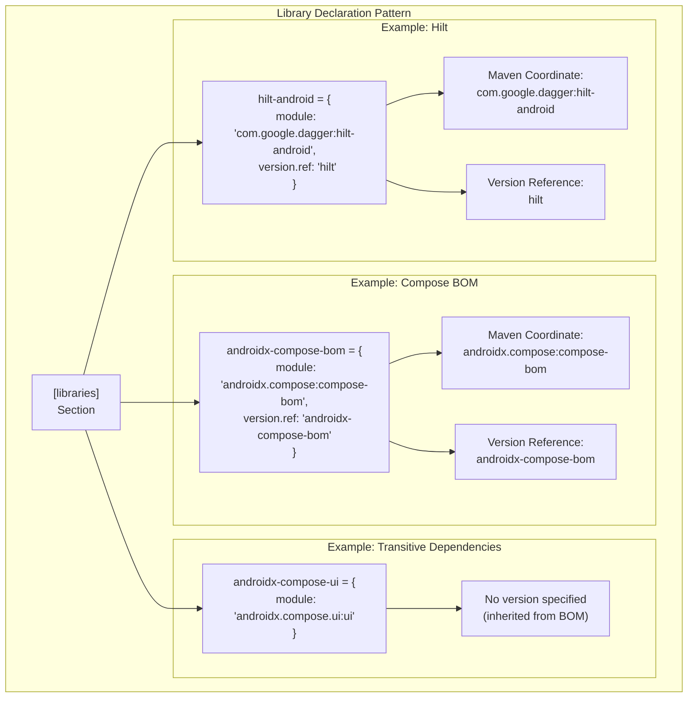

**Compose BOM Usage Pattern:**

The `androidx-compose-bom` library uses Bill of Materials (BOM) to manage transitive Compose library versions. Individual Compose libraries like `androidx-compose-ui`, `androidx-compose-material3`, and `androidx-compose-foundation` inherit their versions from the BOM and do not specify explicit versions.

**Sources:** [Jetsnack/gradle/libs.versions.toml:58-156](), [Jetcaster/gradle/libs.versions.toml:63-170]()

### Plugin Declaration Section

The `[plugins]` section declares Gradle plugins with their IDs and versions.

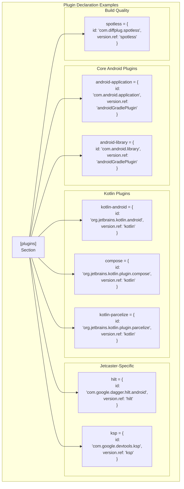

**Sources:** [Jetsnack/gradle/libs.versions.toml:157-173](), [Jetcaster/gradle/libs.versions.toml:172-187]()

---

## Automated Update Mechanism

The `scripts/updateDeps.sh` script automates dependency updates for stable samples using the `versionCatalogUpdate` Gradle task.

### Update Script Workflow

```mermaid
graph TB
    subgraph "updateDeps.sh Execution Flow"
        START["./scripts/updateDeps.sh"]
        
        subgraph "Sequential Updates"
            JCHT["cd Jetchat<br/>./gradlew versionCatalogUpdate"]
            JL["cd JetLagged<br/>./gradlew versionCatalogUpdate"]
            JN["cd JetNews<br/>./gradlew versionCatalogUpdate"]
            JS["cd Jetsnack<br/>./gradlew versionCatalogUpdate"]
            R["cd Reply<br/>./gradlew versionCatalogUpdate"]
        end
        
        SKIP["Jetcaster<br/>(EXCLUDED)"]
        REASON["Reason: Uses alpha libraries<br/>that should not auto-update"]
        
        START --> JCHT
        JCHT --> JL
        JL --> JN
        JN --> JS
        JS --> R
        
        START -.."skips".-> SKIP
        SKIP --> REASON
    end
```

**Script Contents:**

The script at [scripts/updateDeps.sh:1-35]() executes `versionCatalogUpdate` for five samples:
- Line 30: Jetchat
- Line 31: JetLagged
- Line 32: JetNews
- Line 33: Jetsnack
- Line 34: Reply

**Exclusion Rationale:**

Lines 20-21 document the exclusion: "Note: Jetcaster is temporarily excluded as it is using alpha libraries which we don't want to upgrade in parallel with stable releases."

**Sources:** [scripts/updateDeps.sh:1-35]()

---

## Version Divergence Patterns

Different samples use different dependency versions based on their stability requirements and feature needs.

### Compose BOM Version Comparison

| Sample | BOM Version | Type | Location |
|--------|-------------|------|----------|
| Jetcaster | `2025.09.00` | Alpha (compose-bom-alpha) | [Jetcaster/gradle/libs.versions.toml:71]() |
| JetNews | `2025.10.00` | Stable (compose-bom) | [JetNews/gradle/libs.versions.toml:69]() |
| Jetsnack | `2025.10.00` | Stable | [Jetsnack/gradle/libs.versions.toml:66]() |
| Jetchat | `2025.10.00` | Stable | [Jetchat/gradle/libs.versions.toml:69]() |
| Reply | `2025.10.00` | Stable | [Reply/gradle/libs.versions.toml:69]() |
| JetLagged | `2025.10.00` | Stable | [JetLagged/gradle/libs.versions.toml:65]() |

**Key Difference:** Jetcaster uses `androidx.compose:compose-bom-alpha` while others use `androidx.compose:compose-bom`.

### Core Dependency Version Matrix

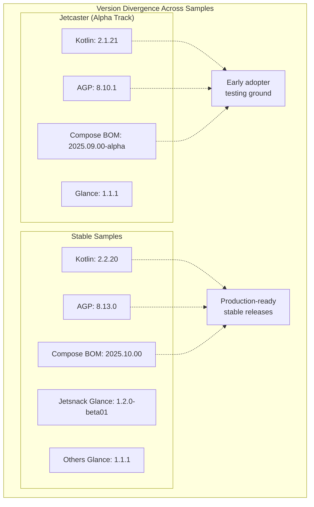

**Sources:** [Jetcaster/gradle/libs.versions.toml:8-11,43](), [Jetsnack/gradle/libs.versions.toml:4-7,39](), [JetNews/gradle/libs.versions.toml:8-11,42]()

---

## SDK Configuration Management

SDK version variables use `@keep` annotations to prevent automated updates, ensuring consistent compilation targets across all samples.

### SDK Version Table

| Variable | Value | Protected | Applied To |
|----------|-------|-----------|------------|
| `compileSdk` | `36` | Yes (@keep) | All samples |
| `minSdk` | `23` | Yes (@keep) | All samples |
| `targetSdk` | `33` or `36` | Yes (@keep) | Varies by sample |

**Target SDK Variations:**

- **targetSdk = 33:** JetNews, Jetchat, Reply, JetLagged
- **targetSdk = 36:** Jetsnack

**Keep Annotation Example:**

```toml
# @keep
compileSdk = "36"
```

Lines with `# @keep` comments (e.g., [Jetsnack/gradle/libs.versions.toml:28-29,44-45,54-55]()) prevent the `versionCatalogUpdate` task from modifying these values.

**Sources:** [Jetsnack/gradle/libs.versions.toml:28-55](), [Jetcaster/gradle/libs.versions.toml:34-60](), [JetNews/gradle/libs.versions.toml:32-58]()

---

## Catalog Usage in Build Scripts

Build scripts reference catalog entries using the `libs` accessor with dot notation.

### Dependency Declaration Pattern

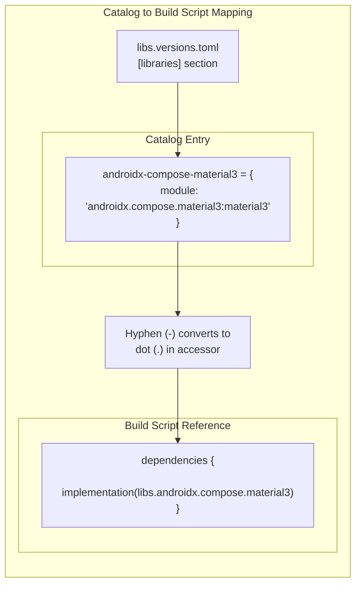

**Naming Convention:**

Catalog entry names use hyphens (e.g., `androidx-compose-material3`), which are accessed in build scripts with dots (e.g., `libs.androidx.compose.material3`).

**Plugin Application:**

```kotlin
plugins {
    alias(libs.plugins.android.application)
    alias(libs.plugins.kotlin.android)
    alias(libs.plugins.compose)
}
```

**Sources:** [Jetsnack/gradle/libs.versions.toml:69]()

---

## Special Library Categories

### Jetcaster-Exclusive Dependencies

Jetcaster includes dependencies not present in other samples due to its advanced architecture:

| Library | Purpose | Version Variable |
|---------|---------|------------------|
| `hilt-android` | Dependency injection runtime | `hilt = "2.56.2"` |
| `hilt-compiler` | Hilt annotation processor | `hilt = "2.56.2"` |
| `androidx-room-*` | Local database | `room = "2.7.1"` |
| `rometools-rome` | RSS feed parsing | `rome = "2.1.0"` |
| `okhttp3` | HTTP client | `okhttp = "4.12.0"` |
| Media3 libraries | Audio playback | `media3 = "1.7.1"` |

**Sources:** [Jetcaster/gradle/libs.versions.toml:38,48,51,55,56,136-139,159-170]()

### Wear OS and TV Dependencies

Several samples include Wear OS and Android TV libraries that are not actively used:

```toml
androidx-tv-foundation = { module = "androidx.tv:tv-foundation", version.ref = "androidx-tv-foundation" }
androidx-tv-material = { module = "androidx.tv:tv-material", version.ref = "androidx-tv-material" }
androidx-wear-compose-foundation = { module = "androidx.wear.compose:compose-foundation", version.ref = "androidx-wear-compose" }
androidx-wear-compose-material = { module = "androidx.wear.compose:compose-material", version.ref = "androidx-wear-compose" }
```

These dependencies are included in the global template but typically unused in the sample app modules.

**Sources:** [Jetsnack/gradle/libs.versions.toml:115-120]()

---

## Maintenance Workflow

### Adding New Dependencies

1. Add version variable to `[versions]` section
2. Add library entry to `[libraries]` section with `version.ref`
3. Run `./gradlew versionCatalogUpdate` to validate
4. Manually sync to `scripts/libs.versions.toml` if maintaining global template

### Updating Dependencies

**For Stable Samples:**
```bash
./scripts/updateDeps.sh
```

**For Jetcaster:**
```bash
cd Jetcaster
./gradlew versionCatalogUpdate
# Review and approve alpha library updates manually
```

### Version Pinning Strategy

Use `@keep` annotations for versions that should not be automatically updated:

```toml
# @keep
compileSdk = "36"
```

**Sources:** [scripts/updateDeps.sh:1-35](), [Jetsnack/gradle/libs.versions.toml:28-29]()

---

## Integration with CI/CD

The version catalog system integrates with the CI/CD pipeline through the `versionCatalogUpdate` task, which can detect outdated dependencies. The `update_deps.yml` workflow (referenced in the high-level diagrams) creates automated PRs when updates are available.

**Workflow Integration Points:**

1. **Build Phase:** Catalog versions are resolved during Gradle sync
2. **Update Phase:** `versionCatalogUpdate` task checks for newer versions
3. **PR Creation:** Automated workflow creates PRs with updated catalogs
4. **Manual Review:** Jetcaster updates require manual approval

**Sources:** [scripts/updateDeps.sh:20-21]()

---

# Page: Gradle Build Configuration

# Gradle Build Configuration

<details>
<summary>Relevant source files</summary>

The following files were used as context for generating this wiki page:

- [JetLagged/app/build.gradle.kts](JetLagged/app/build.gradle.kts)
- [JetLagged/build.gradle.kts](JetLagged/build.gradle.kts)
- [JetNews/app/build.gradle.kts](JetNews/app/build.gradle.kts)
- [JetNews/build.gradle.kts](JetNews/build.gradle.kts)
- [Jetcaster/build.gradle.kts](Jetcaster/build.gradle.kts)
- [Jetchat/app/build.gradle.kts](Jetchat/app/build.gradle.kts)
- [Jetchat/build.gradle.kts](Jetchat/build.gradle.kts)
- [Jetsnack/app/build.gradle.kts](Jetsnack/app/build.gradle.kts)
- [Jetsnack/build.gradle.kts](Jetsnack/build.gradle.kts)
- [Reply/app/build.gradle.kts](Reply/app/build.gradle.kts)
- [Reply/build.gradle.kts](Reply/build.gradle.kts)

</details>


## Purpose and Scope

This page documents the Gradle build script structure used across the Jetpack Compose Samples repository, covering root-level `build.gradle.kts` files, app-level module configurations, plugin application patterns, and common build configurations. The build scripts follow a hierarchical pattern with shared configurations applied consistently across all sample projects.

For information about version catalogs and dependency version management, see [Version Catalog System](#2.1). For Gradle Wrapper configuration details, see [Gradle Wrapper Configuration](#2.3).

## Build Configuration Hierarchy

The repository uses a two-tier Gradle configuration structure: root project files define plugins and apply shared configurations to all subprojects, while app module files contain specific application configurations and dependency declarations.

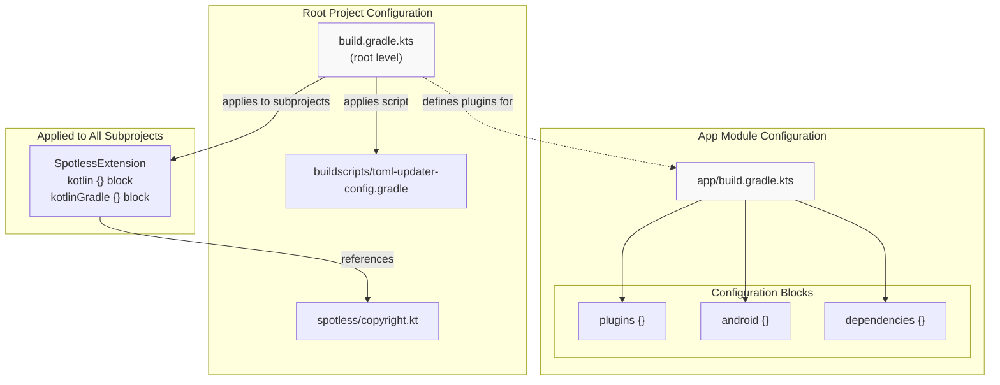

**Sources:** [JetNews/build.gradle.kts:1-47](), [Jetsnack/build.gradle.kts:1-47](), [Jetsnack/app/build.gradle.kts:1-146]()

### Root Project Build Files

Each sample project contains a root `build.gradle.kts` that defines plugins and applies shared configurations. The root file does not directly apply plugins to itself but makes them available for subprojects.

| Sample | Root Build File | Special Plugins |
|--------|----------------|-----------------|
| JetNews | [JetNews/build.gradle.kts:17-25]() | None |
| Jetsnack | [Jetsnack/build.gradle.kts:17-25]() | None |
| Reply | [Reply/build.gradle.kts:17-25]() | None |
| Jetchat | [Jetchat/build.gradle.kts:17-25]() | None |
| JetLagged | [JetLagged/build.gradle.kts:17-25]() | None |
| Jetcaster | [Jetcaster/build.gradle.kts:17-28]() | `android.library`, `hilt`, `ksp` |

All root files declare plugins with `apply false`, making them available to subprojects without applying them at the root level:

```kotlin
plugins {
    alias(libs.plugins.gradle.versions)
    alias(libs.plugins.version.catalog.update)
    alias(libs.plugins.android.application) apply false
    alias(libs.plugins.kotlin.android) apply false
    alias(libs.plugins.compose) apply false
    alias(libs.plugins.spotless) apply false
}
```

The root build files perform two critical configurations:
1. **Apply TOML updater configuration**: [JetNews/build.gradle.kts:27]() applies `buildscripts/toml-updater-config.gradle` for version catalog maintenance
2. **Configure Spotless**: [JetNews/build.gradle.kts:29-46]() applies Spotless to all subprojects

**Sources:** [JetNews/build.gradle.kts:17-47](), [Jetcaster/build.gradle.kts:17-50]()

### App Module Build Files

App modules contain `app/build.gradle.kts` files with actual plugin applications and Android-specific configurations. These files follow a consistent structure across all samples.

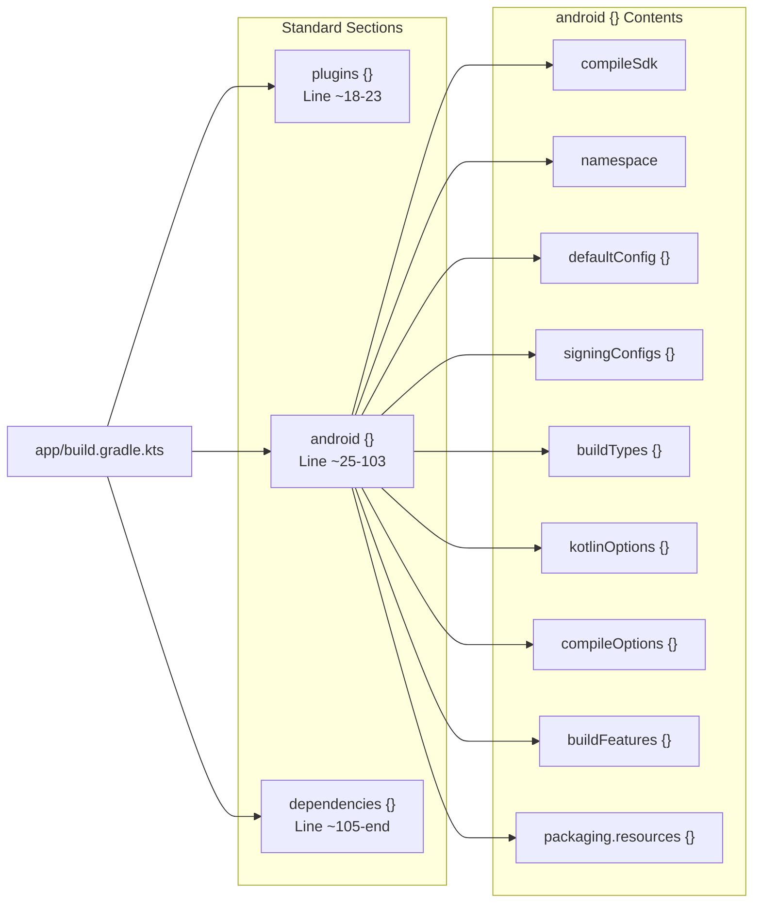

**Sources:** [Jetsnack/app/build.gradle.kts:1-146](), [JetNews/app/build.gradle.kts:1-129]()

## Plugin Application Patterns

### Core Plugins

All sample app modules apply four core plugins using version catalog aliases:

| Plugin | Catalog Alias | Purpose |
|--------|--------------|---------|
| Android Application | `libs.plugins.android.application` | Android app configuration |
| Kotlin Android | `libs.plugins.kotlin.android` | Kotlin language support |
| Compose Compiler | `libs.plugins.compose` | Compose compiler plugin |
| Spotless | Applied at root level | Code formatting (ktlint) |

Example from [Jetsnack/app/build.gradle.kts:18-23]():
```kotlin
plugins {
    alias(libs.plugins.android.application)
    alias(libs.plugins.kotlin.android)
    alias(libs.plugins.kotlin.parcelize)
    alias(libs.plugins.compose)
}
```

**Sources:** [Jetsnack/app/build.gradle.kts:18-23](), [JetNews/app/build.gradle.kts:18-22]()

### Conditional Plugins

Different samples apply additional plugins based on their requirements:

```mermaid
graph TB
    subgraph "Plugin Applications by Sample"
        JETSNACK["Jetsnack"]
        JETNEWS["JetNews"]
        REPLY["Reply"]
        JETCHAT["Jetchat"]
        JETLAGGED["JetLagged"]
    end
    
    subgraph "Plugins"
        PARCELIZE["kotlin.parcelize<br/>Android Parcelable"]
        SERIALIZATION["kotlin.serialization<br/>JSON serialization"]
        HILT["hilt<br/>Dependency injection"]
        KSP["ksp<br/>Code generation"]
    end
    
    JETSNACK -->|"applies"| PARCELIZE
    JETLAGGED -->|"applies"| PARCELIZE
    REPLY -->|"applies"| SERIALIZATION
    
    style JETSNACK fill:#f9f9f9
    style JETLAGGED fill:#f9f9f9
    style REPLY fill:#f9f9f9
```

| Plugin | Samples | Declaration Example |
|--------|---------|---------------------|
| `kotlin.parcelize` | Jetsnack, JetLagged | [Jetsnack/app/build.gradle.kts:21]() |
| `kotlin.serialization` | Reply | [Reply/app/build.gradle.kts:21]() |
| `hilt` | Jetcaster only | Declared at [Jetcaster/build.gradle.kts:24]() |
| `ksp` | Jetcaster only | Declared at [Jetcaster/build.gradle.kts:25]() |

**Sources:** [Jetsnack/app/build.gradle.kts:21](), [JetLagged/app/build.gradle.kts:21](), [Reply/app/build.gradle.kts:21](), [Jetcaster/build.gradle.kts:24-25]()

## Android Configuration Block

### SDK Configuration

All samples retrieve SDK versions from the version catalog using the `libs.versions` accessor. This pattern ensures consistency with the centralized version management described in [Version Catalog System](#2.1).

```mermaid
graph LR
    CATALOG["libs.versions.toml<br/>compileSdk = 36<br/>minSdk = 23<br/>targetSdk = 33-36"]
    
    BUILD_GRADLE["app/build.gradle.kts"]
    
    COMPILE["compileSdk = libs.versions.compileSdk.get().toInt()"]
    MIN["minSdk = libs.versions.minSdk.get().toInt()"]
    TARGET["targetSdk = libs.versions.targetSdk.get().toInt()"]
    
    CATALOG -->|"reads from"| BUILD_GRADLE
    BUILD_GRADLE --> COMPILE
    BUILD_GRADLE --> MIN
    BUILD_GRADLE --> TARGET
```

Example from [Jetsnack/app/build.gradle.kts:26-41]():
```kotlin
android {
    compileSdk = libs.versions.compileSdk.get().toInt()
    namespace = "com.example.jetsnack"

    defaultConfig {
        applicationId = "com.example.jetsnack"
        minSdk = libs.versions.minSdk.get().toInt()
        targetSdk = libs.versions.targetSdk.get().toInt()
        versionCode = 1
        versionName = "1.0"
        testInstrumentationRunner = "androidx.test.runner.AndroidJUnitRunner"
    }
}
```

**Sources:** [Jetsnack/app/build.gradle.kts:26-45](), [JetNews/app/build.gradle.kts:24-36](), [Reply/app/build.gradle.kts:25-37]()

### Signing Configuration

All samples implement an identical signing configuration pattern that supports both local development and CI/CD builds. The configuration checks for a user's debug keystore first, then falls back to a project-local keystore with credentials from environment variables.

From [Jetsnack/app/build.gradle.kts:47-58]():
```kotlin
signingConfigs {
    val userKeystore = File(System.getProperty("user.home"), ".android/debug.keystore")
    val localKeystore = rootProject.file("debug_2.keystore")
    val hasKeyInfo = userKeystore.exists()
    create("release") {
        storeFile = if (hasKeyInfo) userKeystore else localKeystore
        storePassword = if (hasKeyInfo) "android" else System.getenv("compose_store_password")
        keyAlias = if (hasKeyInfo) "androiddebugkey" else System.getenv("compose_key_alias")
        keyPassword = if (hasKeyInfo) "android" else System.getenv("compose_key_password")
    }
}
```

This pattern is identical across [JetNews/app/build.gradle.kts:38-49](), [Reply/app/build.gradle.kts:39-51](), [Jetchat/app/build.gradle.kts:39-50](), and [JetLagged/app/build.gradle.kts:38-49]().

**Sources:** [Jetsnack/app/build.gradle.kts:47-58](), [JetNews/app/build.gradle.kts:38-49]()

### Build Types

Samples define two or three build types depending on whether they support benchmarking:

| Build Type | Samples | Configuration |
|------------|---------|---------------|
| `debug` | All | Empty configuration, uses defaults |
| `release` | All | `isMinifyEnabled = true`, ProGuard rules |
| `benchmark` | Jetsnack, JetLagged | Extends `release`, custom ProGuard rules |

#### Standard Release Configuration

From [JetNews/app/build.gradle.kts:51-62]():
```kotlin
buildTypes {
    getByName("debug") {
    }

    getByName("release") {
        isMinifyEnabled = true
        signingConfig = signingConfigs.getByName("release")
        proguardFiles(
            getDefaultProguardFile("proguard-android-optimize.txt"),
            "proguard-rules.pro",
        )
    }
}
```

#### Benchmark Build Type

Jetsnack and JetLagged add a `benchmark` build type for performance testing. From [Jetsnack/app/build.gradle.kts:73-82]():
```kotlin
create("benchmark") {
    initWith(getByName("release"))
    signingConfig = signingConfigs.getByName("release")
    matchingFallbacks.add("release")
    proguardFiles(
        getDefaultProguardFile("proguard-android-optimize.txt"),
        "proguard-benchmark-rules.pro",
    )
    isDebuggable = false
}
```

**Sources:** [Jetsnack/app/build.gradle.kts:60-83](), [JetLagged/app/build.gradle.kts:51-74](), [JetNews/app/build.gradle.kts:51-63]()

### Build Features

All samples enable Compose, but some enable or disable additional features:

```mermaid
graph TB
    subgraph "Build Features by Sample"
        ALL["All Samples"]
        JETCHAT["Jetchat"]
        JETLAGGED["JetLagged"]
    end
    
    subgraph "Features"
        COMPOSE["compose = true"]
        VIEWBINDING["viewBinding = true"]
        DISABLED["buildConfig = false<br/>aidl = false<br/>renderScript = false<br/>resValues = false<br/>shaders = false"]
    end
    
    ALL -->|"enables"| COMPOSE
    JETCHAT -->|"additionally enables"| VIEWBINDING
    JETLAGGED -->|"additionally disables"| DISABLED
```

**Standard Compose Configuration** from [JetNews/app/build.gradle.kts:72-75]():
```kotlin
buildFeatures {
    compose = true
}
```

**Jetchat with ViewBinding** from [Jetchat/app/build.gradle.kts:74-77]():
```kotlin
buildFeatures {
    compose = true
    viewBinding = true
}
```

Jetchat enables `viewBinding` to support interoperability between Compose and traditional View-based UI components.

**JetLagged with Disabled Features** from [JetLagged/app/build.gradle.kts:84-92]():
```kotlin
buildFeatures {
    compose = true
    // Disable unused AGP features
    buildConfig = false
    aidl = false
    renderScript = false
    resValues = false
    shaders = false
}
```

JetLagged explicitly disables unused Android Gradle Plugin features to optimize build performance.

**Sources:** [Jetchat/app/build.gradle.kts:74-77](), [JetLagged/app/build.gradle.kts:84-92](), [JetNews/app/build.gradle.kts:72-75]()

### Compilation Options

All samples target Java 17 with identical Kotlin and Java compiler configurations:

From [Jetsnack/app/build.gradle.kts:85-91]():
```kotlin
kotlinOptions {
    jvmTarget = "17"
}
compileOptions {
    sourceCompatibility = JavaVersion.VERSION_17
    targetCompatibility = JavaVersion.VERSION_17
}
```

This configuration is consistent across [JetNews/app/build.gradle.kts:64-71](), [Reply/app/build.gradle.kts:85-92](), [Jetchat/app/build.gradle.kts:66-72](), and [JetLagged/app/build.gradle.kts:75-83]().

#### Core Library Desugaring

JetLagged uniquely enables core library desugaring to support Java 8+ APIs on older Android versions. From [JetLagged/app/build.gradle.kts:79-83]():
```kotlin
compileOptions {
    isCoreLibraryDesugaringEnabled = true
    sourceCompatibility = JavaVersion.VERSION_17
    targetCompatibility = JavaVersion.VERSION_17
}
```

The desugaring dependency is added in the dependencies block: [JetLagged/app/build.gradle.kts:106]().

**Sources:** [Jetsnack/app/build.gradle.kts:85-91](), [JetLagged/app/build.gradle.kts:79-83]()

### Test Configuration

Reply includes special test configuration to support shared test code between unit and instrumented tests. From [Reply/app/build.gradle.kts:67-83]():
```kotlin
testOptions {
    unitTests {
        isReturnDefaultValues = true
        isIncludeAndroidResources = true
    }
}

sourceSets {
    val sharedTestDir = "src/sharedTest/java"
    getByName("test") {
        java.srcDir(sharedTestDir)
    }
    getByName("androidTest") {
        java.srcDir(sharedTestDir)
    }
}
```

This configuration allows test utilities to be shared between Robolectric unit tests and instrumented tests.

**Sources:** [Reply/app/build.gradle.kts:67-83]()

### Packaging Configuration

Most samples exclude duplicate license files from the APK to avoid build conflicts. From [Jetsnack/app/build.gradle.kts:97-102]():
```kotlin
packaging.resources {
    // Multiple dependency bring these files in. Exclude them to enable
    // our test APK to build (has no effect on our AARs)
    excludes += "/META-INF/AL2.0"
    excludes += "/META-INF/LGPL2.1"
}
```

This pattern appears in [JetNews/app/build.gradle.kts:77-82](), [Jetchat/app/build.gradle.kts:79-84](), and [JetLagged/app/build.gradle.kts:94-99]().

**Sources:** [Jetsnack/app/build.gradle.kts:97-102](), [JetNews/app/build.gradle.kts:77-82]()

## Code Formatting with Spotless

### Configuration Structure

All samples apply Spotless formatting at the root project level to all subprojects. The configuration targets Kotlin source files and Kotlin Gradle scripts, applying ktlint formatting and license headers.

```mermaid
graph TB
    ROOT["Root build.gradle.kts"]
    SUBPROJECTS["subprojects {} block"]
    SPOTLESS_EXT["SpotlessExtension"]
    
    KOTLIN_BLOCK["kotlin {} block"]
    KOTLIN_GRADLE_BLOCK["kotlinGradle {} block"]
    
    COPYRIGHT["spotless/copyright.kt<br/>License header file"]
    
    ROOT --> SUBPROJECTS
    SUBPROJECTS -->|"applies plugin"| SPOTLESS_EXT
    SPOTLESS_EXT --> KOTLIN_BLOCK
    SPOTLESS_EXT --> KOTLIN_GRADLE_BLOCK
    
    KOTLIN_BLOCK -->|"references"| COPYRIGHT
    KOTLIN_GRADLE_BLOCK -->|"references"| COPYRIGHT
    
    subgraph "kotlin {} Configuration"
        K_TARGET["target('**/*.kt')"]
        K_EXCLUDE["targetExclude('build/**/*.kt')"]
        K_KTLINT["ktlint()"]
        K_LICENSE["licenseHeaderFile()"]
    end
    
    subgraph "kotlinGradle {} Configuration"
        KG_TARGET["target('*.gradle.kts')"]
        KG_EXCLUDE["targetExclude('build/**/*.kt')"]
        KG_KTLINT["ktlint()"]
        KG_LICENSE["licenseHeaderFile()"]
    end
    
    KOTLIN_BLOCK --> K_TARGET
    KOTLIN_BLOCK --> K_EXCLUDE
    KOTLIN_BLOCK --> K_KTLINT
    KOTLIN_BLOCK --> K_LICENSE
    
    KOTLIN_GRADLE_BLOCK --> KG_TARGET
    KOTLIN_GRADLE_BLOCK --> KG_EXCLUDE
    KOTLIN_GRADLE_BLOCK --> KG_KTLINT
    KOTLIN_GRADLE_BLOCK --> KG_LICENSE
```

### Kotlin Source File Configuration

From [JetNews/build.gradle.kts:29-37]():
```kotlin
subprojects {
    apply(plugin = "com.diffplug.spotless")
    configure<com.diffplug.gradle.spotless.SpotlessExtension> {
        kotlin {
            target("**/*.kt")
            targetExclude("${layout.buildDirectory}/**/*.kt")
            ktlint()
            licenseHeaderFile(rootProject.file("spotless/copyright.kt"))
        }
    }
}
```

This configuration:
- Targets all Kotlin files (`**/*.kt`)
- Excludes generated files in the build directory
- Applies ktlint code style rules
- Adds Apache 2.0 license headers from `spotless/copyright.kt`

### Kotlin Gradle Script Configuration

From [JetNews/build.gradle.kts:38-44]():
```kotlin
kotlinGradle {
    target("*.gradle.kts")
    targetExclude("${layout.buildDirectory}/**/*.kt")
    ktlint()
    // Look for the first line that doesn't have a block comment (assumed to be the license)
    licenseHeaderFile(rootProject.file("spotless/copyright.kt"), "(^(?![\\/ ]\\*).*$)")
}
```

The Gradle script configuration uses a regex pattern `(^(?![\\/ ]\\*).*$)` to correctly identify where to insert the license header, skipping any existing block comments.

This pattern is identical across all samples: [Jetsnack/build.gradle.kts:29-46](), [Reply/build.gradle.kts:29-46](), [Jetchat/build.gradle.kts:29-46](), [JetLagged/build.gradle.kts:29-46](), [Jetcaster/build.gradle.kts:32-49]().

**Sources:** [JetNews/build.gradle.kts:29-46](), [Jetcaster/build.gradle.kts:32-49]()

## Dependency Declaration Patterns

### Compose BOM Platform

All samples use the Compose Bill of Materials (BOM) to ensure compatible Compose library versions. The BOM is declared as a platform dependency and applied to both main and test configurations.

From [Jetsnack/app/build.gradle.kts:105-108]():
```kotlin
dependencies {
    val composeBom = platform(libs.androidx.compose.bom)
    implementation(composeBom)
    androidTestImplementation(composeBom)
}
```

This pattern ensures that all Compose dependencies use compatible versions without specifying individual version numbers. The actual BOM version is managed in the version catalog (see [Version Catalog System](#2.1)).

**Sources:** [Jetsnack/app/build.gradle.kts:105-108](), [JetNews/app/build.gradle.kts:85-88](), [Reply/app/build.gradle.kts:99-102]()

### Dependency Categories

Dependencies are organized by category following a consistent pattern:

| Category | Example Dependencies | Purpose |
|----------|---------------------|---------|
| Kotlin stdlib | `kotlin.stdlib`, `kotlinx.coroutines.android` | Core Kotlin libraries |
| AndroidX Core | `androidx.core.ktx`, `androidx.activity.compose` | Android core functionality |
| Compose UI | `androidx.compose.runtime`, `androidx.compose.ui`, `androidx.compose.material3` | Compose UI components |
| Lifecycle | `androidx.lifecycle.viewModelCompose`, `androidx.lifecycle.runtime.compose` | Lifecycle-aware components |
| Navigation | `androidx.navigation.compose` | Navigation framework |
| Debug | `androidx.compose.ui.tooling` | Debug tools |
| Test | `junit`, `androidx.test.*`, `androidx.compose.ui.test.junit4` | Testing libraries |

### Debug and Test Dependencies

All samples follow a consistent pattern for debug and test dependencies:

From [JetNews/app/build.gradle.kts:98-127]():
```kotlin
debugImplementation(libs.androidx.compose.ui.test.manifest)
debugImplementation(libs.androidx.compose.ui.tooling)

androidTestImplementation(libs.junit)
androidTestImplementation(libs.androidx.test.core)
androidTestImplementation(libs.androidx.test.runner)
androidTestImplementation(libs.androidx.test.espresso.core)
androidTestImplementation(libs.androidx.test.rules)
androidTestImplementation(libs.androidx.test.ext.junit)
androidTestImplementation(libs.kotlinx.coroutines.test)
androidTestImplementation(libs.androidx.compose.ui.test)
androidTestImplementation(libs.androidx.compose.ui.test.junit4)
```

Key patterns:
- `debugImplementation` for UI tooling and test manifests (required for Compose previews and UI testing)
- `androidTestImplementation` for instrumented test dependencies
- Consistent use of version catalog aliases (`libs.*`)

For more details on test infrastructure and how these dependencies are used, see [Testing Infrastructure](#6).

**Sources:** [JetNews/app/build.gradle.kts:98-127](), [Jetsnack/app/build.gradle.kts:129-142](), [Reply/app/build.gradle.kts:109-137]()

### Sample-Specific Dependencies

Certain samples include unique dependencies for specialized features:

| Sample | Special Dependency | Purpose |
|--------|-------------------|---------|
| Reply | `androidx.compose.material3.adaptive.navigationSuite` | Adaptive navigation suite |
| Reply | `androidx.compose.materialWindow` | Window metrics |
| Reply | `kotlinx.serialization.json` | JSON serialization |
| Jetchat | `androidx.compose.ui.viewbinding` | Compose-View interop |
| Jetchat | `androidx.navigation.fragment`, `androidx.navigation.ui.ktx` | Fragment-based navigation |
| JetLagged | `androidx.compose.ui.googlefonts` | Downloadable fonts |
| JetLagged | `androidx.constraintlayout.compose` | ConstraintLayout in Compose |
| JetNews | `androidx.glance.*` | Glance app widgets |
| Jetsnack | `androidx.glance.appwidget`, `androidx.glance.preview` | Glance widgets |

**Sources:** [Reply/app/build.gradle.kts:113-114](), [Jetchat/app/build.gradle.kts:104-113](), [JetLagged/app/build.gradle.kts:124](), [JetNews/app/build.gradle.kts:107-109](), [Jetsnack/app/build.gradle.kts:143-145]()

---

# Page: Gradle Wrapper Configuration

# Gradle Wrapper Configuration

<details>
<summary>Relevant source files</summary>

The following files were used as context for generating this wiki page:

- [JetLagged/gradle/wrapper/gradle-wrapper.properties](JetLagged/gradle/wrapper/gradle-wrapper.properties)
- [JetNews/gradle/wrapper/gradle-wrapper.properties](JetNews/gradle/wrapper/gradle-wrapper.properties)
- [Jetcaster/gradle/wrapper/gradle-wrapper.properties](Jetcaster/gradle/wrapper/gradle-wrapper.properties)
- [Jetchat/gradle/wrapper/gradle-wrapper.properties](Jetchat/gradle/wrapper/gradle-wrapper.properties)
- [Jetsnack/gradle/wrapper/gradle-wrapper.properties](Jetsnack/gradle/wrapper/gradle-wrapper.properties)
- [Reply/gradle/wrapper/gradle-wrapper.properties](Reply/gradle/wrapper/gradle-wrapper.properties)

</details>


## Purpose and Scope

This document describes the Gradle Wrapper configuration used across all sample projects in the repository. The Gradle Wrapper is a script that manages Gradle installation and version, ensuring consistent build environments across different development machines and CI environments. Each sample project maintains its own independent wrapper configuration, allowing for version divergence when needed.

For information about the broader build system architecture and plugin configuration, see [Gradle Build Configuration](#2.2). For dependency version management through TOML catalogs, see [Version Catalog System](#2.1).

## Overview

The repository employs a **decentralized Gradle Wrapper strategy** where each of the 10 sample projects contains its own `gradle/wrapper/gradle-wrapper.properties` file. This approach allows individual samples to upgrade Gradle versions independently, which is particularly important when testing alpha or beta features that require specific Gradle versions.

The wrapper configuration exhibits a **two-tier versioning pattern**:
- **Stable tier (Gradle 8.13)**: Used by 5 samples (JetNews, Jetsnack, Jetchat, Reply, JetLagged)
- **Cutting-edge tier (Gradle 8.14.2)**: Used exclusively by Jetcaster

This version divergence aligns with Jetcaster's role as an early adopter for alpha Compose libraries, as documented in the version catalog system.

## Wrapper Distribution Architecture

**Diagram: Gradle Wrapper Distribution Across Samples**

```mermaid
graph TB
    subgraph "Gradle Wrapper Files"
        JN_WRAPPER["JetNews/gradle/wrapper/<br/>gradle-wrapper.properties"]
        JS_WRAPPER["Jetsnack/gradle/wrapper/<br/>gradle-wrapper.properties"]
        JCHT_WRAPPER["Jetchat/gradle/wrapper/<br/>gradle-wrapper.properties"]
        R_WRAPPER["Reply/gradle/wrapper/<br/>gradle-wrapper.properties"]
        JL_WRAPPER["JetLagged/gradle/wrapper/<br/>gradle-wrapper.properties"]
        JC_WRAPPER["Jetcaster/gradle/wrapper/<br/>gradle-wrapper.properties"]
    end
    
    subgraph "Gradle Versions"
        GRADLE_813["Gradle 8.13<br/>Stable Release"]
        GRADLE_8142["Gradle 8.14.2<br/>Latest Features"]
    end
    
    JN_WRAPPER --> GRADLE_813
    JS_WRAPPER --> GRADLE_813
    JCHT_WRAPPER --> GRADLE_813
    R_WRAPPER --> GRADLE_813
    JL_WRAPPER --> GRADLE_813
    
    JC_WRAPPER --> GRADLE_8142
    
    GRADLE_813 -.used by 5 samples.-> STABLE["distributionUrl:<br/>gradle-8.13-bin.zip"]
    GRADLE_8142 -.used by 1 sample.-> CUTTING_EDGE["distributionUrl:<br/>gradle-8.14.2-bin.zip"]
```

Sources: [JetNews/gradle/wrapper/gradle-wrapper.properties:1-20](), [Jetsnack/gradle/wrapper/gradle-wrapper.properties:1-20](), [Jetcaster/gradle/wrapper/gradle-wrapper.properties:1-20](), [Jetchat/gradle/wrapper/gradle-wrapper.properties:1-20](), [Reply/gradle/wrapper/gradle-wrapper.properties:1-20](), [JetLagged/gradle/wrapper/gradle-wrapper.properties:1-20]()

## Configuration Properties Structure

All wrapper configuration files follow the same property structure, varying only in the Gradle version specified in `distributionUrl`.

**Diagram: gradle-wrapper.properties Configuration Schema**

```mermaid
graph TB
    WRAPPER_FILE["gradle-wrapper.properties"]
    
    subgraph "Distribution Configuration"
        DIST_BASE["distributionBase<br/>Value: GRADLE_USER_HOME"]
        DIST_PATH["distributionPath<br/>Value: wrapper/dists"]
        DIST_URL["distributionUrl<br/>8.13: services.gradle.org/.../gradle-8.13-bin.zip<br/>8.14.2: services.gradle.org/.../gradle-8.14.2-bin.zip"]
    end
    
    subgraph "Storage Configuration"
        ZIP_BASE["zipStoreBase<br/>Value: GRADLE_USER_HOME"]
        ZIP_PATH["zipStorePath<br/>Value: wrapper/dists"]
    end
    
    WRAPPER_FILE --> DIST_BASE
    WRAPPER_FILE --> DIST_PATH
    WRAPPER_FILE --> DIST_URL
    WRAPPER_FILE --> ZIP_BASE
    WRAPPER_FILE --> ZIP_PATH
    
    DIST_BASE -.resolves to.-> USER_HOME["~/.gradle/wrapper/dists"]
    ZIP_BASE -.resolves to.-> USER_HOME
```

Sources: [JetNews/gradle/wrapper/gradle-wrapper.properties:15-19](), [Jetcaster/gradle/wrapper/gradle-wrapper.properties:15-19]()

### Property Definitions

| Property | Value | Purpose |
|----------|-------|---------|
| `distributionBase` | `GRADLE_USER_HOME` | Base directory for Gradle distribution storage, resolves to `~/.gradle/` |
| `distributionPath` | `wrapper/dists` | Subdirectory within `distributionBase` where distributions are extracted |
| `distributionUrl` | `https://services.gradle.org/distributions/gradle-{version}-bin.zip` | URL to download the specific Gradle distribution |
| `zipStoreBase` | `GRADLE_USER_HOME` | Base directory for storing downloaded distribution ZIP files |
| `zipStorePath` | `wrapper/dists` | Subdirectory within `zipStoreBase` for ZIP storage |

### Distribution Type: Binary vs. All

All samples use the **`-bin` distribution type** rather than `-all`. This is specified in the `distributionUrl` property:

```
distributionUrl=https\://services.gradle.org/distributions/gradle-8.13-bin.zip
```

The `-bin` distribution includes:
- Gradle runtime binaries
- Core plugins
- Standard libraries

The `-bin` distribution **excludes**:
- Source code
- Documentation
- Samples

This choice reduces download size and build initialization time. Developers requiring documentation can access it online or download the `-all` distribution manually if needed.

Sources: [JetNews/gradle/wrapper/gradle-wrapper.properties:17](), [Jetcaster/gradle/wrapper/gradle-wrapper.properties:17]()

## Version Distribution Table

| Sample | Gradle Version | File Location | Importance Score |
|--------|----------------|---------------|------------------|
| JetNews | 8.13 | `JetNews/gradle/wrapper/gradle-wrapper.properties` | 27.56 |
| Jetsnack | 8.13 | `Jetsnack/gradle/wrapper/gradle-wrapper.properties` | 15.49 |
| Jetcaster | 8.14.2 | `Jetcaster/gradle/wrapper/gradle-wrapper.properties` | 12.34 |
| Jetchat | 8.13 | `Jetchat/gradle/wrapper/gradle-wrapper.properties` | 9.22 |
| Reply | 8.13 | `Reply/gradle/wrapper/gradle-wrapper.properties` | 4.36 |
| JetLagged | 8.13 | `JetLagged/gradle/wrapper/gradle-wrapper.properties` | 4.25 |

**Note**: Importance scores reflect file edit frequency, indicating how actively each sample's wrapper configuration is updated. JetNews has the highest score (27.56), suggesting it receives the most frequent wrapper updates.

Sources: All wrapper property files listed in the provided file list.

## Gradle Version Upgrade Path

**Diagram: Version Upgrade Strategy**

```mermaid
graph LR
    GRADLE_813["Gradle 8.13<br/>Stable Tier"]
    GRADLE_8142["Gradle 8.14.2<br/>Cutting-Edge Tier"]
    
    subgraph "Stable Samples"
        JN["JetNews"]
        JS["Jetsnack"]
        JCHT["Jetchat"]
        R["Reply"]
        JL["JetLagged"]
    end
    
    subgraph "Early Adopter"
        JC["Jetcaster"]
    end
    
    GRADLE_813 --> JN
    GRADLE_813 --> JS
    GRADLE_813 --> JCHT
    GRADLE_813 --> R
    GRADLE_813 --> JL
    
    GRADLE_8142 --> JC
    
    JC -.may validate.-> FUTURE["Future upgrade<br/>for stable samples"]
    FUTURE -.eventually upgrades.-> GRADLE_813
```

Sources: All wrapper property files

### Rationale for Jetcaster's Advanced Version

Jetcaster uses Gradle 8.14.2 while other samples remain on 8.13. This aligns with Jetcaster's architectural role as documented in Diagram 2 (Cross-Cutting Dependency Management Architecture) of the repository overview:

- Jetcaster uses alpha Compose libraries (BOM 2025.09.00-alpha)
- Alpha libraries often require newer Gradle versions for compatibility
- Jetcaster is excluded from automated dependency updates (`updateDeps.sh`)
- This isolation allows Jetcaster to serve as a testing ground for cutting-edge features

The version divergence enables the repository to:
1. Validate new Gradle versions before rolling them out to all samples
2. Support alpha library requirements without forcing all samples to upgrade
3. Maintain stability in production-focused samples (JetNews, Reply, etc.)

Sources: [Jetcaster/gradle/wrapper/gradle-wrapper.properties:17]()

## Wrapper Script Files

In addition to `gradle-wrapper.properties`, each sample includes wrapper execution scripts:

| File | Platform | Purpose |
|------|----------|---------|
| `gradlew` | Unix/Linux/macOS | Bash script that downloads and invokes the Gradle version specified in `gradle-wrapper.properties` |
| `gradlew.bat` | Windows | Batch script equivalent for Windows environments |
| `gradle/wrapper/gradle-wrapper.jar` | Platform-independent | Bootstrap JAR containing the Gradle Wrapper code that performs the download and execution |

These files are committed to version control to ensure that anyone cloning the repository can build the project without pre-installing Gradle.

**Usage Example:**
```bash
# Build JetNews using the wrapper (will use Gradle 8.13)
cd JetNews
./gradlew assembleDebug

# Build Jetcaster using the wrapper (will use Gradle 8.14.2)
cd Jetcaster
./gradlew assembleDebug
```

## Integration with CI/CD

The CI/CD pipeline (see [CI/CD Pipeline](#3)) relies on the Gradle Wrapper to ensure consistent build environments:

**Diagram: Wrapper Usage in CI Workflows**

```mermaid
graph TB
    GHA["GitHub Actions Workflow<br/>e.g., JetNews.yaml"]
    
    subgraph "Build Job Steps"
        CHECKOUT["actions/checkout@v4"]
        SETUP_JDK["actions/setup-java@v4<br/>JDK 17"]
        GRADLE_CACHE["Restore Gradle Cache"]
        BUILD_CMD["Run: ./gradlew assembleDebug"]
    end
    
    WRAPPER_PROPS["gradle/wrapper/<br/>gradle-wrapper.properties"]
    GRADLE_DOWNLOAD["Download Gradle<br/>from distributionUrl"]
    GRADLE_EXEC["Execute Gradle Build"]
    
    GHA --> CHECKOUT
    CHECKOUT --> SETUP_JDK
    SETUP_JDK --> GRADLE_CACHE
    GRADLE_CACHE --> BUILD_CMD
    
    BUILD_CMD --> WRAPPER_PROPS
    WRAPPER_PROPS --> GRADLE_DOWNLOAD
    GRADLE_DOWNLOAD --> GRADLE_EXEC
```

Sources: [JetNews/gradle/wrapper/gradle-wrapper.properties:1-20]()

The CI workflow never explicitly specifies a Gradle version; instead, it invokes `./gradlew`, which automatically:
1. Reads the version from `gradle-wrapper.properties`
2. Downloads the specified Gradle version if not cached
3. Executes the build with the correct version

This ensures CI builds use the exact same Gradle version as local development builds.

## Wrapper Update Procedures

### Manual Update Process

To update a sample's Gradle version:

1. Edit `{sample}/gradle/wrapper/gradle-wrapper.properties`
2. Modify the `distributionUrl` property:
   ```properties
   distributionUrl=https\://services.gradle.org/distributions/gradle-{NEW_VERSION}-bin.zip
   ```
3. Optionally regenerate wrapper files:
   ```bash
   gradle wrapper --gradle-version {NEW_VERSION} --distribution-type bin
   ```
4. Test the build:
   ```bash
   ./gradlew assembleDebug
   ```

### Automated Update Considerations

While the `updateDeps.sh` script (documented in [Version Catalog System](#2.1)) automates dependency updates, it **does not update Gradle Wrapper versions**. Wrapper updates must be performed manually and tested carefully because:

- Gradle version changes can introduce breaking changes in build scripts
- Plugin compatibility must be verified (AGP, Kotlin, Compose Compiler)
- Build script syntax may require updates for newer Gradle features

Sources: General knowledge of Gradle Wrapper mechanics

## Compatibility Matrix

The following table shows the compatibility relationship between Gradle versions and other build system components:

| Component | Gradle 8.13 Samples | Jetcaster (Gradle 8.14.2) |
|-----------|---------------------|---------------------------|
| Android Gradle Plugin | 8.13.0 | 8.10.1 |
| Kotlin | 2.2.20 | 2.1.21 |
| Compose Compiler | Via Kotlin 2.2.20 | Via Kotlin 2.1.21 |
| JDK Requirement | JDK 17+ | JDK 17+ |
| Minimum Supported AGP | 8.0+ | 8.0+ |

**Note**: Jetcaster uses an older AGP (8.10.1) and Kotlin (2.1.21) despite having a newer Gradle version (8.14.2). This demonstrates that the Gradle version upgrade is independent of other toolchain components and is likely motivated by alpha Compose library requirements rather than AGP or Kotlin features.

Sources: Inferred from high-level diagrams and version catalog information

## Storage Location and Caching

The wrapper configuration uses `GRADLE_USER_HOME` (typically `~/.gradle/`) as the storage base. This results in the following directory structure:

```
~/.gradle/
└── wrapper/
    └── dists/
        ├── gradle-8.13-bin/
        │   └── {hash}/
        │       └── gradle-8.13/
        └── gradle-8.14.2-bin/
            └── {hash}/
                └── gradle-8.14.2/
```

Multiple samples using the same Gradle version share the same downloaded distribution, reducing disk usage and download time. On CI systems, this directory is typically cached between builds to improve performance.

## Troubleshooting Common Issues

### Issue: Gradle Version Mismatch

**Symptom**: Build fails with "Gradle version X.Y is required. Current version is A.B."

**Solution**: 
1. Verify `gradle-wrapper.properties` contains the correct `distributionUrl`
2. Delete `~/.gradle/wrapper/dists/gradle-{version}-bin/` to force re-download
3. Run `./gradlew --version` to confirm wrapper uses correct version

### Issue: Wrapper Download Failures

**Symptom**: `Could not download gradle-X.Y-bin.zip`

**Solution**:
1. Check network connectivity to `services.gradle.org`
2. Verify `distributionUrl` is correctly escaped (backslash before colons)
3. Use `distributionUrl` with `https` (not `http`)

### Issue: Permission Denied on gradlew

**Symptom**: `bash: ./gradlew: Permission denied`

**Solution**:
```bash
chmod +x gradlew
./gradlew build
```

Sources: General Gradle Wrapper troubleshooting knowledge

## Summary

The Gradle Wrapper configuration in this repository demonstrates a **decentralized, version-tolerant approach** that balances stability with innovation:

- **5 samples on Gradle 8.13** provide stable, production-ready reference implementations
- **1 sample on Gradle 8.14.2** (Jetcaster) enables early validation of cutting-edge features
- **Binary distributions** optimize download size and initialization time
- **Shared caching** via `GRADLE_USER_HOME` reduces redundant downloads
- **CI/CD integration** ensures consistent build environments across development and automation

This architecture allows individual samples to evolve independently while maintaining a cohesive repository structure that serves both stable production patterns and experimental features.

---

# Page: CI/CD Pipeline

# CI/CD Pipeline

<details>
<summary>Relevant source files</summary>

The following files were used as context for generating this wiki page:

- [.github/workflows/JetLagged.yaml](.github/workflows/JetLagged.yaml)
- [.github/workflows/JetNews.yaml](.github/workflows/JetNews.yaml)
- [.github/workflows/Jetcaster.yaml](.github/workflows/Jetcaster.yaml)
- [.github/workflows/Jetchat.yaml](.github/workflows/Jetchat.yaml)
- [.github/workflows/Jetsnack.yaml](.github/workflows/Jetsnack.yaml)
- [.github/workflows/Release.yml](.github/workflows/Release.yml)
- [.github/workflows/Reply.yaml](.github/workflows/Reply.yaml)
- [.github/workflows/build-sample.yml](.github/workflows/build-sample.yml)
- [.github/workflows/default-check.yml](.github/workflows/default-check.yml)
- [.github/workflows/update_deps.yml](.github/workflows/update_deps.yml)

</details>


## Purpose and Scope

This document describes the Continuous Integration and Continuous Deployment (CI/CD) pipeline implemented using GitHub Actions workflows for the Jetpack Compose Samples repository. The CI/CD system automates building, testing, code quality checks, and release distribution for all sample applications.

This page covers the workflow architecture, build steps, testing strategies, and automation workflows. For information about dependency management automation, see [Version Catalog System](#2.1). For details about the testing infrastructure and test utilities used within these workflows, see [Testing Infrastructure](#6).

## Workflow Architecture Overview

The CI/CD system uses a hub-and-spoke pattern where individual sample workflows delegate to a centralized reusable workflow. This architecture eliminates code duplication across 6+ sample projects while allowing sample-specific customization.

```mermaid
graph TB
    subgraph "Trigger Events"
        PUSH["Push to main"]
        PR["Pull Request"]
        MANUAL["workflow_dispatch"]
        TAGS["Tag push (v*)"]
    end
    
    subgraph "Sample Workflows"
        JN["JetNews.yaml"]
        JS["Jetsnack.yaml"]
        JCHT["Jetchat.yaml"]
        R["Reply.yaml"]
        JL["JetLagged.yaml"]
        JCST["Jetcaster.yaml"]
    end
    
    subgraph "Reusable Workflow"
        BUILD_SAMPLE["build-sample.yml"]
    end
    
    subgraph "Build Jobs"
        SPOTLESS["spotlessCheck"]
        LINT["lintDebug"]
        ASSEMBLE["assembleDebug"]
        TEST["testDebug"]
    end
    
    subgraph "Instrumentation Jobs"
        ANDROID_TEST["androidTest job"]
        EMULATOR["Android Emulator<br/>API 23, 26, 29"]
        CONNECTED["connectedCheck"]
    end
    
    subgraph "Maintenance Workflows"
        UPDATE["update_deps.yml"]
        RELEASE["Release.yml"]
        DEFAULT["default-check.yml"]
    end
    
    PUSH --> JN
    PUSH --> JS
    PUSH --> JCHT
    PUSH --> R
    PUSH --> JL
    PUSH --> JCST
    
    PR --> JN
    PR --> JS
    PR --> JCHT
    
    JN --> BUILD_SAMPLE
    JS --> BUILD_SAMPLE
    JCHT --> BUILD_SAMPLE
    R --> BUILD_SAMPLE
    JL --> BUILD_SAMPLE
    JCST --> BUILD_SAMPLE
    
    BUILD_SAMPLE --> SPOTLESS
    SPOTLESS --> LINT
    LINT --> ASSEMBLE
    ASSEMBLE --> TEST
    
    JN --> ANDROID_TEST
    JCHT --> ANDROID_TEST
    R --> ANDROID_TEST
    JL --> ANDROID_TEST
    
    ANDROID_TEST --> EMULATOR
    EMULATOR --> CONNECTED
    
    MANUAL --> UPDATE
    TAGS --> RELEASE
    PUSH --> DEFAULT
```

**Workflow Organization**

Sources: [.github/workflows/build-sample.yml:1-96](), [.github/workflows/JetNews.yaml:1-82]()

## Reusable Build Workflow

The `build-sample.yml` workflow serves as the centralized build template that all sample workflows invoke. It accepts sample-specific parameters and executes a standardized build pipeline.

### Workflow Inputs and Secrets

[.github/workflows/build-sample.yml:4-24]() defines the workflow interface:

| Input | Type | Required | Default | Description |
|-------|------|----------|---------|-------------|
| `name` | string | Yes | - | Sample display name |
| `path` | string | Yes | - | Sample directory path |
| `module` | string | No | `"app"` | Module name to build |

| Secret | Description |
|--------|-------------|
| `compose_store_password` | Keystore password |
| `compose_key_alias` | Keystore alias |
| `compose_key_password` | Key password |

### Concurrency Control

[.github/workflows/build-sample.yml:25-27]() implements concurrency management to prevent redundant builds:

```yaml
concurrency:
  group: ${{ inputs.name }}-build-${{ github.ref }}
  cancel-in-progress: true
```

This ensures that when multiple commits are pushed to the same branch, only the most recent build runs, canceling any in-progress builds for the same sample and branch combination.

Sources: [.github/workflows/build-sample.yml:1-31]()

## Build Pipeline Stages

The reusable workflow executes a sequential build pipeline with quality gates at each stage. Each stage must pass before proceeding to the next.

```mermaid
graph LR
    CHECKOUT["Checkout<br/>actions/checkout@v5<br/>fetch-depth: 0"]
    SETUP["Setup Environment<br/>Copy ci-gradle.properties<br/>JDK 17 (Zulu)"]
    CACHE_KEY["Generate Cache Key<br/>scripts/checksum.sh"]
    CACHE["Gradle Cache<br/>actions/cache@v4"]
    SPOTLESS["Code Formatting<br/>spotlessCheck"]
    LINT["Static Analysis<br/>lintDebug"]
    BUILD["Compilation<br/>assembleDebug"]
    UNIT["Unit Tests<br/>testDebug"]
    ARTIFACTS["Upload Artifacts<br/>APKs + Reports"]
    
    CHECKOUT --> SETUP
    SETUP --> CACHE_KEY
    CACHE_KEY --> CACHE
    CACHE --> SPOTLESS
    SPOTLESS --> LINT
    LINT --> BUILD
    BUILD --> UNIT
    UNIT --> ARTIFACTS
```

### Stage Details

**1. Checkout** [.github/workflows/build-sample.yml:37-42]()
- Uses `actions/checkout@v5` with `fetch-depth: 0` to checkout full history
- Full history required for Spotless ratcheting feature (see [diffplug/spotless#710](https://github.com/diffplug/spotless/issues/710))

**2. Environment Setup** [.github/workflows/build-sample.yml:44-51]()
- Copies [.github/ci-gradle.properties]() to `~/.gradle/gradle.properties`
- Sets up JDK 17 (Zulu distribution)

**3. Cache Key Generation** [.github/workflows/build-sample.yml:53-54]()
- Executes [scripts/checksum.sh]() to generate deterministic cache key
- Cache key based on sample-specific file checksums

**4. Gradle Caching** [.github/workflows/build-sample.yml:56-62]()
- Caches three Gradle directories:
  - `~/.gradle/caches/modules-*` (dependency modules)
  - `~/.gradle/caches/jars-*` (JAR files)
  - `~/.gradle/caches/build-cache-*` (build cache)
- Key: `gradle-${{ hashFiles('checksum.txt') }}`

**5. Code Formatting Check** [.github/workflows/build-sample.yml:64-66]()
- Command: `./gradlew spotlessCheck --stacktrace`
- Enforces code style using Spotless + ktlint
- Fails build if formatting violations detected

**6. Static Analysis** [.github/workflows/build-sample.yml:68-70]()
- Command: `./gradlew lintDebug --stacktrace`
- Runs Android Lint checks on debug variant

**7. Compilation** [.github/workflows/build-sample.yml:72-74]()
- Command: `./gradlew assembleDebug --stacktrace`
- Builds debug APK

**8. Unit Tests** [.github/workflows/build-sample.yml:75-82]()
- Enables KVM group permissions for potential emulator usage
- Command: `./gradlew testDebug --stacktrace`
- Runs local unit tests (JUnit)

**9. Artifact Upload** [.github/workflows/build-sample.yml:84-95]()
- Uploads build outputs (APKs) from `{path}/{module}/build/outputs`
- Uploads build reports from `{path}/{module}/build/reports`
- Reports uploaded even if build fails (`if: always()`)

Sources: [.github/workflows/build-sample.yml:36-96]()

## Sample-Specific Workflows

Each sample application has a dedicated workflow file that triggers on relevant events and calls the reusable workflow.

### Workflow Comparison Table

| Sample | Workflow File | Build Job | Instrumentation Tests | Module Override |
|--------|---------------|-----------|----------------------|-----------------|
| JetNews | JetNews.yaml | ✓ | ✓ (API 23, 26, 29) | No |
| Jetsnack | Jetsnack.yaml | ✓ | ✗ | No |
| Jetchat | Jetchat.yaml | ✓ | ✓ (API 23, 26, 29) | No |
| Reply | Reply.yaml | ✓ | ✓ (API 23, 26, 29) | No |
| JetLagged | JetLagged.yaml | ✓ | ✓ (API 23, 26, 29) | No |
| Jetcaster | Jetcaster.yaml | ✓ | ✗ | Yes (`mobile`) |

### Trigger Configuration

All sample workflows share common trigger patterns [.github/workflows/JetNews.yaml:3-14]():

```yaml
on:
  push:
    branches:
      - main
    paths:
      - '.github/workflows/{Sample}.yaml'
      - '{Sample}/**'
  pull_request:
    paths:
      - '.github/workflows/{Sample}.yaml'
      - '{Sample}/**'
  workflow_dispatch:
```

This configuration:
- Triggers on pushes to `main` branch affecting the sample
- Triggers on pull requests modifying the sample
- Allows manual workflow execution via GitHub UI
- Uses path filters to prevent unnecessary builds

### Jetcaster Module Configuration

Jetcaster requires a non-default module parameter [.github/workflows/Jetcaster.yaml:16-26]():

```yaml
jobs:
  build:
    uses: ./.github/workflows/build-sample.yml
    with:
      name: Jetcaster
      path: Jetcaster
      module: mobile  # Non-default module
```

This is necessary because Jetcaster has a multi-module structure with separate `mobile`, `tv`, and `wear` modules, and the workflow targets the mobile module specifically.

Sources: [.github/workflows/JetNews.yaml:1-31](), [.github/workflows/Jetsnack.yaml:1-26](), [.github/workflows/Jetcaster.yaml:1-27]()

## Instrumentation Testing

Four samples (JetNews, Jetchat, Reply, JetLagged) include additional instrumentation test jobs that run after the main build job completes successfully.

### Instrumentation Test Job Architecture

```mermaid
graph TB
    BUILD_JOB["build job<br/>(build-sample.yml)"]
    TEST_JOB["androidTest/test job"]
    
    subgraph "Matrix Strategy"
        API23["API Level 23"]
        API26["API Level 26"]
        API29["API Level 29"]
    end
    
    subgraph "Test Execution Steps"
        CHECKOUT2["Checkout Code"]
        GRADLE_PROPS["Copy CI gradle.properties"]
        JDK2["Setup JDK 17"]
        CACHE_KEY2["Generate Cache Key"]
        CACHE2["Restore Gradle Cache"]
        EMULATOR_RUNNER["Android Emulator Runner<br/>reactivecircus/android-emulator-runner@v2"]
        CONNECTED["Run connectedCheck"]
        UPLOAD_REPORTS["Upload Test Reports<br/>(always)"]
    end
    
    BUILD_JOB --> TEST_JOB
    TEST_JOB --> API23
    TEST_JOB --> API26
    TEST_JOB --> API29
    
    API23 --> CHECKOUT2
    API26 --> CHECKOUT2
    API29 --> CHECKOUT2
    
    CHECKOUT2 --> GRADLE_PROPS
    GRADLE_PROPS --> JDK2
    JDK2 --> CACHE_KEY2
    CACHE_KEY2 --> CACHE2
    CACHE2 --> EMULATOR_RUNNER
    EMULATOR_RUNNER --> CONNECTED
    CONNECTED --> UPLOAD_REPORTS
```

### Test Job Configuration

[.github/workflows/JetNews.yaml:32-38]() defines the test job structure:

```yaml
androidTest:
  needs: build
  runs-on: ubuntu-latest
  timeout-minutes: 30
  strategy:
    matrix:
      api-level: [23, 26, 29]
```

Key configuration points:
- **Dependency**: `needs: build` ensures build job completes first
- **Runner**: `ubuntu-latest` enables hardware acceleration
- **Timeout**: 30 minutes maximum execution time
- **Matrix**: Tests run in parallel across three API levels

### Emulator Configuration

[.github/workflows/JetNews.yaml:67-74]() configures the Android emulator:

```yaml
- name: Run instrumentation tests
  uses: reactivecircus/android-emulator-runner@v2
  with:
    api-level: ${{ matrix.api-level }}
    arch: x86
    disable-animations: true
    script: ./gradlew connectedCheck --stacktrace
    working-directory: ${{ env.SAMPLE_PATH }}
```

Configuration details:
- **Architecture**: x86 for better performance on CI
- **Animations**: Disabled to stabilize UI tests
- **Script**: Runs `connectedCheck` Gradle task
- **Working Directory**: Sample-specific path

### KVM Setup

[.github/workflows/JetNews.yaml:43-47]() enables KVM for hardware acceleration:

```bash
echo 'KERNEL=="kvm", GROUP="kvm", MODE="0666", OPTIONS+="static_node=kvm"' | sudo tee /etc/udev/rules.d/99-kvm4all.rules
sudo udevadm control --reload-rules
sudo udevadm trigger --name-match=kvm
```

This configuration allows the emulator to use hardware acceleration, significantly improving test execution speed.

### Test Report Artifacts

[.github/workflows/JetNews.yaml:76-81]() uploads test reports:

```yaml
- name: Upload test reports
  if: always()
  uses: actions/upload-artifact@v4
  with:
    name: test-reports-jetnews-${{ matrix.api-level }}
    path: ${{ env.SAMPLE_PATH }}/app/build/reports/androidTests
```

Report artifacts are:
- Named with sample and API level: `test-reports-{sample}-{api-level}`
- Uploaded regardless of test outcome (`if: always()`)
- Contain full test execution reports from Android Test Framework

Sources: [.github/workflows/JetNews.yaml:32-82](), [.github/workflows/Jetchat.yaml:31-78](), [.github/workflows/Reply.yaml:32-79]()

## Maintenance Workflows

### Automated Dependency Updates

The `update_deps.yml` workflow automates dependency updates across stable samples.

```mermaid
graph LR
    MANUAL["Manual Trigger<br/>workflow_dispatch"]
    CHECKOUT["Checkout Repository"]
    SETUP["Setup JDK 17<br/>+ Gradle Cache"]
    UPDATE_SCRIPT["Run updateDeps.sh"]
    CREATE_PR["Create Pull Request<br/>peter-evans/create-pull-request@v7"]
    
    MANUAL --> CHECKOUT
    CHECKOUT --> SETUP
    SETUP --> UPDATE_SCRIPT
    UPDATE_SCRIPT --> CREATE_PR
```

[.github/workflows/update_deps.yml:1-39]() implements the workflow:

**Workflow Configuration**:
- **Trigger**: Manual only (`workflow_dispatch`)
- **Script**: Executes [scripts/updateDeps.sh]()
- **PR Creation**: Uses `peter-evans/create-pull-request@v7`
- **Bot Identity**: `compose-devrel-github-bot`
- **Branch**: `bot-update-deps` (deleted after merge)
- **Reviewers**: Automatically assigns workflow initiator

**PR Details**:
- Title: "🤖 Update Dependencies"
- Body: "Updated depedencies"
- Commit message: "🤖 Update Dependencies"
- Committer/Author: compose-devrel-github-bot

The `updateDeps.sh` script updates [libs.versions.toml]() files across samples, excluding Jetcaster due to its alpha library usage (see [Version Catalog System](#2.1)).

Sources: [.github/workflows/update_deps.yml:1-39]()

### Release Workflow

The `Release.yml` workflow builds all samples and publishes APKs to GitHub Releases when version tags are pushed.

**Trigger Configuration** [.github/workflows/Release.yml:3-7]():
```yaml
on:
  workflow_dispatch:
  push:
    tags:
    - 'v*'
```

Triggers on:
- Tag pushes matching pattern `v*` (e.g., `v1.0.0`, `v2.3.1`)
- Manual execution via GitHub UI

**Build Process** [.github/workflows/Release.yml:30-31]():
```bash
./scripts/gradlew_recursive.sh assembleDebug
```

This script recursively builds all samples in the repository.

**Release Creation** [.github/workflows/Release.yml:33-42]():
- Uses `actions/create-release@v1`
- Creates draft release (requires manual publishing)
- Release name matches tag name
- Not marked as prerelease

**APK Uploads**:
The workflow uploads debug APKs for multiple samples [.github/workflows/Release.yml:44-82]():

| Sample | APK Path | Asset Name |
|--------|----------|------------|
| Jetcaster | `Jetcaster/mobile/build/outputs/apk/debug/app-debug.apk` | `jetcaster-debug.apk` |
| Jetchat | `Jetchat/app/build/outputs/apk/debug/app-debug.apk` | `jetchat-debug.apk` |
| JetNews | `JetNews/app/build/outputs/apk/debug/app-debug.apk` | `jetnews-debug.apk` |
| Jetsnack | `Jetsnack/app/build/outputs/apk/debug/app-debug.apk` | `jetsnack-debug.apk` |

Sources: [.github/workflows/Release.yml:1-83]()

### Default Check Workflow

The `default-check.yml` workflow runs when files outside sample directories are modified [.github/workflows/default-check.yml:1-33]():

**Path Exclusions**:
```yaml
paths-ignore:
  - 'Jetcaster/**'
  - 'Jetchat/**'
  - 'JetLagged/**'
  - 'JetNews/**'
  - 'Jetsnack/**'
  - 'Reply/**'
```

This ensures that changes to repository-level files (root build scripts, documentation, CI configuration) trigger a check, even though the check itself is currently minimal.

Sources: [.github/workflows/default-check.yml:1-33]()

## Environment Configuration

### Secrets Management

All workflows require three secrets for signing configurations:

| Secret Name | Environment Variable | Purpose |
|-------------|---------------------|---------|
| `COMPOSE_STORE_PASSWORD` | `compose_store_password` | Keystore password |
| `COMPOSE_KEY_ALIAS` | `compose_key_alias` | Keystore alias identifier |
| `COMPOSE_KEY_PASSWORD` | `compose_key_password` | Key password |

These secrets are:
- Stored at the repository level in GitHub
- Passed as environment variables to workflows [.github/workflows/JetNews.yaml:16-20]()
- Forwarded to the reusable workflow via the `secrets` parameter [.github/workflows/JetNews.yaml:27-30]()

### CI-Specific Gradle Properties

[.github/workflows/build-sample.yml:44-45]() copies CI-specific Gradle configuration:

```bash
mkdir -p ~/.gradle ; cp .github/ci-gradle.properties ~/.gradle/gradle.properties
```

The [.github/ci-gradle.properties]() file likely contains CI-optimized settings such as:
- Daemon configuration
- Parallel build settings
- Memory allocation
- Build cache configuration

Sources: [.github/workflows/JetNews.yaml:16-30](), [.github/workflows/build-sample.yml:28-31](), [.github/workflows/build-sample.yml:44-45]()

## Caching Strategy

The CI pipeline implements a multi-layer caching strategy to minimize build times.

### Cache Key Generation

[.github/workflows/build-sample.yml:53-54]() generates sample-specific cache keys:

```bash
./scripts/checksum.sh ${{ inputs.path }} checksum.txt
```

The [scripts/checksum.sh]() script:
- Calculates checksums of files in the sample directory
- Outputs deterministic checksum to `checksum.txt`
- Ensures cache invalidates when sample dependencies change
- Prevents cache pollution between samples

### Cached Directories

[.github/workflows/build-sample.yml:56-62]() defines cached Gradle directories:

```yaml
path: |
  ~/.gradle/caches/modules-*
  ~/.gradle/caches/jars-*
  ~/.gradle/caches/build-cache-*
key: gradle-${{ hashFiles('checksum.txt') }}
```

**Cache Types**:
1. **`modules-*`**: Downloaded dependency modules
2. **`jars-*`**: Transformed JARs
3. **`build-cache-*`**: Gradle build cache (task outputs)

### Cache Benefits

The caching strategy provides:
- **Faster dependency resolution**: Modules downloaded once, reused across builds
- **Incremental builds**: Build cache enables task output reuse
- **Sample isolation**: Sample-specific keys prevent cross-contamination
- **Automatic invalidation**: Cache updates when dependencies change

Sources: [.github/workflows/build-sample.yml:53-62](), [.github/workflows/JetNews.yaml:58-66]()

## Quality Gates

The build pipeline enforces three sequential quality gates that must all pass for a build to succeed.

```mermaid
graph TD
    START["Build Starts"]
    
    GATE1["Quality Gate 1:<br/>Code Formatting<br/>spotlessCheck"]
    FAIL1["Build Fails:<br/>Formatting Violations"]
    
    GATE2["Quality Gate 2:<br/>Static Analysis<br/>lintDebug"]
    FAIL2["Build Fails:<br/>Lint Errors"]
    
    GATE3["Quality Gate 3:<br/>Compilation<br/>assembleDebug"]
    FAIL3["Build Fails:<br/>Compilation Errors"]
    
    GATE4["Quality Gate 4:<br/>Unit Tests<br/>testDebug"]
    FAIL4["Build Fails:<br/>Test Failures"]
    
    SUCCESS["Build Success:<br/>Upload Artifacts"]
    
    START --> GATE1
    GATE1 -->|Pass| GATE2
    GATE1 -->|Fail| FAIL1
    
    GATE2 -->|Pass| GATE3
    GATE2 -->|Fail| FAIL2
    
    GATE3 -->|Pass| GATE4
    GATE3 -->|Fail| FAIL3
    
    GATE4 -->|Pass| SUCCESS
    GATE4 -->|Fail| FAIL4
```

### Gate 1: Code Formatting (spotlessCheck)

[.github/workflows/build-sample.yml:64-66]()

**Command**: `./gradlew spotlessCheck --stacktrace`

**Purpose**: Enforces consistent code style using Spotless + ktlint

**Failure Conditions**:
- Kotlin files not formatted per ktlint rules
- Copyright headers missing or incorrect
- License file violations

**Configuration**: [spotless/copyright.kt]() defines copyright header format

### Gate 2: Static Analysis (lintDebug)

[.github/workflows/build-sample.yml:68-70]()

**Command**: `./gradlew lintDebug --stacktrace`

**Purpose**: Catches potential bugs and code quality issues without compilation

**Failure Conditions**:
- Android Lint errors (high-severity issues)
- API usage violations
- Resource issues
- Security vulnerabilities
- Accessibility problems

**Artifact**: Lint reports uploaded to build-reports artifact

### Gate 3: Compilation (assembleDebug)

[.github/workflows/build-sample.yml:72-74]()

**Command**: `./gradlew assembleDebug --stacktrace`

**Purpose**: Verifies code compiles successfully

**Failure Conditions**:
- Compilation errors
- Resource processing failures
- Manifest merge conflicts
- Code generation errors

**Output**: Debug APK uploaded to build-outputs artifact

### Gate 4: Unit Tests (testDebug)

[.github/workflows/build-sample.yml:80-82]()

**Command**: `./gradlew testDebug --stacktrace`

**Purpose**: Validates business logic and unit-testable code

**Failure Conditions**:
- JUnit test failures
- Assertion errors
- Test exceptions

**Artifact**: Test reports uploaded to build-reports artifact

Sources: [.github/workflows/build-sample.yml:64-82]()

## Workflow Execution Matrix

The following table summarizes the complete workflow execution for each sample:

| Sample | Build Job | Formatting | Lint | Compile | Unit Tests | Instrumentation Tests | API Levels |
|--------|-----------|------------|------|---------|------------|----------------------|------------|
| JetNews | ✓ | ✓ | ✓ | ✓ | ✓ | ✓ | 23, 26, 29 |
| Jetsnack | ✓ | ✓ | ✓ | ✓ | ✓ | ✗ | - |
| Jetchat | ✓ | ✓ | ✓ | ✓ | ✓ | ✓ | 23, 26, 29 |
| Reply | ✓ | ✓ | ✓ | ✓ | ✓ | ✓ | 23, 26, 29 |
| JetLagged | ✓ | ✓ | ✓ | ✓ | ✓ | ✓ | 23, 26, 29 |
| Jetcaster | ✓ | ✓ | ✓ | ✓ | ✓ | ✗ | - |

**Notes**:
- All samples execute the four build quality gates (formatting, lint, compile, unit tests)
- Four samples (JetNews, Jetchat, Reply, JetLagged) include instrumentation tests
- Instrumentation tests run in parallel across three Android API levels
- Jetsnack and Jetcaster omit instrumentation tests (no `test` or `androidTest` job defined)

Sources: [.github/workflows/JetNews.yaml:1-82](), [.github/workflows/Jetsnack.yaml:1-26](), [.github/workflows/Jetchat.yaml:1-78](), [.github/workflows/Reply.yaml:1-79](), [.github/workflows/JetLagged.yaml:1-79](), [.github/workflows/Jetcaster.yaml:1-27]()

---

# Page: Sample Applications

# Sample Applications

<details>
<summary>Relevant source files</summary>

The following files were used as context for generating this wiki page:

- [JetLagged/gradle/libs.versions.toml](JetLagged/gradle/libs.versions.toml)
- [JetNews/README.md](JetNews/README.md)
- [JetNews/gradle/libs.versions.toml](JetNews/gradle/libs.versions.toml)
- [Jetcaster/README.md](Jetcaster/README.md)
- [Jetcaster/docs/tabletop.png](Jetcaster/docs/tabletop.png)
- [Jetcaster/gradle/libs.versions.toml](Jetcaster/gradle/libs.versions.toml)
- [Jetchat/README.md](Jetchat/README.md)
- [Jetchat/gradle/libs.versions.toml](Jetchat/gradle/libs.versions.toml)
- [Jetchat/screenshots/widget.png](Jetchat/screenshots/widget.png)
- [Jetchat/screenshots/widget_discoverability.png](Jetchat/screenshots/widget_discoverability.png)
- [Jetsnack/README.md](Jetsnack/README.md)
- [Jetsnack/gradle/libs.versions.toml](Jetsnack/gradle/libs.versions.toml)
- [README.md](README.md)
- [Reply/gradle/libs.versions.toml](Reply/gradle/libs.versions.toml)
- [readme/jetcaster-hero.png](readme/jetcaster-hero.png)
- [scripts/updateDeps.sh](scripts/updateDeps.sh)

</details>


This page provides an overview of all sample applications in the Jetpack Compose Samples repository. Each sample demonstrates different aspects of Jetpack Compose, from basic UI patterns to production-ready architectures. For detailed documentation on individual samples, see their respective child pages (sections 4.1-4.6).

For information about shared architectural patterns across samples, see [Shared Architecture Patterns](#5). For dependency management across samples, see [Version Catalog System](#2.1).

## Sample Overview

The repository contains six actively maintained sample applications, each targeting different use cases and complexity levels:

| Sample | Complexity | Primary Focus | Key Technologies | Documentation |
|--------|-----------|---------------|------------------|---------------|
| **JetNews** | Medium | Material Design 3, Adaptive UI, News Reader | M3 theming, WindowSizeClass, Glance widgets, Navigation Drawer | [JetNews](#4.1) |
| **Jetsnack** | Medium | Custom Design System, Animations | Custom ColorPalette, Shared element transitions, Custom layouts | [Jetsnack](#4.2) |
| **Reply** | Medium | Adaptive UI, Large Screens, Foldables | Navigation Suite, Device posture, Dual-pane layouts | [Reply](#4.3) |
| **Jetchat** | Low-Medium | Chat UI, Fragment Integration | LiveData, Navigation Component, Text input, Emoji selector | [Jetchat](#4.4) |
| **JetLagged** | Medium | Custom Graphics, Data Visualization | RuntimeShader, Custom layouts, Predictive back | [JetLagged](#4.5) |
| **Jetcaster** | Advanced | Redux Architecture, Multi-Platform | StateFlow, Room, Hilt, Multi-platform (mobile/TV/Wear) | [Jetcaster](#4.6) |

Sources: [README.md:16-32]()

## Repository Structure

```mermaid
graph TB
    subgraph "compose-samples Repository"
        ROOT["Repository Root"]
        
        subgraph "Active Samples"
            JN["JetNews/<br/>Material Design 3 Blog Reader"]
            JS["Jetsnack/<br/>Custom Design Snack Ordering"]
            JC["Jetchat/<br/>Chat with Fragment Integration"]
            RP["Reply/<br/>Adaptive Email Client"]
            JL["JetLagged/<br/>Sleep Tracker with Custom Graphics"]
            JCT["Jetcaster/<br/>Multi-platform Podcast App"]
        end
        
        subgraph "Sample Structure (Each)"
            APP["app/<br/>Application module"]
            GRADLE["gradle/<br/>libs.versions.toml"]
            README_S["README.md<br/>Sample documentation"]
            SCREENSHOTS["screenshots/<br/>Demo images"]
        end
        
        subgraph "Shared Infrastructure"
            SCRIPTS["scripts/<br/>updateDeps.sh<br/>format.sh"]
            GLOBAL_LIBS["scripts/libs.versions.toml<br/>Global template"]
            CI[".github/workflows/<br/>CI/CD configurations"]
        end
        
        ROOT --> JN
        ROOT --> JS
        ROOT --> JC
        ROOT --> RP
        ROOT --> JL
        ROOT --> JCT
        ROOT --> SCRIPTS
        ROOT --> GLOBAL_LIBS
        ROOT --> CI
        
        JN -.structure.-> APP
        JN -.structure.-> GRADLE
        JN -.structure.-> README_S
        JN -.structure.-> SCREENSHOTS
    end
```

**Directory Structure Mapping**

Each sample follows a consistent directory layout:
- `{Sample}/app/` - Main application module with source code
- `{Sample}/gradle/libs.versions.toml` - Version catalog for dependencies
- `{Sample}/build.gradle.kts` - Project-level Gradle configuration
- `{Sample}/app/build.gradle.kts` - Module-level Gradle configuration
- `{Sample}/README.md` - Sample-specific documentation
- `{Sample}/screenshots/` - Screenshots and demo images

Sources: [README.md:1-42](), [Jetcaster/gradle/libs.versions.toml:1-4](), [JetNews/gradle/libs.versions.toml:1-4]()

## Complexity Classification

### Low-Medium Complexity: Jetchat
- Fragment-based navigation with Compose integration
- Traditional Architecture Components (LiveData, ViewModel)
- Focus on fundamental UI patterns (text input, emoji selector)
- Entry point for developers transitioning from View system

### Medium Complexity: JetNews, Jetsnack, Reply, JetLagged
- **JetNews**: Material Design 3 showcase with adaptive layouts
- **Jetsnack**: Custom design system implementation
- **Reply**: Adaptive UI for multiple form factors
- **JetLagged**: Custom graphics and data visualization

### Advanced Complexity: Jetcaster
- Production-ready Redux-style architecture
- Multi-platform support (mobile, TV, Wear)
- Dependency injection with Hilt
- Room database integration
- RSS feed parsing with network layer

Sources: [README.md:16-32](), [Jetcaster/README.md:1-6]()

## Technology Matrix by Sample

```mermaid
graph LR
    subgraph "Core Technologies"
        COMPOSE["Jetpack Compose"]
        M3["Material Design 3"]
        NAV["Navigation Compose"]
        VM["ViewModel + StateFlow"]
    end
    
    subgraph "Specialized Technologies"
        ROOM["Room Database"]
        HILT["Hilt DI"]
        GLANCE["Glance Widgets"]
        RUNTIME_SHADER["RuntimeShader"]
        ADAPTIVE["Adaptive Layouts"]
        CUSTOM_THEME["Custom Design System"]
        MEDIA_TOOLKIT["Media Toolkit"]
    end
    
    subgraph "Sample Applications"
        JETNEWS["JetNews"]
        JETSNACK["Jetsnack"]
        REPLY["Reply"]
        JETCHAT["Jetchat"]
        JETLAGGED["JetLagged"]
        JETCASTER["Jetcaster"]
    end
    
    COMPOSE --> JETNEWS
    COMPOSE --> JETSNACK
    COMPOSE --> REPLY
    COMPOSE --> JETCHAT
    COMPOSE --> JETLAGGED
    COMPOSE --> JETCASTER
    
    M3 --> JETNEWS
    M3 --> JETCHAT
    
    NAV --> JETNEWS
    NAV --> JETSNACK
    NAV --> REPLY
    NAV --> JETCHAT
    
    VM --> JETNEWS
    VM --> JETCASTER
    
    GLANCE --> JETNEWS
    RUNTIME_SHADER --> JETLAGGED
    ADAPTIVE --> JETNEWS
    ADAPTIVE --> REPLY
    ADAPTIVE --> JETCASTER
    CUSTOM_THEME --> JETSNACK
    CUSTOM_THEME --> JETCASTER
    ROOM --> JETCASTER
    HILT --> JETCASTER
    MEDIA_TOOLKIT --> JETCASTER
```

### Detailed Technology Mapping

| Technology | JetNews | Jetsnack | Reply | Jetchat | JetLagged | Jetcaster |
|------------|---------|----------|-------|---------|-----------|-----------|
| **Compose BOM** | 2025.10.00 | 2025.10.00 | 2025.10.00 | 2025.10.00 | 2025.10.00 | 2025.09.00-alpha |
| **Kotlin** | 2.2.20 | 2.2.20 | 2.2.20 | 2.2.20 | 2.2.20 | 2.1.21 |
| **AGP** | 8.13.0 | 8.13.0 | 8.13.0 | 8.13.0 | 8.13.0 | 8.10.1 |
| **Material 3** | ✓ | ✓ | ✓ | ✓ | ✓ | ✓ |
| **Navigation** | 2.9.5 | 2.9.5 | 2.9.5 | 2.9.5 | 2.9.5 | 2.9.0 |
| **Room** | - | - | - | - | - | 2.7.1 |
| **Hilt** | - | - | - | - | - | 2.56.2 |
| **Glance** | 1.1.1 | - | - | - | - | 1.1.1 |
| **Window** | 1.5.0 | 1.5.0 | 1.5.0 | 1.5.0 | 1.5.0 | 1.4.0 |
| **Adaptive** | ✓ | - | ✓ | - | - | ✓ |
| **Parcelize** | - | ✓ | - | - | ✓ | - |
| **Serialization** | - | - | ✓ | - | - | - |

Sources: [JetNews/gradle/libs.versions.toml:5-60](), [Jetsnack/gradle/libs.versions.toml:1-57](), [Reply/gradle/libs.versions.toml:5-60](), [Jetchat/gradle/libs.versions.toml:5-60](), [JetLagged/gradle/libs.versions.toml:1-56](), [Jetcaster/gradle/libs.versions.toml:5-61]()

## Key Features by Sample

### JetNews: Material Design 3 & Adaptive UI
**Entry Point**: `com.example.jetnews.JetnewsApplication`
**Main Screens**: 
- `HomeScreen` - Article list with navigation drawer
- `ArticleScreen` - Article detail view
- `InterestsScreen` - Topic subscription management
- `JetnewsAppWidget` - Glance-based home screen widget

**Demonstrates**:
- Material Design 3 theming and components
- Window size class handling for responsive layouts
- Navigation drawer with modal/permanent modes
- Glance API for app widgets
- Custom layouts for interests screen

Sources: [JetNews/README.md:1-133](), [README.md:21]()

### Jetsnack: Custom Design System
**Entry Point**: `com.example.jetsnack.ui.JetsnackApp`
**Key Components**:
- `JetsnackColorPalette` - Custom color system (not Material)
- `JetsnackTheme` - Theme implementation
- `CollapsingImageLayout` - Custom collapsing header layout
- `SnackDetail` - Shared element transitions

**Demonstrates**:
- Custom design system bypassing Material color theming
- Shared element transitions between screens
- Custom layout implementations
- Gradient modifiers and visual effects
- Bottom navigation with animated width changes

Sources: [Jetsnack/README.md:1-81](), [README.md:25]()

### Reply: Adaptive UI & Foldables
**Entry Point**: `com.example.reply.ui.ReplyApp`
**Adaptive Components**:
- `ReplyNavigationWrapper` - Adaptive navigation suite
- `ReplyListPane` - Email list view
- `ReplyDetailPane` - Email detail view

**Demonstrates**:
- Window size class responsive layouts
- Device posture detection (BookPosture, Tabletop)
- Navigation suite adaptation (bottom bar, rail, drawer)
- Single/dual pane content switching
- Foldable device support

Sources: [README.md:29](), [Reply/gradle/libs.versions.toml:1-178]()

### Jetchat: Fragment Integration
**Entry Point**: `com.example.compose.jetchat.NavActivity`
**Key Screens**:
- `ConversationFragment` - Chat conversation screen
- `ProfileFragment` - User profile screen
- `ConversationContent` - Compose UI within Fragment
- `UserInput` - Text input with emoji selector

**Demonstrates**:
- Compose within Fragment architecture
- Navigation Component integration
- LiveData to Compose state conversion
- Text input and keyboard management
- Back button handling with `BackHandler`
- IME synchronized transitions

Sources: [Jetchat/README.md:1-105](), [README.md:23]()

### JetLagged: Custom Graphics
**Entry Point**: `com.example.jetlagged.MainActivity`
**Custom Components**:
- `RuntimeShader` backgrounds for visual effects
- Custom sleep graph layouts
- Heart rate visualization
- Predictive back gesture with navigation drawer

**Demonstrates**:
- RuntimeShader for advanced graphics
- Custom layout measurement and positioning
- Data visualization patterns
- Predictive back animations
- Complex custom UI implementations

Sources: [README.md:31](), [JetLagged/gradle/libs.versions.toml:1-174]()

### Jetcaster: Production Architecture
**Entry Point**: `com.example.jetcaster.JetcasterApplication`
**Architecture Components**:
- `HomeViewModel` - StateFlow-based view state
- `PodcastStore` - Repository for podcast data
- `EpisodeStore` - Repository for episode data
- `JetcasterDatabase` - Room database
- `PodcastFetcher` - RSS feed network layer

**Platforms**:
- `mobile/` - Phone/tablet application
- `tv-app/` - Android TV application
- `wear/` - Wear OS application

**Demonstrates**:
- Redux-style architecture with StateFlow
- Hilt dependency injection
- Room database with TypeConverters
- RSS feed parsing with Rome library
- Multi-platform Compose (mobile, TV, Wear)
- Supporting pane scaffold for adaptive layouts
- Media Toolkit integration for Wear

Sources: [Jetcaster/README.md:1-158](), [README.md:27]()

## Dependency Version Management

All samples share a common dependency management strategy through version catalogs:

```mermaid
graph TB
    GLOBAL["scripts/libs.versions.toml<br/>Global Template"]
    
    subgraph "Stable Samples (Auto-Updated)"
        JN_LIBS["JetNews/gradle/libs.versions.toml"]
        JS_LIBS["Jetsnack/gradle/libs.versions.toml"]
        JC_LIBS["Jetchat/gradle/libs.versions.toml"]
        RP_LIBS["Reply/gradle/libs.versions.toml"]
        JL_LIBS["JetLagged/gradle/libs.versions.toml"]
    end
    
    subgraph "Alpha Sample (Manual Update)"
        JCT_LIBS["Jetcaster/gradle/libs.versions.toml"]
    end
    
    UPDATE["scripts/updateDeps.sh<br/>Automated Update Script"]
    
    GLOBAL -.template.-> JN_LIBS
    GLOBAL -.template.-> JS_LIBS
    GLOBAL -.template.-> JC_LIBS
    GLOBAL -.template.-> RP_LIBS
    GLOBAL -.template.-> JL_LIBS
    GLOBAL -.template.-> JCT_LIBS
    
    UPDATE -->|versionCatalogUpdate| JN_LIBS
    UPDATE -->|versionCatalogUpdate| JS_LIBS
    UPDATE -->|versionCatalogUpdate| JC_LIBS
    UPDATE -->|versionCatalogUpdate| RP_LIBS
    UPDATE -->|versionCatalogUpdate| JL_LIBS
    UPDATE -.excluded.-> JCT_LIBS
    
    style JCT_LIBS fill:#f9f9f9
```

### Version Catalog Structure

Each sample's `gradle/libs.versions.toml` file contains three sections:

1. **`[versions]`** - Version numbers for all dependencies
2. **`[libraries]`** - Library artifact declarations referencing versions
3. **`[plugins]`** - Gradle plugin declarations

**Common SDK Configuration** (all samples):
```toml
compileSdk = "36"
minSdk = "23"
targetSdk = "33" or "36"  # Varies by sample
```

**Jetcaster Exception**: Uses alpha Compose BOM (`2025.09.00-alpha`) and is excluded from automated updates via `scripts/updateDeps.sh` to allow testing of pre-release Compose features.

Sources: [scripts/updateDeps.sh:17-35](), [Jetcaster/gradle/libs.versions.toml:1-4](), [JetNews/gradle/libs.versions.toml:1-4]()

## Sample Selection Guide

### Choose JetNews if:
- Learning Material Design 3 theming
- Building news/blog reader applications
- Implementing adaptive layouts for tablets
- Creating Glance app widgets
- Need drawer navigation patterns

### Choose Jetsnack if:
- Implementing custom design systems
- Building e-commerce/ordering apps
- Need shared element transitions
- Creating custom color palettes
- Implementing complex animations

### Choose Reply if:
- Building email/messaging clients
- Targeting tablets and foldables
- Need adaptive navigation patterns
- Implementing dual-pane layouts
- Supporting device posture changes

### Choose Jetchat if:
- Migrating from Fragment-based architecture
- Building chat/messaging interfaces
- Need LiveData integration examples
- Implementing text input patterns
- Learning Compose basics within existing apps

### Choose JetLagged if:
- Creating data visualization apps
- Need custom graphics with shaders
- Implementing health/fitness tracking
- Building custom measurement/layout logic
- Learning advanced drawing APIs

### Choose Jetcaster if:
- Building production-ready apps
- Need multi-platform support (mobile/TV/Wear)
- Implementing complex state management
- Integrating Room database
- Using dependency injection with Hilt
- Parsing RSS/XML feeds
- Need advanced architectural patterns

Sources: [README.md:16-75](), [Jetcaster/README.md:1-158](), [JetNews/README.md:1-133]()

## Obsolete Samples

The following samples were removed in August 2024 to maintain repository focus:

| Sample | Removed Date | Last Commit | Note |
|--------|--------------|-------------|------|
| Crane | 2024-08-02 | ee8e272 | Travel booking app |
| Owl | 2024-08-02 | ee8e272 | Learning/course app |
| Jetsurvey | 2024-08-02 | ee8e272 | Survey form app |
| Rally | 2024-08-02 | ee8e272 | Finance tracking app |

These samples remain accessible in the git history via the `v2024.05.00` tag.

Sources: [README.md:92-105]()

## Related Documentation

- For detailed architecture of individual samples, see their respective pages: [JetNews](#4.1), [Jetsnack](#4.2), [Reply](#4.3), [Jetchat](#4.4), [JetLagged](#4.5), [Jetcaster](#4.6)
- For shared architectural patterns across samples, see [Shared Architecture Patterns](#5)
- For dependency management details, see [Version Catalog System](#2.1)
- For CI/CD pipeline information, see [CI/CD Pipeline](#3)
- For testing infrastructure used across samples, see [Testing Infrastructure](#6)

---

# Page: JetNews

# JetNews

<details>
<summary>Relevant source files</summary>

The following files were used as context for generating this wiki page:

- [JetNews/app/src/main/java/com/example/jetnews/ui/JetnewsApp.kt](JetNews/app/src/main/java/com/example/jetnews/ui/JetnewsApp.kt)
- [JetNews/app/src/main/java/com/example/jetnews/ui/article/ArticleScreen.kt](JetNews/app/src/main/java/com/example/jetnews/ui/article/ArticleScreen.kt)
- [JetNews/app/src/main/java/com/example/jetnews/ui/article/PostContent.kt](JetNews/app/src/main/java/com/example/jetnews/ui/article/PostContent.kt)
- [JetNews/app/src/main/java/com/example/jetnews/ui/home/PostCardTop.kt](JetNews/app/src/main/java/com/example/jetnews/ui/home/PostCardTop.kt)
- [JetNews/app/src/main/java/com/example/jetnews/ui/home/PostCardYourNetwork.kt](JetNews/app/src/main/java/com/example/jetnews/ui/home/PostCardYourNetwork.kt)
- [JetNews/app/src/main/java/com/example/jetnews/ui/home/PostCards.kt](JetNews/app/src/main/java/com/example/jetnews/ui/home/PostCards.kt)
- [JetNews/app/src/main/java/com/example/jetnews/ui/interests/InterestsScreen.kt](JetNews/app/src/main/java/com/example/jetnews/ui/interests/InterestsScreen.kt)
- [JetNews/app/src/main/java/com/example/jetnews/ui/interests/SelectTopicButton.kt](JetNews/app/src/main/java/com/example/jetnews/ui/interests/SelectTopicButton.kt)
- [JetNews/app/src/main/res/values/strings.xml](JetNews/app/src/main/res/values/strings.xml)

</details>


## Purpose and Overview

JetNews is a sample news reader application that demonstrates Material Design 3 implementation with Jetpack Compose. The application showcases adaptive layouts using `WindowWidthSizeClass`, drawer and navigation rail navigation patterns, and Material 3 theming. JetNews also includes a Glance AppWidget implementation for displaying content on the home screen.

Key features demonstrated:
- Material 3 components (`CenterAlignedTopAppBar`, `ModalNavigationDrawer`, `BottomAppBar`, `Scaffold`)
- Adaptive navigation (drawer for compact screens, navigation rail for expanded screens)
- `WindowWidthSizeClass`-based responsive layouts
- Glance AppWidget for home screen widgets
- Rich text rendering with formatted paragraphs and markup

This document provides technical details about the architecture, components, and features of the JetNews sample application.

For information on other sample applications in the compose-samples repository, see [Sample Applications](#4).

Sources:
[JetNews/app/src/main/java/com/example/jetnews/ui/JetnewsApp.kt:37-84]()
[JetNews/app/src/main/res/values/strings.xml:16]()
[JetNews/app/src/main/java/com/example/jetnews/ui/article/ArticleScreen.kt:79-127]()

## Architecture Overview

JetNews follows the MVVM (Model-View-ViewModel) architecture pattern with a clear separation between the UI layer and data layer. The application uses StateFlow for reactive UI updates and the Repository pattern for data management.

```mermaid
flowchart TD
    subgraph "UI Layer"
        JNApp["JetnewsApp"]
        JNNav["JetnewsNavGraph"]
        HomeRoute["HomeRoute"]
        ArticleScreen["ArticleScreen"]
        InterestsRoute["InterestsRoute"]
    end

    subgraph "ViewModel Layer"
        HomeVM["HomeViewModel"]
        InterestsVM["InterestsViewModel"]
    end

    subgraph "Data Layer"
        PostsRepo["PostsRepository"]
        InterestsRepo["InterestsRepository"]
        Models["Models (Post, PostsFeed)"]
    end

    JNApp --> JNNav
    JNNav --> HomeRoute
    JNNav --> InterestsRoute
    HomeRoute --> ArticleScreen
    HomeRoute --> HomeVM
    InterestsRoute --> InterestsVM
    HomeVM --> PostsRepo
    InterestsVM --> InterestsRepo
    PostsRepo --> Models
    InterestsRepo --> Models
```

Sources:
[JetNews/app/src/main/java/com/example/jetnews/ui/JetnewsApp.kt:37-87]()
[JetNews/app/src/main/java/com/example/jetnews/ui/JetnewsNavGraph.kt:37-82]()
[JetNews/app/src/main/java/com/example/jetnews/ui/home/HomeViewModel.kt:121-249]()
[JetNews/app/src/main/java/com/example/jetnews/ui/interests/InterestsViewModel.kt:45-137]()

## Application Structure

JetNews uses Jetpack Navigation Compose with route-based navigation. The app's entry point is `JetnewsApp`, which sets up the `ModalNavigationDrawer` and determines navigation structure based on `WindowWidthSizeClass`.

**Navigation Routes and Destinations**

```mermaid
flowchart LR
    subgraph "JetnewsDestinations"
        HOME_ROUTE["HOME_ROUTE = 'home'"]
        INTERESTS_ROUTE["INTERESTS_ROUTE = 'interests'"]
        ARTICLE_ROUTE["ARTICLE_ROUTE = 'home/{postId}'"]
    end

    subgraph "Navigation Flow"
        Start[/"App Launch"/] --> HOME_ROUTE
        HOME_ROUTE -->|"navigateToArticle(postId)"| ARTICLE_ROUTE
        HOME_ROUTE <-->|"navigateToInterests()"| INTERESTS_ROUTE
        ARTICLE_ROUTE -->|"onBack()"| HOME_ROUTE
    end

    subgraph "Screen Adaptation"
        direction TB
        Compact["Compact (WindowWidthSizeClass.Compact):
        - ModalNavigationDrawer
        - Single pane view
        - Drawer navigation"]
        
        Expanded["Expanded (WindowWidthSizeClass.Expanded):
        - AppNavRail
        - Dual pane on Home
        - No drawer gestures"]
    end
```

The `JetnewsNavigationActions` class encapsulates navigation operations and is created from the `NavController`.

Sources:
[JetNews/app/src/main/java/com/example/jetnews/ui/JetnewsNavGraph.kt:30-35]()
[JetNews/app/src/main/java/com/example/jetnews/ui/JetnewsNavGraph.kt:96-128]()
[JetNews/app/src/main/java/com/example/jetnews/ui/JetnewsApp.kt:37-84]()
[JetNews/app/src/main/java/com/example/jetnews/ui/home/HomeRoute.kt:43-113]()

## Key Components

### Home Screen

The Home screen displays a feed of news articles with different sections including highlighted posts, recommended posts, popular posts, and recent history. The UI adapts between expanded and compact layouts based on `isExpandedScreen` parameter.

**Home Screen Architecture**

```mermaid
flowchart TD
    HomeRoute["HomeRoute
    (composable function)"] --> |"reads"| HomeViewModel
    
    HomeViewModel --> |"exposes"| HomeUiState
    
    subgraph "HomeUiState Types"
        NoPosts["HomeUiState.NoPosts
        (loading/error state)"]
        HasPosts["HomeUiState.HasPosts
        (postsFeed, selectedPost, favorites)"]
    end
    
    HomeUiState --> NoPosts
    HomeUiState --> HasPosts
    
    HomeRoute --> |"selects screen type"| HomeScreenType
    
    subgraph "HomeScreenType"
        Feed["HomeFeedScreen
        Shows only feed"]
        FeedWithArticle["HomeFeedWithArticleDetailsScreen
        Feed + article side by side"]
        ArticleDetails["HomeArticleDetailsScreen
        Only article details"]
    end
    
    HomeScreenType --> Feed
    HomeScreenType --> FeedWithArticle
    HomeScreenType --> ArticleDetails
    
    Feed --> PostList["PostList composable"]
    FeedWithArticle --> PostList
    FeedWithArticle --> ArticleScreen["ArticleScreen composable"]
    ArticleDetails --> ArticleScreen
```

**HomeViewModel State Management**

The `HomeViewModel` manages the following state:
- `uiState: StateFlow<HomeUiState>` - Main UI state
- `selectedArticle: StateFlow<String?>` - Currently selected article ID
- `isArticleOpen: StateFlow<Boolean>` - Whether article detail view is open
- `searchInput: StateFlow<String>` - Search query input

It also handles events such as:
- `selectArticle(postId: String)` - Navigate to article
- `toggleFavourite(postId: String)` - Toggle bookmark
- `onSearchInputChanged(searchInput: String)` - Update search query
- `interactedWithFeed()` - User scrolled feed
- `interactedWithArticleDetails(postId: String)` - User viewed article

Sources:
[JetNews/app/src/main/java/com/example/jetnews/ui/home/HomeRoute.kt:43-113]()
[JetNews/app/src/main/java/com/example/jetnews/ui/home/HomeRoute.kt:190-208]()
[JetNews/app/src/main/java/com/example/jetnews/ui/home/HomeViewModel.kt:121-163]()
[JetNews/app/src/main/java/com/example/jetnews/ui/home/HomeViewModel.kt:42-116]()

#### Post Cards & Feed Layout

The Home screen displays posts in various formats:
- `PostCardTop`: Featured post with large image and details
- `PostCardPopular`: Horizontal scrolling cards for popular posts
- `PostCardSimple`: Simple list items for recommended posts 
- `PostCardHistory`: Posts based on user history

Each card type is designed to display different amounts of information and visual prominence based on its role in the feed.

Sources:
[JetNews/app/src/main/java/com/example/jetnews/ui/home/PostCardTop.kt:44-85]()
[JetNews/app/src/main/java/com/example/jetnews/ui/home/PostCardYourNetwork.kt:54-103]()
[JetNews/app/src/main/java/com/example/jetnews/ui/home/PostCards.kt:97-137]()
[JetNews/app/src/main/java/com/example/jetnews/ui/home/PostCards.kt:140-201]()

### Article Screen

The Article screen displays the full content of a selected article using Material 3 components. On compact screens, it includes a `BottomAppBar` with action buttons. On expanded screens, the bottom bar is hidden.

**Article Screen Component Structure**

```mermaid
flowchart TD
    ArticleScreen["ArticleScreen
    (post, isExpandedScreen, callbacks)"] --> Scaffold
    
    Scaffold --> TopAppBar["CenterAlignedTopAppBar
    (title, navigationIcon, scrollBehavior)"]
    
    Scaffold --> PostContent["PostContent
    (LazyColumn with article content)"]
    
    Scaffold --> BottomAppBar["BottomAppBar
    (only shown if !isExpandedScreen)"]
    
    subgraph "PostContent LazyColumn Items"
        PostHeaderImage["PostHeaderImage
        (post.imageId)"]
        PostTitle["Text(post.title)
        style: headlineLarge"]
        PostMetadata["PostMetadata
        (author, date, readTime)"]
        Paragraphs["Paragraph items
        (post.paragraphs)"]
    end
    
    PostContent --> PostHeaderImage
    PostContent --> PostTitle
    PostContent --> PostMetadata
    PostContent --> Paragraphs
    
    subgraph "BottomAppBar Actions"
        FavoriteButton["FavoriteButton"]
        BookmarkButton["BookmarkButton"]
        ShareButton["ShareButton"]
        TextSettingsButton["TextSettingsButton"]
    end
    
    BottomAppBar --> FavoriteButton
    BottomAppBar --> BookmarkButton
    BottomAppBar --> ShareButton
    BottomAppBar --> TextSettingsButton
```

The `TopAppBar` uses `TopAppBarDefaults.enterAlwaysScrollBehavior()` to hide/show based on scroll position. The `PostContent` uses `nestedScroll` modifier to coordinate with the scroll behavior.

Sources:
[JetNews/app/src/main/java/com/example/jetnews/ui/article/ArticleScreen.kt:79-127]()
[JetNews/app/src/main/java/com/example/jetnews/ui/article/ArticleScreen.kt:136-164]()
[JetNews/app/src/main/java/com/example/jetnews/ui/article/PostContent.kt:82-95]()

### Interests Screen

The Interests screen allows users to select and manage topics, people, and publications they are interested in. It uses Material 3 `TabRow` or `ScrollableTabRow` based on screen size and custom topic selection UI.

**Interests Screen Component Structure**

```mermaid
flowchart TD
    InterestsRoute["InterestsRoute
    (observes InterestsViewModel)"] --> |"creates"| TabContent["List<TabContent>
    (sections + content composables)"]
    
    TabContent --> InterestsScreen["InterestsScreen
    (stateless)"]
    
    InterestsScreen --> Scaffold
    
    Scaffold --> TopAppBar["CenterAlignedTopAppBar
    (title: 'Interests')"]
    
    Scaffold --> InterestScreenContent
    
    InterestScreenContent --> InterestsTabRow
    
    subgraph "InterestsTabRow (adaptive)"
        TabRowCompact["TabRow
        (!isExpandedScreen)"]
        ScrollableTabRowExpanded["ScrollableTabRow
        (isExpandedScreen)"]
    end
    
    InterestsTabRow --> TabRowCompact
    InterestsTabRow --> ScrollableTabRowExpanded
    
    InterestScreenContent --> CurrentTabContent["Box
    (displays current tab content)"]
    
    subgraph "Tab Content Types"
        TabWithSections["TabWithSections
        (Topics with sections)"]
        TabWithTopics["TabWithTopics
        (People, Publications)"]
    end
    
    CurrentTabContent --> TabWithSections
    CurrentTabContent --> TabWithTopics
    
    TabWithSections --> TopicItem["TopicItem
    (image, text, SelectTopicButton)"]
    TabWithTopics --> TopicItem
    
    TopicItem --> SelectTopicButton["SelectTopicButton
    (circular, shows checkmark or add icon)"]
```

**InterestsViewModel State**

The `InterestsViewModel` exposes:
- `uiState: StateFlow<InterestsUiState>` - Contains `topics: List<InterestSection>`, `people: List<String>`, `publications: List<String>`
- `selectedTopics: StateFlow<Set<TopicSelection>>` 
- `selectedPeople: StateFlow<Set<String>>`
- `selectedPublications: StateFlow<Set<String>>`

Sources:
[JetNews/app/src/main/java/com/example/jetnews/ui/interests/InterestsScreen.kt:113-170]()
[JetNews/app/src/main/java/com/example/jetnews/ui/interests/InterestsScreen.kt:224-242]()
[JetNews/app/src/main/java/com/example/jetnews/ui/interests/InterestsScreen.kt:350-381]()
[JetNews/app/src/main/java/com/example/jetnews/ui/interests/SelectTopicButton.kt:37-67]()
[JetNews/app/src/main/java/com/example/jetnews/ui/interests/InterestsViewModel.kt:45-70]()

## State Management

JetNews uses Kotlin StateFlow for state management and follows a unidirectional data flow pattern. ViewModels expose UI state that the composables observe and render.

### HomeViewModel State Flow

```mermaid
flowchart LR
    subgraph "HomeViewModel"
        viewModelState["viewModelState: MutableStateFlow"] -->|"map()"| uiState["uiState: StateFlow"]
    end
    
    subgraph "State Classes"
        HomeViewModelState["HomeViewModelState (Internal)"]
        HomeUiState["HomeUiState (Public API)"]
        NoPosts["HomeUiState.NoPosts"]
        HasPosts["HomeUiState.HasPosts"]
    end
    
    HomeViewModelState -->|"toUiState()"| HomeUiState
    HomeUiState --> NoPosts
    HomeUiState --> HasPosts
    
    Repository["PostsRepository"] -->|"getPostsFeed()"| viewModelState
    Repository -->|"observeFavorites()"| viewModelState
    
    uiState -->|"collectAsStateWithLifecycle()"| HomeRoute
```

The `HomeViewModel` uses two main state types:
- `HomeViewModelState`: Internal representation with nullable fields
- `HomeUiState`: Public API with two sealed subtypes:
  - `NoPosts`: When there are no posts to display
  - `HasPosts`: When posts are available

Sources:
[JetNews/app/src/main/java/com/example/jetnews/ui/home/HomeViewModel.kt:42-116]()
[JetNews/app/src/main/java/com/example/jetnews/ui/home/HomeViewModel.kt:121-249]()

### InterestsViewModel State Flow

The `InterestsViewModel` manages:
- `InterestsUiState`: Containing lists of topics, people, and publications
- Three separate StateFlow objects for selected topics, people, and publications

Sources:
[JetNews/app/src/main/java/com/example/jetnews/ui/interests/InterestsViewModel.kt:45-137]()

## Data Layer

JetNews uses repositories to handle data operations and provide separation from the UI layer.

### PostsRepository

The `PostsRepository` interface defines methods for:
- Getting individual posts by ID
- Getting the posts feed
- Observing favorited posts
- Toggling post favorites

For the sample application, this is implemented by `FakePostsRepository` which provides hardcoded test data.

Sources:
[JetNews/app/src/main/java/com/example/jetnews/data/posts/PostsRepository.kt:27-53]()
[JetNews/app/src/main/java/com/example/jetnews/data/posts/impl/FakePostsRepository.kt:35-86]()

### InterestsRepository

The `InterestsRepository` interface handles:
- Getting topics, people, and publications
- Toggling selections for topics, people, and publications
- Observing current selections

For the sample, this is implemented by `FakeInterestsRepository` which provides test data.

Sources:
[JetNews/app/src/main/java/com/example/jetnews/data/interests/InterestsRepository.kt:27-75]()
[JetNews/app/src/main/java/com/example/jetnews/data/interests/impl/FakeInterestsRepository.kt:34-115]()

## Material 3 Adaptive Navigation

JetNews demonstrates Material 3's adaptive navigation patterns using `WindowWidthSizeClass` to determine screen size.

### Navigation Adaptation Pattern

```mermaid
flowchart TD
    JetnewsApp["JetnewsApp
    (widthSizeClass parameter)"] --> |"computes"| IsExpandedScreen
    
    IsExpandedScreen{"isExpandedScreen =
    widthSizeClass == WindowWidthSizeClass.Expanded"} 
    
    IsExpandedScreen -->|"true"| ExpandedLayout["Expanded Screen Layout"]
    IsExpandedScreen -->|"false"| CompactLayout["Compact Screen Layout"]
    
    subgraph "Expanded Screen (WindowWidthSizeClass.Expanded)"
        ExpandedLayout --> AppNavRail["AppNavRail
        (permanent navigation rail)"]
        ExpandedLayout --> DrawerStateLocked["DrawerState(DrawerValue.Closed)
        (not remembered, locked)"]
        ExpandedLayout --> GesturesDisabled["gesturesEnabled = false
        (drawer cannot be opened by swipe)"]
        ExpandedLayout --> DualPane["Dual pane layouts
        (e.g., feed + article)"]
    end
    
    subgraph "Compact Screen"
        CompactLayout --> ModalDrawer["ModalNavigationDrawer
        (swipe-able)"]
        CompactLayout --> DrawerStateRemembered["rememberDrawerState(DrawerValue.Closed)
        (remembered state)"]
        CompactLayout --> GesturesEnabled["gesturesEnabled = true"]
        CompactLayout --> SinglePane["Single pane layouts"]
    end
```

**Implementation in JetnewsApp**

The `JetnewsApp` composable receives `widthSizeClass` and computes:
- `isExpandedScreen = widthSizeClass == WindowWidthSizeClass.Expanded`
- `sizeAwareDrawerState = rememberSizeAwareDrawerState(isExpandedScreen)`

When expanded, the drawer is locked closed and a navigation rail is shown. When compact, the drawer can be opened via gestures.

Sources:
[JetNews/app/src/main/java/com/example/jetnews/ui/JetnewsApp.kt:37-84]()
[JetNews/app/src/main/java/com/example/jetnews/ui/JetnewsApp.kt:89-103]()
[JetNews/app/src/main/java/com/example/jetnews/ui/components/AppNavRail.kt:41-75]()
[JetNews/app/src/main/java/com/example/jetnews/ui/AppDrawer.kt:40-101]()

## Material 3 Components and Patterns

### Material 3 Component Usage

JetNews extensively uses Material 3 components:

| Component | Location | Purpose |
|-----------|----------|---------|
| `CenterAlignedTopAppBar` | InterestsScreen, ArticleScreen | Top app bar with centered title |
| `Scaffold` | InterestsScreen, ArticleScreen | Layout structure with top/bottom bars |
| `BottomAppBar` | ArticleScreen | Action buttons on compact screens |
| `ModalNavigationDrawer` | JetnewsApp | Swipe-able drawer for compact screens |
| `TabRow` / `ScrollableTabRow` | InterestsScreen | Tab navigation (adaptive) |
| `Card` | PostCardPopular | Clickable cards for popular posts |
| `AlertDialog` | ArticleScreen, PostCardHistory | Confirmation and info dialogs |
| `HorizontalDivider` | InterestsScreen, PostCards | Visual separators |

Sources:
[JetNews/app/src/main/java/com/example/jetnews/ui/interests/InterestsScreen.kt:38-48]()
[JetNews/app/src/main/java/com/example/jetnews/ui/article/ArticleScreen.kt:30-42]()
[JetNews/app/src/main/java/com/example/jetnews/ui/JetnewsApp.kt:20-24]()
[JetNews/app/src/main/java/com/example/jetnews/ui/home/PostCardYourNetwork.kt:27-28]()

### Custom Adaptive Layout

The Interests screen uses a custom `InterestsAdaptiveContentLayout` that implements adaptive column layout using Compose's `Layout` composable.

**Adaptive Column Logic**

```mermaid
flowchart TD
    InterestsAdaptiveContentLayout["InterestsAdaptiveContentLayout"] --> LayoutComposable["Layout { measurables, constraints -> }"]
    
    LayoutComposable --> ComputeColumns{"constraints.maxWidth < 600.dp?"}
    
    ComputeColumns -->|"true"| OneColumn["columns = 1"]
    ComputeColumns -->|"false"| TwoColumns["columns = 2"]
    
    OneColumn --> MeasureItems["Measure items with
    maxWidth = constraints.maxWidth"]
    TwoColumns --> MeasureItems2["Measure items with
    maxWidth = (constraints.maxWidth - spacing) / 2
    coerced to max 450.dp"]
    
    MeasureItems --> PlaceItems["Place items in grid layout
    tracking row heights"]
    MeasureItems2 --> PlaceItems
```

This custom layout arranges topic items in 1 or 2 columns based on available width, with a breakpoint at 600.dp.

Sources:
[JetNews/app/src/main/java/com/example/jetnews/ui/interests/InterestsScreen.kt:420-483]()

### TabContent Pattern

JetNews uses a custom `TabContent` class to encapsulate tab definitions with their content:

The `Sections` enum defines three tabs with string resource IDs:
- `Topics` (R.string.interests_section_topics)
- `People` (R.string.interests_section_people)  
- `Publications` (R.string.interests_section_publications)

The `TabContent` class pairs a `Sections` value with a composable lambda, allowing the stateful `rememberTabContent()` function to create tab content that observes ViewModel state.

Sources:
[JetNews/app/src/main/java/com/example/jetnews/ui/interests/InterestsScreen.kt:81-97]()
[JetNews/app/src/main/java/com/example/jetnews/ui/interests/InterestsScreen.kt:176-212]()

## Content Rendering

### Article Paragraph Rendering

JetNews uses a sophisticated system for rendering different types of paragraph content with appropriate styling:

```mermaid
flowchart TD
    Paragraph["Paragraph Composable"] --> ParagraphType
    
    subgraph "ParagraphType"
        Text["Text"]
        Header["Header"]
        CodeBlock["CodeBlock"]
        Bullet["Bullet"]
        Quote["Quote"]
        Caption["Caption"]
        Title["Title"]
        Subhead["Subhead"]
    end
    
    ParagraphType --> |"determines style"| Styling["Typography & Styling"]
    
    MarkupType["MarkupType (Bold, Italic, Link, Code)"] --> |"applied to"| SpanStyle
    
    Paragraph --> |"renders as"| Output["Formatted Text Output"]
```

Sources:
[JetNews/app/src/main/java/com/example/jetnews/ui/article/PostContent.kt:167-201]()
[JetNews/app/src/main/java/com/example/jetnews/ui/article/PostContent.kt:258-291]()

## Conclusion

JetNews demonstrates best practices for building a news reader application with Jetpack Compose. It showcases:

1. MVVM architecture with clear separation of concerns
2. StateFlow for reactive UI updates
3. Responsive layouts that adapt to different screen sizes
4. Material 3 design components
5. Rich text rendering
6. Tab-based navigation for organizing content

The sample provides a comprehensive example of how to structure a moderately complex application using Jetpack Compose while following Android architectural best practices.

Sources:
[JetNews/app/src/main/java/com/example/jetnews/ui/JetnewsApp.kt:37-87]()
[JetNews/app/src/main/java/com/example/jetnews/ui/home/HomeViewModel.kt:121-249]()
[JetNews/app/src/main/java/com/example/jetnews/ui/article/ArticleScreen.kt:81-129]()
[JetNews/app/src/main/java/com/example/jetnews/ui/interests/InterestsScreen.kt:115-172]()

---

# Page: JetNews UI Architecture

# JetNews UI Architecture

<details>
<summary>Relevant source files</summary>

The following files were used as context for generating this wiki page:

- [JetNews/app/src/main/java/com/example/jetnews/ui/JetnewsApp.kt](JetNews/app/src/main/java/com/example/jetnews/ui/JetnewsApp.kt)
- [JetNews/app/src/main/java/com/example/jetnews/ui/article/ArticleScreen.kt](JetNews/app/src/main/java/com/example/jetnews/ui/article/ArticleScreen.kt)
- [JetNews/app/src/main/java/com/example/jetnews/ui/article/PostContent.kt](JetNews/app/src/main/java/com/example/jetnews/ui/article/PostContent.kt)
- [JetNews/app/src/main/java/com/example/jetnews/ui/home/PostCardTop.kt](JetNews/app/src/main/java/com/example/jetnews/ui/home/PostCardTop.kt)
- [JetNews/app/src/main/java/com/example/jetnews/ui/home/PostCardYourNetwork.kt](JetNews/app/src/main/java/com/example/jetnews/ui/home/PostCardYourNetwork.kt)
- [JetNews/app/src/main/java/com/example/jetnews/ui/home/PostCards.kt](JetNews/app/src/main/java/com/example/jetnews/ui/home/PostCards.kt)
- [JetNews/app/src/main/java/com/example/jetnews/ui/interests/InterestsScreen.kt](JetNews/app/src/main/java/com/example/jetnews/ui/interests/InterestsScreen.kt)
- [JetNews/app/src/main/java/com/example/jetnews/ui/interests/SelectTopicButton.kt](JetNews/app/src/main/java/com/example/jetnews/ui/interests/SelectTopicButton.kt)
- [JetNews/app/src/main/res/values/strings.xml](JetNews/app/src/main/res/values/strings.xml)

</details>


## Purpose and Scope

This document details the UI architecture of the JetNews sample application, covering its screen composition, navigation structure, adaptive layout system, and custom UI components. This focuses specifically on the UI layer implementation and component hierarchy. For information about state management patterns in JetNews, see [UI State Management Patterns](#5.1). For navigation patterns across multiple samples, see [Navigation Patterns](#5.3).

## UI Architecture Overview

JetNews implements a Material Design 3 interface with three primary screens and an adaptive navigation system that transforms based on screen size.

### Screen and Navigation Structure

```mermaid
graph TB
    subgraph "JetnewsApp Root"
        APP["JetnewsApp<br/>(JetnewsApp.kt:37)"]
        NAV_CONTROLLER["NavController<br/>rememberNavController()"]
        NAV_ACTIONS["JetnewsNavigationActions<br/>navigateToHome/Interests"]
    end
    
    subgraph "Navigation Layer"
        DRAWER["ModalNavigationDrawer<br/>(JetnewsApp.kt:53)"]
        APP_DRAWER["AppDrawer<br/>Drawer Content"]
        NAV_RAIL["AppNavRail<br/>(JetnewsApp.kt:69)<br/>Expanded Screens Only"]
        NAV_GRAPH["JetnewsNavGraph<br/>Route Definitions"]
    end
    
    subgraph "Main Screens"
        HOME["HomeScreen<br/>HOME_ROUTE<br/>Feed with post cards"]
        ARTICLE["ArticleScreen<br/>(ArticleScreen.kt:81)<br/>Full article view"]
        INTERESTS["InterestsScreen<br/>(InterestsScreen.kt:113)<br/>Topics/People/Publications"]
    end
    
    subgraph "Adaptive Behavior"
        SIZE_CLASS["WindowWidthSizeClass"]
        IS_EXPANDED["isExpandedScreen<br/>= Expanded"]
        DRAWER_STATE["rememberSizeAwareDrawerState<br/>(JetnewsApp.kt:90)"]
    end
    
    APP --> NAV_CONTROLLER
    APP --> SIZE_CLASS
    SIZE_CLASS --> IS_EXPANDED
    IS_EXPANDED --> DRAWER_STATE
    IS_EXPANDED --> NAV_RAIL
    
    NAV_CONTROLLER --> NAV_ACTIONS
    NAV_CONTROLLER --> NAV_GRAPH
    
    APP --> DRAWER
    DRAWER --> APP_DRAWER
    DRAWER --> NAV_RAIL
    DRAWER --> NAV_GRAPH
    
    NAV_GRAPH --> HOME
    NAV_GRAPH --> ARTICLE
    NAV_GRAPH --> INTERESTS
    
    NAV_ACTIONS -.navigates to.-> HOME
    NAV_ACTIONS -.navigates to.-> INTERESTS
```

**Sources:** [JetNews/app/src/main/java/com/example/jetnews/ui/JetnewsApp.kt:36-103]()

### Adaptive Navigation Pattern

JetNews uses a size-aware navigation system that presents different UI patterns based on screen width:

| Screen Size | Navigation Component | Drawer Behavior | Layout |
|-------------|---------------------|-----------------|---------|
| Compact | `ModalNavigationDrawer` | Gesture-enabled, overlays content | Single pane |
| Medium | `ModalNavigationDrawer` | Gesture-enabled, overlays content | Single pane |
| Expanded | `AppNavRail` + locked drawer | Gestures disabled, always visible | Rail + content |

The `rememberSizeAwareDrawerState` function at [JetNews/app/src/main/java/com/example/jetnews/ui/JetnewsApp.kt:90-103]() returns either a remembered `DrawerState` for compact/medium screens or an always-closed `DrawerState` for expanded screens, preventing the drawer from opening when the nav rail is visible.

**Sources:** [JetNews/app/src/main/java/com/example/jetnews/ui/JetnewsApp.kt:37-84](), [JetNews/app/src/main/java/com/example/jetnews/ui/JetnewsApp.kt:90-103]()

## Home Screen Architecture

The Home screen displays a feed of posts using multiple card variants optimized for different content types and layout positions.

### Post Card Component Hierarchy

```mermaid
graph TB
    subgraph "Post Card Variants"
        TOP["PostCardTop<br/>(PostCardTop.kt:44)<br/>Featured/Hero post<br/>Full-width with large image"]
        POPULAR["PostCardPopular<br/>(PostCardYourNetwork.kt:54)<br/>Fixed 280dp width<br/>Horizontal scroll"]
        SIMPLE["PostCardSimple<br/>(PostCards.kt:92)<br/>List item with thumbnail<br/>Bookmark button"]
        HISTORY["PostCardHistory<br/>(PostCards.kt:133)<br/>Recommendation item<br/>More actions menu"]
    end
    
    subgraph "Shared Components"
        POST_IMAGE["PostImage<br/>(PostCards.kt:71)<br/>40x40dp thumbnail"]
        POST_TITLE["PostTitle<br/>(PostCards.kt:82)<br/>titleMedium, 3 lines max"]
        AUTHOR_TIME["AuthorAndReadTime<br/>(PostCards.kt:55)<br/>Author + read time"]
    end
    
    subgraph "Card Features"
        BOOKMARK["BookmarkButton<br/>Toggle favorite state"]
        CUSTOM_ACTION["CustomAccessibilityAction<br/>Bookmark action"]
        MORE_MENU["AlertDialog<br/>Fewer stories dialog"]
    end
    
    TOP --> POST_TITLE
    TOP --> AUTHOR_TIME
    
    POPULAR --> POST_TITLE
    POPULAR --> AUTHOR_TIME
    
    SIMPLE --> POST_IMAGE
    SIMPLE --> POST_TITLE
    SIMPLE --> AUTHOR_TIME
    SIMPLE --> BOOKMARK
    SIMPLE --> CUSTOM_ACTION
    
    HISTORY --> POST_IMAGE
    HISTORY --> POST_TITLE
    HISTORY --> AUTHOR_TIME
    HISTORY --> MORE_MENU
```

**Sources:** [JetNews/app/src/main/java/com/example/jetnews/ui/home/PostCardTop.kt:44-85](), [JetNews/app/src/main/java/com/example/jetnews/ui/home/PostCardYourNetwork.kt:54-99](), [JetNews/app/src/main/java/com/example/jetnews/ui/home/PostCards.kt:54-194]()

### Post Card Design Specifications

**PostCardTop** [JetNews/app/src/main/java/com/example/jetnews/ui/home/PostCardTop.kt:44-85]():
- Full-width layout with 16dp padding
- Image: minimum 180dp height, clipped with `MaterialTheme.shapes.large`
- Typography: `titleLarge` for title, `labelLarge` for author, `bodySmall` for metadata
- Used for featured/hero content at the top of the feed

**PostCardPopular** [JetNews/app/src/main/java/com/example/jetnews/ui/home/PostCardYourNetwork.kt:54-99]():
- Fixed width: 280dp (enables horizontal scrolling)
- Image: 100dp height, cropped with `ContentScale.Crop`
- Card with `MaterialTheme.shapes.medium`
- Typography: `headlineSmall` for title (2 lines max), `bodyMedium` for author, `bodySmall` for metadata
- Used in horizontal "Popular on Jetnews" section

**PostCardSimple** [JetNews/app/src/main/java/com/example/jetnews/ui/home/PostCards.kt:92-130]():
- Row layout: 40x40dp thumbnail + content + bookmark button
- Implements `CustomAccessibilityAction` for bookmark toggle at row level
- Uses `clearAndSetSemantics {}` on bookmark button to prevent double announcements
- Used for standard feed items

**PostCardHistory** [JetNews/app/src/main/java/com/example/jetnews/ui/home/PostCards.kt:133-194]():
- Similar layout to `PostCardSimple` but with "More" menu instead of bookmark
- Shows "BASED ON YOUR HISTORY" label
- AlertDialog for "Show fewer stories like this?" functionality
- Used for recommendation sections

**Sources:** [JetNews/app/src/main/java/com/example/jetnews/ui/home/PostCardTop.kt:43-86](), [JetNews/app/src/main/java/com/example/jetnews/ui/home/PostCardYourNetwork.kt:52-99](), [JetNews/app/src/main/java/com/example/jetnews/ui/home/PostCards.kt:54-194]()

## Article Screen Architecture

The Article screen displays full post content with adaptive UI elements based on screen size.

### Article Screen Structure

```mermaid
graph TB
    subgraph "ArticleScreen Component"
        ARTICLE_SCREEN["ArticleScreen<br/>(ArticleScreen.kt:81)<br/>Stateless composable"]
        ARTICLE_CONTENT["ArticleScreenContent<br/>(ArticleScreen.kt:138)<br/>Scaffold + TopAppBar"]
        POST_CONTENT["PostContent<br/>(PostContent.kt:82)<br/>LazyColumn with paragraphs"]
    end
    
    subgraph "Adaptive Elements"
        NAV_ICON["navigationIconContent<br/>Back button (compact/medium)"]
        BOTTOM_BAR["bottomBarContent<br/>BottomAppBar (compact/medium)"]
        NO_NAV["No back button (expanded)"]
        NO_BOTTOM["No bottom bar (expanded)"]
    end
    
    subgraph "Top Bar"
        TOP_APP_BAR["CenterAlignedTopAppBar<br/>(ArticleScreen.kt:174)"]
        SCROLL_BEHAVIOR["TopAppBarScrollBehavior<br/>enterAlwaysScrollBehavior"]
        PUB_NAME["Publication name + icon<br/>36dp CircleShape image"]
    end
    
    subgraph "Bottom Bar Actions"
        FAVORITE["FavoriteButton<br/>Not implemented dialog"]
        BOOKMARK["BookmarkButton<br/>Toggle favorite state"]
        SHARE["ShareButton<br/>sharePost() function"]
        TEXT_SETTINGS["TextSettingsButton<br/>Not implemented dialog"]
    end
    
    ARTICLE_SCREEN --> ARTICLE_CONTENT
    ARTICLE_CONTENT --> TOP_APP_BAR
    ARTICLE_CONTENT --> POST_CONTENT
    
    ARTICLE_SCREEN -.compact/medium.-> NAV_ICON
    ARTICLE_SCREEN -.compact/medium.-> BOTTOM_BAR
    ARTICLE_SCREEN -.expanded.-> NO_NAV
    ARTICLE_SCREEN -.expanded.-> NO_BOTTOM
    
    TOP_APP_BAR --> SCROLL_BEHAVIOR
    TOP_APP_BAR --> PUB_NAME
    
    BOTTOM_BAR --> FAVORITE
    BOTTOM_BAR --> BOOKMARK
    BOTTOM_BAR --> SHARE
    BOTTOM_BAR --> TEXT_SETTINGS
```

**Sources:** [JetNews/app/src/main/java/com/example/jetnews/ui/article/ArticleScreen.kt:79-164](), [JetNews/app/src/main/java/com/example/jetnews/ui/article/ArticleScreen.kt:166-195]()

### Article Content Rendering

The `PostContent` composable at [JetNews/app/src/main/java/com/example/jetnews/ui/article/PostContent.kt:82-95]() renders article content as a `LazyColumn` with the following structure:

1. **Header Image** - `PostHeaderImage` with minimum 180dp height, clipped to `MaterialTheme.shapes.large`
2. **Title** - `MaterialTheme.typography.headlineLarge`
3. **Subtitle** - Optional, `MaterialTheme.typography.bodyMedium`
4. **Metadata** - `PostMetadata` component with author avatar, name, date, and read time
5. **Paragraphs** - Multiple `Paragraph` components with type-specific styling

### Paragraph Type Rendering

The `Paragraph` composable at [JetNews/app/src/main/java/com/example/jetnews/ui/article/PostContent.kt:162-196]() handles different paragraph types:

| ParagraphType | TextStyle | Special Rendering | Trailing Padding |
|---------------|-----------|-------------------|------------------|
| `Caption` | `labelMedium` | Standard text | 24dp |
| `Title` | `headlineLarge` | Standard text | 24dp |
| `Subhead` | `headlineSmall` | Standard text | 16dp |
| `Text` | `bodyLarge` (28.sp lineHeight) | Standard text | 24dp |
| `Header` | `headlineMedium` | Standard text | 16dp |
| `CodeBlock` | `bodyLarge` (Monospace) | `Surface` with `codeBlockBackground` | 24dp |
| `Quote` | `bodyLarge` | Standard text | 24dp |
| `Bullet` | `bodyLarge` | Custom bullet point with `BulletParagraph` | 24dp |

**CodeBlock Rendering** [JetNews/app/src/main/java/com/example/jetnews/ui/article/PostContent.kt:198-211]():
- Wrapped in a `Surface` with `MaterialTheme.colorScheme.codeBlockBackground`
- Background color calculated as `onSurface.copy(alpha = .15f)`
- Small rounded corners: `MaterialTheme.shapes.small`
- 16dp padding

**Bullet Rendering** [JetNews/app/src/main/java/com/example/jetnews/ui/article/PostContent.kt:214-236]():
- Custom `Row` layout with 8sp circle as bullet point
- Circle aligned 1sp below bottom with `alignBy` modifier
- Text uses `ParagraphStyle(textIndent = TextIndent(firstLine = 8.sp))`

**Markup Types** [JetNews/app/src/main/java/com/example/jetnews/ui/article/PostContent.kt:282-317]():
- `MarkupType.Italic`: `FontStyle.Italic`
- `MarkupType.Link`: `TextDecoration.Underline`
- `MarkupType.Bold`: `FontWeight.Bold`
- `MarkupType.Code`: `codeBlockBackground` + `FontFamily.Monospace`

**Sources:** [JetNews/app/src/main/java/com/example/jetnews/ui/article/PostContent.kt:82-332](), [JetNews/app/src/main/java/com/example/jetnews/ui/article/ArticleScreen.kt:79-127]()

## Interests Screen Architecture

The Interests screen implements a tabbed interface with custom adaptive layouts for topic selection across three categories.

### Interests Screen Component Structure

```mermaid
graph TB
    subgraph "InterestsScreen"
        SCREEN["InterestsScreen<br/>(InterestsScreen.kt:113)<br/>Stateless + Scaffold"]
        TOP_BAR["CenterAlignedTopAppBar<br/>Title + Navigation + Search"]
        CONTENT["InterestScreenContent<br/>(InterestsScreen.kt:224)<br/>Tabs + Content"]
    end
    
    subgraph "Tab System"
        TAB_CONTENT["TabContent class<br/>(InterestsScreen.kt:97)<br/>section + content lambda"]
        REMEMBER_TABS["rememberTabContent<br/>(InterestsScreen.kt:177)<br/>3 TabContent instances"]
        TAB_ROW["InterestsTabRow<br/>(InterestsScreen.kt:351)<br/>TabRow or ScrollableTabRow"]
    end
    
    subgraph "Section Enum"
        TOPICS["Sections.Topics<br/>R.string.interests_section_topics"]
        PEOPLE["Sections.People<br/>R.string.interests_section_people"]
        PUBLICATIONS["Sections.Publications<br/>R.string.interests_section_publications"]
    end
    
    subgraph "Tab Content Types"
        TAB_SECTIONS["TabWithSections<br/>(InterestsScreen.kt:282)<br/>For Topics tab<br/>Sectioned lists"]
        TAB_TOPICS["TabWithTopics<br/>(InterestsScreen.kt:259)<br/>For People/Publications<br/>Simple lists"]
    end
    
    SCREEN --> TOP_BAR
    SCREEN --> CONTENT
    
    CONTENT --> TAB_ROW
    CONTENT --> TAB_CONTENT
    
    REMEMBER_TABS --> TAB_CONTENT
    
    TAB_CONTENT -.Topics.-> TOPICS
    TAB_CONTENT -.People.-> PEOPLE
    TAB_CONTENT -.Publications.-> PUBLICATIONS
    
    TOPICS --> TAB_SECTIONS
    PEOPLE --> TAB_TOPICS
    PUBLICATIONS --> TAB_TOPICS
```

**Sources:** [JetNews/app/src/main/java/com/example/jetnews/ui/interests/InterestsScreen.kt:81-242]()

### Tab Content Implementation

The `rememberTabContent` function at [JetNews/app/src/main/java/com/example/jetnews/ui/interests/InterestsScreen.kt:177-212]() creates three `TabContent` instances:

1. **Topics Section** - Uses `TabWithSections` to display topics grouped by category (e.g., "Android", "Programming", "Design")
2. **People Section** - Uses `TabWithTopics` to display a flat list of people
3. **Publications Section** - Uses `TabWithTopics` to display a flat list of publications

Each tab observes separate state flows from `InterestsViewModel`:
- `uiState.topics`, `uiState.people`, `uiState.publications` - Available items
- `selectedTopics`, `selectedPeople`, `selectedPublications` - Selection state
- `toggleTopicSelection()`, `togglePersonSelected()`, `togglePublicationSelected()` - Toggle events

**Sources:** [JetNews/app/src/main/java/com/example/jetnews/ui/interests/InterestsScreen.kt:177-212]()

### Adaptive Tab Row

The `InterestsTabRow` at [JetNews/app/src/main/java/com/example/jetnews/ui/interests/InterestsScreen.kt:351-381]() switches between two Material 3 tab components based on screen size:

```kotlin
when (isExpandedScreen) {
    false -> TabRow(selectedTabIndex, contentColor = primary) { /* tabs */ }
    true -> ScrollableTabRow(selectedTabIndex, contentColor = primary, edgePadding = 0.dp) { /* tabs */ }
}
```

- **Compact/Medium**: `TabRow` - Fixed width tabs that equally divide available space
- **Expanded**: `ScrollableTabRow` - Tabs can scroll horizontally, 0dp edge padding, additional 8dp horizontal padding per tab

**Sources:** [JetNews/app/src/main/java/com/example/jetnews/ui/interests/InterestsScreen.kt:350-409]()

### Custom Adaptive Content Layout

The `InterestsAdaptiveContentLayout` at [JetNews/app/src/main/java/com/example/jetnews/ui/interests/InterestsScreen.kt:421-483]() is a custom `Layout` composable that arranges topic items in responsive columns.

```mermaid
graph LR
    subgraph "Layout Logic"
        MEASURE["Measure Phase"]
        BREAKPOINT["multipleColumnsBreakPoint<br/>600.dp"]
        COLUMNS["Column Count<br/>< 600dp: 1 column<br/>>= 600dp: 2 columns"]
        ITEM_WIDTH["Item Width Calculation<br/>max 450dp per item"]
        PLACE["Placement Phase<br/>chunked(columns)<br/>row-by-row layout"]
    end
    
    MEASURE --> BREAKPOINT
    BREAKPOINT --> COLUMNS
    COLUMNS --> ITEM_WIDTH
    ITEM_WIDTH --> PLACE
```

**Layout Algorithm** [JetNews/app/src/main/java/com/example/jetnews/ui/interests/InterestsScreen.kt:429-482]():

1. **Column Calculation**: `columns = if (maxWidth < 600.dp) 1 else 2`
2. **Item Width**: 
   - 1 column: Full available width
   - 2 columns: `(maxWidth - spacing) / 2`, capped at 450dp
3. **Measurement**: Each item measured with `itemConstraints` (calculated width)
4. **Row Height Tracking**: `rowHeights[row] = max(currentHeight, itemHeight)` to handle variable heights
5. **Placement**: Items placed in chunks of `columns`, positioned at `(xPosition, yPosition)` coordinates

This creates a responsive grid that:
- Shows 1 column on narrow screens (< 600dp)
- Shows 2 columns on wide screens (≥ 600dp)
- Respects maximum item width of 450dp
- Handles variable item heights within rows
- Uses 4dp spacing between items

**Sources:** [JetNews/app/src/main/java/com/example/jetnews/ui/interests/InterestsScreen.kt:420-483]()

### Topic Item Component

The `TopicItem` composable at [JetNews/app/src/main/java/com/example/jetnews/ui/interests/InterestsScreen.kt:313-345]() renders individual selectable topics:

```mermaid
graph LR
    subgraph "TopicItem Layout"
        ROW["Row<br/>toggleable modifier"]
        IMAGE["Image<br/>56x56dp<br/>RoundedCornerShape(4.dp)"]
        TITLE["Text<br/>titleMedium<br/>weight(1f)"]
        BUTTON["SelectTopicButton<br/>36x36dp circular button"]
        DIVIDER["HorizontalDivider<br/>starts at 72.dp"]
    end
    
    ROW --> IMAGE
    ROW --> TITLE
    ROW --> BUTTON
    ROW --> DIVIDER
```

**Implementation Details**:
- Uses `Modifier.toggleable()` for accessible toggle behavior
- Placeholder 56x56dp image with 4dp rounded corners
- Title uses `weight(1f)` to fill available space and break long text
- `SelectTopicButton` shows check icon when selected, plus icon when unselected
- Divider offset by 72dp to align after the image

**Sources:** [JetNews/app/src/main/java/com/example/jetnews/ui/interests/InterestsScreen.kt:312-345]()

## Custom UI Components

### SelectTopicButton

The `SelectTopicButton` at [JetNews/app/src/main/java/com/example/jetnews/ui/interests/SelectTopicButton.kt:37-67]() is a custom stateless selection indicator:

**Visual States**:

| State | Background | Border | Icon | Icon Color |
|-------|-----------|--------|------|------------|
| Unselected | `colorScheme.onPrimary` | `onSurface.copy(alpha=0.1f)` | `ic_add` | `colorScheme.primary` |
| Selected | `colorScheme.primary` | `colorScheme.primary` | `ic_check` | `colorScheme.onPrimary` |

**Specifications**:
- Size: 36x36dp circular `Surface`
- Shape: `CircleShape`
- Border: 1dp `BorderStroke`
- Icon padding: 8dp
- No content description (toggleable at parent level)

**Sources:** [JetNews/app/src/main/java/com/example/jetnews/ui/interests/SelectTopicButton.kt:36-67]()

### Accessibility Implementation

JetNews implements several accessibility best practices:

**Custom Accessibility Actions** [JetNews/app/src/main/java/com/example/jetnews/ui/home/PostCards.kt:92-130]():
```kotlin
Row(
    modifier = Modifier
        .clickable(onClick = { navigateToArticle(post.id) })
        .semantics {
            customActions = listOf(
                CustomAccessibilityAction(
                    label = bookmarkAction,
                    action = { onToggleFavorite(); true }
                )
            )
        }
)
```
This defines the bookmark action at the row level, allowing accessibility services to present it as a secondary action.

**Clearing Button Semantics** [JetNews/app/src/main/java/com/example/jetnews/ui/home/PostCards.kt:125-127]():
```kotlin
BookmarkButton(
    modifier = Modifier.clearAndSetSemantics {}
)
```
Removes button-level semantics to prevent double announcements since the action is defined at the parent level.

**Semantic Headings** [JetNews/app/src/main/java/com/example/jetnews/ui/interests/InterestsScreen.kt:285-290]():
```kotlin
Text(
    text = section,
    modifier = Modifier.semantics { heading() }
)
```
Marks section titles as headings for screen reader navigation.

**Merged Semantics** [JetNews/app/src/main/java/com/example/jetnews/ui/article/PostContent.kt:128-131]():
```kotlin
Row(
    modifier = modifier.semantics(mergeDescendants = true) {}
)
```
Treats the entire metadata row as a single semantic element for accessibility services.

**Sources:** [JetNews/app/src/main/java/com/example/jetnews/ui/home/PostCards.kt:92-130](), [JetNews/app/src/main/java/com/example/jetnews/ui/interests/InterestsScreen.kt:285-290](), [JetNews/app/src/main/java/com/example/jetnews/ui/article/PostContent.kt:127-159]()

## Material Design 3 Typography Usage

JetNews consistently applies Material Design 3 typography scale:

| Component | Typography Token | Usage |
|-----------|------------------|-------|
| Article title | `headlineLarge` | Main article title, prominent display |
| Post card title (featured) | `titleLarge` | PostCardTop title |
| Post card title (popular) | `headlineSmall` | PostCardPopular title |
| Post card title (simple) | `titleMedium` | PostCardSimple, TopicItem |
| Section headers | `headlineMedium` | Article paragraph headers |
| Author name | `labelLarge` | PostMetadata, PostCardTop |
| Read time / metadata | `bodySmall` | Post metadata throughout |
| Body text | `bodyLarge` | Article paragraph text (28.sp lineHeight) |
| Tab labels | `titleMedium` | Interests screen tabs |
| Interests title | `titleLarge` | Top app bar title |

The consistent typography scale creates visual hierarchy while maintaining Material Design 3 standards.

**Sources:** [JetNews/app/src/main/java/com/example/jetnews/ui/home/PostCardTop.kt:46-83](), [JetNews/app/src/main/java/com/example/jetnews/ui/home/PostCardYourNetwork.kt:72-95](), [JetNews/app/src/main/java/com/example/jetnews/ui/article/PostContent.kt:101-274](), [JetNews/app/src/main/java/com/example/jetnews/ui/interests/InterestsScreen.kt:125-407]()

---

# Page: JetNews Glance Widget

# JetNews Glance Widget

<details>
<summary>Relevant source files</summary>

The following files were used as context for generating this wiki page:

- [JetNews/README.md](JetNews/README.md)
- [JetNews/app/src/main/java/com/example/jetnews/ui/JetnewsApp.kt](JetNews/app/src/main/java/com/example/jetnews/ui/JetnewsApp.kt)
- [JetNews/app/src/main/java/com/example/jetnews/ui/article/ArticleScreen.kt](JetNews/app/src/main/java/com/example/jetnews/ui/article/ArticleScreen.kt)
- [JetNews/app/src/main/java/com/example/jetnews/ui/article/PostContent.kt](JetNews/app/src/main/java/com/example/jetnews/ui/article/PostContent.kt)
- [JetNews/app/src/main/java/com/example/jetnews/ui/home/PostCardTop.kt](JetNews/app/src/main/java/com/example/jetnews/ui/home/PostCardTop.kt)
- [JetNews/app/src/main/java/com/example/jetnews/ui/home/PostCardYourNetwork.kt](JetNews/app/src/main/java/com/example/jetnews/ui/home/PostCardYourNetwork.kt)
- [JetNews/app/src/main/java/com/example/jetnews/ui/home/PostCards.kt](JetNews/app/src/main/java/com/example/jetnews/ui/home/PostCards.kt)
- [JetNews/app/src/main/java/com/example/jetnews/ui/interests/InterestsScreen.kt](JetNews/app/src/main/java/com/example/jetnews/ui/interests/InterestsScreen.kt)
- [JetNews/app/src/main/java/com/example/jetnews/ui/interests/SelectTopicButton.kt](JetNews/app/src/main/java/com/example/jetnews/ui/interests/SelectTopicButton.kt)
- [JetNews/app/src/main/res/values/strings.xml](JetNews/app/src/main/res/values/strings.xml)
- [Jetcaster/README.md](Jetcaster/README.md)
- [Jetcaster/docs/tabletop.png](Jetcaster/docs/tabletop.png)
- [Jetchat/README.md](Jetchat/README.md)
- [Jetchat/screenshots/widget.png](Jetchat/screenshots/widget.png)
- [Jetchat/screenshots/widget_discoverability.png](Jetchat/screenshots/widget_discoverability.png)
- [Jetsnack/README.md](Jetsnack/README.md)
- [README.md](README.md)
- [readme/jetcaster-hero.png](readme/jetcaster-hero.png)

</details>


## Purpose and Overview

This document describes the JetNews Glance Widget implementation, which demonstrates how to create Android home screen widgets using Jetpack Glance. Glance enables developers to build widget UIs using Compose-style declarative code, making widget development more accessible and maintainable.

The widget displays a list of news articles from JetNews directly on the home screen, providing users with quick access to content without launching the full application.

For information about the main JetNews UI screens and navigation, see [JetNews UI Architecture](#4.1.1). For the overall JetNews application structure and architecture patterns, see [JetNews](#4.1).

## Implementation Location

The widget code is located in the `com.example.jetnews.glance` package, separate from the main UI code but sharing the same data repositories to enable code reuse.

Sources: [JetNews/README.md:74-89]()

## Key Features

The JetNews Glance Widget demonstrates several important widget development patterns:

- **Glance UI Components**: Uses `Row`, `Column`, and `LazyColumn` to arrange widget content
- **Data Integration**: Reuses the app's existing repository layer to fetch article data
- **Periodic Updates**: Configured with `android:updatePeriodMillis` for automatic refresh
- **Material 3 Theming**: Implements `GlanceTheme` with dynamic color support on Android 12+
- **Image Tinting**: Applies theme colors to images for visual consistency
- **Click Actions**: Uses `actionStartActivity` to launch the main app when users tap articles

Sources: [JetNews/README.md:80-88]()

## Architecture Overview

```mermaid
graph TB
    subgraph "Home Screen"
        WIDGET["Glance Widget UI"]
    end
    
    subgraph "com.example.jetnews.glance"
        RECEIVER["AppWidgetProvider"]
        PROVIDER["GlanceAppWidgetReceiver"]
        WORKER["CoroutineWorker"]
        CONTENT["Widget Composables"]
        THEME["GlanceTheme"]
    end
    
    subgraph "Shared Data Layer"
        REPO["PostsRepository"]
        FAKEIMPL["BlockingFakePostsRepository"]
        POSTS["Post Data Models"]
    end
    
    subgraph "Main Application"
        MAINACT["MainActivity"]
        HOMESCREEN["HomeScreen"]
        ARTICLESCREEN["ArticleScreen"]
    end
    
    WIDGET -->|"periodic update trigger"| RECEIVER
    RECEIVER --> PROVIDER
    PROVIDER --> WORKER
    WORKER -->|"fetch data"| REPO
    REPO --> FAKEIMPL
    FAKEIMPL --> POSTS
    WORKER --> CONTENT
    CONTENT --> THEME
    
    WIDGET -->|"click action"| MAINACT
    MAINACT --> HOMESCREEN
    MAINACT --> ARTICLESCREEN
    
    style WIDGET fill:#e1f5ff
    style CONTENT fill:#fff3e0
    style REPO fill:#c5e1a5
```

Sources: [JetNews/README.md:74-89]()

## Glance Composables and Layout

### Widget UI Components

Glance provides composables that mirror Jetpack Compose APIs but are specifically designed for the widget rendering environment:

| Glance Composable | Purpose | Compose Equivalent |
|-------------------|---------|-------------------|
| `Column` | Vertical layout container | `androidx.compose.foundation.layout.Column` |
| `Row` | Horizontal layout container | `androidx.compose.foundation.layout.Row` |
| `LazyColumn` | Scrollable vertical list | `androidx.compose.foundation.lazy.LazyColumn` |
| `Image` | Display graphics | `androidx.compose.foundation.Image` |
| `Text` | Display text content | `androidx.compose.material3.Text` |
| `Button` | Interactive element | `androidx.compose.material3.Button` |

### Widget Layout Structure

```mermaid
graph TB
    ROOT["GlanceAppWidget"]
    ROOT --> COLUMN["Column"]
    
    COLUMN --> HEADER["Header Row"]
    COLUMN --> LAZYCOLUMN["LazyColumn\n(article list)"]
    
    HEADER --> LOGO["Image\n(JetNews logo)"]
    HEADER --> TITLE["Text\n('Jetnews')"]
    
    LAZYCOLUMN --> ITEM1["Article Item"]
    LAZYCOLUMN --> ITEM2["Article Item"]
    LAZYCOLUMN --> ITEM3["Article Item"]
    
    ITEM1 --> ITEMROW["Row"]
    ITEMROW --> THUMB["Image\n(tinted thumbnail)"]
    ITEMROW --> TEXTCOL["Column"]
    
    TEXTCOL --> ARTTITLE["Text\n(article title)"]
    TEXTCOL --> META["Text\n(author, read time)"]
```

Sources: [JetNews/README.md:80-81]()

## Data Integration

### Repository Access Pattern

The widget accesses article data through the same repository layer used by the main application, demonstrating proper architectural separation:

```mermaid
graph LR
    subgraph "Widget Context"
        WIDGETPROV["Widget Provider"]
        WIDGETUI["Widget Composables"]
    end
    
    subgraph "Main App Context"
        HOMEVM["HomeViewModel"]
        HOMESCREEN["HomeScreen"]
    end
    
    subgraph "Shared Data Layer"
        IFACE["PostsRepository\n(interface)"]
        IMPL["BlockingFakePostsRepository"]
        POSTDATA["post1, post2, post3...\n(static data)"]
    end
    
    WIDGETPROV -->|"getPosts()"| IFACE
    HOMEVM -->|"observePosts()"| IFACE
    
    IFACE --> IMPL
    IMPL --> POSTDATA
    
    WIDGETPROV --> WIDGETUI
    HOMEVM --> HOMESCREEN
    
    style IFACE fill:#c5e1a5
    style IMPL fill:#c5e1a5
```

The widget uses the `BlockingFakePostsRepository` implementation, which provides static sample articles defined in the `com.example.jetnews.data.posts.impl` package. The repository returns `Post` objects with structured data including title, author, read time, and image resources.

Sources: [JetNews/README.md:82](), [JetNews/app/src/main/java/com/example/jetnews/ui/article/ArticleScreen.kt:59-60](), [JetNews/app/src/main/java/com/example/jetnews/ui/home/PostCards.kt:49-50]()

### Post Data Model

The widget displays `Post` objects with the following key properties:
- `id`: Unique identifier
- `title`: Article title
- `metadata`: Contains `author` (with `name` property) and `readTimeMinutes`
- `imageId`: Resource ID for article image
- `imageThumbId`: Resource ID for thumbnail

Sources: [JetNews/app/src/main/java/com/example/jetnews/ui/article/PostContent.kt:70-76](), [JetNews/app/src/main/java/com/example/jetnews/ui/home/PostCards.kt:55-67]()

## Update Mechanism

### Periodic Update Configuration

The widget is configured in XML to refresh periodically using the Android widget framework:

```mermaid
sequenceDiagram
    participant System as Android System
    participant Provider as AppWidgetProvider
    participant Worker as CoroutineWorker
    participant Repo as PostsRepository
    participant Manager as GlanceAppWidgetManager
    
    Note over System: Time interval elapsed
    System->>Provider: ACTION_APPWIDGET_UPDATE
    Provider->>Worker: enqueueWork()
    
    Worker->>Repo: getPosts()
    Repo-->>Worker: Result.Success(posts)
    
    Worker->>Manager: update()
    Manager->>Manager: Compose widget UI
    Manager-->>System: Update RemoteViews
    
    Note over System: Widget refreshed on home screen
```

The `android:updatePeriodMillis` attribute in the widget provider XML configuration controls how frequently the system triggers updates. The widget then fetches fresh data from the repository and recomposes the UI.

Sources: [JetNews/README.md:83]()

### Manual Update Triggers

In addition to periodic updates, widgets can be manually refreshed when:
- The widget is first added to the home screen
- The device configuration changes (e.g., orientation, locale)
- The user explicitly requests a refresh
- The main app updates data and notifies the widget

## Theming and Styling

### Material 3 Theme Integration

The widget uses the `androidx.glance:glance-material3` library to provide Material Design 3 theming capabilities:

```mermaid
graph TD
    GLANCETHEME["GlanceTheme"]
    
    GLANCETHEME --> COLORCHECK{Platform Check}
    
    COLORCHECK -->|"Android 12+"| DYNAMIC["Dynamic Colors\n(Material You)"]
    COLORCHECK -->|"< Android 12"| CUSTOM["Custom Color Scheme"]
    
    DYNAMIC --> COMPONENTS["Widget Components"]
    CUSTOM --> COMPONENTS
    
    COMPONENTS --> IMAGES["Tinted Images"]
    COMPONENTS --> TEXT["Themed Text"]
    COMPONENTS --> SURFACES["Surface Colors"]
    COMPONENTS --> BORDERS["Dividers/Borders"]
    
    style DYNAMIC fill:#e1f5ff
    style CUSTOM fill:#fff3e0
```

### Color Application

On Android 12+ devices with dynamic color support, the widget automatically adapts its colors based on the user's wallpaper. This provides a personalized, cohesive experience that matches the system UI.

For older Android versions, a custom `GlanceTheme` provides fallback colors that maintain brand consistency with the JetNews application.

### Image Tinting

Article thumbnails and iconography are tinted to match the current color scheme. This ensures visual harmony and maintains readability across different theme configurations.

Sources: [JetNews/README.md:84-86]()

## Click Handling and Navigation

### Activity Launch Actions

When users tap on articles in the widget, the `actionStartActivity` API launches the main JetNews application:

```mermaid
graph LR
    subgraph "Widget"
        ITEM["Article Item"]
        ACTION["actionStartActivity"]
    end
    
    subgraph "Main App"
        MAINACT["MainActivity"]
        NAVCONTROLLER["NavController"]
        ARTICLESCREEN["ArticleScreen"]
    end
    
    ITEM -->|"user tap"| ACTION
    ACTION -->|"Intent with extras"| MAINACT
    MAINACT --> NAVCONTROLLER
    NAVCONTROLLER -->|"navigate to article/{id}"| ARTICLESCREEN
    
    style ITEM fill:#e1f5ff
    style ARTICLESCREEN fill:#fff3e0
```

The action passes the article ID as an intent extra, allowing the main application to navigate directly to the specific article detail screen. This provides a seamless transition from the widget context to the full app experience.

Sources: [JetNews/README.md:87]()

### Deep Link Integration

The navigation flow uses the same `JetnewsNavigationActions` and `JetnewsNavGraph` components that power in-app navigation, ensuring consistent routing behavior.

Sources: [JetNews/app/src/main/java/com/example/jetnews/ui/JetnewsApp.kt:36-48]()

## Widget Configuration

### Required Android Manifest Declarations

A typical Glance widget requires the following manifest configuration:

```xml
<receiver android:name=".glance.JetNewsWidgetReceiver"
    android:exported="true">
    <intent-filter>
        <action android:name="android.appwidget.action.APPWIDGET_UPDATE" />
    </intent-filter>
    <meta-data
        android:name="android.appwidget.provider"
        android:resource="@xml/jetnews_widget_info" />
</receiver>
```

### Widget Provider XML

The widget info XML (typically `res/xml/jetnews_widget_info.xml`) defines:

| Attribute | Purpose |
|-----------|---------|
| `android:initialLayout` | Layout shown while widget loads |
| `android:updatePeriodMillis` | Update frequency (minimum 30 minutes) |
| `android:minWidth` | Minimum widget width in dp |
| `android:minHeight` | Minimum widget height in dp |
| `android:previewImage` | Preview shown in widget picker |
| `android:resizeMode` | Horizontal/vertical resize options |
| `android:widgetCategory` | Home screen, lock screen, or both |

## Shared Architecture Components

### Common Dependencies

The widget and main application share several architectural layers:

```mermaid
graph TB
    subgraph "Widget Module"
        WIDGETCODE["Glance Widget Code"]
    end
    
    subgraph "Main App Module"
        APPCODE["Compose UI Code"]
    end
    
    subgraph "Shared Dependencies"
        MODELS["Data Models\nPost, Metadata, PostAuthor"]
        REPO["Repository Interfaces\nPostsRepository"]
        REPOIMPL["Repository Implementations\nBlockingFakePostsRepository"]
        STRINGS["String Resources\nhome_post_min_read, etc."]
        DRAWABLES["Drawable Resources\npost images, icons"]
    end
    
    WIDGETCODE --> MODELS
    WIDGETCODE --> REPO
    WIDGETCODE --> REPOIMPL
    WIDGETCODE --> STRINGS
    WIDGETCODE --> DRAWABLES
    
    APPCODE --> MODELS
    APPCODE --> REPO
    APPCODE --> REPOIMPL
    APPCODE --> STRINGS
    APPCODE --> DRAWABLES
    
    style MODELS fill:#c5e1a5
    style REPO fill:#c5e1a5
    style REPOIMPL fill:#c5e1a5
```

This architectural approach minimizes code duplication and ensures consistent data handling across both contexts.

Sources: [JetNews/README.md:82](), [JetNews/app/src/main/java/com/example/jetnews/ui/article/ArticleScreen.kt:59-60]()

## Widget vs. Main App UI Comparison

### Technical Differences

| Aspect | Main Application | Glance Widget |
|--------|------------------|---------------|
| **UI Framework** | Jetpack Compose | Jetpack Glance |
| **Rendering** | Direct composition | RemoteViews-based |
| **Layout APIs** | `Column`, `Row`, `LazyColumn` | Glance `Column`, `Row`, `LazyColumn` |
| **Theming** | `MaterialTheme` composable | `GlanceTheme` composable |
| **State Management** | `ViewModel` + `StateFlow` | Provider-managed state |
| **Navigation** | Navigation Compose | `actionStartActivity` intents |
| **Update Model** | Reactive (immediate) | Periodic (system-driven) |
| **Interactivity** | Full touch/gesture support | Limited click actions |
| **Data Source** | `PostsRepository` | `PostsRepository` (shared) |

### Visual Consistency

Despite the different rendering technologies, both contexts display articles with similar visual elements:
- Article title styled with `MaterialTheme.typography.titleMedium` or equivalent
- Author and read time formatted using the same string resource (`home_post_min_read`)
- Thumbnail images with consistent aspect ratios
- Theme-appropriate color schemes

Sources: [JetNews/README.md:74-88](), [JetNews/app/src/main/java/com/example/jetnews/ui/home/PostCards.kt:82-88](), [JetNews/app/src/main/res/values/strings.xml:39]()

## Article Display Format

### Content Presentation

Each article item in the widget displays structured information similar to the main app's `PostCardSimple` component:

```mermaid
graph LR
    CARD["Article Card"]
    CARD --> IMAGE["Image\n(40dp × 40dp thumbnail)"]
    CARD --> CONTENT["Content Column"]
    
    CONTENT --> TITLE["Text: post.title\n(titleMedium style,\nmax 3 lines)"]
    CONTENT --> META["Text: author & read time\n(bodyMedium style)"]
    
    style CARD fill:#e1f5ff
    style IMAGE fill:#fff3e0
```

The metadata string follows the format defined in `strings.xml`:
- Pattern: `home_post_min_read` → `"%1$s - %2$d min read"`
- Example: "John Doe - 5 min read"

Sources: [JetNews/app/src/main/java/com/example/jetnews/ui/home/PostCards.kt:82-88](), [JetNews/app/src/main/res/values/strings.xml:39]()

## Benefits of the Glance Approach

### Developer Experience Advantages

1. **Familiar API Surface**: Developers experienced with Jetpack Compose can immediately understand Glance composables, reducing the learning curve for widget development

2. **Code Reuse**: Sharing the data layer (`PostsRepository`, `Post` models) eliminates duplication and ensures consistency

3. **Type Safety**: Compile-time type checking for widget UI code, unlike traditional XML-based RemoteViews construction

4. **Declarative Paradigm**: UI state is described, not imperatively constructed, making the code easier to reason about and maintain

5. **Modern Theming**: Built-in Material 3 support with dynamic colors provides a polished, system-integrated appearance

6. **Testing**: Glance composables can be tested with similar tooling and patterns used for Jetpack Compose UI testing

Sources: [JetNews/README.md:74-88]()

## Summary

The JetNews Glance Widget demonstrates modern Android widget development using declarative UI principles. Key accomplishments include:

- **Compose-Style Declarative UI**: Familiar composable patterns for widget construction
- **Architectural Consistency**: Shared data models and repository layer with the main application  
- **Material 3 Theming**: Dynamic color support and theme consistency
- **Efficient Updates**: Periodic refresh mechanism with proper background work scheduling
- **Seamless Integration**: Click actions that launch the main app with proper deep linking

The implementation in the `com.example.jetnews.glance` package showcases best practices for building maintainable, visually consistent widgets that complement the main application while respecting system resource constraints and user experience expectations.

Sources: [JetNews/README.md:74-89]()

---

# Page: Jetsnack

# Jetsnack

<details>
<summary>Relevant source files</summary>

The following files were used as context for generating this wiki page:

- [Jetsnack/app/src/main/java/com/example/jetsnack/model/Filter.kt](Jetsnack/app/src/main/java/com/example/jetsnack/model/Filter.kt)
- [Jetsnack/app/src/main/java/com/example/jetsnack/model/SnackbarManager.kt](Jetsnack/app/src/main/java/com/example/jetsnack/model/SnackbarManager.kt)
- [Jetsnack/app/src/main/java/com/example/jetsnack/ui/JetsnackApp.kt](Jetsnack/app/src/main/java/com/example/jetsnack/ui/JetsnackApp.kt)
- [Jetsnack/app/src/main/java/com/example/jetsnack/ui/SnackSharedElementKey.kt](Jetsnack/app/src/main/java/com/example/jetsnack/ui/SnackSharedElementKey.kt)
- [Jetsnack/app/src/main/java/com/example/jetsnack/ui/components/Filters.kt](Jetsnack/app/src/main/java/com/example/jetsnack/ui/components/Filters.kt)
- [Jetsnack/app/src/main/java/com/example/jetsnack/ui/components/GradientTintedIconButton.kt](Jetsnack/app/src/main/java/com/example/jetsnack/ui/components/GradientTintedIconButton.kt)
- [Jetsnack/app/src/main/java/com/example/jetsnack/ui/components/QuantitySelector.kt](Jetsnack/app/src/main/java/com/example/jetsnack/ui/components/QuantitySelector.kt)
- [Jetsnack/app/src/main/java/com/example/jetsnack/ui/components/Snackbar.kt](Jetsnack/app/src/main/java/com/example/jetsnack/ui/components/Snackbar.kt)
- [Jetsnack/app/src/main/java/com/example/jetsnack/ui/components/Snacks.kt](Jetsnack/app/src/main/java/com/example/jetsnack/ui/components/Snacks.kt)
- [Jetsnack/app/src/main/java/com/example/jetsnack/ui/home/DestinationBar.kt](Jetsnack/app/src/main/java/com/example/jetsnack/ui/home/DestinationBar.kt)
- [Jetsnack/app/src/main/java/com/example/jetsnack/ui/home/Feed.kt](Jetsnack/app/src/main/java/com/example/jetsnack/ui/home/Feed.kt)
- [Jetsnack/app/src/main/java/com/example/jetsnack/ui/home/FilterScreen.kt](Jetsnack/app/src/main/java/com/example/jetsnack/ui/home/FilterScreen.kt)
- [Jetsnack/app/src/main/java/com/example/jetsnack/ui/home/Home.kt](Jetsnack/app/src/main/java/com/example/jetsnack/ui/home/Home.kt)
- [Jetsnack/app/src/main/java/com/example/jetsnack/ui/home/Profile.kt](Jetsnack/app/src/main/java/com/example/jetsnack/ui/home/Profile.kt)
- [Jetsnack/app/src/main/java/com/example/jetsnack/ui/home/cart/Cart.kt](Jetsnack/app/src/main/java/com/example/jetsnack/ui/home/cart/Cart.kt)
- [Jetsnack/app/src/main/java/com/example/jetsnack/ui/home/cart/SwipeDismissItem.kt](Jetsnack/app/src/main/java/com/example/jetsnack/ui/home/cart/SwipeDismissItem.kt)
- [Jetsnack/app/src/main/java/com/example/jetsnack/ui/home/search/Categories.kt](Jetsnack/app/src/main/java/com/example/jetsnack/ui/home/search/Categories.kt)
- [Jetsnack/app/src/main/java/com/example/jetsnack/ui/home/search/Results.kt](Jetsnack/app/src/main/java/com/example/jetsnack/ui/home/search/Results.kt)
- [Jetsnack/app/src/main/java/com/example/jetsnack/ui/home/search/Search.kt](Jetsnack/app/src/main/java/com/example/jetsnack/ui/home/search/Search.kt)
- [Jetsnack/app/src/main/java/com/example/jetsnack/ui/home/search/Suggestions.kt](Jetsnack/app/src/main/java/com/example/jetsnack/ui/home/search/Suggestions.kt)
- [Jetsnack/app/src/main/java/com/example/jetsnack/ui/snackdetail/SnackDetail.kt](Jetsnack/app/src/main/java/com/example/jetsnack/ui/snackdetail/SnackDetail.kt)

</details>


Jetsnack is a food ordering sample application demonstrating Jetpack Compose UI patterns for custom design systems, shared element transitions, and modern Android app architecture. The app allows users to browse snack collections, search for items, manage a shopping cart, and view detailed product information with smooth animated transitions.

**Scope**: This document covers the overall architecture, navigation structure, screen components, and data model of Jetsnack. For detailed information about the custom theming system, see [Jetsnack Custom Design System](#4.2.1). For implementation details of shared element transitions, see [Jetsnack Shared Element Transitions](#4.2.2).

## Application Structure

Jetsnack is organized around a bottom navigation pattern with four main sections accessed through the home screen, plus a detail screen accessible from multiple entry points.

### Navigation Architecture

```mermaid
graph TB
    subgraph "App Root"
        APP["JetsnackApp<br/>(JetsnackApp.kt)"]
        STL["SharedTransitionLayout"]
        NAVHOST1["NavHost<br/>MainDestinations"]
    end
    
    subgraph "Home Container"
        MAIN["MainContainer<br/>(JetsnackApp.kt:107)"]
        SCAFFOLD["JetsnackScaffold"]
        BOTTOMBAR["JetsnackBottomBar<br/>(Home.kt:164)"]
        NAVHOST2["NavHost<br/>HomeSections"]
    end
    
    subgraph "Home Sections"
        FEED["Feed<br/>home/feed"]
        SEARCH["Search<br/>home/search"]
        CART["Cart<br/>home/cart"]
        PROFILE["Profile<br/>home/profile"]
    end
    
    DETAIL["SnackDetail<br/>snack_detail/{snackId}?origin={origin}"]
    
    APP --> STL
    STL --> NAVHOST1
    NAVHOST1 --> MAIN
    NAVHOST1 --> DETAIL
    
    MAIN --> SCAFFOLD
    SCAFFOLD --> BOTTOMBAR
    SCAFFOLD --> NAVHOST2
    
    NAVHOST2 --> FEED
    NAVHOST2 --> SEARCH
    NAVHOST2 --> CART
    NAVHOST2 --> PROFILE
    
    FEED -->|"onSnackClick"| DETAIL
    SEARCH -->|"onSnackClick"| DETAIL
    CART -->|"onSnackClick"| DETAIL
```

**Sources**: [Jetsnack/app/src/main/java/com/example/jetsnack/ui/JetsnackApp.kt:62-171](), [Jetsnack/app/src/main/java/com/example/jetsnack/ui/home/Home.kt:127-154]()

The app uses a nested navigation architecture:
- Outer `NavHost` handles routes between `MainContainer` (home sections) and `SnackDetail`
- Inner `NavHost` within `MainContainer` switches between the four bottom navigation tabs
- `SharedTransitionLayout` wraps the entire app to enable shared element transitions across navigation boundaries
- Route constants defined in `HomeSections` enum (FEED, SEARCH, CART, PROFILE) and `MainDestinations` object

### Main Application Entry Point

| Component | File | Purpose |
|-----------|------|---------|
| `JetsnackApp` | JetsnackApp.kt:62 | Root composable, sets up theme and navigation |
| `MainContainer` | JetsnackApp.kt:108 | Contains bottom bar and home sections |
| `SharedTransitionLayout` | JetsnackApp.kt:65 | Enables shared element animations |
| `LocalSharedTransitionScope` | JetsnackApp.kt:170 | CompositionLocal for shared transitions |
| `LocalNavAnimatedVisibilityScope` | JetsnackApp.kt:169 | CompositionLocal for nav animations |

**Sources**: [Jetsnack/app/src/main/java/com/example/jetsnack/ui/JetsnackApp.kt:1-171]()

## Screen Components

### Feed Screen

The Feed screen displays curated collections of snacks organized by category. It serves as the primary landing page.

```mermaid
graph TB
    FEED["Feed<br/>(Feed.kt:55)"]
    SURFACE["JetsnackSurface"]
    STL["SharedTransitionLayout"]
    
    subgraph "Overlay Components"
        DESTBAR["DestinationBar<br/>(DestinationBar.kt:54)"]
        FILTERSCREEN["FilterScreen<br/>(FilterScreen.kt:77)"]
    end
    
    subgraph "Content"
        LAZYCOLUMN["LazyColumn"]
        FILTERBAR["FilterBar<br/>(Filters.kt:59)"]
        COLLECTIONS["SnackCollection items<br/>(Snacks.kt:93)"]
    end
    
    FEED --> SURFACE
    SURFACE --> STL
    STL --> LAZYCOLUMN
    STL --> DESTBAR
    STL --> FILTERSCREEN
    
    LAZYCOLUMN --> FILTERBAR
    LAZYCOLUMN --> COLLECTIONS
    
    FILTERBAR -->|"onShowFilters"| FILTERSCREEN
    COLLECTIONS -->|"onSnackClick"| DETAIL["Navigate to Detail"]
```

**Sources**: [Jetsnack/app/src/main/java/com/example/jetsnack/ui/home/Feed.kt:1-148](), [Jetsnack/app/src/main/java/com/example/jetsnack/ui/components/Snacks.kt:93-134]()

Key components:
- **FilterBar**: Horizontal scrollable list of filter chips with animated filter icon
- **SnackCollection**: Displays collections with either highlighted cards or standard grid layout
- **DestinationBar**: Top app bar showing delivery address, rendered in overlay with slide animations
- **FilterScreen**: Modal filter interface that appears as `AnimatedVisibility` with shared bounds transition

### Search Screen

The Search screen provides dynamic search with categories, suggestions, and results.

```mermaid
graph TB
    SEARCH["Search<br/>(Search.kt:66)"]
    STATE["SearchState<br/>(Search.kt:136)"]
    
    subgraph "Search UI"
        SEARCHBAR["SearchBar<br/>(Search.kt:162)"]
        TEXTFIELD["BasicTextField"]
    end
    
    subgraph "Display Modes"
        CATEGORIES["SearchCategories<br/>(Categories.kt:54)"]
        SUGGESTIONS["SearchSuggestions<br/>(Suggestions.kt:42)"]
        RESULTS["SearchResults<br/>(Results.kt:58)"]
        NORESULTS["NoResults<br/>(Results.kt:176)"]
    end
    
    SEARCH --> STATE
    SEARCH --> SEARCHBAR
    SEARCHBAR --> TEXTFIELD
    
    STATE -->|"searchDisplay"| CATEGORIES
    STATE -->|"searchDisplay"| SUGGESTIONS
    STATE -->|"searchDisplay"| RESULTS
    STATE -->|"searchDisplay"| NORESULTS
    
    RESULTS -->|"onSnackClick"| DETAIL["Navigate to Detail"]
```

**Sources**: [Jetsnack/app/src/main/java/com/example/jetsnack/ui/home/search/Search.kt:1-264](), [Jetsnack/app/src/main/java/com/example/jetsnack/ui/home/search/Results.kt:58-173]()

Search state management:
- `SearchState` class tracks `query`, `focused`, `searching`, and `searchResults`
- `searchDisplay` computed property determines which UI mode to show based on focus and query
- `LaunchedEffect` triggers search on query text changes via `SearchRepo.search()`
- Display modes: Categories (default), Suggestions (focused empty), Results (has results), NoResults (empty results)

| State | Condition | Display |
|-------|-----------|---------|
| Categories | `!focused && query.isEmpty()` | Grid of search categories |
| Suggestions | `focused && query.isEmpty()` | Recent/popular suggestions |
| Results | `!searchResults.isEmpty()` | List of matching snacks |
| NoResults | `searchResults.isEmpty() && hasQuery` | Empty state message |

### Cart Screen

The Cart screen displays order items with swipe-to-dismiss functionality and order summary.

```mermaid
graph TB
    CART["Cart<br/>(Cart.kt:91)"]
    VM["CartViewModel<br/>(Cart.kt:94)"]
    
    subgraph "Cart UI"
        BOX["Box layout"]
        CONTENT["CartContent<br/>LazyColumn"]
        DESTBAR["DestinationBar"]
        CHECKOUTBAR["CheckoutBar<br/>(Cart.kt:471)"]
    end
    
    subgraph "List Items"
        ORDERLINES["OrderLine items"]
        SWIPE["SwipeDismissItem<br/>(SwipeDismissItem.kt:36)"]
        CARTITEM["CartItem<br/>(Cart.kt:292)"]
        SUMMARY["SummaryItem<br/>(Cart.kt:405)"]
        INSPIRED["SnackCollection<br/>'Inspired by cart'"]
    end
    
    CART --> VM
    VM -->|"orderLines StateFlow"| CART
    CART --> BOX
    
    BOX --> CONTENT
    BOX --> DESTBAR
    BOX --> CHECKOUTBAR
    
    CONTENT --> ORDERLINES
    ORDERLINES --> SWIPE
    SWIPE --> CARTITEM
    CONTENT --> SUMMARY
    CONTENT --> INSPIRED
    
    CARTITEM -->|"removeSnack"| VM
    CARTITEM -->|"increaseItemCount"| VM
    CARTITEM -->|"decreaseItemCount"| VM
```

**Sources**: [Jetsnack/app/src/main/java/com/example/jetsnack/ui/home/cart/Cart.kt:1-515](), [Jetsnack/app/src/main/java/com/example/jetsnack/ui/home/cart/SwipeDismissItem.kt:1-63]()

Cart functionality:
- **CartViewModel**: Manages order state via `StateFlow<List<OrderLine>>`, provides actions for add/remove/update
- **SwipeDismissItem**: Wraps each cart item with Material 3 `SwipeToDismissBox`, animates removal
- **Background animation**: Shows red delete indicator with icon/text based on swipe progress
- **SummaryItem**: Calculates subtotal, shipping, and total costs
- **Inspired collection**: Shows related products at bottom of cart

### Detail Screen

The SnackDetail screen showcases shared element transitions between the list and detail views.

```mermaid
graph TB
    DETAIL["SnackDetail<br/>(SnackDetail.kt:145)"]
    
    subgraph "Shared Elements"
        BOUNDS["Bounds<br/>sharedBounds"]
        BACKGROUND["Header gradient<br/>sharedBounds"]
        IMAGE["Snack image<br/>sharedBounds"]
        TITLE["Snack name<br/>sharedBounds"]
        TAGLINE["Snack tagline<br/>sharedBounds"]
    end
    
    subgraph "Detail Content"
        HEADER["Header<br/>(SnackDetail.kt:194)"]
        BODY["Body<br/>(SnackDetail.kt:282)"]
        TITLE_COMP["Title<br/>(SnackDetail.kt:388)"]
        IMAGE_COMP["Image<br/>CollapsingImageLayout"]
        UP["Up button<br/>(SnackDetail.kt:252)"]
        CARTBAR["CartBottomBar<br/>(SnackDetail.kt:548)"]
    end
    
    DETAIL --> BOUNDS
    DETAIL --> HEADER
    DETAIL --> BODY
    DETAIL --> TITLE_COMP
    DETAIL --> IMAGE_COMP
    DETAIL --> UP
    DETAIL --> CARTBAR
    
    HEADER --> BACKGROUND
    TITLE_COMP --> TITLE
    TITLE_COMP --> TAGLINE
    IMAGE_COMP --> IMAGE
```

**Sources**: [Jetsnack/app/src/main/java/com/example/jetsnack/ui/snackdetail/SnackDetail.kt:1-616]()

Detail screen features:
- **Collapsing layout**: Image scales from 300dp to 150dp, title offsets based on scroll position
- **Shared elements**: Five distinct shared element types (Bounds, Background, Image, Title, Tagline) identified by `SnackSharedElementKey`
- **Origin tracking**: `origin` parameter passed from source screen to create unique shared element keys
- **Custom layout**: `CollapsingImageLayout` uses `Layout` composable for custom measurement and positioning
- **Animated corner radius**: Bounds transition from 20dp rounded corners (list item) to 0dp (full screen)

| Element Type | Source | Destination | Animation |
|--------------|--------|-------------|-----------|
| Bounds | Card shape | Full screen box | `snackDetailBoundsTransform` with spring |
| Background | Card gradient | Header gradient | Scale to bounds with blur |
| Image | 120dp circular | 150-300dp circular (collapsing) | Fade in/out |
| Title | Card text | Detail header | Bounds transform |
| Tagline | Card text | Detail subheader | Bounds transform |

### Profile Screen

The Profile screen is a placeholder showing work-in-progress state.

**Sources**: [Jetsnack/app/src/main/java/com/example/jetsnack/ui/home/Profile.kt:1-80]()

## Key UI Components

### Bottom Navigation

The custom bottom navigation implementation provides animated selection indicators and responsive item sizing.

```mermaid
graph TB
    BOTTOMBAR["JetsnackBottomBar<br/>(Home.kt:164)"]
    LAYOUT["JetsnackBottomNavLayout<br/>(Home.kt:233)"]
    
    subgraph "Navigation Items"
        ITEM1["FEED section"]
        ITEM2["SEARCH section"]
        ITEM3["CART section"]
        ITEM4["PROFILE section"]
    end
    
    subgraph "Animation State"
        FRACTION["selectionFractions<br/>List of Animatable"]
        INDICATOR["indicatorIndex<br/>Animatable"]
    end
    
    BOTTOMBAR --> LAYOUT
    LAYOUT --> FRACTION
    LAYOUT --> INDICATOR
    LAYOUT --> ITEM1
    LAYOUT --> ITEM2
    LAYOUT --> ITEM3
    LAYOUT --> ITEM4
    
    FRACTION -->|"width = lerp(unselected, selected)"| ITEM1
    FRACTION -->|"width = lerp(unselected, selected)"| ITEM2
    FRACTION -->|"width = lerp(unselected, selected)"| ITEM3
    FRACTION -->|"width = lerp(unselected, selected)"| ITEM4
    
    INDICATOR -->|"x position"| BORDER["Border indicator"]
```

**Sources**: [Jetsnack/app/src/main/java/com/example/jetsnack/ui/home/Home.kt:164-230](), [Jetsnack/app/src/main/java/com/example/jetsnack/ui/home/Home.kt:233-307]()

Bottom navigation features:
- **Custom layout measurement**: Divides width into n+1 slots, gives selected item 2 slots
- **Animated selection**: Each item has `Animatable<Float>` tracking selection fraction (0.0 to 1.0)
- **Animated indicator**: Border indicator position animates using `Animatable` with spring spec
- **Item content animation**: Icon/text scale and alpha animated based on selection progress
- **Expressive springs**: Uses `spatialExpressiveSpring()` for position, `nonSpatialExpressiveSpring()` for appearance

### Snack Collection Components

Snack collections display products in either highlighted card format or standard grid format.

| Component | File:Lines | Purpose |
|-----------|------------|---------|
| `SnackCollection` | Snacks.kt:93-134 | Container that switches between highlight/standard layout |
| `HighlightedSnacks` | Snacks.kt:137-175 | Horizontal `LazyRow` of large cards with parallax gradients |
| `Snacks` | Snacks.kt:178-187 | Horizontal `LazyRow` of standard 120dp cards |
| `SnackItem` | Snacks.kt:190-257 | Standard snack card with image and name |
| `HighlightSnackItem` | Snacks.kt:260-439 | Large card with gradient background, image, title, and tagline |
| `SnackImage` | Snacks.kt:449-473 | Circular image with `AsyncImage` from Coil |

**Sources**: [Jetsnack/app/src/main/java/com/example/jetsnack/ui/components/Snacks.kt:1-508]()

Highlight card features:
- **Parallax gradient**: Background gradient spans 6 cards, scrolls at 1/3 speed of card scroll
- **Shared elements**: All five element types (Bounds, Background, Image, Title, Tagline) participate in transitions
- **Rounded corner animation**: Corners animate from 0dp (pre-enter) to 20dp (visible) to match card state
- **Gradient selection**: Alternates between `gradient6_1` and `gradient6_2` based on collection index

### Filter Components

Filters are implemented as chip-based selections with animated states.

```mermaid
graph TB
    FILTERBAR["FilterBar<br/>(Filters.kt:59)"]
    FILTERCHIP["FilterChip<br/>(Filters.kt:103)"]
    FILTERSCREEN["FilterScreen<br/>(FilterScreen.kt:77)"]
    
    subgraph "Filter Types"
        SORT["Sort filters<br/>SortFilters"]
        PRICE["Price filters<br/>FlowRow"]
        CATEGORY["Category filters<br/>FlowRow"]
        CALORIES["Max calories<br/>Slider"]
        LIFESTYLE["Lifestyle filters<br/>FlowRow"]
    end
    
    FILTERBAR --> FILTERCHIP
    FILTERBAR -->|"AnimatedVisibility"| FILTERBTN["Filter icon button"]
    FILTERBTN -->|"sharedBounds"| FILTERSCREEN
    
    FILTERSCREEN --> SORT
    FILTERSCREEN --> PRICE
    FILTERSCREEN --> CATEGORY
    FILTERSCREEN --> CALORIES
    FILTERSCREEN --> LIFESTYLE
```

**Sources**: [Jetsnack/app/src/main/java/com/example/jetsnack/ui/components/Filters.kt:1-182](), [Jetsnack/app/src/main/java/com/example/jetsnack/ui/home/FilterScreen.kt:1-322]()

Filter implementation:
- **Shared element transition**: Filter icon button and filter screen share bounds via `FilterSharedElementKey`
- **FilterChip**: Toggleable chips with animated background color and border gradient
- **Press feedback**: Shows gradient background on press using `collectIsPressedAsState()`
- **Filter state**: Each filter has `mutableStateOf(Boolean)` for enabled state
- **Filter categories**: Sort (radio), Price (multi-select), Category (multi-select), Calories (slider), Lifestyle (multi-select)

### QuantitySelector

Reusable component for incrementing/decrementing quantities with gradient-tinted buttons.

**Sources**: [Jetsnack/app/src/main/java/com/example/jetsnack/ui/components/QuantitySelector.kt:1-105](), [Jetsnack/app/src/main/java/com/example/jetsnack/ui/components/GradientTintedIconButton.kt:1-112]()

Components:
- **QuantitySelector**: Row with label, decrease button, count display, increase button
- **Crossfade animation**: Count number animates between values
- **JetsnackGradientTintedIconButton**: Custom button with diagonal gradient tint on icon, border animation, press state

## Data Model

### Core Data Classes

```mermaid
classDiagram
    class Snack {
        +Long id
        +String name
        +Int imageRes
        +Long price
        +String tagline
    }
    
    class SnackCollection {
        +Long id
        +String name
        +List~Snack~ snacks
        +CollectionType type
    }
    
    class OrderLine {
        +Snack snack
        +Int count
    }
    
    class Filter {
        +String name
        +MutableState~Boolean~ enabled
        +Int? icon
    }
    
    class SearchCategory {
        +String name
        +Int imageRes
    }
    
    class SnackSharedElementKey {
        +Long snackId
        +String origin
        +SnackSharedElementType type
    }
    
    SnackCollection "1" --> "*" Snack
    OrderLine "1" --> "1" Snack
```

**Sources**: [Jetsnack/app/src/main/java/com/example/jetsnack/model/](), [Jetsnack/app/src/main/java/com/example/jetsnack/ui/SnackSharedElementKey.kt:1-30]()

### Shared Element Key System

The `SnackSharedElementKey` data class uniquely identifies shared elements across navigation transitions:

| Field | Type | Purpose |
|-------|------|---------|
| `snackId` | Long | Unique identifier for the snack |
| `origin` | String | Source screen identifier (e.g., "feed", "cart", "1" for collection ID) |
| `type` | SnackSharedElementType | Element type: Bounds, Image, Title, Tagline, Background |

This key system enables multiple instances of the same snack to exist on different screens with distinct shared element transitions. For example, a snack can appear in both the feed (origin="1") and cart (origin="cart"), and each will have separate shared element transitions to the detail screen.

**Sources**: [Jetsnack/app/src/main/java/com/example/jetsnack/ui/SnackSharedElementKey.kt:1-30]()

### Repository Pattern

Data is provided through static repository objects:

| Repository | File | Purpose |
|------------|------|---------|
| `SnackRepo` | model/SnackRepo.kt | Provides snack data, collections, filters, cart items |
| `SearchRepo` | model/SearchRepo.kt | Provides search categories, suggestions, search results |
| `SnackbarManager` | model/SnackbarManager.kt | Manages snackbar message queue |

**Sources**: [Jetsnack/app/src/main/java/com/example/jetsnack/model/SnackbarManager.kt:1-51]()

Note: These repositories use hardcoded data for demonstration purposes. In a production app, they would integrate with a backend API or local database.

## Composition Locals

Jetsnack uses `CompositionLocal` to provide shared element scopes throughout the composable hierarchy:

```kotlin
val LocalNavAnimatedVisibilityScope = compositionLocalOf<AnimatedVisibilityScope?> { null }
val LocalSharedTransitionScope = compositionLocalOf<SharedTransitionScope?> { null }
```

These locals are provided at the navigation level and consumed by components that need to participate in shared element transitions. Components access them via:

```kotlin
val sharedTransitionScope = LocalSharedTransitionScope.current
    ?: throw IllegalStateException("No Scope found")
val animatedVisibilityScope = LocalNavAnimatedVisibilityScope.current
    ?: throw IllegalStateException("No Scope found")
```

**Sources**: [Jetsnack/app/src/main/java/com/example/jetsnack/ui/JetsnackApp.kt:169-171]()

## Navigation Extensions

Custom navigation extensions enhance the standard Navigation Compose API:

| Extension | Purpose |
|-----------|---------|
| `composableWithCompositionLocal` | Wraps `composable()` to provide `LocalNavAnimatedVisibilityScope` |
| `addHomeGraph` | Adds all four home section destinations with deep link support |

The `composableWithCompositionLocal` extension provides default fade in/out transitions using expressive springs and automatically provides the animated visibility scope to child composables.

**Sources**: [Jetsnack/app/src/main/java/com/example/jetsnack/ui/home/Home.kt:86-125](), [Jetsnack/app/src/main/java/com/example/jetsnack/ui/home/Home.kt:127-154]()

---

# Page: Jetsnack Custom Design System

# Jetsnack Custom Design System

<details>
<summary>Relevant source files</summary>

The following files were used as context for generating this wiki page:

- [Jetsnack/app/src/main/java/com/example/jetsnack/model/Filter.kt](Jetsnack/app/src/main/java/com/example/jetsnack/model/Filter.kt)
- [Jetsnack/app/src/main/java/com/example/jetsnack/model/SnackbarManager.kt](Jetsnack/app/src/main/java/com/example/jetsnack/model/SnackbarManager.kt)
- [Jetsnack/app/src/main/java/com/example/jetsnack/ui/JetsnackApp.kt](Jetsnack/app/src/main/java/com/example/jetsnack/ui/JetsnackApp.kt)
- [Jetsnack/app/src/main/java/com/example/jetsnack/ui/SnackSharedElementKey.kt](Jetsnack/app/src/main/java/com/example/jetsnack/ui/SnackSharedElementKey.kt)
- [Jetsnack/app/src/main/java/com/example/jetsnack/ui/components/Filters.kt](Jetsnack/app/src/main/java/com/example/jetsnack/ui/components/Filters.kt)
- [Jetsnack/app/src/main/java/com/example/jetsnack/ui/components/GradientTintedIconButton.kt](Jetsnack/app/src/main/java/com/example/jetsnack/ui/components/GradientTintedIconButton.kt)
- [Jetsnack/app/src/main/java/com/example/jetsnack/ui/components/QuantitySelector.kt](Jetsnack/app/src/main/java/com/example/jetsnack/ui/components/QuantitySelector.kt)
- [Jetsnack/app/src/main/java/com/example/jetsnack/ui/components/Snackbar.kt](Jetsnack/app/src/main/java/com/example/jetsnack/ui/components/Snackbar.kt)
- [Jetsnack/app/src/main/java/com/example/jetsnack/ui/components/Snacks.kt](Jetsnack/app/src/main/java/com/example/jetsnack/ui/components/Snacks.kt)
- [Jetsnack/app/src/main/java/com/example/jetsnack/ui/home/DestinationBar.kt](Jetsnack/app/src/main/java/com/example/jetsnack/ui/home/DestinationBar.kt)
- [Jetsnack/app/src/main/java/com/example/jetsnack/ui/home/Feed.kt](Jetsnack/app/src/main/java/com/example/jetsnack/ui/home/Feed.kt)
- [Jetsnack/app/src/main/java/com/example/jetsnack/ui/home/FilterScreen.kt](Jetsnack/app/src/main/java/com/example/jetsnack/ui/home/FilterScreen.kt)
- [Jetsnack/app/src/main/java/com/example/jetsnack/ui/home/Home.kt](Jetsnack/app/src/main/java/com/example/jetsnack/ui/home/Home.kt)
- [Jetsnack/app/src/main/java/com/example/jetsnack/ui/home/Profile.kt](Jetsnack/app/src/main/java/com/example/jetsnack/ui/home/Profile.kt)
- [Jetsnack/app/src/main/java/com/example/jetsnack/ui/home/cart/Cart.kt](Jetsnack/app/src/main/java/com/example/jetsnack/ui/home/cart/Cart.kt)
- [Jetsnack/app/src/main/java/com/example/jetsnack/ui/home/cart/SwipeDismissItem.kt](Jetsnack/app/src/main/java/com/example/jetsnack/ui/home/cart/SwipeDismissItem.kt)
- [Jetsnack/app/src/main/java/com/example/jetsnack/ui/home/search/Categories.kt](Jetsnack/app/src/main/java/com/example/jetsnack/ui/home/search/Categories.kt)
- [Jetsnack/app/src/main/java/com/example/jetsnack/ui/home/search/Results.kt](Jetsnack/app/src/main/java/com/example/jetsnack/ui/home/search/Results.kt)
- [Jetsnack/app/src/main/java/com/example/jetsnack/ui/home/search/Search.kt](Jetsnack/app/src/main/java/com/example/jetsnack/ui/home/search/Search.kt)
- [Jetsnack/app/src/main/java/com/example/jetsnack/ui/home/search/Suggestions.kt](Jetsnack/app/src/main/java/com/example/jetsnack/ui/home/search/Suggestions.kt)
- [Jetsnack/app/src/main/java/com/example/jetsnack/ui/snackdetail/SnackDetail.kt](Jetsnack/app/src/main/java/com/example/jetsnack/ui/snackdetail/SnackDetail.kt)

</details>


## Purpose and Scope

This document details Jetsnack's custom design system implementation, which wraps and extends Material Design 3 with application-specific theming, color semantics, gradient systems, and custom UI components. The design system provides a cohesive visual language centered around snack/food ordering aesthetics while maintaining Compose best practices.

For information about Jetsnack's shared element transitions, see [4.2.2](#4.2.2). For general UI component structure, see [4.2](#4.2).

## Design System Architecture

Jetsnack implements a custom design system that layers on top of Material Design 3 rather than replacing it. The system consists of three primary layers:

```mermaid
graph TB
    subgraph "Application Layer"
        SCREENS["Screens<br/>(Feed, Cart, Detail)"]
    end
    
    subgraph "Custom Design System Layer"
        THEME["JetsnackTheme"]
        COLORS["JetsnackColors"]
        COMPONENTS["Custom Components<br/>(JetsnackButton, JetsnackSurface)"]
        GRADIENTS["Gradient System<br/>(diagonalGradientBorder, offsetGradientBackground)"]
    end
    
    subgraph "Material Design 3 Foundation"
        M3THEME["MaterialTheme"]
        M3COLORS["ColorScheme"]
        M3COMPONENTS["Material3 Components"]
    end
    
    SCREENS --> THEME
    SCREENS --> COMPONENTS
    THEME --> COLORS
    THEME --> GRADIENTS
    THEME --> M3THEME
    COMPONENTS --> M3COMPONENTS
    COLORS -.semantic mapping.-> M3COLORS
```

**Design System Architecture**

The custom design system provides semantic color names aligned with the application domain (e.g., `brand`, `uiBackground`, `textSecondary`) rather than generic Material color roles. This allows UI code to express intent clearly while maintaining theme flexibility.

Sources: [Jetsnack/app/src/main/java/com/example/jetsnack/ui/snackdetail/SnackDetail.kt:180](), [Jetsnack/app/src/main/java/com/example/jetsnack/ui/components/Snacks.kt:110](), [Jetsnack/app/src/main/java/com/example/jetsnack/ui/JetsnackApp.kt:63]()

## JetsnackTheme Composable

The `JetsnackTheme` composable is the entry point to the design system, wrapping the entire application at the root level. It establishes the custom color palette and provides it through composition locals.

```mermaid
graph LR
    APP["JetsnackApp"] --> THEME["JetsnackTheme { }"]
    THEME --> STLAYOUT["SharedTransitionLayout"]
    STLAYOUT --> NAVHOST["NavHost"]
    
    THEME -.provides.-> COLORS["LocalJetsnackColors"]
    COLORS --> SCREENS["All Screens/Components"]
```

**JetsnackTheme Composition Structure**

The theme is accessed throughout the codebase via `JetsnackTheme.colors`, which provides a `JetsnackColors` instance containing all semantic color properties.

Sources: [Jetsnack/app/src/main/java/com/example/jetsnack/ui/JetsnackApp.kt:63-104]()

## Custom Color System

### JetsnackColors Structure

The Jetsnack color system uses a custom `JetsnackColors` class (or data structure) that defines semantic color properties specific to the application's visual language. Based on usage throughout the codebase, the color system includes the following semantic categories:

| Color Category | Properties | Usage Context |
|---------------|-----------|---------------|
| **Brand Colors** | `brand`, `brandSecondary` | Primary brand elements, headers, accents |
| **UI Surface Colors** | `uiBackground`, `uiFloated`, `uiBorder` | Background surfaces, elevated cards, borders |
| **Text Colors** | `textPrimary`, `textSecondary`, `textHelp`, `textLink` | Text hierarchy and semantics |
| **Icon Colors** | `iconPrimary`, `iconSecondary`, `iconInteractive`, `iconInteractiveInactive` | Icon states and emphasis |
| **Interactive Colors** | `interactiveSecondary` (gradient list) | Buttons, interactive elements |
| **Gradient Collections** | `gradient6_1`, `gradient6_2`, `gradient2_2`, `gradient2_3`, `gradient3_2`, `tornado1` | Decorative backgrounds, card headers |
| **Semantic Colors** | `error` | Error states, destructive actions |

```mermaid
graph TB
    COLORS["JetsnackColors"]
    
    subgraph "Semantic Color Groups"
        BRAND["Brand<br/>brand, brandSecondary"]
        UI["UI Surfaces<br/>uiBackground, uiFloated, uiBorder"]
        TEXT["Text<br/>textPrimary, textSecondary, textHelp, textLink"]
        ICON["Icons<br/>iconPrimary, iconSecondary, iconInteractive"]
        GRADIENTS["Gradients<br/>gradient6_1, gradient6_2, tornado1, etc."]
    end
    
    COLORS --> BRAND
    COLORS --> UI
    COLORS --> TEXT
    COLORS --> ICON
    COLORS --> GRADIENTS
    
    BRAND -.used by.-> HEADERS["Headers, FilterBar, Titles"]
    UI -.used by.-> SURFACES["JetsnackSurface, Cards, Backgrounds"]
    TEXT -.used by.-> TEXTCOMPS["Text composables throughout app"]
    ICON -.used by.-> ICONS["Icon buttons, navigation icons"]
    GRADIENTS -.used by.-> BACKGROUNDS["Card backgrounds, HighlightSnackItem"]
```

**JetsnackColors Semantic Structure**

The color system also includes a dark mode check via `isDark` property, allowing components to adapt their rendering based on theme mode.

Sources: [Jetsnack/app/src/main/java/com/example/jetsnack/ui/snackdetail/SnackDetail.kt:180](), [Jetsnack/app/src/main/java/com/example/jetsnack/ui/components/Snacks.kt:110-156](), [Jetsnack/app/src/main/java/com/example/jetsnack/ui/home/Home.kt:169-230](), [Jetsnack/app/src/main/java/com/example/jetsnack/ui/components/GradientTintedIconButton.kt:64]()

### Color Usage Patterns

Color properties are accessed via `JetsnackTheme.colors.<property>` throughout the UI layer:

- **Brand emphasis**: `JetsnackTheme.colors.brand` is used for collection titles, filter icons, important UI accents ([Jetsnack/app/src/main/java/com/example/jetsnack/ui/components/Snacks.kt:110]())
- **Surface backgrounds**: `JetsnackTheme.colors.uiBackground` for main backgrounds ([Jetsnack/app/src/main/java/com/example/jetsnack/ui/snackdetail/SnackDetail.kt:180]())
- **Text hierarchy**: `textSecondary` for main content, `textHelp` for supporting text, `textPrimary` for emphasis ([Jetsnack/app/src/main/java/com/example/jetsnack/ui/snackdetail/SnackDetail.kt:415-435]())
- **Interactive states**: `iconInteractive` for active icons, `iconInteractiveInactive` for inactive state ([Jetsnack/app/src/main/java/com/example/jetsnack/ui/home/Home.kt:194-199]())

## Gradient System

Jetsnack's design system includes an extensive gradient system for visual interest and brand personality. Gradients are used in card backgrounds, interactive elements, and decorative headers.

### Gradient Collections

The gradient system provides pre-defined gradient collections accessible through `JetsnackTheme.colors`:

```mermaid
graph TB
    subgraph "Gradient Collections"
        G61["gradient6_1<br/>List&lt;Color&gt;"]
        G62["gradient6_2<br/>List&lt;Color&gt;"]
        G22["gradient2_2<br/>List&lt;Color&gt;"]
        G23["gradient2_3<br/>List&lt;Color&gt;"]
        G32["gradient3_2<br/>List&lt;Color&gt;"]
        TORNADO["tornado1<br/>List&lt;Color&gt;"]
        INTERACTIVE["interactiveSecondary<br/>List&lt;Color&gt;"]
    end
    
    G61 -.used by.-> HIGHLIGHT["HighlightSnackItem<br/>backgrounds"]
    G62 -.used by.-> HIGHLIGHT
    G22 -.used by.-> CATEGORIES["SearchCategory<br/>backgrounds"]
    G23 -.used by.-> CATEGORIES
    TORNADO -.used by.-> HEADER["SnackDetail Header<br/>animated background"]
    INTERACTIVE -.used by.-> BUTTONS["Gradient buttons<br/>and borders"]
```

**Gradient Collection Usage**

Gradients typically contain 2-4 colors and are applied through custom modifiers (see below).

Sources: [Jetsnack/app/src/main/java/com/example/jetsnack/ui/components/Snacks.kt:153-156](), [Jetsnack/app/src/main/java/com/example/jetsnack/ui/snackdetail/SnackDetail.kt:201](), [Jetsnack/app/src/main/java/com/example/jetsnack/ui/components/GradientTintedIconButton.kt:48]()

### Gradient Modifiers

The design system provides three key gradient modifiers for applying gradients to components:

| Modifier | Purpose | Typical Usage |
|----------|---------|---------------|
| `diagonalGradientBorder` | Applies gradient as a border stroke | Icon button borders, filter chip borders |
| `fadeInDiagonalGradientBorder` | Conditional gradient border with fade | Filter chips (shows border when not selected) |
| `offsetGradientBackground` | Gradient background with offset/parallax | Card backgrounds, pressed button states |
| `diagonalGradientTint` | Applies gradient as icon/content tint | Icon button icon tinting |

#### Example: HighlightSnackItem Gradient Background

The `HighlightSnackItem` component demonstrates parallax gradient backgrounds that scroll with the horizontal list:

```mermaid
graph LR
    CARD["HighlightSnackItem"] --> BG["Background Box"]
    BG --> MODIFIER["offsetGradientBackground"]
    MODIFIER --> GRADIENT["gradient6_1 or gradient6_2"]
    MODIFIER --> WIDTH["width: 6 * cardWidth"]
    MODIFIER --> OFFSET["offset: parallax calculation"]
```

**HighlightSnackItem Gradient Implementation**

The gradient spans 6 card widths and scrolls at 1/3 speed of the list, creating a parallax effect.

Sources: [Jetsnack/app/src/main/java/com/example/jetsnack/ui/components/Snacks.kt:350-362]()

#### Example: GradientTintedIconButton

The `JetsnackGradientTintedIconButton` component combines multiple gradient modifiers for a rich interactive appearance:

```mermaid
graph TB
    BUTTON["JetsnackGradientTintedIconButton"]
    
    BORDER["fadeInDiagonalGradientBorder<br/>CircleShape border"]
    BACKGROUND["offsetGradientBackground<br/>(when pressed)"]
    TINT["diagonalGradientTint<br/>Icon color gradient"]
    
    BUTTON --> BORDER
    BUTTON --> BACKGROUND
    BUTTON --> TINT
    
    BORDER -.uses.-> INTERACTIVE["interactiveSecondary gradient"]
    BACKGROUND -.uses.-> INTERACTIVE
    TINT -.uses.-> INTERACTIVE
```

**JetsnackGradientTintedIconButton Gradient Layers**

Sources: [Jetsnack/app/src/main/java/com/example/jetsnack/ui/components/GradientTintedIconButton.kt:43-97]()

## Custom Component Library

The design system includes wrapped Material components that apply Jetsnack styling conventions. These components ensure consistency across the application and simplify theme application.

### Core Components

```mermaid
graph TB
    subgraph "Custom Components"
        SURFACE["JetsnackSurface"]
        CARD["JetsnackCard"]
        BUTTON["JetsnackButton"]
        DIVIDER["JetsnackDivider"]
        SNACKBAR["JetsnackSnackbar"]
        SCAFFOLD["JetsnackScaffold"]
        GRADIENT_BTN["JetsnackGradientTintedIconButton"]
    end
    
    subgraph "Material3 Base"
        M3SURFACE["Surface"]
        M3CARD["Card"]
        M3BUTTON["Button"]
        M3DIVIDER["HorizontalDivider"]
        M3SNACKBAR["Snackbar"]
        M3SCAFFOLD["Scaffold"]
        M3ICON_BTN["IconButton"]
    end
    
    SURFACE -.wraps.-> M3SURFACE
    CARD -.wraps.-> M3CARD
    BUTTON -.wraps.-> M3BUTTON
    DIVIDER -.wraps.-> M3DIVIDER
    SNACKBAR -.wraps.-> M3SNACKBAR
    SCAFFOLD -.wraps.-> M3SCAFFOLD
    GRADIENT_BTN -.custom impl.-> M3ICON_BTN
```

**Custom Component Inheritance Structure**

### JetsnackSurface

`JetsnackSurface` wraps Material3's `Surface` with default color parameters from `JetsnackTheme.colors`. Used as the base for most composable containers.

**Usage locations:**
- Background for `Feed`, `Search`, `Cart` screens
- Container for filter chips, buttons, cards
- Bottom bar backgrounds

Sources: [Jetsnack/app/src/main/java/com/example/jetsnack/ui/home/Home.kt:175-179](), [Jetsnack/app/src/main/java/com/example/jetsnack/ui/components/Snacks.kt:191-256]()

### JetsnackButton

`JetsnackButton` is a styled button component with Jetsnack brand appearance, typically used for primary actions.

**Key usage:**
- "Add to cart" button in `SnackDetail` ([Jetsnack/app/src/main/java/com/example/jetsnack/ui/snackdetail/SnackDetail.kt:585-595]())
- Checkout button in `Cart` ([Jetsnack/app/src/main/java/com/example/jetsnack/ui/home/cart/Cart.kt:485-494]())

Sources: [Jetsnack/app/src/main/java/com/example/jetsnack/ui/snackdetail/SnackDetail.kt:585-595](), [Jetsnack/app/src/main/java/com/example/jetsnack/ui/home/cart/Cart.kt:485-494]()

### JetsnackDivider

`JetsnackDivider` provides consistent divider styling throughout the app, using theme colors and standardized thickness.

**Usage patterns:**
- Separating cart items ([Jetsnack/app/src/main/java/com/example/jetsnack/ui/home/cart/Cart.kt:395-400]())
- Below title sections in `SnackDetail` ([Jetsnack/app/src/main/java/com/example/jetsnack/ui/snackdetail/SnackDetail.kt:465]())
- Between collection sections in feed ([Jetsnack/app/src/main/java/com/example/jetsnack/ui/home/Feed.kt:127]())

Sources: [Jetsnack/app/src/main/java/com/example/jetsnack/ui/home/cart/Cart.kt:395-400](), [Jetsnack/app/src/main/java/com/example/jetsnack/ui/snackdetail/SnackDetail.kt:465]()

### JetsnackCard

`JetsnackCard` wraps Material3's `Card` with theme-appropriate defaults, used for elevated content containers.

Sources: [Jetsnack/app/src/main/java/com/example/jetsnack/ui/components/Snacks.kt:282-438]()

### JetsnackGradientTintedIconButton

Custom icon button implementation with gradient styling. Unlike other components, this doesn't wrap a Material component but builds from primitives with gradient modifiers.

**Features:**
- Gradient border using `fadeInDiagonalGradientBorder`
- Pressed state background using `offsetGradientBackground`
- Gradient icon tint using `diagonalGradientTint`
- Blend mode adaptation for dark/light themes

**Usage:**
- Quantity selector increment/decrement buttons ([Jetsnack/app/src/main/java/com/example/jetsnack/ui/components/QuantitySelector.kt:53-78]())

Sources: [Jetsnack/app/src/main/java/com/example/jetsnack/ui/components/GradientTintedIconButton.kt:43-97](), [Jetsnack/app/src/main/java/com/example/jetsnack/ui/components/QuantitySelector.kt:53-78]()

### JetsnackSnackbar

Custom snackbar styling using `JetsnackTheme.colors` for background, content, and action colors.

Sources: [Jetsnack/app/src/main/java/com/example/jetsnack/ui/components/Snackbar.kt:33-51]()

## Custom Layouts and UI Patterns

Beyond wrapped components, Jetsnack implements custom layout patterns that are part of the design system's visual language.

### Custom Bottom Navigation

The `JetsnackBottomBar` implements a custom bottom navigation with animated width changes and a moving indicator. This deviates from Material3's NavigationBar to achieve a unique brand expression.

```mermaid
graph TB
    BOTTOMBAR["JetsnackBottomBar"]
    
    LAYOUT["JetsnackBottomNavLayout<br/>Custom Layout composable"]
    ITEMS["JetsnackBottomNavigationItem<br/>x4 items"]
    INDICATOR["JetsnackBottomNavIndicator<br/>Moving border indicator"]
    
    BOTTOMBAR --> LAYOUT
    LAYOUT --> ITEMS
    LAYOUT --> INDICATOR
    
    LAYOUT -.animates.-> WIDTH["Selected item: 2x width<br/>Unselected item: 1x width"]
    INDICATOR -.animates.-> POSITION["Indicator position<br/>using Animatable"]
```

**Custom Bottom Navigation Architecture**

**Key features:**
- Selected tab expands to 2x width of unselected tabs
- Animated indicator (border) slides between tabs
- Icon and text scale/fade based on selection state
- Uses `spatialExpressiveSpring` for motion

Sources: [Jetsnack/app/src/main/java/com/example/jetsnack/ui/home/Home.kt:164-230](), [Jetsnack/app/src/main/java/com/example/jetsnack/ui/home/Home.kt:233-307](), [Jetsnack/app/src/main/java/com/example/jetsnack/ui/home/Home.kt:310-331]()

### QuantitySelector

The `QuantitySelector` composable is a custom control for adjusting item quantities, using gradient-styled buttons and a crossfade-animated count display.

```mermaid
graph LR
    QS["QuantitySelector"]
    
    LABEL["Quantity label"]
    DECREASE["JetsnackGradientTintedIconButton<br/>ic_remove"]
    COUNT["Crossfade&lt;Text&gt;<br/>Animated count"]
    INCREASE["JetsnackGradientTintedIconButton<br/>ic_add"]
    
    QS --> LABEL
    QS --> DECREASE
    QS --> COUNT
    QS --> INCREASE
```

**QuantitySelector Component Structure**

The count value uses `Crossfade` animation when changing, providing smooth transitions between numbers.

Sources: [Jetsnack/app/src/main/java/com/example/jetsnack/ui/components/QuantitySelector.kt:42-80]()

### FilterChip

Custom filter chip implementation with animated background color, gradient borders, and pressed state gradient overlays.

**States:**
- Unselected: gradient border, transparent background
- Selected: solid `brandSecondary` background, no border
- Pressed: gradient overlay on top of background

Sources: [Jetsnack/app/src/main/java/com/example/jetsnack/ui/components/Filters.kt:103-161]()

## Integration with Material Design 3

While Jetsnack implements a custom design system, it maintains compatibility with Material Design 3 for underlying functionality:

### Material3 Usage Points

```mermaid
graph TB
    subgraph "Jetsnack Custom Layer"
        JTHEME["JetsnackTheme"]
        JCOLORS["JetsnackColors"]
        JCOMPS["Custom Components"]
    end
    
    subgraph "Material3 Layer"
        M3THEME["MaterialTheme"]
        M3TYPOGRAPHY["MaterialTheme.typography"]
        M3SHAPES["MaterialTheme.shapes"]
        M3COMPONENTS["Material3 Components"]
    end
    
    JTHEME -.provides context for.-> M3THEME
    JCOMPS -.reference.-> M3TYPOGRAPHY
    JCOMPS -.reference.-> M3SHAPES
    JCOMPS -.wrap.-> M3COMPONENTS
    
    TEXT["Text composables"] --> M3TYPOGRAPHY
    SHAPES["shape parameters"] --> M3SHAPES
```

**Material3 Integration Points**

**Typography**: All `Text` composables use `MaterialTheme.typography` styles (e.g., `titleLarge`, `bodyMedium`, `labelSmall`). The custom design system does not override Material typography but works alongside it.

Examples:
- [Jetsnack/app/src/main/java/com/example/jetsnack/ui/snackdetail/SnackDetail.kt:308]() - `MaterialTheme.typography.labelSmall`
- [Jetsnack/app/src/main/java/com/example/jetsnack/ui/components/Snacks.kt:109]() - `MaterialTheme.typography.titleLarge`
- [Jetsnack/app/src/main/java/com/example/jetsnack/ui/home/cart/Cart.kt:324]() - `MaterialTheme.typography.titleMedium`

**Shapes**: Material shape tokens are used for component shapes:
- `MaterialTheme.shapes.medium` for cards and surfaces
- `MaterialTheme.shapes.small` for filter chips
- Custom shapes like `CircleShape` and `RoundedCornerShape` where needed

Sources: [Jetsnack/app/src/main/java/com/example/jetsnack/ui/components/Snacks.kt:192](), [Jetsnack/app/src/main/java/com/example/jetsnack/ui/components/Filters.kt:96]()

**Component Wrapping**: Custom components wrap Material3 implementations:
- `JetsnackSurface` wraps `Surface`
- `JetsnackButton` wraps `Button` (implied)
- `JetsnackSnackbar` wraps `Snackbar`

## Animation Springs

The design system defines two custom spring animation specifications used throughout the app for consistent motion design:

```kotlin
fun <T> spatialExpressiveSpring() = spring<T>(
    dampingRatio = 0.8f,
    stiffness = 380f,
)

fun <T> nonSpatialExpressiveSpring() = spring<T>(
    dampingRatio = 1f,
    stiffness = 1600f,
)
```

**Usage:**
- `spatialExpressiveSpring`: For spatial transitions (position, size, bounds) in shared element transitions, bottom bar animations
- `nonSpatialExpressiveSpring`: For non-spatial properties (opacity, color) and quick UI responses

These springs are referenced throughout navigation transitions, shared element animations, and interactive component animations.

Sources: [Jetsnack/app/src/main/java/com/example/jetsnack/ui/snackdetail/SnackDetail.kt:130-138](), [Jetsnack/app/src/main/java/com/example/jetsnack/ui/home/Home.kt:180]()

## Design System Component Map

The following table maps screens to their primary design system component usage:

| Screen/Component | Custom Components Used | Gradient Usage | Key Colors |
|-----------------|----------------------|----------------|-----------|
| **SnackDetail** | `JetsnackButton`, `JetsnackDivider`, `JetsnackSurface`, `QuantitySelector` | `tornado1` (animated header background) | `uiBackground`, `textSecondary`, `textHelp`, `textPrimary`, `iconInteractive` |
| **Feed** | `JetsnackSurface`, `JetsnackDivider`, `FilterBar`, `SnackCollection` | `gradient6_1`, `gradient6_2` (highlight cards) | `brand`, `textSecondary`, `textPrimary`, `uiBorder` |
| **Cart** | `JetsnackButton`, `JetsnackDivider`, `JetsnackSurface`, `SnackImage`, `QuantitySelector` | None | `brand`, `uiBackground`, `error`, `textSecondary` |
| **Search** | `JetsnackSurface`, `JetsnackButton`, `JetsnackDivider` | `gradient2_2`, `gradient2_3` (category cards) | `uiFloated`, `textSecondary`, `textHelp`, `brand` |
| **FilterScreen** | `FilterChip`, `JetsnackSurface` | `interactiveSecondary` (chip borders) | `brandSecondary`, `uiFloated`, `brand`, `textSecondary` |
| **Bottom Navigation** | `JetsnackBottomBar`, `JetsnackBottomNavIndicator` | None | `iconPrimary`, `iconInteractive`, `iconInteractiveInactive` |

Sources: [Jetsnack/app/src/main/java/com/example/jetsnack/ui/snackdetail/SnackDetail.kt:1-616](), [Jetsnack/app/src/main/java/com/example/jetsnack/ui/home/Feed.kt:1-148](), [Jetsnack/app/src/main/java/com/example/jetsnack/ui/home/cart/Cart.kt:1-515](), [Jetsnack/app/src/main/java/com/example/jetsnack/ui/home/search/Search.kt:1-264](), [Jetsnack/app/src/main/java/com/example/jetsnack/ui/home/FilterScreen.kt:1-322](), [Jetsnack/app/src/main/java/com/example/jetsnack/ui/home/Home.kt:164-230]()

---

# Page: Jetsnack Shared Element Transitions

# Jetsnack Shared Element Transitions

<details>
<summary>Relevant source files</summary>

The following files were used as context for generating this wiki page:

- [Jetsnack/app/src/main/java/com/example/jetsnack/model/Filter.kt](Jetsnack/app/src/main/java/com/example/jetsnack/model/Filter.kt)
- [Jetsnack/app/src/main/java/com/example/jetsnack/model/SnackbarManager.kt](Jetsnack/app/src/main/java/com/example/jetsnack/model/SnackbarManager.kt)
- [Jetsnack/app/src/main/java/com/example/jetsnack/ui/JetsnackApp.kt](Jetsnack/app/src/main/java/com/example/jetsnack/ui/JetsnackApp.kt)
- [Jetsnack/app/src/main/java/com/example/jetsnack/ui/SnackSharedElementKey.kt](Jetsnack/app/src/main/java/com/example/jetsnack/ui/SnackSharedElementKey.kt)
- [Jetsnack/app/src/main/java/com/example/jetsnack/ui/components/Filters.kt](Jetsnack/app/src/main/java/com/example/jetsnack/ui/components/Filters.kt)
- [Jetsnack/app/src/main/java/com/example/jetsnack/ui/components/GradientTintedIconButton.kt](Jetsnack/app/src/main/java/com/example/jetsnack/ui/components/GradientTintedIconButton.kt)
- [Jetsnack/app/src/main/java/com/example/jetsnack/ui/components/QuantitySelector.kt](Jetsnack/app/src/main/java/com/example/jetsnack/ui/components/QuantitySelector.kt)
- [Jetsnack/app/src/main/java/com/example/jetsnack/ui/components/Snackbar.kt](Jetsnack/app/src/main/java/com/example/jetsnack/ui/components/Snackbar.kt)
- [Jetsnack/app/src/main/java/com/example/jetsnack/ui/components/Snacks.kt](Jetsnack/app/src/main/java/com/example/jetsnack/ui/components/Snacks.kt)
- [Jetsnack/app/src/main/java/com/example/jetsnack/ui/home/DestinationBar.kt](Jetsnack/app/src/main/java/com/example/jetsnack/ui/home/DestinationBar.kt)
- [Jetsnack/app/src/main/java/com/example/jetsnack/ui/home/Feed.kt](Jetsnack/app/src/main/java/com/example/jetsnack/ui/home/Feed.kt)
- [Jetsnack/app/src/main/java/com/example/jetsnack/ui/home/FilterScreen.kt](Jetsnack/app/src/main/java/com/example/jetsnack/ui/home/FilterScreen.kt)
- [Jetsnack/app/src/main/java/com/example/jetsnack/ui/home/Home.kt](Jetsnack/app/src/main/java/com/example/jetsnack/ui/home/Home.kt)
- [Jetsnack/app/src/main/java/com/example/jetsnack/ui/home/Profile.kt](Jetsnack/app/src/main/java/com/example/jetsnack/ui/home/Profile.kt)
- [Jetsnack/app/src/main/java/com/example/jetsnack/ui/home/cart/Cart.kt](Jetsnack/app/src/main/java/com/example/jetsnack/ui/home/cart/Cart.kt)
- [Jetsnack/app/src/main/java/com/example/jetsnack/ui/home/cart/SwipeDismissItem.kt](Jetsnack/app/src/main/java/com/example/jetsnack/ui/home/cart/SwipeDismissItem.kt)
- [Jetsnack/app/src/main/java/com/example/jetsnack/ui/home/search/Categories.kt](Jetsnack/app/src/main/java/com/example/jetsnack/ui/home/search/Categories.kt)
- [Jetsnack/app/src/main/java/com/example/jetsnack/ui/home/search/Results.kt](Jetsnack/app/src/main/java/com/example/jetsnack/ui/home/search/Results.kt)
- [Jetsnack/app/src/main/java/com/example/jetsnack/ui/home/search/Search.kt](Jetsnack/app/src/main/java/com/example/jetsnack/ui/home/search/Search.kt)
- [Jetsnack/app/src/main/java/com/example/jetsnack/ui/home/search/Suggestions.kt](Jetsnack/app/src/main/java/com/example/jetsnack/ui/home/search/Suggestions.kt)
- [Jetsnack/app/src/main/java/com/example/jetsnack/ui/snackdetail/SnackDetail.kt](Jetsnack/app/src/main/java/com/example/jetsnack/ui/snackdetail/SnackDetail.kt)

</details>


## Purpose and Scope

This document explains the shared element transition system in the Jetsnack sample application. It covers how snack items animate smoothly when navigating from the feed/search/cart screens to the detail screen, including the key-based identification system, animation specifications, and coordinate space transformations.

For information about Jetsnack's custom design system (colors, theming), see [4.2.1](#4.2.1). For general navigation patterns across samples, see [5.3](#5.3).

---

## System Architecture Overview

Jetsnack implements shared element transitions using Compose's `SharedTransitionLayout` API (Experimental as of the implementation). The system enables five distinct UI elements to transition between screens: bounds container, snack image, title text, tagline text, and background gradient.

### High-Level Architecture

```mermaid
graph TB
    subgraph "App Root"
        JA["JetsnackApp"]
        STL["SharedTransitionLayout"]
        NH["NavHost"]
    end
    
    subgraph "CompositionLocal Providers"
        LSTS["LocalSharedTransitionScope"]
        LNAVS["LocalNavAnimatedVisibilityScope"]
    end
    
    subgraph "Source Screens"
        FEED["Feed Screen"]
        SEARCH["Search Screen"]
        CART["Cart Screen"]
        HSI["HighlightSnackItem"]
        SI["SnackItem"]
        CI["CartItem"]
    end
    
    subgraph "Destination Screen"
        SD["SnackDetail"]
        IMG["Image composable"]
        TTL["Title composable"]
        TGL["Tagline composable"]
        HDR["Header composable"]
        BDY["Body composable"]
    end
    
    subgraph "Key System"
        SSEK["SnackSharedElementKey(snackId, origin, type)"]
        SSET["SnackSharedElementType enum"]
    end
    
    JA --> STL
    STL --> NH
    STL -.provides.-> LSTS
    NH -.provides.-> LNAVS
    
    FEED --> HSI
    FEED --> SI
    SEARCH --> SI
    CART --> CI
    
    HSI -.uses.-> SSEK
    SI -.uses.-> SSEK
    CI --> SD
    
    SD --> IMG
    SD --> TTL
    SD --> TGL
    SD --> HDR
    SD --> BDY
    
    IMG -.uses.-> SSEK
    TTL -.uses.-> SSEK
    TGL -.uses.-> SSEK
    HDR -.uses.-> SSEK
    
    SSEK --> SSET
    
    LSTS -.accessed by.-> HSI
    LSTS -.accessed by.-> SI
    LSTS -.accessed by.-> SD
    LNAVS -.accessed by.-> SD
```

**Sources:** [Jetsnack/app/src/main/java/com/example/jetsnack/ui/JetsnackApp.kt:62-105](), [Jetsnack/app/src/main/java/com/example/jetsnack/ui/SnackSharedElementKey.kt:1-30]()

---

## Shared Element Key System

### SnackSharedElementKey Structure

The transition system uses a data class `SnackSharedElementKey` to uniquely identify each participating UI element across navigation boundaries.

```mermaid
classDiagram
    class SnackSharedElementKey {
        +Long snackId
        +String origin
        +SnackSharedElementType type
    }
    
    class SnackSharedElementType {
        <<enumeration>>
        Bounds
        Image
        Title
        Tagline
        Background
    }
    
    SnackSharedElementKey --> SnackSharedElementType
    
    class HighlightSnackItem {
        Uses: Bounds, Background, Image, Title, Tagline
    }
    
    class SnackItem {
        Uses: Image, Title
    }
    
    class SnackDetail {
        Uses: Bounds, Background, Image, Title, Tagline
    }
    
    HighlightSnackItem ..> SnackSharedElementKey
    SnackItem ..> SnackSharedElementKey
    SnackDetail ..> SnackSharedElementKey
```

| Field | Type | Purpose |
|-------|------|---------|
| `snackId` | `Long` | Unique identifier for the snack item |
| `origin` | `String` | Source screen identifier (collection ID or "cart", "search", "details") |
| `type` | `SnackSharedElementType` | Which UI element is being transitioned |

The `origin` parameter is critical for handling multiple instances of the same snack across different collections, ensuring the correct item animates even when the same snack appears in multiple lists.

**Sources:** [Jetsnack/app/src/main/java/com/example/jetsnack/ui/SnackSharedElementKey.kt:19-27]()

---

## CompositionLocal Setup

Jetsnack uses two `CompositionLocal` providers to propagate scope information down the composition tree:

```mermaid
graph TB
    subgraph "JetsnackApp Root"
        STL["SharedTransitionLayout { }"]
        PROVIDER1["CompositionLocalProvider"]
        NAVHOST["NavHost"]
    end
    
    subgraph "Custom Composable Extension"
        CWC["composableWithCompositionLocal"]
        PROVIDER2["CompositionLocalProvider"]
        CONTENT["content lambda"]
    end
    
    subgraph "Screen Composables"
        MC["MainContainer"]
        SD["SnackDetail"]
        FEED["Feed"]
    end
    
    STL -->|"provides this"| PROVIDER1
    PROVIDER1 -->|"LocalSharedTransitionScope"| NAVHOST
    NAVHOST -->|"calls"| CWC
    CWC -->|"provides this@composable"| PROVIDER2
    PROVIDER2 -->|"LocalNavAnimatedVisibilityScope"| CONTENT
    CONTENT --> MC
    CONTENT --> SD
    MC --> FEED
```

### CompositionLocal Definitions

Both scopes are nullable and must be validated at usage sites:

```kotlin
val LocalNavAnimatedVisibilityScope = compositionLocalOf<AnimatedVisibilityScope?> { null }
val LocalSharedTransitionScope = compositionLocalOf<SharedTransitionScope?> { null }
```

### Usage Pattern

Every composable participating in transitions must retrieve both scopes:

```kotlin
val sharedTransitionScope = LocalSharedTransitionScope.current
    ?: throw IllegalStateException("No Scope found")
val animatedVisibilityScope = LocalNavAnimatedVisibilityScope.current
    ?: throw IllegalStateException("No Scope found")
```

**Sources:** [Jetsnack/app/src/main/java/com/example/jetsnack/ui/JetsnackApp.kt:169-170](), [Jetsnack/app/src/main/java/com/example/jetsnack/ui/home/Home.kt:86-125](), [Jetsnack/app/src/main/java/com/example/jetsnack/ui/snackdetail/SnackDetail.kt:148-151]()

---

## Shared Element Types

### Type Mapping Table

| Type | Visual Element | Transition Behavior | Used In |
|------|---------------|---------------------|---------|
| `Bounds` | Container card shape | Morphs shape with rounded corner animation | HighlightSnackItem → SnackDetail |
| `Image` | Snack product image | Scales and translates | All item types → SnackDetail |
| `Title` | Snack name text | Fades, scales, translates | HighlightSnackItem, SnackItem → SnackDetail |
| `Tagline` | Snack description text | Fades, scales, translates | HighlightSnackItem → SnackDetail |
| `Background` | Gradient background | Scales, fades, blurs | HighlightSnackItem → SnackDetail |

### Element Hierarchy in SnackDetail

```mermaid
graph TB
    subgraph "SnackDetail Layout"
        BOX["Box (Bounds sharedBounds)"]
        HEADER["Header (Background sharedBounds)"]
        BODY["Body (ScrollState)"]
        TITLE["Title (Title & Tagline sharedBounds)"]
        IMAGE["Image (Image sharedBounds)"]
        UP["Up Button (renderInOverlay)"]
        CART["CartBottomBar (renderInOverlay)"]
    end
    
    BOX -->|"contains"| HEADER
    BOX -->|"contains"| BODY
    BOX -->|"contains"| TITLE
    BOX -->|"contains"| IMAGE
    BOX -->|"overlays"| UP
    BOX -->|"overlays"| CART
    
    HEADER -.animates.-> BG["Background gradient"]
    TITLE -.animates.-> TTXT["Title text"]
    TITLE -.animates.-> TGTXT["Tagline text"]
    IMAGE -.animates.-> IMG["SnackImage"]
```

**Sources:** [Jetsnack/app/src/main/java/com/example/jetsnack/ui/snackdetail/SnackDetail.kt:161-191]()

---

## Feed-to-Detail Transition Flow

### Transition Sequence Diagram

```mermaid
sequenceDiagram
    participant Feed as Feed Screen
    participant HSI as HighlightSnackItem
    participant Nav as Navigation
    participant SD as SnackDetail
    participant STS as SharedTransitionScope
    
    Feed->>HSI: Display with sharedBounds modifiers
    HSI->>HSI: Create SnackSharedElementKey(id, collectionId, type)
    
    Note over HSI: User taps item
    HSI->>Nav: onSnackClick(snackId, origin)
    
    Nav->>Nav: Navigate to SnackDetail route
    Nav->>SD: Compose with same snackId, origin
    
    SD->>SD: Create matching SnackSharedElementKey
    SD->>STS: Match keys and compute bounds transform
    
    STS->>STS: Animate: EnterExitState.PreEnter → Visible
    
    par Animate Bounds
        STS->>HSI: Morph rounded corners (20dp → 0dp)
        STS->>SD: Morph rounded corners (20dp → 0dp)
    and Animate Image
        STS->>HSI: fadeOut + scale
        STS->>SD: fadeIn + scale
    and Animate Text
        STS->>HSI: fadeOut + scale
        STS->>SD: fadeIn + scale
    and Animate Background
        STS->>HSI: fadeOut
        STS->>SD: fadeIn + blur
    end
    
    STS->>SD: Transition complete, state = Visible
```

### Code Flow for HighlightSnackItem → SnackDetail

#### Source: HighlightSnackItem

The highlighted snack card on the feed screen defines all five shared elements:

```mermaid
graph LR
    subgraph "HighlightSnackItem Card"
        CARD["JetsnackCard with sharedBounds (Bounds)"]
        BG["Box with sharedBounds (Background)"]
        IMG["SnackImage with sharedBounds (Image)"]
        TTL["Text with sharedBounds (Title)"]
        TGL["Text with sharedBounds (Tagline)"]
    end
    
    CARD -->|"contains"| BG
    CARD -->|"contains"| IMG
    CARD -->|"contains"| TTL
    CARD -->|"contains"| TGL
    
    CARD -.key.-> KEY1["SnackSharedElementKey(id, origin, Bounds)"]
    BG -.key.-> KEY2["SnackSharedElementKey(id, origin, Background)"]
    IMG -.key.-> KEY3["SnackSharedElementKey(id, origin, Image)"]
    TTL -.key.-> KEY4["SnackSharedElementKey(id, origin, Title)"]
    TGL -.key.-> KEY5["SnackSharedElementKey(id, origin, Tagline)"]
```

**Sources:** [Jetsnack/app/src/main/java/com/example/jetsnack/ui/components/Snacks.kt:260-438]()

#### Destination: SnackDetail

The detail screen defines matching shared element keys for seamless transition:

**Sources:** [Jetsnack/app/src/main/java/com/example/jetsnack/ui/snackdetail/SnackDetail.kt:145-191](), [Jetsnack/app/src/main/java/com/example/jetsnack/ui/snackdetail/SnackDetail.kt:194-249](), [Jetsnack/app/src/main/java/com/example/jetsnack/ui/snackdetail/SnackDetail.kt:388-468](), [Jetsnack/app/src/main/java/com/example/jetsnack/ui/snackdetail/SnackDetail.kt:471-515]()

---

## Animation Specifications

### Spring Animation Functions

Jetsnack defines two custom spring animation functions for different motion types:

| Function | Damping Ratio | Stiffness | Usage |
|----------|--------------|-----------|--------|
| `spatialExpressiveSpring()` | 0.8f | 380f | Position, size changes (bounds, layout) |
| `nonSpatialExpressiveSpring()` | 1.0f | 1600f | Opacity, color changes (fade in/out) |

```mermaid
graph TB
    subgraph "Animation Configuration"
        SPATIAL["spatialExpressiveSpring<br/>dampingRatio=0.8f, stiffness=380f"]
        NONSPATIAL["nonSpatialExpressiveSpring<br/>dampingRatio=1.0f, stiffness=1600f"]
    end
    
    subgraph "Applied To"
        BOUNDS["BoundsTransform"]
        ENTER["Enter Transitions"]
        EXIT["Exit Transitions"]
        CORNER["Rounded Corner Animation"]
        NAVBAR["Bottom Navigation Bar"]
    end
    
    SPATIAL -->|"snackDetailBoundsTransform"| BOUNDS
    SPATIAL --> NAVBAR
    NONSPATIAL --> ENTER
    NONSPATIAL --> EXIT
    
    BOUNDS -.used in.-> S1["sharedBounds boundsTransform"]
    ENTER -.used in.-> S2["fadeIn, enter transitions"]
    EXIT -.used in.-> S3["fadeOut, exit transitions"]
    CORNER -.uses.-> S4["animateDp for corners"]
```

### BoundsTransform Definition

The global bounds transform ensures all spatial transitions use the same spring physics:

```kotlin
val snackDetailBoundsTransform = BoundsTransform { _, _ ->
    spatialExpressiveSpring()
}
```

**Sources:** [Jetsnack/app/src/main/java/com/example/jetsnack/ui/snackdetail/SnackDetail.kt:130-142]()

---

## Advanced Transition Techniques

### Rounded Corner Animation

The `Bounds` shared element animates corner radius during transitions using `EnterExitState`:

```mermaid
stateDiagram-v2
    [*] --> PreEnter: Navigation starts
    PreEnter --> Visible: Enter animation
    Visible --> PostExit: Back navigation
    PostExit --> [*]
    
    note right of PreEnter: cornerRadius = 20.dp
    note right of Visible: cornerRadius = 0.dp
    note right of PostExit: cornerRadius = 20.dp
```

The animation is defined in both the source and destination:

**Source (HighlightSnackItem):**
- PreEnter: 0.dp
- Visible: 20.dp
- PostExit: 20.dp

**Destination (SnackDetail):**
- PreEnter: 20.dp
- Visible: 0.dp
- PostExit: 20.dp

This creates a smooth morph from rounded card corners to full-screen (no corners) and back.

**Sources:** [Jetsnack/app/src/main/java/com/example/jetsnack/ui/snackdetail/SnackDetail.kt:152-159](), [Jetsnack/app/src/main/java/com/example/jetsnack/ui/components/Snacks.kt:274-281]()

### Overlay Rendering for UI Chrome

Non-content UI elements (back button, bottom bar) use `renderInSharedTransitionScopeOverlay` to render above the transition:

```kotlin
Modifier
    .renderInSharedTransitionScopeOverlay(zIndexInOverlay = 3f)
    .animateEnterExit(
        enter = scaleIn(tween(300, delayMillis = 300)),
        exit = scaleOut(tween(20))
    )
```

This ensures these elements don't participate in the shared element animation but still animate in/out appropriately.

**Sources:** [Jetsnack/app/src/main/java/com/example/jetsnack/ui/snackdetail/SnackDetail.kt:259-266](), [Jetsnack/app/src/main/java/com/example/jetsnack/ui/snackdetail/SnackDetail.kt:558-567]()

### skipToLookaheadSize for Layout Stability

The `Body` composable uses `skipToLookaheadSize()` to prevent layout thrashing during transitions:

```kotlin
Column(modifier = Modifier.skipToLookaheadSize()) {
    // Scrollable content
}
```

This modifier tells the layout system to immediately use the final target size during lookahead, preventing unnecessary intermediate layouts that would cause jank.

**Sources:** [Jetsnack/app/src/main/java/com/example/jetsnack/ui/snackdetail/SnackDetail.kt:286](), [Jetsnack/app/src/main/java/com/example/jetsnack/ui/snackdetail/SnackDetail.kt:321](), [Jetsnack/app/src/main/java/com/example/jetsnack/ui/snackdetail/SnackDetail.kt:343](), [Jetsnack/app/src/main/java/com/example/jetsnack/ui/snackdetail/SnackDetail.kt:461]()

### ResizeMode Configuration

Different shared elements use different resize modes:

| Element | ResizeMode | Reason |
|---------|-----------|--------|
| Title | `ScaleToBounds()` | Text should scale uniformly |
| Tagline | `ScaleToBounds()` | Text should scale uniformly |
| Background | `ScaleToBounds()` | Gradient should stretch/compress |
| Image | Default (RemeasureToBounds) | Image content should reflow |
| Bounds | Default (RemeasureToBounds) | Container should reflow content |

**Sources:** [Jetsnack/app/src/main/java/com/example/jetsnack/ui/components/Snacks.kt:250](), [Jetsnack/app/src/main/java/com/example/jetsnack/ui/components/Snacks.kt:346](), [Jetsnack/app/src/main/java/com/example/jetsnack/ui/components/Snacks.kt:408](), [Jetsnack/app/src/main/java/com/example/jetsnack/ui/components/Snacks.kt:432]()

---

## Transition Configuration Summary

### Complete Modifier Chain Example

Here's a complete example of a `sharedBounds` modifier from SnackDetail's outer Box:

```kotlin
.sharedBounds(
    rememberSharedContentState(
        key = SnackSharedElementKey(
            snackId = snack.id,
            origin = origin,
            type = SnackSharedElementType.Bounds
        )
    ),
    animatedVisibilityScope,
    clipInOverlayDuringTransition = OverlayClip(RoundedCornerShape(roundedCornerAnim)),
    boundsTransform = snackDetailBoundsTransform,
    exit = fadeOut(nonSpatialExpressiveSpring()),
    enter = fadeIn(nonSpatialExpressiveSpring())
)
```

### Transition Configuration Matrix

```mermaid
graph TB
    subgraph "Element Type Configurations"
        BOUNDS["Bounds<br/>boundsTransform: spatial<br/>enter/exit: nonSpatial fade<br/>clip: rounded corners"]
        
        IMAGE["Image<br/>boundsTransform: spatial<br/>enter/exit: fade (non/spatial)<br/>no clip"]
        
        TITLE["Title/Tagline<br/>boundsTransform: spatial<br/>enter/exit: nonSpatial fade<br/>resizeMode: ScaleToBounds"]
        
        BACKGROUND["Background<br/>boundsTransform: spatial<br/>enter/exit: nonSpatial fade<br/>resizeMode: ScaleToBounds"]
    end
    
    subgraph "Animation Functions"
        S["spatialExpressiveSpring()"]
        NS["nonSpatialExpressiveSpring()"]
    end
    
    BOUNDS -.uses.-> S
    BOUNDS -.uses.-> NS
    IMAGE -.uses.-> S
    IMAGE -.uses.-> NS
    TITLE -.uses.-> S
    TITLE -.uses.-> NS
    BACKGROUND -.uses.-> S
    BACKGROUND -.uses.-> NS
```

**Sources:** [Jetsnack/app/src/main/java/com/example/jetsnack/ui/snackdetail/SnackDetail.kt:164-178]()

---

## Navigation Integration

### Custom Navigation Composable Extension

Jetsnack extends `NavGraphBuilder` with `composableWithCompositionLocal` to inject `LocalNavAnimatedVisibilityScope`:

```kotlin
fun NavGraphBuilder.composableWithCompositionLocal(
    route: String,
    // ... other parameters
    content: @Composable AnimatedContentScope.(NavBackStackEntry) -> Unit
) {
    composable(...) {
        CompositionLocalProvider(
            LocalNavAnimatedVisibilityScope provides this@composable
        ) {
            content(it)
        }
    }
}
```

This pattern ensures every destination receives the `AnimatedVisibilityScope` from the `NavHost`'s `composable` lambda receiver.

**Sources:** [Jetsnack/app/src/main/java/com/example/jetsnack/ui/home/Home.kt:86-125]()

---

## Filter Screen Shared Element

In addition to snack transitions, Jetsnack implements a separate shared element for the filter button/screen:

```mermaid
graph LR
    subgraph "Feed Screen"
        FB["FilterBar IconButton"]
        KEY1["FilterSharedElementKey"]
    end
    
    subgraph "Filter Screen"
        FS["FilterScreen Column"]
        KEY2["FilterSharedElementKey"]
    end
    
    FB -.sharedBounds.-> KEY1
    FS -.sharedBounds.-> KEY2
    KEY1 -.matches.-> KEY2
    
    FB -->|"AnimatedVisibility(false → true)"| FS
```

This uses a single object key `FilterSharedElementKey` since there's only one filter UI that transitions. The filter button morphs into the filter modal dialog.

**Sources:** [Jetsnack/app/src/main/java/com/example/jetsnack/ui/SnackSharedElementKey.kt:29](), [Jetsnack/app/src/main/java/com/example/jetsnack/ui/components/Filters.kt:77-81](), [Jetsnack/app/src/main/java/com/example/jetsnack/ui/home/FilterScreen.kt:112-117]()

---

# Page: Reply

# Reply

<details>
<summary>Relevant source files</summary>

The following files were used as context for generating this wiki page:

- [Reply/app/src/main/AndroidManifest.xml](Reply/app/src/main/AndroidManifest.xml)
- [Reply/app/src/main/java/com/example/reply/ui/EmptyComingSoon.kt](Reply/app/src/main/java/com/example/reply/ui/EmptyComingSoon.kt)
- [Reply/app/src/main/java/com/example/reply/ui/MainActivity.kt](Reply/app/src/main/java/com/example/reply/ui/MainActivity.kt)
- [Reply/app/src/main/java/com/example/reply/ui/ReplyApp.kt](Reply/app/src/main/java/com/example/reply/ui/ReplyApp.kt)
- [Reply/app/src/main/java/com/example/reply/ui/ReplyHomeViewModel.kt](Reply/app/src/main/java/com/example/reply/ui/ReplyHomeViewModel.kt)
- [Reply/app/src/main/java/com/example/reply/ui/ReplyListContent.kt](Reply/app/src/main/java/com/example/reply/ui/ReplyListContent.kt)
- [Reply/app/src/main/java/com/example/reply/ui/components/ReplyAppBars.kt](Reply/app/src/main/java/com/example/reply/ui/components/ReplyAppBars.kt)
- [Reply/app/src/main/java/com/example/reply/ui/components/ReplyEmailListItem.kt](Reply/app/src/main/java/com/example/reply/ui/components/ReplyEmailListItem.kt)
- [Reply/app/src/main/java/com/example/reply/ui/components/ReplyEmailThreadItem.kt](Reply/app/src/main/java/com/example/reply/ui/components/ReplyEmailThreadItem.kt)
- [Reply/app/src/main/java/com/example/reply/ui/components/ReplyProfileImage.kt](Reply/app/src/main/java/com/example/reply/ui/components/ReplyProfileImage.kt)
- [Reply/app/src/main/java/com/example/reply/ui/navigation/ReplyNavigationActions.kt](Reply/app/src/main/java/com/example/reply/ui/navigation/ReplyNavigationActions.kt)
- [Reply/app/src/main/java/com/example/reply/ui/navigation/ReplyNavigationComponents.kt](Reply/app/src/main/java/com/example/reply/ui/navigation/ReplyNavigationComponents.kt)
- [Reply/app/src/main/java/com/example/reply/ui/theme/Color.kt](Reply/app/src/main/java/com/example/reply/ui/theme/Color.kt)
- [Reply/app/src/main/java/com/example/reply/ui/theme/Theme.kt](Reply/app/src/main/java/com/example/reply/ui/theme/Theme.kt)
- [Reply/app/src/main/java/com/example/reply/ui/theme/Type.kt](Reply/app/src/main/java/com/example/reply/ui/theme/Type.kt)
- [Reply/app/src/main/java/com/example/reply/ui/utils/WindowStateUtils.kt](Reply/app/src/main/java/com/example/reply/ui/utils/WindowStateUtils.kt)
- [Reply/app/src/main/res/values/strings.xml](Reply/app/src/main/res/values/strings.xml)

</details>


## Purpose and Scope

This document describes the **Reply** sample application, an email client demonstrating adaptive UI capabilities for different screen sizes and device postures including foldable devices. Reply showcases how to build responsive layouts that adapt navigation components (bottom bar, navigation rail, permanent drawer) and content presentation (single-pane, dual-pane) based on device characteristics.

For detailed information about Reply's adaptive layout implementation including `WindowSizeClass` handling and device posture detection, see [Reply Adaptive Layout System](#4.3.1).

For information about shared adaptive UI patterns across multiple samples, see [Adaptive and Responsive UI Design](#5.2).

## Overview

Reply is a medium-complexity sample application (importance score: 104.67) that demonstrates Material Design 3 implementation with a focus on adaptive UI patterns. The app presents an email inbox interface that automatically adjusts its navigation structure and content layout based on device size and folding state.

**Key Features:**
- Adaptive navigation suite (bottom bar, rail, permanent/modal drawer)
- Single-pane and dual-pane content layouts
- Foldable device support with posture detection
- Email search functionality
- Multi-select email management
- Material Design 3 theming with contrast awareness

**Architecture Pattern:** MVVM with StateFlow-based state management

**Sources:** [Reply/app/src/main/AndroidManifest.xml:1-39](), [Reply/app/src/main/res/values/strings.xml:1-40]()

## Application Entry Point

### MainActivity

The `MainActivity` class serves as the application's entry point and coordinates the setup of window-aware UI components.

```mermaid
graph TB
    MainActivity["MainActivity"]
    onCreate["onCreate()"]
    enableEdgeToEdge["enableEdgeToEdge()"]
    setContent["setContent()"]
    ContrastAwareReplyTheme["ContrastAwareReplyTheme"]
    calculateWindowSizeClass["calculateWindowSizeClass()"]
    calculateDisplayFeatures["calculateDisplayFeatures()"]
    ReplyHomeViewModel["ReplyHomeViewModel"]
    uiState["uiState: StateFlow"]
    ReplyApp["ReplyApp()"]
    
    MainActivity --> onCreate
    onCreate --> enableEdgeToEdge
    onCreate --> setContent
    setContent --> ContrastAwareReplyTheme
    ContrastAwareReplyTheme --> calculateWindowSizeClass
    ContrastAwareReplyTheme --> calculateDisplayFeatures
    MainActivity --> ReplyHomeViewModel
    ReplyHomeViewModel --> uiState
    uiState --> ReplyApp
    calculateWindowSizeClass --> ReplyApp
    calculateDisplayFeatures --> ReplyApp
```

**MainActivity Responsibilities:**

| Responsibility | Implementation |
|---------------|----------------|
| Window metrics | Uses `calculateWindowSizeClass()` to determine device size category |
| Display features | Uses `calculateDisplayFeatures()` to detect foldable device characteristics |
| State management | Initializes `ReplyHomeViewModel` via `viewModels()` delegate |
| Edge-to-edge | Calls `enableEdgeToEdge()` for immersive UI |
| State collection | Observes `viewModel.uiState` via `collectAsStateWithLifecycle()` |

**Sources:** [Reply/app/src/main/java/com/example/reply/ui/MainActivity.kt:37-69]()

### Theme System

Reply implements a contrast-aware theming system that adapts to system contrast settings and supports dynamic color on Android 12+.

**Theme Selection Logic:**

```mermaid
graph LR
    ThemeEntry["ContrastAwareReplyTheme"]
    CheckDynamic{"dynamicColor && API >= 31?"}
    DynamicScheme["dynamicDarkColorScheme / dynamicLightColorScheme"]
    CheckContrast{"contrastAvailable?"}
    ContrastLevel["UiModeManager.contrast"]
    StandardScheme["darkScheme / lightScheme"]
    MediumScheme["mediumContrastScheme"]
    HighScheme["highContrastScheme"]
    MaterialTheme["MaterialTheme"]
    
    ThemeEntry --> CheckDynamic
    CheckDynamic -->|Yes| DynamicScheme
    CheckDynamic -->|No| CheckContrast
    CheckContrast -->|Yes| ContrastLevel
    CheckContrast -->|No| StandardScheme
    ContrastLevel -->|0.0-0.33| StandardScheme
    ContrastLevel -->|0.34-0.66| MediumScheme
    ContrastLevel -->|0.67-1.0| HighScheme
    DynamicScheme --> MaterialTheme
    StandardScheme --> MaterialTheme
    MediumScheme --> MaterialTheme
    HighScheme --> MaterialTheme
```

The `ContrastAwareReplyTheme` composable provides three contrast levels (standard, medium, high) for both light and dark themes, enabling better accessibility on devices running Android 14 (API 34) and above.

**Sources:** [Reply/app/src/main/java/com/example/reply/ui/theme/Theme.kt:265-326](), [Reply/app/src/main/java/com/example/reply/ui/theme/Color.kt:1-238]()

## UI State Management

### ReplyHomeViewModel

The `ReplyHomeViewModel` manages the application's UI state using a `StateFlow`-based architecture pattern.

**ViewModel Structure:**

```mermaid
graph TB
    ReplyHomeViewModel["ReplyHomeViewModel"]
    EmailsRepository["EmailsRepository"]
    EmailsRepositoryImpl["EmailsRepositoryImpl"]
    uiState["_uiState: MutableStateFlow&lt;ReplyHomeUIState&gt;"]
    publicState["uiState: StateFlow&lt;ReplyHomeUIState&gt;"]
    observeEmails["observeEmails()"]
    setOpenedEmail["setOpenedEmail(emailId, contentType)"]
    toggleSelectedEmail["toggleSelectedEmail(emailId)"]
    closeDetailScreen["closeDetailScreen()"]
    
    ReplyHomeViewModel --> EmailsRepository
    EmailsRepository -.implements.- EmailsRepositoryImpl
    ReplyHomeViewModel --> uiState
    uiState --> publicState
    ReplyHomeViewModel --> observeEmails
    ReplyHomeViewModel --> setOpenedEmail
    ReplyHomeViewModel --> toggleSelectedEmail
    ReplyHomeViewModel --> closeDetailScreen
```

**ReplyHomeUIState Data Class:**

| Field | Type | Purpose |
|-------|------|---------|
| `emails` | `List<Email>` | Complete list of emails in the inbox |
| `selectedEmails` | `Set<Long>` | IDs of emails selected for batch operations |
| `openedEmail` | `Email?` | Currently displayed email in detail view |
| `isDetailOnlyOpen` | `Boolean` | Whether detail view is full-screen (single-pane mode) |
| `loading` | `Boolean` | Loading state indicator |
| `error` | `String?` | Error message if data loading fails |

**Key ViewModel Operations:**

- **Initial Load:** `observeEmails()` fetches emails from repository and sets first email as opened by default for large screens
- **Email Navigation:** `setOpenedEmail()` updates opened email and sets `isDetailOnlyOpen` based on content type (single vs dual pane)
- **Multi-Select:** `toggleSelectedEmail()` adds/removes email IDs from selection set
- **Back Navigation:** `closeDetailScreen()` resets detail-only state and returns to first email

**Sources:** [Reply/app/src/main/java/com/example/reply/ui/ReplyHomeViewModel.kt:30-94]()

## Navigation Architecture

### Route Definitions and Navigation Actions

Reply uses type-safe navigation with Kotlin serialization for route definitions.

**Route Hierarchy:**

```mermaid
graph TB
    Route["sealed interface Route"]
    Inbox["@Serializable object Inbox"]
    DirectMessages["@Serializable object DirectMessages"]
    Articles["@Serializable object Articles"]
    Groups["@Serializable object Groups"]
    
    Route --> Inbox
    Route --> DirectMessages
    Route --> Articles
    Route --> Groups
    
    ReplyTopLevelDestination["ReplyTopLevelDestination(route, icons, textId)"]
    
    Inbox -.used in.- ReplyTopLevelDestination
    DirectMessages -.used in.- ReplyTopLevelDestination
    Articles -.used in.- ReplyTopLevelDestination
    Groups -.used in.- ReplyTopLevelDestination
```

**Top-Level Destinations:**

| Destination | Icon | String Resource | Implementation Status |
|-------------|------|----------------|----------------------|
| Inbox | `ic_inbox` | `tab_inbox` | Implemented |
| Articles | `ic_article` | `tab_article` | Coming soon placeholder |
| Direct Messages | `ic_chat_bubble_outline` | `tab_dm` | Coming soon placeholder |
| Groups | `ic_group` | `tab_groups` | Coming soon placeholder |

**Navigation Actions:**

The `ReplyNavigationActions` class wraps `NavHostController` and provides a single `navigateTo()` method that implements proper navigation behavior:
- Pops to start destination to avoid deep back stacks
- Uses `launchSingleTop = true` to prevent duplicate destinations
- Enables `saveState` and `restoreState` for proper state preservation

**Sources:** [Reply/app/src/main/java/com/example/reply/ui/navigation/ReplyNavigationActions.kt:24-79]()

### ReplyApp Navigation Setup

The `ReplyApp` composable orchestrates the navigation structure based on device characteristics.

**ReplyApp Architecture:**

```mermaid
graph TB
    ReplyApp["ReplyApp(windowSize, displayFeatures)"]
    FoldingFeature["FoldingFeature detection"]
    DevicePosture["DevicePosture (BookPosture/Separating/Normal)"]
    ContentType["ReplyContentType (SINGLE_PANE/DUAL_PANE)"]
    NavController["rememberNavController()"]
    ReplyNavigationActions["ReplyNavigationActions"]
    Surface["Surface"]
    ReplyNavigationWrapper["ReplyNavigationWrapper"]
    ReplyNavHost["ReplyNavHost"]
    
    ReplyApp --> FoldingFeature
    FoldingFeature --> DevicePosture
    ReplyApp --> ContentType
    DevicePosture -.influences.- ContentType
    ReplyApp --> NavController
    NavController --> ReplyNavigationActions
    ReplyApp --> Surface
    Surface --> ReplyNavigationWrapper
    ReplyNavigationWrapper --> ReplyNavHost
    ReplyNavigationActions -.passed to.- ReplyNavigationWrapper
```

**Device Posture Detection Logic:**

The app examines `DisplayFeature` list to determine if device is in a special posture:

| Posture | Detection Criteria | UI Behavior |
|---------|-------------------|-------------|
| `BookPosture` | `FoldingFeature.State.HALF_OPENED` + `Orientation.VERTICAL` | Content avoids hinge area |
| `Separating` | `FoldingFeature.State.FLAT` + `isSeparating = true` | Two distinct display areas |
| `NormalPosture` | No folding features detected | Standard layout |

**Content Type Selection:**

```
WindowWidthSizeClass.Compact → SINGLE_PANE
WindowWidthSizeClass.Medium → DUAL_PANE if posture != Normal, else SINGLE_PANE
WindowWidthSizeClass.Expanded → DUAL_PANE
```

**Sources:** [Reply/app/src/main/java/com/example/reply/ui/ReplyApp.kt:50-111](), [Reply/app/src/main/java/com/example/reply/ui/utils/WindowStateUtils.kt:24-72]()

### ReplyNavigationWrapper

The `ReplyNavigationWrapper` implements the adaptive navigation suite pattern using Material 3's `NavigationSuiteScaffoldLayout`.

**Navigation Type Selection:**

```mermaid
graph TB
    ReplyNavigationWrapper["ReplyNavigationWrapper"]
    AdaptiveInfo["currentWindowAdaptiveInfo()"]
    TabletopCheck{"isTabletop?"}
    CompactCheck{"isCompact?"}
    ExpandedCheck{"Expanded && width >= 1200dp?"}
    BottomNav["NavigationSuiteType.NavigationBar"]
    Rail["NavigationSuiteType.NavigationRail"]
    Drawer["NavigationSuiteType.NavigationDrawer"]
    
    ReplyNavigationWrapper --> AdaptiveInfo
    AdaptiveInfo --> TabletopCheck
    TabletopCheck -->|Yes| BottomNav
    TabletopCheck -->|No| CompactCheck
    CompactCheck -->|Yes| BottomNav
    CompactCheck -->|No| ExpandedCheck
    ExpandedCheck -->|Yes| Drawer
    ExpandedCheck -->|No| Rail
    
    BottomNav --> ReplyBottomNavigationBar
    Rail --> ReplyNavigationRail
    Drawer --> PermanentNavigationDrawerContent
    
    ModalDrawer["ModalNavigationDrawer (for Rail only)"]
    Rail -.can open.- ModalDrawer
```

**Navigation Content Position:**

The vertical position of navigation content adapts to window height:

| Height Size Class | Position |
|------------------|----------|
| `COMPACT` | `TOP` |
| `MEDIUM` | `CENTER` |
| `EXPANDED` | `CENTER` |

This positioning is applied using a custom `MeasurePolicy` that places header content at the top and centers main navigation content when space permits.

**Sources:** [Reply/app/src/main/java/com/example/reply/ui/navigation/ReplyNavigationComponents.kt:84-168]()

### Navigation Component Implementations

**ReplyBottomNavigationBar:**
- Uses Material 3 `NavigationBar`
- Shows icons only (no labels)
- Used on compact devices and in tabletop mode

**ReplyNavigationRail:**
- Uses Material 3 `NavigationRail`
- Includes menu icon that opens modal drawer
- Contains FAB for composing new emails
- Custom layout positioning based on `ReplyNavigationContentPosition`

**PermanentNavigationDrawerContent:**
- Uses Material 3 `PermanentDrawerSheet`
- Shows app name header and compose FAB
- Navigation items with both icons and labels
- Width constrained between 200dp and 300dp

**ModalNavigationDrawerContent:**
- Appears when menu icon clicked in rail mode
- Similar content to permanent drawer
- Includes close button in header
- Managed via `DrawerState` with gesture support

**Sources:** [Reply/app/src/main/java/com/example/reply/ui/navigation/ReplyNavigationComponents.kt:170-432]()

## Adaptive Layout System

### Single-Pane vs Dual-Pane Layouts

Reply's primary adaptive feature is switching between single-pane and dual-pane layouts based on available space.

**Layout Decision Flow:**

```mermaid
graph TB
    ReplyInboxScreen["ReplyInboxScreen(contentType)"]
    ContentTypeCheck{"contentType == DUAL_PANE?"}
    TwoPane["TwoPane layout"]
    SinglePane["Box layout"]
    
    ReplyInboxScreen --> ContentTypeCheck
    ContentTypeCheck -->|Yes| TwoPane
    ContentTypeCheck -->|No| SinglePane
    
    EmailList["ReplyEmailList (first pane)"]
    EmailDetail["ReplyEmailDetail (second pane)"]
    TwoPane --> EmailList
    TwoPane --> EmailDetail
    
    SinglePaneContent["ReplySinglePaneContent"]
    FAB["ExtendedFloatingActionButton (if bottom nav)"]
    SinglePane --> SinglePaneContent
    SinglePane --> FAB
    
    DetailCheck{"isDetailOnlyOpen?"}
    SinglePaneContent --> DetailCheck
    DetailCheck -->|Yes| DetailFullScreen["ReplyEmailDetail (full-screen)"]
    DetailCheck -->|No| ListOnly["ReplyEmailList"]
```

**Dual-Pane Layout:**

Uses `TwoPane` composable from Accompanist Adaptive library with:
- **Split fraction:** 0.5 (50/50 split)
- **Gap width:** 16.dp separation between panes
- **First pane:** Email list with selection state
- **Second pane:** Email detail view (non-full-screen mode)
- **Display features:** Respects folding hinge boundaries

**Single-Pane Layout:**

- Shows either list OR detail, never both
- Uses `isDetailOnlyOpen` flag to determine current view
- `BackHandler` integration returns from detail to list
- FAB shown only with bottom navigation
- FAB expands/collapses based on scroll state

**LaunchedEffect State Synchronization:**

When transitioning from dual-pane to single-pane, a `LaunchedEffect` automatically closes the detail view to prevent showing detail without a list.

**Sources:** [Reply/app/src/main/java/com/example/reply/ui/ReplyListContent.kt:59-132](), [Reply/app/src/main/java/com/example/reply/ui/ReplyListContent.kt:135-161]()

### Email List Implementation

**ReplyEmailList Component Structure:**

```mermaid
graph TB
    ReplyEmailList["ReplyEmailList"]
    Box["Box (with status bar insets)"]
    SearchBar["ReplyDockedSearchBar"]
    LazyColumn["LazyColumn"]
    EmailItems["items(emails)"]
    ReplyEmailListItem["ReplyEmailListItem"]
    Spacer["Spacer (system bar insets)"]
    
    ReplyEmailList --> Box
    Box --> SearchBar
    Box --> LazyColumn
    LazyColumn --> EmailItems
    EmailItems --> ReplyEmailListItem
    LazyColumn --> Spacer
    
    SearchBar -.filters.- EmailItems
```

**Key Features:**

| Feature | Implementation |
|---------|----------------|
| Search | `ReplyDockedSearchBar` with real-time filtering |
| Status bar insets | `WindowInsets.statusBars` padding on container |
| System bar insets | `windowInsetsBottomHeight` spacer at end |
| Item state | Shows opened state with `secondaryContainer` color |
| Selection | Shows selected state with `primaryContainer` color |
| Keyed items | Uses `email.id` as stable key for animations |

**ReplyDockedSearchBar:**

- Material 3 `DockedSearchBar` component
- Filters by email subject and sender name (case-insensitive)
- Shows profile image in trailing icon slot
- Displays search results in `LazyColumn` when expanded
- Back arrow in leading icon when expanded

**Sources:** [Reply/app/src/main/java/com/example/reply/ui/ReplyListContent.kt:164-207](), [Reply/app/src/main/java/com/example/reply/ui/components/ReplyAppBars.kt:55-169]()

### Email Detail Implementation

**ReplyEmailDetail Component:**

```mermaid
graph TB
    ReplyEmailDetail["ReplyEmailDetail(email, isFullScreen)"]
    LazyColumn["LazyColumn (inverseOnSurface background)"]
    AppBar["EmailDetailAppBar (item 1)"]
    ThreadItems["items(email.threads)"]
    ReplyEmailThreadItem["ReplyEmailThreadItem"]
    BottomSpacer["Spacer (system bar insets)"]
    
    ReplyEmailDetail --> LazyColumn
    LazyColumn --> AppBar
    LazyColumn --> ThreadItems
    ThreadItems --> ReplyEmailThreadItem
    LazyColumn --> BottomSpacer
```

**EmailDetailAppBar Variants:**

| Full-Screen Mode | Navigation Icon | Title Alignment |
|-----------------|-----------------|-----------------|
| `true` | Back button (FilledIconButton) | Center |
| `false` | None | Start |

The app bar displays:
- Email subject as title
- Thread count as subtitle
- More options menu button

**ReplyEmailThreadItem:**

Each thread item in the conversation displays:
- Sender profile image and name
- Timestamp ("20 mins ago" - currently hardcoded)
- Email subject (styled as outline color)
- Email body text
- Reply and Reply All buttons
- Star button for favoriting

**Sources:** [Reply/app/src/main/java/com/example/reply/ui/ReplyListContent.kt:210-227](), [Reply/app/src/main/java/com/example/reply/ui/components/ReplyAppBars.kt:171-228](), [Reply/app/src/main/java/com/example/reply/ui/components/ReplyEmailThreadItem.kt:44-136]()

## Email List Item Component

### ReplyEmailListItem

The `ReplyEmailListItem` is a Material 3 `Card` composable that displays email preview information with selection support.

**Component Structure:**

```mermaid
graph LR
    Card["Card (with combined click)"]
    Column["Column"]
    Row1["Row (Header)"]
    ProfileOrCheck["AnimatedContent: Profile/Check"]
    SenderInfo["Column: Sender name + timestamp"]
    StarButton["IconButton: Star"]
    Row1Content["Row: Avatar, Info, Star"]
    Subject["Text: email.subject"]
    Body["Text: email.body (2 lines max)"]
    
    Card --> Column
    Column --> Row1
    Row1 --> Row1Content
    Row1Content --> ProfileOrCheck
    Row1Content --> SenderInfo
    Row1Content --> StarButton
    Column --> Subject
    Column --> Body
```

**Interaction Handling:**

| Interaction | Handler | Behavior |
|------------|---------|----------|
| Click | `navigateToDetail(email.id)` | Opens email detail view |
| Long-click | `toggleSelection(email.id)` | Enters/exits selection mode |
| Avatar click | `toggleSelection(email.id)` | Quick selection toggle |

**Visual State Indicators:**

```mermaid
graph TB
    StateCheck{"Item State?"}
    Selected["selected == true"]
    Opened["isOpened == true"]
    Default["default"]
    
    PrimaryContainer["primaryContainer color"]
    SecondaryContainer["secondaryContainer color"]
    SurfaceVariant["surfaceVariant color"]
    
    CheckIcon["Checkmark icon"]
    ProfileImage["Profile image"]
    
    StateCheck -->|Selected| Selected
    StateCheck -->|Opened| Opened
    StateCheck -->|Default| Default
    
    Selected --> PrimaryContainer
    Selected --> CheckIcon
    Opened --> SecondaryContainer
    Opened --> ProfileImage
    Default --> SurfaceVariant
    Default --> ProfileImage
```

**AnimatedContent Transition:**

The avatar area uses `AnimatedContent` to smoothly transition between profile image and checkmark icon when selection state changes. The animation is labeled "avatar" for debugging purposes.

**Text Truncation:**

The email body uses `maxLines = 2` and `overflow = TextOverflow.Ellipsis` to maintain consistent card height while previewing content.

**Sources:** [Reply/app/src/main/java/com/example/reply/ui/components/ReplyEmailListItem.kt:52-162]()

## NavHost and Route Handling

### ReplyNavHost Implementation

The `ReplyNavHost` defines the navigation graph and composable destinations.

**Navigation Graph:**

```mermaid
graph LR
    NavHost["NavHost (startDestination = Route.Inbox)"]
    InboxRoute["composable<Route.Inbox>"]
    DMRoute["composable<Route.DirectMessages>"]
    ArticlesRoute["composable<Route.Articles>"]
    GroupsRoute["composable<Route.Groups>"]
    
    NavHost --> InboxRoute
    NavHost --> DMRoute
    NavHost --> ArticlesRoute
    NavHost --> GroupsRoute
    
    ReplyInboxScreen["ReplyInboxScreen"]
    EmptyComingSoon["EmptyComingSoon x3"]
    
    InboxRoute --> ReplyInboxScreen
    DMRoute --> EmptyComingSoon
    ArticlesRoute --> EmptyComingSoon
    GroupsRoute --> EmptyComingSoon
```

**Parameters Passed to ReplyInboxScreen:**

| Parameter | Type | Purpose |
|-----------|------|---------|
| `contentType` | `ReplyContentType` | Determines single vs dual pane layout |
| `replyHomeUIState` | `ReplyHomeUIState` | Current UI state from ViewModel |
| `navigationType` | `ReplyNavigationType` | Current navigation component type |
| `displayFeatures` | `List<DisplayFeature>` | Foldable device characteristics |
| `closeDetailScreen` | `() -> Unit` | Callback to close detail view |
| `navigateToDetail` | `(Long, ReplyContentType) -> Unit` | Callback to open email |
| `toggleSelectedEmail` | `(Long) -> Unit` | Callback to toggle selection |

**EmptyComingSoon Placeholder:**

Three destinations (DirectMessages, Articles, Groups) display a placeholder screen indicating they are under construction, with text explaining that the sample focuses on adaptive layouts.

**Sources:** [Reply/app/src/main/java/com/example/reply/ui/ReplyApp.kt:113-151](), [Reply/app/src/main/java/com/example/reply/ui/EmptyComingSoon.kt:34-56]()

## Data Layer

### Email Data Model

Reply uses a simple local data provider pattern without persistent storage.

**Email Class Structure:**

The `Email` data class (not shown in provided files but referenced throughout) contains:
- `id: Long` - Unique identifier
- `sender: EmailAttachment` - Sender information with name and avatar
- `subject: String` - Email subject line  
- `body: String` - Email body preview text
- `threads: List<Email>` - Reply threads for conversation view
- `createdAt: String` - Timestamp string

**EmailsRepository Pattern:**

```mermaid
graph LR
    EmailsRepository["interface EmailsRepository"]
    EmailsRepositoryImpl["class EmailsRepositoryImpl"]
    getAllEmails["getAllEmails(): Flow<List<Email>>"]
    LocalEmailsDataProvider["LocalEmailsDataProvider"]
    
    EmailsRepository --> getAllEmails
    EmailsRepository -.implemented by.- EmailsRepositoryImpl
    EmailsRepositoryImpl --> LocalEmailsDataProvider
```

The repository provides a `Flow<List<Email>>` for reactive data observation. The `EmailsRepositoryImpl` returns data from `LocalEmailsDataProvider`, which contains hardcoded sample email data used throughout the app.

**Sources:** [Reply/app/src/main/java/com/example/reply/ui/ReplyHomeViewModel.kt:22-23](), [Reply/app/src/main/java/com/example/reply/ui/MainActivity.kt:33]()

## Typography and Shapes

### Typography System

Reply uses Material 3's typography system with custom specifications.

**Typography Scale:**

| Style | Weight | Size | Line Height | Letter Spacing |
|-------|--------|------|-------------|----------------|
| headlineLarge | SemiBold | 32sp | 40sp | 0sp |
| headlineMedium | SemiBold | 28sp | 36sp | 0sp |
| headlineSmall | SemiBold | 24sp | 32sp | 0sp |
| titleLarge | SemiBold | 22sp | 28sp | 0sp |
| titleMedium | SemiBold | 16sp | 24sp | 0.15sp |
| titleSmall | Bold | 14sp | 20sp | 0.1sp |
| bodyLarge | Normal | 16sp | 24sp | 0.15sp |
| bodyMedium | Medium | 14sp | 20sp | 0.25sp |
| bodySmall | Bold | 12sp | 16sp | 0.4sp |
| labelLarge | SemiBold | 14sp | 20sp | 0.1sp |
| labelMedium | SemiBold | 12sp | 16sp | 0.5sp |
| labelSmall | SemiBold | 11sp | 16sp | 0.5sp |

The typography emphasizes semibold weights for headlines and titles, creating clear visual hierarchy in the email list and detail views.

**Sources:** [Reply/app/src/main/java/com/example/reply/ui/theme/Type.kt:25-98]()

## Summary

Reply demonstrates production-ready adaptive UI implementation in Jetpack Compose, showcasing:

1. **Window Size Class Integration:** Proper use of `WindowSizeClass` to determine layout strategies
2. **Foldable Device Support:** Detection and handling of `FoldingFeature` states for book posture and separating screens
3. **Navigation Suite Pattern:** Material 3's `NavigationSuiteScaffoldLayout` for automatic navigation component selection
4. **TwoPane Layout:** Accompanist Adaptive's `TwoPane` for dual-pane layouts with hinge awareness
5. **State Management:** ViewModel with `StateFlow` for reactive UI updates
6. **Edge-to-Edge UI:** Proper window insets handling for modern Android UI
7. **Material Design 3:** Full MD3 implementation with contrast awareness and dynamic color support

The app serves as a reference implementation for building responsive email clients and similar list-detail applications that need to adapt to various device form factors.

**Sources:** [Reply/app/src/main/java/com/example/reply/ui/ReplyApp.kt:1-152](), [Reply/app/src/main/java/com/example/reply/ui/ReplyListContent.kt:1-228](), [Reply/app/src/main/java/com/example/reply/ui/navigation/ReplyNavigationComponents.kt:1-477]()

---

# Page: Reply Adaptive Layout System

# Reply Adaptive Layout System

<details>
<summary>Relevant source files</summary>

The following files were used as context for generating this wiki page:

- [Reply/app/src/main/AndroidManifest.xml](Reply/app/src/main/AndroidManifest.xml)
- [Reply/app/src/main/java/com/example/reply/ui/EmptyComingSoon.kt](Reply/app/src/main/java/com/example/reply/ui/EmptyComingSoon.kt)
- [Reply/app/src/main/java/com/example/reply/ui/MainActivity.kt](Reply/app/src/main/java/com/example/reply/ui/MainActivity.kt)
- [Reply/app/src/main/java/com/example/reply/ui/ReplyApp.kt](Reply/app/src/main/java/com/example/reply/ui/ReplyApp.kt)
- [Reply/app/src/main/java/com/example/reply/ui/ReplyHomeViewModel.kt](Reply/app/src/main/java/com/example/reply/ui/ReplyHomeViewModel.kt)
- [Reply/app/src/main/java/com/example/reply/ui/ReplyListContent.kt](Reply/app/src/main/java/com/example/reply/ui/ReplyListContent.kt)
- [Reply/app/src/main/java/com/example/reply/ui/components/ReplyAppBars.kt](Reply/app/src/main/java/com/example/reply/ui/components/ReplyAppBars.kt)
- [Reply/app/src/main/java/com/example/reply/ui/components/ReplyEmailListItem.kt](Reply/app/src/main/java/com/example/reply/ui/components/ReplyEmailListItem.kt)
- [Reply/app/src/main/java/com/example/reply/ui/components/ReplyEmailThreadItem.kt](Reply/app/src/main/java/com/example/reply/ui/components/ReplyEmailThreadItem.kt)
- [Reply/app/src/main/java/com/example/reply/ui/components/ReplyProfileImage.kt](Reply/app/src/main/java/com/example/reply/ui/components/ReplyProfileImage.kt)
- [Reply/app/src/main/java/com/example/reply/ui/navigation/ReplyNavigationActions.kt](Reply/app/src/main/java/com/example/reply/ui/navigation/ReplyNavigationActions.kt)
- [Reply/app/src/main/java/com/example/reply/ui/navigation/ReplyNavigationComponents.kt](Reply/app/src/main/java/com/example/reply/ui/navigation/ReplyNavigationComponents.kt)
- [Reply/app/src/main/java/com/example/reply/ui/theme/Color.kt](Reply/app/src/main/java/com/example/reply/ui/theme/Color.kt)
- [Reply/app/src/main/java/com/example/reply/ui/theme/Theme.kt](Reply/app/src/main/java/com/example/reply/ui/theme/Theme.kt)
- [Reply/app/src/main/java/com/example/reply/ui/theme/Type.kt](Reply/app/src/main/java/com/example/reply/ui/theme/Type.kt)
- [Reply/app/src/main/java/com/example/reply/ui/utils/WindowStateUtils.kt](Reply/app/src/main/java/com/example/reply/ui/utils/WindowStateUtils.kt)
- [Reply/app/src/main/res/values/strings.xml](Reply/app/src/main/res/values/strings.xml)

</details>


## Purpose and Scope

This document describes the adaptive layout system in the Reply email client sample application. The system demonstrates how to build responsive UI that adapts to different screen sizes (phone, tablet, desktop) and device postures (foldable states). It covers window size class detection, device posture handling for foldables, navigation suite adaptation, and content pane switching.

For information about Reply's overall architecture and other features, see [Reply](#4.3). For broader patterns across multiple samples, see [Adaptive and Responsive UI Design](#5.2).

## Overview

The Reply adaptive layout system uses three key dimensions to determine the appropriate UI configuration:

| Dimension | Source | Possible Values |
|-----------|--------|-----------------|
| **Window Size Class** | `WindowSizeClass.calculateFromSize()` | Compact, Medium, Expanded |
| **Device Posture** | `DisplayFeature` folding state | NormalPosture, BookPosture, Separating |
| **Content Type** | Derived from above two | SINGLE_PANE, DUAL_PANE |
| **Navigation Type** | Derived from window size + posture | BOTTOM_NAVIGATION, NAVIGATION_RAIL, PERMANENT_NAVIGATION_DRAWER |

The system makes real-time decisions as the device configuration changes (rotation, folding, window resizing).

**Sources:** [Reply/app/src/main/java/com/example/reply/ui/utils/WindowStateUtils.kt:1-72]()

## Adaptive Layout Decision Flow

```mermaid
graph TB
    MainActivity["MainActivity.onCreate()"]
    CalcWindowSize["calculateWindowSizeClass()"]
    CalcDisplayFeatures["calculateDisplayFeatures()"]
    
    ReplyApp["ReplyApp()"]
    DeterminePosture["Determine DevicePosture"]
    DetermineContentType["Determine ReplyContentType"]
    
    NavigationWrapper["ReplyNavigationWrapper()"]
    DetermineNavType["Determine NavigationSuiteType"]
    
    InboxScreen["ReplyInboxScreen()"]
    
    SinglePane["ReplySinglePaneContent"]
    DualPane["TwoPane layout"]
    
    BottomNav["NavigationBar"]
    RailNav["NavigationRail"]
    DrawerNav["PermanentDrawerSheet"]
    
    MainActivity --> CalcWindowSize
    MainActivity --> CalcDisplayFeatures
    
    MainActivity --> ReplyApp
    ReplyApp --> DeterminePosture
    ReplyApp --> DetermineContentType
    
    DeterminePosture -->|"FoldingFeature?"| PostureLogic["isBookPosture() / isSeparating()"]
    PostureLogic -->|"HALF_OPENED + VERTICAL"| BookPosture["BookPosture"]
    PostureLogic -->|"FLAT + isSeparating"| Separating["Separating"]
    PostureLogic -->|"else"| NormalPosture["NormalPosture"]
    
    DetermineContentType -->|"Compact"| SINGLE_PANE
    DetermineContentType -->|"Medium + foldable"| DUAL_PANE
    DetermineContentType -->|"Medium + normal"| SINGLE_PANE
    DetermineContentType -->|"Expanded"| DUAL_PANE
    
    ReplyApp --> NavigationWrapper
    NavigationWrapper --> DetermineNavType
    
    DetermineNavType -->|"isTabletop"| BottomNav
    DetermineNavType -->|"isCompact()"| BottomNav
    DetermineNavType -->|"Expanded + width >= 1200dp"| DrawerNav
    DetermineNavType -->|"else"| RailNav
    
    NavigationWrapper --> InboxScreen
    
    InboxScreen -->|"contentType == DUAL_PANE"| DualPane
    InboxScreen -->|"contentType == SINGLE_PANE"| SinglePane
```

**Sources:** [Reply/app/src/main/java/com/example/reply/ui/MainActivity.kt:37-68](), [Reply/app/src/main/java/com/example/reply/ui/ReplyApp.kt:50-111](), [Reply/app/src/main/java/com/example/reply/ui/navigation/ReplyNavigationComponents.kt:84-168]()

## Window Size Class Detection

Window size calculation occurs in `MainActivity` using Material3's experimental window size class API:

[Reply/app/src/main/java/com/example/reply/ui/MainActivity.kt:41-49]()

The `WindowSizeClass` object contains `widthSizeClass` and `heightSizeClass` properties with values from `WindowWidthSizeClass` and `WindowHeightSizeClass` enums:

- **Compact**: < 600dp width (typical phone portrait)
- **Medium**: 600-839dp width (large phone, small tablet, foldable unfolded)
- **Expanded**: ≥ 840dp width (tablet, desktop)

**Sources:** [Reply/app/src/main/java/com/example/reply/ui/MainActivity.kt:37-68]()

## Device Posture Detection

### Posture Types

The system defines three device postures in `DevicePosture`:

```mermaid
classDiagram
    class DevicePosture {
        <<sealed interface>>
    }
    
    class NormalPosture {
        object
    }
    
    class BookPosture {
        hingePosition: Rect
    }
    
    class Separating {
        hingePosition: Rect
        orientation: FoldingFeature.Orientation
    }
    
    DevicePosture <|-- NormalPosture
    DevicePosture <|-- BookPosture
    DevicePosture <|-- Separating
```

**Sources:** [Reply/app/src/main/java/com/example/reply/ui/utils/WindowStateUtils.kt:24-33]()

### Posture Detection Logic

The posture detection happens in `ReplyApp`:

[Reply/app/src/main/java/com/example/reply/ui/ReplyApp.kt:59-74]()

| Condition | Result Posture | Description |
|-----------|---------------|-------------|
| `state == HALF_OPENED && orientation == VERTICAL` | `BookPosture` | Device folded like a book (vertical hinge) |
| `state == FLAT && isSeparating == true` | `Separating` | Two separate display areas (tabletop or book mode) |
| Otherwise | `NormalPosture` | Regular phone/tablet operation |

The helper functions `isBookPosture()` and `isSeparating()` use Kotlin contracts to provide smart-cast guarantees:

[Reply/app/src/main/java/com/example/reply/ui/utils/WindowStateUtils.kt:35-46]()

**Sources:** [Reply/app/src/main/java/com/example/reply/ui/ReplyApp.kt:59-74](), [Reply/app/src/main/java/com/example/reply/ui/utils/WindowStateUtils.kt:35-46]()

## Content Type Determination

`ReplyContentType` determines whether the app shows a single pane (list OR detail) or dual pane (list AND detail simultaneously):

[Reply/app/src/main/java/com/example/reply/ui/ReplyApp.kt:76-85]()

```mermaid
graph LR
    WindowWidth["WindowWidthSizeClass"]
    
    Compact["Compact"]
    Medium["Medium"]
    Expanded["Expanded"]
    
    CheckPosture{"DevicePosture\n!= NormalPosture?"}
    
    SinglePane["SINGLE_PANE"]
    DualPane["DUAL_PANE"]
    
    WindowWidth --> Compact
    WindowWidth --> Medium
    WindowWidth --> Expanded
    
    Compact --> SinglePane
    Medium --> CheckPosture
    CheckPosture -->|Yes| DualPane
    CheckPosture -->|No| SinglePane
    Expanded --> DualPane
```

This logic enables Medium-width foldable devices to use dual-pane layout when unfolded (non-normal posture), but single-pane when folded.

**Sources:** [Reply/app/src/main/java/com/example/reply/ui/ReplyApp.kt:76-85](), [Reply/app/src/main/java/com/example/reply/ui/utils/WindowStateUtils.kt:65-71]()

## Navigation Suite Adaptation

### Navigation Type Selection

`ReplyNavigationWrapper` determines the navigation UI type based on window characteristics:

[Reply/app/src/main/java/com/example/reply/ui/navigation/ReplyNavigationComponents.kt:90-108]()

```mermaid
graph TB
    AdaptiveInfo["currentWindowAdaptiveInfo()"]
    
    CheckTabletop{"windowPosture\n.isTabletop?"}
    CheckCompact{"windowSizeClass\n.isCompact()?"}
    CheckExpanded{"widthSizeClass\n== EXPANDED\n&& width >= 1200dp?"}
    
    NavBar["NavigationSuiteType\n.NavigationBar"]
    NavRail["NavigationSuiteType\n.NavigationRail"]
    NavDrawer["NavigationSuiteType\n.NavigationDrawer"]
    
    AdaptiveInfo --> CheckTabletop
    CheckTabletop -->|Yes| NavBar
    CheckTabletop -->|No| CheckCompact
    
    CheckCompact -->|Yes| NavBar
    CheckCompact -->|No| CheckExpanded
    
    CheckExpanded -->|Yes| NavDrawer
    CheckExpanded -->|No| NavRail
```

The `isCompact()` helper considers both width and height:

[Reply/app/src/main/java/com/example/reply/ui/navigation/ReplyNavigationComponents.kt:79-80]()

**Sources:** [Reply/app/src/main/java/com/example/reply/ui/navigation/ReplyNavigationComponents.kt:84-108]()

### Navigation Component Mapping

The `NavigationSuiteType` is converted to `ReplyNavigationType` for backward compatibility:

[Reply/app/src/main/java/com/example/reply/ui/ReplyApp.kt:43-48]()

| Material3 NavigationSuiteType | Reply NavigationType | Visual Component |
|-------------------------------|---------------------|------------------|
| `NavigationBar` | `BOTTOM_NAVIGATION` | Bottom navigation bar |
| `NavigationRail` | `NAVIGATION_RAIL` | Side navigation rail |
| `NavigationDrawer` | `PERMANENT_NAVIGATION_DRAWER` | Permanent drawer |

### Navigation Content Position

Navigation drawer and rail content can be vertically positioned based on screen height:

[Reply/app/src/main/java/com/example/reply/ui/navigation/ReplyNavigationComponents.kt:102-108]()

| WindowHeightSizeClass | ReplyNavigationContentPosition | Visual Result |
|-----------------------|-------------------------------|---------------|
| `COMPACT` | `TOP` | Content at top |
| `MEDIUM` or `EXPANDED` | `CENTER` | Content vertically centered |

The `navigationMeasurePolicy()` custom layout function implements this positioning:

[Reply/app/src/main/java/com/example/reply/ui/navigation/ReplyNavigationComponents.kt:434-469]()

**Sources:** [Reply/app/src/main/java/com/example/reply/ui/navigation/ReplyNavigationComponents.kt:79-108](), [Reply/app/src/main/java/com/example/reply/ui/navigation/ReplyNavigationComponents.kt:434-469]()

## Navigation Component Implementations

### NavigationSuiteScaffoldLayout Integration

The wrapper uses Material3's `NavigationSuiteScaffoldLayout` to render the appropriate navigation:

[Reply/app/src/main/java/com/example/reply/ui/navigation/ReplyNavigationComponents.kt:139-167]()

The scaffold renders one of three navigation components based on `navLayoutType`:

```mermaid
graph TB
    NavSuiteScaffold["NavigationSuiteScaffoldLayout"]
    
    NavTypeSwitch{"navLayoutType"}
    
    BottomNav["ReplyBottomNavigationBar()"]
    RailNav["ReplyNavigationRail()"]
    DrawerNav["PermanentNavigationDrawerContent()"]
    
    NavSuiteScaffold --> NavTypeSwitch
    
    NavTypeSwitch -->|"NavigationBar"| BottomNav
    NavTypeSwitch -->|"NavigationRail"| RailNav
    NavTypeSwitch -->|"NavigationDrawer"| DrawerNav
    
    BottomNav --> Material3NavBar["NavigationBar\n+ NavigationBarItem"]
    RailNav --> Material3NavRail["NavigationRail\n+ NavigationRailItem\n+ FAB"]
    DrawerNav --> Material3Drawer["PermanentDrawerSheet\n+ NavigationDrawerItem"]
```

**Sources:** [Reply/app/src/main/java/com/example/reply/ui/navigation/ReplyNavigationComponents.kt:139-167]()

### Bottom Navigation Bar

[Reply/app/src/main/java/com/example/reply/ui/navigation/ReplyNavigationComponents.kt:236-251]()

Renders `NavigationBar` with `NavigationBarItem` for each destination. Used on:
- Phones (compact width)
- Foldables in tabletop mode

### Navigation Rail

[Reply/app/src/main/java/com/example/reply/ui/navigation/ReplyNavigationComponents.kt:171-233]()

Renders `NavigationRail` with:
- Menu icon to open modal drawer
- Floating action button
- `NavigationRailItem` for each destination

Used on medium-width devices (large phones, small tablets).

### Permanent Navigation Drawer

[Reply/app/src/main/java/com/example/reply/ui/navigation/ReplyNavigationComponents.kt:254-336]()

Renders `PermanentDrawerSheet` with:
- App name header
- Extended floating action button
- `NavigationDrawerItem` for each destination
- Custom layout with `navigationMeasurePolicy()` for content positioning

Used on expanded-width devices ≥ 1200dp (tablets, desktops).

**Sources:** [Reply/app/src/main/java/com/example/reply/ui/navigation/ReplyNavigationComponents.kt:171-336]()

## Content Layout Adaptation

### Inbox Screen Layout Switching

`ReplyInboxScreen` switches between single-pane and dual-pane layouts:

[Reply/app/src/main/java/com/example/reply/ui/ReplyListContent.kt:59-132]()

```mermaid
graph TB
    InboxScreen["ReplyInboxScreen()"]
    
    ContentTypeCheck{"contentType ==\nDUAL_PANE?"}
    
    TwoPaneLayout["TwoPane()"]
    SinglePaneBox["Box with\nReplySinglePaneContent()"]
    
    EmailList["ReplyEmailList\n(first pane)"]
    EmailDetail["ReplyEmailDetail\n(second pane)"]
    
    DetailCheck{"openedEmail != null\n&& isDetailOnlyOpen?"}
    
    ShowDetail["ReplyEmailDetail\n(fullscreen)"]
    ShowList["ReplyEmailList"]
    
    FABCheck{"navigationType ==\nBOTTOM_NAVIGATION?"}
    FAB["ExtendedFloatingActionButton"]
    
    InboxScreen --> ContentTypeCheck
    
    ContentTypeCheck -->|Yes| TwoPaneLayout
    ContentTypeCheck -->|No| SinglePaneBox
    
    TwoPaneLayout --> EmailList
    TwoPaneLayout --> EmailDetail
    
    SinglePaneBox --> DetailCheck
    DetailCheck -->|Yes| ShowDetail
    DetailCheck -->|No| ShowList
    
    SinglePaneBox --> FABCheck
    FABCheck -->|Yes| FAB
```

**Sources:** [Reply/app/src/main/java/com/example/reply/ui/ReplyListContent.kt:59-132]()

### TwoPane Layout Configuration

For dual-pane mode, Reply uses Accompanist's `TwoPane`:

[Reply/app/src/main/java/com/example/reply/ui/ReplyListContent.kt:82-102]()

Key parameters:
- **first**: Email list on the left
- **second**: Email detail on the right  
- **strategy**: `HorizontalTwoPaneStrategy(splitFraction = 0.5f, gapWidth = 16.dp)` - 50/50 split with 16dp gap
- **displayFeatures**: Passed through for foldable hinge awareness

The `TwoPane` component automatically adjusts the split to avoid content spanning across a foldable hinge.

**Sources:** [Reply/app/src/main/java/com/example/reply/ui/ReplyListContent.kt:82-102]()

### Single-Pane Layout

In single-pane mode, `ReplySinglePaneContent` toggles between list and detail:

[Reply/app/src/main/java/com/example/reply/ui/ReplyListContent.kt:135-161]()

The `isDetailOnlyOpen` state flag controls which screen is shown:
- `true`: Show fullscreen email detail with back button
- `false`: Show email list

The `BackHandler` intercepts back gestures when detail is open:

[Reply/app/src/main/java/com/example/reply/ui/ReplyListContent.kt:143-146]()

**Sources:** [Reply/app/src/main/java/com/example/reply/ui/ReplyListContent.kt:135-161]()

## State Management for Adaptive UI

### ReplyHomeViewModel

The ViewModel manages email state and detail screen visibility:

[Reply/app/src/main/java/com/example/reply/ui/ReplyHomeViewModel.kt:30-84]()

Key functions:

| Function | Purpose |
|----------|---------|
| `setOpenedEmail(emailId, contentType)` | Opens email, sets `isDetailOnlyOpen` only for `SINGLE_PANE` |
| `closeDetailScreen()` | Resets `isDetailOnlyOpen` to false, selects first email |
| `toggleSelectedEmail(emailId)` | Manages multi-select state |

### ReplyHomeUIState

[Reply/app/src/main/java/com/example/reply/ui/ReplyHomeViewModel.kt:86-93]()

```mermaid
classDiagram
    class ReplyHomeUIState {
        emails: List~Email~
        selectedEmails: Set~Long~
        openedEmail: Email?
        isDetailOnlyOpen: Boolean
        loading: Boolean
        error: String?
    }
```

The `isDetailOnlyOpen` flag is critical for single-pane mode:
- Set to `true` only when `contentType == SINGLE_PANE` and user opens an email
- Prevents list from showing in single-pane mode
- Always `false` in dual-pane mode (both panes always visible)

### Content Type Effect

`ReplyInboxScreen` includes a `LaunchedEffect` that clears detail state when switching to single-pane:

[Reply/app/src/main/java/com/example/reply/ui/ReplyListContent.kt:69-76]()

This ensures that when a user resizes from dual-pane to single-pane (e.g., rotating a tablet), the detail screen doesn't remain stuck open.

**Sources:** [Reply/app/src/main/java/com/example/reply/ui/ReplyHomeViewModel.kt:30-93](), [Reply/app/src/main/java/com/example/reply/ui/ReplyListContent.kt:69-76]()

## Data Flow Architecture

```mermaid
sequenceDiagram
    participant User
    participant MainActivity
    participant ReplyApp
    participant NavigationWrapper
    participant InboxScreen
    participant ViewModel
    
    User->>MainActivity: Launch app
    MainActivity->>MainActivity: calculateWindowSizeClass()
    MainActivity->>MainActivity: calculateDisplayFeatures()
    
    MainActivity->>ReplyApp: windowSize, displayFeatures
    
    ReplyApp->>ReplyApp: Determine DevicePosture<br/>from FoldingFeature
    ReplyApp->>ReplyApp: Determine ReplyContentType<br/>from windowSize + posture
    
    ReplyApp->>NavigationWrapper: contentType, navActions
    
    NavigationWrapper->>NavigationWrapper: Calculate NavigationSuiteType<br/>from adaptive info
    NavigationWrapper->>NavigationWrapper: Render navigation UI<br/>(Bar/Rail/Drawer)
    
    NavigationWrapper->>InboxScreen: contentType, navigationTypes, displayFeatures
    
    alt contentType == DUAL_PANE
        InboxScreen->>InboxScreen: Render TwoPane<br/>(list + detail side-by-side)
    else contentType == SINGLE_PANE
        InboxScreen->>InboxScreen: Render single pane<br/>(list OR detail)
    end
    
    User->>InboxScreen: Click email
    InboxScreen->>ViewModel: setOpenedEmail(id, contentType)
    
    alt contentType == SINGLE_PANE
        ViewModel->>ViewModel: Set isDetailOnlyOpen = true
        ViewModel->>InboxScreen: Updated state
        InboxScreen->>InboxScreen: Show fullscreen detail
    else contentType == DUAL_PANE
        ViewModel->>ViewModel: Set isDetailOnlyOpen = false
        ViewModel->>InboxScreen: Updated state
        InboxScreen->>InboxScreen: Update detail pane
    end
```

**Sources:** [Reply/app/src/main/java/com/example/reply/ui/MainActivity.kt:37-68](), [Reply/app/src/main/java/com/example/reply/ui/ReplyApp.kt:50-111](), [Reply/app/src/main/java/com/example/reply/ui/ReplyHomeViewModel.kt:58-67]()

## Modal Drawer for Navigation Rail

When using navigation rail on medium-width devices, Reply includes a modal drawer for additional navigation options:

[Reply/app/src/main/java/com/example/reply/ui/navigation/ReplyNavigationComponents.kt:110-137]()

The drawer:
- Remains `DrawerValue.Closed` initially
- Opens when user taps menu icon in rail
- Gestures enabled only when using rail (not permanent drawer or bottom nav)
- `BackHandler` closes drawer when open

The `ModalNavigationDrawer` wraps the entire `NavigationSuiteScaffoldLayout`, with drawer content rendered by `ModalNavigationDrawerContent()`:

[Reply/app/src/main/java/com/example/reply/ui/navigation/ReplyNavigationComponents.kt:339-432]()

**Sources:** [Reply/app/src/main/java/com/example/reply/ui/navigation/ReplyNavigationComponents.kt:110-137](), [Reply/app/src/main/java/com/example/reply/ui/navigation/ReplyNavigationComponents.kt:339-432]()

## FloatingActionButton Placement

The compose FAB adapts to navigation type:

### Bottom Navigation Mode

[Reply/app/src/main/java/com/example/reply/ui/ReplyListContent.kt:113-129]()

When bottom navigation is active:
- `ExtendedFloatingActionButton` positioned at bottom-end
- Expands/collapses based on scroll state
- Uses `emailLazyListState.lastScrolledBackward` to detect scroll direction
- Always expanded when at top (`!canScrollBackward`)

### Navigation Rail Mode

[Reply/app/src/main/java/com/example/reply/ui/navigation/ReplyNavigationComponents.kt:196-207]()

When navigation rail is active:
- `FloatingActionButton` (not extended) placed in rail header
- Positioned between menu icon and navigation items

### Permanent Drawer Mode

[Reply/app/src/main/java/com/example/reply/ui/navigation/ReplyNavigationComponents.kt:281-299]()

When permanent drawer is active:
- `ExtendedFloatingActionButton` in drawer header
- Always expanded with centered text

**Sources:** [Reply/app/src/main/java/com/example/reply/ui/ReplyListContent.kt:113-129](), [Reply/app/src/main/java/com/example/reply/ui/navigation/ReplyNavigationComponents.kt:196-207](), [Reply/app/src/main/java/com/example/reply/ui/navigation/ReplyNavigationComponents.kt:281-299]()

## Preview Support

Reply includes comprehensive preview functions for different device configurations:

| Preview Function | Width x Height | Purpose |
|-----------------|----------------|---------|
| `ReplyAppPreview()` | 400dp x 900dp | Phone portrait |
| `ReplyAppPreviewTablet()` | 700dp x 500dp | Tablet landscape |
| `ReplyAppPreviewTabletPortrait()` | 500dp x 700dp | Tablet portrait |
| `ReplyAppPreviewDesktop()` | 1100dp x 600dp | Desktop/large tablet |
| `ReplyAppPreviewDesktopPortrait()` | 600dp x 1100dp | Desktop portrait |

[Reply/app/src/main/java/com/example/reply/ui/MainActivity.kt:71-134]()

These previews use `WindowSizeClass.calculateFromSize(DpSize(...))` to simulate different window sizes in Android Studio's preview pane.

**Sources:** [Reply/app/src/main/java/com/example/reply/ui/MainActivity.kt:71-134]()

## Key Dependencies

| Library | Purpose |
|---------|---------|
| `androidx.compose.material3.windowsizeclass` | `WindowSizeClass` calculation |
| `androidx.compose.material3.adaptive` | `NavigationSuiteScaffoldLayout`, adaptive info |
| `androidx.window.layout` | `DisplayFeature`, `FoldingFeature` detection |
| `com.google.accompanist.adaptive` | `TwoPane` for dual-pane layouts, display feature utilities |

**Sources:** [Reply/app/src/main/java/com/example/reply/ui/MainActivity.kt:24-35](), [Reply/app/src/main/java/com/example/reply/ui/ReplyApp.kt:19-41](), [Reply/app/src/main/java/com/example/reply/ui/ReplyListContent.kt:46-56]()

---

# Page: Jetchat

# Jetchat

<details>
<summary>Relevant source files</summary>

The following files were used as context for generating this wiki page:

- [Jetchat/app/src/androidTest/java/com/example/compose/jetchat/ConversationTest.kt](Jetchat/app/src/androidTest/java/com/example/compose/jetchat/ConversationTest.kt)
- [Jetchat/app/src/androidTest/java/com/example/compose/jetchat/NavigationTest.kt](Jetchat/app/src/androidTest/java/com/example/compose/jetchat/NavigationTest.kt)
- [Jetchat/app/src/androidTest/java/com/example/compose/jetchat/UserInputTest.kt](Jetchat/app/src/androidTest/java/com/example/compose/jetchat/UserInputTest.kt)
- [Jetchat/app/src/main/java/com/example/compose/jetchat/MainViewModel.kt](Jetchat/app/src/main/java/com/example/compose/jetchat/MainViewModel.kt)
- [Jetchat/app/src/main/java/com/example/compose/jetchat/NavActivity.kt](Jetchat/app/src/main/java/com/example/compose/jetchat/NavActivity.kt)
- [Jetchat/app/src/main/java/com/example/compose/jetchat/components/AnimatingFabContent.kt](Jetchat/app/src/main/java/com/example/compose/jetchat/components/AnimatingFabContent.kt)
- [Jetchat/app/src/main/java/com/example/compose/jetchat/components/JetchatAppBar.kt](Jetchat/app/src/main/java/com/example/compose/jetchat/components/JetchatAppBar.kt)
- [Jetchat/app/src/main/java/com/example/compose/jetchat/components/JetchatDrawer.kt](Jetchat/app/src/main/java/com/example/compose/jetchat/components/JetchatDrawer.kt)
- [Jetchat/app/src/main/java/com/example/compose/jetchat/components/JetchatScaffold.kt](Jetchat/app/src/main/java/com/example/compose/jetchat/components/JetchatScaffold.kt)
- [Jetchat/app/src/main/java/com/example/compose/jetchat/conversation/Conversation.kt](Jetchat/app/src/main/java/com/example/compose/jetchat/conversation/Conversation.kt)
- [Jetchat/app/src/main/java/com/example/compose/jetchat/conversation/ConversationFragment.kt](Jetchat/app/src/main/java/com/example/compose/jetchat/conversation/ConversationFragment.kt)
- [Jetchat/app/src/main/java/com/example/compose/jetchat/conversation/ConversationUiState.kt](Jetchat/app/src/main/java/com/example/compose/jetchat/conversation/ConversationUiState.kt)
- [Jetchat/app/src/main/java/com/example/compose/jetchat/conversation/JumpToBottom.kt](Jetchat/app/src/main/java/com/example/compose/jetchat/conversation/JumpToBottom.kt)
- [Jetchat/app/src/main/java/com/example/compose/jetchat/conversation/UserInput.kt](Jetchat/app/src/main/java/com/example/compose/jetchat/conversation/UserInput.kt)
- [Jetchat/app/src/main/java/com/example/compose/jetchat/profile/Profile.kt](Jetchat/app/src/main/java/com/example/compose/jetchat/profile/Profile.kt)
- [Jetchat/app/src/main/java/com/example/compose/jetchat/profile/ProfileFragment.kt](Jetchat/app/src/main/java/com/example/compose/jetchat/profile/ProfileFragment.kt)
- [Jetchat/app/src/main/java/com/example/compose/jetchat/profile/ProfileViewModel.kt](Jetchat/app/src/main/java/com/example/compose/jetchat/profile/ProfileViewModel.kt)
- [Jetchat/app/src/main/res/layout/content_main.xml](Jetchat/app/src/main/res/layout/content_main.xml)

</details>


## Purpose and Scope

Jetchat is a messaging application sample that demonstrates how to integrate Jetpack Compose with traditional Android components, specifically Fragments and the Navigation Component. This sample showcases a hybrid architecture approach where Compose UI is embedded within Fragments, making it particularly useful for teams migrating existing Fragment-based applications to Compose.

Jetchat focuses on complex text input management, including an emoji selector with focus coordination, voice recording UI, and keyboard interactions. The sample also demonstrates Material Design 3 theming, drag-and-drop functionality, and a navigation drawer pattern.

For information about fully Compose-based navigation patterns, see [Navigation Patterns](#5.3). For adaptive UI approaches, see [Reply](#4.3).

Sources: [Jetchat/app/src/main/java/com/example/compose/jetchat/NavActivity.kt:1-118](), [Jetchat/app/src/main/java/com/example/compose/jetchat/conversation/ConversationFragment.kt:1-63]()

## Application Architecture

### Fragment-Based Navigation Model

Jetchat uses a Fragment-based architecture orchestrated by `NavActivity`, which hosts a `NavHostFragment` that manages navigation between different screens. This differs from other samples in the repository that use Compose Navigation exclusively.

```mermaid
graph TB
    NavActivity["NavActivity<br/>(AppCompatActivity)"]
    ComposeView["ComposeView<br/>(root content)"]
    JetchatDrawer["JetchatDrawer<br/>(ModalNavigationDrawer)"]
    AndroidViewBinding["AndroidViewBinding<br/>(ContentMainBinding)"]
    NavHostFragment["NavHostFragment<br/>(R.id.nav_host_fragment)"]
    ConversationFragment["ConversationFragment"]
    ProfileFragment["ProfileFragment"]
    MainViewModel["MainViewModel<br/>(drawer state)"]
    
    NavActivity -->|setContent| ComposeView
    ComposeView --> JetchatDrawer
    JetchatDrawer --> AndroidViewBinding
    AndroidViewBinding --> NavHostFragment
    NavHostFragment -->|navigates to| ConversationFragment
    NavHostFragment -->|navigates to| ProfileFragment
    NavActivity -->|viewModels| MainViewModel
    ConversationFragment -->|observes| MainViewModel
    ProfileFragment -->|observes| MainViewModel
```

**Diagram: Jetchat Navigation Architecture**

The `NavActivity` creates a `ComposeView` as its root content, which contains the `JetchatDrawer` (a Material 3 `ModalNavigationDrawer`). Inside the drawer, an `AndroidViewBinding` inflates `content_main.xml`, which contains the `NavHostFragment`. This fragment container hosts either `ConversationFragment` or `ProfileFragment` based on navigation state.

Sources: [Jetchat/app/src/main/java/com/example/compose/jetchat/NavActivity.kt:47-117](), [Jetchat/app/src/main/res/layout/content_main.xml:19-34]()

### ViewModel and State Management

Jetchat uses traditional Android architecture components rather than modern StateFlow patterns:

| Component | State Type | Purpose |
|-----------|------------|---------|
| `MainViewModel` | `MutableStateFlow<Boolean>` | Coordinates drawer open/close actions between fragments |
| `ProfileViewModel` | `LiveData<ProfileScreenState>` | Manages profile data display |
| `ConversationUiState` | Mutable state list | Manages conversation messages |

The `MainViewModel` serves as a communication bridge between fragments, particularly for drawer state coordination:

```mermaid
graph LR
    ConversationFragment["ConversationFragment"]
    ProfileFragment["ProfileFragment"]
    MainViewModel["MainViewModel"]
    DrawerState["drawerShouldBeOpened<br/>StateFlow"]
    
    ConversationFragment -->|openDrawer| MainViewModel
    ProfileFragment -->|openDrawer| MainViewModel
    MainViewModel -->|exposes| DrawerState
    DrawerState -->|collectAsStateWithLifecycle| NavActivity
```

**Diagram: ViewModel Communication Pattern**

Sources: [Jetchat/app/src/main/java/com/example/compose/jetchat/MainViewModel.kt:17-39](), [Jetchat/app/src/main/java/com/example/compose/jetchat/NavActivity.kt:48-103]()

## User Input System

The user input system in Jetchat is the most complex component in the sample, demonstrating advanced text field management, focus coordination, and input mode switching.

### Input Components Overview

```mermaid
graph TB
    UserInput["UserInput<br/>Main composable"]
    UserInputText["UserInputText<br/>Text field + recording"]
    UserInputSelector["UserInputSelector<br/>Icon buttons + send"]
    SelectorExpanded["SelectorExpanded<br/>Extended panels"]
    
    EmojiSelector["EmojiSelector<br/>Emoji grid"]
    RecordButton["RecordButton<br/>Voice recording"]
    UserInputTextField["UserInputTextField<br/>BasicTextField"]
    RecordingIndicator["RecordingIndicator<br/>Timer + swipe UI"]
    
    UserInput --> UserInputText
    UserInput --> UserInputSelector
    UserInput --> SelectorExpanded
    
    UserInputText --> UserInputTextField
    UserInputText --> RecordButton
    UserInputText --> RecordingIndicator
    
    SelectorExpanded --> EmojiSelector
    
    InputSelector["InputSelector enum<br/>NONE/EMOJI/DM/PICTURE/MAP/PHONE"]
    UserInput -.tracks.-> InputSelector
```

**Diagram: User Input Component Hierarchy**

The `UserInput` composable ([Jetchat/app/src/main/java/com/example/compose/jetchat/conversation/UserInput.kt:135-195]()) orchestrates three main areas:
1. **UserInputText**: Text field and voice recording button
2. **UserInputSelector**: Action buttons (emoji, DM, picture, map, phone) and send button
3. **SelectorExpanded**: Extended panels (emoji selector, etc.)

Sources: [Jetchat/app/src/main/java/com/example/compose/jetchat/conversation/UserInput.kt:113-120](), [Jetchat/app/src/main/java/com/example/compose/jetchat/conversation/UserInput.kt:135-195]()

### Text Field and Focus Management

The text input system implements sophisticated focus coordination between the keyboard and emoji selector:

```mermaid
stateDiagram-v2
    [*] --> NoInput: Initial state
    NoInput --> KeyboardShown: User clicks text field
    NoInput --> EmojiShown: User clicks emoji button
    
    KeyboardShown --> NoInput: User clicks away
    KeyboardShown --> EmojiShown: User clicks emoji button
    
    EmojiShown --> NoInput: BackHandler
    EmojiShown --> KeyboardShown: User clicks text field
    
    note right of EmojiShown
        currentInputSelector = EMOJI
        FocusRequester steals focus
    end note
    
    note right of KeyboardShown
        currentInputSelector = NONE
        textFieldFocusState = true
    end note
```

**Diagram: Focus State Machine**

The focus management logic ([Jetchat/app/src/main/java/com/example/compose/jetchat/conversation/UserInput.kt:136-195]()) uses several key mechanisms:

1. **currentInputSelector**: Tracks which extended selector is shown (`InputSelector.NONE`, `InputSelector.EMOJI`, etc.)
2. **textFieldFocusState**: Tracks whether the text field has focus
3. **keyboardShown**: Derived from `currentInputSelector == InputSelector.NONE && textFieldFocusState`
4. **BackHandler**: Intercepts back navigation when an input selector is visible ([line 140-142]())

When the emoji selector opens, a `FocusRequester` ([Jetchat/app/src/main/java/com/example/compose/jetchat/conversation/UserInput.kt:216-222]()) requests focus using a `SideEffect`, causing the text field to lose focus and hide the keyboard.

Sources: [Jetchat/app/src/main/java/com/example/compose/jetchat/conversation/UserInput.kt:136-195](), [Jetchat/app/src/main/java/com/example/compose/jetchat/conversation/UserInput.kt:212-236]()

### Emoji Selector Implementation

The `EmojiSelector` composable ([Jetchat/app/src/main/java/com/example/compose/jetchat/conversation/UserInput.kt:572-608]()) displays a grid of emoji characters that can be inserted into the text field:

| Component | Implementation | Purpose |
|-----------|----------------|---------|
| **EmojiTable** | 4 rows × 10 columns grid | Displays 40 hardcoded emoji characters |
| **ExtendedSelectorInnerButton** | Tab buttons | Switches between "Emojis" and "Stickers" (stickers not implemented) |
| **FocusRequester** | Focus management | Steals focus from text field when opened |
| **onTextAdded callback** | Text insertion | Uses `TextFieldValue.addText()` extension function |

The emoji grid uses a simple layout with `clickable` text elements ([lines 644-655]()):

```
Column {
    repeat(4) { x ->
        Row {
            repeat(EMOJI_COLUMNS) { y ->
                Text(emoji[x * EMOJI_COLUMNS + y])
                    .clickable { onTextAdded(emoji) }
            }
        }
    }
}
```

The `addText` extension function ([Jetchat/app/src/main/java/com/example/compose/jetchat/conversation/UserInput.kt:197-209]()) handles text insertion at the current cursor position by replacing the selected range and updating the selection.

Sources: [Jetchat/app/src/main/java/com/example/compose/jetchat/conversation/UserInput.kt:572-608](), [Jetchat/app/src/main/java/com/example/compose/jetchat/conversation/UserInput.kt:635-659](), [Jetchat/app/src/main/java/com/example/compose/jetchat/conversation/UserInput.kt:197-209]()

### Voice Recording UI

The voice recording feature demonstrates mode switching using `AnimatedContent`:

```mermaid
graph LR
    AnimatedContent["AnimatedContent<br/>targetState: isRecordingMessage"]
    UserInputTextField["UserInputTextField<br/>shown when !recording"]
    RecordingIndicator["RecordingIndicator<br/>shown when recording"]
    RecordButton["RecordButton<br/>always visible"]
    
    AnimatedContent -->|recording = false| UserInputTextField
    AnimatedContent -->|recording = true| RecordingIndicator
    
    RecordButton -->|onStartRecording| SetRecordingTrue["isRecordingMessage = true"]
    RecordButton -->|onFinishRecording| SetRecordingFalse["isRecordingMessage = false"]
    RecordButton -->|onCancelRecording| SetRecordingFalse
```

**Diagram: Recording Mode Switching**

The `RecordingIndicator` ([Jetchat/app/src/main/java/com/example/compose/jetchat/conversation/UserInput.kt:507-569]()) displays:
- An animated pulsing red dot using `rememberInfiniteTransition`
- A timer that increments every second using `LaunchedEffect`
- A "Swipe to cancel" text that translates and fades based on swipe offset

The `RecordButton` component (referenced but not shown in provided files) handles drag gestures to control the recording state.

Sources: [Jetchat/app/src/main/java/com/example/compose/jetchat/conversation/UserInput.kt:411-456](), [Jetchat/app/src/main/java/com/example/compose/jetchat/conversation/UserInput.kt:507-569]()

### Send Button State

The send button in `UserInputSelector` ([Jetchat/app/src/main/java/com/example/compose/jetchat/conversation/UserInput.kt:267-344]()) is enabled only when text is present:

```kotlin
sendMessageEnabled = textState.text.isNotBlank()
```

When disabled, it displays with a transparent background and a 1dp border ([lines 312-319]()). The button triggers both the `onMessageSent` callback and resets the text state ([lines 178-184]()).

Sources: [Jetchat/app/src/main/java/com/example/compose/jetchat/conversation/UserInput.kt:267-344]()

## Conversation Screen

The `ConversationContent` composable ([Jetchat/app/src/main/java/com/example/compose/jetchat/conversation/Conversation.kt:106-218]()) displays a chat interface with messages, app bar, and user input.

### Message Display Architecture

```mermaid
graph TB
    Scaffold["Scaffold"]
    ChannelNameBar["ChannelNameBar<br/>(TopAppBar)"]
    Column["Column<br/>(main content)"]
    Messages["Messages<br/>(message list)"]
    UserInput["UserInput<br/>(input area)"]
    
    LazyColumn["LazyColumn<br/>reverseLayout = true"]
    MessageItem["Message composable<br/>(per item)"]
    JumpToBottom["JumpToBottom<br/>(FAB)"]
    
    Scaffold --> ChannelNameBar
    Scaffold --> Column
    Column --> Messages
    Column --> UserInput
    
    Messages --> LazyColumn
    Messages --> JumpToBottom
    LazyColumn --> MessageItem
    
    DragAndDropTarget["DragAndDropTarget<br/>(on Column)"]
    Column -.implements.-> DragAndDropTarget
```

**Diagram: Conversation Screen Layout**

The screen uses `Scaffold` with window insets handling to ensure the input area respects the keyboard and navigation bar ([lines 177-180]()). The `nestedScroll` modifier on the Scaffold coordinates scrolling with the collapsing top bar.

Sources: [Jetchat/app/src/main/java/com/example/compose/jetchat/conversation/Conversation.kt:106-218]()

### Message List Implementation

The `Messages` composable ([Jetchat/app/src/main/java/com/example/compose/jetchat/conversation/Conversation.kt:280-347]()) uses a reverse-layout `LazyColumn`:

```kotlin
LazyColumn(
    reverseLayout = true,
    state = scrollState,
    modifier = Modifier.testTag(ConversationTestTag).fillMaxSize()
)
```

The reverse layout places the most recent message at the bottom (index 0), making it easy to add new messages without scrolling. The code determines message grouping by comparing adjacent authors:

| Variable | Calculation | Purpose |
|----------|-------------|---------|
| `isFirstMessageByAuthor` | `prevAuthor != content.author` | Adds spacing after message group |
| `isLastMessageByAuthor` | `nextAuthor != content.author` | Shows avatar and timestamp |

Day headers are hardcoded at specific indices ([lines 300-308]()) for demonstration purposes.

Sources: [Jetchat/app/src/main/java/com/example/compose/jetchat/conversation/Conversation.kt:280-347](), [Jetchat/app/src/main/java/com/example/compose/jetchat/conversation/Conversation.kt:350-395]()

### Message Bubbles

The `Message` composable ([Jetchat/app/src/main/java/com/example/compose/jetchat/conversation/Conversation.kt:350-395]()) displays:
- Avatar image (only for last message by author)
- Author name and timestamp (only for last message by author)
- Message bubble with text content
- Optional attached image

The `ChatItemBubble` ([Jetchat/app/src/main/java/com/example/compose/jetchat/conversation/Conversation.kt:473-508]()) uses different background colors for the current user vs. others:

```kotlin
val backgroundBubbleColor = if (isUserMe) {
    MaterialTheme.colorScheme.primary
} else {
    MaterialTheme.colorScheme.surfaceVariant
}
```

The `ClickableMessage` composable ([lines 511-536]()) uses `ClickableText` with `messageFormatter` to handle clickable links and @mentions within message text.

Sources: [Jetchat/app/src/main/java/com/example/compose/jetchat/conversation/Conversation.kt:350-395](), [Jetchat/app/src/main/java/com/example/compose/jetchat/conversation/Conversation.kt:473-536]()

### Drag-and-Drop Support

The conversation screen implements drag-and-drop functionality to accept text dropped from other apps:

```mermaid
graph TB
    Column["Column<br/>(conversation content)"]
    DragAndDropModifier["dragAndDropTarget modifier"]
    DragAndDropCallback["DragAndDropTarget object"]
    
    Column --> DragAndDropModifier
    DragAndDropModifier --> DragAndDropCallback
    
    onStarted["onStarted()<br/>borderStroke = Red"]
    onEntered["onEntered()<br/>background = Red.copy(alpha=0.3)"]
    onExited["onExited()<br/>background = Transparent"]
    onDrop["onDrop()<br/>Add message from clipData"]
    onEnded["onEnded()<br/>Reset colors"]
    
    DragAndDropCallback --> onStarted
    DragAndDropCallback --> onEntered
    DragAndDropCallback --> onExited
    DragAndDropCallback --> onDrop
    DragAndDropCallback --> onEnded
```

**Diagram: Drag-and-Drop Event Flow**

The implementation ([Jetchat/app/src/main/java/com/example/compose/jetchat/conversation/Conversation.kt:128-194]()) uses a `DragAndDropTarget` callback object that:
1. Changes border color to red when drag starts
2. Changes background to translucent red when drag enters the column
3. Resets background when drag exits
4. Adds a new message with the dropped text on drop
5. Filters for `MIMETYPE_TEXT_PLAIN` in `shouldStartDragAndDrop`

Sources: [Jetchat/app/src/main/java/com/example/compose/jetchat/conversation/Conversation.kt:120-194]()

### Jump to Bottom Button

The `JumpToBottom` composable ([Jetchat/app/src/main/java/com/example/compose/jetchat/conversation/JumpToBottom.kt:45-78]()) appears when the user scrolls away from the bottom:

```kotlin
val jumpToBottomButtonEnabled by remember {
    derivedStateOf {
        scrollState.firstVisibleItemIndex != 0 ||
            scrollState.firstVisibleItemScrollOffset > jumpThreshold
    }
}
```

The button uses an animated offset transition to slide in/out ([lines 51-57]()) and calls `scrollState.animateScrollToItem(0)` to return to the bottom.

Sources: [Jetchat/app/src/main/java/com/example/compose/jetchat/conversation/Conversation.kt:322-346](), [Jetchat/app/src/main/java/com/example/compose/jetchat/conversation/JumpToBottom.kt:45-78]()

## Navigation Drawer

The `JetchatDrawer` composable ([Jetchat/app/src/main/java/com/example/compose/jetchat/components/JetchatScaffold.kt:29-55]()) wraps the application content in a Material 3 `ModalNavigationDrawer`.

### Drawer Structure

```mermaid
graph TB
    JetchatDrawer["JetchatDrawer<br/>(wrapper)"]
    ModalNavigationDrawer["ModalNavigationDrawer"]
    ModalDrawerSheet["ModalDrawerSheet"]
    JetchatDrawerContent["JetchatDrawerContent"]
    
    JetchatDrawer --> ModalNavigationDrawer
    ModalNavigationDrawer --> ModalDrawerSheet
    ModalDrawerSheet --> JetchatDrawerContent
    
    DrawerHeader["DrawerHeader<br/>(logo + icon)"]
    ChatItems["ChatItem<br/>composers, droidcon-nyc"]
    ProfileItems["ProfileItem<br/>Ali Conors, Taylor Brooks"]
    WidgetDiscoverability["WidgetDiscoverability<br/>(Add widget button)"]
    
    JetchatDrawerContent --> DrawerHeader
    JetchatDrawerContent --> ChatItems
    JetchatDrawerContent --> ProfileItems
    JetchatDrawerContent --> WidgetDiscoverability
```

**Diagram: Drawer Component Hierarchy**

The `JetchatDrawerContent` ([Jetchat/app/src/main/java/com/example/compose/jetchat/components/JetchatDrawer.kt:65-99]()) displays:
- **DrawerHeader**: Jetchat logo and icon
- **ChatItem**: Two hardcoded chat rooms ("composers" and "droidcon-nyc")
- **ProfileItem**: Two user profiles (current user and colleague)
- **WidgetDiscoverability**: Button to add app widget (API 26+)

Each item highlights when selected using `selectedMenu == itemId` and applies a `primaryContainer` background.

Sources: [Jetchat/app/src/main/java/com/example/compose/jetchat/components/JetchatScaffold.kt:29-55](), [Jetchat/app/src/main/java/com/example/compose/jetchat/components/JetchatDrawer.kt:65-99]()

### Drawer State Management

The drawer state is managed by the `MainViewModel` ([Jetchat/app/src/main/java/com/example/compose/jetchat/MainViewModel.kt:23-38]()):

```kotlin
private val _drawerShouldBeOpened = MutableStateFlow(false)
val drawerShouldBeOpened = _drawerShouldBeOpened.asStateFlow()

fun openDrawer() {
    _drawerShouldBeOpened.value = true
}

fun resetOpenDrawerAction() {
    _drawerShouldBeOpened.value = false
}
```

In `NavActivity`, when `drawerShouldBeOpened` is true, a `LaunchedEffect` opens the drawer and resets the state ([Jetchat/app/src/main/java/com/example/compose/jetchat/NavActivity.kt:64-75]()):

```kotlin
if (drawerOpen) {
    LaunchedEffect(Unit) {
        try {
            drawerState.open()
        } finally {
            viewModel.resetOpenDrawerAction()
        }
    }
}
```

This pattern allows fragments to trigger drawer opening through the shared ViewModel.

Sources: [Jetchat/app/src/main/java/com/example/compose/jetchat/MainViewModel.kt:17-39](), [Jetchat/app/src/main/java/com/example/compose/jetchat/NavActivity.kt:60-75]()

### Widget Discoverability

The `WidgetDiscoverability` composable ([Jetchat/app/src/main/java/com/example/compose/jetchat/components/JetchatDrawer.kt:245-266]()) provides a button to add a Jetchat widget to the home screen. It's only shown on API 26+ where `AppWidgetManager.isRequestPinAppWidgetSupported` returns true.

Sources: [Jetchat/app/src/main/java/com/example/compose/jetchat/components/JetchatDrawer.kt:93-97](), [Jetchat/app/src/main/java/com/example/compose/jetchat/components/JetchatDrawer.kt:244-281]()

## Profile Screen

The profile screen is implemented as a Fragment that hosts Compose content, demonstrating View-Compose interop.

### Profile Fragment Structure

```mermaid
graph TB
    ProfileFragment["ProfileFragment"]
    LayoutXML["fragment_profile.xml"]
    ToolbarComposeView["ComposeView<br/>(R.id.toolbar_compose_view)"]
    ProfileComposeView["ComposeView<br/>(R.id.profile_compose_view)"]
    
    ProfileFragment -->|inflates| LayoutXML
    LayoutXML --> ToolbarComposeView
    LayoutXML --> ProfileComposeView
    
    JetchatAppBar["JetchatAppBar<br/>(toolbar content)"]
    ProfileScreen["ProfileScreen<br/>(profile content)"]
    
    ToolbarComposeView -->|setContent| JetchatAppBar
    ProfileComposeView -->|setContent| ProfileScreen
    
    ProfileViewModel["ProfileViewModel"]
    LiveData["userData: LiveData<br/><ProfileScreenState>"]
    
    ProfileFragment -->|viewModels| ProfileViewModel
    ProfileViewModel -->|exposes| LiveData
    ProfileScreen -->|observeAsState| LiveData
```

**Diagram: Profile Screen Architecture**

The `ProfileFragment` ([Jetchat/app/src/main/java/com/example/compose/jetchat/profile/ProfileFragment.kt:52-119]()) inflates an XML layout containing two `ComposeView` elements:
1. **toolbar_compose_view**: Contains the app bar with navigation icon and menu
2. **profile_compose_view**: Contains the scrollable profile content

This split allows the toolbar to remain fixed while the profile content scrolls. The `ProfileViewModel` uses `LiveData<ProfileScreenState>` ([lines 43-44]()) which is observed using `observeAsState()` in the Compose content ([line 102]()).

Sources: [Jetchat/app/src/main/java/com/example/compose/jetchat/profile/ProfileFragment.kt:52-119](), [Jetchat/app/src/main/java/com/example/compose/jetchat/profile/ProfileViewModel.kt:27-45]()

### Profile Screen Layout

The `ProfileScreen` composable ([Jetchat/app/src/main/java/com/example/compose/jetchat/profile/Profile.kt:73-117]()) uses a parallax scrolling effect:

| Component | Behavior | Implementation |
|-----------|----------|----------------|
| **ProfileHeader** | Image with parallax offset | `offset = scrollState.value / 2` converted to Dp |
| **UserInfoFields** | Standard scrolling | Name, position, properties list |
| **ProfileFab** | Extended when at top | `fabExtended = scrollState.value == 0` |

The profile header image ([lines 178-199]()) applies half the scroll offset as padding, creating a parallax effect as the user scrolls.

The `ProfileFab` ([lines 230-262]()) uses `AnimatingFabContent` to expand/collapse based on scroll position, displaying either "Edit profile" (for current user) or "Message" (for others).

Sources: [Jetchat/app/src/main/java/com/example/compose/jetchat/profile/Profile.kt:73-117](), [Jetchat/app/src/main/java/com/example/compose/jetchat/profile/Profile.kt:178-199](), [Jetchat/app/src/main/java/com/example/compose/jetchat/profile/Profile.kt:230-262]()

### Profile Data Model

The `ProfileScreenState` ([Jetchat/app/src/main/java/com/example/compose/jetchat/profile/ProfileViewModel.kt:48-60]()) is an immutable data class:

```kotlin
@Immutable
data class ProfileScreenState(
    val userId: String,
    @DrawableRes val photo: Int?,
    val name: String,
    val status: String,
    val displayName: String,
    val position: String,
    val twitter: String = "",
    val timeZone: String?, // Null if me
    val commonChannels: String?, // Null if me
) {
    fun isMe() = userId == meProfile.userId
}
```

The sample includes two hardcoded profiles: `meProfile` and `colleagueProfile` in the data package.

Sources: [Jetchat/app/src/main/java/com/example/compose/jetchat/profile/ProfileViewModel.kt:47-61]()

## Testing Strategy

Jetchat includes comprehensive UI tests demonstrating Compose testing with Fragment integration.

### Test Structure

```mermaid
graph TB
    UserInputTest["UserInputTest<br/>(input component tests)"]
    ConversationTest["ConversationTest<br/>(conversation screen tests)"]
    NavigationTest["NavigationTest<br/>(navigation flow tests)"]
    
    ComponentActivity["createAndroidComposeRule<br/><ComponentActivity>"]
    NavActivity["createAndroidComposeRule<br/><NavActivity>"]
    
    UserInputTest -->|uses| ComponentActivity
    ConversationTest -->|uses| ComponentActivity
    NavigationTest -->|uses| NavActivity
    
    TestCases1["- Emoji selector back handling<br/>- TextField focus coordination<br/>- Send button enable state"]
    TestCases2["- Jump to bottom visibility<br/>- Scroll persistence<br/>- Theme change handling"]
    TestCases3["- Screen navigation<br/>- Backstack management<br/>- Drawer navigation"]
    
    UserInputTest --> TestCases1
    ConversationTest --> TestCases2
    NavigationTest --> TestCases3
```

**Diagram: Test Organization**

Sources: [Jetchat/app/src/androidTest/java/com/example/compose/jetchat/UserInputTest.kt:1-164](), [Jetchat/app/src/androidTest/java/com/example/compose/jetchat/ConversationTest.kt:1-167](), [Jetchat/app/src/androidTest/java/com/example/compose/jetchat/NavigationTest.kt:1-109]()

### User Input Testing

The `UserInputTest` ([Jetchat/app/src/androidTest/java/com/example/compose/jetchat/UserInputTest.kt:47-163]()) verifies complex input interactions:

**Emoji Selector Tests**:
- `emojiSelector_isClosedWithBack()`: Verifies back button closes emoji selector ([lines 69-91]())
- `extendedUserInputShown_textFieldClicked_extendedUserInputHides()`: Verifies text field click closes emoji selector ([lines 94-102]())
- `keyboardShown_emojiSelectorOpened_keyboardHides()`: Verifies opening emoji selector hides keyboard ([lines 105-120]())

The tests use a custom `KeyboardShownKey` semantic property ([Jetchat/app/src/main/java/com/example/compose/jetchat/conversation/UserInput.kt:387-388]()) to verify keyboard visibility, though keyboard synchronization issues are noted ([lines 69, 109]()).

**Send Button Test**:
- `sendButton_enableToggles()`: Verifies send button is disabled when text is empty and enabled when text is present ([lines 123-134]())

Sources: [Jetchat/app/src/androidTest/java/com/example/compose/jetchat/UserInputTest.kt:47-163]()

### Conversation Testing

The `ConversationTest` ([Jetchat/app/src/androidTest/java/com/example/compose/jetchat/ConversationTest.kt:43-167]()) verifies message list behavior:

| Test | Verification | Line Reference |
|------|--------------|----------------|
| `app_launches()` | Conversation screen displays on launch | 64-68 |
| `userScrollsUp_jumpToBottomAppears()` | Jump button shows after scrolling | 71-83 |
| `jumpToBottom_snapsToBottomAndDisappears()` | Jump button returns to bottom and hides | 86-100 |
| `jumpToBottom_snapsToBottomAfterUserInteracted()` | Jump button persists after emoji selector interaction | 103-123 |
| `changeTheme_scrollIsPersisted()` | Scroll position maintained across theme changes | 126-144 |

The tests use `performTouchInput` with `swipe` gestures to scroll the message list and verify the jump-to-bottom button's visibility.

Sources: [Jetchat/app/src/androidTest/java/com/example/compose/jetchat/ConversationTest.kt:43-167]()

### Navigation Testing

The `NavigationTest` ([Jetchat/app/src/androidTest/java/com/example/compose/jetchat/NavigationTest.kt:38-109]()) verifies Fragment navigation:

**Key Tests**:
- `app_launches()`: Verifies app starts at `R.id.nav_home` ([lines 44-47]())
- `profileScreen_back_conversationScreen()`: Verifies back navigation from profile to conversation ([lines 50-66]())
- `drawer_conversationScreen_backstackPopUp()`: Regression test for backstack management when navigating between screens via drawer ([lines 72-80]())

The tests use `findNavController()` to verify the current destination and use semantics matchers to interact with drawer items ([lines 90-95]()).

Sources: [Jetchat/app/src/androidTest/java/com/example/compose/jetchat/NavigationTest.kt:38-109]()

## Key Takeaways

Jetchat demonstrates several important patterns for Compose adoption:

1. **Fragment Integration**: Shows how to embed Compose in existing Fragment-based architecture using `ComposeView` in both programmatic and XML layouts
2. **Focus Management**: Implements sophisticated focus coordination between keyboard and custom input selectors using `FocusRequester` and `onFocusChanged`
3. **Back Handling**: Uses `BackHandler` to intercept back navigation for custom behavior (closing emoji selector)
4. **LiveData Bridge**: Shows how to observe `LiveData` in Compose using `observeAsState()` for gradual migration
5. **Fragment Communication**: Uses shared `ViewModel` with `StateFlow` to coordinate between fragments
6. **Drag-and-Drop**: Implements Material 3 drag-and-drop target with visual feedback
7. **Reverse Layout**: Uses `LazyColumn(reverseLayout = true)` for chat-style message display

This sample is particularly valuable for teams with existing Fragment-based codebases looking to adopt Compose incrementally.

Sources: [Jetchat/app/src/main/java/com/example/compose/jetchat/NavActivity.kt:1-118](), [Jetchat/app/src/main/java/com/example/compose/jetchat/conversation/UserInput.kt:1-793](), [Jetchat/app/src/main/java/com/example/compose/jetchat/conversation/Conversation.kt:1-564]()

---

# Page: Jetchat User Input System

# Jetchat User Input System

<details>
<summary>Relevant source files</summary>

The following files were used as context for generating this wiki page:

- [Jetchat/app/src/androidTest/java/com/example/compose/jetchat/ConversationTest.kt](Jetchat/app/src/androidTest/java/com/example/compose/jetchat/ConversationTest.kt)
- [Jetchat/app/src/androidTest/java/com/example/compose/jetchat/NavigationTest.kt](Jetchat/app/src/androidTest/java/com/example/compose/jetchat/NavigationTest.kt)
- [Jetchat/app/src/androidTest/java/com/example/compose/jetchat/UserInputTest.kt](Jetchat/app/src/androidTest/java/com/example/compose/jetchat/UserInputTest.kt)
- [Jetchat/app/src/main/java/com/example/compose/jetchat/MainViewModel.kt](Jetchat/app/src/main/java/com/example/compose/jetchat/MainViewModel.kt)
- [Jetchat/app/src/main/java/com/example/compose/jetchat/NavActivity.kt](Jetchat/app/src/main/java/com/example/compose/jetchat/NavActivity.kt)
- [Jetchat/app/src/main/java/com/example/compose/jetchat/components/AnimatingFabContent.kt](Jetchat/app/src/main/java/com/example/compose/jetchat/components/AnimatingFabContent.kt)
- [Jetchat/app/src/main/java/com/example/compose/jetchat/components/JetchatAppBar.kt](Jetchat/app/src/main/java/com/example/compose/jetchat/components/JetchatAppBar.kt)
- [Jetchat/app/src/main/java/com/example/compose/jetchat/components/JetchatDrawer.kt](Jetchat/app/src/main/java/com/example/compose/jetchat/components/JetchatDrawer.kt)
- [Jetchat/app/src/main/java/com/example/compose/jetchat/components/JetchatScaffold.kt](Jetchat/app/src/main/java/com/example/compose/jetchat/components/JetchatScaffold.kt)
- [Jetchat/app/src/main/java/com/example/compose/jetchat/conversation/Conversation.kt](Jetchat/app/src/main/java/com/example/compose/jetchat/conversation/Conversation.kt)
- [Jetchat/app/src/main/java/com/example/compose/jetchat/conversation/ConversationFragment.kt](Jetchat/app/src/main/java/com/example/compose/jetchat/conversation/ConversationFragment.kt)
- [Jetchat/app/src/main/java/com/example/compose/jetchat/conversation/ConversationUiState.kt](Jetchat/app/src/main/java/com/example/compose/jetchat/conversation/ConversationUiState.kt)
- [Jetchat/app/src/main/java/com/example/compose/jetchat/conversation/JumpToBottom.kt](Jetchat/app/src/main/java/com/example/compose/jetchat/conversation/JumpToBottom.kt)
- [Jetchat/app/src/main/java/com/example/compose/jetchat/conversation/UserInput.kt](Jetchat/app/src/main/java/com/example/compose/jetchat/conversation/UserInput.kt)
- [Jetchat/app/src/main/java/com/example/compose/jetchat/profile/Profile.kt](Jetchat/app/src/main/java/com/example/compose/jetchat/profile/Profile.kt)
- [Jetchat/app/src/main/java/com/example/compose/jetchat/profile/ProfileFragment.kt](Jetchat/app/src/main/java/com/example/compose/jetchat/profile/ProfileFragment.kt)
- [Jetchat/app/src/main/java/com/example/compose/jetchat/profile/ProfileViewModel.kt](Jetchat/app/src/main/java/com/example/compose/jetchat/profile/ProfileViewModel.kt)
- [Jetchat/app/src/main/res/layout/content_main.xml](Jetchat/app/src/main/res/layout/content_main.xml)

</details>


## Purpose and Scope

This document describes the user input system in the Jetchat sample application, specifically the `UserInput` composable and its associated components that handle text entry, emoji selection, and voice recording in the chat interface. The system demonstrates advanced Compose patterns including state management, focus handling, keyboard coordination, and animated UI transitions.

For information about the conversation screen architecture and message display, see [Jetchat Conversation Architecture](#4.4.2). For broader navigation and fragment integration patterns, see [Jetchat](#4.4).

Sources: [Jetchat/app/src/main/java/com/example/compose/jetchat/conversation/UserInput.kt:1-793]()

## Component Architecture

The user input system is composed of several nested composables that work together to provide a complete message composition interface. The `UserInput` composable serves as the main container that orchestrates text input, selector buttons, and expandable panels.

```mermaid
graph TD
    UserInput["UserInput<br/>(Main Container)"]
    Surface["Surface<br/>(Material Elevation)"]
    Column["Column<br/>(Vertical Layout)"]
    
    UserInputText["UserInputText<br/>(Text Field Area)"]
    UserInputSelector["UserInputSelector<br/>(Button Row)"]
    SelectorExpanded["SelectorExpanded<br/>(Expandable Panel)"]
    
    AnimatedContent["AnimatedContent<br/>(Text/Recording Toggle)"]
    UserInputTextField["UserInputTextField<br/>(BasicTextField)"]
    RecordButton["RecordButton<br/>(Voice Recording)"]
    RecordingIndicator["RecordingIndicator<br/>(Recording UI)"]
    
    ISButton1["InputSelectorButton<br/>(Emoji)"]
    ISButton2["InputSelectorButton<br/>(DM)"]
    ISButton3["InputSelectorButton<br/>(Picture)"]
    ISButton4["InputSelectorButton<br/>(Map)"]
    ISButton5["InputSelectorButton<br/>(Phone)"]
    SendButton["Button<br/>(Send)"]
    
    EmojiSelector["EmojiSelector<br/>(Emoji Picker)"]
    EmojiTable["EmojiTable<br/>(Emoji Grid)"]
    FunctionalityPanel["FunctionalityNotAvailablePanel"]
    
    UserInput --> Surface
    Surface --> Column
    Column --> UserInputText
    Column --> UserInputSelector
    Column --> SelectorExpanded
    
    UserInputText --> AnimatedContent
    AnimatedContent --> UserInputTextField
    AnimatedContent --> RecordingIndicator
    UserInputText --> RecordButton
    
    UserInputSelector --> ISButton1
    UserInputSelector --> ISButton2
    UserInputSelector --> ISButton3
    UserInputSelector --> ISButton4
    UserInputSelector --> ISButton5
    UserInputSelector --> SendButton
    
    SelectorExpanded --> EmojiSelector
    SelectorExpanded --> FunctionalityPanel
    EmojiSelector --> EmojiTable
```

Sources: [Jetchat/app/src/main/java/com/example/compose/jetchat/conversation/UserInput.kt:135-195](), [Jetchat/app/src/main/java/com/example/compose/jetchat/conversation/UserInput.kt:267-344](), [Jetchat/app/src/main/java/com/example/compose/jetchat/conversation/UserInput.kt:212-236]()

## State Management

The `UserInput` composable manages several key state variables that control the behavior and appearance of the input system:

| State Variable | Type | Saved | Purpose |
|---------------|------|-------|---------|
| `currentInputSelector` | `InputSelector` | Yes (rememberSaveable) | Tracks which extended selector panel is visible |
| `textState` | `TextFieldValue` | Yes (with custom Saver) | Stores text content, selection, and composition |
| `textFieldFocusState` | `Boolean` | No | Tracks whether text field has focus |
| `isRecordingMessage` | `Boolean` | No | Indicates voice recording is active |
| `swipeOffset` | `Float` | No | Tracks swipe distance for cancel gesture |

The `InputSelector` enum defines the available input modes:

```mermaid
graph LR
    NONE["InputSelector.NONE<br/>(No panel shown)"]
    EMOJI["InputSelector.EMOJI<br/>(Emoji picker)"]
    DM["InputSelector.DM<br/>(Direct message)"]
    PICTURE["InputSelector.PICTURE<br/>(Photo attachment)"]
    MAP["InputSelector.MAP<br/>(Location sharing)"]
    PHONE["InputSelector.PHONE<br/>(Video chat)"]
    
    NONE -->|"User taps emoji button"| EMOJI
    NONE -->|"User taps DM button"| DM
    NONE -->|"User taps picture button"| PICTURE
    NONE -->|"User taps map button"| MAP
    NONE -->|"User taps phone button"| PHONE
    
    EMOJI -->|"BackHandler or focus"| NONE
    DM -->|"Close dialog"| NONE
    PICTURE -->|"Close dialog"| NONE
    MAP -->|"Close dialog"| NONE
    PHONE -->|"Close dialog"| NONE
```

Sources: [Jetchat/app/src/main/java/com/example/compose/jetchat/conversation/UserInput.kt:113-120](), [Jetchat/app/src/main/java/com/example/compose/jetchat/conversation/UserInput.kt:136-142](), [Jetchat/app/src/main/java/com/example/compose/jetchat/conversation/UserInput.kt:144-146]()

## Input Mode Coordination

The system coordinates between multiple input modes (keyboard, emoji selector, voice recording) ensuring only one is active at a time:

```mermaid
stateDiagram-v2
    [*] --> Idle
    
    Idle --> TextEntry: User taps text field
    Idle --> EmojiSelection: User taps emoji button
    Idle --> Recording: User presses record button
    
    TextEntry --> Idle: Dismiss keyboard
    TextEntry --> EmojiSelection: User taps emoji button<br/>(closes keyboard)
    
    EmojiSelection --> Idle: Back button
    EmojiSelection --> TextEntry: User taps text field<br/>(closes emoji panel)
    
    Recording --> Idle: Release button<br/>(sends or cancels)
    
    note right of TextEntry
        currentInputSelector = NONE
        textFieldFocusState = true
        keyboardShown = true
    end note
    
    note right of EmojiSelection
        currentInputSelector = EMOJI
        textFieldFocusState = false
        keyboardShown = false
    end note
    
    note right of Recording
        isRecordingMessage = true
        (text field hidden)
    end note
```

The coordination logic at [Jetchat/app/src/main/java/com/example/compose/jetchat/conversation/UserInput.kt:157-165]() ensures that when the text field receives focus, any open selector panel is closed:

```kotlin
onTextFieldFocused = { focused ->
    if (focused) {
        currentInputSelector = InputSelector.NONE
        resetScroll()
    }
    textFieldFocusState = focused
}
```

Sources: [Jetchat/app/src/main/java/com/example/compose/jetchat/conversation/UserInput.kt:153-174](), [Jetchat/app/src/main/java/com/example/compose/jetchat/conversation/UserInput.kt:393-456]()

## Text Input Implementation

### UserInputText Composable

The `UserInputText` composable at [Jetchat/app/src/main/java/com/example/compose/jetchat/conversation/UserInput.kt:393-456]() provides a `Row` containing the text field and record button. It uses `AnimatedContent` to toggle between the text field and recording indicator:

| Component | Visibility | Purpose |
|-----------|------------|---------|
| `UserInputTextField` | `isRecordingMessage == false` | Displays `BasicTextField` for text entry |
| `RecordingIndicator` | `isRecordingMessage == true` | Shows recording animation and timer |
| `RecordButton` | Always visible | Initiates voice recording on press |

### UserInputTextField Composable

The actual text field is implemented using `BasicTextField` at [Jetchat/app/src/main/java/com/example/compose/jetchat/conversation/UserInput.kt:469-491]():

```mermaid
graph TD
    BasicTextField["BasicTextField"]
    OnFocusChanged["onFocusChanged<br/>(Track focus state)"]
    KeyboardOptions["KeyboardOptions<br/>(imeAction = Send)"]
    KeyboardActions["KeyboardActions<br/>(Send on IME action)"]
    PlaceholderText["Text<br/>(Hint when empty)"]
    
    BasicTextField --> OnFocusChanged
    BasicTextField --> KeyboardOptions
    BasicTextField --> KeyboardActions
    
    BasicTextField -.overlaid by.-> PlaceholderText
    
    OnFocusChanged -->|"Updates"| TextFieldFocusState
    KeyboardActions -->|"Triggers"| OnMessageSent
```

Key implementation details:

- **Single line constraint**: `maxLines = 1` at [Jetchat/app/src/main/java/com/example/compose/jetchat/conversation/UserInput.kt:488]()
- **IME action**: Set to `ImeAction.Send` at [Jetchat/app/src/main/java/com/example/compose/jetchat/conversation/UserInput.kt:483]()
- **Placeholder text**: Shown when `textFieldValue.text.isEmpty() && !focusState` at [Jetchat/app/src/main/java/com/example/compose/jetchat/conversation/UserInput.kt:495-503]()
- **Focus change tracking**: Uses `lastFocusState` to avoid duplicate events at [Jetchat/app/src/main/java/com/example/compose/jetchat/conversation/UserInput.kt:468-480]()

Sources: [Jetchat/app/src/main/java/com/example/compose/jetchat/conversation/UserInput.kt:459-504]()

## Text Field Value Management

The system uses `TextFieldValue` instead of plain `String` to preserve cursor position and text selection. The `addText` extension function at [Jetchat/app/src/main/java/com/example/compose/jetchat/conversation/UserInput.kt:197-209]() demonstrates proper text insertion:

```mermaid
graph TD
    Start["TextFieldValue.addText<br/>(newString: String)"]
    ReplaceRange["replaceRange<br/>(selection.start,<br/>selection.end,<br/>newString)"]
    NewSelection["TextRange<br/>(start = newText.length,<br/>end = newText.length)"]
    Result["TextFieldValue<br/>(text, selection)"]
    
    Start --> ReplaceRange
    ReplaceRange -->|"Creates newText"| NewSelection
    NewSelection --> Result
    
    Note1["Replaces selected text<br/>or inserts at cursor"]
    Note2["Moves cursor to end<br/>of inserted text"]
    
    ReplaceRange -.-> Note1
    NewSelection -.-> Note2
```

This function is called when emojis are selected from the emoji picker, inserting them at the current cursor position and moving the cursor to the end of the inserted text.

Sources: [Jetchat/app/src/main/java/com/example/compose/jetchat/conversation/UserInput.kt:197-209]()

## Emoji Selector System

### EmojiSelector Composable

The emoji selector at [Jetchat/app/src/main/java/com/example/compose/jetchat/conversation/UserInput.kt:572-608]() provides a tabbed interface for emojis and stickers:

```mermaid
graph TD
    EmojiSelector["EmojiSelector"]
    FocusRequester["FocusRequester<br/>(Steals focus from TextField)"]
    Column["Column<br/>(focusRequester, focusTarget)"]
    
    TabRow["Row<br/>(Tab buttons)"]
    EmojiTab["ExtendedSelectorInnerButton<br/>(Emojis)"]
    StickerTab["ExtendedSelectorInnerButton<br/>(Stickers)"]
    
    ContentRow["Row<br/>(verticalScroll)"]
    EmojiTable["EmojiTable<br/>(40 emojis in 4x10 grid)"]
    
    NotAvailablePopup["NotAvailablePopup<br/>(Stickers not implemented)"]
    
    EmojiSelector --> FocusRequester
    FocusRequester -->|"SideEffect"| Column
    Column --> TabRow
    Column --> ContentRow
    
    TabRow --> EmojiTab
    TabRow --> StickerTab
    
    ContentRow --> EmojiTable
    
    StickerTab -.triggers.-> NotAvailablePopup
```

The focus management at [Jetchat/app/src/main/java/com/example/compose/jetchat/conversation/UserInput.kt:216-222]() is critical:

```kotlin
val focusRequester = remember { FocusRequester() }
// If the selector is shown, always request focus to trigger a TextField.onFocusChange.
SideEffect {
    if (currentSelector == InputSelector.EMOJI) {
        focusRequester.requestFocus()
    }
}
```

This ensures the text field loses focus when the emoji selector appears, which dismisses the keyboard.

### EmojiTable Implementation

The emoji grid at [Jetchat/app/src/main/java/com/example/compose/jetchat/conversation/UserInput.kt:635-659]() displays 40 emojis in a 4×10 layout:

| Property | Value | Location |
|----------|-------|----------|
| Rows | 4 | [UserInput.kt:637]() |
| Columns | 10 (EMOJI_COLUMNS) | [UserInput.kt:642](), [UserInput.kt:661]() |
| Total emojis | 40 | Defined at [UserInput.kt:663-792]() |
| Click handler | `onTextAdded(emoji)` | [UserInput.kt:646]() |
| Min touch target | 42.dp × 42.dp | [UserInput.kt:647]() |

Sources: [Jetchat/app/src/main/java/com/example/compose/jetchat/conversation/UserInput.kt:572-608](), [Jetchat/app/src/main/java/com/example/compose/jetchat/conversation/UserInput.kt:635-659](), [Jetchat/app/src/main/java/com/example/compose/jetchat/conversation/UserInput.kt:216-222]()

## Selector Expanded Panel

The `SelectorExpanded` composable at [Jetchat/app/src/main/java/com/example/compose/jetchat/conversation/UserInput.kt:212-236]() manages the expandable panel that appears below the input selector buttons:

```mermaid
graph TD
    SelectorExpanded{"currentSelector?"}
    NONE["Return early<br/>(no panel)"]
    EMOJI["EmojiSelector<br/>(with focus handling)"]
    DM["NotAvailablePopup"]
    PICTURE["FunctionalityNotAvailablePanel"]
    MAP["FunctionalityNotAvailablePanel"]
    PHONE["FunctionalityNotAvailablePanel"]
    
    Surface["Surface<br/>(tonalElevation = 8.dp)"]
    
    SelectorExpanded -->|"NONE"| NONE
    SelectorExpanded -->|"EMOJI"| Surface
    SelectorExpanded -->|"DM"| Surface
    SelectorExpanded -->|"PICTURE"| Surface
    SelectorExpanded -->|"MAP"| Surface
    SelectorExpanded -->|"PHONE"| Surface
    
    Surface --> EMOJI
    Surface --> DM
    Surface --> PICTURE
    Surface --> MAP
    Surface --> PHONE
```

Only the emoji selector is fully implemented; other modes show placeholder UIs at [Jetchat/app/src/main/java/com/example/compose/jetchat/conversation/UserInput.kt:227-234]().

Sources: [Jetchat/app/src/main/java/com/example/compose/jetchat/conversation/UserInput.kt:212-236](), [Jetchat/app/src/main/java/com/example/compose/jetchat/conversation/UserInput.kt:239-264]()

## Input Selector Buttons

The `UserInputSelector` composable at [Jetchat/app/src/main/java/com/example/compose/jetchat/conversation/UserInput.kt:267-344]() displays a horizontal row of action buttons:

| Button | Icon Resource | Selector | Description |
|--------|--------------|----------|-------------|
| Emoji | `ic_mood` | `InputSelector.EMOJI` | Opens emoji picker |
| DM | `ic_alternate_email` | `InputSelector.DM` | Direct message (not implemented) |
| Picture | `ic_insert_photo` | `InputSelector.PICTURE` | Photo attachment (not implemented) |
| Map | `ic_place` | `InputSelector.MAP` | Location sharing (not implemented) |
| Phone | `ic_duo` | `InputSelector.PHONE` | Video chat (not implemented) |
| Send | Text button | N/A | Sends message |

### InputSelectorButton Styling

Each button is implemented by `InputSelectorButton` at [Jetchat/app/src/main/java/com/example/compose/jetchat/conversation/UserInput.kt:347-380]() with visual feedback for selection:

```mermaid
graph TD
    Selected{"selected?"}
    Background["RoundedCornerShape(14.dp)<br/>background = LocalContentColor"]
    NoBackground["No background"]
    
    IconTint1["tint = contentColorFor<br/>(LocalContentColor)"]
    IconTint2["tint = LocalContentColor"]
    
    Selected -->|"true"| Background
    Selected -->|"false"| NoBackground
    
    Background --> IconTint1
    NoBackground --> IconTint2
```

Sources: [Jetchat/app/src/main/java/com/example/compose/jetchat/conversation/UserInput.kt:267-344](), [Jetchat/app/src/main/java/com/example/compose/jetchat/conversation/UserInput.kt:347-380]()

## Send Button State

The send button at [Jetchat/app/src/main/java/com/example/compose/jetchat/conversation/UserInput.kt:330-342]() is enabled only when there is text to send:

```mermaid
graph TD
    TextState["textState.text"]
    IsNotBlank{"isNotBlank()?"}
    Enabled["Button enabled<br/>(normal colors,<br/>no border)"]
    Disabled["Button disabled<br/>(transparent bg,<br/>1.dp border,<br/>30% opacity)"]
    
    TextState --> IsNotBlank
    IsNotBlank -->|"true"| Enabled
    IsNotBlank -->|"false"| Disabled
    
    BorderConfig["BorderStroke<br/>(1.dp, alpha=0.3f)"]
    ColorConfig["disabledContainerColor<br/>= Color.Transparent"]
    
    Disabled --> BorderConfig
    Disabled --> ColorConfig
```

Sources: [Jetchat/app/src/main/java/com/example/compose/jetchat/conversation/UserInput.kt:312-342]()

## Voice Recording System

### RecordButton Implementation

The `RecordButton` is implemented in a separate file but integrated at [Jetchat/app/src/main/java/com/example/compose/jetchat/conversation/UserInput.kt:437-454]() with sophisticated gesture handling:

| Callback | Trigger | Return Value | Purpose |
|----------|---------|--------------|---------|
| `onStartRecording` | Press down | `Boolean` (consumed) | Initiates recording if not already recording |
| `onFinishRecording` | Release | N/A | Completes recording and sends message |
| `onCancelRecording` | Swipe threshold exceeded | N/A | Cancels recording without sending |
| `onSwipeOffsetChange` | Drag during press | N/A | Updates swipe distance for cancel feedback |

### RecordingIndicator UI

When recording, the `RecordingIndicator` at [Jetchat/app/src/main/java/com/example/compose/jetchat/conversation/UserInput.kt:507-569]() displays:

```mermaid
graph LR
    Row["Row<br/>(fillMaxSize)"]
    PulsingDot["Box<br/>(Red circle,<br/>infinite pulse animation)"]
    Timer["Text<br/>(MM:SS format)"]
    SwipeText["Text<br/>(Swipe to cancel,<br/>fades with swipe)"]
    
    Row --> PulsingDot
    Row --> Timer
    Row --> SwipeText
    
    LaunchedEffect["LaunchedEffect<br/>(Increments duration)"]
    InfiniteTransition["rememberInfiniteTransition<br/>(Scale 1.0 to 0.2)"]
    GraphicsLayer["graphicsLayer<br/>(translationX, alpha)"]
    
    LaunchedEffect -.updates.-> Timer
    InfiniteTransition -.animates.-> PulsingDot
    GraphicsLayer -.applies to.-> SwipeText
```

The timer is implemented with a `LaunchedEffect` at [Jetchat/app/src/main/java/com/example/compose/jetchat/conversation/UserInput.kt:508-514]() that increments every second. The pulsing red dot uses an infinite animation at [Jetchat/app/src/main/java/com/example/compose/jetchat/conversation/UserInput.kt:519-540]().

Sources: [Jetchat/app/src/main/java/com/example/compose/jetchat/conversation/UserInput.kt:437-454](), [Jetchat/app/src/main/java/com/example/compose/jetchat/conversation/UserInput.kt:507-569]()

## BackHandler Integration

The system uses `BackHandler` at [Jetchat/app/src/main/java/com/example/compose/jetchat/conversation/UserInput.kt:140-142]() to dismiss the selector panel when the user presses the back button:

```mermaid
graph TD
    UserInput["UserInput composable"]
    Check{"currentInputSelector<br/>!= NONE?"}
    BackHandler["BackHandler<br/>(enabled = true)"]
    SetNone["currentInputSelector<br/>= InputSelector.NONE"]
    SystemBack["System handles<br/>back navigation"]
    
    UserInput --> Check
    Check -->|"true"| BackHandler
    Check -->|"false"| SystemBack
    
    BackHandler -->|"onBack"| SetNone
```

This ensures that when an extended selector (like the emoji picker) is visible, pressing back dismisses it rather than navigating away from the conversation screen.

Sources: [Jetchat/app/src/main/java/com/example/compose/jetchat/conversation/UserInput.kt:140-142]()

## Keyboard Coordination

The system tracks keyboard visibility through a custom semantics property at [Jetchat/app/src/main/java/com/example/compose/jetchat/conversation/UserInput.kt:387-388]():

```kotlin
val KeyboardShownKey = SemanticsPropertyKey<Boolean>("KeyboardShownKey")
var SemanticsPropertyReceiver.keyboardShownProperty by KeyboardShownKey
```

This property is set on the text field at [Jetchat/app/src/main/java/com/example/compose/jetchat/conversation/UserInput.kt:429-432]():

```kotlin
Modifier.fillMaxWidth().semantics {
    contentDescription = a11ylabel
    keyboardShownProperty = keyboardShown
}
```

The `keyboardShown` parameter is computed as:
```
keyboardShown = currentInputSelector == InputSelector.NONE && textFieldFocusState
```

This logic at [Jetchat/app/src/main/java/com/example/compose/jetchat/conversation/UserInput.kt:157]() ensures the keyboard is only shown when no selector panel is active and the text field has focus.

Sources: [Jetchat/app/src/main/java/com/example/compose/jetchat/conversation/UserInput.kt:387-388](), [Jetchat/app/src/main/java/com/example/compose/jetchat/conversation/UserInput.kt:157](), [Jetchat/app/src/main/java/com/example/compose/jetchat/conversation/UserInput.kt:429-432]()

## Message Sending Flow

Messages can be sent through three paths:

```mermaid
graph TD
    SendButton["Send Button Click"]
    IMEAction["Keyboard IME Action"]
    RecordRelease["Record Button Release"]
    
    CheckText1{"text.isNotBlank()?"}
    CheckText2{"textFieldValue.text<br/>.isNotBlank()?"}
    
    OnMessageSent["onMessageSent<br/>(textState.text)"]
    ResetText["textState = TextFieldValue()"]
    ResetScroll["resetScroll()"]
    DismissKeyboard["dismissKeyboard()<br/>(sets selector to NONE)"]
    
    SendButton --> CheckText1
    CheckText1 -->|"true"| OnMessageSent
    
    IMEAction --> CheckText2
    CheckText2 -->|"true"| OnMessageSent
    
    RecordRelease --> OnMessageSent
    
    OnMessageSent --> ResetText
    ResetText --> ResetScroll
    ResetScroll -->|"From selector only"| DismissKeyboard
    
    ParentCallback["Parent's onMessageSent<br/>(adds message to conversation)"]
    OnMessageSent -.calls.-> ParentCallback
```

The flow differs slightly between the three paths:

1. **Send button** at [Jetchat/app/src/main/java/com/example/compose/jetchat/conversation/UserInput.kt:178-185](): Sends, resets, scrolls, and dismisses keyboard
2. **IME action** at [Jetchat/app/src/main/java/com/example/compose/jetchat/conversation/UserInput.kt:485-487](): Only sends if text is not blank
3. **Message send from selector** at [Jetchat/app/src/main/java/com/example/compose/jetchat/conversation/UserInput.kt:166-172](): Sends, resets, and scrolls (no keyboard dismiss needed)

Sources: [Jetchat/app/src/main/java/com/example/compose/jetchat/conversation/UserInput.kt:166-185](), [Jetchat/app/src/main/java/com/example/compose/jetchat/conversation/UserInput.kt:485-487]()

## Integration with Conversation Screen

The `UserInput` composable is integrated into the conversation screen at [Jetchat/app/src/main/java/com/example/compose/jetchat/conversation/Conversation.kt:201-215]():

```mermaid
graph TD
    Scaffold["Scaffold"]
    Column["Column"]
    Messages["Messages<br/>(LazyColumn, weight=1f)"]
    UserInput["UserInput"]
    
    Modifiers["Modifiers:<br/>navigationBarsPadding<br/>imePadding"]
    
    OnMessageSent["uiState.addMessage<br/>(Message)"]
    ResetScroll["scrollState.scrollToItem(0)"]
    
    Scaffold --> Column
    Column --> Messages
    Column --> UserInput
    
    UserInput --> Modifiers
    UserInput -.callback.-> OnMessageSent
    UserInput -.callback.-> ResetScroll
    
    ConversationUiState["ConversationUiState<br/>(manages message list)"]
    OnMessageSent -.updates.-> ConversationUiState
```

The `UserInput` is positioned at the bottom with `navigationBarsPadding()` and `imePadding()` to handle system insets properly, ensuring it appears above the navigation bar and adjusts when the keyboard appears.

Sources: [Jetchat/app/src/main/java/com/example/compose/jetchat/conversation/Conversation.kt:201-215]()

## Testing

The user input system is tested in [Jetchat/app/src/androidTest/java/com/example/compose/jetchat/UserInputTest.kt:1-164](). Key test scenarios include:

| Test | File Location | Validates |
|------|---------------|-----------|
| `emojiSelector_isClosedWithBack` | [UserInputTest.kt:70-91]() | BackHandler dismisses emoji selector |
| `extendedUserInputShown_textFieldClicked_extendedUserInputHides` | [UserInputTest.kt:94-102]() | Text field focus closes selector |
| `keyboardShown_emojiSelectorOpened_keyboardHides` | [UserInputTest.kt:105-120]() | Opening selector hides keyboard |
| `sendButton_enableToggles` | [UserInputTest.kt:124-134]() | Send button enabled state |

The tests use custom semantics matchers to verify keyboard state through the `KeyboardShownKey` property at [UserInputTest.kt:76](), [UserInputTest.kt:113](), and [UserInputTest.kt:119]().

Sources: [Jetchat/app/src/androidTest/java/com/example/compose/jetchat/UserInputTest.kt:1-164]()

## Summary

The Jetchat user input system demonstrates several advanced Compose patterns:

- **State coordination**: Managing multiple input modes (keyboard, selectors, recording) with proper focus handling
- **Text field management**: Using `TextFieldValue` to preserve cursor position and selection
- **BackHandler integration**: Intercepting back navigation to dismiss expanded panels
- **Keyboard coordination**: Using custom semantics properties to track keyboard visibility
- **Gesture handling**: Implementing swipe-to-cancel for voice recording
- **Accessibility**: Providing content descriptions and semantic properties for testing
- **Animation**: Using `AnimatedContent` for smooth transitions between UI states

The system is fully integrated with the conversation screen through callback parameters that allow the parent to handle message sending and scroll management.

---

# Page: Jetchat Conversation Architecture

# Jetchat Conversation Architecture

<details>
<summary>Relevant source files</summary>

The following files were used as context for generating this wiki page:

- [Jetchat/app/src/androidTest/java/com/example/compose/jetchat/ConversationTest.kt](Jetchat/app/src/androidTest/java/com/example/compose/jetchat/ConversationTest.kt)
- [Jetchat/app/src/androidTest/java/com/example/compose/jetchat/NavigationTest.kt](Jetchat/app/src/androidTest/java/com/example/compose/jetchat/NavigationTest.kt)
- [Jetchat/app/src/androidTest/java/com/example/compose/jetchat/UserInputTest.kt](Jetchat/app/src/androidTest/java/com/example/compose/jetchat/UserInputTest.kt)
- [Jetchat/app/src/main/java/com/example/compose/jetchat/MainViewModel.kt](Jetchat/app/src/main/java/com/example/compose/jetchat/MainViewModel.kt)
- [Jetchat/app/src/main/java/com/example/compose/jetchat/NavActivity.kt](Jetchat/app/src/main/java/com/example/compose/jetchat/NavActivity.kt)
- [Jetchat/app/src/main/java/com/example/compose/jetchat/components/AnimatingFabContent.kt](Jetchat/app/src/main/java/com/example/compose/jetchat/components/AnimatingFabContent.kt)
- [Jetchat/app/src/main/java/com/example/compose/jetchat/components/JetchatAppBar.kt](Jetchat/app/src/main/java/com/example/compose/jetchat/components/JetchatAppBar.kt)
- [Jetchat/app/src/main/java/com/example/compose/jetchat/components/JetchatDrawer.kt](Jetchat/app/src/main/java/com/example/compose/jetchat/components/JetchatDrawer.kt)
- [Jetchat/app/src/main/java/com/example/compose/jetchat/components/JetchatScaffold.kt](Jetchat/app/src/main/java/com/example/compose/jetchat/components/JetchatScaffold.kt)
- [Jetchat/app/src/main/java/com/example/compose/jetchat/conversation/Conversation.kt](Jetchat/app/src/main/java/com/example/compose/jetchat/conversation/Conversation.kt)
- [Jetchat/app/src/main/java/com/example/compose/jetchat/conversation/ConversationFragment.kt](Jetchat/app/src/main/java/com/example/compose/jetchat/conversation/ConversationFragment.kt)
- [Jetchat/app/src/main/java/com/example/compose/jetchat/conversation/ConversationUiState.kt](Jetchat/app/src/main/java/com/example/compose/jetchat/conversation/ConversationUiState.kt)
- [Jetchat/app/src/main/java/com/example/compose/jetchat/conversation/JumpToBottom.kt](Jetchat/app/src/main/java/com/example/compose/jetchat/conversation/JumpToBottom.kt)
- [Jetchat/app/src/main/java/com/example/compose/jetchat/conversation/UserInput.kt](Jetchat/app/src/main/java/com/example/compose/jetchat/conversation/UserInput.kt)
- [Jetchat/app/src/main/java/com/example/compose/jetchat/profile/Profile.kt](Jetchat/app/src/main/java/com/example/compose/jetchat/profile/Profile.kt)
- [Jetchat/app/src/main/java/com/example/compose/jetchat/profile/ProfileFragment.kt](Jetchat/app/src/main/java/com/example/compose/jetchat/profile/ProfileFragment.kt)
- [Jetchat/app/src/main/java/com/example/compose/jetchat/profile/ProfileViewModel.kt](Jetchat/app/src/main/java/com/example/compose/jetchat/profile/ProfileViewModel.kt)
- [Jetchat/app/src/main/res/layout/content_main.xml](Jetchat/app/src/main/res/layout/content_main.xml)

</details>


This document describes the architecture of the conversation screen in the Jetchat sample application, including state management through `ConversationUiState`, the reverse-layout message list implementation, drag-and-drop support for adding messages, and profile navigation integration. For information about the user input system (text field, emoji selector, and recording functionality), see [Jetchat User Input System](#4.4.1). For overall Jetchat architectural patterns and Fragment integration, see [Jetchat](#4.4).

## Overview

The conversation screen displays a chat interface with messages displayed in reverse chronological order. The architecture separates concerns into state management (`ConversationUiState`), UI rendering (`ConversationContent` and `Messages`), and navigation logic. Messages are displayed in a `LazyColumn` with reverse layout, allowing new messages to appear at the bottom while maintaining scroll position. The screen supports drag-and-drop for adding messages and provides a "jump to bottom" button when the user scrolls up.

**Sources:** [Jetchat/app/src/main/java/com/example/compose/jetchat/conversation/Conversation.kt:96-218](), [Jetchat/app/src/main/java/com/example/compose/jetchat/conversation/ConversationUiState.kt:1-40]()

## State Management Architecture

```mermaid
graph TB
    subgraph "State Layer"
        ConversationUiState["ConversationUiState"]
        MessagesList["_messages: MutableList<Message>"]
        ImmutableMessages["messages: List<Message>"]
        ChannelInfo["channelName: String<br/>channelMembers: Int"]
        
        ConversationUiState --> MessagesList
        ConversationUiState --> ImmutableMessages
        ConversationUiState --> ChannelInfo
        MessagesList -.exposes immutable view.-> ImmutableMessages
    end
    
    subgraph "Message Data Model"
        Message["Message"]
        MsgFields["author: String<br/>content: String<br/>timestamp: String<br/>image: Int?<br/>authorImage: Int"]
        Message --> MsgFields
    end
    
    subgraph "State Mutation"
        AddMessage["addMessage(msg: Message)"]
        AddLogic["_messages.add(0, msg)"]
        
        AddMessage --> AddLogic
        AddLogic -.updates.-> MessagesList
    end
    
    subgraph "UI Consumption"
        ConversationContent["ConversationContent"]
        MessagesComposable["Messages Composable"]
        
        ConversationContent -.reads.-> ConversationUiState
        MessagesComposable -.observes.-> ImmutableMessages
    end
    
    AddMessage -.triggered by.-> UserInputSend["UserInput onMessageSent"]
    AddMessage -.triggered by.-> DragDrop["Drag & Drop onDrop"]
```

The state management system uses `ConversationUiState` as the single source of truth for conversation data. The class maintains an internal mutable list that is exposed as an immutable `List<Message>` to consumers, ensuring unidirectional data flow.

**Sources:** [Jetchat/app/src/main/java/com/example/compose/jetchat/conversation/ConversationUiState.kt:23-30]()

### ConversationUiState Implementation

The `ConversationUiState` class at [Jetchat/app/src/main/java/com/example/compose/jetchat/conversation/ConversationUiState.kt:23-30]() manages conversation state:

| Property | Type | Purpose |
|----------|------|---------|
| `channelName` | `String` | Display name of the conversation channel |
| `channelMembers` | `Int` | Number of members in the channel |
| `_messages` | `MutableList<Message>` | Internal mutable message list (private) |
| `messages` | `List<Message>` | Public immutable view of messages |

The `addMessage(msg: Message)` method adds new messages to the **beginning** of the list (`_messages.add(0, msg)`), which is critical for the reverse-layout list implementation where index 0 represents the most recent message.

**Sources:** [Jetchat/app/src/main/java/com/example/compose/jetchat/conversation/ConversationUiState.kt:23-30]()

### Message Data Model

The `Message` data class at [Jetchat/app/src/main/java/com/example/compose/jetchat/conversation/ConversationUiState.kt:32-39]() represents individual messages:

```kotlin
@Immutable
data class Message(
    val author: String,
    val content: String,
    val timestamp: String,
    val image: Int? = null,
    val authorImage: Int = if (author == "me") R.drawable.ali else R.drawable.someone_else
)
```

The `@Immutable` annotation indicates to Compose that instances are immutable, enabling optimizations. The `authorImage` provides a default based on the author name, automatically assigning different avatars for "me" vs other users.

**Sources:** [Jetchat/app/src/main/java/com/example/compose/jetchat/conversation/ConversationUiState.kt:32-39]()

## Conversation Screen Structure

```mermaid
graph TB
    subgraph "ConversationContent Composable"
        Scaffold["Scaffold"]
        TopBar["topBar: ChannelNameBar"]
        ContentColumn["Column<br/>fillMaxSize"]
        
        Scaffold --> TopBar
        Scaffold --> ContentColumn
    end
    
    subgraph "Top Bar Components"
        JetchatAppBar["JetchatAppBar"]
        ChannelName["channelName: Text"]
        MemberCount["members: Text"]
        SearchIcon["Search Icon"]
        InfoIcon["Info Icon"]
        
        TopBar --> JetchatAppBar
        JetchatAppBar --> ChannelName
        JetchatAppBar --> MemberCount
        JetchatAppBar --> SearchIcon
        JetchatAppBar --> InfoIcon
    end
    
    subgraph "Content Area"
        MessagesArea["Messages<br/>Modifier.weight(1f)"]
        UserInputArea["UserInput<br/>navigationBarsPadding<br/>imePadding"]
        DragDropTarget["dragAndDropTarget<br/>modifier"]
        
        ContentColumn --> DragDropTarget
        DragDropTarget --> MessagesArea
        DragDropTarget --> UserInputArea
    end
    
    subgraph "Messages Implementation"
        LazyColumn["LazyColumn<br/>reverseLayout = true"]
        MessageItems["Message Items"]
        JumpToBottomBtn["JumpToBottom<br/>FloatingActionButton"]
        
        MessagesArea --> LazyColumn
        LazyColumn --> MessageItems
        MessagesArea --> JumpToBottomBtn
    end
```

The `ConversationContent` composable at [Jetchat/app/src/main/java/com/example/compose/jetchat/conversation/Conversation.kt:104-218]() structures the conversation screen using a `Scaffold` with a pinned top bar and a content area that includes both the message list and user input.

**Sources:** [Jetchat/app/src/main/java/com/example/compose/jetchat/conversation/Conversation.kt:104-218]()

### Scaffold Configuration

The `Scaffold` configuration demonstrates important window inset handling:

```kotlin
Scaffold(
    topBar = { ChannelNameBar(...) },
    contentWindowInsets = ScaffoldDefaults
        .contentWindowInsets
        .exclude(WindowInsets.navigationBars)
        .exclude(WindowInsets.ime),
    modifier = modifier.nestedScroll(scrollBehavior.nestedScrollConnection)
)
```

The content window insets **exclude** both navigation bars and IME (keyboard) insets because the `UserInput` composable handles these explicitly with its own `navigationBarsPadding()` and `imePadding()` modifiers. This allows the user input area to draw behind the navigation bar with proper padding, creating visual elevation.

**Sources:** [Jetchat/app/src/main/java/com/example/compose/jetchat/conversation/Conversation.kt:167-182]()

### Channel Name Bar

The `ChannelNameBar` at [Jetchat/app/src/main/java/com/example/compose/jetchat/conversation/Conversation.kt:220-275]() displays channel information in the top bar:

- **Channel name** displayed as `titleMedium` text
- **Member count** formatted using string resource with member number
- **Search icon** and **Info icon** actions (currently show "not available" popup)
- **Scroll behavior** integration for pinned top bar with nested scroll

**Sources:** [Jetchat/app/src/main/java/com/example/compose/jetchat/conversation/Conversation.kt:220-275]()

## Reverse-Layout Message List Architecture

```mermaid
graph TB
    subgraph "Messages Composable"
        Box["Box<br/>Contains list + overlay"]
        LazyColumn["LazyColumn<br/>reverseLayout = true<br/>state = scrollState"]
        JumpToBottom["JumpToBottom<br/>align(BottomCenter)"]
        
        Box --> LazyColumn
        Box --> JumpToBottom
    end
    
    subgraph "List Configuration"
        ReverseLayout["reverseLayout = true"]
        ScrollState["rememberLazyListState()"]
        TestTag["testTag = ConversationTestTag"]
        
        LazyColumn --> ReverseLayout
        LazyColumn --> ScrollState
        LazyColumn --> TestTag
    end
    
    subgraph "Message Rendering Loop"
        ForLoop["for (index in messages.indices)"]
        PrevNext["prevAuthor = messages[index-1]?.author<br/>nextAuthor = messages[index+1]?.author"]
        Grouping["isFirstMessageByAuthor<br/>isLastMessageByAuthor"]
        DayDivider["DayHeader items<br/>Hardcoded at indices"]
        MessageItem["Message item"]
        
        ForLoop --> PrevNext
        PrevNext --> Grouping
        Grouping --> DayDivider
        Grouping --> MessageItem
    end
    
    subgraph "Jump to Bottom Logic"
        DerivedState["derivedStateOf"]
        Threshold["jumpThreshold = 56.dp"]
        Condition["firstVisibleItemIndex != 0<br/>OR offset > threshold"]
        EnableButton["jumpToBottomButtonEnabled"]
        
        DerivedState --> Threshold
        DerivedState --> Condition
        Condition --> EnableButton
        EnableButton -.controls.-> JumpToBottom
    end
```

The message list uses `reverseLayout = true` in the `LazyColumn`, which inverts the coordinate system so that item 0 appears at the bottom. This approach enables new messages to appear at the bottom without requiring manual scroll position management when messages are added.

**Sources:** [Jetchat/app/src/main/java/com/example/compose/jetchat/conversation/Conversation.kt:280-347]()

### Message Grouping Algorithm

The message rendering logic at [Jetchat/app/src/main/java/com/example/compose/jetchat/conversation/Conversation.kt:292-319]() implements visual grouping:

```kotlin
for (index in messages.indices) {
    val prevAuthor = messages.getOrNull(index - 1)?.author
    val nextAuthor = messages.getOrNull(index + 1)?.author
    val content = messages[index]
    val isFirstMessageByAuthor = prevAuthor != content.author
    val isLastMessageByAuthor = nextAuthor != content.author
    
    // Day headers at specific indices
    if (index == messages.size - 1) {
        item { DayHeader("20 Aug") }
    } else if (index == 2) {
        item { DayHeader("Today") }
    }
    
    item {
        Message(
            onAuthorClick = { name -> navigateToProfile(name) },
            msg = content,
            isUserMe = content.author == authorMe,
            isFirstMessageByAuthor = isFirstMessageByAuthor,
            isLastMessageByAuthor = isLastMessageByAuthor
        )
    }
}
```

The algorithm determines whether to show the author avatar and name by checking if the previous/next message has a different author. Messages from the same author are visually grouped together, with the avatar only shown on the last message in a group (bottom of the group in reverse layout).

**Sources:** [Jetchat/app/src/main/java/com/example/compose/jetchat/conversation/Conversation.kt:292-319]()

### Message Rendering Components

```mermaid
graph TB
    subgraph "Message Composable"
        MessageRow["Row<br/>spaceBetweenAuthors padding"]
        Avatar["Image<br/>42.dp CircleShape"]
        Spacer["Spacer<br/>74.dp width"]
        AuthorText["AuthorAndTextMessage"]
        
        MessageRow --> Avatar
        MessageRow --> Spacer
        MessageRow --> AuthorText
    end
    
    subgraph "Avatar Logic"
        IsLastCheck["isLastMessageByAuthor?"]
        ShowAvatar["Show Avatar<br/>clickable -> navigateToProfile"]
        ShowSpacer["Show Spacer<br/>maintain alignment"]
        
        IsLastCheck -->|true| ShowAvatar
        IsLastCheck -->|false| ShowSpacer
        Avatar -.rendered when.-> ShowAvatar
        Spacer -.rendered when.-> ShowSpacer
    end
    
    subgraph "AuthorAndTextMessage"
        Column["Column"]
        AuthorNameTime["AuthorNameTimestamp<br/>if isLastMessageByAuthor"]
        Bubble["ChatItemBubble"]
        BottomSpace["Spacer<br/>8dp or 4dp"]
        
        Column --> AuthorNameTime
        Column --> Bubble
        Column --> BottomSpace
    end
    
    subgraph "ChatItemBubble"
        Surface["Surface<br/>ChatBubbleShape"]
        ClickableText["ClickableMessage"]
        ImageAttachment["Image<br/>if message.image != null"]
        
        Surface --> ClickableText
        Surface --> ImageAttachment
    end
    
    subgraph "Color Logic"
        IsUserMe["isUserMe?"]
        PrimaryColor["primary color"]
        TertiaryColor["tertiary color"]
        
        IsUserMe -->|true| PrimaryColor
        IsUserMe -->|false| TertiaryColor
    end
```

The `Message` composable at [Jetchat/app/src/main/java/com/example/compose/jetchat/conversation/Conversation.kt:349-395]() renders individual messages with conditional avatar display and proper spacing.

**Sources:** [Jetchat/app/src/main/java/com/example/compose/jetchat/conversation/Conversation.kt:349-419]()

### Chat Bubble Styling

The chat bubbles use `ChatBubbleShape` defined as `RoundedCornerShape(4.dp, 20.dp, 20.dp, 20.dp)` at [Jetchat/app/src/main/java/com/example/compose/jetchat/conversation/Conversation.kt:442](), creating an asymmetric shape with one sharp corner. Background colors differentiate user messages (primary color) from other messages (surfaceVariant color).

**Sources:** [Jetchat/app/src/main/java/com/example/compose/jetchat/conversation/Conversation.kt:442](), [Jetchat/app/src/main/java/com/example/compose/jetchat/conversation/Conversation.kt:473-508]()

## Drag and Drop Integration

```mermaid
graph TB
    subgraph "Drag and Drop Setup"
        Column["Column<br/>conversation content"]
        DragDropMod["dragAndDropTarget modifier"]
        ShouldStart["shouldStartDragAndDrop predicate"]
        Target["DragAndDropTarget callback"]
        
        Column --> DragDropMod
        DragDropMod --> ShouldStart
        DragDropMod --> Target
    end
    
    subgraph "MIME Type Check"
        EventMimeTypes["event.mimeTypes()"]
        CheckPlainText["contains(MIMETYPE_TEXT_PLAIN)"]
        
        ShouldStart --> EventMimeTypes
        EventMimeTypes --> CheckPlainText
    end
    
    subgraph "Visual Feedback State"
        BackgroundState["var background by remember"]
        BorderState["var borderStroke by remember"]
        InitialTransparent["Color.Transparent"]
        
        BackgroundState --> InitialTransparent
        BorderState --> InitialTransparent
    end
    
    subgraph "DragAndDropTarget Callbacks"
        OnStarted["onStarted<br/>borderStroke = Color.Red"]
        OnEntered["onEntered<br/>background = Red.copy(alpha=.3f)"]
        OnExited["onExited<br/>background = Transparent"]
        OnEnded["onEnded<br/>both = Transparent"]
        OnDrop["onDrop<br/>extract text, add message"]
        
        Target --> OnStarted
        Target --> OnEntered
        Target --> OnExited
        Target --> OnEnded
        Target --> OnDrop
    end
    
    subgraph "Message Creation"
        ExtractClipData["event.toAndroidDragEvent().clipData"]
        GetText["clipData.getItemAt(0).text"]
        CreateMessage["Message(authorMe, text, timeNow)"]
        AddToState["uiState.addMessage(message)"]
        
        OnDrop --> ExtractClipData
        ExtractClipData --> GetText
        GetText --> CreateMessage
        CreateMessage --> AddToState
    end
```

The drag-and-drop implementation at [Jetchat/app/src/main/java/com/example/compose/jetchat/conversation/Conversation.kt:128-165]() allows users to drop text content into the conversation, automatically creating new messages.

**Sources:** [Jetchat/app/src/main/java/com/example/compose/jetchat/conversation/Conversation.kt:128-194]()

### Drag and Drop Callback Implementation

The `DragAndDropTarget` object defines the drag-and-drop lifecycle:

| Callback | Purpose | Visual Effect |
|----------|---------|---------------|
| `onStarted` | Drag operation begins | Sets red border |
| `onEntered` | Drag enters the target area | Sets red semi-transparent background |
| `onExited` | Drag exits the target area | Removes background tint |
| `onEnded` | Drag operation ends | Clears all visual feedback |
| `onDrop` | User drops content | Extracts text and adds as message |

The `onDrop` implementation at [Jetchat/app/src/main/java/com/example/compose/jetchat/conversation/Conversation.kt:130-142]() converts the Compose drag event to an Android drag event, extracts the clip data, and creates a new `Message` with the dropped text. The message is added to the state with the current user as the author.

**Sources:** [Jetchat/app/src/main/java/com/example/compose/jetchat/conversation/Conversation.kt:128-165]()

## Jump to Bottom Functionality

```mermaid
graph TB
    subgraph "Jump to Bottom Component"
        JumpToBottom["JumpToBottom"]
        EnabledParam["enabled: Boolean"]
        OnClicked["onClicked: () -> Unit"]
        
        JumpToBottom --> EnabledParam
        JumpToBottom --> OnClicked
    end
    
    subgraph "Visibility Logic"
        DerivedState["remember { derivedStateOf { } }"]
        FirstVisible["scrollState.firstVisibleItemIndex"]
        Offset["scrollState.firstVisibleItemScrollOffset"]
        Threshold["jumpThreshold = 56.dp"]
        Condition["index != 0 OR offset > threshold"]
        
        DerivedState --> FirstVisible
        DerivedState --> Offset
        DerivedState --> Threshold
        FirstVisible --> Condition
        Offset --> Condition
        Condition -.determines.-> EnabledParam
    end
    
    subgraph "Transition Animation"
        UpdateTransition["updateTransition"]
        VisibilityEnum["Visibility.VISIBLE<br/>Visibility.GONE"]
        AnimateDp["animateDp"]
        BottomOffset["bottomOffset: Dp"]
        
        UpdateTransition --> VisibilityEnum
        VisibilityEnum --> AnimateDp
        AnimateDp --> BottomOffset
    end
    
    subgraph "Offset Values"
        GoneState["GONE: -32.dp"]
        VisibleState["VISIBLE: 32.dp"]
        CheckOffset["if (bottomOffset > 0.dp)"]
        RenderFAB["Render ExtendedFloatingActionButton"]
        
        GoneState --> CheckOffset
        VisibleState --> CheckOffset
        CheckOffset -->|true| RenderFAB
    end
    
    subgraph "Click Handler"
        CoroutineScope["rememberCoroutineScope"]
        ScrollToItem["scrollState.animateScrollToItem(0)"]
        
        OnClicked --> CoroutineScope
        CoroutineScope --> ScrollToItem
    end
```

The "Jump to Bottom" button at [Jetchat/app/src/main/java/com/example/compose/jetchat/conversation/JumpToBottom.kt:1-85]() appears when the user scrolls away from the most recent messages, providing quick navigation back to the bottom of the conversation.

**Sources:** [Jetchat/app/src/main/java/com/example/compose/jetchat/conversation/Conversation.kt:322-346](), [Jetchat/app/src/main/java/com/example/compose/jetchat/conversation/JumpToBottom.kt:44-78]()

### Visibility Calculation

The button visibility is determined using `derivedStateOf` at [Jetchat/app/src/main/java/com/example/compose/jetchat/conversation/Conversation.kt:329-334]():

```kotlin
val jumpToBottomButtonEnabled by remember {
    derivedStateOf {
        scrollState.firstVisibleItemIndex != 0 ||
            scrollState.firstVisibleItemScrollOffset > jumpThreshold
    }
}
```

The button appears when either:
1. The first visible item is not index 0 (not at the bottom due to reverse layout)
2. The scroll offset exceeds the 56dp threshold

Using `derivedStateOf` ensures the calculation only recomposes when the scroll state actually changes, optimizing performance.

**Sources:** [Jetchat/app/src/main/java/com/example/compose/jetchat/conversation/Conversation.kt:329-334]()

### Animation Implementation

The `JumpToBottom` composable uses a `Transition` to animate the button's appearance:

- **VISIBLE state:** `bottomOffset = 32.dp` (visible above the bottom edge)
- **GONE state:** `bottomOffset = -32.dp` (hidden below the bottom edge)
- The button only renders when `bottomOffset > 0.dp`, preventing off-screen rendering

The animation provides smooth visual feedback as the button slides in and out based on scroll position.

**Sources:** [Jetchat/app/src/main/java/com/example/compose/jetchat/conversation/JumpToBottom.kt:45-78]()

## Profile Navigation Integration

```mermaid
graph TB
    subgraph "Navigation Flow"
        MessageClick["Message Avatar Click"]
        AuthorClick["Author Name Click"]
        NavigateCallback["navigateToProfile(name: String)"]
        
        MessageClick --> NavigateCallback
        AuthorClick --> NavigateCallback
    end
    
    subgraph "ConversationContent"
        ContentComp["ConversationContent"]
        NavParam["navigateToProfile parameter"]
        MessagesComp["Messages composable"]
        
        ContentComp --> NavParam
        NavParam -.passed to.-> MessagesComp
    end
    
    subgraph "Messages Composable"
        MessageComp["Message composable"]
        OnAuthorClick["onAuthorClick callback"]
        
        MessagesComp --> MessageComp
        MessageComp --> OnAuthorClick
    end
    
    subgraph "Click Targets"
        AvatarImage["Avatar Image<br/>clickable modifier"]
        AuthorName["Author Name<br/>in ClickableText"]
        PersonAnnotation["SymbolAnnotationType.PERSON"]
        
        AvatarImage -.triggers.-> OnAuthorClick
        AuthorName --> PersonAnnotation
        PersonAnnotation -.triggers.-> OnAuthorClick
    end
    
    subgraph "Fragment Integration"
        ConversationFragment["ConversationFragment"]
        NavController["findNavController()"]
        ProfileNav["navigate(R.id.nav_profile, bundle)"]
        Bundle["bundleOf('userId' to user)"]
        
        ConversationFragment --> NavController
        NavController --> ProfileNav
        ProfileNav --> Bundle
    end
```

Profile navigation is integrated at multiple levels, allowing users to view a participant's profile by clicking either their avatar or their name in message content.

**Sources:** [Jetchat/app/src/main/java/com/example/compose/jetchat/conversation/Conversation.kt:106-108](), [Jetchat/app/src/main/java/com/example/compose/jetchat/conversation/ConversationFragment.kt:47-54]()

### Navigation Parameter Threading

The `navigateToProfile` callback is threaded through the composable hierarchy:

1. **ConversationFragment** (at [Jetchat/app/src/main/java/com/example/compose/jetchat/conversation/ConversationFragment.kt:47-54]()) creates the callback that uses `NavController` to navigate
2. **ConversationContent** receives it as a parameter
3. **Messages** composable receives it from ConversationContent
4. **Message** composable receives it as `onAuthorClick`
5. **Avatar Image** and **ClickableMessage** both trigger the callback

**Sources:** [Jetchat/app/src/main/java/com/example/compose/jetchat/conversation/ConversationFragment.kt:47-54](), [Jetchat/app/src/main/java/com/example/compose/jetchat/conversation/Conversation.kt:280]()

### ClickableText Person Annotations

The `ClickableMessage` composable at [Jetchat/app/src/main/java/com/example/compose/jetchat/conversation/Conversation.kt:510-536]() handles clicks on annotated text:

```kotlin
ClickableText(
    text = styledMessage,
    onClick = {
        styledMessage
            .getStringAnnotations(start = it, end = it)
            .firstOrNull()
            ?.let { annotation ->
                when (annotation.tag) {
                    SymbolAnnotationType.LINK.name -> uriHandler.openUri(annotation.item)
                    SymbolAnnotationType.PERSON.name -> authorClicked(annotation.item)
                    else -> Unit
                }
            }
    }
)
```

When the user clicks on text annotated with `SymbolAnnotationType.PERSON`, the `authorClicked` callback (which is the `navigateToProfile` function) is invoked with the person's name. This allows @-mentions within message content to be clickable for profile navigation.

**Sources:** [Jetchat/app/src/main/java/com/example/compose/jetchat/conversation/Conversation.kt:510-536]()

## Fragment and Activity Integration

```mermaid
graph TB
    subgraph "Activity Layer"
        NavActivity["NavActivity"]
        ComposeView["ComposeView<br/>setContent"]
        JetchatDrawer["JetchatDrawer"]
        AndroidViewBinding["AndroidViewBinding<br/>ContentMainBinding"]
        
        NavActivity --> ComposeView
        ComposeView --> JetchatDrawer
        JetchatDrawer --> AndroidViewBinding
    end
    
    subgraph "Navigation Component"
        ContentMainXML["content_main.xml"]
        FragmentContainer["FragmentContainerView<br/>nav_host_fragment"]
        NavGraph["mobile_navigation"]
        
        AndroidViewBinding --> ContentMainXML
        ContentMainXML --> FragmentContainer
        FragmentContainer --> NavGraph
    end
    
    subgraph "Conversation Fragment"
        ConvFragment["ConversationFragment"]
        OnCreateView["onCreateView"]
        ComposeViewFragment["ComposeView"]
        JetchatTheme["JetchatTheme"]
        ConversationContent["ConversationContent"]
        
        ConvFragment --> OnCreateView
        OnCreateView --> ComposeViewFragment
        ComposeViewFragment --> JetchatTheme
        JetchatTheme --> ConversationContent
    end
    
    subgraph "State Management"
        ExampleUiState["exampleUiState"]
        StaticData["Static sample data<br/>from data package"]
        
        ConversationContent -.uses.-> ExampleUiState
        ExampleUiState --> StaticData
    end
    
    subgraph "Navigation Actions"
        NavigateToProfile["navigateToProfile callback"]
        FindNavController["findNavController()"]
        NavigateCall["navigate(R.id.nav_profile, bundle)"]
        
        ConversationContent --> NavigateToProfile
        NavigateToProfile --> FindNavController
        FindNavController --> NavigateCall
    end
    
    subgraph "Drawer Actions"
        OnNavIcon["onNavIconPressed callback"]
        ActivityViewModel["MainViewModel<br/>activityViewModels()"]
        OpenDrawer["openDrawer()"]
        
        ConversationContent --> OnNavIcon
        OnNavIcon --> ActivityViewModel
        ActivityViewModel --> OpenDrawer
    end
```

The conversation screen integrates with the traditional Android Navigation Component through a Fragment wrapper, demonstrating the hybrid Compose-View architecture pattern used throughout Jetchat.

**Sources:** [Jetchat/app/src/main/java/com/example/compose/jetchat/conversation/ConversationFragment.kt:35-62](), [Jetchat/app/src/main/java/com/example/compose/jetchat/NavActivity.kt:47-117]()

### ConversationFragment Implementation

`ConversationFragment` at [Jetchat/app/src/main/java/com/example/compose/jetchat/conversation/ConversationFragment.kt:35-62]() serves as the bridge between the Navigation Component and Compose:

```kotlin
class ConversationFragment : Fragment() {
    private val activityViewModel: MainViewModel by activityViewModels()

    override fun onCreateView(
        inflater: LayoutInflater,
        container: ViewGroup?,
        savedInstanceState: Bundle?
    ): View = ComposeView(inflater.context).apply {
        layoutParams = LayoutParams(MATCH_PARENT, MATCH_PARENT)

        setContent {
            JetchatTheme {
                ConversationContent(
                    uiState = exampleUiState,
                    navigateToProfile = { user ->
                        val bundle = bundleOf("userId" to user)
                        findNavController().navigate(R.id.nav_profile, bundle)
                    },
                    onNavIconPressed = {
                        activityViewModel.openDrawer()
                    }
                )
            }
        }
    }
}
```

The fragment:
- Creates a `ComposeView` programmatically rather than using XML
- Uses `activityViewModels()` to share `MainViewModel` with the activity for drawer control
- Implements navigation using `findNavController()` for profile navigation
- Passes `exampleUiState` (static sample data) rather than live data

**Sources:** [Jetchat/app/src/main/java/com/example/compose/jetchat/conversation/ConversationFragment.kt:35-62]()

### Navigation Graph Integration

The conversation fragment is defined in the navigation graph at `mobile_navigation.xml` (referenced in [Jetchat/app/src/main/res/layout/content_main.xml:32]()) with the destination ID `R.id.nav_home`. The navigation graph handles:

- **Fragment transactions** when navigating between conversation and profile screens
- **Back stack management** for proper back button behavior
- **Argument passing** through bundles for profile user IDs

**Sources:** [Jetchat/app/src/main/res/layout/content_main.xml:26-33]()

## Testing Architecture

The conversation screen has comprehensive test coverage for its key interactions:

### ConversationTest

[Jetchat/app/src/androidTest/java/com/example/compose/jetchat/ConversationTest.kt:43-167]() tests core functionality:

| Test | Purpose | Verification |
|------|---------|-------------|
| `app_launches` | Verifies initial state | Checks `ConversationTestTag` is displayed |
| `userScrollsUp_jumpToBottomAppears` | Tests jump button visibility | Swipes up, verifies button appears |
| `jumpToBottom_snapsToBottomAndDisappears` | Tests jump button action | Clicks button, verifies it disappears |
| `jumpToBottom_snapsToBottomAfterUserInteracted` | Tests scroll persistence | Verifies button stays hidden after snapping |
| `changeTheme_scrollIsPersisted` | Tests state across recomposition | Changes theme, verifies scroll position maintained |

The test uses a custom `conversationTestUiState` with doubled messages to ensure the list is long enough for scrolling on tablets.

**Sources:** [Jetchat/app/src/androidTest/java/com/example/compose/jetchat/ConversationTest.kt:43-167]()

### NavigationTest

[Jetchat/app/src/androidTest/java/com/example/compose/jetchat/NavigationTest.kt:38-109]() verifies navigation integration:

- **Profile navigation and back:** Ensures profile screen is displayed and back button returns to conversation
- **Drawer backstack handling:** Tests regression case where navigating through drawer maintains proper backstack

The navigation tests directly query the `NavController` to verify destination IDs, providing integration-level verification of Fragment navigation.

**Sources:** [Jetchat/app/src/androidTest/java/com/example/compose/jetchat/NavigationTest.kt:38-109]()

## Summary

The Jetchat conversation architecture demonstrates several key patterns:

1. **State Management:** `ConversationUiState` provides a single source of truth with mutable internal state exposed through immutable public properties
2. **Reverse Layout:** `LazyColumn` with `reverseLayout = true` naturally handles new messages appearing at the bottom
3. **Message Grouping:** Adjacent messages from the same author are visually grouped by conditionally showing avatars
4. **Drag and Drop:** Full drag-and-drop lifecycle support with visual feedback states
5. **Jump to Bottom:** Derived state with animated transitions for smooth UX
6. **Navigation Integration:** Callback threading from Fragment through Compose hierarchy to clickable elements
7. **Fragment Bridge:** Demonstrates Compose integration with traditional Navigation Component

This architecture balances modern Compose patterns with integration into the existing Fragment-based navigation system, providing a template for incremental Compose adoption in existing Android applications.

**Sources:** [Jetchat/app/src/main/java/com/example/compose/jetchat/conversation/Conversation.kt:1-564](), [Jetchat/app/src/main/java/com/example/compose/jetchat/conversation/ConversationUiState.kt:1-40](), [Jetchat/app/src/main/java/com/example/compose/jetchat/conversation/ConversationFragment.kt:1-62]()

---

# Page: JetLagged

# JetLagged

<details>
<summary>Relevant source files</summary>

The following files were used as context for generating this wiki page:

- [JetLagged/app/src/main/java/com/example/jetlagged/HomeScreenCards.kt](JetLagged/app/src/main/java/com/example/jetlagged/HomeScreenCards.kt)
- [JetLagged/app/src/main/java/com/example/jetlagged/JetLaggedDrawer.kt](JetLagged/app/src/main/java/com/example/jetlagged/JetLaggedDrawer.kt)
- [JetLagged/app/src/main/java/com/example/jetlagged/JetLaggedScreen.kt](JetLagged/app/src/main/java/com/example/jetlagged/JetLaggedScreen.kt)
- [JetLagged/app/src/main/java/com/example/jetlagged/MainActivity.kt](JetLagged/app/src/main/java/com/example/jetlagged/MainActivity.kt)
- [JetLagged/app/src/main/java/com/example/jetlagged/backgrounds/SimpleGradientBackground.kt](JetLagged/app/src/main/java/com/example/jetlagged/backgrounds/SimpleGradientBackground.kt)
- [JetLagged/app/src/main/java/com/example/jetlagged/backgrounds/SolarFlareShaderBackground.kt](JetLagged/app/src/main/java/com/example/jetlagged/backgrounds/SolarFlareShaderBackground.kt)
- [JetLagged/app/src/main/java/com/example/jetlagged/backgrounds/StripesShaderBackground.kt](JetLagged/app/src/main/java/com/example/jetlagged/backgrounds/StripesShaderBackground.kt)
- [JetLagged/app/src/main/java/com/example/jetlagged/heartrate/HeartRateCard.kt](JetLagged/app/src/main/java/com/example/jetlagged/heartrate/HeartRateCard.kt)
- [JetLagged/app/src/main/java/com/example/jetlagged/heartrate/HeartRateGraph.kt](JetLagged/app/src/main/java/com/example/jetlagged/heartrate/HeartRateGraph.kt)
- [JetLagged/app/src/main/java/com/example/jetlagged/sleep/JetLaggedHeader.kt](JetLagged/app/src/main/java/com/example/jetlagged/sleep/JetLaggedHeader.kt)
- [JetLagged/app/src/main/java/com/example/jetlagged/sleep/JetLaggedHeaderTabs.kt](JetLagged/app/src/main/java/com/example/jetlagged/sleep/JetLaggedHeaderTabs.kt)
- [JetLagged/app/src/main/java/com/example/jetlagged/sleep/JetLaggedTimeGraph.kt](JetLagged/app/src/main/java/com/example/jetlagged/sleep/JetLaggedTimeGraph.kt)
- [JetLagged/app/src/main/java/com/example/jetlagged/sleep/SleepBar.kt](JetLagged/app/src/main/java/com/example/jetlagged/sleep/SleepBar.kt)
- [JetLagged/app/src/main/java/com/example/jetlagged/sleep/SleepData.kt](JetLagged/app/src/main/java/com/example/jetlagged/sleep/SleepData.kt)
- [JetLagged/app/src/main/java/com/example/jetlagged/ui/theme/Color.kt](JetLagged/app/src/main/java/com/example/jetlagged/ui/theme/Color.kt)
- [JetLagged/app/src/main/java/com/example/jetlagged/ui/theme/Theme.kt](JetLagged/app/src/main/java/com/example/jetlagged/ui/theme/Theme.kt)
- [JetLagged/app/src/main/res/drawable/ic_bedtime.xml](JetLagged/app/src/main/res/drawable/ic_bedtime.xml)
- [JetLagged/app/src/main/res/drawable/ic_home.xml](JetLagged/app/src/main/res/drawable/ic_home.xml)
- [JetLagged/app/src/main/res/drawable/ic_leaderboard.xml](JetLagged/app/src/main/res/drawable/ic_leaderboard.xml)
- [JetLagged/app/src/main/res/drawable/ic_menu.xml](JetLagged/app/src/main/res/drawable/ic_menu.xml)
- [JetLagged/app/src/main/res/drawable/ic_settings.xml](JetLagged/app/src/main/res/drawable/ic_settings.xml)
- [JetLagged/app/src/main/res/drawable/ic_single_bed.xml](JetLagged/app/src/main/res/drawable/ic_single_bed.xml)
- [JetLagged/app/src/main/res/drawable/ic_watch.xml](JetLagged/app/src/main/res/drawable/ic_watch.xml)

</details>


## Purpose and Scope

JetLagged is a sleep tracking sample application that demonstrates advanced Compose graphics capabilities, custom data visualization, and sophisticated gesture handling. The sample showcases RuntimeShader-based animated backgrounds, complex custom layouts for sleep and heart rate data, and a custom navigation drawer implementation with predictive back gesture support.

This document covers the JetLagged-specific implementation details. For information about shared architectural patterns across samples, see [Shared Architecture Patterns](#5). For testing infrastructure, see [Testing Infrastructure](#6).

**Sources:** [JetLagged/app/src/main/java/com/example/jetlagged/MainActivity.kt:1-48]()

---

## Application Architecture

JetLagged follows a straightforward single-activity architecture with a custom drawer navigation system. The application is structured around a home screen displaying multiple data visualization cards within a custom drawer scaffold.

### Component Overview

```mermaid
graph TB
    MainActivity["MainActivity"]
    HomeScreenDrawer["HomeScreenDrawer"]
    JetLaggedScreen["JetLaggedScreen"]
    ViewModel["JetLaggedHomeScreenViewModel"]
    
    subgraph "Card Components"
        SleepCard["JetLaggedSleepGraphCard"]
        HeartRateCard["HeartRateCard"]
        WellnessCard["WellnessCard"]
        TimeInBedCard["AverageTimeInBedCard"]
        TimeAsleepCard["AverageTimeAsleepCard"]
    end
    
    subgraph "Background Shaders"
        StripesShader["MovingStripesBackground"]
        SolarFlareShader["SolarFlareBackground"]
    end
    
    subgraph "Data Structures"
        SleepGraphData["SleepGraphData"]
        HeartRateOverallData["HeartRateOverallData"]
        WellnessData["WellnessData"]
    end
    
    MainActivity --> HomeScreenDrawer
    HomeScreenDrawer --> JetLaggedScreen
    JetLaggedScreen --> ViewModel
    JetLaggedScreen --> SleepCard
    JetLaggedScreen --> HeartRateCard
    JetLaggedScreen --> WellnessCard
    JetLaggedScreen --> TimeInBedCard
    JetLaggedScreen --> TimeAsleepCard
    JetLaggedScreen --> StripesShader
    
    ViewModel --> SleepGraphData
    ViewModel --> HeartRateOverallData
    ViewModel --> WellnessData
```

**Sources:** [JetLagged/app/src/main/java/com/example/jetlagged/MainActivity.kt:28-47](), [JetLagged/app/src/main/java/com/example/jetlagged/JetLaggedScreen.kt:54-128]()

### Main Entry Point

The `MainActivity` enables edge-to-edge display and calculates the window size class for adaptive layouts. The activity sets up the theme and launches the drawer navigation system:

| Component | Responsibility |
|-----------|---------------|
| `MainActivity` | Hosts the entire application, enables edge-to-edge, calculates `WindowSizeClass` |
| `calculateWindowSizeClass()` | Determines device window size category for adaptive UI |
| `JetLaggedTheme` | Provides custom theme with extended color palette |
| `HomeScreenDrawer()` | Entry point for drawer navigation system |

**Sources:** [JetLagged/app/src/main/java/com/example/jetlagged/MainActivity.kt:28-47]()

---

## Custom Navigation Drawer System

JetLagged implements a fully custom navigation drawer rather than using Material's built-in `ModalNavigationDrawer`. This custom implementation demonstrates advanced gesture handling, including predictive back gesture support and custom drag animations.

### Drawer Architecture

```mermaid
graph TB
    HomeScreenDrawer["HomeScreenDrawer"]
    DrawerState["DrawerState enum<br/>(Open/Closed)"]
    TranslationX["Animatable translationX"]
    PredictiveBackHandler["PredictiveBackHandler"]
    DraggableState["draggableState"]
    VelocityTracker["VelocityTracker"]
    
    subgraph "Drawer Content"
        DrawerContents["HomeScreenDrawerContents"]
        NavItems["NavigationDrawerItem"]
    end
    
    subgraph "Screen Content"
        ScreenContents["ScreenContents"]
        GraphicsLayer["graphicsLayer<br/>(translation, scale, clip)"]
    end
    
    subgraph "Screen Types"
        HomeScreen["Screen.Home<br/>JetLaggedScreen"]
        SleepDetails["Screen.SleepDetails"]
        Leaderboard["Screen.Leaderboard"]
        Settings["Screen.Settings"]
    end
    
    HomeScreenDrawer --> DrawerState
    HomeScreenDrawer --> TranslationX
    HomeScreenDrawer --> PredictiveBackHandler
    HomeScreenDrawer --> DraggableState
    HomeScreenDrawer --> VelocityTracker
    HomeScreenDrawer --> DrawerContents
    HomeScreenDrawer --> ScreenContents
    
    DrawerContents --> NavItems
    
    ScreenContents --> GraphicsLayer
    ScreenContents --> HomeScreen
    ScreenContents --> SleepDetails
    ScreenContents --> Leaderboard
    ScreenContents --> Settings
    
    PredictiveBackHandler -.controls.-> TranslationX
    DraggableState -.controls.-> TranslationX
    TranslationX -.updates.-> GraphicsLayer
```

**Sources:** [JetLagged/app/src/main/java/com/example/jetlagged/JetLaggedDrawer.kt:57-192]()

### Drawer State Management

The drawer uses an `Animatable<Float>` to track the horizontal translation from 0f (closed) to `DrawerWidth` (300.dp, open). State is managed through a simple enum:

```
DrawerState.Closed: translationX = 0f
DrawerState.Open:   translationX = 300.dp (DrawerWidth)
```

Key state management functions:

| Function | Line Reference | Purpose |
|----------|---------------|---------|
| `closeDrawer(velocity)` | [JetLaggedDrawer.kt:81-84]() | Animates drawer to closed position |
| `openDrawer(velocity)` | [JetLaggedDrawer.kt:85-88]() | Animates drawer to open position |
| `toggleDrawerState()` | [JetLaggedDrawer.kt:89-97]() | Switches between open and closed |

**Sources:** [JetLagged/app/src/main/java/com/example/jetlagged/JetLaggedDrawer.kt:63-97](), [JetLagged/app/src/main/java/com/example/jetlagged/JetLaggedDrawer.kt:231-234]()

### Predictive Back Gesture Integration

JetLagged demonstrates Android's predictive back gesture API, which provides visual feedback during the back gesture before committing:

```mermaid
sequenceDiagram
    participant User
    participant PredictiveBackHandler
    participant VelocityTracker
    participant Animatable
    participant DrawerState
    
    User->>PredictiveBackHandler: Start back gesture
    PredictiveBackHandler->>VelocityTracker: Track touch positions
    loop During gesture
        PredictiveBackHandler->>Animatable: snapTo(drawerWidth * (1 - progress))
        PredictiveBackHandler->>VelocityTracker: addPosition(time, offset)
    end
    alt Gesture completed
        PredictiveBackHandler->>Animatable: closeDrawer(velocity)
        PredictiveBackHandler->>DrawerState: Set to Closed
    else Gesture cancelled
        PredictiveBackHandler->>Animatable: openDrawer(velocity)
        PredictiveBackHandler->>DrawerState: Remain Open
    end
```

The implementation tracks back gesture progress and updates the drawer position in real-time. A `VelocityTracker` records touch positions to provide smooth velocity-based animations when the gesture completes or cancels.

**Sources:** [JetLagged/app/src/main/java/com/example/jetlagged/JetLaggedDrawer.kt:98-116]()

### Custom Drag Gesture Handling

The drawer supports direct drag gestures with physics-based animations. The implementation calculates whether the fling velocity will naturally reach the target position or requires additional animation:

| Drag Feature | Implementation |
|--------------|----------------|
| Drag tracking | `rememberDraggableState` updates `translationX` on each drag delta |
| Snap threshold | If drag ends past 50% of drawer width, snaps to open; otherwise closes |
| Decay animation | Uses `rememberSplineBasedDecay` for natural fling physics |
| Velocity calculation | Determines if decay animation alone can reach target or needs explicit animation |

**Sources:** [JetLagged/app/src/main/java/com/example/jetlagged/JetLaggedDrawer.kt:125-189]()

### Screen Content Transformation

As the drawer opens, the screen content applies multiple transformations via `graphicsLayer`:

```
translationX: Linear from 0 to drawerWidth
scaleX/scaleY: Lerp from 1.0 to 0.8 (shrinks to 80%)
shape: RoundedCornerShape lerp from 0.dp to 32.dp
clip: true (enables corner clipping)
shadowElevation: 32f (adds depth)
```

This creates a visual effect where the screen content slides, shrinks, and gains rounded corners as the drawer opens, providing clear visual feedback of the navigation hierarchy.

**Sources:** [JetLagged/app/src/main/java/com/example/jetlagged/JetLaggedDrawer.kt:136-145]()

### Navigation Drawer Content

The drawer displays four navigation items using Material 3 `NavigationDrawerItem` components:

```mermaid
graph LR
    Screen["Screen enum"]
    Home["Home<br/>ic_home"]
    Sleep["SleepDetails<br/>ic_bedtime"]
    Leaderboard["Leaderboard<br/>ic_leaderboard"]
    Settings["Settings<br/>ic_settings"]
    
    Screen --> Home
    Screen --> Sleep
    Screen --> Leaderboard
    Screen --> Settings
```

**Sources:** [JetLagged/app/src/main/java/com/example/jetlagged/JetLaggedDrawer.kt:237-268]()

---

## RuntimeShader Graphics System

JetLagged showcases Android 13+ `RuntimeShader` API for advanced animated backgrounds. The application includes two shader implementations with fallback gradients for older Android versions.

### Shader Implementation Pattern

Both shader backgrounds follow a consistent architecture pattern:

```mermaid
graph TB
    ModifierExtension["Modifier extension function"]
    VersionCheck["Build.VERSION_CODES.TIRAMISU check"]
    ModifierElement["ModifierNodeElement"]
    DrawNode["DrawModifierNode"]
    RuntimeShader["RuntimeShader(AGSL code)"]
    ShaderBrush["ShaderBrush"]
    Uniforms["Shader uniforms<br/>(resolution, time, colors)"]
    Animation["coroutineScope.launch<br/>withInfiniteAnimationFrameMillis"]
    
    ModifierExtension --> VersionCheck
    VersionCheck -->|">= API 33"| ModifierElement
    VersionCheck -->|"< API 33"| Fallback["simpleGradient()"]
    ModifierElement --> DrawNode
    DrawNode --> RuntimeShader
    RuntimeShader --> ShaderBrush
    DrawNode --> Uniforms
    DrawNode --> Animation
    Animation -.updates.-> Uniforms
```

**Sources:** [JetLagged/app/src/main/java/com/example/jetlagged/backgrounds/StripesShaderBackground.kt:34-103](), [JetLagged/app/src/main/java/com/example/jetlagged/backgrounds/SolarFlareShaderBackground.kt:37-103]()

### Moving Stripes Background

The `movingStripesBackground` modifier creates animated horizontal waves that move across the screen. The shader is implemented using AGSL (Android Graphics Shading Language):

| Shader Component | Purpose |
|-----------------|---------|
| `resolution` uniform | Canvas width/height in pixels |
| `time` uniform | Animation time in seconds |
| `stripeColor` uniform | Color for stripe waves |
| `backgroundColor` uniform | Base background color |
| `backgroundLuminance` uniform | Determines fade direction (dark vs light) |

The shader generates multiple sine waves that move horizontally, creating a layered wave effect. The shader automatically adapts to light/dark themes by checking background luminance.

**Sources:** [JetLagged/app/src/main/java/com/example/jetlagged/backgrounds/StripesShaderBackground.kt:106-168]()

### Solar Flare Background

The `solarFlareShaderBackground` creates an animated radial effect with iterative calculations producing a solar flare appearance:

```
ITERATIONS = 2
INTENSITY = 100.0
TIME_MULTIPLIER = 0.25 (slows animation)

For each iteration:
  - Calculate iterative position changes based on sin/cos of time
  - Accumulate color intensity
  - Create radial gradient effect

Apply fade-out on bottom using curve (1.0 - uv.y * uv.y)
Mix with base color and background
Clamp all channels to [0.0, 1.0]
```

**Sources:** [JetLagged/app/src/main/java/com/example/jetlagged/backgrounds/SolarFlareShaderBackground.kt:106-157]()

### Shader Node Lifecycle

The custom modifier node pattern manages shader animation lifecycle:

```mermaid
stateDiagram-v2
    [*] --> Created: create()
    Created --> Attached: onAttach()
    Attached --> Animating: launch coroutine
    Animating --> Drawing: draw() called each frame
    Drawing --> Animating: Continue animation
    Animating --> Detached: onDetach()
    Detached --> [*]
    
    note right of Animating
        withInfiniteAnimationFrameMillis
        updates time uniform
    end note
    
    note right of Drawing
        Set uniforms
        drawRect(shaderBrush)
        drawContent()
    end note
```

The animation coroutine runs continuously while the node is attached, updating the `time` uniform each frame. The `draw()` method sets all uniforms, renders the shader, then draws child content on top.

**Sources:** [JetLagged/app/src/main/java/com/example/jetlagged/backgrounds/StripesShaderBackground.kt:44-96](), [JetLagged/app/src/main/java/com/example/jetlagged/backgrounds/SolarFlareShaderBackground.kt:54-103]()

### Android Version Compatibility

For devices running Android 12 and below (API < 33), the shader modifiers fall back to `simpleGradient()`, which uses a basic vertical gradient:

```
Gradient colors: Yellow -> YellowVariant -> White
Direction: Vertical top to bottom
```

**Sources:** [JetLagged/app/src/main/java/com/example/jetlagged/backgrounds/StripesShaderBackground.kt:98-103](), [JetLagged/app/src/main/java/com/example/jetlagged/backgrounds/SimpleGradientBackground.kt:26-31]()

---

## Data Visualization Components

JetLagged implements several custom-drawn data visualization components demonstrating advanced Compose drawing APIs.

### Sleep Graph Visualization

The sleep graph displays sleep periods across multiple days with a custom time-based layout system:

```mermaid
graph TB
    JetLaggedSleepGraphCard["JetLaggedSleepGraphCard"]
    HeaderTabs["JetLaggedHeaderTabs<br/>(Day/Week/Month/6Mo/Year)"]
    TimeGraph["TimeGraph<br/>Custom layout"]
    
    subgraph "TimeGraph Components"
        HoursHeader["HoursHeader<br/>(horizontal time axis)"]
        DayLabels["DayLabel x N<br/>(Mon, Tue, etc)"]
        SleepBars["SleepBar x N<br/>(per day)"]
    end
    
    subgraph "SleepBar Details"
        RoundedBar["SleepRoundedBar"]
        SleepPath["generateSleepPath()"]
        GradientBrush["Gradient per sleep type"]
        Transition["Transition animation"]
        DetailLegend["DetailLegend<br/>(on expand)"]
    end
    
    JetLaggedSleepGraphCard --> HeaderTabs
    JetLaggedSleepGraphCard --> TimeGraph
    TimeGraph --> HoursHeader
    TimeGraph --> DayLabels
    TimeGraph --> SleepBars
    
    SleepBars --> RoundedBar
    RoundedBar --> SleepPath
    RoundedBar --> GradientBrush
    RoundedBar --> Transition
    RoundedBar --> DetailLegend
```

**Sources:** [JetLagged/app/src/main/java/com/example/jetlagged/sleep/JetLaggedTimeGraph.kt:50-149]()

### Sleep Data Model

The sleep visualization uses a hierarchical data model:

| Type | Properties | Purpose |
|------|-----------|---------|
| `SleepGraphData` | `sleepDayData: List<SleepDayData>`<br/>`earliestStartHour: Int`<br/>`latestEndHour: Int` | Container for all sleep data, calculates hour range |
| `SleepDayData` | `startDate: LocalDateTime`<br/>`sleepPeriods: List<SleepPeriod>`<br/>`sleepScore: Int`<br/>`sleepScoreEmoji: String` | Single day's sleep data with emoji indicator |
| `SleepPeriod` | `startTime: LocalDateTime`<br/>`endTime: LocalDateTime`<br/>`type: SleepType`<br/>`duration: Duration` | Individual sleep period segment |
| `SleepType` | Awake, REM, Light, Deep | Sleep stage enumeration |

**Sources:** [JetLagged/app/src/main/java/com/example/jetlagged/sleep/SleepData.kt:23-77]()

### Sleep Bar Drawing

Each `SleepBar` visualizes one day of sleep data as a custom-drawn rounded bar. The bar expands on click to show a detailed legend:

```mermaid
stateDiagram-v2
    [*] --> Collapsed: height = 24.dp
    Collapsed --> Expanding: onClick
    Expanding --> Expanded: height = 100.dp
    Expanded --> Collapsing: onClick
    Collapsing --> Collapsed
    
    note right of Collapsed
        Compact bar view
        Rounded corners: 10.dp
        No legend visible
    end note
    
    note right of Expanded
        Full height bar
        Rounded corners: 2.dp
        Legend shown below
        Emoji displayed
    end note
```

The drawing algorithm in `generateSleepPath()` creates a path that connects different sleep stages:

1. Iterate through each `SleepPeriod`
2. Calculate x-position based on time offset from sleep start
3. Calculate y-position based on sleep type (Awake=0%, REM=25%, Light=50%, Deep=75%)
4. Draw line from previous period to current period
5. Add rectangle for current period
6. Move to midpoint of current period for next connection

**Sources:** [JetLagged/app/src/main/java/com/example/jetlagged/sleep/SleepBar.kt:82-231](), [JetLagged/app/src/main/java/com/example/jetlagged/sleep/SleepBar.kt:236-291]()

### Heart Rate Graph

The heart rate graph displays continuous heart rate measurements using smooth cubic Bézier curves:

```mermaid
graph TB
    HeartRateCard["HeartRateCard"]
    HeartRateGraph["HeartRateGraph"]
    Graph["Graph composable"]
    
    subgraph "Drawing Process"
        GeneratePath["generateSmoothPath()"]
        GroupData["Group data by time brackets"]
        CubicCurves["Calculate cubic Bézier curves"]
        VariancePath["Build variance path<br/>(min/max area)"]
    end
    
    subgraph "Rendering"
        VarianceBackground["Fill variance path<br/>(pathBackground color)"]
        AverageLine["Stroke average path<br/>(gradient brush)"]
    end
    
    HeartRateCard --> HeartRateGraph
    HeartRateGraph --> Graph
    Graph --> GeneratePath
    GeneratePath --> GroupData
    GroupData --> CubicCurves
    CubicCurves --> VariancePath
    
    Graph --> VarianceBackground
    Graph --> AverageLine
```

**Sources:** [JetLagged/app/src/main/java/com/example/jetlagged/heartrate/HeartRateGraph.kt:50-90]()

### Heart Rate Path Generation

The `generateSmoothPath()` function creates two paths:

1. **Average heart rate path**: Main line showing average BPM over time
2. **Variance path**: Filled area showing min-to-max BPM range

The algorithm groups measurements into 48 time brackets (30-minute intervals) and calculates:

```
DataPoint.Measurement:
  - averageMeasurementTime: Mean time of all measurements in bracket
  - minHeartRate: Minimum BPM in bracket
  - maxHeartRate: Maximum BPM in bracket  
  - averageHeartRate: Mean BPM in bracket

DataPoint.NoMeasurement: Used when no data exists for bracket
```

Cubic Bézier curves are used for smooth transitions between data points:

```
controlPoint1 = ((currentX + previousX) / 2, previousY)
controlPoint2 = ((currentX + previousX) / 2, currentY)
path.cubicTo(controlPoint1.x, controlPoint1.y, controlPoint2.x, controlPoint2.y, currentX, currentY)
```

**Sources:** [JetLagged/app/src/main/java/com/example/jetlagged/heartrate/HeartRateGraph.kt:92-202]()

---

## Home Screen Card System

The home screen displays multiple informational cards in an adaptive layout. All cards extend the `BasicInformationalCard` base component.

### Card Architecture

```mermaid
graph TB
    BasicCard["BasicInformationalCard<br/>(base component)"]
    
    subgraph "Card Implementations"
        TwoLineCard["TwoLineInfoCard"]
        WellnessCard["WellnessCard"]
        SleepGraphCard["JetLaggedSleepGraphCard"]
        HeartRateCard["HeartRateCard"]
    end
    
    subgraph "Specific Cards"
        TimeInBed["AverageTimeInBedCard<br/>(TwoLineInfoCard)"]
        TimeAsleep["AverageTimeAsleepCard<br/>(TwoLineInfoCard)"]
    end
    
    subgraph "Background Components"
        BubbleBackground["BubbleBackground"]
        FadingCircleBackground["FadingCircleBackground"]
    end
    
    BasicCard --> TwoLineCard
    BasicCard --> WellnessCard
    BasicCard --> SleepGraphCard
    BasicCard --> HeartRateCard
    
    TwoLineCard --> TimeInBed
    TwoLineCard --> TimeAsleep
    
    TwoLineCard -.uses.-> BubbleBackground
    WellnessCard -.uses.-> FadingCircleBackground
```

**Sources:** [JetLagged/app/src/main/java/com/example/jetlagged/HomeScreenCards.kt:69-84]()

### BasicInformationalCard

The base card component provides consistent styling across all cards:

| Property | Value |
|----------|-------|
| Shape | `RoundedCornerShape(24.dp)` |
| Background | `JetLaggedTheme.extraColors.cardBackground` |
| Border | 2.dp with color parameter |
| Padding | 8.dp |

**Sources:** [JetLagged/app/src/main/java/com/example/jetlagged/HomeScreenCards.kt:68-84]()

### TwoLineInfoCard

A reusable card displaying an icon with two lines of text. The card adapts its layout based on available width:

```
Width > 400.dp: Row layout (icon beside text)
Width ≤ 400.dp: Column layout (icon above text)
```

The card uses `BoxWithConstraints` to access the `maxWidth` constraint and choose the appropriate layout.

**Sources:** [JetLagged/app/src/main/java/com/example/jetlagged/HomeScreenCards.kt:87-163]()

### WellnessCard

The wellness card displays three circular metrics (snoring, coughing, respiration) using `FlowRow` for automatic wrapping:

```
WellnessBubble components:
  - titleText: Metric name
  - countText: Numeric value (large, 36.sp)
  - metric: Unit label (e.g., "min", "times", "rpm")
  - Background: Circular shape drawn with drawBehind { drawCircle() }
```

**Sources:** [JetLagged/app/src/main/java/com/example/jetlagged/HomeScreenCards.kt:196-261]()

### Adaptive Card Layout

The `JetLaggedScreen` uses `FlowRow` with `maxItemsInEachRow = 3` to create an adaptive card layout. Additional logic handles window size class variations:

| Window Size Class | Layout Behavior |
|------------------|-----------------|
| `Compact` | Cards flow individually in `FlowRow` |
| `Medium`/`Expanded` | Time cards and wellness/heart rate cards grouped in `FlowColumn` containers |

This creates a more organized layout on larger screens by grouping related cards vertically.

**Sources:** [JetLagged/app/src/main/java/com/example/jetlagged/JetLaggedScreen.kt:83-126]()

---

## Theme System

JetLagged extends Material 3 theming with custom colors for the various data visualization elements.

### Extended Color System

```mermaid
graph TB
    MaterialTheme["MaterialTheme<br/>(standard M3 colors)"]
    JetLaggedExtraColors["JetLaggedExtraColors<br/>(custom extensions)"]
    LocalExtraColors["LocalExtraColors<br/>CompositionLocal"]
    JetLaggedThemeObject["JetLaggedTheme object"]
    
    subgraph "Extra Color Categories"
        UIColors["UI Colors<br/>header, cardBackground"]
        CardColors["Card Colors<br/>bed, sleep, wellness, heart"]
        HeartRateColors["Heart Rate Colors<br/>heartWave, heartWaveBackground"]
        SleepColors["Sleep Colors<br/>sleepAwake, sleepRem<br/>sleepLight, sleepDeep"]
        ChartColors["Chart Colors<br/>sleepChartPrimary<br/>sleepChartSecondary"]
    end
    
    MaterialTheme -.provides.-> JetLaggedExtraColors
    JetLaggedExtraColors --> LocalExtraColors
    LocalExtraColors --> JetLaggedThemeObject
    
    JetLaggedExtraColors --> UIColors
    JetLaggedExtraColors --> CardColors
    JetLaggedExtraColors --> HeartRateColors
    JetLaggedExtraColors --> SleepColors
    JetLaggedExtraColors --> ChartColors
```

**Sources:** [JetLagged/app/src/main/java/com/example/jetlagged/ui/theme/Theme.kt:46-96]()

### Theme Color Definitions

The `JetLaggedExtraColors` data class defines all custom colors with separate light and dark theme variants:

| Color Category | Light Theme Example | Dark Theme Example |
|----------------|--------------------|--------------------|
| Header | Yellow (#FFCB66) | Red (#B40000) |
| Card Background | White | Black |
| Bed | Lilac (#CCB6DC) | DarkLilac (#715386) |
| Sleep | MintGreen (#ACD6B8) | DarkMintGreen (#537C5E) |
| Wellness | LightBlue (#BBDEFB) | DarkBlue (#56738B) |
| Heart | Coral (#F3A397) | DarkCoral (#8F554C) |

The theme also defines gradient colors for the heart rate wave: `[Pink, Purple, Green]` in light theme, `[DarkPink, DarkPurple, DarkGreen]` in dark theme.

**Sources:** [JetLagged/app/src/main/java/com/example/jetlagged/ui/theme/Theme.kt:65-96](), [JetLagged/app/src/main/java/com/example/jetlagged/ui/theme/Color.kt:21-51]()

### Theme Access Pattern

Custom colors are accessed through the `JetLaggedTheme` object:

```
JetLaggedTheme.extraColors.header
JetLaggedTheme.extraColors.sleep
JetLaggedTheme.extraColors.heartWave
```

This pattern is used consistently throughout the application to ensure theme colors are applied correctly to all components.

**Sources:** [JetLagged/app/src/main/java/com/example/jetlagged/ui/theme/Theme.kt:125-129]()

---

## UI State Management

JetLagged uses a simple ViewModel pattern to manage UI state without complex state machines or repositories.

### ViewModel Architecture

```mermaid
graph LR
    JetLaggedScreen["JetLaggedScreen"]
    ViewModel["JetLaggedHomeScreenViewModel"]
    UiState["StateFlow UiState"]
    
    subgraph "UiState Contents"
        SleepData["sleepGraphData:<br/>SleepGraphData"]
        WellnessData["wellnessData:<br/>WellnessData"]
        HeartRateData["heartRateData:<br/>HeartRateOverallData"]
    end
    
    JetLaggedScreen --> ViewModel
    ViewModel --> UiState
    UiState --> SleepData
    UiState --> WellnessData
    UiState --> HeartRateData
    
    JetLaggedScreen -.collectAsStateWithLifecycle.-> UiState
```

The `JetLaggedHomeScreenViewModel` exposes a single `StateFlow<UiState>` containing all data needed by the screen. The screen collects this state using `collectAsStateWithLifecycle()` for lifecycle-aware observation.

**Sources:** [JetLagged/app/src/main/java/com/example/jetlagged/JetLaggedScreen.kt:78-79]()

### Data Model Structure

The data models are simple data classes without business logic:

| Model | Properties | Purpose |
|-------|-----------|---------|
| `WellnessData` | `snoring: Int`<br/>`coughing: Int`<br/>`respiration: Int` | Wellness metrics for display |
| `HeartRateOverallData` | `averageBpm: Int`<br/>`listData: List<HeartRateData>` | Heart rate summary and time series |
| `HeartRateData` | `date: LocalTime`<br/>`amount: Int` | Single heart rate measurement |

**Sources:** [JetLagged/app/src/main/java/com/example/jetlagged/HomeScreenCards.kt:199](), [JetLagged/app/src/main/java/com/example/jetlagged/heartrate/HeartRateCard.kt:43]()

---

## Key Technical Features Summary

| Feature | Implementation | API Level |
|---------|---------------|-----------|
| Custom Navigation Drawer | Manual implementation with `Animatable`, `draggable`, `graphicsLayer` | All |
| Predictive Back Gesture | `PredictiveBackHandler` with `VelocityTracker` | API 33+ |
| RuntimeShader Backgrounds | AGSL shaders with `RuntimeShader` and `ShaderBrush` | API 33+ |
| Shader Fallback | `simpleGradient()` using basic gradients | API < 33 |
| Sleep Visualization | Custom path drawing with animated transitions | All |
| Heart Rate Graph | Cubic Bézier curves with variance area | All |
| Adaptive Layout | `WindowSizeClass` and `FlowRow`/`FlowColumn` | All |
| Extended Theming | `CompositionLocal` for custom color categories | All |
| Edge-to-Edge | `enableEdgeToEdge()` with `WindowInsets` | API 30+ |

**Sources:** [JetLagged/app/src/main/java/com/example/jetlagged/JetLaggedDrawer.kt:1-269](), [JetLagged/app/src/main/java/com/example/jetlagged/backgrounds/StripesShaderBackground.kt:1-169](), [JetLagged/app/src/main/java/com/example/jetlagged/MainActivity.kt:28-47]()

---

# Page: Jetcaster

# Jetcaster

<details>
<summary>Relevant source files</summary>

The following files were used as context for generating this wiki page:

- [JetNews/README.md](JetNews/README.md)
- [Jetcaster/README.md](Jetcaster/README.md)
- [Jetcaster/core/data/src/main/java/com/example/jetcaster/core/data/repository/EpisodeStore.kt](Jetcaster/core/data/src/main/java/com/example/jetcaster/core/data/repository/EpisodeStore.kt)
- [Jetcaster/core/designsystem/src/main/java/com/example/jetcaster/designsystem/component/PodcastImage.kt](Jetcaster/core/designsystem/src/main/java/com/example/jetcaster/designsystem/component/PodcastImage.kt)
- [Jetcaster/core/designsystem/src/main/java/com/example/jetcaster/designsystem/theme/Type.kt](Jetcaster/core/designsystem/src/main/java/com/example/jetcaster/designsystem/theme/Type.kt)
- [Jetcaster/core/designsystem/src/main/java/com/example/jetcaster/designsystem/theme/Typography.kt](Jetcaster/core/designsystem/src/main/java/com/example/jetcaster/designsystem/theme/Typography.kt)
- [Jetcaster/core/designsystem/src/main/res/font/roboto_flex.ttf](Jetcaster/core/designsystem/src/main/res/font/roboto_flex.ttf)
- [Jetcaster/docs/tabletop.png](Jetcaster/docs/tabletop.png)
- [Jetcaster/mobile/src/main/java/com/example/jetcaster/ui/home/Home.kt](Jetcaster/mobile/src/main/java/com/example/jetcaster/ui/home/Home.kt)
- [Jetcaster/mobile/src/main/java/com/example/jetcaster/ui/home/HomeViewModel.kt](Jetcaster/mobile/src/main/java/com/example/jetcaster/ui/home/HomeViewModel.kt)
- [Jetcaster/mobile/src/main/java/com/example/jetcaster/ui/home/category/PodcastCategory.kt](Jetcaster/mobile/src/main/java/com/example/jetcaster/ui/home/category/PodcastCategory.kt)
- [Jetcaster/mobile/src/main/java/com/example/jetcaster/ui/home/discover/Discover.kt](Jetcaster/mobile/src/main/java/com/example/jetcaster/ui/home/discover/Discover.kt)
- [Jetcaster/mobile/src/main/java/com/example/jetcaster/ui/home/library/Library.kt](Jetcaster/mobile/src/main/java/com/example/jetcaster/ui/home/library/Library.kt)
- [Jetcaster/mobile/src/main/java/com/example/jetcaster/ui/player/PlayerScreen.kt](Jetcaster/mobile/src/main/java/com/example/jetcaster/ui/player/PlayerScreen.kt)
- [Jetcaster/mobile/src/main/java/com/example/jetcaster/ui/podcast/PodcastDetailsScreen.kt](Jetcaster/mobile/src/main/java/com/example/jetcaster/ui/podcast/PodcastDetailsScreen.kt)
- [Jetcaster/mobile/src/main/java/com/example/jetcaster/ui/podcast/PodcastDetailsViewModel.kt](Jetcaster/mobile/src/main/java/com/example/jetcaster/ui/podcast/PodcastDetailsViewModel.kt)
- [Jetcaster/mobile/src/main/java/com/example/jetcaster/ui/theme/Theme.kt](Jetcaster/mobile/src/main/java/com/example/jetcaster/ui/theme/Theme.kt)
- [Jetcaster/mobile/src/main/java/com/example/jetcaster/ui/tooling/DevicePreviews.kt](Jetcaster/mobile/src/main/java/com/example/jetcaster/ui/tooling/DevicePreviews.kt)
- [Jetchat/README.md](Jetchat/README.md)
- [Jetchat/screenshots/widget.png](Jetchat/screenshots/widget.png)
- [Jetchat/screenshots/widget_discoverability.png](Jetchat/screenshots/widget_discoverability.png)
- [Jetsnack/README.md](Jetsnack/README.md)
- [README.md](README.md)
- [readme/jetcaster-hero.png](readme/jetcaster-hero.png)

</details>


## Purpose and Scope

This document covers the Jetcaster podcast application sample, demonstrating production-ready Redux-style architecture with Jetpack Compose. Jetcaster showcases full-featured architecture across multiple form factors (mobile, TV, Wear) with sophisticated state management, adaptive layouts, and Material Expressive design elements.

For information about other sample applications and their architectural patterns, see [Sample Applications](#4). For Redux architecture implementation details specific to Jetcaster, see [Jetcaster Redux Architecture](#4.6.1). For adaptive UI patterns, see [Jetcaster Adaptive UI](#4.6.2).

**Sources:** [Jetcaster/README.md:1-158]()

## Application Overview

Jetcaster is classified as an **Advanced** sample with importance score 88.17. It demonstrates:

- Redux-style architecture with StateFlow-based state management
- Multi-platform structure (mobile, TV, Wear OS)
- Dynamic theming based on podcast artwork
- Adaptive layouts using `SupportingPaneScaffold` for dual-pane support
- Local storage with Room database
- RSS feed fetching and parsing
- WindowInsets support and foldable device adaptations
- Material Expressive components

The application does **not** actually play media; playback behavior is mocked for demonstration purposes.

**Sources:** [README.md:27-27](), [Jetcaster/README.md:5-8]()

## Multi-Platform Structure

```mermaid
graph TB
    subgraph "Jetcaster Project Structure"
        ROOT["Jetcaster/"]
        
        subgraph "Platform Modules"
            MOBILE["mobile/<br/>Phone/Tablet App"]
            TV["tv-app/<br/>Android TV"]
            WEAR["wear/<br/>Wear OS"]
        end
        
        subgraph "Core Modules"
            CORE_DATA["core/data/<br/>Repository Layer"]
            CORE_DOMAIN["core/domain/<br/>Use Cases"]
            CORE_MODEL["core/model/<br/>Data Models"]
            CORE_PLAYER["core/player/<br/>Mock Player"]
            CORE_DESIGN["core/designsystem/<br/>UI Components"]
        end
        
        ROOT --> MOBILE
        ROOT --> TV
        ROOT --> WEAR
        ROOT --> CORE_DATA
        ROOT --> CORE_DOMAIN
        ROOT --> CORE_MODEL
        ROOT --> CORE_PLAYER
        ROOT --> CORE_DESIGN
        
        MOBILE --> CORE_DATA
        MOBILE --> CORE_DOMAIN
        MOBILE --> CORE_PLAYER
        MOBILE --> CORE_DESIGN
        
        TV --> CORE_DATA
        TV --> CORE_PLAYER
        
        WEAR --> CORE_DATA
        WEAR --> CORE_PLAYER
    end
```

The Jetcaster project uses a modularized multi-platform architecture where platform-specific modules (mobile, TV, Wear) depend on shared core modules. The TV implementation uses Media Toolkit from Horologist, while Wear showcases a 2-screen pager with player and library views.

**Sources:** [Jetcaster/README.md:65-90](), [README.md:71-74]()

## Redux-Style Architecture

### Architecture Overview

```mermaid
graph TB
    subgraph "UI Layer"
        HOME_SCREEN["HomeScreen<br/>Composable"]
        PODCAST_SCREEN["PodcastDetailsScreen<br/>Composable"]
        PLAYER_SCREEN["PlayerScreen<br/>Composable"]
    end
    
    subgraph "ViewModel Layer"
        HOME_VM["HomeViewModel<br/>@HiltViewModel"]
        PODCAST_VM["PodcastDetailsViewModel<br/>@HiltViewModel"]
        PLAYER_VM["PlayerViewModel<br/>@HiltViewModel"]
        
        HOME_STATE["StateFlow&lt;HomeScreenUiState&gt;"]
        PODCAST_STATE["StateFlow&lt;PodcastUiState&gt;"]
        PLAYER_STATE["PlayerUiState"]
        
        HOME_VM --> HOME_STATE
        PODCAST_VM --> PODCAST_STATE
        PLAYER_VM --> PLAYER_STATE
    end
    
    subgraph "Domain Layer"
        FILTERABLE_UC["FilterableCategoriesUseCase"]
        FILTER_UC["PodcastCategoryFilterUseCase"]
    end
    
    subgraph "Repository Layer"
        PODCAST_REPO["PodcastsRepository"]
        PODCAST_STORE["PodcastStore"]
        EPISODE_STORE["EpisodeStore"]
        EPISODE_PLAYER["EpisodePlayer"]
    end
    
    subgraph "Data Layer"
        ROOM_DB["JetcasterDatabase<br/>Room"]
        RSS_FETCH["PodcastFetcher<br/>OkHttp + Rome"]
    end
    
    HOME_SCREEN -->|"collectAsStateWithLifecycle()"| HOME_STATE
    PODCAST_SCREEN -->|"collectAsStateWithLifecycle()"| PODCAST_STATE
    PLAYER_SCREEN -->|observes| PLAYER_STATE
    
    HOME_VM --> PODCAST_REPO
    HOME_VM --> PODCAST_STORE
    HOME_VM --> EPISODE_STORE
    HOME_VM --> FILTERABLE_UC
    HOME_VM --> FILTER_UC
    HOME_VM --> EPISODE_PLAYER
    
    PODCAST_VM --> PODCAST_STORE
    PODCAST_VM --> EPISODE_STORE
    PODCAST_VM --> EPISODE_PLAYER
    
    PODCAST_REPO --> RSS_FETCH
    PODCAST_STORE --> ROOM_DB
    EPISODE_STORE --> ROOM_DB
    
    RSS_FETCH -->|"parses RSS"| ROOM_DB
```

Jetcaster implements a unidirectional data flow pattern where each screen has a dedicated `ViewModel` that exposes a single `StateFlow` containing the complete view state. The UI observes this state using `collectAsStateWithLifecycle()` and sends events/actions back to the ViewModel.

**Sources:** [Jetcaster/README.md:45-64](), [Jetcaster/mobile/src/main/java/com/example/jetcaster/ui/home/HomeViewModel.kt:1-239]()

### HomeViewModel State Management

```mermaid
graph LR
    subgraph "State Sources"
        HOME_CAT["homeCategories<br/>MutableStateFlow"]
        SEL_CAT["selectedHomeCategory<br/>MutableStateFlow"]
        SEL_PODCAST["selectedLibraryPodcast<br/>MutableStateFlow"]
        _SEL_CAT["_selectedCategory<br/>MutableStateFlow"]
        REFRESH["refreshing<br/>MutableStateFlow"]
        SUB_PODCASTS["subscribedPodcasts<br/>Flow from DB"]
    end
    
    subgraph "Transformations"
        FILTERABLE["filterableCategoriesUseCase"]
        FILTER_RESULT["podcastCategoryFilterUseCase"]
        LIB_EPISODES["episodesInPodcasts"]
    end
    
    subgraph "Combined State"
        COMBINE["combine()<br/>7 flows"]
        UI_STATE["StateFlow&lt;HomeScreenUiState&gt;"]
    end
    
    HOME_CAT --> COMBINE
    SEL_CAT --> COMBINE
    SUB_PODCASTS --> COMBINE
    REFRESH --> COMBINE
    _SEL_CAT --> FILTERABLE
    FILTERABLE --> COMBINE
    _SEL_CAT --> FILTER_RESULT
    FILTER_RESULT --> COMBINE
    SUB_PODCASTS --> LIB_EPISODES
    LIB_EPISODES --> COMBINE
    
    COMBINE --> UI_STATE
```

`HomeViewModel` combines seven separate flows into a single `HomeScreenUiState` using Kotlin's `combine` operator. State sources include:

- `homeCategories`: Available home categories (Library, Discover)
- `selectedHomeCategory`: Currently selected category
- `subscribedPodcasts`: Flow from `PodcastStore.followedPodcastsSortedByLastEpisode()`
- `refreshing`: Loading indicator state
- Filtered categories from `FilterableCategoriesUseCase`
- Filtered podcasts from `PodcastCategoryFilterUseCase`
- Library episodes from `EpisodeStore.episodesInPodcasts()`

**Sources:** [Jetcaster/mobile/src/main/java/com/example/jetcaster/ui/home/HomeViewModel.kt:54-147]()

### State Data Classes

```kotlin
// Immutable state container
@Immutable
data class HomeScreenUiState(
    val isLoading: Boolean = true,
    val errorMessage: String? = null,
    val featuredPodcasts: ImmutableList<PodcastInfo> = persistentListOf(),
    val selectedHomeCategory: HomeCategory = HomeCategory.Discover,
    val homeCategories: List<HomeCategory> = emptyList(),
    val filterableCategoriesModel: FilterableCategoriesModel = FilterableCategoriesModel(),
    val podcastCategoryFilterResult: PodcastCategoryFilterResult = PodcastCategoryFilterResult(),
    val library: LibraryInfo = LibraryInfo()
)
```

State is represented as `@Immutable` data classes using `ImmutableList` from kotlinx.collections.immutable for efficient recomposition. The `@Immutable` annotation indicates to Compose that the class is deeply immutable.

**Sources:** [Jetcaster/mobile/src/main/java/com/example/jetcaster/ui/home/HomeViewModel.kt:228-239]()

### Action Handling

```mermaid
graph TB
    subgraph "UI Events"
        HOME_ACTION["HomeAction<br/>sealed interface"]
        
        CAT_SEL["CategorySelected"]
        HOME_CAT_SEL["HomeCategorySelected"]
        LIB_SEL["LibraryPodcastSelected"]
        UNFOLLOW["PodcastUnfollowed"]
        TOGGLE["TogglePodcastFollowed"]
        QUEUE["QueueEpisode"]
        REMOVE["RemoveEpisode"]
        
        HOME_ACTION -.implements.-> CAT_SEL
        HOME_ACTION -.implements.-> HOME_CAT_SEL
        HOME_ACTION -.implements.-> LIB_SEL
        HOME_ACTION -.implements.-> UNFOLLOW
        HOME_ACTION -.implements.-> TOGGLE
        HOME_ACTION -.implements.-> QUEUE
        HOME_ACTION -.implements.-> REMOVE
    end
    
    subgraph "ViewModel Handler"
        ON_ACTION["onHomeAction()<br/>function"]
        
        ON_CAT["onCategorySelected()"]
        ON_HOME["onHomeCategorySelected()"]
        ON_LIB["onLibraryPodcastSelected()"]
        ON_UNFOLLOW["onPodcastUnfollowed()"]
        ON_TOGGLE["onTogglePodcastFollowed()"]
        ON_QUEUE["onQueueEpisode()"]
        ON_DELETE["deleteEpisode()"]
    end
    
    CAT_SEL -->|when| ON_ACTION
    ON_ACTION --> ON_CAT
    
    HOME_CAT_SEL -->|when| ON_ACTION
    ON_ACTION --> ON_HOME
    
    LIB_SEL -->|when| ON_ACTION
    ON_ACTION --> ON_LIB
    
    UNFOLLOW -->|when| ON_ACTION
    ON_ACTION --> ON_UNFOLLOW
    
    TOGGLE -->|when| ON_ACTION
    ON_ACTION --> ON_TOGGLE
    
    QUEUE -->|when| ON_ACTION
    ON_ACTION --> ON_QUEUE
    
    REMOVE -->|when| ON_ACTION
    ON_ACTION --> ON_DELETE
```

User interactions are represented as sealed interface implementations of `HomeAction`. The ViewModel exposes a single `onHomeAction()` function that dispatches to appropriate handlers using a when expression. This provides type-safe action handling with exhaustive checking.

**Sources:** [Jetcaster/mobile/src/main/java/com/example/jetcaster/ui/home/HomeViewModel.kt:161-206](), [Jetcaster/mobile/src/main/java/com/example/jetcaster/ui/home/HomeViewModel.kt:217-226]()

## UI Structure

### Main Home Screen Navigation

```mermaid
graph TB
    subgraph "Home Screen Hierarchy"
        MAIN["MainScreen<br/>Entry Point"]
        HOME_READY["HomeScreenReady"]
        HOME_ERROR["HomeScreenError"]
        
        MAIN -->|"if errorMessage != null"| HOME_ERROR
        MAIN -->|else| HOME_READY
    end
    
    subgraph "SupportingPaneScaffold"
        SCAFFOLD["SupportingPaneScaffold"]
        MAIN_PANE["mainPane:<br/>HomeScreen"]
        SUPPORT_PANE["supportingPane:<br/>PodcastDetailsScreen"]
        
        HOME_READY --> SCAFFOLD
        SCAFFOLD --> MAIN_PANE
        SCAFFOLD --> SUPPORT_PANE
    end
    
    subgraph "HomeScreen Content"
        HOME_BG["HomeScreenBackground"]
        SCAFFOLD_UI["Scaffold"]
        TOP_BAR["HomeAppBar<br/>SearchBar"]
        CONTENT["HomeContent"]
        PILL["PillToolbar<br/>HorizontalFloatingToolbar"]
        
        MAIN_PANE --> HOME_BG
        HOME_BG --> SCAFFOLD_UI
        SCAFFOLD_UI --> TOP_BAR
        SCAFFOLD_UI --> CONTENT
        HOME_BG --> PILL
    end
    
    subgraph "Content Switching"
        GRID["HomeContentGrid<br/>LazyVerticalGrid"]
        LIBRARY["Library:<br/>libraryItems()"]
        DISCOVER["Discover:<br/>discoverItems()"]
        
        CONTENT --> GRID
        GRID -->|"when Library"| LIBRARY
        GRID -->|"when Discover"| DISCOVER
    end
```

The main screen uses `SupportingPaneScaffold` for dual-pane layouts on larger screens. The main pane shows the home feed while the supporting pane displays podcast details when selected.

**Sources:** [Jetcaster/mobile/src/main/java/com/example/jetcaster/ui/home/Home.kt:195-308](), [Jetcaster/mobile/src/main/java/com/example/jetcaster/ui/home/Home.kt:373-451]()

### Home Screen Components

| Component | Purpose | Key Features |
|-----------|---------|-------------|
| `HomeAppBar` | Search and account access | Uses Material3 `SearchBar` with search icon and account button |
| `HomeScreenBackground` | Visual foundation | Applies `radialGradientScrim` with primary color at 0.15 alpha |
| `FollowedPodcasts` | Subscribed podcasts carousel | `HorizontalMultiBrowseCarousel` with 205dp item width |
| `PillToolbar` | Category navigation | `HorizontalFloatingToolbar` with Library/Discover toggle buttons |
| `HomeContentGrid` | Main content area | `LazyVerticalGrid` with `GridCells.Adaptive(362.dp)` |

**Sources:** [Jetcaster/mobile/src/main/java/com/example/jetcaster/ui/home/Home.kt:310-355](), [Jetcaster/mobile/src/main/java/com/example/jetcaster/ui/home/Home.kt:453-537](), [Jetcaster/mobile/src/main/java/com/example/jetcaster/ui/home/Home.kt:652-690]()

### Player Screen Layout

```mermaid
graph TB
    subgraph "Player Screen Modes"
        PLAYER["PlayerScreen"]
        CONTENT["PlayerContent"]
        
        REGULAR["PlayerContentRegular<br/>Standard Phone"]
        TABLETOP_TOP["PlayerContentTableTopTop<br/>Foldable Top Half"]
        TABLETOP_BOTTOM["PlayerContentTableTopBottom<br/>Foldable Bottom Half"]
        BOOK_START["PlayerContentBookStart<br/>Book Mode Left"]
        BOOK_END["PlayerContentBookEnd<br/>Book Mode Right"]
    end
    
    subgraph "Layout Decision Logic"
        WINDOW_CHECK{"WindowWidthSizeClass<br/>== EXPANDED?"}
        FOLD_CHECK{"Foldable Device?"}
        POSTURE_CHECK{"Device Posture?"}
        
        TABLETOP{"isTableTopPosture"}
        BOOK{"isBookPosture"}
        SEPARATING{"isSeparatingPosture"}
    end
    
    PLAYER --> CONTENT
    CONTENT --> WINDOW_CHECK
    CONTENT --> FOLD_CHECK
    
    WINDOW_CHECK -->|Yes| POSTURE_CHECK
    FOLD_CHECK -->|Yes| POSTURE_CHECK
    
    POSTURE_CHECK --> TABLETOP
    POSTURE_CHECK --> BOOK
    POSTURE_CHECK --> SEPARATING
    
    TABLETOP -->|"VerticalTwoPaneStrategy"| TABLETOP_TOP
    TABLETOP -->|"VerticalTwoPaneStrategy"| TABLETOP_BOTTOM
    
    BOOK -->|"HorizontalTwoPaneStrategy"| BOOK_START
    BOOK -->|"HorizontalTwoPaneStrategy"| BOOK_END
    
    SEPARATING --> BOOK_START
    SEPARATING --> BOOK_END
    
    WINDOW_CHECK -->|No| REGULAR
    FOLD_CHECK -->|No| REGULAR
```

The player screen adapts to device configuration using `WindowSizeClass` and `FoldingFeature` detection. It provides specialized layouts for:

- **Regular**: Standard single-pane layout for phones
- **Tabletop**: Split vertical layout for table-top posture (fold horizontal)
- **Book**: Split horizontal layout for book posture or separating folds (fold vertical)

**Sources:** [Jetcaster/mobile/src/main/java/com/example/jetcaster/ui/player/PlayerScreen.kt:244-334]()

### Player UI Components

The player screen contains several reusable components:

- `PlayerImage`: Podcast artwork display with shared element transition support
- `PodcastDescription`: Episode title and podcast name
- `PlayerSlider`: Playback position control with time display
- `PlayerButtons`: Play/pause, skip, rewind controls using Material3 Expressive components
- `TopAppBar`: Back button and queue management

The regular player layout follows this structure:

```mermaid
graph TB
    REGULAR["PlayerContentRegular"]
    
    subgraph "Layout Structure"
        COL["Column<br/>fillMaxSize + gradient"]
        TOP["TopAppBar"]
        CONTENT["Column<br/>horizontal center"]
        
        SPACE1["Spacer weight=1f"]
        IMAGE["PlayerImage<br/>weight=10f<br/>sharedElement"]
        SPACE2["Spacer 32dp"]
        DESC["PodcastDescription"]
        SPACE3["Spacer 32dp"]
        CONTROLS["Column weight=10f"]
        SPACE4["Spacer weight=1f"]
        
        SLIDER["PlayerSlider"]
        BUTTONS["PlayerButtons"]
    end
    
    REGULAR --> COL
    COL --> TOP
    COL --> CONTENT
    
    CONTENT --> SPACE1
    CONTENT --> IMAGE
    CONTENT --> SPACE2
    CONTENT --> DESC
    CONTENT --> SPACE3
    CONTENT --> CONTROLS
    CONTENT --> SPACE4
    
    CONTROLS --> SLIDER
    CONTROLS --> BUTTONS
```

**Sources:** [Jetcaster/mobile/src/main/java/com/example/jetcaster/ui/player/PlayerScreen.kt:336-424](), [Jetcaster/mobile/src/main/java/com/example/jetcaster/ui/player/PlayerScreen.kt:600-705]()

## Data Layer Architecture

### Data Flow

```mermaid
graph TB
    subgraph "Repository Layer"
        PODCAST_REPO["PodcastsRepository"]
        UPDATE["updatePodcasts(force)"]
    end
    
    subgraph "Fetching Layer"
        PODCAST_FETCHER["PodcastFetcher"]
        FEEDS["Feeds.kt<br/>RSS URLs"]
        OKHTTP["OkHttp Client"]
        ROME["Rome Parser"]
    end
    
    subgraph "Store Layer"
        PODCAST_STORE["PodcastStore"]
        EPISODE_STORE["EpisodeStore"]
        CATEGORY_STORE["CategoryStore"]
        
        FOLLOW_OP["followPodcast()"]
        UNFOLLOW_OP["unfollowPodcast()"]
        TOGGLE_OP["togglePodcastFollowed()"]
        EPISODES_IN["episodesInPodcasts()"]
        DELETE_EP["deleteEpisode()"]
    end
    
    subgraph "Database Layer"
        ROOM_DB["JetcasterDatabase"]
        
        PODCAST_DAO["Podcast Entity"]
        EPISODE_DAO["Episode Entity"]
        CATEGORY_DAO["Category Entity"]
        FOLLOWED_DAO["PodcastFollowedEntry"]
    end
    
    PODCAST_REPO --> UPDATE
    UPDATE --> PODCAST_FETCHER
    PODCAST_FETCHER --> FEEDS
    PODCAST_FETCHER --> OKHTTP
    OKHTTP --> ROME
    
    ROME -->|"parsed data"| PODCAST_STORE
    ROME -->|"parsed data"| EPISODE_STORE
    ROME -->|"parsed data"| CATEGORY_STORE
    
    PODCAST_STORE --> FOLLOW_OP
    PODCAST_STORE --> UNFOLLOW_OP
    PODCAST_STORE --> TOGGLE_OP
    EPISODE_STORE --> EPISODES_IN
    EPISODE_STORE --> DELETE_EP
    
    PODCAST_STORE --> PODCAST_DAO
    PODCAST_STORE --> FOLLOWED_DAO
    EPISODE_STORE --> EPISODE_DAO
    CATEGORY_STORE --> CATEGORY_DAO
    
    PODCAST_DAO --> ROOM_DB
    EPISODE_DAO --> ROOM_DB
    CATEGORY_DAO --> ROOM_DB
    FOLLOWED_DAO --> ROOM_DB
```

The data layer implements a three-tier architecture:

1. **Repository Layer**: `PodcastsRepository` orchestrates data fetching
2. **Store Layer**: Domain-specific stores (`PodcastStore`, `EpisodeStore`, `CategoryStore`) manage CRUD operations
3. **Database Layer**: Room database with DAOs for persistence

**Sources:** [Jetcaster/README.md:96-113]()

### RSS Feed Processing

Podcast data is dynamically fetched from RSS feeds defined in `Feeds.kt`. The fetching process:

1. `PodcastFetcher` uses OkHttp to download RSS feeds
2. Rome library parses XML into structured data
3. Parsed entities are stored in Room via Store classes

The stores expose Flow-based APIs for reactive data access, enabling ViewModels to observe database changes automatically.

**Sources:** [Jetcaster/README.md:99-104]()

### Follow/Unfollow Pattern

```mermaid
graph LR
    subgraph "Domain Models"
        PODCAST_INFO["PodcastInfo<br/>uri: String<br/>isSubscribed: Boolean?"]
    end
    
    subgraph "Store Operations"
        TOGGLE["togglePodcastFollowed(uri)"]
        FOLLOW["followPodcast(uri)"]
        UNFOLLOW["unfollowPodcast(uri)"]
    end
    
    subgraph "Database"
        FOLLOWED_ENTRY["PodcastFollowedEntry<br/>podcastUri: String<br/>timestamp: Long"]
        PODCAST_ENTITY["Podcast Entity"]
    end
    
    PODCAST_INFO -->|uri| TOGGLE
    TOGGLE --> FOLLOW
    TOGGLE --> UNFOLLOW
    
    FOLLOW -->|insert| FOLLOWED_ENTRY
    UNFOLLOW -->|delete| FOLLOWED_ENTRY
    
    FOLLOWED_ENTRY -.joins.-> PODCAST_ENTITY
```

The follow/unfollow feature uses a separate `PodcastFollowedEntry` entity that maintains a many-to-many relationship with podcasts. This pattern allows tracking follow timestamps and provides flexibility for future features like follow history.

**Sources:** [Jetcaster/README.md:106-108]()

## Adaptive Layout System

### Supporting Pane Scaffold

```mermaid
graph TB
    subgraph "Scaffold Configuration"
        NAVIGATOR["ThreePaneScaffoldNavigator<br/>rememberSupportingPaneScaffoldNavigator"]
        DIRECTIVE["calculateScaffoldDirective()"]
        WINDOW_INFO["WindowAdaptiveInfo"]
        
        WINDOW_INFO --> DIRECTIVE
        DIRECTIVE --> NAVIGATOR
    end
    
    subgraph "Pane Roles"
        MAIN["SupportingPaneScaffoldRole.Main<br/>HomeScreen"]
        SUPPORTING["SupportingPaneScaffoldRole.Supporting<br/>PodcastDetailsScreen"]
    end
    
    subgraph "Navigation Logic"
        NAVIGATE_TO["navigateTo(Supporting, podcastUri)"]
        NAVIGATE_BACK["navigateBack()"]
        CAN_BACK["canNavigateBack()"]
        IS_HIDDEN["isMainPaneHidden()"]
    end
    
    NAVIGATOR --> MAIN
    NAVIGATOR --> SUPPORTING
    
    MAIN -.clicking podcast.-> NAVIGATE_TO
    NAVIGATE_TO --> SUPPORTING
    SUPPORTING -.back button.-> NAVIGATE_BACK
    NAVIGATE_BACK --> MAIN
    
    NAVIGATOR --> CAN_BACK
    NAVIGATOR --> IS_HIDDEN
```

Jetcaster uses `SupportingPaneScaffold` for adaptive two-pane layouts. The scaffold automatically determines whether to show one or two panes based on available space. Navigation is managed by `ThreePaneScaffoldNavigator` with type-safe content keys.

**Sources:** [Jetcaster/mobile/src/main/java/com/example/jetcaster/ui/home/Home.kt:239-308]()

### Custom Scaffold Directive Calculation

The custom `calculateScaffoldDirective()` function modifies the standard Material3 adaptive behavior:

```kotlin
fun calculateScaffoldDirective(
    windowAdaptiveInfo: WindowAdaptiveInfo,
    verticalHingePolicy: HingePolicy = HingePolicy.AvoidSeparating,
): PaneScaffoldDirective {
    val maxHorizontalPartitions: Int
    val verticalSpacerSize: Dp
    if (windowAdaptiveInfo.windowSizeClass.isCompact) {
        // Window width OR height is compact. Limit to 1 pane horizontally.
        maxHorizontalPartitions = 1
        verticalSpacerSize = 0.dp
    } else {
        when (windowAdaptiveInfo.windowSizeClass.windowWidthSizeClass) {
            WindowWidthSizeClass.COMPACT -> {
                maxHorizontalPartitions = 1
                verticalSpacerSize = 0.dp
            }
            WindowWidthSizeClass.MEDIUM -> {
                maxHorizontalPartitions = 1
                verticalSpacerSize = 0.dp
            }
            else -> {
                maxHorizontalPartitions = 2
                verticalSpacerSize = 24.dp
            }
        }
    }
    // ... tabletop handling
}
```

Key modification: The function checks both width **and** height compact status via a custom `isCompact` extension, ensuring proper single-pane display even on tablets in portrait split-screen mode.

**Sources:** [Jetcaster/mobile/src/main/java/com/example/jetcaster/ui/home/Home.kt:133-182]()

### Foldable Device Support

The player screen implements sophisticated foldable device detection:

| Posture Type | Detection Function | Layout Strategy | Visual Split |
|--------------|-------------------|-----------------|-------------|
| Tabletop | `isTableTopPosture()` | `VerticalTwoPaneStrategy` | Horizontal fold, content above/below |
| Book | `isBookPosture()` | `HorizontalTwoPaneStrategy` | Vertical fold, content left/right |
| Separating | `isSeparatingPosture()` | `HorizontalTwoPaneStrategy` | Any separating fold |

```mermaid
graph TB
    subgraph "Posture Detection"
        FOLD_FEATURE["FoldingFeature"]
        
        STATE["FoldingFeature.State"]
        ORIENTATION["FoldingFeature.Orientation"]
        
        HALF_OPENED["HALF_OPENED"]
        FLAT["FLAT"]
        
        HORIZONTAL["HORIZONTAL"]
        VERTICAL["VERTICAL"]
    end
    
    subgraph "Posture Types"
        TABLETOP["Tabletop<br/>HALF_OPENED + HORIZONTAL"]
        BOOK["Book<br/>HALF_OPENED + VERTICAL"]
        SEPARATING["Separating<br/>FLAT or occluding"]
    end
    
    FOLD_FEATURE --> STATE
    FOLD_FEATURE --> ORIENTATION
    
    STATE --> HALF_OPENED
    STATE --> FLAT
    
    ORIENTATION --> HORIZONTAL
    ORIENTATION --> VERTICAL
    
    HALF_OPENED --> TABLETOP
    HORIZONTAL --> TABLETOP
    
    HALF_OPENED --> BOOK
    VERTICAL --> BOOK
    
    FLAT --> SEPARATING
```

**Sources:** [Jetcaster/mobile/src/main/java/com/example/jetcaster/ui/player/PlayerScreen.kt:254-274]()

## Theming and Design System

### Material Expressive Theme

```mermaid
graph TB
    subgraph "Theme Entry Point"
        JETCASTER_THEME["JetcasterTheme<br/>@Composable"]
        DYNAMIC_CHECK{"Android 12+"}
    end
    
    subgraph "Color Schemes"
        DYNAMIC["dynamicDarkColorScheme"]
        CUSTOM_DARK["darkScheme<br/>predefined"]
        CUSTOM_LIGHT["lightScheme<br/>predefined"]
        
        MEDIUM_CONTRAST["mediumContrastLightColorScheme"]
        HIGH_CONTRAST["highContrastLightColorScheme"]
    end
    
    subgraph "Material Expressive Theme"
        MAT_EXP["MaterialExpressiveTheme"]
        COLOR_SCHEME["colorScheme"]
        TYPOGRAPHY["JetcasterTypography"]
        SHAPES["JetcasterShapes"]
        MOTION["MotionScheme"]
    end
    
    JETCASTER_THEME --> DYNAMIC_CHECK
    DYNAMIC_CHECK -->|Yes| DYNAMIC
    DYNAMIC_CHECK -->|No| CUSTOM_DARK
    
    CUSTOM_DARK --> COLOR_SCHEME
    CUSTOM_LIGHT --> COLOR_SCHEME
    MEDIUM_CONTRAST --> COLOR_SCHEME
    HIGH_CONTRAST --> COLOR_SCHEME
    
    COLOR_SCHEME --> MAT_EXP
    TYPOGRAPHY --> MAT_EXP
    SHAPES --> MAT_EXP
    MOTION --> MAT_EXP
```

Jetcaster uses `MaterialExpressiveTheme` (experimental) which extends Material3 with enhanced motion and expressive components. The theme supports:

- Dynamic color schemes on Android 12+ via `dynamicDarkColorScheme()`
- Custom dark theme as default (recommended for media apps)
- Contrast variants (medium, high) for accessibility
- Custom typography using Montserrat and RobotoFlex fonts
- Expressive motion scheme

**Sources:** [Jetcaster/mobile/src/main/java/com/example/jetcaster/ui/theme/Theme.kt:1-440](), [Jetcaster/README.md:8-8]()

### Typography System

| Style | Font Family | Size | Weight | Usage |
|-------|-------------|------|--------|-------|
| `displayLarge` | RobotoFlex | 64sp | 738 | Hero text |
| `displayMedium` | RobotoFlex | 45sp | 400 | Large titles |
| `headlineMedium` | Montserrat | 28sp | 500 | Section headers |
| `bodyLarge` | Montserrat | 16sp | 500 | Primary body text |
| `bodyMedium` | Montserrat | 14sp | 500 | Secondary text |

The typography system uses two font families:
- **RobotoFlex**: Variable font for display text with weight 738 for emphasis
- **Montserrat**: Clean sans-serif for headlines and body text

**Sources:** [Jetcaster/core/designsystem/src/main/java/com/example/jetcaster/designsystem/theme/Typography.kt:1-34](), [Jetcaster/core/designsystem/src/main/java/com/example/jetcaster/designsystem/theme/Type.kt:1-125]()

### Expressive Components

Jetcaster showcases Material3 Expressive components including:

**HorizontalFloatingToolbar** - Pill-shaped bottom toolbar
```mermaid
graph LR
    TOOLBAR["HorizontalFloatingToolbar"]
    LIBRARY_BTN["Library Button<br/>ToggleButton"]
    DISCOVER_BTN["Discover Button<br/>ToggleButton"]
    
    COLORS["FloatingToolbarColors<br/>surfaceContainerHighest"]
    
    TOOLBAR --> LIBRARY_BTN
    TOOLBAR --> DISCOVER_BTN
    TOOLBAR --> COLORS
    
    LIBRARY_BTN -.pressed.-> ROUND_15["RoundedCornerShape(15dp)"]
    LIBRARY_BTN -.checked.-> ROUND_60["RoundedCornerShape(60dp)"]
    
    DISCOVER_BTN -.pressed.-> ROUND_15_2["RoundedCornerShape(15dp)"]
    DISCOVER_BTN -.checked.-> ROUND_60_2["RoundedCornerShape(60dp)"]
```

**ButtonGroup** - Grouped action buttons with animation
- Custom interaction sources for width animation
- Expressive shape transitions on press/check
- Used in player controls and podcast details

**ToggleButton** - Enhanced toggle with shape morphing
- Animates between shapes (15dp → 60dp corners) on state change
- Custom colors for container and content

**Sources:** [Jetcaster/mobile/src/main/java/com/example/jetcaster/ui/home/Home.kt:453-537](), [Jetcaster/mobile/src/main/java/com/example/jetcaster/ui/player/PlayerScreen.kt:708-818](), [Jetcaster/mobile/src/main/java/com/example/jetcaster/ui/podcast/PodcastDetailsScreen.kt:285-365]()

## Image Loading and Caching

```mermaid
graph TB
    subgraph "PodcastImage Component"
        COMP["PodcastImage<br/>@Composable"]
        PAINTER["rememberAsyncImagePainter"]
        STATE["AsyncImagePainter.State"]
    end
    
    subgraph "Coil Integration"
        IMAGE_REQ["ImageRequest.Builder"]
        CROSSFADE["crossfade(true)"]
        COIL["Coil Library"]
    end
    
    subgraph "State Handling"
        LOADING["State.Loading"]
        ERROR["State.Error"]
        SUCCESS["State.Success"]
        
        PLACEHOLDER["thumbnailPlaceholderDefaultBrush<br/>gradient"]
    end
    
    COMP --> PAINTER
    PAINTER --> IMAGE_REQ
    IMAGE_REQ --> CROSSFADE
    IMAGE_REQ --> COIL
    
    PAINTER --> STATE
    STATE --> LOADING
    STATE --> ERROR
    STATE --> SUCCESS
    
    LOADING --> PLACEHOLDER
    ERROR --> PLACEHOLDER
```

The `PodcastImage` composable uses Coil for efficient image loading with:
- Automatic crossfade transitions
- Gradient placeholder during loading/error states
- Content scale customization
- Inspection mode support (shows solid color in previews)

**Sources:** [Jetcaster/core/designsystem/src/main/java/com/example/jetcaster/designsystem/component/PodcastImage.kt:1-95](), [Jetcaster/README.md:43-43]()

## Build Configuration

Jetcaster uses specialized build configuration distinguishing it from other samples:

| Configuration | Value | Comparison to Other Samples |
|--------------|-------|---------------------------|
| Gradle Version | 8.14.2 | Most samples use 8.13 |
| Compose BOM | 2025.09.00-alpha | Others use 2025.10.00 stable |
| Kotlin | 2.1.21 | JetNews uses 2.2.20 |
| AGP | 8.10.1 | Others use 8.13.0 |
| Hilt | Yes | Unique to Jetcaster |
| KSP | Yes | For Hilt annotation processing |

**Jetcaster is excluded from `updateDeps.sh` automated dependency updates** due to its use of alpha-stage libraries, allowing it to serve as an early adopter testing ground for new Compose APIs.

**Sources:** Diagram 2 in high-level system architecture diagrams

### Dependency Injection

Jetcaster is the only sample using Hilt for dependency injection:

```mermaid
graph TB
    subgraph "Hilt Setup"
        APP["@HiltAndroidApp"]
        
        HOME_VM["HomeViewModel<br/>@HiltViewModel"]
        PODCAST_VM["PodcastDetailsViewModel<br/>@HiltViewModel"]
        PLAYER_VM["PlayerViewModel"]
        
        REPO["PodcastsRepository<br/>@Inject constructor"]
        STORE["PodcastStore<br/>@Inject constructor"]
    end
    
    subgraph "Assisted Injection"
        FACTORY["@AssistedFactory<br/>PodcastDetailsViewModel.Factory"]
        ASSISTED["@Assisted<br/>podcastUri: String"]
        HILT_VM["hiltViewModel<br/>key = podcastUri"]
    end
    
    APP -->|provides| REPO
    APP -->|provides| STORE
    
    REPO --> HOME_VM
    STORE --> HOME_VM
    
    HILT_VM --> FACTORY
    FACTORY --> PODCAST_VM
    ASSISTED --> PODCAST_VM
```

`PodcastDetailsViewModel` uses Hilt's assisted injection pattern to accept a `podcastUri` parameter while still benefiting from dependency injection for other constructor parameters.

**Sources:** [Jetcaster/mobile/src/main/java/com/example/jetcaster/ui/home/HomeViewModel.kt:39-62](), [Jetcaster/mobile/src/main/java/com/example/jetcaster/ui/podcast/PodcastDetailsViewModel.kt:50-96]()

## Testing Approach

Unlike samples like JetNews with extensive UI tests, Jetcaster does not include test files in the provided sources. The sample focuses on demonstrating production architecture patterns rather than testing infrastructure. For testing patterns, refer to [Testing Infrastructure](#6).

**Sources:** No test files present in provided sources

---

This documentation covers the Jetcaster application's architecture, UI implementation, state management, data layer, adaptive layouts, theming, and build configuration. For comparison with other architectural approaches, see [Shared Architecture Patterns](#5).

---

# Page: Jetcaster Redux Architecture

# Jetcaster Redux Architecture

<details>
<summary>Relevant source files</summary>

The following files were used as context for generating this wiki page:

- [Jetcaster/core/data/src/main/java/com/example/jetcaster/core/data/repository/EpisodeStore.kt](Jetcaster/core/data/src/main/java/com/example/jetcaster/core/data/repository/EpisodeStore.kt)
- [Jetcaster/core/designsystem/src/main/java/com/example/jetcaster/designsystem/component/PodcastImage.kt](Jetcaster/core/designsystem/src/main/java/com/example/jetcaster/designsystem/component/PodcastImage.kt)
- [Jetcaster/core/designsystem/src/main/java/com/example/jetcaster/designsystem/theme/Type.kt](Jetcaster/core/designsystem/src/main/java/com/example/jetcaster/designsystem/theme/Type.kt)
- [Jetcaster/core/designsystem/src/main/java/com/example/jetcaster/designsystem/theme/Typography.kt](Jetcaster/core/designsystem/src/main/java/com/example/jetcaster/designsystem/theme/Typography.kt)
- [Jetcaster/core/designsystem/src/main/res/font/roboto_flex.ttf](Jetcaster/core/designsystem/src/main/res/font/roboto_flex.ttf)
- [Jetcaster/mobile/src/main/java/com/example/jetcaster/ui/home/Home.kt](Jetcaster/mobile/src/main/java/com/example/jetcaster/ui/home/Home.kt)
- [Jetcaster/mobile/src/main/java/com/example/jetcaster/ui/home/HomeViewModel.kt](Jetcaster/mobile/src/main/java/com/example/jetcaster/ui/home/HomeViewModel.kt)
- [Jetcaster/mobile/src/main/java/com/example/jetcaster/ui/home/category/PodcastCategory.kt](Jetcaster/mobile/src/main/java/com/example/jetcaster/ui/home/category/PodcastCategory.kt)
- [Jetcaster/mobile/src/main/java/com/example/jetcaster/ui/home/discover/Discover.kt](Jetcaster/mobile/src/main/java/com/example/jetcaster/ui/home/discover/Discover.kt)
- [Jetcaster/mobile/src/main/java/com/example/jetcaster/ui/home/library/Library.kt](Jetcaster/mobile/src/main/java/com/example/jetcaster/ui/home/library/Library.kt)
- [Jetcaster/mobile/src/main/java/com/example/jetcaster/ui/player/PlayerScreen.kt](Jetcaster/mobile/src/main/java/com/example/jetcaster/ui/player/PlayerScreen.kt)
- [Jetcaster/mobile/src/main/java/com/example/jetcaster/ui/podcast/PodcastDetailsScreen.kt](Jetcaster/mobile/src/main/java/com/example/jetcaster/ui/podcast/PodcastDetailsScreen.kt)
- [Jetcaster/mobile/src/main/java/com/example/jetcaster/ui/podcast/PodcastDetailsViewModel.kt](Jetcaster/mobile/src/main/java/com/example/jetcaster/ui/podcast/PodcastDetailsViewModel.kt)
- [Jetcaster/mobile/src/main/java/com/example/jetcaster/ui/theme/Theme.kt](Jetcaster/mobile/src/main/java/com/example/jetcaster/ui/theme/Theme.kt)
- [Jetcaster/mobile/src/main/java/com/example/jetcaster/ui/tooling/DevicePreviews.kt](Jetcaster/mobile/src/main/java/com/example/jetcaster/ui/tooling/DevicePreviews.kt)

</details>


## Purpose and Scope

This page documents Jetcaster's Redux-style architecture, which implements unidirectional data flow using Kotlin StateFlow and follows the Model-View-ViewModel (MVVM) pattern with Redux principles. The architecture emphasizes immutable state, single source of truth, and explicit action dispatching for all state changes.

For information about Jetcaster's adaptive UI layouts, see [4.6.2](#4.6.2). For general state management patterns across all samples, see [5.1](#5.1).

## Architecture Overview

Jetcaster implements a production-ready Redux-style architecture with the following characteristics:

- **Single source of truth**: Each screen exposes a single `StateFlow<UiState>` containing all UI state
- **Immutable state**: UI state is represented by immutable data classes
- **Unidirectional data flow**: Data flows in one direction from data sources → repository → ViewModel → UI
- **Explicit actions**: All state changes are triggered by dispatching actions through a sealed interface
- **Reactive updates**: UI automatically reacts to state changes via StateFlow collection

```mermaid
graph TB
    subgraph "UI Layer"
        UI["Composable Functions<br/>Home.kt, PlayerScreen.kt"]
        Actions["User Actions<br/>Clicks, Gestures"]
    end
    
    subgraph "ViewModel Layer"
        VM["ViewModels<br/>HomeViewModel<br/>PlayerViewModel<br/>PodcastDetailsViewModel"]
        State["StateFlow&lt;UiState&gt;<br/>Immutable State Objects"]
        ActionHandler["Action Handler<br/>onHomeAction()"]
    end
    
    subgraph "Domain Layer"
        UseCase["Use Cases<br/>FilterableCategoriesUseCase<br/>PodcastCategoryFilterUseCase"]
    end
    
    subgraph "Repository Layer"
        Repo["Repositories<br/>PodcastsRepository"]
        Store["Stores<br/>PodcastStore<br/>EpisodeStore"]
    end
    
    subgraph "Data Layer"
        DB[("Room Database<br/>JetcasterDatabase")]
        RSS["RSS Feed Fetcher<br/>PodcastsFetcher"]
    end
    
    UI -->|"collectAsStateWithLifecycle()"| State
    Actions -->|"dispatch action"| ActionHandler
    ActionHandler -->|"updates internal state"| VM
    VM -->|"exposes"| State
    VM -->|"delegates to"| UseCase
    VM -->|"queries"| Store
    VM -->|"calls"| Repo
    UseCase -->|"uses"| Store
    Repo -->|"updates"| Store
    Store -->|"reads/writes"| DB
    Repo -->|"fetches data"| RSS
```

**Sources**: [Jetcaster/mobile/src/main/java/com/example/jetcaster/ui/home/HomeViewModel.kt:1-239](), [Jetcaster/mobile/src/main/java/com/example/jetcaster/ui/home/Home.kt:195-210]()

## State Management with StateFlow

### HomeViewModel State Structure

The `HomeViewModel` demonstrates the core state management pattern:

```mermaid
graph LR
    subgraph "Private Mutable State"
        MutablePodcast["selectedLibraryPodcast<br/>MutableStateFlow&lt;PodcastInfo?&gt;"]
        MutableCategory["selectedHomeCategory<br/>MutableStateFlow&lt;HomeCategory&gt;"]
        MutableState["_state<br/>MutableStateFlow&lt;HomeScreenUiState&gt;"]
        Refreshing["refreshing<br/>MutableStateFlow&lt;Boolean&gt;"]
    end
    
    subgraph "Public Immutable State"
        PublicState["state<br/>StateFlow&lt;HomeScreenUiState&gt;"]
    end
    
    subgraph "UI State Data Class"
        UiState["HomeScreenUiState<br/>- isLoading: Boolean<br/>- errorMessage: String?<br/>- featuredPodcasts: ImmutableList<br/>- selectedHomeCategory<br/>- filterableCategoriesModel<br/>- podcastCategoryFilterResult<br/>- library: LibraryInfo"]
    end
    
    MutableState -->|"exposed as"| PublicState
    PublicState -->|"contains"| UiState
```

**Key Implementation Details**:

- **Line 64**: `private val selectedLibraryPodcast = MutableStateFlow<PodcastInfo?>(null)` - Private mutable state for internal use
- **Line 67**: `private val selectedHomeCategory = MutableStateFlow(HomeCategory.Discover)` - Tracks current tab selection
- **Line 76**: `private val _state = MutableStateFlow(HomeScreenUiState())` - Private backing field for UI state
- **Line 84-85**: `val state: StateFlow<HomeScreenUiState> get() = _state` - Public immutable state exposed to UI
- **Line 229-238**: `HomeScreenUiState` data class with `@Immutable` annotation ensures state immutability

**Sources**: [Jetcaster/mobile/src/main/java/com/example/jetcaster/ui/home/HomeViewModel.kt:64-85](), [Jetcaster/mobile/src/main/java/com/example/jetcaster/ui/home/HomeViewModel.kt:229-238]()

### UI State Collection

```mermaid
sequenceDiagram
    participant Comp as Composable<br/>MainScreen
    participant VM as HomeViewModel
    participant Flow as StateFlow
    participant State as HomeScreenUiState
    
    Comp->>VM: Access viewModel.state
    VM->>Flow: Return StateFlow
    Comp->>Flow: collectAsStateWithLifecycle()
    Flow->>State: Emit current state
    State->>Comp: Update UI with new state
    Note over Comp: Recomposition triggered<br/>when state changes
```

The UI observes state using `collectAsStateWithLifecycle()`:

- **Line 196**: `val homeScreenUiState by viewModel.state.collectAsStateWithLifecycle()` - Lifecycle-aware collection
- This extension function automatically starts/stops collection based on lifecycle state
- When `_state` value changes, UI automatically recomposes with new data

**Sources**: [Jetcaster/mobile/src/main/java/com/example/jetcaster/ui/home/Home.kt:195-210]()

## Action-Based State Updates

### Action Definition

Jetcaster uses sealed interfaces to define all possible user actions:

```mermaid
classDiagram
    class HomeAction {
        <<sealed interface>>
    }
    
    class CategorySelected {
        +CategoryInfo category
    }
    
    class HomeCategorySelected {
        +HomeCategory category
    }
    
    class PodcastUnfollowed {
        +PodcastInfo podcast
    }
    
    class TogglePodcastFollowed {
        +PodcastInfo podcast
    }
    
    class LibraryPodcastSelected {
        +PodcastInfo? podcast
    }
    
    class QueueEpisode {
        +PlayerEpisode episode
    }
    
    class RemoveEpisode {
        +EpisodeInfo episodeInfo
    }
    
    HomeAction <|-- CategorySelected
    HomeAction <|-- HomeCategorySelected
    HomeAction <|-- PodcastUnfollowed
    HomeAction <|-- TogglePodcastFollowed
    HomeAction <|-- LibraryPodcastSelected
    HomeAction <|-- QueueEpisode
    HomeAction <|-- RemoveEpisode
```

- **Lines 218-226**: Sealed interface `HomeAction` with 7 concrete action types
- Each action is a data class carrying the necessary payload
- Sealed interface ensures exhaustive when-expression handling

**Sources**: [Jetcaster/mobile/src/main/java/com/example/jetcaster/ui/home/HomeViewModel.kt:218-226]()

### Action Handling Flow

```mermaid
sequenceDiagram
    participant UI as Home Composable
    participant Handler as onHomeAction()
    participant VM as ViewModel Methods
    participant Store as PodcastStore/<br/>EpisodeStore
    participant Flow as StateFlow
    
    UI->>Handler: Dispatch action<br/>e.g., PodcastUnfollowed
    Handler->>Handler: when (action) {...}
    Handler->>VM: Route to specific method<br/>onPodcastUnfollowed()
    VM->>Store: Call repository method<br/>unfollowPodcast(uri)
    Store->>Store: Update database
    Store->>Flow: Database flow emits change
    Flow->>Handler: State combination triggered
    Handler->>Flow: Update _state value
    Flow->>UI: New state emitted
    UI->>UI: Recomposition
```

The action handler pattern:

- **Lines 161-171**: `onHomeAction(action: HomeAction)` - Central action dispatcher
- **Lines 173-205**: Private methods handle individual actions
  - `onCategorySelected()` - Updates selected category
  - `onPodcastUnfollowed()` - Delegates to `podcastStore.unfollowPodcast()`
  - `onTogglePodcastFollowed()` - Toggles subscription state
  - `onQueueEpisode()` - Adds episode to player queue
  - `deleteEpisode()` - Removes episode from store

Example action flow from UI:

```kotlin
// In Home.kt composable (Line 272)
onHomeAction = viewModel::onHomeAction

// User unfollows a podcast
onHomeAction(HomeAction.PodcastUnfollowed(podcast))

// ViewModel routes to specific handler (Lines 166)
is HomeAction.PodcastUnfollowed -> onPodcastUnfollowed(action.podcast)

// Handler updates repository (Lines 182-184)
viewModelScope.launch {
    podcastStore.unfollowPodcast(podcast.uri)
}
```

**Sources**: [Jetcaster/mobile/src/main/java/com/example/jetcaster/ui/home/HomeViewModel.kt:161-205](), [Jetcaster/mobile/src/main/java/com/example/jetcaster/ui/home/Home.kt:272]()

## Repository Pattern Implementation

### Data Layer Architecture

```mermaid
graph TB
    subgraph "ViewModel Layer"
        VM["HomeViewModel"]
    end
    
    subgraph "Repository Layer"
        PR["PodcastsRepository<br/>RSS feed updates"]
        PS["PodcastStore<br/>Podcast CRUD operations"]
        ES["EpisodeStore<br/>Episode CRUD operations"]
    end
    
    subgraph "DAO Layer"
        PodcastDao["PodcastsDao<br/>Room DAO"]
        EpisodeDao["EpisodesDao<br/>Room DAO"]
    end
    
    subgraph "Database"
        DB[("JetcasterDatabase<br/>Room Database")]
    end
    
    subgraph "Network Layer"
        Fetcher["PodcastsFetcher<br/>RSS feed parser"]
    end
    
    VM -->|"updatePodcasts()"| PR
    VM -->|"followedPodcastsSortedByLastEpisode()"| PS
    VM -->|"episodesInPodcasts()"| ES
    
    PR -->|"writes"| PS
    PR -->|"fetches"| Fetcher
    
    PS -->|"uses"| PodcastDao
    ES -->|"uses"| EpisodeDao
    
    PodcastDao -->|"queries"| DB
    EpisodeDao -->|"queries"| DB
```

**Key Components**:

| Component | Interface/Class | Purpose | Key Methods |
|-----------|----------------|---------|-------------|
| **PodcastStore** | Interface + LocalPodcastStore | Podcast CRUD and queries | `followedPodcastsSortedByLastEpisode()`, `togglePodcastFollowed()`, `unfollowPodcast()` |
| **EpisodeStore** | Interface + LocalEpisodeStore | Episode CRUD and queries | `episodesInPodcast()`, `episodesInPodcasts()`, `addEpisodes()`, `deleteEpisode()` |
| **PodcastsRepository** | Interface + implementation | RSS feed updates and podcast management | `updatePodcasts(force: Boolean)` |

**Sources**: [Jetcaster/mobile/src/main/java/com/example/jetcaster/ui/home/HomeViewModel.kt:55-62](), [Jetcaster/core/data/src/main/java/com/example/jetcaster/core/data/repository/EpisodeStore.kt:24-60]()

### EpisodeStore Implementation

The `EpisodeStore` interface defines the contract for episode data access:

- **Lines 28**: `fun episodeWithUri(episodeUri: String): Flow<Episode>` - Returns single episode as Flow
- **Lines 33**: `fun episodeAndPodcastWithUri(episodeUri: String): Flow<EpisodeToPodcast>` - Returns episode with podcast data
- **Lines 39**: `fun episodesInPodcast(podcastUri: String, limit: Int): Flow<List<EpisodeToPodcast>>` - Returns episodes for a podcast
- **Lines 45**: `fun episodesInPodcasts(podcastUris: List<String>, limit: Int): Flow<List<EpisodeToPodcast>>` - Returns episodes for multiple podcasts
- **Lines 52**: `suspend fun addEpisodes(episodes: Collection<Episode>)` - Adds new episodes
- **Lines 57**: `suspend fun deleteEpisode(episode: Episode)` - Removes an episode

All query methods return `Flow` for reactive updates. The `LocalEpisodeStore` implementation (Lines 65-105) delegates to Room DAOs.

**Sources**: [Jetcaster/core/data/src/main/java/com/example/jetcaster/core/data/repository/EpisodeStore.kt:24-105]()

## State Combination Pattern

### Multi-Flow Combination

The `HomeViewModel` demonstrates complex state combination from multiple reactive sources:

```mermaid
graph TB
    subgraph "Input Flows"
        HC["homeCategories<br/>MutableStateFlow"]
        SHC["selectedHomeCategory<br/>MutableStateFlow"]
        SP["subscribedPodcasts<br/>Flow from Store"]
        R["refreshing<br/>MutableStateFlow"]
        SC["_selectedCategory<br/>MutableStateFlow"]
    end
    
    subgraph "Derived Flows"
        FC["filterableCategoriesUseCase<br/>flatMapLatest"]
        PCF["podcastCategoryFilterUseCase<br/>flatMapLatest"]
        LE["episodesInPodcasts<br/>flatMapLatest"]
    end
    
    subgraph "Combination"
        Combine["combine(...) { }<br/>Merges all flows"]
    end
    
    subgraph "Output"
        Output["StateFlow&lt;HomeScreenUiState&gt;"]
    end
    
    HC --> Combine
    SHC --> Combine
    SP --> Combine
    R --> Combine
    SC -->|"triggers"| FC
    SC -->|"triggers"| PCF
    SP -->|"triggers"| LE
    FC --> Combine
    PCF --> Combine
    LE --> Combine
    Combine --> Output
```

**Implementation Details**:

The `init` block (Lines 87-147) implements the state combination:

1. **Lines 81-82**: `subscribedPodcasts` - Shared flow from `PodcastStore.followedPodcastsSortedByLastEpisode()`
2. **Lines 91-107**: `combine(...)` operator merges 7 flows into single output
3. **Lines 96-98**: `flatMapLatest` creates derived flows that switch when upstream changes
4. **Lines 108-133**: Lambda receives all flow values and constructs `HomeScreenUiState`
5. **Lines 134-143**: `catch` operator handles errors by emitting error state
6. **Lines 141-143**: `collect` updates the `_state` MutableStateFlow

Key pattern: `flatMapLatest` ensures that when `_selectedCategory` changes, old use case flows are cancelled and new ones are started, preventing memory leaks and stale data.

**Sources**: [Jetcaster/mobile/src/main/java/com/example/jetcaster/ui/home/HomeViewModel.kt:81-147]()

### State Combination Flow

```mermaid
sequenceDiagram
    participant Init as ViewModel init
    participant Combine as combine()
    participant UseCase as UseCases
    participant Store as Stores
    participant State as _state
    
    Init->>Combine: Setup combine with 7 flows
    
    loop On any flow emission
        Store->>Combine: subscribedPodcasts emits
        Store->>Combine: episodesInPodcasts emits
        UseCase->>Combine: filterableCategories emits
        UseCase->>Combine: podcastCategoryFilterResult emits
        Combine->>Combine: Wait for all flows
        Combine->>Combine: Execute lambda with all values
        Combine->>State: Update _state.value
        State->>State: Emit to collectors
    end
```

**Sources**: [Jetcaster/mobile/src/main/java/com/example/jetcaster/ui/home/HomeViewModel.kt:87-144]()

## Dependency Injection with Hilt

### ViewModel Injection

```mermaid
graph LR
    subgraph "Hilt Injection"
        HVM["@HiltViewModel"]
        Inject["@Inject constructor"]
    end
    
    subgraph "Dependencies"
        PR["PodcastsRepository"]
        PS["PodcastStore"]
        ES["EpisodeStore"]
        PCFU["PodcastCategoryFilterUseCase"]
        FCU["FilterableCategoriesUseCase"]
        EP["EpisodePlayer"]
    end
    
    subgraph "ViewModel"
        VM["HomeViewModel"]
    end
    
    HVM -->|"marks for injection"| VM
    Inject -->|"constructor injection"| VM
    PR -->|"injected"| VM
    PS -->|"injected"| VM
    ES -->|"injected"| VM
    PCFU -->|"injected"| VM
    FCU -->|"injected"| VM
    EP -->|"injected"| VM
```

**HomeViewModel Injection**:

- **Line 54**: `@HiltViewModel` - Marks class for Hilt-managed ViewModel injection
- **Line 55**: `@Inject constructor(...)` - Constructor injection with 6 dependencies
- Dependencies are automatically provided by Hilt dependency graph
- No manual factory creation needed

**PodcastDetailsViewModel Assisted Injection**:

For ViewModels that require runtime parameters (like `podcastUri`), Jetcaster uses Assisted Injection:

- **Line 50**: `@HiltViewModel(assistedFactory = PodcastDetailsViewModel.Factory::class)`
- **Line 55**: `@Assisted private val podcastUri: String` - Runtime parameter
- **Lines 92-95**: `@AssistedFactory` interface defines factory contract
- **Lines 285-290** in `PodcastDetailsScreen.kt`: Usage with `hiltViewModel` passing key and factory

**Sources**: [Jetcaster/mobile/src/main/java/com/example/jetcaster/ui/home/HomeViewModel.kt:54-62](), [Jetcaster/mobile/src/main/java/com/example/jetcaster/ui/podcast/PodcastDetailsViewModel.kt:50-95](), [Jetcaster/mobile/src/main/java/com/example/jetcaster/ui/podcast/PodcastDetailsScreen.kt:285-290]()

## Complete Data Flow Example

### Following a Podcast

```mermaid
sequenceDiagram
    participant UI as Home.kt
    participant VM as HomeViewModel
    participant Action as onHomeAction()
    participant Store as PodcastStore
    participant Dao as PodcastsDao
    participant DB as Room Database
    participant Flow as subscribedPodcasts
    participant Combine as State Combination
    participant State as StateFlow
    
    UI->>Action: User clicks follow button
    Action->>Action: HomeAction.TogglePodcastFollowed(podcast)
    Action->>VM: onTogglePodcastFollowed(podcast)
    VM->>Store: togglePodcastFollowed(podcast.uri)
    Store->>Dao: toggleFollowed(uri)
    Dao->>DB: UPDATE podcasts SET is_followed = ...
    DB->>Dao: Success
    Dao->>Flow: Emit updated podcast list
    Flow->>Combine: subscribedPodcasts updated
    Combine->>Combine: Re-execute combine lambda
    Combine->>State: Emit new HomeScreenUiState
    State->>UI: collectAsStateWithLifecycle()
    UI->>UI: Recompose with updated UI
```

**Step-by-Step Flow**:

1. User clicks follow button on podcast card
2. UI dispatches `HomeAction.TogglePodcastFollowed(podcast)` via `onHomeAction` callback
3. ViewModel's `onHomeAction()` routes to `onTogglePodcastFollowed()` (Line 187)
4. ViewModel calls `podcastStore.togglePodcastFollowed(podcast.uri)` in coroutine (Line 189)
5. Store updates Room database via DAO
6. Database change triggers `subscribedPodcasts` flow to emit new list (Line 81)
7. `combine` operator in init block receives new podcast list (Line 94)
8. Lambda constructs new `HomeScreenUiState` with updated podcasts (Lines 125-133)
9. New state emitted to `_state` MutableStateFlow (Line 142)
10. UI's `collectAsStateWithLifecycle()` receives new state (Line 196)
11. Composable recomposes showing updated follow status

**Sources**: [Jetcaster/mobile/src/main/java/com/example/jetcaster/ui/home/HomeViewModel.kt:187-190](), [Jetcaster/mobile/src/main/java/com/example/jetcaster/ui/home/HomeViewModel.kt:81-144](), [Jetcaster/mobile/src/main/java/com/example/jetcaster/ui/home/Home.kt:196]()

## Immutability and Thread Safety

### Immutable Collections

Jetcaster uses `kotlinx-collections-immutable` library to ensure true immutability:

```mermaid
graph TB
    subgraph "Mutable Collections in ViewModel"
        List["List&lt;PodcastInfo&gt;<br/>from database"]
    end
    
    subgraph "Conversion"
        ToPersistent["toPersistentList()<br/>or toImmutableList()"]
    end
    
    subgraph "Immutable State"
        ImmutableList["ImmutableList&lt;PodcastInfo&gt;<br/>in HomeScreenUiState"]
    end
    
    subgraph "UI Layer"
        UI["Composable receives<br/>truly immutable collection"]
    end
    
    List --> ToPersistent
    ToPersistent --> ImmutableList
    ImmutableList --> UI
```

**Implementation**:

- **Line 232**: `featuredPodcasts: ImmutableList<PodcastInfo> = persistentListOf()` - State uses `ImmutableList` type
- **Line 129**: `podcasts.map { it.asExternalModel() }.toPersistentList()` - Convert to immutable collection
- `ImmutableList` from `kotlinx-collections-immutable` provides structural sharing for efficient copies
- Prevents accidental mutation in UI layer
- Enables safe state comparison for recomposition optimization

### Thread Safety

```mermaid
graph LR
    subgraph "Background Thread"
        Coroutine["viewModelScope.launch"]
        Store["Store operations"]
    end
    
    subgraph "Main Thread"
        StateFlow["StateFlow emission"]
        UI["UI Recomposition"]
    end
    
    Coroutine -->|"updates"| Store
    Store -->|"emits on main"| StateFlow
    StateFlow -->|"triggers"| UI
```

- All ViewModel operations run in `viewModelScope` (Lines 150, 183, 189, 203)
- StateFlow emissions automatically occur on main dispatcher
- Room flows emit on main thread by default
- Coroutines handle thread switching automatically
- No manual threading code required

**Sources**: [Jetcaster/mobile/src/main/java/com/example/jetcaster/ui/home/HomeViewModel.kt:229-238](), [Jetcaster/mobile/src/main/java/com/example/jetcaster/ui/home/HomeViewModel.kt:129](), [Jetcaster/mobile/src/main/java/com/example/jetcaster/ui/home/HomeViewModel.kt:150-205]()

## Comparison with Other ViewModels

### PodcastDetailsViewModel Pattern

The `PodcastDetailsViewModel` follows the same Redux pattern with variations:

| Aspect | HomeViewModel | PodcastDetailsViewModel |
|--------|---------------|-------------------------|
| **State Type** | `HomeScreenUiState` | Sealed interface `PodcastUiState` with `Loading` and `Ready` states |
| **State Creation** | `combine()` with 7 flows | `combine()` with 2 flows |
| **State Sharing** | `SharingStarted.WhileSubscribed()` | `SharingStarted.WhileSubscribed(5_000)` with 5s timeout |
| **Runtime Parameters** | None | `podcastUri` via `@Assisted` injection |
| **Actions** | `HomeAction` sealed interface | Direct methods (`toggleSubscribe`, `onQueueEpisode`) |
| **Use Case** | Multi-tab home screen with complex state | Single podcast details with episodes list |

**Key Difference**: `PodcastDetailsViewModel` uses sealed interface for UI state to explicitly represent loading state:

- **Lines 42-45**: `sealed interface PodcastUiState` with `Loading` and `Ready` states
- **Lines 93-98** in `PodcastDetailsScreen.kt`: UI switches on state type
- Provides type-safe loading state handling

**Sources**: [Jetcaster/mobile/src/main/java/com/example/jetcaster/ui/podcast/PodcastDetailsViewModel.kt:41-74](), [Jetcaster/mobile/src/main/java/com/example/jetcaster/ui/podcast/PodcastDetailsScreen.kt:92-113]()

## Architecture Benefits

### Advantages of This Pattern

| Benefit | Implementation | Example |
|---------|----------------|---------|
| **Testability** | ViewModels have no Android dependencies, all dependencies injected | Can test state combination logic without UI |
| **Predictability** | All state changes go through explicit actions | Easy to trace why state changed |
| **Type Safety** | Sealed interfaces ensure exhaustive handling | Compiler enforces handling all action types |
| **Reactivity** | StateFlow provides automatic UI updates | No manual view updates needed |
| **Memory Safety** | `flatMapLatest` cancels old flows | Prevents memory leaks from abandoned operations |
| **Lifecycle Safety** | `collectAsStateWithLifecycle()` handles lifecycle | Collection stops when UI not visible |
| **Single Source of Truth** | One StateFlow per screen | No state synchronization issues |
| **Immutability** | Data classes + ImmutableList | Safe concurrent access, efficient diffing |

### Scalability Considerations

The pattern scales well because:

1. **Clear Boundaries**: Each layer has specific responsibilities
2. **Composable Flows**: Multiple small flows combine into complex state
3. **Action Encapsulation**: Adding new features means adding actions
4. **Repository Abstraction**: Data sources can change without affecting ViewModels
5. **Dependency Injection**: Easy to swap implementations for testing

**Sources**: [Jetcaster/mobile/src/main/java/com/example/jetcaster/ui/home/HomeViewModel.kt:1-239](), [Jetcaster/mobile/src/main/java/com/example/jetcaster/ui/home/Home.kt:195-210]()

---

# Page: Jetcaster Adaptive UI

# Jetcaster Adaptive UI

<details>
<summary>Relevant source files</summary>

The following files were used as context for generating this wiki page:

- [Jetcaster/core/data/src/main/java/com/example/jetcaster/core/data/repository/EpisodeStore.kt](Jetcaster/core/data/src/main/java/com/example/jetcaster/core/data/repository/EpisodeStore.kt)
- [Jetcaster/core/designsystem/src/main/java/com/example/jetcaster/designsystem/component/PodcastImage.kt](Jetcaster/core/designsystem/src/main/java/com/example/jetcaster/designsystem/component/PodcastImage.kt)
- [Jetcaster/core/designsystem/src/main/java/com/example/jetcaster/designsystem/theme/Type.kt](Jetcaster/core/designsystem/src/main/java/com/example/jetcaster/designsystem/theme/Type.kt)
- [Jetcaster/core/designsystem/src/main/java/com/example/jetcaster/designsystem/theme/Typography.kt](Jetcaster/core/designsystem/src/main/java/com/example/jetcaster/designsystem/theme/Typography.kt)
- [Jetcaster/core/designsystem/src/main/res/font/roboto_flex.ttf](Jetcaster/core/designsystem/src/main/res/font/roboto_flex.ttf)
- [Jetcaster/mobile/src/main/java/com/example/jetcaster/ui/home/Home.kt](Jetcaster/mobile/src/main/java/com/example/jetcaster/ui/home/Home.kt)
- [Jetcaster/mobile/src/main/java/com/example/jetcaster/ui/home/HomeViewModel.kt](Jetcaster/mobile/src/main/java/com/example/jetcaster/ui/home/HomeViewModel.kt)
- [Jetcaster/mobile/src/main/java/com/example/jetcaster/ui/home/category/PodcastCategory.kt](Jetcaster/mobile/src/main/java/com/example/jetcaster/ui/home/category/PodcastCategory.kt)
- [Jetcaster/mobile/src/main/java/com/example/jetcaster/ui/home/discover/Discover.kt](Jetcaster/mobile/src/main/java/com/example/jetcaster/ui/home/discover/Discover.kt)
- [Jetcaster/mobile/src/main/java/com/example/jetcaster/ui/home/library/Library.kt](Jetcaster/mobile/src/main/java/com/example/jetcaster/ui/home/library/Library.kt)
- [Jetcaster/mobile/src/main/java/com/example/jetcaster/ui/player/PlayerScreen.kt](Jetcaster/mobile/src/main/java/com/example/jetcaster/ui/player/PlayerScreen.kt)
- [Jetcaster/mobile/src/main/java/com/example/jetcaster/ui/podcast/PodcastDetailsScreen.kt](Jetcaster/mobile/src/main/java/com/example/jetcaster/ui/podcast/PodcastDetailsScreen.kt)
- [Jetcaster/mobile/src/main/java/com/example/jetcaster/ui/podcast/PodcastDetailsViewModel.kt](Jetcaster/mobile/src/main/java/com/example/jetcaster/ui/podcast/PodcastDetailsViewModel.kt)
- [Jetcaster/mobile/src/main/java/com/example/jetcaster/ui/theme/Theme.kt](Jetcaster/mobile/src/main/java/com/example/jetcaster/ui/theme/Theme.kt)
- [Jetcaster/mobile/src/main/java/com/example/jetcaster/ui/tooling/DevicePreviews.kt](Jetcaster/mobile/src/main/java/com/example/jetcaster/ui/tooling/DevicePreviews.kt)

</details>


## Purpose and Scope

This document describes Jetcaster's adaptive UI implementation, focusing on how the application adjusts its layout for different screen sizes, device postures, and form factors. The adaptive system enables dual-pane layouts on large screens and foldable devices while maintaining a single-pane experience on compact devices.

For information about Jetcaster's overall architecture and state management, see [4.6.1](#4.6.1). For cross-cutting adaptive UI patterns across multiple samples, see [5.2](#5.2).

## SupportingPaneScaffold Overview

Jetcaster's home screen uses Material 3's `SupportingPaneScaffold` to create adaptive dual-pane layouts. This scaffold automatically manages the visibility and arrangement of main and supporting panes based on screen size and device characteristics.

```mermaid
graph TB
    subgraph "HomeScreenReady"
        Navigator["rememberSupportingPaneScaffoldNavigator<br/>scaffoldDirective: calculateScaffoldDirective()"]
        Scaffold["SupportingPaneScaffold"]
        
        Navigator --> Scaffold
    end
    
    subgraph "Main Pane"
        HomeScreen["HomeScreen<br/>Shows: Library/Discover tabs<br/>Featured podcasts carousel<br/>Episode/podcast lists"]
    end
    
    subgraph "Supporting Pane"
        PodcastDetails["PodcastDetailsScreen<br/>Shows: Podcast details<br/>Episode list<br/>Subscribe button"]
        Navigation["navigator.currentDestination?.contentKey<br/>contentKey: podcastUri"]
    end
    
    Scaffold -->|mainPane| HomeScreen
    Scaffold -->|supportingPane| PodcastDetails
    Navigation -->|determines visibility| PodcastDetails
    
    subgraph "Navigation Actions"
        NavigateTo["navigateToPodcastDetails()<br/>calls: navigator.navigateTo()<br/>role: SupportingPaneScaffoldRole.Supporting"]
        NavigateBack["BackHandler<br/>navigator.navigateBack()"]
    end
    
    HomeScreen -.triggers.-> NavigateTo
    NavigateTo --> Navigation
    NavigateBack --> Navigation
```

Sources: [Jetcaster/mobile/src/main/java/com/example/jetcaster/ui/home/Home.kt:239-308]()

### Main and Supporting Panes

The `SupportingPaneScaffold` manages two content areas:

| Pane | Role | Content | Visibility Logic |
|------|------|---------|------------------|
| **Main Pane** | `SupportingPaneScaffoldRole.Main` | `HomeScreen` composable with podcast feed | Always visible unless explicitly hidden by scaffold |
| **Supporting Pane** | `SupportingPaneScaffoldRole.Supporting` | `PodcastDetailsScreen` when podcast selected | Conditional on `navigator.currentDestination?.contentKey` |

The supporting pane is populated dynamically based on the `contentKey` (podcast URI) stored in the navigator's current destination. When no podcast is selected, the supporting pane remains empty.

Sources: [Jetcaster/mobile/src/main/java/com/example/jetcaster/ui/home/Home.kt:262-304]()

### Navigation Flow

```mermaid
sequenceDiagram
    participant User
    participant HomeScreen
    participant Navigator as ThreePaneScaffoldNavigator
    participant SupportingPane as PodcastDetailsScreen
    
    User->>HomeScreen: Clicks podcast
    HomeScreen->>Navigator: navigateTo(Supporting, podcastUri)
    Navigator->>Navigator: Sets currentDestination.contentKey
    Navigator->>SupportingPane: Renders with podcastUri
    SupportingPane->>SupportingPane: hiltViewModel with key=podcastUri
    Note over Navigator,SupportingPane: On large screens: both panes visible<br/>On compact screens: main pane hidden
    
    User->>SupportingPane: Presses back
    SupportingPane->>Navigator: navigateBack()
    Navigator->>Navigator: Clears currentDestination
    Navigator->>HomeScreen: Returns focus
```

Sources: [Jetcaster/mobile/src/main/java/com/example/jetcaster/ui/home/Home.kt:273-303]()

The navigation system uses `rememberSupportingPaneScaffoldNavigator<String>()` with a string type parameter representing the podcast URI. The `navigateTo()` method accepts a `SupportingPaneScaffoldRole` and content key, storing the podcast URI for state restoration.

## Custom Scaffold Directive

Jetcaster customizes the default `PaneScaffoldDirective` behavior with `calculateScaffoldDirective()`, which modifies when dual-pane layouts are shown.

### Default Behavior vs. Custom Behavior

```mermaid
graph LR
    subgraph "Standard PaneScaffoldDirective"
        StdCompact[WindowWidthSizeClass.COMPACT<br/>maxHorizontalPartitions: 1]
        StdMedium[WindowWidthSizeClass.MEDIUM<br/>maxHorizontalPartitions: 1]
        StdExpanded[WindowWidthSizeClass.EXPANDED<br/>maxHorizontalPartitions: 2]
    end
    
    subgraph "Jetcaster calculateScaffoldDirective"
        CustomCheck{"windowSizeClass.isCompact<br/>(width OR height compact)?"}
        CustomYes[maxHorizontalPartitions: 1<br/>verticalSpacerSize: 0.dp]
        CustomNo[Follow standard rules]
    end
    
    CustomCheck -->|Yes| CustomYes
    CustomCheck -->|No| CustomNo
```

Sources: [Jetcaster/mobile/src/main/java/com/example/jetcaster/ui/home/Home.kt:133-182]()

### Implementation Details

The `calculateScaffoldDirective()` function implements a critical modification: it limits layouts to one horizontal pane if **either** width **or** height is compact, whereas the standard directive only checks width.

| Parameter | Standard Behavior | Jetcaster Custom Behavior |
|-----------|-------------------|---------------------------|
| `maxHorizontalPartitions` | Based on `WindowWidthSizeClass` only | 1 if `windowSizeClass.isCompact` (checks both dimensions) |
| `verticalSpacerSize` | 0.dp (Compact), 24.dp (Expanded) | 0.dp if either dimension compact, else 24.dp |
| `maxVerticalPartitions` | 1 (standard) | 2 if `isTabletop`, else 1 |
| `horizontalSpacerSize` | 0.dp | 24.dp if tabletop, else 0.dp |
| `defaultPanePreferredWidth` | 360.dp | 360.dp |

The `windowSizeClass.isCompact` extension function checks:

```kotlin
// Implementation in util package
fun WindowSizeClass.isCompact(): Boolean =
    windowWidthSizeClass == WindowWidthSizeClass.COMPACT ||
    windowHeightSizeClass == WindowHeightSizeClass.COMPACT
```

This ensures that devices in landscape orientation with compact height (e.g., phones in landscape) display only one pane horizontally.

Sources: [Jetcaster/mobile/src/main/java/com/example/jetcaster/ui/home/Home.kt:133-182](), [Jetcaster/mobile/src/main/java/com/example/jetcaster/util/WindowSize.kt:115]()

### Vertical Hinge Exclusion

The scaffold directive also manages vertical hinge bounds using `getExcludedVerticalBounds()`:

```mermaid
graph TB
    PostureInput[Posture + HingePolicy]
    
    subgraph "HingePolicy Options"
        AvoidSeparating[HingePolicy.AvoidSeparating<br/>Returns: separatingVerticalHingeBounds]
        AvoidOccluding[HingePolicy.AvoidOccluding<br/>Returns: occludingVerticalHingeBounds]
        AlwaysAvoid[HingePolicy.AlwaysAvoid<br/>Returns: allVerticalHingeBounds]
        Other[else<br/>Returns: emptyList]
    end
    
    PostureInput --> AvoidSeparating
    PostureInput --> AvoidOccluding
    PostureInput --> AlwaysAvoid
    PostureInput --> Other
    
    Result[List of Rect<br/>Excluded bounds for pane placement]
    
    AvoidSeparating --> Result
    AvoidOccluding --> Result
    AlwaysAvoid --> Result
    Other --> Result
```

Sources: [Jetcaster/mobile/src/main/java/com/example/jetcaster/ui/home/Home.kt:187-192]()

## Device Posture Support

Jetcaster detects and responds to device postures, particularly for foldable devices in tabletop mode (half-folded with horizontal hinge).

### Posture Detection

```mermaid
graph TB
    WindowAdaptiveInfo["WindowAdaptiveInfo<br/>from: currentWindowAdaptiveInfo()"]
    
    subgraph "Posture Checks"
        Tabletop{"windowPosture.isTabletop"}
        TabletopYes[maxVerticalPartitions: 2<br/>horizontalSpacerSize: 24.dp<br/>Stacks panes vertically]
        TabletopNo[maxVerticalPartitions: 1<br/>horizontalSpacerSize: 0.dp<br/>Standard layout]
    end
    
    WindowAdaptiveInfo --> Tabletop
    Tabletop -->|true| TabletopYes
    Tabletop -->|false| TabletopNo
    
    ScaffoldDirective[PaneScaffoldDirective<br/>Passed to SupportingPaneScaffold]
    
    TabletopYes --> ScaffoldDirective
    TabletopNo --> ScaffoldDirective
```

Sources: [Jetcaster/mobile/src/main/java/com/example/jetcaster/ui/home/Home.kt:164-170]()

### Tabletop Mode Layout

When a foldable device is in tabletop posture (half-folded horizontally), Jetcaster automatically adjusts to a vertical two-pane layout:

- **maxVerticalPartitions = 2**: Allows top and bottom panes
- **horizontalSpacerSize = 24.dp**: Adds spacing between panes
- Content naturally avoids the fold line

This contrasts with book posture (vertical fold) where `maxHorizontalPartitions = 2` is used instead for side-by-side panes.

Sources: [Jetcaster/mobile/src/main/java/com/example/jetcaster/ui/home/Home.kt:164-170]()

## Player Screen Adaptive Layouts

The `PlayerScreen` uses a different adaptive strategy with the Accompanist `TwoPane` component, providing three distinct layout configurations based on screen size and device posture.

```mermaid
graph TB
    PlayerScreen["PlayerScreen<br/>windowSizeClass, displayFeatures"]
    
    FoldingFeature{"Extract FoldingFeature<br/>from displayFeatures"}
    
    LayoutCheck{"Screen Size/Posture Check"}
    
    Expanded["WindowWidthSizeClass.EXPANDED"]
    BookPosture["isBookPosture(foldingFeature)"]
    TabletopPosture["isTableTopPosture(foldingFeature)"]
    Separating["isSeparatingPosture(foldingFeature)"]
    
    PlayerScreen --> FoldingFeature
    FoldingFeature --> LayoutCheck
    
    LayoutCheck -->|Check 1| Expanded
    LayoutCheck -->|Check 2| BookPosture
    LayoutCheck -->|Check 3| TabletopPosture
    LayoutCheck -->|Check 4| Separating
    
    TwoPaneDecision{"Use TwoPane?"}
    
    Expanded --> TwoPaneDecision
    BookPosture --> TwoPaneDecision
    TabletopPosture --> TwoPaneDecision
    Separating --> TwoPaneDecision
    
    TwoPaneDecision -->|Yes| StrategyCheck{"Vertical Strategy?"}
    TwoPaneDecision -->|No| RegularLayout["PlayerContentRegular<br/>Single-column layout"]
    
    StrategyCheck -->|Yes| VerticalTwoPane["TwoPane + VerticalTwoPaneStrategy<br/>PlayerContentTableTopTop<br/>PlayerContentTableTopBottom"]
    StrategyCheck -->|No| HorizontalTwoPane["TwoPane + HorizontalTwoPaneStrategy<br/>PlayerContentBookStart<br/>PlayerContentBookEnd"]
```

Sources: [Jetcaster/mobile/src/main/java/com/example/jetcaster/ui/player/PlayerScreen.kt:254-334]()

### Layout Configurations

| Configuration | Trigger Condition | Strategy | First Pane | Second Pane |
|---------------|-------------------|----------|------------|-------------|
| **Regular** | Compact screen, no fold | Single column | N/A | N/A |
| **Tabletop** | `isTableTopPosture()` OR horizontal separating fold | `VerticalTwoPaneStrategy(0.5f)` | `PlayerContentTableTopTop` (image) | `PlayerContentTableTopBottom` (controls) |
| **Book** | `isBookPosture()` OR `WindowWidthSizeClass.EXPANDED` OR vertical separating fold | `HorizontalTwoPaneStrategy(0.5f)` | `PlayerContentBookStart` (metadata) | `PlayerContentBookEnd` (image + controls) |

Sources: [Jetcaster/mobile/src/main/java/com/example/jetcaster/ui/player/PlayerScreen.kt:258-324]()

### Posture Detection Functions

```mermaid
graph TB
    FoldingFeature[FoldingFeature]
    
    subgraph "Posture Checks"
        IsBookPosture["isBookPosture()<br/>isSeparating AND state=HALF_OPENED<br/>AND orientation=VERTICAL"]
        IsTabletopPosture["isTableTopPosture()<br/>state=HALF_OPENED<br/>AND orientation=HORIZONTAL"]
        IsSeparatingPosture["isSeparatingPosture()<br/>isSeparating=true"]
    end
    
    FoldingFeature --> IsBookPosture
    FoldingFeature --> IsTabletopPosture
    FoldingFeature --> IsSeparatingPosture
    
    BookLayout[Book Layout<br/>Side-by-side panes]
    TabletopLayout[Tabletop Layout<br/>Top-bottom panes]
    
    IsBookPosture --> BookLayout
    IsTabletopPosture --> TabletopLayout
    IsSeparatingPosture -.also checks.-> BookLayout
    IsSeparatingPosture -.also checks.-> TabletopLayout
```

Sources: [Jetcaster/mobile/src/main/java/com/example/jetcaster/util/WindowSize.kt:27-52]()

The posture detection functions in `WindowSize.kt` examine `FoldingFeature` properties:

- **`isBookPosture()`**: Checks for `isSeparating && state == HALF_OPENED && orientation == VERTICAL`
- **`isTableTopPosture()`**: Checks for `state == HALF_OPENED && orientation == HORIZONTAL`
- **`isSeparatingPosture()`**: Simply checks `isSeparating` property

These utility functions abstract the complexity of foldable device detection and provide clear boolean results for layout decisions.

Sources: [Jetcaster/mobile/src/main/java/com/example/jetcaster/util/WindowSize.kt:27-52]()

### Regular Layout (Compact)

```mermaid
graph TB
    PlayerContentRegular["PlayerContentRegular"]
    
    subgraph "Single Column Layout"
        TopBar["TopAppBar<br/>Back, Add to Queue, More"]
        Spacer1[Spacer weight=1f]
        Image["PlayerImage<br/>with sharedElement transition<br/>weight=10f"]
        Spacer2[Spacer 32.dp]
        Description["PodcastDescription<br/>title, podcastName"]
        Spacer3[Spacer 32.dp]
        Controls["PlayerSlider + PlayerButtons<br/>weight=10f"]
        Spacer4[Spacer weight=1f]
    end
    
    PlayerContentRegular --> TopBar
    TopBar --> Spacer1
    Spacer1 --> Image
    Image --> Spacer2
    Spacer2 --> Description
    Description --> Spacer3
    Spacer3 --> Controls
    Controls --> Spacer4
```

Sources: [Jetcaster/mobile/src/main/java/com/example/jetcaster/ui/player/PlayerScreen.kt:340-424]()

The regular layout uses a single `Column` with weighted spacers to distribute content vertically. The image occupies most space (`weight=10f`) with controls below.

### Tabletop Layout (Folded Horizontally)

```mermaid
graph TB
    TwoPane["TwoPane<br/>VerticalTwoPaneStrategy(0.5f)"]
    
    subgraph "First Pane - Top Half"
        TopPaneContent["PlayerContentTableTopTop<br/>WindowInsets: Top + Horizontal"]
        TopImage["PlayerImage<br/>Centered, fills available space"]
    end
    
    subgraph "Second Pane - Bottom Half"
        BottomPaneContent["PlayerContentTableTopBottom<br/>WindowInsets: Bottom + Horizontal"]
        BottomTopBar["TopAppBar"]
        BottomDescription["PodcastDescription"]
        BottomButtons["PlayerButtons"]
        BottomSlider["PlayerSlider"]
    end
    
    TwoPane -->|first| TopPaneContent
    TwoPane -->|second| BottomPaneContent
    
    TopPaneContent --> TopImage
    BottomPaneContent --> BottomTopBar
    BottomTopBar --> BottomDescription
    BottomDescription --> BottomButtons
    BottomButtons --> BottomSlider
```

Sources: [Jetcaster/mobile/src/main/java/com/example/jetcaster/ui/player/PlayerScreen.kt:276-293](), [Jetcaster/mobile/src/main/java/com/example/jetcaster/ui/player/PlayerScreen.kt:430-509]()

The tabletop layout leverages the physical fold of the device:
- **Top pane**: Large podcast artwork viewable while device rests on surface
- **Bottom pane**: Interactive controls accessible in the lower half
- Each pane applies appropriate `WindowInsets` to avoid system UI overlaps

### Book Layout (Folded Vertically / Large Screen)

```mermaid
graph TB
    TwoPane["TwoPane<br/>HorizontalTwoPaneStrategy(0.5f)"]
    
    subgraph "First Pane - Left Side"
        BookStart["PlayerContentBookStart"]
        StartScroll["verticalScroll enabled"]
        PodcastInfo["PodcastInformation<br/>title, name, summary HTML"]
    end
    
    subgraph "Second Pane - Right Side"
        BookEnd["PlayerContentBookEnd"]
        EndImage["PlayerImage<br/>weight=1f"]
        EndSlider["PlayerSlider"]
        EndButtons["PlayerButtons"]
    end
    
    TwoPane -->|first| BookStart
    TwoPane -->|second| BookEnd
    
    BookStart --> StartScroll
    StartScroll --> PodcastInfo
    
    BookEnd --> EndImage
    EndImage --> EndSlider
    EndSlider --> EndButtons
```

Sources: [Jetcaster/mobile/src/main/java/com/example/jetcaster/ui/player/PlayerScreen.kt:310-323](), [Jetcaster/mobile/src/main/java/com/example/jetcaster/ui/player/PlayerScreen.kt:515-573]()

The book layout splits functionality across two panes:
- **Left pane**: Scrollable podcast metadata (title, description, summary)
- **Right pane**: Visual elements (artwork) and playback controls

This layout is activated for:
- Large screens (`WindowWidthSizeClass.EXPANDED`)
- Foldable devices in book posture (vertical fold)
- Any device with a separating vertical fold

## Pane Visibility States

The `ThreePaneScaffoldNavigator` manages pane visibility through the `scaffoldValue` property, which maps pane roles to their adapted states.

```mermaid
stateDiagram-v2
    [*] --> SinglePane: Compact Screen
    SinglePane --> DualPane: Navigate to Supporting
    DualPane --> SinglePane: Back Navigation
    
    state SinglePane {
        [*] --> MainVisible
        MainVisible: Main=Expanded
        MainVisible: Supporting=Hidden
    }
    
    state DualPane {
        [*] --> BothVisible
        BothVisible: Main=Expanded
        BothVisible: Supporting=Expanded
    }
    
    state MainHidden {
        MainHidden: Main=Hidden
        MainHidden: Supporting=Expanded
        note right of MainHidden: Compact screen with<br/>supporting pane active
    }
    
    SinglePane --> MainHidden: Navigate (Compact)
    MainHidden --> SinglePane: Back
```

The `isMainPaneHidden()` extension function checks if the main pane is hidden:

```kotlin
private fun <T> ThreePaneScaffoldNavigator<T>.isMainPaneHidden(): Boolean =
    scaffoldValue[SupportingPaneScaffoldRole.Main] == PaneAdaptedValue.Hidden
```

This is used to determine whether to show a back button in the `PodcastDetailsScreen`. When the main pane is hidden (compact screen), the back button is displayed. On larger screens where both panes are visible, the back button is omitted since the user can simply select a different podcast from the main pane.

Sources: [Jetcaster/mobile/src/main/java/com/example/jetcaster/ui/home/Home.kt:125-127](), [Jetcaster/mobile/src/main/java/com/example/jetcaster/ui/home/Home.kt:301]()

## Integration with WindowAdaptiveInfo

The adaptive system relies on `WindowAdaptiveInfo` from `currentWindowAdaptiveInfo()`, which provides:

| Property | Type | Purpose |
|----------|------|---------|
| `windowSizeClass` | `WindowSizeClass` | Contains `windowWidthSizeClass` and `windowHeightSizeClass` |
| `windowPosture` | `Posture` | Contains hinge information and folding states |

The `calculateScaffoldDirective()` function consumes this information to create an appropriate `PaneScaffoldDirective`:

```mermaid
graph LR
    CurrentInfo["currentWindowAdaptiveInfo()"]
    
    subgraph "WindowAdaptiveInfo"
        SizeClass["windowSizeClass<br/>WindowWidthSizeClass<br/>WindowHeightSizeClass"]
        Posture["windowPosture<br/>isTabletop<br/>allVerticalHingeBounds"]
    end
    
    CurrentInfo --> SizeClass
    CurrentInfo --> Posture
    
    Calculate["calculateScaffoldDirective()"]
    
    SizeClass --> Calculate
    Posture --> Calculate
    
    Directive["PaneScaffoldDirective<br/>maxHorizontalPartitions<br/>maxVerticalPartitions<br/>spacing values<br/>excluded bounds"]
    
    Calculate --> Directive
    
    Navigator["rememberSupportingPaneScaffoldNavigator<br/>scaffoldDirective parameter"]
    
    Directive --> Navigator
```

Sources: [Jetcaster/mobile/src/main/java/com/example/jetcaster/ui/home/Home.kt:247-249](), [Jetcaster/mobile/src/main/java/com/example/jetcaster/ui/home/Home.kt:133-182]()

The `WindowAdaptiveInfo` updates automatically when the device configuration changes (rotation, folding, resizing), triggering recomposition of the scaffold with updated layout parameters.

---

# Page: Shared Architecture Patterns

# Shared Architecture Patterns

<details>
<summary>Relevant source files</summary>

The following files were used as context for generating this wiki page:

- [JetNews/app/src/main/java/com/example/jetnews/ui/JetnewsApp.kt](JetNews/app/src/main/java/com/example/jetnews/ui/JetnewsApp.kt)
- [JetNews/app/src/main/java/com/example/jetnews/ui/article/ArticleScreen.kt](JetNews/app/src/main/java/com/example/jetnews/ui/article/ArticleScreen.kt)
- [JetNews/app/src/main/java/com/example/jetnews/ui/article/PostContent.kt](JetNews/app/src/main/java/com/example/jetnews/ui/article/PostContent.kt)
- [JetNews/app/src/main/java/com/example/jetnews/ui/home/PostCardTop.kt](JetNews/app/src/main/java/com/example/jetnews/ui/home/PostCardTop.kt)
- [JetNews/app/src/main/java/com/example/jetnews/ui/home/PostCardYourNetwork.kt](JetNews/app/src/main/java/com/example/jetnews/ui/home/PostCardYourNetwork.kt)
- [JetNews/app/src/main/java/com/example/jetnews/ui/home/PostCards.kt](JetNews/app/src/main/java/com/example/jetnews/ui/home/PostCards.kt)
- [JetNews/app/src/main/java/com/example/jetnews/ui/interests/InterestsScreen.kt](JetNews/app/src/main/java/com/example/jetnews/ui/interests/InterestsScreen.kt)
- [JetNews/app/src/main/java/com/example/jetnews/ui/interests/SelectTopicButton.kt](JetNews/app/src/main/java/com/example/jetnews/ui/interests/SelectTopicButton.kt)
- [JetNews/app/src/main/res/values/strings.xml](JetNews/app/src/main/res/values/strings.xml)
- [Jetcaster/core/data/src/main/java/com/example/jetcaster/core/data/repository/EpisodeStore.kt](Jetcaster/core/data/src/main/java/com/example/jetcaster/core/data/repository/EpisodeStore.kt)
- [Jetcaster/core/designsystem/src/main/java/com/example/jetcaster/designsystem/component/PodcastImage.kt](Jetcaster/core/designsystem/src/main/java/com/example/jetcaster/designsystem/component/PodcastImage.kt)
- [Jetcaster/core/designsystem/src/main/java/com/example/jetcaster/designsystem/theme/Type.kt](Jetcaster/core/designsystem/src/main/java/com/example/jetcaster/designsystem/theme/Type.kt)
- [Jetcaster/core/designsystem/src/main/java/com/example/jetcaster/designsystem/theme/Typography.kt](Jetcaster/core/designsystem/src/main/java/com/example/jetcaster/designsystem/theme/Typography.kt)
- [Jetcaster/core/designsystem/src/main/res/font/roboto_flex.ttf](Jetcaster/core/designsystem/src/main/res/font/roboto_flex.ttf)
- [Jetcaster/mobile/src/main/java/com/example/jetcaster/ui/home/Home.kt](Jetcaster/mobile/src/main/java/com/example/jetcaster/ui/home/Home.kt)
- [Jetcaster/mobile/src/main/java/com/example/jetcaster/ui/home/HomeViewModel.kt](Jetcaster/mobile/src/main/java/com/example/jetcaster/ui/home/HomeViewModel.kt)
- [Jetcaster/mobile/src/main/java/com/example/jetcaster/ui/home/category/PodcastCategory.kt](Jetcaster/mobile/src/main/java/com/example/jetcaster/ui/home/category/PodcastCategory.kt)
- [Jetcaster/mobile/src/main/java/com/example/jetcaster/ui/home/discover/Discover.kt](Jetcaster/mobile/src/main/java/com/example/jetcaster/ui/home/discover/Discover.kt)
- [Jetcaster/mobile/src/main/java/com/example/jetcaster/ui/home/library/Library.kt](Jetcaster/mobile/src/main/java/com/example/jetcaster/ui/home/library/Library.kt)
- [Jetcaster/mobile/src/main/java/com/example/jetcaster/ui/player/PlayerScreen.kt](Jetcaster/mobile/src/main/java/com/example/jetcaster/ui/player/PlayerScreen.kt)
- [Jetcaster/mobile/src/main/java/com/example/jetcaster/ui/podcast/PodcastDetailsScreen.kt](Jetcaster/mobile/src/main/java/com/example/jetcaster/ui/podcast/PodcastDetailsScreen.kt)
- [Jetcaster/mobile/src/main/java/com/example/jetcaster/ui/podcast/PodcastDetailsViewModel.kt](Jetcaster/mobile/src/main/java/com/example/jetcaster/ui/podcast/PodcastDetailsViewModel.kt)
- [Jetcaster/mobile/src/main/java/com/example/jetcaster/ui/theme/Theme.kt](Jetcaster/mobile/src/main/java/com/example/jetcaster/ui/theme/Theme.kt)
- [Jetcaster/mobile/src/main/java/com/example/jetcaster/ui/tooling/DevicePreviews.kt](Jetcaster/mobile/src/main/java/com/example/jetcaster/ui/tooling/DevicePreviews.kt)
- [Reply/app/src/main/AndroidManifest.xml](Reply/app/src/main/AndroidManifest.xml)
- [Reply/app/src/main/java/com/example/reply/ui/EmptyComingSoon.kt](Reply/app/src/main/java/com/example/reply/ui/EmptyComingSoon.kt)
- [Reply/app/src/main/java/com/example/reply/ui/MainActivity.kt](Reply/app/src/main/java/com/example/reply/ui/MainActivity.kt)
- [Reply/app/src/main/java/com/example/reply/ui/ReplyApp.kt](Reply/app/src/main/java/com/example/reply/ui/ReplyApp.kt)
- [Reply/app/src/main/java/com/example/reply/ui/ReplyHomeViewModel.kt](Reply/app/src/main/java/com/example/reply/ui/ReplyHomeViewModel.kt)
- [Reply/app/src/main/java/com/example/reply/ui/ReplyListContent.kt](Reply/app/src/main/java/com/example/reply/ui/ReplyListContent.kt)
- [Reply/app/src/main/java/com/example/reply/ui/components/ReplyAppBars.kt](Reply/app/src/main/java/com/example/reply/ui/components/ReplyAppBars.kt)
- [Reply/app/src/main/java/com/example/reply/ui/components/ReplyEmailListItem.kt](Reply/app/src/main/java/com/example/reply/ui/components/ReplyEmailListItem.kt)
- [Reply/app/src/main/java/com/example/reply/ui/components/ReplyEmailThreadItem.kt](Reply/app/src/main/java/com/example/reply/ui/components/ReplyEmailThreadItem.kt)
- [Reply/app/src/main/java/com/example/reply/ui/components/ReplyProfileImage.kt](Reply/app/src/main/java/com/example/reply/ui/components/ReplyProfileImage.kt)
- [Reply/app/src/main/java/com/example/reply/ui/navigation/ReplyNavigationActions.kt](Reply/app/src/main/java/com/example/reply/ui/navigation/ReplyNavigationActions.kt)
- [Reply/app/src/main/java/com/example/reply/ui/navigation/ReplyNavigationComponents.kt](Reply/app/src/main/java/com/example/reply/ui/navigation/ReplyNavigationComponents.kt)
- [Reply/app/src/main/java/com/example/reply/ui/theme/Color.kt](Reply/app/src/main/java/com/example/reply/ui/theme/Color.kt)
- [Reply/app/src/main/java/com/example/reply/ui/theme/Theme.kt](Reply/app/src/main/java/com/example/reply/ui/theme/Theme.kt)
- [Reply/app/src/main/java/com/example/reply/ui/theme/Type.kt](Reply/app/src/main/java/com/example/reply/ui/theme/Type.kt)
- [Reply/app/src/main/java/com/example/reply/ui/utils/WindowStateUtils.kt](Reply/app/src/main/java/com/example/reply/ui/utils/WindowStateUtils.kt)
- [Reply/app/src/main/res/values/strings.xml](Reply/app/src/main/res/values/strings.xml)

</details>


This page documents the common architectural patterns and design approaches used across the Android Compose sample applications. Understanding these shared patterns helps developers learn consistent approaches to building Compose-based applications and provides a foundation for exploring the individual sample applications in the repository.

For information about specific sample applications, see [Sample Applications](#4).

## UI State Management

All sample applications in the repository follow consistent patterns for managing UI state, which helps create maintainable and testable code.

### MVVM Architecture with StateFlow

The core UI state management approach uses the MVVM (Model-View-ViewModel) pattern combined with Kotlin Flows:

```mermaid
graph TD
    subgraph "Data Layer"
        Repository["Repository"]
        LocalData["Local Data Source"]
        RemoteData["Remote Data Source"]
    end
    
    subgraph "Domain Layer"
        ViewModel["ViewModel"]
        StateFlow["StateFlow<UiState>"]
    end
    
    subgraph "UI Layer"
        ComposeFunctions["Composable Functions"]
        State["collectAsStateWithLifecycle()"]
        UI["UI Components"]
    end
    
    LocalData --> Repository
    RemoteData --> Repository
    Repository --> ViewModel
    ViewModel --> StateFlow
    StateFlow --> State
    State --> ComposeFunctions
    ComposeFunctions --> UI
```

The ViewModels expose UI state via `StateFlow` or `LiveData`, and composable functions collect this state using `collectAsStateWithLifecycle()`. This pattern is consistent across all samples.

Sources: [JetNews/app/src/main/java/com/example/jetnews/ui/interests/InterestsScreen.kt:179-214](JetNews/app/src/main/java/com/example/jetnews/ui/interests/InterestsScreen.kt:179-214), [Reply/app/src/main/java/com/example/reply/ui/ReplyApp.kt:49-62](Reply/app/src/main/java/com/example/reply/ui/ReplyApp.kt:49-62), [Jetsnack/app/src/main/java/com/example/jetsnack/ui/home/cart/Cart.kt:92-109](Jetsnack/app/src/main/java/com/example/jetsnack/ui/home/cart/Cart.kt:92-109)

### State Hoisting Pattern

The samples consistently use state hoisting, separating state management from UI rendering, which improves testability and reusability:

```kotlin
// Pattern used across all composables:
@Composable
fun SomeScreen(
    uiState: UiState,               // State passed in, not managed internally
    onSomeAction: () -> Unit,       // Events passed up, not handled internally
    modifier: Modifier = Modifier
) {
    // UI rendering based on provided state
}
```

For example, in JetNews's `ArticleScreen.kt`, state is passed in rather than managed internally:

```mermaid
flowchart LR
    ViewModel["ViewModel"] --> StateFlow["StateFlow<UiState>"]
    StateFlow --> ParentComposable["Parent Composable"]
    ParentComposable --> |"state, events"|ChildComposable["Child Composable"]
```

Sources: [JetNews/app/src/main/java/com/example/jetnews/ui/article/ArticleScreen.kt:81-92](JetNews/app/src/main/java/com/example/jetnews/ui/article/ArticleScreen.kt:81-92), [Jetsnack/app/src/main/java/com/example/jetsnack/ui/snackdetail/SnackDetail.kt:146-154](Jetsnack/app/src/main/java/com/example/jetsnack/ui/snackdetail/SnackDetail.kt:146-154)

## Adaptive UI and Responsive Design

The samples implement various approaches to handle different screen sizes and device configurations:

### Window Size-Based Adaptation

```mermaid
flowchart TD
    WindowSize["WindowSizeClass Detection"] --> Decision["Layout Decision"]
    
    Decision --> Compact["Compact Layout:<br>- Single Pane<br>- Bottom Navigation"]
    Decision --> Medium["Medium Layout:<br>- Conditional Dual Pane<br>- Navigation Rail"]
    Decision --> Expanded["Expanded Layout:<br>- Dual Pane<br>- Navigation Drawer"]
    
    Compact --> CompactUI["CompactUI()"]
    Medium --> MediumUI["MediumUI()"]  
    Expanded --> ExpandedUI["ExpandedUI()"]
    
    subgraph "Device Features"
        FoldingFeature["Folding Features"]
        DisplayFeatures["Display Features"]
    end
    
    FoldingFeature --> Decision
    DisplayFeatures --> Decision
```

The samples detect screen size and device features to determine the appropriate UI:

```kotlin
// Pattern from Reply app
val contentType = when (windowSize.widthSizeClass) {
    WindowWidthSizeClass.Compact -> ReplyContentType.SINGLE_PANE
    WindowWidthSizeClass.Medium -> if (foldingDevicePosture != DevicePosture.NormalPosture) {
        ReplyContentType.DUAL_PANE
    } else {
        ReplyContentType.SINGLE_PANE
    }
    WindowWidthSizeClass.Expanded -> ReplyContentType.DUAL_PANE
    else -> ReplyContentType.SINGLE_PANE
}
```

Sources: [Reply/app/src/main/java/com/example/reply/ui/ReplyApp.kt:76-85](Reply/app/src/main/java/com/example/reply/ui/ReplyApp.kt:76-85), [JetNews/app/src/main/java/com/example/jetnews/ui/JetnewsApp.kt:53-55](JetNews/app/src/main/java/com/example/jetnews/ui/JetnewsApp.kt:53-55)

### Content Adaptation Strategies

#### Single-Pane vs. Dual-Pane

```mermaid
flowchart TD
    ContentType["contentType"] -->|"SINGLE_PANE"| SinglePane["Single Pane Layout"]
    ContentType -->|"DUAL_PANE"| DualPane["Dual Pane Layout (TwoPane)"]
    
    SinglePane --> ListOnly["List Screen"] --> ClickItem["Click Item"] --> DetailScreen["Detail Screen"]
    DualPane --> SideBySide["List + Detail Side-by-Side"]
```

The Reply app demonstrates this adaptation clearly:

```kotlin
if (contentType == ReplyContentType.DUAL_PANE) {
    TwoPane(
        first = { ReplyEmailList(...) },
        second = { ReplyEmailDetail(...) },
        strategy = HorizontalTwoPaneStrategy(splitFraction = 0.5f, gapWidth = 16.dp),
        displayFeatures = displayFeatures
    )
} else {
    Box(modifier = modifier.fillMaxSize()) {
        ReplySinglePaneContent(...)
    }
}
```

#### Navigation Style Adaptation

```mermaid
flowchart TD
    WindowSize["WindowSize"] --> NavType["Navigation Type Decision"]
    
    NavType -->|"Compact"| BottomNav["Bottom Navigation"]
    NavType -->|"Medium"| NavRail["Navigation Rail"]
    NavType -->|"Expanded"| NavDrawer["Permanent Navigation Drawer"]
```

Sources: [Reply/app/src/main/java/com/example/reply/ui/ReplyListContent.kt:60-130](Reply/app/src/main/java/com/example/reply/ui/ReplyListContent.kt:60-130), [Reply/app/src/main/java/com/example/reply/ui/navigation/ReplyNavigationComponents.kt:101-116](Reply/app/src/main/java/com/example/reply/ui/navigation/ReplyNavigationComponents.kt:101-116)

### Custom Adaptive Layouts

Some samples implement custom layout logic for complex adaptation scenarios:

```kotlin
// InterestsAdaptiveContentLayout from JetNews
Layout(modifier = modifier, content = content) { measurables, outerConstraints ->
    // Determine columns based on available width
    val columns = if (outerConstraints.maxWidth < multipleColumnsBreakPointPx) 1 else 2
    
    // Calculate item width based on columns
    val itemWidth = if (columns == 1) {
        outerConstraints.maxWidth
    } else {
        val maxWidthWithSpaces = outerConstraints.maxWidth - (columns - 1) * itemSpacingPx
        (maxWidthWithSpaces / columns).coerceIn(0, itemMaxWidthPx)
    }
    
    // Implement custom layout logic...
}
```

Sources: [JetNews/app/src/main/java/com/example/jetnews/ui/interests/InterestsScreen.kt:435-498](JetNews/app/src/main/java/com/example/jetnews/ui/interests/InterestsScreen.kt:435-498)

## Navigation Patterns

The samples implement consistent navigation approaches:

### NavHost + Route-Based Navigation

```mermaid
flowchart TD
    App["App"] --> NavController["NavController"]
    NavController --> NavHost["NavHost"]
    
    NavHost --> HomeRoute["Home Route"]
    NavHost --> DetailRoute["Detail Route<br>(with parameters)"]
    NavHost --> NestedRoute["Nested Routes"]
    
    HomeRoute --> |"onClick"| NavigationActions["Navigation Actions"]
    NavigationActions --> NavController
```

The navigation setup follows this pattern:

```kotlin
NavHost(
    navController = navController,
    startDestination = startDestination
) {
    composable(route = "route1") { backStackEntry ->
        // Screen 1
    }
    composable(
        route = "route2/{paramId}",
        arguments = listOf(navArgument("paramId") { type = NavType.StringType })
    ) { backStackEntry ->
        // Screen 2
    }
}
```

Sources: [Jetsnack/app/src/main/java/com/example/jetsnack/ui/JetsnackApp.kt:69-101](Jetsnack/app/src/main/java/com/example/jetsnack/ui/JetsnackApp.kt:69-101), [JetNews/app/src/main/java/com/example/jetnews/ui/JetnewsApp.kt:77-85](JetNews/app/src/main/java/com/example/jetnews/ui/JetnewsApp.kt:77-85)

### Navigation Actions Pattern

Navigation actions are abstracted into dedicated classes or functions:

```kotlin
// Pattern used in multiple samples
class NavigationActions(private val navController: NavController) {
    fun navigateToDestination(route: String) {
        navController.navigate(route) {
            // Navigation options...
            popUpTo(navController.graph.findStartDestination().id) {
                saveState = true
            }
            launchSingleTop = true
            restoreState = true
        }
    }
}
```

This abstraction simplifies navigation logic and keeps UI components focused on rendering rather than navigation details.

Sources: [Reply/app/src/main/java/com/example/reply/ui/navigation/ReplyNavigationActions.kt](Reply/app/src/main/java/com/example/reply/ui/navigation/ReplyNavigationActions.kt)

## Component Architecture

The samples follow consistent patterns for structuring components:

### Component Hierarchy

```mermaid
flowchart TD
    App["App"] --> Theme["Theme"]
    Theme --> NavHost["NavHost"]
    NavHost --> Screen["Screen"]
    Screen --> Scaffold["Scaffold"]
    
    Scaffold --> TopBar["TopBar"]
    Scaffold --> Content["Content Area"]
    Scaffold --> BottomBar["BottomBar"]
    
    Content --> Sections["Content Sections"]
    
    Sections --> ReusableComponents["Reusable Components"]
```

This hierarchy implements clear separation of concerns:

1. **App Container**: Sets up the app environment
2. **Theme**: Applies Material theming
3. **Navigation**: Handles screen transitions
4. **Screens**: Represent complete destinations
5. **UI Components**: Reusable pieces that make up screens

Sources: [JetNews/app/src/main/java/com/example/jetnews/ui/JetnewsApp.kt:36-87](JetNews/app/src/main/java/com/example/jetnews/ui/JetnewsApp.kt:36-87), [Jetsnack/app/src/main/java/com/example/jetsnack/ui/JetsnackApp.kt:60-105](Jetsnack/app/src/main/java/com/example/jetsnack/ui/JetsnackApp.kt:60-105)

### Stateless UI Components

Components are designed to be as stateless as possible:

```kotlin
// Pattern from multiple samples
@Composable
fun MyComponent(
    state: MyState,                  // State passed in
    onEvent: (Event) -> Unit,        // Events passed up
    modifier: Modifier = Modifier
) {
    // UI rendering based on state
}
```

This approach:
- Makes components more reusable and testable
- Keeps state management logic separated from UI rendering
- Facilitates easier testing

Sources: [JetNews/app/src/main/java/com/example/jetnews/ui/article/ArticleScreen.kt:81-92](JetNews/app/src/main/java/com/example/jetnews/ui/article/ArticleScreen.kt:81-92), [Jetchat/app/src/main/java/com/example/compose/jetchat/conversation/UserInput.kt:141-145](Jetchat/app/src/main/java/com/example/compose/jetchat/conversation/UserInput.kt:141-145)

## Animation and Transitions

The samples utilize advanced animation patterns:

### Shared Element Transitions

```mermaid
flowchart LR
    ListScreen["List Screen"] --> |"SharedTransition"| DetailScreen["Detail Screen"]
    
    subgraph "List Screen"
        ListImage["Image"]
        ListTitle["Title"]
    end
    
    subgraph "Detail Screen"
        DetailImage["Image"]
        DetailTitle["Title"]
    end
    
    ListImage -->|"Transform"| DetailImage
    ListTitle -->|"Transform"| DetailTitle
```

Jetsnack demonstrates sophisticated shared element transitions between list and detail screens:

```kotlin
// SharedTransition pattern
with(sharedTransitionScope) {
    SnackImage(
        modifier = Modifier
            .sharedBounds(
                rememberSharedContentState(
                    key = SnackSharedElementKey(
                        snackId = snack.id,
                        origin = origin,
                        type = SnackSharedElementType.Image
                    )
                ),
                animatedVisibilityScope = animatedVisibilityScope,
                boundsTransform = snackDetailBoundsTransform
            )
    )
}
```

Sources: [Jetsnack/app/src/main/java/com/example/jetsnack/ui/components/Snacks.kt:230-247](Jetsnack/app/src/main/java/com/example/jetsnack/ui/components/Snacks.kt:230-247), [Jetsnack/app/src/main/java/com/example/jetsnack/ui/snackdetail/SnackDetail.kt:477-522](Jetsnack/app/src/main/java/com/example/jetsnack/ui/snackdetail/SnackDetail.kt:477-522)

### Animated State Changes

The samples consistently use state-based animations:

```kotlin
// Pattern used across samples
val animatedColor by animateColorAsState(
    targetValue = if (isSelected) selectedColor else unselectedColor,
    label = "color"
)

val animatedSize by animateDpAsState(
    targetValue = if (isExpanded) 200.dp else 100.dp,
    animationSpec = spring(),
    label = "size"
)
```

This declarative animation approach ties visual changes directly to state changes.

Sources: [Jetsnack/app/src/main/java/com/example/jetsnack/ui/components/Filters.kt:110-122](Jetsnack/app/src/main/java/com/example/jetsnack/ui/components/Filters.kt:110-122), [Jetchat/app/src/main/java/com/example/compose/jetchat/conversation/UserInput.kt:529-543](Jetchat/app/src/main/java/com/example/compose/jetchat/conversation/UserInput.kt:529-543)

## Material 3 Implementation

The samples follow consistent Material 3 theming approaches:

### Theme Structure

```mermaid
flowchart TD
    Application["Application"] --> ThemeComposable["Theme Composable"]
    
    ThemeComposable --> DarkTheme["isDarkTheme()"]
    ThemeComposable --> DynamicColor["Dynamic Color Support"]
    
    DarkTheme --> ColorScheme["ColorScheme"]
    DynamicColor --> ColorScheme
    
    ThemeComposable --> Typography["Typography"]
    ThemeComposable --> Shapes["Shapes"]
    
    ColorScheme --> MaterialTheme["MaterialTheme"]
    Typography --> MaterialTheme
    Shapes --> MaterialTheme
    
    MaterialTheme --> UIComponents["UI Components"]
```

Samples implement consistent theming with light/dark mode support and dynamic colors:

```kotlin
// Theme implementation pattern
@Composable
fun AppTheme(
    darkTheme: Boolean = isSystemInDarkTheme(),
    dynamicColor: Boolean = true,
    content: @Composable () -> Unit
) {
    val colorScheme = when {
        dynamicColor && Build.VERSION.SDK_INT >= Build.VERSION_CODES.S -> {
            val context = LocalContext.current
            if (darkTheme) dynamicDarkColorScheme(context) else dynamicLightColorScheme(context)
        }
        darkTheme -> darkColorScheme
        else -> lightColorScheme
    }
    
    MaterialTheme(
        colorScheme = colorScheme,
        typography = typography,
        shapes = shapes,
        content = content
    )
}
```

Sources: [Reply/app/src/main/java/com/example/reply/ui/theme/Theme.kt:113-209](Reply/app/src/main/java/com/example/reply/ui/theme/Theme.kt:113-209), [JetNews/app/src/main/java/com/example/jetnews/ui/theme/JetnewsTheme.kt](JetNews/app/src/main/java/com/example/jetnews/ui/theme/JetnewsTheme.kt)

## Testing Approaches

The samples demonstrate consistent testing patterns for Compose UIs:

### UI Testing with ComposeTestRule

```mermaid
flowchart TD
    ComposeTestRule["ComposeTestRule"] --> SetContent["setContent()"]
    SetContent --> FindNode["onNodeWithText()/onNodeWithTag()"]
    FindNode --> Assertions["assertIsDisplayed()/assertIsEnabled()"]
    FindNode --> Actions["performClick()/performTextInput()"]
```

Examples from Jetchat's tests show this pattern:

```kotlin
// Pattern used in UI tests
@Test
fun userInputTest() {
    composeTestRule.setContent {
        JetchatTheme {
            ConversationContent(
                uiState = exampleUiState,
                navigateToProfile = { },
                onNavIconPressed = { }
            )
        }
    }
    
    // Find a node and perform actions/assertions
    composeTestRule.onNodeWithText("Message").performTextInput("Hello")
    composeTestRule.onNodeWithText("Send").performClick()
    composeTestRule.onNodeWithText("Hello").assertIsDisplayed()
}
```

Sources: [Jetchat/app/src/androidTest/java/com/example/compose/jetchat/UserInputTest.kt:54-66](Jetchat/app/src/androidTest/java/com/example/compose/jetchat/UserInputTest.kt:54-66), [Jetchat/app/src/androidTest/java/com/example/compose/jetchat/ConversationTest.kt:51-62](Jetchat/app/src/androidTest/java/com/example/compose/jetchat/ConversationTest.kt:51-62)

## Conclusion

The Jetpack Compose samples demonstrate a consistent set of architectural patterns:

1. **UI State Management**: MVVM with StateFlow/collectAsStateWithLifecycle
2. **Component Design**: Stateless components with state hoisting
3. **Responsive UI**: Window size detection with adaptive layouts
4. **Navigation**: NavHost with routes and navigation actions
5. **Animation**: Shared element transitions and state-based animations
6. **Material Design**: Material 3 with dynamic theming
7. **Testing**: ComposeTestRule with declarative test assertions

These patterns work together to create maintainable, testable, and robust UI implementations. By following these consistent patterns across all sample applications, the codebase demonstrates best practices for building modern Android apps with Jetpack Compose.

Sources: [JetNews/app/src/main/java/com/example/jetnews/ui/JetnewsApp.kt:36-87](JetNews/app/src/main/java/com/example/jetnews/ui/JetnewsApp.kt:36-87), [Reply/app/src/main/java/com/example/reply/ui/ReplyApp.kt:49-109](Reply/app/src/main/java/com/example/reply/ui/ReplyApp.kt:49-109), [Jetsnack/app/src/main/java/com/example/jetsnack/ui/JetsnackApp.kt:60-105](Jetsnack/app/src/main/java/com/example/jetsnack/ui/JetsnackApp.kt:60-105)

---

# Page: UI State Management Patterns

# UI State Management Patterns

<details>
<summary>Relevant source files</summary>

The following files were used as context for generating this wiki page:

- [JetNews/app/src/main/java/com/example/jetnews/ui/JetnewsApp.kt](JetNews/app/src/main/java/com/example/jetnews/ui/JetnewsApp.kt)
- [JetNews/app/src/main/java/com/example/jetnews/ui/article/ArticleScreen.kt](JetNews/app/src/main/java/com/example/jetnews/ui/article/ArticleScreen.kt)
- [JetNews/app/src/main/java/com/example/jetnews/ui/article/PostContent.kt](JetNews/app/src/main/java/com/example/jetnews/ui/article/PostContent.kt)
- [JetNews/app/src/main/java/com/example/jetnews/ui/home/PostCardTop.kt](JetNews/app/src/main/java/com/example/jetnews/ui/home/PostCardTop.kt)
- [JetNews/app/src/main/java/com/example/jetnews/ui/home/PostCardYourNetwork.kt](JetNews/app/src/main/java/com/example/jetnews/ui/home/PostCardYourNetwork.kt)
- [JetNews/app/src/main/java/com/example/jetnews/ui/home/PostCards.kt](JetNews/app/src/main/java/com/example/jetnews/ui/home/PostCards.kt)
- [JetNews/app/src/main/java/com/example/jetnews/ui/interests/InterestsScreen.kt](JetNews/app/src/main/java/com/example/jetnews/ui/interests/InterestsScreen.kt)
- [JetNews/app/src/main/java/com/example/jetnews/ui/interests/SelectTopicButton.kt](JetNews/app/src/main/java/com/example/jetnews/ui/interests/SelectTopicButton.kt)
- [JetNews/app/src/main/res/values/strings.xml](JetNews/app/src/main/res/values/strings.xml)
- [Jetcaster/core/data/src/main/java/com/example/jetcaster/core/data/repository/EpisodeStore.kt](Jetcaster/core/data/src/main/java/com/example/jetcaster/core/data/repository/EpisodeStore.kt)
- [Jetcaster/core/designsystem/src/main/java/com/example/jetcaster/designsystem/component/PodcastImage.kt](Jetcaster/core/designsystem/src/main/java/com/example/jetcaster/designsystem/component/PodcastImage.kt)
- [Jetcaster/core/designsystem/src/main/java/com/example/jetcaster/designsystem/theme/Type.kt](Jetcaster/core/designsystem/src/main/java/com/example/jetcaster/designsystem/theme/Type.kt)
- [Jetcaster/core/designsystem/src/main/java/com/example/jetcaster/designsystem/theme/Typography.kt](Jetcaster/core/designsystem/src/main/java/com/example/jetcaster/designsystem/theme/Typography.kt)
- [Jetcaster/core/designsystem/src/main/res/font/roboto_flex.ttf](Jetcaster/core/designsystem/src/main/res/font/roboto_flex.ttf)
- [Jetcaster/mobile/src/main/java/com/example/jetcaster/ui/home/Home.kt](Jetcaster/mobile/src/main/java/com/example/jetcaster/ui/home/Home.kt)
- [Jetcaster/mobile/src/main/java/com/example/jetcaster/ui/home/HomeViewModel.kt](Jetcaster/mobile/src/main/java/com/example/jetcaster/ui/home/HomeViewModel.kt)
- [Jetcaster/mobile/src/main/java/com/example/jetcaster/ui/home/category/PodcastCategory.kt](Jetcaster/mobile/src/main/java/com/example/jetcaster/ui/home/category/PodcastCategory.kt)
- [Jetcaster/mobile/src/main/java/com/example/jetcaster/ui/home/discover/Discover.kt](Jetcaster/mobile/src/main/java/com/example/jetcaster/ui/home/discover/Discover.kt)
- [Jetcaster/mobile/src/main/java/com/example/jetcaster/ui/home/library/Library.kt](Jetcaster/mobile/src/main/java/com/example/jetcaster/ui/home/library/Library.kt)
- [Jetcaster/mobile/src/main/java/com/example/jetcaster/ui/player/PlayerScreen.kt](Jetcaster/mobile/src/main/java/com/example/jetcaster/ui/player/PlayerScreen.kt)
- [Jetcaster/mobile/src/main/java/com/example/jetcaster/ui/podcast/PodcastDetailsScreen.kt](Jetcaster/mobile/src/main/java/com/example/jetcaster/ui/podcast/PodcastDetailsScreen.kt)
- [Jetcaster/mobile/src/main/java/com/example/jetcaster/ui/podcast/PodcastDetailsViewModel.kt](Jetcaster/mobile/src/main/java/com/example/jetcaster/ui/podcast/PodcastDetailsViewModel.kt)
- [Jetcaster/mobile/src/main/java/com/example/jetcaster/ui/theme/Theme.kt](Jetcaster/mobile/src/main/java/com/example/jetcaster/ui/theme/Theme.kt)
- [Jetcaster/mobile/src/main/java/com/example/jetcaster/ui/tooling/DevicePreviews.kt](Jetcaster/mobile/src/main/java/com/example/jetcaster/ui/tooling/DevicePreviews.kt)
- [Jetchat/app/src/androidTest/java/com/example/compose/jetchat/ConversationTest.kt](Jetchat/app/src/androidTest/java/com/example/compose/jetchat/ConversationTest.kt)
- [Jetchat/app/src/androidTest/java/com/example/compose/jetchat/NavigationTest.kt](Jetchat/app/src/androidTest/java/com/example/compose/jetchat/NavigationTest.kt)
- [Jetchat/app/src/androidTest/java/com/example/compose/jetchat/UserInputTest.kt](Jetchat/app/src/androidTest/java/com/example/compose/jetchat/UserInputTest.kt)
- [Jetchat/app/src/main/java/com/example/compose/jetchat/MainViewModel.kt](Jetchat/app/src/main/java/com/example/compose/jetchat/MainViewModel.kt)
- [Jetchat/app/src/main/java/com/example/compose/jetchat/NavActivity.kt](Jetchat/app/src/main/java/com/example/compose/jetchat/NavActivity.kt)
- [Jetchat/app/src/main/java/com/example/compose/jetchat/components/AnimatingFabContent.kt](Jetchat/app/src/main/java/com/example/compose/jetchat/components/AnimatingFabContent.kt)
- [Jetchat/app/src/main/java/com/example/compose/jetchat/components/JetchatAppBar.kt](Jetchat/app/src/main/java/com/example/compose/jetchat/components/JetchatAppBar.kt)
- [Jetchat/app/src/main/java/com/example/compose/jetchat/components/JetchatDrawer.kt](Jetchat/app/src/main/java/com/example/compose/jetchat/components/JetchatDrawer.kt)
- [Jetchat/app/src/main/java/com/example/compose/jetchat/components/JetchatScaffold.kt](Jetchat/app/src/main/java/com/example/compose/jetchat/components/JetchatScaffold.kt)
- [Jetchat/app/src/main/java/com/example/compose/jetchat/conversation/Conversation.kt](Jetchat/app/src/main/java/com/example/compose/jetchat/conversation/Conversation.kt)
- [Jetchat/app/src/main/java/com/example/compose/jetchat/conversation/ConversationFragment.kt](Jetchat/app/src/main/java/com/example/compose/jetchat/conversation/ConversationFragment.kt)
- [Jetchat/app/src/main/java/com/example/compose/jetchat/conversation/ConversationUiState.kt](Jetchat/app/src/main/java/com/example/compose/jetchat/conversation/ConversationUiState.kt)
- [Jetchat/app/src/main/java/com/example/compose/jetchat/conversation/JumpToBottom.kt](Jetchat/app/src/main/java/com/example/compose/jetchat/conversation/JumpToBottom.kt)
- [Jetchat/app/src/main/java/com/example/compose/jetchat/conversation/UserInput.kt](Jetchat/app/src/main/java/com/example/compose/jetchat/conversation/UserInput.kt)
- [Jetchat/app/src/main/java/com/example/compose/jetchat/profile/Profile.kt](Jetchat/app/src/main/java/com/example/compose/jetchat/profile/Profile.kt)
- [Jetchat/app/src/main/java/com/example/compose/jetchat/profile/ProfileFragment.kt](Jetchat/app/src/main/java/com/example/compose/jetchat/profile/ProfileFragment.kt)
- [Jetchat/app/src/main/java/com/example/compose/jetchat/profile/ProfileViewModel.kt](Jetchat/app/src/main/java/com/example/compose/jetchat/profile/ProfileViewModel.kt)
- [Jetchat/app/src/main/res/layout/content_main.xml](Jetchat/app/src/main/res/layout/content_main.xml)

</details>


## Purpose and Scope

This document compares and contrasts state management approaches across the Compose samples repository, focusing on three distinct patterns: Jetcaster's production-ready Redux-style architecture with `StateFlow<UiState>`, JetNews's evolved ViewModel patterns, and Jetchat's LiveData integration showing the transition from traditional Android state management to modern Compose patterns. For information about adaptive UI design that consumes this state, see [Adaptive UI and Responsive Design](#5.2).

## Overview of State Management Patterns

The repository demonstrates three distinct evolutionary stages of state management in Android apps:

**Pattern Comparison**

| Sample | Pattern | State Type | State Holder | Complexity | Use Case |
|--------|---------|-----------|--------------|------------|----------|
| Jetcaster | Redux-style | `StateFlow<HomeScreenUiState>` | ViewModel | Advanced | Production-ready podcast app with complex state |
| JetNews | Standard ViewModel | `StateFlow<HomeUiState>` (sealed) | ViewModel | Medium | News reader with adaptive layouts |
| Jetchat | LiveData + StateFlow | `LiveData` / `MutableStateFlow` | ViewModel | Low-Medium | Chat app bridging traditional and modern patterns |

Sources: [Jetcaster/mobile/src/main/java/com/example/jetcaster/ui/home/HomeViewModel.kt:55-62](), [JetNews/app/src/main/java/com/example/jetnews/ui/interests/InterestsScreen.kt:177-179](), [Jetchat/app/src/main/java/com/example/compose/jetchat/MainViewModel.kt:26-31]()

**Common Architecture**

```mermaid
flowchart TD
    subgraph "General State Flow Pattern"
        direction TB
        Repository["Repository/Store"] --> |"provides data"| ViewModel["ViewModel"]
        ViewModel --> |"exposes"| StateAPI["State API\n(StateFlow or LiveData)"]
        StateAPI --> |"collected by"| Composable["Composable Functions"]
        User["User Interaction"] --> |"triggers"| Action["Actions/Events"]
        Action --> |"handled by"| ViewModel
    end
```

Sources: [Jetcaster/mobile/src/main/java/com/example/jetcaster/ui/home/HomeViewModel.kt:55-62](), [Jetchat/app/src/main/java/com/example/compose/jetchat/MainViewModel.kt:26-31]()

## Jetcaster: Production-Ready Redux-Style Architecture

Jetcaster demonstrates the most sophisticated state management approach in the repository, implementing a Redux-inspired pattern suitable for production applications.

**Redux-Style State Flow in HomeViewModel**

```mermaid
flowchart TB
    subgraph "Jetcaster Redux Architecture"
        direction TB
        Stores["Multiple Stores\n(PodcastStore, EpisodeStore)"] --> |"emit flows"| CombineFlows["combine() operator\nmerges 7 flows"]
        CombineFlows --> |"transforms to"| UiState["StateFlow<HomeScreenUiState>"]
        UiState --> |"exposed as"| PublicState["state: StateFlow"]
        PublicState --> |"collectAsStateWithLifecycle()"| HomeScreen["HomeScreen composable"]
        User["User Actions"] --> |"dispatch"| Actions["HomeAction sealed interface"]
        Actions --> |"handled by"| Handler["onHomeAction(action)"]
        Handler --> |"updates"| Stores
    end
```

Sources: [Jetcaster/mobile/src/main/java/com/example/jetcaster/ui/home/HomeViewModel.kt:55-147](), [Jetcaster/mobile/src/main/java/com/example/jetcaster/ui/home/Home.kt:196-197]()

**State Structure**

The `HomeScreenUiState` data class encapsulates all screen state:

```kotlin
@Immutable
data class HomeScreenUiState(
    val isLoading: Boolean = true,
    val errorMessage: String? = null,
    val featuredPodcasts: ImmutableList<PodcastInfo> = persistentListOf(),
    val selectedHomeCategory: HomeCategory = HomeCategory.Discover,
    val homeCategories: List<HomeCategory> = emptyList(),
    val filterableCategoriesModel: FilterableCategoriesModel = FilterableCategoriesModel(),
    val podcastCategoryFilterResult: PodcastCategoryFilterResult = PodcastCategoryFilterResult(),
    val library: LibraryInfo = LibraryInfo(),
)
```

Sources: [Jetcaster/mobile/src/main/java/com/example/jetcaster/ui/home/HomeViewModel.kt:229-238]()

**Action-Based State Updates**

User interactions are modeled as sealed interface actions, dispatched to a single handler:

```mermaid
flowchart LR
    subgraph "Action Dispatch Pattern"
        CategoryClick["Category Selected"] --> |"HomeAction.CategorySelected"| Handler["onHomeAction()"]
        PodcastFollow["Toggle Follow"] --> |"HomeAction.TogglePodcastFollowed"| Handler
        QueueEpisode["Queue Episode"] --> |"HomeAction.QueueEpisode"| Handler
        Handler --> |"updates repository"| Store["PodcastStore/EpisodeStore"]
        Store --> |"emits new flow"| StateUpdate["State automatically updates"]
    end
```

Sources: [Jetcaster/mobile/src/main/java/com/example/jetcaster/ui/home/HomeViewModel.kt:161-171](), [Jetcaster/mobile/src/main/java/com/example/jetcaster/ui/home/HomeViewModel.kt:218-226]()

**Flow Combining Strategy**

The ViewModel uses the `combine()` operator to merge multiple data sources into a single state stream:

```kotlin
combine(
    homeCategories,
    selectedHomeCategory,
    subscribedPodcasts,
    refreshing,
    _selectedCategory.flatMapLatest { selectedCategory ->
        filterableCategoriesUseCase(selectedCategory)
    },
    _selectedCategory.flatMapLatest {
        podcastCategoryFilterUseCase(it)
    },
    subscribedPodcasts.flatMapLatest { podcasts ->
        episodeStore.episodesInPodcasts(
            podcastUris = podcasts.map { it.podcast.uri },
            limit = 20,
        )
    },
) { /* transform to HomeScreenUiState */ }
```

This pattern ensures that any change in any data source automatically triggers state recomputation.

Sources: [Jetcaster/mobile/src/main/java/com/example/jetcaster/ui/home/HomeViewModel.kt:88-134]()

**State Collection in UI**

```mermaid
flowchart TD
    subgraph "UI State Collection Pattern"
        ViewModel["HomeViewModel = hiltViewModel()"] --> |"exposes"| StateFlow["state: StateFlow<HomeScreenUiState>"]
        StateFlow --> |"collectAsStateWithLifecycle()"| LocalState["val homeScreenUiState by"]
        LocalState --> |"passed to"| Composable["HomeScreenReady(uiState)"]
        Composable --> |"renders"| Components["UI Components\n(HomeScreen, HomeContent, etc.)"]
    end
```

Sources: [Jetcaster/mobile/src/main/java/com/example/jetcaster/ui/home/Home.kt:195-210]()

## JetNews: Standard ViewModel with StateFlow

JetNews represents a modern, straightforward approach to state management using StateFlow with sealed interfaces for type-safe state representation.

**Sealed Interface State Pattern**

```mermaid
classDiagram
    class InterestsViewModel {
        -_uiState: MutableStateFlow
        +uiState: StateFlow~InterestsUiState~
        +selectedTopics: StateFlow~Set~
        +toggleTopicSelection(topic)
    }
    class InterestsUiState {
        +topics: List~InterestSection~
        +people: List~String~
        +publications: List~String~
    }
    InterestsViewModel --> InterestsUiState
```

Sources: [JetNews/app/src/main/java/com/example/jetnews/ui/interests/InterestsScreen.kt:177-212]()

**State Collection and Usage**

The `rememberTabContent()` function collects multiple state flows for different sections:

```kotlin
@Composable
fun rememberTabContent(interestsViewModel: InterestsViewModel): List<TabContent> {
    val uiState by interestsViewModel.uiState.collectAsStateWithLifecycle()
    
    val topicsSection = TabContent(Sections.Topics) {
        val selectedTopics by interestsViewModel.selectedTopics.collectAsStateWithLifecycle()
        TabWithSections(
            sections = uiState.topics,
            selectedTopics = selectedTopics,
            onTopicSelect = { interestsViewModel.toggleTopicSelection(it) },
        )
    }
    // ... similar for people and publications
}
```

Sources: [JetNews/app/src/main/java/com/example/jetnews/ui/interests/InterestsScreen.kt:177-212]()

**Direct State Updates**

JetNews ViewModels typically update state directly through methods:

```mermaid
flowchart LR
    subgraph "JetNews State Update Flow"
        UserAction["User toggles topic"] --> |"calls"| VMMethod["toggleTopicSelection()"]
        VMMethod --> |"reads current"| CurrentState["_selectedTopics.value"]
        VMMethod --> |"updates"| NewState["_selectedTopics.value = newSet"]
        NewState --> |"emits"| UI["UI re-renders"]
    end
```

Sources: [JetNews/app/src/main/java/com/example/jetnews/ui/interests/InterestsScreen.kt:177-212]()

## Jetchat: LiveData Integration and Migration Pattern

Jetchat demonstrates the bridge between traditional Android development with LiveData and modern Compose patterns, showing how apps can gradually migrate to StateFlow.

**Hybrid State Management Architecture**

```mermaid
flowchart TB
    subgraph "Jetchat State Management Evolution"
        direction TB
        MainVM["MainViewModel"] --> |"uses"| StateFlowAPI["MutableStateFlow<Boolean>\n_drawerShouldBeOpened"]
        StateFlowAPI --> |"exposed as"| PublicStateFlow["drawerShouldBeOpened: StateFlow"]
        PublicStateFlow --> |"collectAsStateWithLifecycle()"| DrawerState["val drawerOpen by"]
        
        ConversationVM["ConversationViewModel\n(if exists)"] --> |"uses"| LiveDataAPI["LiveData (legacy)"]
        LiveDataAPI --> |"observeAsState()"| LiveDataState["val state by"]
        
        ConvUI["ConversationUiState"] --> |"mutable list"| MutableState["_messages: MutableList"]
        MutableState --> |"exposed as"| ImmutableList["messages: List"]
    end
```

Sources: [Jetchat/app/src/main/java/com/example/compose/jetchat/MainViewModel.kt:26-33](), [Jetchat/app/src/main/java/com/example/compose/jetchat/profile/ProfileFragment.kt:31-32](), [Jetchat/app/src/main/java/com/example/compose/jetchat/conversation/ConversationUiState.kt:23-30]()

**LiveData Usage in Profile Screen**

Jetchat's ProfileFragment shows LiveData usage with Compose interop:

```kotlin
@Composable
fun ProfileFragment() {
    val viewModel: ProfileViewModel by viewModels()
    
    val userData by viewModel.userData.observeAsState()
    // LiveData converted to State for Compose
}
```

Sources: [Jetchat/app/src/main/java/com/example/compose/jetchat/profile/ProfileFragment.kt:31-32]()

**Modern StateFlow in MainViewModel**

The MainViewModel demonstrates the modern StateFlow pattern:

```kotlin
class MainViewModel : ViewModel() {
    private val _drawerShouldBeOpened = MutableStateFlow(false)
    val drawerShouldBeOpened = _drawerShouldBeOpened.asStateFlow()

    fun openDrawer() {
        _drawerShouldBeOpened.value = true
    }

    fun resetOpenDrawerAction() {
        _drawerShouldBeOpened.value = false
    }
}
```

Sources: [Jetchat/app/src/main/java/com/example/compose/jetchat/MainViewModel.kt:26-33]()

**Mutable State List Pattern**

The `ConversationUiState` uses a mutable list pattern for dynamic message updates:

```kotlin
class ConversationUiState(
    val channelName: String,
    val channelMembers: Int,
    initialMessages: List<Message>
) {
    private val _messages: MutableList<Message> = initialMessages.toMutableStateList()
    val messages: List<Message> = _messages

    fun addMessage(msg: Message) {
        _messages.add(0, msg) // Add to beginning
    }
}
```

This pattern is simpler than StateFlow for lists that need frequent modifications.

Sources: [Jetchat/app/src/main/java/com/example/compose/jetchat/conversation/ConversationUiState.kt:23-30]()

**Fragment Integration**

Jetchat demonstrates Fragment-based architecture integration:

```mermaid
flowchart TD
    subgraph "Fragment-Based State Flow"
        NavActivity["NavActivity"] --> |"hosts"| NavHostFragment["NavHostFragment"]
        NavHostFragment --> |"contains"| ConversationFragment["ConversationFragment"]
        ConversationFragment --> |"creates"| ComposeView["ComposeView"]
        ComposeView --> |"sets content"| ConversationContent["ConversationContent composable"]
        ConversationContent --> |"uses"| UiState["ConversationUiState"]
    end
```

Sources: [Jetchat/app/src/main/java/com/example/compose/jetchat/NavActivity.kt:47-117](), [Jetchat/app/src/main/java/com/example/compose/jetchat/conversation/ConversationFragment.kt:35-62]()

## Evolution from LiveData to StateFlow

The samples demonstrate the migration path from traditional LiveData to modern StateFlow patterns.

**Comparison: LiveData vs StateFlow**

| Aspect | LiveData (Jetchat) | StateFlow (JetNews, Jetcaster) |
|--------|-------------------|--------------------------------|
| **API** | `observeAsState()` | `collectAsStateWithLifecycle()` |
| **Lifecycle Awareness** | Built-in | Via `collectAsStateWithLifecycle()` |
| **Initial Value** | Nullable, requires handling | Required, always available |
| **Operators** | Limited | Full Kotlin Flow operators |
| **Coroutine Support** | Limited | Native |
| **Testability** | Requires LiveData test utilities | Standard coroutine testing |
| **Compose Integration** | Requires conversion | Native support |

Sources: [Jetchat/app/src/main/java/com/example/compose/jetchat/profile/ProfileFragment.kt:31-32](), [JetNews/app/src/main/java/com/example/jetnews/ui/interests/InterestsScreen.kt:179](), [Jetcaster/mobile/src/main/java/com/example/jetcaster/ui/home/Home.kt:196]()

**Migration Pattern Example**

```mermaid
flowchart LR
    subgraph "LiveData Pattern (Legacy)"
        LiveDataVM["ViewModel"] --> |"exposes"| LiveData["LiveData<State>"]
        LiveData --> |"observeAsState()"| ComposeLD["Compose UI"]
    end
    
    subgraph "StateFlow Pattern (Modern)"
        StateFlowVM["ViewModel"] --> |"exposes"| StateFlow["StateFlow<State>"]
        StateFlow --> |"collectAsStateWithLifecycle()"| ComposeSF["Compose UI"]
    end
```

Sources: [Jetchat/app/src/main/java/com/example/compose/jetchat/MainViewModel.kt:26-33](), [Jetcaster/mobile/src/main/java/com/example/jetcaster/ui/home/HomeViewModel.kt:84-86]()

**Why StateFlow is Preferred**

1. **Flow Operators**: Can use `map`, `flatMapLatest`, `combine`, etc.
2. **Coroutine Native**: Works seamlessly with coroutine APIs
3. **Initial Value**: Always has a value, no null handling needed
4. **Testability**: Easier to test with coroutine test utilities
5. **Performance**: Better performance characteristics than LiveData

The Jetcaster sample shows the most advanced usage, while Jetchat shows the transition period where both patterns coexist.

Sources: [Jetcaster/mobile/src/main/java/com/example/jetcaster/ui/home/HomeViewModel.kt:88-144]()

## State Collection and Lifecycle Management

All modern samples use `collectAsStateWithLifecycle()` for lifecycle-aware state collection.

**State Collection Pattern Across Samples**

```mermaid
flowchart TB
    subgraph "State Collection Hierarchy"
        direction TB
        ViewModel["ViewModel"] --> |"hiltViewModel() or viewModels()"| Instance["ViewModel Instance"]
        Instance --> |"exposes"| StateFlow["StateFlow<UiState>"]
        StateFlow --> |"collectAsStateWithLifecycle()"| LocalState["val uiState by"]
        LocalState --> |"passed as param"| Composable["@Composable Screen()"]
        Composable --> |"extracts properties"| Props["Individual Properties"]
        Props --> |"passed to"| Children["Child Composables"]
    end
```

Sources: [Jetcaster/mobile/src/main/java/com/example/jetcaster/ui/home/Home.kt:195-210](), [JetNews/app/src/main/java/com/example/jetnews/ui/interests/InterestsScreen.kt:177-189]()

**Jetcaster Example: Complete Collection Chain**

```kotlin
@Composable
fun MainScreen(
    windowSizeClass: WindowSizeClass,
    navigateToPlayer: (EpisodeInfo) -> Unit,
    viewModel: HomeViewModel = hiltViewModel()
) {
    val homeScreenUiState by viewModel.state.collectAsStateWithLifecycle()
    val uiState = homeScreenUiState
    
    HomeScreenReady(
        uiState = uiState,
        windowSizeClass = windowSizeClass,
        navigateToPlayer = navigateToPlayer,
        viewModel = viewModel,
    )
}
```

Sources: [Jetcaster/mobile/src/main/java/com/example/jetcaster/ui/home/Home.kt:195-210]()

**JetNews Example: Multiple State Collections**

In InterestsScreen, multiple StateFlows are collected independently:

```kotlin
@Composable
fun rememberTabContent(interestsViewModel: InterestsViewModel): List<TabContent> {
    // Collect main UI state
    val uiState by interestsViewModel.uiState.collectAsStateWithLifecycle()
    
    val topicsSection = TabContent(Sections.Topics) {
        // Collect selected topics separately
        val selectedTopics by interestsViewModel.selectedTopics.collectAsStateWithLifecycle()
        TabWithSections(
            sections = uiState.topics,
            selectedTopics = selectedTopics,
            onTopicSelect = { interestsViewModel.toggleTopicSelection(it) },
        )
    }
}
```

This pattern allows different parts of state to be collected at different composition levels.

Sources: [JetNews/app/src/main/java/com/example/jetnews/ui/interests/InterestsScreen.kt:177-212]()

## State Update Patterns Comparison

Different samples use different patterns for updating state.

**State Update Approaches**

| Pattern | Sample | Example | Complexity |
|---------|--------|---------|------------|
| Direct Assignment | Jetchat | `_state.value = newValue` | Low |
| Copy with Modification | JetNews | `_state.value.copy(property = value)` | Medium |
| Flow Operators | Jetcaster | `combine(flow1, flow2) { ... }` | High |
| Action Dispatch | Jetcaster | `onHomeAction(HomeAction.CategorySelected)` | High |

Sources: [Jetchat/app/src/main/java/com/example/compose/jetchat/MainViewModel.kt:31-33](), [JetNews/app/src/main/java/com/example/jetnews/ui/interests/InterestsScreen.kt:188](), [Jetcaster/mobile/src/main/java/com/example/jetcaster/ui/home/HomeViewModel.kt:161-171]()

**Jetcaster: Action-Based Updates**

```mermaid
flowchart TD
    subgraph "Action Dispatch Pattern"
        UserEvent["User Event\n(e.g., follow podcast)"] --> |"creates"| Action["HomeAction.TogglePodcastFollowed(podcast)"]
        Action --> |"dispatched to"| Handler["onHomeAction(action: HomeAction)"]
        Handler --> |"when (action)"| Match["Pattern Match"]
        Match --> |"calls"| Method["onTogglePodcastFollowed(podcast)"]
        Method --> |"updates"| Repository["podcastStore.togglePodcastFollowed()"]
        Repository --> |"emits new data"| Flow["Flow updates"]
        Flow --> |"combine() recalculates"| NewState["New HomeScreenUiState"]
    end
```

Sources: [Jetcaster/mobile/src/main/java/com/example/jetcaster/ui/home/HomeViewModel.kt:161-192]()

**JetNews: Direct Method Calls**

```mermaid
flowchart LR
    subgraph "Direct Update Pattern"
        UserClick["User clicks topic"] --> |"calls"| Method["toggleTopicSelection(topic)"]
        Method --> |"reads"| Current["_selectedTopics.value"]
        Method --> |"calculates"| NewSet["new Set (add or remove)"]
        NewSet --> |"assigns"| Update["_selectedTopics.value = newSet"]
        Update --> |"emits"| UI["UI updates"]
    end
```

Sources: [JetNews/app/src/main/java/com/example/jetnews/ui/interests/InterestsScreen.kt:188]()

**Jetchat: Simple Boolean Toggle**

```kotlin
private val _drawerShouldBeOpened = MutableStateFlow(false)

fun openDrawer() {
    _drawerShouldBeOpened.value = true
}

fun resetOpenDrawerAction() {
    _drawerShouldBeOpened.value = false
}
```

Sources: [Jetchat/app/src/main/java/com/example/compose/jetchat/MainViewModel.kt:26-33]()

## Case Study: Podcast Selection in Jetcaster

A complete flow showing Jetcaster's sophisticated state management:

**User Follows a Podcast**

```mermaid
sequenceDiagram
    participant User
    participant UI as UI Component
    participant VM as HomeViewModel
    participant Store as PodcastStore
    participant Flow as Combined Flows
    participant State as StateFlow<HomeScreenUiState>
    
    User->>UI: Clicks follow button
    UI->>VM: onHomeAction(TogglePodcastFollowed(podcast))
    VM->>VM: onTogglePodcastFollowed(podcast)
    VM->>Store: togglePodcastFollowed(podcast.uri)
    Store->>Store: Update database
    Store->>Flow: Emit updated followed podcasts
    Flow->>Flow: combine() recalculates
    Flow->>State: Emit new HomeScreenUiState
    State->>UI: collectAsStateWithLifecycle() receives update
    UI->>UI: Recomposition with new state
```

Sources: [Jetcaster/mobile/src/main/java/com/example/jetcaster/ui/home/HomeViewModel.kt:161-192](), [Jetcaster/mobile/src/main/java/com/example/jetcaster/ui/home/Home.kt:265-280]()

## Loading and Error State Handling

All samples include loading and error states as part of their UI state.

**Loading State Patterns**

```mermaid
flowchart TD
    subgraph "Loading State Flow"
        Init["ViewModel init"] --> |"sets"| LoadingTrue["isLoading = true"]
        LoadingTrue --> |"shown as"| LoadingUI["LinearProgressIndicator\nor Loading composable"]
        Init --> |"launches"| DataFetch["Coroutine: fetch data"]
        DataFetch --> |"on complete"| LoadingFalse["isLoading = false"]
        LoadingFalse --> |"hides"| HideLoading["Hide loading indicator"]
    end
```

Sources: [Jetcaster/mobile/src/main/java/com/example/jetcaster/ui/home/HomeViewModel.kt:149-159](), [Jetcaster/mobile/src/main/java/com/example/jetcaster/ui/home/Home.kt:406-412]()

**Error State Handling in Jetcaster**

```kotlin
@Immutable
data class HomeScreenUiState(
    val isLoading: Boolean = true,
    val errorMessage: String? = null,
    // ... other properties
)

// In UI
if (uiState.errorMessage != null) {
    HomeScreenError(onRetry = viewModel::refresh)
}
```

The error state is displayed as an overlay with a retry action.

Sources: [Jetcaster/mobile/src/main/java/com/example/jetcaster/ui/home/HomeViewModel.kt:229-238](), [Jetcaster/mobile/src/main/java/com/example/jetcaster/ui/home/Home.kt:206-209]()

**Error Handling with catch()**

Jetcaster uses Flow's `catch()` operator to handle errors gracefully:

```kotlin
combine(/* ... multiple flows ... *) {
    // Transform to HomeScreenUiState
}.catch { throwable ->
    emit(
        HomeScreenUiState(
            isLoading = false,
            errorMessage = throwable.message,
        ),
    )
}.collect {
    _state.value = it
}
```

This ensures errors in any data source are caught and converted to error state.

Sources: [Jetcaster/mobile/src/main/java/com/example/jetcaster/ui/home/HomeViewModel.kt:134-144]()

## Best Practices for UI State Management

Based on the samples, here are the recommended practices for UI state management:

1. **Use data classes for state representation**: Makes state immutable and structured
2. **Single source of truth**: State should be defined and managed in one place (ViewModel)
3. **Unidirectional data flow**: State flows down, events flow up
4. **Lifecycle-aware state collection**: Use `collectAsStateWithLifecycle()` to respect component lifecycle
5. **State transformation**: Transform internal state to UI-friendly state when needed
6. **Immutable updates**: Always use `copy()` to create new state instances
7. **Type-safe state representation**: Use sealed classes/interfaces for complex state with multiple variants

Sources: [Reply/app/src/main/java/com/example/reply/ui/ReplyHomeViewModel.kt:30-85](), [JetNews/app/src/main/java/com/example/jetnews/ui/home/HomeViewModel.kt:42-115]()

## Conclusion

The Compose samples repository demonstrates a consistent approach to UI state management using ViewModels, StateFlow, and immutable data classes. This architecture provides a solid foundation for building complex, reactive UIs with Jetpack Compose while maintaining a clear separation of concerns and facilitating testability.

The pattern of defining state as immutable data classes, managing it in ViewModels with StateFlow, and collecting it in UI components with lifecycle awareness is a recommended approach for Compose applications.

---

# Page: Adaptive and Responsive UI Design

# Adaptive and Responsive UI Design

<details>
<summary>Relevant source files</summary>

The following files were used as context for generating this wiki page:

- [JetNews/app/src/main/java/com/example/jetnews/ui/JetnewsApp.kt](JetNews/app/src/main/java/com/example/jetnews/ui/JetnewsApp.kt)
- [JetNews/app/src/main/java/com/example/jetnews/ui/article/ArticleScreen.kt](JetNews/app/src/main/java/com/example/jetnews/ui/article/ArticleScreen.kt)
- [JetNews/app/src/main/java/com/example/jetnews/ui/article/PostContent.kt](JetNews/app/src/main/java/com/example/jetnews/ui/article/PostContent.kt)
- [JetNews/app/src/main/java/com/example/jetnews/ui/home/PostCardTop.kt](JetNews/app/src/main/java/com/example/jetnews/ui/home/PostCardTop.kt)
- [JetNews/app/src/main/java/com/example/jetnews/ui/home/PostCardYourNetwork.kt](JetNews/app/src/main/java/com/example/jetnews/ui/home/PostCardYourNetwork.kt)
- [JetNews/app/src/main/java/com/example/jetnews/ui/home/PostCards.kt](JetNews/app/src/main/java/com/example/jetnews/ui/home/PostCards.kt)
- [JetNews/app/src/main/java/com/example/jetnews/ui/interests/InterestsScreen.kt](JetNews/app/src/main/java/com/example/jetnews/ui/interests/InterestsScreen.kt)
- [JetNews/app/src/main/java/com/example/jetnews/ui/interests/SelectTopicButton.kt](JetNews/app/src/main/java/com/example/jetnews/ui/interests/SelectTopicButton.kt)
- [JetNews/app/src/main/res/values/strings.xml](JetNews/app/src/main/res/values/strings.xml)
- [Jetcaster/core/data/src/main/java/com/example/jetcaster/core/data/repository/EpisodeStore.kt](Jetcaster/core/data/src/main/java/com/example/jetcaster/core/data/repository/EpisodeStore.kt)
- [Jetcaster/core/designsystem/src/main/java/com/example/jetcaster/designsystem/component/PodcastImage.kt](Jetcaster/core/designsystem/src/main/java/com/example/jetcaster/designsystem/component/PodcastImage.kt)
- [Jetcaster/core/designsystem/src/main/java/com/example/jetcaster/designsystem/theme/Type.kt](Jetcaster/core/designsystem/src/main/java/com/example/jetcaster/designsystem/theme/Type.kt)
- [Jetcaster/core/designsystem/src/main/java/com/example/jetcaster/designsystem/theme/Typography.kt](Jetcaster/core/designsystem/src/main/java/com/example/jetcaster/designsystem/theme/Typography.kt)
- [Jetcaster/core/designsystem/src/main/res/font/roboto_flex.ttf](Jetcaster/core/designsystem/src/main/res/font/roboto_flex.ttf)
- [Jetcaster/mobile/src/main/java/com/example/jetcaster/ui/home/Home.kt](Jetcaster/mobile/src/main/java/com/example/jetcaster/ui/home/Home.kt)
- [Jetcaster/mobile/src/main/java/com/example/jetcaster/ui/home/HomeViewModel.kt](Jetcaster/mobile/src/main/java/com/example/jetcaster/ui/home/HomeViewModel.kt)
- [Jetcaster/mobile/src/main/java/com/example/jetcaster/ui/home/category/PodcastCategory.kt](Jetcaster/mobile/src/main/java/com/example/jetcaster/ui/home/category/PodcastCategory.kt)
- [Jetcaster/mobile/src/main/java/com/example/jetcaster/ui/home/discover/Discover.kt](Jetcaster/mobile/src/main/java/com/example/jetcaster/ui/home/discover/Discover.kt)
- [Jetcaster/mobile/src/main/java/com/example/jetcaster/ui/home/library/Library.kt](Jetcaster/mobile/src/main/java/com/example/jetcaster/ui/home/library/Library.kt)
- [Jetcaster/mobile/src/main/java/com/example/jetcaster/ui/player/PlayerScreen.kt](Jetcaster/mobile/src/main/java/com/example/jetcaster/ui/player/PlayerScreen.kt)
- [Jetcaster/mobile/src/main/java/com/example/jetcaster/ui/podcast/PodcastDetailsScreen.kt](Jetcaster/mobile/src/main/java/com/example/jetcaster/ui/podcast/PodcastDetailsScreen.kt)
- [Jetcaster/mobile/src/main/java/com/example/jetcaster/ui/podcast/PodcastDetailsViewModel.kt](Jetcaster/mobile/src/main/java/com/example/jetcaster/ui/podcast/PodcastDetailsViewModel.kt)
- [Jetcaster/mobile/src/main/java/com/example/jetcaster/ui/theme/Theme.kt](Jetcaster/mobile/src/main/java/com/example/jetcaster/ui/theme/Theme.kt)
- [Jetcaster/mobile/src/main/java/com/example/jetcaster/ui/tooling/DevicePreviews.kt](Jetcaster/mobile/src/main/java/com/example/jetcaster/ui/tooling/DevicePreviews.kt)
- [Reply/app/src/main/AndroidManifest.xml](Reply/app/src/main/AndroidManifest.xml)
- [Reply/app/src/main/java/com/example/reply/ui/EmptyComingSoon.kt](Reply/app/src/main/java/com/example/reply/ui/EmptyComingSoon.kt)
- [Reply/app/src/main/java/com/example/reply/ui/MainActivity.kt](Reply/app/src/main/java/com/example/reply/ui/MainActivity.kt)
- [Reply/app/src/main/java/com/example/reply/ui/ReplyApp.kt](Reply/app/src/main/java/com/example/reply/ui/ReplyApp.kt)
- [Reply/app/src/main/java/com/example/reply/ui/ReplyHomeViewModel.kt](Reply/app/src/main/java/com/example/reply/ui/ReplyHomeViewModel.kt)
- [Reply/app/src/main/java/com/example/reply/ui/ReplyListContent.kt](Reply/app/src/main/java/com/example/reply/ui/ReplyListContent.kt)
- [Reply/app/src/main/java/com/example/reply/ui/components/ReplyAppBars.kt](Reply/app/src/main/java/com/example/reply/ui/components/ReplyAppBars.kt)
- [Reply/app/src/main/java/com/example/reply/ui/components/ReplyEmailListItem.kt](Reply/app/src/main/java/com/example/reply/ui/components/ReplyEmailListItem.kt)
- [Reply/app/src/main/java/com/example/reply/ui/components/ReplyEmailThreadItem.kt](Reply/app/src/main/java/com/example/reply/ui/components/ReplyEmailThreadItem.kt)
- [Reply/app/src/main/java/com/example/reply/ui/components/ReplyProfileImage.kt](Reply/app/src/main/java/com/example/reply/ui/components/ReplyProfileImage.kt)
- [Reply/app/src/main/java/com/example/reply/ui/navigation/ReplyNavigationActions.kt](Reply/app/src/main/java/com/example/reply/ui/navigation/ReplyNavigationActions.kt)
- [Reply/app/src/main/java/com/example/reply/ui/navigation/ReplyNavigationComponents.kt](Reply/app/src/main/java/com/example/reply/ui/navigation/ReplyNavigationComponents.kt)
- [Reply/app/src/main/java/com/example/reply/ui/theme/Color.kt](Reply/app/src/main/java/com/example/reply/ui/theme/Color.kt)
- [Reply/app/src/main/java/com/example/reply/ui/theme/Theme.kt](Reply/app/src/main/java/com/example/reply/ui/theme/Theme.kt)
- [Reply/app/src/main/java/com/example/reply/ui/theme/Type.kt](Reply/app/src/main/java/com/example/reply/ui/theme/Type.kt)
- [Reply/app/src/main/java/com/example/reply/ui/utils/WindowStateUtils.kt](Reply/app/src/main/java/com/example/reply/ui/utils/WindowStateUtils.kt)
- [Reply/app/src/main/res/values/strings.xml](Reply/app/src/main/res/values/strings.xml)

</details>


## Purpose and Scope

This document covers how the sample applications adapt their user interfaces to different screen sizes, window dimensions, and device postures. It focuses on the patterns and utilities used to detect device characteristics and adjust layouts, navigation components, and content presentation accordingly.

**Related topics:** For navigation architecture patterns (NavHost, routes, back stack management), see [Navigation Patterns](#5.3). For UI state management approaches, see [UI State Management Patterns](#5.1).

## Core Concepts

The samples use several key abstractions to enable adaptive UI:

| Concept | Purpose | Primary Types |
|---------|---------|---------------|
| **WindowSizeClass** | Categorizes window dimensions into discrete buckets | `WindowWidthSizeClass`: COMPACT, MEDIUM, EXPANDED<br/>`WindowHeightSizeClass`: COMPACT, MEDIUM, EXPANDED |
| **DevicePosture** | Describes physical state of foldable devices | `NormalPosture`, `BookPosture`, `Separating` (tabletop) |
| **ContentType** | Determines how many content panes to display | `SINGLE_PANE` (one screen), `DUAL_PANE` (list + detail) |
| **NavigationType** | Specifies which navigation component to use | `BOTTOM_NAVIGATION`, `NAVIGATION_RAIL`, `PERMANENT_NAVIGATION_DRAWER` |

Sources: [Reply/app/src/main/java/com/example/reply/ui/utils/WindowStateUtils.kt:24-33](), [Reply/app/src/main/java/com/example/reply/ui/ReplyApp.kt:43-48]()

## Window Size Class Detection

### Material 3 WindowSizeClass API

All samples use the Material 3 `calculateWindowSizeClass()` function to determine the current window dimensions. This API categorizes screen sizes into three width classes and three height classes.

**Reply WindowSizeClass Usage**

```mermaid
flowchart TB
    MainActivity["MainActivity.onCreate()"]
    Calculate["calculateWindowSizeClass(activity)"]
    WSC["WindowSizeClass<br/>(width: WindowWidthSizeClass<br/>height: WindowHeightSizeClass)"]
    ReplyApp["ReplyApp(windowSize)"]
    
    MainActivity --> Calculate
    Calculate --> WSC
    WSC --> ReplyApp
    
    ReplyApp --> ContentType["Determine ContentType"]
    ReplyApp --> NavType["Determine NavigationType"]
```

Sources: [Reply/app/src/main/java/com/example/reply/ui/MainActivity.kt:42-48]()

### WindowSizeClass to ContentType Mapping

The Reply sample demonstrates a sophisticated mapping from window size to content presentation:

```mermaid
flowchart LR
    subgraph "WindowWidthSizeClass"
        COMPACT["COMPACT"]
        MEDIUM["MEDIUM"]
        EXPANDED["EXPANDED"]
    end
    
    subgraph "Additional Checks"
        POSTURE["foldingDevicePosture<br/>!= NormalPosture"]
    end
    
    subgraph "ReplyContentType"
        SINGLE["SINGLE_PANE<br/>(one screen at a time)"]
        DUAL["DUAL_PANE<br/>(list + detail)"]
    end
    
    COMPACT --> SINGLE
    MEDIUM --> POSTURE
    POSTURE -->|true| DUAL
    POSTURE -->|false| SINGLE
    EXPANDED --> DUAL
```

Sources: [Reply/app/src/main/java/com/example/reply/ui/ReplyApp.kt:76-85]()

### JetNews Simple Boolean Approach

JetNews uses a simpler pattern, converting `WindowWidthSizeClass` to a boolean `isExpandedScreen` flag:

```mermaid
flowchart TB
    WSC["WindowWidthSizeClass"]
    Check{{"widthSizeClass ==<br/>WindowWidthSizeClass.Expanded"}}
    IsExpanded["isExpandedScreen = true<br/>(show nav rail)"]
    NotExpanded["isExpandedScreen = false<br/>(show drawer)"]
    
    WSC --> Check
    Check -->|yes| IsExpanded
    Check -->|no| NotExpanded
```

The `isExpandedScreen` boolean is then threaded through the composable hierarchy to control UI decisions:

- **Navigation Icon**: Hidden when expanded [JetNews/app/src/main/java/com/example/jetnews/ui/interests/InterestsScreen.kt:134-143]()
- **Tab Row Type**: `ScrollableTabRow` when expanded, `TabRow` when compact [JetNews/app/src/main/java/com/example/jetnews/ui/interests/InterestsScreen.kt:357-380]()
- **Bottom Bar**: Hidden when expanded [JetNews/app/src/main/java/com/example/jetnews/ui/article/ArticleScreen.kt:112-122]()

Sources: [JetNews/app/src/main/java/com/example/jetnews/ui/JetnewsApp.kt:50-51]()

## Device Posture Detection

### FoldingFeature and DevicePosture

Foldable devices can fold in different ways that impact layout decisions. The samples detect these postures using the `FoldingFeature` API from Jetpack WindowManager.

**DevicePosture Sealed Interface**

```mermaid
classDiagram
    class DevicePosture {
        <<sealed interface>>
    }
    
    class NormalPosture {
        Standard device without hinge
    }
    
    class BookPosture {
        +hingePosition: Rect
        Folded like a book (vertical hinge)
    }
    
    class Separating {
        +hingePosition: Rect
        +orientation: FoldingFeature.Orientation
        Tabletop mode (horizontal hinge)
    }
    
    DevicePosture <|-- NormalPosture
    DevicePosture <|-- BookPosture
    DevicePosture <|-- Separating
```

Sources: [Reply/app/src/main/java/com/example/reply/ui/utils/WindowStateUtils.kt:24-33]()

### Posture Detection Flow

```mermaid
flowchart TB
    Display["displayFeatures:<br/>List~DisplayFeature~"]
    Filter["filterIsInstance~FoldingFeature~()"]
    FirstOrNull["firstOrNull()"]
    FoldingFeature["foldingFeature?"]
    
    CheckBook{"isBookPosture(foldingFeature)"}
    CheckSeparating{"isSeparating(foldingFeature)"}
    
    BookPosture["DevicePosture.BookPosture<br/>(hingePosition: foldingFeature.bounds)"]
    SeparatingPosture["DevicePosture.Separating<br/>(hingePosition, orientation)"]
    NormalPosture["DevicePosture.NormalPosture"]
    
    Display --> Filter
    Filter --> FirstOrNull
    FirstOrNull --> FoldingFeature
    
    FoldingFeature --> CheckBook
    CheckBook -->|true| BookPosture
    CheckBook -->|false| CheckSeparating
    CheckSeparating -->|true| SeparatingPosture
    CheckSeparating -->|false| NormalPosture
```

**Helper Functions**

The utility functions check specific `FoldingFeature` properties:

- `isBookPosture()`: Checks if `state == FoldingFeature.State.HALF_OPENED` and `orientation == VERTICAL` [Reply/app/src/main/java/com/example/reply/ui/utils/WindowStateUtils.kt:36-45]()
- `isSeparating()`: Checks if `state == FoldingFeature.State.HALF_OPENED` and `isSeparating == true` [Reply/app/src/main/java/com/example/reply/ui/utils/WindowStateUtils.kt:47-56]()

Sources: [Reply/app/src/main/java/com/example/reply/ui/ReplyApp.kt:64-74]()

## Navigation Adaptation Patterns

### NavigationSuiteType Decision Logic

The Reply sample uses `NavigationSuiteScaffoldLayout` with dynamic `NavigationSuiteType` selection based on window properties:

```mermaid
flowchart TD
    Start["ReplyNavigationWrapper"]
    Adaptive["currentWindowAdaptiveInfo()"]
    
    CheckTabletop{"windowPosture.isTabletop?"}
    CheckCompact{"windowSizeClass.isCompact()?"}
    CheckExpanded{"windowWidthSizeClass ==<br/>EXPANDED &&<br/>width >= 1200.dp?"}
    
    BottomNav["NavigationSuiteType<br/>.NavigationBar"]
    Drawer["NavigationSuiteType<br/>.NavigationDrawer"]
    Rail["NavigationSuiteType<br/>.NavigationRail"]
    
    Start --> Adaptive
    Adaptive --> CheckTabletop
    CheckTabletop -->|yes| BottomNav
    CheckTabletop -->|no| CheckCompact
    CheckCompact -->|yes| BottomNav
    CheckCompact -->|no| CheckExpanded
    CheckExpanded -->|yes| Drawer
    CheckExpanded -->|no| Rail
```

Sources: [Reply/app/src/main/java/com/example/reply/ui/navigation/ReplyNavigationComponents.kt:95-101]()

### Navigation Component Implementation Matrix

| NavigationSuiteType | Implementation | When Used | Key Features |
|---------------------|----------------|-----------|--------------|
| **NavigationBar** | `ReplyBottomNavigationBar` | Compact screens, Tabletop posture | Bottom-aligned, 4 destinations, no labels |
| **NavigationRail** | `ReplyNavigationRail` | Medium width, standard posture | Vertical sidebar, menu button, FAB |
| **NavigationDrawer** | `PermanentNavigationDrawerContent` | Expanded width (≥1200dp) | Full drawer, app name, extended FAB |

**NavigationRail Example Structure**

```mermaid
graph TB
    Rail["NavigationRail"]
    Header["Header Section<br/>(layoutId: HEADER)"]
    Content["Content Section<br/>(layoutId: CONTENT)"]
    
    Menu["Menu IconButton<br/>(opens modal drawer)"]
    FAB["FloatingActionButton<br/>(compose action)"]
    Spacers["Spacers"]
    
    Items["TOP_LEVEL_DESTINATIONS<br/>.forEach"]
    NavItem["NavigationRailItem<br/>(icon, onClick)"]
    
    Rail --> Header
    Rail --> Content
    Header --> Menu
    Header --> FAB
    Header --> Spacers
    Content --> Items
    Items --> NavItem
```

Sources: [Reply/app/src/main/java/com/example/reply/ui/navigation/ReplyNavigationComponents.kt:171-232]()

### JetNews Drawer vs NavRail

JetNews uses a simpler modal drawer + navigation rail pattern:

- **Compact**: `ModalNavigationDrawer` with `AppDrawer` content, opened via hamburger icon
- **Expanded**: `AppNavRail` always visible, drawer disabled via `gesturesEnabled = false`

```mermaid
flowchart LR
    App["JetnewsApp"]
    Check{"isExpandedScreen?"}
    
    subgraph Compact
        Drawer["ModalNavigationDrawer<br/>(gesturesEnabled: true)"]
        Content1["Content + Drawer Icon"]
    end
    
    subgraph Expanded
        Row["Row"]
        NavRail["AppNavRail<br/>(always visible)"]
        Content2["Content<br/>(no drawer icon)"]
    end
    
    App --> Check
    Check -->|false| Drawer
    Check -->|true| Row
    Drawer --> Content1
    Row --> NavRail
    Row --> Content2
```

Sources: [JetNews/app/src/main/java/com/example/jetnews/ui/JetnewsApp.kt:50-83]()

## Content Layout Adaptation

### Single Pane vs Dual Pane

The Reply sample switches between single-pane and dual-pane layouts based on `ReplyContentType`:

**ReplyContentType.DUAL_PANE**

Uses `TwoPane` from Accompanist to display email list and detail side-by-side:

```mermaid
graph TB
    Inbox["ReplyInboxScreen<br/>(contentType: DUAL_PANE)"]
    TwoPane["TwoPane"]
    
    First["first pane:<br/>ReplyEmailList"]
    Second["second pane:<br/>ReplyEmailDetail"]
    
    Strategy["HorizontalTwoPaneStrategy<br/>(splitFraction: 0.5f<br/>gapWidth: 16.dp)"]
    
    Inbox --> TwoPane
    TwoPane --> First
    TwoPane --> Second
    TwoPane --> Strategy
```

Sources: [Reply/app/src/main/java/com/example/reply/ui/ReplyListContent.kt:82-102]()

**ReplyContentType.SINGLE_PANE**

Shows either the list or the detail, controlled by `isDetailOnlyOpen` state:

```mermaid
flowchart TD
    Inbox["ReplyInboxScreen<br/>(contentType: SINGLE_PANE)"]
    Check{"openedEmail != null &&<br/>isDetailOnlyOpen?"}
    
    List["ReplyEmailList<br/>(with search bar)"]
    Detail["ReplyEmailDetail<br/>(full screen, back button)"]
    
    Inbox --> Check
    Check -->|true| Detail
    Check -->|false| List
    
    Detail -->|BackHandler| CloseDetail["closeDetailScreen()"]
```

Sources: [Reply/app/src/main/java/com/example/reply/ui/ReplyListContent.kt:135-161]()

### Jetcaster SupportingPaneScaffold

Jetcaster uses Material 3 Adaptive's `SupportingPaneScaffold` for more sophisticated dual-pane layouts with custom directives.

**Custom PaneScaffoldDirective**

Jetcaster implements `calculateScaffoldDirective()` to override default behavior and limit to 1 horizontal pane when either width or height is compact:

```mermaid
flowchart TB
    Calculate["calculateScaffoldDirective(windowAdaptiveInfo)"]
    CheckCompact{"windowSizeClass.isCompact?<br/>(width OR height compact)"}
    CheckWidth{"windowWidthSizeClass?"}
    CheckPosture{"windowPosture.isTabletop?"}
    
    OnePane["maxHorizontalPartitions = 1<br/>verticalSpacerSize = 0.dp"]
    TwoPanes["maxHorizontalPartitions = 2<br/>verticalSpacerSize = 24.dp"]
    
    TwoVert["maxVerticalPartitions = 2<br/>horizontalSpacerSize = 24.dp"]
    OneVert["maxVerticalPartitions = 1<br/>horizontalSpacerSize = 0.dp"]
    
    Directive["PaneScaffoldDirective"]
    
    Calculate --> CheckCompact
    CheckCompact -->|yes| OnePane
    CheckCompact -->|no| CheckWidth
    CheckWidth -->|COMPACT/MEDIUM| OnePane
    CheckWidth -->|EXPANDED| TwoPanes
    
    OnePane --> CheckPosture
    TwoPanes --> CheckPosture
    
    CheckPosture -->|yes| TwoVert
    CheckPosture -->|no| OneVert
    
    TwoVert --> Directive
    OneVert --> Directive
```

Sources: [Jetcaster/mobile/src/main/java/com/example/jetcaster/ui/home/Home.kt:133-182]()

**SupportingPaneScaffold Structure**

```mermaid
graph TB
    Navigator["rememberSupportingPaneScaffoldNavigator<br/>(scaffoldDirective)"]
    Scaffold["SupportingPaneScaffold"]
    
    Main["mainPane:<br/>HomeScreen"]
    Supporting["supportingPane:<br/>PodcastDetailsScreen"]
    
    NavAction["navigateTo(Supporting, podcastUri)"]
    BackAction["navigateBack()"]
    
    Navigator --> Scaffold
    Scaffold --> Main
    Scaffold --> Supporting
    
    Main -->|click podcast| NavAction
    Supporting -->|back button| BackAction
    
    NavAction -.updates.-> Navigator
    BackAction -.updates.-> Navigator
```

Sources: [Jetcaster/mobile/src/main/java/com/example/jetcaster/ui/home/Home.kt:241-307]()

## Jetcaster Player Screen Posture Handling

The Jetcaster player screen demonstrates advanced posture-aware layout switching:

### Layout Selection Logic

```mermaid
flowchart TD
    Player["PlayerContent"]
    FoldCheck["get foldingFeature from displayFeatures"]
    
    CheckExpanded{"windowWidthSizeClass<br/>== EXPANDED?"}
    CheckBook{"isBookPosture(foldingFeature)?"}
    CheckTabletop{"isTableTopPosture(foldingFeature)?"}
    CheckSeparating{"isSeparatingPosture(foldingFeature)?"}
    
    RegularLayout["PlayerContentRegular<br/>(single column, centered)"]
    TwoPaneLayout["TwoPane Layout Decision"]
    
    CheckVert{"Vertical Strategy?<br/>(tabletop OR horizontal fold)"}
    
    TableTopLayout["TwoPane Vertical:<br/>- top: PlayerContentTableTopTop<br/>- bottom: PlayerContentTableTopBottom"]
    BookLayout["TwoPane Horizontal:<br/>- start: PlayerContentBookStart<br/>- end: PlayerContentBookEnd"]
    
    Player --> FoldCheck
    FoldCheck --> CheckExpanded
    
    CheckExpanded -->|no| CheckBook
    CheckExpanded -->|yes| TwoPaneLayout
    CheckBook -->|yes| TwoPaneLayout
    CheckBook -->|no| CheckTabletop
    CheckTabletop -->|yes| TwoPaneLayout
    CheckTabletop -->|no| CheckSeparating
    CheckSeparating -->|yes| TwoPaneLayout
    CheckSeparating -->|no| RegularLayout
    
    TwoPaneLayout --> CheckVert
    CheckVert -->|yes| TableTopLayout
    CheckVert -->|no| BookLayout
```

Sources: [Jetcaster/mobile/src/main/java/com/example/jetcaster/ui/player/PlayerScreen.kt:258-333]()

### Posture-Specific Layouts

| Layout Mode | Condition | Structure | Use Case |
|-------------|-----------|-----------|----------|
| **Regular** | Phone or no fold | Single column: image → title → controls | Standard phone usage |
| **Tabletop** | Horizontal fold, half-opened | Vertical TwoPane: image in top half, controls in bottom half | Device on table, viewing angle |
| **Book** | Vertical fold or Expanded width | Horizontal TwoPane: info in left pane, controls in right pane | Foldable opened like book |

**Tabletop Mode Details**

In tabletop mode, the player splits content to avoid the hinge:

- **Top Pane**: `PlayerContentTableTopTop` shows only the podcast image, using `WindowInsets.systemBars.only(Horizontal + Top)` [Jetcaster/mobile/src/main/java/com/example/jetcaster/ui/player/PlayerScreen.kt:441-446]()
- **Bottom Pane**: `PlayerContentTableTopBottom` shows title, description, and playback controls, using `WindowInsets.systemBars.only(Horizontal + Bottom)` [Jetcaster/mobile/src/main/java/com/example/jetcaster/ui/player/PlayerScreen.kt:469-473]()

Sources: [Jetcaster/mobile/src/main/java/com/example/jetcaster/ui/player/PlayerScreen.kt:430-509]()

## JetNews InterestsScreen Adaptive Layout

The InterestsScreen demonstrates custom adaptive layout logic without using `TwoPane`:

### InterestsAdaptiveContentLayout

This custom `Layout` composable implements a responsive grid that adjusts column count based on available width:

```mermaid
flowchart TB
    Layout["InterestsAdaptiveContentLayout"]
    Params["Parameters:<br/>multipleColumnsBreakPoint: 600.dp<br/>itemMaxWidth: 450.dp"]
    
    Measure["Layout measure block"]
    CheckWidth{"maxWidth < 600dp?"}
    
    OneCol["columns = 1<br/>(full width items)"]
    TwoCol["columns = 2<br/>(split with itemMaxWidth cap)"]
    
    CalcHeight["Calculate layout height:<br/>sum of row heights"]
    Place["Place items in columns:<br/>chunked(columns).forEach"]
    
    Layout --> Params
    Params --> Measure
    Measure --> CheckWidth
    
    CheckWidth -->|yes| OneCol
    CheckWidth -->|no| TwoCol
    
    OneCol --> CalcHeight
    TwoCol --> CalcHeight
    CalcHeight --> Place
```

**Column Width Calculation**

For 2-column layout:
```
itemWidth = min(
    (maxWidth - spacing) / 2,
    itemMaxWidth
)
```

Sources: [JetNews/app/src/main/java/com/example/jetnews/ui/interests/InterestsScreen.kt:420-483]()

### Tab Row Adaptation

The InterestsScreen also switches tab row types based on screen size:

```mermaid
graph LR
    InterestsTabRow["InterestsTabRow"]
    Check{"isExpandedScreen?"}
    
    Regular["TabRow<br/>(fixed width tabs)"]
    Scrollable["ScrollableTabRow<br/>(edgePadding: 0.dp<br/>horizontal padding: 8.dp)"]
    
    InterestsTabRow --> Check
    Check -->|false| Regular
    Check -->|true| Scrollable
```

Sources: [JetNews/app/src/main/java/com/example/jetnews/ui/interests/InterestsScreen.kt:357-380]()

## Implementation Checklist

When implementing adaptive UI in a Compose application:

### 1. Window Size Detection
- [ ] Call `calculateWindowSizeClass()` in activity [Reply/app/src/main/java/com/example/reply/ui/MainActivity.kt:48]()
- [ ] Pass `WindowSizeClass` through composable hierarchy
- [ ] Define threshold logic (e.g., map `WindowWidthSizeClass` to custom types)

### 2. Foldable Support (Optional)
- [ ] Call `calculateDisplayFeatures()` in activity [Reply/app/src/main/java/com/example/reply/ui/MainActivity.kt:49]()
- [ ] Implement `DevicePosture` detection logic [Reply/app/src/main/java/com/example/reply/ui/utils/WindowStateUtils.kt:24-58]()
- [ ] Use posture in layout decisions

### 3. Navigation Adaptation
- [ ] Define navigation type enum (bottom/rail/drawer)
- [ ] Implement decision logic based on window size [Reply/app/src/main/java/com/example/reply/ui/navigation/ReplyNavigationComponents.kt:95-101]()
- [ ] Create separate composables for each navigation type
- [ ] Handle modal drawer state for rail mode [Reply/app/src/main/java/com/example/reply/ui/navigation/ReplyNavigationComponents.kt:110-120]()

### 4. Content Layout Adaptation
- [ ] Define content type enum (single/dual pane)
- [ ] Use `TwoPane` or custom logic for multi-pane layouts [Reply/app/src/main/java/com/example/reply/ui/ReplyListContent.kt:83-101]()
- [ ] Implement conditional rendering for single-pane mode [Reply/app/src/main/java/com/example/reply/ui/ReplyListContent.kt:143-160]()
- [ ] Handle state synchronization between panes

### 5. Testing
- [ ] Create `@Preview` annotations with different window sizes [Reply/app/src/main/java/com/example/reply/ui/MainActivity.kt:72-134]()
- [ ] Test transitions between size classes
- [ ] Verify fold/unfold behavior on foldable emulators

Sources: [Reply/app/src/main/java/com/example/reply/ui/MainActivity.kt:42-68](), [Jetcaster/mobile/src/main/java/com/example/jetcaster/ui/home/Home.kt:239-249](), [JetNews/app/src/main/java/com/example/jetnews/ui/JetnewsApp.kt:37-83]()

---

# Page: Navigation Patterns

# Navigation Patterns

<details>
<summary>Relevant source files</summary>

The following files were used as context for generating this wiki page:

- [JetNews/app/src/main/java/com/example/jetnews/ui/JetnewsApp.kt](JetNews/app/src/main/java/com/example/jetnews/ui/JetnewsApp.kt)
- [JetNews/app/src/main/java/com/example/jetnews/ui/article/ArticleScreen.kt](JetNews/app/src/main/java/com/example/jetnews/ui/article/ArticleScreen.kt)
- [JetNews/app/src/main/java/com/example/jetnews/ui/article/PostContent.kt](JetNews/app/src/main/java/com/example/jetnews/ui/article/PostContent.kt)
- [JetNews/app/src/main/java/com/example/jetnews/ui/home/PostCardTop.kt](JetNews/app/src/main/java/com/example/jetnews/ui/home/PostCardTop.kt)
- [JetNews/app/src/main/java/com/example/jetnews/ui/home/PostCardYourNetwork.kt](JetNews/app/src/main/java/com/example/jetnews/ui/home/PostCardYourNetwork.kt)
- [JetNews/app/src/main/java/com/example/jetnews/ui/home/PostCards.kt](JetNews/app/src/main/java/com/example/jetnews/ui/home/PostCards.kt)
- [JetNews/app/src/main/java/com/example/jetnews/ui/interests/InterestsScreen.kt](JetNews/app/src/main/java/com/example/jetnews/ui/interests/InterestsScreen.kt)
- [JetNews/app/src/main/java/com/example/jetnews/ui/interests/SelectTopicButton.kt](JetNews/app/src/main/java/com/example/jetnews/ui/interests/SelectTopicButton.kt)
- [JetNews/app/src/main/res/values/strings.xml](JetNews/app/src/main/res/values/strings.xml)
- [Jetsnack/app/src/main/java/com/example/jetsnack/model/Filter.kt](Jetsnack/app/src/main/java/com/example/jetsnack/model/Filter.kt)
- [Jetsnack/app/src/main/java/com/example/jetsnack/model/SnackbarManager.kt](Jetsnack/app/src/main/java/com/example/jetsnack/model/SnackbarManager.kt)
- [Jetsnack/app/src/main/java/com/example/jetsnack/ui/JetsnackApp.kt](Jetsnack/app/src/main/java/com/example/jetsnack/ui/JetsnackApp.kt)
- [Jetsnack/app/src/main/java/com/example/jetsnack/ui/SnackSharedElementKey.kt](Jetsnack/app/src/main/java/com/example/jetsnack/ui/SnackSharedElementKey.kt)
- [Jetsnack/app/src/main/java/com/example/jetsnack/ui/components/Filters.kt](Jetsnack/app/src/main/java/com/example/jetsnack/ui/components/Filters.kt)
- [Jetsnack/app/src/main/java/com/example/jetsnack/ui/components/GradientTintedIconButton.kt](Jetsnack/app/src/main/java/com/example/jetsnack/ui/components/GradientTintedIconButton.kt)
- [Jetsnack/app/src/main/java/com/example/jetsnack/ui/components/QuantitySelector.kt](Jetsnack/app/src/main/java/com/example/jetsnack/ui/components/QuantitySelector.kt)
- [Jetsnack/app/src/main/java/com/example/jetsnack/ui/components/Snackbar.kt](Jetsnack/app/src/main/java/com/example/jetsnack/ui/components/Snackbar.kt)
- [Jetsnack/app/src/main/java/com/example/jetsnack/ui/components/Snacks.kt](Jetsnack/app/src/main/java/com/example/jetsnack/ui/components/Snacks.kt)
- [Jetsnack/app/src/main/java/com/example/jetsnack/ui/home/DestinationBar.kt](Jetsnack/app/src/main/java/com/example/jetsnack/ui/home/DestinationBar.kt)
- [Jetsnack/app/src/main/java/com/example/jetsnack/ui/home/Feed.kt](Jetsnack/app/src/main/java/com/example/jetsnack/ui/home/Feed.kt)
- [Jetsnack/app/src/main/java/com/example/jetsnack/ui/home/FilterScreen.kt](Jetsnack/app/src/main/java/com/example/jetsnack/ui/home/FilterScreen.kt)
- [Jetsnack/app/src/main/java/com/example/jetsnack/ui/home/Home.kt](Jetsnack/app/src/main/java/com/example/jetsnack/ui/home/Home.kt)
- [Jetsnack/app/src/main/java/com/example/jetsnack/ui/home/Profile.kt](Jetsnack/app/src/main/java/com/example/jetsnack/ui/home/Profile.kt)
- [Jetsnack/app/src/main/java/com/example/jetsnack/ui/home/cart/Cart.kt](Jetsnack/app/src/main/java/com/example/jetsnack/ui/home/cart/Cart.kt)
- [Jetsnack/app/src/main/java/com/example/jetsnack/ui/home/cart/SwipeDismissItem.kt](Jetsnack/app/src/main/java/com/example/jetsnack/ui/home/cart/SwipeDismissItem.kt)
- [Jetsnack/app/src/main/java/com/example/jetsnack/ui/home/search/Categories.kt](Jetsnack/app/src/main/java/com/example/jetsnack/ui/home/search/Categories.kt)
- [Jetsnack/app/src/main/java/com/example/jetsnack/ui/home/search/Results.kt](Jetsnack/app/src/main/java/com/example/jetsnack/ui/home/search/Results.kt)
- [Jetsnack/app/src/main/java/com/example/jetsnack/ui/home/search/Search.kt](Jetsnack/app/src/main/java/com/example/jetsnack/ui/home/search/Search.kt)
- [Jetsnack/app/src/main/java/com/example/jetsnack/ui/home/search/Suggestions.kt](Jetsnack/app/src/main/java/com/example/jetsnack/ui/home/search/Suggestions.kt)
- [Jetsnack/app/src/main/java/com/example/jetsnack/ui/snackdetail/SnackDetail.kt](Jetsnack/app/src/main/java/com/example/jetsnack/ui/snackdetail/SnackDetail.kt)
- [Reply/app/src/main/AndroidManifest.xml](Reply/app/src/main/AndroidManifest.xml)
- [Reply/app/src/main/java/com/example/reply/ui/EmptyComingSoon.kt](Reply/app/src/main/java/com/example/reply/ui/EmptyComingSoon.kt)
- [Reply/app/src/main/java/com/example/reply/ui/MainActivity.kt](Reply/app/src/main/java/com/example/reply/ui/MainActivity.kt)
- [Reply/app/src/main/java/com/example/reply/ui/ReplyApp.kt](Reply/app/src/main/java/com/example/reply/ui/ReplyApp.kt)
- [Reply/app/src/main/java/com/example/reply/ui/ReplyHomeViewModel.kt](Reply/app/src/main/java/com/example/reply/ui/ReplyHomeViewModel.kt)
- [Reply/app/src/main/java/com/example/reply/ui/ReplyListContent.kt](Reply/app/src/main/java/com/example/reply/ui/ReplyListContent.kt)
- [Reply/app/src/main/java/com/example/reply/ui/components/ReplyAppBars.kt](Reply/app/src/main/java/com/example/reply/ui/components/ReplyAppBars.kt)
- [Reply/app/src/main/java/com/example/reply/ui/components/ReplyEmailListItem.kt](Reply/app/src/main/java/com/example/reply/ui/components/ReplyEmailListItem.kt)
- [Reply/app/src/main/java/com/example/reply/ui/components/ReplyEmailThreadItem.kt](Reply/app/src/main/java/com/example/reply/ui/components/ReplyEmailThreadItem.kt)
- [Reply/app/src/main/java/com/example/reply/ui/components/ReplyProfileImage.kt](Reply/app/src/main/java/com/example/reply/ui/components/ReplyProfileImage.kt)
- [Reply/app/src/main/java/com/example/reply/ui/navigation/ReplyNavigationActions.kt](Reply/app/src/main/java/com/example/reply/ui/navigation/ReplyNavigationActions.kt)
- [Reply/app/src/main/java/com/example/reply/ui/navigation/ReplyNavigationComponents.kt](Reply/app/src/main/java/com/example/reply/ui/navigation/ReplyNavigationComponents.kt)
- [Reply/app/src/main/java/com/example/reply/ui/theme/Color.kt](Reply/app/src/main/java/com/example/reply/ui/theme/Color.kt)
- [Reply/app/src/main/java/com/example/reply/ui/theme/Theme.kt](Reply/app/src/main/java/com/example/reply/ui/theme/Theme.kt)
- [Reply/app/src/main/java/com/example/reply/ui/theme/Type.kt](Reply/app/src/main/java/com/example/reply/ui/theme/Type.kt)
- [Reply/app/src/main/java/com/example/reply/ui/utils/WindowStateUtils.kt](Reply/app/src/main/java/com/example/reply/ui/utils/WindowStateUtils.kt)
- [Reply/app/src/main/res/values/strings.xml](Reply/app/src/main/res/values/strings.xml)

</details>


This page documents the navigation architectures and patterns used across the Jetpack Compose sample applications. Each sample demonstrates different navigation strategies suited to their UI requirements: drawer navigation with adaptive layouts (JetNews), nested navigation with bottom bar (Jetsnack), and fully adaptive navigation suites (Reply). For state management patterns that work alongside navigation, see [UI State Management Patterns](#5.1). For adaptive UI design techniques, see [Adaptive and Responsive UI Design](#5.2).

## Navigation Architecture Overview

The samples demonstrate three distinct navigation architectures, each optimized for different app structures and device form factors:

```mermaid
graph TB
    subgraph "JetNews Pattern"
        JN_NAV["ModalNavigationDrawer + NavHost"]
        JN_ROUTES["Routes: HOME_ROUTE, ARTICLE_ROUTE, INTERESTS_ROUTE"]
        JN_ADAPTIVE["Drawer disabled on expanded screens"]
        JN_NAV --> JN_ROUTES
        JN_NAV --> JN_ADAPTIVE
    end
    
    subgraph "Jetsnack Pattern"
        JS_OUTER["Outer NavHost"]
        JS_INNER["Nested NavHost for Home sections"]
        JS_BOTTOM["JetsnackBottomBar"]
        JS_TRANSITIONS["SharedTransitionLayout wrapper"]
        JS_OUTER --> JS_TRANSITIONS
        JS_TRANSITIONS --> JS_INNER
        JS_INNER --> JS_BOTTOM
    end
    
    subgraph "Reply Pattern"
        R_WRAPPER["ReplyNavigationWrapper"]
        R_SUITE["NavigationSuiteType selection"]
        R_BOTTOM["NavigationBar (Compact)"]
        R_RAIL["NavigationRail (Medium)"]
        R_DRAWER["NavigationDrawer (Expanded)"]
        R_WRAPPER --> R_SUITE
        R_SUITE --> R_BOTTOM
        R_SUITE --> R_RAIL
        R_SUITE --> R_DRAWER
    end
```

**Sources:** [JetNews/app/src/main/java/com/example/jetnews/ui/JetnewsApp.kt:36-84](), [Jetsnack/app/src/main/java/com/example/jetsnack/ui/JetsnackApp.kt:62-105](), [Reply/app/src/main/java/com/example/reply/ui/ReplyApp.kt:50-111]()

## JetNews: Drawer Navigation with Adaptive Layouts

### Navigation Structure

JetNews implements a single-level navigation graph with a modal navigation drawer that adapts based on screen size. On expanded screens, the drawer becomes a permanent navigation rail.

```mermaid
graph LR
    NavController["rememberNavController()"]
    NavActions["JetnewsNavigationActions"]
    NavGraph["JetnewsNavGraph"]
    
    NavController --> NavActions
    NavController --> NavGraph
    
    NavActions --> NavHome["navigateToHome()"]
    NavActions --> NavInterests["navigateToInterests()"]
    
    NavGraph --> HomeRoute["HOME_ROUTE"]
    NavGraph --> ArticleRoute["ARTICLE_ROUTE/{postId}"]
    NavGraph --> InterestsRoute["INTERESTS_ROUTE"]
    
    HomeRoute --> HomeScreen["HomeRoute composable"]
    ArticleRoute --> ArticleScreen["ArticleScreen composable"]
    InterestsRoute --> InterestsScreen["InterestsRoute composable"]
```

The navigation drawer behavior is controlled by `rememberSizeAwareDrawerState()`, which returns a locked-closed `DrawerState` on expanded screens to prevent drawer gestures.

**Sources:** [JetNews/app/src/main/java/com/example/jetnews/ui/JetnewsApp.kt:36-103]()

### Navigation Implementation

| Component | Type | Purpose |
|-----------|------|---------|
| `JetnewsApp` | `@Composable` | Root composable, configures drawer and navigation |
| `JetnewsNavigationActions` | Class | Encapsulates navigation commands |
| `JetnewsNavGraph` | `@Composable` | Defines navigation routes and destinations |
| `rememberSizeAwareDrawerState` | Function | Returns adaptive drawer state |
| `ModalNavigationDrawer` | Material3 Component | Container for drawer navigation |
| `AppNavRail` | `@Composable` | Permanent navigation rail for expanded screens |

**Sources:** [JetNews/app/src/main/java/com/example/jetnews/ui/JetnewsApp.kt:36-103]()

### Drawer and Rail Adaptive Pattern

```mermaid
graph TB
    IsExpanded{"WindowWidthSizeClass == Expanded?"}
    
    IsExpanded -->|true| DrawerClosed["DrawerState(DrawerValue.Closed)<br/>gesturesEnabled = false"]
    IsExpanded -->|true| ShowRail["Display AppNavRail"]
    IsExpanded -->|false| DrawerRemembered["rememberDrawerState<br/>gesturesEnabled = true"]
    IsExpanded -->|false| HideRail["Hide AppNavRail"]
    
    DrawerClosed --> Layout["ModalNavigationDrawer + Row"]
    DrawerRemembered --> Layout
    ShowRail --> Layout
    HideRail --> Layout
    
    Layout --> Content["JetnewsNavGraph content"]
```

The key technique is creating a non-remembered `DrawerState(DrawerValue.Closed)` for expanded screens, which prevents state tracking and ensures the drawer stays closed.

**Sources:** [JetNews/app/src/main/java/com/example/jetnews/ui/JetnewsApp.kt:86-103]()

### Navigation to Articles

Article navigation uses a string-based route with a `postId` parameter:

```mermaid
graph LR
    PostCard["PostCardSimple/PostCardTop"]
    NavAction["navigateToArticle(postId)"]
    NavController["navController.navigate"]
    Destination["ARTICLE_ROUTE/{postId}"]
    
    PostCard -->|onClick| NavAction
    NavAction --> NavController
    NavController --> Destination
    Destination --> ArticleScreen["ArticleScreen composable"]
```

**Sources:** [JetNews/app/src/main/java/com/example/jetnews/ui/home/PostCards.kt:92-130]()

## Jetsnack: Nested Navigation with Shared Transitions

### Two-Level Navigation Hierarchy

Jetsnack implements a sophisticated two-level navigation structure where the outer `NavHost` manages top-level destinations (Home, SnackDetail), and an inner `NavHost` manages home sections (Feed, Search, Cart, Profile).

```mermaid
graph TB
    SharedTransition["SharedTransitionLayout"]
    OuterNavHost["Outer NavHost<br/>startDestination: HOME_ROUTE"]
    
    SharedTransition --> OuterNavHost
    
    OuterNavHost --> HomeRoute["HOME_ROUTE"]
    OuterNavHost --> DetailRoute["SNACK_DETAIL_ROUTE/{snackId}?origin={origin}"]
    
    HomeRoute --> MainContainer["MainContainer composable"]
    DetailRoute --> SnackDetail["SnackDetail composable"]
    
    MainContainer --> InnerNavHost["Nested NavHost<br/>startDestination: FEED"]
    InnerNavHost --> Feed["home/feed"]
    InnerNavHost --> Search["home/search"]
    InnerNavHost --> Cart["home/cart"]
    InnerNavHost --> Profile["home/profile"]
    
    MainContainer --> BottomBar["JetsnackBottomBar"]
    BottomBar -->|navigates| InnerNavHost
```

This pattern allows the bottom bar to remain visible across home sections while detail screens can occupy the full screen.

**Sources:** [Jetsnack/app/src/main/java/com/example/jetsnack/ui/JetsnackApp.kt:62-105](), [Jetsnack/app/src/main/java/com/example/jetsnack/ui/JetsnackApp.kt:107-167]()

### Home Sections Navigation

The home sections are defined in the `HomeSections` enum and registered using `addHomeGraph()`:

| Section | Route | Icon | Deep Link Support |
|---------|-------|------|-------------------|
| FEED | `home/feed` | `ic_home` | No |
| SEARCH | `home/search` | `ic_search` | No |
| CART | `home/cart` | `ic_shopping_cart` | Yes (`https://jetsnack.example.com/home/cart`) |
| PROFILE | `home/profile` | `ic_account_circle` | No |

**Sources:** [Jetsnack/app/src/main/java/com/example/jetsnack/ui/home/Home.kt:156-161](), [Jetsnack/app/src/main/java/com/example/jetsnack/ui/home/Home.kt:127-154]()

### Custom Composable Extension for CompositionLocals

Jetsnack uses a custom `composableWithCompositionLocal()` extension to provide `LocalNavAnimatedVisibilityScope` to nested composables:

```mermaid
graph TB
    NavGraphBuilder["NavGraphBuilder.composableWithCompositionLocal()"]
    StandardComposable["Standard composable() function"]
    CompositionProvider["CompositionLocalProvider"]
    
    NavGraphBuilder --> StandardComposable
    StandardComposable --> CompositionProvider
    CompositionProvider --> LocalScope["LocalNavAnimatedVisibilityScope"]
    CompositionProvider --> Content["Composable content"]
    
    LocalScope -->|provides| SharedTransitions["Shared element transitions"]
```

This pattern enables nested composables to access the `AnimatedVisibilityScope` required for shared element transitions without prop drilling.

**Sources:** [Jetsnack/app/src/main/java/com/example/jetsnack/ui/home/Home.kt:86-125]()

### Bottom Bar Navigation Pattern

The `JetsnackBottomBar` uses a custom animated layout that resizes navigation items based on selection:

```mermaid
graph LR
    BottomBar["JetsnackBottomBar"]
    CustomLayout["JetsnackBottomNavLayout"]
    Animatable["Animatable selectionFractions"]
    
    BottomBar --> CustomLayout
    CustomLayout --> Animatable
    
    Animatable --> UnselectedWidth["unselectedWidth = maxWidth / (itemCount + 1)"]
    Animatable --> SelectedWidth["selectedWidth = 2 * unselectedWidth"]
    
    UnselectedWidth --> Measure["measurable.measure with lerped width"]
    SelectedWidth --> Measure
    
    Measure --> Place["placeRelative in Layout"]
```

Each item animates its width between 1 slot (unselected) and 2 slots (selected), creating a visual emphasis on the current section.

**Sources:** [Jetsnack/app/src/main/java/com/example/jetsnack/ui/home/Home.kt:233-307]()

### Navigation with Shared Elements

Jetsnack's navigation to detail screens passes both the `snackId` and `origin` to enable context-aware shared element transitions:

```mermaid
graph TB
    SnackItem["SnackItem/HighlightSnackItem"]
    OnClick["onSnackClick(snackId, origin)"]
    NavAction["jetsnackNavController.navigateToSnackDetail"]
    Route["SNACK_DETAIL_ROUTE/{snackId}?origin={origin}"]
    
    SnackItem -->|clickable| OnClick
    OnClick --> NavAction
    NavAction --> Route
    
    Route --> SnackDetail["SnackDetail composable"]
    
    SnackDetail --> SharedKeys["SnackSharedElementKey(snackId, origin, type)"]
    SharedKeys --> Image["Image type"]
    SharedKeys --> Title["Title type"]
    SharedKeys --> Tagline["Tagline type"]
    SharedKeys --> Background["Background type"]
    SharedKeys --> Bounds["Bounds type"]
```

The `origin` parameter identifies the source collection, allowing different transition behaviors based on context (e.g., from feed vs. from cart).

**Sources:** [Jetsnack/app/src/main/java/com/example/jetsnack/ui/components/Snacks.kt:190-257](), [Jetsnack/app/src/main/java/com/example/jetsnack/ui/snackdetail/SnackDetail.kt:145-191]()

## Reply: Adaptive Navigation Suite

### Navigation Suite Type Selection

Reply implements fully adaptive navigation that selects the appropriate navigation component based on window size and device posture:

```mermaid
graph TB
    AdaptiveInfo["currentWindowAdaptiveInfo()"]
    WindowSize["windowSizeClass"]
    Posture["windowPosture"]
    
    AdaptiveInfo --> WindowSize
    AdaptiveInfo --> Posture
    
    IsTabletop{"isTabletop?"}
    IsCompact{"isCompact?"}
    IsExpanded{"windowWidthSizeClass == EXPANDED<br/>AND width >= 1200.dp?"}
    
    Posture --> IsTabletop
    WindowSize --> IsCompact
    WindowSize --> IsExpanded
    
    IsTabletop -->|true| NavBar["NavigationSuiteType.NavigationBar"]
    IsTabletop -->|false| IsCompact
    IsCompact -->|true| NavBar
    IsCompact -->|false| IsExpanded
    IsExpanded -->|true| NavDrawer["NavigationSuiteType.NavigationDrawer"]
    IsExpanded -->|false| NavRail["NavigationSuiteType.NavigationRail"]
```

This decision tree ensures optimal navigation UI for each form factor, including special handling for foldable devices in tabletop mode.

**Sources:** [Reply/app/src/main/java/com/example/reply/ui/navigation/ReplyNavigationComponents.kt:90-108]()

### Navigation Component Mapping

| NavigationSuiteType | Screen Size | UI Component | Position |
|---------------------|-------------|--------------|----------|
| `NavigationBar` | Compact, Tabletop | `ReplyBottomNavigationBar` | Bottom |
| `NavigationRail` | Medium | `ReplyNavigationRail` | Left side |
| `NavigationDrawer` | Expanded (≥1200dp) | `PermanentNavigationDrawerContent` | Left side (permanent) |

**Sources:** [Reply/app/src/main/java/com/example/reply/ui/navigation/ReplyNavigationComponents.kt:139-167]()

### Modal Drawer Overlay

Reply layers a `ModalNavigationDrawer` over the navigation suite system to provide temporary navigation access on medium screens via the rail's menu button:

```mermaid
graph TB
    ModalDrawer["ModalNavigationDrawer"]
    GesturesEnabled{"gesturesEnabled?"}
    NavSuiteType{"navLayoutType"}
    
    ModalDrawer --> GesturesEnabled
    GesturesEnabled -->|"drawerState.isOpen OR<br/>navLayoutType == NavigationRail"| Enabled["Gestures enabled"]
    GesturesEnabled -->|else| Disabled["Gestures disabled"]
    
    NavSuiteType -->|NavigationBar| NoMenu["No drawer access"]
    NavSuiteType -->|NavigationRail| MenuButton["Menu button opens drawer"]
    NavSuiteType -->|NavigationDrawer| Permanent["Permanent drawer visible"]
    
    MenuButton --> ModalDrawerContent["ModalNavigationDrawerContent"]
```

The drawer is gesture-enabled only when already open or when using the navigation rail, preventing conflicts with permanent navigation on large screens.

**Sources:** [Reply/app/src/main/java/com/example/reply/ui/navigation/ReplyNavigationComponents.kt:110-168]()

### Type-Safe Navigation with Kotlin Serialization

Reply uses Kotlin serialization for type-safe navigation destinations:

```mermaid
graph LR
    RouteSealed["sealed interface Route"]
    
    RouteSealed --> Inbox["@Serializable data object Inbox"]
    RouteSealed --> Articles["@Serializable data object Articles"]
    RouteSealed --> DirectMessages["@Serializable data object DirectMessages"]
    RouteSealed --> Groups["@Serializable data object Groups"]
    
    Destinations["ReplyTopLevelDestination<br/>data class"]
    Destinations --> RouteField["route: Route"]
    Destinations --> IconFields["selectedIcon, unselectedIcon, iconTextId"]
    
    NavAction["ReplyNavigationActions.navigateTo()"]
    NavAction --> Navigate["navController.navigate(destination.route)"]
    Navigate --> BackStack["popUpTo with saveState/restoreState"]
```

This pattern provides compile-time safety for navigation routes and eliminates string-based route definitions.

**Sources:** [Reply/app/src/main/java/com/example/reply/ui/navigation/ReplyNavigationActions.kt:24-50]()

### Navigation Content Positioning

The `ReplyNavigationContentPosition` enum controls vertical alignment of navigation items:

```mermaid
graph TB
    HeightClass["WindowHeightSizeClass"]
    
    HeightClass -->|COMPACT| Top["ReplyNavigationContentPosition.TOP"]
    HeightClass -->|MEDIUM or EXPANDED| Center["ReplyNavigationContentPosition.CENTER"]
    
    Top --> RailLayout["NavigationRail with top alignment"]
    Center --> RailLayout
    
    RailLayout --> Header["Header (layoutId)"]
    RailLayout --> Content["Content (layoutId)"]
    
    Header --> Menu["Menu button + FAB"]
    Content --> NavItems["Navigation items"]
```

This adaptive positioning ensures navigation remains accessible in compact vertical spaces (e.g., landscape orientation).

**Sources:** [Reply/app/src/main/java/com/example/reply/ui/navigation/ReplyNavigationComponents.kt:102-108](), [Reply/app/src/main/java/com/example/reply/ui/navigation/ReplyNavigationComponents.kt:171-233]()

## Navigation State Preservation

### JetNews Navigation State

JetNews navigation actions use standard Navigation Component patterns with `popUpTo` for back stack management:

```mermaid
graph LR
    NavActions["JetnewsNavigationActions"]
    NavToHome["navigateToHome()"]
    NavToInterests["navigateToInterests()"]
    
    NavActions --> NavToHome
    NavActions --> NavToInterests
    
    NavToHome --> PopTo["popUpTo(HOME_ROUTE)<br/>inclusive = true"]
    NavToInterests --> SingleTop["launchSingleTop = true"]
```

**Sources:** The navigation actions implementation is referenced but not shown in the provided files. The pattern is inferred from [JetNews/app/src/main/java/com/example/jetnews/ui/JetnewsApp.kt:40-42]().

### Reply State Preservation

Reply implements comprehensive state preservation for back stack navigation:

```mermaid
graph TB
    NavAction["navigateTo(destination)"]
    PopUpStrategy["popUpTo(graph.findStartDestination().id)"]
    SaveState["saveState = true"]
    RestoreState["restoreState = true"]
    LaunchMode["launchSingleTop = true"]
    
    NavAction --> PopUpStrategy
    PopUpStrategy --> SaveState
    SaveState --> RestoreState
    RestoreState --> LaunchMode
    
    SaveState -->|stores| BackStack["Back stack state"]
    RestoreState -->|retrieves| BackStack
    LaunchMode -->|prevents| Duplicates["Duplicate destinations"]
```

This pattern ensures that when users switch between top-level destinations (Inbox, Articles, DMs, Groups), their previous position and scroll state are preserved.

**Sources:** [Reply/app/src/main/java/com/example/reply/ui/navigation/ReplyNavigationActions.kt:35-49]()

## Deep Link Support

### Jetsnack Deep Link Configuration

Jetsnack implements deep linking for the Cart destination:

```mermaid
graph LR
    DeepLink["navDeepLink"]
    Pattern["uriPattern:<br/>https://jetsnack.example.com/home/cart"]
    Route["home/cart"]
    
    DeepLink --> Pattern
    Pattern --> Route
    Route --> CartScreen["Cart composable"]
```

When this URI is opened, the app navigates directly to the cart screen within the nested navigation hierarchy.

**Sources:** [Jetsnack/app/src/main/java/com/example/jetsnack/ui/home/Home.kt:140-150]()

## Navigation Parameter Patterns

### JetNews Article Parameters

JetNews passes article IDs as string route parameters:

| Parameter | Type | Source | Example |
|-----------|------|--------|---------|
| `postId` | String | Post.id | `"article/post3"` |

**Sources:** The parameter pattern is inferred from [JetNews/app/src/main/java/com/example/jetnews/ui/home/PostCards.kt:92]().

### Jetsnack Detail Parameters

Jetsnack uses typed parameters with optional origin:

| Parameter | Type | Requirement | Purpose |
|-----------|------|-------------|---------|
| `snackId` | Long | Required | Identifies the snack |
| `origin` | String | Optional | Identifies source collection for transitions |

```mermaid
graph TB
    Route["SNACK_DETAIL_ROUTE/{snackId}?origin={origin}"]
    NavArg["navArgument(SNACK_ID_KEY)"]
    Type["type = NavType.LongType"]
    
    Route --> NavArg
    NavArg --> Type
    
    BackStack["backStackEntry.arguments"]
    GetLong["arguments.getLong(SNACK_ID_KEY)"]
    GetString["arguments.getString(ORIGIN)"]
    
    BackStack --> GetLong
    BackStack --> GetString
    
    GetLong --> SnackId["snackId: Long"]
    GetString --> Origin["origin: String?"]
```

**Sources:** [Jetsnack/app/src/main/java/com/example/jetsnack/ui/JetsnackApp.kt:81-100]()

## Shared Element Transition Integration

### SharedTransitionLayout Wrapper

Jetsnack wraps its navigation in `SharedTransitionLayout` to enable shared element transitions:

```mermaid
graph TB
    JetsnackApp["JetsnackApp"]
    SharedLayout["SharedTransitionLayout"]
    LocalProvider["CompositionLocalProvider"]
    NavHost["NavHost"]
    
    JetsnackApp --> SharedLayout
    SharedLayout --> LocalProvider
    LocalProvider --> LocalShared["LocalSharedTransitionScope"]
    LocalProvider --> NavHost
    
    NavHost --> Composables["composableWithCompositionLocal()"]
    Composables --> LocalNav["LocalNavAnimatedVisibilityScope"]
    
    LocalShared -->|accessed in| SnackDetail["SnackDetail"]
    LocalNav -->|accessed in| SnackDetail
    
    SnackDetail --> SharedBounds["sharedBounds() modifier"]
```

This architecture makes the `SharedTransitionScope` available throughout the navigation graph via composition locals.

**Sources:** [Jetsnack/app/src/main/java/com/example/jetsnack/ui/JetsnackApp.kt:65-103](), [Jetsnack/app/src/main/java/com/example/jetsnack/ui/JetsnackApp.kt:169-170]()

### Shared Element Keys

Jetsnack uses structured keys to identify shared elements across screens:

```mermaid
graph TB
    KeyClass["SnackSharedElementKey<br/>data class"]
    
    KeyClass --> SnackId["snackId: Long"]
    KeyClass --> Origin["origin: String"]
    KeyClass --> Type["type: SnackSharedElementType"]
    
    Type --> Image["Image"]
    Type --> Title["Title"]
    Type --> Tagline["Tagline"]
    Type --> Background["Background"]
    Type --> Bounds["Bounds"]
    
    KeyClass -->|used in| SharedBounds["sharedBounds(rememberSharedContentState(key))"]
```

The `origin` field allows the same snack to have different shared element transitions based on where the navigation originated.

**Sources:** [Jetsnack/app/src/main/java/com/example/jetsnack/ui/SnackSharedElementKey.kt:1-30]()

## Navigation Testing Patterns

Navigation testing requires proper setup of the navigation controller and destinations. While the provided files don't include explicit test files, the testing infrastructure can be inferred from test utility patterns.

### Test Navigation Setup Pattern

```mermaid
graph TB
    TestHelper["TestHelper / Test utilities"]
    NavController["TestNavHostController"]
    NavGraph["Test navigation graph"]
    
    TestHelper --> NavController
    NavController --> NavGraph
    
    NavGraph --> AssertCurrent["Assert current destination"]
    NavGraph --> PerformNav["Perform navigation"]
    NavGraph --> AssertBackStack["Assert back stack state"]
```

**Sources:** Testing patterns are inferred from the navigation structure in the main application files.

---

# Page: Testing Infrastructure

# Testing Infrastructure

<details>
<summary>Relevant source files</summary>

The following files were used as context for generating this wiki page:

- [.github/workflows/JetLagged.yaml](.github/workflows/JetLagged.yaml)
- [.github/workflows/JetNews.yaml](.github/workflows/JetNews.yaml)
- [.github/workflows/Jetcaster.yaml](.github/workflows/Jetcaster.yaml)
- [.github/workflows/Jetchat.yaml](.github/workflows/Jetchat.yaml)
- [.github/workflows/Jetsnack.yaml](.github/workflows/Jetsnack.yaml)
- [.github/workflows/Release.yml](.github/workflows/Release.yml)
- [.github/workflows/Reply.yaml](.github/workflows/Reply.yaml)
- [.github/workflows/build-sample.yml](.github/workflows/build-sample.yml)
- [.github/workflows/default-check.yml](.github/workflows/default-check.yml)
- [.github/workflows/update_deps.yml](.github/workflows/update_deps.yml)
- [JetNews/app/src/androidTest/java/com/example/jetnews/TestHelper.kt](JetNews/app/src/androidTest/java/com/example/jetnews/TestHelper.kt)
- [JetNews/app/src/main/AndroidManifest.xml](JetNews/app/src/main/AndroidManifest.xml)

</details>


This document describes the testing infrastructure in the Compose-Samples repository, including test dependencies, execution environments, CI integration, and test utilities. The infrastructure supports both unit tests and instrumented tests across multiple Android API levels.

## Overview

The testing infrastructure in Compose-Samples provides a standardized approach across all sample applications. Every sample implements the same test dependency matrix and follows consistent patterns for test execution both locally and in CI environments.

The infrastructure consists of:

1. **Test Dependencies** - Shared testing libraries (JUnit, Espresso, Compose Test)
2. **Test Utilities** - Helper classes like `TestHelper` and `TestAppContainer`
3. **Local Test Execution** - Unit tests via `testDebug` Gradle task
4. **Instrumented Test Execution** - UI tests via `connectedCheck` on emulators
5. **CI Integration** - GitHub Actions workflows with matrix testing across API levels

Sources:
- [.github/workflows/build-sample.yml:1-96]()
- [.github/workflows/JetNews.yaml:1-82]()
- [JetNews/app/src/androidTest/java/com/example/jetnews/TestHelper.kt:1-35]()

## Testing Infrastructure Architecture

**Diagram: Complete Testing Infrastructure**

```mermaid
graph TB
    subgraph "Test Execution Environments"
        Local["Local Development<br>./gradlew testDebug<br>./gradlew connectedCheck"]
        CI["CI Environment<br>GitHub Actions<br>ubuntu-latest"]
    end
    
    subgraph "Test Dependencies"
        JUnit["junit<br>Unit Testing Framework"]
        AndroidXTest["androidx.test.*<br>core, runner, rules, ext-junit"]
        Espresso["espresso-core<br>UI Automation"]
        CoroutineTest["kotlinx.coroutines.test<br>Coroutine Testing"]
        ComposeUITest["androidx.compose.ui.test<br>Compose Testing Framework"]
        ComposeJUnit4["androidx.compose.ui.test.junit4<br>ComposeTestRule"]
    end
    
    subgraph "Test Types"
        UnitTests["Unit Tests<br>testDebug task<br>src/test/"]
        InstrumentedTests["Instrumented Tests<br>connectedCheck task<br>src/androidTest/"]
    end
    
    subgraph "Test Utilities"
        TestHelper["TestHelper.kt<br>launchJetNewsApp()"]
        TestContainer["TestAppContainer<br>Dependency Injection"]
        TestManifest["AndroidManifest.xml<br>Test Configuration"]
    end
    
    subgraph "CI Pipeline"
        BuildWorkflow["build-sample.yml<br>Reusable Workflow"]
        SampleWorkflows["Sample Workflows<br>JetNews.yaml<br>Jetchat.yaml<br>Reply.yaml<br>JetLagged.yaml"]
        Emulator["android-emulator-runner<br>API 23, 26, 29"]
        Artifacts["Test Artifacts<br>test-reports-{sample}-{api}"]
    end
    
    Local --> UnitTests
    Local --> InstrumentedTests
    CI --> BuildWorkflow
    BuildWorkflow --> UnitTests
    SampleWorkflows --> Emulator
    Emulator --> InstrumentedTests
    InstrumentedTests --> Artifacts
    
    UnitTests --> JUnit
    UnitTests --> CoroutineTest
    InstrumentedTests --> AndroidXTest
    InstrumentedTests --> Espresso
    InstrumentedTests --> ComposeUITest
    InstrumentedTests --> ComposeJUnit4
    
    InstrumentedTests --> TestHelper
    TestHelper --> TestContainer
    InstrumentedTests --> TestManifest
```

The testing infrastructure spans local development and CI environments. All samples use the same core test dependencies, with tests organized into unit tests (`src/test/`) and instrumented tests (`src/androidTest/`). The CI pipeline executes tests across multiple Android API levels using emulators.

Sources:
- [.github/workflows/build-sample.yml:32-96]()
- [.github/workflows/JetNews.yaml:32-82]()
- [JetNews/app/src/androidTest/java/com/example/jetnews/TestHelper.kt:17-35]()

## Test Dependencies

All samples share a consistent set of test dependencies defined in their `build.gradle.kts` files. These dependencies are managed through the version catalog system (`libs.versions.toml`).

**Table: Standard Test Dependencies**

| Dependency | Scope | Purpose |
|-----------|-------|---------|
| `junit` | `testImplementation` | Unit testing framework |
| `androidx.test.core` | `androidTestImplementation` | Core testing utilities |
| `androidx.test.runner` | `androidTestImplementation` | Test runner for instrumented tests |
| `androidx.test.rules` | `androidTestImplementation` | Test rules like `ActivityScenarioRule` |
| `androidx.test.ext:junit` | `androidTestImplementation` | AndroidX JUnit extensions |
| `espresso-core` | `androidTestImplementation` | UI testing and automation |
| `kotlinx.coroutines.test` | `testImplementation` | Coroutine testing utilities |
| `androidx.compose.ui.test` | `androidTestImplementation` | Compose testing framework |
| `androidx.compose.ui.test.junit4` | `androidTestImplementation` | `ComposeTestRule` integration |
| `androidx.compose.ui.tooling` | `debugImplementation` | Compose preview support |
| `androidx.compose.ui.test.manifest` | `debugImplementation` | Test manifest for UI tests |

Debug-only dependencies (`debugImplementation`) are required for Compose testing to work properly. The `androidx.compose.ui.test.manifest` provides the necessary manifest entries for running Compose UI tests.

Sources:
- [.github/workflows/build-sample.yml:80-82]()
- [JetNews/app/src/main/AndroidManifest.xml:1-58]()

## Test Types

The repository implements two distinct test types with different execution characteristics.

**Diagram: Test Type Execution Flow**

```mermaid
graph LR
    subgraph "Unit Tests"
        UnitTestSource["src/test/java"]
        TestDebugTask["./gradlew testDebug"]
        JVM["JVM Execution<br>No Emulator Required"]
        UnitTestReport["Unit Test Reports<br>build/reports/tests"]
        
        UnitTestSource --> TestDebugTask
        TestDebugTask --> JVM
        JVM --> UnitTestReport
    end
    
    subgraph "Instrumented Tests"
        InstrTestSource["src/androidTest/java"]
        ConnectedCheckTask["./gradlew connectedCheck"]
        AndroidDevice["Android Device/Emulator<br>Required"]
        InstrTestReport["Instrumented Test Reports<br>build/reports/androidTests"]
        
        InstrTestSource --> ConnectedCheckTask
        ConnectedCheckTask --> AndroidDevice
        AndroidDevice --> InstrTestReport
    end
    
    CIBuild["CI Pipeline"] --> TestDebugTask
    CIBuild --> ConnectedCheckTask
```

### Unit Tests

Unit tests run on the JVM without requiring an Android device or emulator. They execute quickly and are ideal for testing business logic, ViewModels, and repository layers.

- **Location:** `src/test/java`
- **Execution:** `./gradlew testDebug`
- **Environment:** Local JVM
- **Dependencies:** `junit`, `kotlinx.coroutines.test`

### Instrumented Tests

Instrumented tests run on an Android device or emulator. They are used for testing UI components, navigation, and Android-specific APIs.

- **Location:** `src/androidTest/java`
- **Execution:** `./gradlew connectedCheck`
- **Environment:** Android device/emulator
- **Dependencies:** AndroidX Test, Espresso, Compose Test

Sources:
- [.github/workflows/build-sample.yml:80-82]()
- [.github/workflows/JetNews.yaml:67-74]()

## Test Utilities

The repository provides reusable test utilities that simplify test setup and execution.

### TestHelper

The `TestHelper` class provides extension functions for launching app content with test dependencies. This is demonstrated in JetNews with the `launchJetNewsApp` function.

**Diagram: TestHelper Usage Pattern**

```mermaid
graph LR
    ComposeTestRule["ComposeTestRule"]
    launchJetNewsApp["launchJetNewsApp(context)<br>Extension Function"]
    setContent["setContent { }"]
    JetnewsApp["JetnewsApp(appContainer, widthSizeClass)"]
    TestAppContainer["TestAppContainer(context)<br>Test Dependencies"]
    WindowWidthSizeClass["WindowWidthSizeClass.Compact<br>Test Configuration"]
    
    ComposeTestRule --> launchJetNewsApp
    launchJetNewsApp --> setContent
    setContent --> JetnewsApp
    JetnewsApp --> TestAppContainer
    JetnewsApp --> WindowWidthSizeClass
```

The `launchJetNewsApp` function encapsulates test setup:
- Creates a `TestAppContainer` with fake repositories
- Sets a specific `WindowWidthSizeClass` for consistent testing
- Initializes the app's Compose content in the test rule

Sources:
- [JetNews/app/src/androidTest/java/com/example/jetnews/TestHelper.kt:17-35]()

### TestAppContainer

`TestAppContainer` provides test-specific implementations of dependencies, replacing production repositories with fake implementations that provide predictable test data.

**Table: AppContainer Implementations**

| Container | Purpose | Repository Implementations | Usage |
|-----------|---------|---------------------------|-------|
| `AppContainerImpl` | Production | Real repositories with network/database access | Used in release builds |
| `TestAppContainer` | Testing | `BlockingFakePostsRepository`, `FakeInterestsRepository` | Used in instrumented tests |

The test container pattern enables:
1. **Predictable test data** - No network variability
2. **Faster test execution** - No real network or database operations
3. **Isolation** - Tests don't depend on external services

Sources:
- [JetNews/app/src/androidTest/java/com/example/jetnews/TestHelper.kt:27-33]()

### ComposeTestRule

All Compose UI tests use `ComposeTestRule` to render and interact with Compose content.

**Table: ComposeTestRule API**

| Method | Purpose | Example |
|--------|---------|---------|
| `setContent {}` | Renders Compose content | `composeTestRule.setContent { MyScreen() }` |
| `onNodeWithText()` | Finds node by text | `onNodeWithText("Send").performClick()` |
| `onNodeWithContentDescription()` | Finds node by content description | `onNodeWithContentDescription("Menu").performClick()` |
| `onNode()` | Finds node with custom matcher | `onNode(hasSetTextAction()).performTextInput("text")` |
| `performClick()` | Simulates click | `onNodeWithText("Button").performClick()` |
| `performTextInput()` | Simulates text input | `onNode(matcher).performTextInput("text")` |
| `assertIsDisplayed()` | Verifies visibility | `onNodeWithText("Text").assertIsDisplayed()` |
| `assertIsEnabled()` | Verifies enabled state | `onNodeWithText("Button").assertIsEnabled()` |

Sources:
- [Jetchat/app/src/androidTest/java/com/example/compose/jetchat/UserInputTest.kt:47-52]()
- [Jetchat/app/src/androidTest/java/com/example/compose/jetchat/ConversationTest.kt:146-158]()

## CI Integration

The testing infrastructure is tightly integrated with the CI/CD pipeline through GitHub Actions workflows. All samples follow a consistent pattern for test execution in CI.

**Diagram: CI Testing Pipeline**

```mermaid
graph TB
    subgraph "GitHub Actions Trigger"
        Push["Push to main"]
        PullRequest["Pull Request"]
        ManualDispatch["workflow_dispatch"]
    end
    
    subgraph "build Job"
        BuildWorkflow["build-sample.yml<br>Reusable Workflow"]
        SetupJDK["Setup JDK 17<br>Zulu Distribution"]
        GradleCache["Gradle Cache<br>modules, jars, build-cache"]
        SpotlessCheck["./gradlew spotlessCheck"]
        LintDebug["./gradlew lintDebug"]
        AssembleDebug["./gradlew assembleDebug"]
        TestDebug["./gradlew testDebug"]
        UploadAPK["Upload APK Artifacts"]
        UploadReports["Upload Build Reports"]
    end
    
    subgraph "androidTest/test Job"
        TestJob["Separate Test Job<br>needs: build"]
        MatrixStrategy["Matrix Strategy<br>api-level: [23, 26, 29]"]
        KVMSetup["Enable KVM<br>Hardware Acceleration"]
        EmulatorRunner["android-emulator-runner@v2<br>arch: x86<br>disable-animations: true"]
        ConnectedCheck["./gradlew connectedCheck"]
        UploadTestReports["Upload Test Reports<br>test-reports-{sample}-{api}"]
    end
    
    Push --> BuildWorkflow
    PullRequest --> BuildWorkflow
    ManualDispatch --> BuildWorkflow
    
    BuildWorkflow --> SetupJDK
    SetupJDK --> GradleCache
    GradleCache --> SpotlessCheck
    SpotlessCheck --> LintDebug
    LintDebug --> AssembleDebug
    AssembleDebug --> TestDebug
    TestDebug --> UploadAPK
    TestDebug --> UploadReports
    
    UploadReports --> TestJob
    TestJob --> MatrixStrategy
    MatrixStrategy --> KVMSetup
    KVMSetup --> EmulatorRunner
    EmulatorRunner --> ConnectedCheck
    ConnectedCheck --> UploadTestReports
```

### Reusable Build Workflow

The `build-sample.yml` workflow is a reusable workflow that handles the build and unit test phase for all samples. It accepts inputs for sample name, path, and module.

**Table: build-sample.yml Workflow Steps**

| Step | Command | Purpose |
|------|---------|---------|
| Checkout | `actions/checkout@v5` | Clones repository with full history for Spotless |
| Copy CI properties | `cp .github/ci-gradle.properties ~/.gradle/` | Configures Gradle for CI environment |
| Setup JDK | `actions/setup-java@v5` | Installs JDK 17 (Zulu distribution) |
| Generate cache key | `./scripts/checksum.sh` | Creates cache key based on dependencies |
| Cache Gradle | `actions/cache@v4` | Caches Gradle modules and build cache |
| Check formatting | `./gradlew spotlessCheck` | Enforces code style |
| Check lint | `./gradlew lintDebug` | Runs Android lint |
| Build debug | `./gradlew assembleDebug` | Compiles debug APK |
| Run local tests | `./gradlew testDebug` | Executes unit tests |
| Upload APKs | `actions/upload-artifact@v4` | Saves build outputs |
| Upload reports | `actions/upload-artifact@v4` | Saves test reports (runs always) |

Sources:
- [.github/workflows/build-sample.yml:1-96]()

### Sample-Specific Test Jobs

Each sample workflow (e.g., `JetNews.yaml`, `Jetchat.yaml`) calls the reusable build workflow and optionally includes an instrumented test job. Four samples include instrumented tests: JetNews, Jetchat, Reply, and JetLagged.

**Table: Samples with Instrumented Tests**

| Sample | Workflow File | Test Job | API Levels |
|--------|--------------|----------|------------|
| JetNews | `JetNews.yaml` | `androidTest` | 23, 26, 29 |
| Jetchat | `Jetchat.yaml` | `test` | 23, 26, 29 |
| Reply | `Reply.yaml` | `test` | 23, 26, 29 |
| JetLagged | `JetLagged.yaml` | `test` | 23, 26, 29 |
| Jetsnack | `Jetsnack.yaml` | (none) | N/A |
| Jetcaster | `Jetcaster.yaml` | (none) | N/A |

Sources:
- [.github/workflows/JetNews.yaml:1-82]()
- [.github/workflows/Jetchat.yaml:1-78]()
- [.github/workflows/Reply.yaml:1-79]()
- [.github/workflows/JetLagged.yaml:1-79]()
- [.github/workflows/Jetsnack.yaml:1-26]()
- [.github/workflows/Jetcaster.yaml:1-27]()

### Matrix Testing Strategy

The instrumented test jobs use a matrix strategy to run tests across three Android API levels: 23 (Marshmallow), 26 (Oreo), and 29 (Android 10).

**Diagram: Matrix Test Execution**

```mermaid
graph TB
    TestJob["Instrumented Test Job"]
    
    subgraph "Matrix Parallel Execution"
        API23["API Level 23<br>Android 6.0 Marshmallow<br>x86 Architecture"]
        API26["API Level 26<br>Android 8.0 Oreo<br>x86 Architecture"]
        API29["API Level 29<br>Android 10<br>x86 Architecture"]
    end
    
    subgraph "Emulator Configuration"
        EmulatorSetup["android-emulator-runner@v2<br>arch: x86<br>disable-animations: true"]
        KVM["Hardware Acceleration<br>KVM Enabled"]
    end
    
    subgraph "Test Reports"
        Report23["test-reports-{sample}-23"]
        Report26["test-reports-{sample}-26"]
        Report29["test-reports-{sample}-29"]
    end
    
    TestJob --> API23
    TestJob --> API26
    TestJob --> API29
    
    EmulatorSetup --> API23
    EmulatorSetup --> API26
    EmulatorSetup --> API29
    KVM --> EmulatorSetup
    
    API23 --> Report23
    API26 --> Report26
    API29 --> Report29
```

The matrix strategy runs tests in parallel across API levels, reducing overall CI execution time. Each test run produces separate reports uploaded as artifacts with API-level-specific naming.

Key emulator configuration:
- **Architecture:** x86 (faster than ARM on x86 CI runners)
- **Animations:** Disabled for faster, more reliable tests
- **Hardware Acceleration:** KVM enabled for performance

Sources:
- [.github/workflows/JetNews.yaml:36-82]()
- [.github/workflows/Jetchat.yaml:35-78]()

### Test Report Artifacts

Test reports are uploaded as GitHub Actions artifacts for debugging failures. The `if: always()` condition ensures reports are uploaded even when tests fail.

**Table: Test Artifact Naming**

| Artifact Type | Source Job | Naming Pattern | Path |
|--------------|------------|----------------|------|
| Build outputs | `build` | `build-outputs` | `{path}/{module}/build/outputs` |
| Build reports | `build` | `build-reports` | `{path}/{module}/build/reports` |
| Test reports | `androidTest`/`test` | `test-reports-{sample}-{api}` | `{path}/app/build/reports/androidTests` |

Sources:
- [.github/workflows/build-sample.yml:84-95]()
- [.github/workflows/JetNews.yaml:76-82]()

## Test Execution

Tests can be executed both locally during development and in the CI environment. The execution process differs between unit tests and instrumented tests.

### Local Execution

**Unit Tests:**
```bash
cd {sample-directory}
./gradlew testDebug
```

Unit tests execute on the local JVM without requiring an Android device or emulator. Results are available at `app/build/reports/tests/testDebugUnitTest/index.html`.

**Instrumented Tests:**
```bash
cd {sample-directory}
./gradlew connectedCheck
```

Instrumented tests require a connected Android device or running emulator. Results are available at `app/build/reports/androidTests/connected/index.html`.

Sources:
- [.github/workflows/build-sample.yml:80-82]()

### CI Execution

In CI, tests execute on Ubuntu runners with specific configuration:

**Table: CI Environment Configuration**

| Configuration | Value | Purpose |
|--------------|-------|---------|
| Runner | `ubuntu-latest` | Provides Linux environment with KVM support |
| JDK | 17 (Zulu distribution) | Matches local development requirements |
| Gradle cache | Enabled | Speeds up builds by caching dependencies |
| KVM permissions | Enabled | Enables hardware acceleration for emulators |
| Emulator architecture | x86 | Faster on x86 CI runners |
| Animation | Disabled | More reliable, faster tests |
| Timeout | 30 minutes | Prevents hung jobs |

The CI pipeline enforces a specific execution order:
1. **Code formatting** (`spotlessCheck`) - Fails fast on style violations
2. **Static analysis** (`lintDebug`) - Catches potential issues
3. **Compilation** (`assembleDebug`) - Verifies code compiles
4. **Unit tests** (`testDebug`) - Fast, JVM-based tests
5. **Instrumented tests** (`connectedCheck`) - Slower, emulator-based tests (separate job)

Sources:
- [.github/workflows/build-sample.yml:47-82]()
- [.github/workflows/JetNews.yaml:43-74]()

### Debug Tools

Debug builds include additional dependencies for testing and development:

**Table: Debug Dependencies**

| Dependency | Purpose |
|-----------|---------|
| `androidx.compose.ui.tooling` | Enables Compose Preview functionality in Android Studio |
| `androidx.compose.ui.test.manifest` | Provides manifest entries required for Compose UI tests |

The test manifest is required for instrumented tests that use `ComposeTestRule`. Without it, tests will fail with manifest-related errors.

Sources:
- [JetNews/app/src/main/AndroidManifest.xml:1-58]()

## Sample Test Coverage

Test coverage varies across samples based on their complexity and demonstration goals.

**Table: Test Coverage by Sample**

| Sample | Unit Tests | Instrumented Tests | CI Execution | Key Test Areas |
|--------|-----------|-------------------|--------------|----------------|
| JetNews | Yes | Yes | Yes | Home screen, navigation, snackbar state |
| Jetchat | Yes | Yes | Yes | UserInput, Conversation, Navigation |
| Reply | Yes | Yes | Yes | Adaptive UI, navigation suite |
| JetLagged | Yes | Yes | Yes | Custom graphics, navigation drawer |
| Jetsnack | Yes | No | Build only | (No instrumented tests) |
| Jetcaster | Yes | No | Build only | (No instrumented tests) |

Jetsnack and Jetcaster include build and unit test execution in CI but do not have instrumented test jobs. This may be due to sample complexity or demonstration focus.

Sources:
- [.github/workflows/JetNews.yaml:1-82]()
- [.github/workflows/Jetchat.yaml:1-78]()
- [.github/workflows/Jetsnack.yaml:1-26]()
- [.github/workflows/Jetcaster.yaml:1-27]()

## Testing Best Practices

The Compose-Samples repository demonstrates several testing best practices:

### 1. Test Tag Usage

Using test tags to easily identify components in tests:

```markdown
| Test Tag Approach | Purpose | Example |
|-------------------|---------|---------|
| `testTag()` modifier | Mark composables for easy finding in tests | `Modifier.testTag(ConversationTestTag)` |
| Semantic properties | Add custom semantic properties | `keyboardShownProperty = keyboardShown` |
| Content descriptions | Use meaningful descriptions for accessibility and testing | `contentDescription = stringResource(id = R.string.textfield_desc)` |
```

### 2. Test Helper Functions

Creating helper functions to simplify test code and improve readability:

```markdown
| Helper Function | Purpose | Example |
|-----------------|---------|---------|
| `findJumpToBottom()` | Find the jump to bottom button | `composeTestRule.onNodeWithText(...)` |
| `findTextInputField()` | Find the text input field | `composeTestRule.onNode(hasSetTextAction() and ...)` |
| `openEmojiSelector()` | Open the emoji selector | `composeTestRule.onNodeWithContentDescription(...).performClick()` |
| `launchJetNewsApp()` | Launch the app with test dependencies | `setContent { JetnewsApp(appContainer = TestAppContainer(...)) }` |
```

### 3. Testing Edge Cases

The sample applications demonstrate testing edge cases and complex scenarios:

- Testing scroll position after theme changes
- Testing keyboard visibility when opening emoji selector
- Testing snackbar appearance with error states
- Testing navigation with back stack management

Sources:
- [Jetchat/app/src/main/java/com/example/compose/jetchat/conversation/Conversation.kt:280]()
- [Jetchat/app/src/androidTest/java/com/example/compose/jetchat/UserInputTest.kt:159-166]()
- [Jetchat/app/src/androidTest/java/com/example/compose/jetchat/ConversationTest.kt:146-158]()
- [JetNews/app/src/androidTest/java/com/example/jetnews/TestHelper.kt:27-34]()

## Summary

The testing approach in the Compose-Samples repository demonstrates a comprehensive strategy for testing Jetpack Compose applications, focusing on:

1. **UI Component Testing** - Testing individual UI components in isolation
2. **Interaction Testing** - Validating user interactions work correctly
3. **Navigation Testing** - Ensuring proper navigation flows
4. **State Management Testing** - Verifying UI updates based on state changes
5. **Integration Testing** - Testing components working together in user journeys

By following these testing patterns, developers can build robust and reliable Compose applications with confidence that the UI behaves as expected across different scenarios and user interactions.