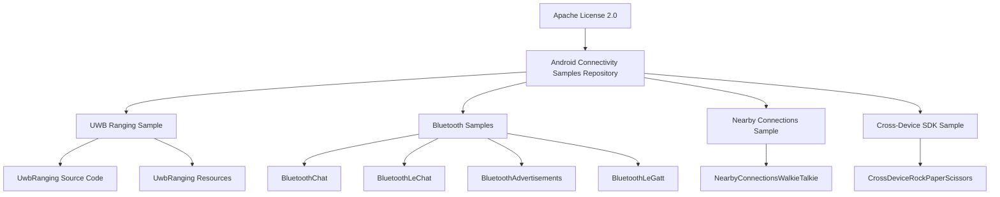
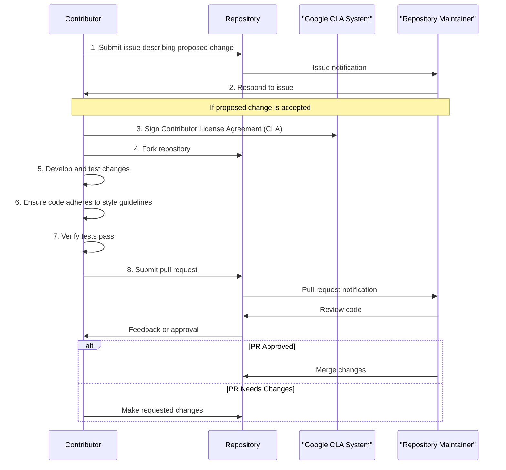

<!-- source: DeepWiki mcp.deepwiki.com · repo android/connectivity-samples · page 6 License and Contribution Guidelines · fetched 2026-10-23 -->

# License and Contribution Guidelines

Relevant source files

The following files were used as context for generating this wiki page:

- [.gitignore](.gitignore)
- [CONTRIBUTING.md](CONTRIBUTING.md)
- [LICENSE](LICENSE)
- [UwbRanging/CONTRIBUTING.md](UwbRanging/CONTRIBUTING.md)
- [UwbRanging/LICENSE](UwbRanging/LICENSE)

This document outlines the licensing terms governing the Android Connectivity Samples repository and the procedures for contributing to the codebase. It provides essential information for developers who wish to use the samples or contribute improvements to the existing code.

## License Information

The Android Connectivity Samples repository is released under the Apache License, Version 2.0. This license applies to all sample code within the repository, including the UWB Ranging, Bluetooth communication, Nearby Connections, and Cross-Device SDK samples.

### Apache License 2.0 Overview

The Apache License 2.0 provides users with the following rights:

- Freedom to use the software for any purpose
- Freedom to modify the software
- Freedom to distribute original or modified versions
- Freedom to distribute the software under a different license

However, these rights come with specific conditions:

- You must include a copy of the license when redistributing the code
- You must clearly state any modifications made to the original files
- You must retain all copyright, patent, trademark, and attribution notices
- You may include your own copyright statement for your modifications

The complete license text can be found in the LICENSE file in the root directory of the repository.

Sources: [LICENSE:1-192](), [UwbRanging/LICENSE:1-202]()

### License Application Diagram

Sources: [LICENSE:1-192](), [UwbRanging/LICENSE:1-202]()

## Contribution Process

Contributions to the Android Connectivity Samples repository are welcome. The contribution process involves several steps to ensure code quality and legal compliance.

### Contribution Workflow

Sources: [CONTRIBUTING.md:1-36](), [UwbRanging/CONTRIBUTING.md:1-30]()

### Issue Submission

Before submitting code, start by creating an issue that describes your proposed change. This allows maintainers to provide feedback on your idea and potentially guide your implementation. For larger contributions, this early coordination is particularly important to avoid wasted effort.

### Contributor License Agreement (CLA)

Before any contribution can be accepted, you must sign Google's Contributor License Agreement (CLA):

- **Individual CLA**: For individuals writing original source code who own the intellectual property
- **Corporate CLA**: For employees contributing work owned by their company

The CLA ensures that Google has the legal right to use and distribute your contributed code.

Sources: [CONTRIBUTING.md:3-20](), [UwbRanging/CONTRIBUTING.md:3-21]()

### Development Guidelines

When developing your contribution, please follow these guidelines:

1. Fork the repository and create a branch for your changes
2. Follow the existing code style in the sample you're contributing to
3. Ensure your code has appropriate unit tests that all pass
4. Keep your changes focused and related to a single issue

#### Code Style

The repository follows Google's coding standards. Key points include:

- Consistent indentation and bracing style
- Descriptive variable and function names
- Appropriate comments and documentation
- Efficient and maintainable code patterns

#### Testing Requirements

All contributions should include appropriate tests:

- Unit tests for new functionality
- Regression tests for bug fixes
- Tests should pass on all supported Android versions

### Pull Request Submission

Once your changes are ready, submit a pull request with the following information:

1. Reference to the issue your PR addresses
2. Clear description of the changes made
3. Any notes on testing or implementation details
4. Confirmation that you've signed the CLA

All submissions require code review before they can be merged, including submissions from project members.

Sources: [CONTRIBUTING.md:22-36](), [UwbRanging/CONTRIBUTING.md:23-25]()

## File Exclusions

The repository uses `.gitignore` to exclude certain files from version control. Understanding these exclusions helps maintain a clean repository when contributing.

Key excluded files and directories include:

- Built application files (*.apk, *.ap_)
- Compiled code (*.dex, *.class)
- Generated directories (bin/, gen/, build)
- Local configuration files (local.properties)
- IDE-specific files (.idea/, *.iml)

Sources: [.gitignore:1-36]()

## Related Documentation

For more information about the various samples in this repository, refer to:

- [Overview](#1) - Introduction to the Android Connectivity Samples repository
- [UWB Ranging](#2) - Details on the UWB Ranging sample
- [Bluetooth Samples](#3) - Information on the Bluetooth communication samples
- [Nearby Connections](#4) - Documentation for the Nearby Connections sample
- [Cross-Device SDK Samples](#5) - Details on the Cross-Device SDK samples