# Page: Overview

# Overview

<details>
<summary>Relevant source files</summary>

The following files were used as context for generating this wiki page:

- [.gitignore](.gitignore)
- [BluetoothAdvertisements/README.md](BluetoothAdvertisements/README.md)
- [BluetoothAdvertisementsKotlin/README.md](BluetoothAdvertisementsKotlin/README.md)
- [BluetoothAdvertisementsKotlin/screenshots/1-main.png](BluetoothAdvertisementsKotlin/screenshots/1-main.png)
- [BluetoothAdvertisementsKotlin/screenshots/icon-web.png](BluetoothAdvertisementsKotlin/screenshots/icon-web.png)
- [BluetoothChat/README.md](BluetoothChat/README.md)
- [BluetoothLeChat/README.md](BluetoothLeChat/README.md)
- [BluetoothLeGatt/README.md](BluetoothLeGatt/README.md)
- [CONTRIBUTING.md](CONTRIBUTING.md)
- [LICENSE](LICENSE)
- [README.md](README.md)

</details>


This technical documentation provides a comprehensive guide to the Android Connectivity Samples repository, a collection of sample applications demonstrating various device-to-device connectivity technologies on the Android platform. It serves as an entry point for developers looking to implement different connectivity solutions in their Android applications.

The repository showcases implementations of Bluetooth (classic and Low Energy), Ultra-Wideband (UWB) ranging, Google's Nearby Connections API, and the Cross-Device SDK. These samples illustrate best practices and provide working code for establishing various types of connections between Android devices.

Sources: [README.md:5-22]()

## Repository Structure

The Android Connectivity Samples repository is organized by connectivity technology, with each sample application focused on demonstrating a specific connectivity feature or use case.

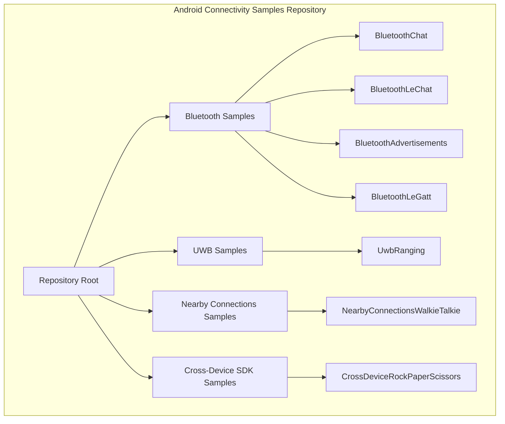

**Note:** The Bluetooth samples have been migrated to the [platform-samples repository](https://github.com/android/platform-samples/tree/main/samples/connectivity/bluetooth) but are still referenced here for completeness.

Sources: [README.md:1-22](), [BluetoothAdvertisementsKotlin/README.md:1-5](), [BluetoothLeChat/README.md:1-5](), [BluetoothLeGatt/README.md:1-5]()

## Connectivity Technologies Overview

The repository demonstrates the following connectivity technologies:

| Technology | Key Features | Power Usage | Range | Bandwidth | Sample Applications |
|------------|--------------|-------------|-------|-----------|---------------------|
| Bluetooth Classic | Device discovery, pairing, data transfer | Medium-High | ~10m | Up to 3 Mbps | BluetoothChat |
| Bluetooth Low Energy | Advertising, scanning, GATT services | Low | ~10m | Up to 2 Mbps | BluetoothLeChat, BluetoothAdvertisements, BluetoothLeGatt |
| Ultra-Wideband | Precise distance and direction measurement | Medium | ~10m | N/A (not for data transfer) | UwbRanging |
| Nearby Connections | Out-of-band discovery, connection establishment | Varies | ~30m | Varies based on transport | NearbyConnectionsWalkieTalkie |
| Cross-Device SDK | Multi-device experiences | Varies | Varies | Varies | CrossDeviceRockPaperScissors |

Sources: [BluetoothChat/README.md:10-35](), [BluetoothLeChat/README.md:10-33](), [BluetoothLeGatt/README.md:10-26](), [BluetoothAdvertisementsKotlin/README.md:10-32]()

## Connectivity Technology Relationships

The following diagram illustrates how the different connectivity technologies interact and their relative positioning in terms of functionality:

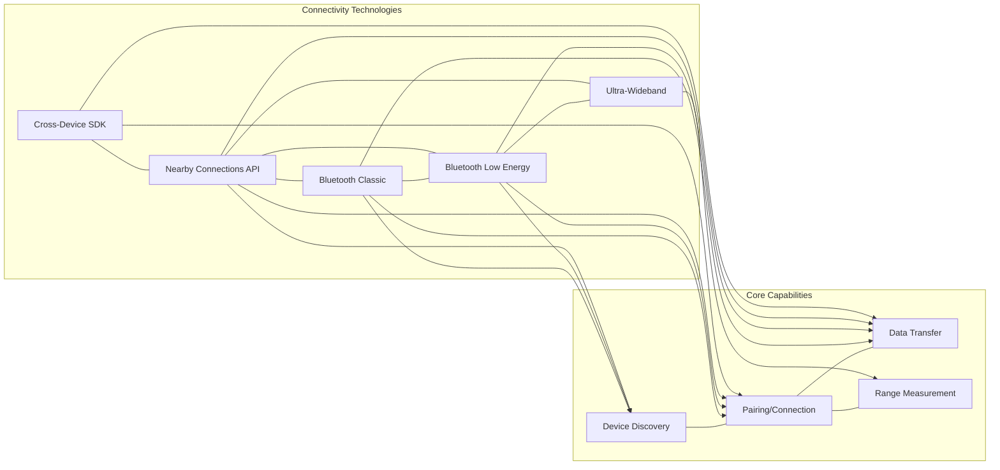

In this architecture, Nearby Connections often serves as an out-of-band (OOB) channel for technologies like UWB, which require initial discovery and connection setup through another protocol before their specialized functionality can be used.

Sources: All provided files and diagrams

## Key Sample Applications

### Bluetooth Samples

#### BluetoothChat

Demonstrates two-way communication between Android devices using traditional Bluetooth RFCOMM sockets.

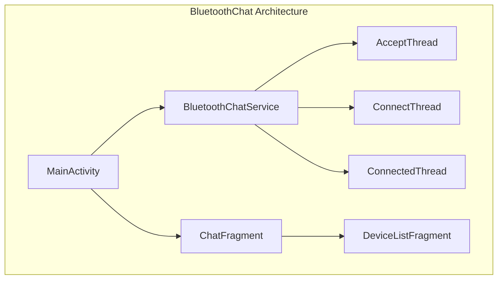

Key features:
- Device discovery and pairing
- Establishing RFCOMM channels
- Connection management
- Data transfer over Bluetooth

Sources: [BluetoothChat/README.md:7-35]()

#### BluetoothLeChat

Implements a two-way chat application using Bluetooth Low Energy GATT profiles.

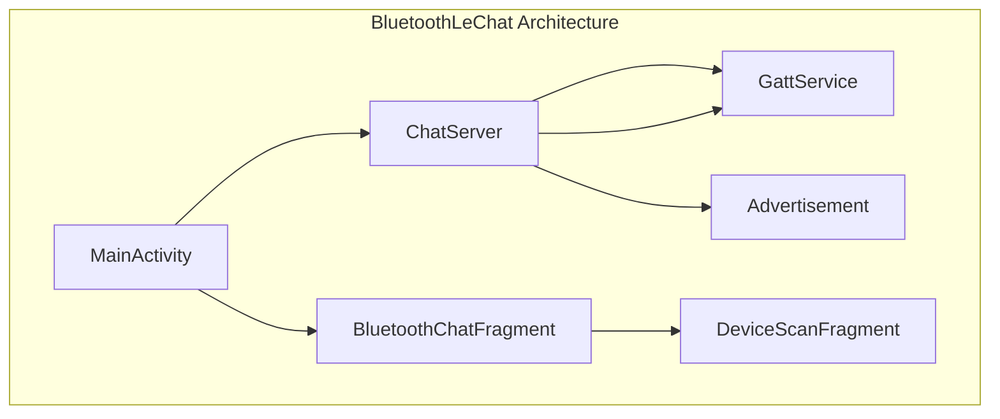

Key features:
- BLE device scanning
- GATT server and client implementation
- BLE characteristic read/write operations
- BLE advertisements

Sources: [BluetoothLeChat/README.md:7-33]()

#### BluetoothAdvertisements

Demonstrates how to advertise small amounts of data using the Bluetooth Low Energy API and scan for those advertisements.

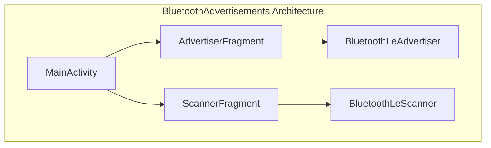

Key features:
- BLE advertising
- Scanning for BLE advertisements
- Data payload in advertisements
- Advertisement filtering

Sources: [BluetoothAdvertisementsKotlin/README.md:7-32]()

#### BluetoothLeGatt

Demonstrates how to use the Bluetooth LE Generic Attribute Profile (GATT) to transmit arbitrary data between devices.

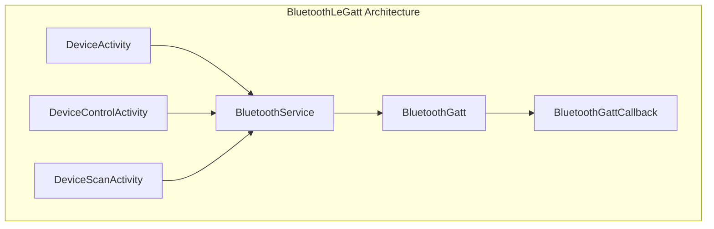

Key features:
- Scanning for BLE devices
- Connecting to GATT servers
- Reading/writing GATT characteristics
- Receiving notifications from GATT servers

Sources: [BluetoothLeGatt/README.md:7-26]()

### UWB Samples

#### UwbRanging

Demonstrates the use of Ultra-Wideband (UWB) technology for precise distance and direction measurement between devices.

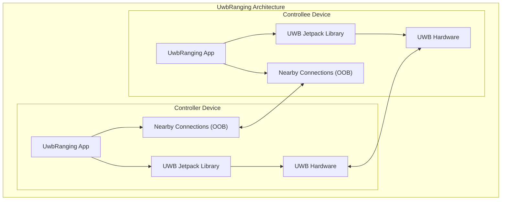

Key features:
- UWB device discovery
- Ranging session establishment
- Distance and angle measurement
- Use of Nearby Connections as an out-of-band channel

Sources: All provided diagrams

### Nearby Connections Samples

#### NearbyConnectionsWalkieTalkie

Real-time audio communication between devices using Google's Nearby Connections API.

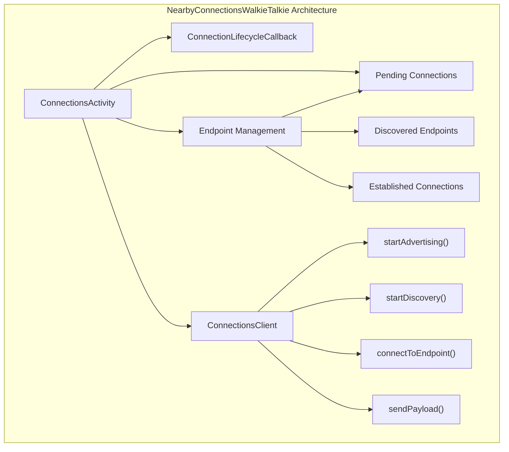

Key features:
- Device discovery via Nearby Connections
- Audio capture and streaming
- Real-time communication
- Connection lifecycle management

Sources: All provided diagrams

### Cross-Device SDK Samples

#### CrossDeviceRockPaperScissors

Demonstrates Google's Cross-Device SDK for creating multi-device experiences through a simple game.

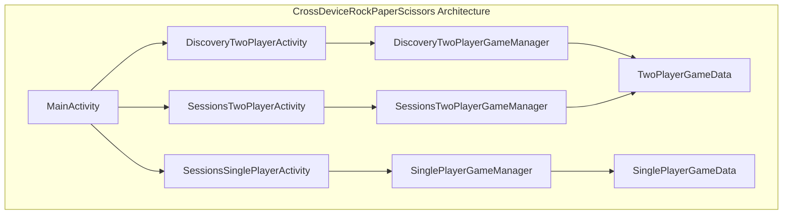

Key features:
- Cross-device discovery
- Session management
- State synchronization
- User interface coordination

Sources: All provided diagrams

## Getting Started

To use these samples, you'll need:

- Android SDK 28 or higher
- Android Build Tools v28.0.3 or higher
- Android Support Repository
- Compatible Android devices for testing (some samples require two devices)

Each sample includes its own README with specific instructions and requirements.

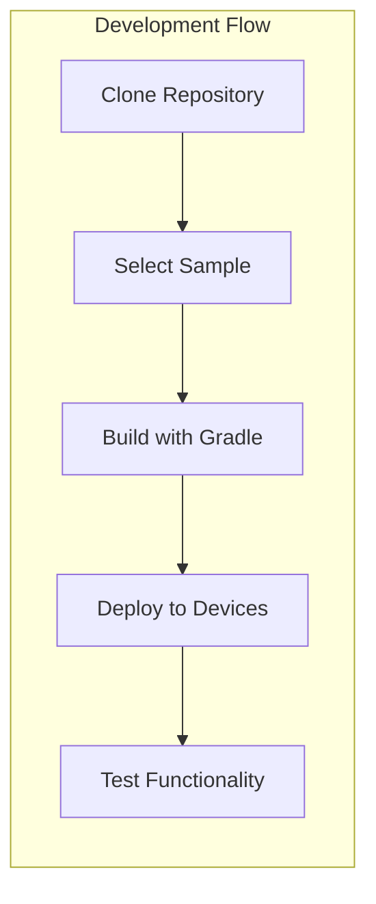

Sources: [README.md:8-22](), [BluetoothAdvertisementsKotlin/README.md:36-52](), [BluetoothLeChat/README.md:37-54](), [BluetoothLeGatt/README.md:28-45]()

## License and Contributions

The repository is licensed under the Apache License 2.0. Contributions are welcome. See the CONTRIBUTING.md file for details on how to contribute.

Sources: [LICENSE:1-191](), [CONTRIBUTING.md:1-36]()

---

# Page: UWB Ranging

# UWB Ranging

<details>
<summary>Relevant source files</summary>

The following files were used as context for generating this wiki page:

- [UwbRanging/README.md](UwbRanging/README.md)
- [UwbRanging/app/src/main/AndroidManifest.xml](UwbRanging/app/src/main/AndroidManifest.xml)
- [UwbRanging/uwbranging/src/test/java/com/google/apps/uwbranging/impl/NearbyConnectionsTest.kt](UwbRanging/uwbranging/src/test/java/com/google/apps/uwbranging/impl/NearbyConnectionsTest.kt)
- [UwbRanging/uwbranging/src/test/java/com/google/apps/uwbranging/impl/NearbyControleeConnectorTest.kt](UwbRanging/uwbranging/src/test/java/com/google/apps/uwbranging/impl/NearbyControleeConnectorTest.kt)
- [UwbRanging/uwbranging/src/test/java/com/google/apps/uwbranging/impl/NearbyControllerConnectorTest.kt](UwbRanging/uwbranging/src/test/java/com/google/apps/uwbranging/impl/NearbyControllerConnectorTest.kt)
- [UwbRanging/uwbranging/src/test/java/com/google/apps/uwbranging/impl/UwbSessionScopeImplTest.kt](UwbRanging/uwbranging/src/test/java/com/google/apps/uwbranging/impl/UwbSessionScopeImplTest.kt)

</details>


## Introduction

The UWB Ranging sample demonstrates the capabilities of Ultra-wideband (UWB) technology on Android devices. This sample showcases the [Android UWB Jetpack library](https://developer.android.com/jetpack/androidx/releases/core-uwb) and its implementation for precise distance measurement between UWB-capable devices. The sample focuses on the technical foundation required to build UWB-enabled applications rather than UI design or complete end-to-end solutions.

For information about other connectivity technologies like Bluetooth or Nearby Connections, see the [Bluetooth Samples](#3) or [Nearby Connections](#4) pages respectively.

Sources: [UwbRanging/README.md:1-40]()

## Overview

UWB (Ultra-wideband) is a radio technology that operates at a high bandwidth and enables centimeter-level precision for distance measurement between devices. The UWB Ranging sample demonstrates several key features:

1. **Device compatibility checking** - Verifying if an Android device supports UWB
2. **Device discovery** - Using an out-of-band (OOB) mechanism (Nearby Connections API) to discover UWB-capable devices
3. **Simple ranging** - Measuring and displaying the distance between connected devices
4. **Device control** - Simulating use cases such as unlocking a door when a UWB device is nearby
5. **Media sharing** - Transferring files when devices are in close proximity

The sample requires two UWB-capable Android phones running Android 12 or higher, as well as the latest version of the Core Ultra Wideband (UWB) Jetpack library.

Sources: [UwbRanging/README.md:3-23]()

## System Architecture

### UWB Ranging Architecture Overview

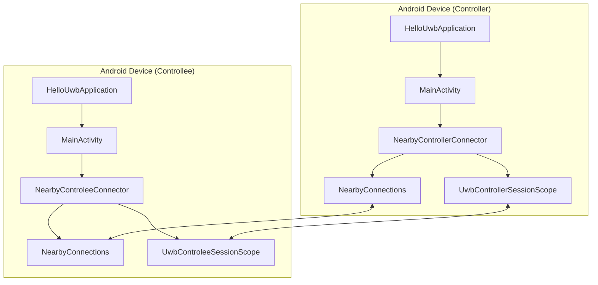

Sources: [UwbRanging/uwbranging/src/test/java/com/google/apps/uwbranging/impl/NearbyControleeConnectorTest.kt:19-186](), [UwbRanging/uwbranging/src/test/java/com/google/apps/uwbranging/impl/NearbyControllerConnectorTest.kt:19-162]()

The UWB Ranging system follows a controller-controllee pattern, where:
- The **Controller** initiates ranging sessions and processes the ranging results
- The **Controllee** responds to ranging requests from the controller

Both devices utilize the Nearby Connections API for initial discovery and connection establishment, after which they switch to UWB for precise distance measurements.

### UWB Ranging Communication Flow

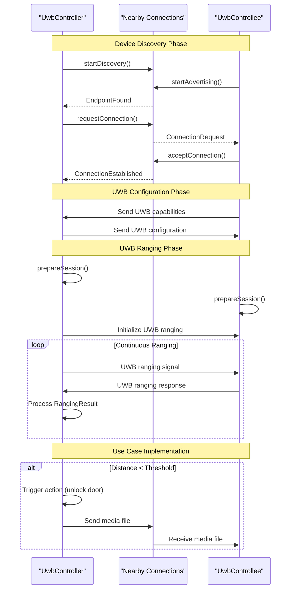

Sources: [UwbRanging/uwbranging/src/test/java/com/google/apps/uwbranging/impl/NearbyConnectionsTest.kt:19-178](), [UwbRanging/uwbranging/src/test/java/com/google/apps/uwbranging/impl/UwbSessionScopeImplTest.kt:19-143]()

## Core Components

### UWB Ranging System Components

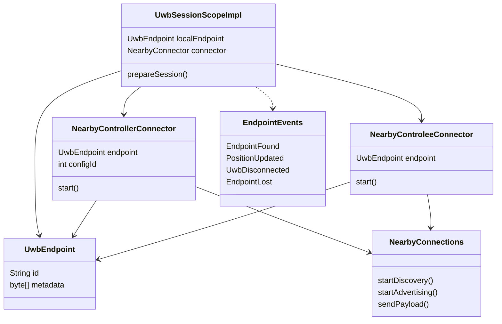

Sources: [UwbRanging/uwbranging/src/test/java/com/google/apps/uwbranging/impl/UwbSessionScopeImplTest.kt:29-38]()

The UWB Ranging system consists of several key components:

1. **UwbEndpoint**: Represents a device participating in UWB ranging, with an ID and associated metadata.

2. **NearbyConnections**: Provides the out-of-band communication channel used for device discovery, connection establishment, and metadata exchange.

3. **NearbyControllerConnector/NearbyControleeConnector**: Manages the connection process for the controller and controllee roles respectively, using the Nearby Connections API.

4. **UwbSessionScopeImpl**: Coordinates the UWB ranging session, handling the preparation, execution, and event processing.

5. **EndpointEvents**: Defines the events that occur during UWB ranging, including endpoint discovery, position updates, and disconnections.

### Data Structures and Protocol

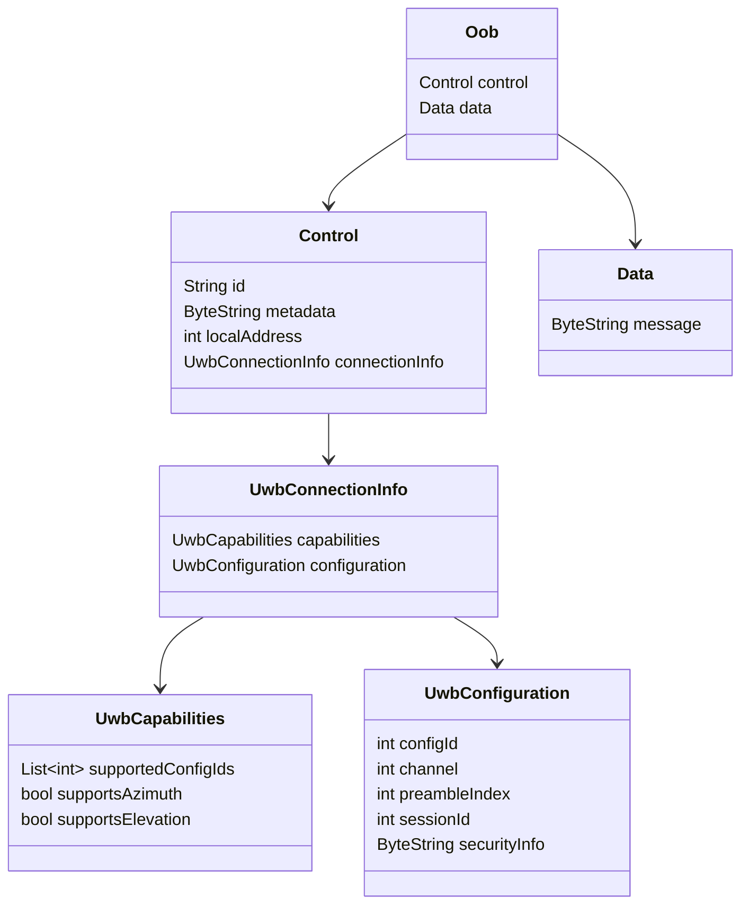

Sources: [UwbRanging/uwbranging/src/test/java/com/google/apps/uwbranging/impl/NearbyControleeConnectorTest.kt:65-82](), [UwbRanging/uwbranging/src/test/java/com/google/apps/uwbranging/impl/NearbyControllerConnectorTest.kt:65-81]()

The UWB ranging system uses Protocol Buffers for data exchange between devices:

1. **Control**: Contains device identification and UWB capabilities/configuration.
2. **UwbConnectionInfo**: Encapsulates UWB capabilities or configuration information.
3. **UwbCapabilities**: Describes the UWB features supported by a device.
4. **UwbConfiguration**: Defines parameters for UWB ranging sessions.
5. **Oob**: The main wrapper message containing either control information or data.
6. **Data**: Contains arbitrary message data exchanged between devices.

These protobuf messages are serialized and transmitted over the Nearby Connections API, facilitating the setup and management of UWB ranging sessions.

## Permission Requirements

The UWB Ranging application requires several permissions to function properly:

| Permission Category | Specific Permissions |
| --- | --- |
| Bluetooth | `BLUETOOTH`, `BLUETOOTH_SCAN`, `BLUETOOTH_ADVERTISE`, `BLUETOOTH_CONNECT`, `BLUETOOTH_ADMIN` |
| Location | `ACCESS_COARSE_LOCATION`, `ACCESS_FINE_LOCATION` |
| Wi-Fi | `ACCESS_WIFI_STATE`, `CHANGE_WIFI_STATE`, `NEARBY_WIFI_DEVICES` |
| UWB | `UWB_RANGING` |

The permissions are required for:
- Bluetooth permissions: Used by the Nearby Connections API for device discovery
- Location permissions: Required for Bluetooth scanning on Android
- Wi-Fi permissions: Used by Nearby Connections as a potential transport
- UWB permissions: Essential for performing the actual UWB ranging operations

Sources: [UwbRanging/app/src/main/AndroidManifest.xml:16-26]()

## Use Cases

The UWB Ranging sample demonstrates three primary use cases:

### 1. Simple Ranging

Shows the basic distance measurement capabilities of UWB technology. The application displays the distance between the controller and controllee devices with centimeter-level precision.

### 2. Device Control

Simulates a scenario where a UWB-enabled device could control access to a physical system, such as a door lock. When the controller device comes within a predefined proximity threshold of the controllee, an action is triggered (like unlocking a door).

### 3. Media Sharing

Demonstrates how to transfer media files between devices when they are in close proximity. This showcases how UWB ranging can be combined with the out-of-band communication channel (Nearby Connections) to facilitate context-aware file sharing.

Sources: [UwbRanging/README.md:13-18]()

## Technical Constraints and Limitations

- UWB technology does not provide a native way to discover devices, requiring an out-of-band (OOB) mechanism like Nearby Connections
- The sample is not an end-to-end production-ready example and lacks comprehensive security measures
- The sample requires specific hardware support: Android devices with UWB capability running Android 12 or higher
- The current Android UWB Jetpack library is still evolving and may have limitations or changes in future releases

Sources: [UwbRanging/README.md:26-33]()

## Summary

The UWB Ranging sample demonstrates the implementation of Ultra-wideband technology for precise distance measurement between Android devices. It showcases the controller-controllee architecture, utilizes the Nearby Connections API for device discovery and initial connection, and provides example use cases for UWB technology including simple ranging, device control, and media sharing.

This sample serves as a technical foundation for developers looking to understand and implement UWB-based applications on Android, focusing on the core ranging functionality rather than complete end-to-end solutions or UI design.

---

# Page: UWB Ranging Architecture

# UWB Ranging Architecture

<details>
<summary>Relevant source files</summary>

The following files were used as context for generating this wiki page:

- [UwbRanging/README.md](UwbRanging/README.md)
- [UwbRanging/app/build.gradle](UwbRanging/app/build.gradle)
- [UwbRanging/app/src/main/java/com/google/apps/hellouwb/data/SettingsStore.kt](UwbRanging/app/src/main/java/com/google/apps/hellouwb/data/SettingsStore.kt)
- [UwbRanging/app/src/main/java/com/google/apps/hellouwb/data/SettingsStoreImpl.kt](UwbRanging/app/src/main/java/com/google/apps/hellouwb/data/SettingsStoreImpl.kt)
- [UwbRanging/app/src/main/java/com/google/apps/hellouwb/data/UwbRangingControlSource.kt](UwbRanging/app/src/main/java/com/google/apps/hellouwb/data/UwbRangingControlSource.kt)
- [UwbRanging/app/src/main/java/com/google/apps/hellouwb/data/UwbRangingControlSourceImpl.kt](UwbRanging/app/src/main/java/com/google/apps/hellouwb/data/UwbRangingControlSourceImpl.kt)
- [UwbRanging/app/src/main/java/com/google/apps/hellouwb/ui/settings/SettingsRoute.kt](UwbRanging/app/src/main/java/com/google/apps/hellouwb/ui/settings/SettingsRoute.kt)
- [UwbRanging/app/src/main/java/com/google/apps/hellouwb/ui/settings/SettingsScreen.kt](UwbRanging/app/src/main/java/com/google/apps/hellouwb/ui/settings/SettingsScreen.kt)
- [UwbRanging/app/src/main/java/com/google/apps/hellouwb/ui/settings/SettingsViewModel.kt](UwbRanging/app/src/main/java/com/google/apps/hellouwb/ui/settings/SettingsViewModel.kt)
- [UwbRanging/app/src/main/proto/appsetttings.proto](UwbRanging/app/src/main/proto/appsetttings.proto)
- [UwbRanging/build.gradle](UwbRanging/build.gradle)
- [UwbRanging/uwbranging/build.gradle](UwbRanging/uwbranging/build.gradle)
- [UwbRanging/uwbranging/src/main/java/com/google/apps/uwbranging/impl/NearbyControleeConnector.kt](UwbRanging/uwbranging/src/main/java/com/google/apps/uwbranging/impl/NearbyControleeConnector.kt)

</details>


## Purpose and Scope

This document details the internal architecture of the UWB Ranging sample application, which demonstrates the use of Ultra-Wideband (UWB) technology for precise distance measurement between Android devices. The architecture is built around a controller-controllee model for ranging operations and leverages the Android UWB Jetpack library. For information about the UWB protocol itself and data structures used, see [UWB Protocol and Data Structures](#2.2).

## High-Level Architecture Overview

The UWB Ranging system demonstrates how to implement precise distance measurement between two UWB-capable Android devices. The architecture combines the Android UWB Jetpack library with an out-of-band (OOB) mechanism for device discovery.

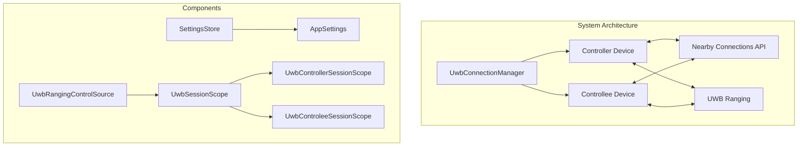

Sources: [UwbRanging/README.md:4-18](), [UwbRanging/uwbranging/build.gradle:64-65]()

## Controller-Controllee Model

The UWB Ranging architecture is built upon a controller-controllee model where:

1. **Controller**: Initiates the ranging session and sends ranging requests
2. **Controllee**: Responds to ranging requests from the controller

This role can be configured in the application settings and affects how the UWB session is established and managed.

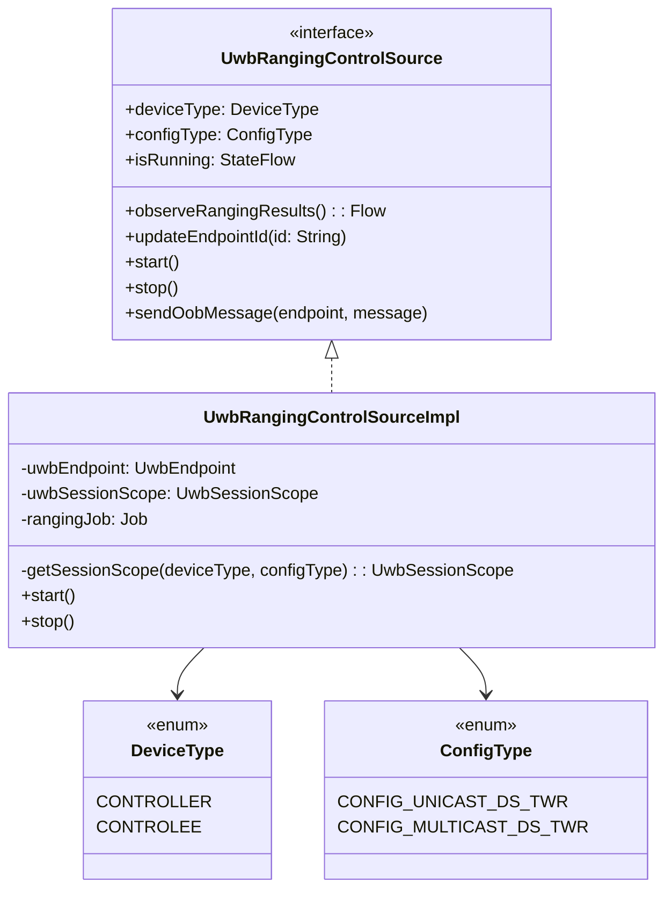

Sources: [UwbRanging/app/src/main/java/com/google/apps/hellouwb/data/UwbRangingControlSource.kt:26-43](), [UwbRanging/app/src/main/java/com/google/apps/hellouwb/data/UwbRangingControlSourceImpl.kt:35-123](), [UwbRanging/app/src/main/proto/appsetttings.proto:23-31]()

## Session Initialization and Management

The UWB ranging process requires proper session initialization and management to establish a connection between devices.

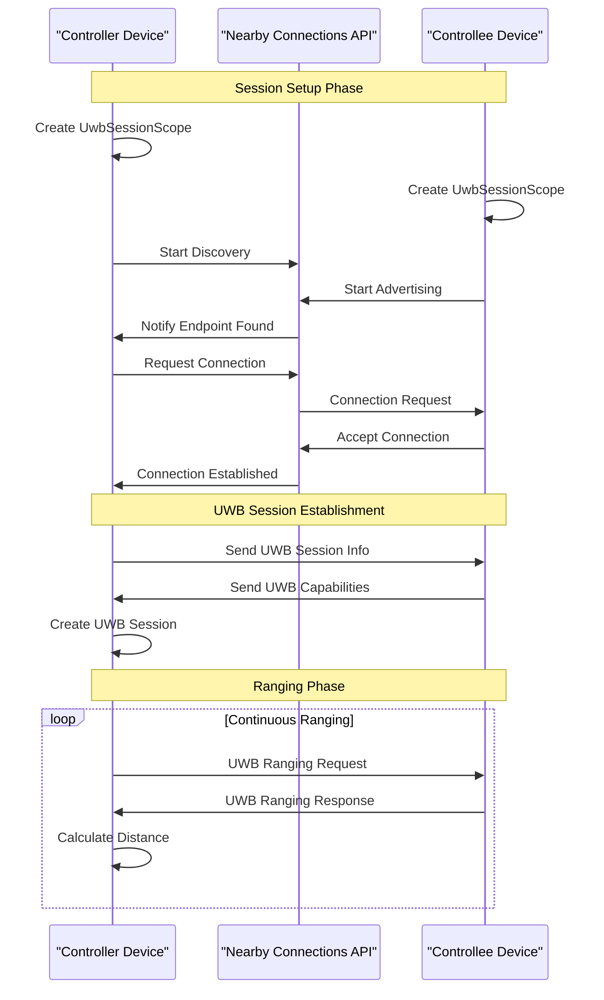

Sources: [UwbRanging/app/src/main/java/com/google/apps/hellouwb/data/UwbRangingControlSourceImpl.kt:101-112](), [UwbRanging/uwbranging/src/main/java/com/google/apps/uwbranging/impl/NearbyControleeConnector.kt:35-103]()

## UWB Session Configuration

The UWB ranging system supports two configuration types that dictate how the ranging session operates:

1. **CONFIG_UNICAST_DS_TWR**: Double-sided two-way ranging between two devices
2. **CONFIG_MULTICAST_DS_TWR**: Two-way ranging that supports multiple devices

These configurations can be selected in the settings menu and affect the UwbSessionScope that is created.

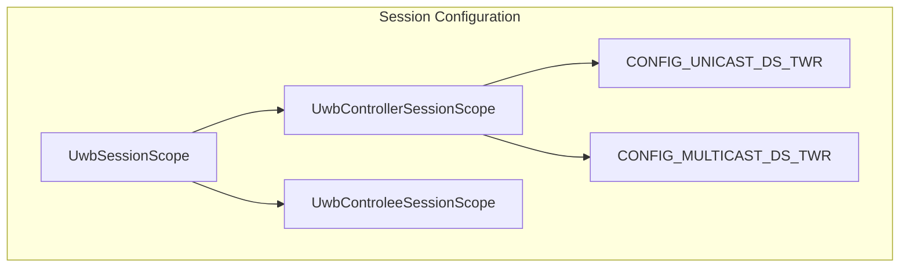

Sources: [UwbRanging/app/src/main/java/com/google/apps/hellouwb/data/UwbRangingControlSourceImpl.kt:60-71](), [UwbRanging/app/src/main/java/com/google/apps/hellouwb/ui/settings/SettingsScreen.kt:112-135]()

## Settings Management

The application provides a settings management system that allows users to configure device roles and UWB parameters.

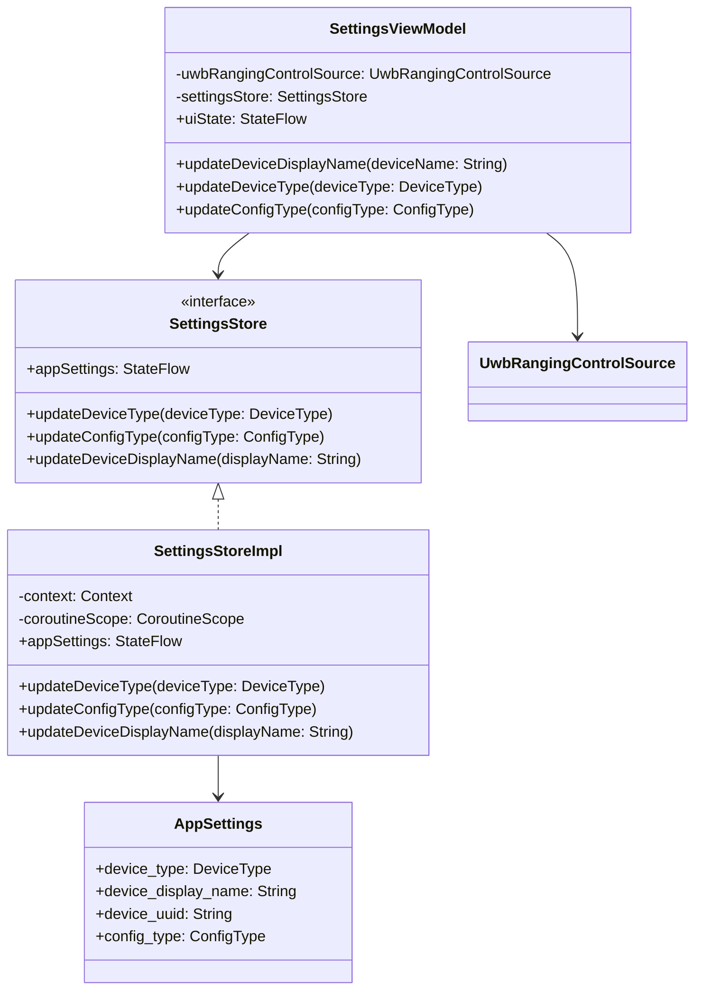

Sources: [UwbRanging/app/src/main/java/com/google/apps/hellouwb/data/SettingsStore.kt:24-33](), [UwbRanging/app/src/main/java/com/google/apps/hellouwb/data/SettingsStoreImpl.kt:34-98](), [UwbRanging/app/src/main/java/com/google/apps/hellouwb/ui/settings/SettingsViewModel.kt:28-70]()

## Out-of-Band (OOB) Communication

Since UWB does not natively support device discovery, the application uses the Nearby Connections API as an out-of-band mechanism for initial device discovery and connection establishment.

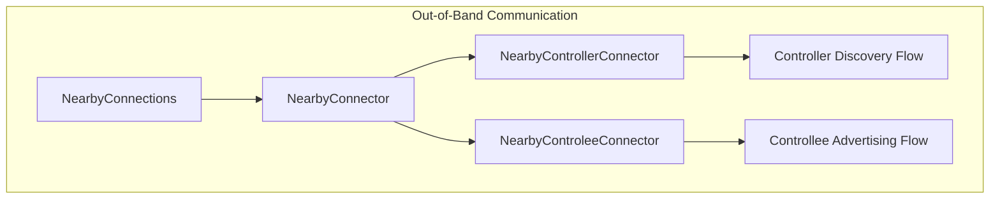

Sources: [UwbRanging/README.md:10-12](), [UwbRanging/uwbranging/src/main/java/com/google/apps/uwbranging/impl/NearbyControleeConnector.kt:35-102]()

## Ranging Process Flow

The complete UWB ranging process involves several steps, from device discovery to continuous ranging:

```mermaid
flowchart TD
    Start["Start Ranging Process"] --> A["Check Device Compatibility"]
    A --> B["Select Device Role (Controller/Controllee)"]
    B --> C["Initialize UwbRangingControlSource"]
    C --> D["Create UwbSessionScope based on role"]
    
    subgraph "Controller Path"
        D --> E["Start Discovery (Nearby)"]
        E --> F["Find Controllee Device"]
        F --> G["Establish Connection"]
        G --> H["Exchange UWB Capabilities"]
        H --> I["Create UWB Session"]
        I --> J["Start Continuous Ranging"]
    end
    
    subgraph "Controllee Path"
        D --> K["Start Advertising (Nearby)"]
        K --> L["Accept Connection Request"]
        L --> M["Share UWB Capabilities"]
        M --> N["Respond to Ranging Requests"]
    end
    
    J --> End["Process Ranging Results"]
    N --> End
```

Sources: [UwbRanging/README.md:13-17](), [UwbRanging/app/src/main/java/com/google/apps/hellouwb/data/UwbRangingControlSourceImpl.kt:101-112]()

## Data Flow in the UWB Ranging System

The following diagram illustrates how data flows through the UWB Ranging system:

```mermaid
graph TB
    subgraph "Controller Device"
        A1["UwbRangingControlSource"] --> B1["UwbSessionScope"]
        B1 --> C1["UwbControllerSessionScope"]
        A1 --> D1["Results Flow"]
    end
    
    subgraph "Nearby Connections"
        E["NearbyConnections"]
    end
    
    subgraph "Controllee Device"
        A2["UwbRangingControlSource"] --> B2["UwbSessionScope"]
        B2 --> C2["UwbControleeSessionScope"]
    end
    
    C1 <--> E
    C2 <--> E
    C1 <--> F["UWB Ranging"]
    C2 <--> F
    
    F --> D1
```

Sources: [UwbRanging/app/src/main/java/com/google/apps/hellouwb/data/UwbRangingControlSourceImpl.kt:43-55](), [UwbRanging/uwbranging/src/main/java/com/google/apps/uwbranging/impl/NearbyControleeConnector.kt:42-57]()

## Integration with Application Settings

The UWB Ranging system is tightly integrated with the application settings to allow users to configure the ranging behavior:

| Setting | Description | Impact on Ranging |
|---------|-------------|------------------|
| Device Type | Sets the device as Controller or Controllee | Determines role in ranging session |
| Config Type | Sets UWB configuration (Unicast or Multicast) | Affects ranging session capabilities |
| Device Display Name | Sets device name for display | Used in OOB discovery |

Sources: [UwbRanging/app/src/main/java/com/google/apps/hellouwb/ui/settings/SettingsScreen.kt:86-135](), [UwbRanging/app/src/main/java/com/google/apps/hellouwb/ui/settings/SettingsViewModel.kt:42-56]()

## Technical Requirements

To use the UWB Ranging system, the following requirements must be met:

1. Two UWB-capable Android phones with Android 12 or higher
2. Latest version of the Core Ultra Wideband (UWB) Jetpack library (androidx.core.uwb:uwb)
3. Nearby Connections API for device discovery
4. Proper permissions for UWB and Nearby Connections usage

Sources: [UwbRanging/README.md:21-23](), [UwbRanging/app/build.gradle:81](), [UwbRanging/uwbranging/build.gradle:64]()

---

# Page: UWB Protocol and Data Structures

# UWB Protocol and Data Structures

<details>
<summary>Relevant source files</summary>

The following files were used as context for generating this wiki page:

- [UwbRanging/app/build.gradle](UwbRanging/app/build.gradle)
- [UwbRanging/app/src/main/java/com/google/apps/hellouwb/data/SettingsStore.kt](UwbRanging/app/src/main/java/com/google/apps/hellouwb/data/SettingsStore.kt)
- [UwbRanging/app/src/main/java/com/google/apps/hellouwb/data/SettingsStoreImpl.kt](UwbRanging/app/src/main/java/com/google/apps/hellouwb/data/SettingsStoreImpl.kt)
- [UwbRanging/app/src/main/java/com/google/apps/hellouwb/data/UwbRangingControlSource.kt](UwbRanging/app/src/main/java/com/google/apps/hellouwb/data/UwbRangingControlSource.kt)
- [UwbRanging/app/src/main/java/com/google/apps/hellouwb/data/UwbRangingControlSourceImpl.kt](UwbRanging/app/src/main/java/com/google/apps/hellouwb/data/UwbRangingControlSourceImpl.kt)
- [UwbRanging/app/src/main/java/com/google/apps/hellouwb/ui/settings/SettingsRoute.kt](UwbRanging/app/src/main/java/com/google/apps/hellouwb/ui/settings/SettingsRoute.kt)
- [UwbRanging/app/src/main/java/com/google/apps/hellouwb/ui/settings/SettingsScreen.kt](UwbRanging/app/src/main/java/com/google/apps/hellouwb/ui/settings/SettingsScreen.kt)
- [UwbRanging/app/src/main/java/com/google/apps/hellouwb/ui/settings/SettingsViewModel.kt](UwbRanging/app/src/main/java/com/google/apps/hellouwb/ui/settings/SettingsViewModel.kt)
- [UwbRanging/app/src/main/proto/appsetttings.proto](UwbRanging/app/src/main/proto/appsetttings.proto)
- [UwbRanging/app/src/main/res/drawable-v24/ic_launcher_foreground.xml](UwbRanging/app/src/main/res/drawable-v24/ic_launcher_foreground.xml)
- [UwbRanging/app/src/main/res/drawable/ic_launcher_background.xml](UwbRanging/app/src/main/res/drawable/ic_launcher_background.xml)
- [UwbRanging/app/src/main/res/mipmap-anydpi-v26/ic_launcher.xml](UwbRanging/app/src/main/res/mipmap-anydpi-v26/ic_launcher.xml)
- [UwbRanging/app/src/main/res/mipmap-anydpi-v26/ic_launcher_round.xml](UwbRanging/app/src/main/res/mipmap-anydpi-v26/ic_launcher_round.xml)
- [UwbRanging/app/src/main/res/values/colors.xml](UwbRanging/app/src/main/res/values/colors.xml)
- [UwbRanging/app/src/main/res/values/strings.xml](UwbRanging/app/src/main/res/values/strings.xml)
- [UwbRanging/app/src/main/res/values/themes.xml](UwbRanging/app/src/main/res/values/themes.xml)
- [UwbRanging/app/src/main/res/xml/backup_rules.xml](UwbRanging/app/src/main/res/xml/backup_rules.xml)
- [UwbRanging/app/src/main/res/xml/data_extraction_rules.xml](UwbRanging/app/src/main/res/xml/data_extraction_rules.xml)
- [UwbRanging/build.gradle](UwbRanging/build.gradle)
- [UwbRanging/uwbranging/build.gradle](UwbRanging/uwbranging/build.gradle)
- [UwbRanging/uwbranging/src/main/AndroidManifest.xml](UwbRanging/uwbranging/src/main/AndroidManifest.xml)
- [UwbRanging/uwbranging/src/main/java/com/google/apps/uwbranging/impl/NearbyControleeConnector.kt](UwbRanging/uwbranging/src/main/java/com/google/apps/uwbranging/impl/NearbyControleeConnector.kt)
- [UwbRanging/uwbranging/src/main/proto/uwbinfo.proto](UwbRanging/uwbranging/src/main/proto/uwbinfo.proto)

</details>


This document provides a technical overview of the Ultra-Wideband (UWB) protocol and data structures used in the UWB Ranging sample application. It covers the core protocol communication patterns, message formats, and data structures essential for implementing UWB-based distance measurement between devices. For information about the overall UWB Ranging architecture, see [UWB Ranging Architecture](#2.1).

## UWB Device Roles and Configuration Types

The UWB Ranging implementation follows a controller-controllee architecture with specific configuration types that determine the ranging methodology.

### Device Roles

Two distinct device roles exist in the UWB protocol implementation:

| Role | Description | Responsibilities |
|------|-------------|------------------|
| Controller | Initiates and manages ranging sessions | Creates configuration, initiates ranging, processes measurements |
| Controlee | Responds to ranging requests | Advertises capabilities, responds to ranging requests |

These roles are defined in the protocol buffer enumerations and used throughout the codebase:

```proto
enum DeviceType {
  CONTROLLER = 0;
  CONTROLEE = 1;
}
```

### Configuration Types

The UWB Ranging implementation supports two ranging configuration types:

| Configuration Type | Description | Use Case |
|--------------------|-------------|----------|
| CONFIG_UNICAST_DS_TWR | Double-Sided Two-Way Ranging with a single controllee | One-to-one precise distance measurement |
| CONFIG_MULTICAST_DS_TWR | Double-Sided Two-Way Ranging with multiple controlees | One-to-many distance measurement |

These configuration types are defined in protocol buffers and mapped to the corresponding Android UWB ranging parameters:

```proto
enum ConfigType {
  CONFIG_UNICAST_DS_TWR = 0;
  CONFIG_MULTICAST_DS_TWR = 1;
}
```

Sources: [UwbRanging/app/src/main/proto/appsetttings.proto:23-31](), [UwbRanging/app/src/main/java/com/google/apps/hellouwb/data/UwbRangingControlSourceImpl.kt:60-71]()

## UWB Protocol Components and Flow

The UWB protocol implementation consists of several interconnected components that work together to enable precise distance measurement between devices.

### Protocol Architecture

```mermaid
graph TD
    subgraph "UWB Protocol Architecture"
        A["Controller Device"] --> B["UwbConnectionManager"]
        C["Controllee Device"] --> B
        
        B --> D["NearbyConnections\nOOB Channel"]
        B --> E["UWB Ranging Channel"]
        
        F["UwbSessionScope"] --> G["UwbControllerSessionScope"]
        F --> H["UwbControleeSessionScope"]
        
        A --> G
        C --> H
        
        I["Protocol Buffers"] --> J["AppSettings"]
        I --> K["UwbConnectionInfo"]
        I --> L["UwbCapabilities"]
        I --> M["UwbConfiguration"]
        
        D --> I
        E --> N["Ranging Measurements"]
    end
```

Sources: [UwbRanging/app/src/main/java/com/google/apps/hellouwb/data/UwbRangingControlSourceImpl.kt:35-47](), [UwbRanging/uwbranging/src/main/java/com/google/apps/uwbranging/impl/NearbyControleeConnector.kt:42-56]()

### UWB Protocol Flow

The UWB protocol follows a specific sequence of operations for establishing a ranging session, as illustrated below:

```mermaid
sequenceDiagram
    participant Controller
    participant OOB as OOB Channel (Nearby)
    participant Controllee
    participant UWB as UWB Channel

    Note over Controller,Controllee: Device Discovery Phase
    Controller->>OOB: Start discovery
    Controllee->>OOB: Start advertising
    OOB->>Controller: Endpoint found
    Controller->>OOB: Request connection
    OOB->>Controllee: Connection request
    Controllee->>OOB: Accept connection
    OOB->>Controller: Connection established

    Note over Controller,Controllee: UWB Configuration Phase
    Controllee->>OOB: Send UwbCapabilities
    Controller->>Controller: Create UwbConfiguration
    Controller->>OOB: Send UwbConfiguration
    Controllee->>Controllee: Initialize UWB with configuration

    Note over Controller,Controllee: UWB Ranging Phase
    Controller->>UWB: Start ranging session
    loop Continuous Ranging
        Controller->>UWB: Ranging request
        UWB->>Controllee: UWB signal
        Controllee->>UWB: UWB response
        UWB->>Controller: Ranging measurements
        Controller->>Controller: Process distance, angle data
    end

    Note over Controller,Controllee: Optional OOB Data Exchange
    Controller->>OOB: Send application data
    OOB->>Controllee: Receive application data
```

Sources: [UwbRanging/app/src/main/java/com/google/apps/hellouwb/data/UwbRangingControlSourceImpl.kt:101-118](), [UwbRanging/uwbranging/src/main/java/com/google/apps/uwbranging/impl/NearbyControleeConnector.kt:50-83]()

## UWB Data Structures

The UWB implementation uses Protocol Buffers to define structured message formats for communication between devices.

### Protocol Buffer Schema

The key data structures for UWB protocol communication are defined in two protocol buffer files:

1. `appsetttings.proto` - Application-level settings
2. `uwbinfo.proto` - UWB protocol messages

```mermaid
classDiagram
    class AppSettings {
        DeviceType device_type
        string device_display_name
        string device_uuid
        ConfigType config_type
    }
    
    class UwbConnectionInfo {
        UwbCapabilities capabilities
        UwbConfiguration configuration
    }
    
    class UwbCapabilities {
        repeated int32 supported_config_ids
        bool supports_azimuth
        bool supports_elevation
    }
    
    class UwbConfiguration {
        int32 config_id
        int32 channel
        int32 preamble_index
        int32 session_id
        bytes security_info
    }
    
    class Control {
        string id
        bytes metadata
        int32 local_address
        UwbConnectionInfo connection_info
    }
    
    class Data {
        bytes message
    }
    
    class Oob {
        Control control
        Data data
    }
    
    Oob --> Control
    Oob --> Data
    Control --> UwbConnectionInfo
    UwbConnectionInfo --> UwbCapabilities
    UwbConnectionInfo --> UwbConfiguration
```

Sources: [UwbRanging/app/src/main/proto/appsetttings.proto:18-38](), [UwbRanging/uwbranging/src/main/proto/uwbinfo.proto:18-67]()

### Key Data Structures and Their Purposes

| Data Structure | Purpose | Key Fields |
|----------------|---------|------------|
| AppSettings | Stores application configuration | device_type, device_display_name, device_uuid, config_type |
| UwbCapabilities | Represents controllee device capabilities | supported_config_ids, supports_azimuth, supports_elevation |
| UwbConfiguration | Defines UWB session configuration | config_id, channel, preamble_index, session_id, security_info |
| UwbConnectionInfo | Wrapper for capabilities or configuration | capabilities, configuration (oneof) |
| Control | Control message for session setup | id, metadata, local_address, connection_info |
| Data | Data message for application communication | message (bytes) |
| Oob | Wrapper for OOB messages | control, data (oneof) |

Sources: [UwbRanging/uwbranging/src/main/proto/uwbinfo.proto:26-67]()

## UWB Protocol Implementation

### Code Structure and API Integration

```mermaid
graph TD
    subgraph "Implementation Structure"
        A["UwbRangingControlSource"] --> B["UwbRangingControlSourceImpl"]
        C["UwbConnectionManager"] --> D["UwbSessionScope"]
        D --> E["UwbControllerSessionScope"]
        D --> F["UwbControleeSessionScope"]
        
        B --> C
        B --> G["Ranging Results Flow"]
        
        H["SettingsStore"] --> I["AppSettings"]
        J["SettingsViewModel"] --> H
        J --> B
        
        K["Nearby Connectors"] --> L["NearbyControleeConnector"]
        K --> M["NearbyControllerConnector"]
        
        L --> N["UwbOobEvent"]
        M --> N
    end
```

Sources: [UwbRanging/app/src/main/java/com/google/apps/hellouwb/data/UwbRangingControlSource.kt:26-43](), [UwbRanging/app/src/main/java/com/google/apps/hellouwb/data/UwbRangingControlSourceImpl.kt:35-47](), [UwbRanging/uwbranging/src/main/java/com/google/apps/uwbranging/impl/NearbyControleeConnector.kt:42-56]()

### Device Type and Configuration Selection

The application allows users to configure their device role (controller or controllee) and the ranging configuration type through the settings interface:

```kotlin
// In UwbRangingControlSourceImpl:
override var deviceType: DeviceType by
Delegates.observable(DeviceType.CONTROLLER) { _, oldValue, newValue ->
  if (oldValue != newValue) {
    stop()
    uwbSessionScope = getSessionScope(newValue, configType)
  }
}

override var configType: ConfigType by
Delegates.observable(ConfigType.CONFIG_UNICAST_DS_TWR) { _, oldValue, newValue ->
  if (oldValue != newValue) {
    stop()
    uwbSessionScope = getSessionScope(deviceType, newValue)
  }
}

private fun getSessionScope(deviceType: DeviceType, configType: ConfigType): UwbSessionScope {
  return when (deviceType) {
    DeviceType.CONTROLEE -> uwbConnectionManager.controleeUwbScope(uwbEndpoint)
    DeviceType.CONTROLLER ->
      uwbConnectionManager.controllerUwbScope(uwbEndpoint, when (configType) {
        ConfigType.CONFIG_UNICAST_DS_TWR -> RangingParameters.CONFIG_UNICAST_DS_TWR
        ConfigType.CONFIG_MULTICAST_DS_TWR -> RangingParameters.CONFIG_MULTICAST_DS_TWR
        else -> throw java.lang.IllegalStateException()
      })
    else -> throw IllegalStateException()
  }
}
```

Sources: [UwbRanging/app/src/main/java/com/google/apps/hellouwb/data/UwbRangingControlSourceImpl.kt:60-71](), [UwbRanging/app/src/main/java/com/google/apps/hellouwb/data/UwbRangingControlSourceImpl.kt:77-91]()

### OOB Communication with Nearby Connections

The UWB implementation uses Google's Nearby Connections API as an out-of-band (OOB) channel for:

1. Initial device discovery
2. Exchanging UWB capabilities
3. Transferring UWB configuration
4. Optional application data exchange

The `NearbyControleeConnector` class demonstrates how the controllee device:
- Advertises its presence through Nearby Connections
- Sends UWB capabilities to the controller
- Processes UWB configuration received from the controller
- Establishes a UWB ranging session

```kotlin
// In NearbyControleeConnector:
override fun prepareEventFlow(): Flow<NearbyEvent> {
  return connections.startAdvertising()
}

override suspend fun processEndpointConnected(endpointId: String) {
  val sessionScope = sessionScopeCreator()
  sessionMap[endpointId] = sessionScope
  connections.sendPayload(
    endpointId,
    Oob.newBuilder().setControl(uwbSessionInfo(sessionScope)).build().toByteArray()
  )
}
```

Sources: [UwbRanging/uwbranging/src/main/java/com/google/apps/uwbranging/impl/NearbyControleeConnector.kt:50-62]()

## UWB Session Management

### Session Initialization

To establish a UWB ranging session, the application follows these steps:

1. Check UWB hardware compatibility
2. Create appropriate session scope based on device role
3. Prepare and start the session
4. Collect ranging measurements through Kotlin Flow

```kotlin
// In UwbRangingControlSourceImpl:
override fun start() {
  if (rangingJob == null) {
    rangingJob =
      coroutineScope.launch {
        uwbSessionScope.prepareSession().collect {
          resultFlow.tryEmit(it)
        }
      }
    runningStateFlow.update { true }
  }
}
```

Sources: [UwbRanging/app/src/main/java/com/google/apps/hellouwb/data/UwbRangingControlSourceImpl.kt:101-118]()

### Session Configuration

The UWB configuration is defined through the `UwbConfiguration` protocol buffer message, with key parameters including:

| Parameter | Description |
|-----------|-------------|
| config_id | Configuration identifier (unicast or multicast) |
| channel | UWB radio channel |
| preamble_index | UWB preamble code index |
| session_id | Unique session identifier |
| security_info | Security-related information for the session |

When a controller creates a configuration, it is serialized and sent to the controllee over the OOB channel:

```proto
message UwbConfiguration {
  int32 config_id = 1;
  int32 channel = 2;
  int32 preamble_index = 3;
  int32 session_id = 4;
  bytes security_info = 5;
}
```

Sources: [UwbRanging/uwbranging/src/main/proto/uwbinfo.proto:32-39]()

## Conclusion

The UWB protocol and data structures in the UWB Ranging sample enable precise distance measurement between UWB-capable Android devices. The implementation uses:

1. Protocol Buffers for structured message exchange
2. Nearby Connections API for out-of-band communication
3. Android UWB Jetpack Library for UWB functionality
4. Controller-Controllee architecture for ranging operations
5. Support for both unicast and multicast ranging configurations

The protocol flow combines OOB communication for setup and UWB communication for precise ranging, with clearly defined data structures enabling interoperability between devices.

---

# Page: Bluetooth Samples

# Bluetooth Samples

<details>
<summary>Relevant source files</summary>

The following files were used as context for generating this wiki page:

- [BluetoothAdvertisements/README.md](BluetoothAdvertisements/README.md)
- [BluetoothAdvertisementsKotlin/README.md](BluetoothAdvertisementsKotlin/README.md)
- [BluetoothAdvertisementsKotlin/screenshots/1-main.png](BluetoothAdvertisementsKotlin/screenshots/1-main.png)
- [BluetoothAdvertisementsKotlin/screenshots/icon-web.png](BluetoothAdvertisementsKotlin/screenshots/icon-web.png)
- [BluetoothChat/Application/build.gradle](BluetoothChat/Application/build.gradle)
- [BluetoothChat/Application/src/main/AndroidManifest.xml](BluetoothChat/Application/src/main/AndroidManifest.xml)
- [BluetoothChat/README.md](BluetoothChat/README.md)
- [BluetoothChat/build.gradle](BluetoothChat/build.gradle)
- [BluetoothChat/gradle/wrapper/gradle-wrapper.properties](BluetoothChat/gradle/wrapper/gradle-wrapper.properties)
- [BluetoothChat/settings.gradle](BluetoothChat/settings.gradle)
- [BluetoothLeChat/README.md](BluetoothLeChat/README.md)
- [BluetoothLeGatt/README.md](BluetoothLeGatt/README.md)
- [README.md](README.md)
- [UwbRanging/settings.gradle](UwbRanging/settings.gradle)
- [UwbRanging/uwbranging/src/main/java/com/google/apps/uwbranging/impl/NearbyConnections.kt](UwbRanging/uwbranging/src/main/java/com/google/apps/uwbranging/impl/NearbyConnections.kt)

</details>


This document provides an overview of the various Bluetooth-related sample applications in the Android Connectivity Samples repository. These samples demonstrate different Bluetooth technologies and APIs for device-to-device communication on Android. Note that these samples have been deprecated and migrated to the new [platform-samples repository](https://github.com/android/platform-samples/tree/main/samples/connectivity/bluetooth), but are documented here for reference.

## Overview of Bluetooth Technologies

Android supports several Bluetooth technologies, each suited to different use cases:

```mermaid
graph LR
    BT["Bluetooth in Android"]
    BT --> Classic["Traditional Bluetooth"]
    BT --> BLE["Bluetooth Low Energy (BLE)"]
    
    Classic --> RFCOMM["RFCOMM Sockets"]
    Classic --> A2DP["A2DP (Audio)"]
    
    BLE --> GATT["GATT"]
    BLE --> Adv["Advertising/Scanning"]
    
    RFCOMM --> Chat["Higher Bandwidth<br>Persistent Connection<br>Higher Power"]
    GATT --> Services["Attribute-based<br>Low Power<br>Intermittent Connection"]
    Adv --> Beacon["Small Payloads<br>Broadcast Model<br>Minimal Power"]
    
    classDef default stroke-width:1px
```

Sources: [BluetoothChat/README.md](), [BluetoothLeChat/README.md](), [BluetoothAdvertisementsKotlin/README.md](), [BluetoothLeGatt/README.md]()

## Sample Applications Comparison

The repository includes four Bluetooth sample applications:

| Sample | Technology | Communication Pattern | Power Usage | Use Case |
|--------|------------|----------------------|------------|----------|
| BluetoothChat | Traditional Bluetooth | RFCOMM sockets | Higher | Two-way text chat with higher throughput |
| BluetoothLeChat | Bluetooth Low Energy | GATT services | Lower | Two-way text chat with power efficiency |
| BluetoothAdvertisements | Bluetooth Low Energy | BLE advertising/scanning | Lowest | Broadcasting small amounts of data |
| BluetoothLeGatt | Bluetooth Low Energy | GATT client/server | Lower | Reading/writing characteristics from BLE devices |

Sources: [BluetoothChat/README.md](), [BluetoothLeChat/README.md](), [BluetoothAdvertisementsKotlin/README.md](), [BluetoothLeGatt/README.md]()

## BluetoothChat Sample

The BluetoothChat sample demonstrates two-way text messaging using traditional Bluetooth technology with RFCOMM sockets.

### Key Features

- Uses the Bluetooth API to establish direct connections between devices
- Demonstrates both server and client connection modes
- Implements text-based chat over standard Bluetooth
- Shows how to handle Bluetooth permissions and device setup

### Architecture

```mermaid
classDiagram
    class MainActivity {
        +onCreate()
        +onStart()
        +onResume()
        +onDestroy()
        +setupChat()
    }
    class BluetoothChatService {
        -STATE_NONE
        -STATE_LISTEN
        -STATE_CONNECTING
        -STATE_CONNECTED
        +start()
        +connect()
        +connected()
        +write()
        +stop()
        -AcceptThread
        -ConnectThread
        -ConnectedThread
    }
    class BluetoothChatFragment {
        +onCreateView()
        +onStart()
        +onResume()
        +setupChat()
        +sendMessage()
    }
    class DeviceListActivity {
        +onCreate()
        +onDestroy()
        +doDiscovery()
        +onDeviceSelected()
    }
    
    MainActivity "1" --> "1" BluetoothChatFragment: hosts
    BluetoothChatFragment "1" --> "1" BluetoothChatService: uses
    MainActivity "1" --> "0..1" DeviceListActivity: launches for device selection
```

Sources: [BluetoothChat/README.md](), [BluetoothChat/Application/build.gradle](), [BluetoothChat/Application/src/main/AndroidManifest.xml]()

### Implementation Details

The sample uses a service-based architecture with three main components:

1. **BluetoothChatService**: Manages the Bluetooth connections through three nested thread classes:
   - **AcceptThread**: Listens for incoming connections (server mode)
   - **ConnectThread**: Attempts to make outgoing connections (client mode)
   - **ConnectedThread**: Manages active connections and data transfer

2. **BluetoothChatFragment**: Provides the UI for the chat and interfaces with the service

3. **DeviceListActivity**: Shows available Bluetooth devices for connection

The app requires Bluetooth permissions as specified in the manifest:

```xml
<uses-permission android:name="android.permission.BLUETOOTH" />
<uses-permission android:name="android.permission.BLUETOOTH_SCAN" />
<uses-permission android:name="android.permission.BLUETOOTH_ADVERTISE" />
<uses-permission android:name="android.permission.BLUETOOTH_CONNECT" />
<uses-permission android:name="android.permission.BLUETOOTH_ADMIN" />
```

Sources: [BluetoothChat/Application/src/main/AndroidManifest.xml]()

## BluetoothLeChat Sample

The BluetoothLeChat sample demonstrates a two-way chat application using Bluetooth Low Energy (BLE) technology, optimized for power efficiency compared to traditional Bluetooth.

### Key Features

- Implements chat using BLE GATT profile
- Demonstrates efficient power usage through BLE
- Shows both central (client) and peripheral (server) role implementation
- Provides a modern approach to Bluetooth communication

### Architecture

```mermaid
classDiagram
    class MainActivity {
        +onCreate()
        +onStart()
        +onStop()
    }
    class ChatServer {
        -MutableLiveData _messages
        -MutableLiveData _connectionRequest
        -MutableLiveData _requestEnableBluetooth
        -MutableLiveData _deviceConnection
        +startServer()
        +stopServer()
        +sendMessage()
        -setupGattServer()
        -setupGattService()
        -startAdvertisement()
    }
    class BluetoothChatFragment {
        +onCreateView()
        +onStart()
        +chatWith()
        +showDisconnected()
        +sendMessage()
    }
    class DeviceScanFragment {
        +onCreateView()
        +onViewCreated()
        +onDeviceSelected()
    }
    
    MainActivity --> ChatServer: manages
    MainActivity --> BluetoothChatFragment: hosts when chatting
    MainActivity --> DeviceScanFragment: hosts when scanning
    BluetoothChatFragment --> ChatServer: observes changes
    DeviceScanFragment --> ChatServer: initiates connections
```

Sources: [BluetoothLeChat/README.md]()

### Implementation Details

The BluetoothLeChat sample uses a GATT-based approach:

1. **ChatServer**: The core component that:
   - Creates and manages a GATT service with a characteristic for message exchange
   - Handles BLE advertising as a peripheral
   - Manages connections with remote devices
   - Processes read/write requests to the message characteristic

2. **Device Roles**:
   - **Peripheral Role**: Advertises availability and hosts the GATT service
   - **Central Role**: Scans for advertising devices and connects to them

3. **Data Flow**:
   - Messages are exchanged by writing to and reading from the GATT characteristic
   - LiveData objects provide reactivity to connection and message events

Sources: [BluetoothLeChat/README.md]()

## BluetoothAdvertisements Sample

The BluetoothAdvertisements sample demonstrates how to advertise small amounts of data using Bluetooth Low Energy (BLE) and how to scan for these advertisements.

### Key Features

- Shows BLE advertising to broadcast device information
- Demonstrates BLE scanning to discover nearby advertising devices
- Implements filters for specific device types
- Illustrates how to handle the BLE scanning lifecycle

### Architecture

```mermaid
graph TD
    subgraph "BluetoothAdvertisements App"
        Main["MainActivity"]
        Main --> Scan["ScannerFragment"]
        Main --> Adv["AdvertiserFragment"]
        
        Scan --> Scanner["BluetoothLeScanner"]
        Adv --> Advertiser["BluetoothLeAdvertiser"]
        
        Scanner --> ScanCallback["ScanCallback"]
        Advertiser --> AdvCallback["AdvertiseCallback"]
    end
    
    ScanCallback --> DevicesList["List of Discovered Devices"]
    AdvCallback --> Status["Advertisement Status"]
```

Sources: [BluetoothAdvertisementsKotlin/README.md](), [BluetoothAdvertisementsKotlin/screenshots/1-main.png]()

### Implementation Details

The app is split into two main fragments:

1. **AdvertiserFragment**:
   - Allows users to toggle BLE advertising
   - Broadcasts basic device information and a UUID specific to the app
   - Configures advertisement settings (power level, connectable status, etc.)

2. **ScannerFragment**:
   - Activates BLE scanning for 5 seconds
   - Displays a list of found devices that are advertising using this sample
   - Shows device type, Bluetooth address, and when the device was last seen
   - Allows users to refresh to scan again and update the list

Note: A device cannot detect its own BLE advertisements, so two devices are required to see the full functionality.

Sources: [BluetoothAdvertisementsKotlin/README.md]()

## BluetoothLeGatt Sample

The BluetoothLeGatt sample demonstrates how to use the Bluetooth LE Generic Attribute Profile (GATT) to transmit arbitrary data between devices.

### Key Features

- Shows how to connect to a GATT server on a BLE device
- Displays the available GATT services and characteristics
- Demonstrates reading and writing characteristic values
- Illustrates handling notifications from BLE devices

### Architecture

```mermaid
classDiagram
    class DeviceScanActivity {
        +onCreateView()
        +scanLeDevice()
        +onListItemClick()
    }
    class DeviceControlActivity {
        +onCreate()
        +onResume()
        +displayGattServices()
        +setCharacteristicNotification()
    }
    class BluetoothLeService {
        +connect()
        +disconnect()
        +readCharacteristic()
        +writeCharacteristic()
        +setCharacteristicNotification()
        +getSupportedGattServices()
        -BluetoothGattCallback
    }
    
    DeviceScanActivity --> DeviceControlActivity: launches with device address
    DeviceControlActivity --> BluetoothLeService: binds to service
    BluetoothLeService --> "BluetoothGatt": manages GATT client
```

Sources: [BluetoothLeGatt/README.md]()

### Implementation Details

The BluetoothLeGatt sample implements a client that connects to a GATT server:

1. **DeviceScanActivity**:
   - Scans for available BLE devices
   - Displays a list of devices for the user to select

2. **DeviceControlActivity**:
   - Connects to the selected device via the BluetoothLeService
   - Displays the device's data and GATT services/characteristics
   - Allows interaction with the characteristics

3. **BluetoothLeService**:
   - A bound service that manages the connection with the GATT server
   - Handles the BluetoothGatt callbacks for connection states and data operations
   - Provides methods to read/write characteristics and subscribe to notifications

This sample is useful for developing applications that need to interact with BLE peripherals like health sensors, fitness trackers, or custom BLE hardware.

Sources: [BluetoothLeGatt/README.md]()

## Bluetooth Permissions

All Bluetooth samples require specific permissions to function properly. The required permissions vary depending on the Android version and the specific Bluetooth features used:

```mermaid
graph TD
    subgraph "Bluetooth Permissions"
        Basic["Basic Bluetooth<br>BLUETOOTH<br>BLUETOOTH_ADMIN"]
        Location["Location Permissions<br>ACCESS_FINE_LOCATION<br>ACCESS_COARSE_LOCATION"]
        Android12["Android 12+ Specific<br>BLUETOOTH_SCAN<br>BLUETOOTH_ADVERTISE<br>BLUETOOTH_CONNECT"]
    end
    
    Basic --> Operations["Enable/Disable Bluetooth<br>Discover/Bond with Devices"]
    Location --> Scanning["Required for BLE Scanning<br>on Android 6.0+"]
    Android12 --> Replacement["Replace Basic Permissions<br>on Android 12+"]
```

Sources: [BluetoothChat/Application/src/main/AndroidManifest.xml]()

### Permission Requirements

Depending on the Android version and Bluetooth feature, different permissions are needed:

- For basic Bluetooth operations:
  ```xml
  <uses-permission android:name="android.permission.BLUETOOTH" />
  <uses-permission android:name="android.permission.BLUETOOTH_ADMIN" />
  ```

- For BLE scanning (Android 6.0+):
  ```xml
  <uses-permission android:name="android.permission.ACCESS_COARSE_LOCATION" />
  <!-- or -->
  <uses-permission android:name="android.permission.ACCESS_FINE_LOCATION" />
  ```

- For Android 12+:
  ```xml
  <uses-permission android:name="android.permission.BLUETOOTH_SCAN" />
  <uses-permission android:name="android.permission.BLUETOOTH_ADVERTISE" />
  <uses-permission android:name="android.permission.BLUETOOTH_CONNECT" />
  ```

All samples include runtime permission checks and requests as needed for their specific functionality.

Sources: [BluetoothChat/Application/src/main/AndroidManifest.xml]()

## Common Bluetooth Patterns in the Samples

Despite their differences, the Bluetooth samples share some common patterns:

1. **Device Discovery**:
   - All samples include some form of device discovery or scanning
   - BluetoothChat uses the traditional discovery mechanism
   - The BLE samples use BLE scanning with various filters

2. **Connection Management**:
   - All samples demonstrate how to establish and maintain connections
   - Error handling and reconnection logic are implemented
   - Connection states are communicated to the UI

3. **Data Exchange**:
   - Each sample has a specific mechanism for data exchange:
     - BluetoothChat: Direct socket communication
     - BluetoothLeChat: GATT characteristic read/write
     - BluetoothLeGatt: Reading/writing to various characteristics
     - BluetoothAdvertisements: One-way data broadcasting

4. **UI Integration**:
   - All samples provide user interfaces for their functionality
   - Status updates and connection states are reflected in the UI
   - User controls for initiating connections and sending data

Sources: [BluetoothChat/README.md](), [BluetoothLeChat/README.md](), [BluetoothAdvertisementsKotlin/README.md](), [BluetoothLeGatt/README.md]()

## Conclusion

The Bluetooth samples in the Android Connectivity Samples repository demonstrate various approaches to Bluetooth communication on Android. From traditional Bluetooth to Bluetooth Low Energy, these samples provide working examples of different Bluetooth technologies suited for different use cases.

While these samples have been deprecated and migrated to the new platform-samples repository, they still serve as valuable references for understanding the fundamentals of Bluetooth communication on Android.

For more information about other connectivity samples in the repository, see the [Overview](#1).

---

# Page: BluetoothLeChat Implementation

# BluetoothLeChat Implementation

<details>
<summary>Relevant source files</summary>

The following files were used as context for generating this wiki page:

- [BluetoothLeChat/.gitignore](BluetoothLeChat/.gitignore)
- [BluetoothLeChat/app/.gitignore](BluetoothLeChat/app/.gitignore)
- [BluetoothLeChat/app/build.gradle](BluetoothLeChat/app/build.gradle)
- [BluetoothLeChat/app/proguard-rules.pro](BluetoothLeChat/app/proguard-rules.pro)
- [BluetoothLeChat/app/src/main/AndroidManifest.xml](BluetoothLeChat/app/src/main/AndroidManifest.xml)
- [BluetoothLeChat/app/src/main/java/com/example/bluetoothlechat/Extensions.kt](BluetoothLeChat/app/src/main/java/com/example/bluetoothlechat/Extensions.kt)
- [BluetoothLeChat/app/src/main/java/com/example/bluetoothlechat/MainActivity.kt](BluetoothLeChat/app/src/main/java/com/example/bluetoothlechat/MainActivity.kt)
- [BluetoothLeChat/app/src/main/java/com/example/bluetoothlechat/bluetooth/ChatServer.kt](BluetoothLeChat/app/src/main/java/com/example/bluetoothlechat/bluetooth/ChatServer.kt)
- [BluetoothLeChat/app/src/main/java/com/example/bluetoothlechat/bluetooth/Constants.kt](BluetoothLeChat/app/src/main/java/com/example/bluetoothlechat/bluetooth/Constants.kt)
- [BluetoothLeChat/app/src/main/java/com/example/bluetoothlechat/bluetooth/EnableBluetoothFragment.kt](BluetoothLeChat/app/src/main/java/com/example/bluetoothlechat/bluetooth/EnableBluetoothFragment.kt)
- [BluetoothLeChat/app/src/main/java/com/example/bluetoothlechat/bluetooth/LocationRequiredFragment.kt](BluetoothLeChat/app/src/main/java/com/example/bluetoothlechat/bluetooth/LocationRequiredFragment.kt)
- [BluetoothLeChat/app/src/main/java/com/example/bluetoothlechat/bluetooth/Message.kt](BluetoothLeChat/app/src/main/java/com/example/bluetoothlechat/bluetooth/Message.kt)
- [BluetoothLeChat/app/src/main/java/com/example/bluetoothlechat/chat/BluetoothChatFragment.kt](BluetoothLeChat/app/src/main/java/com/example/bluetoothlechat/chat/BluetoothChatFragment.kt)
- [BluetoothLeChat/app/src/main/java/com/example/bluetoothlechat/chat/DeviceConnectionState.kt](BluetoothLeChat/app/src/main/java/com/example/bluetoothlechat/chat/DeviceConnectionState.kt)
- [BluetoothLeChat/app/src/main/java/com/example/bluetoothlechat/chat/LocalMessageViewHolder.kt](BluetoothLeChat/app/src/main/java/com/example/bluetoothlechat/chat/LocalMessageViewHolder.kt)
- [BluetoothLeChat/app/src/main/java/com/example/bluetoothlechat/chat/MessageAdapter.kt](BluetoothLeChat/app/src/main/java/com/example/bluetoothlechat/chat/MessageAdapter.kt)
- [BluetoothLeChat/app/src/main/java/com/example/bluetoothlechat/scan/DeviceScanFragment.kt](BluetoothLeChat/app/src/main/java/com/example/bluetoothlechat/scan/DeviceScanFragment.kt)
- [BluetoothLeChat/app/src/main/java/com/example/bluetoothlechat/scan/DeviceScanViewModel.kt](BluetoothLeChat/app/src/main/java/com/example/bluetoothlechat/scan/DeviceScanViewModel.kt)
- [BluetoothLeChat/app/src/main/res/layout/fragment_device_scan.xml](BluetoothLeChat/app/src/main/res/layout/fragment_device_scan.xml)
- [BluetoothLeChat/app/src/main/res/values/strings.xml](BluetoothLeChat/app/src/main/res/values/strings.xml)
- [BluetoothLeChat/build.gradle](BluetoothLeChat/build.gradle)
- [BluetoothLeChat/gradle/wrapper/gradle-wrapper.properties](BluetoothLeChat/gradle/wrapper/gradle-wrapper.properties)

</details>


This document details the implementation of the BluetoothLeChat sample application, which demonstrates how to create a chat application using Bluetooth Low Energy (BLE) technology. Unlike traditional Bluetooth chat applications that use RFCOMM sockets, this implementation leverages BLE's GATT (Generic Attribute Profile) services and characteristics for power-efficient messaging between devices.

## Overview

BluetoothLeChat demonstrates a complete BLE communication pattern where each device can:
1. Advertise its presence to be discovered
2. Scan for other BLE devices
3. Establish connections
4. Exchange text messages through GATT characteristics

This sample is designed to show best practices for implementing BLE communication in Android applications while maintaining a simple user interface.

## System Architecture

### BLE Chat Architecture

```mermaid
classDiagram
    class ChatServer {
        -BluetoothManager bluetoothManager
        -BluetoothAdapter adapter
        -BluetoothLeAdvertiser advertiser
        -BluetoothGattServer gattServer
        -BluetoothGatt gattClient
        -MutableLiveData _messages
        -MutableLiveData _connectionRequest
        -MutableLiveData _deviceConnection
        +startServer(app)
        +stopServer()
        +sendMessage(message)
        +setCurrentChatConnection(device)
    }
    
    class MainActivity {
        +onCreate()
        +onStart()
        +onStop()
    }
    
    class DeviceScanViewModel {
        -BluetoothLeScanner scanner
        -ScanCallback scanCallback
        -MutableLiveData _viewState
        +startScan()
        -stopScanning()
        -buildScanFilters()
        -buildScanSettings()
    }
    
    class BluetoothChatFragment {
        -MessageAdapter adapter
        +onCreateView()
        +chatWith(device)
        +sendMessage(message)
    }
    
    class DeviceScanFragment {
        -DeviceScanViewModel viewModel
        -DeviceScanAdapter deviceScanAdapter
        +onDeviceSelected(device)
    }
    
    class Message {
        <<sealed class>>
        +text: String
    }
    
    class LocalMessage {
        Sent by user
    }
    
    class RemoteMessage {
        Received from remote device
    }
    
    MainActivity --> ChatServer : starts/stops
    BluetoothChatFragment --> ChatServer : observes messages & connections
    DeviceScanFragment --> ChatServer : sets connection
    DeviceScanFragment --> DeviceScanViewModel : observes scan results
    Message <|-- LocalMessage
    Message <|-- RemoteMessage
    ChatServer --> Message : publishes
```

Sources: [BluetoothLeChat/app/src/main/java/com/example/bluetoothlechat/bluetooth/ChatServer.kt](), [BluetoothLeChat/app/src/main/java/com/example/bluetoothlechat/MainActivity.kt](), [BluetoothLeChat/app/src/main/java/com/example/bluetoothlechat/scan/DeviceScanViewModel.kt](), [BluetoothLeChat/app/src/main/java/com/example/bluetoothlechat/scan/DeviceScanFragment.kt](), [BluetoothLeChat/app/src/main/java/com/example/bluetoothlechat/chat/BluetoothChatFragment.kt](), [BluetoothLeChat/app/src/main/java/com/example/bluetoothlechat/bluetooth/Message.kt]()

## Key Components

### ChatServer

The `ChatServer` singleton is the central component that manages all Bluetooth operations in the application.

Key responsibilities:
- Managing BLE advertising to make the device discoverable
- Setting up a GATT server with the appropriate service and characteristics
- Handling connections with remote devices
- Sending and receiving messages through BLE characteristics
- Notifying the UI about connection events and messages via LiveData

```mermaid
flowchart TD
    A["ChatServer"] --> B["Bluetooth Advertising"]
    A --> C["GATT Server"]
    A --> D["GATT Client"]
    A --> E["LiveData Communication"]
    
    B --> B1["AdvertiseCallback"]
    B --> B2["AdvertiseSettings"]
    B --> B3["AdvertiseData"]
    
    C --> C1["GattServerCallback"]
    C --> C2["BluetoothGattService"]
    C --> C3["BluetoothGattCharacteristic"]
    
    D --> D1["GattClientCallback"]
    D --> D2["connectToChatDevice()"]
    
    E --> E1["_messages LiveData"]
    E --> E2["_connectionRequest LiveData"]
    E --> E3["_deviceConnection LiveData"]
    E --> E4["_requestEnableBluetooth LiveData"]
```

Sources: [BluetoothLeChat/app/src/main/java/com/example/bluetoothlechat/bluetooth/ChatServer.kt:34-315]()

### GATT Service Setup

The `ChatServer` creates a GATT service with specific characteristics for message exchange:

```mermaid
flowchart LR
    A["GATT Service\n(SERVICE_UUID)"] --> B["Message Characteristic\n(MESSAGE_UUID)"]
    A --> C["Confirm Characteristic\n(CONFIRM_UUID)"]
    
    B --> D["PROPERTY_WRITE"]
    B --> E["PERMISSION_WRITE"]
    
    C --> F["PROPERTY_WRITE"]
    C --> G["PERMISSION_WRITE"]
```

Sources: [BluetoothLeChat/app/src/main/java/com/example/bluetoothlechat/bluetooth/ChatServer.kt:154-172](), [BluetoothLeChat/app/src/main/java/com/example/bluetoothlechat/bluetooth/Constants.kt:30-40]()

The service and characteristics are defined with these UUIDs:
- Service UUID: `0000b81d-0000-1000-8000-00805f9b34fb`
- Message UUID: `7db3e235-3608-41f3-a03c-955fcbd2ea4b`
- Confirm UUID: `36d4dc5c-814b-4097-a5a6-b93b39085928`

The GATT service is set up in the `setupGattService()` method, which creates a primary service with two characteristics: one for messages and one for confirmation.

## Connection Process

### Connection Flow Between Devices

```mermaid
sequenceDiagram
    participant ServerDevice as "Device A (Server)"
    participant ClientDevice as "Device B (Client)"
    
    Note over ServerDevice: startServer()
    ServerDevice->>ServerDevice: setupGattServer()
    ServerDevice->>ServerDevice: startAdvertisement()
    
    Note over ClientDevice: DeviceScanViewModel.startScan()
    ClientDevice->>ClientDevice: Set up ScanFilters with SERVICE_UUID
    ClientDevice->>ClientDevice: Start BLE scanning
    
    ServerDevice-->>ClientDevice: BLE Advertisement
    
    ClientDevice->>ClientDevice: Detect advertisement via ScanCallback
    ClientDevice->>ClientDevice: Update UI with detected device
    
    Note over ClientDevice: User selects device
    ClientDevice->>ClientDevice: ChatServer.setCurrentChatConnection(device)
    ClientDevice->>ClientDevice: device.connectGatt()
    
    ClientDevice->>ServerDevice: GATT connection request
    ServerDevice->>ServerDevice: onConnectionStateChange in GattServerCallback
    ServerDevice->>ServerDevice: Post connection request to LiveData
    
    ClientDevice->>ClientDevice: onConnectionStateChange in GattClientCallback
    ClientDevice->>ClientDevice: discoverServices()
    ClientDevice->>ClientDevice: onServicesDiscovered
    ClientDevice->>ClientDevice: Get MESSAGE_UUID characteristic
    
    Note over ServerDevice, ClientDevice: Connection established for messaging
```

Sources: [BluetoothLeChat/app/src/main/java/com/example/bluetoothlechat/bluetooth/ChatServer.kt:77-87](), [BluetoothLeChat/app/src/main/java/com/example/bluetoothlechat/bluetooth/ChatServer.kt:110-112](), [BluetoothLeChat/app/src/main/java/com/example/bluetoothlechat/scan/DeviceScanViewModel.kt:69-92](), [BluetoothLeChat/app/src/main/java/com/example/bluetoothlechat/scan/DeviceScanFragment.kt:63-67]()

### Advertisement Setup

The `ChatServer` sets up BLE advertising to make the device discoverable by other devices:

```kotlin
private fun startAdvertisement() {
    advertiser = adapter.bluetoothLeAdvertiser
    advertiseCallback = DeviceAdvertiseCallback()
    advertiser?.startAdvertising(advertiseSettings, advertiseData, advertiseCallback)
}
```

The advertisement includes:
- Service UUID to identify the chat application
- Device name for easier identification

The advertisement settings are optimized for low power consumption.

Sources: [BluetoothLeChat/app/src/main/java/com/example/bluetoothlechat/bluetooth/ChatServer.kt:177-185](), [BluetoothLeChat/app/src/main/java/com/example/bluetoothlechat/bluetooth/ChatServer.kt:200-219](), [BluetoothLeChat/app/src/main/java/com/example/bluetoothlechat/bluetooth/ChatServer.kt:226-230]()

### Device Scanning

The `DeviceScanViewModel` is responsible for scanning for nearby BLE devices that are advertising the chat service:

```kotlin
fun startScan() {
    scanner = adapter.bluetoothLeScanner
    scanCallback = DeviceScanCallback()
    scanner?.startScan(scanFilters, scanSettings, scanCallback)
}
```

The scan is set up with:
- Filters to only detect devices advertising the specific service UUID
- Low power scan settings to preserve battery
- A 30-second timeout to limit battery usage

Sources: [BluetoothLeChat/app/src/main/java/com/example/bluetoothlechat/scan/DeviceScanViewModel.kt:69-92](), [BluetoothLeChat/app/src/main/java/com/example/bluetoothlechat/scan/DeviceScanViewModel.kt:105-111](), [BluetoothLeChat/app/src/main/java/com/example/bluetoothlechat/scan/DeviceScanViewModel.kt:116-119]()

## Message Exchange Protocol

### Message Flow

```mermaid
sequenceDiagram
    participant UI as "BluetoothChatFragment"
    participant Server as "ChatServer"
    participant Remote as "Remote Device"
    
    Note over UI: User enters message
    UI->>Server: sendMessage(message)
    
    Server->>Server: Encode message as UTF-8 bytes
    Server->>Server: Write to messageCharacteristic
    Server->>Remote: Write characteristic (MESSAGE_UUID)
    Server->>UI: Update _messages LiveData (LocalMessage)
    
    Note over Remote: Remote device receives message
    Remote->>Remote: onCharacteristicWriteRequest callback
    Remote->>Remote: Decode UTF-8 bytes to string
    Remote->>Remote: Update _messages LiveData (RemoteMessage)
    Remote->>Remote: UI displays received message
```

Sources: [BluetoothLeChat/app/src/main/java/com/example/bluetoothlechat/bluetooth/ChatServer.kt:115-133](), [BluetoothLeChat/app/src/main/java/com/example/bluetoothlechat/bluetooth/ChatServer.kt:252-270](), [BluetoothLeChat/app/src/main/java/com/example/bluetoothlechat/chat/BluetoothChatFragment.kt:115-123]()

### Message Data Structure

The `Message` sealed class represents chat messages:

```kotlin
sealed class Message(val text: String) {
    class RemoteMessage(text: String) : Message(text)
    class LocalMessage(text: String) : Message(text)
}
```

The two subtypes distinguish between:
- `LocalMessage`: Messages sent by the local user
- `RemoteMessage`: Messages received from the remote device

This distinction allows the UI to display messages differently based on their source.

Sources: [BluetoothLeChat/app/src/main/java/com/example/bluetoothlechat/bluetooth/Message.kt:25-28]()

## User Interface Components

### BluetoothChatFragment

This fragment displays the chat interface and handles:
- Showing connection status (connected/disconnected)
- Displaying messages from both the local user and remote device
- Sending messages to the remote device

It observes three LiveData objects from `ChatServer`:
- `connectionRequest`: For incoming connection requests
- `deviceConnection`: For connection state changes
- `messages`: For incoming and outgoing messages

Sources: [BluetoothLeChat/app/src/main/java/com/example/bluetoothlechat/chat/BluetoothChatFragment.kt:39-135]()

### DeviceScanFragment

This fragment allows users to:
- View their own device address
- See a list of nearby BLE devices advertising the chat service
- Select a device to connect to

When a device is selected, it calls `ChatServer.setCurrentChatConnection(device)` to initiate the connection.

Sources: [BluetoothLeChat/app/src/main/java/com/example/bluetoothlechat/scan/DeviceScanFragment.kt:40-143]()

## Permissions and Requirements

The application requires several permissions for BLE operation:

| Permission | Purpose | Android Version |
|------------|---------|----------------|
| `BLUETOOTH` | Basic Bluetooth functionality | Pre-Android 12 |
| `BLUETOOTH_ADMIN` | Control Bluetooth settings | Pre-Android 12 |
| `ACCESS_FINE_LOCATION` | Required for BLE scanning | Pre-Android 12 |
| `BLUETOOTH_SCAN` | Scan for BLE devices | Android 12+ |
| `BLUETOOTH_ADVERTISE` | Advertise BLE services | Android 12+ |
| `BLUETOOTH_CONNECT` | Connect to BLE devices | Android 12+ |

The permissions are declared in the AndroidManifest.xml file and requested at runtime in MainActivity.

Sources: [BluetoothLeChat/app/src/main/AndroidManifest.xml:5-13](), [BluetoothLeChat/app/src/main/java/com/example/bluetoothlechat/MainActivity.kt:32-41]()

## Lifecycle Management

The `ChatServer` is started and stopped based on the activity lifecycle:

```kotlin
// In MainActivity.kt
override fun onStart() {
    super.onStart()
    ChatServer.startServer(application)
}

override fun onStop() {
    super.onStop()
    ChatServer.stopServer()
}
```

This ensures that BLE advertising and GATT server operations only run when the app is in the foreground, conserving battery life.

Sources: [BluetoothLeChat/app/src/main/java/com/example/bluetoothlechat/MainActivity.kt:44-52]()

## Limitations and Considerations

1. **BLE Data Size**: The BLE advertisement packet has a 31-byte limit, as mentioned in the code comments. This affects what data can be included in advertisements.

2. **Service Discovery**: The implementation filters devices by service UUID during scanning, ensuring only compatible devices are shown to the user.

3. **Error Handling**: The implementation includes error handling for various scenarios:
   - Bluetooth not enabled
   - BLE advertising not supported on the device
   - Connection failures

4. **Permissions**: The application handles both pre-Android 12 and Android 12+ permission models for Bluetooth operations.

Sources: [BluetoothLeChat/app/src/main/java/com/example/bluetoothlechat/bluetooth/ChatServer.kt:200-211](), [BluetoothLeChat/app/src/main/AndroidManifest.xml:5-13]()

---

# Page: Bluetooth Advertisements Implementation

# Bluetooth Advertisements Implementation

<details>
<summary>Relevant source files</summary>

The following files were used as context for generating this wiki page:

- [BluetoothAdvertisementsKotlin/app/build.gradle](BluetoothAdvertisementsKotlin/app/build.gradle)
- [BluetoothAdvertisementsKotlin/app/src/main/AndroidManifest.xml](BluetoothAdvertisementsKotlin/app/src/main/AndroidManifest.xml)
- [BluetoothAdvertisementsKotlin/app/src/main/java/com/example/bluetoothadvertisements/AdvertiserFragment.kt](BluetoothAdvertisementsKotlin/app/src/main/java/com/example/bluetoothadvertisements/AdvertiserFragment.kt)
- [BluetoothAdvertisementsKotlin/app/src/main/java/com/example/bluetoothadvertisements/Constants.kt](BluetoothAdvertisementsKotlin/app/src/main/java/com/example/bluetoothadvertisements/Constants.kt)
- [BluetoothAdvertisementsKotlin/app/src/main/java/com/example/bluetoothadvertisements/MainActivity.kt](BluetoothAdvertisementsKotlin/app/src/main/java/com/example/bluetoothadvertisements/MainActivity.kt)
- [BluetoothAdvertisementsKotlin/app/src/main/java/com/example/bluetoothadvertisements/ScannerFragment.kt](BluetoothAdvertisementsKotlin/app/src/main/java/com/example/bluetoothadvertisements/ScannerFragment.kt)
- [BluetoothAdvertisementsKotlin/app/src/main/java/com/example/bluetoothadvertisements/adapter/ScannerAdapter.kt](BluetoothAdvertisementsKotlin/app/src/main/java/com/example/bluetoothadvertisements/adapter/ScannerAdapter.kt)
- [BluetoothAdvertisementsKotlin/app/src/main/java/com/example/bluetoothadvertisements/service/AdvertiserService.kt](BluetoothAdvertisementsKotlin/app/src/main/java/com/example/bluetoothadvertisements/service/AdvertiserService.kt)
- [BluetoothAdvertisementsKotlin/app/src/main/res/layout/activity_main.xml](BluetoothAdvertisementsKotlin/app/src/main/res/layout/activity_main.xml)
- [BluetoothAdvertisementsKotlin/app/src/main/res/layout/fragment_advertiser.xml](BluetoothAdvertisementsKotlin/app/src/main/res/layout/fragment_advertiser.xml)
- [BluetoothAdvertisementsKotlin/app/src/main/res/layout/fragment_scanner.xml](BluetoothAdvertisementsKotlin/app/src/main/res/layout/fragment_scanner.xml)
- [BluetoothAdvertisementsKotlin/app/src/main/res/layout/vh_scan_result.xml](BluetoothAdvertisementsKotlin/app/src/main/res/layout/vh_scan_result.xml)
- [BluetoothAdvertisementsKotlin/build.gradle](BluetoothAdvertisementsKotlin/build.gradle)
- [BluetoothAdvertisementsKotlin/gradle/wrapper/gradle-wrapper.properties](BluetoothAdvertisementsKotlin/gradle/wrapper/gradle-wrapper.properties)

</details>


## Purpose and Scope

This document provides a detailed technical explanation of the Bluetooth Low Energy (BLE) Advertisements implementation in the Android Connectivity Samples repository. It covers the architecture, components, and processes involved in both advertising a Bluetooth device and scanning for nearby advertising devices. This implementation demonstrates how to use Android's BLE APIs to broadcast a device's presence and discover nearby devices. For information about direct Bluetooth communication using GATT services, see [BluetoothLeChat Implementation](#3.1).

## System Architecture

The Bluetooth Advertisements sample demonstrates two key capabilities of Bluetooth Low Energy:
1. **Advertising** - Broadcasting a device's presence to nearby devices
2. **Scanning** - Discovering nearby devices that are advertising

### High-Level Architecture

```mermaid
graph TD
    subgraph "BluetoothAdvertisements Application"
        A["MainActivity"] --> B["AdvertiserFragment"]
        A --> C["ScannerFragment"]
        B --> D["AdvertiserService"]
        C --> E["BluetoothLeScanner"]
        C --> F["ScannerAdapter"]
    end
    
    subgraph "Android Bluetooth Framework"
        D --> G["BluetoothLeAdvertiser"]
        E --> H["ScanCallback"]
    end
    
    subgraph "Hardware"
        G --> I["Bluetooth Radio"]
        H --> I
    end
```

Sources: [BluetoothAdvertisementsKotlin/app/src/main/java/com/example/bluetoothadvertisements/MainActivity.kt:33-88](), [BluetoothAdvertisementsKotlin/app/src/main/java/com/example/bluetoothadvertisements/AdvertiserFragment.kt:38-105](), [BluetoothAdvertisementsKotlin/app/src/main/java/com/example/bluetoothadvertisements/ScannerFragment.kt:40-217]()

### Component Relationships

```mermaid
classDiagram
    class MainActivity {
        +verifyBluetoothCapabilities()
        +setupFragments()
    }
    
    class AdvertiserFragment {
        -startAdvertising()
        -stopAdvertising()
        -btAdvertisingFailureReceiver
    }
    
    class ScannerFragment {
        -startScanning()
        -stopScanning()
        -buildScanFilters()
        -buildScanSettings()
        -SampleScanCallback
    }
    
    class AdvertiserService {
        -bluetoothLeAdvertiser
        -advertiseCallback
        +startAdvertising()
        +stopAdvertising()
        +buildAdvertiseSettings()
        +buildAdvertiseData()
    }
    
    class ScannerAdapter {
        +setItems()
        +addSingleItem()
    }
    
    MainActivity --> AdvertiserFragment : creates
    MainActivity --> ScannerFragment : creates
    AdvertiserFragment --> AdvertiserService : starts/stops
    ScannerFragment --> ScannerAdapter : uses
```

Sources: [BluetoothAdvertisementsKotlin/app/src/main/java/com/example/bluetoothadvertisements/MainActivity.kt:33-88](), [BluetoothAdvertisementsKotlin/app/src/main/java/com/example/bluetoothadvertisements/AdvertiserFragment.kt:38-105](), [BluetoothAdvertisementsKotlin/app/src/main/java/com/example/bluetoothadvertisements/service/AdvertiserService.kt:39-167]()

## Application Initialization Flow

When the application starts, it performs a series of checks to ensure that Bluetooth is supported and properly configured before setting up the UI components.

```mermaid
sequenceDiagram
    participant User
    participant MainActivity
    participant System as "Android System"
    participant Scanner as "ScannerFragment"
    participant Advertiser as "AdvertiserFragment"
    
    User->>MainActivity: Launch app
    MainActivity->>System: Check Bluetooth support
    alt Bluetooth not supported
        MainActivity->>User: Show error message
    else Bluetooth is OFF
        MainActivity->>System: Request to enable Bluetooth
        System->>User: Show Bluetooth enable dialog
        User->>System: Accept enable request
        System->>MainActivity: Bluetooth enabled
    else Advertisements not supported
        MainActivity->>User: Show error message
    else Bluetooth ready
        MainActivity->>Scanner: Create and initialize
        MainActivity->>Advertiser: Create and initialize
        Scanner->>System: Request location permission if needed
        System->>User: Show permission dialog if needed
        User->>System: Grant permission if needed
        System->>Scanner: Permission granted
        Scanner->>Scanner: Start scanning
    end
```

Sources: [BluetoothAdvertisementsKotlin/app/src/main/java/com/example/bluetoothadvertisements/MainActivity.kt:46-63]()

## Bluetooth Advertising Implementation

The advertising component broadcasts the device's presence to nearby devices. This is implemented as a foreground service to allow it to run even when the app is in the background.

### Advertising Components

| Component | Description |
|-----------|-------------|
| `AdvertiserFragment` | UI component that provides a switch to toggle advertising |
| `AdvertiserService` | Foreground service that handles the actual advertising |
| `BluetoothLeAdvertiser` | Android system class that provides the advertising API |
| `AdvertiseCallback` | Callback interface for advertising results |

Sources: [BluetoothAdvertisementsKotlin/app/src/main/java/com/example/bluetoothadvertisements/AdvertiserFragment.kt:38-105](), [BluetoothAdvertisementsKotlin/app/src/main/java/com/example/bluetoothadvertisements/service/AdvertiserService.kt:39-167]()

### Advertising Process Flow

```mermaid
sequenceDiagram
    participant UI as "AdvertiserFragment"
    participant Service as "AdvertiserService"
    participant System as "Android Bluetooth System"
    
    UI->>UI: User toggles advertise switch ON
    UI->>Service: Start Service
    Service->>Service: Initialize Bluetooth
    Service->>Service: Create Foreground Notification
    Service->>Service: Build AdvertiseSettings
    Service->>Service: Build AdvertiseData
    Service->>Service: Create AdvertiseCallback
    Service->>System: startAdvertising(settings, data, callback)
    alt Success
        System->>Service: onStartSuccess callback
        Service->>Service: Continue advertising
    else Failure
        System->>Service: onStartFailure callback
        Service->>UI: Broadcast failure
        Service->>Service: stopSelf()
        UI->>UI: Update UI (switch off)
    end
    
    Note over Service: Advertising timeout after 10 minutes
    Service->>UI: Broadcast timeout failure
    UI->>UI: Update UI (switch off)
    
    UI->>UI: User toggles advertise switch OFF
    UI->>Service: Stop Service
    Service->>System: stopAdvertising
    Service->>Service: Clean up resources
```

Sources: [BluetoothAdvertisementsKotlin/app/src/main/java/com/example/bluetoothadvertisements/AdvertiserFragment.kt:78-102](), [BluetoothAdvertisementsKotlin/app/src/main/java/com/example/bluetoothadvertisements/service/AdvertiserService.kt:79-155]()

### Advertising Settings and Data

The advertising settings and data are configured in the `AdvertiserService` class:

```mermaid
graph TD
    subgraph "AdvertiseSettings"
        A1["AdvertiseMode: LOW_POWER"]
        A2["Timeout: 0 (no timeout from settings)"]
    end
    
    subgraph "AdvertiseData"
        B1["Service UUID: ScanFilterService_UUID"]
        B2["Include Device Name: true"]
    end
    
    C["AdvertiserService"] --> A1
    C --> A2
    C --> B1
    C --> B2
```

Sources: [BluetoothAdvertisementsKotlin/app/src/main/java/com/example/bluetoothadvertisements/service/AdvertiserService.kt:117-122](), [BluetoothAdvertisementsKotlin/app/src/main/java/com/example/bluetoothadvertisements/Constants.kt:35]()

The `AdvertiserService` creates a 10-minute timeout by using a Handler to post a delayed runnable, even though the advertise settings have no timeout. This ensures the device doesn't advertise indefinitely, which could drain the battery.

Key implementation details:
- The service runs in the foreground with a persistent notification
- A UUID is included in the advertisement data to help filtering during scanning
- The device name is included in the advertisements
- Advertising is automatically stopped after 10 minutes

## Bluetooth Scanning Implementation

The scanning component allows the device to discover nearby devices that are advertising.

### Scanning Components

| Component | Description |
|-----------|-------------|
| `ScannerFragment` | UI component that displays a list of discovered devices |
| `ScannerAdapter` | RecyclerView adapter for displaying scan results |
| `BluetoothLeScanner` | Android system class that provides the scanning API |
| `ScanCallback` | Callback interface for scan results |
| `ScanFilter` | Filters scan results based on criteria |
| `ScanSettings` | Configures how scanning should be performed |

Sources: [BluetoothAdvertisementsKotlin/app/src/main/java/com/example/bluetoothadvertisements/ScannerFragment.kt:40-217](), [BluetoothAdvertisementsKotlin/app/src/main/java/com/example/bluetoothadvertisements/adapter/ScannerAdapter.kt:31-81]()

### Scanning Process Flow

```mermaid
sequenceDiagram
    participant UI as "ScannerFragment"
    participant Adapter as "ScannerAdapter"
    participant System as "Android Bluetooth System"
    
    UI->>UI: Check for location permission
    alt Permission not granted
        UI->>System: Request location permission
        System->>UI: Permission result
    end
    
    UI->>UI: Initialize BluetoothLeScanner
    UI->>UI: Create ScanFilter
    UI->>UI: Create ScanSettings
    UI->>UI: Create ScanCallback
    UI->>System: startScan(filters, settings, callback)
    
    loop Scanning period (90 seconds)
        System->>UI: onScanResult or onBatchScanResults
        UI->>Adapter: addSingleItem or setItems
        Adapter->>Adapter: Update dataset
        Adapter->>UI: notifyDataSetChanged
        UI->>UI: Update RecyclerView
    end
    
    UI->>System: stopScan(callback)
    
    Note over UI: User can restart scan via menu option
```

Sources: [BluetoothAdvertisementsKotlin/app/src/main/java/com/example/bluetoothadvertisements/ScannerFragment.kt:146-165](), [BluetoothAdvertisementsKotlin/app/src/main/java/com/example/bluetoothadvertisements/ScannerFragment.kt:193-216]()

### Scan Filter and Settings

The scanning filter and settings are configured to optimize for power and specificity:

```mermaid
graph TD
    subgraph "ScanFilter"
        A1["Service UUID: ScanFilterService_UUID"]
    end
    
    subgraph "ScanSettings"
        B1["Scan Mode: SCAN_MODE_LOW_POWER"]
    end
    
    C["ScannerFragment"] --> A1
    C --> B1
```

Sources: [BluetoothAdvertisementsKotlin/app/src/main/java/com/example/bluetoothadvertisements/ScannerFragment.kt:167-176](), [BluetoothAdvertisementsKotlin/app/src/main/java/com/example/bluetoothadvertisements/Constants.kt:35]()

Key implementation details:
- Scanning is filtered to only show devices advertising with a specific service UUID
- Low power scan mode is used to conserve battery
- Scanning automatically stops after 90 seconds
- Duplicate results are handled by the adapter to keep the list clean
- The scanner displays device name, address, and timestamp information

## Permission Handling

BLE scanning requires location permission on Android N through R devices. The implementation includes proper permission handling:

```mermaid
graph TD
    A["ScannerFragment"] --> B{"Location permission required?"}
    B -->|"Yes (API 24-30)"| C{"Permission granted?"}
    B -->|"No (API <24 or >30)"| G["Start scanning"]
    
    C -->|Yes| G["Start scanning"]
    C -->|No| D{"Should show rationale?"}
    
    D -->|Yes| E["Show rationale dialog"]
    D -->|No| F["Request permission directly"]
    
    E --> F
    F --> H{"User grants permission?"}
    
    H -->|Yes| G
    H -->|No| I["Show error message"]
```

Sources: [BluetoothAdvertisementsKotlin/app/src/main/java/com/example/bluetoothadvertisements/ScannerFragment.kt:77-127]()

## Error Handling

The implementation includes robust error handling for both advertising and scanning:

### Advertising Errors

The `AdvertiserFragment` registers a broadcast receiver to handle advertising failures:

| Error Code | Description |
|------------|-------------|
| `ADVERTISE_FAILED_ALREADY_STARTED` | Advertising is already started |
| `ADVERTISE_FAILED_DATA_TOO_LARGE` | Advertisement data is too large |
| `ADVERTISE_FAILED_FEATURE_UNSUPPORTED` | Advertising not supported on this device |
| `ADVERTISE_FAILED_INTERNAL_ERROR` | Internal error in Bluetooth stack |
| `ADVERTISE_FAILED_TOO_MANY_ADVERTISERS` | Too many advertisers |
| `ADVERTISING_TIMED_OUT` | Custom timeout (10 minutes) reached |

Sources: [BluetoothAdvertisementsKotlin/app/src/main/java/com/example/bluetoothadvertisements/AdvertiserFragment.kt:47-64]()

### Scanning Errors

The `ScannerFragment.SampleScanCallback` handles scanning errors and displays appropriate error messages:

```java
override fun onScanFailed(errorCode: Int) {
    super.onScanFailed(errorCode)
    Log.d(TAG, "onScanFailed: errorCode $errorCode")
    Toast.makeText(
            requireContext(),
            "Scan failed with error code $errorCode",
            Toast.LENGTH_LONG
    ).show()
}
```

Sources: [BluetoothAdvertisementsKotlin/app/src/main/java/com/example/bluetoothadvertisements/ScannerFragment.kt:207-215]()

## Integration in the MainActivity

The main activity serves as the entry point and integrates both the advertising and scanning functionality:

```mermaid
graph TD
    A["MainActivity"] --> B["verifyBluetoothCapabilities()"]
    B --> C{"Bluetooth supported?"}
    C -->|No| D["Show error"]
    C -->|Yes| E{"Bluetooth enabled?"}
    E -->|No| F["Request enable Bluetooth"]
    E -->|Yes| G{"Advertisements supported?"}
    G -->|No| H["Show error"]
    G -->|Yes| I["setupFragments()"]
    I --> J["Create ScannerFragment"]
    I --> K["Create AdvertiserFragment"]
```

Sources: [BluetoothAdvertisementsKotlin/app/src/main/java/com/example/bluetoothadvertisements/MainActivity.kt:46-83]()

## Key Technical Considerations

1. **Service UUID**: Both the advertiser and scanner use the same UUID (`ScanFilterService_UUID`) to ensure compatibility.

2. **Foreground Service**: Advertising is implemented as a foreground service to allow it to run when the app is in the background.

3. **Location Permission**: BLE scanning requires location permission on Android N through R.

4. **Battery Optimization**: Both advertising and scanning use low power modes and have timeouts to prevent battery drain.

5. **Android Manifest Configuration**: The application requires Bluetooth and location permissions declared in the manifest.

Sources: [BluetoothAdvertisementsKotlin/app/src/main/AndroidManifest.xml:22-28]()

## Conclusion

The Bluetooth Advertisements implementation demonstrates a complete system for BLE advertising and scanning on Android. It includes best practices for permission handling, battery optimization, and user experience. This implementation can be used as a template for applications that need to discover nearby devices or broadcast a device's presence using Bluetooth Low Energy.

---

# Page: Nearby Connections

# Nearby Connections

<details>
<summary>Relevant source files</summary>

The following files were used as context for generating this wiki page:

- [NearbyConnectionsWalkieTalkie/app/build.gradle.kts](NearbyConnectionsWalkieTalkie/app/build.gradle.kts)
- [NearbyConnectionsWalkieTalkie/app/src/main/AndroidManifest.xml](NearbyConnectionsWalkieTalkie/app/src/main/AndroidManifest.xml)
- [NearbyConnectionsWalkieTalkie/app/src/main/java/com/google/location/nearby/apps/walkietalkie/ConnectionsActivity.java](NearbyConnectionsWalkieTalkie/app/src/main/java/com/google/location/nearby/apps/walkietalkie/ConnectionsActivity.java)
- [NearbyConnectionsWalkieTalkie/build.gradle.kts](NearbyConnectionsWalkieTalkie/build.gradle.kts)
- [NearbyConnectionsWalkieTalkie/gradle.properties](NearbyConnectionsWalkieTalkie/gradle.properties)
- [NearbyConnectionsWalkieTalkie/gradle/wrapper/gradle-wrapper.jar](NearbyConnectionsWalkieTalkie/gradle/wrapper/gradle-wrapper.jar)
- [NearbyConnectionsWalkieTalkie/gradle/wrapper/gradle-wrapper.properties](NearbyConnectionsWalkieTalkie/gradle/wrapper/gradle-wrapper.properties)
- [NearbyConnectionsWalkieTalkie/gradlew](NearbyConnectionsWalkieTalkie/gradlew)
- [NearbyConnectionsWalkieTalkie/gradlew.bat](NearbyConnectionsWalkieTalkie/gradlew.bat)
- [NearbyConnectionsWalkieTalkie/settings.gradle.kts](NearbyConnectionsWalkieTalkie/settings.gradle.kts)

</details>


This document provides a comprehensive overview of the Nearby Connections API implementation in the Android Connectivity Samples repository. It covers the architecture, key components, and usage patterns of the API as demonstrated in the NearbyConnectionsWalkieTalkie sample application.

For information about UWB Ranging which sometimes uses Nearby Connections as an out-of-band discovery mechanism, see [UWB Ranging](#2).

## Overview of Nearby Connections API

The Nearby Connections API is a peer-to-peer networking API that allows Android devices to discover nearby devices, establish connections, and transfer data without an internet connection. It uses a combination of Bluetooth, Bluetooth Low Energy (BLE), and Wi-Fi technologies for device discovery and communication.

The NearbyConnectionsWalkieTalkie sample demonstrates real-time audio communication between devices using this API. It showcases the following key features:

- Advertising device presence
- Discovering nearby devices
- Establishing connections between devices
- Transferring audio data (payloads) between connected devices

Sources: [NearbyConnectionsWalkieTalkie/app/src/main/AndroidManifest.xml:1-46](), [NearbyConnectionsWalkieTalkie/app/src/main/java/com/google/location/nearby/apps/walkietalkie/ConnectionsActivity.java:1-45]()

## Architecture Overview

The Nearby Connections implementation in the sample follows a client-server model where devices can advertise their presence, discover other devices, and establish connections.

### Nearby Connections Component Architecture

```mermaid
graph TD
    subgraph "ConnectionsActivity Base Class"
        A["ConnectionsClient"] -- "provides" --> B["API Access"]
        B -- "manages" --> C["Endpoints"]
        C -- "tracks" --> D["mDiscoveredEndpoints"]
        C -- "tracks" --> E["mPendingConnections"]
        C -- "tracks" --> F["mEstablishedConnections"]
        B -- "handles" --> G["Advertising"]
        B -- "handles" --> H["Discovery"]
        B -- "handles" --> I["Connections"]
        B -- "handles" --> J["Payloads"]
    end
    
    subgraph "Callbacks"
        K["ConnectionLifecycleCallback"] -- "processes" --> L["Connection Events"]
        M["PayloadCallback"] -- "processes" --> N["Data Transfer"]
        O["EndpointDiscoveryCallback"] -- "processes" --> P["Device Discovery"]
    end
    
    A -- "uses" --> K
    A -- "uses" --> M
    A -- "uses" --> O
```

Sources: [NearbyConnectionsWalkieTalkie/app/src/main/java/com/google/location/nearby/apps/walkietalkie/ConnectionsActivity.java:97-185]()

## ConnectionsActivity Framework

The ConnectionsActivity class provides a framework for interacting with the Nearby Connections API. It abstracts many of the complexities of the API and provides a simplified interface for applications to use.

### Key Components

1. **ConnectionsClient**: The main client for interacting with the Nearby Connections API
2. **Endpoint Management**: Three collections to track endpoints in different states:
   - `mDiscoveredEndpoints`: Endpoints that have been discovered but not connected
   - `mPendingConnections`: Endpoints with pending connection requests
   - `mEstablishedConnections`: Endpoints with established connections
3. **Callbacks**:
   - `ConnectionLifecycleCallback`: Handles connection events (initiation, results, disconnection)
   - `PayloadCallback`: Handles received payloads and transfer updates
   - `EndpointDiscoveryCallback`: Handles endpoint discovery events

### ConnectionsActivity Class Structure

```mermaid
classDiagram
    class ConnectionsActivity {
        -ConnectionsClient mConnectionsClient
        -Map~String, Endpoint~ mDiscoveredEndpoints
        -Map~String, Endpoint~ mPendingConnections
        -Map~String, Endpoint~ mEstablishedConnections
        -boolean mIsConnecting
        -boolean mIsDiscovering
        -boolean mIsAdvertising
        -ConnectionLifecycleCallback mConnectionLifecycleCallback
        -PayloadCallback mPayloadCallback
        +startAdvertising()
        +stopAdvertising()
        +startDiscovering()
        +stopDiscovering()
        +connectToEndpoint(Endpoint)
        +acceptConnection(Endpoint)
        +rejectConnection(Endpoint)
        +disconnect(Endpoint)
        +send(Payload)
        #onConnectionInitiated(Endpoint, ConnectionInfo)
        #onEndpointDiscovered(Endpoint)
        #onConnectionFailed(Endpoint)
        #onEndpointConnected(Endpoint)
        #onEndpointDisconnected(Endpoint)
        #onReceive(Endpoint, Payload)
    }
    
    class Endpoint {
        -String id
        -String name
        +getId()
        +getName()
    }
    
    ConnectionsActivity -- Endpoint : creates and manages
```

Sources: [NearbyConnectionsWalkieTalkie/app/src/main/java/com/google/location/nearby/apps/walkietalkie/ConnectionsActivity.java:45-629]()

## Connection Lifecycle

The Nearby Connections API follows a specific lifecycle for establishing and maintaining connections between devices.

### Connection State Diagram

```mermaid
stateDiagram-v2
    [*] --> Advertising
    [*] --> Discovering
    
    Advertising --> ConnectionInitiated: onConnectionInitiated
    Discovering --> ConnectionInitiated: onConnectionInitiated
    
    ConnectionInitiated --> PendingConnection: acceptConnection
    ConnectionInitiated --> Rejected: rejectConnection
    
    PendingConnection --> Connected: onConnectionResult (success)
    PendingConnection --> Failed: onConnectionResult (failure)
    
    Connected --> DataTransfer: send/receive Payloads
    
    Connected --> Disconnected: disconnect or onDisconnected
    
    Disconnected --> [*]
    Failed --> [*]
    Rejected --> [*]
```

Sources: [NearbyConnectionsWalkieTalkie/app/src/main/java/com/google/location/nearby/apps/walkietalkie/ConnectionsActivity.java:128-167](), [NearbyConnectionsWalkieTalkie/app/src/main/java/com/google/location/nearby/apps/walkietalkie/ConnectionsActivity.java:292-315]()

## Advertising and Discovery

Advertising and discovery are the two primary mechanisms for initiating connections between devices:

1. **Advertising**: A device broadcasts its presence to nearby devices
2. **Discovery**: A device scans for nearby advertising devices

### Advertising Process

The `startAdvertising()` method initializes the advertising process:

```mermaid
sequenceDiagram
    participant App as Application
    participant CA as ConnectionsActivity
    participant CC as ConnectionsClient
    
    App->>CA: startAdvertising()
    CA->>CC: startAdvertising(name, serviceId, callback, options)
    Note over CC: Starts broadcasting device presence
    CC-->>CA: onSuccess
    CA-->>App: onAdvertisingStarted()
    
    alt Failure case
        CC-->>CA: onFailure
        CA-->>App: onAdvertisingFailed()
    end
```

Sources: [NearbyConnectionsWalkieTalkie/app/src/main/java/com/google/location/nearby/apps/walkietalkie/ConnectionsActivity.java:234-264]()

### Discovery Process

The `startDiscovering()` method initializes the discovery process:

```mermaid
sequenceDiagram
    participant App as Application
    participant CA as ConnectionsActivity
    participant CC as ConnectionsClient
    
    App->>CA: startDiscovering()
    CA->>CC: startDiscovery(serviceId, callback, options)
    Note over CC: Starts scanning for nearby devices
    
    alt Device Found
        CC-->>CA: onEndpointFound(endpointId, info)
        CA-->>App: onEndpointDiscovered(endpoint)
    end
    
    alt Device Lost
        CC-->>CA: onEndpointLost(endpointId)
    end
    
    CC-->>CA: onSuccess
    CA-->>App: onDiscoveryStarted()
    
    alt Failure case
        CC-->>CA: onFailure
        CA-->>App: onDiscoveryFailed()
    end
```

Sources: [NearbyConnectionsWalkieTalkie/app/src/main/java/com/google/location/nearby/apps/walkietalkie/ConnectionsActivity.java:322-367]()

## Connection Management

Once devices discover each other, they can establish connections:

### Connection Establishment Process

```mermaid
sequenceDiagram
    participant A as Device A
    participant B as Device B
    
    A->>A: connectToEndpoint()
    A->>B: requestConnection()
    B-->>A: onConnectionInitiated()
    A-->>A: acceptConnection() or rejectConnection()
    
    alt Connection Accepted
        A->>B: acceptConnection()
        B->>A: acceptConnection()
        
        alt Connection Successful
            A-->>A: onConnectionResult (success)
            B-->>B: onConnectionResult (success)
        else Connection Failed
            A-->>A: onConnectionResult (failed)
            B-->>B: onConnectionResult (failed)
        end
    else Connection Rejected
        A->>B: rejectConnection()
    end
```

Sources: [NearbyConnectionsWalkieTalkie/app/src/main/java/com/google/location/nearby/apps/walkietalkie/ConnectionsActivity.java:422-438](), [NearbyConnectionsWalkieTalkie/app/src/main/java/com/google/location/nearby/apps/walkietalkie/ConnectionsActivity.java:292-315]()

## Payload Transmission

After establishing a connection, devices can exchange data through payloads:

### Payload Exchange Process

```mermaid
sequenceDiagram
    participant S as Sender
    participant R as Receiver
    
    S->>S: send(Payload)
    S->>R: sendPayload()
    R-->>R: onPayloadReceived(endpointId, payload)
    R-->>R: onReceive(endpoint, payload)
    
    loop Transfer Updates
        S-->>S: onPayloadTransferUpdate()
        R-->>R: onPayloadTransferUpdate()
    end
```

Sources: [NearbyConnectionsWalkieTalkie/app/src/main/java/com/google/location/nearby/apps/walkietalkie/ConnectionsActivity.java:485-499](), [NearbyConnectionsWalkieTalkie/app/src/main/java/com/google/location/nearby/apps/walkietalkie/ConnectionsActivity.java:170-184]()

## Required Permissions

The Nearby Connections API requires several permissions to function correctly:

| Permission | Purpose | Android Version |
|------------|---------|----------------|
| `BLUETOOTH` | Required for device discovery and communication via Bluetooth | ≤ Android 11 |
| `BLUETOOTH_ADMIN` | Required for controlling Bluetooth functions | ≤ Android 11 |
| `BLUETOOTH_SCAN` | Required for scanning for devices via Bluetooth | Android 12+ |
| `BLUETOOTH_ADVERTISE` | Required for advertising device presence via Bluetooth | Android 12+ |
| `BLUETOOTH_CONNECT` | Required for establishing Bluetooth connections | Android 12+ |
| `ACCESS_WIFI_STATE` | Required for WiFi-based device discovery | All versions |
| `CHANGE_WIFI_STATE` | Required for controlling WiFi functions | All versions |
| `ACCESS_COARSE_LOCATION` | Required for nearby device discovery | ≤ Android 12 |
| `ACCESS_FINE_LOCATION` | Required for more precise device discovery | ≤ Android 12 |
| `NEARBY_WIFI_DEVICES` | Required for WiFi-based device discovery | Android 13+ |

The code automatically handles permission requirements based on the Android version:

```java
private static final String[] REQUIRED_PERMISSIONS;
static {
  if (Build.VERSION.SDK_INT >= Build.VERSION_CODES.TIRAMISU) {
    // Android 13+ permissions
  } else if (Build.VERSION.SDK_INT >= Build.VERSION_CODES.S) {
    // Android 12 permissions
  } else if (Build.VERSION.SDK_INT >= Build.VERSION_CODES.Q) {
    // Android 10+ permissions
  } else {
    // Pre-Android 10 permissions
  }
}
```

Sources: [NearbyConnectionsWalkieTalkie/app/src/main/AndroidManifest.xml:7-19](), [NearbyConnectionsWalkieTalkie/app/src/main/java/com/google/location/nearby/apps/walkietalkie/ConnectionsActivity.java:49-93]()

## Key Abstractions and Classes

### Endpoint Class

The `Endpoint` class represents a remote device that can be connected to:

```java
protected static class Endpoint {
  @NonNull private final String id;
  @NonNull private final String name;
  
  private Endpoint(@NonNull String id, @NonNull String name) {
    this.id = id;
    this.name = name;
  }
  
  @NonNull
  public String getId() {
    return id;
  }
  
  @NonNull
  public String getName() {
    return name;
  }
  
  // equals, hashCode, and toString implementations
}
```

Sources: [NearbyConnectionsWalkieTalkie/app/src/main/java/com/google/location/nearby/apps/walkietalkie/ConnectionsActivity.java:591-628]()

### Strategy Selection

The Nearby Connections API provides different connection strategies for different use cases:

```mermaid
graph TD
    A["Strategy"] --> B["P2P_CLUSTER"]
    A --> C["P2P_STAR"]
    A --> D["P2P_POINT_TO_POINT"]
    
    B -- "Many-to-many connections<br>Higher bandwidth" --> E["Group chat apps"]
    C -- "One-to-many connections<br>Star topology" --> F["File sharing apps"]
    D -- "One-to-one connections<br>Lowest latency" --> G["Real-time games<br>WalkieTalkie app"]
```

The strategy is defined by implementing the `getStrategy()` method in a subclass of `ConnectionsActivity`.

Sources: [NearbyConnectionsWalkieTalkie/app/src/main/java/com/google/location/nearby/apps/walkietalkie/ConnectionsActivity.java:528-533]()

## Implementation Steps

To use the Nearby Connections API with the ConnectionsActivity framework:

1. **Extend ConnectionsActivity**:
   ```java
   public class MyActivity extends ConnectionsActivity {
       @Override
       protected String getName() {
           return "Device Name";
       }
       
       @Override
       protected String getServiceId() {
           return "com.example.app.SERVICE_ID";
       }
       
       @Override
       protected Strategy getStrategy() {
           return Strategy.P2P_POINT_TO_POINT;
       }
   }
   ```

2. **Override callback methods** to handle connection events:
   ```java
   @Override
   protected void onEndpointDiscovered(Endpoint endpoint) {
       // Handle discovered endpoint
   }
   
   @Override
   protected void onConnectionInitiated(Endpoint endpoint, ConnectionInfo connectionInfo) {
       // Handle connection initiation
   }
   
   @Override
   protected void onEndpointConnected(Endpoint endpoint) {
       // Handle successful connection
   }
   
   @Override
   protected void onReceive(Endpoint endpoint, Payload payload) {
       // Handle received data
   }
   ```

3. **Start advertising or discovery** based on the device's role:
   ```java
   // To advertise (as a host)
   startAdvertising();
   
   // To discover (as a client)
   startDiscovering();
   ```

4. **Connect to endpoints** when discovered:
   ```java
   @Override
   protected void onEndpointDiscovered(Endpoint endpoint) {
       connectToEndpoint(endpoint);
   }
   ```

5. **Send data** to connected endpoints:
   ```java
   // Create and send a byte payload
   Payload bytesPayload = Payload.fromBytes(bytes);
   send(bytesPayload);
   
   // Or create and send a file payload
   Payload filePayload = Payload.fromFile(file);
   send(filePayload);
   
   // Or create and send a stream payload
   Payload streamPayload = Payload.fromStream(inputStream);
   send(streamPayload);
   ```

Sources: [NearbyConnectionsWalkieTalkie/app/src/main/java/com/google/location/nearby/apps/walkietalkie/ConnectionsActivity.java:519-533](), [NearbyConnectionsWalkieTalkie/app/src/main/java/com/google/location/nearby/apps/walkietalkie/ConnectionsActivity.java:234-264](), [NearbyConnectionsWalkieTalkie/app/src/main/java/com/google/location/nearby/apps/walkietalkie/ConnectionsActivity.java:322-367]()

## Best Practices

1. **Permission Handling**: Always check for and request required permissions before using Nearby Connections.
   
2. **Connection Strategy**: Choose the appropriate connection strategy based on your app's requirements:
   - `P2P_CLUSTER` for many-to-many connections
   - `P2P_STAR` for one-to-many connections
   - `P2P_POINT_TO_POINT` for one-to-one connections with lowest latency

3. **Resource Management**: Always stop advertising, discovery, and disconnect from endpoints when they're no longer needed to save battery.

4. **Error Handling**: Implement proper error handling for connection failures and disconnections.

5. **UI Feedback**: Provide clear feedback to users during the discovery and connection process.

6. **Service ID**: Use a unique service ID for your application to prevent interference with other apps using Nearby Connections.

7. **Testing**: Test your implementation on different Android versions and device models for compatibility.

Sources: [NearbyConnectionsWalkieTalkie/app/src/main/java/com/google/location/nearby/apps/walkietalkie/ConnectionsActivity.java:405-415](), [NearbyConnectionsWalkieTalkie/app/src/main/java/com/google/location/nearby/apps/walkietalkie/ConnectionsActivity.java:234-264](), [NearbyConnectionsWalkieTalkie/app/src/main/java/com/google/location/nearby/apps/walkietalkie/ConnectionsActivity.java:322-367](), [NearbyConnectionsWalkieTalkie/app/src/main/java/com/google/location/nearby/apps/walkietalkie/ConnectionsActivity.java:519-533]()

---

# Page: Cross-Device SDK Samples

# Cross-Device SDK Samples

<details>
<summary>Relevant source files</summary>

The following files were used as context for generating this wiki page:

- [CrossDeviceRockPaperScissors/app/build.gradle](CrossDeviceRockPaperScissors/app/build.gradle)
- [CrossDeviceRockPaperScissors/app/src/main/AndroidManifest.xml](CrossDeviceRockPaperScissors/app/src/main/AndroidManifest.xml)
- [CrossDeviceRockPaperScissors/app/src/main/java/com/google/crossdevice/sample/rps/model/CodenameGenerator.java](CrossDeviceRockPaperScissors/app/src/main/java/com/google/crossdevice/sample/rps/model/CodenameGenerator.java)
- [CrossDeviceRockPaperScissors/app/src/main/java/com/google/crossdevice/sample/rps/model/GameChoice.java](CrossDeviceRockPaperScissors/app/src/main/java/com/google/crossdevice/sample/rps/model/GameChoice.java)
- [CrossDeviceRockPaperScissors/app/src/main/java/com/google/crossdevice/sample/rps/model/ShareableGameState.java](CrossDeviceRockPaperScissors/app/src/main/java/com/google/crossdevice/sample/rps/model/ShareableGameState.java)
- [CrossDeviceRockPaperScissors/app/src/main/java/com/google/crossdevice/sample/rps/model/TransferableGameState.java](CrossDeviceRockPaperScissors/app/src/main/java/com/google/crossdevice/sample/rps/model/TransferableGameState.java)
- [CrossDeviceRockPaperScissors/app/src/main/java/com/google/crossdevice/sample/rps/ui/MainActivity.java](CrossDeviceRockPaperScissors/app/src/main/java/com/google/crossdevice/sample/rps/ui/MainActivity.java)
- [CrossDeviceRockPaperScissors/app/src/main/res/layout/activity_main.xml](CrossDeviceRockPaperScissors/app/src/main/res/layout/activity_main.xml)
- [CrossDeviceRockPaperScissors/app/src/main/res/values/strings.xml](CrossDeviceRockPaperScissors/app/src/main/res/values/strings.xml)
- [CrossDeviceRockPaperScissorsKotlin/app/build.gradle](CrossDeviceRockPaperScissorsKotlin/app/build.gradle)
- [CrossDeviceRockPaperScissorsKotlin/app/src/main/AndroidManifest.xml](CrossDeviceRockPaperScissorsKotlin/app/src/main/AndroidManifest.xml)
- [CrossDeviceRockPaperScissorsKotlin/app/src/main/java/com/google/crossdevice/sample/rps/model/CodenameGenerator.kt](CrossDeviceRockPaperScissorsKotlin/app/src/main/java/com/google/crossdevice/sample/rps/model/CodenameGenerator.kt)
- [CrossDeviceRockPaperScissorsKotlin/app/src/main/java/com/google/crossdevice/sample/rps/model/GameChoice.kt](CrossDeviceRockPaperScissorsKotlin/app/src/main/java/com/google/crossdevice/sample/rps/model/GameChoice.kt)
- [CrossDeviceRockPaperScissorsKotlin/app/src/main/java/com/google/crossdevice/sample/rps/model/GameData.kt](CrossDeviceRockPaperScissorsKotlin/app/src/main/java/com/google/crossdevice/sample/rps/model/GameData.kt)
- [CrossDeviceRockPaperScissorsKotlin/app/src/main/java/com/google/crossdevice/sample/rps/model/ShareableGameState.kt](CrossDeviceRockPaperScissorsKotlin/app/src/main/java/com/google/crossdevice/sample/rps/model/ShareableGameState.kt)
- [CrossDeviceRockPaperScissorsKotlin/app/src/main/java/com/google/crossdevice/sample/rps/model/TransferableGameState.kt](CrossDeviceRockPaperScissorsKotlin/app/src/main/java/com/google/crossdevice/sample/rps/model/TransferableGameState.kt)
- [CrossDeviceRockPaperScissorsKotlin/app/src/main/java/com/google/crossdevice/sample/rps/model/TwoPlayerGameDataViewModel.kt](CrossDeviceRockPaperScissorsKotlin/app/src/main/java/com/google/crossdevice/sample/rps/model/TwoPlayerGameDataViewModel.kt)
- [CrossDeviceRockPaperScissorsKotlin/app/src/main/java/com/google/crossdevice/sample/rps/service/GameManager.kt](CrossDeviceRockPaperScissorsKotlin/app/src/main/java/com/google/crossdevice/sample/rps/service/GameManager.kt)
- [CrossDeviceRockPaperScissorsKotlin/app/src/main/res/layout/activity_main.xml](CrossDeviceRockPaperScissorsKotlin/app/src/main/res/layout/activity_main.xml)
- [CrossDeviceRockPaperScissorsKotlin/app/src/main/res/values/strings.xml](CrossDeviceRockPaperScissorsKotlin/app/src/main/res/values/strings.xml)

</details>


## Overview

This document provides a technical explanation of the Cross-Device SDK samples in the Android Connectivity Samples repository. The Cross-Device SDK enables developers to build multi-device experiences that work seamlessly across Android devices. The samples demonstrate how to use the SDK's APIs to create applications that can discover nearby devices, establish connections, share data, and transfer application state between devices.

The current implementation includes a Rock Paper Scissors game sample with multiple gameplay modes showcasing different features of the Cross-Device SDK. The sample is available in both Java and Kotlin implementations with identical functionality.

## Sample Application: Cross-Device Rock Paper Scissors

The Rock Paper Scissors sample demonstrates how to use Google's Cross-Device SDK to create a game that can be played across multiple devices. The game includes several modes that showcase different capabilities of the SDK:

```mermaid
graph TD
    A["MainActivity"] --> B1["DiscoveryTwoPlayerActivity"]
    A --> B2["SessionsTwoPlayerActivity"]
    A --> B3["SessionsSinglePlayerActivity"]
    
    B1 --> C1["Discovery API Features"]
    B2 --> C2["Sessions API Features"]
    B3 --> C3["Session Transfer Features"]
    
    C1 --> D1["Device Discovery"]
    C1 --> D2["Point-to-Point Game"]
    
    C2 --> D3["Session Management"]
    C2 --> D4["Two-Player Game"]
    
    C3 --> D5["State Transfer"]
    C3 --> D6["Single Player"]
    
    classDef node fill:#f9f9f9,stroke:#333,stroke-width:1px;
```

Sources:
- [CrossDeviceRockPaperScissors/app/src/main/java/com/google/crossdevice/sample/rps/ui/MainActivity.java:27-53]()
- [CrossDeviceRockPaperScissors/app/src/main/AndroidManifest.xml:34-76]()
- [CrossDeviceRockPaperScissorsKotlin/app/src/main/AndroidManifest.xml:34-76]()

### Game Modes

The sample includes three main gameplay modes:

1. **Two Player (Discovery API)**: Uses the Discovery API to find nearby devices and establish a direct peer-to-peer connection for playing the game.

2. **Two Player (Sessions API)**: Uses the Sessions API to create a shared session between two devices for gameplay, with more robust connection management.

3. **Single Player (Sessions API)**: Demonstrates how to transfer an ongoing game session from one device to another, preserving the game state.

The main screen provides buttons to launch each of these modes, with a placeholder for a future multiplayer mode.

Sources:
- [CrossDeviceRockPaperScissors/app/src/main/res/layout/activity_main.xml:24-55]()
- [CrossDeviceRockPaperScissors/app/src/main/res/values/strings.xml:44-47]()

## Architecture

The Cross-Device Rock Paper Scissors sample is built using a modular architecture that separates the game logic from the communication layer.

```mermaid
classDiagram
    class MainActivity {
        +onModeSelected(view: View)
        -getIntentForModeSelected(id: int): Intent
    }
    
    class GameActivity {
        <<interface>>
    }
    
    class DiscoveryTwoPlayerActivity {
        -gameManager: DiscoveryTwoPlayerGameManager
    }
    
    class SessionsTwoPlayerActivity {
        -gameManager: SessionsTwoPlayerGameManager
    }
    
    class SessionsSinglePlayerActivity {
        -gameManager: SinglePlayerGameManager
    }
    
    class GameManager {
        <<interface>>
        +gameData: GameData
        +disconnect()
        +findOpponent()
        +sendGameChoice(choice: GameChoice, callback: Callback)
        +resetGame()
        +finishRound()
        +acceptGameInvitation(intent: Intent)
        +isHost(): boolean
    }
    
    class GameData {
        <<interface>>
        +localPlayerName: MutableLiveData<String>
        +opponentPlayerName: MutableLiveData<String>
        +localPlayerChoice: GameChoice
        +opponentPlayerChoice: GameChoice
        +localPlayerScore: MutableLiveData<Int>
        +opponentPlayerScore: MutableLiveData<Int>
        +gameState: MutableLiveData<GameState>
        +getSerializableState(): JSONObject
        +loadSerializableState(gameData: JSONObject)
    }
    
    MainActivity --> GameActivity
    GameActivity <|-- DiscoveryTwoPlayerActivity
    GameActivity <|-- SessionsTwoPlayerActivity
    GameActivity <|-- SessionsSinglePlayerActivity
    
    DiscoveryTwoPlayerActivity --> GameManager
    SessionsTwoPlayerActivity --> GameManager
    SessionsSinglePlayerActivity --> GameManager
    
    GameManager --> GameData
```

Sources:
- [CrossDeviceRockPaperScissors/app/src/main/java/com/google/crossdevice/sample/rps/ui/MainActivity.java:27-53]()
- [CrossDeviceRockPaperScissorsKotlin/app/src/main/java/com/google/crossdevice/sample/rps/service/GameManager.kt:24-60]()
- [CrossDeviceRockPaperScissorsKotlin/app/src/main/java/com/google/crossdevice/sample/rps/model/GameData.kt:23-79]()

### Core Components

1. **Activity Layer**:
   - `MainActivity`: Entry point to select game modes
   - Game activity implementations for each mode:
     - `DiscoveryTwoPlayerActivity`
     - `SessionsTwoPlayerActivity`
     - `SessionsSinglePlayerActivity`

2. **Game Management Layer**:
   - `GameManager` interface: Common interface for game managers
   - Implementation-specific game managers for each mode:
     - `DiscoveryTwoPlayerGameManager`
     - `SessionsTwoPlayerGameManager`
     - `SinglePlayerGameManager`

3. **Data Layer**:
   - `GameData` interface: Defines the game state data structure
   - `TwoPlayerGameDataViewModel`: Implementation for two-player games
   - Game state transfer objects:
     - `ShareableGameState`: For sharing game state between devices
     - `TransferableGameState`: For transferring games between devices

4. **Model Layer**:
   - `GameChoice`: Enumeration of rock, paper, scissors choices
   - `CodenameGenerator`: Utility for generating player names

Sources:
- [CrossDeviceRockPaperScissorsKotlin/app/src/main/java/com/google/crossdevice/sample/rps/model/GameData.kt:23-79]()
- [CrossDeviceRockPaperScissorsKotlin/app/src/main/java/com/google/crossdevice/sample/rps/service/GameManager.kt:24-60]()
- [CrossDeviceRockPaperScissorsKotlin/app/src/main/java/com/google/crossdevice/sample/rps/model/GameChoice.kt:20-44]()
- [CrossDeviceRockPaperScissorsKotlin/app/src/main/java/com/google/crossdevice/sample/rps/model/CodenameGenerator.kt:22-68]()

### Game Data Model

The game data model is centered around the `GameData` interface, which defines the structure for maintaining game state:

```mermaid
classDiagram
    class GameData {
        <<interface>>
        +localPlayerName: MutableLiveData<String>
        +opponentPlayerName: MutableLiveData<String>
        +localPlayerChoice: GameChoice
        +opponentPlayerChoice: GameChoice
        +localPlayerScore: MutableLiveData<Int>
        +opponentPlayerScore: MutableLiveData<Int>
        +gameState: MutableLiveData<GameState>
        +numberOfOpponents: MutableLiveData<Int>
        +roundWinner: RoundWinner
        +roundsCompleted: int
        +getSerializableState(): JSONObject
        +loadSerializableState(gameData: JSONObject)
    }
    
    class TwoPlayerGameDataViewModel {
        -randomGenerator: Random
        +resetGameData()
        +processRound()
        -resetRound()
        +setRandomOpponentChoice()
    }
    
    class GameChoice {
        <<enumeration>>
        ROCK
        PAPER
        SCISSORS
        +beats(other: GameChoice): boolean
        +superior(): GameChoice
        +inferior(): GameChoice
    }
    
    class GameState {
        <<enumeration>>
        DISCONNECTED
        SEARCHING
        WAITING_FOR_PLAYER_INPUT
        WAITING_FOR_ROUND_RESULT
        ROUND_RESULT
    }
    
    class RoundWinner {
        <<enumeration>>
        PENDING
        LOCAL_PLAYER
        OPPONENT
        TIE
    }
    
    GameData <|-- TwoPlayerGameDataViewModel
    GameData --> GameChoice
    GameData --> GameState
    GameData --> RoundWinner
```

Sources:
- [CrossDeviceRockPaperScissorsKotlin/app/src/main/java/com/google/crossdevice/sample/rps/model/GameData.kt:23-79]()
- [CrossDeviceRockPaperScissorsKotlin/app/src/main/java/com/google/crossdevice/sample/rps/model/TwoPlayerGameDataViewModel.kt:33-183]()
- [CrossDeviceRockPaperScissorsKotlin/app/src/main/java/com/google/crossdevice/sample/rps/model/GameChoice.kt:20-44]()

### State Transfer Model

For transferring game state between devices, the sample implements two state container classes:

```mermaid
classDiagram
    class ShareableGameState {
        +gameData: JSONObject
        +setGameData(gameData: JSONObject): ShareableGameState
        +getState(): JSONObject
        +loadState(state: JSONObject)
        +loadBytes(bytes: byte[]): ShareableGameState
    }
    
    class TransferableGameState {
        +gameData: JSONObject
        +statusText: String
        +getState(): JSONObject
        +loadState(state: JSONObject)
        +loadBytes(bytes: byte[])
    }
    
    ShareableGameState --> JSONObject
    TransferableGameState --> JSONObject
```

Sources:
- [CrossDeviceRockPaperScissors/app/src/main/java/com/google/crossdevice/sample/rps/model/ShareableGameState.java:24-65]()
- [CrossDeviceRockPaperScissors/app/src/main/java/com/google/crossdevice/sample/rps/model/TransferableGameState.java:24-67]()
- [CrossDeviceRockPaperScissorsKotlin/app/src/main/java/com/google/crossdevice/sample/rps/model/ShareableGameState.kt:24-66]()
- [CrossDeviceRockPaperScissorsKotlin/app/src/main/java/com/google/crossdevice/sample/rps/model/TransferableGameState.kt:24-67]()

## Cross-Device SDK Integration

### API Dependencies

The Cross-Device SDK is included in the project as a dependency in the build.gradle files:

```
implementation "com.google.ambient.crossdevice:crossdevice:${crossdeviceVersion}"
```

By default, the SDK version used is `0.1.0-preview01`, indicating this is a preview release of the SDK.

Sources:
- [CrossDeviceRockPaperScissors/app/build.gradle:31-39]()
- [CrossDeviceRockPaperScissorsKotlin/app/build.gradle:34-42]()

### Discovery API Usage

The Discovery API is used in the `DiscoveryTwoPlayerActivity` to:

1. Discover nearby devices that are also running the application
2. Display available devices to the user
3. Establish a connection with a selected device
4. Send and receive game choices during gameplay

The game flow with the Discovery API follows this sequence:

```mermaid
sequenceDiagram
    participant Device1 as "Device 1"
    participant SDK as "Cross-Device SDK"
    participant Device2 as "Device 2"
    
    Device1->>SDK: findOpponent()
    Device2->>SDK: findOpponent()
    
    SDK->>Device1: Available devices list
    SDK->>Device2: Available devices list
    
    Device1->>SDK: Select Device 2
    SDK->>Device2: Connection request
    Device2->>SDK: Accept connection
    SDK->>Device1: Connection established
    
    Note over Device1, Device2: Game starts
    
    Device1->>SDK: sendGameChoice(ROCK)
    SDK->>Device2: Receive choice
    Device2->>SDK: sendGameChoice(PAPER)
    SDK->>Device1: Receive choice
    
    Device1->>Device1: Process round result
    Device2->>Device2: Process round result
    
    Note over Device1, Device2: Game continues...
    
    Device1->>SDK: disconnect()
    SDK->>Device2: Connection closed
```

Sources:
- [CrossDeviceRockPaperScissorsKotlin/app/src/main/java/com/google/crossdevice/sample/rps/service/GameManager.kt:24-60]()
- [CrossDeviceRockPaperScissors/app/src/main/AndroidManifest.xml:45-54]()

### Sessions API Usage

The Sessions API provides more robust session management capabilities and is used in two different modes:

1. **Two Player Mode** (`SessionsTwoPlayerActivity`):
   - Creates a shared session between two devices
   - Manages the connection through the session
   - Handles session lifecycle events
   - Provides reliable messaging between devices

2. **Single Player with Transfer** (`SessionsSinglePlayerActivity`):
   - Demonstrates transferring a game from one device to another
   - Preserves game state during transfer
   - Uses the `TransferableGameState` class to package the state

The session transfer workflow:

```mermaid
sequenceDiagram
    participant Device1 as "Source Device"
    participant SDK as "Cross-Device SDK"
    participant Device2 as "Target Device"
    
    Device1->>Device1: Play single-player game
    Device1->>SDK: Initiate transfer
    SDK->>Device1: Show device picker
    Device1->>SDK: Select target device
    
    SDK->>Device2: Wake up application
    Device2->>SDK: Application started
    
    Note over Device1, Device2: Prepare state transfer
    
    Device1->>Device1: Create TransferableGameState
    Device1->>SDK: Transfer state
    SDK->>Device2: Receive state
    
    Device2->>Device2: Extract TransferableGameState
    Device2->>Device2: Load game state
    Device2->>Device2: Continue game
    
    Note over Device1, Device2: Game continues on Device 2
```

Sources:
- [CrossDeviceRockPaperScissors/app/src/main/java/com/google/crossdevice/sample/rps/model/TransferableGameState.java:24-67]()
- [CrossDeviceRockPaperScissors/app/src/main/AndroidManifest.xml:56-76]()
- [CrossDeviceRockPaperScissors/app/src/main/res/values/strings.xml:62-66]()

## Game Logic Implementation

The core game logic is independent of the cross-device functionality and is implemented in the model classes:

1. **Game Choices and Rules**:
   - The `GameChoice` enum defines the three possible choices (ROCK, PAPER, SCISSORS)
   - Each choice has methods to determine if it beats another choice
   - The logic follows standard Rock Paper Scissors rules:
     - Rock beats Scissors
     - Scissors beats Paper
     - Paper beats Rock

2. **Round Processing**:
   - When both players have made their choices, the `processRound()` method in `TwoPlayerGameDataViewModel` determines the winner
   - The appropriate player's score is incremented
   - Game state is updated to show the result
   - After viewing the result, a new round begins

3. **Player Identification**:
   - Players are assigned random codenames using the `CodenameGenerator` class
   - Codenames combine a color and an Android version treat name (e.g., "Blue Marshmallow")

Sources:
- [CrossDeviceRockPaperScissors/app/src/main/java/com/google/crossdevice/sample/rps/model/GameChoice.java:20-52]()
- [CrossDeviceRockPaperScissorsKotlin/app/src/main/java/com/google/crossdevice/sample/rps/model/GameChoice.kt:20-44]()
- [CrossDeviceRockPaperScissorsKotlin/app/src/main/java/com/google/crossdevice/sample/rps/model/TwoPlayerGameDataViewModel.kt:97-111]()
- [CrossDeviceRockPaperScissors/app/src/main/java/com/google/crossdevice/sample/rps/model/CodenameGenerator.java:22-70]()
- [CrossDeviceRockPaperScissorsKotlin/app/src/main/java/com/google/crossdevice/sample/rps/model/CodenameGenerator.kt:22-68]()

## Manifest Configuration

The AndroidManifest.xml files include important configurations for enabling cross-device functionality:

1. **Activity Export and Intent Filters**:
   - Activities are exported to allow them to be launched by the SDK
   - Custom intent actions are defined for each activity:
     - `com.google.crossdevice.sample.rps.DISCOVERY_TWO_PLAYER_WAKEUP`
     - `com.google.crossdevice.sample.rps.SESSIONS_TWO_PLAYER_WAKEUP`
     - `com.google.crossdevice.sample.rps.SESSIONS_TRANSFER`

2. **Launch Modes**:
   - Activities use `singleTop` launch mode to ensure proper navigation
   - This prevents duplicate instances when the app is launched by the SDK

Sources:
- [CrossDeviceRockPaperScissors/app/src/main/AndroidManifest.xml:34-76]()
- [CrossDeviceRockPaperScissorsKotlin/app/src/main/AndroidManifest.xml:34-76]()

## Conclusion

The Cross-Device SDK samples demonstrate how to build applications that can discover nearby devices, establish connections, share data, and transfer application state between devices. The Rock Paper Scissors game showcases these capabilities through its different game modes:

1. Two Player mode using the Discovery API for device discovery and direct connections
2. Two Player mode using the Sessions API for more robust session management
3. Single Player mode demonstrating game session transfer between devices

The sample's modular architecture separates the game logic from the cross-device communication, making it easier to understand how the Cross-Device SDK can be integrated into existing applications.

For information about implementing the specific game modes, see [Rock Paper Scissors Game Implementation](#5.1) and [Cross-Device Game Architecture](#5.2).

---

# Page: Rock Paper Scissors Game Implementation

# Rock Paper Scissors Game Implementation

<details>
<summary>Relevant source files</summary>

The following files were used as context for generating this wiki page:

- [CrossDeviceRockPaperScissors/app/src/main/java/com/google/crossdevice/sample/rps/model/GameData.java](CrossDeviceRockPaperScissors/app/src/main/java/com/google/crossdevice/sample/rps/model/GameData.java)
- [CrossDeviceRockPaperScissors/app/src/main/java/com/google/crossdevice/sample/rps/model/TwoPlayerGameDataViewModel.java](CrossDeviceRockPaperScissors/app/src/main/java/com/google/crossdevice/sample/rps/model/TwoPlayerGameDataViewModel.java)
- [CrossDeviceRockPaperScissors/app/src/main/java/com/google/crossdevice/sample/rps/service/DiscoveryTwoPlayerGameManager.java](CrossDeviceRockPaperScissors/app/src/main/java/com/google/crossdevice/sample/rps/service/DiscoveryTwoPlayerGameManager.java)
- [CrossDeviceRockPaperScissors/app/src/main/java/com/google/crossdevice/sample/rps/service/GameManager.java](CrossDeviceRockPaperScissors/app/src/main/java/com/google/crossdevice/sample/rps/service/GameManager.java)
- [CrossDeviceRockPaperScissors/app/src/main/java/com/google/crossdevice/sample/rps/service/SessionsTwoPlayerGameManager.java](CrossDeviceRockPaperScissors/app/src/main/java/com/google/crossdevice/sample/rps/service/SessionsTwoPlayerGameManager.java)
- [CrossDeviceRockPaperScissors/app/src/main/java/com/google/crossdevice/sample/rps/service/SinglePlayerGameManager.java](CrossDeviceRockPaperScissors/app/src/main/java/com/google/crossdevice/sample/rps/service/SinglePlayerGameManager.java)
- [CrossDeviceRockPaperScissors/app/src/main/java/com/google/crossdevice/sample/rps/ui/DiscoveryTwoPlayerActivity.java](CrossDeviceRockPaperScissors/app/src/main/java/com/google/crossdevice/sample/rps/ui/DiscoveryTwoPlayerActivity.java)
- [CrossDeviceRockPaperScissors/app/src/main/java/com/google/crossdevice/sample/rps/ui/SessionsSinglePlayerActivity.java](CrossDeviceRockPaperScissors/app/src/main/java/com/google/crossdevice/sample/rps/ui/SessionsSinglePlayerActivity.java)
- [CrossDeviceRockPaperScissors/app/src/main/java/com/google/crossdevice/sample/rps/ui/SessionsTwoPlayerActivity.java](CrossDeviceRockPaperScissors/app/src/main/java/com/google/crossdevice/sample/rps/ui/SessionsTwoPlayerActivity.java)
- [CrossDeviceRockPaperScissorsKotlin/app/src/main/java/com/google/crossdevice/sample/rps/service/DiscoveryTwoPlayerGameManager.kt](CrossDeviceRockPaperScissorsKotlin/app/src/main/java/com/google/crossdevice/sample/rps/service/DiscoveryTwoPlayerGameManager.kt)
- [CrossDeviceRockPaperScissorsKotlin/app/src/main/java/com/google/crossdevice/sample/rps/service/SessionsTwoPlayerGameManager.kt](CrossDeviceRockPaperScissorsKotlin/app/src/main/java/com/google/crossdevice/sample/rps/service/SessionsTwoPlayerGameManager.kt)
- [CrossDeviceRockPaperScissorsKotlin/app/src/main/java/com/google/crossdevice/sample/rps/ui/DiscoveryTwoPlayerActivity.kt](CrossDeviceRockPaperScissorsKotlin/app/src/main/java/com/google/crossdevice/sample/rps/ui/DiscoveryTwoPlayerActivity.kt)
- [CrossDeviceRockPaperScissorsKotlin/app/src/main/java/com/google/crossdevice/sample/rps/ui/MainActivity.kt](CrossDeviceRockPaperScissorsKotlin/app/src/main/java/com/google/crossdevice/sample/rps/ui/MainActivity.kt)
- [CrossDeviceRockPaperScissorsKotlin/app/src/main/java/com/google/crossdevice/sample/rps/ui/SessionsSinglePlayerActivity.kt](CrossDeviceRockPaperScissorsKotlin/app/src/main/java/com/google/crossdevice/sample/rps/ui/SessionsSinglePlayerActivity.kt)
- [CrossDeviceRockPaperScissorsKotlin/app/src/main/java/com/google/crossdevice/sample/rps/ui/SessionsTwoPlayerActivity.kt](CrossDeviceRockPaperScissorsKotlin/app/src/main/java/com/google/crossdevice/sample/rps/ui/SessionsTwoPlayerActivity.kt)

</details>


This page details the technical implementation of the Cross-Device Rock Paper Scissors game within the Android Connectivity Samples repository. The game demonstrates Google's Cross-Device SDK capabilities for creating multi-device experiences based on the classic Rock Paper Scissors game. For information about the overall cross-device architecture, see [Cross-Device Game Architecture](#5.2).

## Game Overview

The Rock Paper Scissors implementation provides three game modes:

1. **Single-Player Mode**: Play against the device with AI opponent
2. **Two-Player Mode using Discovery API**: Play against another device using Discovery API for connection
3. **Two-Player Mode using Sessions API**: Play against another device using Sessions API with session transfer capabilities

### System Architecture

```mermaid
classDiagram
    class "GameManager" {
        <<interface>>
        +getGameData()
        +disconnect()
        +findOpponent()
        +sendGameChoice()
        +resetGame()
        +finishRound()
        +acceptGameInvitation()
        +isHost()
    }

    class "GameData" {
        <<interface>>
        +getLocalPlayerName()
        +getOpponentPlayerName()
        +getLocalPlayerChoice()
        +getOpponentPlayerChoice()
        +getLocalPlayerScore()
        +getOpponentPlayerScore()
        +getGameState()
        +getRoundWinner()
        +getRoundsCompleted()
    }

    class "TwoPlayerGameDataViewModel" {
        -localPlayerName: MutableLiveData
        -opponentPlayerName: MutableLiveData
        -localPlayerScore: MutableLiveData
        -opponentPlayerScore: MutableLiveData
        -gameState: MutableLiveData
        -localPlayerChoice: GameChoice
        -opponentPlayerChoice: GameChoice
        +processRound()
        +resetGameData()
    }

    class "SinglePlayerGameManager" {
        -gameData
        +findOpponent()
        +sendGameChoice()
        -generateOpponentChoice()
    }

    class "DiscoveryTwoPlayerGameManager" {
        -gameData
        -discovery
        -remotePlayer
        +findOpponent()
        +sendGameChoice()
        -openRemoteConnection()
        -sendPayloadToRemoteConnection()
    }

    class "SessionsTwoPlayerGameManager" {
        -gameData
        -sessions
        -primarySession
        -secondarySession
        +findOpponent()
        +sendGameChoice()
        -broadcastGameChoice()
        -handleMessageReceived()
    }

    "GameManager" <|-- "SinglePlayerGameManager"
    "GameManager" <|-- "DiscoveryTwoPlayerGameManager"
    "GameManager" <|-- "SessionsTwoPlayerGameManager"
    "GameData" <|-- "TwoPlayerGameDataViewModel"
    "SinglePlayerGameManager" --> "TwoPlayerGameDataViewModel"
    "DiscoveryTwoPlayerGameManager" --> "TwoPlayerGameDataViewModel"
    "SessionsTwoPlayerGameManager" --> "TwoPlayerGameDataViewModel"
```

Sources:
- [CrossDeviceRockPaperScissors/app/src/main/java/com/google/crossdevice/sample/rps/service/GameManager.java]()
- [CrossDeviceRockPaperScissors/app/src/main/java/com/google/crossdevice/sample/rps/model/GameData.java]()
- [CrossDeviceRockPaperScissors/app/src/main/java/com/google/crossdevice/sample/rps/model/TwoPlayerGameDataViewModel.java]()
- [CrossDeviceRockPaperScissors/app/src/main/java/com/google/crossdevice/sample/rps/service/SinglePlayerGameManager.java]()
- [CrossDeviceRockPaperScissors/app/src/main/java/com/google/crossdevice/sample/rps/service/DiscoveryTwoPlayerGameManager.java]()
- [CrossDeviceRockPaperScissors/app/src/main/java/com/google/crossdevice/sample/rps/service/SessionsTwoPlayerGameManager.java]()

## Core Components

### Game Manager Interface

The `GameManager` interface defines the core functionality for all game implementations:

```
public interface GameManager {
  GameData getGameData();
  void disconnect();
  void findOpponent();
  void sendGameChoice(GameChoice choice, @Nullable Callback callback);
  void resetGame();
  void finishRound();
  void acceptGameInvitation(Intent intent);
  boolean isHost();
}
```

The interface establishes a uniform way to interact with different game implementations, allowing the UI to work with any of the game modes without knowing the specific implementation details.

Sources:
- [CrossDeviceRockPaperScissors/app/src/main/java/com/google/crossdevice/sample/rps/service/GameManager.java:24-62]()

### Game Data Model

The `GameData` interface and its implementation `TwoPlayerGameDataViewModel` manage the game state using Android's LiveData components for reactive UI updates. Key components include:

| Component | Purpose |
|-----------|---------|
| `GameState` enum | Tracks the current game state (DISCONNECTED, SEARCHING, WAITING_FOR_PLAYER_INPUT, etc.) |
| `RoundWinner` enum | Indicates the winner of a round (LOCAL_PLAYER, OPPONENT, TIE) |
| `localPlayerName` | Name of the local player |
| `opponentPlayerName` | Name of the opponent player |
| `localPlayerChoice` | The local player's game choice (Rock, Paper, or Scissors) |
| `opponentPlayerChoice` | The opponent's game choice |
| `localPlayerScore` | Score of the local player |
| `opponentPlayerScore` | Score of the opponent |

The data model is implemented as a ViewModel for lifecycle management and data persistence during configuration changes.

Sources:
- [CrossDeviceRockPaperScissors/app/src/main/java/com/google/crossdevice/sample/rps/model/GameData.java:24-79]()
- [CrossDeviceRockPaperScissors/app/src/main/java/com/google/crossdevice/sample/rps/model/TwoPlayerGameDataViewModel.java:34-246]()

## Game Implementation Variants

### Single-Player Game Manager

The `SinglePlayerGameManager` implements a simple game against the device:

1. Generates a random name for the AI opponent
2. When the player makes a choice, the AI generates a random choice
3. Determines the winner of the round and updates the score

```java
@Override
public void findOpponent() {
  generateOpponentName();
  gameData.getGameState().setValue(GameData.GameState.WAITING_FOR_PLAYER_INPUT);
}

@Override
public void sendGameChoice(GameChoice choice, Callback callback) {
  gameData.setLocalPlayerChoice(choice);
  finishRound();
}

@Override
public void finishRound() {
  generateOpponentChoice();
  gameData.processRound();
}
```

Sources:
- [CrossDeviceRockPaperScissors/app/src/main/java/com/google/crossdevice/sample/rps/service/SinglePlayerGameManager.java:27-94]()

### Discovery-Based Two-Player Game Manager

The `DiscoveryTwoPlayerGameManager` uses Google's Discovery API for device-to-device communication:

1. Launches a device picker dialog for the user to select an opponent
2. Establishes a connection using the Discovery API
3. Sends and receives game choices over the connection
4. Processes the round when both choices are available

Key methods include:

```java
@Override
public void findOpponent() {
  gameData.getGameState().setValue(GameData.GameState.SEARCHING);
  devicePickerLauncher.launchDevicePickerFuture(...);
}

@Override
public void sendGameChoice(GameChoice choice, @Nullable Callback callback) {
  gameData.setLocalPlayerChoice(choice);
  gameData.getGameState().setValue(GameData.GameState.WAITING_FOR_ROUND_RESULT);
  sendPayloadToRemoteConnection(remotePlayer, callback);
}
```

Sources:
- [CrossDeviceRockPaperScissors/app/src/main/java/com/google/crossdevice/sample/rps/service/DiscoveryTwoPlayerGameManager.java:44-349]()
- [CrossDeviceRockPaperScissorsKotlin/app/src/main/java/com/google/crossdevice/sample/rps/service/DiscoveryTwoPlayerGameManager.kt:38-253]()

### Sessions-Based Two-Player Game Manager

The `SessionsTwoPlayerGameManager` leverages Google's Sessions API for device-to-device communication:

1. Creates a session and shares it with another device
2. Establishes primary and secondary session roles
3. Uses session remote connections to exchange game choices
4. Supports session cleanup on disconnection

The implementation differs from the Discovery-based version in its connection establishment and messaging:

```java
@Override
public void findOpponent() {
  gameData.getGameState().setValue(GameData.GameState.SEARCHING);
  sessions.shareSessionFuture(...);
}

private ListenableFuture<Void> getSendMessageFuture() {
  byte[] message = gameData.getLocalPlayerChoice().name().getBytes(StandardCharsets.UTF_8);

  if (primarySession != null) {
    return primarySession.broadcastToSecondariesFuture(message);
  } else if (secondaryConnection != null) {
    return secondaryConnection.sendFuture(message);
  }
  return null;
}
```

Sources:
- [CrossDeviceRockPaperScissors/app/src/main/java/com/google/crossdevice/sample/rps/service/SessionsTwoPlayerGameManager.java:50-378]()
- [CrossDeviceRockPaperScissorsKotlin/app/src/main/java/com/google/crossdevice/sample/rps/service/SessionsTwoPlayerGameManager.kt:34-268]()

## Game Flow

### Game Initialization and Play Flow

```mermaid
sequenceDiagram
    participant "User" as User
    participant "MainActivity" as MainActivity
    participant "GameActivity" as GameActivity
    participant "GameManager" as GameManager
    participant "GameData" as GameData
    participant "Remote Device" as RemoteDevice

    User->>MainActivity: "Select game mode"
    MainActivity->>GameActivity: "Launch appropriate activity"
    GameActivity->>GameManager: "Create game manager"
    GameManager->>GameData: "Initialize game data"
    
    User->>GameActivity: "Find opponent"
    GameActivity->>GameManager: "findOpponent()"
    GameManager->>RemoteDevice: "Initiate connection"
    RemoteDevice->>GameManager: "Connection established"
    GameManager->>GameData: "Set opponent name"
    GameManager->>GameData: "Update state to WAITING_FOR_PLAYER_INPUT"
    GameData->>GameActivity: "Notify state change"
    GameActivity->>User: "Enable game controls"
    
    User->>GameActivity: "Select Rock/Paper/Scissors"
    GameActivity->>GameManager: "sendGameChoice(choice)"
    GameManager->>GameData: "Set local player choice"
    GameManager->>RemoteDevice: "Send choice to opponent"
    GameManager->>GameData: "Update state to WAITING_FOR_ROUND_RESULT"
    
    RemoteDevice->>GameManager: "Receive opponent choice"
    GameManager->>GameData: "Set opponent choice"
    GameManager->>GameManager: "finishRound()"
    GameManager->>GameData: "processRound()"
    GameData->>GameData: "Determine winner"
    GameData->>GameData: "Update scores"
    GameData->>GameData: "Update state to ROUND_RESULT"
    GameData->>GameActivity: "Notify state change"
    GameActivity->>User: "Display round result"
    
    GameData->>GameData: "Reset round"
    GameData->>GameData: "Update state to WAITING_FOR_PLAYER_INPUT"
    GameData->>GameActivity: "Notify state change"
    GameActivity->>User: "Ready for next round"
```

Sources:
- [CrossDeviceRockPaperScissorsKotlin/app/src/main/java/com/google/crossdevice/sample/rps/ui/MainActivity.kt:25-38]()
- [CrossDeviceRockPaperScissorsKotlin/app/src/main/java/com/google/crossdevice/sample/rps/ui/DiscoveryTwoPlayerActivity.kt:40-263]()
- [CrossDeviceRockPaperScissorsKotlin/app/src/main/java/com/google/crossdevice/sample/rps/ui/SessionsTwoPlayerActivity.kt:40-263]()

### Session Transfer Flow

The Single-Player Sessions implementation supports transferring a game session between devices:

```mermaid
sequenceDiagram
    participant "Source Device" as SourceDevice
    participant "SessionsSinglePlayerActivity" as SourceActivity
    participant "Sessions API" as SessionsAPI
    participant "Target Device" as TargetDevice
    participant "SessionsSinglePlayerActivity" as TargetActivity

    SourceDevice->>SourceActivity: "Click Transfer Game button"
    SourceActivity->>SourceActivity: "saveState()"
    SourceActivity->>SessionsAPI: "transferSession()"
    SessionsAPI->>TargetDevice: "Launch device picker"
    TargetDevice->>TargetDevice: "User selects device"
    SessionsAPI->>TargetDevice: "Send intent with ACTION_SESSIONS_TRANSFER"
    TargetDevice->>TargetActivity: "Launch activity"
    TargetActivity->>SessionsAPI: "getReceivingSession()"
    TargetActivity->>SessionsAPI: "getStartupRemoteConnection()"
    SourceActivity->>TargetActivity: "Send initialization message"
    TargetActivity->>TargetActivity: "loadStateFromInitMessage()"
    TargetActivity->>TargetActivity: "Complete transfer"
    TargetActivity->>TargetDevice: "Show transfer success toast"
    SourceActivity->>SourceActivity: "resetGame()"
    SourceActivity->>SourceDevice: "Show transfer success toast"
```

The session transfer mechanism follows these steps:

1. Source device saves the current game state
2. Sessions API initiates a transfer to the target device
3. Target device launches with an intent containing ACTION_SESSIONS_TRANSFER
4. Target device gets the receiving session and registers a connection receiver
5. Source device sends the game state to the target device
6. Target device loads the state and completes the transfer
7. Source device resets its game state

Sources:
- [CrossDeviceRockPaperScissorsKotlin/app/src/main/java/com/google/crossdevice/sample/rps/ui/SessionsSinglePlayerActivity.kt:45-421]()
- [CrossDeviceRockPaperScissors/app/src/main/java/com/google/crossdevice/sample/rps/ui/SessionsSinglePlayerActivity.java:58-519]()

## UI Implementation

Each game mode has a dedicated Activity class that handles the UI interaction:

| Activity | Purpose |
|----------|---------|
| `MainActivity` | Entry point that allows selecting the game mode |
| `DiscoveryTwoPlayerActivity` | UI for two-player mode using Discovery API |
| `SessionsTwoPlayerActivity` | UI for two-player mode using Sessions API |
| `SessionsSinglePlayerActivity` | UI for single-player mode with session transfer capability |

The activities follow a common pattern:

1. Create the appropriate `GameManager` implementation
2. Observe the `GameData` LiveData fields for state changes
3. Update the UI in response to state changes
4. Handle user interactions and forward them to the `GameManager`

### Game State Observer Pattern

All game activities implement observers for the game state:

```java
val gameStateObserver = Observer { gameState: GameData.GameState? ->
  when (gameState) {
    GameData.GameState.DISCONNECTED -> {
      setButtonState(false)
      setStatusText(getString(R.string.status_disconnected))
      updateScore(...)
    }
    GameData.GameState.SEARCHING -> 
      setStatusText(getString(R.string.status_searching))
    GameData.GameState.WAITING_FOR_PLAYER_INPUT -> {
      setButtonState(true)
      if (gameManager.gameData.roundsCompleted == 0) {
        setStatusText(getString(R.string.status_connected))
      }
    }
    GameData.GameState.WAITING_FOR_ROUND_RESULT -> {
      setStatusText(getString(R.string.game_choice, gameManager.gameData.localPlayerChoice))
      setGameChoicesEnabled(false)
    }
    GameData.GameState.ROUND_RESULT -> {
      // Display round result based on the winner
    }
  }
}
gameManager.gameData.gameState.observe(this, gameStateObserver)
```

This pattern allows the UI to react to game state changes without direct coupling to the game logic implementation.

Sources:
- [CrossDeviceRockPaperScissorsKotlin/app/src/main/java/com/google/crossdevice/sample/rps/ui/DiscoveryTwoPlayerActivity.kt:150-206]()
- [CrossDeviceRockPaperScissorsKotlin/app/src/main/java/com/google/crossdevice/sample/rps/ui/SessionsTwoPlayerActivity.kt:150-206]()
- [CrossDeviceRockPaperScissorsKotlin/app/src/main/java/com/google/crossdevice/sample/rps/ui/SessionsSinglePlayerActivity.kt:172-210]()

## Implementation Challenges and Solutions

### Cross-Device Communication

The implementation addresses several challenges in cross-device communication:

1. **Connection Establishment**: Uses either Discovery API or Sessions API to establish connections
2. **Message Exchange**: Sends and receives game choices as serialized strings
3. **Connection Loss Handling**: Monitors connection status and resets the game on disconnection
4. **Session Transfer**: Serializes and transfers game state between devices

### Game State Management

The implementation uses Android's ViewModel and LiveData components to manage game state:

1. **ViewModel**: Ensures game data survives configuration changes
2. **LiveData**: Provides a reactive pattern for UI updates
3. **Observer Pattern**: Decouples UI updates from game logic
4. **State Machine**: Uses the `GameState` enum to track and transition between game states

Sources:
- [CrossDeviceRockPaperScissors/app/src/main/java/com/google/crossdevice/sample/rps/model/TwoPlayerGameDataViewModel.java:34-246]()

## Conclusion

The Rock Paper Scissors implementation demonstrates the Cross-Device SDK's capabilities for creating multi-device experiences. The code is organized using MVVM architecture and follows a modular design with clear separation between:

1. Game logic (GameManager implementations)
2. Data model (GameData and TwoPlayerGameDataViewModel)
3. User interface (Activity classes)

This separation allows for easy extension with new game modes or connection technologies while maintaining a consistent user experience.

Sources:
- [CrossDeviceRockPaperScissorsKotlin/app/src/main/java/com/google/crossdevice/sample/rps/ui/MainActivity.kt:25-38]()
- [CrossDeviceRockPaperScissors/app/src/main/java/com/google/crossdevice/sample/rps/service/GameManager.java:24-62]()
- [CrossDeviceRockPaperScissors/app/src/main/java/com/google/crossdevice/sample/rps/model/GameData.java:24-79]()

---

# Page: Cross-Device Game Architecture

# Cross-Device Game Architecture

<details>
<summary>Relevant source files</summary>

The following files were used as context for generating this wiki page:

- [CrossDeviceRockPaperScissors/.gitignore](CrossDeviceRockPaperScissors/.gitignore)
- [CrossDeviceRockPaperScissors/app/build.gradle](CrossDeviceRockPaperScissors/app/build.gradle)
- [CrossDeviceRockPaperScissors/app/proguard-rules.pro](CrossDeviceRockPaperScissors/app/proguard-rules.pro)
- [CrossDeviceRockPaperScissors/gradlew.bat](CrossDeviceRockPaperScissors/gradlew.bat)
- [CrossDeviceRockPaperScissorsKotlin/.gitignore](CrossDeviceRockPaperScissorsKotlin/.gitignore)
- [CrossDeviceRockPaperScissorsKotlin/app/build.gradle](CrossDeviceRockPaperScissorsKotlin/app/build.gradle)
- [CrossDeviceRockPaperScissorsKotlin/app/proguard-rules.pro](CrossDeviceRockPaperScissorsKotlin/app/proguard-rules.pro)
- [CrossDeviceRockPaperScissorsKotlin/app/src/main/java/com/google/crossdevice/sample/rps/model/CodenameGenerator.kt](CrossDeviceRockPaperScissorsKotlin/app/src/main/java/com/google/crossdevice/sample/rps/model/CodenameGenerator.kt)
- [CrossDeviceRockPaperScissorsKotlin/app/src/main/java/com/google/crossdevice/sample/rps/model/GameChoice.kt](CrossDeviceRockPaperScissorsKotlin/app/src/main/java/com/google/crossdevice/sample/rps/model/GameChoice.kt)
- [CrossDeviceRockPaperScissorsKotlin/app/src/main/java/com/google/crossdevice/sample/rps/model/GameData.kt](CrossDeviceRockPaperScissorsKotlin/app/src/main/java/com/google/crossdevice/sample/rps/model/GameData.kt)
- [CrossDeviceRockPaperScissorsKotlin/app/src/main/java/com/google/crossdevice/sample/rps/model/ShareableGameState.kt](CrossDeviceRockPaperScissorsKotlin/app/src/main/java/com/google/crossdevice/sample/rps/model/ShareableGameState.kt)
- [CrossDeviceRockPaperScissorsKotlin/app/src/main/java/com/google/crossdevice/sample/rps/model/TransferableGameState.kt](CrossDeviceRockPaperScissorsKotlin/app/src/main/java/com/google/crossdevice/sample/rps/model/TransferableGameState.kt)
- [CrossDeviceRockPaperScissorsKotlin/app/src/main/java/com/google/crossdevice/sample/rps/service/GameManager.kt](CrossDeviceRockPaperScissorsKotlin/app/src/main/java/com/google/crossdevice/sample/rps/service/GameManager.kt)
- [CrossDeviceRockPaperScissorsKotlin/build.gradle](CrossDeviceRockPaperScissorsKotlin/build.gradle)
- [CrossDeviceRockPaperScissorsKotlin/gradle/wrapper/gradle-wrapper.properties](CrossDeviceRockPaperScissorsKotlin/gradle/wrapper/gradle-wrapper.properties)
- [CrossDeviceRockPaperScissorsKotlin/gradlew.bat](CrossDeviceRockPaperScissorsKotlin/gradlew.bat)

</details>


This document provides a technical overview of the architecture used for cross-device functionality in the Rock Paper Scissors sample game. It focuses specifically on how the game is structured to enable cross-device communication, state synchronization, and gameplay between multiple devices.

For information about the user interface and game logic implementation, see [Rock Paper Scissors Game Implementation](#5.1).

## 1. Architectural Overview

The Cross-Device Rock Paper Scissors game is built using Google's Cross-Device SDK to enable seamless gameplay across multiple Android devices. The architecture follows a modular design that separates game logic, data models, and cross-device communication.

### High-Level Architecture

```mermaid
graph TD
    subgraph "Application Layer"
        A["MainActivity"] --> B1["DiscoveryTwoPlayerActivity"]
        A --> B2["SessionsTwoPlayerActivity"] 
        A --> B3["SessionsSinglePlayerActivity"]
    end

    subgraph "Game Management Layer"
        B1 --> C1["DiscoveryTwoPlayerGameManager"]
        B2 --> C2["SessionsTwoPlayerGameManager"]
        B3 --> C3["SinglePlayerGameManager"]
        
        C1 & C2 & C3 --> D["GameManager Interface"]
    end

    subgraph "Data Model Layer"
        D --> E["GameData Interface"]
        E --> F["GameChoice"]
        E --> G["ShareableGameState"]
        E --> H["TransferableGameState"]
    end

    subgraph "Cross-Device SDK"
        C1 & C2 --> I["Cross-Device SDK"]
        I --> J["Device Discovery"]
        I --> K["Session Management"]
        I --> L["Data Transfer"]
    end
```

Sources: [CrossDeviceRockPaperScissorsKotlin/app/src/main/java/com/google/crossdevice/sample/rps/service/GameManager.kt](), [CrossDeviceRockPaperScissorsKotlin/app/src/main/java/com/google/crossdevice/sample/rps/model/GameData.kt](), [CrossDeviceRockPaperScissorsKotlin/app/build.gradle]()

## 2. Core Components

### 2.1 Game Data Model

The game uses several data model classes to represent the game state and facilitate cross-device communication:

```mermaid
classDiagram
    class GameData {
        <<interface>>
        +localPlayerName: MutableLiveData<String?>
        +opponentPlayerName: MutableLiveData<String?>
        +localPlayerChoice: GameChoice?
        +opponentPlayerChoice: GameChoice?
        +localPlayerScore: MutableLiveData<Int?>
        +opponentPlayerScore: MutableLiveData<Int?>
        +gameState: MutableLiveData<GameState?>
        +numberOfOpponents: MutableLiveData<Int?>
        +roundWinner: RoundWinner?
        +roundsCompleted: Int
        +getSerializableState(): JSONObject
        +loadSerializableState(gameData: JSONObject)
    }

    class GameChoice {
        <<enum>>
        ROCK
        PAPER
        SCISSORS
        +beats(other: GameChoice): Boolean
        +superior(): GameChoice
        +inferior(): GameChoice
    }

    class ShareableGameState {
        +gameData: JSONObject?
        +getState(): JSONObject
        +loadState(state: JSONObject)
        +loadBytes(bytes: ByteArray): ShareableGameState
    }

    class TransferableGameState {
        +gameData: JSONObject?
        +statusText: String?
        +getState(): JSONObject
        +loadState(state: JSONObject)
        +loadBytes(bytes: ByteArray?)
    }

    GameData --> GameChoice
    GameData ..> ShareableGameState: uses
    GameData ..> TransferableGameState: uses
```

Sources: [CrossDeviceRockPaperScissorsKotlin/app/src/main/java/com/google/crossdevice/sample/rps/model/GameData.kt](), [CrossDeviceRockPaperScissorsKotlin/app/src/main/java/com/google/crossdevice/sample/rps/model/GameChoice.kt](), [CrossDeviceRockPaperScissorsKotlin/app/src/main/java/com/google/crossdevice/sample/rps/model/ShareableGameState.kt](), [CrossDeviceRockPaperScissorsKotlin/app/src/main/java/com/google/crossdevice/sample/rps/model/TransferableGameState.kt]()

#### Key Data Model Responsibilities:

| Component | Responsibility |
|-----------|----------------|
| `GameData` | Core interface that defines the game state variables and operations |
| `GameChoice` | Enum representing player choices (ROCK, PAPER, SCISSORS) with game logic methods |
| `ShareableGameState` | Handles serialization and deserialization of game data for sharing between devices |
| `TransferableGameState` | Similar to ShareableGameState but includes additional status information for transferring games |

### 2.2 Game Management

The `GameManager` interface defines the core operations for managing the game:

```mermaid
classDiagram
    class GameManager {
        <<interface>>
        +gameData: GameData
        +disconnect()
        +findOpponent()
        +sendGameChoice(choice: GameChoice, callback: Callback)
        +resetGame()
        +finishRound()
        +acceptGameInvitation(intent: Intent)
        +isHost(): Boolean
    }

    class Callback {
        <<abstract class>>
        +onSuccess()
        +onFailure()
    }

    GameManager --> Callback
```

Sources: [CrossDeviceRockPaperScissorsKotlin/app/src/main/java/com/google/crossdevice/sample/rps/service/GameManager.kt]()

The `GameManager` implementations handle different modes of operation:

| Implementation | Purpose |
|----------------|---------|
| `DiscoveryTwoPlayerGameManager` | Manages game state for two-player games using the discovery API |
| `SessionsTwoPlayerGameManager` | Manages game state for two-player games using the sessions API |
| `SinglePlayerGameManager` | Manages game state for single-player mode against an AI opponent |

## 3. Cross-Device Communication Flow

### 3.1 Game Session Establishment

```mermaid
sequenceDiagram
    participant LocalDevice as "Local Device"
    participant CrossDeviceSDK as "Cross-Device SDK"
    participant RemoteDevice as "Remote Device"
    
    LocalDevice->>CrossDeviceSDK: findOpponent()
    CrossDeviceSDK->>RemoteDevice: Discover devices
    RemoteDevice->>CrossDeviceSDK: Accept connection
    CrossDeviceSDK->>LocalDevice: Connection established
    LocalDevice->>CrossDeviceSDK: Initialize game
    CrossDeviceSDK->>RemoteDevice: Share initial GameData
    RemoteDevice->>LocalDevice: Ready for gameplay
```

Sources: [CrossDeviceRockPaperScissorsKotlin/app/src/main/java/com/google/crossdevice/sample/rps/service/GameManager.kt]()

### 3.2 Game State Synchronization

```mermaid
sequenceDiagram
    participant Host as "Host Device"
    participant Guest as "Guest Device"
    
    Host->>Host: Player makes choice (GameChoice)
    Host->>Guest: sendGameChoice()
    Guest->>Guest: Player makes choice (GameChoice)
    Guest->>Host: sendGameChoice()
    
    Host->>Host: finishRound()
    Host->>Host: Calculate round winner
    Host->>Guest: Update GameData with round result
    
    Host->>Host: Update UI with result
    Guest->>Guest: Update UI with result
```

Sources: [CrossDeviceRockPaperScissorsKotlin/app/src/main/java/com/google/crossdevice/sample/rps/service/GameManager.kt](), [CrossDeviceRockPaperScissorsKotlin/app/src/main/java/com/google/crossdevice/sample/rps/model/GameData.kt]()

## 4. State Management and Serialization

The game architecture employs JSON-based serialization for cross-device state sharing:

```mermaid
graph TD
    A["GameData Implementation"] --> B["getSerializableState()"]
    B --> C["JSONObject (Game State)"]
    C --> D["ShareableGameState"]
    D --> E["getState()"]
    E --> F["Serialized Bytes"]
    F --> G["Cross-Device SDK Transfer"]
    
    H["Received Bytes"] --> I["loadBytes()"]
    I --> J["ShareableGameState"]
    J --> K["loadSerializableState()"]
    K --> L["GameData Implementation"]
```

Sources: [CrossDeviceRockPaperScissorsKotlin/app/src/main/java/com/google/crossdevice/sample/rps/model/ShareableGameState.kt](), [CrossDeviceRockPaperScissorsKotlin/app/src/main/java/com/google/crossdevice/sample/rps/model/GameData.kt]()

### Key serialization patterns:

1. Game state is serialized to JSON using `getSerializableState()` method
2. Serialized state is wrapped in `ShareableGameState` or `TransferableGameState`
3. These wrapper classes handle additional metadata and serialization processes
4. The Cross-Device SDK handles the actual data transfer between devices
5. Received data is deserialized and loaded back into the receiving device's game state

## 5. Host-Guest Relationship

The architecture follows a host-guest pattern, where one device acts as the host (or game coordinator):

```mermaid
graph TD
    subgraph "Host Device"
        A["GameManager (isHost() = true)"]
        B["GameData"]
        C["Round Management"]
        D["Game State Authority"]
    end
    
    subgraph "Guest Device(s)"
        E["GameManager (isHost() = false)"]
        F["GameData"]
        G["Move Submission"]
    end
    
    A --> B
    A --> C
    A --> D
    
    E --> F
    E --> G
    
    G --> A
    D --> E
```

Sources: [CrossDeviceRockPaperScissorsKotlin/app/src/main/java/com/google/crossdevice/sample/rps/service/GameManager.kt]()

The host device has authority over:
- Game state coordination
- Determining round winners
- Game reset operations
- Tracking scores
- Managing connections

Guest devices:
- Submit player moves
- Receive state updates from host
- Present synchronized game state

## 6. Integration with Cross-Device SDK

The Cross-Device SDK provides the fundamental communication infrastructure:

```mermaid
graph TD
    A["GameManager Implementation"] --> B["Cross-Device SDK"]
    
    subgraph "Cross-Device SDK Capabilities"
        B --> C["Device Discovery"]
        B --> D["Connection Management"]
        B --> E["Data Transfer"]
        B --> F["Session Handling"]
    end
    
    C --> G["findOpponent()"]
    D --> H["acceptGameInvitation()"]
    E --> I["sendGameChoice()"]
    F --> J["disconnect()"]
```

Sources: [CrossDeviceRockPaperScissorsKotlin/app/build.gradle](), [CrossDeviceRockPaperScissorsKotlin/app/src/main/java/com/google/crossdevice/sample/rps/service/GameManager.kt]()

### SDK Integration Points:

| GameManager Method | Cross-Device SDK Feature |
|--------------------|--------------------------|
| `findOpponent()` | Device discovery and advertising |
| `acceptGameInvitation()` | Connection establishment |
| `sendGameChoice()` | Data transfer between devices |
| `disconnect()` | Session termination |

The implementation uses version 0.1.0-preview01 of the Cross-Device SDK as specified in the build configuration.

## 7. Game State Management

The game state is managed through the `GameState` enum in the `GameData` interface:

```mermaid
stateDiagram-v2
    [*] --> DISCONNECTED
    
    DISCONNECTED --> SEARCHING: findOpponent()
    SEARCHING --> WAITING_FOR_PLAYER_INPUT: Connection established
    
    WAITING_FOR_PLAYER_INPUT --> WAITING_FOR_ROUND_RESULT: sendGameChoice()
    WAITING_FOR_ROUND_RESULT --> ROUND_RESULT: All players submitted choices
    
    ROUND_RESULT --> WAITING_FOR_PLAYER_INPUT: Next round
    
    DISCONNECTED --> [*]: Exit game
```

Sources: [CrossDeviceRockPaperScissorsKotlin/app/src/main/java/com/google/crossdevice/sample/rps/model/GameData.kt]()

### State Transitions:

| From State | To State | Trigger |
|------------|----------|---------|
| DISCONNECTED | SEARCHING | Player initiates opponent search |
| SEARCHING | WAITING_FOR_PLAYER_INPUT | Connection established with opponent |
| WAITING_FOR_PLAYER_INPUT | WAITING_FOR_ROUND_RESULT | Local player makes a choice |
| WAITING_FOR_ROUND_RESULT | ROUND_RESULT | All player choices received |
| ROUND_RESULT | WAITING_FOR_PLAYER_INPUT | Next round begins |
| Any state | DISCONNECTED | Connection lost or game ended |

The state machine governs the UI updates and allowed player actions throughout the game lifecycle.

---

# Page: License and Contribution Guidelines

# License and Contribution Guidelines

<details>
<summary>Relevant source files</summary>

The following files were used as context for generating this wiki page:

- [.gitignore](.gitignore)
- [CONTRIBUTING.md](CONTRIBUTING.md)
- [LICENSE](LICENSE)
- [UwbRanging/CONTRIBUTING.md](UwbRanging/CONTRIBUTING.md)
- [UwbRanging/LICENSE](UwbRanging/LICENSE)

</details>


This document outlines the licensing terms governing the Android Connectivity Samples repository and the procedures for contributing to the codebase. It provides essential information for developers who wish to use the samples or contribute improvements to the existing code.

## License Information

The Android Connectivity Samples repository is released under the Apache License, Version 2.0. This license applies to all sample code within the repository, including the UWB Ranging, Bluetooth communication, Nearby Connections, and Cross-Device SDK samples.

### Apache License 2.0 Overview

The Apache License 2.0 provides users with the following rights:

- Freedom to use the software for any purpose
- Freedom to modify the software
- Freedom to distribute original or modified versions
- Freedom to distribute the software under a different license

However, these rights come with specific conditions:

- You must include a copy of the license when redistributing the code
- You must clearly state any modifications made to the original files
- You must retain all copyright, patent, trademark, and attribution notices
- You may include your own copyright statement for your modifications

The complete license text can be found in the LICENSE file in the root directory of the repository.

Sources: [LICENSE:1-192](), [UwbRanging/LICENSE:1-202]()

### License Application Diagram

```mermaid
graph TD
    A["Apache License 2.0"] --> B["Android Connectivity Samples Repository"]
    B --> C["UWB Ranging Sample"]
    B --> D["Bluetooth Samples"]
    B --> E["Nearby Connections Sample"]
    B --> F["Cross-Device SDK Sample"]
    
    C --> C1["UwbRanging Source Code"]
    C --> C2["UwbRanging Resources"]
    
    D --> D1["BluetoothChat"]
    D --> D2["BluetoothLeChat"]
    D --> D3["BluetoothAdvertisements"]
    D --> D4["BluetoothLeGatt"]
    
    E --> E1["NearbyConnectionsWalkieTalkie"]
    
    F --> F1["CrossDeviceRockPaperScissors"]
```

Sources: [LICENSE:1-192](), [UwbRanging/LICENSE:1-202]()

## Contribution Process

Contributions to the Android Connectivity Samples repository are welcome. The contribution process involves several steps to ensure code quality and legal compliance.

### Contribution Workflow

```mermaid
sequenceDiagram
    participant Contributor
    participant Repository
    participant GoogleCLA as "Google CLA System"
    participant Maintainer as "Repository Maintainer"
    
    Contributor->>Repository: 1. Submit issue describing proposed change
    Repository->>Maintainer: Issue notification
    Maintainer->>Contributor: 2. Respond to issue
    Note over Contributor, Maintainer: If proposed change is accepted
    Contributor->>GoogleCLA: 3. Sign Contributor License Agreement (CLA)
    Contributor->>Repository: 4. Fork repository
    Contributor->>Contributor: 5. Develop and test changes
    Contributor->>Contributor: 6. Ensure code adheres to style guidelines
    Contributor->>Contributor: 7. Verify tests pass
    Contributor->>Repository: 8. Submit pull request
    Repository->>Maintainer: Pull request notification
    Maintainer->>Repository: Review code
    Repository->>Contributor: Feedback or approval
    alt PR Approved
        Maintainer->>Repository: Merge changes
    else PR Needs Changes
        Contributor->>Repository: Make requested changes
    end
```

Sources: [CONTRIBUTING.md:1-36](), [UwbRanging/CONTRIBUTING.md:1-30]()

### Issue Submission

Before submitting code, start by creating an issue that describes your proposed change. This allows maintainers to provide feedback on your idea and potentially guide your implementation. For larger contributions, this early coordination is particularly important to avoid wasted effort.

### Contributor License Agreement (CLA)

Before any contribution can be accepted, you must sign Google's Contributor License Agreement (CLA):

- **Individual CLA**: For individuals writing original source code who own the intellectual property
- **Corporate CLA**: For employees contributing work owned by their company

The CLA ensures that Google has the legal right to use and distribute your contributed code.

Sources: [CONTRIBUTING.md:3-20](), [UwbRanging/CONTRIBUTING.md:3-21]()

### Development Guidelines

When developing your contribution, please follow these guidelines:

1. Fork the repository and create a branch for your changes
2. Follow the existing code style in the sample you're contributing to
3. Ensure your code has appropriate unit tests that all pass
4. Keep your changes focused and related to a single issue

#### Code Style

The repository follows Google's coding standards. Key points include:

- Consistent indentation and bracing style
- Descriptive variable and function names
- Appropriate comments and documentation
- Efficient and maintainable code patterns

#### Testing Requirements

All contributions should include appropriate tests:

- Unit tests for new functionality
- Regression tests for bug fixes
- Tests should pass on all supported Android versions

### Pull Request Submission

Once your changes are ready, submit a pull request with the following information:

1. Reference to the issue your PR addresses
2. Clear description of the changes made
3. Any notes on testing or implementation details
4. Confirmation that you've signed the CLA

All submissions require code review before they can be merged, including submissions from project members.

Sources: [CONTRIBUTING.md:22-36](), [UwbRanging/CONTRIBUTING.md:23-25]()

## File Exclusions

The repository uses `.gitignore` to exclude certain files from version control. Understanding these exclusions helps maintain a clean repository when contributing.

Key excluded files and directories include:

- Built application files (*.apk, *.ap_)
- Compiled code (*.dex, *.class)
- Generated directories (bin/, gen/, build)
- Local configuration files (local.properties)
- IDE-specific files (.idea/, *.iml)

Sources: [.gitignore:1-36]()

## Related Documentation

For more information about the various samples in this repository, refer to:

- [Overview](#1) - Introduction to the Android Connectivity Samples repository
- [UWB Ranging](#2) - Details on the UWB Ranging sample
- [Bluetooth Samples](#3) - Information on the Bluetooth communication samples
- [Nearby Connections](#4) - Documentation for the Nearby Connections sample
- [Cross-Device SDK Samples](#5) - Details on the Cross-Device SDK samples