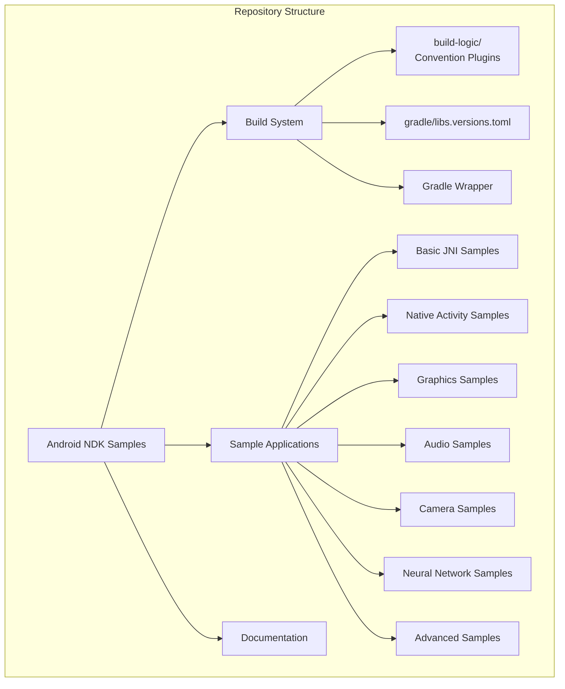
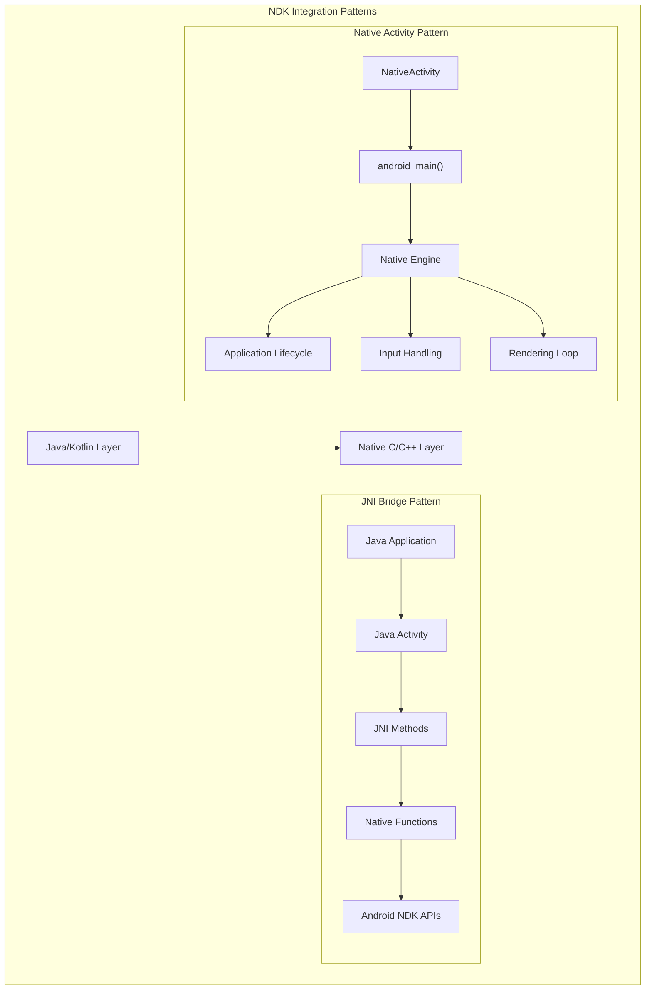
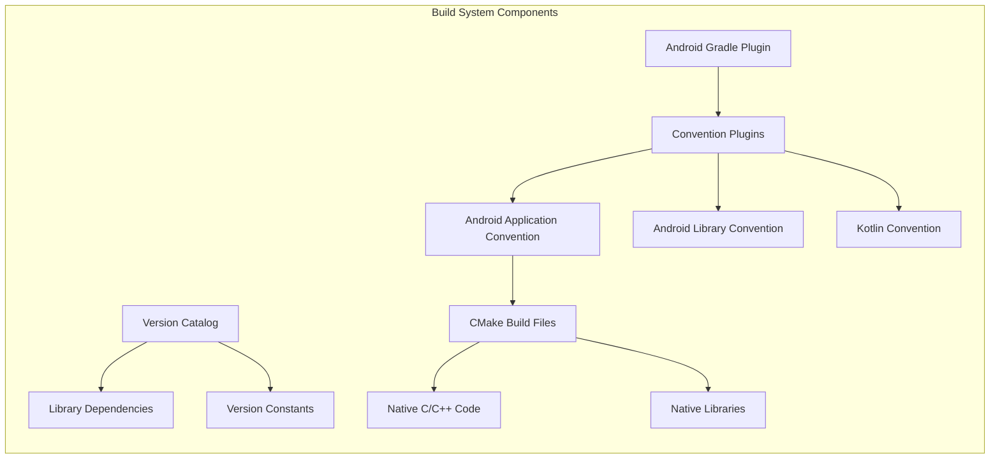

<!-- source: DeepWiki mcp.deepwiki.com · repo android/ndk-samples · page 1 Overview · fetched 2026-10-23 -->

# Overview

<details>
<summary>Relevant source files</summary>

The following files were used as context for generating this wiki page:

- [ARCHITECTURE.md](ARCHITECTURE.md)
- [README.md](README.md)
- [audio-echo/README.md](audio-echo/README.md)
- [bitmap-plasma/README.md](bitmap-plasma/README.md)
- [docs/run-sample.png](docs/run-sample.png)
- [endless-tunnel/README.md](endless-tunnel/README.md)
- [gles3jni/README.md](gles3jni/README.md)
- [hello-gl2/README.md](hello-gl2/README.md)
- [hello-jni/README.md](hello-jni/README.md)
- [native-activity/README.md](native-activity/README.md)
- [native-audio/README.md](native-audio/README.md)
- [native-codec/README.md](native-codec/README.md)
- [native-media/README.md](native-media/README.md)
- [native-plasma/README.md](native-plasma/README.md)
- [san-angeles/README.md](san-angeles/README.md)

</details>


This page provides a comprehensive introduction to the Android NDK Samples repository, a collection of sample applications demonstrating how to use the Android Native Development Kit (NDK) to incorporate C/C++ code into Android applications. For detailed information about the repository structure and organization, see [Repository Architecture](#1.1). For instructions on setting up and running the samples, see [Getting Started](#1.2).

## Purpose and Scope

The Android NDK Samples repository serves as a practical reference for developers looking to integrate native code into their Android applications. It demonstrates different integration patterns, API usage, and best practices for using the NDK. These samples showcase how to:

- Call C/C++ code from Java/Kotlin using JNI
- Create fully native applications using NativeActivity
- Implement graphics rendering with OpenGL ES and Vulkan
- Process audio with native APIs
- Access device features like camera from native code
- Optimize performance with native code

Sources: [README.md:2-4](), [README.md:25-42]()

## Repository Organization

The repository is structured as a multi-module Gradle project that can be opened and built in Android Studio. Each sample is contained in its own directory and demonstrates a specific aspect of NDK functionality.



Sources: [ARCHITECTURE.md:1-25](), [README.md:5-6]()

## Sample Categories

The repository contains a diverse range of samples organized into several categories:

### Basic JNI Samples
These samples demonstrate fundamental JNI integration patterns where native code is called from Java/Kotlin:

- **hello-jni**: Basic JNI example showing string creation in native code
- **hello-jniCallback**: Demonstrates callbacks from native code to Java
- **hello-libs**: Shows how to integrate prebuilt native libraries
- **hello-neon**: Demonstrates ARM NEON optimization techniques

Sources: [hello-jni/README.md:3-4]()

### Native Activity Samples
These samples implement full applications in native code using the NativeActivity class:

- **native-activity**: Initializes a GLES 2.0 context and reads accelerometer data
- **native-plasma**: Renders a plasma effect in a Bitmap entirely from native code
- **endless-tunnel**: A complete game implementation using native code

Sources: [native-activity/README.md:3-5](), [native-plasma/README.md:3-5](), [endless-tunnel/README.md:3-9]()

### Graphics Samples
These samples demonstrate graphics rendering using various native APIs:

- **Teapot samples**: Various rendering techniques with the classic 3D teapot model
- **hello-gl2**: Basic OpenGL ES 2.0 rendering
- **gles3jni**: Advanced OpenGL ES 3.0 features
- **hello-vulkan**: Vulkan graphics API implementation
- **san-angeles**: Procedural scene rendering with GLES
- **bitmap-plasma**: JNI-based bitmap manipulation

Sources: [gles3jni/README.md:3-14](), [hello-gl2/README.md:3-7](), [san-angeles/README.md:3-7](), [bitmap-plasma/README.md:3-6]()

### Audio Samples
These samples show audio processing and playback using native code:

- **native-audio**: Audio playback and recording with OpenSL ES
- **audio-echo**: Low-latency audio processing in the fast audio path
- **hello-oboe**: Modern audio using the Oboe library
- **native-midi**: MIDI implementation with native code

Sources: [native-audio/README.md:3-6](), [audio-echo/README.md:3-11]()

### Media Samples
These samples demonstrate media handling in native code:

- **native-codec**: Uses Native Media Codec API to play video
- **native-media**: Demonstrates OpenMAX AL for video playback

Sources: [native-codec/README.md:3-4](), [native-media/README.md:3-14]()

### Camera Samples
These samples show camera integration with native code through NDK APIs.

### Advanced Samples
These include specialized demonstrations such as:

- **sanitizers**: Memory error detection in native code
- **nn-samples**: Neural Networks API usage from native code

## NDK Integration Patterns

The samples in this repository demonstrate different patterns for integrating native code with Android applications:



Sources: [README.md:37-42](), [endless-tunnel/README.md:60-95]()

## Build System

The repository uses a modern Gradle build system with CMake integration for building native code:



Key components include:
- **Convention plugins** in the `build-logic` directory that define common build configurations
- **Version catalog** in `gradle/libs.versions.toml` that centralizes dependency management
- **CMake build files** in each sample that define how to build the native code

Sources: [ARCHITECTURE.md:37-58]()

## Getting Started

### Requirements
- Android Studio 2.2+ with NDK bundle
- Basic knowledge of Android development and C/C++

### Building and Running
The samples can be built and run using Android Studio or from the command line:

#### Using Android Studio
1. Clone the repository
2. Open the whole project in Android Studio
3. Select the desired sample from the configuration dropdown
4. Click the run button

#### Using Command Line
```
# Build all samples
./gradlew build

# Build a specific sample
./gradlew :hello-jni:build

# Run tasks for a specific sample
./gradlew :camera:basic:tasks
```

Sources: [README.md:8-23](), [hello-jni/README.md:12-20]()

## Sample Usage Considerations

The samples in this repository are primarily designed to demonstrate specific NDK APIs and integration patterns. They often prioritize clarity and conciseness over production-level architecture. For production applications, developers should consider:

- Error handling and recovery
- Performance optimization
- Resource management
- Platform compatibility

For production-quality application architecture, consider referencing the [Now in Android](https://github.com/android/nowinandroid) project alongside these samples.

Sources: [README.md:25-35]()

---

