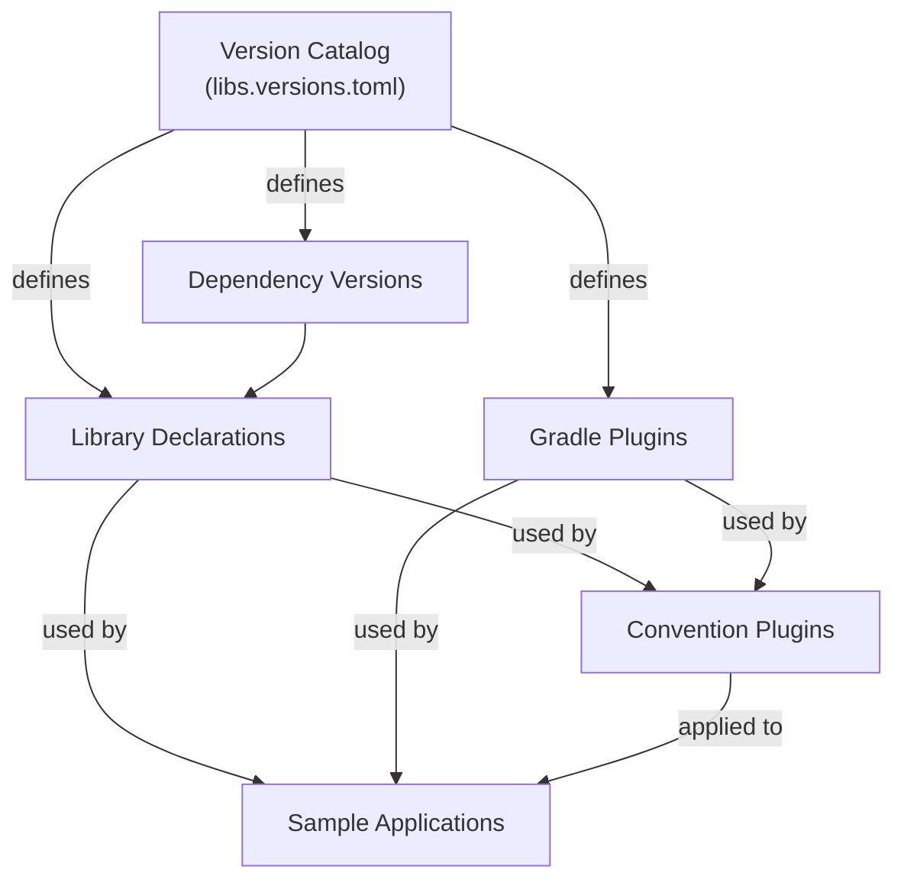
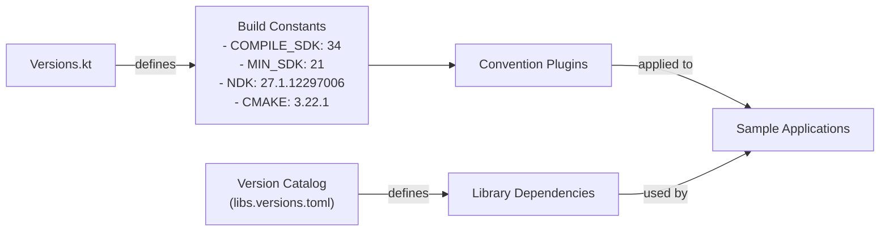

<!-- source: DeepWiki mcp.deepwiki.com · repo android/ndk-samples · page 2.1 Dependency Management · fetched 2026-10-23 -->

# Dependency Management

<details>
<summary>Relevant source files</summary>

The following files were used as context for generating this wiki page:

- [audio-echo/app/build.gradle](audio-echo/app/build.gradle)
- [build-logic/README.md](build-logic/README.md)
- [build-logic/build.gradle.kts](build-logic/build.gradle.kts)
- [build-logic/settings.gradle.kts](build-logic/settings.gradle.kts)
- [build-logic/src/main/java/com/android/ndk/samples/buildlogic/AndroidApplicationConventionPlugin.kt](build-logic/src/main/java/com/android/ndk/samples/buildlogic/AndroidApplicationConventionPlugin.kt)
- [build-logic/src/main/java/com/android/ndk/samples/buildlogic/KotlinConventionPlugin.kt](build-logic/src/main/java/com/android/ndk/samples/buildlogic/KotlinConventionPlugin.kt)
- [build-logic/src/main/java/com/android/ndk/samples/buildlogic/Versions.kt](build-logic/src/main/java/com/android/ndk/samples/buildlogic/Versions.kt)
- [gradle/libs.versions.toml](gradle/libs.versions.toml)
- [settings.gradle](settings.gradle)

</details>


## Purpose and Scope

This document explains how dependencies are managed in the Android NDK Samples repository. It covers the centralized dependency management system using Gradle's Version Catalog feature, detailing how library versions, dependencies, and plugins are defined and used across all sample projects. This page focuses on the dependency definitions and access patterns, while the convention plugins that apply these dependencies are covered in [Convention Plugins](#2.2).

## Overview

The NDK Samples repository uses a modern approach to dependency management through Gradle's Version Catalog feature. This approach centralizes all dependency declarations in a single file, making it easier to:

1. Maintain consistent dependency versions across all samples
2. Update dependencies in one place
3. Access dependencies using type-safe accessors
4. Reduce duplication and potential version conflicts



Sources: [gradle/libs.versions.toml](), [settings.gradle](), [build-logic/settings.gradle.kts]()

## Version Catalog Structure

The version catalog is defined in `libs.versions.toml` and consists of three main sections:

### 1. Versions Section

This section defines version constants that can be referenced by library and plugin declarations:

```
[versions]
agp = "8.7.0"
kotlin = "1.9.0"
appcompat = "1.6.1"
...
```

Sources: [gradle/libs.versions.toml:1-20]()

### 2. Libraries Section

This section defines library dependencies that can be used in build scripts, referencing versions from the versions section:

```
[libraries]
junit = { group = "junit", name = "junit", version.ref = "junit" }
appcompat = { group = "androidx.appcompat", name = "appcompat", version.ref = "appcompat" }
...
```

Sources: [gradle/libs.versions.toml:22-42]()

### 3. Plugins Section

This section defines Gradle plugins that can be applied in build scripts:

```
[plugins]
android-application = { id = "com.android.application", version.ref = "agp" }
jetbrainsKotlinAndroid = { id = "org.jetbrains.kotlin.android", version.ref = "kotlin" }
...
```

Sources: [gradle/libs.versions.toml:44-48]()

## Dependency Categories

The version catalog defines several categories of dependencies:

```mermaid
classDiagram
    class "Version Catalog" {
        +AndroidBuildTools
        +AndroidLibraries
        +TestingLibraries
        +NDKThirdParty
        +BuildLogicDependencies
        +GradlePlugins
    }
    
    class "AndroidBuildTools" {
        +AGP
        +Kotlin
        +CMake
        +NDK
    }
    
    class "AndroidLibraries" {
        +AppCompat
        +Material
        +ConstraintLayout
        +Core
        +Oboe
        +Games
    }
    
    class "TestingLibraries" {
        +JUnit
        +Espresso
        +AndroidXJUnitGTest
    }
    
    class "NDKThirdParty" {
        +curl
        +googletest
        +jsoncpp
        +openssl
    }
    
    "Version Catalog" -- "AndroidBuildTools"
    "Version Catalog" -- "AndroidLibraries"
    "Version Catalog" -- "TestingLibraries" 
    "Version Catalog" -- "NDKThirdParty"
    "Version Catalog" -- "BuildLogicDependencies"
    "Version Catalog" -- "GradlePlugins"
```

Sources: [gradle/libs.versions.toml]()

## Accessing the Version Catalog

### In Sample Applications

Sample applications access the version catalog through the `libs` accessor:

```kotlin
dependencies {
    implementation libs.appcompat
}
```

Sources: [audio-echo/app/build.gradle:24-26]()

### In Convention Plugins

The build-logic module accesses the version catalog by importing it explicitly in its settings:

```kotlin
versionCatalogs {
    create("libs") {
        from(files("../gradle/libs.versions.toml"))
    }
}
```

Sources: [build-logic/settings.gradle.kts:6-10]()

Then, it can use these dependencies in its build script:

```kotlin
dependencies {
    compileOnly(libs.android.gradlePlugin)
    compileOnly(libs.kotlin.gradlePlugin)
}
```

Sources: [build-logic/build.gradle.kts:20-23]()

## Dependency Relationship to Version Constants

Some dependencies in the codebase are not defined in the version catalog but are instead defined in code. For example, the Android SDK, NDK, and CMake versions are defined in `Versions.kt`:



Sources: [build-logic/src/main/java/com/android/ndk/samples/buildlogic/Versions.kt](), [build-logic/src/main/java/com/android/ndk/samples/buildlogic/AndroidApplicationConventionPlugin.kt:17-22]()

## NDK-Specific Dependencies

The version catalog includes several NDK-specific third-party libraries that are packaged using [Prefab](https://google.github.io/prefab):

```
curl = { group = "com.android.ndk.thirdparty", name = "curl", version.ref = "curl" }
googletest = { group = "com.android.ndk.thirdparty", name = "googletest", version.ref = "googletest" }
jsoncpp = { group = "com.android.ndk.thirdparty", name = "jsoncpp", version.ref = "jsoncpp" }
openssl = { group = "com.android.ndk.thirdparty", name = "openssl", version.ref = "openssl" }
```

These dependencies are used in certain samples like `prefab/curl-ssl` to demonstrate integration with prebuilt native libraries.

Sources: [gradle/libs.versions.toml:17-20](), [gradle/libs.versions.toml:35-39]()

## Benefits of Centralized Dependency Management

Centralizing dependencies in the version catalog provides several benefits:

1. **Consistency**: All samples use the same versions of dependencies
2. **Maintainability**: Update dependencies in one place instead of across multiple build files
3. **Type safety**: Access dependencies using type-safe accessors rather than error-prone strings
4. **Discoverability**: Easily see what dependencies are available and their versions
5. **IDE support**: Better code completion and documentation in IDEs

## Repository Configuration

The repository configuration in `settings.gradle` ensures that dependencies can be properly resolved:

```kotlin
dependencyResolutionManagement {
    repositoriesMode.set(RepositoriesMode.FAIL_ON_PROJECT_REPOS)
    repositories {
        google()
        mavenCentral()
    }
}
```

This configuration centrally defines which repositories should be used to resolve dependencies for all modules.

Sources: [settings.gradle:15-21]()

## Summary

The Android NDK Samples repository uses Gradle's Version Catalog feature to centralize dependency management in `libs.versions.toml`. This approach provides a consistent, maintainable way to declare and use dependencies across all sample projects. The version catalog works in conjunction with convention plugins to standardize build configurations across the repository.

---

