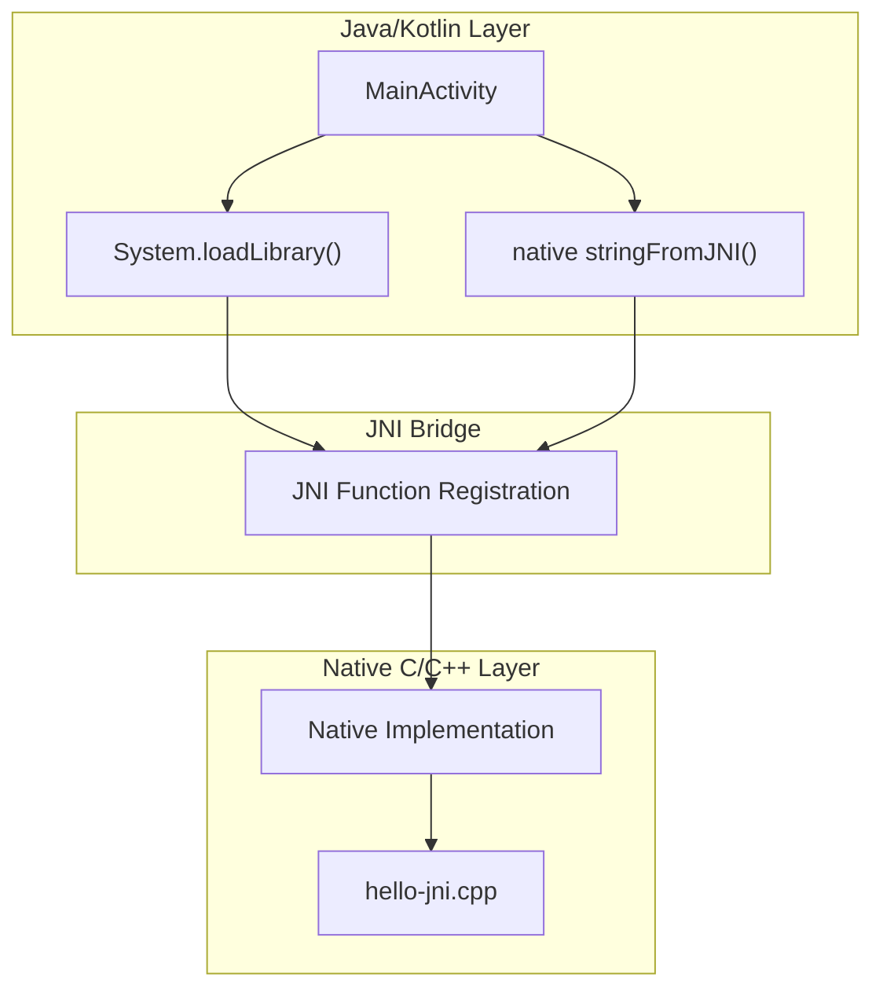
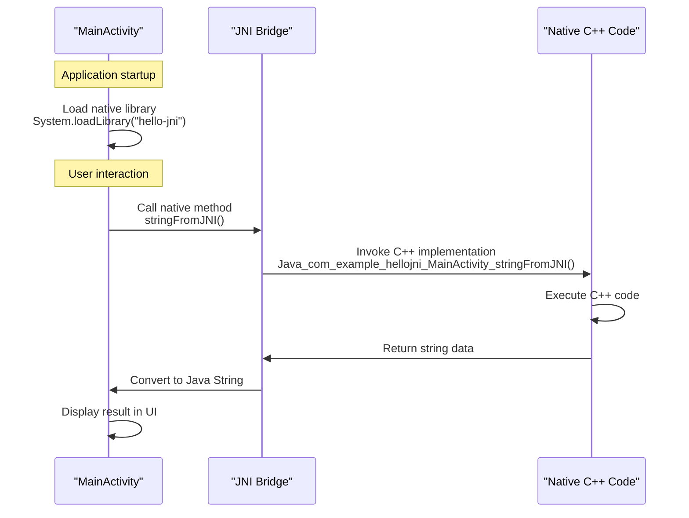
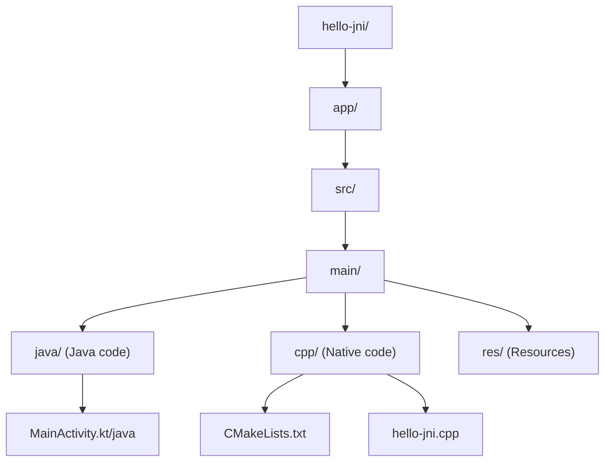

<!-- source: DeepWiki mcp.deepwiki.com · repo android/ndk-samples · page 3.1 Hello JNI · fetched 2026-10-23 -->

# Hello JNI

<details>
<summary>Relevant source files</summary>

The following files were used as context for generating this wiki page:

- [audio-echo/README.md](audio-echo/README.md)
- [bitmap-plasma/README.md](bitmap-plasma/README.md)
- [bitmap-plasma/app/build.gradle](bitmap-plasma/app/build.gradle)
- [endless-tunnel/README.md](endless-tunnel/README.md)
- [endless-tunnel/app/build.gradle](endless-tunnel/app/build.gradle)
- [gles3jni/README.md](gles3jni/README.md)
- [hello-gl2/README.md](hello-gl2/README.md)
- [hello-gl2/app/build.gradle](hello-gl2/app/build.gradle)
- [hello-jni/README.md](hello-jni/README.md)
- [hello-jni/app/build.gradle](hello-jni/app/build.gradle)
- [native-activity/README.md](native-activity/README.md)
- [native-activity/app/build.gradle](native-activity/app/build.gradle)
- [native-audio/README.md](native-audio/README.md)
- [native-audio/app/build.gradle](native-audio/app/build.gradle)
- [native-codec/README.md](native-codec/README.md)
- [native-codec/app/build.gradle](native-codec/app/build.gradle)
- [native-media/README.md](native-media/README.md)
- [native-media/app/build.gradle](native-media/app/build.gradle)
- [native-plasma/README.md](native-plasma/README.md)
- [native-plasma/app/build.gradle](native-plasma/app/build.gradle)
- [san-angeles/README.md](san-angeles/README.md)
- [san-angeles/app/build.gradle](san-angeles/app/build.gradle)

</details>


## Introduction

Hello JNI is a simple Android application that demonstrates how to call C/C++ code from Java/Kotlin using the Java Native Interface (JNI). This sample serves as an entry point for developers learning to use the Android NDK to integrate native code into their applications.

## Purpose and Scope

This documentation covers:
- The basic structure of a JNI-enabled Android application
- How Java/Kotlin code interfaces with C/C++ code
- How the CMake build system integrates native code
- The flow of execution between Java and native components

For more complex JNI examples including callbacks from native code to Java, see [JNI Callbacks](#3.2).

## Architecture Overview

### JNI Integration Flow



Sources: [hello-jni/README.md:1-10]()

### JNI Call Sequence



Sources: [hello-jni/README.md:3-9]()

## Project Setup

The Hello JNI sample uses the modern Android project setup with Gradle and CMake integration for native code builds.

### Project Structure



Sources: [hello-jni/app/build.gradle:1-29]()

### Build Configuration

The project uses a conventional Gradle setup with Android NDK integration through CMake:

| Component | Purpose |
|-----------|---------|
| `ndksamples.android.application` plugin | Configures standard Android application build |
| `ndksamples.android.kotlin` plugin | Adds Kotlin support to the project |
| `externalNativeBuild` block | Specifies CMake build file location |
| `CMakeLists.txt` | Defines native code compilation rules |

Sources: [hello-jni/app/build.gradle:1-29]()

## Key Components

### Gradle Configuration

The build.gradle file defines the project setup:

```
plugins {
    id "ndksamples.android.application"
    id "ndksamples.android.kotlin"
}

android {
    namespace 'com.example.hellojni'

    defaultConfig {
        applicationId 'com.example.hellojni'
    }

    externalNativeBuild {
        cmake {
            path "src/main/cpp/CMakeLists.txt"
        }
    }

    buildFeatures {
        viewBinding true
    }
}
```

This configuration:
- Uses the convention plugins to standardize build configuration
- Sets the application ID and namespace
- Points to the CMake build file for native code
- Enables view binding for easier UI element access

Sources: [hello-jni/app/build.gradle:1-29]()

### Java/Kotlin Side

The Java or Kotlin side of a JNI application typically includes:

1. Loading the native library using `System.loadLibrary()`
2. Declaring native methods with the `native` keyword
3. Calling these native methods from Java/Kotlin code

A typical pattern is:

```java
public class MainActivity extends AppCompatActivity {
    // Load native library at application startup
    static {
        System.loadLibrary("hello-jni");
    }

    // Declare a native method
    public native String stringFromJNI();

    @Override
    protected void onCreate(Bundle savedInstanceState) {
        super.onCreate(savedInstanceState);
        setContentView(R.layout.activity_main);

        // Call the native method
        TextView tv = findViewById(R.id.text_view);
        tv.setText(stringFromJNI());
    }
}
```

Sources: [hello-jni/README.md:3-9]()

### Native C/C++ Side

The native side implements the functions declared in Java/Kotlin. JNI follows a specific naming convention for matching Java/Kotlin methods to C/C++ functions:

```cpp
Java_<package_name>_<class_name>_<method_name>(JNIEnv* env, jobject thiz, ...)
```

A typical implementation would be:

```cpp
#include <jni.h>
#include <string>

extern "C" JNIEXPORT jstring JNICALL
Java_com_example_hellojni_MainActivity_stringFromJNI(
        JNIEnv* env,
        jobject /* this *) {
    std::string hello = "Hello from C++";
    return env->NewStringUTF(hello.c_str());
}
```

Key elements:
- `extern "C"` - Prevents name mangling in C++
- `JNIEXPORT` and `JNICALL` - JNI-specific macros
- `JNIEnv*` - Provides access to JNI functions
- `jobject` - Refers to the Java object instance that called the method

Sources: [hello-jni/README.md:3-9]()

## Building and Running

The Hello JNI sample can be built and run like a standard Android application:

1. Open the project in Android Studio
2. Sync the project with Gradle files
3. Build the application (Android Studio automatically builds both Java/Kotlin and native code)
4. Run on a device or emulator

When executed, the application will:
1. Load the native library
2. Call the native method
3. Display the returned string in the UI

## Debugging Native Code

When debugging JNI applications, you can:

1. Use Android Studio's integrated debugger to step through both Java/Kotlin and C/C++ code
2. Set breakpoints in native code
3. Inspect JNI variables and memory

This helps troubleshoot issues that may arise from the Java-native code boundary.

Sources: [hello-jni/README.md:13-20]()

## Best Practices

When using JNI in Android applications:

1. **Type Safety**: Be careful with type conversions between Java and C/C++
2. **Memory Management**: Properly release native resources to avoid memory leaks
3. **Exception Handling**: Check for and handle Java exceptions in native code
4. **Threading**: Be aware of threading implications when calling between Java and native code
5. **ABI Compatibility**: Consider which CPU architectures (ABIs) your app will support

## Related Samples

In the Android NDK Samples repository, several other examples build on the concepts shown in Hello JNI:

| Sample | Focus | Description |
|--------|-------|-------------|
| hello-jniCallback | JNI callbacks | Demonstrates calling Java methods from native code |
| hello-libs | Prebuilt libraries | Shows how to use prebuilt native libraries |
| hello-neon | CPU optimization | Demonstrates NEON optimizations for ARM processors |

Sources: [hello-jni/README.md:1-36]()

---

