# Page: Overview

# Overview

<details>
<summary>Relevant source files</summary>

The following files were used as context for generating this wiki page:

- [ARCHITECTURE.md](ARCHITECTURE.md)
- [README.md](README.md)
- [audio-echo/README.md](audio-echo/README.md)
- [bitmap-plasma/README.md](bitmap-plasma/README.md)
- [docs/run-sample.png](docs/run-sample.png)
- [endless-tunnel/README.md](endless-tunnel/README.md)
- [gles3jni/README.md](gles3jni/README.md)
- [hello-gl2/README.md](hello-gl2/README.md)
- [hello-jni/README.md](hello-jni/README.md)
- [native-activity/README.md](native-activity/README.md)
- [native-audio/README.md](native-audio/README.md)
- [native-codec/README.md](native-codec/README.md)
- [native-media/README.md](native-media/README.md)
- [native-plasma/README.md](native-plasma/README.md)
- [san-angeles/README.md](san-angeles/README.md)

</details>


This page provides a comprehensive introduction to the Android NDK Samples repository, a collection of sample applications demonstrating how to use the Android Native Development Kit (NDK) to incorporate C/C++ code into Android applications. For detailed information about the repository structure and organization, see [Repository Architecture](#1.1). For instructions on setting up and running the samples, see [Getting Started](#1.2).

## Purpose and Scope

The Android NDK Samples repository serves as a practical reference for developers looking to integrate native code into their Android applications. It demonstrates different integration patterns, API usage, and best practices for using the NDK. These samples showcase how to:

- Call C/C++ code from Java/Kotlin using JNI
- Create fully native applications using NativeActivity
- Implement graphics rendering with OpenGL ES and Vulkan
- Process audio with native APIs
- Access device features like camera from native code
- Optimize performance with native code

Sources: [README.md:2-4](), [README.md:25-42]()

## Repository Organization

The repository is structured as a multi-module Gradle project that can be opened and built in Android Studio. Each sample is contained in its own directory and demonstrates a specific aspect of NDK functionality.

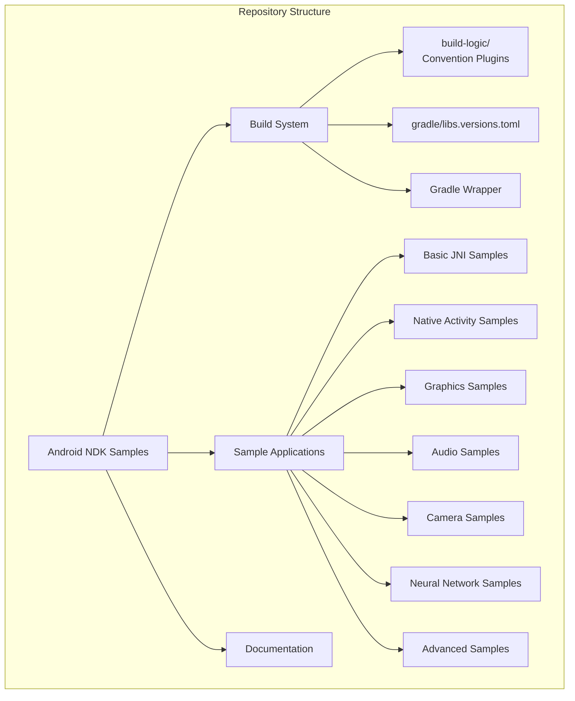

Sources: [ARCHITECTURE.md:1-25](), [README.md:5-6]()

## Sample Categories

The repository contains a diverse range of samples organized into several categories:

### Basic JNI Samples
These samples demonstrate fundamental JNI integration patterns where native code is called from Java/Kotlin:

- **hello-jni**: Basic JNI example showing string creation in native code
- **hello-jniCallback**: Demonstrates callbacks from native code to Java
- **hello-libs**: Shows how to integrate prebuilt native libraries
- **hello-neon**: Demonstrates ARM NEON optimization techniques

Sources: [hello-jni/README.md:3-4]()

### Native Activity Samples
These samples implement full applications in native code using the NativeActivity class:

- **native-activity**: Initializes a GLES 2.0 context and reads accelerometer data
- **native-plasma**: Renders a plasma effect in a Bitmap entirely from native code
- **endless-tunnel**: A complete game implementation using native code

Sources: [native-activity/README.md:3-5](), [native-plasma/README.md:3-5](), [endless-tunnel/README.md:3-9]()

### Graphics Samples
These samples demonstrate graphics rendering using various native APIs:

- **Teapot samples**: Various rendering techniques with the classic 3D teapot model
- **hello-gl2**: Basic OpenGL ES 2.0 rendering
- **gles3jni**: Advanced OpenGL ES 3.0 features
- **hello-vulkan**: Vulkan graphics API implementation
- **san-angeles**: Procedural scene rendering with GLES
- **bitmap-plasma**: JNI-based bitmap manipulation

Sources: [gles3jni/README.md:3-14](), [hello-gl2/README.md:3-7](), [san-angeles/README.md:3-7](), [bitmap-plasma/README.md:3-6]()

### Audio Samples
These samples show audio processing and playback using native code:

- **native-audio**: Audio playback and recording with OpenSL ES
- **audio-echo**: Low-latency audio processing in the fast audio path
- **hello-oboe**: Modern audio using the Oboe library
- **native-midi**: MIDI implementation with native code

Sources: [native-audio/README.md:3-6](), [audio-echo/README.md:3-11]()

### Media Samples
These samples demonstrate media handling in native code:

- **native-codec**: Uses Native Media Codec API to play video
- **native-media**: Demonstrates OpenMAX AL for video playback

Sources: [native-codec/README.md:3-4](), [native-media/README.md:3-14]()

### Camera Samples
These samples show camera integration with native code through NDK APIs.

### Advanced Samples
These include specialized demonstrations such as:

- **sanitizers**: Memory error detection in native code
- **nn-samples**: Neural Networks API usage from native code

## NDK Integration Patterns

The samples in this repository demonstrate different patterns for integrating native code with Android applications:

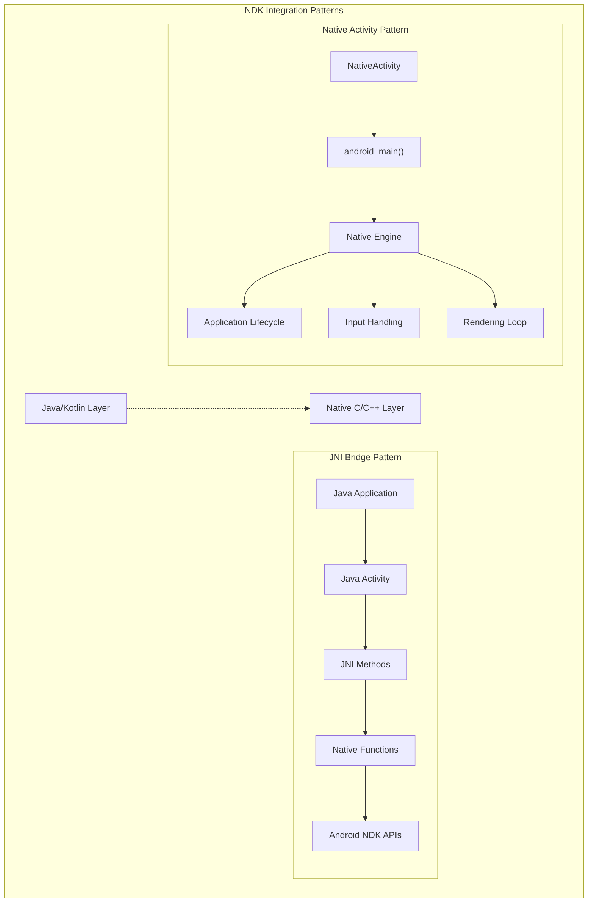

Sources: [README.md:37-42](), [endless-tunnel/README.md:60-95]()

## Build System

The repository uses a modern Gradle build system with CMake integration for building native code:

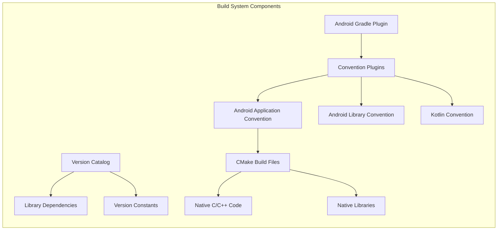

Key components include:
- **Convention plugins** in the `build-logic` directory that define common build configurations
- **Version catalog** in `gradle/libs.versions.toml` that centralizes dependency management
- **CMake build files** in each sample that define how to build the native code

Sources: [ARCHITECTURE.md:37-58]()

## Getting Started

### Requirements
- Android Studio 2.2+ with NDK bundle
- Basic knowledge of Android development and C/C++

### Building and Running
The samples can be built and run using Android Studio or from the command line:

#### Using Android Studio
1. Clone the repository
2. Open the whole project in Android Studio
3. Select the desired sample from the configuration dropdown
4. Click the run button

#### Using Command Line
```
# Build all samples
./gradlew build

# Build a specific sample
./gradlew :hello-jni:build

# Run tasks for a specific sample
./gradlew :camera:basic:tasks
```

Sources: [README.md:8-23](), [hello-jni/README.md:12-20]()

## Sample Usage Considerations

The samples in this repository are primarily designed to demonstrate specific NDK APIs and integration patterns. They often prioritize clarity and conciseness over production-level architecture. For production applications, developers should consider:

- Error handling and recovery
- Performance optimization
- Resource management
- Platform compatibility

For production-quality application architecture, consider referencing the [Now in Android](https://github.com/android/nowinandroid) project alongside these samples.

Sources: [README.md:25-35]()

---

# Page: Repository Architecture

# Repository Architecture

<details>
<summary>Relevant source files</summary>

The following files were used as context for generating this wiki page:

- [ARCHITECTURE.md](ARCHITECTURE.md)
- [README.md](README.md)
- [audio-echo/README.md](audio-echo/README.md)
- [bitmap-plasma/README.md](bitmap-plasma/README.md)
- [docs/run-sample.png](docs/run-sample.png)
- [endless-tunnel/README.md](endless-tunnel/README.md)
- [gles3jni/README.md](gles3jni/README.md)
- [hello-gl2/README.md](hello-gl2/README.md)
- [hello-jni/README.md](hello-jni/README.md)
- [native-activity/README.md](native-activity/README.md)
- [native-audio/README.md](native-audio/README.md)
- [native-codec/README.md](native-codec/README.md)
- [native-media/README.md](native-media/README.md)
- [native-plasma/README.md](native-plasma/README.md)
- [san-angeles/README.md](san-angeles/README.md)

</details>


## Purpose and Scope

This document details the overall structure of the Android NDK Samples repository, explaining how the repository is organized, how samples are categorized, and the relationships between different components. It provides a technical overview of the repository architecture to help developers navigate and understand the codebase.

For information on getting started with building and running the samples, see [Getting Started](#1.2). For details on the Gradle build system configuration, see [Build System](#2).

Sources: [README.md:1-7](), [ARCHITECTURE.md:1-5]()

## High-Level Repository Organization

The Android NDK Samples repository is structured as a single Gradle project containing multiple sample applications. The repository demonstrates various Android NDK features and best practices through these samples.

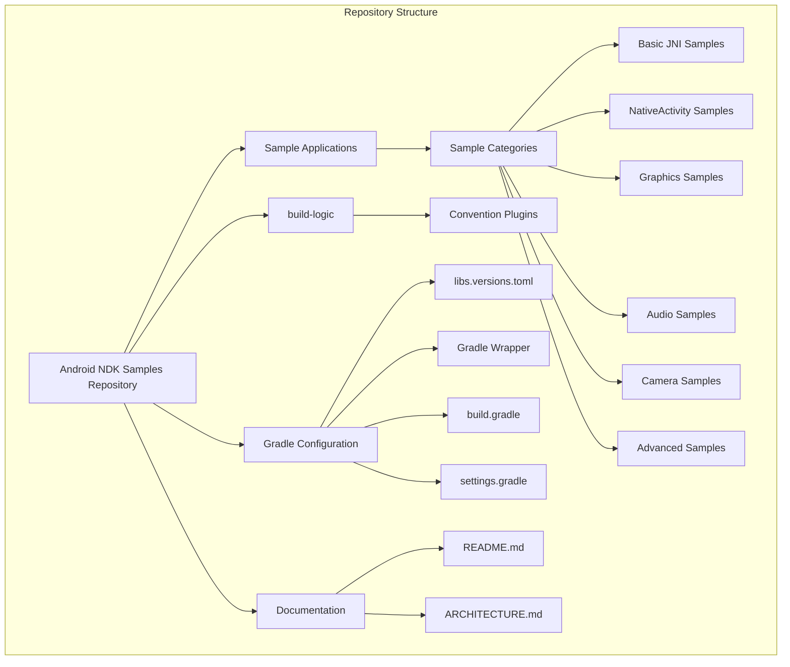

Sources: [ARCHITECTURE.md:8-18](), [README.md:1-7]()

### Root Directory Structure

The repository's root directory contains the following key components:

| Component | Description |
|-----------|-------------|
| Sample directories | Individual sample applications (e.g., `hello-jni`, `native-activity`) |
| `build-logic` | Gradle convention plugins for managing build configuration |
| `gradle/libs.versions.toml` | Central version catalog for dependencies |
| `build.gradle` / `settings.gradle` | Root project build configuration |
| `.github` | GitHub workflows and CI configuration |
| `docs` | Documentation resources |
| `README.md` / `ARCHITECTURE.md` | Main documentation files |

Each sample directory is technically a Gradle module (referred to as a "module" in Android Studio). These modules cannot be opened individually in Android Studio, as they rely on common code from the root project.

Sources: [ARCHITECTURE.md:10-21](), [ARCHITECTURE.md:85-97]()

## Sample Categories and Integration Patterns

The repository contains samples organized by their functionality and the NDK features they demonstrate. These samples showcase different patterns for integrating native code with Android applications.

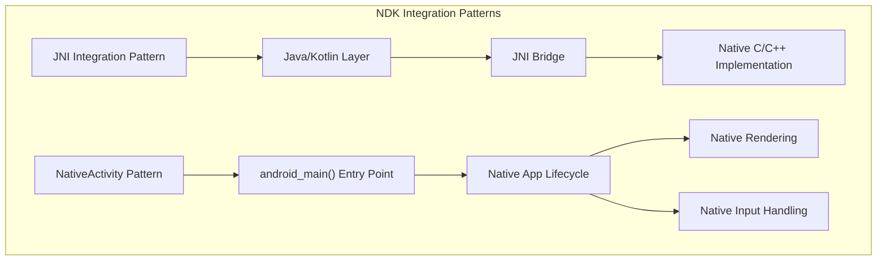

### Sample Categories

The samples are organized into the following major categories:

1. **Basic JNI Samples**
   - `hello-jni`: Simple JNI integration example
   - `hello-jniCallback`: Demonstrates callbacks from native code
   - `hello-libs`: Shows how to use prebuilt native libraries
   - `hello-neon`: Demonstrates ARM NEON optimization techniques

2. **NativeActivity Samples**
   - `native-activity`: Full application in native code using NativeActivity
   - `native-plasma`: Plasma effect rendered in NativeActivity
   - `endless-tunnel`: Game sample using native glue

3. **Graphics Samples**
   - **OpenGL ES**: `hello-gl2`, `gles3jni`, teapot samples
   - **Vulkan**: `hello-vulkan`
   - **Other Graphics**: `san-angeles`, `bitmap-plasma`

4. **Audio Samples**
   - `native-audio`: OpenSL ES audio playback and recording
   - `audio-echo`: Audio processing with OpenSL ES
   - `hello-oboe`: Modern audio using Oboe library

5. **Camera Samples**
   - `camera-basic`: Basic camera handling with NDK

6. **Advanced Samples**
   - `sanitizers`: Memory error detection with sanitizers
   - `nn-basic`: Neural Networks API usage

Sources: [README.md:75-81](), [hello-jni/README.md:1-10](), [native-activity/README.md:1-9](), [endless-tunnel/README.md:1-14](), [native-audio/README.md:1-14](), [native-codec/README.md:1-13](), [gles3jni/README.md:1-15]()

## Individual Sample Structure

Each sample in the repository follows a common structure, while implementing its specific features.

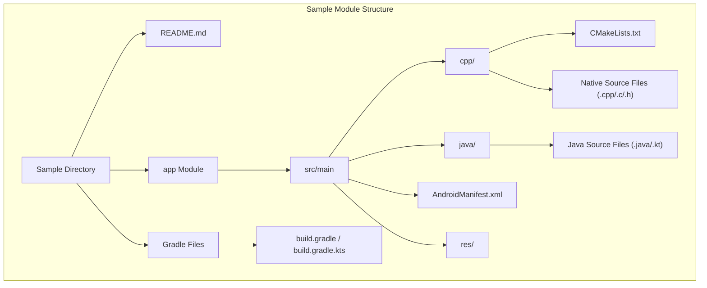

### Sample Structure Details

Each sample directory typically contains:

1. **README.md** - Documentation specific to the sample
2. **build.gradle** or **build.gradle.kts** - Gradle build script for the module
3. **app/src/main/** - Main source directory containing:
   - **java/** - Java/Kotlin source files
   - **cpp/** - Native C/C++ source files
   - **CMakeLists.txt** - CMake build script for native code
   - **AndroidManifest.xml** - Android manifest file
   - **res/** - Android resources

The exact structure might vary slightly between samples depending on their complexity and requirements.

Sources: [ARCHITECTURE.md:10-21](), [hello-jni/README.md:6-9]()

## Build System Organization

The build system is a crucial part of the repository architecture, providing consistency across all samples.

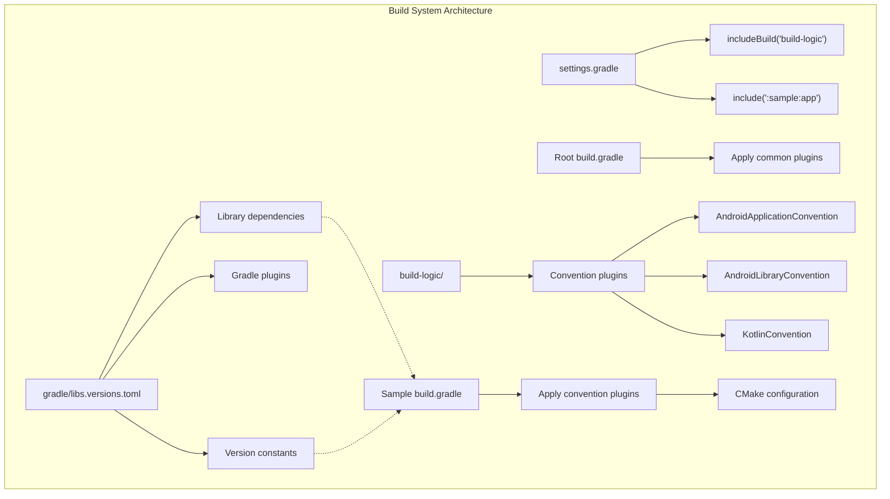

### Build System Components

1. **Gradle Wrapper** - Ensures consistent Gradle version across environments
2. **Convention Plugins** - Located in `build-logic/`, these plugins define common configurations for all samples
3. **Version Catalog** - Located in `gradle/libs.versions.toml`, it centralizes dependency versions
4. **Root build files**:
   - `settings.gradle` - Configures repositories and includes sample modules
   - `build.gradle` - Defines top-level configuration

This architecture follows modern Gradle best practices, centralizing build logic to ensure consistency and maintainability across all samples.

Sources: [ARCHITECTURE.md:37-44](), [ARCHITECTURE.md:50-60](), [ARCHITECTURE.md:62-74](), [ARCHITECTURE.md:76-84]()

## Sample Module Dependencies

Sample modules in the repository share common dependencies and configurations through the centralized build system. The diagram below illustrates this relationship:

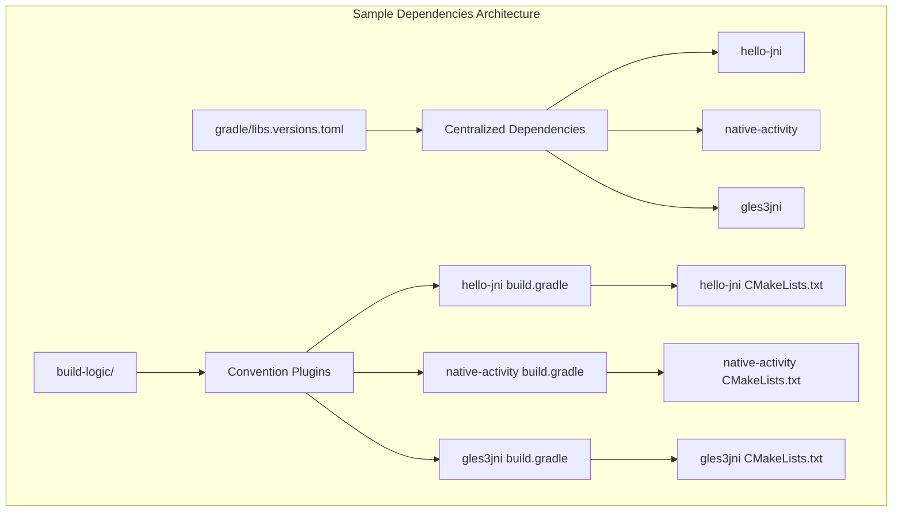

This dependency structure ensures that:

1. All samples use consistent versions of libraries and tools
2. Build configurations are standardized across samples
3. Sample-specific build scripts remain simple and focused on their unique requirements

Sources: [ARCHITECTURE.md:50-60](), [ARCHITECTURE.md:76-84]()

## Common Development Workflows

Understanding the repository structure helps navigate common development workflows:

1. **Opening the project in Android Studio**:
   - Open the entire repository as a single project
   - Individual samples appear as modules in the project view

2. **Running a sample**:
   - Select the sample from the configuration dropdown in Android Studio
   - Click the run button to build and run the sample

3. **Switching build variants**:
   - Use the Build Variants tool window in Android Studio
   - Select debug or release variant for each sample

4. **Command line building**:
   - Run `./gradlew build` to build all samples
   - Run `./gradlew :sample:task` to run a specific task for a specific sample
   - For example: `./gradlew :hello-jni:assembleDebug`

Sources: [README.md:8-23](), [ARCHITECTURE.md:28-36]()

## Conclusion

The Android NDK Samples repository uses a well-organized architecture that balances sample-specific functionality with shared infrastructure. Key features of this architecture include:

1. A single repository containing multiple sample applications
2. Centralized build configuration through convention plugins and a version catalog
3. Organized sample categories demonstrating different NDK integration patterns
4. Consistent structure within each sample module

This architecture makes it easy to explore individual samples while ensuring consistency across the entire repository.

---

# Page: Getting Started

# Getting Started

<details>
<summary>Relevant source files</summary>

The following files were used as context for generating this wiki page:

- [.github/workflows/build.yml](.github/workflows/build.yml)
- [ARCHITECTURE.md](ARCHITECTURE.md)
- [README.md](README.md)
- [audio-echo/README.md](audio-echo/README.md)
- [bitmap-plasma/README.md](bitmap-plasma/README.md)
- [docs/run-sample.png](docs/run-sample.png)
- [endless-tunnel/README.md](endless-tunnel/README.md)
- [gles3jni/README.md](gles3jni/README.md)
- [hello-gl2/README.md](hello-gl2/README.md)
- [hello-jni/README.md](hello-jni/README.md)
- [hello-neon/app/proguard-rules.pro](hello-neon/app/proguard-rules.pro)
- [hello-neon/app/src/main/AndroidManifest.xml](hello-neon/app/src/main/AndroidManifest.xml)
- [hello-neon/app/src/main/cpp/helloneon-intrinsics.h](hello-neon/app/src/main/cpp/helloneon-intrinsics.h)
- [hello-neon/app/src/main/res/mipmap-hdpi/ic_launcher.png](hello-neon/app/src/main/res/mipmap-hdpi/ic_launcher.png)
- [native-activity/README.md](native-activity/README.md)
- [native-audio/README.md](native-audio/README.md)
- [native-codec/README.md](native-codec/README.md)
- [native-media/README.md](native-media/README.md)
- [native-plasma/README.md](native-plasma/README.md)
- [san-angeles/README.md](san-angeles/README.md)

</details>


This document provides step-by-step instructions for setting up, building, and running the Android NDK samples. It covers installation of prerequisites, configuring your development environment, and running samples in both Android Studio and from the command line. For information about the repository architecture and organization, see [Repository Architecture](#1.1).

## Prerequisites

Before you can build and run the Android NDK samples, you need to have the following software installed:

- Android Studio (4.2 or higher)
- Android SDK
- Android NDK 
- Git (for cloning the repository)

### System Requirements

The Android NDK samples have been tested and validated on various configurations, including:
- Android L AndroidOne
- Android M/N and newer on Nexus/Pixel devices
- Most modern Android devices running Android 6.0 or higher

Sources: [README.md:11-23](), [audio-echo/README.md:9-14]()

## Setting Up the Development Environment

Follow these steps to set up your development environment for working with the Android NDK samples:

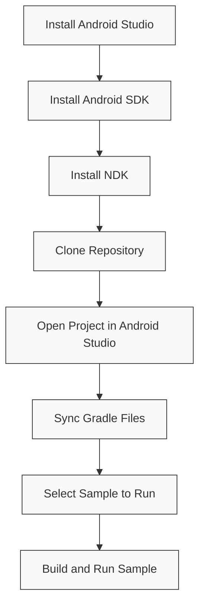

### 1. Install Android Studio

1. Download Android Studio from the [official website](http://developer.android.com/sdk/index.html)
2. Install and launch Android Studio
3. Complete the setup wizard which will install the basic Android SDK components

### 2. Install the Android NDK

The NDK can be installed through the Android Studio SDK Manager:

1. Open Android Studio
2. Go to **File > Settings > Appearance & Behavior > System Settings > Android SDK** (on macOS, **Android Studio > Preferences > Appearance & Behavior > System Settings > Android SDK**)
3. Select the **SDK Tools** tab
4. Check **NDK (Side by side)** and click **Apply** to install it

Alternatively, you can install the NDK when you open a project that requires it.

Sources: [README.md:9-16](), [hello-jni/README.md:12-13]()

### 3. Clone the Repository

```bash
git clone https://github.com/android/ndk-samples
cd ndk-samples
```

## Building and Running Samples

The Android NDK samples can be built and run either through Android Studio or using the command line with Gradle.

### Using Android Studio

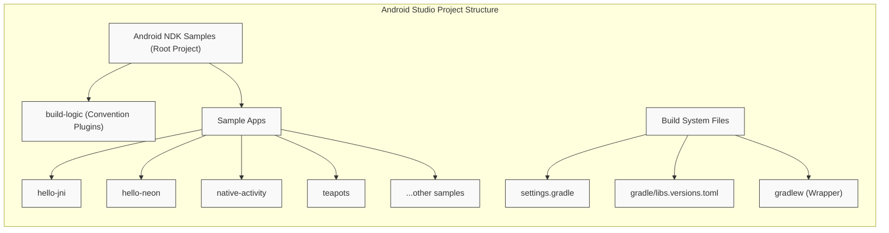

1. Open Android Studio
2. Select **Open an existing Android Studio project**
3. Navigate to the cloned repository directory and click **OK**
4. Android Studio will load the project - this may take some time as Gradle syncs all dependencies
5. Once the project is loaded, you may be prompted to download the NDK if it's not already installed
6. Select the sample you want to run from the configuration dropdown in the top bar
7. Click the **Run** button (green triangle) to build and run the sample on a connected device or emulator

| Action | Description |
|--------|-------------|
| Select Sample | Use the configuration dropdown in the top bar |
| Build | Click Build > Make Project or use the shortcut (Ctrl+F9 / Cmd+F9) |
| Run | Click Run > Run 'app' or use the shortcut (Shift+F10 / Ctrl+R) |
| Debug | Click Run > Debug 'app' or use the shortcut (Shift+F9 / Ctrl+D) |

Sources: [README.md:8-16](), [ARCHITECTURE.md:24-26]()

### Using Command Line with Gradle

You can also build and run the samples from the command line using the Gradle wrapper:

**On Linux/macOS**:
```bash
./gradlew build                  # Build all samples
./gradlew :hello-jni:build       # Build a specific sample
./gradlew :hello-jni:installDebug # Install a specific sample
```

**On Windows**:
```bash
.\gradlew.bat build               # Build all samples
.\gradlew.bat :hello-jni:build    # Build a specific sample
.\gradlew.bat :hello-jni:installDebug # Install a specific sample
```

To see available tasks for a specific sample:
```bash
./gradlew :camera:basic:tasks    # Lists all tasks for camera/basic sample
```

Sources: [README.md:18-23](), [.github/workflows/build.yml:22-24]()

## Choosing the Right Sample

The repository contains various samples demonstrating different aspects of the Android NDK. Here's a guide to help you choose the right sample for your needs:

| Category | Sample | Description |
|----------|--------|-------------|
| Basic JNI | hello-jni | Simple JNI integration |
| Basic JNI | hello-neon | ARM NEON optimization |
| Basic JNI | hello-libs | Using prebuilt native libraries |
| Graphics | hello-gl2 | Basic OpenGL ES 2.0 rendering |
| Graphics | gles3jni | OpenGL ES 3.0 features |
| Graphics | teapots | Various rendering techniques |
| Native Activity | native-activity | Full native application |
| Native Activity | native-plasma | Bitmap rendering in native code |
| Audio | native-audio | Audio playback and recording with OpenSL ES |
| Audio | hello-oboe | Modern audio with Oboe library |
| Video | native-media | Video playback with OpenMAX AL |

Sources: [README.md:75-81](), [gles3jni/README.md:3-14](), [native-activity/README.md:3-5]()

## Sample Structure and Building

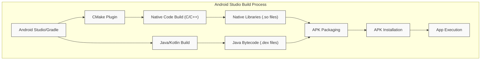

Most samples in this repository follow a similar structure:

1. **Java/Kotlin code** - UI and application logic
2. **Native C/C++ code** - Core functionality implemented in native code
3. **CMake build scripts** - For building the native code
4. **Gradle build files** - For the overall application build

The samples use the Android Studio CMake plugin for integrating native code. The build process compiles the C/C++ code into shared libraries (`.so` files) that are packaged with the APK.

For specific build configurations of individual samples, refer to their respective README files and `CMakeLists.txt` files in the sample directories.

Sources: [hello-jni/README.md:6-9](), [ARCHITECTURE.md:30-35]()

## Troubleshooting

### Common Issues

1. **NDK not found**
   - Solution: Install the NDK through the SDK Manager in Android Studio

2. **Build errors with CMake**
   - Solution: Make sure you have the latest CMake installed through the SDK Manager

3. **Samples not showing in configuration dropdown**
   - Solution: Sync the project with Gradle files (Tools > Android > Sync Project with Gradle Files)

4. **Device compatibility issues**
   - Solution: Some samples may require specific hardware features. Check the sample's README for requirements

### Getting Help

If you encounter issues with the samples, you can:

- Check the sample's README for specific requirements or known issues
- File an issue on the [GitHub repository](https://github.com/android/ndk-samples/issues)
- Ask questions in the [Discussions tab](https://github.com/android/ndk-samples/discussions) of the repository
- Join the [NDK mailing list](https://groups.google.com/g/android-ndk)

Sources: [README.md:50-73](), [native-audio/README.md:36-40]()

## Next Steps

After successfully setting up and running the samples, you might want to explore:

- [Build System](#2) details to understand how the Gradle build system works with native code
- [Basic JNI Samples](#3) to learn the fundamentals of JNI integration
- [Native Activity Applications](#4) to understand how to create fully native applications
- [Graphics Samples](#5) for learning OpenGL ES and Vulkan on Android

Sources: [README.md:44-48](), [README.md:75-81]()

---

# Page: Build System

# Build System

<details>
<summary>Relevant source files</summary>

The following files were used as context for generating this wiki page:

- [.github/workflows/build.yml](.github/workflows/build.yml)
- [audio-echo/app/build.gradle](audio-echo/app/build.gradle)
- [build-logic/README.md](build-logic/README.md)
- [build-logic/build.gradle.kts](build-logic/build.gradle.kts)
- [build-logic/settings.gradle.kts](build-logic/settings.gradle.kts)
- [build-logic/src/main/java/com/android/ndk/samples/buildlogic/AndroidApplicationConventionPlugin.kt](build-logic/src/main/java/com/android/ndk/samples/buildlogic/AndroidApplicationConventionPlugin.kt)
- [build-logic/src/main/java/com/android/ndk/samples/buildlogic/KotlinConventionPlugin.kt](build-logic/src/main/java/com/android/ndk/samples/buildlogic/KotlinConventionPlugin.kt)
- [build-logic/src/main/java/com/android/ndk/samples/buildlogic/Versions.kt](build-logic/src/main/java/com/android/ndk/samples/buildlogic/Versions.kt)
- [gradle/libs.versions.toml](gradle/libs.versions.toml)
- [hello-neon/app/proguard-rules.pro](hello-neon/app/proguard-rules.pro)
- [hello-neon/app/src/main/AndroidManifest.xml](hello-neon/app/src/main/AndroidManifest.xml)
- [hello-neon/app/src/main/cpp/helloneon-intrinsics.h](hello-neon/app/src/main/cpp/helloneon-intrinsics.h)
- [hello-neon/app/src/main/res/mipmap-hdpi/ic_launcher.png](hello-neon/app/src/main/res/mipmap-hdpi/ic_launcher.png)
- [settings.gradle](settings.gradle)

</details>


The Android NDK Samples repository utilizes a modern Gradle-based build system designed to standardize build configurations across multiple sample applications while simplifying dependency management. This page describes the architecture, components, and configuration of the build system used throughout the repository.

For information about specific build configurations for individual samples, see [Basic JNI Samples](#3) or other sample-specific pages.

## Overview

The build system is designed with several key objectives:

- Provide consistent build configurations across all samples
- Centralize version management for dependencies and SDK versions
- Standardize native code integration through CMake
- Simplify application setup with convention plugins

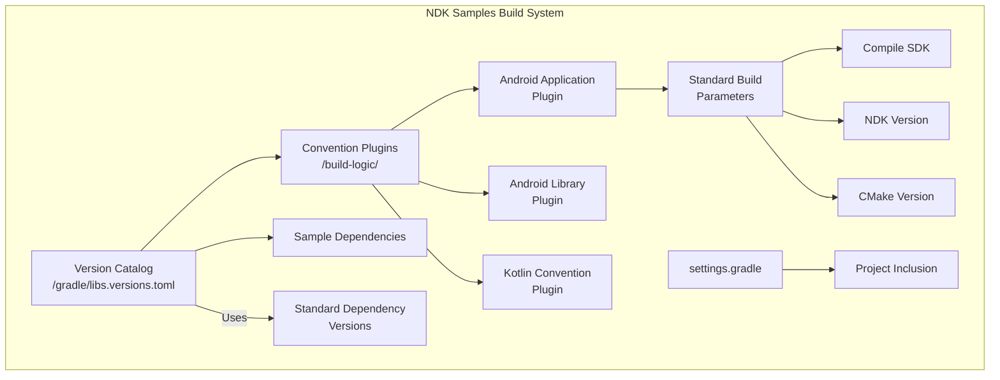

Sources: [gradle/libs.versions.toml](), [build-logic/src/main/java/com/android/ndk/samples/buildlogic/Versions.kt](), [build-logic/build.gradle.kts](), [settings.gradle]()

## Version Management

The build system centralizes version management using Gradle's version catalog feature. This ensures that all samples use consistent dependency versions and build configurations.

### Version Catalog

The repository uses a central `libs.versions.toml` file to define all dependency versions, libraries, and plugins.

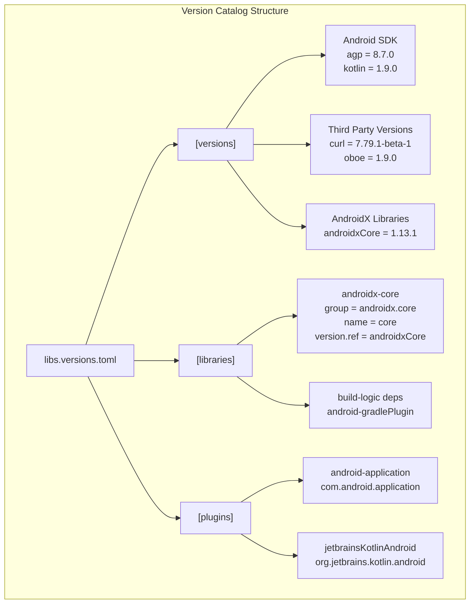

Sources: [gradle/libs.versions.toml]()

Key sections in the version catalog:
- **`[versions]`**: Defines version constants for all dependencies and plugins
- **`[libraries]`**: Defines library dependencies with references to version constants
- **`[plugins]`**: Defines Gradle plugins with version references

### Standard Versions

The project defines standard versions for SDK, NDK, and other build parameters in a dedicated Kotlin class:

```kotlin
object Versions {
    const val COMPILE_SDK = 34
    const val TARGET_SDK = 34
    const val MIN_SDK = 21
    const val NDK = "27.1.12297006" // r27b
    const val CMAKE = "3.22.1"
    val JAVA = JavaVersion.VERSION_1_8
}
```

Sources: [build-logic/src/main/java/com/android/ndk/samples/buildlogic/Versions.kt]()

## Convention Plugins

The build system uses convention plugins to standardize build configurations across all samples. These plugins are defined in the `build-logic` directory and applied to individual sample projects.

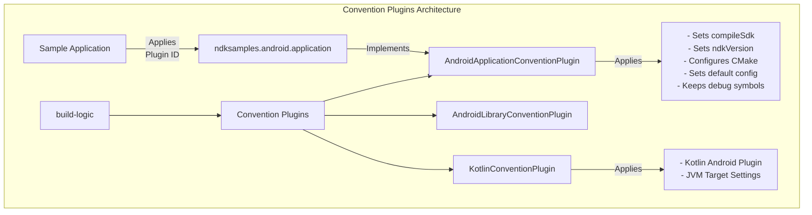

Sources: [build-logic/src/main/java/com/android/ndk/samples/buildlogic/AndroidApplicationConventionPlugin.kt](), [build-logic/build.gradle.kts](), [build-logic/src/main/java/com/android/ndk/samples/buildlogic/KotlinConventionPlugin.kt]()

### Android Application Convention Plugin

The `AndroidApplicationConventionPlugin` applies standard configurations to Android application modules:

- Sets the compile SDK to version 34
- Configures the NDK version to "27.1.12297006" (r27b)
- Sets the CMake version to 3.22.1
- Configures minSdk (21) and targetSdk (34)
- Preserves debug symbols for native libraries in debug builds

Sample projects apply this plugin with a simple declaration:

```kotlin
plugins {
    id "ndksamples.android.application"
}
```

Sources: [build-logic/src/main/java/com/android/ndk/samples/buildlogic/AndroidApplicationConventionPlugin.kt](), [audio-echo/app/build.gradle]()

### Kotlin Convention Plugin

The `KotlinConventionPlugin` handles Kotlin-specific configurations:

- Applies the Kotlin Android plugin
- Sets JVM target compatibility

Sources: [build-logic/src/main/java/com/android/ndk/samples/buildlogic/KotlinConventionPlugin.kt]()

## Native Code Integration

The build system standardizes native code integration across samples using CMake. Each sample application configures its CMake settings in its build.gradle file.

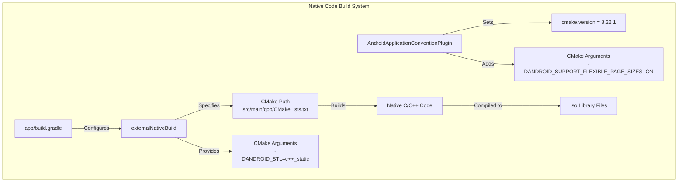

Sources: [audio-echo/app/build.gradle](), [build-logic/src/main/java/com/android/ndk/samples/buildlogic/AndroidApplicationConventionPlugin.kt]()

Sample project CMake configuration:

```groovy
android {
    defaultConfig {
        externalNativeBuild {
            cmake {
                arguments '-DANDROID_STL=c++_static'
            }
        }
    }
    externalNativeBuild {
        cmake {
            path 'src/main/cpp/CMakeLists.txt'
        }
    }
}
```

Sources: [audio-echo/app/build.gradle]()

## Project Organization

The repository is organized as a multi-project Gradle build with numerous sample applications. The `settings.gradle` file defines the project structure.

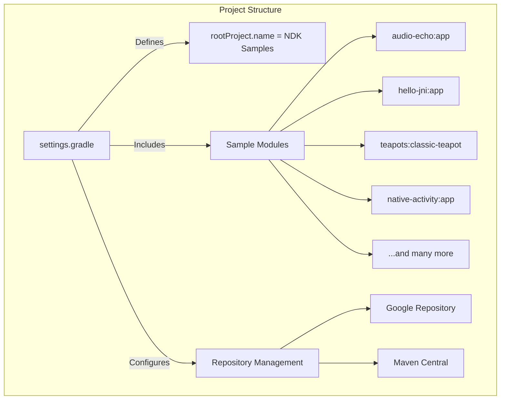

Sources: [settings.gradle]()

Each sample is configured as a separate module, allowing individual building and testing. The convention plugins ensure consistent configuration across all samples.

## Continuous Integration

The repository includes CI/CD configuration through GitHub Actions, which builds all samples to ensure they remain functional.

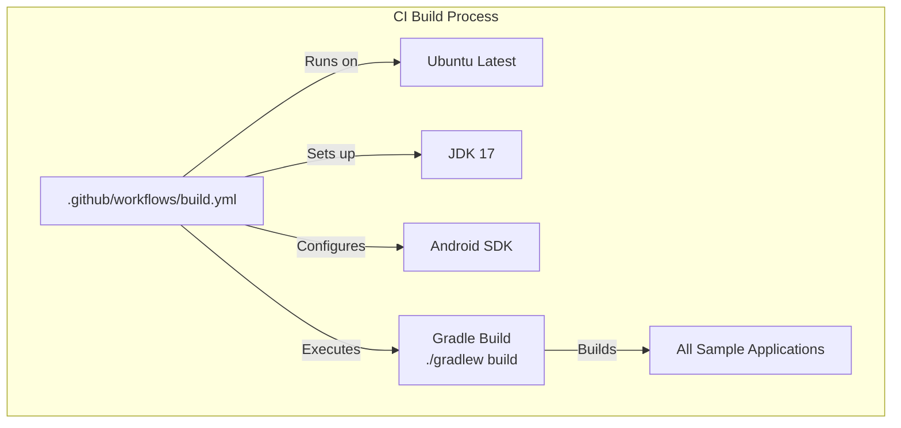

Sources: [.github/workflows/build.yml]()

## Using the Build System in Samples

To use the standardized build system in a sample application:

1. Include the module in `settings.gradle`
2. Apply the appropriate convention plugin in the module's `build.gradle`
3. Configure sample-specific settings as needed

Example of a sample's build.gradle file:

```groovy
plugins {
    id "ndksamples.android.application"
}

android {
    defaultConfig {
        applicationId 'com.google.sample.echo'
        versionCode 1
        versionName '1.0'
        externalNativeBuild {
            cmake {
                arguments '-DANDROID_STL=c++_static'
            }
        }
    }
    externalNativeBuild {
        cmake {
            path 'src/main/cpp/CMakeLists.txt'
        }
    }
    namespace 'com.google.sample.echo'
}

dependencies {
    implementation libs.appcompat
}
```

Sources: [audio-echo/app/build.gradle]()

Note how the sample references dependencies using the version catalog with `libs.appcompat`.

---

# Page: Dependency Management

# Dependency Management

<details>
<summary>Relevant source files</summary>

The following files were used as context for generating this wiki page:

- [audio-echo/app/build.gradle](audio-echo/app/build.gradle)
- [build-logic/README.md](build-logic/README.md)
- [build-logic/build.gradle.kts](build-logic/build.gradle.kts)
- [build-logic/settings.gradle.kts](build-logic/settings.gradle.kts)
- [build-logic/src/main/java/com/android/ndk/samples/buildlogic/AndroidApplicationConventionPlugin.kt](build-logic/src/main/java/com/android/ndk/samples/buildlogic/AndroidApplicationConventionPlugin.kt)
- [build-logic/src/main/java/com/android/ndk/samples/buildlogic/KotlinConventionPlugin.kt](build-logic/src/main/java/com/android/ndk/samples/buildlogic/KotlinConventionPlugin.kt)
- [build-logic/src/main/java/com/android/ndk/samples/buildlogic/Versions.kt](build-logic/src/main/java/com/android/ndk/samples/buildlogic/Versions.kt)
- [gradle/libs.versions.toml](gradle/libs.versions.toml)
- [settings.gradle](settings.gradle)

</details>


## Purpose and Scope

This document explains how dependencies are managed in the Android NDK Samples repository. It covers the centralized dependency management system using Gradle's Version Catalog feature, detailing how library versions, dependencies, and plugins are defined and used across all sample projects. This page focuses on the dependency definitions and access patterns, while the convention plugins that apply these dependencies are covered in [Convention Plugins](#2.2).

## Overview

The NDK Samples repository uses a modern approach to dependency management through Gradle's Version Catalog feature. This approach centralizes all dependency declarations in a single file, making it easier to:

1. Maintain consistent dependency versions across all samples
2. Update dependencies in one place
3. Access dependencies using type-safe accessors
4. Reduce duplication and potential version conflicts

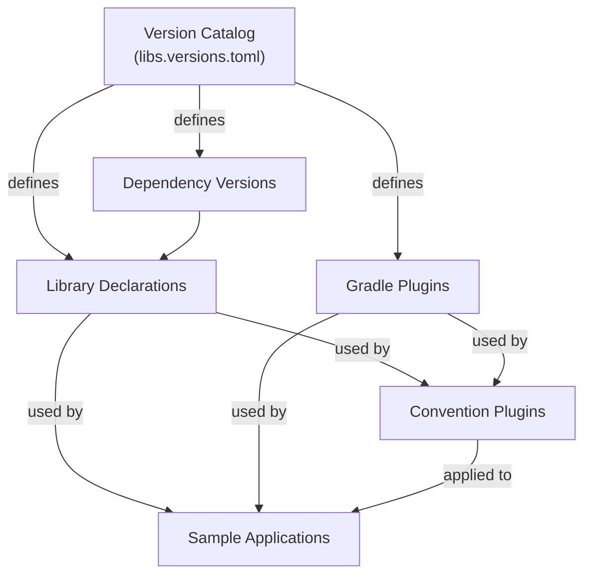

Sources: [gradle/libs.versions.toml](), [settings.gradle](), [build-logic/settings.gradle.kts]()

## Version Catalog Structure

The version catalog is defined in `libs.versions.toml` and consists of three main sections:

### 1. Versions Section

This section defines version constants that can be referenced by library and plugin declarations:

```
[versions]
agp = "8.7.0"
kotlin = "1.9.0"
appcompat = "1.6.1"
...
```

Sources: [gradle/libs.versions.toml:1-20]()

### 2. Libraries Section

This section defines library dependencies that can be used in build scripts, referencing versions from the versions section:

```
[libraries]
junit = { group = "junit", name = "junit", version.ref = "junit" }
appcompat = { group = "androidx.appcompat", name = "appcompat", version.ref = "appcompat" }
...
```

Sources: [gradle/libs.versions.toml:22-42]()

### 3. Plugins Section

This section defines Gradle plugins that can be applied in build scripts:

```
[plugins]
android-application = { id = "com.android.application", version.ref = "agp" }
jetbrainsKotlinAndroid = { id = "org.jetbrains.kotlin.android", version.ref = "kotlin" }
...
```

Sources: [gradle/libs.versions.toml:44-48]()

## Dependency Categories

The version catalog defines several categories of dependencies:

```mermaid
classDiagram
    class "Version Catalog" {
        +AndroidBuildTools
        +AndroidLibraries
        +TestingLibraries
        +NDKThirdParty
        +BuildLogicDependencies
        +GradlePlugins
    }
    
    class "AndroidBuildTools" {
        +AGP
        +Kotlin
        +CMake
        +NDK
    }
    
    class "AndroidLibraries" {
        +AppCompat
        +Material
        +ConstraintLayout
        +Core
        +Oboe
        +Games
    }
    
    class "TestingLibraries" {
        +JUnit
        +Espresso
        +AndroidXJUnitGTest
    }
    
    class "NDKThirdParty" {
        +curl
        +googletest
        +jsoncpp
        +openssl
    }
    
    "Version Catalog" -- "AndroidBuildTools"
    "Version Catalog" -- "AndroidLibraries"
    "Version Catalog" -- "TestingLibraries" 
    "Version Catalog" -- "NDKThirdParty"
    "Version Catalog" -- "BuildLogicDependencies"
    "Version Catalog" -- "GradlePlugins"
```

Sources: [gradle/libs.versions.toml]()

## Accessing the Version Catalog

### In Sample Applications

Sample applications access the version catalog through the `libs` accessor:

```kotlin
dependencies {
    implementation libs.appcompat
}
```

Sources: [audio-echo/app/build.gradle:24-26]()

### In Convention Plugins

The build-logic module accesses the version catalog by importing it explicitly in its settings:

```kotlin
versionCatalogs {
    create("libs") {
        from(files("../gradle/libs.versions.toml"))
    }
}
```

Sources: [build-logic/settings.gradle.kts:6-10]()

Then, it can use these dependencies in its build script:

```kotlin
dependencies {
    compileOnly(libs.android.gradlePlugin)
    compileOnly(libs.kotlin.gradlePlugin)
}
```

Sources: [build-logic/build.gradle.kts:20-23]()

## Dependency Relationship to Version Constants

Some dependencies in the codebase are not defined in the version catalog but are instead defined in code. For example, the Android SDK, NDK, and CMake versions are defined in `Versions.kt`:

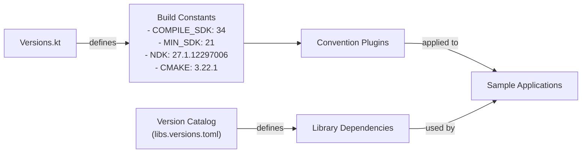

Sources: [build-logic/src/main/java/com/android/ndk/samples/buildlogic/Versions.kt](), [build-logic/src/main/java/com/android/ndk/samples/buildlogic/AndroidApplicationConventionPlugin.kt:17-22]()

## NDK-Specific Dependencies

The version catalog includes several NDK-specific third-party libraries that are packaged using [Prefab](https://google.github.io/prefab):

```
curl = { group = "com.android.ndk.thirdparty", name = "curl", version.ref = "curl" }
googletest = { group = "com.android.ndk.thirdparty", name = "googletest", version.ref = "googletest" }
jsoncpp = { group = "com.android.ndk.thirdparty", name = "jsoncpp", version.ref = "jsoncpp" }
openssl = { group = "com.android.ndk.thirdparty", name = "openssl", version.ref = "openssl" }
```

These dependencies are used in certain samples like `prefab/curl-ssl` to demonstrate integration with prebuilt native libraries.

Sources: [gradle/libs.versions.toml:17-20](), [gradle/libs.versions.toml:35-39]()

## Benefits of Centralized Dependency Management

Centralizing dependencies in the version catalog provides several benefits:

1. **Consistency**: All samples use the same versions of dependencies
2. **Maintainability**: Update dependencies in one place instead of across multiple build files
3. **Type safety**: Access dependencies using type-safe accessors rather than error-prone strings
4. **Discoverability**: Easily see what dependencies are available and their versions
5. **IDE support**: Better code completion and documentation in IDEs

## Repository Configuration

The repository configuration in `settings.gradle` ensures that dependencies can be properly resolved:

```kotlin
dependencyResolutionManagement {
    repositoriesMode.set(RepositoriesMode.FAIL_ON_PROJECT_REPOS)
    repositories {
        google()
        mavenCentral()
    }
}
```

This configuration centrally defines which repositories should be used to resolve dependencies for all modules.

Sources: [settings.gradle:15-21]()

## Summary

The Android NDK Samples repository uses Gradle's Version Catalog feature to centralize dependency management in `libs.versions.toml`. This approach provides a consistent, maintainable way to declare and use dependencies across all sample projects. The version catalog works in conjunction with convention plugins to standardize build configurations across the repository.

---

# Page: Convention Plugins

# Convention Plugins

<details>
<summary>Relevant source files</summary>

The following files were used as context for generating this wiki page:

- [audio-echo/app/build.gradle](audio-echo/app/build.gradle)
- [base/.gitignore](base/.gitignore)
- [base/build.gradle.kts](base/build.gradle.kts)
- [base/src/main/cpp/CMakeLists.txt](base/src/main/cpp/CMakeLists.txt)
- [base/src/main/cpp/include/base/errno_restorer.h](base/src/main/cpp/include/base/errno_restorer.h)
- [base/src/main/cpp/include/base/logging.h](base/src/main/cpp/include/base/logging.h)
- [base/src/main/cpp/include/base/macros.h](base/src/main/cpp/include/base/macros.h)
- [base/src/main/cpp/logging.cpp](base/src/main/cpp/logging.cpp)
- [base/src/main/cpp/logging_splitters.h](base/src/main/cpp/logging_splitters.h)
- [build-logic/README.md](build-logic/README.md)
- [build-logic/build.gradle.kts](build-logic/build.gradle.kts)
- [build-logic/settings.gradle.kts](build-logic/settings.gradle.kts)
- [build-logic/src/main/java/com/android/ndk/samples/buildlogic/AndroidApplicationConventionPlugin.kt](build-logic/src/main/java/com/android/ndk/samples/buildlogic/AndroidApplicationConventionPlugin.kt)
- [build-logic/src/main/java/com/android/ndk/samples/buildlogic/AndroidLibraryConventionPlugin.kt](build-logic/src/main/java/com/android/ndk/samples/buildlogic/AndroidLibraryConventionPlugin.kt)
- [build-logic/src/main/java/com/android/ndk/samples/buildlogic/KotlinConventionPlugin.kt](build-logic/src/main/java/com/android/ndk/samples/buildlogic/KotlinConventionPlugin.kt)
- [build-logic/src/main/java/com/android/ndk/samples/buildlogic/Versions.kt](build-logic/src/main/java/com/android/ndk/samples/buildlogic/Versions.kt)
- [gradle/libs.versions.toml](gradle/libs.versions.toml)
- [sanitizers/app/src/main/cpp/CMakeLists.txt](sanitizers/app/src/main/cpp/CMakeLists.txt)
- [sanitizers/app/src/ubsan/jniLibs/arm64-v8a/libclang_rt.ubsan_standalone-aarch64-android.so](sanitizers/app/src/ubsan/jniLibs/arm64-v8a/libclang_rt.ubsan_standalone-aarch64-android.so)
- [settings.gradle](settings.gradle)

</details>


This document explains the convention plugins used in the Android NDK Samples repository. Convention plugins centralize and standardize build configurations across the sample applications, reducing boilerplate code in individual build files while ensuring consistent settings.

## Purpose and Overview

The convention plugins in the NDK Samples repository serve to:

1. Centralize common build configurations including SDK versions, NDK versions, and CMake settings
2. Ensure consistency across multiple sample applications
3. Simplify individual build files by abstracting shared configuration
4. Provide sensible defaults for native Android development

The convention plugins are housed in the `build-logic` directory and are implemented as Gradle plugins that apply common configurations to sample applications.

```mermaid
flowchart TD
    subgraph "Convention Plugin System"
        direction TB
        BuildLogic["build-logic module"]
        ConventionPlugins["Convention Plugins"] 
        VersionsKt["Centralized Versions"]
        
        BuildLogic --> ConventionPlugins
        BuildLogic --> VersionsKt
        
        ConventionPlugins --> AndroidApp["AndroidApplicationConventionPlugin"]
        ConventionPlugins --> AndroidLib["AndroidLibraryConventionPlugin"]
        ConventionPlugins --> KotlinPlugin["KotlinConventionPlugin"]
    end
    
    subgraph "Application Modules"
        SampleApp1["Sample App 1\n(e.g., audio-echo)"]
        SampleApp2["Sample App 2\n(e.g., hello-jni)"]
        SampleApp3["Sample App 3\n(e.g., native-activity)"]
    end
    
    AndroidApp -- "applied via ndksamples.android.application" --> SampleApp1
    AndroidApp -- "applied via ndksamples.android.application" --> SampleApp2
    AndroidApp -- "applied via ndksamples.android.application" --> SampleApp3
    
    AndroidLib -- "applied via ndksamples.android.library" --> LibModule["Library Module\n(e.g., base)"]
    
    VersionCatalog["Version Catalog\n(libs.versions.toml)"] --> BuildLogic
```

Sources: [build-logic/README.md](), [build-logic/build.gradle.kts:26-40](), [settings.gradle:1-3]()

## Convention Plugin Architecture

The NDK Samples repository implements convention plugins using Gradle's composite build feature. The `build-logic` project is included as a build dependency, making its plugins available to all sample applications.

### Structure and Registration

```mermaid
flowchart TD
    subgraph "build-logic Project Structure"
        direction TB
        BuildLogicGradle["build.gradle.kts"] --> GradlePluginBlock["gradlePlugin { ... }"]
        GradlePluginBlock --> PluginRegistration["Plugin Registration"]
        PluginRegistration --> App["androidApplication Plugin\nID: ndksamples.android.application"]
        PluginRegistration --> Lib["androidLibrary Plugin\nID: ndksamples.android.library"]
        PluginRegistration --> Kotlin["kotlinAndroid Plugin\nID: ndksamples.android.kotlin"]
        
        VersionsKt["Versions.kt\n- COMPILE_SDK\n- TARGET_SDK\n- MIN_SDK\n- NDK\n- CMAKE\n- JAVA"]
        
        App --> AppImpl["AndroidApplicationConventionPlugin.kt"]
        Lib --> LibImpl["AndroidLibraryConventionPlugin.kt"] 
        Kotlin --> KotlinImpl["KotlinConventionPlugin.kt"]
        
        VersionsKt --> AppImpl
        VersionsKt --> LibImpl
        VersionsKt --> KotlinImpl
    end
    
    SettingsGradle["settings.gradle"] --> IncludeBuild["includeBuild('build-logic')"]
    
    SampleBuildGradle["Sample app/build.gradle"] --> ApplyPlugin["plugins {\n  id 'ndksamples.android.application'\n}"]
    
    IncludeBuild --> GradlePluginBlock
    App --> ApplyPlugin
```

Sources: [build-logic/build.gradle.kts:25-40](), [settings.gradle:1-3](), [audio-echo/app/build.gradle:1-3](), [build-logic/src/main/java/com/android/ndk/samples/buildlogic/Versions.kt]()

## Available Convention Plugins

The repository provides three main convention plugins:

### 1. AndroidApplicationConventionPlugin

This plugin applies common Android application configurations to sample apps.

Key features:
- Applies the Android application plugin
- Sets common SDK versions (compile, target, min)
- Configures the NDK and CMake versions
- Sets up native build options
- Preserves debug symbols in debug builds for better NDK crash reporting

```mermaid
classDiagram
    class AndroidApplicationConventionPlugin {
        +apply(target: Project)
    }
    
    class ApplicationConfig {
        +compileSdk: Int
        +ndkVersion: String
        +cmake: Object
        +defaultConfig: Object
        +compileOptions: Object
        +buildTypes: Object
    }
    
    AndroidApplicationConventionPlugin --> ApplicationConfig : configures
    
    note for ApplicationConfig "Configured with:\n- SDK versions from Versions.kt\n- CMake version 3.22.1\n- Debug symbols preservation\n- Flexible page sizes support"
```

Sources: [build-logic/src/main/java/com/android/ndk/samples/buildlogic/AndroidApplicationConventionPlugin.kt](), [build-logic/src/main/java/com/android/ndk/samples/buildlogic/Versions.kt]()

### 2. AndroidLibraryConventionPlugin

Similar to the application plugin but specifically for Android library modules.

Key features:
- Applies the Android library plugin
- Shares much of the same configuration as the application plugin
- Sets up library-specific options like testOptions and lint configuration

```mermaid
classDiagram
    class AndroidLibraryConventionPlugin {
        +apply(target: Project)
    }
    
    class LibraryConfig {
        +compileSdk: Int
        +ndkVersion: String
        +cmake: Object
        +defaultConfig: Object
        +compileOptions: Object
        +buildTypes: Object
        +lint: Object
        +testOptions: Object
    }
    
    AndroidLibraryConventionPlugin --> LibraryConfig : configures
    
    note for LibraryConfig "Similar to application config\nbut with library-specific options"
```

Sources: [build-logic/src/main/java/com/android/ndk/samples/buildlogic/AndroidLibraryConventionPlugin.kt]()

### 3. KotlinConventionPlugin

This plugin configures Kotlin-specific options for Android projects.

Key features:
- Applies the Kotlin Android plugin
- Configures the JVM target to match the Java version specified in Versions.kt

```mermaid
classDiagram
    class KotlinConventionPlugin {
        +apply(target: Project)
    }
    
    class KotlinOptions {
        +jvmTarget: String
    }
    
    KotlinConventionPlugin --> KotlinOptions : configures
    
    note for KotlinOptions "Sets JVM target to match\nJava version from Versions.kt"
```

Sources: [build-logic/src/main/java/com/android/ndk/samples/buildlogic/KotlinConventionPlugin.kt]()

## Centralized Version Management

The convention plugins rely on centralized version definitions in the `Versions.kt` file. This ensures that all samples use consistent SDK, NDK, and other tool versions.

| Version Constant | Value | Purpose |
|------------------|-------|---------|
| COMPILE_SDK | 34 | Android SDK version to compile against |
| TARGET_SDK | 34 | Target Android SDK version |
| MIN_SDK | 21 | Minimum supported Android SDK version |
| NDK | "27.1.12297006" (r27b) | Native Development Kit version |
| CMAKE | "3.22.1" | CMake version for native builds |
| JAVA | JavaVersion.VERSION_1_8 | Java compatibility version |

Sources: [build-logic/src/main/java/com/android/ndk/samples/buildlogic/Versions.kt]()

## Integration with Version Catalog

The convention plugins work in conjunction with Gradle's version catalog for external dependency management.

```mermaid
flowchart TD
    VersionCatalog["gradle/libs.versions.toml"] -->|defines versions| Dependencies["Library Dependencies\n- androidx.core\n- oboe\n- etc."]
    VersionCatalog -->|defines versions| PluginVersions["Plugin Versions\n- AGP\n- Kotlin\n- etc."]
    
    BuildLogic["build-logic"] -->|references| VersionCatalog
    
    BuildLogic -->|provides| ConventionPlugins["Convention Plugins"]
    
    SampleApps["Sample Applications"] -->|apply| ConventionPlugins
    SampleApps -->|use dependencies from| VersionCatalog
    
    Settings["settings.gradle"] -->|includes| BuildLogic
```

The version catalog (`libs.versions.toml`) centralizes the versions of:
- External libraries (AndroidX, Google libraries, third-party dependencies)
- Gradle plugins (Android Gradle Plugin, Kotlin plugin)
- Version constants shared across the project

The convention plugins access these versions to ensure consistency, while individual sample modules reference the dependencies directly.

Sources: [gradle/libs.versions.toml](), [build-logic/settings.gradle.kts:6-9]()

## Usage in Sample Applications

Sample applications use the convention plugins by simply including them in their `build.gradle` files, which greatly simplifies configuration.

### Example: Application Plugin Usage

```groovy
// From audio-echo/app/build.gradle
plugins {
    id "ndksamples.android.application"
}

android {
    defaultConfig {
        applicationId 'com.google.sample.echo'
        versionCode 1
        versionName '1.0'
        externalNativeBuild {
            cmake {
                arguments '-DANDROID_STL=c++_static'
            }
        }
    }
    externalNativeBuild {
        cmake {
            path 'src/main/cpp/CMakeLists.txt'
        }
    }
    namespace 'com.google.sample.echo'
}

dependencies {
    implementation libs.appcompat
}
```

This example shows how the application only needs to specify its unique configurations, while common settings come from the convention plugin.

Sources: [audio-echo/app/build.gradle]()

### Example: Library Plugin Usage

```kotlin
// From base/build.gradle.kts
plugins {
    id("ndksamples.android.library")
}

android {
    namespace = "com.android.ndk.samples.base"

    externalNativeBuild {
        cmake {
            path = file("src/main/cpp/CMakeLists.txt")
        }
    }

    buildFeatures {
        prefabPublishing = true
    }

    prefab {
        create("base") {
            headers = "src/main/cpp/include"
        }
    }
}
```

Sources: [base/build.gradle.kts]()

## Benefits of Convention Plugins

The use of convention plugins in the NDK Samples repository provides several benefits:

1. **Reduced Duplication**: Common configurations are defined once and reused across samples
2. **Consistency**: All samples use the same SDK, NDK, and build tool versions
3. **Easier Maintenance**: Updating versions or build configurations can be done in one place
4. **Simplified Sample Code**: Sample application build files focus only on their unique configurations
5. **Better Organization**: Clear separation between common build logic and sample-specific configurations

For information on general build system configuration, see [Build System](#2).
For information on CMake integration, see [CMake Integration](#2.3).

Sources: [build-logic/README.md](), [audio-echo/app/build.gradle](), [base/build.gradle.kts]()

---

# Page: CMake Integration

# CMake Integration

<details>
<summary>Relevant source files</summary>

The following files were used as context for generating this wiki page:

- [bitmap-plasma/app/build.gradle](bitmap-plasma/app/build.gradle)
- [camera/basic/src/main/cpp/CMakeLists.txt](camera/basic/src/main/cpp/CMakeLists.txt)
- [camera/texture-view/src/main/cpp/CMakeLists.txt](camera/texture-view/src/main/cpp/CMakeLists.txt)
- [endless-tunnel/app/build.gradle](endless-tunnel/app/build.gradle)
- [endless-tunnel/app/src/main/cpp/CMakeLists.txt](endless-tunnel/app/src/main/cpp/CMakeLists.txt)
- [gles3jni/app/src/main/cpp/CMakeLists.txt](gles3jni/app/src/main/cpp/CMakeLists.txt)
- [hello-gl2/app/build.gradle](hello-gl2/app/build.gradle)
- [hello-gl2/app/src/main/cpp/CMakeLists.txt](hello-gl2/app/src/main/cpp/CMakeLists.txt)
- [hello-jni/app/build.gradle](hello-jni/app/build.gradle)
- [hello-libs/app/src/main/cpp/CMakeLists.txt](hello-libs/app/src/main/cpp/CMakeLists.txt)
- [hello-vulkan/app/src/main/cpp/CMakeLists.txt](hello-vulkan/app/src/main/cpp/CMakeLists.txt)
- [native-activity/app/build.gradle](native-activity/app/build.gradle)
- [native-activity/app/src/main/cpp/CMakeLists.txt](native-activity/app/src/main/cpp/CMakeLists.txt)
- [native-audio/app/build.gradle](native-audio/app/build.gradle)
- [native-audio/app/src/main/cpp/CMakeLists.txt](native-audio/app/src/main/cpp/CMakeLists.txt)
- [native-codec/app/build.gradle](native-codec/app/build.gradle)
- [native-codec/app/src/main/cpp/CMakeLists.txt](native-codec/app/src/main/cpp/CMakeLists.txt)
- [native-media/app/build.gradle](native-media/app/build.gradle)
- [native-midi/app/src/main/cpp/CMakeLists.txt](native-midi/app/src/main/cpp/CMakeLists.txt)
- [native-plasma/app/build.gradle](native-plasma/app/build.gradle)
- [native-plasma/app/src/main/cpp/CMakeLists.txt](native-plasma/app/src/main/cpp/CMakeLists.txt)
- [prefab/curl-ssl/app/src/main/cpp/CMakeLists.txt](prefab/curl-ssl/app/src/main/cpp/CMakeLists.txt)
- [prefab/prefab-dependency/app/src/main/cpp/CMakeLists.txt](prefab/prefab-dependency/app/src/main/cpp/CMakeLists.txt)
- [san-angeles/app/build.gradle](san-angeles/app/build.gradle)
- [sensor-graph/accelerometer/src/main/cpp/CMakeLists.txt](sensor-graph/accelerometer/src/main/cpp/CMakeLists.txt)
- [teapots/choreographer-30fps/src/main/cpp/CMakeLists.txt](teapots/choreographer-30fps/src/main/cpp/CMakeLists.txt)
- [teapots/classic-teapot/src/main/cpp/CMakeLists.txt](teapots/classic-teapot/src/main/cpp/CMakeLists.txt)
- [teapots/common/ndk_helper/CMakeLists.txt](teapots/common/ndk_helper/CMakeLists.txt)
- [teapots/more-teapots/src/main/cpp/CMakeLists.txt](teapots/more-teapots/src/main/cpp/CMakeLists.txt)
- [teapots/textured-teapot/src/main/cpp/CMakeLists.txt](teapots/textured-teapot/src/main/cpp/CMakeLists.txt)

</details>


This document explains how CMake is used to build native C/C++ code in the Android NDK Samples repository. It covers the integration between Gradle and CMake, common CMake configurations, and CMake patterns used across the samples.

For information about the overall build system structure, see [Build System](#2). For details on dependency management, see [Dependency Management](#2.1).

## CMake and Android Build System Integration

The Android Gradle plugin supports CMake as a build system for native code. In the NDK Samples repository, each sample that contains native code defines a CMake build script (`CMakeLists.txt`) and configures the Gradle build system to use it.

```mermaid
graph TB
    subgraph "Android Build System"
        Grade["Gradle Build System"]
        AGP["Android Gradle Plugin"]
        Gradle --> AGP
        AGP --> CMake
        CMake --> NativeCode["Native C/C++ Code"]
    end
    subgraph "Project Files"
        BuildGradle["build.gradle file"]
        CmakeList["CMakeLists.txt"]
        CppFiles["C/C++ source files"]
        BuildGradle --> CmakeList
        CmakeList --> CppFiles
    end
    BuildGradle -- "externalNativeBuild block" --> AGP
```

Sources: [hello-jni/app/build.gradle:15-19](), [native-activity/app/build.gradle:24-28]()

### Gradle to CMake Bridge

Every sample that includes native code follows a similar pattern in its `build.gradle` file:

1. The `externalNativeBuild` block points to the location of the `CMakeLists.txt` file
2. Optional configuration is provided in the `defaultConfig.externalNativeBuild.cmake` block

```mermaid
graph LR
    subgraph "build.gradle"
        ExtNativeBuild["externalNativeBuild { cmake { path ... } }"]
        DefaultConfig["defaultConfig { externalNativeBuild { cmake { arguments ... } } }"]
    end
    subgraph "src/main/cpp directory"
        CMakeLists["CMakeLists.txt"]
        CppFiles["C/C++ Source Files"]
    end
    ExtNativeBuild --> CMakeLists
    DefaultConfig -- "Optional arguments" --> CMakeLists
    CMakeLists --> CppFiles
```

Sources: [hello-jni/app/build.gradle:15-19](), [native-activity/app/build.gradle:17-21](), [native-activity/app/build.gradle:24-28]()

## Common CMake Configuration Elements

Every `CMakeLists.txt` file in the samples repository shares similar elements:

### 1. CMake Version Requirement

All samples specify CMake 3.22.1 as the minimum version:

```cmake
cmake_minimum_required(VERSION 3.22.1)
```

Sources: [hello-jni/app/src/main/cpp/CMakeLists.txt](), [native-activity/app/src/main/cpp/CMakeLists.txt](), [teapots/common/ndk_helper/CMakeLists.txt]()

### 2. Library Definitions

Each sample defines at least one library - typically a shared library that will be loaded by the Java/Kotlin side:

```mermaid
graph TB
    subgraph "CMakeLists.txt Common Structure"
        Version["cmake_minimum_required(VERSION 3.22.1)"]
        Project["project(...) (optional)"]
        Flags["Compiler flags (optional)"]
        Library["add_library(...)\n- SHARED: Used by Java via JNI\n- STATIC: For native-only code"]
        Includes["target_include_directories (optional)"]
        Links["target_link_libraries (required)"]
    end
    Version --> Project
    Project --> Flags
    Flags --> Library
    Library --> Includes
    Includes --> Links
```

Sources: [hello-gl2/app/src/main/cpp/CMakeLists.txt](), [native-audio/app/src/main/cpp/CMakeLists.txt](), [native-activity/app/src/main/cpp/CMakeLists.txt]()

## Library Types by Application Pattern

The samples repository demonstrates different native code integration patterns, each with specific CMake configurations.

### 1. JNI-Based Applications

For applications that use JNI to call native code from Java/Kotlin:

```mermaid
graph LR
    subgraph "Java/Kotlin Layer"
        JActivity["Java/Kotlin Activity"]
        JNI["JNI Method Call"]
    end
    subgraph "Native Layer"
        NativeLib["SHARED Native Library"]
        NativeFn["Native Function"]
    end
    JActivity --> JNI
    JNI --> NativeFn
    NativeFn --> NativeLib
```

Simple JNI samples define a shared library with minimal configuration:

```cmake
add_library(native-lib-name SHARED
    native-source.cpp)

target_link_libraries(native-lib-name
    android
    log)
```

Sources: [hello-jni/app/src/main/cpp/CMakeLists.txt](), [hello-gl2/app/src/main/cpp/CMakeLists.txt]()

### 2. NativeActivity Applications

For applications based on NativeActivity, which runs the main application code in native C/C++:

```mermaid
graph TD
    subgraph "Gradle Build"
        BuildGradle["build.gradle"]
    end
    subgraph "CMakeLists.txt"
        NativeAppGlue["native_app_glue (STATIC library)"]
        SharedLib["app shared library (SHARED)"]
        LinkFlags["Export ANativeActivity_onCreate()"]
    end
    subgraph "Native Code"
        MainActivity["android_main()"]
        ActivityCB["Activity Callbacks"]
    end
    BuildGradle --> NativeAppGlue
    NativeAppGlue --> SharedLib
    LinkFlags --> SharedLib
    SharedLib --> MainActivity
    MainActivity --> ActivityCB
```

NativeActivity samples usually include:
1. Building `native_app_glue` as a static library
2. Setting linker flags to export `ANativeActivity_onCreate()`
3. Building the application's shared library
4. Linking against Android system libraries

Sources: [native-activity/app/src/main/cpp/CMakeLists.txt](), [native-plasma/app/src/main/cpp/CMakeLists.txt](), [endless-tunnel/app/src/main/cpp/CMakeLists.txt]()

## Common CMake Patterns

### Configuring Compiler Flags

Most samples set compiler flags to enable warnings and enforce certain coding standards:

```cmake
set(CMAKE_CXX_FLAGS "${CMAKE_CXX_FLAGS} -Wall -Werror -fno-exceptions -fno-rtti")
```

Sources: [teapots/choreographer-30fps/src/main/cpp/CMakeLists.txt:21](), [native-activity/app/src/main/cpp/CMakeLists.txt:25]()

### Configuring C++ Standard Library

Some samples specifically request a static C++ standard library:

```cmake
arguments '-DANDROID_STL=c++_static'
```

Sources: [native-activity/app/build.gradle:19](), [endless-tunnel/app/build.gradle:29]()

### Cross-Module Dependencies

More complex samples, like the teapots series, use a common library defined in a separate CMakeLists.txt file:

```mermaid
graph TD
    subgraph "Common Libraries"
        NdkHelper["NdkHelper (common/ndk_helper)"]
        NativeAppGlue["native_app_glue"]
    end
    subgraph "Teapot Samples"
        Classic["classic-teapot"]
        Textured["textured-teapot"]
        More["more-teapots"]
        Choreographer["choreographer-30fps"]
    end
    NdkHelper --> Classic
    NdkHelper --> Textured
    NdkHelper --> More
    NdkHelper --> Choreographer
    NativeAppGlue --> NdkHelper
```

The common pattern is to use `add_subdirectory()` to include another CMakeLists.txt file:

```cmake
add_subdirectory(${ndkHelperSrc}
        ${commonDir}/ndkHelperBin/${CMAKE_BUILD_TYPE}/${ANDROID_ABI})
```

Sources: [teapots/classic-teapot/src/main/cpp/CMakeLists.txt:25-27](), [teapots/more-teapots/src/main/cpp/CMakeLists.txt:25-27]()

### Linking Against System Libraries

Every sample links against Android system libraries:

```cmake
target_link_libraries(library-name
    android
    log
    # Additional libraries as needed:
    # GLESv2, EGL, OpenSLES, etc.
)
```

Sources: [hello-gl2/app/src/main/cpp/CMakeLists.txt:10-14](), [native-audio/app/src/main/cpp/CMakeLists.txt:9-12]()

## Specialized CMake Configurations

### Graphics Applications

Graphics samples typically link against graphics libraries:

```cmake
target_link_libraries(app-name
    android
    log
    EGL
    GLESv2)
```

Sources: [hello-gl2/app/src/main/cpp/CMakeLists.txt:10-14](), [native-activity/app/src/main/cpp/CMakeLists.txt:38-43]()

### Audio Applications

Audio samples link against audio libraries:

```cmake
target_link_libraries(native-audio-jni
    android
    log
    OpenSLES)
```

Sources: [native-audio/app/src/main/cpp/CMakeLists.txt:9-12](), [native-midi/app/src/main/cpp/CMakeLists.txt:12]()

### Camera Applications

Camera samples have specific dependencies:

```cmake
target_link_libraries(ndk_camera
    android
    log
    m
    app_glue
    camera2ndk
    mediandk)
```

Sources: [camera/basic/src/main/cpp/CMakeLists.txt:46-52](), [camera/texture-view/src/main/cpp/CMakeLists.txt:40]()

## Working with Prebuilt Libraries

The `hello-libs` sample demonstrates how to use prebuilt libraries in CMake:

```mermaid
graph TD
    subgraph "Distribution Directory"
        GmathStatic["libgmath.a (STATIC)"]
        GperfShared["libgperf.so (SHARED)"]
        Headers["Header Files"]
    end
    subgraph "CMakeLists.txt"
        ImportGmath["add_library(lib_gmath STATIC IMPORTED)"]
        ImportGperf["add_library(lib_gperf SHARED IMPORTED)"]
        SetProp["set_target_properties()"]
        AppLib["add_library(hello-libs SHARED)"]
        IncludeDirs["target_include_directories()"]
        LinkLibs["target_link_libraries()"]
    end
    Headers --> IncludeDirs
    GmathStatic --> ImportGmath
    GperfShared --> ImportGperf
    ImportGmath --> SetProp
    ImportGperf --> SetProp
    SetProp --> AppLib
    IncludeDirs --> LinkLibs
    AppLib --> LinkLibs
```

The key elements are:
1. Importing libraries with `add_library(... IMPORTED)`
2. Setting the imported library location with `set_target_properties()`
3. Including necessary header directories
4. Linking against the imported libraries

Sources: [hello-libs/app/src/main/cpp/CMakeLists.txt:21-31](), [hello-libs/app/src/main/cpp/CMakeLists.txt:39-47]()

## Platform-Specific Configurations

Some samples like `gles3jni` use platform-specific configurations to handle different Android API levels:

```cmake
if (${ANDROID_PLATFORM_LEVEL} LESS 12)
  message(FATAL_ERROR "OpenGL 2 is not supported before API level 11")
  return()
elseif (${ANDROID_PLATFORM_LEVEL} LESS 18)
  add_definitions("-DDYNAMIC_ES3")
  set(GL3STUB_SRC gl3stub.c)
  set(OPENGL_LIB GLESv2)
else ()
  set(OPENGL_LIB GLESv3)
endif (${ANDROID_PLATFORM_LEVEL} LESS 12)
```

Sources: [gles3jni/app/src/main/cpp/CMakeLists.txt:24-34]()

## Exporting Native Activity Entry Point

For NativeActivity-based applications, the entry point must be exported:

```cmake
set(CMAKE_SHARED_LINKER_FLAGS
    "${CMAKE_SHARED_LINKER_FLAGS} -u ANativeActivity_onCreate")
```

This ensures that the Android system can find and call the native entry point when the activity is created.

Sources: [native-activity/app/src/main/cpp/CMakeLists.txt:29-30](), [native-plasma/app/src/main/cpp/CMakeLists.txt:29-30](), [endless-tunnel/app/src/main/cpp/CMakeLists.txt:25-26]()

## Conclusion

CMake integration in the Android NDK Samples repository follows consistent patterns tailored to different types of native applications. Each sample demonstrates a specific aspect of native development, with CMake configurations designed to support the required functionality.

For more details on the convention plugins that standardize build configurations across samples, see [Convention Plugins](#2.2). For information about CI/CD and code quality tools, see [CI/CD and Code Quality](#2.4).

---

# Page: CI/CD and Code Quality

# CI/CD and Code Quality

<details>
<summary>Relevant source files</summary>

The following files were used as context for generating this wiki page:

- [.github/workflows/build.yml](.github/workflows/build.yml)
- [.pre-commit-config.yaml](.pre-commit-config.yaml)
- [CONTRIBUTING.md](CONTRIBUTING.md)
- [LICENSE](LICENSE)
- [REFERENCE.md](REFERENCE.md)
- [exceptions/README.md](exceptions/README.md)
- [exceptions/screenshot.png](exceptions/screenshot.png)
- [hello-neon/app/proguard-rules.pro](hello-neon/app/proguard-rules.pro)
- [hello-neon/app/src/main/AndroidManifest.xml](hello-neon/app/src/main/AndroidManifest.xml)
- [hello-neon/app/src/main/cpp/helloneon-intrinsics.h](hello-neon/app/src/main/cpp/helloneon-intrinsics.h)
- [hello-neon/app/src/main/res/mipmap-hdpi/ic_launcher.png](hello-neon/app/src/main/res/mipmap-hdpi/ic_launcher.png)
- [native-activity/app/src/main/res/mipmap-hdpi/ic_launcher.png](native-activity/app/src/main/res/mipmap-hdpi/ic_launcher.png)
- [native-activity/app/src/main/res/mipmap-mdpi/ic_launcher.png](native-activity/app/src/main/res/mipmap-mdpi/ic_launcher.png)
- [native-activity/app/src/main/res/mipmap-xhdpi/ic_launcher.png](native-activity/app/src/main/res/mipmap-xhdpi/ic_launcher.png)
- [native-activity/app/src/main/res/mipmap-xxhdpi/ic_launcher.png](native-activity/app/src/main/res/mipmap-xxhdpi/ic_launcher.png)

</details>


This page documents the continuous integration, continuous deployment, and code quality enforcement tools utilized within the Android NDK Samples repository. This infrastructure ensures that all sample code remains buildable, follows consistent standards, and maintains high quality for developers using these examples.

## 1. CI/CD Pipeline Overview

The Android NDK Samples repository employs a GitHub Actions-based CI/CD pipeline that automatically validates changes on both push events and pull requests. This ensures that all code in the repository remains in a buildable state and follows established quality standards.

```mermaid
flowchart TD
    subgraph "Developer Workflow"
        LocalChanges["Local Code Changes"] --> PreCommitLocal["Local Pre-commit Checks"]
        PreCommitLocal --> GitPush["Git Push / Pull Request"]
    end
    
    subgraph "GitHub Actions Pipeline"
        GitPush --> TriggerCI["Trigger CI Workflow"]
        TriggerCI --> PreCommitServer["Pre-commit Hooks"]
        PreCommitServer --> JavaSetup["Set up Java Environment"]
        JavaSetup --> AndroidSetup["Set up Android SDK"]
        AndroidSetup --> BuildSamples["Build All Samples"]
        BuildSamples --> BuildResult{{"Build Result"}}
        BuildResult -->|Success| MergePR["Ready for Review/Merge"]
        BuildResult -->|Failure| FixIssues["Fix Issues"]
        FixIssues --> LocalChanges
    end
```

Sources: [.github/workflows/build.yml](), [.pre-commit-config.yaml]()

## 2. GitHub Actions Configuration

The CI workflow is defined in the `.github/workflows/build.yml` file and automatically runs on every push to the repository and on all pull requests.

### 2.1 Workflow Structure

```mermaid
flowchart LR
    Start["Trigger: Push or\nPull Request"] --> Checkout["actions/checkout"]
    Checkout --> JavaSetup["Setup Java 17"]
    JavaSetup --> PreCommit["Run Pre-commit Hooks"]
    PreCommit --> AndroidSetup["Setup Android SDK"]
    AndroidSetup --> GradleBuild["Run Gradle Build"]
    GradleBuild --> End["Completion"]
```

The workflow consists of the following key steps:

| Step | Description | Action Used |
|------|-------------|-------------|
| Checkout | Checks out the repository code | `actions/checkout@v2` |
| Java Setup | Sets up Java 17 runtime environment | `actions/setup-java@v1` |
| Pre-commit | Runs pre-commit hooks for validation | `pre-commit/action@v3.0.0` |
| Android Setup | Sets up Android SDK | `android-actions/setup-android@v3` |
| Build | Runs Gradle build for all samples | `./gradlew build` |

Sources: [.github/workflows/build.yml:5-24]()

### 2.2 Build Script Details

The main build command executed in the CI pipeline is:

```
./gradlew build
```

This command builds all sample projects in the repository, ensuring that they compile successfully with the current NDK toolchain.

Sources: [.github/workflows/build.yml:22-24]()

## 3. Pre-commit Hooks

Pre-commit hooks provide automated checks before code is committed, catching common issues early in the development process.

### 3.1 Pre-commit Configuration

The repository uses the pre-commit framework with the following hooks configured:

```mermaid
flowchart TD
    PreCommit["Pre-commit Framework"] --> XMLCheck["check-xml"]
    PreCommit --> YAMLCheck["check-yaml"]
    XMLCheck --> ValidateXML["Validate XML Resources\nand Manifests"]
    YAMLCheck --> ValidateYAML["Validate YAML\nConfiguration Files"]
```

| Hook | Purpose |
|------|---------|
| `check-xml` | Validates XML files (layouts, manifests, etc.) |
| `check-yaml` | Validates YAML configuration files (GitHub Actions, etc.) |

These hooks run both locally when contributors use the pre-commit framework and in the CI pipeline.

Sources: [.pre-commit-config.yaml:1-6]()

### 3.2 Setting Up Pre-commit Locally

Contributors are encouraged to set up pre-commit hooks locally to catch issues before pushing code. This requires:

1. Installing the pre-commit tool
2. Running `pre-commit install` in the repository root
3. Pre-commit hooks will automatically run on `git commit`

## 4. Contribution Quality Standards

The Android NDK Samples repository maintains high code quality standards through its contribution process.

### 4.1 Code Quality Requirements

Contributors are expected to follow these quality guidelines:

```mermaid
flowchart TD
    CodeQuality["Code Quality Requirements"] --> Clear["Clear and Comprehensible Code"]
    CodeQuality --> Tests["Appropriate Test Coverage"]
    CodeQuality --> Documentation["Clear Documentation"]
    CodeQuality --> IPOwnership["Intellectual Property Ownership"]
    
    Clear --> ReadableCode["Readable and\nWell-structured Code"]
    Tests --> UnitTests["Unit Tests for\nFunctionality"]
    Documentation --> Comments["Well-commented Code"]
    Documentation --> README["Complete README Files"]
    IPOwnership --> CLA["Contributor License\nAgreement"]
```

Sources: [CONTRIBUTING.md:24-33]()

### 4.2 Contributor License Agreement

All contributors must sign a Contributor License Agreement (CLA) before their contributions can be accepted:

- Individual CLA for personal contributions
- Corporate CLA for company-sponsored contributions

Sources: [CONTRIBUTING.md:3-20]()

## 5. Exception Handling and Error Reporting

Beyond basic build validation, the Android NDK Samples also implement examples of error handling best practices, particularly for handling native exceptions across the JNI boundary.

The exceptions sample demonstrates proper error handling between C++ and Java/Kotlin code, showing how to:

1. Catch native exceptions in JNI methods
2. Translate them to appropriate Java exceptions
3. Handle these exceptions properly in the Java/Kotlin layer

This approach ensures that native crashes are properly reported and handled, improving the quality and stability of NDK applications.

Sources: [exceptions/README.md:1-44]()

## 6. Contribution Workflow

The contribution workflow enforces code quality through a structured review process.

```mermaid
flowchart LR
    Start["Start Contribution"] --> CLA["Sign CLA"]
    CLA --> Fork["Fork Repository"]
    Fork --> Develop["Develop and Test Changes"]
    Develop --> PreCommitLocal["Run Pre-commit Checks"]
    PreCommitLocal --> PR["Submit Pull Request"]
    PR --> CIChecks["Automated CI Checks"]
    CIChecks --> Review["Owner Review"]
    Review -->|Approved| Merge["Changes Merged"]
    Review -->|Needs Work| Feedback["Feedback for Improvements"]
    Feedback --> Develop
```

The key steps in the contribution workflow are:

1. Sign the appropriate Contributor License Agreement
2. Fork the repository and develop changes
3. Ensure code is well-tested and documented
4. Submit a pull request
5. Automated CI checks validate build status
6. Repository owners review the changes
7. Approved changes are merged into the repository

Sources: [CONTRIBUTING.md:22-33]()

## 7. Integration with the Build System

The CI/CD pipeline integrates with the larger build system discussed in other sections of this wiki.

| Component | Relationship to CI/CD |
|-----------|----------------------|
| Gradle Wrapper | Used by the CI pipeline to build samples |
| Convention Plugins | Applied during CI builds to ensure consistent configuration |
| CMake Integration | Validated during CI builds for native code |
| Dependency Management | Centralized version control ensures consistent builds in CI |

The CI/CD system validates the same build configurations used by developers, ensuring that what works in CI also works for end users.

For more detailed information about the build system components, see:
- [Dependency Management](#2.1)
- [Convention Plugins](#2.2)
- [CMake Integration](#2.3)

## Summary

The CI/CD and code quality infrastructure in the Android NDK Samples repository ensures that:

1. All samples remain in a buildable state
2. Code follows established quality standards
3. Contributions meet requirements before being accepted
4. Developers can rely on samples working as expected

By maintaining this infrastructure, the repository provides reliable and high-quality examples for Android NDK development.

---

# Page: Basic JNI Samples

# Basic JNI Samples

<details>
<summary>Relevant source files</summary>

The following files were used as context for generating this wiki page:

- [audio-echo/README.md](audio-echo/README.md)
- [bitmap-plasma/README.md](bitmap-plasma/README.md)
- [bitmap-plasma/app/build.gradle](bitmap-plasma/app/build.gradle)
- [endless-tunnel/README.md](endless-tunnel/README.md)
- [endless-tunnel/app/build.gradle](endless-tunnel/app/build.gradle)
- [gles3jni/README.md](gles3jni/README.md)
- [hello-gl2/README.md](hello-gl2/README.md)
- [hello-gl2/app/build.gradle](hello-gl2/app/build.gradle)
- [hello-jni/README.md](hello-jni/README.md)
- [hello-jni/app/build.gradle](hello-jni/app/build.gradle)
- [native-activity/README.md](native-activity/README.md)
- [native-activity/app/build.gradle](native-activity/app/build.gradle)
- [native-audio/README.md](native-audio/README.md)
- [native-audio/app/build.gradle](native-audio/app/build.gradle)
- [native-codec/README.md](native-codec/README.md)
- [native-codec/app/build.gradle](native-codec/app/build.gradle)
- [native-media/README.md](native-media/README.md)
- [native-media/app/build.gradle](native-media/app/build.gradle)
- [native-plasma/README.md](native-plasma/README.md)
- [native-plasma/app/build.gradle](native-plasma/app/build.gradle)
- [san-angeles/README.md](san-angeles/README.md)
- [san-angeles/app/build.gradle](san-angeles/app/build.gradle)

</details>


## Purpose and Scope

This document provides an overview of the basic Java Native Interface (JNI) samples in the Android NDK samples repository. These samples demonstrate fundamental techniques for integrating C/C++ code with Java/Kotlin in Android applications through JNI. They serve as practical examples for developers who need to leverage native code capabilities while maintaining the Android application framework.

The samples covered in this document focus on basic JNI integration patterns. For more advanced use cases such as Native Activities that don't use Java at all, see [Native Activity Applications](#4).

## What is JNI?

Java Native Interface (JNI) is the framework that enables Java code running in the Android Runtime (ART) to interact with native code written in C/C++. JNI allows developers to:

- Call C/C++ functions from Java/Kotlin code
- Access Java objects and methods from C/C++ code
- Pass data between Java and native code
- Leverage platform-specific optimizations and libraries

## JNI Integration Architecture

The following diagram illustrates the basic architecture of JNI integration in Android applications:

```mermaid
flowchart TB
    subgraph "Android Application"
        direction TB
        subgraph "Java/Kotlin Layer"
            direction LR
            JActivity["Activity/Fragment"]
            JNIBridge["JNI Bridge Methods\n(native method declarations)"]
        end
        
        subgraph "Native Layer (C/C++)"
            direction LR
            NativeFunctions["Native Implementations\n(JNI Functions)"]
            NativeLibs["Native Libraries"]
        end
        
        JActivity -->|"Calls"| JNIBridge
        JNIBridge -->|"JNI Call"| NativeFunctions
        NativeFunctions -->|"Uses"| NativeLibs
        NativeFunctions -->|"Callbacks"| JActivity
    end
    
    subgraph "Build System"
        direction TB
        CMake["CMake Build"]
        Gradle["Gradle Build"]
    end
    
    NativeLibs -.->|"Built by"| CMake
    Gradle -->|"Configures"| CMake
```

Sources: [hello-jni/app/build.gradle:1-29](), [hello-jni/README.md:1-56]()

## Basic JNI Samples in the Repository

The repository includes the following basic JNI samples:

| Sample | Description | Purpose |
|--------|-------------|---------|
| hello-jni | Simple JNI example that calls C code from Java | Demonstrates basic JNI setup and function calling |
| hello-jniCallback | JNI with callbacks from native to Java | Shows bidirectional communication between Java and native code |
| hello-libs | Integration of prebuilt C/C++ libraries | Demonstrates using external native libraries |
| hello-neon | ARM NEON instruction set optimization | Shows performance optimization using SIMD instructions |

Sources: [hello-jni/README.md:1-56]()

## JNI Development Process

The typical development process for JNI integration follows these steps:

```mermaid
flowchart LR
    JD["Declare native methods\nin Java/Kotlin"] --> 
    NC["Create C/C++ implementation\nfiles"] -->
    CM["Configure CMake build"] -->
    LN["Load native library\nin Java/Kotlin"] -->
    CI["Call native methods\nfrom Java/Kotlin"]
```

Sources: [hello-jni/app/build.gradle:1-29](), [hello-jni/README.md:1-56]()

## Hello JNI Sample

The Hello JNI sample demonstrates the simplest form of JNI integration, where Java code calls a function implemented in C++.

### Architecture of Hello JNI

```mermaid
flowchart TB
    subgraph "Java Layer"
        MainActivity["MainActivity"]
        StringProvider["StringFromJNI()"]
    end
    
    subgraph "Native Layer"
        JNIImpl["JNI Implementation\n(stringFromJNI)"]
    end
    
    subgraph "Build System"
        CMake["CMakeLists.txt"]
        GradleConfig["build.gradle"]
    end
    
    MainActivity -->|"Calls"| StringProvider
    StringProvider -->|"JNI Call"| JNIImpl
    GradleConfig -->|"Configures"| CMake
    CMake -->|"Builds"| JNIImpl
```

Sources: [hello-jni/app/build.gradle:1-29](), [hello-jni/README.md:1-56]()

### Key Components in Hello JNI

1. **Java Component:**
   - Declares a native method with the `native` keyword
   - Loads the native library using `System.loadLibrary()`
   - Calls the native method

2. **Native Component:**
   - Implements the JNI function with the correct naming convention
   - Follows JNI calling conventions
   - Returns data back to Java

3. **Build Configuration:**
   - Uses the `externalNativeBuild` block in Gradle to configure CMake
   - Specifies the CMakeLists.txt path
   - Defines the native library name and source files

Sources: [hello-jni/app/build.gradle:1-29](), [hello-jni/README.md:1-56]()

## CMake Integration

All JNI samples use CMake for building native code, which is the recommended approach for NDK projects in Android Studio.

```mermaid
flowchart TB
    subgraph "Android Studio Project"
        GradleFile["build.gradle"]
        CMakeFile["CMakeLists.txt"]
        NativeSrc["C/C++ Source Files"]
        JavaSrc["Java/Kotlin Files"]
    end
    
    subgraph "Build Process"
        GradleBuild["Gradle Build System"]
        CMakeBuild["CMake Build System"]
        NativeLib["Native Library (.so)"]
        APK["APK Package"]
    end
    
    GradleFile -->|"externalNativeBuild\ncmake configuration"| GradleBuild
    CMakeFile -->|"Defines targets\nand sources"| CMakeBuild
    NativeSrc -->|"Compiled by"| CMakeBuild
    GradleBuild -->|"Triggers"| CMakeBuild
    CMakeBuild -->|"Produces"| NativeLib
    NativeLib -->|"Packaged into"| APK
    JavaSrc -->|"Compiled and packaged"| APK
```

Sources: [hello-jni/app/build.gradle:15-19](), [native-activity/app/build.gradle:24-28](), [native-audio/app/build.gradle:13-18]()

### Gradle Configuration for Native Code

The Gradle build file for JNI samples typically includes:

```
android {
    externalNativeBuild {
        cmake {
            path "src/main/cpp/CMakeLists.txt"
        }
    }
}
```

This configuration tells Gradle where to find the CMake build script for the native code components.

Sources: [hello-jni/app/build.gradle:15-19](), [native-activity/app/build.gradle:24-28](), [native-audio/app/build.gradle:13-18]()

## JNI Method Naming Convention

The naming convention for JNI functions follows a specific pattern to ensure proper linking between Java and native code:

```mermaid
graph LR
    Java["Java_packagename_ClassName_methodName"] -->|"Maps to"| Native["JNIEXPORT returnType JNICALL\nJava_packagename_ClassName_methodName\n(JNIEnv* env, jobject thiz, ...)"]
```

This naming convention is crucial for the Java runtime to find the corresponding native implementation for a native method declaration.

Sources: [hello-jni/README.md:1-56]()

## Data Type Mapping

JNI provides a set of mappings between Java and C/C++ data types:

| Java Type | JNI Type | C/C++ Type |
|-----------|----------|------------|
| boolean | jboolean | unsigned char |
| byte | jbyte | signed char |
| char | jchar | unsigned short |
| short | jshort | short |
| int | jint | int |
| long | jlong | long long |
| float | jfloat | float |
| double | jdouble | double |
| Object | jobject | jobject |
| String | jstring | jstring |
| byte[] | jbyteArray | jbyteArray |
| Object[] | jobjectArray | jobjectArray |
| Class | jclass | jclass |

Sources: [hello-jni/README.md:1-56]()

## Best Practices for JNI Development

When developing with JNI, consider these best practices:

1. **Error Handling**: Always check for exceptions after JNI calls
2. **Resource Management**: Release native resources properly
3. **Threading**: Be aware of threading issues between Java and native code
4. **Performance**: Minimize JNI boundary crossings as they have overhead
5. **Type Safety**: Be careful with type conversions between Java and C/C++

Sources: [hello-jni/README.md:1-56](), [audio-echo/README.md:1-138]()

## Conclusion

The Basic JNI Samples in the Android NDK repository demonstrate fundamental techniques for integrating Java and C/C++ code. They provide a starting point for developers who need to leverage native code in their Android applications for performance-critical tasks, access to platform-specific features, or integration with existing C/C++ libraries.

For more detailed information about specific aspects of the NDK:
- For information about hello-jni sample, see [Hello JNI](#3.1)
- For information about prebuilt libraries integration, see [Prebuilt Libraries](#3.2)
- For information about NEON optimization, see [NEON Optimization](#3.3)

---

# Page: Hello JNI

# Hello JNI

<details>
<summary>Relevant source files</summary>

The following files were used as context for generating this wiki page:

- [audio-echo/README.md](audio-echo/README.md)
- [bitmap-plasma/README.md](bitmap-plasma/README.md)
- [bitmap-plasma/app/build.gradle](bitmap-plasma/app/build.gradle)
- [endless-tunnel/README.md](endless-tunnel/README.md)
- [endless-tunnel/app/build.gradle](endless-tunnel/app/build.gradle)
- [gles3jni/README.md](gles3jni/README.md)
- [hello-gl2/README.md](hello-gl2/README.md)
- [hello-gl2/app/build.gradle](hello-gl2/app/build.gradle)
- [hello-jni/README.md](hello-jni/README.md)
- [hello-jni/app/build.gradle](hello-jni/app/build.gradle)
- [native-activity/README.md](native-activity/README.md)
- [native-activity/app/build.gradle](native-activity/app/build.gradle)
- [native-audio/README.md](native-audio/README.md)
- [native-audio/app/build.gradle](native-audio/app/build.gradle)
- [native-codec/README.md](native-codec/README.md)
- [native-codec/app/build.gradle](native-codec/app/build.gradle)
- [native-media/README.md](native-media/README.md)
- [native-media/app/build.gradle](native-media/app/build.gradle)
- [native-plasma/README.md](native-plasma/README.md)
- [native-plasma/app/build.gradle](native-plasma/app/build.gradle)
- [san-angeles/README.md](san-angeles/README.md)
- [san-angeles/app/build.gradle](san-angeles/app/build.gradle)

</details>


## Introduction

Hello JNI is a simple Android application that demonstrates how to call C/C++ code from Java/Kotlin using the Java Native Interface (JNI). This sample serves as an entry point for developers learning to use the Android NDK to integrate native code into their applications.

## Purpose and Scope

This documentation covers:
- The basic structure of a JNI-enabled Android application
- How Java/Kotlin code interfaces with C/C++ code
- How the CMake build system integrates native code
- The flow of execution between Java and native components

For more complex JNI examples including callbacks from native code to Java, see [JNI Callbacks](#3.2).

## Architecture Overview

### JNI Integration Flow

```mermaid
graph TD
    subgraph "Java/Kotlin Layer"
        A["MainActivity"] --> B["System.loadLibrary()"]
        A --> C["native stringFromJNI()"]
    end
    
    subgraph "JNI Bridge"
        D["JNI Function Registration"]
    end
    
    subgraph "Native C/C++ Layer"
        E["Native Implementation"]
        F["hello-jni.cpp"]
    end
    
    B --> D
    C --> D
    D --> E
    E --> F
```

Sources: [hello-jni/README.md:1-10]()

### JNI Call Sequence

```mermaid
sequenceDiagram
    participant App as "MainActivity"
    participant JNI as "JNI Bridge"
    participant Native as "Native C++ Code"
    
    Note over App: Application startup
    App->>App: Load native library<br>System.loadLibrary("hello-jni")
    
    Note over App: User interaction
    App->>JNI: Call native method<br>stringFromJNI()
    JNI->>Native: Invoke C++ implementation<br>Java_com_example_hellojni_MainActivity_stringFromJNI()
    Native->>Native: Execute C++ code
    Native->>JNI: Return string data
    JNI->>App: Convert to Java String
    App->>App: Display result in UI
```

Sources: [hello-jni/README.md:3-9]()

## Project Setup

The Hello JNI sample uses the modern Android project setup with Gradle and CMake integration for native code builds.

### Project Structure

```mermaid
graph TD
    root["hello-jni/"] --> app["app/"]
    app --> src["src/"]
    src --> main["main/"]
    main --> java["java/ (Java code)"]
    main --> cpp["cpp/ (Native code)"]
    main --> res["res/ (Resources)"]
    cpp --> cmake["CMakeLists.txt"]
    cpp --> nativecode["hello-jni.cpp"]
    java --> mainactivity["MainActivity.kt/java"]
```

Sources: [hello-jni/app/build.gradle:1-29]()

### Build Configuration

The project uses a conventional Gradle setup with Android NDK integration through CMake:

| Component | Purpose |
|-----------|---------|
| `ndksamples.android.application` plugin | Configures standard Android application build |
| `ndksamples.android.kotlin` plugin | Adds Kotlin support to the project |
| `externalNativeBuild` block | Specifies CMake build file location |
| `CMakeLists.txt` | Defines native code compilation rules |

Sources: [hello-jni/app/build.gradle:1-29]()

## Key Components

### Gradle Configuration

The build.gradle file defines the project setup:

```
plugins {
    id "ndksamples.android.application"
    id "ndksamples.android.kotlin"
}

android {
    namespace 'com.example.hellojni'

    defaultConfig {
        applicationId 'com.example.hellojni'
    }

    externalNativeBuild {
        cmake {
            path "src/main/cpp/CMakeLists.txt"
        }
    }

    buildFeatures {
        viewBinding true
    }
}
```

This configuration:
- Uses the convention plugins to standardize build configuration
- Sets the application ID and namespace
- Points to the CMake build file for native code
- Enables view binding for easier UI element access

Sources: [hello-jni/app/build.gradle:1-29]()

### Java/Kotlin Side

The Java or Kotlin side of a JNI application typically includes:

1. Loading the native library using `System.loadLibrary()`
2. Declaring native methods with the `native` keyword
3. Calling these native methods from Java/Kotlin code

A typical pattern is:

```java
public class MainActivity extends AppCompatActivity {
    // Load native library at application startup
    static {
        System.loadLibrary("hello-jni");
    }

    // Declare a native method
    public native String stringFromJNI();

    @Override
    protected void onCreate(Bundle savedInstanceState) {
        super.onCreate(savedInstanceState);
        setContentView(R.layout.activity_main);

        // Call the native method
        TextView tv = findViewById(R.id.text_view);
        tv.setText(stringFromJNI());
    }
}
```

Sources: [hello-jni/README.md:3-9]()

### Native C/C++ Side

The native side implements the functions declared in Java/Kotlin. JNI follows a specific naming convention for matching Java/Kotlin methods to C/C++ functions:

```cpp
Java_<package_name>_<class_name>_<method_name>(JNIEnv* env, jobject thiz, ...)
```

A typical implementation would be:

```cpp
#include <jni.h>
#include <string>

extern "C" JNIEXPORT jstring JNICALL
Java_com_example_hellojni_MainActivity_stringFromJNI(
        JNIEnv* env,
        jobject /* this *) {
    std::string hello = "Hello from C++";
    return env->NewStringUTF(hello.c_str());
}
```

Key elements:
- `extern "C"` - Prevents name mangling in C++
- `JNIEXPORT` and `JNICALL` - JNI-specific macros
- `JNIEnv*` - Provides access to JNI functions
- `jobject` - Refers to the Java object instance that called the method

Sources: [hello-jni/README.md:3-9]()

## Building and Running

The Hello JNI sample can be built and run like a standard Android application:

1. Open the project in Android Studio
2. Sync the project with Gradle files
3. Build the application (Android Studio automatically builds both Java/Kotlin and native code)
4. Run on a device or emulator

When executed, the application will:
1. Load the native library
2. Call the native method
3. Display the returned string in the UI

## Debugging Native Code

When debugging JNI applications, you can:

1. Use Android Studio's integrated debugger to step through both Java/Kotlin and C/C++ code
2. Set breakpoints in native code
3. Inspect JNI variables and memory

This helps troubleshoot issues that may arise from the Java-native code boundary.

Sources: [hello-jni/README.md:13-20]()

## Best Practices

When using JNI in Android applications:

1. **Type Safety**: Be careful with type conversions between Java and C/C++
2. **Memory Management**: Properly release native resources to avoid memory leaks
3. **Exception Handling**: Check for and handle Java exceptions in native code
4. **Threading**: Be aware of threading implications when calling between Java and native code
5. **ABI Compatibility**: Consider which CPU architectures (ABIs) your app will support

## Related Samples

In the Android NDK Samples repository, several other examples build on the concepts shown in Hello JNI:

| Sample | Focus | Description |
|--------|-------|-------------|
| hello-jniCallback | JNI callbacks | Demonstrates calling Java methods from native code |
| hello-libs | Prebuilt libraries | Shows how to use prebuilt native libraries |
| hello-neon | CPU optimization | Demonstrates NEON optimizations for ARM processors |

Sources: [hello-jni/README.md:1-36]()

---

# Page: Prebuilt Libraries

# Prebuilt Libraries

<details>
<summary>Relevant source files</summary>

The following files were used as context for generating this wiki page:

- [endless-tunnel/app/src/main/AndroidManifest.xml](endless-tunnel/app/src/main/AndroidManifest.xml)
- [hello-libs/README.md](hello-libs/README.md)
- [hello-libs/app/build.gradle](hello-libs/app/build.gradle)
- [hello-libs/app/src/main/cpp/hello-libs.cpp](hello-libs/app/src/main/cpp/hello-libs.cpp)
- [hello-libs/app/src/main/java/com/example/hellolibs/MainActivity.java](hello-libs/app/src/main/java/com/example/hellolibs/MainActivity.java)
- [hello-libs/app/src/main/res/values/strings.xml](hello-libs/app/src/main/res/values/strings.xml)
- [hello-libs/gen-libs/build.gradle](hello-libs/gen-libs/build.gradle)
- [hello-libs/gen-libs/proguard-rules.pro](hello-libs/gen-libs/proguard-rules.pro)
- [hello-libs/gen-libs/src/main/AndroidManifest.xml](hello-libs/gen-libs/src/main/AndroidManifest.xml)
- [hello-libs/gen-libs/src/main/cpp/gmath/src/gmath.c](hello-libs/gen-libs/src/main/cpp/gmath/src/gmath.c)
- [hello-libs/screenshot.png](hello-libs/screenshot.png)

</details>


This page documents how to integrate pre-compiled 3rd party C/C++ libraries into your Android NDK project. It focuses on the `hello-libs` sample which demonstrates importing both static and shared native libraries using CMake build system.

For information about building native libraries from source in your project, see [CMake Integration](#2.3).

## Overview

The Android NDK allows integration of pre-compiled C/C++ libraries into your applications. This approach offers several advantages:

- Reuse existing C/C++ code without modification
- Incorporate proprietary or closed-source libraries
- Separate library development from application development
- Reduce build times by using pre-compiled binaries

The `hello-libs` sample demonstrates a production-ready approach to importing and using external native libraries in your Android application.

Sources: [hello-libs/README.md:1-29]()

## Sample Structure

The sample is organized into two main modules:

1. **app** - The main application module that imports and uses the pre-built libraries
2. **gen-libs** - A utility module for generating the libraries (disabled by default)

The pre-built libraries are stored in a `distribution` directory and include:
- `libgmath.a` - A static math library
- `libgperf.so` - A shared performance measurement library

```mermaid
graph TD
    subgraph "hello-libs Project Structure"
        App["app (Application Module)"]
        GenLibs["gen-libs (Library Generation Module)"]
        Distribution["distribution/ (Prebuilt Libraries)"]
        
        App -->|"imports"| Distribution
        GenLibs -->|"builds"| Distribution
        
        subgraph "Distribution Folder"
            Gmath["gmath/ (Static Library)"]
            Gperf["gperf/ (Shared Library)"]
        end
        Distribution --> Gmath
        Distribution --> Gperf
        
        subgraph "Each Library"
            Include["include/ (Header Files)"]
            Lib["lib/${ANDROID_ABI}/ (Binary Files)"]
        end
        Gmath --> Include
        Gmath --> Lib
        Gperf --> Include
        Gperf --> Lib
    end
```

**Library Organization**:
- Each library has a standard structure with:
  - `include/` - Header files for the library
  - `lib/${ANDROID_ABI}/` - Binary files for different ABIs

Sources: [hello-libs/README.md:12-28](), [hello-libs/app/build.gradle:1-32]()

## Library Integration Process

The integration of prebuilt libraries involves several key steps in the CMake build configuration:

```mermaid
flowchart TD
    A["Step 1: Import Libraries
    (add_library)"] --> B["Step 2: Configure Binary Location
    (set_target_properties)"]
    B --> C["Step 3: Configure Header Location
    (target_include_directories)"]
    C --> D["Step 4: Link With Application
    (target_link_libraries)"]
    
    subgraph "Application CMakeLists.txt"
        A
        B
        C
        D
    end
```

This process connects your application with the prebuilt libraries, making their functions available to your native code.

Sources: [hello-libs/README.md:30-52]()

## CMake Configuration

The key to using prebuilt libraries is proper CMake configuration. Below is how the sample imports both static and shared libraries:

```cmake
# Import a static library
add_library(lib_gmath STATIC IMPORTED)
set_target_properties(lib_gmath PROPERTIES IMPORTED_LOCATION
    ${distribution_DIR}/gmath/lib/${ANDROID_ABI}/libgmath.a)

# Import a shared library
add_library(lib_gperf SHARED IMPORTED)
set_target_properties(lib_gperf PROPERTIES IMPORTED_LOCATION
    ${distribution_DIR}/gperf/lib/${ANDROID_ABI}/libgperf.so)

# Include header directories
target_include_directories(hello-libs PRIVATE
                           ${distribution_DIR}/gmath/include
                           ${distribution_DIR}/gperf/include)
```

Note the following important points:
- `IMPORTED` flag marks a library as pre-compiled
- `${ANDROID_ABI}` ensures the correct architecture variant is used
- Header files are included separately from binary files

Sources: [hello-libs/README.md:40-52]()

## Library Usage in Native Code

The sample demonstrates how to use the imported libraries in your JNI code:

```mermaid
graph LR
    subgraph "Java Layer"
        MainActivity["MainActivity.java
        (calls native method)"]
    end
    
    subgraph "Native Layer"
        HelloLibs["hello-libs.cpp 
        (JNI implementation)"]
        GmathLib["libgmath.a
        (static library)"]
        GperfLib["libgperf.so
        (shared library)"]
    end
    
    MainActivity -->|"JNI call"| HelloLibs
    HelloLibs -->|"calls gpower()"| GmathLib
    HelloLibs -->|"calls GetTicks()"| GperfLib
```

The native code implementation:
1. Includes headers from both libraries
2. Uses functions from both libraries
3. Returns results to Java via JNI

Sources: [hello-libs/app/src/main/cpp/hello-libs.cpp:17-48](), [hello-libs/app/src/main/java/com/example/hellolibs/MainActivity.java:25-39]()

## Library Loading

For shared libraries, the Java code needs to load the library at runtime:

```java
static {
    System.loadLibrary("hello-libs");
}
```

The application doesn't need to explicitly load the imported libraries, as they're linked at build time and the Android system handles loading dependencies:

1. Static libraries (`libgmath.a`) are compiled directly into your application's native library
2. Shared libraries (`libgperf.so`) are loaded automatically when your application's native library loads

Sources: [hello-libs/app/src/main/java/com/example/hellolibs/MainActivity.java:35-37]()

## ABI Support

The sample demonstrates proper handling of multiple Android ABIs (Application Binary Interfaces):

```mermaid
graph TD
    subgraph "Distribution Directory"
        Distribution["distribution/"]
        
        Distribution --> Gmath["gmath/"]
        Distribution --> Gperf["gperf/"]
        
        Gmath --> GmathLib["lib/"]
        Gperf --> GperfLib["lib/"]
        
        GmathLib --> ARM["arm64-v8a/"]
        GmathLib --> ARM7["armeabi-v7a/"]
        GmathLib --> x86["x86/"]
        GmathLib --> x64["x86_64/"]
        
        GperfLib --> GPARM["arm64-v8a/"]
        GperfLib --> GPARM7["armeabi-v7a/"]
        GperfLib --> GPx86["x86/"]
        GperfLib --> GPx64["x86_64/"]
    end
```

The `${ANDROID_ABI}` variable in CMake automatically selects the correct architecture-specific binary for the current build target.

Sources: [hello-libs/README.md:42-47]()

## Regenerating Libraries

Although the sample provides pre-built libraries, it also includes the source code and build scripts to regenerate them if needed. This involves:

1. Enabling the `gen-libs` module
2. Building the project
3. Disabling the module after libraries are generated

The specific steps are:

```
1. In settings.gradle, enable the line `include :gen-libs`
2. In app/build.gradle, enable the line `api project(':gen-libs')`
3. Build the project
4. Undo the first 2 steps
5. Clean up temporary build files with `rm -fr app/build app/.cxx`
```

This approach separates library building from application building, which is a common practice in larger projects.

Sources: [hello-libs/README.md:54-62](), [hello-libs/gen-libs/build.gradle:1-40](), [hello-libs/app/build.gradle:26-31]()

## Implementation Details

### Native Implementation

The sample implements a simple performance measurement function that uses both prebuilt libraries:

1. The `gperf` library provides the `GetTicks()` function to measure time
2. The `gmath` library provides the `gpower()` function to calculate powers
3. The JNI implementation uses both to measure how long calculations take

```
Java_com_example_hellolibs_MainActivity_measureTicks() {
    auto ticks = GetTicks();
    
    for (auto exp = 0; exp < 1000; ++exp) {
        volatile unsigned val = gpower(exp);
    }
    
    ticks = GetTicks() - ticks;
    return ticks;
}
```

Sources: [hello-libs/app/src/main/cpp/hello-libs.cpp:34-48]()

### Java Implementation

The Java implementation is minimal, focusing on calling the native method and displaying results:

```
TextView tv = new TextView(this);
tv.setText("The calculation took " + measureTicks() + " ticks");
setContentView(tv);
```

Sources: [hello-libs/app/src/main/java/com/example/hellolibs/MainActivity.java:27-33]()

## Build Configuration

The application's build.gradle file is configured to support the native libraries:

```gradle
android {
    defaultConfig {
        externalNativeBuild {
            cmake {
                arguments '-DANDROID_STL=c++_static'
            }
        }
    }

    externalNativeBuild {
        cmake {
            path 'src/main/cpp/CMakeLists.txt'
        }
    }
}
```

Note the specific configuration:
- Uses C++ static STL for better compatibility
- Points to the CMake build script in the cpp directory

Sources: [hello-libs/app/build.gradle:8-23]()

## Best Practices

When integrating prebuilt libraries into your Android NDK application:

1. **Organize libraries consistently** - Follow the sample's structure with separate include and lib directories
2. **Support multiple ABIs** - Provide binaries for all target architectures
3. **Separate building and using** - Build libraries separately from application code
4. **Version control** - Consider your strategy for storing large binary files
5. **Header consistency** - Ensure headers match the binary implementation
6. **Documentation** - Document library usage and any platform-specific considerations

Following these practices will make your integration more maintainable and less error-prone.

## Common Issues and Solutions

| Issue | Cause | Solution |
|-------|-------|----------|
| Library not found | Incorrect path in `set_target_properties` | Double-check paths and file existence |
| Symbol not found | Header/implementation mismatch | Ensure library versions match headers |
| Linker errors | ABI mismatch | Verify correct ABI binaries are being used |
| Runtime crashes | Missing dependencies for shared libraries | Check library dependencies with `objdump -p` |
| Performance issues | Debug vs. release builds | Use release builds for performance testing |

By following the approach demonstrated in the sample, you can successfully integrate pre-compiled C/C++ libraries into your Android NDK applications.

---

# Page: NEON Optimization

# NEON Optimization

<details>
<summary>Relevant source files</summary>

The following files were used as context for generating this wiki page:

- [.github/workflows/build.yml](.github/workflows/build.yml)
- [hello-jniCallback/app/build.gradle](hello-jniCallback/app/build.gradle)
- [hello-neon/app/build.gradle](hello-neon/app/build.gradle)
- [hello-neon/app/proguard-rules.pro](hello-neon/app/proguard-rules.pro)
- [hello-neon/app/src/main/AndroidManifest.xml](hello-neon/app/src/main/AndroidManifest.xml)
- [hello-neon/app/src/main/cpp/helloneon-intrinsics.h](hello-neon/app/src/main/cpp/helloneon-intrinsics.h)
- [hello-neon/app/src/main/res/mipmap-hdpi/ic_launcher.png](hello-neon/app/src/main/res/mipmap-hdpi/ic_launcher.png)
- [nn-samples/basic/build.gradle](nn-samples/basic/build.gradle)
- [nn-samples/basic/src/main/res/layout/activity_main.xml](nn-samples/basic/src/main/res/layout/activity_main.xml)
- [nn-samples/sequence/build.gradle](nn-samples/sequence/build.gradle)
- [nn-samples/sequence/src/main/res/layout/activity_main.xml](nn-samples/sequence/src/main/res/layout/activity_main.xml)
- [teapots/choreographer-30fps/build.gradle](teapots/choreographer-30fps/build.gradle)
- [teapots/classic-teapot/build.gradle](teapots/classic-teapot/build.gradle)
- [teapots/image-decoder/build.gradle](teapots/image-decoder/build.gradle)
- [teapots/more-teapots/build.gradle](teapots/more-teapots/build.gradle)
- [teapots/textured-teapot/build.gradle](teapots/textured-teapot/build.gradle)

</details>


## Purpose and Scope

This document details the ARM NEON optimization techniques demonstrated in the `hello-neon` sample of the Android NDK Samples repository. It covers how to leverage NEON SIMD (Single Instruction, Multiple Data) architecture to accelerate computation-intensive operations through parallel data processing, with a focus on implementing an optimized FIR (Finite Impulse Response) filter.

For information about other JNI samples, see [Basic JNI Samples](#3).

Sources: [hello-neon/app/build.gradle](), [hello-neon/app/src/main/AndroidManifest.xml]()

## Overview of ARM NEON

ARM NEON is a SIMD architecture extension for ARM processors that enables efficient parallel processing of data, significantly improving performance for compute-intensive applications.

```mermaid
graph TD
    NEON["ARM NEON Technology"] --> Intrinsics["NEON Intrinsics API"]
    NEON --> VectorRegs["NEON Vector Registers"]
    NEON --> Instructions["NEON Instructions"]
    
    Intrinsics --> IntrinsicsHeader["arm_neon.h Header"]
    Intrinsics --> IntrinsicsFunctions["Intrinsic Functions (vld1q_s16, vmulq_s16, etc.)"]
    
    VectorRegs --> QRegs["128-bit q-registers"]
    VectorRegs --> DRegs["64-bit d-registers"]
    
    Instructions --> LoadStore["Load/Store Instructions"]
    Instructions --> Arithmetic["Arithmetic Instructions"]
    Instructions --> DataMovement["Data Movement Instructions"]
    
    HelloNeon["hello-neon Sample"] --> FIRFilter["fir_filter_neon_intrinsics()"]
    FIRFilter --> Intrinsics
```

Key NEON features:
- 128-bit registers that can process multiple data elements simultaneously
- Support for various data types (8/16/32/64-bit integers, single-precision floating-point)
- Specialized instructions for common signal processing operations
- C/C++ intrinsics API for easier programming than direct assembly

Sources: [hello-neon/app/src/main/cpp/helloneon-intrinsics.h]()

## Hello-NEON Sample Architecture

The sample demonstrates the performance benefits of NEON optimization by implementing a FIR filter with both standard C and NEON-optimized approaches.

```mermaid
graph TD
    HelloNeonApp["HelloNeon Application"] --> Activity["HelloNeon Activity"]
    HelloNeonApp --> NativeLib["Native Library (.so)"]
    
    Activity --> JNIInterface["JNI Interface"]
    
    NativeLib --> StandardImpl["Standard C Implementation"]
    NativeLib --> NEONImpl["fir_filter_neon_intrinsics()"]
    NativeLib --> FeatureDetection["CPU Feature Detection"]
    
    JNIInterface --> PerformanceComparison["Performance Comparison UI"]
    
    NEONImpl --> VectorLoading["Vector Data Loading"]
    NEONImpl --> ParallelProcessing["Parallel Computation"]
    NEONImpl --> VectorStore["Vector Result Storage"]
```

The application provides a side-by-side performance comparison of the standard and NEON-optimized implementations, demonstrating the speedup achieved through vectorization.

Sources: [hello-neon/app/src/main/AndroidManifest.xml:10-17](), [hello-neon/app/src/main/cpp/helloneon-intrinsics.h]()

## FIR Filter Implementation

The core of the sample is a FIR filter, which computes output samples by convolving input samples with a kernel of filter coefficients. The NEON-optimized implementation is declared in the header file:

```mermaid
graph LR
    Filter["fir_filter_neon_intrinsics Function"] --> OutputParam["output: short*"]
    Filter --> InputParam["input: const short*"]
    Filter --> KernelParam["kernel: const short*"]
    Filter --> WidthParam["width: int"]
    Filter --> KernelSizeParam["kernelSize: int"]
    
    InputParam --> InputData["Input signal data"]
    KernelParam --> FilterCoefficients["Filter coefficients"]
    WidthParam --> SignalWidth["Signal width"]
    KernelSizeParam --> FilterSize["Filter size"]
    OutputParam --> FilteredSignal["Filtered output signal"]
```

The function signature:
```
void fir_filter_neon_intrinsics(short* output, const short* input, 
                               const short* kernel, int width, int kernelSize);
```

This function implements the filter using NEON intrinsics to compute multiple output samples in parallel.

Sources: [hello-neon/app/src/main/cpp/helloneon-intrinsics.h:20-21]()

## NEON Optimization Techniques

The sample demonstrates several key optimization techniques available through NEON:

### Vector Data Processing

NEON enables processing multiple data elements simultaneously:

| Standard C Implementation | NEON Implementation |
|---------------------------|---------------------|
| Processes 1 element per operation | Processes 8 short integers (16-bit) in parallel |
| Sequential loop iteration | Vectorized loop processing |
| Scalar operations | Vector operations (load, multiply, add, store) |

### NEON Intrinsics Usage

The sample uses NEON intrinsics, which are C/C++ function calls that map directly to NEON assembly instructions. Common intrinsics used in FIR filter implementations include:

| Intrinsic Function | Purpose |
|--------------------|---------|
| `vld1q_s16()` | Load 8 short integers into a 128-bit q-register |
| `vmulq_s16()` | Multiply two vectors of 8 short integers each |
| `vaddq_s16()` | Add two vectors of 8 short integers each |
| `vst1q_s16()` | Store 8 short integers from a q-register to memory |

Sources: [hello-neon/app/src/main/cpp/helloneon-intrinsics.h]()

## Building and Running the Sample

The `hello-neon` sample uses the standard Android build system with CMake integration:

```mermaid
graph TD
    GradleConfig["build.gradle Configuration"] --> CMakeIntegration["CMake Integration"]
    CMakeIntegration --> NativeLibrary["Native Library Compilation"]
    NativeLibrary --> APKPackaging["APK Packaging"]
    APKPackaging --> DeviceDeployment["Device Deployment"]
    
    GradleConfig --> AndroidApp["Android Application Configuration"]
    
    CMakeIntegration --> CMakeLists["CMakeLists.txt"]
    CMakeLists --> SourceFiles["C/C++ Source Files"]
    SourceFiles --> HeaderFile["helloneon-intrinsics.h"]
```

To build and run the sample:
1. Open the project in Android Studio
2. Build using Gradle: `./gradlew build`
3. Deploy to an ARM device with NEON support

Sources: [hello-neon/app/build.gradle:14-18](), [.github/workflows/build.yml:23-24]()

## Performance Optimization Considerations

When implementing NEON optimizations, follow these best practices:

| Consideration | Description |
|---------------|-------------|
| Data Alignment | Align data to 16-byte boundaries for optimal NEON load/store operations |
| Loop Unrolling | Unroll loops to reduce branch penalties and increase instruction-level parallelism |
| Memory Access Patterns | Use sequential memory access when possible for better cache utilization |
| Data Precision | Balance precision requirements with NEON's capabilities (e.g., using 16-bit vs. 32-bit precision) |
| Edge Cases | Handle edge cases (e.g., non-vectorizable iterations) separately from the main vectorized loop |

Typical performance improvements for well-optimized NEON code range from 2x to 8x for suitable algorithms.

Sources: [hello-neon/app/src/main/cpp/helloneon-intrinsics.h]()

## Runtime NEON Detection

Not all devices support NEON, so proper feature detection is essential:

```mermaid
graph TD
    AppInit["Application Initialization"] --> FeatureDetection["CPU Feature Detection"]
    FeatureDetection --> NEONCheck{"NEON Available?"}
    NEONCheck -->|"Yes"| NEONImpl["Use NEON Implementation"]
    NEONCheck -->|"No"| StandardImpl["Use Standard Implementation"]
    
    FeatureDetection --> CPUFeatures["GetCPUFeatures() Function"]
    CPUFeatures --> CheckNEONFlag["Check NEON Feature Flag"]
```

Best practices for feature detection:
1. Always check for NEON availability at runtime
2. Provide a fallback implementation for devices without NEON
3. Cache the detection result to avoid repeated checks

Sources: [hello-neon/app/src/main/cpp/helloneon-intrinsics.h]()

## Conclusion

The `hello-neon` sample demonstrates how ARM NEON optimization can significantly improve performance for compute-intensive operations like FIR filtering. By leveraging SIMD parallelism through NEON intrinsics, developers can achieve substantial performance improvements while maintaining readable code.

Key takeaways:
1. NEON intrinsics provide a convenient C/C++ API for SIMD optimization
2. Vectorizing operations can deliver 2-8x performance improvements for suitable algorithms
3. Always implement feature detection and fallback mechanisms for compatibility
4. Consider data alignment, memory access patterns, and loop structures for optimal performance

For more information about other JNI samples, see [Basic JNI Samples](#3).

Sources: [hello-neon/app/src/main/cpp/helloneon-intrinsics.h](), [hello-neon/app/build.gradle](), [hello-neon/app/src/main/AndroidManifest.xml]()

---

# Page: Native Activity Applications

# Native Activity Applications

<details>
<summary>Relevant source files</summary>

The following files were used as context for generating this wiki page:

- [audio-echo/README.md](audio-echo/README.md)
- [audio-echo/app/src/main/AndroidManifest.xml](audio-echo/app/src/main/AndroidManifest.xml)
- [audio-echo/app/src/main/res/menu/menu_main.xml](audio-echo/app/src/main/res/menu/menu_main.xml)
- [bitmap-plasma/README.md](bitmap-plasma/README.md)
- [bitmap-plasma/app/src/main/AndroidManifest.xml](bitmap-plasma/app/src/main/AndroidManifest.xml)
- [camera/common/utils/camera_utils.cpp](camera/common/utils/camera_utils.cpp)
- [camera/texture-view/src/main/cpp/android_main.cpp](camera/texture-view/src/main/cpp/android_main.cpp)
- [camera/texture-view/src/main/cpp/camera_engine.cpp](camera/texture-view/src/main/cpp/camera_engine.cpp)
- [camera/texture-view/src/main/cpp/camera_engine.h](camera/texture-view/src/main/cpp/camera_engine.h)
- [camera/texture-view/src/main/cpp/camera_manager.cpp](camera/texture-view/src/main/cpp/camera_manager.cpp)
- [camera/texture-view/src/main/cpp/camera_manager.h](camera/texture-view/src/main/cpp/camera_manager.h)
- [endless-tunnel/README.md](endless-tunnel/README.md)
- [gles3jni/README.md](gles3jni/README.md)
- [gles3jni/app/src/main/cpp/gles3jni.cpp](gles3jni/app/src/main/cpp/gles3jni.cpp)
- [hello-gl2/README.md](hello-gl2/README.md)
- [hello-gl2/app/src/main/AndroidManifest.xml](hello-gl2/app/src/main/AndroidManifest.xml)
- [hello-jni/README.md](hello-jni/README.md)
- [hello-jni/app/src/main/AndroidManifest.xml](hello-jni/app/src/main/AndroidManifest.xml)
- [native-activity/README.md](native-activity/README.md)
- [native-activity/app/src/main/AndroidManifest.xml](native-activity/app/src/main/AndroidManifest.xml)
- [native-activity/app/src/main/cpp/main.cpp](native-activity/app/src/main/cpp/main.cpp)
- [native-audio/README.md](native-audio/README.md)
- [native-codec/README.md](native-codec/README.md)
- [native-codec/app/src/main/AndroidManifest.xml](native-codec/app/src/main/AndroidManifest.xml)
- [native-media/README.md](native-media/README.md)
- [native-media/app/src/main/AndroidManifest.xml](native-media/app/src/main/AndroidManifest.xml)
- [native-plasma/README.md](native-plasma/README.md)
- [native-plasma/app/src/main/AndroidManifest.xml](native-plasma/app/src/main/AndroidManifest.xml)
- [san-angeles/README.md](san-angeles/README.md)
- [san-angeles/app/src/main/AndroidManifest.xml](san-angeles/app/src/main/AndroidManifest.xml)

</details>


Native Activity Applications provide a way to write Android applications entirely in native code (C/C++) without requiring any Java or Kotlin. This page explains how to develop Android applications using the NativeActivity framework, which is particularly useful for performance-critical applications like games or graphics-intensive applications that benefit from direct hardware access.

For applications that mix Java/Kotlin code with native code using JNI, see [Basic JNI Samples](#3).

## Architecture Overview

Native Activity applications have a unique architecture that differs from traditional Android applications. Instead of having an activity implemented in Java that calls native methods, the entire application lifecycle is handled in native code.

```mermaid
graph TD
    subgraph "Android Framework"
        AS["Android System"]
        NA["NativeActivity"]
    end

    subgraph "Native Application"
        NG["android_native_app_glue"]
        AM["android_main()"]
        AL["Application Logic"]
        RD["Rendering"]
        IN["Input Handling"]
        SN["Sensor Access"]
    end

    AS --> NA
    NA --> NG
    NG --> AM
    AM --> AL
    AL --> RD
    AL --> IN
    AL --> SN
    
    IN -.-> AS
    SN -.-> AS
```

**Native Activity Architecture**

Sources: [native-activity/app/src/main/cpp/main.cpp:385-423](), [native-activity/app/src/main/AndroidManifest.xml:19-35]()

The key components are:

- **NativeActivity**: A Java class provided by the Android framework that serves as a bridge between the Android system and native code.
- **android_native_app_glue**: A helper library that simplifies the interaction with NativeActivity by providing a C/C++ interface.
- **android_main()**: The entry point for native code execution, analogous to `main()` in a traditional C/C++ program.

## Application Lifecycle

Native Activity applications follow the Android activity lifecycle, but handle it entirely in native code through callback functions.

```mermaid
sequenceDiagram
    participant System as "Android System"
    participant NativeActivity
    participant App as "Native Application"
    
    System->>NativeActivity: onCreate()
    NativeActivity->>App: Load native library
    NativeActivity->>App: Call android_main()
    App->>App: Initialize app state
    NativeActivity->>App: APP_CMD_INIT_WINDOW
    App->>App: Initialize display
    
    NativeActivity->>App: APP_CMD_GAINED_FOCUS
    App->>App: Start sensors/processing
    
    NativeActivity->>App: APP_CMD_LOST_FOCUS
    App->>App: Pause sensors/processing
    
    NativeActivity->>App: APP_CMD_TERM_WINDOW
    App->>App: Release display resources
    
    NativeActivity->>App: APP_CMD_SAVE_STATE
    App->>App: Save application state
    
    System->>NativeActivity: onDestroy()
    App->>App: Clean up resources
```

**Native Activity Lifecycle**

Sources: [native-activity/app/src/main/cpp/main.cpp:322-364]()

The lifecycle is handled through the `engine_handle_cmd` function, which processes commands from the Android system:

| Command | Description | Android Lifecycle Equivalent |
|---------|-------------|------------------------------|
| APP_CMD_SAVE_STATE | Save the application state | onSaveInstanceState() |
| APP_CMD_INIT_WINDOW | Initialize the display | surfaceCreated() |
| APP_CMD_TERM_WINDOW | Clean up the display | surfaceDestroyed() |
| APP_CMD_GAINED_FOCUS | App is now in focus | onResume() |
| APP_CMD_LOST_FOCUS | App lost focus | onPause() |

## Core Components of Native Activity

A typical Native Activity application includes several core components:

```mermaid
classDiagram
    class Engine {
        +android_app* app
        +ASensorManager* sensorManager
        +ASensor* accelerometerSensor
        +ASensorEventQueue* sensorEventQueue
        +EGLDisplay display
        +EGLSurface surface
        +EGLContext context
        +int32_t width
        +int32_t height
        +SavedState state
        +CreateSensorListener()
        +Resume()
        +Pause()
        -ScheduleNextTick()
        -DoTick()
        -Update()
        -DrawFrame()
    }
    
    class android_app {
        +void* userData
        +ANativeActivity* activity
        +ANativeWindow* window
        +ALooper* looper
    }
    
    class SavedState {
        +float angle
        +int32_t x
        +int32_t y
    }
    
    android_app --> Engine : references
    Engine --> SavedState : contains
```

**Native Activity Core Components**

Sources: [native-activity/app/src/main/cpp/main.cpp:71-181](), [native-activity/app/src/main/cpp/main.cpp:390-405]()

The main components include:

1. **Engine Structure**: Holds the application state, including references to the display, sensors, and application-specific data.
2. **android_app Structure**: Provided by android_native_app_glue, contains references to the Android activity, window, and looper.
3. **Callback Functions**: Process events from the Android system, including input events and lifecycle events.
4. **Main Loop**: Processes events and updates the application state.

## Event Handling in Native Activity

Native Activity applications receive events from the Android system through callback functions.

```mermaid
graph TD
    subgraph "Android System"
        INPUT["Input Events"]
        CMD["Command Events"]
        SENSOR["Sensor Events"]
    end
    
    subgraph "Native Application"
        EHI["engine_handle_input()"]
        EHC["engine_handle_cmd()"]
        OSE["OnSensorEvent()"]
        
        ENGINE["Engine State"]
    end
    
    INPUT --> EHI
    CMD --> EHC
    SENSOR --> OSE
    
    EHI --> ENGINE
    EHC --> ENGINE
    OSE --> ENGINE
```

**Event Handling Flow**

Sources: [native-activity/app/src/main/cpp/main.cpp:305-317](), [native-activity/app/src/main/cpp/main.cpp:322-364](), [native-activity/app/src/main/cpp/main.cpp:367-383]()

The event handling system includes:

1. **Input Handling**: Processes touch events through the `engine_handle_input` function.
2. **Command Handling**: Processes lifecycle events through the `engine_handle_cmd` function.
3. **Sensor Handling**: Processes sensor data through sensor event callbacks.

## Rendering with OpenGL ES

Native Activity applications typically use OpenGL ES for rendering, which is initialized and managed entirely in native code.

```mermaid
flowchart TD
    APP["android_main()"]
    INIT["engine_init_display()"]
    LOOP["Main Loop"]
    CMD["Command Processing"]
    TICK["Choreographer Tick"]
    UPDATE["Update()"]
    DRAW["DrawFrame()"]
    SWAP["eglSwapBuffers()"]
    TERM["engine_term_display()"]
    
    APP --> INIT
    APP --> LOOP
    LOOP --> CMD
    CMD --> TICK
    TICK --> UPDATE
    UPDATE --> DRAW
    DRAW --> SWAP
    LOOP --> TERM
```

**Rendering Pipeline**

Sources: [native-activity/app/src/main/cpp/main.cpp:126-181](), [native-activity/app/src/main/cpp/main.cpp:187-281]()

Key aspects of rendering include:

1. **Display Initialization**: Sets up the EGL context and surface in `engine_init_display`.
2. **Rendering Loop**: Managed by the Choreographer, which schedules rendering frames.
3. **Frame Drawing**: Performed in the `DrawFrame` method, which updates the display.
4. **Display Cleanup**: Handled by `engine_term_display` when the application is paused or terminated.

## Configuring a Native Activity in AndroidManifest.xml

To create a Native Activity application, you need to configure the AndroidManifest.xml file appropriately:

```xml
<application
    android:hasCode="false">
    <activity android:name="android.app.NativeActivity">
        <meta-data android:name="android.app.lib_name"
                   android:value="native-activity" />
        <intent-filter>
            <action android:name="android.intent.action.MAIN" />
            <category android:name="android.intent.category.LAUNCHER" />
        </intent-filter>
    </activity>
</application>
```

Key configuration points:

- `android:hasCode="false"`: Indicates there's no Java/Kotlin code in the application.
- `android:name="android.app.NativeActivity"`: Specifies that the activity is a NativeActivity.
- `android.app.lib_name`: Specifies the name of the native library that contains the application code.

Sources: [native-activity/app/src/main/AndroidManifest.xml:14-34]()

## Using the Choreographer for Animation

Native Activity applications can use the Android Choreographer for synchronized animation and rendering:

```mermaid
sequenceDiagram
    participant App as "Native Application"
    participant Choreo as "Choreographer"
    participant Display as "Display Hardware"
    
    App->>Choreo: AChoreographer_postFrameCallback()
    Choreo->>App: Tick callback
    App->>App: Update()
    App->>App: DrawFrame()
    App->>Display: eglSwapBuffers()
    App->>Choreo: AChoreographer_postFrameCallback()
```

**Choreographer Animation Flow**

Sources: [native-activity/app/src/main/cpp/main.cpp:126-157]()

The Choreographer provides a way to synchronize animation with the display refresh rate:

1. Register a callback with `AChoreographer_postFrameCallback`.
2. When the callback is invoked, update the animation state.
3. Render the frame.
4. Re-register the callback for the next frame.

## Sample Applications in the NDK

The Android NDK samples repository includes several applications that demonstrate Native Activity:

1. **native-activity**: A basic sample that demonstrates initializing a GLES 2.0 context and reading accelerometer data.
2. **native-plasma**: Renders a plasma effect in a Bitmap using Native Activity.
3. **endless-tunnel**: A more complex game that demonstrates using Native Activity for a complete game application.

Sources: [native-activity/README.md:1-60](), [native-plasma/README.md:1-60](), [endless-tunnel/README.md:1-96]()

## Comparison with JNI Approach

| Aspect | Native Activity | JNI Approach |
|--------|----------------|--------------|
| Code Structure | Entirely in C/C++ | Mix of Java/Kotlin and C/C++ |
| UI Framework | Limited to what you implement in native code | Full access to Android UI toolkit |
| Lifecycle Management | Manual handling in C/C++ | Automatic in Java/Kotlin |
| Performance | Potentially better for render-intensive apps | Overhead from JNI calls |
| Development Complexity | Higher for UI, lower for native code | Lower for UI, higher for native integration |
| Use Case | Games, graphics-intensive applications | Apps needing both native performance and rich UI |

Sources: [hello-jni/README.md:1-55](), [native-activity/README.md:1-60](), [endless-tunnel/README.md:1-96]()

## Best Practices

When developing Native Activity applications, consider these best practices:

1. **Memory Management**: Properly initialize and clean up resources to avoid memory leaks.
2. **Error Handling**: Implement robust error handling for system callbacks and OpenGL operations.
3. **Input Handling**: Design a flexible input system that can handle multiple input types.
4. **Performance Optimization**: Use techniques like double buffering and proper threading for smooth performance.
5. **Lifecycle Awareness**: Properly handle all lifecycle events to ensure the application behaves correctly.

Sources: [native-activity/app/src/main/cpp/main.cpp:44-58](), [native-activity/app/src/main/cpp/main.cpp:322-364]()

## Conclusion

Native Activity provides a way to develop Android applications entirely in native code, which is particularly useful for performance-critical applications like games. By understanding the architecture, lifecycle, and event handling of Native Activity applications, developers can create high-performance applications that interact directly with the Android system without requiring Java or Kotlin code.

For applications that require both native performance and rich UI components, consider using the JNI approach described in [Basic JNI Samples](#3).

---

# Page: Basic Native Activity

# Basic Native Activity

<details>
<summary>Relevant source files</summary>

The following files were used as context for generating this wiki page:

- [audio-echo/README.md](audio-echo/README.md)
- [audio-echo/app/src/main/AndroidManifest.xml](audio-echo/app/src/main/AndroidManifest.xml)
- [audio-echo/app/src/main/res/menu/menu_main.xml](audio-echo/app/src/main/res/menu/menu_main.xml)
- [bitmap-plasma/README.md](bitmap-plasma/README.md)
- [bitmap-plasma/app/src/main/AndroidManifest.xml](bitmap-plasma/app/src/main/AndroidManifest.xml)
- [camera/common/utils/camera_utils.cpp](camera/common/utils/camera_utils.cpp)
- [camera/texture-view/src/main/cpp/android_main.cpp](camera/texture-view/src/main/cpp/android_main.cpp)
- [camera/texture-view/src/main/cpp/camera_engine.cpp](camera/texture-view/src/main/cpp/camera_engine.cpp)
- [camera/texture-view/src/main/cpp/camera_engine.h](camera/texture-view/src/main/cpp/camera_engine.h)
- [camera/texture-view/src/main/cpp/camera_manager.cpp](camera/texture-view/src/main/cpp/camera_manager.cpp)
- [camera/texture-view/src/main/cpp/camera_manager.h](camera/texture-view/src/main/cpp/camera_manager.h)
- [endless-tunnel/README.md](endless-tunnel/README.md)
- [gles3jni/README.md](gles3jni/README.md)
- [gles3jni/app/src/main/cpp/gles3jni.cpp](gles3jni/app/src/main/cpp/gles3jni.cpp)
- [hello-gl2/README.md](hello-gl2/README.md)
- [hello-gl2/app/src/main/AndroidManifest.xml](hello-gl2/app/src/main/AndroidManifest.xml)
- [hello-jni/README.md](hello-jni/README.md)
- [hello-jni/app/src/main/AndroidManifest.xml](hello-jni/app/src/main/AndroidManifest.xml)
- [native-activity/README.md](native-activity/README.md)
- [native-activity/app/src/main/AndroidManifest.xml](native-activity/app/src/main/AndroidManifest.xml)
- [native-activity/app/src/main/cpp/main.cpp](native-activity/app/src/main/cpp/main.cpp)
- [native-audio/README.md](native-audio/README.md)
- [native-codec/README.md](native-codec/README.md)
- [native-codec/app/src/main/AndroidManifest.xml](native-codec/app/src/main/AndroidManifest.xml)
- [native-media/README.md](native-media/README.md)
- [native-media/app/src/main/AndroidManifest.xml](native-media/app/src/main/AndroidManifest.xml)
- [native-plasma/README.md](native-plasma/README.md)
- [native-plasma/app/src/main/AndroidManifest.xml](native-plasma/app/src/main/AndroidManifest.xml)
- [san-angeles/README.md](san-angeles/README.md)
- [san-angeles/app/src/main/AndroidManifest.xml](san-angeles/app/src/main/AndroidManifest.xml)

</details>


This document explains how to implement Android applications that run entirely in native code using the NativeActivity component. A NativeActivity allows you to write Android apps completely in C/C++ without requiring Java/Kotlin code. We'll examine the native-activity sample from the Android NDK samples repository to understand the structure, lifecycle, and implementation details of native Android applications.

For applications that use Java/Kotlin with C++ through JNI, see [Basic JNI Samples](#3).

## Architecture Overview

Native Activity applications have a different architecture compared to traditional Android applications. Rather than implementing activity logic in Java or Kotlin, they leverage the Android NDK's `android_native_app_glue` library to bridge between the Android system and native C/C++ code.

```mermaid
graph TD
    AndroidSystem["Android System"] --> NativeActivity["android.app.NativeActivity (Java)"]
    NativeActivity --> AppGlue["android_native_app_glue"]
    AppGlue --> AndroidMain["android_main() (C++)"]
    AndroidMain --> EngineStruct["Engine Struct"]
    EngineStruct --> AppLifecycle["Activity Lifecycle"]
    EngineStruct --> InputHandling["Input Handling"]
    EngineStruct --> GraphicsRendering["Graphics Rendering"]
    EngineStruct --> SensorIntegration["Sensor Integration"]
```

The `android_main()` function serves as the entry point for the native application, similar to `main()` in standard C/C++ programs. The `Engine` struct maintains application state and provides methods for managing the application lifecycle.

Sources: [native-activity/app/src/main/cpp/main.cpp:24-25](), [native-activity/app/src/main/cpp/main.cpp:390-423]()

## Application Components

The native-activity sample demonstrates a basic OpenGL ES application with accelerometer input and touch handling. Its components are organized as follows:

```mermaid
classDiagram
    class android_app {
        +void* userData
        +ANativeWindow* window
        +void* savedState
        +onAppCmd callback
        +onInputEvent callback
    }
    
    class Engine {
        +android_app* app
        +ASensorManager* sensorManager
        +ASensor* accelerometerSensor
        +ASensorEventQueue* sensorEventQueue
        +EGLDisplay display
        +EGLSurface surface
        +EGLContext context
        +int32_t width
        +int32_t height
        +SavedState state
        +CreateSensorListener()
        +Resume()
        +Pause()
    }
    
    class SavedState {
        +float angle
        +int32_t x
        +int32_t y
    }
    
    android_app --> Engine : provides state via
    Engine --> SavedState : contains
```

The `Engine` struct encapsulates the application's state, including the OpenGL ES context, display information, and sensor management. The `SavedState` structure holds the data that should persist across activity restarts.

Sources: [native-activity/app/src/main/cpp/main.cpp:71-75](), [native-activity/app/src/main/cpp/main.cpp:80-93]()

## AndroidManifest Configuration

To implement a Native Activity application, you need to configure your AndroidManifest.xml with several important elements:

| Configuration | Description |
|---------------|-------------|
| `android:hasCode="false"` | Indicates the application has no Java/Kotlin code |
| `android.app.NativeActivity` | The Java class that bridges to native code |
| `android.app.lib_name` | Meta-data that specifies the name of the shared library |

Here's the relevant AndroidManifest.xml configuration:

```
<application
    android:allowBackup="false"
    android:fullBackupContent="false"
    android:icon="@mipmap/ic_launcher"
    android:label="@string/app_name"
    android:hasCode="false">

  <activity android:name="android.app.NativeActivity"
            android:label="@string/app_name"
            android:configChanges="orientation|keyboardHidden">
    <!-- Tell NativeActivity the name of our .so -->
    <meta-data android:name="android.app.lib_name"
               android:value="native-activity" />
    <intent-filter>
      <action android:name="android.intent.action.MAIN" />
      <category android:name="android.intent.category.LAUNCHER" />
    </intent-filter>
  </activity>
</application>
```

The `android.app.lib_name` meta-data element is crucial as it tells the NativeActivity which shared library to load.

Sources: [native-activity/app/src/main/AndroidManifest.xml:14-34]()

## Application Lifecycle

The native activity receives Android lifecycle events through the `android_app` structure. The main lifecycle events are handled in the `engine_handle_cmd` function, which processes commands such as initialization, termination, and focus changes.

```mermaid
sequenceDiagram
    participant System as "Android System"
    participant NActivity as "NativeActivity"
    participant AppGlue as "android_native_app_glue"
    participant CmdHandler as "engine_handle_cmd"
    
    System->>NActivity: Activity Lifecycle Event
    NActivity->>AppGlue: Forward Event
    AppGlue->>CmdHandler: APP_CMD_* Command
    
    Note over CmdHandler: Handle commands:
    Note over CmdHandler: APP_CMD_INIT_WINDOW
    Note over CmdHandler: APP_CMD_TERM_WINDOW
    Note over CmdHandler: APP_CMD_GAINED_FOCUS
    Note over CmdHandler: APP_CMD_LOST_FOCUS
    Note over CmdHandler: APP_CMD_SAVE_STATE
```

The following table outlines key lifecycle events and their handling:

| Command | Triggered When | Handling Action |
|---------|----------------|-----------------|
| `APP_CMD_INIT_WINDOW` | Window is created | Initialize OpenGL ES context |
| `APP_CMD_TERM_WINDOW` | Window is destroyed | Clean up OpenGL ES resources |
| `APP_CMD_GAINED_FOCUS` | App gains focus | Enable sensors, resume rendering |
| `APP_CMD_LOST_FOCUS` | App loses focus | Disable sensors, pause rendering |
| `APP_CMD_SAVE_STATE` | System asks for state | Save data for restoration |

Sources: [native-activity/app/src/main/cpp/main.cpp:322-365]()

## Main Entry Point

The `android_main()` function serves as the entry point for the native activity. It initializes the application, sets up callback handlers, and runs the main event loop:

```mermaid
flowchart TD
    AndroidMain["android_main()"] --> InitEngine["Initialize Engine"]
    InitEngine --> SetCallbacks["Set up callbacks"]
    SetCallbacks --> SensorListener["Create sensor listener"]
    SensorListener --> RestoreState["Restore state if exists"]
    RestoreState --> EventLoop["Main event loop"]
    EventLoop --> CheckDestroy{"Destroy Requested?"}
    CheckDestroy -->|No| PollEvents["Poll for events"]
    PollEvents --> ProcessEvents["Process events"]
    ProcessEvents --> EventLoop
    CheckDestroy -->|Yes| CleanUp["Terminate display"]
    CleanUp --> End["Exit"]
```

The main event loop uses `ALooper_pollOnce()` to wait for events from the Android system. When an event occurs, the corresponding callback is triggered.

Sources: [native-activity/app/src/main/cpp/main.cpp:390-423]()

## Input Handling

The native-activity sample handles touch input through the `engine_handle_input` function, which is registered as the `onInputEvent` callback in the `android_app` structure. When a touch event occurs, the function updates the x and y coordinates in the engine's state.

```mermaid
sequenceDiagram
    participant System as "Android System"
    participant InputHandler as "engine_handle_input"
    participant State as "Engine State"
    
    System->>InputHandler: Touch Event (AInputEvent)
    InputHandler->>InputHandler: Check event type
    InputHandler->>State: Update x,y coordinates
    InputHandler->>System: Return 1 (handled)
```

This input handling approach is straightforward:

1. The function checks if the event is a motion event (`AINPUT_EVENT_TYPE_MOTION`)
2. If so, it extracts the x and y coordinates using `AMotionEvent_getX/Y`
3. The coordinates are stored in the engine's state for use in rendering

Sources: [native-activity/app/src/main/cpp/main.cpp:308-317]()

## Sensor Integration

The sample demonstrates integration with the device's accelerometer sensor. This is handled through the following process:

```mermaid
flowchart TD
    CreateListener["Engine::CreateSensorListener"] --> GetManager["Get sensor manager"]
    GetManager --> GetSensor["Get accelerometer sensor"]
    GetSensor --> CreateQueue["Create event queue"]
    CreateQueue --> RegisterCallback["Register callback"]
    
    FocusGained["APP_CMD_GAINED_FOCUS"] --> EnableSensor["Enable sensor"]
    FocusLost["APP_CMD_LOST_FOCUS"] --> DisableSensor["Disable sensor"]
    
    SensorCallback["OnSensorEvent"] --> GetEvents["Get sensor events"]
    GetEvents --> LogData["Log accelerometer data"]
```

Key aspects of sensor integration:

1. The sensor manager is obtained via `ASensorManager_getInstance()`
2. The accelerometer sensor is acquired with `ASensorManager_getDefaultSensor()`
3. A sensor event queue is created and associated with the application's looper
4. The sensor is enabled when the app gains focus and disabled when it loses focus
5. A callback function (`OnSensorEvent`) processes the sensor data

Sources: [native-activity/app/src/main/cpp/main.cpp:94-106](), [native-activity/app/src/main/cpp/main.cpp:367-383]()

## Graphics Rendering

The sample initializes an OpenGL ES context and renders to the screen. This process involves:

| Step | Function | Purpose |
|------|----------|---------|
| 1 | `engine_init_display` | Initialize OpenGL ES and EGL |
| 2 | `engine_term_display` | Clean up OpenGL ES resources |
| 3 | `Engine::DoTick` | Handle frame updates |
| 4 | `Engine::Update` | Update animation state |
| 5 | `Engine::DrawFrame` | Render the frame |

The rendering is basic—it simply fills the screen with a color based on touch position and animation angle:

```
// In DrawFrame()
glClearColor(((float)state.x) / width, state.angle, ((float)state.y) / height, 1);
glClear(GL_COLOR_BUFFER_BIT);
eglSwapBuffers(display, surface);
```

Sources: [native-activity/app/src/main/cpp/main.cpp:187-282](), [native-activity/app/src/main/cpp/main.cpp:169-181]()

## Frame Timing with Choreographer

The sample uses Android's Choreographer API to synchronize rendering with the display's vsync signal. This ensures smooth animation and efficient resource usage:

```mermaid
sequenceDiagram
    participant Engine
    participant Choreographer
    
    Engine->>Choreographer: ScheduleNextTick()
    Choreographer->>Engine: Tick callback
    Engine->>Engine: DoTick()
    Engine->>Engine: Update()
    Engine->>Engine: DrawFrame()
    Engine->>Choreographer: ScheduleNextTick()
```

The Choreographer-based timing system:

1. Registers a callback with `AChoreographer_postFrameCallback()`
2. When the callback is triggered, updates the animation state
3. Renders the frame
4. Re-registers for the next frame

This approach is more efficient than a traditional game loop as it synchronizes with the display refresh rate and prevents unnecessary rendering.

Sources: [native-activity/app/src/main/cpp/main.cpp:126-167]()

## Summary

The native-activity sample demonstrates a complete Android application implemented entirely in C++. It shows how to:

1. Configure an Android application to use the NativeActivity
2. Implement the native entry point and main loop
3. Handle activity lifecycle events
4. Process touch input
5. Integrate with device sensors
6. Render graphics using OpenGL ES
7. Synchronize rendering with the display refresh rate

This approach is particularly useful for:

| Use Case | Benefits |
|----------|----------|
| Game development | Direct access to OpenGL ES without Java overhead |
| Cross-platform applications | Easier sharing of code between platforms |
| Performance-critical applications | Reduced overhead from JNI calls |
| Existing C/C++ codebases | Integration without extensive Java wrappers |

For more complex native applications or those requiring extensive Android framework features, consider hybrid approaches using JNI (see [Basic JNI Samples](#3)) or other native patterns like those demonstrated in [Endless Tunnel](#8).

Sources: [native-activity/README.md:1-60]()

---

# Page: Choreographer and Animation

# Choreographer and Animation

<details>
<summary>Relevant source files</summary>

The following files were used as context for generating this wiki page:

- [.gitignore](.gitignore)
- [camera/basic/src/main/cpp/android_main.cpp](camera/basic/src/main/cpp/android_main.cpp)
- [endless-tunnel/app/src/main/cpp/native_engine.cpp](endless-tunnel/app/src/main/cpp/native_engine.cpp)
- [endless-tunnel/app/src/main/cpp/native_engine.hpp](endless-tunnel/app/src/main/cpp/native_engine.hpp)
- [hello-jniCallback/app/build.gradle](hello-jniCallback/app/build.gradle)
- [hello-neon/app/build.gradle](hello-neon/app/build.gradle)
- [native-plasma/app/src/main/cpp/plasma.c](native-plasma/app/src/main/cpp/plasma.c)
- [nn-samples/basic/build.gradle](nn-samples/basic/build.gradle)
- [nn-samples/basic/src/main/res/layout/activity_main.xml](nn-samples/basic/src/main/res/layout/activity_main.xml)
- [nn-samples/sequence/build.gradle](nn-samples/sequence/build.gradle)
- [nn-samples/sequence/src/main/res/layout/activity_main.xml](nn-samples/sequence/src/main/res/layout/activity_main.xml)
- [sensor-graph/accelerometer/src/main/cpp/sensorgraph.cpp](sensor-graph/accelerometer/src/main/cpp/sensorgraph.cpp)
- [teapots/choreographer-30fps/build.gradle](teapots/choreographer-30fps/build.gradle)
- [teapots/choreographer-30fps/src/main/cpp/ChoreographerNativeActivity.cpp](teapots/choreographer-30fps/src/main/cpp/ChoreographerNativeActivity.cpp)
- [teapots/choreographer-30fps/src/main/java/com/sample/choreographer/ChoreographerNativeActivity.java](teapots/choreographer-30fps/src/main/java/com/sample/choreographer/ChoreographerNativeActivity.java)
- [teapots/classic-teapot/build.gradle](teapots/classic-teapot/build.gradle)
- [teapots/classic-teapot/src/main/cpp/TeapotNativeActivity.cpp](teapots/classic-teapot/src/main/cpp/TeapotNativeActivity.cpp)
- [teapots/image-decoder/build.gradle](teapots/image-decoder/build.gradle)
- [teapots/image-decoder/src/main/cpp/TeapotNativeActivity.cpp](teapots/image-decoder/src/main/cpp/TeapotNativeActivity.cpp)
- [teapots/more-teapots/build.gradle](teapots/more-teapots/build.gradle)
- [teapots/more-teapots/src/main/cpp/MoreTeapotsNativeActivity.cpp](teapots/more-teapots/src/main/cpp/MoreTeapotsNativeActivity.cpp)
- [teapots/textured-teapot/build.gradle](teapots/textured-teapot/build.gradle)
- [teapots/textured-teapot/src/main/cpp/TeapotNativeActivity.cpp](teapots/textured-teapot/src/main/cpp/TeapotNativeActivity.cpp)

</details>


This document explains how to control frame timing and animation in native Android applications using the Choreographer API. The Choreographer enables precise frame scheduling for smooth animations and helps manage battery usage by limiting frame rates when needed.

## Introduction to Choreographer

The Android Choreographer is a system service that synchronizes application rendering with the display's refresh rate (vsync). In standard Android applications written in Java/Kotlin, developers use Choreographer to schedule frame rendering at the optimal time. In native applications, accessing this functionality requires special techniques.

The choreographer-30fps sample demonstrates how to:

1. Throttle the frame rate to 30 FPS (instead of the standard 60 FPS)
2. Implement Choreographer integration using several different approaches based on the Android API level
3. Synchronize native rendering with the device's vsync signal

```mermaid
flowchart TD
    subgraph "Frame Timing in Android"
        Vsync["Vsync Signal"] -->|triggers| Choreographer["Android Choreographer"]
        Choreographer -->|schedules| Rendering["Frame Rendering"]
        Rendering -->|produces| Display["Display Output"]
        Display -->|generates next| Vsync
    end
```

Sources: [teapots/choreographer-30fps/src/main/cpp/ChoreographerNativeActivity.cpp:36-46]()

## Choreographer API Approaches

The sample demonstrates three different approaches to implement frame timing control in native code, depending on the Android API level:

```mermaid
flowchart TD
    Start["Determine API Method"] --> ApiCheck{"API Level?"}
    ApiCheck -->|"≥ 24"| NativeChoreographer["Native Choreographer API"]
    ApiCheck -->|"≥ 18 but < 24"| EGLExtension["EGL Presentation Time Extension"]
    ApiCheck -->|"≥ 16 but < 18"| JavaChoreographer["Java Choreographer Bridge"]
    ApiCheck -->|"< 16"| NoThrottle["No FPS Throttling"]
    
    NativeChoreographer --> Implement["Implement Selected Method"]
    EGLExtension --> Implement
    JavaChoreographer --> Implement
    NoThrottle --> Implement
```

Sources: [teapots/choreographer-30fps/src/main/cpp/ChoreographerNativeActivity.cpp:154-194]()

### Native Choreographer API (API 24+)

For Android 7.0 (API level 24) and above, the sample uses the native Choreographer API provided by Android NDK. This approach provides direct access to the Choreographer functionality from C/C++ code.

The sample dynamically loads the native Choreographer functions from the Android library:

```mermaid
flowchart LR
    subgraph "Native Choreographer Implementation"
        Engine["Engine Class"] -->|"loads"| LibAndroid["libandroid.so"]
        LibAndroid -->|"provides"| ChoreographerInstance["AChoreographer_getInstance()"]
        LibAndroid -->|"provides"| PostFrameCallback["AChoreographer_postFrameCallback()"]
        ChoreographerInstance -->|"used by"| FrameScheduling["Frame Scheduling"]
        PostFrameCallback -->|"enables"| FrameScheduling
        FrameScheduling -->|"calls"| ChoreographerCallback["choreographer_callback()"]
        ChoreographerCallback -->|"throttles to 30 FPS"| Rendering["Frame Rendering"]
    end
```

Sources: [teapots/choreographer-30fps/src/main/cpp/ChoreographerNativeActivity.cpp:163-173](), [teapots/choreographer-30fps/src/main/cpp/ChoreographerNativeActivity.cpp:241-269]()

### EGL Presentation Time Extension (API 18-23)

For Android 4.3 to 6.x (API levels 18-23), the sample uses the EGL Presentation Time extension. This extension allows specifying when a frame should be displayed, enabling frame rate control.

```mermaid
flowchart LR
    subgraph "EGL Presentation Time Implementation"
        Engine["Engine Class"] -->|"gets function pointer"| EGLPresentationTime["eglPresentationTimeANDROID"]
        EGLPresentationTime -->|"specifies"| FrameTime["Future Presentation Time"]
        FrameTime -->|"delays until"| SwapBuffers["eglSwapBuffers()"]
        SwapBuffers -->|"throttles to 30 FPS"| DisplayOutput["Display Output"]
    end
```

Sources: [teapots/choreographer-30fps/src/main/cpp/ChoreographerNativeActivity.cpp:177-186](), [teapots/choreographer-30fps/src/main/cpp/ChoreographerNativeActivity.cpp:228-234]()

### Java Choreographer Bridge (API 16-17)

For Android 4.1 to 4.2 (API levels 16-17), the sample creates a bridge between native code and the Java Choreographer API:

```mermaid
flowchart TD
    subgraph "Java"
        JavaChoreographer["ChoreographerNativeActivity\n(Java class)"] -->|"implements"| FrameCallback["Choreographer.FrameCallback"]
        FrameCallback -->|"receives"| DoFrame["doFrame() callback"]
        DoFrame -->|"calls"| NativeCallback["choregrapherCallback()\n(JNI method)"]
    end
    
    subgraph "Native"
        NativeCallback -->|"invokes"| SyncInCallback["Engine::SynchInCallback()"]
        SyncInCallback -->|"signals using"| ConditionalVariable["Conditional Variable"]
        ConditionalVariable -->|"wakes up"| RenderThread["Render Thread"]
        RenderThread -->|"performs"| Rendering["Frame Rendering"]
    end
```

Sources: [teapots/choreographer-30fps/src/main/java/com/sample/choreographer/ChoreographerNativeActivity.java:44-64](), [teapots/choreographer-30fps/src/main/cpp/ChoreographerNativeActivity.cpp:298-310]()

## Implementation Details

### Engine Class Structure

The main implementation is in the `Engine` class within the `ChoreographerNativeActivity.cpp` file. This class manages the frame rendering and choreographer interaction:

```mermaid
classDiagram
    class Engine {
        -APIMode api_mode_
        -bool fps_throttle_
        -android_app* app_
        -TeapotRenderer renderer_
        -ndk_helper::GLContext* gl_context_
        
        +void CheckAPISupport()
        +void StartFPSThrottle()
        +void StopFPSThrottle()
        +void StartChoreographer()
        +void StartJavaChoreographer()
        +void SynchInCallback()
        +static void choreographer_callback()
        +void DrawFrame()
        +void DoSwap()
    }
    
    class APIMode {
        <<enumeration>>
        kAPINone
        kAPINativeChoreographer
        kAPIJavaChoreographer
        kAPIEGLExtension
    }
```

Sources: [teapots/choreographer-30fps/src/main/cpp/ChoreographerNativeActivity.cpp:62-133]()

### Frame Timing Logic

The core logic to throttle frames to 30 FPS is implemented with this time interval calculation:

```mermaid
flowchart LR
    subgraph "30 FPS Throttling Logic"
        FrameInterval["kFPSThrottleInterval = 2\n(Skip every other frame)"] -->|"used to calculate"| TimeInterval["kFPSThrottlePresentationInterval\n(33.3ms between frames)"]
        TimeInterval -->|"checked with"| CouldRenderMacro["COULD_RENDER Macro"]
        CouldRenderMacro -->|"determines if"| ShouldRender["Should Render Current Frame"]
    end
```

Sources: [teapots/choreographer-30fps/src/main/cpp/ChoreographerNativeActivity.cpp:44-48](), [teapots/choreographer-30fps/src/main/cpp/ChoreographerNativeActivity.cpp:262-264](), [teapots/choreographer-30fps/src/main/cpp/ChoreographerNativeActivity.cpp:300-302]()

### Frame Rendering Process

The following diagram illustrates the typical flow of a frame in the choreographer-30fps sample:

```mermaid
sequenceDiagram
    participant Main as Main Loop
    participant Engine as Engine Instance
    participant Choreographer as Choreographer
    participant Renderer as TeapotRenderer
    
    Main->>Engine: DrawFrame()
    Engine->>Renderer: Update()
    Engine->>Renderer: Render()
    Engine->>Engine: DoSwap()
    
    alt Native Choreographer
        Engine->>Choreographer: AChoreographer_postFrameCallback()
        Choreographer-->>Engine: choreographer_callback(frameTimeNanos)
        Note over Engine: Check if time to render next frame
        Engine->>Engine: Swap()
    else Java Choreographer
        Engine->>Engine: Wait for conditional variable
        Choreographer-->>Engine: SynchInCallback(frameTimeNanos)
        Note over Engine: Signal conditional variable
        Engine->>Engine: Swap()
    else EGL Extension
        Engine->>Engine: Calculate next presentation time
        Engine->>Engine: eglPresentationTimeANDROID()
        Engine->>Engine: Swap()
    end
```

Sources: [teapots/choreographer-30fps/src/main/cpp/ChoreographerNativeActivity.cpp:387-401](), [teapots/choreographer-30fps/src/main/cpp/ChoreographerNativeActivity.cpp:218-238]()

## Using the Choreographer API in Your Application

### Detecting Available Methods

First, check the device's API level to determine which method to use:

```cpp
void Engine::CheckAPISupport() {
  auto apilevel = AConfiguration_getSdkVersion(app_->config);
  
  if (apilevel >= 24) {
    // Use Native Choreographer API
  } else if (apilevel >= 18) {
    // Use EGL Presentation Time extension
  } else if (apilevel >= 16) {
    // Use Java Choreographer bridge
  } else {
    // No throttling available
  }
}
```

Sources: [teapots/choreographer-30fps/src/main/cpp/ChoreographerNativeActivity.cpp:154-194]()

### Implementing Native Choreographer

For API level 24+, implement a function to load the native choreographer functions and set up the callback:

```cpp
// Initialize native choreographer
void Engine::StartChoreographer() {
  if (api_mode_ == kAPINativeChoreographer) {
    auto choreographer = AChoreographer_getInstance_();
    AChoreographer_postFrameCallback_(choreographer, choreographer_callback, this);
  }
}

// Choreographer callback function
void Engine::choreographer_callback(long frameTimeNanos, void* data) {
  auto engine = reinterpret_cast<Engine*>(data);
  
  // Post next callback
  if (engine->has_focus_) {
    engine->StartChoreographer();
  }
  
  // Render if it's time for the next frame
  if (COULD_RENDER(frameTimeNanos, engine->prevFrameTimeNanos_)) {
    engine->should_render_ = true;
    engine->Swap();
    engine->prevFrameTimeNanos_ = frameTimeNanos;
  }
}
```

Sources: [teapots/choreographer-30fps/src/main/cpp/ChoreographerNativeActivity.cpp:241-269]()

### Implementing Java Choreographer Bridge

For API levels 16-23, implement a Java class that implements `Choreographer.FrameCallback` and bridges to native code:

```java
public class YourNativeActivity extends NativeActivity
        implements Choreographer.FrameCallback {
    
    @Override
    public void doFrame(long frameTimeNanos) {
        Choreographer.getInstance().postFrameCallback(this);
        // Call native method to notify about frame time
        nativeChoreographerCallback(frameTimeNanos);
    }
    
    protected native void nativeChoreographerCallback(long frameTimeNanos);
}
```

Then implement the native side to receive these callbacks:

```cpp
extern "C" JNIEXPORT void JNICALL
Java_com_your_package_YourNativeActivity_nativeChoreographerCallback(
    JNIEnv* env, jobject instance, jlong frameTimeInNanos) {
  // Process the frame timing information
  if (COULD_RENDER(frameTimeInNanos, prevFrameTimeNanos_)) {
    prevFrameTimeNanos_ = frameTimeInNanos;
    // Signal render thread to process this frame
  }
}
```

Sources: [teapots/choreographer-30fps/src/main/java/com/sample/choreographer/ChoreographerNativeActivity.java:44-64](), [teapots/choreographer-30fps/src/main/cpp/ChoreographerNativeActivity.cpp:298-310]()

## Switching Between Standard and Throttled Frame Rates

The sample includes functionality to toggle between 30 FPS and 60 FPS modes via a double-tap gesture:

```mermaid
flowchart TD
    subgraph "FPS Throttling Toggle"
        Input["User Input"] -->|"double tap"| DetectDoubleTap["Detect Double Tap"]
        DetectDoubleTap -->|"toggle"| FPSThrottle["fps_throttle_ flag"]
        FPSThrottle -->|"if true"| Start30FPS["StartFPSThrottle()"]
        FPSThrottle -->|"if false"| Start60FPS["StopFPSThrottle()"]
        Start30FPS -->|"changes"| RenderColor["Render with different color"]
        Start60FPS -->|"changes"| RenderColor
    end
```

Sources: [teapots/choreographer-30fps/src/main/cpp/ChoreographerNativeActivity.cpp:426-436](), [teapots/choreographer-30fps/src/main/cpp/ChoreographerNativeActivity.cpp:396-399]()

## Best Practices

1. **Fallback Strategy**: Always implement a fallback strategy for devices that don't support your preferred method.

2. **Battery Efficiency**: Use throttled frame rates when full 60 FPS is not necessary to save battery.

3. **Version Targeting**: Check API levels at runtime to select the appropriate method:
   - API 24+: Use Native Choreographer API
   - API 18-23: Use EGL Presentation Time extension 
   - API 16-17: Use Java Choreographer bridge
   - Below API 16: Implement manual timing or accept unthrottled frame rates

4. **Error Handling**: Always validate function pointers when using dynamically loaded functions.

5. **Thread Safety**: Be careful with concurrency when using Java to native bridges.

## Related Topics

For information about basic native activity implementation, see [Basic Native Activity](#4.1).

For more advanced graphics rendering in the NDK, see [Graphics Samples](#5).

Sources: [teapots/choreographer-30fps/src/main/cpp/ChoreographerNativeActivity.cpp](), [teapots/choreographer-30fps/src/main/java/com/sample/choreographer/ChoreographerNativeActivity.java]()

---

# Page: Graphics Samples

# Graphics Samples

<details>
<summary>Relevant source files</summary>

The following files were used as context for generating this wiki page:

- [audio-echo/README.md](audio-echo/README.md)
- [bitmap-plasma/README.md](bitmap-plasma/README.md)
- [endless-tunnel/README.md](endless-tunnel/README.md)
- [gles3jni/README.md](gles3jni/README.md)
- [hello-gl2/README.md](hello-gl2/README.md)
- [hello-jni/README.md](hello-jni/README.md)
- [hello-vulkan/app/build.gradle](hello-vulkan/app/build.gradle)
- [hello-vulkan/app/src/main/AndroidManifest.xml](hello-vulkan/app/src/main/AndroidManifest.xml)
- [hello-vulkan/app/src/main/cpp/hellovk.h](hello-vulkan/app/src/main/cpp/hellovk.h)
- [hello-vulkan/app/src/main/cpp/vk_main.cpp](hello-vulkan/app/src/main/cpp/vk_main.cpp)
- [hello-vulkan/app/src/main/java/com/android/hellovk/VulkanActivity.kt](hello-vulkan/app/src/main/java/com/android/hellovk/VulkanActivity.kt)
- [hello-vulkan/app/src/main/res/mipmap-hdpi/ic_launcher.png](hello-vulkan/app/src/main/res/mipmap-hdpi/ic_launcher.png)
- [hello-vulkan/app/src/main/res/mipmap-mdpi/ic_launcher.png](hello-vulkan/app/src/main/res/mipmap-mdpi/ic_launcher.png)
- [hello-vulkan/app/src/main/res/mipmap-xhdpi/ic_launcher.png](hello-vulkan/app/src/main/res/mipmap-xhdpi/ic_launcher.png)
- [native-activity/README.md](native-activity/README.md)
- [native-audio/README.md](native-audio/README.md)
- [native-codec/README.md](native-codec/README.md)
- [native-media/README.md](native-media/README.md)
- [native-plasma/README.md](native-plasma/README.md)
- [san-angeles/README.md](san-angeles/README.md)
- [teapots/textured-teapot/README.md](teapots/textured-teapot/README.md)
- [teapots/textured-teapot/screenshot.png](teapots/textured-teapot/screenshot.png)
- [teapots/textured-teapot/src/main/assets/Shaders/ShaderPlain.fsh](teapots/textured-teapot/src/main/assets/Shaders/ShaderPlain.fsh)
- [teapots/textured-teapot/src/main/cpp/TeapotRenderer.cpp](teapots/textured-teapot/src/main/cpp/TeapotRenderer.cpp)
- [teapots/textured-teapot/src/main/cpp/TeapotRenderer.h](teapots/textured-teapot/src/main/cpp/TeapotRenderer.h)
- [teapots/textured-teapot/src/main/cpp/Texture.cpp](teapots/textured-teapot/src/main/cpp/Texture.cpp)
- [teapots/textured-teapot/src/main/cpp/Texture.h](teapots/textured-teapot/src/main/cpp/Texture.h)
- [teapots/textured-teapot/src/main/cpp/TexturedTeapotRender.cpp](teapots/textured-teapot/src/main/cpp/TexturedTeapotRender.cpp)
- [teapots/textured-teapot/src/main/cpp/TexturedTeapotRender.h](teapots/textured-teapot/src/main/cpp/TexturedTeapotRender.h)
- [teapots/textured-teapot/src/main/cpp/android_debug.h](teapots/textured-teapot/src/main/cpp/android_debug.h)

</details>


This page provides a comprehensive overview of the graphics samples in the Android NDK Samples repository. These samples demonstrate how to use various graphics APIs in native code, including OpenGL ES (2.0 and 3.0), Vulkan, and bitmap manipulation techniques. They illustrate effective patterns for integrating graphics rendering with the Android platform using C/C++ code.

For information about audio samples, see [Audio Samples](#6). For information about Native Activity applications, see [Native Activity Applications](#4).

## Graphics Samples Overview

The NDK samples repository includes a variety of graphics samples that showcase different rendering technologies and techniques:

1. **OpenGL ES Samples**
   - Basic rendering (hello-gl2)
   - Advanced OpenGL ES 3.0 features (gles3jni)
   - Multiple teapot rendering samples with various features

2. **Vulkan Sample**
   - Basic Vulkan integration (hello-vulkan)

3. **Other Graphics Samples**
   - Bitmap manipulation (bitmap-plasma)
   - Procedural rendering (san-angeles)

These samples demonstrate how to implement efficient graphics rendering in native code while properly integrating with the Android platform's lifecycle and window system.

### Graphics APIs Architecture

```mermaid
flowchart TD
    subgraph "Android Graphics Samples"
        opengl["OpenGL ES Samples"]
        vulkan["Vulkan Samples"]
        bitmap["Bitmap Samples"]
    end

    subgraph "OpenGL ES Samples"
        basic["hello-gl2\n(Basic GLES 2.0)"]
        advanced["gles3jni\n(Advanced GLES 3.0)"]
        teapots["Teapot Samples\n(Multiple rendering techniques)"]
    end

    subgraph "Vulkan Samples"
        hellovk["hello-vulkan\n(Basic Vulkan Integration)"]
    end

    subgraph "Bitmap Samples"
        plasma["bitmap-plasma\n(JNI Bitmap Rendering)"]
        nativePlasma["native-plasma\n(NativeActivity Bitmap)"]
    end

    subgraph "Other Graphics Samples"
        sanAngeles["san-angeles\n(Procedural Scene Rendering)"]
    end

    opengl --> basic
    opengl --> advanced
    opengl --> teapots
    vulkan --> hellovk
    bitmap --> plasma
    bitmap --> nativePlasma
    opengl --> sanAngeles
```

Sources: `gles3jni/README.md`, `hello-gl2/README.md`, `bitmap-plasma/README.md`, `san-angeles/README.md`, `hello-vulkan/app/build.gradle`

## OpenGL ES Samples

The OpenGL ES samples demonstrate how to use the OpenGL ES graphics API from native code to render 2D and 3D graphics on Android devices.

### Hello GL2 (Basic OpenGL ES 2.0)

The hello-gl2 sample demonstrates how to create a basic OpenGL ES 2.0 application using JNI. It shows:

- How to create and use a GLSurfaceView from Java
- How to initialize an OpenGL ES 2.0 context in native code
- How to render a simple triangle using vertex and fragment shaders

This sample serves as a minimal starting point for OpenGL ES development in native code.

Sources: `hello-gl2/README.md`

### GLES3JNI (Advanced OpenGL ES 3.0)

The gles3jni sample demonstrates advanced features of OpenGL ES 3.0, showing how to:

- Use instanced rendering and vertex attribute divisor to reduce draw calls
- Implement vertex array objects to reduce vertex attribute state setup calls
- Explicitly assign attribute locations to eliminate query assignments

This sample is useful for developers looking to leverage the performance improvements in OpenGL ES 3.0.

Sources: `gles3jni/README.md`

### Teapot Samples

The teapot samples demonstrate various rendering techniques using the classic 3D teapot model. These samples share a common architecture but each showcases different rendering features.

```mermaid
classDiagram
    class TeapotRenderer {
        -VertexBuf vbo_
        -IndexBuf ibo_
        -ShaderParams shader_param_
        -Mat4 matrices
        +Init()
        +Render()
        +Update()
        +Unload()
    }
    
    class TexturedTeapotRender {
        -GLuint texVbo_
        -Texture* texObj_
        +Init(AAssetManager*)
        +Render()
        +Unload()
    }
    
    class Texture {
        -GLuint texId_
        +Texture(vector~string~&, AAssetManager*)
        +GetActiveSamplerInfo()
        +Activate()
    }
    
    TeapotRenderer <|-- TexturedTeapotRender
    TexturedTeapotRender --> Texture
```

The teapot samples include:

1. **Classic Teapot**: Basic teapot rendering with lighting
2. **Textured Teapot**: Adds texture mapping to the teapot
3. **More Teapots**: Demonstrates instanced rendering for performance
4. **Choreographer-30fps**: Shows frame timing control
5. **Image-Decoder**: Demonstrates modern texture loading techniques

#### Textured Teapot Implementation

The textured teapot sample builds on the base teapot renderer by adding texture mapping capabilities:

- The `TexturedTeapotRender` class extends the base `TeapotRenderer`
- It adds texture loading and management via the `Texture` class
- Texture loading is done through the Android asset manager
- The shaders are modified to support texture mapping

Key components of the implementation:

1. **TexturedTeapotRender**: Manages texture buffer objects and coordinates
2. **Texture**: Handles loading and binding of texture images from assets
3. **Shaders**: Modified vertex and fragment shaders for texture mapping

Sources: `teapots/textured-teapot/src/main/cpp/TexturedTeapotRender.cpp`, `teapots/textured-teapot/src/main/cpp/Texture.h`, `teapots/textured-teapot/src/main/cpp/Texture.cpp`, `teapots/textured-teapot/src/main/cpp/TeapotRenderer.h`, `teapots/textured-teapot/README.md`

## Vulkan Samples

The Vulkan samples demonstrate how to use the Vulkan graphics API for high-performance rendering on Android devices.

### Hello Vulkan

The hello-vulkan sample shows how to integrate Vulkan with Android, demonstrating:

- Vulkan instance and device initialization
- Surface creation and management
- Swapchain handling
- Command buffer recording and submission
- Integration with Android's GameActivity

```mermaid
flowchart TD
    subgraph "Hello Vulkan Architecture"
        gameActivity["VulkanActivity\n(GameActivity)"]
        vulkanEngine["VulkanEngine\n(Native App Glue)"]
        helloVK["HelloVK Class\n(Vulkan Backend)"]
        
        gameActivity --> vulkanEngine
        vulkanEngine --> helloVK
        
        subgraph "HelloVK Implementation"
            initialize["initVulkan()\n(Setup Vulkan Pipeline)"]
            render["render()\n(Draw Frame)"]
            cleanup["cleanup()\n(Resource Cleanup)"]
        end
        
        helloVK --> initialize
        helloVK --> render
        helloVK --> cleanup
    end
```

Key components of the Vulkan sample:

1. **VulkanActivity**: Java-side activity class that loads the native library and creates a window
2. **VulkanEngine**: Native code that handles the Android application lifecycle
3. **HelloVK**: Core Vulkan implementation that manages rendering

The sample illustrates best practices for:
- Resource management in Vulkan
- Handling device orientation changes
- Memory allocation and buffer management
- Proper cleanup of Vulkan resources

Sources: `hello-vulkan/app/build.gradle`, `hello-vulkan/app/src/main/cpp/vk_main.cpp`, `hello-vulkan/app/src/main/cpp/hellovk.h`, `hello-vulkan/app/src/main/java/com/android/hellovk/VulkanActivity.kt`

## Bitmap Manipulation Samples

These samples demonstrate how to manipulate bitmap data from native code.

### Bitmap Plasma

The bitmap-plasma sample shows how to:
- Access and modify Android Bitmap pixel data from C/C++ code
- Create dynamic visual effects (a plasma effect) in native code
- Pass Bitmap objects between Java and native code

This sample is useful for applications that need to perform custom image processing or generate dynamic visual content.

Sources: `bitmap-plasma/README.md`

### Native Plasma

The native-plasma sample demonstrates a similar plasma effect but implemented using Native Activity. This approach shows how to handle bitmap rendering entirely in native code without using Java.

Sources: `native-plasma/README.md`

## Integration Patterns

The graphics samples demonstrate several common patterns for integrating native graphics code with the Android platform.

### JNI Bridge Pattern

Many samples use a JNI bridge pattern where:
1. Java code creates a window or surface
2. Native code performs the rendering
3. Communication happens through JNI

```mermaid
sequenceDiagram
    participant Java as "Java Activity"
    participant JNI as "JNI Layer"
    participant Native as "Native Renderer"
    participant GL as "Graphics API"
    
    Java->>Java: Create GLSurfaceView
    Java->>JNI: onSurfaceCreated()
    JNI->>Native: Initialize renderer
    Native->>GL: Initialize context
    
    loop Each frame
        Java->>JNI: onDrawFrame()
        JNI->>Native: Render frame
        Native->>GL: Draw commands
        GL-->>Java: Present frame
    end
    
    Java->>JNI: onSurfaceDestroyed()
    JNI->>Native: Cleanup resources
    Native->>GL: Release context
```

### Native Activity Pattern

Samples like native-plasma use the Native Activity pattern where:
1. The entire application is implemented in native code
2. The android_main() function is the entry point
3. Android lifecycle events are handled through callbacks

```mermaid
flowchart TD
    subgraph "Native Activity Pattern"
        android_main["android_main()"]
        app_glue["Android Native App Glue"]
        callbacks["Lifecycle Callbacks"]
        renderer["Native Renderer"]
        
        android_main --> app_glue
        app_glue --> callbacks
        callbacks --> renderer
    end
```

Sources: `native-plasma/README.md`, `native-activity/README.md`

## Best Practices

Based on the samples, here are some best practices for developing graphics applications with the Android NDK:

### Resource Management

1. **Proper Initialization and Cleanup**: All samples demonstrate proper initialization and cleanup of graphics resources.
   
2. **Asset Loading**: Use the Android Asset Manager to load textures, shaders, and other resources.
   ```cpp
   // Example of loading assets:
   std::vector<uint8_t> LoadBinaryFileToVector(const char *file_path, AAssetManager *assetManager) {
     // Implementation from hello-vulkan/app/src/main/cpp/hellovk.h
   }
   ```

3. **Error Handling**: Check for errors after graphics API calls, especially for Vulkan.

### Performance Considerations

1. **Minimize State Changes**: Group similar draw calls to minimize state changes.

2. **Use Instanced Rendering**: For repeated geometry (as shown in the gles3jni and more-teapots samples).

3. **Proper Synchronization**: Especially important for Vulkan to ensure proper resource usage.

4. **Memory Management**: Be careful with memory allocation during rendering loops.

### Integration with Android

1. **Handle Configuration Changes**: Be prepared for surface creation/destruction during device rotation.

2. **Lifecycle Awareness**: Properly pause rendering when the app is not visible.

3. **Support Multiple API Levels**: Check for feature availability at runtime.

Sources: All sample README files

## Conclusion

The graphics samples in the Android NDK repository provide valuable examples of how to implement various graphics rendering techniques using native code. They demonstrate best practices for working with OpenGL ES, Vulkan, and bitmap manipulation, while properly integrating with the Android platform's lifecycle and window system.

These samples serve as excellent starting points for developers looking to leverage the performance benefits of native code for graphics-intensive applications on Android.

---

# Page: Teapot Samples

# Teapot Samples

<details>
<summary>Relevant source files</summary>

The following files were used as context for generating this wiki page:

- [hello-jniCallback/app/build.gradle](hello-jniCallback/app/build.gradle)
- [hello-neon/app/build.gradle](hello-neon/app/build.gradle)
- [native-plasma/app/src/main/cpp/CMakeLists.txt](native-plasma/app/src/main/cpp/CMakeLists.txt)
- [nn-samples/basic/build.gradle](nn-samples/basic/build.gradle)
- [nn-samples/basic/src/main/res/layout/activity_main.xml](nn-samples/basic/src/main/res/layout/activity_main.xml)
- [nn-samples/sequence/build.gradle](nn-samples/sequence/build.gradle)
- [nn-samples/sequence/src/main/res/layout/activity_main.xml](nn-samples/sequence/src/main/res/layout/activity_main.xml)
- [prefab/curl-ssl/app/src/main/cpp/CMakeLists.txt](prefab/curl-ssl/app/src/main/cpp/CMakeLists.txt)
- [prefab/prefab-dependency/app/src/main/cpp/CMakeLists.txt](prefab/prefab-dependency/app/src/main/cpp/CMakeLists.txt)
- [teapots/choreographer-30fps/build.gradle](teapots/choreographer-30fps/build.gradle)
- [teapots/choreographer-30fps/src/main/cpp/CMakeLists.txt](teapots/choreographer-30fps/src/main/cpp/CMakeLists.txt)
- [teapots/classic-teapot/build.gradle](teapots/classic-teapot/build.gradle)
- [teapots/classic-teapot/src/main/cpp/CMakeLists.txt](teapots/classic-teapot/src/main/cpp/CMakeLists.txt)
- [teapots/common/ndk_helper/CMakeLists.txt](teapots/common/ndk_helper/CMakeLists.txt)
- [teapots/image-decoder/build.gradle](teapots/image-decoder/build.gradle)
- [teapots/more-teapots/build.gradle](teapots/more-teapots/build.gradle)
- [teapots/more-teapots/src/main/cpp/CMakeLists.txt](teapots/more-teapots/src/main/cpp/CMakeLists.txt)
- [teapots/textured-teapot/README.md](teapots/textured-teapot/README.md)
- [teapots/textured-teapot/build.gradle](teapots/textured-teapot/build.gradle)
- [teapots/textured-teapot/screenshot.png](teapots/textured-teapot/screenshot.png)
- [teapots/textured-teapot/src/main/assets/Shaders/ShaderPlain.fsh](teapots/textured-teapot/src/main/assets/Shaders/ShaderPlain.fsh)
- [teapots/textured-teapot/src/main/cpp/CMakeLists.txt](teapots/textured-teapot/src/main/cpp/CMakeLists.txt)
- [teapots/textured-teapot/src/main/cpp/TeapotRenderer.cpp](teapots/textured-teapot/src/main/cpp/TeapotRenderer.cpp)
- [teapots/textured-teapot/src/main/cpp/TeapotRenderer.h](teapots/textured-teapot/src/main/cpp/TeapotRenderer.h)
- [teapots/textured-teapot/src/main/cpp/Texture.cpp](teapots/textured-teapot/src/main/cpp/Texture.cpp)
- [teapots/textured-teapot/src/main/cpp/Texture.h](teapots/textured-teapot/src/main/cpp/Texture.h)
- [teapots/textured-teapot/src/main/cpp/TexturedTeapotRender.cpp](teapots/textured-teapot/src/main/cpp/TexturedTeapotRender.cpp)
- [teapots/textured-teapot/src/main/cpp/TexturedTeapotRender.h](teapots/textured-teapot/src/main/cpp/TexturedTeapotRender.h)
- [teapots/textured-teapot/src/main/cpp/android_debug.h](teapots/textured-teapot/src/main/cpp/android_debug.h)

</details>


This document provides a detailed explanation of the Teapot rendering samples included in the Android NDK samples repository. These samples demonstrate various techniques for rendering 3D graphics using OpenGL ES with the Android Native Development Kit (NDK), focusing on different rendering capabilities and performance optimization strategies. For information about other graphics samples, see [Graphics Samples](#5).

## Overview

The Teapot samples use the classic 3D teapot model (a standard test model in computer graphics) to showcase different rendering techniques and Android graphics capabilities. Each sample builds upon core rendering concepts while demonstrating specific features:

```mermaid
graph TD
    subgraph "Teapot Samples Overview"
        A["Common NDK Helper"]
        B["Classic Teapot (Basic)"]
        C["Textured Teapot"]
        D["More Teapots (Performance)"]
        E["Choreographer-30fps (Timing)"]
        F["Image-Decoder (Hardware Decoding)"]
        
        A --> B
        A --> C
        A --> D
        A --> E
        A --> F
        B -.-> C
        C -.-> D
        D -.-> E
    end
```

Sources: teapots/classic-teapot/build.gradle, teapots/textured-teapot/build.gradle, teapots/more-teapots/build.gradle, teapots/choreographer-30fps/build.gradle, teapots/image-decoder/build.gradle, teapots/common/ndk_helper/CMakeLists.txt

## Architecture

All teapot samples follow a similar architecture pattern using NativeActivity, which allows implementing an Android activity entirely in native code:

```mermaid
graph TD
    subgraph "Teapot Sample Architecture"
        JNI["ANativeActivity_onCreate()"]
        NativeApp["NativeActivity Implementation"]
        Renderer["TeapotRenderer Class"]
        TeapotVariant["Sample-specific Renderer\n(e.g., TexturedTeapotRender)"]
        NDKHelper["NDK Helper Library"]
        AndroidSystem["Android System\nInput/Display"]
        
        JNI --> NativeApp
        NativeApp <--> AndroidSystem
        NativeApp --> Renderer
        Renderer <-- "Extends" --> TeapotVariant
        Renderer --> NDKHelper
        TeapotVariant --> NDKHelper
    end
```

Sources: teapots/classic-teapot/src/main/cpp/CMakeLists.txt, teapots/textured-teapot/src/main/cpp/CMakeLists.txt, teapots/textured-teapot/src/main/cpp/TeapotRenderer.h, teapots/textured-teapot/src/main/cpp/TexturedTeapotRender.h

### Common Components

All samples share these core components:

1. **NativeActivity** - Implements the Android activity lifecycle in native code
2. **TeapotRenderer** - Base rendering class that handles OpenGL setup and basic rendering
3. **NDK Helper** - Common utilities for shader compilation, touch input, and other functionality

The samples are built using CMake, with similar configuration patterns across all variants:

```
// Common CMake configuration pattern
cmake_minimum_required(VERSION 3.22.1)
project([SampleName]NativeActivity LANGUAGES C CXX)

// Build NDK helper library
add_subdirectory(${ndkHelperSrc} ...)

// Build sample's shared library
add_library(${PROJECT_NAME}
  SHARED
    TeapotNativeActivity.cpp
    TeapotRenderer.cpp
    [Sample-specific cpp files]
)

// Export ANativeActivity_onCreate()
set_target_properties(${PROJECT_NAME}
  PROPERTIES LINK_FLAGS "-u ANativeActivity_onCreate")

// Link against NDK Helper
target_link_libraries(${PROJECT_NAME} PRIVATE NdkHelper)
```

Sources: teapots/classic-teapot/src/main/cpp/CMakeLists.txt, teapots/textured-teapot/src/main/cpp/CMakeLists.txt, teapots/choreographer-30fps/src/main/cpp/CMakeLists.txt, teapots/more-teapots/src/main/cpp/CMakeLists.txt

## Sample Variants

### Classic Teapot

The foundation sample that demonstrates basic 3D rendering with OpenGL ES. It implements:
- Vertex and fragment shaders for basic lighting
- Model-View-Projection matrix handling
- Basic material properties

Sources: teapots/classic-teapot/build.gradle, teapots/classic-teapot/src/main/cpp/CMakeLists.txt

### Textured Teapot

Extends the classic teapot by adding texture mapping capabilities:

```mermaid
classDiagram
    class TeapotRenderer {
        +GLuint vbo_
        +GLuint ibo_
        +SHADER_PARAMS shader_param_
        +ndk_helper::Mat4 mat_projection_
        +ndk_helper::Mat4 mat_view_
        +Init()
        +Render()
        +Update()
        +Unload()
    }
    
    class TexturedTeapotRender {
        +GLuint texVbo_
        +Texture* texObj_
        +Init(AAssetManager*)
        +Render()
        +Unload()
    }
    
    class Texture {
        +GLuint texId_
        +Texture(std::vector<std::string>&, AAssetManager*)
        +GetActiveSamplerInfo()
        +Activate()
    }
    
    TeapotRenderer <|-- TexturedTeapotRender
    TexturedTeapotRender --> Texture
```

Key features:
- Loads textures from APK assets folder
- Supports cube mapping for environment reflection
- Demonstrates texture coordinate handling

The `TexturedTeapotRender` class extends the base `TeapotRenderer` and adds:
- Texture buffer creation and management
- Texture coordinate handling
- Shader uniform setup for texturing

The `Texture` class handles:
- Loading texture images (using stb_image library)
- Creating OpenGL texture objects
- Managing texture parameters and binding

Sources: teapots/textured-teapot/src/main/cpp/TexturedTeapotRender.cpp, teapots/textured-teapot/src/main/cpp/Texture.cpp, teapots/textured-teapot/src/main/cpp/Texture.h, teapots/textured-teapot/README.md

### More Teapots

Demonstrates performance optimization when rendering multiple objects:
- Renders many teapots simultaneously
- Focuses on efficient batch rendering
- Shows techniques for handling many transforms

Sources: teapots/more-teapots/build.gradle, teapots/more-teapots/src/main/cpp/CMakeLists.txt

### Choreographer-30fps

Shows how to integrate with Android's Choreographer for frame timing control:
- Maintains consistent 30fps rendering
- Demonstrates synchronization with display refresh rate
- Shows proper timing for animations

Sources: teapots/choreographer-30fps/build.gradle, teapots/choreographer-30fps/src/main/cpp/CMakeLists.txt

### Image-Decoder

Demonstrates using Android's Image Decoder API with OpenGL:
- Hardware-accelerated image decoding
- Integration of decoded images as textures
- Efficient texture loading for graphics applications

Sources: teapots/image-decoder/build.gradle

## Implementation Details

### Rendering Pipeline

The teapot rendering pipeline functions as follows:

```mermaid
flowchart LR
    subgraph "Teapot Rendering Pipeline"
        A["Init()"] --> B["LoadShaders()"]
        B --> C["Create Buffers"]
        C --> D["Setup Matrices"]
        D --> E["Main Loop"]
        E --> F["Update()"]
        F --> G["Render()"]
        G --> E
    end
```

1. **Initialization** - Sets up OpenGL context, shaders, and buffers
2. **Shader Loading** - Compiles and links vertex and fragment shaders
3. **Buffer Creation** - Generates vertex and index buffers for the teapot model
4. **Matrix Setup** - Creates projection, view, and model matrices
5. **Rendering Loop** - Updates matrices based on animation and touch input, then renders the scene

Sources: teapots/textured-teapot/src/main/cpp/TeapotRenderer.cpp

### Texture Management

In the textured teapot sample, textures are managed as follows:

1. **Loading** - Textures are loaded from assets using the Asset Manager
2. **Creation** - OpenGL texture objects are created and configured
3. **Binding** - Textures are bound to texture units for use in shaders
4. **Sampling** - Shader samplers are set up to access the textures

```
// Texture loading process in TexturedTeapotRender::Init
std::vector<std::string> textures{
    std::string("Textures/right.tga"),   // GL_TEXTURE_CUBE_MAP_POSITIVE_X
    std::string("Textures/left.tga"),    // GL_TEXTURE_CUBE_MAP_NEGATIVE_X
    std::string("Textures/bottom.tga"),  // GL_TEXTURE_CUBE_MAP_NEGATIVE_Y
    std::string("Textures/top.tga"),     // GL_TEXTURE_CUBE_MAP_POSITIVE_Y
    std::string("Textures/front.tga"),   // GL_TEXTURE_CUBE_MAP_POSITIVE_Z
    std::string("Textures/back.tga")     // GL_TEXTURE_CUBE_MAP_NEGATIVE_Z
};

texObj_ = new Texture(textures, assetMgr);
```

Sources: teapots/textured-teapot/src/main/cpp/TexturedTeapotRender.cpp, teapots/textured-teapot/src/main/cpp/Texture.cpp

### Shaders

The samples use GLSL shaders for rendering the teapot:

1. **Vertex Shader** - Transforms vertices and calculates lighting vectors
2. **Fragment Shader** - Computes final color based on lighting and textures

For example, in the textured teapot's fragment shader:

```
// Fragment shader excerpt
#define USE_PHONG (1)

// Apply Phong lighting model
mediump vec3 halfVector = normalize(-vLight0 + position);
mediump float NdotH = max(dot(normalize(normal), halfVector), 0.0);
mediump float fPower = vMaterialSpecular.w;
mediump float specular = pow(NdotH, fPower);

lowp vec4 colorSpecular = vec4( vMaterialSpecular.xyz * specular, 1 );
gl_FragColor = colorDiffuse + colorSpecular;
```

Sources: teapots/textured-teapot/src/main/assets/Shaders/ShaderPlain.fsh

### NDK Helper Library

All samples use a common NDK helper library that provides:

1. **Shader Utilities** - Compilation and linking
2. **Matrix Math** - Transformation matrices and vector operations
3. **Touch Input** - Gesture detection for camera control
4. **Timing** - Frame rate calculation and monitoring

The helper library is built as a static library and linked into each sample:

```
// NDK Helper CMake configuration
add_library(NdkHelper
  STATIC
    gestureDetector.cpp
    gl3stub.cpp
    GLContext.cpp
    interpolator.cpp
    JNIHelper.cpp
    perfMonitor.cpp
    sensorManager.cpp
    shader.cpp
    tapCamera.cpp
    vecmath.cpp
)
```

Sources: teapots/common/ndk_helper/CMakeLists.txt

## Project Structure

The teapot samples follow a standard Android project structure with native code:

```
teapots/
├── common/
│   └── ndk_helper/     # Shared utilities used by all samples
├── classic-teapot/     # Basic teapot rendering
├── textured-teapot/    # Teapot with texturing
│   ├── src/
│   │   ├── main/
│   │   │   ├── assets/
│   │   │   │   ├── Shaders/   # GLSL shaders
│   │   │   │   └── Textures/  # Texture files
│   │   │   ├── cpp/          # Native code
│   │   │   │   ├── TeapotRenderer.cpp
│   │   │   │   ├── TexturedTeapotRender.cpp
│   │   │   │   ├── Texture.cpp
│   │   │   │   └── CMakeLists.txt
│   │   │   └── java/         # Java wrapper
│   └── build.gradle          # Build configuration
├── more-teapots/             # Multiple teapots sample
├── choreographer-30fps/      # Frame timing sample
└── image-decoder/            # Image decoding sample
```

Sources: teapots/textured-teapot/build.gradle, teapots/classic-teapot/build.gradle, teapots/more-teapots/build.gradle, teapots/choreographer-30fps/build.gradle, teapots/image-decoder/build.gradle

## Conclusion

The Teapot samples provide a comprehensive demonstration of 3D graphics programming with Android NDK. From basic rendering to advanced features like texture mapping and frame timing, these samples illustrate best practices for developing high-performance OpenGL ES applications on Android using native code.

---

# Page: Vulkan Rendering

# Vulkan Rendering

<details>
<summary>Relevant source files</summary>

The following files were used as context for generating this wiki page:

- [audio-echo/README.md](audio-echo/README.md)
- [bitmap-plasma/README.md](bitmap-plasma/README.md)
- [endless-tunnel/README.md](endless-tunnel/README.md)
- [gles3jni/README.md](gles3jni/README.md)
- [hello-gl2/README.md](hello-gl2/README.md)
- [hello-jni/README.md](hello-jni/README.md)
- [hello-vulkan/app/build.gradle](hello-vulkan/app/build.gradle)
- [hello-vulkan/app/src/main/AndroidManifest.xml](hello-vulkan/app/src/main/AndroidManifest.xml)
- [hello-vulkan/app/src/main/cpp/hellovk.h](hello-vulkan/app/src/main/cpp/hellovk.h)
- [hello-vulkan/app/src/main/cpp/vk_main.cpp](hello-vulkan/app/src/main/cpp/vk_main.cpp)
- [hello-vulkan/app/src/main/java/com/android/hellovk/VulkanActivity.kt](hello-vulkan/app/src/main/java/com/android/hellovk/VulkanActivity.kt)
- [hello-vulkan/app/src/main/res/mipmap-hdpi/ic_launcher.png](hello-vulkan/app/src/main/res/mipmap-hdpi/ic_launcher.png)
- [hello-vulkan/app/src/main/res/mipmap-mdpi/ic_launcher.png](hello-vulkan/app/src/main/res/mipmap-mdpi/ic_launcher.png)
- [hello-vulkan/app/src/main/res/mipmap-xhdpi/ic_launcher.png](hello-vulkan/app/src/main/res/mipmap-xhdpi/ic_launcher.png)
- [native-activity/README.md](native-activity/README.md)
- [native-audio/README.md](native-audio/README.md)
- [native-codec/README.md](native-codec/README.md)
- [native-media/README.md](native-media/README.md)
- [native-plasma/README.md](native-plasma/README.md)
- [san-angeles/README.md](san-angeles/README.md)

</details>


## Purpose and Scope

This document explains the implementation of Vulkan graphics rendering in the Android NDK Samples repository, specifically focusing on the `hello-vulkan` sample. It illustrates how to set up a Vulkan graphics pipeline on Android, handle device orientation changes, and integrate with Android's GameActivity.

For information about OpenGL ES graphics samples, see [Graphics Samples](#5) and [Teapot Samples](#5.1).

## Overview of the Hello Vulkan Sample

The `hello-vulkan` sample demonstrates a minimal implementation of Vulkan rendering on Android. It renders a simple triangle with a changing background color to illustrate Vulkan's core concepts. The sample showcases:

- Setting up a Vulkan instance, device, and swapchain
- Creating render passes, graphics pipelines, and framebuffers
- Managing descriptor sets and uniform buffers
- Handling device orientation changes
- Integration with AndroidX GameActivity

```mermaid
graph TD
    subgraph "Android Application Layer"
        VActivity["VulkanActivity.kt"]
    end
    
    subgraph "Native Bridge"
        Main["android_main()"]
        GameActivity["GameActivity Native Glue"]
    end
    
    subgraph "Vulkan Implementation"
        HelloVK["HelloVK Class"]
        Instance["Vulkan Instance"]
        Device["Physical/Logical Device"]
        Pipeline["Graphics Pipeline"]
        SwapChain["Swapchain Management"]
        RenderLoop["Rendering Loop"]
    end
    
    VActivity --> GameActivity
    GameActivity --> Main
    Main --> HelloVK
    HelloVK --> Instance
    HelloVK --> Device
    HelloVK --> Pipeline
    HelloVK --> SwapChain
    HelloVK --> RenderLoop
```

Sources: [hello-vulkan/app/src/main/cpp/hellovk.h](), [hello-vulkan/app/src/main/cpp/vk_main.cpp](), [hello-vulkan/app/src/main/java/com/android/hellovk/VulkanActivity.kt]()

## Application Architecture

The `hello-vulkan` sample follows a layered architecture that spans from Java/Kotlin code down to native Vulkan implementation:

```mermaid
graph TB
    subgraph "Application Layer"
        VulkanActivity["VulkanActivity (Kotlin)"]
    end
    
    subgraph "Native Bridge Layer"
        GameActivityGlue["GameActivity Native Glue"]
        VulkanEngine["VulkanEngine (C++)"]
    end
    
    subgraph "Vulkan Implementation Layer"
        HelloVK["HelloVK Class (C++)"]
        subgraph "Vulkan Components"
            Instance["VkInstance"]
            Surface["VkSurfaceKHR"]
            PhysDevice["VkPhysicalDevice"]
            LogicalDevice["VkDevice"]
            SwapChain["VkSwapchainKHR"]
            RenderPass["VkRenderPass"]
            Pipeline["VkPipeline"]
            CommandBuffers["VkCommandBuffer"]
            SyncObjects["Semaphores/Fences"]
        end
    end
    
    VulkanActivity -- "JNI" --> GameActivityGlue
    GameActivityGlue -- "Lifecycle Events" --> VulkanEngine
    VulkanEngine -- "Contains" --> HelloVK
    HelloVK -- "Creates & Manages" --> Instance
    HelloVK -- "Creates & Manages" --> Surface
    HelloVK -- "Selects" --> PhysDevice
    HelloVK -- "Creates & Manages" --> LogicalDevice
    HelloVK -- "Creates & Manages" --> SwapChain
    HelloVK -- "Creates & Manages" --> RenderPass
    HelloVK -- "Creates & Manages" --> Pipeline
    HelloVK -- "Records Commands" --> CommandBuffers
    HelloVK -- "Synchronizes" --> SyncObjects
```

Sources: [hello-vulkan/app/src/main/cpp/vk_main.cpp:42-46](), [hello-vulkan/app/src/main/cpp/hellovk.h:176-300]()

## Native Entry Point and Lifecycle

The entry point for the native code is the `android_main()` function in `vk_main.cpp`. This function sets up the Android application structure and handles application lifecycle events.

### VulkanEngine Structure

```cpp
struct VulkanEngine {
  struct android_app *app;
  vkt::HelloVK *app_backend;
  bool canRender = false;
};
```

This structure holds the state of the application, including:
- A pointer to the Android application structure
- A pointer to the Vulkan implementation (`HelloVK`)
- A flag indicating whether rendering is permitted

### Command Handling

The `HandleCmd()` function processes Android lifecycle events:

- `APP_CMD_START`: Initial application start
- `APP_CMD_INIT_WINDOW`: Window creation/recreation
- `APP_CMD_TERM_WINDOW`: Window destruction
- `APP_CMD_DESTROY`: Application destruction

When the window is created (`APP_CMD_INIT_WINDOW`), it initializes the Vulkan renderer and enables rendering.

Sources: [hello-vulkan/app/src/main/cpp/vk_main.cpp:52-85](), [hello-vulkan/app/src/main/cpp/vk_main.cpp:124-154]()

## Vulkan Implementation

The core Vulkan implementation is contained in the `HelloVK` class, which manages the entire Vulkan pipeline.

### Initialization Process

The Vulkan initialization process follows this sequence:

```mermaid
sequenceDiagram
    participant AM as android_main
    participant HVK as HelloVK
    participant VI as Vulkan Instance
    participant VD as Vulkan Device
    participant VS as Vulkan Surface
    participant SC as Swapchain
    participant RP as RenderPass
    participant GP as Graphics Pipeline
    
    AM->>HVK: initVulkan()
    HVK->>VI: createInstance()
    HVK->>VS: createSurface()
    HVK->>VD: pickPhysicalDevice()
    HVK->>VD: createLogicalDeviceAndQueue()
    HVK->>SC: createSwapChain()
    HVK->>SC: createImageViews()
    HVK->>RP: createRenderPass()
    HVK->>HVK: createDescriptorSetLayout()
    HVK->>HVK: createUniformBuffers()
    HVK->>HVK: createDescriptorPool()
    HVK->>HVK: createDescriptorSets()
    HVK->>GP: createGraphicsPipeline()
    HVK->>HVK: createFramebuffers()
    HVK->>HVK: createCommandPool()
    HVK->>HVK: createCommandBuffer()
    HVK->>HVK: createSyncObjects()
    HVK-->>AM: initialization complete
```

Sources: [hello-vulkan/app/src/main/cpp/hellovk.h:280-300]()

### Key Components

#### 1. Instance and Surface Creation

The Vulkan instance is created with Android-specific extensions:
- `VK_KHR_surface`
- `VK_KHR_android_surface`

The surface is created from the Android native window to enable rendering to the screen.

Sources: [hello-vulkan/app/src/main/cpp/hellovk.h:687-729](), [hello-vulkan/app/src/main/cpp/hellovk.h:740-750]()

#### 2. Device Selection and Queue Families

The sample selects a suitable physical device by checking:
- Queue family support for graphics operations
- Surface presentation capability
- Required extension support (e.g., VK_KHR_swapchain)
- Swapchain adequacy

It then creates a logical device and obtains queues for graphics and presentation operations.

Sources: [hello-vulkan/app/src/main/cpp/hellovk.h:755-903]()

#### 3. Swapchain Creation

The swapchain is essential for rendering to the screen in Vulkan. The implementation handles:
- Surface format selection
- Present mode selection
- Image extent determination
- Image count configuration
- Image sharing mode

A special consideration for Android is handling device orientation changes, which requires swapchain recreation.

Sources: [hello-vulkan/app/src/main/cpp/hellovk.h:394-400]()

#### 4. Rendering Pipeline

The graphics pipeline in the sample is configured for rendering a simple triangle:
- Vertex input (hard-coded triangle vertices)
- Shader stages (vertex and fragment shaders)
- Viewport and scissor state
- Rasterization settings
- Multisampling configuration
- Color blending setup
- Pipeline layout with descriptor set layout

Sources: [hello-vulkan/app/src/main/cpp/hellovk.h:550-597]()

### Rendering Loop

The rendering loop in the `render()` method follows the standard Vulkan pattern:

1. Wait for previous frame to complete (fence)
2. Acquire next swapchain image
3. Record command buffer
4. Submit command buffer to the graphics queue
5. Present the rendered image

Special handling is in place for swapchain recreation when:
- The surface changes (device orientation)
- The swapchain becomes outdated or suboptimal

Sources: [hello-vulkan/app/src/main/cpp/hellovk.h:402-465]()

## Android Integration

### GameActivity Integration

The sample uses AndroidX's GameActivity for improved game performance:

1. The Kotlin `VulkanActivity` extends `GameActivity`
2. Native code integrates with GameActivity's native glue
3. Input events are handled via GameActivity's event system

```mermaid
graph TD
    subgraph "Java/Kotlin Layer"
        VA["VulkanActivity"]
        GM["GameActivity"]
    end
    
    subgraph "Native Layer"
        GANG["GameActivity Native Glue"]
        AM["android_main()"]
        VE["VulkanEngine"]
        HVK["HelloVK"]
    end
    
    VA --> GM
    GM --> GANG
    GANG --> AM
    AM --> VE
    VE --> HVK
    
    classDef code fill:#fff,stroke:#000;
    class VA,GM,GANG,AM,VE,HVK code;
```

Sources: [hello-vulkan/app/src/main/java/com/android/hellovk/VulkanActivity.kt:31-84](), [hello-vulkan/app/src/main/cpp/vk_main.cpp:124-154]()

### Handling Device Orientation

The sample handles device orientation changes through:

1. Android manifest configuration allowing orientation changes
2. Detecting orientation changes via surface capabilities
3. Recreating the swapchain when orientation changes
4. Applying pre-rotation matrices to the rendering to match the new orientation

```xml
<activity android:configChanges="orientation|screenSize|keyboardHidden">
```

The sample includes a `getPrerotationMatrix()` function that generates appropriate transformation matrices for different screen orientations.

Sources: [hello-vulkan/app/src/main/AndroidManifest.xml:7-16](), [hello-vulkan/app/src/main/cpp/hellovk.h:471-485]()

## Memory Management

Proper resource allocation and deallocation is critical in Vulkan applications. The sample demonstrates:

### Resource Creation Pattern

Most Vulkan resources follow this creation pattern:
1. Prepare create info structure with appropriate configuration
2. Call Vulkan creation function
3. Store handle for later use

### Cleanup Process

The cleanup process ensures all resources are properly freed:
1. Wait for device idle to ensure no operations are in progress
2. Free resources in approximately reverse order of creation
3. Special handling for swapchain cleanup (separate method for recreation)

Sources: [hello-vulkan/app/src/main/cpp/hellovk.h:599-639]()

### Uniform Buffer Management

The sample creates uniform buffers for passing transformation matrices to shaders:
1. Create buffers with `VK_BUFFER_USAGE_UNIFORM_BUFFER_BIT`
2. Allocate memory with `VK_MEMORY_PROPERTY_HOST_VISIBLE_BIT | VK_MEMORY_PROPERTY_HOST_COHERENT_BIT`
3. Update buffer contents each frame using memory mapping

Sources: [hello-vulkan/app/src/main/cpp/hellovk.h:354-366](), [hello-vulkan/app/src/main/cpp/hellovk.h:532-543]()

## Best Practices Demonstrated

The `hello-vulkan` sample demonstrates several Vulkan best practices:

1. **Double-buffering** with `MAX_FRAMES_IN_FLIGHT = 2` to allow concurrent frame preparation
2. **Proper synchronization** using semaphores and fences to coordinate operations
3. **Resource cleanup** in the correct order to avoid validation errors
4. **Error checking** with the `VK_CHECK` macro for all Vulkan function calls
5. **Adapting to screen orientation** changes through swapchain recreation
6. **Memory type selection** based on device capabilities and requirements

Sources: [hello-vulkan/app/src/main/cpp/hellovk.h:44-52](), [hello-vulkan/app/src/main/cpp/hellovk.h:338-352]()

## Summary

The `hello-vulkan` sample provides a foundation for understanding Vulkan implementation on Android. It demonstrates:

1. Setting up the complete Vulkan rendering pipeline
2. Integrating with AndroidX GameActivity for improved performance
3. Handling Android-specific considerations like orientation changes
4. Proper resource management and synchronization

Developers can use this sample as a starting point for more complex Vulkan applications on Android, building upon the patterns and practices it demonstrates.

---

# Page: Audio Samples

# Audio Samples

<details>
<summary>Relevant source files</summary>

The following files were used as context for generating this wiki page:

- [audio-echo/README.md](audio-echo/README.md)
- [bitmap-plasma/README.md](bitmap-plasma/README.md)
- [endless-tunnel/README.md](endless-tunnel/README.md)
- [gles3jni/README.md](gles3jni/README.md)
- [hello-gl2/README.md](hello-gl2/README.md)
- [hello-jni/README.md](hello-jni/README.md)
- [native-activity/README.md](native-activity/README.md)
- [native-audio/README.md](native-audio/README.md)
- [native-audio/app/src/main/AndroidManifest.xml](native-audio/app/src/main/AndroidManifest.xml)
- [native-audio/app/src/main/java/com/example/nativeaudio/NativeAudio.java](native-audio/app/src/main/java/com/example/nativeaudio/NativeAudio.java)
- [native-codec/README.md](native-codec/README.md)
- [native-media/README.md](native-media/README.md)
- [native-plasma/README.md](native-plasma/README.md)
- [san-angeles/README.md](san-angeles/README.md)

</details>


This document provides an overview of the audio processing and playback samples in the Android NDK Samples repository. These samples demonstrate how to use native code for audio operations in Android applications, focusing on performance-critical audio tasks that benefit from C/C++ implementation.

## Overview of Audio Samples

The repository contains several samples demonstrating different aspects of audio implementation using the Android NDK:

1. **Native Audio** - Demonstrates basic audio playback and recording using the OpenSL ES API
2. **Audio Echo** - Shows how to achieve low-latency audio processing using the Fast Audio Path
3. **Hello Oboe** - Illustrates the use of the modern Oboe C++ audio library, which is the recommended replacement for OpenSL ES

### Audio API Evolution in Android

```mermaid
flowchart TD
    subgraph "Android Audio APIs"
        JavaAudio["Java Audio APIs\n(AudioTrack/AudioRecorder)"]
        OpenSLES["OpenSL ES\n(Deprecated in Android 11)"]
        Oboe["Oboe C++ Library\n(Recommended)"]
        AAudio["AAudio\n(Android 8.0+)"]
    end
    
    JavaAudio -->|"JNI Bridge"| OpenSLES
    OpenSLES -->|"Deprecated, migrate to"| Oboe
    AAudio -->|"Backing implementation for"| Oboe
    JavaAudio -->|"High-level alternative to"| Oboe
```

Sources: [native-audio/README.md:11-14](), [audio-echo/README.md:18-21]()

## Native Audio Sample

The Native Audio sample demonstrates how to use OpenSL ES to play and record audio through native code. It shows how to create audio players and recorders, handle audio buffers, control playback parameters, and apply effects.

> **Note:** OpenSL ES is deprecated from Android 11. Developers are recommended to use the Oboe library instead.

### Architecture Overview

```mermaid
flowchart TD
    subgraph "Android Framework"
        Activity["NativeAudio Activity (Java)"]
        JNI["JNI Layer"]
        Native["Native Code (C/C++)"]
        OpenSLES["OpenSL ES Engine"]
        AudioHAL["Audio Hardware Abstraction Layer"]
    end
    
    Activity -->|"native method calls"| JNI
    JNI -->|"createEngine()\ncreateBufferQueueAudioPlayer()\ncreateAssetAudioPlayer()\ncreateAudioRecorder()"| Native
    Native -->|"SL interfaces"| OpenSLES
    OpenSLES -->|"hardware access"| AudioHAL
    
    subgraph "Audio Operations"
        Player["Audio Players\n- Buffer Queue\n- Asset\n- URI"]
        Recorder["Audio Recorder"]
        Effects["Audio Effects\n(Reverb)"]
    end
    
    Native -->|"creates/controls"| Player
    Native -->|"creates/controls"| Recorder
    Native -->|"applies"| Effects
```

Sources: [native-audio/app/src/main/java/com/example/nativeaudio/NativeAudio.java:376-397]()

### Key Features

The Native Audio sample demonstrates:

1. **Multiple Audio Source Types:**
   - Playing audio from application assets
   - Buffer queue audio player for generated sounds
   - URI-based audio player

2. **Audio Capture:**
   - Recording from device microphone
   - Playback of recorded audio

3. **Audio Control:**
   - Volume control
   - Channel muting and solo
   - Stereo positioning
   - Audio effects (reverb)

Sources: [native-audio/app/src/main/java/com/example/nativeaudio/NativeAudio.java:109-323]()

### Implementation Details

The sample implements a Java activity that interfaces with native code through JNI:

```mermaid
classDiagram
    class NativeAudio {
        +createEngine() static
        +createBufferQueueAudioPlayer() static
        +createAssetAudioPlayer() static
        +createAudioRecorder() static
        +selectClip() static
        +enableReverb() static
    }
    
    class NativeAudioJNI {
        -SLObjectItf engineObject
        -SLEngineItf engineEngine
        -SLObjectItf outputMixObject
        -SLObjectItf recorderObject
        -createEngine()
        -createBufferQueueAudioPlayer()
        -createAssetAudioPlayer()
        -createAudioRecorder()
    }
    
    NativeAudio --> NativeAudioJNI : JNI Calls
```

The sample requires several permissions to function properly:

| Permission | Purpose |
|------------|---------|
| `RECORD_AUDIO` | Required to create an audio recorder |
| `MODIFY_AUDIO_SETTINGS` | Needed to use audio effects such as reverb |
| `INTERNET` | Required for URI-based audio playback |

Sources: [native-audio/app/src/main/AndroidManifest.xml:6-11]()

## Audio Echo Sample

The Audio Echo sample demonstrates how to use OpenSL ES to create a player and recorder in Android's Fast Audio Path, optimized for low latency. It creates an audio loopback by connecting the microphone input directly to the audio output.

### Fast Audio Path Concept

```mermaid
flowchart TD
    Mic["Microphone Input"] -->|"Capture"| Recorder["Native Audio Recorder\n(Fast Path)"]
    Recorder -->|"Audio Data\nBuffer Queue"| Processor["Audio Processor\n(C++ Native Code)"]
    Processor -->|"Processed Audio\nBuffer Queue"| Player["Native Audio Player\n(Fast Path)"]
    Player -->|"Playback"| Speaker["Speaker Output"]
    
    subgraph "Audio Echo Application"
        Recorder
        Processor
        Player
    end
    
    subgraph "Performance Factors"
        BufferSize["Buffer Size\n(Smaller = Lower Latency)"]
        BufferCount["Buffer Count\n(Fewer = Lower Latency)"]
        ProcessingTime["Processing Time\n(Must complete within buffer duration)"]
    end
    
    BufferSize -.->|"affects"| Processor
    BufferCount -.->|"affects"| Processor
    ProcessingTime -.->|"constraint on"| Processor
```

Sources: [audio-echo/README.md:3-10](), [audio-echo/README.md:82-100]()

### Tuning for Low Latency

The Audio Echo sample includes several tuning parameters that affect latency:

1. **Buffer Size**: Smaller buffers reduce latency but require faster processing
2. **Buffer Count**: Fewer buffers in the queue reduce latency but increase the risk of audio glitches
3. **Callback Timing**: The irregularity of buffer queue callbacks adds uncertainty, requiring more buffering

To verify that your application is using the Fast Audio Path:

1. Run `adb shell dumpsys media.audio_flinger` to see running audio processes
2. Check for an "F" flag in front of your application's process ID
3. For audio capture, verify that there are no "AUDIO_INPUT_FLAG_FAST denied" warnings in logcat

Sources: [audio-echo/README.md:52-78](), [audio-echo/README.md:82-100]()

## Native Media and Codec Samples

While primarily focused on video playback, the Native Media and Native Codec samples also demonstrate audio processing within multimedia contexts:

1. **Native Media**: Uses OpenMAX AL to play audio in video content
2. **Native Codec**: Demonstrates the Native Media Codec API for both video and audio playback

These samples illustrate how to handle synchronized audio-video playback in native code.

Sources: [native-media/README.md:1-11](), [native-codec/README.md:1-13]()

## Best Practices for Native Audio Development

### Migration from OpenSL ES to Oboe

Since OpenSL ES is deprecated from Android 11, developers should consider migrating to the Oboe library. Oboe provides several advantages:

1. Higher-level API with simplified error handling
2. Automatic backend selection between AAudio (Android 8.0+) and OpenSL ES
3. Built-in support for the Fast Audio Path
4. More consistent behavior across different Android versions

```mermaid
flowchart LR
    subgraph "OpenSL ES Implementation"
        OpenSLInit["SLObjectItf\nSLEngineItf\nCreate Engine"]
        OpenSLConfig["Configure Audio\nFormat/Channels/Rate"]
        OpenSLQueue["Set Buffer Queue\nCallback"]
    end
    
    subgraph "Oboe Implementation"
        OboeBuilder["AudioStreamBuilder\nsetCallback()\nsetPerformanceMode()"]
        OboeStream["AudioStream\nopen()\nstart()"]
        OboeCallback["onAudioReady()\nCallback"]
    end
    
    OpenSLInit --> OpenSLConfig
    OpenSLConfig --> OpenSLQueue
    
    OboeBuilder --> OboeStream
    OboeStream --> OboeCallback
    
    OpenSLInit -.->|"Migration Path"| OboeBuilder
    OpenSLQueue -.->|"Migration Path"| OboeCallback
```

For more details on specific audio implementations, see [Native Audio](#6.1) and [Oboe Audio](#6.2).

Sources: [native-audio/README.md:11-14](), [audio-echo/README.md:18-21]()

---

# Page: Native Audio

# Native Audio

<details>
<summary>Relevant source files</summary>

The following files were used as context for generating this wiki page:

- [audio-echo/README.md](audio-echo/README.md)
- [bitmap-plasma/README.md](bitmap-plasma/README.md)
- [endless-tunnel/README.md](endless-tunnel/README.md)
- [gles3jni/README.md](gles3jni/README.md)
- [hello-gl2/README.md](hello-gl2/README.md)
- [hello-jni/README.md](hello-jni/README.md)
- [native-activity/README.md](native-activity/README.md)
- [native-audio/README.md](native-audio/README.md)
- [native-audio/app/src/main/AndroidManifest.xml](native-audio/app/src/main/AndroidManifest.xml)
- [native-audio/app/src/main/java/com/example/nativeaudio/NativeAudio.java](native-audio/app/src/main/java/com/example/nativeaudio/NativeAudio.java)
- [native-codec/README.md](native-codec/README.md)
- [native-media/README.md](native-media/README.md)
- [native-plasma/README.md](native-plasma/README.md)
- [san-angeles/README.md](san-angeles/README.md)

</details>


## Purpose and Scope

This document provides a comprehensive explanation of the Native Audio sample in the Android NDK samples repository. The sample demonstrates how to implement audio playback and recording in native C++ code using the OpenSL ES API via JNI. It showcases various audio features including playback of pre-recorded sounds, streaming audio from assets, recording, and applying effects like reverb.

> **Note**: OpenSL ES is [deprecated from Android 11](https://developer.android.com/preview/features#deprecate-opensl). Developers are recommended to use the [Oboe library](https://github.com/google/oboe) instead. For Oboe audio samples, see [Hello Oboe](#6.2).

Sources: [native-audio/README.md:1-14](), [native-audio/README.md:11-14]()

## Architecture Overview

The Native Audio sample follows a hybrid architecture where UI components and high-level control are implemented in Java, while the core audio processing is handled by native C++ code through JNI.

### System Architecture

```mermaid
flowchart TD
    subgraph "Java Layer"
        Activity["NativeActivity (Java)"]
        UIControls["UI Controls"]
        AssetManager["AssetManager"]
    end

    subgraph "JNI Bridge"
        JNIMethods["Native Method Declarations"]
    end

    subgraph "Native Layer (C++)"
        OpenSLES["OpenSL ES Engine"]
        AudioEngine["Native Audio Engine"]
        subgraph "Audio Components"
            BufferQueuePlayer["Buffer Queue Player"]
            AssetAudioPlayer["Asset Audio Player"]
            UriAudioPlayer["URI Audio Player"]
            AudioRecorder["Audio Recorder"]
            AudioEffects["Audio Effects (Reverb)"]
        end
    end

    Activity --> UIControls
    Activity --> JNIMethods
    Activity --> AssetManager
    
    JNIMethods --> AudioEngine
    AssetManager --> AssetAudioPlayer
    
    AudioEngine --> OpenSLES
    OpenSLES --> BufferQueuePlayer
    OpenSLES --> AssetAudioPlayer
    OpenSLES --> UriAudioPlayer
    OpenSLES --> AudioRecorder
    OpenSLES --> AudioEffects
```

The diagram above illustrates the layered architecture of the Native Audio sample. The Java layer handles UI interactions and permission management, while the native C++ layer performs the actual audio processing using OpenSL ES.

Sources: [native-audio/app/src/main/java/com/example/nativeaudio/NativeAudio.java:16-404](), [native-audio/README.md:3-5]()

### Audio Signal Flow

```mermaid
flowchart LR
    subgraph "Audio Sources"
        Assets["Asset Files\n(hello.wav, android.wav)"]
        Generated["Generated Audio\n(Sawtooth)"]
        Microphone["Device Microphone"]
        URISource["URI Audio Source"]
    end

    subgraph "Native Processing"
        AssetPlayer["Asset Audio Player"]
        BufferPlayer["Buffer Queue Player"]
        Recorder["Audio Recorder"]
        URIPlayer["URI Audio Player"]
        ReverbEffect["Reverb Effect"]
    end

    subgraph "Output"
        Speaker["Device Speaker"]
        RecordBuffer["Recorded Buffer"]
    end

    Assets --> AssetPlayer
    Generated --> BufferPlayer
    Microphone --> Recorder
    URISource --> URIPlayer
    
    Recorder --> RecordBuffer
    RecordBuffer --> BufferPlayer
    
    AssetPlayer --> ReverbEffect
    BufferPlayer --> ReverbEffect
    URIPlayer --> ReverbEffect
    
    ReverbEffect --> Speaker
```

This diagram shows how audio signals flow through the system, from various sources through native processing components to outputs.

Sources: [native-audio/app/src/main/java/com/example/nativeaudio/NativeAudio.java:47-51](), [native-audio/app/src/main/java/com/example/nativeaudio/NativeAudio.java:109-139]()

## Key Components

### Java Activity (NativeAudio)

The `NativeAudio` class extends `Activity` and serves as the main entry point for the application. It:

1. Initializes the OpenSL ES audio engine
2. Creates and manages UI controls for audio playback and recording
3. Handles audio permissions
4. Declares native methods that are implemented in C++
5. Manages audio asset resources

The activity creates different types of audio players:
- Buffer Queue Audio Player - for playing simple sounds and recorded audio
- Asset Audio Player - for playing audio files from app assets
- URI Audio Player - for streaming audio from a URI

Sources: [native-audio/app/src/main/java/com/example/nativeaudio/NativeAudio.java:40-404]()

### Native Methods

The sample defines several native methods in Java that are implemented in C++ through JNI:

| Native Method | Purpose |
|---------------|---------|
| `createEngine()` | Initializes the OpenSL ES audio engine |
| `createBufferQueueAudioPlayer()` | Creates an audio player for buffer queue playback |
| `createAssetAudioPlayer()` | Creates an audio player for asset playback |
| `createUriAudioPlayer()` | Creates an audio player for URI streaming |
| `createAudioRecorder()` | Creates an audio recorder |
| `selectClip()` | Selects a specific audio clip to play |
| `enableReverb()` | Enables/disables reverb effect |
| `startRecording()` | Starts audio recording |
| `shutdown()` | Releases all audio resources |

Sources: [native-audio/app/src/main/java/com/example/nativeaudio/NativeAudio.java:377-397]()

### Audio Clips

The sample includes predefined audio clips that can be played:

| Clip ID | Constant | Description |
|---------|----------|-------------|
| 0 | `CLIP_NONE` | No clip selected |
| 1 | `CLIP_HELLO` | "Hello" voice clip |
| 2 | `CLIP_ANDROID` | "Android" voice clip |
| 3 | `CLIP_SAWTOOTH` | Generated sawtooth waveform |
| 4 | `CLIP_PLAYBACK` | Recorded audio playback |

Sources: [native-audio/app/src/main/java/com/example/nativeaudio/NativeAudio.java:47-51]()

## Implementation Details

### Fast Audio Path Detection

The sample attempts to use the fast audio path for low-latency playback if available on the device:

```mermaid
flowchart TD
    Start["AudioManager initialization"] --> CheckSDK{"API level ≥ 17?"}
    CheckSDK -->|Yes| GetProps["Get audio properties\n- Sample rate\n- Buffer size"]
    CheckSDK -->|No| DefaultValues["Use default values\n(8kHz sample rate)"]
    GetProps --> CreatePlayer["Create Buffer Queue\nAudio Player with\noptimal parameters"]
    DefaultValues --> CreatePlayer
    CreatePlayer --> AudioPath{"Is fast audio\npath available?"}
    AudioPath -->|Yes| FastPath["Use fast audio path\nfor low latency"]
    AudioPath -->|No| RegularPath["Use regular audio path"]
```

The sample checks if the device supports the fast audio path by querying the `AudioManager` for optimal sample rate and buffer size values. These values are then passed to the native code to create an optimized audio player.

Sources: [native-audio/app/src/main/java/com/example/nativeaudio/NativeAudio.java:73-88]()

### Permission Handling

The application requires several permissions for full functionality:

1. `RECORD_AUDIO` - For audio recording functionality
2. `MODIFY_AUDIO_SETTINGS` - For audio effects like reverb
3. `INTERNET` - For URI-based audio playback

When the user attempts to record audio, the app checks and requests the necessary permissions at runtime:

```mermaid
flowchart TD
    User["User presses Record button"] --> CheckPerm{"Check RECORD_AUDIO\npermission"}
    CheckPerm -->|Granted| StartRec["Start recording"]
    CheckPerm -->|Not Granted| RequestPerm["Request permission"]
    RequestPerm --> PermCallback["onRequestPermissionsResult"]
    PermCallback -->|Granted| StartRec
    PermCallback -->|Denied| ShowToast["Show permission\nrequired message"]
```

Sources: [native-audio/app/src/main/AndroidManifest.xml:6-11](), [native-audio/app/src/main/java/com/example/nativeaudio/NativeAudio.java:290-375]()

## Audio Player Controls

The sample provides UI controls for various audio functions:

### Basic Clip Playback
- Hello clip playback
- Android clip playback
- Sawtooth waveform playback
- Reverb effect toggle

### Asset Audio Player
- Play/pause embedded soundtrack from assets

### URI Audio Player
- Play/pause URI audio source
- Loop toggle
- Channel mute/solo controls
- Volume control
- Stereo position control

### Recording
- Record audio from microphone
- Play back recorded audio

Sources: [native-audio/app/src/main/java/com/example/nativeaudio/NativeAudio.java:108-310]()

## Lifecycle Management

The sample properly handles activity lifecycle events to manage audio resources:

- **onPause()**: Stops all audio playback
- **onDestroy()**: Calls the native `shutdown()` method to release all audio resources

This ensures that audio resources are properly released when the app is no longer in the foreground.

Sources: [native-audio/app/src/main/java/com/example/nativeaudio/NativeAudio.java:325-344]()

## Known Issues and Limitations

1. The URI player is broken on Android 21 and higher (internal bug id: b/29321867)
2. OpenSL ES is deprecated from Android 11, developers should use Oboe library instead
3. When switching between external headphone and internal speaker, the volume might be very low/muted

Sources: [native-audio/app/src/main/java/com/example/nativeaudio/NativeAudio.java:155-156](), [native-audio/README.md:11-14](), [native-audio/README.md:37-39]()

## Conclusion

The Native Audio sample demonstrates how to implement audio playback and recording functionality using the OpenSL ES API through JNI. It showcases different types of audio players and various controls for audio manipulation. While the sample provides a good foundation for understanding native audio on Android, developers should consider using the Oboe library for new projects, as OpenSL ES is deprecated from Android 11.

Sources: [native-audio/README.md:1-14]()

---

# Page: Oboe Audio

# Oboe Audio

<details>
<summary>Relevant source files</summary>

The following files were used as context for generating this wiki page:

- [audio-echo/README.md](audio-echo/README.md)
- [bitmap-plasma/README.md](bitmap-plasma/README.md)
- [endless-tunnel/README.md](endless-tunnel/README.md)
- [gles3jni/README.md](gles3jni/README.md)
- [hello-gl2/README.md](hello-gl2/README.md)
- [hello-jni/README.md](hello-jni/README.md)
- [native-activity/README.md](native-activity/README.md)
- [native-audio/README.md](native-audio/README.md)
- [native-codec/README.md](native-codec/README.md)
- [native-media/README.md](native-media/README.md)
- [native-plasma/README.md](native-plasma/README.md)
- [san-angeles/README.md](san-angeles/README.md)

</details>


This document provides a detailed explanation of the Oboe audio library as demonstrated in the hello-oboe sample in the Android NDK Samples repository. Oboe is the recommended modern audio library for Android applications requiring low-latency audio. For information about the older OpenSL ES audio implementation, see [Native Audio](#6.1).

## What is Oboe?

Oboe is a C++ library that provides a high-performance, low-latency audio API for Android applications. It was developed as a replacement for OpenSL ES, which has been deprecated as of Android 11. Oboe provides a simpler interface with better performance characteristics and automatic API selection (OpenSL ES or AAudio) based on the device's capabilities.

Key features of Oboe include:
- Low-latency audio input and output
- Dynamic performance tuning
- Automatic background processing pause
- Modern C++ interface
- Callback or stream-based audio processing
- Seamless use of the best available audio API (AAudio on newer devices, OpenSL ES on older devices)

Sources: native-audio/README.md, audio-echo/README.md

## Hello-Oboe Sample Architecture

The hello-oboe sample demonstrates how to implement audio playback and recording using the Oboe library. Below is a high-level overview of the sample's architecture:

```mermaid
graph TD
    subgraph "Android Application"
        A["MainActivity"] --> B["JNI Interface"]
        B --> C["Native Oboe Implementation"]
    end
    
    subgraph "Oboe Components"
        C --> D["AudioEngine"]
        D --> E["AudioStream Builder"]
        E --> F["AudioStream"]
        F --> G["AudioStreamCallback"]
        G --> H["Audio Processing Logic"]
    end
    
    subgraph "Android Audio System"
        F --> I["AAudio/OpenSL ES"]
        I --> J["Audio HAL"]
        J --> K["Hardware"]
    end
```

This diagram illustrates how the sample creates an audio processing pipeline from the Java layer through JNI to the native Oboe implementation, which then connects to the Android audio system.

Sources: native-audio/README.md, audio-echo/README.md

## Oboe Core Components

The Oboe library consists of several key components demonstrated in the hello-oboe sample:

### AudioStreamBuilder

`AudioStreamBuilder` is used to configure and create an `AudioStream`. It allows developers to specify parameters such as:

- Direction (input or output)
- Performance mode (low latency, power saving, etc.)
- Sharing mode (exclusive or shared access)
- Format (PCM format, channels, sample rate)
- Callback handler

```mermaid
graph LR
    A["AudioStreamBuilder"] -->|"build()"| B["AudioStream"]
    A -->|"setDirection()"| C["Input/Output"]
    A -->|"setPerformanceMode()"| D["PerformanceMode"]
    A -->|"setSharingMode()"| E["SharingMode"]
    A -->|"setFormat()"| F["AudioFormat"]
    A -->|"setChannelCount()"| G["Channels"]
    A -->|"setSampleRate()"| H["Sample Rate"]
    A -->|"setCallback()"| I["AudioStreamCallback"]
```

### AudioStream

`AudioStream` represents an active audio stream that can be used for playback or recording. It provides methods for:

- Starting and stopping the stream
- Reading audio data (for input streams)
- Writing audio data (for output streams)
- Querying stream state and properties

### AudioStreamCallback

`AudioStreamCallback` is an interface that provides a callback-based approach to audio processing. It has two main methods:

- `onAudioReady`: Called when the stream is ready for audio processing
- `onErrorBeforeClose`: Called when an error occurs before the stream closes

This pattern is especially useful for applications requiring low-latency audio processing, as it allows the audio processing to happen in a high-priority thread.

Sources: audio-echo/README.md

## Usage Patterns

The hello-oboe sample demonstrates two common usage patterns for Oboe:

### Callback-Based Audio Processing

```mermaid
sequenceDiagram
    participant App as "Application"
    participant Builder as "AudioStreamBuilder"
    participant Stream as "AudioStream"
    participant Callback as "AudioStreamCallback"
    participant System as "Audio System"
    
    App->>Builder: Create
    App->>Builder: setCallback(callback)
    App->>Builder: setPerformanceMode(LowLatency)
    Builder->>Stream: build()
    App->>Stream: requestStart()
    Stream->>System: Start audio processing
    
    loop Audio Processing
        System->>Callback: onAudioReady()
        Callback-->>System: Return audio data
    end
    
    App->>Stream: requestStop()
    Stream->>System: Stop audio processing
    App->>Stream: close()
```

### Stream-Based Audio Processing

```mermaid
sequenceDiagram
    participant App as "Application"
    participant Builder as "AudioStreamBuilder"
    participant Stream as "AudioStream"
    participant System as "Audio System"
    
    App->>Builder: Create
    App->>Builder: setPerformanceMode(LowLatency)
    Builder->>Stream: build()
    App->>Stream: requestStart()
    Stream->>System: Start audio processing
    
    loop Audio Processing
        App->>Stream: write(audioData)
        Stream->>System: Process audio data
    end
    
    App->>Stream: requestStop()
    Stream->>System: Stop audio processing
    App->>Stream: close()
```

Sources: native-audio/README.md, audio-echo/README.md

## Comparison with OpenSL ES

Oboe offers several advantages over the deprecated OpenSL ES API:

| Feature | Oboe | OpenSL ES |
|---------|------|-----------|
| API Design | Modern C++ | C with verbose object creation |
| Low Latency | Automatic tuning | Manual configuration |
| API Selection | Automatic (AAudio or OpenSL ES) | Manual |
| Error Handling | Robust error callbacks | Manual error checking |
| Background Behavior | Automatic management | Manual management |
| Maintenance Status | Actively maintained | Deprecated in Android 11 |

The hello-oboe sample demonstrates these advantages by providing a simpler implementation compared to the equivalent OpenSL ES implementations in the native-audio and audio-echo samples.

Sources: native-audio/README.md, audio-echo/README.md

## Oboe Performance Modes

Oboe offers different performance modes that can be selected based on the application's requirements:

### Performance Mode Selection

```mermaid
graph TD
    A["Application Requirement"] --> B{"Low Latency Required?"}
    B -->|"Yes"| C["PerformanceMode.LowLatency"]
    B -->|"No"| D{"Power Saving Important?"}
    D -->|"Yes"| E["PerformanceMode.PowerSaving"]
    D -->|"No"| F["PerformanceMode.None"]
    
    C --> G["AudioStreamBuilder.setPerformanceMode()"]
    E --> G
    F --> G
    
    G --> H["Build AudioStream"]
```

Oboe's performance modes allow developers to optimize for different use cases:

- **LowLatency**: Minimizes audio latency at the cost of higher CPU usage and battery consumption. Ideal for interactive audio applications like games or music creation apps.
- **PowerSaving**: Optimizes for power efficiency at the cost of higher latency. Suitable for background audio playback.
- **None**: Lets the system decide the appropriate balance between latency and power consumption.

The hello-oboe sample demonstrates how to select the appropriate performance mode based on the application's requirements.

Sources: audio-echo/README.md

## Best Practices for Using Oboe

When using Oboe for Android audio applications, consider the following best practices demonstrated in the hello-oboe sample:

1. **Error Handling**: Implement proper error handling in the `onErrorBeforeClose` callback to handle audio stream errors gracefully.

2. **Buffer Size Management**: Use appropriate buffer sizes to balance between latency and stability. Smaller buffers reduce latency but increase the risk of audio glitches.

3. **Device Compatibility**: Test on a range of devices, as audio capabilities vary significantly across Android devices.

4. **Background Behavior**: Properly handle audio stream state during application lifecycle events (pause, resume).

5. **Performance Tuning**: Start with default settings and tune performance parameters based on real-world testing.

6. **Dynamic Adaptation**: Use Oboe's capabilities to adapt to changing device conditions like device rotation or connecting/disconnecting headphones.

7. **Audio Focus**: Respect Android's audio focus system to properly handle interruptions from other apps.

Sources: native-audio/README.md, audio-echo/README.md

## Conclusion

The hello-oboe sample in the Android NDK Samples repository demonstrates how to use the Oboe library to implement high-performance, low-latency audio applications on Android. Oboe provides a modern C++ interface that simplifies audio development compared to the deprecated OpenSL ES API, while offering better performance and automatic adaptation to device capabilities.

By following the patterns demonstrated in the hello-oboe sample and adhering to the best practices outlined in this document, developers can create audio applications that deliver consistent, high-quality audio experiences across the Android ecosystem.

Sources: native-audio/README.md, audio-echo/README.md

---

# Page: Camera Samples

# Camera Samples

<details>
<summary>Relevant source files</summary>

The following files were used as context for generating this wiki page:

- [camera/Camera2ProgrammingModel.png](camera/Camera2ProgrammingModel.png)
- [camera/README.md](camera/README.md)
- [camera/basic/build.gradle](camera/basic/build.gradle)
- [camera/basic/src/main/AndroidManifest.xml](camera/basic/src/main/AndroidManifest.xml)
- [camera/basic/src/main/cpp/camera_engine.cpp](camera/basic/src/main/cpp/camera_engine.cpp)
- [camera/basic/src/main/cpp/camera_engine.h](camera/basic/src/main/cpp/camera_engine.h)
- [camera/basic/src/main/cpp/camera_manager.h](camera/basic/src/main/cpp/camera_manager.h)
- [camera/basic/src/main/cpp/camera_ui.cpp](camera/basic/src/main/cpp/camera_ui.cpp)
- [camera/basic/src/main/cpp/image_reader.cpp](camera/basic/src/main/cpp/image_reader.cpp)
- [camera/basic/src/main/cpp/image_reader.h](camera/basic/src/main/cpp/image_reader.h)
- [camera/basic/src/main/java/com/sample/camera/basic/CameraActivity.java](camera/basic/src/main/java/com/sample/camera/basic/CameraActivity.java)
- [camera/basic/src/main/res/layout/widgets.xml](camera/basic/src/main/res/layout/widgets.xml)
- [camera/common/utils/camera_utils.cpp](camera/common/utils/camera_utils.cpp)
- [camera/texture-view/build.gradle](camera/texture-view/build.gradle)
- [camera/texture-view/src/main/AndroidManifest.xml](camera/texture-view/src/main/AndroidManifest.xml)
- [camera/texture-view/src/main/cpp/android_main.cpp](camera/texture-view/src/main/cpp/android_main.cpp)
- [camera/texture-view/src/main/cpp/camera_engine.cpp](camera/texture-view/src/main/cpp/camera_engine.cpp)
- [camera/texture-view/src/main/cpp/camera_engine.h](camera/texture-view/src/main/cpp/camera_engine.h)
- [camera/texture-view/src/main/cpp/camera_manager.cpp](camera/texture-view/src/main/cpp/camera_manager.cpp)
- [camera/texture-view/src/main/cpp/camera_manager.h](camera/texture-view/src/main/cpp/camera_manager.h)
- [camera/texture-view/src/main/java/com/sample/textureview/ViewActivity.java](camera/texture-view/src/main/java/com/sample/textureview/ViewActivity.java)
- [gles3jni/app/src/main/cpp/gles3jni.cpp](gles3jni/app/src/main/cpp/gles3jni.cpp)
- [native-activity/app/src/main/cpp/main.cpp](native-activity/app/src/main/cpp/main.cpp)

</details>


The Camera Samples demonstrate how to integrate camera functionality in Android applications using the NDK (Native Development Kit). These samples showcase how to implement camera preview, capture images, and control camera parameters using native C++ code rather than Java. This page covers the architecture, components, and implementation details of the camera samples in the NDK Samples repository.

## Overview of Camera Samples

The NDK Samples repository includes two camera sample applications:

1. **Basic Camera Sample** - Demonstrates camera preview, JPEG photo capture, and manual camera parameter adjustments (exposure and sensitivity)
2. **Texture View Sample** - Shows how to render camera preview directly to an Android TextureView

Both samples illustrate different approaches to camera integration with Android applications, with a focus on native code implementation.

```mermaid
graph TD
    subgraph "NDK Camera Samples"
        Basic["Basic Camera Sample"] --> BasicFeatures["Features: 
        - Preview with YUV to RGB conversion
        - JPEG photo capture
        - Manual exposure & sensitivity controls"]
        
        TextureView["Texture View Sample"] --> TVFeatures["Features:
        - Direct camera preview to TextureView
        - Resolution matching
        - Orientation handling"]
    end
```

Sources: [camera/README.md:2-10]()

## Camera2 API Model

The samples are built upon the Android Camera2 API, exposed through the NDK. Understanding the relationship between key Camera2 components is essential for working with these samples:

```mermaid
graph TD
    subgraph "Camera2 API Components"
        CM["ACameraManager"] --> CD["ACameraDevice"]
        CD --> CS["ACameraCaptureSession"]
        CS --> CR["ACaptureRequest"]
        CR --> Target["ACameraOutputTarget"]
        CR --> Settings["Camera Settings
        (Exposure, Sensitivity, etc.)"]
        
        Target --> Window["ANativeWindow 
        (Preview/Capture Surface)"]
    end
```

The Camera2 programming model follows this workflow:
1. Create and use ACameraManager to enumerate camera devices
2. Open an ACameraDevice for the selected camera
3. Create an ACameraCaptureSession with one or more output targets
4. Create and submit ACaptureRequests to control the camera and capture images

Sources: [camera/README.md:14-16](), [camera/texture-view/src/main/cpp/camera_manager.h:16-155](), [camera/basic/src/main/cpp/camera_manager.h:16-140]()

## Basic Camera Sample

### Architecture

The Basic Camera Sample implements a complete camera application with preview and photo capture capabilities:

```mermaid
graph TD
    subgraph "Java Layer"
        CA["CameraActivity.java"] --- JNI["JNI Interface"]
    end
    
    subgraph "Native Layer"
        JNI --- CE["CameraEngine"]
        CE --- NDK["NDKCamera"]
        CE --- YR["YUV ImageReader"]
        CE --- JR["JPEG ImageReader"]
        
        NDK --- YR
        NDK --- JR
    end
    
    subgraph "Camera Hardware"
        NDK --- Camera["Camera Device"]
    end
```

Sources: [camera/basic/src/main/cpp/camera_engine.h:18-81](), [camera/basic/src/main/cpp/camera_manager.h:16-140](), [camera/basic/src/main/cpp/image_reader.h:16-118]()

### Key Components

#### CameraActivity (Java)
The `CameraActivity` class is the entry point of the application, responsible for:
- Handling camera permissions
- Providing UI controls (exposure/sensitivity sliders, capture button)
- JNI communication with native code
- Device rotation detection

Sources: [camera/basic/src/main/java/com/sample/camera/basic/CameraActivity.java:16-378]()

#### CameraEngine (C++)
Core native class that:
- Initializes and manages the NDKCamera instance
- Creates and manages ImageReader instances for preview and capture
- Processes camera frames for display
- Handles photo capture requests
- Communicates with the Java UI layer

Sources: [camera/basic/src/main/cpp/camera_engine.cpp:16-174](), [camera/basic/src/main/cpp/camera_engine.h:18-81]()

#### NDKCamera (C++)
Handles camera device interaction:
- Camera device enumeration and selection
- Camera characteristics retrieval
- Capture session creation and management
- Camera request configuration
- Exposure and sensitivity range management

Sources: [camera/basic/src/main/cpp/camera_manager.h:16-140]()

#### ImageReader (C++)
Processes camera image data:
- YUV to RGB conversion for preview display
- JPEG capture handling and file saving
- Image rotation based on device orientation

Sources: [camera/basic/src/main/cpp/image_reader.cpp:16-459](), [camera/basic/src/main/cpp/image_reader.h:16-118]()

### Camera Operation Sequence

The typical operation sequence in the Basic Camera Sample:

```mermaid
sequenceDiagram
    participant Activity as CameraActivity
    participant Engine as CameraEngine
    participant Camera as NDKCamera
    participant YUVReader as YUV ImageReader
    participant JPEGReader as JPEG ImageReader
    
    Activity->>Activity: Request Camera Permission
    Activity->>Engine: notifyCameraPermission(true)
    Engine->>Camera: CreateCamera()
    Camera->>Camera: EnumerateCamera()
    Engine->>YUVReader: new ImageReader(YUV_FORMAT)
    Engine->>JPEGReader: new ImageReader(JPEG_FORMAT)
    Engine->>Camera: CreateSession(preview, capture)
    
    Note over Activity,Engine: Preview Loop
    Camera->>YUVReader: Frame available
    YUVReader->>Engine: ProcessFrame
    Engine->>Activity: Display Frame
    
    Note over Activity,JPEGReader: Photo Capture
    Activity->>Engine: TakePhoto()
    Engine->>Camera: TakePhoto()
    Camera->>JPEGReader: JPEG available
    JPEGReader->>JPEGReader: WriteFile()
    JPEGReader->>Activity: OnPhotoTaken callback
```

Sources: [camera/basic/src/main/cpp/camera_engine.cpp:52-173](), [camera/basic/src/main/cpp/image_reader.cpp:87-121](), [camera/basic/src/main/cpp/image_reader.cpp:414-459]()

## Texture View Camera Sample

### Architecture

The Texture View sample demonstrates a direct camera preview to an Android TextureView:

```mermaid
graph TD
    subgraph "Java Layer"
        VA["ViewActivity.java"] --- JNI["JNI Interface"]
    end
    
    subgraph "Native Layer"
        JNI --- CAE["CameraAppEngine"]
        CAE --- NDK["NDKCamera"]
        NDK --- ANW["ANativeWindow"]
    end
    
    ANW --- SurfaceTexture["SurfaceTexture (from TextureView)"]
```

Sources: [camera/texture-view/src/main/cpp/camera_engine.h:18-54](), [camera/texture-view/src/main/cpp/camera_manager.h:16-154](), [camera/texture-view/src/main/java/com/sample/textureview/ViewActivity.java:16-263]()

### Key Components

#### ViewActivity (Java)
Manages the TextureView and handles:
- Camera permission requests
- TextureView creation and lifecycle
- Surface availability callbacks to native code
- Device orientation changes
- Preview size adjustments

Sources: [camera/texture-view/src/main/java/com/sample/textureview/ViewActivity.java:16-263]()

#### CameraAppEngine (C++)
A lightweight native engine that:
- Creates and manages the NDKCamera instance
- Configures camera session with the TextureView surface
- Handles preview start/stop

Sources: [camera/texture-view/src/main/cpp/camera_engine.cpp:16-94](), [camera/texture-view/src/main/cpp/camera_engine.h:18-54]()

#### NDKCamera (C++)
Similar to the Basic sample's NDKCamera, focused on preview only.

Sources: [camera/texture-view/src/main/cpp/camera_manager.cpp:16-501](), [camera/texture-view/src/main/cpp/camera_manager.h:16-154]()

### Preview Operation Sequence

The preview operation in the Texture View sample follows this sequence:

```mermaid
sequenceDiagram
    participant Activity as ViewActivity
    participant JNI as JNI Layer
    participant Engine as CameraAppEngine
    participant Camera as NDKCamera
    
    Activity->>Activity: Create TextureView
    Activity->>Activity: Request Camera Permission
    Activity->>Activity: onSurfaceTextureAvailable()
    Activity->>JNI: createCamera(width, height)
    JNI->>Engine: new CameraAppEngine()
    Engine->>Camera: MatchCaptureSizeRequest()
    Activity->>JNI: onPreviewSurfaceCreated()
    JNI->>Engine: CreateCameraSession(surface)
    Engine->>Camera: CreateSession(ANativeWindow)
    JNI->>Engine: StartPreview(true)
    Camera-->>Activity: Preview frames render directly to TextureView
```

Sources: [camera/texture-view/src/main/java/com/sample/textureview/ViewActivity.java:106-115](), [camera/texture-view/src/main/cpp/android_main.cpp:126-134]()

## Common Implementation Patterns

Both camera samples share several implementation patterns:

### Permission Handling

Camera permission is requested at runtime:
1. Java code requests the `CAMERA` permission
2. Permission result is passed to native code via JNI
3. Camera initialization proceeds only after permission is granted

```mermaid
graph TD
    Request["Request CAMERA permission"] --> Check["Check result"]
    Check -- "Granted" --> Notify["Notify native code"]
    Notify --> Initialize["Initialize camera"]
    Check -- "Denied" --> ShowError["Show error/exit"]
```

Sources: [camera/basic/src/main/java/com/sample/camera/basic/CameraActivity.java:186-257](), [camera/texture-view/src/main/java/com/sample/textureview/ViewActivity.java:189-229]()

### Resolution Matching

Both samples implement logic to find optimal preview resolution:
1. Query device screen dimensions
2. Retrieve camera's supported resolutions
3. Find the best matching resolution that:
   - Maintains the same aspect ratio as the display
   - Minimizes unnecessary scaling
   - Works efficiently with the camera

Sources: [camera/texture-view/src/main/cpp/camera_manager.cpp:171-234](), [camera/basic/src/main/cpp/camera_manager.h:98-101]()

### Camera Parameter Controls

The Basic sample demonstrates camera parameter adjustment:

| Parameter | Description | Control Range |
|-----------|-------------|---------------|
| Exposure Time | Controls how long the sensor collects light | Min: 1,000,000ns (1ms)<br>Max: 250,000,000ns (250ms) |
| Sensitivity | Controls sensor gain (ISO equivalent) | Camera-dependent range |

Sources: [camera/basic/src/main/cpp/camera_ui.cpp:56-82](), [camera/basic/src/main/java/com/sample/camera/basic/CameraActivity.java:313-349]()

## Implementation Details

### YUV to RGB Conversion

The Basic sample converts YUV_420_888 camera frames to RGBA_8888 for display:

```mermaid
graph LR
    Camera["Camera"] --> YUV["YUV_420_888 Frame"]
    YUV --> Convert["YUV2RGB Conversion"]
    Convert --> RGBA["RGBA_8888 Buffer"]
    RGBA --> Display["ANativeWindow Display"]
```

The conversion handles different device orientations (0°, 90°, 180°, 270°) with appropriate matrix transformations.

Sources: [camera/basic/src/main/cpp/image_reader.cpp:244-406]()

### JPEG Capture

The Basic sample implements JPEG capture with:
1. Camera request with TEMPLATE_STILL_CAPTURE
2. JPEG output target configuration
3. Single capture request (vs. repeating preview requests)
4. Orientation metadata based on device rotation
5. File saving with timestamp-based naming

Sources: [camera/basic/src/main/cpp/image_reader.cpp:414-459]()

## Conclusion

The NDK Camera Samples demonstrate two approaches to integrating camera functionality in Android applications using native code:

1. **Basic Camera Sample**: A full-featured implementation with preview processing, photo capture, and camera parameter controls.

2. **Texture View Sample**: A lightweight implementation focusing on efficient camera preview using TextureView.

Both samples illustrate proper camera permission handling, lifecycle management, and orientation support.

For developers looking to integrate camera functionality in NDK applications, these samples provide reusable patterns that can be adapted to various use cases from simple camera previews to more complex applications with custom camera controls and image processing.

Sources: [camera/README.md:2-74]()

---

# Page: Basic Camera

# Basic Camera

<details>
<summary>Relevant source files</summary>

The following files were used as context for generating this wiki page:

- [camera/Camera2ProgrammingModel.png](camera/Camera2ProgrammingModel.png)
- [camera/README.md](camera/README.md)
- [camera/basic/build.gradle](camera/basic/build.gradle)
- [camera/basic/src/main/AndroidManifest.xml](camera/basic/src/main/AndroidManifest.xml)
- [camera/basic/src/main/cpp/camera_engine.cpp](camera/basic/src/main/cpp/camera_engine.cpp)
- [camera/basic/src/main/cpp/camera_engine.h](camera/basic/src/main/cpp/camera_engine.h)
- [camera/basic/src/main/cpp/camera_manager.h](camera/basic/src/main/cpp/camera_manager.h)
- [camera/basic/src/main/cpp/camera_ui.cpp](camera/basic/src/main/cpp/camera_ui.cpp)
- [camera/basic/src/main/cpp/image_reader.cpp](camera/basic/src/main/cpp/image_reader.cpp)
- [camera/basic/src/main/cpp/image_reader.h](camera/basic/src/main/cpp/image_reader.h)
- [camera/basic/src/main/java/com/sample/camera/basic/CameraActivity.java](camera/basic/src/main/java/com/sample/camera/basic/CameraActivity.java)
- [camera/basic/src/main/res/layout/widgets.xml](camera/basic/src/main/res/layout/widgets.xml)
- [camera/common/utils/camera_utils.cpp](camera/common/utils/camera_utils.cpp)
- [camera/texture-view/build.gradle](camera/texture-view/build.gradle)
- [camera/texture-view/src/main/AndroidManifest.xml](camera/texture-view/src/main/AndroidManifest.xml)
- [camera/texture-view/src/main/cpp/android_main.cpp](camera/texture-view/src/main/cpp/android_main.cpp)
- [camera/texture-view/src/main/cpp/camera_engine.cpp](camera/texture-view/src/main/cpp/camera_engine.cpp)
- [camera/texture-view/src/main/cpp/camera_engine.h](camera/texture-view/src/main/cpp/camera_engine.h)
- [camera/texture-view/src/main/cpp/camera_manager.cpp](camera/texture-view/src/main/cpp/camera_manager.cpp)
- [camera/texture-view/src/main/cpp/camera_manager.h](camera/texture-view/src/main/cpp/camera_manager.h)
- [camera/texture-view/src/main/java/com/sample/textureview/ViewActivity.java](camera/texture-view/src/main/java/com/sample/textureview/ViewActivity.java)
- [gles3jni/app/src/main/cpp/gles3jni.cpp](gles3jni/app/src/main/cpp/gles3jni.cpp)
- [native-activity/app/src/main/cpp/main.cpp](native-activity/app/src/main/cpp/main.cpp)

</details>


This document describes the "Basic Camera" sample in the Android NDK Samples repository, which demonstrates how to use the NDK Camera API to preview camera frames and capture photos with manual camera controls (exposure and sensitivity). For a texture-based camera implementation, see the companion texture-view sample.

## Overview

The Basic Camera sample provides a native implementation of camera functionality using the NDK Camera API. It demonstrates:

- Camera permissions handling
- Preview frame display with direct rendering
- Manual camera controls (exposure time and sensitivity)
- Photo capture with JPEG saving to external storage

The sample uses a combination of Java code for UI and permissions handling, with C++ code for the core camera functionality.

```mermaid
graph TD
    subgraph "Java Layer"
        CA["CameraActivity"]
        UI["UI Controls (exposure/sensitivity sliders)"]
    end
    
    subgraph "Native Layer"
        CE["CameraEngine"]
        NDK["NDKCamera"]
        YIR["YUV ImageReader"]
        JIR["JPEG ImageReader"]
    end
    
    subgraph "Android Framework"
        NWIN["ANativeWindow"]
        CAPI["Camera2 NDK API"]
    end
    
    CA --> UI
    CA <--> |"JNI calls"| CE
    CE --> NDK
    CE --> YIR
    CE --> JIR
    YIR --> NWIN
    JIR --> |"Save photos"| FS["File System"]
    NDK --> CAPI
```

Sources:
- [camera/basic/src/main/java/com/sample/camera/basic/CameraActivity.java:100-269]()
- [camera/basic/src/main/cpp/camera_engine.cpp:32-173]()
- [camera/basic/src/main/cpp/image_reader.cpp:60-96]()

## Architecture and Components

The sample is structured around several key components that work together to provide the camera functionality.

### Main Components

```mermaid
classDiagram
    class CameraActivity {
        -CameraSeekBar exposure
        -CameraSeekBar sensitivity
        -RequestCamera()
        -EnableUI()
        -OnPhotoTaken()
        -notifyCameraPermission() native
        -TakePhoto() native
    }
    
    class CameraEngine {
        -NDKCamera* camera
        -ImageReader* yuvReader
        -ImageReader* jpgReader
        -CreateCamera()
        -DeleteCamera()
        -DrawFrame()
        -OnTakePhoto()
        -OnCameraPermission()
    }
    
    class NDKCamera {
        -ACameraManager* cameraMgr
        -ACameraDevice* device
        -ACameraCaptureSession* captureSession
        -EnumerateCamera()
        -CreateSession()
        -StartPreview()
        -TakePhoto()
        -UpdateCameraRequestParameter()
    }
    
    class ImageReader {
        -AImageReader* reader
        -ANativeWindow* GetNativeWindow()
        -DisplayImage()
        -WriteFile()
        -GetNextImage()
    }
    
    CameraActivity --> CameraEngine : JNI calls
    CameraEngine --> NDKCamera : manages
    CameraEngine --> ImageReader : for preview
    CameraEngine --> "ImageReader" : for capture
```

Sources:
- [camera/basic/src/main/java/com/sample/camera/basic/CameraActivity.java:100-185]()
- [camera/basic/src/main/cpp/camera_engine.h:32-73]()
- [camera/basic/src/main/cpp/camera_manager.h:69-118]()
- [camera/basic/src/main/cpp/image_reader.h:34-115]()

### Java Component

The Java layer is primarily responsible for:
1. Handling camera permissions
2. Providing UI controls for camera settings
3. Bridging between Android framework and native code

`CameraActivity` extends `NativeActivity` and manages the UI elements including the exposure and sensitivity sliders, and the "Take Photo" button.

Sources:
- [camera/basic/src/main/java/com/sample/camera/basic/CameraActivity.java:100-377]()

### Native Components

The native layer consists of several C++ classes:

1. **CameraEngine**: Acts as the main coordinator between the Java UI and native camera components
   - Manages camera lifecycle
   - Handles frame rendering
   - Processes camera parameters
   
2. **NDKCamera**: Interfaces with the NDK Camera API
   - Enumerates available cameras
   - Creates capture sessions
   - Manages capture requests
   - Updates camera parameters
   
3. **ImageReader**: Processes camera frames
   - Handles YUV format preview frames
   - Converts YUV to RGB for display
   - Saves JPEG images to storage

Sources:
- [camera/basic/src/main/cpp/camera_engine.cpp:32-173]()
- [camera/texture-view/src/main/cpp/camera_manager.cpp:39-501]()
- [camera/basic/src/main/cpp/image_reader.cpp:60-459]()

## Camera Initialization and Permission Flow

The camera initialization follows a specific sequence to ensure proper permission handling and initialization of native components.

```mermaid
sequenceDiagram
    participant User
    participant CA as CameraActivity
    participant JNI as JNI Bridge
    participant CE as CameraEngine
    participant NDK as NDKCamera
    
    CA->>CA: onCreate()
    CA->>CA: RequestCamera()
    CA->>User: Request camera permission
    User->>CA: Grant permission
    CA->>JNI: notifyCameraPermission(true)
    JNI->>CE: OnCameraPermission(true)
    CE->>CE: OnAppInitWindow()
    CE->>NDK: new NDKCamera()
    NDK->>NDK: EnumerateCamera()
    NDK->>NDK: GetSensorOrientation()
    CE->>CE: Create YUV and JPEG ImageReaders
    CE->>NDK: CreateSession()
    NDK->>NDK: CreateCaptureRequest()
    NDK->>CE: Session ready notification
    CE->>CA: EnableUI() (Create UI controls)
```

Key permission handling:
- Camera permission is requested using `ActivityCompat.requestPermissions()`
- Once granted, `notifyCameraPermission()` is called which triggers camera initialization
- If permission is denied, the application shows appropriate messages and cannot proceed

Sources:
- [camera/basic/src/main/java/com/sample/camera/basic/CameraActivity.java:185-236]()
- [camera/basic/src/main/cpp/camera_ui.cpp:115-121]()
- [camera/basic/src/main/cpp/camera_engine.cpp:53-102]()

## Camera Preview Processing

Camera preview is implemented using direct rendering of camera frames to a native window.

### Preview Flow

```mermaid
flowchart TD
    A["NDKCamera StartPreview()"] --> B["ACameraCaptureSession_setRepeatingRequest()"]
    B --> C["Camera captures frame"]
    C --> D["YUV ImageReader receives frame"]
    D --> E["CameraEngine::DrawFrame()"]
    E --> F["ImageReader::GetNextImage()"]
    F --> G["AImageReader_acquireNextImage()"]
    G --> H["ImageReader::DisplayImage()"]
    H --> I["Convert YUV to RGB"]
    I --> J["ANativeWindow_unlockAndPost()"]
    J --> K["Display frame on screen"]
```

The preview processing includes:
1. Starting a repeating capture request for preview frames
2. Receiving YUV_420_888 format frames from the camera
3. Converting YUV to RGB format for display
4. Handling rotation based on device orientation
5. Posting the processed frame to the display buffer

Sources:
- [camera/basic/src/main/cpp/camera_engine.cpp:155-173]()
- [camera/basic/src/main/cpp/image_reader.cpp:210-242]()
- [camera/texture-view/src/main/cpp/camera_manager.cpp:409-418]()

### YUV to RGB Conversion

The sample includes a YUV to RGB conversion function to transform camera preview frames to a displayable format. The conversion handles different rotation angles (0°, 90°, 180°, 270°) to account for device orientation.

Sources:
- [camera/basic/src/main/cpp/image_reader.cpp:168-198]() - YUV2RGB function
- [camera/basic/src/main/cpp/image_reader.cpp:251-406]() - Rotation-specific conversions

## Photo Capture

The photo capture process follows a different path from preview:

```mermaid
sequenceDiagram
    participant UI as Camera UI
    participant CA as CameraActivity
    participant JNI as JNI Bridge
    participant CE as CameraEngine
    participant NDK as NDKCamera
    participant JPG as JPEG ImageReader
    participant FS as File System
    
    UI->>CA: Click "Take Photo" button
    CA->>JNI: TakePhoto()
    JNI->>CE: OnTakePhoto()
    CE->>NDK: TakePhoto()
    NDK->>NDK: Stop preview repeating request
    NDK->>NDK: ACameraCaptureSession_capture()
    NDK-->>JPG: Image callback (JPEG format)
    JPG->>JPG: WriteFile()
    JPG->>FS: Save JPEG to /sdcard/DCIM/Camera/
    JPG-->>CA: OnPhotoTaken() callback
    CA->>UI: Display "Photo saved" toast
    NDK->>NDK: Restart preview
```

Key aspects of photo capture:
1. The preview is paused during capture
2. A separate JPEG image reader processes the captured photo
3. Photos are saved to external storage in the DCIM/Camera directory
4. A notification is shown to the user when the photo is saved

Sources:
- [camera/basic/src/main/java/com/sample/camera/basic/CameraActivity.java:358-368]()
- [camera/basic/src/main/cpp/camera_ui.cpp:88-92]()
- [camera/basic/src/main/cpp/image_reader.cpp:414-459]()
- [camera/texture-view/src/main/cpp/camera_manager.cpp:425-434]()

## Camera Controls

The sample demonstrates manual camera control through two parameters:

1. **Exposure Time**: Controls how long light is collected by the sensor (in nanoseconds)
2. **Sensitivity (ISO)**: Controls the sensor's sensitivity to light

### Control Implementation

The UI provides sliders for these parameters using `CameraSeekBar` class, which maps the user's slider position to the actual camera parameter values. The native code retrieves the camera's supported ranges and maps the percentage values from the UI to actual camera settings.

When a parameter is changed:
1. The slider change is detected in Java
2. The value is passed to native code via JNI
3. The camera parameter is updated using `ACaptureRequest_setEntry_*`
4. A new capture request is submitted with the updated parameters

```mermaid
flowchart TD
    A["User moves slider"] --> B["CameraSeekBar.onProgressChanged()"]
    B --> C["OnExposureChanged()/OnSensitivityChanged()"]
    C --> D["JNI call to native method"]
    D --> E["CameraEngine::OnCameraParameterChanged()"]
    E --> F["NDKCamera::UpdateCameraRequestParameter()"]
    F --> G["ACaptureRequest_setEntry_i64/i32()"]
    G --> H["ACameraCaptureSession_setRepeatingRequest()"]
    H --> I["Camera updates parameter"]
```

The exposure range is limited to reasonable values (1ms to 250ms) to ensure the preview remains visible, even though actual camera capabilities might support a wider range.

Sources:
- [camera/basic/src/main/java/com/sample/camera/basic/CameraActivity.java:46-98]() - CameraSeekBar class
- [camera/basic/src/main/java/com/sample/camera/basic/CameraActivity.java:312-350]() - Slider implementation
- [camera/basic/src/main/cpp/camera_ui.cpp:144-156]() - JNI callbacks
- [camera/texture-view/src/main/cpp/camera_manager.cpp:436-461]() - Parameter update implementation
- [camera/texture-view/src/main/cpp/camera_manager.cpp:36-38]() - Exposure time limits

## Usage Example

To use the Basic Camera sample:

1. Install and launch the application
2. Grant camera permission when prompted
3. The camera preview will start automatically
4. Adjust exposure and sensitivity using the sliders at the bottom of the screen
5. Tap the camera button to capture a photo
6. A toast message will appear when the photo is saved
7. Photos are stored in the DCIM/Camera directory

## Camera API Integration

The sample uses the NDK Camera API introduced in Android API level 24 (Android 7.0). Key API components include:

| NDK Component | Description |
|---------------|-------------|
| ACameraManager | Camera system service interface to enumerate cameras |
| ACameraDevice | Represents a single camera device |
| ACaptureRequest | Describes the settings for a capture |
| ACameraCaptureSession | Coordinates capture requests to the camera |
| AImageReader | Processes images from the camera |

The sample ensures compatibility by checking for Camera2 API support and requesting appropriate permissions at runtime.

Sources:
- [camera/basic/src/main/java/com/sample/camera/basic/CameraActivity.java:127-148]() - Camera2 device check
- [camera/basic/src/main/cpp/image_reader.cpp:60-79]() - ImageReader implementation
- [camera/texture-view/src/main/cpp/camera_manager.cpp:333-373]() - Camera enumeration

---

# Page: Advanced Samples

# Advanced Samples

<details>
<summary>Relevant source files</summary>

The following files were used as context for generating this wiki page:

- [hello-jniCallback/app/build.gradle](hello-jniCallback/app/build.gradle)
- [hello-neon/app/build.gradle](hello-neon/app/build.gradle)
- [nn-samples/basic/build.gradle](nn-samples/basic/build.gradle)
- [nn-samples/basic/src/main/res/layout/activity_main.xml](nn-samples/basic/src/main/res/layout/activity_main.xml)
- [nn-samples/sequence/build.gradle](nn-samples/sequence/build.gradle)
- [nn-samples/sequence/src/main/res/layout/activity_main.xml](nn-samples/sequence/src/main/res/layout/activity_main.xml)
- [sanitizers/.gitignore](sanitizers/.gitignore)
- [sanitizers/README.md](sanitizers/README.md)
- [sanitizers/app/.gitignore](sanitizers/app/.gitignore)
- [sanitizers/app/build.gradle](sanitizers/app/build.gradle)
- [sanitizers/app/proguard-rules.pro](sanitizers/app/proguard-rules.pro)
- [sanitizers/app/src/asan/resources/.gitignore](sanitizers/app/src/asan/resources/.gitignore)
- [sanitizers/app/src/hwasan/resources/lib/arm64-v8a/wrap.sh](sanitizers/app/src/hwasan/resources/lib/arm64-v8a/wrap.sh)
- [sanitizers/app/src/main/AndroidManifest.xml](sanitizers/app/src/main/AndroidManifest.xml)
- [sanitizers/app/src/main/cpp/native-lib.cpp](sanitizers/app/src/main/cpp/native-lib.cpp)
- [teapots/choreographer-30fps/build.gradle](teapots/choreographer-30fps/build.gradle)
- [teapots/classic-teapot/build.gradle](teapots/classic-teapot/build.gradle)
- [teapots/image-decoder/build.gradle](teapots/image-decoder/build.gradle)
- [teapots/more-teapots/build.gradle](teapots/more-teapots/build.gradle)
- [teapots/textured-teapot/build.gradle](teapots/textured-teapot/build.gradle)

</details>


This document provides detailed information about the advanced samples in the Android NDK samples repository. These samples demonstrate sophisticated native code capabilities including memory error detection tools and machine learning integration. The advanced samples showcase techniques that are particularly useful for complex application development and debugging scenarios.

## Overview

The advanced samples in the NDK repository consist of two main categories:

1. **Sanitizers** - Tools for detecting and diagnosing issues in native code
2. **Neural Network Samples** - Examples of integrating Android's Neural Networks API with native code

These samples require more advanced understanding of both Android development and C/C++ programming compared to the basic samples covered in [Basic JNI Samples](#3).

```mermaid
graph TD
    subgraph "Advanced Samples"
        Sanitizers["Sanitizers Samples"]
        NeuralNetworks["Neural Network Samples"]
        
        Sanitizers --> HWASan["Hardware-assisted Address Sanitizer (hwasan)"]
        Sanitizers --> ASan["Address Sanitizer (asan)"]
        Sanitizers --> UBSan["Undefined Behavior Sanitizer (ubsan)"]
        
        NeuralNetworks --> Basic["Basic NN Sample"]
        NeuralNetworks --> Sequence["Sequence NN Sample"]
    end
```

Sources: [sanitizers/README.md](), [nn-samples/basic/build.gradle](), [nn-samples/sequence/build.gradle]()

## Sanitizers

The sanitizers sample demonstrates how to detect and diagnose memory errors and undefined behavior in native code. This is particularly valuable for complex applications where memory issues can be difficult to track down.

```mermaid
graph LR
    subgraph "Sanitizer Tools"
        HWASan["Hardware-assisted\nAddress Sanitizer\n(hwasan)"]
        ASan["Address Sanitizer\n(asan)"]
        UBSan["Undefined Behavior\nSanitizer\n(ubsan)"]
    end
    
    subgraph "Detectable Issues"
        UseAfterFree["Use-After-Free"]
        BufferOverflow["Buffer Overflow"]
        IntegerOverflow["Integer Overflow"]
        TypeConfusion["Type Confusion"]
        NullDereference["Null Dereference"]
    end
    
    HWASan --> UseAfterFree
    HWASan --> BufferOverflow
    HWASan --> NullDereference
    
    ASan --> UseAfterFree
    ASan --> BufferOverflow
    ASan --> NullDereference
    
    UBSan --> IntegerOverflow
    UBSan --> TypeConfusion
```

Sources: [sanitizers/README.md](), [sanitizers/app/build.gradle]()

### Build Configuration for Sanitizers

The sanitizers sample uses Gradle build variants to configure different sanitizer tools. Each sanitizer requires specific build configuration:

| Sanitizer | Minimum SDK | ABI Support | CMake Arguments | Notes |
|-----------|-------------|-------------|----------------|-------|
| hwasan | 34 (Android 14) | arm64-v8a | `-DSANITIZE=hwasan` | Requires `useLegacyPackaging=true` |
| asan | 21 | all | `-DSANITIZE=asan` | Requires `useLegacyPackaging=true` |
| ubsan | 21 | all | `-DSANITIZE=ubsan` | No special packaging requirements |

Sources: [sanitizers/app/build.gradle:22-74]()

The build configuration for hwasan specifically requires:

```gradle
hwasan {
    initWith debug
    debuggable true
    packagingOptions {
        jniLibs {
            // Needed for wrap.sh.
            useLegacyPackaging = true
        }
    }
    externalNativeBuild {
        cmake {
            arguments "-DANDROID_STL=c++_shared", "-DSANITIZE=hwasan"
        }
    }
    ndk {
        abiFilters "arm64-v8a"
    }
}
```

Sources: [sanitizers/app/build.gradle:22-41]()

### Example Memory Errors

The sanitizers sample intentionally includes example errors in the native code to demonstrate how the sanitizers detect different types of issues:

1. **Use-after-free error** - Detected by both hwasan and asan:
   ```cpp
   int* foo = new int;
   *foo = 3;
   delete foo;
   *foo = 4;  // Error: accessing memory after it's been freed
   ```

2. **Signed integer overflow** - Detected by ubsan:
   ```cpp
   int k = 0x7fffffff;
   k += 1;  // Error: signed integer overflow
   ```

Sources: [sanitizers/app/src/main/cpp/native-lib.cpp:8-16]()

## Neural Network Samples

The Neural Network samples demonstrate how to use Android's Neural Networks API (NNAPI) from native code. These samples show how to create, train, and use neural network models for inference.

```mermaid
graph TD
    subgraph "Neural Network Samples"
        Basic["Basic NN Sample"]
        Sequence["Sequence NN Sample"]
    end
    
    subgraph "Components"
        NativeCode["Native C++ Code"]
        NNAPI["Neural Networks API"]
        Models["ML Models"]
        UI["User Interface"]
    end
    
    Basic --> NativeCode
    Basic --> NNAPI
    Basic --> Models
    Basic --> UI
    
    Sequence --> NativeCode
    Sequence --> NNAPI
    Sequence --> Models
    Sequence --> UI
```

Sources: [nn-samples/basic/build.gradle](), [nn-samples/sequence/build.gradle]()

### Basic Neural Network Sample

The basic neural network sample demonstrates fundamental Neural Networks API usage. This sample requires a minimum SDK version of 27 (Android 8.1) and includes Kotlin coroutines for asynchronous processing.

Key components in the UI include:
- Input fields for tensor values
- A compute button to run the neural network
- Results display

Sources: [nn-samples/basic/build.gradle](), [nn-samples/basic/src/main/res/layout/activity_main.xml]()

### Sequence Neural Network Sample

The sequence neural network sample demonstrates more advanced neural network operations, specifically working with sequence data. This sample requires a minimum SDK version of 30 (Android 11).

The UI includes:
- Input fields for initial value, ratio, and steps
- Controls for computation and reset
- Display of results and intermediate values

Sources: [nn-samples/sequence/build.gradle](), [nn-samples/sequence/src/main/res/layout/activity_main.xml]()

## Implementation Architecture

The advanced samples follow a consistent architecture pattern that integrates native code with the Android framework:

```mermaid
graph TD
    subgraph "Application Layer"
        Activity["Android Activity"]
        UI["User Interface"]
    end
    
    subgraph "Native Layer"
        JNI["JNI Interface"]
        NativeLib["Native Library\n(C/C++)"]
        
        subgraph "Specialized Components"
            Sanitizers["Sanitizer Runtime"]
            NNAPI["Neural Networks API"]
        end
    end
    
    Activity --> UI
    Activity --> JNI
    JNI --> NativeLib
    NativeLib --> Sanitizers
    NativeLib --> NNAPI
```

Sources: [sanitizers/app/src/main/cpp/native-lib.cpp](), [nn-samples/basic/build.gradle](), [nn-samples/sequence/build.gradle]()

## Build System Integration

The advanced samples leverage specialized Gradle configurations to properly integrate their requirements:

```mermaid
graph LR
    subgraph "Build System"
        Gradle["Gradle Build System"]
        CMake["CMake Native Build"]
        
        Gradle --> BuildVariants["Build Variants"]
        Gradle --> Dependencies["Native Dependencies"]
        
        BuildVariants --> SanitizerVariants["Sanitizer Variants\n(hwasan, asan, ubsan)"]
        BuildVariants --> DefaultVariants["Debug/Release Variants"]
        
        CMake --> CompilerFlags["Compiler Flags\n(-DSANITIZE=...)"]
        CMake --> LinkFlags["Linker Flags"]
    end
```

Sources: [sanitizers/app/build.gradle](), [nn-samples/basic/build.gradle](), [nn-samples/sequence/build.gradle]()

### Sanitizer Runtime Integration

The sanitizer tools require special runtime components to be integrated into the application. For example, hwasan uses a wrapper script:

```bash
#!/system/bin/sh
LD_HWASAN=1 exec "$@"
```

This wrapper script is included in the APK and used to launch the application with the appropriate environment variables set.

Sources: [sanitizers/app/src/hwasan/resources/lib/arm64-v8a/wrap.sh]()

## Conclusion

The advanced samples in the Android NDK repository demonstrate sophisticated techniques for working with native code on Android. The sanitizers samples provide valuable tools for detecting and diagnosing memory errors and undefined behavior, while the neural network samples show how to leverage Android's machine learning capabilities from native code.

These samples are particularly useful for developers working on complex applications where performance, stability, and advanced functionality are critical requirements.

---

# Page: Memory Sanitizers

# Memory Sanitizers

<details>
<summary>Relevant source files</summary>

The following files were used as context for generating this wiki page:

- [base/.gitignore](base/.gitignore)
- [base/build.gradle.kts](base/build.gradle.kts)
- [base/src/main/cpp/CMakeLists.txt](base/src/main/cpp/CMakeLists.txt)
- [base/src/main/cpp/include/base/errno_restorer.h](base/src/main/cpp/include/base/errno_restorer.h)
- [base/src/main/cpp/include/base/logging.h](base/src/main/cpp/include/base/logging.h)
- [base/src/main/cpp/include/base/macros.h](base/src/main/cpp/include/base/macros.h)
- [base/src/main/cpp/logging.cpp](base/src/main/cpp/logging.cpp)
- [base/src/main/cpp/logging_splitters.h](base/src/main/cpp/logging_splitters.h)
- [build-logic/src/main/java/com/android/ndk/samples/buildlogic/AndroidLibraryConventionPlugin.kt](build-logic/src/main/java/com/android/ndk/samples/buildlogic/AndroidLibraryConventionPlugin.kt)
- [sanitizers/.gitignore](sanitizers/.gitignore)
- [sanitizers/README.md](sanitizers/README.md)
- [sanitizers/app/.gitignore](sanitizers/app/.gitignore)
- [sanitizers/app/build.gradle](sanitizers/app/build.gradle)
- [sanitizers/app/proguard-rules.pro](sanitizers/app/proguard-rules.pro)
- [sanitizers/app/src/asan/resources/.gitignore](sanitizers/app/src/asan/resources/.gitignore)
- [sanitizers/app/src/hwasan/resources/lib/arm64-v8a/wrap.sh](sanitizers/app/src/hwasan/resources/lib/arm64-v8a/wrap.sh)
- [sanitizers/app/src/main/AndroidManifest.xml](sanitizers/app/src/main/AndroidManifest.xml)
- [sanitizers/app/src/main/cpp/CMakeLists.txt](sanitizers/app/src/main/cpp/CMakeLists.txt)
- [sanitizers/app/src/main/cpp/native-lib.cpp](sanitizers/app/src/main/cpp/native-lib.cpp)
- [sanitizers/app/src/ubsan/jniLibs/arm64-v8a/libclang_rt.ubsan_standalone-aarch64-android.so](sanitizers/app/src/ubsan/jniLibs/arm64-v8a/libclang_rt.ubsan_standalone-aarch64-android.so)

</details>


This document provides a comprehensive guide to memory sanitizers in the Android NDK samples. Memory sanitizers are powerful tools that help detect memory-related issues and undefined behavior in native code at runtime. This page explains how to use different sanitizer types, their integration with the Android build system, and how to interpret their output.

## Purpose and Scope

Memory sanitizers detect bugs that would otherwise be difficult to find through regular testing, such as:
- Memory leaks
- Use-after-free errors
- Buffer overflows
- Heap corruption
- Undefined behavior

The Android NDK samples repository provides examples of how to integrate three types of sanitizers with your Android application: Hardware-assisted Address Sanitizer (hwasan), Address Sanitizer (asan), and Undefined Behavior Sanitizer (ubsan).

Sources: [sanitizers/README.md:1-4]()

## Types of Sanitizers

The sanitizers sample demonstrates three main types of memory sanitizers:

| Sanitizer | Description | Best Use Case | Overhead | Requirements |
|-----------|-------------|---------------|----------|--------------|
| Hardware-assisted Address Sanitizer (hwasan) | Uses ARM hardware features to detect memory errors | 64-bit ARM devices | Low (preferred) | Android 14+ on arm64-v8a |
| Address Sanitizer (asan) | Detects memory errors without hardware assistance | All architectures | Higher | Works on older devices |
| Undefined Behavior Sanitizer (ubsan) | Detects undefined behavior in C/C++ code | All architectures | Varies | No special requirements |

### Hardware-assisted Address Sanitizer (hwasan)

HWASan is the recommended sanitizer for detecting memory errors on modern 64-bit ARM devices. It leverages hardware features to provide memory error detection with significantly less overhead than traditional ASan.

Key benefits:
- Lower memory overhead
- Better performance than ASan
- Actively supported by Android team

Requirements:
- Android 14 or higher
- arm64-v8a architecture

Sources: [sanitizers/README.md:23-33](), [sanitizers/app/build.gradle:22-41]()

### Address Sanitizer (asan)

ASan is useful for detecting memory errors on devices that don't support hwasan, including 32-bit architectures. It requires a runtime library and wrapper script that are included in the NDK.

Common issues detected:
- Use-after-free errors
- Heap buffer overflow
- Stack buffer overflow
- Memory leaks

Sources: [sanitizers/README.md:52-64](), [sanitizers/app/build.gradle:42-66]()

### Undefined Behavior Sanitizer (ubsan)

UBSan detects undefined behavior in C/C++ code, such as:
- Signed integer overflow
- Null pointer dereference
- Division by zero
- Type conversion issues

It requires a runtime library that is included in the NDK distribution.

Sources: [sanitizers/README.md:65-84](), [sanitizers/app/build.gradle:67-74]()

## Sanitizer Architecture and Workflow

The following diagram illustrates how memory sanitizers work within an Android application:

```mermaid
flowchart TD
    subgraph "Application Build Process"
        srcCode["Source Code\n(native-lib.cpp)"]
        buildVariant["Build Variant Selection\n(hwasan/asan/ubsan)"]
        compileFlags["Compiler Flags\n(-fsanitize=...)"]
        linkFlags["Linker Flags\n(-fsanitize=...)"]
        runtimeLib["Runtime Library\n(libclang_rt.*.so)"]
        wrapperScript["Wrapper Script\n(wrap.sh)"]
        builtApp["Built Application (.apk)"]
        
        srcCode --> buildVariant
        buildVariant --> compileFlags
        buildVariant --> linkFlags
        buildVariant --> runtimeLib
        buildVariant --> wrapperScript
        compileFlags --> builtApp
        linkFlags --> builtApp
        runtimeLib --> builtApp
        wrapperScript --> builtApp
    end
    
    subgraph "Runtime Detection"
        memoryOp["Memory Operation"]
        instrCode["Instrumented Code"]
        sanitizerRuntime["Sanitizer Runtime"]
        errorDetect["Error Detection"]
        errorReport["Error Report in Logcat"]
        
        memoryOp --> instrCode
        instrCode --> sanitizerRuntime
        sanitizerRuntime --> errorDetect
        errorDetect --> errorReport
    end
    
    builtApp --> memoryOp
```

Sources: [sanitizers/app/src/main/cpp/CMakeLists.txt:42-88](), [sanitizers/app/build.gradle:22-74]()

## Build System Integration

Each sanitizer requires specific compiler and linker flags, as well as runtime components. The Android NDK samples repository demonstrates how to integrate sanitizers using build variants in Gradle and CMake configurations.

### Gradle Configuration

Build variants are defined in the application's `build.gradle` file:

```mermaid
graph LR
    subgraph "app/build.gradle"
        A["android"] --> B["buildTypes"]
        B --> C["hwasan"]
        B --> D["asan"]
        B --> E["ubsan"]
        
        C --> C1["cmake args -DSANITIZE=hwasan\nabiFilters arm64-v8a\nminSdk 34"]
        D --> D1["cmake args -DSANITIZE=asan\nlegacy packaging"]
        E --> E1["cmake args -DSANITIZE=ubsan"]
    end
    
    subgraph "CMakeLists.txt"
        F["if SANITIZE=hwasan"] --> G1["-fsanitize=hwaddress"]
        H["if SANITIZE=asan"] --> H1["-fsanitize=address\ncopy runtime libraries"]
        I["if SANITIZE=ubsan"] --> I1["-fsanitize=undefined\ncopy runtime library"]
    end
    
    C1 --> F
    D1 --> H
    E1 --> I
```

The build system performs different actions depending on the selected build variant:

For hwasan:
- Sets compiler flag: `-fsanitize=hwaddress -fno-omit-frame-pointer`
- Sets linker flag: `-fsanitize=hwaddress`
- Restricts to arm64-v8a architecture
- Sets minimum SDK to Android 14 (API 34)
- Enables legacy packaging for wrapper script

For asan:
- Sets compiler flag: `-fsanitize=address -fno-omit-frame-pointer`
- Sets linker flag: `-fsanitize=address`
- Copies the runtime library (libclang_rt.asan-*-android.so) from NDK
- Copies the wrapper script (wrap.sh) from NDK
- Enables legacy packaging for the runtime library

For ubsan:
- Sets compiler flag: `-fsanitize=undefined -fno-sanitize-recover=undefined`
- Sets linker flag: `-fsanitize=undefined -fno-sanitize-recover=undefined`
- Copies the runtime library (libclang_rt.ubsan_standalone-*-android.so) from NDK

Sources: [sanitizers/app/build.gradle:22-92](), [sanitizers/app/src/main/cpp/CMakeLists.txt:42-88]()

## Runtime Components and Libraries

The sanitizers require specific runtime components to function:

### Runtime Libraries

The build system automatically copies the required runtime libraries from the NDK:

| Sanitizer | Runtime Library | Location in APK |
|-----------|-----------------|-----------------|
| asan | libclang_rt.asan-*-android.so | app/src/asan/jniLibs/<arch>/ |
| ubsan | libclang_rt.ubsan_standalone-*-android.so | app/src/ubsan/jniLibs/<arch>/ |

### Wrapper Scripts

For some sanitizers, a wrapper script is needed to set up the environment:

- HWASan wrapper (`wrap.sh`):
  ```bash
  #!/system/bin/sh
  LD_HWASAN=1 exec "$@"
  ```

- ASan wrapper (copied from NDK)

The CMake script in the sanitizers sample automates copying these files from the NDK during the build process.

Sources: [sanitizers/app/src/main/cpp/CMakeLists.txt:52-72](), [sanitizers/app/src/hwasan/resources/lib/arm64-v8a/wrap.sh:1-3]()

## Example Use Cases

The sample application demonstrates two common memory issues:

### Use-after-free Error (detected by hwasan and asan)

The following code in `native-lib.cpp` demonstrates a use-after-free error:

```cpp
int* foo = new int;
*foo = 3;
delete foo;
*foo = 4;  // BAD: Using memory after it's been freed
```

When running with hwasan or asan, this code will crash the application and produce a detailed error report in logcat showing the exact location of the error and a memory access history.

### Signed Integer Overflow (detected by ubsan)

The sample also demonstrates a signed integer overflow issue:

```cpp
int k = 0x7fffffff;  // Maximum value for signed 32-bit integer
k += 1;              // BAD: This will overflow
```

When running with ubsan, this code will trigger an error report showing that signed integer overflow occurred.

Sources: [sanitizers/app/src/main/cpp/native-lib.cpp:8-16](), [sanitizers/README.md:35-84]()

## Using Sanitizers in Your Application

To use sanitizers in your own application:

1. **Configure build variants**:
   Add build types for each sanitizer in your app's `build.gradle` file, similar to the sample application.

2. **Build and run**:
   Select the appropriate build variant (hwasan, asan, or ubsan) in Android Studio and run your application.

3. **Analyze errors**:
   Check the logcat output for detailed error reports. Sanitizers will provide specific information about the error, including:
   - Error type
   - Source file and line number
   - Stack trace
   - Memory state (for memory errors)

## Considerations and Limitations

When using sanitizers, keep in mind:

- **Performance impact**: Sanitizers add runtime overhead. HWASan has the lowest overhead, while ASan can significantly increase memory usage.
  
- **Platform compatibility**: HWASan requires Android 14+ and ARM64, while ASan and UBSan work on older versions.
  
- **Build size**: Instrumented builds are larger due to additional code and runtime libraries.
  
- **False positives**: In rare cases, sanitizers might report issues in valid code, particularly with unusual memory patterns.

Sources: [sanitizers/README.md:23-33](), [sanitizers/app/build.gradle:12-16]()

## Conclusion

Memory sanitizers are powerful tools for detecting memory-related bugs and undefined behavior in native code. The Android NDK provides comprehensive support for hwasan, asan, and ubsan through build system integration.

By using build variants and the appropriate compiler/linker flags, you can easily add sanitizer support to your Android application and catch memory errors before they affect users.

---

# Page: Neural Network Samples

# Neural Network Samples

<details>
<summary>Relevant source files</summary>

The following files were used as context for generating this wiki page:

- [camera/basic/src/main/cpp/CMakeLists.txt](camera/basic/src/main/cpp/CMakeLists.txt)
- [camera/texture-view/src/main/cpp/CMakeLists.txt](camera/texture-view/src/main/cpp/CMakeLists.txt)
- [endless-tunnel/app/src/main/cpp/CMakeLists.txt](endless-tunnel/app/src/main/cpp/CMakeLists.txt)
- [gles3jni/app/src/main/cpp/CMakeLists.txt](gles3jni/app/src/main/cpp/CMakeLists.txt)
- [hello-gl2/app/src/main/cpp/CMakeLists.txt](hello-gl2/app/src/main/cpp/CMakeLists.txt)
- [hello-jniCallback/app/build.gradle](hello-jniCallback/app/build.gradle)
- [hello-libs/app/src/main/cpp/CMakeLists.txt](hello-libs/app/src/main/cpp/CMakeLists.txt)
- [hello-neon/app/build.gradle](hello-neon/app/build.gradle)
- [hello-vulkan/app/src/main/cpp/CMakeLists.txt](hello-vulkan/app/src/main/cpp/CMakeLists.txt)
- [native-activity/app/src/main/cpp/CMakeLists.txt](native-activity/app/src/main/cpp/CMakeLists.txt)
- [native-audio/app/src/main/cpp/CMakeLists.txt](native-audio/app/src/main/cpp/CMakeLists.txt)
- [native-codec/app/src/main/cpp/CMakeLists.txt](native-codec/app/src/main/cpp/CMakeLists.txt)
- [native-midi/app/src/main/cpp/CMakeLists.txt](native-midi/app/src/main/cpp/CMakeLists.txt)
- [nn-samples/basic/build.gradle](nn-samples/basic/build.gradle)
- [nn-samples/basic/src/main/res/layout/activity_main.xml](nn-samples/basic/src/main/res/layout/activity_main.xml)
- [nn-samples/sequence/build.gradle](nn-samples/sequence/build.gradle)
- [nn-samples/sequence/src/main/res/layout/activity_main.xml](nn-samples/sequence/src/main/res/layout/activity_main.xml)
- [sensor-graph/accelerometer/src/main/cpp/CMakeLists.txt](sensor-graph/accelerometer/src/main/cpp/CMakeLists.txt)
- [teapots/choreographer-30fps/build.gradle](teapots/choreographer-30fps/build.gradle)
- [teapots/classic-teapot/build.gradle](teapots/classic-teapot/build.gradle)
- [teapots/image-decoder/build.gradle](teapots/image-decoder/build.gradle)
- [teapots/more-teapots/build.gradle](teapots/more-teapots/build.gradle)
- [teapots/textured-teapot/build.gradle](teapots/textured-teapot/build.gradle)

</details>


This document provides an in-depth technical explanation of the neural network samples included in the Android NDK samples repository. These samples demonstrate how to use Android's Neural Networks API (NNAPI) with native C++ code to create, train, and execute neural network models on Android devices.

## Overview

The Android NDK samples repository includes two neural network samples:

1. **Basic Neural Network Sample** - Demonstrates the fundamental usage of NNAPI to create and execute a simple neural network model
2. **Sequence Neural Network Sample** - Shows how to work with sequence models and state management in NNAPI

Both samples showcase how to bridge Java/Kotlin UI components with native C++ implementations of neural network operations.

Sources: [nn-samples/basic/build.gradle](), [nn-samples/sequence/build.gradle]()

## Neural Networks API (NNAPI) Architecture

The Neural Networks API is a C API designed for running computationally intensive neural network operations on Android devices. The samples demonstrate integration between Java/Kotlin UI and C++ neural network implementations.

```mermaid
graph TD
    subgraph "Android Application"
        A["Java/Kotlin UI Layer"] -->|JNI| B["C++ Native Layer"]
        B -->|NNAPI| C["Neural Networks Runtime"]
        C -->|"Drivers"| D["Hardware Accelerators<br>(GPU/DSP/NPU)"]
        C -->|"Fallback"| E["CPU"]
    end
    
    subgraph "Sample Implementation"
        F["Activity (Java/Kotlin)"] -->|"JNI Calls"| G["Native Implementation (C++)"]
        G -->|"Creates Model"| H["NNAPI Model"]
        G -->|"Prepares Execution"| I["NNAPI Execution"]
        I -->|"Run"| J["Computation Results"]
        J -->|"Return Results"| F
    end
```

Sources: [nn-samples/basic/build.gradle](), [nn-samples/sequence/build.gradle]()

## Basic Neural Network Sample

The Basic Neural Network sample demonstrates creating and executing a simple feed-forward neural network that performs basic arithmetic operations. It shows the fundamental workflow for using NNAPI in native code.

### Architecture and Implementation

```mermaid
classDiagram
    class MainActivity {
        +computButton: Button
        +tensorSeed0: EditText
        +tensorSeed2: EditText
        +computeResult: TextView
        +onCreate(Bundle)
        +setupNN()
        +updateUI()
    }
    
    class NeuralNetworkAPI {
        +createModel()
        +executeModel(float, float)
        +getOutput()
    }
    
    MainActivity --> NeuralNetworkAPI: JNI calls
    
    class ANeuralNetworksModel {
        +create()
        +addOperand()
        +setOperandValue()
        +addOperation()
        +identifyInputsAndOutputs()
        +finish()
    }
    
    class ANeuralNetworksExecution {
        +create()
        +setInput()
        +setOutput()
        +compute()
    }
    
    NeuralNetworkAPI --> ANeuralNetworksModel: creates
    NeuralNetworkAPI --> ANeuralNetworksExecution: uses for inference
```

The Basic sample creates a simple computational graph that:
1. Takes two input tensors
2. Performs a series of operations (ADD, MUL)
3. Returns the result

Key points about this implementation:
- Minimum SDK version is 27 (Android 8.1), which introduced NNAPI
- Uses JNI to bridge between Kotlin UI and C++ neural network implementation
- Demonstrates direct memory management for tensor data

Sources: [nn-samples/basic/build.gradle](), [nn-samples/basic/src/main/res/layout/activity_main.xml]()

### User Interface and Flow

The UI allows users to:
1. Enter two float values as input tensors
2. Click "Compute" to process the data through the neural network
3. View the result of the computation

This workflow demonstrates:
- Passing data from Java/Kotlin to native code
- Creating tensors from user input
- Processing data through a neural network model
- Returning computation results to the UI

Sources: [nn-samples/basic/src/main/res/layout/activity_main.xml]()

## Sequence Neural Network Sample

The Sequence sample demonstrates more advanced neural network concepts, particularly dealing with sequential data and state maintenance between executions.

### Architecture and Implementation

```mermaid
graph TD
    subgraph "Sequence Sample Architecture"
        UI["Main Activity UI"] -->|"Input Parameters"| NativeCode["Native C++ Implementation"]
        NativeCode -->|"Create"| Model["Sequential Model"]
        NativeCode -->|"Configure"| ModelConfig["Set Ratio, Steps, Initial Value"]
        Model -->|"Create"| Execution["Model Execution"]
        Execution -->|"Run Sequence"| SequenceCalc["Sequential Calculation"]
        SequenceCalc -->|"Return Result"| UI
    end
    
    subgraph "Neural Network Components"
        ModelDef["Model Definition"] -->|"Operand Types"| Tensors["Input/Output Tensors"]
        ModelDef -->|"Operations"| Ops["Mathematical Operations"]
        ModelDef -->|"Execution"| Compute["Computation Sequence"]
        Compute -->|"State Management"| State["Intermediate State"]
        State -->|"Feedback"| Compute
    end
```

The Sequence model demonstrates:
1. Creating a neural network with stateful operations
2. Executing multiple iterations while preserving state
3. Configuring execution parameters (ratio, steps, initial value)
4. Computing a sequence that depends on previous values

Key implementation details:
- Requires minimum SDK 30 (Android 11) for advanced NNAPI features
- Demonstrates state management between execution steps
- Shows how to create networks with feedback loops

Sources: [nn-samples/sequence/build.gradle](), [nn-samples/sequence/src/main/res/layout/activity_main.xml]()

### User Interface and Control Flow

The Sequence sample UI includes:
1. Input fields for ratio, initial value, and number of steps
2. Compute and Reset buttons
3. Result displays for interim and final values

The computation flow demonstrates:
- Setting up a sequence model
- Configuring the execution parameters
- Running multiple iterations
- Managing state between iterations
- Displaying progressive results

Sources: [nn-samples/sequence/src/main/res/layout/activity_main.xml]()

## Common Implementation Patterns

Both samples share some common implementation patterns for using NNAPI effectively:

### Model Creation and Compilation

```mermaid
flowchart TD
    A["Create Model<br>ANeuralNetworksModel_create()"] --> B["Add Operands<br>ANeuralNetworksModel_addOperand()"]
    B --> C["Set Operand Values<br>ANeuralNetworksModel_setOperandValue()"]
    C --> D["Add Operations<br>ANeuralNetworksModel_addOperation()"]
    D --> E["Identify Inputs and Outputs<br>ANeuralNetworksModel_identifyInputsAndOutputs()"]
    E --> F["Finish Model<br>ANeuralNetworksModel_finish()"]
    F --> G["Compile Model<br>ANeuralNetworksCompilation_create()"]
    G --> H["Set Compilation Preferences<br>ANeuralNetworksCompilation_setPreference()"]
    H --> I["Finish Compilation<br>ANeuralNetworksCompilation_finish()"]
```

### Execution Process

```mermaid
flowchart TD
    A["Create Execution<br>ANeuralNetworksExecution_create()"] --> B["Set Input Tensors<br>ANeuralNetworksExecution_setInput()"]
    B --> C["Set Output Tensors<br>ANeuralNetworksExecution_setOutput()"]
    C --> D["Start Computation<br>ANeuralNetworksExecution_startCompute()"]
    D --> E["Wait For Completion<br>ANeuralNetworksEvent_wait()"]
    E --> F["Process Results<br>Read output buffers"]
```

Sources: [nn-samples/basic/build.gradle](), [nn-samples/sequence/build.gradle]()

## Performance Considerations

The samples demonstrate several performance optimizations that should be considered when using NNAPI:

1. **Computation Type Selection** - Both samples allow configuring the execution preferences to prioritize speed, low power, or high accuracy

2. **Memory Management** - Direct memory handling for tensor data to avoid unnecessary copies

3. **Hardware Acceleration** - Automatic utilization of available accelerators (GPU, DSP, NPU) when appropriate

4. **Reusing Models** - Creating the model once and reusing for multiple executions

## Integration with Android Application

Both samples integrate neural network functionality within a standard Android application structure:

| Component | Role |
|-----------|------|
| Activity | Provides UI for user interaction and displays results |
| JNI Bridge | Connects Java/Kotlin code with native C++ implementation |
| Native C++ | Implements the NNAPI model creation and execution |
| Resource Files | Contains model definitions and configurations |

This integration pattern allows for:
- UI interactions to trigger neural network computations
- Result visualization in the standard Android UI
- Separation of concerns between UI and computation logic

## Conclusion

The Neural Network samples in the Android NDK repository demonstrate effective approaches for implementing machine learning functionality using NNAPI directly from native code. They showcase both basic and advanced neural network concepts, providing developers with implementation patterns to follow when building their own neural network applications.

These samples serve as reference implementations for developers looking to leverage NNAPI in their applications while managing the complexity of neural network creation, execution, and optimization.