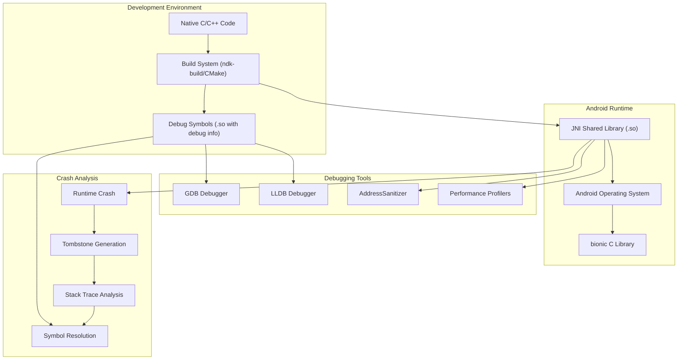
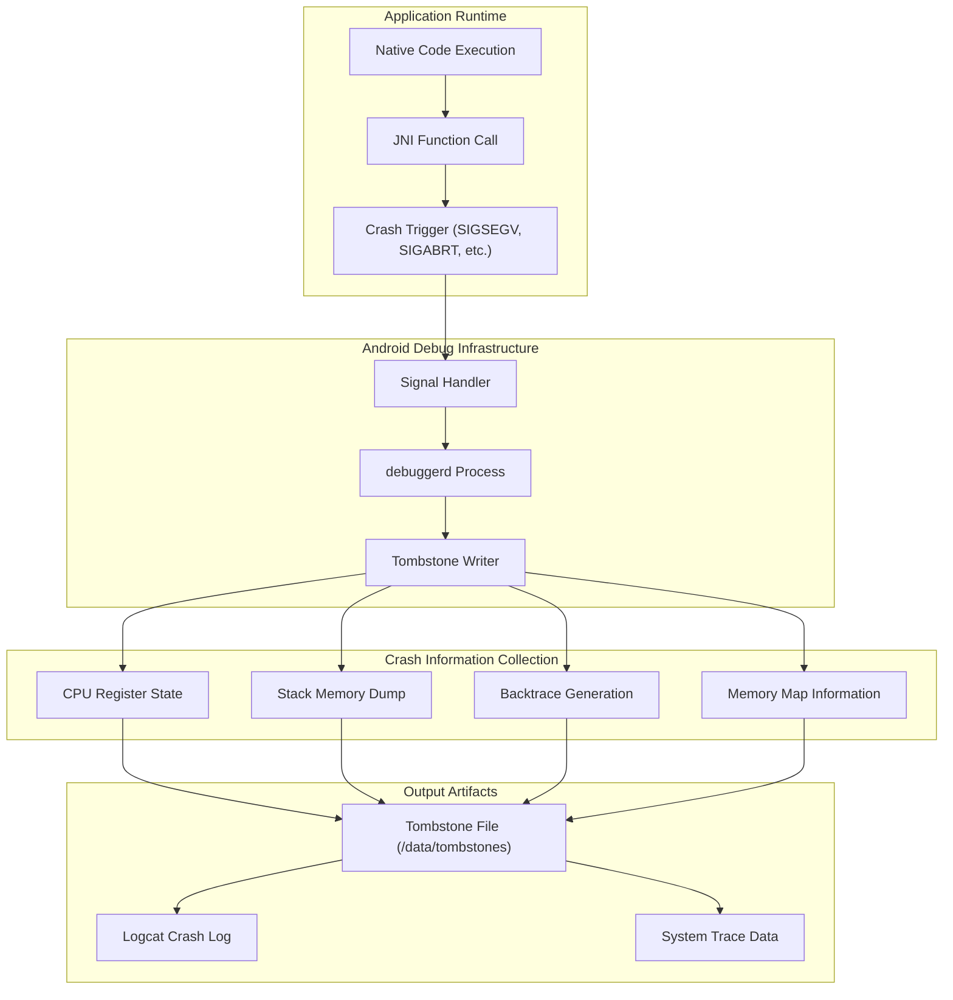
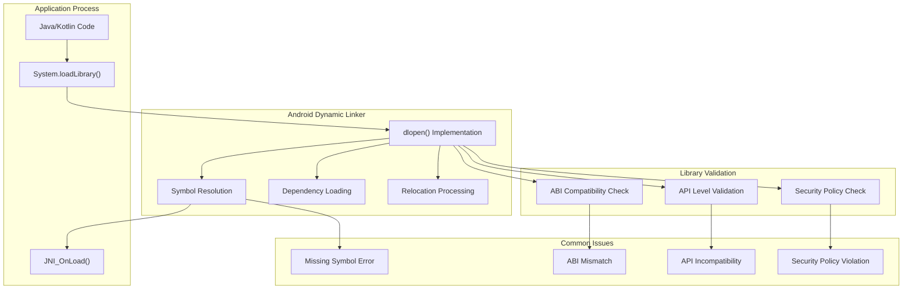
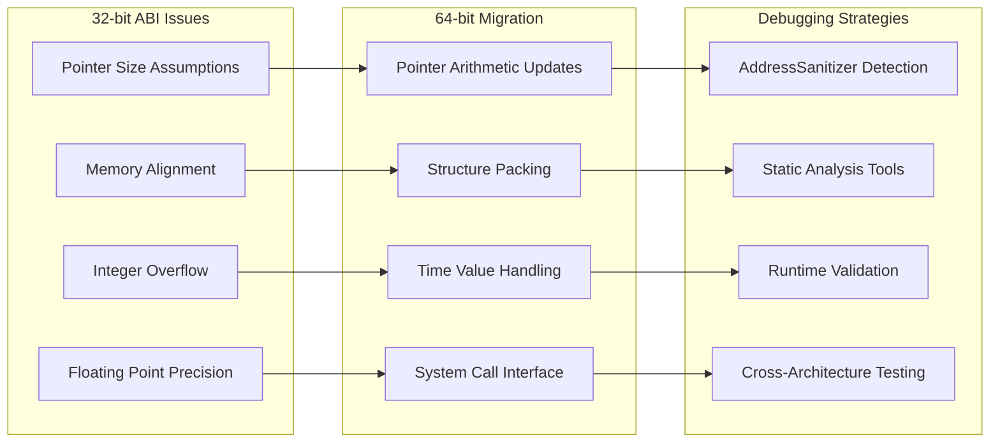
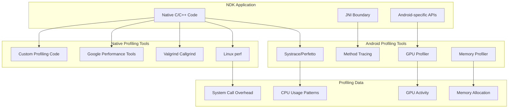
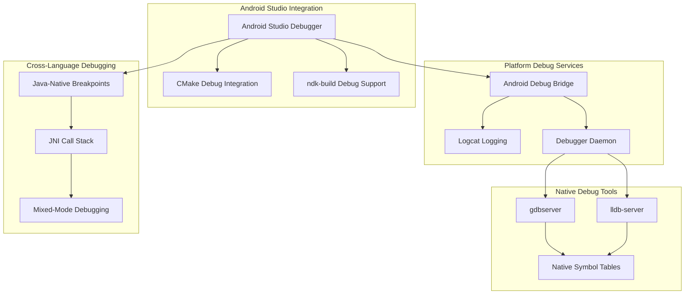

<!-- source: DeepWiki mcp.deepwiki.com · repo android/ndk · page 3.2 Debugging and Profiling · fetched 2026-10-23 -->

# Debugging and Profiling

Relevant source files

The following files were used as context for generating this wiki page:

- [README.md](README.md)

## Purpose and Scope

This document covers debugging and profiling techniques specific to native code development with the Android NDK. It focuses on crash analysis, tombstone interpretation, dynamic linker debugging, and performance profiling for JNI shared libraries integrated into Android applications.

For general NDK development workflow, see [Getting Started](#3.1). For information about the NDK's runtime environment and ABI compatibility, see [Runtime Environment](#2.1).

## NDK Debugging Overview

The Android NDK provides several debugging capabilities that integrate with both the Android platform's debugging infrastructure and standard native development tools. The debugging workflow spans from development-time analysis through runtime crash investigation.

### Debugging Workflow Integration

Sources: [README.md:32]()

## Crash Analysis and Tombstones

Android's crash handling system generates detailed tombstone files when native code crashes. Understanding these tombstones is crucial for debugging NDK applications.

### Tombstone Generation Process

The Android platform provides comprehensive documentation for understanding crash dumps and tombstones. The system automatically generates detailed crash information including register states, stack traces, and memory maps when native code encounters fatal errors.

### Common Crash Types

| Crash Signal | Description | Common Causes |
|--------------|-------------|---------------|
| `SIGSEGV` | Segmentation fault | Null pointer dereference, buffer overflow, invalid memory access |
| `SIGABRT` | Abort signal | Assertion failure, explicit abort() call, heap corruption |
| `SIGBUS` | Bus error | Unaligned memory access, memory mapping issues |
| `SIGFPE` | Floating point exception | Division by zero, invalid floating point operation |
| `SIGILL` | Illegal instruction | Corrupted code, unsupported instruction |

Sources: [README.md:53-60]()

## Dynamic Linker Debugging

The Android dynamic linker is responsible for loading JNI shared libraries at runtime. Understanding linker behavior is essential for debugging library loading issues.

### Library Loading Process

The dynamic linker documentation provides detailed information about important changes across Android releases that affect library loading behavior. This is particularly valuable when troubleshooting issues with loading `.so` files.

Sources: [README.md:47-49]()

## ABI-Specific Debugging Considerations

Android supports multiple Application Binary Interfaces (ABIs), each with specific debugging considerations and known issues.

### ABI Debugging Matrix

| Architecture | Debug Considerations | Common Issues |
|--------------|---------------------|---------------|
| `arm64-v8a` | Primary 64-bit target | Stack alignment, pointer size assumptions |
| `armeabi-v7a` | 32-bit ARM with NEON | Documented ABI bugs, alignment issues |
| `x86_64` | Intel 64-bit emulator | Different calling conventions, register usage |
| `x86` | Intel 32-bit emulator | Legacy compatibility, floating point handling |

### 32-bit ABI Specific Issues

The NDK documentation includes comprehensive coverage of 32-bit ABI bugs that can affect debugging and runtime behavior. These issues are particularly important when supporting older devices or when debugging crashes that only occur on 32-bit architectures.

Sources: [README.md:50-51]()

## Profiling Native Code

Performance profiling of NDK applications requires understanding both Android-specific profiling tools and integration with standard native profiling techniques.

### Profiling Tool Integration

### Performance Considerations

| Profiling Area | Tools | Key Metrics |
|----------------|-------|-------------|
| CPU Performance | `perf`, Systrace | Instruction cycles, cache misses, branch predictions |
| Memory Usage | AddressSanitizer, Valgrind | Heap allocations, memory leaks, buffer overruns |
| GPU Performance | GPU Profiler | Render time, texture memory, shader performance |
| System Integration | Systrace, Method Tracing | JNI call overhead, system service interaction |

## Integration with Android Debugging Infrastructure

The NDK debugging capabilities integrate with Android's broader debugging ecosystem, providing seamless debugging experiences across the Java/Kotlin and native code boundary.

### Debugging Ecosystem Integration

Sources: [README.md:32](), [README.md:69-71]()

---

