# Page: Android NDK Overview

# Android NDK Overview

<details>
<summary>Relevant source files</summary>

The following files were used as context for generating this wiki page:

- [README.md](README.md)

</details>


## Purpose and Scope

This document provides an overview of the Android Native Development Kit (NDK), explaining its core purpose, key capabilities, and role in the Android development ecosystem. The NDK enables Android application developers to include native C/C++ code in their applications, compiled as JNI shared libraries that integrate with the Android runtime environment.

For detailed information about specific NDK components, see [Core Components](#1.1). For build system integration details, see [Build Systems Integration](#1.2). For community support and issue management, see [Community Support and Issue Management](#4).

## What is the Android NDK

The Android NDK is a toolset that allows developers to implement parts of Android applications using native code languages such as C and C++. The NDK compiles native code into JNI (Java Native Interface) shared libraries (`.so` files) that can be called from Java or Kotlin code running on the Android Runtime (ART).

### NDK Development Workflow

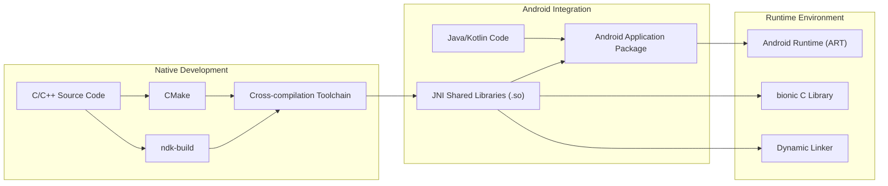

**Sources:** [README.md:1-74]()

## Core NDK Components

The NDK consists of several key components that work together to enable native development on Android:

| Component | Purpose | Key Features |
|-----------|---------|-------------|
| Cross-compilation Toolchain | Compile native code for Android target architectures | LLVM/Clang-based compiler, supports ARM, x86, x86_64 |
| Build System Integration | Integrate with Android build processes | `ndk-build` and CMake support |
| Android-specific APIs | Native access to Android platform features | Audio, graphics, neural networks, sensors |
| Runtime Dependencies | Native code execution environment | `bionic` C library, dynamic linker |

### NDK Toolchain and API Architecture

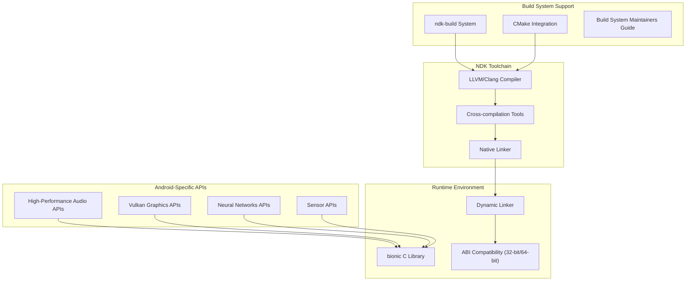

**Sources:** [README.md:28-38](), [README.md:40-51](), [README.md:69-71]()

## Integration with Android Development Ecosystem

The NDK integrates seamlessly with the broader Android development ecosystem, providing native development capabilities within the standard Android build and deployment pipeline.

### Supported Build Systems

The NDK supports two primary build systems:

- **ndk-build**: The traditional NDK build system based on GNU Make
- **CMake**: Cross-platform build system with full Android Studio integration

Both build systems are supported out of the box by Android Studio and the Android Gradle Plugin, enabling developers to choose the build system that best fits their project requirements.

### Native API Categories

The NDK provides access to specialized Android APIs optimized for native development:

1. **High-Performance Audio**: Low-latency audio processing APIs for real-time audio applications
2. **Vulkan Graphics**: Low-level graphics API for high-performance rendering
3. **Neural Networks**: Hardware-accelerated machine learning inference APIs

**Sources:** [README.md:28-38](), [README.md:69-71]()

## Runtime Environment and Dependencies

The NDK relies on Android's native runtime environment, which includes several key components:

### bionic C Library

Android uses `bionic`, a custom C library implementation optimized for mobile devices. The bionic library provides:

- Standard C library functions with Android-specific optimizations
- API availability varies by Android API level
- Behavior changes documented across Android releases

### Dynamic Linker

The Android dynamic linker handles loading and linking of native shared libraries (`.so` files). Understanding dynamic linker behavior is crucial for:

- Troubleshooting library loading issues
- Managing dependencies between native libraries
- Ensuring compatibility across Android versions

### ABI Compatibility

The NDK supports multiple Application Binary Interfaces (ABIs):

- **64-bit architectures**: arm64-v8a, x86_64
- **32-bit architectures**: armeabi-v7a, x86
- **ABI-specific considerations**: 32-bit ABI has documented compatibility issues

**Sources:** [README.md:40-51]()

## Documentation and Learning Resources

The NDK ecosystem provides comprehensive documentation and learning resources:

### Official Documentation

- **NDK Guides**: Getting started tutorials and build/debug information
- **NDK API Reference**: Complete reference for Android-specific native APIs
- **Specialized Tutorials**: High-Performance Audio, Vulkan, and Neural Networks guides

### Platform Documentation

- **bionic Status Documentation**: API availability by Android release
- **Dynamic Linker Changes**: Important changes affecting native library loading
- **Crash Analysis**: Understanding tombstones and native crash dumps

### Community Resources

- **android-ndk Google Group**: Community discussions and support
- **GitHub Issues**: Bug reporting and feature requests at `https://github.com/android-ndk/ndk/issues`
- **Release Calendar**: Upcoming NDK release schedule
- **Build System Maintainers Guide**: Advanced build system integration guidance

**Sources:** [README.md:23-38](), [README.md:40-61](), [README.md:62-74]()

## Development Workflow Integration

The NDK integrates with standard Android development workflows through:

1. **Android Studio Integration**: Native debugging and profiling tools
2. **Gradle Plugin Support**: Automated native library building and packaging
3. **Crash Analysis Tools**: Native crash dump interpretation and debugging
4. **Performance Profiling**: Native code performance analysis tools

For detailed information about debugging and profiling native code, see [Debugging and Profiling](#3.2). For information about the complete developer workflow, see [Developer Workflow](#3).

**Sources:** [README.md:30-32](), [README.md:53-61]()

---

# Page: Core Components

# Core Components

<details>
<summary>Relevant source files</summary>

The following files were used as context for generating this wiki page:

- [README.md](README.md)

</details>


This document details the fundamental components that make up the Android Native Development Kit (NDK), including the cross-compilation toolchain, build system integration, runtime environment, and Android-specific APIs. These components work together to enable Android application developers to include native C/C++ code in their applications.

For information about the complete developer workflow using these components, see [Developer Workflow](#3). For details about contributing to the NDK project itself, see [Contributing to the NDK](#5).

## Cross-compilation Toolchain

The NDK provides a complete cross-compilation toolchain that enables developers to build native C/C++ code for Android's various target architectures. This toolchain is the foundation that transforms native source code into JNI shared libraries that can be loaded by Android applications.

### Toolchain Architecture

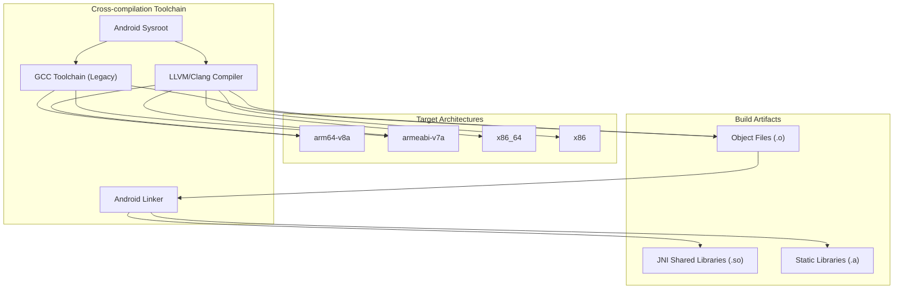

**Sources:** [README.md:1-74]()

## Build System Integration

The NDK integrates with two primary build systems to provide developers with flexible options for building native code. Both systems are supported out of the box by Android Studio.

### Build System Components

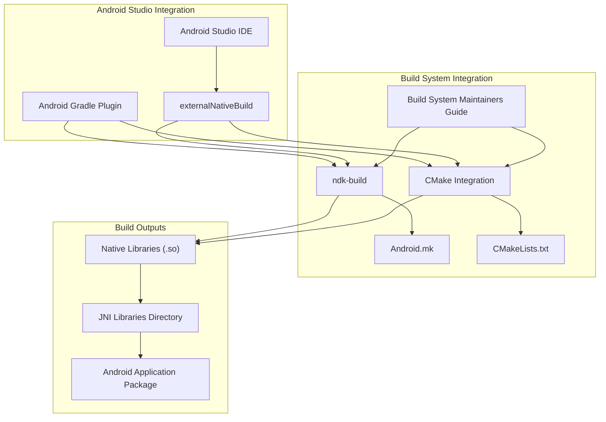

The NDK supports both `ndk-build` and `CMake` build systems, with comprehensive integration through the Android Gradle Plugin. For build system maintainers who need to integrate additional build systems, detailed guidance is available in the Build System Maintainers Guide.

**Sources:** [README.md:69-71]()

## Runtime Environment

The NDK runtime environment consists of core system libraries and components that native code depends on at runtime. These components provide the foundation for native code execution on Android devices.

### Runtime Dependencies

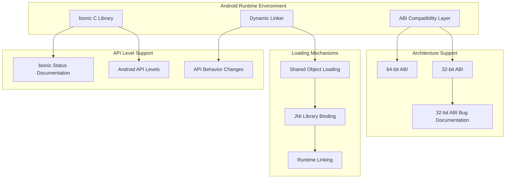

The `bionic` C library serves as Android's implementation of the standard C library, with comprehensive documentation covering API availability across different Android releases and behavior changes that affect NDK developers.

**Sources:** [README.md:40-51]()

## Android-Specific APIs

The NDK provides access to specialized Android-specific APIs that enable high-performance native applications. These APIs are documented in the NDK API Reference and include domain-specific functionality.

### Specialized API Categories

| API Category | Purpose | Documentation Reference |
|--------------|---------|------------------------|
| High-Performance Audio | Low-latency audio processing and OpenSL ES | NDK Audio Guides |
| Vulkan Graphics | Low-level graphics rendering API | NDK Graphics Guides |
| Neural Networks | Machine learning inference acceleration | NDK Neural Networks API |
| Standard Android APIs | Platform-specific native interfaces | NDK API Reference |

### API Integration Flow

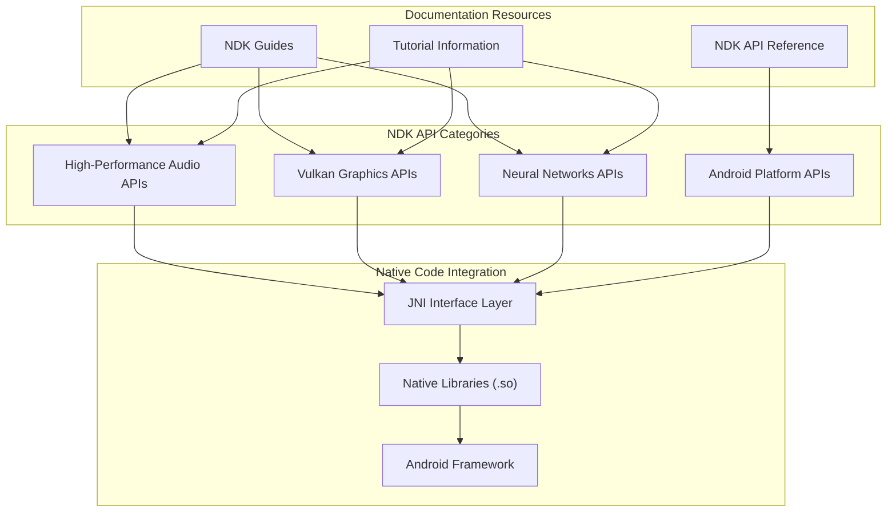

**Sources:** [README.md:28-38]()

## Native Code Compilation Pipeline

The NDK transforms native C/C++ source code into JNI shared libraries through a comprehensive compilation pipeline that integrates with Android's application packaging system.

### Compilation Process Flow

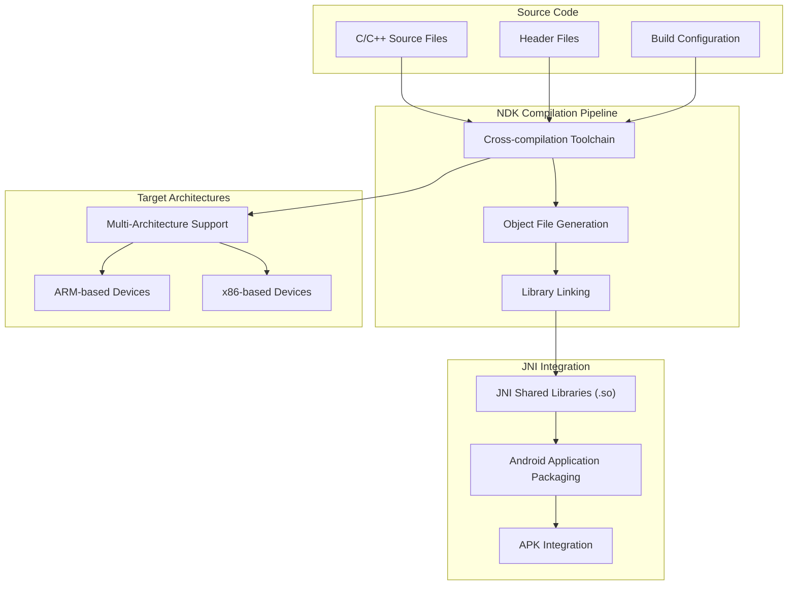

The compilation pipeline produces JNI shared libraries that are packaged into Android applications, enabling native code execution across multiple target architectures supported by Android devices.

**Sources:** [README.md:3-4]()

## Debugging and Profiling Support

The NDK includes comprehensive debugging and profiling capabilities essential for native code development, including crash analysis and performance optimization tools.

### Debug Information Flow

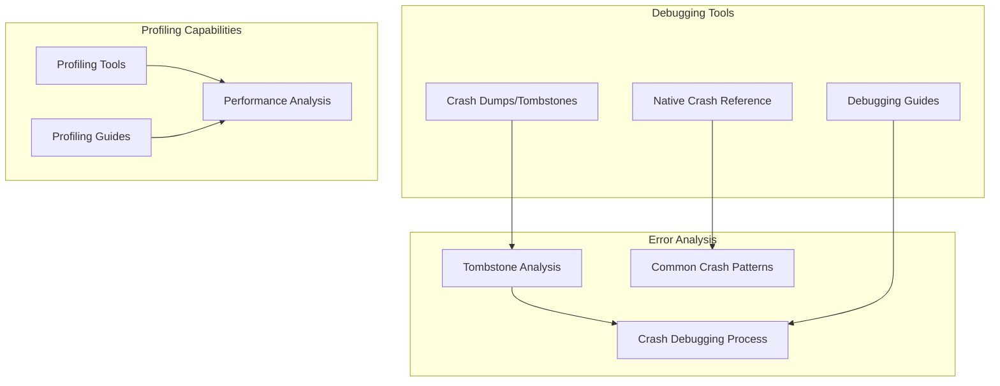

The NDK provides detailed documentation for understanding crash dumps and tombstones, which are essential for debugging native code issues in production Android applications.

**Sources:** [README.md:32-33](), [README.md:53-60]()

---

# Page: Build Systems Integration

# Build Systems Integration

<details>
<summary>Relevant source files</summary>

The following files were used as context for generating this wiki page:

- [README.md](README.md)

</details>


This document explains how the Android NDK integrates with build systems to compile native C/C++ code into JNI shared libraries for Android applications. It covers the two primary build systems supported by the NDK: `ndk-build` and CMake, along with their integration points and maintainer guidance.

The scope includes build system architecture, compilation workflows, and integration with Android development tools. For information about the core NDK components and toolchains, see [Core Components](#1.1). For details about the development workflow and getting started with native development, see [Getting Started](#3.1).

## NDK Build Systems Architecture

The NDK provides two primary build systems that handle the cross-compilation of native code for Android targets. Both systems integrate with the NDK toolchain to produce JNI shared libraries that can be packaged into Android applications.

### NDK Build System Overview

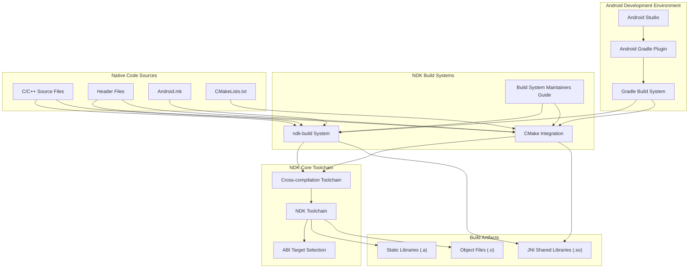

Sources: [README.md:69-71]()

## ndk-build System

The `ndk-build` system is the traditional NDK build system that uses GNU Make and Android.mk files to define build configurations. It provides direct integration with the NDK toolchain and supports all NDK features out of the box.

### ndk-build Build Process

```mermaid
graph LR
    subgraph "Build Configuration"
        AndroidMk["Android.mk"]
        ApplicationMk["Application.mk"]
        NDKBuildScript["ndk-build Script"]
    end
    
    subgraph "Make System"
        GNUMake["GNU Make"]
        NDKMakefiles["NDK Build System Makefiles"]
        TargetSelection["Target ABI Selection"]
    end
    
    subgraph "Compilation Pipeline"
        Preprocessing["C/C++ Preprocessing"]
        Compilation["Cross-compilation"]
        Linking["Shared Library Linking"]
    end
    
    subgraph "Output Artifacts"
        JNILibs["JNI Shared Libraries"]
        DebugSymbols["Debug Symbols"]
        LibsDirectory["libs/ Directory Structure"]
    end
    
    AndroidMk --> NDKBuildScript
    ApplicationMk --> NDKBuildScript
    NDKBuildScript --> GNUMake
    GNUMake --> NDKMakefiles
    NDKMakefiles --> TargetSelection
    
    TargetSelection --> Preprocessing
    Preprocessing --> Compilation
    Compilation --> Linking
    
    Linking --> JNILibs
    Linking --> DebugSymbols
    JNILibs --> LibsDirectory
    DebugSymbols --> LibsDirectory
```

The `ndk-build` system processes `Android.mk` files that define modules, source files, and build flags. The system automatically handles cross-compilation for multiple target ABIs and generates the appropriate directory structure for JNI libraries.

Sources: [README.md:69-71]()

## CMake Integration

CMake integration allows developers to use standard CMake build files (`CMakeLists.txt`) with the NDK. The integration provides a bridge between CMake's cross-platform build system and the NDK's Android-specific toolchain.

### CMake NDK Integration Architecture

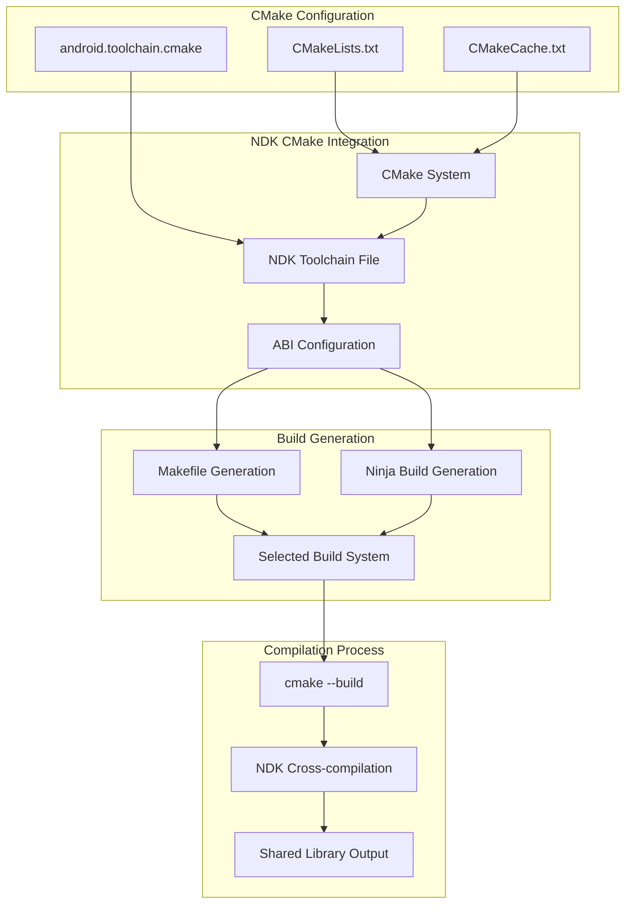

CMake integration uses the NDK's toolchain file to configure cross-compilation settings, target ABIs, and Android-specific build parameters. This allows developers to use familiar CMake syntax while leveraging NDK capabilities.

Sources: [README.md:69-71]()

## Build System Integration Points

Both build systems integrate with the broader Android development ecosystem through well-defined integration points that allow seamless native code compilation within Android projects.

| Integration Point | ndk-build | CMake | Description |
|------------------|-----------|-------|-------------|
| Android Studio | Direct | Direct | IDE integration for build configuration |
| Gradle Plugin | `android.externalNativeBuild.ndkBuild` | `android.externalNativeBuild.cmake` | Gradle build system integration |
| ABI Targeting | `APP_ABI` in Application.mk | `ANDROID_ABI` CMake variable | Multi-ABI compilation support |
| NDK Toolchain | Automatic | `android.toolchain.cmake` | Cross-compilation toolchain setup |
| Debug Symbols | `NDK_DEBUG=1` | `CMAKE_BUILD_TYPE=Debug` | Debug information generation |

### Android Studio and Gradle Integration

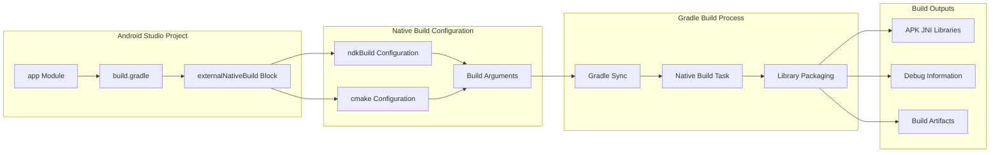

Android Studio's Gradle plugin automatically detects and configures native build systems through the `externalNativeBuild` block, enabling seamless integration of native code compilation into the Android application build process.

Sources: [README.md:69-71]()

## Build System Maintainers Guide

The NDK provides comprehensive guidance for build system maintainers who need to integrate with or extend the NDK's build capabilities. This includes support for custom build systems and advanced build configurations.

### Build System Maintainer Resources

The Build System Maintainers Guide addresses the needs of developers who maintain build systems that need to work with the NDK, including:

- Custom build system integration patterns
- NDK toolchain configuration and usage
- Cross-compilation setup and ABI targeting
- Integration with Android development workflows
- Advanced build system features and capabilities

Key areas covered by the maintainers guide include toolchain discovery, environment setup, and proper handling of Android-specific build requirements.

Sources: [README.md:71]()

## Build System Selection and Comparison

| Aspect | ndk-build | CMake |
|--------|-----------|-------|
| Configuration Files | `Android.mk`, `Application.mk` | `CMakeLists.txt` |
| Build System | GNU Make | CMake with Make/Ninja |
| NDK Integration | Native | Toolchain file |
| Learning Curve | NDK-specific | Standard CMake |
| Feature Support | Full NDK features | Full NDK features via toolchain |
| IDE Support | Android Studio | Android Studio + other IDEs |
| Cross-platform | Android-specific | Cross-platform with Android support |

Both build systems provide complete NDK functionality and integrate seamlessly with Android Studio. The choice typically depends on existing project infrastructure, team familiarity, and cross-platform requirements.

Sources: [README.md:69-71]()

---

# Page: Specialized APIs and Features

# Specialized APIs and Features

<details>
<summary>Relevant source files</summary>

The following files were used as context for generating this wiki page:

- [README.md](README.md)

</details>


## Purpose and Scope

This document covers the specialized APIs and advanced features provided by the Android NDK beyond standard C/C++ library functionality. These APIs enable native code to access Android-specific hardware capabilities and platform services that require high performance or low-level system integration.

The NDK provides three primary categories of specialized APIs: High-Performance Audio, Vulkan Graphics, and Neural Networks. For general NDK components and build system integration, see [Core Components](#1.1) and [Build Systems Integration](#1.2). For runtime environment details, see [Runtime Environment](#2.1).

## High-Performance Audio API

The NDK's High-Performance Audio API provides low-latency audio capabilities for real-time audio applications, games, and music production software. This API bypasses the higher-level Java audio framework to deliver direct access to the Android audio subsystem.

### Audio API Architecture

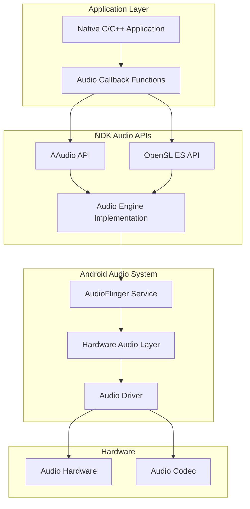

The audio API provides direct access to audio streams with minimal buffering and processing overhead, enabling professional-grade audio applications on Android devices.

**Sources:** [README.md:34-36]()

### Key Audio API Components

| API Component | Purpose | Latency Characteristics |
|---------------|---------|------------------------|
| `AAudio` | Modern low-latency audio API | Ultra-low latency for real-time audio |
| `OpenSL ES` | Cross-platform audio API | Low latency with broader device support |
| Audio Callbacks | Real-time audio processing | Direct hardware buffer access |
| Stream Configuration | Audio format and buffer setup | Optimized for specific use cases |

**Sources:** [README.md:34-36]()

## Vulkan Graphics API

The Vulkan Graphics API in the NDK provides low-level access to GPU hardware for high-performance graphics rendering, compute operations, and parallel processing workloads.

### Vulkan Integration Architecture

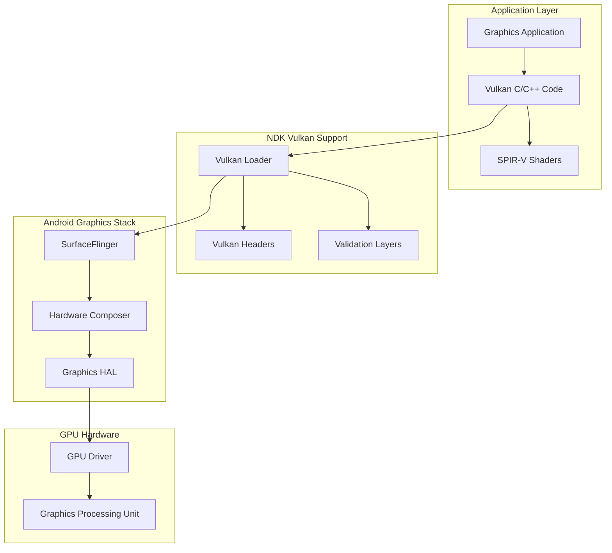

Vulkan provides explicit control over GPU resources, memory management, and command submission, enabling developers to achieve maximum graphics performance on Android devices.

**Sources:** [README.md:35-36]()

### Vulkan API Features

The NDK Vulkan implementation supports:

- **Command Buffer Management**: Direct GPU command submission and synchronization
- **Memory Management**: Explicit GPU memory allocation and binding
- **Pipeline State Objects**: Pre-compiled rendering and compute pipelines  
- **Descriptor Sets**: Resource binding and shader parameter management
- **Surface Integration**: Integration with Android's surface system for display output

**Sources:** [README.md:35-36]()

## Neural Networks API

The Neural Networks API (NNAPI) provides hardware-accelerated machine learning inference capabilities through the NDK, enabling native applications to leverage specialized AI processing units and optimized CPU/GPU implementations.

### Neural Networks Architecture

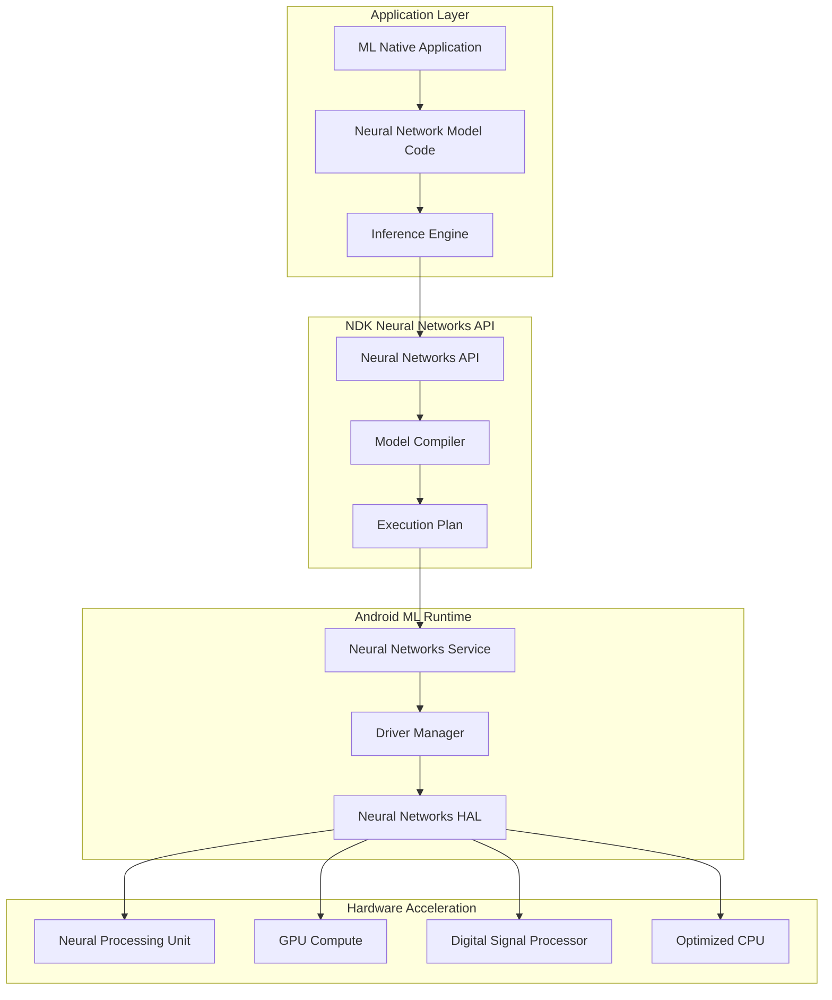

The Neural Networks API abstracts hardware-specific optimization while providing consistent performance across different Android devices with varying AI acceleration capabilities.

**Sources:** [README.md:36]()

### Neural Networks API Operations

| Operation Category | Examples | Hardware Targets |
|-------------------|----------|------------------|
| Convolution | `CONV_2D`, `DEPTHWISE_CONV_2D` | NPU, GPU |
| Activation | `RELU`, `SOFTMAX`, `TANH` | All accelerators |
| Pooling | `MAX_POOL_2D`, `AVERAGE_POOL_2D` | NPU, GPU |
| Normalization | `BATCH_NORM`, `LOCAL_RESPONSE_NORM` | GPU, CPU |
| Arithmetic | `ADD`, `MUL`, `SUB` | All accelerators |

**Sources:** [README.md:36]()

## Android-Specific API Integration

These specialized APIs integrate with the broader Android NDK ecosystem through standardized patterns and interfaces that enable cross-API interoperability and resource sharing.

### Cross-API Resource Management

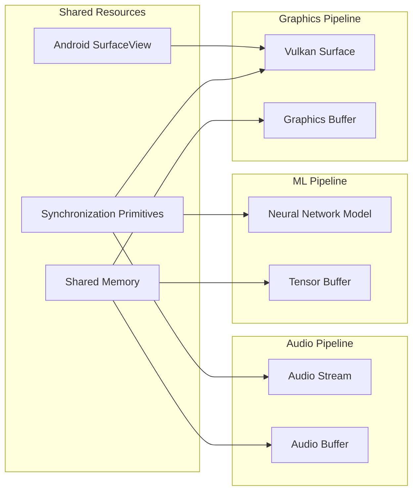

This integration architecture enables applications to combine multiple specialized APIs efficiently, such as using Vulkan for graphics rendering while processing audio through the high-performance audio API and running ML inference simultaneously.

**Sources:** [README.md:37-38]()

## API Documentation and References

The complete API reference for these specialized features is maintained in the official Android NDK documentation. Each API includes detailed function signatures, parameter specifications, and usage examples for integration into native applications.

For comprehensive API coverage including function definitions, constants, and data structures, developers should consult the NDK API Reference documentation which covers all Android-specific APIs available through the NDK.

**Sources:** [README.md:37-38]()

---

# Page: NDK Architecture

# NDK Architecture

<details>
<summary>Relevant source files</summary>

The following files were used as context for generating this wiki page:

- [README.md](README.md)

</details>


This document provides an in-depth examination of the Android Native Development Kit's internal architecture, covering the core system components, runtime environment, and platform integration mechanisms. The architecture encompasses the cross-compilation toolchain, build system integration, runtime environment with bionic C library, and the complete pipeline from native C/C++ code to JNI shared libraries integrated into Android applications.

For information about getting started with NDK development workflows, see [Developer Workflow](#3). For details about specific runtime components like bionic and the dynamic linker, see [Runtime Environment](#2.1). For native code compilation and integration processes, see [Native Code Integration](#2.2).

## Architectural Overview

The NDK architecture consists of several interconnected systems that enable native C/C++ development for Android applications. The architecture bridges the gap between standard POSIX development and the Android platform's unique requirements.

### Core NDK Architecture

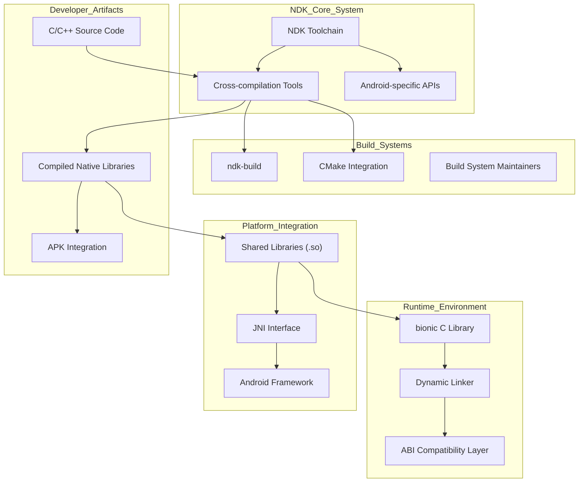

Sources: [README.md:1-74]()

## Build System Architecture

The NDK supports multiple build systems through a unified architecture that abstracts the underlying cross-compilation complexity. The build system architecture provides flexibility while maintaining consistent toolchain integration.

### Build System Integration Points

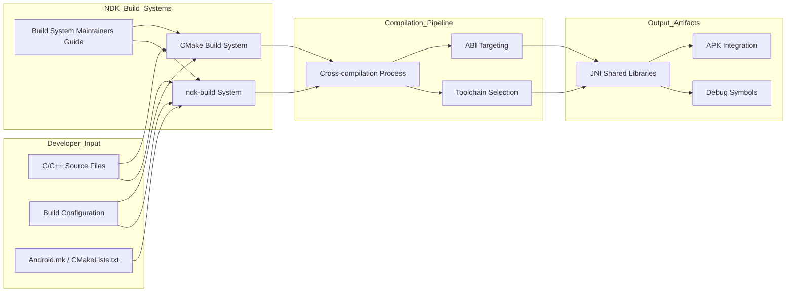

Sources: [README.md:69-71]()

The NDK build system architecture supports both `ndk-build` and CMake integration as documented in the Build System Maintainers Guide. The architecture abstracts toolchain complexity while providing developers with familiar build system interfaces.

## Runtime Integration Architecture

The NDK runtime architecture integrates with Android's unique C library implementation and dynamic linking system. This architecture ensures native code compatibility across different Android versions and device architectures.

### Runtime Environment Components

| Component | Purpose | Integration Points |
|-----------|---------|-------------------|
| bionic C Library | Android's C library implementation | System calls, POSIX compatibility |
| Dynamic Linker | Shared library loading and symbol resolution | `.so` file loading, dependency management |
| ABI Compatibility Layer | 32-bit and 64-bit architecture support | Cross-architecture compatibility |
| JNI Interface | Java-Native code bridge | Method calls, data type conversion |

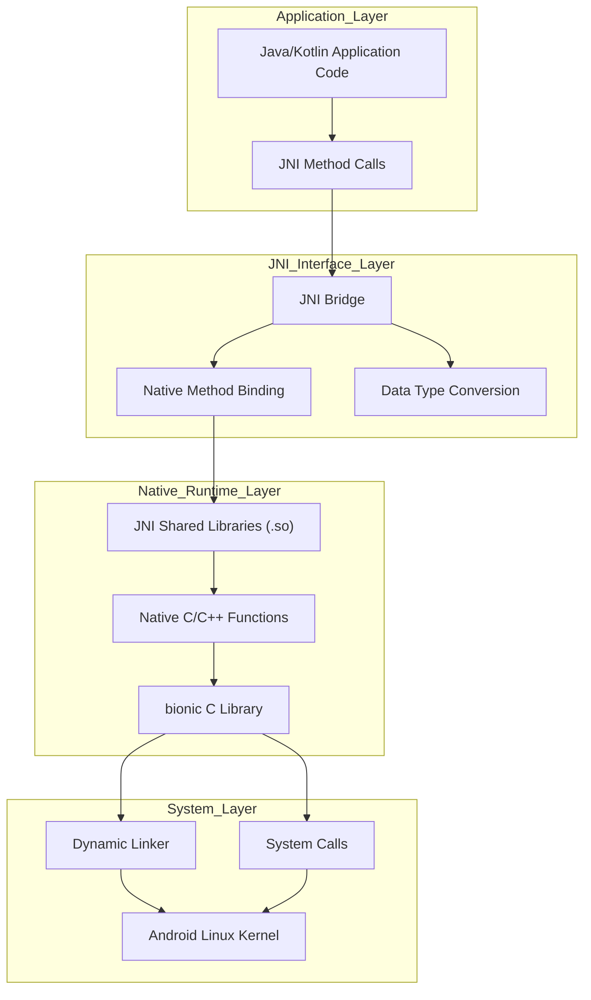

Sources: [README.md:40-51]()

## Cross-Compilation Toolchain Architecture

The NDK's cross-compilation architecture enables building native code on development machines for target Android devices. The toolchain handles architecture differences, API level targeting, and Android-specific optimizations.

### Toolchain Components and Flow

The cross-compilation process involves multiple stages that transform source code into Android-compatible native libraries:

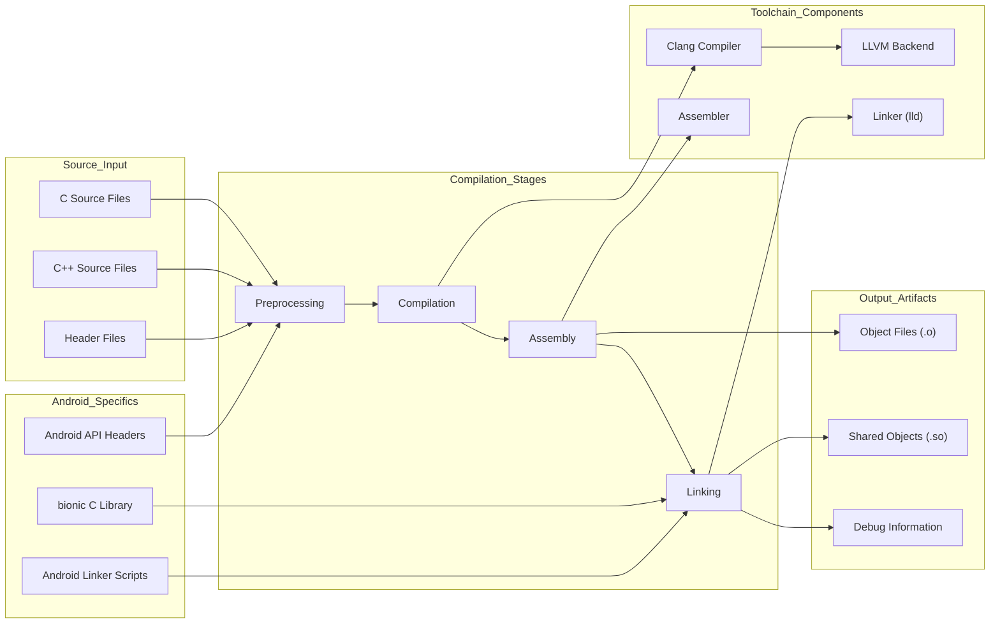

Sources: [README.md:1-74]()

## Platform Integration Points

The NDK architecture integrates with multiple layers of the Android platform, from the application framework down to the kernel level. These integration points ensure native code operates correctly within Android's security and runtime model.

### Android Platform Integration

| Integration Layer | NDK Components | Platform Components |
|-------------------|----------------|-------------------|
| Application Framework | JNI shared libraries | Android Runtime (ART) |
| Native Framework | Android-specific APIs | Native system services |
| C Library Layer | bionic integration | System call interface |
| Kernel Interface | System calls | Linux kernel |

The integration architecture ensures that native code compiled with the NDK can interact seamlessly with Android's Java-based application framework while maintaining access to lower-level system capabilities through the bionic C library and system call interface.

## ABI and Compatibility Architecture

The NDK supports multiple Application Binary Interfaces (ABIs) to ensure compatibility across different Android device architectures. The ABI compatibility layer handles architecture-specific differences and ensures consistent behavior across 32-bit and 64-bit platforms.

### ABI Support Matrix

```mermaid
graph TB
    subgraph "NDK_ABI_Support"
        ARM64["arm64-v8a (64-bit)"]
        ARM32["armeabi-v7a (32-bit)"]
        X86_64["x86_64 (64-bit)"]
        X86_32["x86 (32-bit)"]
    end
    
    subgraph "Compatibility_Layer"
        ABICompat["ABI Compatibility Layer"]
        BitCompatibility["32-bit/64-bit Support"]
        ArchSpecific["Architecture-specific Optimizations"]
    end
    
    subgraph "Runtime_Considerations"
        DynamicLinking["Dynamic Linking"]
        SymbolResolution["Symbol Resolution"]
        MemoryLayout["Memory Layout"]
    end
    
    ARM64 --> ABICompat
    ARM32 --> ABICompat
    X86_64 --> ABICompat
    X86_32 --> ABICompat
    
    ABICompat --> BitCompatibility
    ABICompat --> ArchSpecific
    
    BitCompatibility --> DynamicLinking
    ArchSpecific --> SymbolResolution
    DynamicLinking --> MemoryLayout
```

Sources: [README.md:50-51]()

The ABI architecture addresses 32-bit specific issues and ensures proper dynamic linking behavior across different Android releases, as documented in the bionic dynamic linker changes and 32-bit ABI documentation.

---

# Page: Runtime Environment

# Runtime Environment

<details>
<summary>Relevant source files</summary>

The following files were used as context for generating this wiki page:

- [README.md](README.md)

</details>


## Purpose and Scope

This document explains the Android NDK runtime environment, focusing on the core system components that execute native code at runtime on Android devices. The runtime environment encompasses the bionic C library, dynamic linker, and ABI compatibility layers that provide the execution context for NDK applications.

For information about the build-time cross-compilation toolchain, see [Cross-compilation Toolchain](#2.3). For details about how native code integrates with Android applications during development, see [Native Code Integration](#2.2).

## Runtime Environment Overview

The NDK runtime environment provides the execution foundation for native libraries compiled with the NDK. This environment consists of three primary components that work together to load, link, and execute native code on Android devices.

### Runtime Environment Architecture

```mermaid
graph TB
    subgraph "Android Application Process"
        JavaCode["Java/Kotlin Application Code"]
        JNI["JNI Interface Layer"]
        NativeLibs["Native Shared Libraries (.so)"]
    end
    
    subgraph "NDK Runtime Environment"
        Bionic["bionic C Library"]
        DynamicLinker["Dynamic Linker (linker64/linker)"]
        ABILayer["ABI Compatibility Layer"]
    end
    
    subgraph "Android System"
        Kernel["Linux Kernel"]
        SystemLibs["System Libraries"]
        AndroidRuntime["Android Runtime (ART)"]
    end
    
    JavaCode --> JNI
    JNI --> NativeLibs
    NativeLibs --> Bionic
    NativeLibs --> DynamicLinker
    DynamicLinker --> ABILayer
    
    Bionic --> SystemLibs
    Bionic --> Kernel
    DynamicLinker --> AndroidRuntime
    ABILayer --> Kernel
```

Sources: [README.md:40-52]()

## Bionic C Library

The bionic C library serves as the primary system library for NDK applications, providing POSIX-compliant C standard library functions optimized for Android. Bionic replaces the standard GNU C library (glibc) found on most Linux systems.

### Bionic Characteristics

| Feature | Description |
|---------|-------------|
| **Size Optimization** | Smaller memory footprint compared to glibc |
| **Android Integration** | Native integration with Android system services |
| **API Compatibility** | POSIX compliance with Android-specific extensions |
| **Multi-ABI Support** | Supports both 32-bit and 64-bit architectures |

### API Evolution and Compatibility

Bionic APIs evolve across Android API levels, with new functions added and behaviors modified between releases. The bionic status documentation tracks which APIs are available in specific Android versions and documents behavioral changes that affect NDK developers.

```mermaid
graph LR
    subgraph "NDK Application"
        NativeCode["Native C/C++ Code"]
        LibCalls["libc Function Calls"]
    end
    
    subgraph "bionic Implementation"
        BionicCore["bionic Core Functions"]
        AndroidExt["Android Extensions"]
        APILevel["API Level Checks"]
    end
    
    subgraph "System Integration"
        SystemCalls["Linux System Calls"]
        AndroidServices["Android System Services"]
        PropertySystem["Android Property System"]
    end
    
    NativeCode --> LibCalls
    LibCalls --> BionicCore
    BionicCore --> AndroidExt
    AndroidExt --> APILevel
    
    BionicCore --> SystemCalls
    AndroidExt --> AndroidServices
    AndroidServices --> PropertySystem
```

Sources: [README.md:42-46]()

## Dynamic Linker

The Android dynamic linker (`linker64` for 64-bit, `linker` for 32-bit) handles loading and linking shared libraries at runtime. This component resolves symbol dependencies and manages library initialization for NDK applications.

### Dynamic Linking Process

The dynamic linker performs several critical operations when loading native libraries:

1. **Library Loading**: Loads `.so` files into process memory
2. **Symbol Resolution**: Resolves undefined symbols across library boundaries  
3. **Relocation**: Adjusts memory addresses for position-independent code
4. **Initialization**: Executes library constructors and initialization functions

### Dynamic Linker Changes

The dynamic linker behavior has evolved significantly across Android releases, particularly affecting how libraries are loaded and symbols are resolved. These changes can impact existing NDK applications, especially regarding library loading failures.

```mermaid
graph TB
    subgraph "Application Launch"
        AppStart["Application Startup"]
        LibraryLoad["dlopen() / System.loadLibrary()"]
    end
    
    subgraph "Dynamic Linker Operation"
        linker64["linker64 (64-bit) / linker (32-bit)"]
        SymbolTable["Symbol Table Resolution"]
        Relocation["Address Relocation"]
        LibInit["Library Initialization"]
    end
    
    subgraph "Memory Management"
        ProcessMemory["Process Memory Space"]
        SharedLibs["Loaded Shared Libraries"]
        SymbolCache["Symbol Resolution Cache"]
    end
    
    AppStart --> LibraryLoad
    LibraryLoad --> linker64
    linker64 --> SymbolTable
    SymbolTable --> Relocation
    Relocation --> LibInit
    
    linker64 --> ProcessMemory
    ProcessMemory --> SharedLibs
    SymbolTable --> SymbolCache
```

Sources: [README.md:47-49]()

## ABI Compatibility

Application Binary Interface (ABI) compatibility ensures that native libraries built for specific architectures can execute correctly on target devices. The NDK supports multiple ABIs to accommodate different Android device architectures.

### Supported ABIs

| ABI | Architecture | Description |
|-----|--------------|-------------|
| **arm64-v8a** | 64-bit ARM | Primary ABI for modern Android devices |
| **armeabi-v7a** | 32-bit ARM | Legacy ABI for older ARM devices |
| **x86_64** | 64-bit x86 | Intel/AMD 64-bit architecture |
| **x86** | 32-bit x86 | Intel/AMD 32-bit architecture |

### 32-bit ABI Considerations

The 32-bit ABIs, particularly `armeabi-v7a`, have specific behavioral differences and potential issues compared to their 64-bit counterparts. These differences can affect memory layout, pointer sizes, and system call interfaces.

```mermaid
graph LR
    subgraph "Native Library"
        LibSource["Library Source Code"]
        CompileTarget["Compilation Target ABI"]
    end
    
    subgraph "ABI Layer"
        ABI32["32-bit ABI Layer"]
        ABI64["64-bit ABI Layer"]
        ABIBridge["ABI Compatibility Bridge"]
    end
    
    subgraph "System Interface"
        SystemCalls32["32-bit System Calls"]
        SystemCalls64["64-bit System Calls"]
        KernelInterface["Kernel Interface"]
    end
    
    LibSource --> CompileTarget
    CompileTarget --> ABI32
    CompileTarget --> ABI64
    
    ABI32 --> ABIBridge
    ABI64 --> ABIBridge
    ABIBridge --> SystemCalls32
    ABIBridge --> SystemCalls64
    
    SystemCalls32 --> KernelInterface
    SystemCalls64 --> KernelInterface
```

Sources: [README.md:50-51]()

## Runtime Environment Integration

The runtime environment components work together to provide a complete execution context for NDK applications. The integration between bionic, the dynamic linker, and ABI compatibility layers ensures consistent behavior across different Android devices and API levels.

### Component Interaction Flow

```mermaid
sequenceDiagram
    participant App as "Android Application"
    participant JNI as "JNI Layer"
    participant Linker as "Dynamic Linker"
    participant Bionic as "bionic C Library"
    participant Kernel as "Linux Kernel"
    
    App->>JNI: Load native library
    JNI->>Linker: dlopen("libnative.so")
    Linker->>Linker: Resolve symbols
    Linker->>Bionic: Initialize C runtime
    Bionic->>Kernel: System call interface
    Linker-->>JNI: Library loaded
    JNI-->>App: Native functions available
    
    App->>JNI: Call native function
    JNI->>Bionic: Execute native code
    Bionic->>Kernel: System calls as needed
    Bionic-->>JNI: Return result
    JNI-->>App: Return to Java/Kotlin
```

### Runtime Dependencies

The runtime environment maintains specific dependencies and initialization orders to ensure proper operation:

- **bionic** provides the fundamental C library interface
- **Dynamic linker** manages library loading and symbol resolution
- **ABI layer** ensures architecture-specific compatibility
- **System integration** bridges native code with Android system services

Sources: [README.md:40-52]()

---

# Page: Native Code Integration

# Native Code Integration

<details>
<summary>Relevant source files</summary>

The following files were used as context for generating this wiki page:

- [README.md](README.md)

</details>


## Purpose and Scope

This document details how native C/C++ code is compiled into JNI shared libraries and integrated into Android applications. It covers the technical process from native source code compilation through APK packaging to runtime loading and execution within the Android environment.

For information about the cross-compilation toolchain architecture, see [Cross-compilation Toolchain](#2.3). For details about the runtime environment components, see [Runtime Environment](#2.1). For build system configuration and usage, see [Build Systems Integration](#1.2).

## JNI Shared Library Compilation Process

The Android NDK compiles native C/C++ code into JNI (Java Native Interface) shared libraries with `.so` extensions. These libraries serve as the bridge between Java/Kotlin application code and native implementations.

### Native Code to Shared Library Flow

```mermaid
graph TD
    subgraph "Native Source Code"
        CppSrc["C/C++ Source Files<br/>(.cpp, .c, .h)"]
        JNIHeaders["JNI Header Files<br/>(jni.h)"]
    end
    
    subgraph "Build Configuration"
        AndroidMk["Android.mk"]
        CMakeLists["CMakeLists.txt"] 
        BuildGradle["build.gradle"]
    end
    
    subgraph "NDK Compilation Process"
        CrossCompiler["Cross-compilation Toolchain"]
        Linker["NDK Linker"]
        StripTool["Strip Tool"]
    end
    
    subgraph "Output Artifacts"
        SharedLib["JNI Shared Libraries<br/>(.so files)"]
        DebugSymbols["Debug Symbols<br/>(optional)"]
    end
    
    subgraph "Architecture Targets"
        ARM64["arm64-v8a/lib*.so"]
        ARM32["armeabi-v7a/lib*.so"]
        X86_64["x86_64/lib*.so"]
        X86["x86/lib*.so"]
    end
    
    CppSrc --> CrossCompiler
    JNIHeaders --> CrossCompiler
    AndroidMk --> CrossCompiler
    CMakeLists --> CrossCompiler
    BuildGradle --> CrossCompiler
    
    CrossCompiler --> Linker
    Linker --> StripTool
    StripTool --> SharedLib
    StripTool --> DebugSymbols
    
    SharedLib --> ARM64
    SharedLib --> ARM32
    SharedLib --> X86_64
    SharedLib --> X86
```

The compilation process transforms native source code into architecture-specific shared libraries that can be loaded by the Android runtime. Each target architecture requires separate compilation to ensure compatibility across different device types.

Sources: [README.md:1-4]()

### JNI Interface Structure

```mermaid
graph TB
    subgraph "Java/Kotlin Layer"
        JavaClass["Java/Kotlin Classes"]
        NativeMethods["native method declarations"]
        SystemLoadLibrary["System.loadLibrary()"]
    end
    
    subgraph "JNI Interface Layer"
        JNIEnv["JNIEnv* interface"]
        JavaVM["JavaVM* interface"]
        JNINativeMethod["JNINativeMethod structures"]
        RegisterNatives["RegisterNatives()"]
    end
    
    subgraph "Native Implementation Layer"
        JNIFunctions["JNI_OnLoad()"]
        NativeImpl["Native function implementations"]
        JNICallbacks["JNI callback functions"]
    end
    
    subgraph "Android Runtime"
        ART["Android Runtime (ART)"]
        DynamicLinker["Dynamic Linker"]
        BionicLib["bionic C Library"]
    end
    
    JavaClass --> NativeMethods
    NativeMethods --> SystemLoadLibrary
    SystemLoadLibrary --> DynamicLinker
    
    DynamicLinker --> JNIFunctions
    JNIFunctions --> RegisterNatives
    RegisterNatives --> JNINativeMethod
    
    JNINativeMethod --> NativeImpl
    NativeImpl --> JNICallbacks
    JNICallbacks --> JNIEnv
    JNIEnv --> JavaVM
    
    JavaVM --> ART
    DynamicLinker --> BionicLib
```

The JNI interface provides the mechanism for Java/Kotlin code to call native functions and for native code to interact with Java objects and methods. The `JNI_OnLoad()` function serves as the entry point for library initialization.

Sources: [README.md:1-4]()

## APK Integration and Packaging

Native shared libraries are packaged into the APK's `lib/` directory, organized by target architecture. The Android build system handles this integration automatically when properly configured.

### APK Packaging Structure

| APK Component | Native Integration | Purpose |
|---------------|-------------------|---------|
| `lib/arm64-v8a/` | 64-bit ARM libraries | ARM64 device support |
| `lib/armeabi-v7a/` | 32-bit ARM libraries | ARM32 device support |
| `lib/x86_64/` | 64-bit x86 libraries | x86_64 emulator/device support |
| `lib/x86/` | 32-bit x86 libraries | x86 emulator support |
| `classes.dex` | Java bytecode with native method declarations | JNI method signatures |
| `AndroidManifest.xml` | Application metadata | No direct native integration |

The Android package manager selects the appropriate architecture-specific libraries during application installation based on the target device's CPU architecture.

Sources: [README.md:1-4]()

## Runtime Loading and Linking

At runtime, the Android system loads native libraries through the dynamic linker when `System.loadLibrary()` is called. This process involves several system components working together to resolve dependencies and establish the JNI interface.

### Runtime Loading Process

```mermaid
graph TD
    subgraph "Application Startup"
        AppProcess["App Process Creation"]
        ClassLoader["ClassLoader initialization"]
        StaticInit["Static initializers"]
    end
    
    subgraph "Library Loading"
        LoadLibraryCall["System.loadLibrary()"]
        DlOpen["dlopen() system call"]
        LibrarySearch["Library path resolution"]
    end
    
    subgraph "Dynamic Linker Operations"
        DynamicLinker["Android Dynamic Linker"]
        SymbolResolution["Symbol resolution"]
        DependencyLoading["Dependency loading"]
        Relocation["Address relocation"]
    end
    
    subgraph "JNI Initialization"
        JNIOnLoad["JNI_OnLoad() execution"]
        MethodRegistration["Native method registration"]
        InterfaceSetup["JNIEnv setup"]
    end
    
    subgraph "Runtime Environment"
        BionicLibc["bionic C library"]
        AndroidRuntime["Android Runtime (ART)"]
        KernelInterface["Linux kernel interface"]
    end
    
    AppProcess --> ClassLoader
    ClassLoader --> StaticInit
    StaticInit --> LoadLibraryCall
    
    LoadLibraryCall --> DlOpen
    DlOpen --> LibrarySearch
    LibrarySearch --> DynamicLinker
    
    DynamicLinker --> SymbolResolution
    SymbolResolution --> DependencyLoading
    DependencyLoading --> Relocation
    Relocation --> JNIOnLoad
    
    JNIOnLoad --> MethodRegistration
    MethodRegistration --> InterfaceSetup
    
    DynamicLinker --> BionicLibc
    InterfaceSetup --> AndroidRuntime
    BionicLibc --> KernelInterface
```

The dynamic linker resolves all symbol dependencies and performs necessary relocations before executing the library's `JNI_OnLoad()` function, which typically registers native method implementations with the Java runtime.

Sources: [README.md:40-51]()

## ABI Compatibility and Multi-Architecture Support

The NDK supports multiple Application Binary Interfaces (ABIs) to ensure compatibility across different Android device architectures. Each ABI defines calling conventions, data type sizes, and system interface specifications.

### ABI Architecture Support Matrix

| ABI Name | Architecture | Bit Width | Status | Common Devices |
|----------|-------------|-----------|--------|----------------|
| `arm64-v8a` | ARMv8-A | 64-bit | Primary | Modern ARM devices |
| `armeabi-v7a` | ARMv7-A | 32-bit | Legacy support | Older ARM devices |
| `x86_64` | x86-64 | 64-bit | Emulator primary | x86_64 emulators |
| `x86` | x86 | 32-bit | Emulator legacy | x86 emulators |

The Android system automatically selects the most appropriate ABI at installation time based on device capabilities and library availability. Applications can include multiple ABI versions to maximize device compatibility.

Sources: [README.md:50-51]()

### Multi-ABI Integration Flow

```mermaid
graph LR
    subgraph "Build Process"
        SingleSource["Single C/C++ Source"]
        MultiCompile["Multi-ABI Compilation"]
    end
    
    subgraph "APK Structure"
        APKPackage["APK Package"]
        LibDir["lib/ directory"]
    end
    
    subgraph "Architecture Libraries"
        ARM64Lib["lib/arm64-v8a/libname.so"]
        ARM32Lib["lib/armeabi-v7a/libname.so"]
        X64Lib["lib/x86_64/libname.so"]
        X86Lib["lib/x86/libname.so"]
    end
    
    subgraph "Runtime Selection"
        DeviceArch["Device Architecture Detection"]
        ABISelection["ABI Selection Logic"]
        LibraryLoad["Selected Library Loading"]
    end
    
    SingleSource --> MultiCompile
    MultiCompile --> APKPackage
    APKPackage --> LibDir
    
    LibDir --> ARM64Lib
    LibDir --> ARM32Lib
    LibDir --> X64Lib
    LibDir --> X86Lib
    
    ARM64Lib --> DeviceArch
    ARM32Lib --> DeviceArch
    X64Lib --> DeviceArch
    X86Lib --> DeviceArch
    
    DeviceArch --> ABISelection
    ABISelection --> LibraryLoad
```

The build system compiles the same native source code for multiple target architectures, and the Android runtime selects the appropriate version during application installation and execution.

Sources: [README.md:50-51]()

## Application Lifecycle Integration

Native libraries integrate with the Android application lifecycle through JNI callbacks and system events. The integration must handle process creation, memory management, and cleanup operations correctly.

| Lifecycle Event | Native Integration Point | Required Actions |
|-----------------|-------------------------|------------------|
| Process Creation | `JNI_OnLoad()` | Library initialization, method registration |
| Activity Creation | Native method calls | Resource allocation, state setup |
| Configuration Changes | JNI callbacks | Handle orientation, locale changes |
| Memory Pressure | Native memory management | Release caches, compact data |
| Process Termination | `JNI_OnUnload()` | Cleanup resources, save state |

Native code must be designed to handle Android's process lifecycle, including potential process termination and recreation due to memory pressure or system events.

Sources: [README.md:1-4]()

---

# Page: Cross-compilation Toolchain

# Cross-compilation Toolchain

<details>
<summary>Relevant source files</summary>

The following files were used as context for generating this wiki page:

- [README.md](README.md)

</details>


## Purpose and Scope

The cross-compilation toolchain is a core component of the Android NDK that enables developers to compile native C/C++ code for Android target devices from host development machines. This toolchain handles the complex process of translating native code into JNI shared libraries (`.so` files) that can be integrated into Android applications.

This document covers the architecture and operation of the NDK's cross-compilation system. For information about build system integration specifics, see [Build Systems Integration](#1.2). For runtime environment details including the bionic C library and dynamic linker, see [Runtime Environment](#2.1).

## Toolchain Architecture Overview

The NDK cross-compilation toolchain consists of multiple components that work together to transform native source code into Android-compatible binaries.

### Core Toolchain Components

```mermaid
graph TB
    subgraph "Host Development Environment"
        SourceCode["C/C++ Source Code"]
        Headers["System Headers"]
        BuildConfig["Build Configuration"]
    end
    
    subgraph "NDK Cross-compilation Toolchain"
        Preprocessor["Preprocessor"]
        Compiler["Cross Compiler<br/>(clang/clang++)"]
        Assembler["Assembler"]
        Linker["Linker<br/>(lld)"]
        ToolchainSysroot["Toolchain Sysroot"]
    end
    
    subgraph "Target Android Platform"
        JNILibrary[".so JNI Libraries"]
        BionicRuntime["bionic C Library"]
        AndroidFramework["Android Framework"]
    end
    
    subgraph "Build System Interface"
        NDKBuild["ndk-build"]
        CMakeIntegration["CMake Integration"]
        BuildSystemMaintainers["Build System Maintainers"]
    end
    
    SourceCode --> Preprocessor
    Headers --> Preprocessor
    BuildConfig --> Preprocessor
    
    Preprocessor --> Compiler
    Compiler --> Assembler
    Assembler --> Linker
    ToolchainSysroot --> Linker
    
    Linker --> JNILibrary
    JNILibrary --> BionicRuntime
    BionicRuntime --> AndroidFramework
    
    NDKBuild --> Compiler
    CMakeIntegration --> Compiler
    BuildSystemMaintainers --> NDKBuild
    BuildSystemMaintainers --> CMakeIntegration
```

Sources: [README.md:3-4](), [README.md:69-71]()

### Toolchain Target Architecture Support

The cross-compilation toolchain supports multiple Android target architectures, each requiring specific compilation configurations and ABI considerations.

```mermaid
graph LR
    subgraph "Host Architectures"
        HostX86_64["x86_64 Host"]
        HostMacOS["macOS Host"] 
        HostWindows["Windows Host"]
    end
    
    subgraph "NDK Toolchain Core"
        CrossCompiler["LLVM/Clang Cross-compiler"]
        TargetConfigs["Target Configuration Matrix"]
    end
    
    subgraph "Android Target ABIs"
        ARM64["arm64-v8a<br/>(64-bit ARM)"]
        ARMv7["armeabi-v7a<br/>(32-bit ARM)"]
        X86_64["x86_64<br/>(64-bit Intel)"]
        X86["x86<br/>(32-bit Intel)"]
    end
    
    subgraph "ABI Considerations"
        ABI64["64-bit ABI"]
        ABI32["32-bit ABI<br/>(with known issues)"]
        ABICompatibility["ABI Compatibility Matrix"]
    end
    
    HostX86_64 --> CrossCompiler
    HostMacOS --> CrossCompiler
    HostWindows --> CrossCompiler
    
    CrossCompiler --> TargetConfigs
    TargetConfigs --> ARM64
    TargetConfigs --> ARMv7
    TargetConfigs --> X86_64
    TargetConfigs --> X86
    
    ARM64 --> ABI64
    X86_64 --> ABI64
    ARMv7 --> ABI32
    X86 --> ABI32
    
    ABI32 --> ABICompatibility
    ABI64 --> ABICompatibility
```

Sources: [README.md:50-51]()

## Cross-compilation Process Flow

The cross-compilation process transforms native source code through multiple stages before producing Android-compatible shared libraries.

### Compilation Pipeline

```mermaid
flowchart TD
    subgraph "Input Stage"
        CppSource["C++ Source Files<br/>(.cpp, .cc, .cxx)"]
        CSource["C Source Files<br/>(.c)"]
        HeaderFiles["Header Files<br/>(.h, .hpp)"]
        NDKHeaders["NDK System Headers"]
    end
    
    subgraph "Preprocessing Stage"
        MacroExpansion["Macro Expansion"]
        IncludeResolution["Include Resolution"]
        ConditionalCompilation["Conditional Compilation"]
    end
    
    subgraph "Compilation Stage" 
        SyntaxAnalysis["Syntax Analysis"]
        SemanticAnalysis["Semantic Analysis"]
        Optimization["Code Optimization"]
        CodeGeneration["Target Code Generation"]
    end
    
    subgraph "Assembly Stage"
        AssemblyGeneration["Assembly Code Generation"]
        ObjectFileCreation["Object File Creation<br/>(.o files)"]
    end
    
    subgraph "Linking Stage"
        ObjectLinking["Object File Linking"]
        LibraryLinking["Library Linking"]
        SymbolResolution["Symbol Resolution"]
        JNILibraryOutput["JNI Shared Library<br/>(.so file)"]
    end
    
    CppSource --> MacroExpansion
    CSource --> MacroExpansion
    HeaderFiles --> IncludeResolution
    NDKHeaders --> IncludeResolution
    
    MacroExpansion --> SyntaxAnalysis
    IncludeResolution --> SyntaxAnalysis
    ConditionalCompilation --> SyntaxAnalysis
    
    SyntaxAnalysis --> SemanticAnalysis
    SemanticAnalysis --> Optimization
    Optimization --> CodeGeneration
    
    CodeGeneration --> AssemblyGeneration
    AssemblyGeneration --> ObjectFileCreation
    
    ObjectFileCreation --> ObjectLinking
    ObjectLinking --> LibraryLinking
    LibraryLinking --> SymbolResolution
    SymbolResolution --> JNILibraryOutput
```

Sources: [README.md:3-4]()

## Build System Integration

The cross-compilation toolchain integrates with multiple build systems to provide flexible development workflows for NDK users.

### Build System Architecture

| Build System | Integration Method | Configuration | Target Use Case |
|--------------|-------------------|---------------|-----------------|
| `ndk-build` | Native NDK build system | `Android.mk`, `Application.mk` | Traditional NDK projects |
| `CMake` | CMake NDK toolchain file | `CMakeLists.txt` | Cross-platform C++ projects |
| Custom Build Systems | Build System Maintainers Guide | Custom integration | Specialized build requirements |

```mermaid
graph TB
    subgraph "Developer Interface"
        AndroidStudio["Android Studio"]
        CommandLine["Command Line Interface"]
        CI_CD["CI/CD Systems"]
    end
    
    subgraph "Build System Layer"
        NDKBuildSystem["ndk-build System<br/>(Android.mk)"]
        CMakeBuildSystem["CMake Integration<br/>(CMakeLists.txt)"]
        CustomBuildSystem["Custom Build Systems"]
        BuildMaintainerGuide["Build System Maintainers Guide"]
    end
    
    subgraph "NDK Toolchain Interface"
        ToolchainInvocation["Toolchain Invocation"]
        CompilerFlags["Compiler Flags Configuration"]
        LinkerConfiguration["Linker Configuration"]
        TargetABISelection["Target ABI Selection"]
    end
    
    subgraph "Cross-compilation Execution"
        CompilationProcess["Cross-compilation Process"]
        OutputGeneration["JNI Library Generation"]
    end
    
    AndroidStudio --> NDKBuildSystem
    AndroidStudio --> CMakeBuildSystem
    CommandLine --> NDKBuildSystem
    CommandLine --> CMakeBuildSystem
    CI_CD --> CustomBuildSystem
    
    BuildMaintainerGuide --> CustomBuildSystem
    
    NDKBuildSystem --> ToolchainInvocation
    CMakeBuildSystem --> ToolchainInvocation
    CustomBuildSystem --> ToolchainInvocation
    
    ToolchainInvocation --> CompilerFlags
    CompilerFlags --> LinkerConfiguration
    LinkerConfiguration --> TargetABISelection
    TargetABISelection --> CompilationProcess
    
    CompilationProcess --> OutputGeneration
```

Sources: [README.md:69-71]()

## Runtime Environment Integration

The cross-compilation toolchain must produce binaries compatible with Android's runtime environment, including the bionic C library and dynamic linker.

### Runtime Compatibility Matrix

```mermaid
graph TB
    subgraph "Toolchain Output"
        JNISharedLibrary[".so JNI Shared Libraries"]
        SymbolTable["Symbol Table"]
        DynamicDependencies["Dynamic Dependencies"]
    end
    
    subgraph "Android Runtime Environment"
        BionicCLibrary["bionic C Library"]
        DynamicLinker["Android Dynamic Linker"]
        AndroidFramework["Android Framework"]
    end
    
    subgraph "ABI Compatibility Considerations"
        API_Level_Support["API Level Support"]
        ABI_32bit_Issues["32-bit ABI Issues"]
        Dynamic_Linker_Changes["Dynamic Linker Changes"]
        Loading_Compatibility[".so Loading Compatibility"]
    end
    
    subgraph "Documentation References"
        BionicStatus["bionic Status Documentation"]
        NDK_Changes["NDK Developer Changes"]
        ABI_Bugs["32-bit ABI Bug Documentation"]
    end
    
    JNISharedLibrary --> BionicCLibrary
    SymbolTable --> DynamicLinker
    DynamicDependencies --> DynamicLinker
    
    BionicCLibrary --> AndroidFramework
    DynamicLinker --> AndroidFramework
    
    BionicCLibrary --> API_Level_Support
    DynamicLinker --> Dynamic_Linker_Changes
    JNISharedLibrary --> Loading_Compatibility
    API_Level_Support --> ABI_32bit_Issues
    
    BionicStatus --> API_Level_Support
    NDK_Changes --> Dynamic_Linker_Changes
    ABI_Bugs --> ABI_32bit_Issues
```

Sources: [README.md:44-51]()

### Key Runtime Integration Points

The toolchain must ensure compatibility with several critical runtime components:

- **bionic C Library Compatibility**: The toolchain links against Android's bionic C library, which has specific API availability and behavior changes across Android versions
- **Dynamic Linker Integration**: Generated `.so` files must be compatible with Android's dynamic linker, which has undergone significant changes across Android releases
- **ABI Compliance**: The toolchain must generate code that adheres to Android's ABI specifications, with particular attention to 32-bit ABI issues

| Runtime Component | Documentation Reference | Key Considerations |
|-------------------|------------------------|-------------------|
| bionic C Library | Android bionic status | API availability across Android versions |
| Dynamic Linker | Android changes for NDK developers | Loading behavior changes |
| 32-bit ABI | 32-bit ABI bugs | Known compatibility issues |

Sources: [README.md:44-51]()

---

# Page: Developer Workflow

# Developer Workflow

<details>
<summary>Relevant source files</summary>

The following files were used as context for generating this wiki page:

- [README.md](README.md)

</details>


This document guides developers through the complete workflow of using the Android NDK for native development. It covers the practical steps from writing native C/C++ code to integrating JNI shared libraries into Android applications.

For information about the NDK's internal architecture and runtime environment, see [NDK Architecture](#2). For getting started with basic setup and initial guidance, see [Getting Started](#3.1). For debugging techniques and tools, see [Debugging and Profiling](#3.2).

## Purpose and Scope

The NDK enables Android application developers to include native code in their applications, compiled as JNI shared libraries. This workflow documentation focuses on the practical development process, build system choices, and integration steps that developers follow when incorporating native code into their Android projects.

Sources: [README.md:3-4]()

## Complete Developer Workflow

The NDK development process follows a structured workflow from native code development through final APK integration. The following diagram illustrates the complete development pipeline:

### NDK Development Pipeline

```mermaid
flowchart TD
    Start["Developer starts NDK project"]
    
    subgraph "Native Code Development"
        NativeCode["Write C/C++ native code"]
        JNIInterface["Implement JNI interface functions"]
        AndroidAPIs["Use Android-specific APIs"]
    end
    
    subgraph "Build System Selection"
        BuildChoice{"Choose build system"}
        NDKBuild["ndk-build system"]
        CMake["CMake integration"]
    end
    
    subgraph "Compilation Process"
        CrossCompile["Cross-compilation for Android targets"]
        LinkBionic["Link against bionic C library"]
        GenerateSharedLib["Generate JNI shared libraries (.so files)"]
    end
    
    subgraph "Android Integration"
        CopyLibs["Copy .so files to APK"]
        JavaJNI["Java/Kotlin JNI bindings"]
        PackageAPK["Package into Android APK"]
    end
    
    subgraph "Testing and Deployment"
        TestDevice["Test on Android device"]
        DebugIssues["Debug crashes/tombstones"]
        Deploy["Deploy to production"]
    end
    
    Start --> NativeCode
    NativeCode --> JNIInterface
    JNIInterface --> AndroidAPIs
    AndroidAPIs --> BuildChoice
    
    BuildChoice --> NDKBuild
    BuildChoice --> CMake
    
    NDKBuild --> CrossCompile
    CMake --> CrossCompile
    
    CrossCompile --> LinkBionic
    LinkBionic --> GenerateSharedLib
    GenerateSharedLib --> CopyLibs
    CopyLibs --> JavaJNI
    JavaJNI --> PackageAPK
    
    PackageAPK --> TestDevice
    TestDevice --> DebugIssues
    DebugIssues --> Deploy
```

Sources: [README.md:3-4](), [README.md:69-71]()

## Build System Architecture

The NDK supports two primary build systems, each with distinct workflows and tooling integration:

### Build System Components and Integration

```mermaid
flowchart LR
    subgraph "Developer Input"
        CppCode["C/C++ source files (.cpp, .c)"]
        Headers["Header files (.h, .hpp)"]
        AndroidMk["Android.mk files"]
        CMakeList["CMakeLists.txt files"]
    end
    
    subgraph "NDK Build Systems"
        NDKBuildSys["ndk-build"]
        CMakeSys["CMake"]
        BuildMaintainers["Build System Maintainers Guide"]
    end
    
    subgraph "Toolchain Components"
        CrossCompiler["Cross-compilation toolchain"]
        BionicLib["bionic C library"]
        DynamicLinker["Dynamic linker"]
    end
    
    subgraph "Output Artifacts"
        SharedLibs["JNI shared libraries (.so)"]
        DebugSymbols["Debug symbols"]
        APKIntegration["APK integration ready"]
    end
    
    subgraph "IDE Integration"
        AndroidStudio["Android Studio"]
        GradlePlugin["Android Gradle Plugin"]
    end
    
    CppCode --> NDKBuildSys
    CppCode --> CMakeSys
    Headers --> NDKBuildSys
    Headers --> CMakeSys
    AndroidMk --> NDKBuildSys
    CMakeList --> CMakeSys
    
    NDKBuildSys --> CrossCompiler
    CMakeSys --> CrossCompiler
    
    CrossCompiler --> BionicLib
    CrossCompiler --> DynamicLinker
    
    BionicLib --> SharedLibs
    DynamicLinker --> SharedLibs
    CrossCompiler --> DebugSymbols
    
    SharedLibs --> APKIntegration
    DebugSymbols --> APKIntegration
    
    AndroidStudio --> NDKBuildSys
    AndroidStudio --> CMakeSys
    GradlePlugin --> NDKBuildSys
    GradlePlugin --> CMakeSys
    
    BuildMaintainers --> NDKBuildSys
    BuildMaintainers --> CMakeSys
```

Sources: [README.md:69-71]()

## Build System Selection

Developers must choose between two supported build systems, each with distinct characteristics:

| Build System | Configuration Files | Integration | Use Cases |
|--------------|-------------------|-------------|-----------|
| `ndk-build` | `Android.mk`, `Application.mk` | Native NDK system | Traditional NDK projects, existing makefiles |
| `CMake` | `CMakeLists.txt` | Cross-platform | Modern projects, existing CMake codebases |

Both systems are supported out of the box by the NDK and Android Studio. The choice depends on project requirements and existing build infrastructure.

Sources: [README.md:69-70]()

## Native Code Development Process

The native code development process involves several key components and APIs:

### Core Development Components

1. **Native Code Implementation**: C/C++ source files containing application logic
2. **JNI Interface Functions**: Bridge functions enabling Java/Kotlin to native code communication  
3. **Android-Specific APIs**: Specialized APIs for platform integration

### Specialized API Categories

The NDK provides tutorial information and APIs for specialized use cases:

- **High-Performance Audio**: Low-latency audio processing and playback
- **Vulkan Graphics**: High-performance graphics rendering
- **Neural Networks**: Machine learning and AI acceleration

Sources: [README.md:33-36]()

## Compilation and Runtime Integration

The compilation process integrates with Android's runtime environment through several key components:

### Runtime Dependencies

| Component | Purpose | Documentation Reference |
|-----------|---------|------------------------|
| `bionic` C library | Android's C standard library implementation | Android bionic status |
| Dynamic linker | Loads and links `.so` files at runtime | Android changes for NDK developers |
| ABI compatibility | Ensures proper 32-bit and 64-bit support | 32-bit ABI bugs documentation |

The compilation process must account for these runtime dependencies to ensure proper library loading and execution on Android devices.

Sources: [README.md:40-51]()

## Testing and Debugging Workflow

The testing and debugging workflow includes several critical steps:

### Debugging Resources

1. **Crash Analysis**: Understanding crash dumps and tombstones for native code failures
2. **Common Crashes**: Reference documentation for typical native code crash patterns  
3. **Debugging Tools**: Profiling and debugging techniques specific to NDK development

The Android OS developer documentation provides comprehensive resources for understanding and diagnosing native code issues.

Sources: [README.md:32](), [README.md:55-60]()

## Developer Resources and Documentation

The NDK workflow relies on several key documentation and community resources:

### Essential Documentation

| Resource | Purpose | Location |
|----------|---------|----------|
| NDK Guides | Getting started and core concepts | Android Developer website |
| NDK API Reference | Complete API documentation | Android Developer website |
| Build System Maintainers Guide | Advanced build system customization | AOSP NDK documentation |

### Community Support

- **android-ndk Google Group**: Primary discussion forum for NDK-related questions
- **GitHub Issues**: Bug reporting and feature requests at `https://github.com/android-ndk/ndk/issues`
- **Release Calendar**: Upcoming NDK release schedule and milestones

### Development Planning

- **Milestones**: Current development priorities and upcoming features
- **NDK Roadmap**: Long-term development direction and planned enhancements

Sources: [README.md:6-10](), [README.md:23-38](), [README.md:64-68]()

## Integration with Android Development Ecosystem

The NDK workflow integrates seamlessly with the broader Android development ecosystem:

### IDE and Build Tool Integration

The NDK works with standard Android development tools:
- **Android Studio**: Full IDE support for NDK projects
- **Android Gradle Plugin**: Build system integration for automated compilation
- **Build system flexibility**: Support for both `ndk-build` and `CMake` workflows

This integration ensures that NDK development fits naturally into existing Android development workflows and toolchains.

Sources: [README.md:69-70]()

---

# Page: Getting Started

# Getting Started

<details>
<summary>Relevant source files</summary>

The following files were used as context for generating this wiki page:

- [README.md](README.md)

</details>


## Purpose and Scope

This document provides entry-level guidance for developers new to the Android Native Development Kit (NDK). It covers the fundamental concepts, initial setup workflow, documentation resources, and community support channels needed to begin native Android development. For detailed information about NDK architecture and runtime environment, see [NDK Architecture](#2). For advanced debugging and profiling techniques, see [Debugging and Profiling](#3.2).

## What is the Android NDK

The Android NDK allows Android application developers to include native C/C++ code in their Android application packages, compiled as JNI shared libraries. This enables developers to leverage existing C/C++ codebases, achieve performance-critical optimizations, and access platform-specific functionality not available through the Android SDK alone.

The NDK provides cross-compilation toolchains, build system integration, and Android-specific APIs that bridge native code with the Android runtime environment.

Sources: [README.md:1-4]()

## Developer Journey Overview

The following diagram illustrates the typical workflow for developers getting started with the NDK:

### NDK Developer Onboarding Workflow

```mermaid
graph TD
    Start["Developer Starting Point"]
    Learn["Learn NDK Fundamentals"]
    Setup["Setup Development Environment"]
    Choose["Choose Build System"]
    
    subgraph "Documentation Resources"
        NDKGuides["NDK Guides<br/>developer.android.com/ndk/guides"]
        APIRef["NDK API Reference<br/>developer.android.com/ndk/reference"]
        BuildDocs["Build System Documentation"]
        AudioGuide["High-Performance Audio Guide"]
        VulkanGuide["Vulkan Graphics Guide"]
        NeuralGuide["Neural Networks Guide"]
    end
    
    subgraph "Build System Options"
        NDKBuild["ndk-build"]
        CMake["CMake Integration"]
        CustomBuild["Custom Build System"]
    end
    
    subgraph "Development Tools"
        AndroidStudio["Android Studio IDE"]
        Debugging["Debug & Profile Tools"]
        Tombstone["Crash Analysis"]
    end
    
    subgraph "Community Support"
        GoogleGroup["android-ndk Google Group"]
        GitHubIssues["GitHub Issues"]
        Calendar["Release Calendar"]
    end
    
    Start --> Learn
    Learn --> NDKGuides
    Learn --> APIRef
    NDKGuides --> BuildDocs
    NDKGuides --> AudioGuide
    NDKGuides --> VulkanGuide
    NDKGuides --> NeuralGuide
    
    Learn --> Setup
    Setup --> Choose
    Choose --> NDKBuild
    Choose --> CMake
    Choose --> CustomBuild
    
    Setup --> AndroidStudio
    Setup --> Debugging
    Setup --> Tombstone
    
    Learn --> GoogleGroup
    Learn --> GitHubIssues
    Learn --> Calendar
```

Sources: [README.md:23-38, 64-73]()

## Essential Documentation Resources

The NDK documentation is organized into several key areas that new developers should explore:

### Core Documentation Structure

| Resource | Purpose | Location |
|----------|---------|----------|
| NDK Guides | Getting started tutorials and core concepts | `developer.android.com/ndk/guides/` |
| API Reference | Complete Android-specific API documentation | `developer.android.com/ndk/reference` |
| Build System Guides | Information about building native code | `developer.android.com/ndk/guides/build` |
| Debug & Profile Guides | Debugging and profiling native applications | `developer.android.com/ndk/guides/debug` |

### Specialized API Guides

The NDK provides dedicated documentation for performance-critical domains:

- **High-Performance Audio**: Tutorial information for audio applications requiring low latency
- **Vulkan Graphics**: Modern graphics API integration for high-performance rendering
- **Neural Networks**: Machine learning and AI inference capabilities

Sources: [README.md:25-38]()

## Platform Integration Documentation

Understanding the Android platform integration is crucial for NDK development:

### Runtime Environment Documentation

```mermaid
graph LR
    subgraph "Platform Documentation"
        BionicStatus["bionic Status Documentation<br/>android.googlesource.com/.../docs/status.md"]
        NDKChanges["Android Changes for NDK Developers<br/>android.googlesource.com/.../android-changes-for-ndk-developers.md"]
        ABI32["32-bit ABI Documentation<br/>android.googlesource.com/.../docs/32-bit-abi.md"]
    end
    
    subgraph "Debugging Resources"
        Tombstones["Crash Dumps/Tombstones<br/>source.android.com/devices/tech/debug"]
        CommonCrashes["Common Crashes Reference<br/>source.android.com/devices/tech/debug/native-crash"]
    end
    
    subgraph "Runtime Components"
        bionic["bionic C Library"]
        DynamicLinker["Dynamic Linker"]
        ABICompat["ABI Compatibility"]
    end
    
    BionicStatus --> bionic
    NDKChanges --> DynamicLinker
    ABI32 --> ABICompat
    
    Tombstones --> bionic
    CommonCrashes --> DynamicLinker
```

### Key Platform Documentation Areas

1. **bionic C Library Status**: Details available APIs across Android releases and behavioral changes between API levels
2. **Dynamic Linker Changes**: Critical information for troubleshooting shared library loading issues
3. **ABI Compatibility**: Important considerations for 32-bit code development
4. **Crash Analysis**: Understanding tombstones and common native crash patterns

Sources: [README.md:40-61]()

## Build System Integration

The NDK supports multiple build systems to accommodate different development workflows:

### Build System Support Matrix

```mermaid
graph TB
    subgraph "Supported Build Systems"
        NDKBuildSys["ndk-build<br/>Traditional NDK build system"]
        CMakeInt["CMake Integration<br/>Modern cross-platform builds"]
        AndroidStudioInt["Android Studio Integration<br/>Built-in IDE support"]
    end
    
    subgraph "Build System Resources"
        Maintainers["Build System Maintainers Guide<br/>docs/BuildSystemMaintainers.md"]
        BuildGuides["Build Documentation<br/>developer.android.com/ndk/guides/build"]
    end
    
    subgraph "Development Environment"
        AndroidStudio["Android Studio IDE"]
        GradlePlugin["Android Gradle Plugin"]
    end
    
    NDKBuildSys --> Maintainers
    CMakeInt --> Maintainers
    AndroidStudioInt --> BuildGuides
    
    AndroidStudio --> NDKBuildSys
    AndroidStudio --> CMakeInt
    GradlePlugin --> NDKBuildSys
    GradlePlugin --> CMakeInt
```

Both `ndk-build` and CMake are supported out of the box by the NDK and Android Studio. For developers maintaining custom build systems, the Build System Maintainers Guide provides detailed integration information.

Sources: [README.md:69-72]()

## Community Support Channels

The NDK community provides multiple channels for support and collaboration:

### Support Channel Organization

| Channel | Purpose | Access |
|---------|---------|--------|
| android-ndk Google Group | General discussions and community support | `groups.google.com/group/android-ndk` |
| GitHub Issues | Bug reports and feature requests | `github.com/android-ndk/ndk/issues` |
| Release Calendar | Upcoming release information | `github.com/android-ndk/ndk/wiki` |
| AOSP Source | Contributing to NDK development | `android.googlesource.com/platform/ndk/` |

### Getting Help Workflow

```mermaid
graph TD
    Question["NDK Question or Issue"]
    
    subgraph "Issue Classification"
        Bug["Bug Report"]
        Feature["Feature Request"]
        Discussion["General Discussion"]
        Contribution["Code Contribution"]
    end
    
    subgraph "Support Channels"
        GitHubIssues["GitHub Issues<br/>github.com/android-ndk/ndk/issues"]
        GoogleGroup["android-ndk Google Group<br/>groups.google.com/group/android-ndk"]
        AOSP["AOSP Source Repository<br/>android.googlesource.com/platform/ndk/"]
    end
    
    Question --> Bug
    Question --> Feature
    Question --> Discussion
    Question --> Contribution
    
    Bug --> GitHubIssues
    Feature --> GitHubIssues
    Discussion --> GoogleGroup
    Contribution --> AOSP
```

For structured issue reporting and comprehensive community support processes, see [Community Support and Issue Management](#4).

Sources: [README.md:64-73]()

## Next Steps

After reviewing this getting started information, developers should:

1. **Explore the NDK Guides**: Begin with the comprehensive tutorials at `developer.android.com/ndk/guides/`
2. **Set up the development environment**: Configure Android Studio with NDK support
3. **Choose a build system**: Evaluate `ndk-build` vs CMake based on project requirements
4. **Join the community**: Subscribe to the android-ndk Google Group for ongoing support
5. **Review specialized APIs**: Investigate High-Performance Audio, Vulkan, or Neural Networks guides as needed

For detailed workflow information and advanced development practices, continue to [Debugging and Profiling](#3.2).

Sources: [README.md:1-74]()

---

# Page: Debugging and Profiling

# Debugging and Profiling

<details>
<summary>Relevant source files</summary>

The following files were used as context for generating this wiki page:

- [README.md](README.md)

</details>


## Purpose and Scope

This document covers debugging and profiling techniques specific to native code development with the Android NDK. It focuses on crash analysis, tombstone interpretation, dynamic linker debugging, and performance profiling for JNI shared libraries integrated into Android applications.

For general NDK development workflow, see [Getting Started](#3.1). For information about the NDK's runtime environment and ABI compatibility, see [Runtime Environment](#2.1).

## NDK Debugging Overview

The Android NDK provides several debugging capabilities that integrate with both the Android platform's debugging infrastructure and standard native development tools. The debugging workflow spans from development-time analysis through runtime crash investigation.

### Debugging Workflow Integration

```mermaid
graph TD
    subgraph "Development Environment"
        NativeCode["Native C/C++ Code"]
        BuildSystem["Build System (ndk-build/CMake)"]
        DebugSymbols["Debug Symbols (.so with debug info)"]
    end
    
    subgraph "Android Runtime"
        JNILibrary["JNI Shared Library (.so)"]
        AndroidOS["Android Operating System"]
        Bionic["bionic C Library"]
    end
    
    subgraph "Debugging Tools"
        GDB["GDB Debugger"]
        LLDB["LLDB Debugger"]
        AddressSanitizer["AddressSanitizer"]
        Profilers["Performance Profilers"]
    end
    
    subgraph "Crash Analysis"
        CrashEvent["Runtime Crash"]
        Tombstone["Tombstone Generation"]
        StackTrace["Stack Trace Analysis"]
        SymbolResolution["Symbol Resolution"]
    end
    
    NativeCode --> BuildSystem
    BuildSystem --> DebugSymbols
    BuildSystem --> JNILibrary
    JNILibrary --> AndroidOS
    AndroidOS --> Bionic
    
    DebugSymbols --> GDB
    DebugSymbols --> LLDB
    JNILibrary --> AddressSanitizer
    JNILibrary --> Profilers
    
    JNILibrary --> CrashEvent
    CrashEvent --> Tombstone
    Tombstone --> StackTrace
    DebugSymbols --> SymbolResolution
    StackTrace --> SymbolResolution
```

Sources: [README.md:32]()

## Crash Analysis and Tombstones

Android's crash handling system generates detailed tombstone files when native code crashes. Understanding these tombstones is crucial for debugging NDK applications.

### Tombstone Generation Process

```mermaid
graph TD
    subgraph "Application Runtime"
        NativeCode["Native Code Execution"]
        JNICall["JNI Function Call"]
        CrashTrigger["Crash Trigger (SIGSEGV, SIGABRT, etc.)"]
    end
    
    subgraph "Android Debug Infrastructure"
        SignalHandler["Signal Handler"]
        Debuggerd["debuggerd Process"]
        TombstoneWriter["Tombstone Writer"]
    end
    
    subgraph "Crash Information Collection"
        RegisterState["CPU Register State"]
        StackDump["Stack Memory Dump"]
        BacktraceGen["Backtrace Generation"]
        MemoryMaps["Memory Map Information"]
    end
    
    subgraph "Output Artifacts"
        TombstoneFile["Tombstone File (/data/tombstones)"]
        LogcatOutput["Logcat Crash Log"]
        SystemTrace["System Trace Data"]
    end
    
    NativeCode --> JNICall
    JNICall --> CrashTrigger
    CrashTrigger --> SignalHandler
    SignalHandler --> Debuggerd
    Debuggerd --> TombstoneWriter
    
    TombstoneWriter --> RegisterState
    TombstoneWriter --> StackDump
    TombstoneWriter --> BacktraceGen
    TombstoneWriter --> MemoryMaps
    
    RegisterState --> TombstoneFile
    StackDump --> TombstoneFile
    BacktraceGen --> TombstoneFile
    MemoryMaps --> TombstoneFile
    
    TombstoneFile --> LogcatOutput
    TombstoneFile --> SystemTrace
```

The Android platform provides comprehensive documentation for understanding crash dumps and tombstones. The system automatically generates detailed crash information including register states, stack traces, and memory maps when native code encounters fatal errors.

### Common Crash Types

| Crash Signal | Description | Common Causes |
|--------------|-------------|---------------|
| `SIGSEGV` | Segmentation fault | Null pointer dereference, buffer overflow, invalid memory access |
| `SIGABRT` | Abort signal | Assertion failure, explicit abort() call, heap corruption |
| `SIGBUS` | Bus error | Unaligned memory access, memory mapping issues |
| `SIGFPE` | Floating point exception | Division by zero, invalid floating point operation |
| `SIGILL` | Illegal instruction | Corrupted code, unsupported instruction |

Sources: [README.md:53-60]()

## Dynamic Linker Debugging

The Android dynamic linker is responsible for loading JNI shared libraries at runtime. Understanding linker behavior is essential for debugging library loading issues.

### Library Loading Process

```mermaid
graph TD
    subgraph "Application Process"
        JavaCode["Java/Kotlin Code"]
        SystemLoadLibrary["System.loadLibrary()"]
        JNIOnLoad["JNI_OnLoad()"]
    end
    
    subgraph "Android Dynamic Linker"
        DlOpen["dlopen() Implementation"]
        SymbolResolution["Symbol Resolution"]
        DependencyLoading["Dependency Loading"]
        RelocationProcessing["Relocation Processing"]
    end
    
    subgraph "Library Validation"
        ABICheck["ABI Compatibility Check"]
        APILevelCheck["API Level Validation"]
        SecurityCheck["Security Policy Check"]
    end
    
    subgraph "Common Issues"
        MissingSymbol["Missing Symbol Error"]
        ABIMismatch["ABI Mismatch"]
        APIIncompatibility["API Incompatibility"]
        SecurityViolation["Security Policy Violation"]
    end
    
    JavaCode --> SystemLoadLibrary
    SystemLoadLibrary --> DlOpen
    DlOpen --> ABICheck
    DlOpen --> APILevelCheck
    DlOpen --> SecurityCheck
    
    DlOpen --> SymbolResolution
    DlOpen --> DependencyLoading
    DlOpen --> RelocationProcessing
    
    SymbolResolution --> JNIOnLoad
    
    ABICheck --> ABIMismatch
    SymbolResolution --> MissingSymbol
    APILevelCheck --> APIIncompatibility
    SecurityCheck --> SecurityViolation
```

The dynamic linker documentation provides detailed information about important changes across Android releases that affect library loading behavior. This is particularly valuable when troubleshooting issues with loading `.so` files.

Sources: [README.md:47-49]()

## ABI-Specific Debugging Considerations

Android supports multiple Application Binary Interfaces (ABIs), each with specific debugging considerations and known issues.

### ABI Debugging Matrix

| Architecture | Debug Considerations | Common Issues |
|--------------|---------------------|---------------|
| `arm64-v8a` | Primary 64-bit target | Stack alignment, pointer size assumptions |
| `armeabi-v7a` | 32-bit ARM with NEON | Documented ABI bugs, alignment issues |
| `x86_64` | Intel 64-bit emulator | Different calling conventions, register usage |
| `x86` | Intel 32-bit emulator | Legacy compatibility, floating point handling |

### 32-bit ABI Specific Issues

The NDK documentation includes comprehensive coverage of 32-bit ABI bugs that can affect debugging and runtime behavior. These issues are particularly important when supporting older devices or when debugging crashes that only occur on 32-bit architectures.

```mermaid
graph LR
    subgraph "32-bit ABI Issues"
        PointerSize["Pointer Size Assumptions"]
        Alignment["Memory Alignment"]
        IntegerOverflow["Integer Overflow"]
        FloatingPoint["Floating Point Precision"]
    end
    
    subgraph "64-bit Migration"
        PointerArithmetic["Pointer Arithmetic Updates"]
        TimeHandling["Time Value Handling"]
        StructPacking["Structure Packing"]
        SystemCalls["System Call Interface"]
    end
    
    subgraph "Debugging Strategies"
        AddressSanitizer["AddressSanitizer Detection"]
        StaticAnalysis["Static Analysis Tools"]
        RuntimeChecks["Runtime Validation"]
        CrossArchTesting["Cross-Architecture Testing"]
    end
    
    PointerSize --> PointerArithmetic
    Alignment --> StructPacking
    IntegerOverflow --> TimeHandling
    FloatingPoint --> SystemCalls
    
    PointerArithmetic --> AddressSanitizer
    StructPacking --> StaticAnalysis
    TimeHandling --> RuntimeChecks
    SystemCalls --> CrossArchTesting
```

Sources: [README.md:50-51]()

## Profiling Native Code

Performance profiling of NDK applications requires understanding both Android-specific profiling tools and integration with standard native profiling techniques.

### Profiling Tool Integration

```mermaid
graph TD
    subgraph "Android Profiling Tools"
        Systrace["Systrace/Perfetto"]
        GPUProfiler["GPU Profiler"]
        MethodTracing["Method Tracing"]
        MemoryProfiler["Memory Profiler"]
    end
    
    subgraph "Native Profiling Tools"
        Perf["Linux perf"]
        Callgrind["Valgrind Callgrind"]
        GPerfTools["Google Performance Tools"]
        CustomProfiler["Custom Profiling Code"]
    end
    
    subgraph "NDK Application"
        NativeCode["Native C/C++ Code"]
        JNIBoundary["JNI Boundary"]
        AndroidAPIs["Android-specific APIs"]
    end
    
    subgraph "Profiling Data"
        CPUUsage["CPU Usage Patterns"]
        MemoryAllocation["Memory Allocation"]
        GPUActivity["GPU Activity"]
        SystemCalls["System Call Overhead"]
    end
    
    NativeCode --> Systrace
    NativeCode --> Perf
    JNIBoundary --> MethodTracing
    AndroidAPIs --> GPUProfiler
    
    NativeCode --> Callgrind
    NativeCode --> GPerfTools
    NativeCode --> CustomProfiler
    
    Systrace --> CPUUsage
    MemoryProfiler --> MemoryAllocation
    GPUProfiler --> GPUActivity
    Perf --> SystemCalls
```

### Performance Considerations

| Profiling Area | Tools | Key Metrics |
|----------------|-------|-------------|
| CPU Performance | `perf`, Systrace | Instruction cycles, cache misses, branch predictions |
| Memory Usage | AddressSanitizer, Valgrind | Heap allocations, memory leaks, buffer overruns |
| GPU Performance | GPU Profiler | Render time, texture memory, shader performance |
| System Integration | Systrace, Method Tracing | JNI call overhead, system service interaction |

## Integration with Android Debugging Infrastructure

The NDK debugging capabilities integrate with Android's broader debugging ecosystem, providing seamless debugging experiences across the Java/Kotlin and native code boundary.

### Debugging Ecosystem Integration

```mermaid
graph TD
    subgraph "Android Studio Integration"
        StudioDebugger["Android Studio Debugger"]
        CMakeIntegration["CMake Debug Integration"]
        NDKBuildDebug["ndk-build Debug Support"]
    end
    
    subgraph "Platform Debug Services"
        ADB["Android Debug Bridge"]
        Logcat["Logcat Logging"]
        DebuggerDaemon["Debugger Daemon"]
    end
    
    subgraph "Native Debug Tools"
        GDBServer["gdbserver"]
        LLDBServer["lldb-server"]
        NativeSymbols["Native Symbol Tables"]
    end
    
    subgraph "Cross-Language Debugging"
        JavaNativeBreakpoints["Java-Native Breakpoints"]
        JNICallStack["JNI Call Stack"]
        MixedModeDebugging["Mixed-Mode Debugging"]
    end
    
    StudioDebugger --> ADB
    StudioDebugger --> CMakeIntegration
    StudioDebugger --> NDKBuildDebug
    
    ADB --> DebuggerDaemon
    ADB --> Logcat
    DebuggerDaemon --> GDBServer
    DebuggerDaemon --> LLDBServer
    
    GDBServer --> NativeSymbols
    LLDBServer --> NativeSymbols
    
    StudioDebugger --> JavaNativeBreakpoints
    JavaNativeBreakpoints --> JNICallStack
    JNICallStack --> MixedModeDebugging
```

Sources: [README.md:32](), [README.md:69-71]()

---

# Page: Community Support and Issue Management

# Community Support and Issue Management

<details>
<summary>Relevant source files</summary>

The following files were used as context for generating this wiki page:

- [.github/ISSUE_TEMPLATE/config.yml](.github/ISSUE_TEMPLATE/config.yml)

</details>


## Purpose and Scope

This document provides an overview of the comprehensive issue management system and community support channels for the Android NDK. It explains how user-submitted issues are automatically routed to appropriate teams and support channels through a sophisticated GitHub configuration system.

For detailed information about the technical implementation of issue routing, see [Issue Routing System](#4.1). For specific bug reporting processes and templates, see [Bug Reporting Process](#4.2). For feature request and documentation workflows, see [Feature Requests and Documentation Issues](#4.3).

## Issue Management Architecture

The NDK project implements a sophisticated issue management system that automatically routes user inquiries to the most appropriate support channels. This system prevents misdirected issues and ensures users receive help from the correct teams.

### GitHub Issue Routing Configuration

The core of the issue management system is implemented through GitHub's issue template configuration, which disables blank issue creation and provides structured routing options.

```mermaid
flowchart TD
    User["User Creates Issue"]
    ConfigYml["config.yml Configuration"]
    BlankDisabled["blank_issues_enabled: false"]
    
    subgraph "Contact Links Routing"
        StudioLink["Android Studio and Gradle issues"]
        OSLink["Android OS issues, new NDK API requests"]
        QuestionsLink["Questions"]
    end
    
    subgraph "External Destinations"
        StudioTracker["developer.android.com/studio/report-bugs"]
        AOSPTracker["source.android.com/setup/contribute/report-bugs"]
        Discussions["github.com/android/ndk/discussions"]
    end
    
    subgraph "Issue Templates"
        BugTemplate["Bug Report Template"]
        FeatureTemplate["Feature Request Template"]
        DocTemplate["Documentation Bug Template"]
        LLVMTemplate["LLVM Bug Template"]
    end
    
    User --> ConfigYml
    ConfigYml --> BlankDisabled
    ConfigYml --> StudioLink
    ConfigYml --> OSLink
    ConfigYml --> QuestionsLink
    
    StudioLink --> StudioTracker
    OSLink --> AOSPTracker
    QuestionsLink --> Discussions
    
    ConfigYml --> BugTemplate
    ConfigYml --> FeatureTemplate
    ConfigYml --> DocTemplate
    ConfigYml --> LLVMTemplate
```

**Issue Routing System Configuration**

Sources: [.github/ISSUE_TEMPLATE/config.yml:1-31]()

The routing system is configured through three main contact links defined in the `config.yml` file:

| Route | URL | Purpose |
|-------|-----|---------|
| Android Studio and Gradle issues | `https://developer.android.com/studio/report-bugs` | Redirects IDE and build plugin issues to Android Studio team |
| Android OS issues, new NDK API requests | `https://source.android.com/setup/contribute/report-bugs` | Routes platform-level issues to AOSP Framework component |
| Questions | `https://github.com/android/ndk/discussions` | Directs general questions to GitHub Discussions forum |

## Issue Classification and Routing Logic

The system automatically classifies and routes issues based on their nature, preventing the NDK team from handling issues outside their scope.

```mermaid
flowchart LR
    subgraph "Issue Classification"
        UserIssue["User Issue"]
        Classification{"Issue Type Classification"}
    end
    
    subgraph "NDK Team Scope"
        NDKBugs["NDK Runtime Bugs"]
        NDKFeatures["NDK Feature Requests"]
        NDKDocs["NDK Documentation Issues"]
        LLVMIssues["LLVM/Clang Issues"]
    end
    
    subgraph "External Team Scope"
        StudioIssues["Android Studio Issues"]
        AGPIssues["Android Gradle Plugin Issues"]
        OSIssues["Android OS Framework Issues"]
        APIRequests["New Platform API Requests"]
    end
    
    subgraph "Community Support"
        GeneralQuestions["General NDK Questions"]
        UsageHelp["Usage Help"]
        BestPractices["Best Practices"]
    end
    
    UserIssue --> Classification
    
    Classification --> NDKBugs
    Classification --> NDKFeatures
    Classification --> NDKDocs
    Classification --> LLVMIssues
    
    Classification --> StudioIssues
    Classification --> AGPIssues
    Classification --> OSIssues
    Classification --> APIRequests
    
    Classification --> GeneralQuestions
    Classification --> UsageHelp
    Classification --> BestPractices
```

**Issue Classification Matrix**

Sources: [.github/ISSUE_TEMPLATE/config.yml:4-10](), [.github/ISSUE_TEMPLATE/config.yml:11-20](), [.github/ISSUE_TEMPLATE/config.yml:21-30]()

### Android Studio and Gradle Issues

Issues related to Android Studio IDE or Android Gradle Plugin are automatically redirected because they are maintained by separate teams. The configuration explicitly states that such issues "are not handled by this team and must be filed against the Android Studio team."

**Key characteristics of redirected issues:**
- IDE functionality problems
- Build system integration issues
- Gradle plugin configuration problems
- Android Studio-specific debugging issues

### Android OS and Framework Issues

Device and OS-level issues typically cannot be fixed in the NDK itself. These are routed to the AOSP Framework component with specific guidance to avoid using the NDK component in the bug tracker.

**Routing guidance from config.yml:**
- "Do not use the NDK component. That will just bring you back here"
- Users should select the "Framework component for this type of bug"
- NDK team may add workarounds, but core fixes must come from OS team

### Community Questions and Discussions

General questions and usage inquiries are directed to GitHub Discussions to maintain separation between bug reports and community support.

## Integration with Android Development Ecosystem

The NDK issue management system integrates with the broader Android development support infrastructure, ensuring users receive appropriate help regardless of their issue's scope.

```mermaid
graph TB
    subgraph "User Entry Point"
        NDKRepo["android/ndk GitHub Repository"]
        IssueCreation["Create New Issue"]
    end
    
    subgraph "Routing Configuration"
        ConfigSystem["config.yml Routing System"]
        BlankIssuesDisabled["blank_issues_enabled: false"]
        ContactLinks["contact_links Array"]
    end
    
    subgraph "Android Development Support Ecosystem"
        StudioSupport["Android Studio Bug Tracker"]
        AOSPSupport["AOSP Issue Tracker"]
        NDKDiscussions["GitHub Discussions"]
        NDKIssueTemplates["NDK Issue Templates"]
    end
    
    subgraph "Team Responsibilities"
        StudioTeam["Android Studio Team"]
        FrameworkTeam["Android Framework Team"]
        NDKTeam["NDK Team"]
        Community["Developer Community"]
    end
    
    NDKRepo --> IssueCreation
    IssueCreation --> ConfigSystem
    ConfigSystem --> BlankIssuesDisabled
    ConfigSystem --> ContactLinks
    
    ContactLinks --> StudioSupport
    ContactLinks --> AOSPSupport
    ContactLinks --> NDKDiscussions
    ContactLinks --> NDKIssueTemplates
    
    StudioSupport --> StudioTeam
    AOSPSupport --> FrameworkTeam
    NDKDiscussions --> Community
    NDKIssueTemplates --> NDKTeam
```

**Ecosystem Integration Points**

Sources: [.github/ISSUE_TEMPLATE/config.yml:1-31]()

The issue management system serves as a critical routing hub that connects users with the appropriate support resources across the Android development ecosystem. This prevents issue duplication and ensures efficient resource utilization across different Android development teams.

## Community Support Channels

The NDK project provides multiple support channels tailored to different types of user needs:

### GitHub Discussions Forum
Primary venue for questions, usage help, and community interaction. The forum handles:
- General NDK usage questions
- Best practices discussions
- Community-driven troubleshooting
- Feature discussion and feedback

### Structured Issue Templates
For confirmed bugs and feature requests, users can access specialized templates that gather necessary technical information for effective triage and resolution.

### Documentation and Guides
Comprehensive documentation resources help users find answers to common questions without requiring direct support interaction.

The routing system's effectiveness relies on clear communication about scope boundaries and appropriate escalation paths, ensuring users receive timely and relevant assistance from the most qualified support resources.

Sources: [.github/ISSUE_TEMPLATE/config.yml:1-31]()

---

# Page: Issue Routing System

# Issue Routing System

<details>
<summary>Relevant source files</summary>

The following files were used as context for generating this wiki page:

- [.github/ISSUE_TEMPLATE/config.yml](.github/ISSUE_TEMPLATE/config.yml)

</details>


## Purpose and Scope

The Issue Routing System is a GitHub issue template configuration that automatically directs users to appropriate support channels before they can create new issues in the Android NDK repository. This system prevents inappropriate issues from being filed directly against the NDK team by routing Android Studio, Android OS, and general questions to their respective specialized support channels.

For information about the bug reporting templates that users access after being routed to the NDK repository, see [Bug Reporting Process](#4.2). For details about feature request and documentation issue templates, see [Feature Requests and Documentation Issues](#4.3).

## System Overview

The Issue Routing System operates through GitHub's issue template configuration mechanism, implemented via a single YAML configuration file that defines contact links and routing rules. When users attempt to create a new issue, they are presented with categorized options that direct them to external resources rather than allowing direct issue creation.

```mermaid
flowchart TD
    UserAttempt["User attempts to create issue"]
    ConfigCheck["GitHub loads config.yml"]
    BlankDisabled["blank_issues_enabled: false"]
    ContactLinks["Display contact_links options"]
    
    StudioRoute["Android Studio and Gradle issues"]
    OSRoute["Android OS issues, new NDK API requests"]  
    QuestionsRoute["Questions"]
    
    StudioURL["https://developer.android.com/studio/report-bugs"]
    OSURL["https://source.android.com/setup/contribute/report-bugs"]
    DiscussionsURL["https://github.com/android/ndk/discussions"]
    
    UserAttempt --> ConfigCheck
    ConfigCheck --> BlankDisabled
    BlankDisabled --> ContactLinks
    
    ContactLinks --> StudioRoute
    ContactLinks --> OSRoute
    ContactLinks --> QuestionsRoute
    
    StudioRoute --> StudioURL
    OSRoute --> OSURL
    QuestionsRoute --> DiscussionsURL
```

**Issue Routing System Flow**

Sources: [.github/ISSUE_TEMPLATE/config.yml:1-31]()

## Configuration Structure

The routing system is implemented through a YAML configuration file that defines two primary components: blank issue control and contact link routing.

| Configuration Key | Value | Purpose |
|------------------|-------|---------|
| `blank_issues_enabled` | `false` | Prevents users from creating blank issues without templates |
| `contact_links` | Array of link objects | Defines routing destinations with descriptions |

Each contact link object contains three required fields:

| Field | Type | Purpose |
|-------|------|---------|
| `name` | String | Display title for the routing option |
| `url` | String | External destination URL |
| `about` | String | Detailed explanation of when to use this route |

```mermaid
graph TD
    ConfigYAML["config.yml"]
    BlankIssues["blank_issues_enabled: false"]
    ContactLinksArray["contact_links[]"]
    
    LinkOne["contact_links[0]"]
    LinkTwo["contact_links[1]"]
    LinkThree["contact_links[2]"]
    
    NameField["name"]
    URLField["url"]
    AboutField["about"]
    
    ConfigYAML --> BlankIssues
    ConfigYAML --> ContactLinksArray
    
    ContactLinksArray --> LinkOne
    ContactLinksArray --> LinkTwo
    ContactLinksArray --> LinkThree
    
    LinkOne --> NameField
    LinkOne --> URLField
    LinkOne --> AboutField
    
    LinkTwo --> NameField
    LinkTwo --> URLField
    LinkTwo --> AboutField
    
    LinkThree --> NameField
    LinkThree --> URLField
    LinkThree --> AboutField
```

**YAML Configuration Structure Mapping**

Sources: [.github/ISSUE_TEMPLATE/config.yml:1-3]() [.github/ISSUE_TEMPLATE/config.yml:3-31]()

## Routing Logic and Destinations

The system implements three distinct routing paths based on issue categorization:

### Android Studio and Gradle Issues Routing

This route handles issues related to Android Studio IDE and Android Gradle Plugin integration. The configuration explicitly states these issues are not handled by the NDK team.

- **Route Name**: "Android Studio and Gradle issues"
- **Destination**: `https://developer.android.com/studio/report-bugs`
- **Trigger Conditions**: Issues involving Android Studio IDE, Android Gradle Plugin, or build integration problems
- **Warning Message**: "Android Studio and AGP bugs filed in this bug tracker will be closed and you'll be asked to refile them with Android Studio"

### Android OS and NDK API Requests Routing

This route directs platform-level issues and new API requests to the Android Open Source Project bug tracker.

- **Route Name**: "Android OS issues, new NDK API requests"
- **Destination**: `https://source.android.com/setup/contribute/report-bugs`
- **Trigger Conditions**: Device issues, OS-level bugs, requests for new NDK APIs
- **Component Warning**: "Do not use the NDK component. That will just bring you back here. You almost always want the Framework component for this type of bug"

### Questions and Discussion Routing

This route channels general questions and clarification requests to GitHub Discussions.

- **Route Name**: "Questions"
- **Destination**: `https://github.com/android/ndk/discussions`
- **Trigger Conditions**: General NDK questions not covered by bug reports
- **Exception**: "If your question is 'Can you confirm if this is a bug?', go ahead and file it as a bug"

```mermaid
flowchart LR
    IssueType{"Issue Classification"}
    
    StudioIssue["Android Studio/AGP Issue"]
    OSIssue["OS/Platform Issue"]
    NDKQuestion["General Question"]
    ActualBug["Confirmed Bug"]
    
    StudioBugTracker["developer.android.com<br/>studio/report-bugs"]
    AOSPBugTracker["source.android.com<br/>setup/contribute/report-bugs"]
    GitHubDiscussions["github.com/android/ndk<br/>discussions"]
    NDKIssueTemplates["NDK Issue Templates"]
    
    IssueType --> StudioIssue
    IssueType --> OSIssue
    IssueType --> NDKQuestion
    IssueType --> ActualBug
    
    StudioIssue --> StudioBugTracker
    OSIssue --> AOSPBugTracker
    NDKQuestion --> GitHubDiscussions
    ActualBug --> NDKIssueTemplates
```

**Issue Classification and Routing Destinations**

Sources: [.github/ISSUE_TEMPLATE/config.yml:4-10]() [.github/ISSUE_TEMPLATE/config.yml:11-20]() [.github/ISSUE_TEMPLATE/config.yml:21-31]()

## Implementation Details

### Blank Issues Prevention

The `blank_issues_enabled: false` configuration prevents users from bypassing the routing system by creating issues without using templates. This ensures all issue creation attempts are directed through the contact links system.

### Contact Link Validation

Each contact link requires all three fields (`name`, `url`, `about`) to be properly formatted. The `about` field supports multi-line YAML strings using the `>` folding operator for improved readability.

### Routing Enforcement

The system operates at the GitHub repository level and cannot be bypassed by users. When users navigate to create a new issue, GitHub's interface presents only the configured contact links, with no option to create blank issues.

### External Integration Points

The routing destinations integrate with three external systems:

1. **Android Studio Bug Tracker**: Managed by the Android Studio team for IDE and build system issues
2. **AOSP Bug Tracker**: Handles Android OS and framework-level issues using component-based classification
3. **GitHub Discussions**: Provides a community forum for questions and general discussion

Sources: [.github/ISSUE_TEMPLATE/config.yml:2]() [.github/ISSUE_TEMPLATE/config.yml:6-10]() [.github/ISSUE_TEMPLATE/config.yml:13-17]() [.github/ISSUE_TEMPLATE/config.yml:23-26]()

---

# Page: Bug Reporting Process

# Bug Reporting Process

<details>
<summary>Relevant source files</summary>

The following files were used as context for generating this wiki page:

- [.github/ISSUE_TEMPLATE/000-llvm.yml](.github/ISSUE_TEMPLATE/000-llvm.yml)
- [.github/ISSUE_TEMPLATE/100-bug-report.yml](.github/ISSUE_TEMPLATE/100-bug-report.yml)

</details>


## Purpose and Scope

This document details the structured bug reporting templates used in the Android NDK GitHub repository for collecting standardized bug reports. It covers the two primary bug report templates: general NDK bug reports and LLVM-specific bug reports, along with their validation requirements and submission processes.

For information about the broader issue routing system that directs users to these templates, see [Issue Routing System](#4.1). For details on feature requests and documentation issues, see [Feature Requests and Documentation Issues](#4.3).

## Bug Report Template Overview

The NDK uses GitHub Issue Templates to provide structured forms for bug reporting. Two specialized templates handle different categories of bugs, each with tailored fields and validation requirements.

### Bug Report Template Selection Flow

```mermaid
flowchart TD
    User["User Reports Bug"]
    Decision{"Bug Type?"}
    GeneralBug["General NDK Bug<br/>100-bug-report.yml"]
    LLVMBug["LLVM/Clang Bug<br/>000-llvm.yml"]
    
    User --> Decision
    Decision -->|"NDK Tools, Build System,<br/>APIs, Sysroot"| GeneralBug
    Decision -->|"Clang, LLVM Tools,<br/>Compiler Issues"| LLVMBug
    
    GeneralBug --> Validation["Template Validation"]
    LLVMBug --> Validation
    
    Validation --> NDKTeam["NDK Team Review"]
```

Sources: [.github/ISSUE_TEMPLATE/100-bug-report.yml:1-80](), [.github/ISSUE_TEMPLATE/000-llvm.yml:1-127]()

## General Bug Report Template

The general bug report template handles issues related to NDK core functionality, build systems, APIs, and toolchain components.

### Template Structure and Fields

```mermaid
flowchart TB
    Template["100-bug-report.yml"]
    
    subgraph "Metadata"
        Name["name: Bug report"]
        Title["title: [BUG]"]
        Labels["labels: bug"]
    end
    
    subgraph "Form Fields"
        PreCheck["Pre-check Guidance<br/>(markdown)"]
        Description["Description<br/>(required textarea)"]
        SupportCheck["NDK Support Validation<br/>(required checkbox)"]
        Versions["Affected Versions<br/>(required dropdown)"]
    end
    
    Template --> Name
    Template --> Title  
    Template --> Labels
    Template --> PreCheck
    Template --> Description
    Template --> SupportCheck
    Template --> Versions
```

Sources: [.github/ISSUE_TEMPLATE/100-bug-report.yml:1-80]()

### Pre-submission Validation Requirements

The template enforces several validation steps before bug submission:

| Validation Step | Requirement | Location |
|----------------|-------------|----------|
| Latest NDK Version | Must use current stable or preview release | [.github/ISSUE_TEMPLATE/100-bug-report.yml:11-14]() |
| Common Problems Check | Must verify issue not in known problems list | [.github/ISSUE_TEMPLATE/100-bug-report.yml:17-19]() |
| Supported NDK Confirmation | Required checkbox validation | [.github/ISSUE_TEMPLATE/100-bug-report.yml:42-51]() |
| Version Selection | Must select from supported versions only | [.github/ISSUE_TEMPLATE/100-bug-report.yml:52-80]() |

### Test Case Requirements

The template specifies detailed requirements for test cases in the description field:

- **Minimal reproduction**: Test case should be as small as possible while exposing the bug
- **Independence**: Must not require Android Studio or Gradle dependencies
- **Completeness**: Code must compile in absence of the reported bug
- **Submission methods**: Git repository links (preferred), zip attachments, gists, or inline code

Sources: [.github/ISSUE_TEMPLATE/100-bug-report.yml:20-41]()

## LLVM Bug Report Template

The LLVM bug report template handles compiler-related issues, including Clang crashes, miscompiles, and LLVM tool problems.

### Template Structure and Additional Fields

```mermaid
flowchart TB
    Template["000-llvm.yml"]
    
    subgraph "Metadata"
        Name["name: LLVM Bug"]
        Title["title: [Bug]: "]
        Labels["labels: [bug, llvm]"]
    end
    
    subgraph "Core Fields"
        PreCheck["Pre-check Guidance"]
        Description["Description<br/>(required)"]
    end
    
    subgraph "LLVM-Specific Fields"
        UpstreamBug["Upstream Bug URL<br/>(optional)"]
        CherryPick["Commit to Cherry-pick<br/>(optional)"]
    end
    
    subgraph "Environment Fields"
        SupportCheck["NDK Support Validation<br/>(required)"]
        Versions["Affected Versions<br/>(required)"]
        HostOS["Host OS<br/>(required)"]
        HostVersion["Host OS Version<br/>(required)"]
        ABIs["Affected ABIs<br/>(required)"]
    end
    
    Template --> Name
    Template --> Title
    Template --> Labels
    Template --> PreCheck
    Template --> Description
    Template --> UpstreamBug
    Template --> CherryPick
    Template --> SupportCheck
    Template --> Versions
    Template --> HostOS
    Template --> HostVersion
    Template --> ABIs
```

Sources: [.github/ISSUE_TEMPLATE/000-llvm.yml:1-127]()

### LLVM-Specific Validation and Features

The LLVM template includes additional fields and validation specific to compiler issues:

| Field | Type | Purpose | Required |
|-------|------|---------|----------|
| `upstream_bug` | input | Link to LLVM GitHub issue | No |
| `commit_cherry_pick` | input | Git SHA of upstream fix | No |
| `host_os` | dropdown | Operating system (Linux/Mac/Windows) | Yes |
| `host_os_version` | input | Specific OS version | Yes |
| `affected_abis` | dropdown | Target architectures | Yes |

The template also provides guidance for crash reproduction artifacts and upstream bug tracking:

- **Crash artifacts**: Clang generates zip files with reproduction data required for investigation
- **Upstream coordination**: Bugs can be filed directly in LLVM GitHub or through NDK for backporting
- **Environment specificity**: Host OS and target ABI combinations are tracked for compatibility issues

Sources: [.github/ISSUE_TEMPLATE/000-llvm.yml:44-127]()

## Template Validation Process

Both templates implement a multi-stage validation process to ensure bug report quality and proper routing.

### Validation Workflow

```mermaid
stateDiagram-v2
    [*] --> TemplateSelection
    TemplateSelection --> PreValidation: "User selects template"
    
    PreValidation --> VersionCheck: "Check NDK version"
    VersionCheck --> CommonProblems: "Review known issues"
    CommonProblems --> FormCompletion: "Validation passed"
    
    FormCompletion --> RequiredFields: "Fill form fields"
    RequiredFields --> SupportValidation: "All required fields completed"
    SupportValidation --> VersionSelection: "NDK support confirmed"
    VersionSelection --> Submission: "Supported version selected"
    
    VersionCheck --> [*]: "Unsupported NDK version"
    CommonProblems --> [*]: "Known issue found"
    SupportValidation --> [*]: "Unsupported NDK"
    VersionSelection --> [*]: "Unsupported version"
    
    Submission --> [*]: "Bug submitted for triage"
```

Sources: [.github/ISSUE_TEMPLATE/100-bug-report.yml:11-19](), [.github/ISSUE_TEMPLATE/000-llvm.yml:13-21]()

### Supported NDK Version Enforcement

Both templates enforce strict NDK version support through dropdown validation:

- **Current supported versions**: `r27`, `r28` (as of template creation)
- **Version detection**: Users guided to check `android.ndkVersion` in AGP projects or `$NDK/source.properties`
- **Unity-specific guidance**: Unity projects often use unsupported NDK versions and should file bugs with Unity
- **Canary build support**: Development builds accepted with build number specification

The templates automatically reject submissions for unsupported NDK versions through required validation checkboxes and restricted dropdown options.

Sources: [.github/ISSUE_TEMPLATE/100-bug-report.yml:42-80](), [.github/ISSUE_TEMPLATE/000-llvm.yml:62-99]()

---

# Page: Feature Requests and Documentation Issues

# Feature Requests and Documentation Issues

<details>
<summary>Relevant source files</summary>

The following files were used as context for generating this wiki page:

- [.github/ISSUE_TEMPLATE/200-documentation-bug.yml](.github/ISSUE_TEMPLATE/200-documentation-bug.yml)
- [.github/ISSUE_TEMPLATE/300-feature-request.yml](.github/ISSUE_TEMPLATE/300-feature-request.yml)

</details>


This document covers the specific processes for submitting feature requests and reporting documentation issues for the Android NDK project through GitHub's issue template system. These templates provide structured workflows for community members to request new NDK capabilities and report problems with NDK documentation.

For general bug reporting procedures, see [Bug Reporting Process](#4.2). For the broader issue routing system that directs users to appropriate channels, see [Issue Routing System](#4.1).

## Feature Request Process

The NDK project uses a structured GitHub issue template to collect feature requests from the community. The template is specifically designed for NDK-related features and explicitly excludes requests for Android APIs, Gradle, or Android Studio functionality.

### Feature Request Template Structure

The feature request template follows a YAML-based configuration that creates a guided form for users:

```mermaid
graph TD
    UserRequest["User Initiates Feature Request"]
    Template["300-feature-request.yml"]
    FormFields["GitHub Form Fields"]
    
    subgraph "Template Configuration"
        Name["`name: Feature request`"]
        Description["`description: Feature requests for NDK`"]
        TitlePrefix["`title: [FR]`"]
        Label["`labels: enhancement`"]
    end
    
    subgraph "Form Components"
        TextArea["`textarea: Description`"]
        FeatureDesc["Feature Description Field"]
        Context["Alternatives & Context Field"]
    end
    
    UserRequest --> Template
    Template --> Name
    Template --> Description  
    Template --> TitlePrefix
    Template --> Label
    Template --> FormFields
    FormFields --> TextArea
    TextArea --> FeatureDesc
    TextArea --> Context
```

**Sources:** [.github/ISSUE_TEMPLATE/300-feature-request.yml:1-15]()

### Feature Request Scope and Guidelines

The template establishes clear boundaries for what constitutes a valid NDK feature request:

| Valid NDK Feature Requests | Invalid Requests (Redirected) |
|---------------------------|--------------------------------|
| Native development tools improvements | Android Framework API changes |
| Build system enhancements | Gradle plugin features |
| Cross-compilation toolchain updates | Android Studio IDE features |
| NDK API additions | Android OS functionality |

The template description explicitly states the scope: "Feature requests for the NDK. **Not for Android APIs, Gradle, or Android Studio features.**" This helps filter requests to ensure they reach the appropriate development team.

**Sources:** [.github/ISSUE_TEMPLATE/300-feature-request.yml:3-5]()

## Documentation Bug Reporting Process

The NDK project maintains a separate template for documentation-related issues, distinguishing between NDK documentation problems and broader Android documentation issues.

### Documentation Bug Template Configuration

```mermaid
graph TD
    UserReport["User Reports Documentation Issue"]
    DocTemplate["200-documentation-bug.yml"]
    
    subgraph "Template Metadata"
        DocName["`name: Documentation bug`"]
        DocDesc["`description: NDK documentation issue`"]
        DocTitle["`title: [DOC]`"]
        DocLabel["`labels: docs`"]
    end
    
    subgraph "Form Structure"
        MarkdownNote["`type: markdown`"]
        URLInput["`type: input - URL field`"]
        ProblemTextarea["`type: textarea - Problem field`"]
    end
    
    subgraph "Validation Requirements"
        URLRequired["`URL field: required: true`"]
        ProblemRequired["`Problem field: required: true`"]
    end
    
    UserReport --> DocTemplate
    DocTemplate --> DocName
    DocTemplate --> DocDesc
    DocTemplate --> DocTitle
    DocTemplate --> DocLabel
    DocTemplate --> MarkdownNote
    DocTemplate --> URLInput
    DocTemplate --> ProblemTextarea
    URLInput --> URLRequired
    ProblemTextarea --> ProblemRequired
```

**Sources:** [.github/ISSUE_TEMPLATE/200-documentation-bug.yml:1-33]()

### Documentation Scope Clarification

The template includes important routing information to prevent misdirected reports:

```mermaid
graph LR
    subgraph "NDK Documentation Scope"
        NDKDocs["`NDK Documentation`"]
        NDKSite["`developer.android.com/ndk/`"]
        ThisTracker["GitHub Issue Tracker"]
    end
    
    subgraph "Framework API Documentation"
        APIDocs["`API Documentation Bugs`"]
        FrameworkTracker["`Framework Bug Tracker`"]
        AOSPBugs["`source.android.com/docs/.../report-bugs`"]
    end
    
    subgraph "Other Android Documentation" 
        OtherDocs["`Other Android Site Sections`"]
        WrongTracker["`Wrong Bug Tracker`"]
    end
    
    NDKDocs --> NDKSite
    NDKSite --> ThisTracker
    APIDocs --> FrameworkTracker
    FrameworkTracker --> AOSPBugs
    OtherDocs --> WrongTracker
```

**Sources:** [.github/ISSUE_TEMPLATE/200-documentation-bug.yml:10-16]()

## Template Field Requirements and Validation

Both templates implement validation rules to ensure complete issue reports:

### Feature Request Fields

The feature request template contains a single comprehensive textarea field:

```yaml
- type: textarea
  attributes:
    label: Description
    description: >
      Describe the new feature, and how it would help. Include any
      alternatives or additional context that might be helpful.
```

This field collects:
- Feature description
- Use case justification
- Alternative approaches considered
- Additional context

**Sources:** [.github/ISSUE_TEMPLATE/300-feature-request.yml:9-14]()

### Documentation Bug Fields

The documentation bug template requires two mandatory fields:

| Field | Type | Validation | Purpose |
|-------|------|------------|---------|
| URL | `input` | `required: true` | Location of incorrect documentation |
| Problem | `textarea` | `required: true` | Description of the issue |

**Sources:** [.github/ISSUE_TEMPLATE/200-documentation-bug.yml:17-32]()

## Template Integration with Issue Management

These templates integrate with the broader NDK issue management system through:

### Automated Labeling

Both templates automatically apply labels:
- Feature requests: `enhancement` label
- Documentation bugs: `docs` label

### Title Prefixing

Templates automatically prefix issue titles:
- Feature requests: `[FR]` prefix
- Documentation bugs: `[DOC]` prefix

This systematic labeling and prefixing enables automated filtering and routing within the issue management workflow.

**Sources:** [.github/ISSUE_TEMPLATE/300-feature-request.yml:6-7](), [.github/ISSUE_TEMPLATE/200-documentation-bug.yml:7-8]()

---

# Page: Contributing to the NDK

# Contributing to the NDK

<details>
<summary>Relevant source files</summary>

The following files were used as context for generating this wiki page:

- [CONTRIBUTING.md](CONTRIBUTING.md)

</details>


## Purpose and Scope

This document provides an overview of how to contribute to the Android NDK project, covering the essential processes for reporting issues, submitting patches, and participating in the development workflow. The NDK uses Android Open Source Project (AOSP) infrastructure rather than standard GitHub workflows, requiring contributors to work with Gerrit for code review and submission.

For detailed patch submission procedures, see [Patch Submission Workflow](#5.1). For testing requirements and validation processes, see [Testing and Validation](#5.2).

## Contribution Types

The NDK project accepts several types of contributions, each following specific workflows and requirements:

| Contribution Type | Platform | Process |
|------------------|----------|---------|
| Bug Reports | GitHub Issues | Template-based issue creation |
| Feature Requests | GitHub Issues | Structured feature request template |
| Code Patches | AOSP/Gerrit | Code review via Gerrit system |
| Documentation | AOSP/Gerrit | Same as code patches |
| Test Cases | AOSP/Gerrit | Integrated with patch submission |

**Note:** Bug reports for Android Studio or Gradle should be filed at the Android issue tracker, not in the NDK GitHub repository.

Sources: [CONTRIBUTING.md:1-43]()

## Development Environment Requirements

Contributing to the NDK requires a specific development environment setup that differs from typical GitHub-based projects:

```mermaid
graph TD
    DevEnv["Development Environment"]
    HostOS["Host Operating System"]
    AOSPSetup["AOSP Repository Setup"]
    NDKBuild["NDK Build System"]
    TestSuite["Test Infrastructure"]
    
    DevEnv --> HostOS
    DevEnv --> AOSPSetup
    DevEnv --> NDKBuild
    DevEnv --> TestSuite
    
    HostOS --> Linux["Linux (supported)"]
    HostOS --> Darwin["macOS (supported)"]
    HostOS --> Windows["Windows (not supported)"]
    
    AOSPSetup --> RepoInit["repo init"]
    AOSPSetup --> RepoSync["repo sync"]
    AOSPSetup --> NDKDeps["NDK-specific dependencies"]
    
    NDKBuild --> BuildScripts["Build scripts in ndk/"]
    NDKBuild --> Toolchain["Cross-compilation toolchain"]
    
    TestSuite --> TestingMd["Testing.md procedures"]
    TestSuite --> TreeHugger["TreeHugger presubmit"]
```

**Host Platform Limitations**

The NDK build system only supports Linux and macOS (Darwin) host platforms. Windows is not supported for NDK development, though the NDK itself can target Windows applications through cross-compilation.

Sources: [CONTRIBUTING.md:32-33]()

## Contribution Workflow Overview

The NDK follows AOSP development practices, creating a workflow that integrates multiple systems for code review, testing, and submission:

```mermaid
graph LR
    subgraph "Issue Tracking"
        GitHubIssues["GitHub Issues"]
        IssueTemplates["Issue Templates"]
    end
    
    subgraph "Code Development"
        LocalDev["Local Development"]
        AOSPRepo["AOSP Repository"]
        ReadmeMd["README.md setup"]
    end
    
    subgraph "Review Process"
        GerritUpload["Gerrit Upload"]
        FindOwners["[FIND OWNERS] button"]
        CodeReview["Code Review"]
    end
    
    subgraph "Validation"
        TreeHugger["TreeHugger Presubmit"]
        TestingMd["Testing.md procedures"]
        Validation["Automated Validation"]
    end
    
    subgraph "Submission"
        GerritSubmit["Gerrit Submit"]
        AOSPIntegration["AOSP Integration"]
    end
    
    GitHubIssues --> IssueTemplates
    IssueTemplates --> LocalDev
    
    LocalDev --> AOSPRepo
    AOSPRepo --> ReadmeMd
    ReadmeMd --> GerritUpload
    
    GerritUpload --> FindOwners
    FindOwners --> CodeReview
    CodeReview --> TreeHugger
    
    TreeHugger --> TestingMd
    TestingMd --> Validation
    Validation --> GerritSubmit
    
    GerritSubmit --> AOSPIntegration
```

Sources: [CONTRIBUTING.md:19-41]()

## Key Development Systems

### AOSP Integration Architecture

The NDK's integration with AOSP infrastructure creates a multi-stage development pipeline:

```mermaid
graph TB
    subgraph "Developer Workflow"
        Developer["Contributor"]
        RepoInit["repo init"]
        RepoSync["repo sync"]
        LocalChanges["Local Changes"]
    end
    
    subgraph "AOSP Infrastructure"
        AOSPRepo["AOSP Repository"]
        GerritSystem["Gerrit Code Review"]
        TreeHuggerSystem["TreeHugger Presubmit"]
    end
    
    subgraph "NDK Specific"
        NDKReadme["README.md dependencies"]
        NDKBuildSystem["NDK Build System"]
        TestingMdProcs["Testing.md procedures"]
    end
    
    subgraph "Review and Validation"
        FindOwnersButton["[FIND OWNERS] Gerrit UI"]
        GooglerApproval["Googler Approval (external contributors)"]
        AutomatedTesting["Automated Testing"]
    end
    
    Developer --> RepoInit
    RepoInit --> NDKReadme
    RepoSync --> AOSPRepo
    LocalChanges --> GerritSystem
    
    AOSPRepo --> NDKBuildSystem
    GerritSystem --> FindOwnersButton
    GerritSystem --> TreeHuggerSystem
    
    TreeHuggerSystem --> GooglerApproval
    TreeHuggerSystem --> AutomatedTesting
    AutomatedTesting --> TestingMdProcs
    
    FindOwnersButton --> GooglerApproval
```

### TreeHugger Presubmit System

TreeHugger serves as the automated presubmit validation system, with different access patterns based on contributor status:

```mermaid
graph TD
    subgraph "Contributor Types"
        GooglerContrib["Googler Contributor"]
        ExternalContrib["External Contributor"]
    end
    
    subgraph "TreeHugger System"
        TreeHuggerPresubmit["TreeHugger Presubmit Service"]
        AutomaticTrigger["Automatic Trigger"]
        ManualApproval["Manual Approval Required"]
    end
    
    subgraph "Validation Process"
        PresubmitTests["Presubmit Test Suite"]
        BuildValidation["Build Validation"]
        TestExecution["Test Execution"]
    end
    
    subgraph "Results"
        TestResults["Test Results"]
        ApprovalGrant["Approval for Submission"]
        FailureBlocking["Failure Blocks Submission"]
    end
    
    GooglerContrib --> AutomaticTrigger
    ExternalContrib --> ManualApproval
    
    AutomaticTrigger --> TreeHuggerPresubmit
    ManualApproval --> TreeHuggerPresubmit
    
    TreeHuggerPresubmit --> PresubmitTests
    PresubmitTests --> BuildValidation
    PresubmitTests --> TestExecution
    
    BuildValidation --> TestResults
    TestExecution --> TestResults
    TestResults --> ApprovalGrant
    TestResults --> FailureBlocking
```

Sources: [CONTRIBUTING.md:37-40]()

## Getting Started

To begin contributing to the NDK:

1. **Environment Setup**: Ensure you have a supported host platform (Linux or macOS)
2. **AOSP Checkout**: Follow AOSP contribution instructions and use NDK-specific `repo init` commands
3. **Dependency Installation**: Install NDK-specific dependencies as documented in `README.md`
4. **Build Verification**: Verify your environment can build the NDK successfully
5. **Test Execution**: Run the test suite to ensure your environment is properly configured

The NDK maintains different dependencies than standard AOSP, requiring careful attention to the setup instructions in the project's `README.md` file.

Sources: [CONTRIBUTING.md:26-33]()

---

# Page: Patch Submission Workflow

# Patch Submission Workflow

<details>
<summary>Relevant source files</summary>

The following files were used as context for generating this wiki page:

- [CONTRIBUTING.md](CONTRIBUTING.md)

</details>


This document describes the complete workflow for submitting code contributions to the Android NDK project. It covers the AOSP-based development process, Gerrit code review system, and TreeHugger presubmit validation.

For information about bug reporting and issue management, see [Bug Reporting Process](#4.2). For testing requirements and validation procedures, see [Testing and Validation](#5.2).

## Overview

The Android NDK follows the Android Open Source Project (AOSP) contribution model rather than the typical GitHub pull request workflow. While the project uses GitHub for issue tracking and documentation, all code contributions must be submitted through Gerrit, Google's web-based code review system.

Sources: [CONTRIBUTING.md:22-29]()

## AOSP Integration Architecture

The NDK's contribution workflow is built on the AOSP infrastructure, requiring specific tools and processes distinct from standard GitHub-based projects.

**NDK Contribution Infrastructure**

```mermaid
graph TB
    subgraph "External Interfaces"
        Developer["Contributor"]
        GitHub["GitHub Repository<br/>android/ndk"]
    end
    
    subgraph "AOSP Infrastructure"
        AOSP["Android Open Source Project<br/>source.android.com"]
        RepoTool["repo tool"]
        Dependencies["NDK-specific<br/>Dependencies"]
    end
    
    subgraph "Code Review System"
        Gerrit["Gerrit Code Review<br/>android-review.googlesource.com"]
        FindOwners["[FIND OWNERS] Button"]
        Reviewers["Code Reviewers"]
    end
    
    subgraph "Presubmit Validation"
        TreeHugger["TreeHugger<br/>Presubmit Service"]
        GooglerApproval["Googler Approval<br/>(for external contributors)"]
        AutoValidation["Automatic Validation<br/>(for Googlers)"]
    end
    
    subgraph "Build Environment"
        LinuxHost["Linux Host"]
        DarwinHost["Darwin Host"]
        NoWindows["Windows Not Supported"]
    end
    
    Developer --> GitHub
    GitHub --> AOSP
    Developer --> RepoTool
    RepoTool --> Dependencies
    AOSP --> Gerrit
    Gerrit --> FindOwners
    FindOwners --> Reviewers
    Gerrit --> TreeHugger
    TreeHugger --> GooglerApproval
    TreeHugger --> AutoValidation
    Developer --> LinuxHost
    Developer --> DarwinHost
    Developer --> NoWindows
    
    style AOSP fill:#e1f5fe
    style Gerrit fill:#f3e5f5
    style TreeHugger fill:#e8f5e8
```

Sources: [CONTRIBUTING.md:22-40]()

## Repository Setup Workflow

Contributors must set up their development environment using AOSP's `repo` tool rather than standard Git operations.

**Repository Initialization Process**

```mermaid
graph LR
    subgraph "Initial Setup"
        RepoInit["repo init"]
        NDKReadme["README.md<br/>Instructions"]
        Dependencies["NDK Dependencies<br/>(different from AOSP)"]
    end
    
    subgraph "Environment Validation"
        HostCheck["Host OS Check"]
        LinuxSupported["Linux Supported"]
        DarwinSupported["Darwin Supported"]
        WindowsUnsupported["Windows Unsupported"]
    end
    
    subgraph "Build System"
        BuildInstructions["README.md<br/>Build Instructions"]
        TestingMd["Testing.md<br/>Test Instructions"]
        BuildProcess["NDK Build Process"]
    end
    
    RepoInit --> NDKReadme
    NDKReadme --> Dependencies
    RepoInit --> HostCheck
    HostCheck --> LinuxSupported
    HostCheck --> DarwinSupported
    HostCheck --> WindowsUnsupported
    Dependencies --> BuildInstructions
    BuildInstructions --> TestingMd
    TestingMd --> BuildProcess
    
    style RepoInit fill:#fff3e0
    style WindowsUnsupported fill:#ffebee
```

Sources: [CONTRIBUTING.md:27-33]()

## Gerrit Submission Process

The core patch submission workflow follows Gerrit's code review model, with specific NDK adaptations for reviewer assignment and validation.

**Patch Submission and Review Flow**

```mermaid
graph TD
    subgraph "Patch Preparation"
        LocalChanges["Local Code Changes"]
        CommitMessage["Commit Message"]
        GitCommit["git commit"]
    end
    
    subgraph "Gerrit Upload"
        RepoUpload["repo upload"]
        GerritUI["Gerrit Web UI"]
        ChangeCreated["Change Created"]
    end
    
    subgraph "Reviewer Assignment"
        FindOwnersButton["[FIND OWNERS] Button"]
        AutoReviewerSuggestion["Automatic Reviewer<br/>Suggestions"]
        ManualReviewerAdd["Manual Reviewer<br/>Assignment"]
    end
    
    subgraph "Review Process"
        CodeReview["Code Review"]
        Feedback["Review Feedback"]
        Revisions["Patch Revisions"]
        Approval["Review Approval"]
    end
    
    LocalChanges --> CommitMessage
    CommitMessage --> GitCommit
    GitCommit --> RepoUpload
    RepoUpload --> GerritUI
    GerritUI --> ChangeCreated
    ChangeCreated --> FindOwnersButton
    FindOwnersButton --> AutoReviewerSuggestion
    ChangeCreated --> ManualReviewerAdd
    AutoReviewerSuggestion --> CodeReview
    ManualReviewerAdd --> CodeReview
    CodeReview --> Feedback
    Feedback --> Revisions
    Revisions --> CodeReview
    CodeReview --> Approval
    
    style GerritUI fill:#e8eaf6
    style FindOwnersButton fill:#f1f8e9
```

Sources: [CONTRIBUTING.md:35]()

## TreeHugger Presubmit System

TreeHugger serves as the NDK's presubmit validation service, with different workflows for Google employees versus external contributors.

**TreeHugger Validation Workflow**

```mermaid
graph TB
    subgraph "Patch Upload"
        GerritPatch["Gerrit Patch Upload"]
        ContributorType{"Contributor Type"}
    end
    
    subgraph "Googler Workflow"
        GooglerPatch["Googler Patch"]
        AutoTrigger["Automatic TreeHugger<br/>Trigger"]
        AutoValidation["Automatic Presubmit<br/>Validation"]
    end
    
    subgraph "External Contributor Workflow"
        ExternalPatch["External Contributor<br/>Patch"]
        GooglerApproval["Googler Approval<br/>Required"]
        ApprovalGranted["Approval Granted"]
        DelayedValidation["TreeHugger Validation<br/>After Approval"]
    end
    
    subgraph "Validation Results"
        PresubmitTests["Presubmit Test Suite"]
        ValidationSuccess["Validation Success"]
        ValidationFailure["Validation Failure"]
        PatchReady["Patch Ready for<br/>Submission"]
    end
    
    GerritPatch --> ContributorType
    ContributorType --> GooglerPatch
    ContributorType --> ExternalPatch
    
    GooglerPatch --> AutoTrigger
    AutoTrigger --> AutoValidation
    AutoValidation --> PresubmitTests
    
    ExternalPatch --> GooglerApproval
    GooglerApproval --> ApprovalGranted
    ApprovalGranted --> DelayedValidation
    DelayedValidation --> PresubmitTests
    
    PresubmitTests --> ValidationSuccess
    PresubmitTests --> ValidationFailure
    ValidationSuccess --> PatchReady
    ValidationFailure --> GerritPatch
    
    style AutoTrigger fill:#e8f5e8
    style GooglerApproval fill:#fff3e0
    style ValidationFailure fill:#ffebee
```

Sources: [CONTRIBUTING.md:37-40]()

## Complete Contribution Pipeline

This diagram shows the end-to-end flow from initial development setup through final patch submission.

**End-to-End NDK Contribution Process**

```mermaid
graph TD
    subgraph "Setup Phase"
        SetupStart["Development Setup"]
        RepoInit["repo init<br/>(AOSP instructions)"]
        NDKDeps["NDK Dependencies<br/>(README.md)"]
        BuildEnv["Build Environment<br/>(Linux/Darwin only)"]
    end
    
    subgraph "Development Phase"
        CodeChange["Code Development"]
        LocalBuild["Local Build<br/>(README.md)"]
        LocalTest["Local Testing<br/>(Testing.md)"]
        CommitPrep["Commit Preparation"]
    end
    
    subgraph "Submission Phase"
        RepoUpload["repo upload<br/>(to Gerrit)"]
        GerritChange["Gerrit Change<br/>Created"]
        FindOwners["[FIND OWNERS]<br/>Reviewer Assignment"]
    end
    
    subgraph "Validation Phase"
        ContribType{"Contributor<br/>Type?"}
        GooglerFlow["Googler:<br/>Auto TreeHugger"]
        ExternalFlow["External:<br/>Approval Required"]
        TreeHuggerRun["TreeHugger<br/>Presubmit Tests"]
    end
    
    subgraph "Review Phase"
        CodeReview["Code Review<br/>Process"]
        ReviewFeedback["Review Feedback<br/>& Iterations"]
        FinalApproval["Final Approval"]
        PatchSubmit["Patch Submission"]
    end
    
    SetupStart --> RepoInit
    RepoInit --> NDKDeps
    NDKDeps --> BuildEnv
    BuildEnv --> CodeChange
    CodeChange --> LocalBuild
    LocalBuild --> LocalTest
    LocalTest --> CommitPrep
    CommitPrep --> RepoUpload
    RepoUpload --> GerritChange
    GerritChange --> FindOwners
    FindOwners --> ContribType
    ContribType --> GooglerFlow
    ContribType --> ExternalFlow
    GooglerFlow --> TreeHuggerRun
    ExternalFlow --> TreeHuggerRun
    TreeHuggerRun --> CodeReview
    CodeReview --> ReviewFeedback
    ReviewFeedback --> CodeReview
    CodeReview --> FinalApproval
    FinalApproval --> PatchSubmit
    
    style RepoInit fill:#e1f5fe
    style GerritChange fill:#f3e5f5
    style TreeHuggerRun fill:#e8f5e8
    style PatchSubmit fill:#e8f5e8
```

Sources: [CONTRIBUTING.md:22-42]()

## Key Differences from GitHub Workflow

| Aspect | GitHub Workflow | NDK/AOSP Workflow |
|--------|----------------|-------------------|
| Code Hosting | GitHub repository | AOSP with Gerrit |
| Contribution Method | Pull requests | Gerrit changes |
| Repository Tool | `git clone` | `repo init` |
| Dependencies | Standard | NDK-specific (README.md) |
| Reviewer Assignment | Manual mention | `[FIND OWNERS]` button |
| Presubmit Testing | GitHub Actions/CI | TreeHugger |
| External Contributor Access | Direct | Requires Googler approval |
| Build Platforms | Any | Linux/Darwin only |

Sources: [CONTRIBUTING.md:22-33]()

## Documentation References

The patch submission workflow relies on several key documentation files within the NDK repository:

- **README.md**: Contains NDK-specific `repo init` instructions and dependency information
- **Testing.md**: Located at [docs/Testing.md](), provides comprehensive testing procedures
- **AOSP Contribution Guide**: External reference at source.android.com for general AOSP contribution procedures

Sources: [CONTRIBUTING.md:26-32]()

---

# Page: Testing and Validation

# Testing and Validation

<details>
<summary>Relevant source files</summary>

The following files were used as context for generating this wiki page:

- [CONTRIBUTING.md](CONTRIBUTING.md)

</details>


This document explains the testing requirements, validation procedures, and presubmit systems that ensure code quality and compatibility for contributions to the Android NDK. It covers local testing procedures, the TreeHugger presubmit system, and platform-specific validation requirements.

For information about the patch submission process and AOSP workflow, see [Patch Submission Workflow](#5.1).

## Local Testing Requirements

Before submitting any patches to the NDK, contributors must validate their changes locally across supported build environments. The NDK testing infrastructure requires specific host platform support and comprehensive test execution.

### Supported Build Platforms

The NDK build and testing system supports only Linux and Darwin (macOS) host platforms. Windows hosts are explicitly not supported for building or testing the NDK itself, though the NDK can target Windows applications through cross-compilation.

| Platform | Support Level | Testing Required |
|----------|---------------|------------------|
| Linux | Full Support | Mandatory |
| Darwin (macOS) | Full Support | Mandatory |
| Windows | Not Supported | N/A |

### Testing Documentation

Detailed testing procedures are documented in [docs/Testing.md]() and [README.md](). These documents provide comprehensive instructions for:

- Setting up the testing environment
- Running the complete test suite
- Validating specific components
- Platform-specific testing requirements

**Testing Environment Setup**
```mermaid
flowchart TD
    Dev["Developer Environment"]
    Setup["Environment Setup"]
    TestDocs["docs/Testing.md"]
    ReadmeDoc["README.md"]
    
    Dev --> Setup
    Setup --> TestDocs
    Setup --> ReadmeDoc
    TestDocs --> LocalTests["Local Test Execution"]
    ReadmeDoc --> BuildValidation["Build Validation"]
    
    LocalTests --> PlatformTests["Platform-Specific Tests"]
    BuildValidation --> ComponentTests["Component Tests"]
```

Sources: [CONTRIBUTING.md:31-33]()

## TreeHugger Presubmit System

The NDK uses TreeHugger as its presubmit validation service, functioning as an automated testing system integrated with Gerrit code review. TreeHugger ensures that all submitted changes pass comprehensive testing before integration into the main codebase.

### TreeHugger Workflow

The TreeHugger system operates differently based on contributor access level, with distinct workflows for Google employees and external contributors.

```mermaid
flowchart TD
    Contributor["Code Contributor"]
    GooglerCheck{"Is Googler?"}
    Upload["Upload Change to Gerrit"]
    AutoTrigger["TreeHugger Auto-Triggers"]
    ApprovalRequired["Requires Googler Approval"]
    TreeHuggerRun["TreeHugger Validation"]
    TestSuite["Comprehensive Test Suite"]
    ValidationResults["Validation Results"]
    
    Contributor --> Upload
    Upload --> GooglerCheck
    GooglerCheck -->|Yes| AutoTrigger
    GooglerCheck -->|No| ApprovalRequired
    AutoTrigger --> TreeHuggerRun
    ApprovalRequired --> TreeHuggerRun
    TreeHuggerRun --> TestSuite
    TestSuite --> ValidationResults
    
    ValidationResults --> PassFail{"Pass/Fail"}
    PassFail -->|Pass| ReadyForReview["Ready for Code Review"]
    PassFail -->|Fail| RequiresFixes["Requires Fixes"]
    RequiresFixes --> Upload
```

Sources: [CONTRIBUTING.md:37-40]()

### Access Control and Approval Process

TreeHugger implements a two-tier access control system to manage presubmit testing resources while maintaining security:

**Googler Contributors**
- Automatic TreeHugger execution upon change upload
- Direct access to presubmit validation
- No additional approval required

**External Contributors**
- Manual approval required from a Google employee
- TreeHugger execution only after approval
- Additional security review for resource access

## Platform Validation Requirements

The NDK testing system must validate functionality across multiple target architectures and API levels while ensuring compatibility with the broader Android ecosystem.

### Multi-Platform Testing Matrix

```mermaid
graph TD
    subgraph "Host Platforms"
        Linux["Linux Host"]
        Darwin["Darwin Host"]
    end
    
    subgraph "Target Architectures"
        ARM64["ARM64 (aarch64)"]
        ARM32["ARM32 (arm)"]
        X86_64["x86_64"]
        X86["x86"]
    end
    
    subgraph "API Level Testing"
        MinAPI["Minimum API Level"]
        CurrentAPI["Current API Level"]
        FutureAPI["Future API Level"]
    end
    
    subgraph "Build System Validation"
        NDKBuild["ndk-build System"]
        CMakeSystem["CMake Integration"]
    end
    
    Linux --> ARM64
    Linux --> ARM32
    Linux --> X86_64
    Linux --> X86
    Darwin --> ARM64
    Darwin --> ARM32
    Darwin --> X86_64
    Darwin --> X86
    
    ARM64 --> MinAPI
    ARM64 --> CurrentAPI
    ARM64 --> FutureAPI
    
    MinAPI --> NDKBuild
    MinAPI --> CMakeSystem
    CurrentAPI --> NDKBuild
    CurrentAPI --> CMakeSystem
```

Sources: [CONTRIBUTING.md:33]()

## Testing Infrastructure Integration

The NDK testing system integrates with the broader AOSP development infrastructure, requiring coordination between multiple validation systems and ensuring compatibility with Android platform changes.

### Integration Points

```mermaid
flowchart LR
    subgraph "Local Development"
        LocalBuild["Local Build System"]
        LocalTests["Local Test Suite"]
        TestingMd["docs/Testing.md"]
    end
    
    subgraph "AOSP Integration"
        GerritUpload["Gerrit Code Review"]
        TreeHugger["TreeHugger Presubmit"]
        AOSPBuild["AOSP Build System"]
    end
    
    subgraph "Validation Systems"
        PlatformTests["Platform Compatibility Tests"]
        APIValidation["API Validation"]
        BackwardCompat["Backward Compatibility"]
    end
    
    LocalBuild --> LocalTests
    TestingMd --> LocalTests
    LocalTests --> GerritUpload
    GerritUpload --> TreeHugger
    TreeHugger --> PlatformTests
    TreeHugger --> APIValidation
    TreeHugger --> BackwardCompat
    
    PlatformTests --> AOSPBuild
    APIValidation --> AOSPBuild
```

Sources: [CONTRIBUTING.md:24-29](), [CONTRIBUTING.md:31-33]()

## Test Execution Workflow

The complete testing workflow encompasses both local validation and automated presubmit testing, ensuring comprehensive coverage before code integration.

### Complete Validation Pipeline

```mermaid
sequenceDiagram
    participant Dev as "Developer"
    participant Local as "Local Environment"
    participant Gerrit as "Gerrit System"
    participant TH as "TreeHugger"
    participant AOSP as "AOSP Integration"
    
    Dev->>Local: "Run local tests"
    Local->>Local: "Execute docs/Testing.md procedures"
    Local->>Local: "Validate on Linux/Darwin"
    Local-->>Dev: "Local validation complete"
    
    Dev->>Gerrit: "Upload change"
    Gerrit->>TH: "Trigger presubmit"
    TH->>TH: "Execute comprehensive test suite"
    TH->>TH: "Multi-platform validation"
    TH-->>Gerrit: "Validation results"
    
    Gerrit->>AOSP: "Submit approved change"
    AOSP-->>Dev: "Integration complete"
```

Sources: [CONTRIBUTING.md:31-40]()