# Page: Overview

# Overview

<details>
<summary>Relevant source files</summary>

The following files were used as context for generating this wiki page:

- [.google/packaging.yaml](.google/packaging.yaml)
- [README.md](README.md)
- [app/prodRelease-badging.txt](app/prodRelease-badging.txt)
- [app/proguard-rules.pro](app/proguard-rules.pro)
- [app/src/main/AndroidManifest.xml](app/src/main/AndroidManifest.xml)
- [app/src/main/res/mipmap-anydpi-v26/ic_launcher.xml](app/src/main/res/mipmap-anydpi-v26/ic_launcher.xml)
- [app/src/main/res/mipmap-anydpi-v26/ic_launcher_round.xml](app/src/main/res/mipmap-anydpi-v26/ic_launcher_round.xml)
- [docs/ArchitectureLearningJourney.md](docs/ArchitectureLearningJourney.md)
- [docs/images/architecture-1-overall.png](docs/images/architecture-1-overall.png)
- [docs/images/architecture-2-example.png](docs/images/architecture-2-example.png)
- [docs/images/architecture-3-data-layer.png](docs/images/architecture-3-data-layer.png)
- [docs/images/architecture-4-ui-layer.png](docs/images/architecture-4-ui-layer.png)
- [docs/images/screenshots.png](docs/images/screenshots.png)
- [tools/pre-push](tools/pre-push)

</details>


**Now in Android** is Google's official reference architecture for modern Android development. Built entirely with Kotlin and Jetpack Compose, this fully functional application demonstrates production-ready patterns for architecture, modularization, testing, and UI implementation. The repository serves as a practical learning resource showing how to structure scalable Android applications using official Android best practices. [README.md:5-17]()

The application provides a real news reader experience for Android development content from the [Now in Android series](https://developer.android.com/series/now-in-android). Users can browse articles, follow topics, search content, and bookmark resources. The app is published on the [Play Store](https://play.google.com/store/apps/details?id=com.google.samples.apps.nowinandroid) (`prodRelease` variant with live backend), while `demoDebug` and `demoRelease` variants use static local data for immediate exploration without backend dependencies. [README.md:18-25](), [README.md:39-41]()

**Key Technologies:** Kotlin, Jetpack Compose (Material 3), Hilt, Room, Retrofit, Kotlin Coroutines & Flow, WorkManager. [.google/packaging.yaml:21-48]()

## System Overview

The codebase operates across three system layers with distinct lifecycles: Build-Time, Runtime, and Background Services.

**System Overview: Build-Time, Runtime, and Background Services**

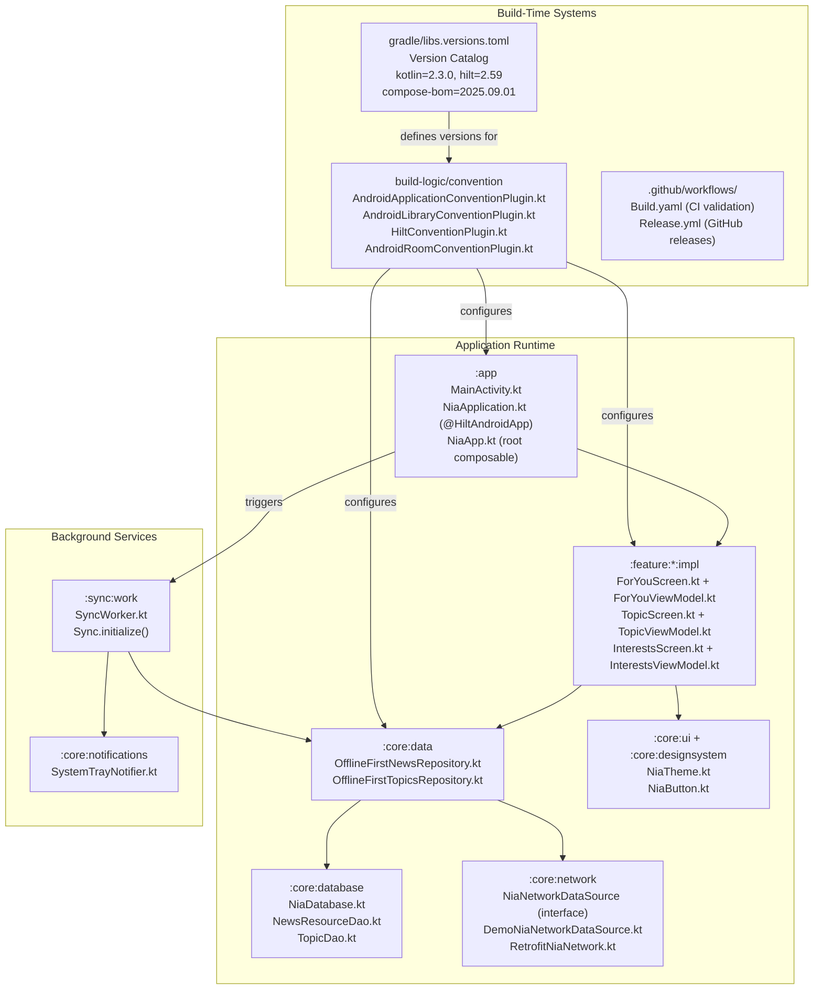

**Build-time layer:** [gradle/libs.versions.toml]() defines library versions. Convention plugins in `build-logic/convention` standardize module configuration across the project. [README.md:71-74]()

**Runtime layer:** `:app` module contains `MainActivity` (entry point), `NiaApplication` (Hilt initialization with `@HiltAndroidApp`), and `NiaApp` composable (root UI). [app/src/main/AndroidManifest.xml:31-45](). Feature modules like `:feature:foryou:impl` contain screen composables and `@HiltViewModel` ViewModels. Core modules provide repositories (`OfflineFirstNewsRepository`), database (`NiaDatabase` with DAOs), network sources (`NiaNetworkDataSource` interface), and UI components (`NiaTheme`). [docs/ArchitectureLearningJourney.md:19-26]()

**Background layer:** `SyncWorker` in `:sync:work` runs periodic background sync initialized by `Sync.initialize`. [docs/ArchitectureLearningJourney.md:64-71](). `SystemTrayNotifier` in `:core:notifications` handles system notifications.

**Sources:** [README.md:31-41](), [README.md:85-87](), [docs/ArchitectureLearningJourney.md:19-26](), [docs/ArchitectureLearningJourney.md:64-162]()

## What You'll Learn

Now in Android demonstrates production-ready patterns and practices across multiple domains:

| Domain | Key Demonstrations |
|--------|-------------------|
| **Architecture** | Official [Android architecture guidance](https://developer.android.com/topic/architecture) with UI, Domain, and Data layers. Unidirectional data flow using Kotlin `Flow`. [docs/ArchitectureLearningJourney.md:19-41]() |
| **Modularization** | 50+ Gradle modules organized by feature and layer. API/Impl split in `:feature` modules. [docs/ModularizationLearningJourney.md:1-59]() |
| **UI** | Jetpack Compose with Material 3 design. Adaptive layouts for phones, tablets, and foldables. [README.md:124-130]() |
| **Data Management** | Offline-first architecture. Room database (`NiaDatabase`) as single source of truth. [docs/ArchitectureLearningJourney.md:166-172]() |
| **Dependency Injection** | Hilt throughout with `@HiltAndroidApp`, `@HiltViewModel`, and module organization. [README.md:85-87]() |
| **Testing** | No mocking libraries. Test doubles in `:core:testing`, `:core:data-test`. Screenshot testing with Roborazzi. [README.md:88-111]() |
| **Build Configuration** | Version catalog, custom convention plugins in `build-logic/convention`, build variants (`demo`/`prod` flavors). [README.md:61-82]() |

**Sources:** [README.md:8-16](), [README.md:48-59](), [README.md:83-98](), [.google/packaging.yaml:21-48]()

## Application Features

The application provides content from the Now in Android series. Users can browse links to videos and articles, follow topics, and receive notifications. [README.md:22-25]()

### User-Facing Features

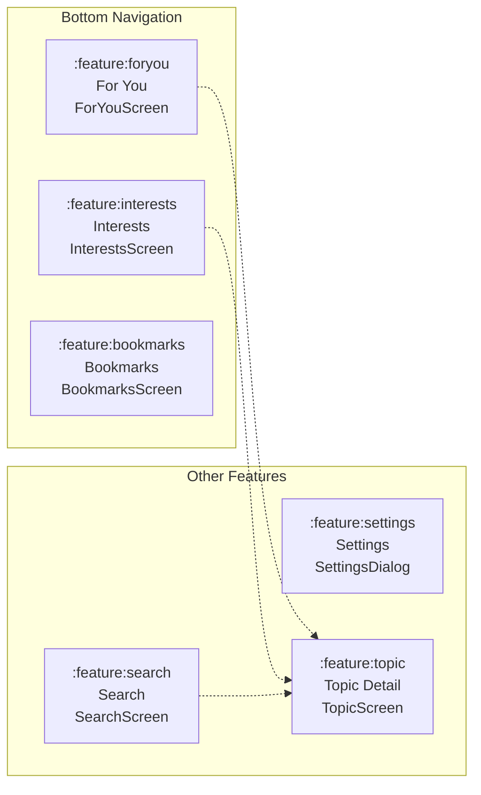

| Feature | Description |
|---------|-------------|
| **For You** | Personalized news feed showing articles from followed topics. Includes onboarding UI for topic selection. [docs/ArchitectureLearningJourney.md:42-49]() |
| **Interests** | Browse all available topics. Follow/unfollow to customize the For You feed. [README.md:22-25]() |
| **Bookmarks** | View all bookmarked news resources. |
| **Search** | Full-text search across news resources. |
| **Settings** | Theme selection and dynamic color toggle. |
| **Topic Detail** | Detailed view of a single topic with related news resources. |

**Sources:** [README.md:22-25](), [docs/ArchitectureLearningJourney.md:42-49]()

## High-Level Architecture

### Layer Architecture and Data Flow

The app architecture has three layers: a data layer, a domain layer, and a UI layer. [docs/ArchitectureLearningJourney.md:19-21]()

**Unidirectional Data Flow: UI → Domain → Data**

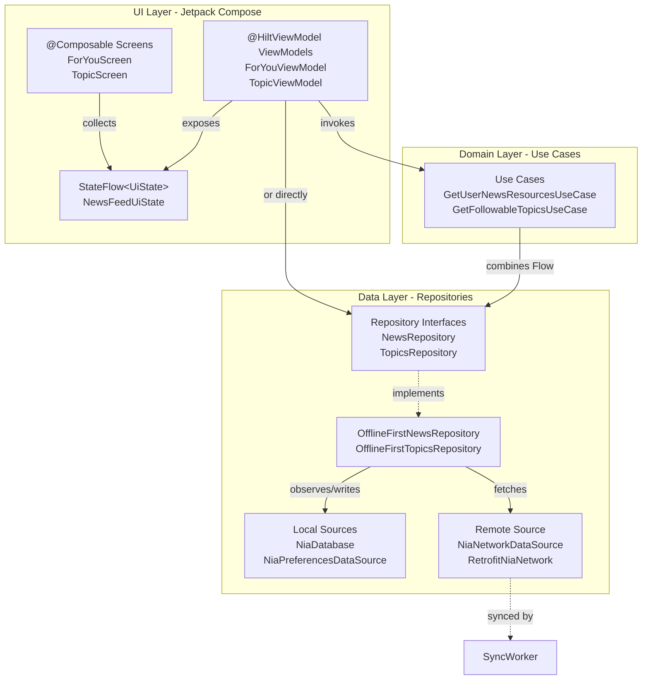

**Data flow:**
1. **UI Layer**: Composable screens observe `UiState` exposed by ViewModels. ViewModels handle user events. [docs/ArchitectureLearningJourney.md:152-162]()
2. **Domain Layer**: Use cases like `GetUserNewsResourcesUseCase` encapsulate complex business logic by combining multiple repository streams. [docs/ArchitectureLearningJourney.md:144-151]()
3. **Data Layer**: Repository implementations like `OfflineFirstNewsRepository` follow an offline-first pattern. `NiaDatabase` (Room) is the single source of truth. `NiaNetworkDataSource` fetches remote data which is written to Room via `SyncWorker` background sync. [docs/ArchitectureLearningJourney.md:166-189]()

**Sources:** [docs/ArchitectureLearningJourney.md:1-162](), [README.md:48-53]()

## Build System

### Build Variants and Flavors

The app uses product flavors to control content sourcing: [README.md:71-74]()

| Flavor | Purpose | Implementation |
|---------|---------|-------------|
| **demo** | Local exploration | Uses static local data via `DemoNiaNetworkDataSource`. [README.md:75-76]() |
| **prod** | Real usage | Makes network calls to a backend server via `RetrofitNiaNetwork`. [README.md:77-79]() |

**Build Types:**
- `debug`: Standard development.
- `release`: Minified and optimized.
- `benchmark`: Used for startup performance testing and baseline profile generation. [README.md:61-66]()

**Sources:** [README.md:61-82]()

## Testing Strategy

Now in Android avoids mocking libraries, preferring test doubles. [README.md:88-91]()

- **Test Doubles**: Production implementations are replaced with simplified but realistic test doubles using Hilt's testing APIs. [README.md:92-98]()
- **Local Tests**: `testDemoDebug` runs unit and screenshot tests. [README.md:112-115]()
- **Screenshot Tests**: Uses **Roborazzi** to verify UI rendering across different screen sizes. [README.md:123-132]()
- **Instrumented Tests**: `connectedDemoDebugAndroidTest` runs on physical devices or emulators. [README.md:116]()

**Sources:** [README.md:83-132]()

---

## Page Navigation

- **Architecture** (Section 2)
- **Build System** (Section 3)
- **UI Layer** (Section 4)
- **Core Modules** (Section 5)
- **Feature Modules** (Section 6)
- **Background Services** (Section 7)
- **Testing Strategy** (Section 8)
- **Development Guide** (Section 9)
- **Glossary** (Section 10)

---

# Page: Architecture

# Architecture

<details>
<summary>Relevant source files</summary>

The following files were used as context for generating this wiki page:

- [app/build.gradle.kts](app/build.gradle.kts)
- [build-logic/settings.gradle.kts](build-logic/settings.gradle.kts)
- [build.gradle.kts](build.gradle.kts)
- [core/navigation/.gitignore](core/navigation/.gitignore)
- [core/navigation/build.gradle.kts](core/navigation/build.gradle.kts)
- [docs/ArchitectureLearningJourney.md](docs/ArchitectureLearningJourney.md)
- [docs/ModularizationLearningJourney.md](docs/ModularizationLearningJourney.md)
- [docs/images/architecture-1-overall.png](docs/images/architecture-1-overall.png)
- [docs/images/architecture-2-example.png](docs/images/architecture-2-example.png)
- [docs/images/architecture-3-data-layer.png](docs/images/architecture-3-data-layer.png)
- [docs/images/architecture-4-ui-layer.png](docs/images/architecture-4-ui-layer.png)
- [settings.gradle.kts](settings.gradle.kts)

</details>


## Purpose and Scope

This document describes the overall application architecture of Now in Android, including its layered structure, modular organization, reactive programming model, and unidirectional data flow patterns. The architecture follows the [official Android architecture guidance](https://developer.android.com/jetpack/guide) and demonstrates modern Android development practices.

For detailed information about specific aspects of the architecture:
- **Module Structure**: Detail on the 60+ Gradle modules, dependency graph, and the API/Impl split pattern. See [Module Structure](#2.1).
- **Data Layer**: Detailed view of repositories, offline-first strategy, Room database, and network data sources. See [Data Layer](#2.2).
- **Domain Layer**: Business logic organization using UseCases to bridge data and UI. See [Domain Layer](#2.3).
- **UI Layer**: Application structure, navigation, and design system using Jetpack Compose. See [UI Layer](#4).

## Architectural Principles

The Now in Android architecture is designed around the following core principles:

| Principle | Implementation |
|-----------|----------------|
| **Layer Separation** | Three distinct layers (UI, Domain, Data) with clear boundaries and unidirectional dependencies [docs/ArchitectureLearningJourney.md:21-26](). |
| **Modularization** | 60+ Gradle modules organized by feature and function, enabling parallel development and build caching [docs/ModularizationLearningJourney.md:9-46](). |
| **Offline-First** | Local storage (Room + DataStore) as the single source of truth with background sync [docs/ArchitectureLearningJourney.md:166-172](). |
| **Reactive Streams** | Kotlin Flow-based data streams with unidirectional data flow (UDF) pattern [docs/ArchitectureLearningJourney.md:31-40](). |
| **API/Impl Pattern** | Feature modules split into `api` (navigation keys) and `impl` (screens, ViewModels) for loose coupling [docs/ModularizationLearningJourney.md:73-81](). |
| **Dependency Injection** | Hilt-based DI for all layers, enabling testability and configuration flexibility [app/build.gradle.kts:24-24](). |
| **Testability** | Comprehensive testing with fake implementations and test doubles instead of mocking frameworks [app/build.gradle.kts:118-137](). |

**Sources:** [docs/ArchitectureLearningJourney.md:1-40](), [docs/ModularizationLearningJourney.md:1-89]()

## Modular Architecture Overview

The application is organized into a large collection of Gradle modules. This modularization strategy balances parallel development, build performance, and maintainability.

### Module Type Diagram: Layer Architecture

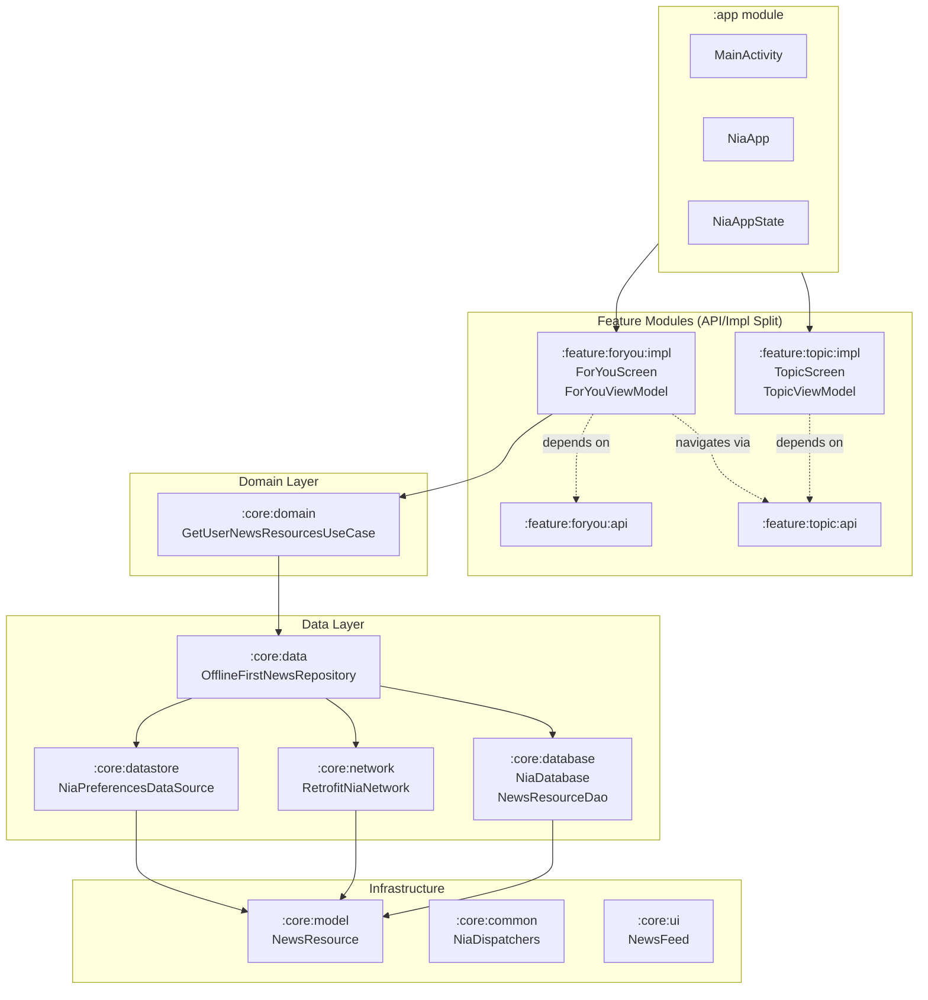

**Sources:** [docs/ModularizationLearningJourney.md:11-46](), [settings.gradle.kts:48-83]()

## Three-Layer Architecture

The app implements a strict three-layer architecture as recommended by the [Official Android Architecture Guidance](https://developer.android.com/jetpack/guide).

### Layer Responsibilities

| Layer | Modules | Responsibilities | Key Entities |
|-------|---------|------------------|-------------|
| **UI Layer** | `:app`, `:feature:*:impl`, `:core:ui` | Display data, handle user interactions, and manage UI state. [docs/ArchitectureLearningJourney.md:21-26]() | `ForYouViewModel`, `NiaApp`, `NewsFeed` |
| **Domain Layer** | `:core:domain` | Business logic that is too complex for ViewModels or reused across features. [docs/ArchitectureLearningJourney.md:21-26]() | `GetUserNewsResourcesUseCase` |
| **Data Layer** | `:core:data`, `:core:database`, `:core:network` | Single source of truth. Fetches, stores, and exposes app data. [docs/ArchitectureLearningJourney.md:166-172]() | `OfflineFirstNewsRepository`, `NiaDatabase` |

**Sources:** [docs/ArchitectureLearningJourney.md:19-29](), [docs/ModularizationLearningJourney.md:66-89]()

## Reactive Programming Model

The architecture follows a reactive programming model with **unidirectional data flow (UDF)**.

### Data Flow Pattern
1. **Higher layers react to changes in lower layers**: UI observes streams from ViewModels, which observe Repositories. [docs/ArchitectureLearningJourney.md:35-37]()
2. **Events flow down**: User actions (clicks, swipes) are passed down as function calls. [docs/ArchitectureLearningJourney.md:35-37]()
3. **Data flows up**: Repositories emit data streams (Flows) that are transformed and eventually consumed by the UI. [docs/ArchitectureLearningJourney.md:35-37]()

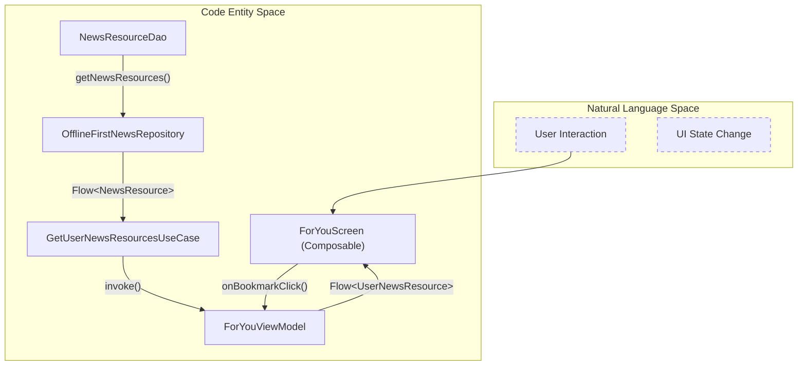

**Sources:** [docs/ArchitectureLearningJourney.md:31-40](), [docs/ArchitectureLearningJourney.md:147-151]()

## Feature Module Pattern: API/Impl Split

To minimize build times and prevent circular dependencies, feature modules are split into two parts:
- **`:api`**: Contains navigation keys and interfaces that other features need to know about to navigate to this feature. [docs/ModularizationLearningJourney.md:75-75]()
- **`:impl`**: Contains the actual UI implementation, ViewModels, and internal logic. [docs/ModularizationLearningJourney.md:76-76]()

This ensures that a feature's implementation can only depend on another feature's API, not its implementation. [docs/ModularizationLearningJourney.md:80-81]()

**Sources:** [docs/ModularizationLearningJourney.md:72-81](), [app/build.gradle.kts:71-81]()

## Offline-First Strategy

The data layer is designed as an **offline-first** source of truth.
- **Single Source of Truth**: The local database (`NiaDatabase`) is the primary source of data for the UI. [docs/ArchitectureLearningJourney.md:168-168]()
- **Background Sync**: A synchronization mechanism (`SyncWorker`) fetches data from the network (`RetrofitNiaNetwork`) and updates the local database. [docs/ArchitectureLearningJourney.md:91-95]()
- **Reactive Updates**: Because the UI observes the database via `Flow`, it automatically updates whenever the background sync modifies the local data. [docs/ArchitectureLearningJourney.md:131-135]()

**Sources:** [docs/ArchitectureLearningJourney.md:166-182](), [docs/ArchitectureLearningJourney.md:91-143]()

---

# Page: Module Structure

# Module Structure

<details>
<summary>Relevant source files</summary>

The following files were used as context for generating this wiki page:

- [app/build.gradle.kts](app/build.gradle.kts)
- [build-logic/convention/src/main/kotlin/AndroidApplicationConventionPlugin.kt](build-logic/convention/src/main/kotlin/AndroidApplicationConventionPlugin.kt)
- [build-logic/convention/src/main/kotlin/AndroidLibraryConventionPlugin.kt](build-logic/convention/src/main/kotlin/AndroidLibraryConventionPlugin.kt)
- [build-logic/convention/src/main/kotlin/AndroidTestConventionPlugin.kt](build-logic/convention/src/main/kotlin/AndroidTestConventionPlugin.kt)
- [build-logic/convention/src/main/kotlin/JvmLibraryConventionPlugin.kt](build-logic/convention/src/main/kotlin/JvmLibraryConventionPlugin.kt)
- [build-logic/convention/src/main/kotlin/RootPlugin.kt](build-logic/convention/src/main/kotlin/RootPlugin.kt)
- [build-logic/convention/src/main/kotlin/com/google/samples/apps/nowinandroid/Graph.kt](build-logic/convention/src/main/kotlin/com/google/samples/apps/nowinandroid/Graph.kt)
- [build-logic/settings.gradle.kts](build-logic/settings.gradle.kts)
- [build.gradle.kts](build.gradle.kts)
- [core/navigation/.gitignore](core/navigation/.gitignore)
- [core/navigation/build.gradle.kts](core/navigation/build.gradle.kts)
- [docs/ModularizationLearningJourney.md](docs/ModularizationLearningJourney.md)
- [feature/bookmarks/api/README.md](feature/bookmarks/api/README.md)
- [feature/bookmarks/impl/README.md](feature/bookmarks/impl/README.md)
- [feature/foryou/api/README.md](feature/foryou/api/README.md)
- [feature/foryou/impl/README.md](feature/foryou/impl/README.md)
- [feature/interests/api/README.md](feature/interests/api/README.md)
- [settings.gradle.kts](settings.gradle.kts)

</details>


This document describes the modular organization of the Now in Android codebase, including module types, the API/Impl pattern used for features, dependency rules, and physical repository structure.

For information about the data layer architecture within core modules, see [Data Layer](#2.2). For domain layer use cases, see [Domain Layer](#2.3). For build system configuration of modules, see [Convention Plugins](#3.2).

## Module Categories

The Now in Android application is organized into primary module categories, each serving a distinct architectural purpose:

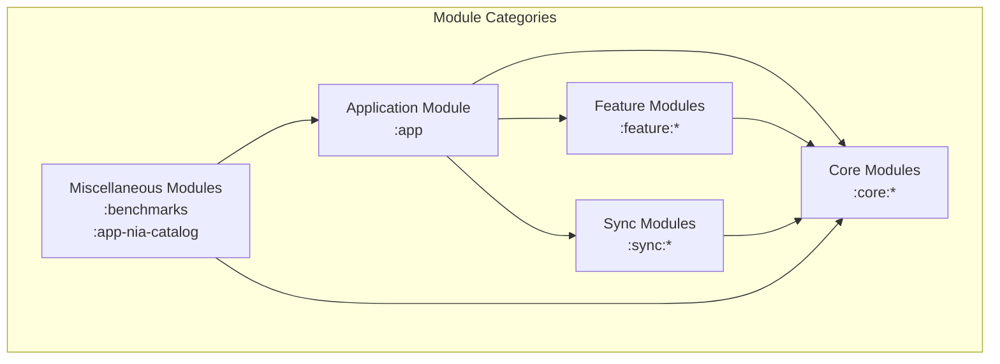

**Sources:** [docs/ModularizationLearningJourney.md:9-46](), [docs/ModularizationLearningJourney.md:66-89]()

### Module Type Classification

Each module is identified by a Gradle convention plugin that defines its build configuration. These plugins are managed in the `build-logic` project:

| Module Type | Plugin ID | Purpose | Examples |
|-------------|-----------|---------|----------|
| Android Application | `nowinandroid.android.application` | Main application entry point | `:app` |
| Android Feature | `nowinandroid.android.feature` | Feature-specific UI and logic | `:feature:foryou:impl` |
| Android Library | `nowinandroid.android.library` | Shared Android components | `:core:ui`, `:core:data` |
| Android Test | `nowinandroid.android.test` | Test-specific modules | `:benchmarks` |
| JVM Library | `nowinandroid.jvm.library` | Platform-agnostic code | `:core:model` |

**Sources:** [build-logic/convention/src/main/kotlin/com/google/samples/apps/nowinandroid/Graph.kt:95-126](), [build-logic/settings.gradle.kts:42-43]()

## The Application Module

The `:app` module serves as the application entry point and composition root. It binds the rest of the codebase together.

- **MainActivity**: The single Activity hosting the application [docs/ModularizationLearningJourney.md:70]().
- **NiaApp**: Root Composable for UI scaffolding [docs/ModularizationLearningJourney.md:70]().
- **Navigation**: App-level controlled navigation via `NiaNavHost` and `TopLevelDestination` [docs/ModularizationLearningJourney.md:70]().

The `:app` module depends on all feature `impl` modules and required core modules to assemble the final binary.

```mermaid
graph TB
    APP[":app"]
    
    subgraph "Feature Implementations"
        FORYOU_IMPL[":feature:foryou:impl"]
        INTERESTS_IMPL[":feature:interests:impl"]
        BOOKMARKS_IMPL[":feature:bookmarks:impl"]
        SEARCH_IMPL[":feature:search:impl"]
        TOPIC_IMPL[":feature:topic:impl"]
        SETTINGS_IMPL[":feature:settings:impl"]
    end
    
    subgraph "Core Dependencies"
        CORE_DATA[":core:data"]
        CORE_UI[":core:ui"]
        CORE_DESIGN[":core:designsystem"]
        CORE_ANALYTICS[":core:analytics"]
    end
    
    subgraph "Other"
        SYNC_WORK[":sync:work"]
    end
    
    APP -.-> FORYOU_IMPL
    APP -.-> INTERESTS_IMPL
    APP -.-> BOOKMARKS_IMPL
    APP -.-> SEARCH_IMPL
    APP -.-> TOPIC_IMPL
    APP -.-> SETTINGS_IMPL
    APP -.-> CORE_DATA
    APP -.-> CORE_UI
    APP -.-> CORE_DESIGN
    APP -.-> CORE_ANALYTICS
    APP -.-> SYNC_WORK
```

**Sources:** [app/build.gradle.kts:71-89](), [docs/ModularizationLearningJourney.md:68-70]()

## Feature Modules: API/Impl Pattern

Feature modules are split into two submodules to minimize build times and enforce clean boundaries.

### API Module (`:feature:<name>:api`)

The API module contains only navigation contracts and keys that other features use to navigate to this destination.

- **Navigation keys**: For example, `TopicNavKey` [docs/ModularizationLearningJourney.md:120]().
- **Entry Providers**: Navigation keys and functions exposed to other features [docs/ModularizationLearningJourney.md:115-118]().
- **Dependency**: Typically only depends on `:core:navigation` [feature/foryou/impl/README.md:62]().

### Impl Module (`:feature:<name>:impl`)

The implementation module contains the feature's complete functionality.

- **UI Components**: Composable screens like `TopicScreen` or `ForYouScreen` [docs/ModularizationLearningJourney.md:135-136]().
- **ViewModels**: Logic and state management like `TopicViewModel` [docs/ModularizationLearningJourney.md:137]().
- **Internal Logic**: Classes needed only by this specific feature [docs/ModularizationLearningJourney.md:78]().

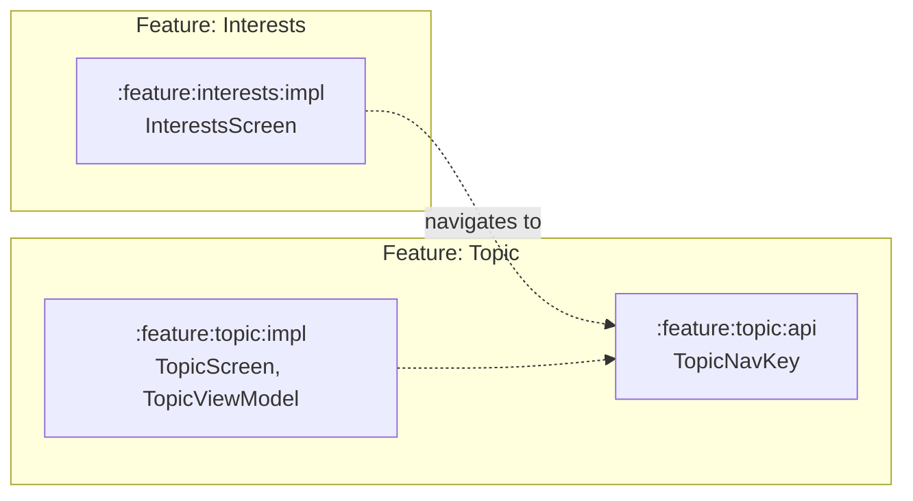

**Sources:** [docs/ModularizationLearningJourney.md:72-81](), [docs/ModularizationLearningJourney.md:111-138]()

### Dependency Rules for Features

1. **API modules** must not depend on another feature's `api` or `impl` module [docs/ModularizationLearningJourney.md:80]().
2. **Impl modules** should only depend on another feature's `api` module, never its `impl` [docs/ModularizationLearningJourney.md:80]().
3. **Both submodules** should only depend on the `core` modules they require [docs/ModularizationLearningJourney.md:80]().

## Core Module Organization

Core modules provide shared functionality and are organized by concern.

### Data and Infrastructure
- **`:core:data`**: Fetches app data from sources like `TopicsRepository` [docs/ModularizationLearningJourney.md:144]().
- **`:core:network`**: Retrofit configuration and API definitions [docs/ModularizationLearningJourney.md:18]().
- **`:core:database`**: Room database (`NiaDatabase`) and DAOs [docs/ModularizationLearningJourney.md:16]().
- **`:core:datastore`**: User preferences via Proto DataStore [feature/foryou/impl/README.md:32]().
- **`:core:model`**: JVM library containing shared data models [docs/ModularizationLearningJourney.md:17]().

### UI and Design
- **`:core:designsystem`**: Core UI components (`NiaButton`, `NiaTheme`) and icons [docs/ModularizationLearningJourney.md:150-153]().
- **`:core:ui`**: Composite components like `NewsFeed` that depend on the data layer [docs/ModularizationLearningJourney.md:157-161]().

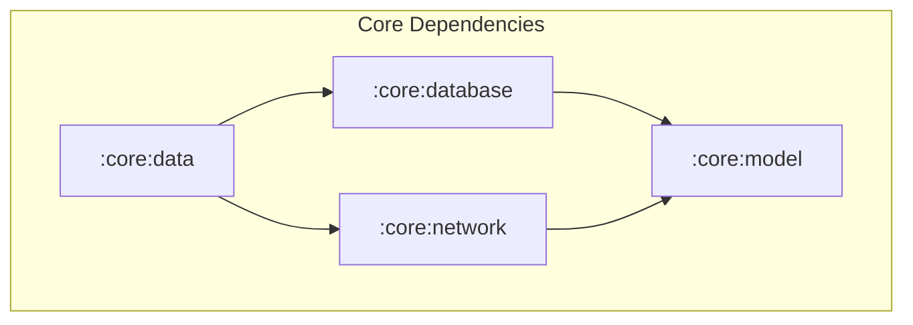

**Sources:** [docs/ModularizationLearningJourney.md:34-38](), [docs/ModularizationLearningJourney.md:140-163]()

## Module Communication and Sync

- **Navigation**: Features communicate via the target feature's `api` module [docs/ModularizationLearningJourney.md:75]().
- **Sync**: The `:sync:work` module handles background data updates using WorkManager [app/build.gradle.kts:89]().
- **Benchmarks**: The `:benchmarks` module is used for Macrobenchmarks and Baseline Profile generation [app/build.gradle.kts:138]().

## Physical Repository Structure

The project uses a hierarchical directory structure reflected in `settings.gradle.kts`:

```
root/
├── app/
├── benchmarks/
├── core/
│   ├── common/
│   ├── data/
│   ├── database/
│   └── ...
├── feature/
│   ├── foryou/
│   │   ├── api/
│   │   └── impl/
│   └── ...
└── sync/
    └── work/
```

**Sources:** [settings.gradle.kts:48-83]()

## Automated Dependency Analysis

The project includes a custom Gradle task to maintain module dependency graphs in `README.md` files.

- **Graph Task**: The `Graph` class recursively searches through projects and configurations like `api`, `implementation`, and `baselineProfile` [build-logic/convention/src/main/kotlin/com/google/samples/apps/nowinandroid/Graph.kt:50-63]().
- **Visuals**: It generates Mermaid-formatted text based on `PluginType` (Application, Feature, Library, JVM) [build-logic/convention/src/main/kotlin/com/google/samples/apps/nowinandroid/Graph.kt:95-126]().
- **Update**: The `graphUpdate` task writes these diagrams directly into the project's documentation [build-logic/convention/src/main/kotlin/com/google/samples/apps/nowinandroid/Graph.kt:138-143]().

**Sources:** [build-logic/convention/src/main/kotlin/com/google/samples/apps/nowinandroid/Graph.kt:41-49](), [build-logic/convention/src/main/kotlin/RootPlugin.kt:29-31]()

---

# Page: Data Layer

# Data Layer

<details>
<summary>Relevant source files</summary>

The following files were used as context for generating this wiki page:

- [core/data-test/README.md](core/data-test/README.md)
- [core/data-test/src/main/kotlin/com/google/samples/apps/nowinandroid/core/data/test/repository/FakeNewsRepository.kt](core/data-test/src/main/kotlin/com/google/samples/apps/nowinandroid/core/data/test/repository/FakeNewsRepository.kt)
- [core/data-test/src/main/kotlin/com/google/samples/apps/nowinandroid/core/data/test/repository/FakeTopicsRepository.kt](core/data-test/src/main/kotlin/com/google/samples/apps/nowinandroid/core/data/test/repository/FakeTopicsRepository.kt)
- [core/data-test/src/main/kotlin/com/google/samples/apps/nowinandroid/core/data/test/repository/FakeUserDataRepository.kt](core/data-test/src/main/kotlin/com/google/samples/apps/nowinandroid/core/data/test/repository/FakeUserDataRepository.kt)
- [core/data/README.md](core/data/README.md)
- [core/data/src/main/kotlin/com/google/samples/apps/nowinandroid/core/data/model/NewsResource.kt](core/data/src/main/kotlin/com/google/samples/apps/nowinandroid/core/data/model/NewsResource.kt)
- [core/data/src/main/kotlin/com/google/samples/apps/nowinandroid/core/data/repository/OfflineFirstUserDataRepository.kt](core/data/src/main/kotlin/com/google/samples/apps/nowinandroid/core/data/repository/OfflineFirstUserDataRepository.kt)
- [core/data/src/main/kotlin/com/google/samples/apps/nowinandroid/core/data/repository/UserDataRepository.kt](core/data/src/main/kotlin/com/google/samples/apps/nowinandroid/core/data/repository/UserDataRepository.kt)
- [core/data/src/test/kotlin/com/google/samples/apps/nowinandroid/core/data/model/NetworkEntityTest.kt](core/data/src/test/kotlin/com/google/samples/apps/nowinandroid/core/data/model/NetworkEntityTest.kt)
- [core/data/src/test/kotlin/com/google/samples/apps/nowinandroid/core/data/repository/OfflineFirstNewsRepositoryTest.kt](core/data/src/test/kotlin/com/google/samples/apps/nowinandroid/core/data/repository/OfflineFirstNewsRepositoryTest.kt)
- [core/data/src/test/kotlin/com/google/samples/apps/nowinandroid/core/data/repository/OfflineFirstTopicsRepositoryTest.kt](core/data/src/test/kotlin/com/google/samples/apps/nowinandroid/core/data/repository/OfflineFirstTopicsRepositoryTest.kt)
- [core/data/src/test/kotlin/com/google/samples/apps/nowinandroid/core/data/repository/OfflineFirstUserDataRepositoryTest.kt](core/data/src/test/kotlin/com/google/samples/apps/nowinandroid/core/data/repository/OfflineFirstUserDataRepositoryTest.kt)
- [core/data/src/test/kotlin/com/google/samples/apps/nowinandroid/core/data/testdoubles/TestNewsResourceDao.kt](core/data/src/test/kotlin/com/google/samples/apps/nowinandroid/core/data/testdoubles/TestNewsResourceDao.kt)
- [core/database/src/main/kotlin/com/google/samples/apps/nowinandroid/core/database/dao/NewsResourceDao.kt](core/database/src/main/kotlin/com/google/samples/apps/nowinandroid/core/database/dao/NewsResourceDao.kt)
- [core/database/src/main/kotlin/com/google/samples/apps/nowinandroid/core/database/model/NewsResourceEntity.kt](core/database/src/main/kotlin/com/google/samples/apps/nowinandroid/core/database/model/NewsResourceEntity.kt)
- [core/datastore-proto/README.md](core/datastore-proto/README.md)
- [core/datastore-test/README.md](core/datastore-test/README.md)
- [core/datastore-test/src/main/kotlin/com/google/samples/apps/nowinandroid/core/datastore/test/TestDataStoreModule.kt](core/datastore-test/src/main/kotlin/com/google/samples/apps/nowinandroid/core/datastore/test/TestDataStoreModule.kt)
- [core/datastore/README.md](core/datastore/README.md)
- [core/datastore/src/test/kotlin/com/google/samples/apps/nowinandroid/core/datastore/NiaPreferencesDataSourceTest.kt](core/datastore/src/test/kotlin/com/google/samples/apps/nowinandroid/core/datastore/NiaPreferencesDataSourceTest.kt)
- [core/domain/README.md](core/domain/README.md)
- [core/network/src/main/kotlin/com/google/samples/apps/nowinandroid/core/network/demo/DemoNiaNetworkDataSource.kt](core/network/src/main/kotlin/com/google/samples/apps/nowinandroid/core/network/demo/DemoNiaNetworkDataSource.kt)
- [core/network/src/main/kotlin/com/google/samples/apps/nowinandroid/core/network/model/NetworkNewsResource.kt](core/network/src/main/kotlin/com/google/samples/apps/nowinandroid/core/network/model/NetworkNewsResource.kt)
- [core/network/src/main/kotlin/com/google/samples/apps/nowinandroid/core/network/model/NetworkTopic.kt](core/network/src/main/kotlin/com/google/samples/apps/nowinandroid/core/network/model/NetworkTopic.kt)
- [core/testing/README.md](core/testing/README.md)
- [core/testing/src/main/kotlin/com/google/samples/apps/nowinandroid/core/testing/repository/TestUserDataRepository.kt](core/testing/src/main/kotlin/com/google/samples/apps/nowinandroid/core/testing/repository/TestUserDataRepository.kt)

</details>


## Purpose and Scope

The Data Layer is responsible for managing all application data, providing a clean API for higher layers to access data without needing to know the underlying implementation details. This layer implements the repository pattern to coordinate multiple data sources (network, local database, and preferences) and exposes domain models to feature modules.

For information about how the Data Layer integrates with business logic, see [Domain Layer](). For details about background data synchronization, see [Background Services](). For testing strategies specific to the data layer, see [Unit and Integration Testing]().

Sources: [docs/ModularizationLearningJourney.md:1-234]()

## Architecture Overview

The Data Layer is primarily contained within the `core:data` module, which depends on three data source modules:

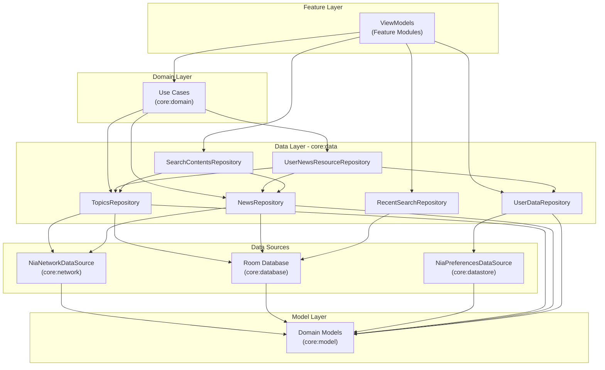

The data layer follows an offline-first architecture where repositories coordinate between remote and local data sources, providing a single source of truth through reactive data streams.

Sources: [docs/ModularizationLearningJourney.md:14-46](), [core/data/build.gradle.kts:28-41]()

## Repository Pattern

Repositories in the `core:data` module provide a clean API for data access and abstract away the complexities of coordinating multiple data sources. Each repository is responsible for:

1.  **Data Source Coordination**: Determining whether to fetch from network, database, or both
2.  **Data Synchronization**: Keeping local data in sync with remote sources
3.  **Caching Strategy**: Managing when and how data is cached locally
4.  **Error Handling**: Converting data source errors into domain-level results
5.  **Model Transformation**: Converting data source models to domain models

### Key Repository Classes

| Repository | Responsibility | Primary Data Sources |
|---|---|---|
| `TopicsRepository` | Manages topic data | Network, Database |
| `NewsRepository` | Manages news resource data | Network, Database |
| `UserDataRepository` | Manages user preferences and settings | DataStore |
| `UserNewsResourceRepository` | Aggregates news with user data (bookmarks, follows) | NewsRepository, TopicsRepository, UserDataRepository |
| `SearchContentsRepository` | Provides search functionality | NewsRepository, TopicsRepository |
| `RecentSearchRepository` | Manages search history | Database |

Repositories are typically injected via Hilt as singletons to ensure consistent state across the application.

Sources: [docs/ModularizationLearningJourney.md:140-146](), [core/data/build.gradle.kts:16-41]()

## Data Sources

### Network Data Source (core:network)

The network module provides remote data access using Retrofit with kotlinx-serialization for JSON parsing.

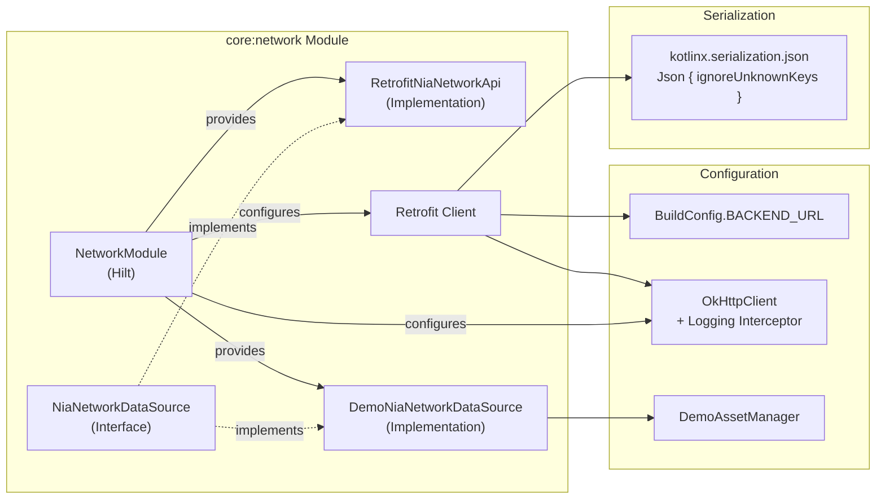

**Key Components:**

-   **`NiaNetworkDataSource`**: Interface defining network operations (e.g., `getTopics()`, `getNewsResources()`)
-   **`RetrofitNiaNetworkApi`**: Concrete implementation using Retrofit.
-   **`DemoNiaNetworkDataSource`**: An alternative implementation that provides static news resources from local JSON assets for development and testing purposes [core/network/src/main/kotlin/com/google/samples/apps/nowinandroid/core/network/demo/DemoNiaNetworkDataSource.kt:39-43](). It reads data from `news.json` and `topics.json` assets [core/network/src/main/kotlin/com/google/samples/apps/nowinandroid/core/network/demo/DemoNiaNetworkDataSource.kt:79-80]().
-   **Backend URL Configuration**: Loaded from `local.properties` file via `BACKEND_URL` property and injected into BuildConfig.
-   **JSON Serialization**: Uses `kotlinx-serialization` with configuration to ignore unknown keys for backward compatibility.
-   **Logging**: OkHttp logging interceptor for debugging network requests.

Sources: [docs/ModularizationLearningJourney.md:174-179](), [core/network/build.gradle.kts:21-65](), [core/network/src/main/kotlin/com/google/samples/apps/nowinandroid/core/network/demo/DemoNiaNetworkDataSource.kt:39-43]()

### Local Database (core:database)

The database module uses Room for local persistence, providing offline-first capabilities and caching.

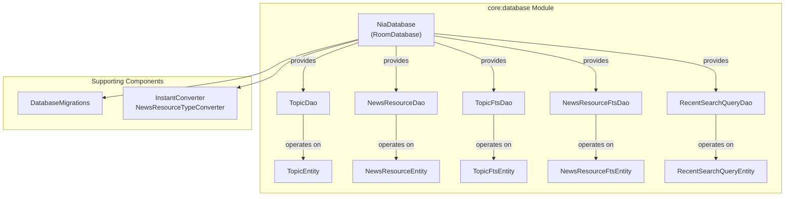

**Key Components:**

-   **`NiaDatabase`**: Main Room database class, manages all DAOs.
-   **DAOs (Data Access Objects)**: Provide type-safe database operations with Flow-based reactive queries.
-   **Entities**: Room entities representing database tables.
-   **FTS (Full-Text Search) Entities**: Specialized entities for efficient text search using SQLite's FTS4.
-   **Type Converters**: Convert complex types (e.g., `Instant`, enums) to SQLite-compatible types.
-   **Migrations**: Handle schema changes between database versions.

The database schema uses foreign key relationships and junction tables to model many-to-many relationships (e.g., topics associated with news resources).

Sources: [docs/ModularizationLearningJourney.md:200-208]()

### DataStore (core:datastore)

The datastore module uses Proto DataStore for type-safe persistence of user preferences and settings.

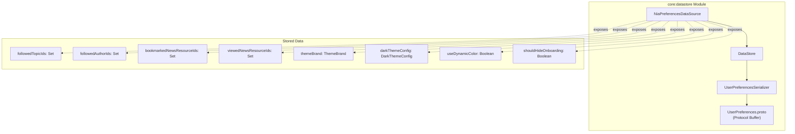

**Key Components:**

-   **`NiaPreferencesDataSource`**: High-level API for reading/writing user preferences.
-   **Proto DataStore**: Type-safe preference storage using Protocol Buffers.
-   **`UserPreferences.proto`**: Defines the structure of stored preferences.
-   **`UserPreferencesSerializer`**: Handles serialization/deserialization of protobuf messages.

DataStore provides reactive access to preferences through Kotlin Flows, ensuring UI updates automatically when preferences change. It also handles data migration and provides transactional updates.

Sources: [docs/ModularizationLearningJourney.md:191-197](), [core/datastore/build.gradle.kts:30-33]()

## Data Models (core:model)

The `core:model` module contains pure Kotlin data models representing domain entities. These models are shared across all layers and are designed to be independent of any specific data source implementation.

### Key Model Classes

| Model Class | Purpose | Key Properties |
|---|---|---|
| `Topic` | Represents a topic/category | `id`, `name`, `shortDescription`, `longDescription`, `url`, `imageUrl` |
| `NewsResource` | Represents a news article | `id`, `title`, `content`, `url`, `headerImageUrl`, `publishDate`, `type`, `topics` |
| `UserNewsResource` | News with user-specific data | Extends `NewsResource` with `isSaved`, `hasBeenViewed`, `userFollowedTopics` |
| `FollowableTopic` | Topic with follow status | Combines `Topic` with `isFollowed` boolean |
| `UserData` | User preferences and state | `bookmarkedNewsResourceIds`, `viewedNewsResourceIds`, `followedTopics`, `followedAuthors`, theme settings |
| `SearchResult` | Search result wrapper | `topics: List<FollowableTopic>`, `newsResources: List<UserNewsResource>` |
| `RecentSearchQuery` | Recent search entry | `query`, `queriedDate` |

These models use Kotlin data classes for immutability and provide a stable API contract between the data layer and consuming layers.

Sources: [docs/ModularizationLearningJourney.md:210-217]()

## Data Flow Patterns

The Data Layer implements an offline-first architecture with the following data flow pattern:

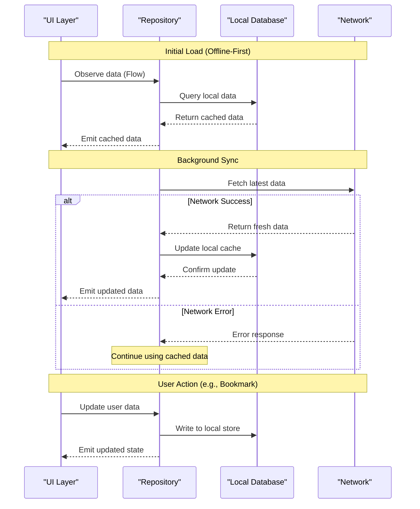

### Offline-First Strategy

1.  **Immediate Response**: Repositories emit cached data immediately from the local database.
2.  **Background Refresh**: Simultaneously fetch fresh data from the network.
3.  **Cache Update**: On successful network fetch, update the local cache.
4.  **Reactive Updates**: UI automatically updates through Flow emissions when cache changes.
5.  **Graceful Degradation**: On network failure, continue serving cached data.

### Data Synchronization

Data synchronization occurs through multiple mechanisms:

-   **Repository-Level Sync**: Each repository can independently fetch and cache data. For example, `OfflineFirstTopicsRepository`'s `syncWith` method fetches topics from the network and updates the local `topicDao` [core/data/src/test/kotlin/com/google/samples/apps/nowinandroid/core/data/repository/OfflineFirstTopicsRepositoryTest.kt:83-96](). Similarly, `OfflineFirstNewsRepository` handles news resource synchronization [core/data/src/test/kotlin/com/google/samples/apps/nowinandroid/core/data/repository/OfflineFirstNewsRepositoryTest.kt:133-149]().
-   **WorkManager Integration**: The `sync:work` module triggers periodic background syncs.
-   **User-Triggered Refresh**: Pull-to-refresh gestures trigger explicit sync operations.

### Reactive Data Streams

All repositories expose data through Kotlin `Flow` to enable reactive updates:

```
Repository Methods:
- getTopics(): Flow<List<Topic>>
- getNewsResources(): Flow<List<NewsResource>>
- observeAll(): Flow<UserData>
```

This ensures that any changes to the underlying data (from network sync, user actions, or other sources) automatically propagate to all observers.

Sources: [docs/ModularizationLearningJourney.md:34-41](), [core/data/src/test/kotlin/com/google/samples/apps/nowinandroid/core/data/repository/OfflineFirstTopicsRepositoryTest.kt:83-96](), [core/data/src/test/kotlin/com/google/samples/apps/nowinandroid/core/data/repository/OfflineFirstNewsRepositoryTest.kt:133-149](), Based on architectural patterns shown in high-level diagrams

## Dependency Injection

All data layer components are provided via Hilt dependency injection:

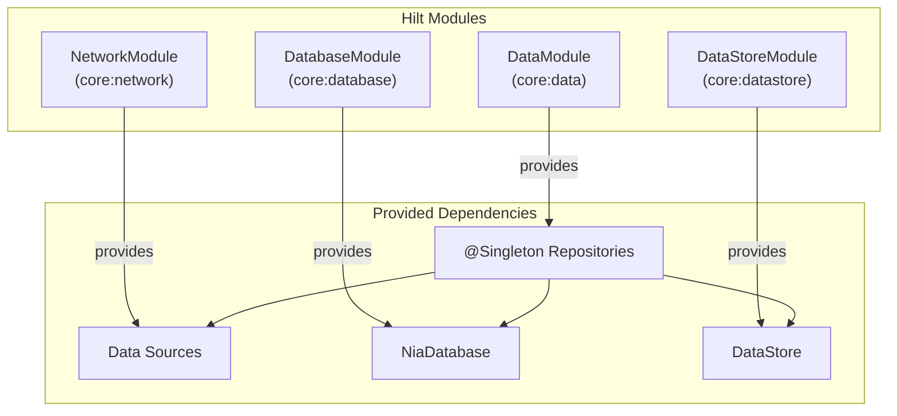

**Dependency Scopes:**

-   **`@Singleton`**: Repositories and data sources are scoped as singletons to maintain consistent state.
-   **`@ApplicationContext`**: Used for Context-dependent components like Room and DataStore.
-   **`@Dispatcher` Qualifiers**: Coroutine dispatchers are injected for proper threading.

Sources: [core/data/build.gradle.kts:17-19](), [core/network/build.gradle.kts:22-24](), [core/datastore/build.gradle.kts:17-20]()

## Testing Infrastructure

The data layer includes dedicated testing support modules:

### core:data-test Module

Provides test implementations of repositories with hooks for controlling behavior in tests:

-   **Test Repositories**: Fake implementations like `FakeNewsRepository` [core/data-test/src/main/kotlin/com/google/samples/apps/nowinandroid/core/data/test/repository/FakeNewsRepository.kt:39-71]() and `FakeTopicsRepository` [core/data-test/src/main/kotlin/com/google/samples/apps/nowinandroid/core/data/test/repository/FakeTopicsRepository.kt:43-62]() that can be configured for testing scenarios.
-   **In-Memory Data**: Uses in-memory data stores instead of real persistence.
-   **Controlled Timing**: Allows tests to control async operations.

### core:datastore-test Module

Provides testing utilities for DataStore:

-   **Test DataStore**: Creates temporary DataStore instances for each test.
-   **Test Serializers**: Provides serializers configured for testing.
-   **Automatic Cleanup**: Cleans up temporary files after tests.

### Testing Strategy

The data layer follows the "test doubles, not mocks" philosophy:

1.  **Unit Tests**: Test individual repositories with fake data sources. For example, `OfflineFirstTopicsRepositoryTest` uses `TestTopicDao` and `TestNiaNetworkDataSource` [core/data/src/test/kotlin/com/google/samples/apps/nowinandroid/core/data/repository/OfflineFirstTopicsRepositoryTest.kt:46-48]().
2.  **Integration Tests**: Test repositories with real Room database (in-memory).
3.  **Flow Testing**: Verify reactive behavior using `turbine` or coroutine test utilities.
4.  **Error Scenarios**: Test network failures, database errors, and edge cases.

Sources: [core/data-test/build.gradle.kts:1-29](), [core/datastore-test/build.gradle.kts:1-29](), [core/testing/build.gradle.kts:25-31](), [core/data/src/test/kotlin/com/google/samples/apps/nowinandroid/core/data/repository/OfflineFirstTopicsRepositoryTest.kt:46-48]()

## Module Dependencies

The following table summarizes the dependencies between data layer modules:

| Module | Type | Depends On | Provided By |
|---|---|---|---|
| `core:data` | Android Library | `core:common`, `core:database`, `core:datastore`, `core:network`, `core:model` | Repositories |
| `core:network` | Android Library | `core:common`, `core:model` | Network data source |
| `core:database` | Android Library | `core:model` | Room database, DAOs |
| `core:datastore` | Android Library | `core:common`, `core:model`, `core:datastore-proto` | DataStore source |
| `core:model` | JVM Library | None | Domain models |
| `core:data-test` | Android Library | `core:data` | Test repositories |
| `core:datastore-test` | Android Library | `core:common`, `core:datastore` | Test DataStore utilities |

**Build Configuration:**

-   All data layer modules use the `nowinandroid.android.library` convention plugin.
-   Testing modules use `nowinandroid.hilt` for dependency injection.
-   Coverage tracking via `nowinandroid.android.library.jacoco` plugin.
-   Network module includes `kotlinx-serialization` plugin.

Sources: [core/data/build.gradle.kts:16-41](), [core/network/build.gradle.kts:21-49](), [core/datastore/build.gradle.kts:17-39](), [core/data-test/build.gradle.kts:16-29]()

---

# Page: Domain Layer

# Domain Layer

<details>
<summary>Relevant source files</summary>

The following files were used as context for generating this wiki page:

- [app/src/main/kotlin/com/google/samples/apps/nowinandroid/util/ProfileVerifierLogger.kt](app/src/main/kotlin/com/google/samples/apps/nowinandroid/util/ProfileVerifierLogger.kt)
- [core/common/build.gradle.kts](core/common/build.gradle.kts)
- [core/common/src/main/kotlin/com/google/samples/apps/nowinandroid/core/common/network/NiaDispatchers.kt](core/common/src/main/kotlin/com/google/samples/apps/nowinandroid/core/common/network/NiaDispatchers.kt)
- [core/common/src/main/kotlin/com/google/samples/apps/nowinandroid/core/common/network/di/CoroutineScopesModule.kt](core/common/src/main/kotlin/com/google/samples/apps/nowinandroid/core/common/network/di/CoroutineScopesModule.kt)
- [core/common/src/main/kotlin/com/google/samples/apps/nowinandroid/core/common/network/di/DispatchersModule.kt](core/common/src/main/kotlin/com/google/samples/apps/nowinandroid/core/common/network/di/DispatchersModule.kt)
- [core/common/src/main/kotlin/com/google/samples/apps/nowinandroid/core/common/result/Result.kt](core/common/src/main/kotlin/com/google/samples/apps/nowinandroid/core/common/result/Result.kt)
- [core/common/src/test/kotlin/com/google/samples/apps/nowinandroid/core/common/result/ResultKtTest.kt](core/common/src/test/kotlin/com/google/samples/apps/nowinandroid/core/common/result/ResultKtTest.kt)
- [core/data/src/main/kotlin/com/google/samples/apps/nowinandroid/core/data/util/TimeZoneMonitor.kt](core/data/src/main/kotlin/com/google/samples/apps/nowinandroid/core/data/util/TimeZoneMonitor.kt)
- [core/domain/build.gradle.kts](core/domain/build.gradle.kts)
- [core/domain/src/main/AndroidManifest.xml](core/domain/src/main/AndroidManifest.xml)
- [core/model/build.gradle.kts](core/model/build.gradle.kts)
- [core/model/src/main/kotlin/com/google/samples/apps/nowinandroid/core/model/data/UserNewsResource.kt](core/model/src/main/kotlin/com/google/samples/apps/nowinandroid/core/model/data/UserNewsResource.kt)
- [core/notifications/build.gradle.kts](core/notifications/build.gradle.kts)
- [core/notifications/src/main/res/drawable-anydpi-v24/core_notifications_ic_nia_notification.xml](core/notifications/src/main/res/drawable-anydpi-v24/core_notifications_ic_nia_notification.xml)
- [sync/work/build.gradle.kts](sync/work/build.gradle.kts)

</details>


## Purpose and Scope

The domain layer contains use cases that encapsulate business logic by combining and transforming data from multiple repositories. This optional layer sits between the Data Layer (page 2.2) and the UI Layer (page 4), centralizing complex business logic that would otherwise be duplicated across ViewModels.

---

## Overview

The domain layer in Now in Android is implemented in the `core:domain` module [core/domain/build.gradle.kts:23-23]() and follows Clean Architecture principles. Use cases are implemented as classes with a single `operator fun invoke()` method that returns a Kotlin `Flow`.

**Module**: `core:domain`

**Key Characteristics**:

| Characteristic | Description |
|---------------|-------------|
| **Optional** | Not all features require use cases; simple data access goes directly from ViewModels to repositories. |
| **Reactive** | Use cases operate on Kotlin `Flow` for reactive data propagation. |
| **Combinatorial** | Primary purpose is combining data from multiple repositories using flow operators. |
| **Reusable** | Eliminates duplicate logic when the same business logic is needed in multiple ViewModels. |

**Scope Limitation**: Use cases handle read operations only. Write operations (user actions) are typically handled by ViewModels calling repository methods directly to reduce indirection.

**Sources**: [core/domain/build.gradle.kts:1-34](), [core/model/src/main/kotlin/com/google/samples/apps/nowinandroid/core/model/data/UserNewsResource.kt:56-57]()

---

## Use Case Implementation Pattern

### Structure

Use cases in the `core:domain` module follow a consistent structure, utilizing constructor injection and the `invoke` operator.

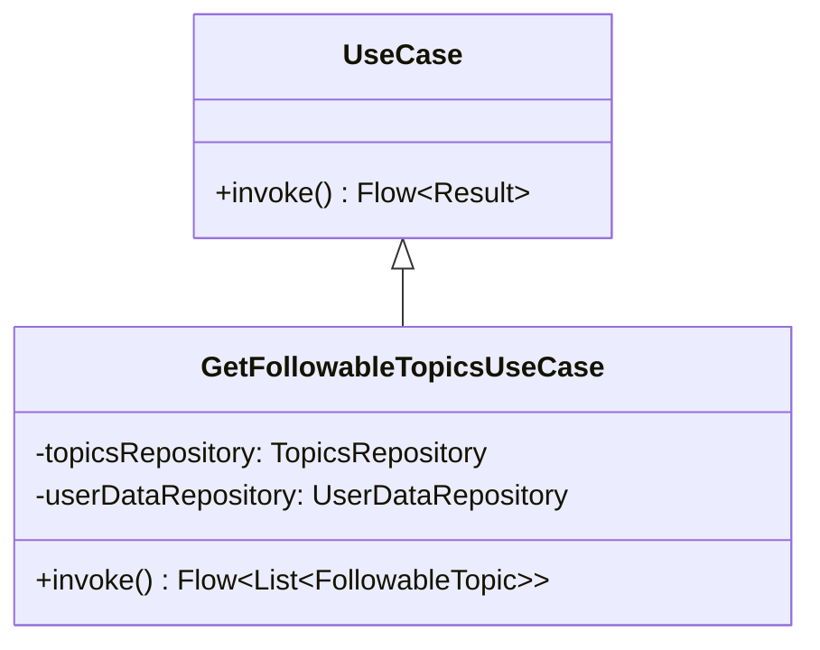

### Key Implementation Details

| Element | Implementation |
|---------|---------------|
| **Constructor Injection** | Uses `@Inject` annotation for Hilt dependency injection. |
| **Operator Function** | `operator fun invoke()` enables functional invocation syntax (e.g., `useCase()`). |
| **Flow Return Type** | Returns cold `Flow` that ViewModels convert to `StateFlow`. |
| **Combination Logic** | Uses `combine()`, `map()`, and other flow operators to merge repository streams. |
| **Dependencies** | Depends on repository interfaces (from `core:data`) and domain models (from `core:model`). |

**Sources**: [core/domain/build.gradle.kts:26-30](), [core/model/src/main/kotlin/com/google/samples/apps/nowinandroid/core/model/data/UserNewsResource.kt:25-54]()

---

## Primary Use Cases

### GetFollowableTopicsUseCase

This use case bridges the gap between raw topic data and user-specific interaction states.

**Implementation Details**:
- **Constructor Dependencies**: `TopicsRepository` (catalog of topics) and `UserDataRepository` (user's followed topic IDs).
- **Business Logic**: It combines the stream of all topics with the stream of user data. For each `Topic`, it checks if the ID exists in the user's `followedTopics` set to produce a `FollowableTopic` model.

### GetSearchContentsUseCase

Aggregates search results across different data types (e.g., Topics and News Resources).

**Implementation Details**:
- **Logic**: Combines search results from multiple repositories into a single unified search result model.
- **Flow**: Typically triggered by a search query string from the UI, returning a `Flow` of results that updates as the underlying data or query changes.

### GetRecentSearchQueriesUseCase

Provides access to the user's local search history.

**Implementation Details**:
- **Source**: Interacts with a search-specific repository that tracks recent queries.
- **Utility**: Used in the Search feature to provide suggestions and history to the user.

---

## Data Flow and Transformations

The domain layer often performs mapping between data layer models and UI-ready models. A prime example is the creation of `UserNewsResource`.

### Natural Language to Code Entity Mapping

The following diagram maps business concepts to the specific code entities that implement them within the domain and model layers.

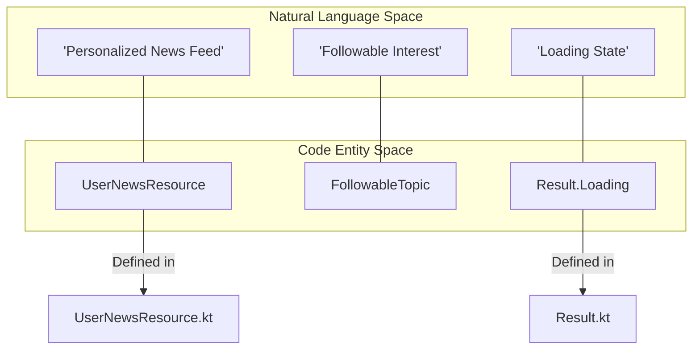
**Sources**: [core/model/src/main/kotlin/com/google/samples/apps/nowinandroid/core/model/data/UserNewsResource.kt:25-36](), [core/common/src/main/kotlin/com/google/samples/apps/nowinandroid/core/common/result/Result.kt:24-28]()

### Model Transformation: UserNewsResource

The `UserNewsResource` is a domain-specific model that augments a `NewsResource` with user-specific metadata (bookmarks, viewed status).

| Function/Class | Role |
|----------------|------|
| `UserNewsResource` | Data class holding both content and user state [core/model/src/main/kotlin/com/google/samples/apps/nowinandroid/core/model/data/UserNewsResource.kt:25-36](). |
| `mapToUserNewsResources` | Extension function that transforms a list of `NewsResource` using `UserData` [core/model/src/main/kotlin/com/google/samples/apps/nowinandroid/core/model/data/UserNewsResource.kt:56-57](). |

**Sources**: [core/model/src/main/kotlin/com/google/samples/apps/nowinandroid/core/model/data/UserNewsResource.kt:17-57]()

---

## Handling Asynchronous Results

The domain layer frequently uses a `Result` sealed interface to communicate the state of data fetching to the UI layer.

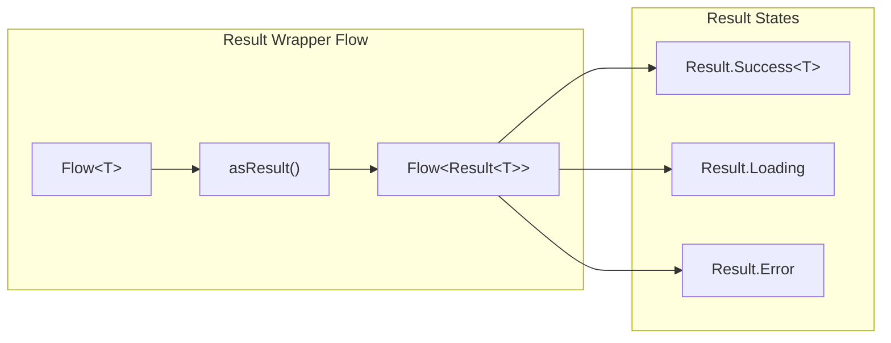

**Implementation**:
The `asResult()` extension function [core/common/src/main/kotlin/com/google/samples/apps/nowinandroid/core/common/result/Result.kt:30-33]() converts a standard `Flow` into a `Flow<Result<T>>`. It automatically emits `Loading` at the start [core/common/src/main/kotlin/com/google/samples/apps/nowinandroid/core/common/result/Result.kt:31-31]() and catches exceptions to emit `Error` [core/common/src/main/kotlin/com/google/samples/apps/nowinandroid/core/common/result/Result.kt:32-32]().

**Sources**: [core/common/src/main/kotlin/com/google/samples/apps/nowinandroid/core/common/result/Result.kt:17-33]()

---

## Integration and Dependencies

The `core:domain` module acts as a bridge, depending on `core:data` for repositories and `core:model` for shared data structures.

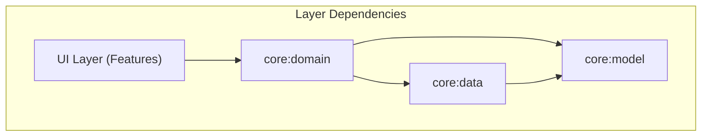

- **Data Access**: Use cases consume repositories defined in `core:data` [core/domain/build.gradle.kts:27-27]().
- **Models**: Both the data and domain layers share the models defined in `core:model` [core/domain/build.gradle.kts:28-28]().
- **Utilities**: Domain logic often relies on `core:common` for dispatchers and result handling [core/common/build.gradle.kts:1-26]().

**Sources**: [core/domain/build.gradle.kts:26-30](), [core/model/build.gradle.kts:1-24](), [core/common/build.gradle.kts:1-26]()

---

# Page: Build System

# Build System

<details>
<summary>Relevant source files</summary>

The following files were used as context for generating this wiki page:

- [app-nia-catalog/dependencies/releaseRuntimeClasspath.txt](app-nia-catalog/dependencies/releaseRuntimeClasspath.txt)
- [app/build.gradle.kts](app/build.gradle.kts)
- [app/dependencies/prodReleaseRuntimeClasspath.txt](app/dependencies/prodReleaseRuntimeClasspath.txt)
- [benchmarks/build.gradle.kts](benchmarks/build.gradle.kts)
- [build-logic/settings.gradle.kts](build-logic/settings.gradle.kts)
- [build.gradle.kts](build.gradle.kts)
- [core/designsystem/src/test/screenshots/LoadingWheel/LoadingWheel_animation_20.png](core/designsystem/src/test/screenshots/LoadingWheel/LoadingWheel_animation_20.png)
- [core/navigation/.gitignore](core/navigation/.gitignore)
- [core/navigation/build.gradle.kts](core/navigation/build.gradle.kts)
- [gradle.properties](gradle.properties)
- [gradle/libs.versions.toml](gradle/libs.versions.toml)
- [gradle/wrapper/gradle-wrapper.jar](gradle/wrapper/gradle-wrapper.jar)
- [gradle/wrapper/gradle-wrapper.properties](gradle/wrapper/gradle-wrapper.properties)
- [gradlew](gradlew)
- [gradlew.bat](gradlew.bat)
- [settings.gradle.kts](settings.gradle.kts)

</details>


The Now in Android build system is a Gradle-based build infrastructure designed to support a modular Android application with 50+ modules. It uses a centralized version catalog, custom convention plugins in a composite build, and product flavors to manage complexity while maintaining consistency across the codebase.

For information about CI/CD pipelines and automated builds, see [CI/CD Workflows](#3.4).

## Purpose and Scope

This document covers the Gradle build configuration, dependency management through the version catalog, custom convention plugins, build flavors and variants, and how these components work together to compile and package the application. It does not cover the module structure itself (see [Module Structure](#2.1)) or testing infrastructure (see [Testing Strategy](#8)).

## Gradle Version and Wrapper

The project uses **Gradle 9.4.0** as specified in [gradle/wrapper/gradle-wrapper.properties:4](). The Gradle wrapper scripts ([gradlew:1-249]() and [gradlew.bat:1-94]()) ensure consistent build environments across all development machines and CI environments.

**Key Gradle Configuration** ([gradle.properties:1-67]()):
- JVM heap: 4GB (`-Xmx4g -Xms4g`) [gradle.properties:20-20]()
- Parallel builds enabled: `org.gradle.parallel=true` [gradle.properties:32-32]()
- Configuration cache enabled: `org.gradle.configuration-cache=true` [gradle.properties:41-41]()
- Build cache enabled: `org.gradle.caching=true` [gradle.properties:38-38]()
- Kotlin daemon heap: 4GB with G1GC [gradle.properties:27-27]()

Sources: [gradle/wrapper/gradle-wrapper.properties:1-9](), [gradle.properties:1-67](), [gradlew:1-249]()

## Build System Architecture

The build system consists of four main layers: the version catalog as the single source of truth, convention plugins for shared configuration, individual module build scripts, and the root project coordination.

```mermaid
graph TB
    subgraph "Version Catalog"
        VersionCatalog["libs.versions.toml<br/>Versions, Libraries, Plugins, Bundles"]
    end
    
    subgraph "Build Logic Composite Build"
        ConventionPlugins["build-logic/convention<br/>Custom Gradle Plugins"]
        AndroidApp["AndroidApplicationConventionPlugin"]
        AndroidLib["AndroidLibraryConventionPlugin"]
        AndroidCompose["AndroidApplicationComposeConventionPlugin"]
        Hilt["HiltConventionPlugin"]
        Room["AndroidRoomConventionPlugin"]
        Jacoco["AndroidApplicationJacocoConventionPlugin"]
        Flavors["AndroidApplicationFlavorsConventionPlugin"]
        Firebase["AndroidApplicationFirebaseConventionPlugin"]
        
        ConventionPlugins --> AndroidApp
        ConventionPlugins --> AndroidLib
        ConventionPlugins --> AndroidCompose
        ConventionPlugins --> Hilt
        ConventionPlugins --> Room
        ConventionPlugins --> Jacoco
        ConventionPlugins --> Flavors
        ConventionPlugins --> Firebase
    end
    
    subgraph "Root Project"
        RootBuild["build.gradle.kts<br/>Plugin declarations (apply false)"]
        Settings["settings.gradle.kts<br/>Module inclusion<br/>Plugin management"]
        GradleProps["gradle.properties<br/>Build configuration"]
    end
    
    subgraph "Module Build Scripts"
        AppBuild["app/build.gradle.kts"]
        FeatureBuild["feature/*/build.gradle.kts"]
        CoreBuild["core/*/build.gradle.kts"]
    end
    
    subgraph "Build Outputs"
        APKs["APKs<br/>demoDebug, demoRelease<br/>prodDebug, prodRelease"]
        Baseline["Baseline Profiles"]
        Dependencies["Dependency Lists<br/>prodReleaseRuntimeClasspath.txt"]
    end
    
    VersionCatalog --> ConventionPlugins
    VersionCatalog --> AppBuild
    VersionCatalog --> FeatureBuild
    VersionCatalog --> CoreBuild
    
    Settings --> ConventionPlugins
    Settings --> RootBuild
    
    ConventionPlugins --> AppBuild
    ConventionPlugins --> FeatureBuild
    ConventionPlugins --> CoreBuild
    
    AppBuild --> APKs
    AppBuild --> Baseline
    AppBuild --> Dependencies
```

Sources: [build.gradle.kts:24-43](), [settings.gradle.kts:17-83](), [build-logic/settings.gradle.kts:42-43]()

## Version Catalog System

The version catalog at [gradle/libs.versions.toml:1-216]() serves as the single source of truth for all dependency versions. It uses the TOML format with four main sections: `[versions]`, `[libraries]`, `[plugins]`, and `[bundles]`.

### Version Catalog Structure

**Versions Section** ([gradle/libs.versions.toml:1-66]()):
- Defines version numbers as string references
- Example: `kotlin = "2.3.0"`, `androidGradlePlugin = "9.0.0"` [gradle/libs.versions.toml:49-49](), [gradle/libs.versions.toml:5-5]()
- Enables version reuse across multiple artifacts

**Libraries Section** ([gradle/libs.versions.toml:71-176]()):
- Maps library coordinates to versions
- Format: `group = "...", name = "...", version.ref = "..."`
- Example: `androidx-core-ktx = { group = "androidx.core", name = "core-ktx", version.ref = "androidxCore" }` [gradle/libs.versions.toml:96-96]()

**Plugins Section** ([gradle/libs.versions.toml:178-216]()):
- Declares both external and internal plugins
- External: `android.application`, `kotlin.serialization`, `hilt`
- Internal convention plugins: `nowinandroid.android.application`, `nowinandroid.hilt`

**Bundles Section** ([gradle/libs.versions.toml:68-69]()):
- Groups related dependencies
- Example: `androidx-compose-ui-test = ["androidx-compose-ui-test", "androidx-compose-ui-testManifest"]` [gradle/libs.versions.toml:69-69]()

```mermaid
graph LR
    subgraph "libs.versions.toml"
        Versions["[versions]<br/>kotlin=2.3.0<br/>agp=9.0.0<br/>hilt=2.59"]
        Libraries["[libraries]<br/>hilt-android<br/>androidx-core-ktx<br/>kotlinx-coroutines"]
        Plugins["[plugins]<br/>android.application<br/>nowinandroid.android.application<br/>hilt"]
        Bundles["[bundles]<br/>compose-ui-test"]
    end
    
    subgraph "Module Build Script"
        Dependencies["dependencies block"]
        PluginBlock["plugins block"]
    end
    
    Versions --> Libraries
    Versions --> Plugins
    Libraries --> Bundles
    
    Libraries --> Dependencies
    Bundles --> Dependencies
    Plugins --> PluginBlock
```

**Usage in Build Scripts**:
- Libraries: `implementation(libs.androidx.core.ktx)` [app/build.gradle.kts:100-100]()
- Bundles: `androidTestImplementation(libs.bundles.androidx.compose.ui.test)`
- Plugins: `alias(libs.plugins.nowinandroid.android.application)` [app/build.gradle.kts:19-19]()

Sources: [gradle/libs.versions.toml:1-216](), [app/build.gradle.kts:18-29]()

## Convention Plugins

The `build-logic` composite build contains custom Gradle convention plugins that encapsulate common build configurations. These plugins promote DRY principles and maintainability across the project's 50+ modules.

For details, see [Convention Plugins](#3.2).

### Key Convention Plugins

- **AndroidApplicationConventionPlugin**: Configures standard Android application settings including SDK versions, Gradle Managed Devices, and Dependency Guard. [app/build.gradle.kts:19-19]()
- **AndroidLibraryConventionPlugin**: Standard configuration for library modules, including resource prefixes and test runners.
- **HiltConventionPlugin**: Centralizes Hilt and KSP setup for both Android and JVM modules. [app/build.gradle.kts:24-24]()
- **AndroidRoomConventionPlugin**: Configures Room database with KSP and Kotlin code generation.
- **AndroidApplicationComposeConventionPlugin**: Enables and configures Jetpack Compose across application modules. [app/build.gradle.kts:20-20]()

Sources: [app/build.gradle.kts:18-29](), [build-logic/settings.gradle.kts:42-43]()

## Module Build Scripts

Individual modules apply convention plugins and declare specific dependencies. The `:app` module serves as the main application entry point, while feature and core modules use simpler configurations.

### Application Module Build Script

The [app/build.gradle.kts:1-153]() file demonstrates the layered plugin application:

```kotlin
plugins {
    alias(libs.plugins.nowinandroid.android.application)
    alias(libs.plugins.nowinandroid.android.application.compose)
    alias(libs.plugins.nowinandroid.android.application.flavors)
    alias(libs.plugins.nowinandroid.android.application.jacoco)
    alias(libs.plugins.nowinandroid.android.application.firebase)
    alias(libs.plugins.nowinandroid.hilt)
    alias(libs.plugins.google.osslicenses)
    alias(libs.plugins.baselineprofile)
    alias(libs.plugins.roborazzi)
    alias(libs.plugins.kotlin.serialization)
}
```

**Key Configuration**:
- Application ID: `com.google.samples.apps.nowinandroid` [app/build.gradle.kts:33-33]()
- Version code: `8`, Version name: `0.1.2` [app/build.gradle.kts:34-35]()
- Custom test runner: `com.google.samples.apps.nowinandroid.core.testing.NiaTestRunner` [app/build.gradle.kts:38-38]()
- Baseline profile automatic generation for release builds [app/build.gradle.kts:57-57]()
- Dependency Guard on `prodReleaseRuntimeClasspath` [app/build.gradle.kts:151-152]()

**Dependencies** ([app/build.gradle.kts:70-139]()):
- Feature modules: `:feature:foryou:impl`, `:feature:interests:impl`, etc. [app/build.gradle.kts:71-81]()
- Core modules: `:core:ui`, `:core:data`, `:core:designsystem`, etc. [app/build.gradle.kts:83-88]()
- Third-party: Hilt, Compose Material3, Coil, kotlinx-serialization [app/build.gradle.kts:91-111]()

Sources: [app/build.gradle.kts:1-153]()

### Build Output Analysis

The build produces detailed dependency reports. The `prodReleaseRuntimeClasspath.txt` ([app/dependencies/prodReleaseRuntimeClasspath.txt:1-257]()) lists all runtime dependencies for the production release variant.

Sources: [app/dependencies/prodReleaseRuntimeClasspath.txt:1-257]()

## Build Variants and Product Flavors

The build system uses product flavors and build types to support different content sources and build optimizations.

For details, see [Build Flavors and Variants](#3.3).

### Product Flavors

The project defines two flavors under the `contentType` dimension:
1. **demo**: Uses local static data for demonstration. [app/build.gradle.kts:124-129]()
2. **prod**: Connects to the production backend server. [app/dependencies/prodReleaseRuntimeClasspath.txt:1-3]()

### Build Types

- **debug**: Standard development build with `applicationIdSuffix` from `NiaBuildType.DEBUG`. [app/build.gradle.kts:42-44]()
- **release**: Optimized production build with R8 minification and Baseline Profiles enabled. [app/build.gradle.kts:45-58]()

Sources: [app/build.gradle.kts:41-59](), [benchmarks/build.gradle.kts:40-46]()

## Settings and Root Configuration

### Settings File Configuration

The [settings.gradle.kts:1-92]() file configures:

**Plugin Management** ([settings.gradle.kts:17-30]()):
- Includes `build-logic` composite build. [settings.gradle.kts:18-18]()
- Configures repositories (Google, Maven Central, Gradle Plugin Portal). [settings.gradle.kts:19-29]()

**Dependency Resolution** ([settings.gradle.kts:32-44]()):
- Repository mode: `FAIL_ON_PROJECT_REPOS`. [settings.gradle.kts:33-33]()
- Centralized repository configuration for all modules.

**Module Inclusion** ([settings.gradle.kts:48-84]()):
- Includes all core and feature modules.
- Uses type-safe project accessors: `TYPESAFE_PROJECT_ACCESSORS`. [settings.gradle.kts:47-47]()
- Enforces JDK 17+ requirement. [settings.gradle.kts:85-91]()

### Root Build File

The [build.gradle.kts:1-44]() applies all plugins with `apply false` to ensure a consistent classpath across the project:

```kotlin
plugins {
    alias(libs.plugins.android.application) apply false
    alias(libs.plugins.android.library) apply false
    alias(libs.plugins.android.test) apply false
    alias(libs.plugins.compose) apply false
    alias(libs.plugins.hilt) apply false
    alias(libs.plugins.ksp) apply false
    // ...
    alias(libs.plugins.nowinandroid.root)
}
```

Sources: [settings.gradle.kts:1-92](), [build.gradle.kts:1-44]()

## Summary

The Now in Android build system achieves maintainability through:

1. **Centralized dependency management** via version catalog. [gradle/libs.versions.toml:1-216]()
2. **Convention plugins** in composite build to reduce duplication. [build-logic/settings.gradle.kts:1-44]()
3. **Product flavors** to support demo and production environments. [app/build.gradle.kts:21-21]()
4. **Gradle configuration cache** and parallel builds for performance. [gradle.properties:32-42]()
5. **Dependency Guard** to track and validate dependency changes. [app/build.gradle.kts:150-152]()
6. **Baseline profiles** for startup optimization. [app/build.gradle.kts:141-148]()

For more details on specific components, see:
- [Dependency Management](#3.1)
- [Convention Plugins](#3.2)
- [Build Flavors and Variants](#3.3)
- [CI/CD Workflows](#3.4)
- [Code Quality and Coverage](#3.5)

---

# Page: Dependency Management

# Dependency Management

<details>
<summary>Relevant source files</summary>

The following files were used as context for generating this wiki page:

- [app-nia-catalog/dependencies/releaseRuntimeClasspath.txt](app-nia-catalog/dependencies/releaseRuntimeClasspath.txt)
- [app/build.gradle.kts](app/build.gradle.kts)
- [app/dependencies/prodReleaseRuntimeClasspath.txt](app/dependencies/prodReleaseRuntimeClasspath.txt)
- [benchmarks/build.gradle.kts](benchmarks/build.gradle.kts)
- [build-logic/settings.gradle.kts](build-logic/settings.gradle.kts)
- [build.gradle.kts](build.gradle.kts)
- [core/designsystem/src/test/screenshots/LoadingWheel/LoadingWheel_animation_20.png](core/designsystem/src/test/screenshots/LoadingWheel/LoadingWheel_animation_20.png)
- [core/navigation/.gitignore](core/navigation/.gitignore)
- [core/navigation/build.gradle.kts](core/navigation/build.gradle.kts)
- [gradle.properties](gradle.properties)
- [gradle/libs.versions.toml](gradle/libs.versions.toml)
- [gradle/wrapper/gradle-wrapper.jar](gradle/wrapper/gradle-wrapper.jar)
- [gradle/wrapper/gradle-wrapper.properties](gradle/wrapper/gradle-wrapper.properties)
- [gradlew](gradlew)
- [gradlew.bat](gradlew.bat)
- [settings.gradle.kts](settings.gradle.kts)

</details>


## Purpose and Scope

This page documents the centralized dependency management system used in the Now in Android project. The codebase uses Gradle's Version Catalog feature to declare all library versions, dependency coordinates, and plugin configurations in a single source of truth located at `gradle/libs.versions.toml`. This approach ensures consistent dependency versions across all 60+ modules and simplifies dependency updates.

For information about how these dependencies are applied to modules using convention plugins, see [Convention Plugins](#3.2). For details on how build variants affect dependency resolution, see [Build Flavors and Variants](#3.3).

## Version Catalog Overview

The Now in Android project centralizes dependency management using a Gradle Version Catalog defined in the TOML format. This catalog contains over 570 library versions and serves as the single source of truth for all dependency declarations across the project.

```mermaid
graph TB
    TOML["gradle/libs.versions.toml<br/>Single Source of Truth"]
    
    subgraph "Catalog Sections"
        VERSIONS["[versions]<br/>Version strings<br/>kotlin = '2.3.0'"]
        LIBRARIES["[libraries]<br/>Dependency coordinates<br/>kotlinx-coroutines-core"]
        BUNDLES["[bundles]<br/>Grouped dependencies<br/>androidx-compose-ui-test"]
        PLUGINS["[plugins]<br/>Plugin declarations<br/>android.application"]
    end
    
    subgraph "Consumers"
        ROOT_BUILD["build.gradle.kts<br/>Root project"]
        APP_BUILD["app/build.gradle.kts<br/>App module"]
        FEATURE_BUILD["feature/*/build.gradle.kts<br/>Feature modules"]
        BUILD_LOGIC["build-logic/convention<br/>Convention plugins"]
    end
    
    TOML --> VERSIONS
    TOML --> LIBRARIES
    TOML --> BUNDLES
    TOML --> PLUGINS
    
    VERSIONS -.-> LIBRARIES
    VERSIONS -.-> PLUGINS
    
    TOML --> ROOT_BUILD
    TOML --> APP_BUILD
    TOML --> FEATURE_BUILD
    TOML --> BUILD_LOGIC
    
    ROOT_BUILD --> APP_BUILD
    ROOT_BUILD --> FEATURE_BUILD
```

**Sources:** [gradle/libs.versions.toml:1-216](), [settings.gradle.kts:32-44](), [build-logic/settings.gradle.kts:35-39]()

## Version Catalog Structure

### The [versions] Section

The `[versions]` section declares version strings that can be referenced by multiple libraries or plugins. This allows updating a single version number to affect all dependencies that share that version.

```mermaid
graph LR
    subgraph "Version References"
        KOTLIN_VER["kotlin = '2.3.0'"]
        HILT_VER["hilt = '2.59'"]
        COMPOSE_BOM["androidxComposeBom = '2025.09.01'"]
        ROOM_VER["room = '2.8.3'"]
    end
    
    subgraph "Libraries Using Versions"
        KOTLIN_STDLIB["kotlin-stdlib<br/>version.ref = 'kotlin'"]
        KOTLIN_PLUGIN["kotlin-gradlePlugin<br/>version.ref = 'kotlin'"]
        HILT_ANDROID["hilt-android<br/>version.ref = 'hilt'"]
        HILT_COMPILER["hilt-compiler<br/>version.ref = 'hilt'"]
        ROOM_RUNTIME["room-runtime<br/>version.ref = 'room'"]
        ROOM_KTX["room-ktx<br/>version.ref = 'room'"]
    end
    
    KOTLIN_VER --> KOTLIN_STDLIB
    KOTLIN_VER --> KOTLIN_PLUGIN
    HILT_VER --> HILT_ANDROID
    HILT_VER --> HILT_COMPILER
    ROOM_VER --> ROOM_RUNTIME
    ROOM_VER --> ROOM_KTX
```

Key version declarations include:

| Category | Version Key | Value | Usage |
|----------|-------------|-------|-------|
| Kotlin | `kotlin` | 2.3.0 | Kotlin stdlib, compiler plugin |
| AGP | `androidGradlePlugin` | 9.0.0 | Android Gradle Plugin |
| Compose | `androidxComposeBom` | 2025.09.01 | Compose BOM (Bill of Materials) |
| Hilt | `hilt` | 2.59 | Dependency injection |
| Room | `room` | 2.8.3 | Local database |
| Coroutines | `kotlinxCoroutines` | 1.10.1 | Asynchronous programming |

**Sources:** [gradle/libs.versions.toml:1-66]()

### The [libraries] Section

The `[libraries]` section defines dependency coordinates using the format `group:artifact:version`. Libraries can reference versions from the `[versions]` section using `version.ref`.

**Dependency Coordinate Structure:**

```mermaid
graph LR
    LIB_ENTRY["androidx-core-ktx = { ... }"]
    
    GROUP["group = 'androidx.core'"]
    NAME["name = 'core-ktx'"]
    VERSION["version.ref = 'androidxCore'"]
    
    LIB_ENTRY --> GROUP
    LIB_ENTRY --> NAME
    LIB_ENTRY --> VERSION
    
    VERSION_DEF["androidxCore = '1.15.0'<br/>in [versions]"]
    VERSION --> VERSION_DEF
```

**Example library declarations:**

```toml
androidx-core-ktx = { group = "androidx.core", name = "core-ktx", version.ref = "androidxCore" }
kotlinx-coroutines-core = { group = "org.jetbrains.kotlinx", name = "kotlinx-coroutines-core", version.ref = "kotlinxCoroutines" }
hilt-android = { group = "com.google.dagger", name = "hilt-android", version.ref = "hilt" }
```

**Categories of libraries:**

| Category | Examples | Purpose |
|----------|----------|---------|
| AndroidX Core | `androidx-core-ktx`, `androidx-activity-compose` | Core Android framework |
| Compose | `androidx-compose-material3`, `androidx-compose-ui-tooling` | UI framework |
| Lifecycle | `androidx-lifecycle-viewModelCompose`, `androidx-lifecycle-runtimeCompose` | Lifecycle-aware components |
| Navigation | `androidx-navigation3-runtime`, `androidx-navigation3-ui` | Navigation framework |
| Data Layer | `room-runtime`, `androidx-dataStore`, `retrofit-core` | Data persistence and networking |
| DI | `hilt-android`, `hilt-compiler` | Dependency injection |
| Testing | `junit`, `androidx-test-espresso-core`, `roborazzi` | Test frameworks |
| Build-Logic | `android-gradlePlugin`, `kotlin-gradlePlugin` | For convention plugins |

**Sources:** [gradle/libs.versions.toml:71-177]()

### The [bundles] Section

Bundles group related dependencies that are commonly used together. This reduces boilerplate when declaring dependencies in module build files.

```mermaid
graph TB
    BUNDLE["androidx-compose-ui-test<br/>[bundles] section"]
    
    LIB1["androidx-compose-ui-test"]
    LIB2["androidx-compose-ui-testManifest"]
    
    BUNDLE --> LIB1
    BUNDLE --> LIB2
    
    BUILD_FILE["build.gradle.kts<br/>testImplementation(libs.bundles.androidx.compose.ui.test)"]
    
    BUNDLE -.->|expands to| BUILD_FILE
```

Currently defined bundle:

```toml
[bundles]
androidx-compose-ui-test = ["androidx-compose-ui-test", "androidx-compose-ui-testManifest"]
```

This bundle is used in test configurations to include both the Compose UI test library and its test manifest.

**Sources:** [gradle/libs.versions.toml:68-69]()

### The [plugins] Section

The `[plugins]` section declares both external plugins (from plugin repositories) and custom convention plugins defined in the `build-logic` module.

```mermaid
graph TB
    subgraph "External Plugins"
        ANDROID_APP["android-application<br/>id: com.android.application<br/>version: AGP 9.0.0"]
        KOTLIN_JVM["kotlin-jvm<br/>id: org.jetbrains.kotlin.jvm<br/>version: 2.3.0"]
        HILT_PLUGIN["hilt<br/>id: com.google.dagger.hilt.android<br/>version: 2.59"]
        KSP_PLUGIN["ksp<br/>id: com.google.devtools.ksp<br/>version: 2.3.4"]
    end
    
    subgraph "Custom Convention Plugins"
        CUSTOM_APP["nowinandroid-android-application<br/>id: nowinandroid.android.application"]
        CUSTOM_LIB["nowinandroid-android-library<br/>id: nowinandroid.android.library"]
        CUSTOM_HILT["nowinandroid-hilt<br/>id: nowinandroid.hilt"]
        CUSTOM_COMPOSE["nowinandroid-android-library-compose<br/>id: nowinandroid.android.library.compose"]
    end
    
    BUILD_LOGIC["build-logic/convention<br/>Convention plugin implementations"]
    
    CUSTOM_APP -.-> BUILD_LOGIC
    CUSTOM_LIB -.-> BUILD_LOGIC
    CUSTOM_HILT -.-> BUILD_LOGIC
    CUSTOM_COMPOSE -.-> BUILD_LOGIC
```

**External plugins** (lines 178-197):
- `android-application`, `android-library`: Android Gradle Plugin variants
- `kotlin-jvm`, `kotlin-serialization`: Kotlin compiler plugins
- `hilt`, `ksp`, `room`: Code generation and DI
- `firebase-crashlytics`, `firebase-perf`: Firebase services
- `roborazzi`, `baselineprofile`: Testing and performance tools

**Custom convention plugins** (lines 200-216):
- `nowinandroid-android-application`: App module configuration
- `nowinandroid-android-library`: Library module configuration  
- `nowinandroid-android-feature-impl/api`: Feature module conventions
- `nowinandroid-hilt`: Hilt DI setup
- `nowinandroid-android-room`: Room database configuration
- `nowinandroid-android-*-jacoco`: Code coverage configuration

**Sources:** [gradle/libs.versions.toml:178-216]()

## Accessing Dependencies in Build Scripts

### Plugin Declaration Syntax

Plugins are applied using the `alias()` function with the `libs.plugins` accessor:

```kotlin
// build.gradle.kts (root)
plugins {
    alias(libs.plugins.android.application) apply false
    alias(libs.plugins.kotlin.jvm) apply false
    alias(libs.plugins.hilt) apply false
    alias(libs.plugins.nowinandroid.root)
}
```

The `apply false` prevents applying the plugin to the root project while making it available to subprojects.

```mermaid
graph LR
    ROOT["Root build.gradle.kts<br/>plugins { alias(...) apply false }"]
    
    CATALOG["libs.plugins.android.application<br/>from version catalog"]
    
    SUBPROJECT["app/build.gradle.kts<br/>plugins { alias(libs.plugins.nowinandroid.android.application) }"]
    
    ROOT --> CATALOG
    CATALOG --> SUBPROJECT
```

**Sources:** [build.gradle.kts:24-43](), [app/build.gradle.kts:18-29]()

### Dependency Declaration Syntax

Dependencies are declared using the `libs` accessor with the dot-separated path from the TOML file:

```kotlin
// app/build.gradle.kts
dependencies {
    implementation(libs.androidx.core.ktx)
    implementation(libs.androidx.lifecycle.runtimeCompose)
    implementation(libs.kotlinx.coroutines.guava)
    
    ksp(libs.hilt.compiler)
    
    testImplementation(libs.kotlin.test)
    testImplementation(libs.roborazzi)
    
    androidTestImplementation(libs.androidx.test.espresso.core)
}
```

**Accessor mapping:**
- TOML: `androidx-core-ktx` → Accessor: `libs.androidx.core.ktx`
- TOML: `kotlinx-coroutines-core` → Accessor: `libs.kotlinx.coroutines.core`
- Dashes become dots in the accessor path

**Sources:** [app/build.gradle.kts:70-139]()

### Type-Safe Project Dependencies

The project enables `TYPESAFE_PROJECT_ACCESSORS` which generates type-safe accessors for inter-module dependencies:

```kotlin
// app/build.gradle.kts
dependencies {
    implementation(projects.feature.interests.api)
    implementation(projects.feature.interests.impl)
    implementation(projects.core.ui)
    implementation(projects.core.data)
    implementation(projects.sync.work)
}
```

This is enabled in `settings.gradle.kts` and provides compile-time safety for project references.

**Sources:** [settings.gradle.kts:47](), [app/build.gradle.kts:71-89]()

## Repository Configuration

### Main Project Repositories

Repository configuration is centralized in `settings.gradle.kts` using `dependencyResolutionManagement`:

```mermaid
graph TB
    SETTINGS["settings.gradle.kts<br/>dependencyResolutionManagement"]
    
    MODE["repositoriesMode = FAIL_ON_PROJECT_REPOS<br/>Enforces centralized repository config"]
    
    subgraph "Repositories"
        GOOGLE["google()<br/>com.android.*, com.google.*, androidx.*"]
        MAVEN["mavenCentral()<br/>All other dependencies"]
    end
    
    SETTINGS --> MODE
    SETTINGS --> GOOGLE
    SETTINGS --> MAVEN
    
    ALL_MODULES["All project modules<br/>Inherit repository configuration"]
    
    GOOGLE --> ALL_MODULES
    MAVEN --> ALL_MODULES
```

The `FAIL_ON_PROJECT_REPOS` mode prevents individual modules from declaring their own repositories, ensuring consistency.

**Repository content filtering:**
```kotlin
google {
    content {
        includeGroupByRegex("com\\.android.*")
        includeGroupByRegex("com\\.google.*")
        includeGroupByRegex("androidx.*")
    }
}
```

This optimization ensures that Google's repository is only queried for dependencies from Google/AndroidX groups, speeding up dependency resolution.

**Sources:** [settings.gradle.kts:32-44]()

### Build-Logic Repository Configuration

The `build-logic` module has its own `settings.gradle.kts` that configures repositories and imports the version catalog:

```kotlin
dependencyResolutionManagement {
    repositories {
        google {
            content {
                includeGroupByRegex("com\\.android.*")
                includeGroupByRegex("com\\.google.*")
                includeGroupByRegex("androidx.*")
            }
        }
        mavenCentral()
    }
    versionCatalogs {
        create("libs") {
            from(files("../gradle/libs.versions.toml"))
        }
    }
}
```

This allows convention plugins in `build-logic` to access the same version catalog as the main project.

**Sources:** [build-logic/settings.gradle.kts:24-40]()

## Build-Logic Integration

The custom convention plugins in the `build-logic` module depend on Gradle plugins, which are declared in the version catalog's `[libraries]` section with special entries:

```mermaid
graph TB
    TOML["gradle/libs.versions.toml"]
    
    subgraph "Build Plugin Libraries"
        AGP_LIB["android-gradlePlugin<br/>com.android.tools.build:gradle-api:9.0.0"]
        KOTLIN_LIB["kotlin-gradlePlugin<br/>org.jetbrains.kotlin:kotlin-gradle-plugin:2.3.0"]
        COMPOSE_LIB["compose-gradlePlugin<br/>org.jetbrains.kotlin:compose-compiler-gradle-plugin:2.3.0"]
        KSP_LIB["ksp-gradlePlugin<br/>com.google.devtools.ksp:...gradle.plugin:2.3.4"]
    end
    
    CONVENTION["build-logic/convention/build.gradle.kts"]
    
    TOML --> AGP_LIB
    TOML --> KOTLIN_LIB
    TOML --> COMPOSE_LIB
    TOML --> KSP_LIB
    
    AGP_LIB --> CONVENTION
    KOTLIN_LIB --> CONVENTION
    COMPOSE_LIB --> CONVENTION
    KSP_LIB --> CONVENTION
    
    PLUGIN_IMPL["Convention Plugin Implementations<br/>AndroidApplicationConventionPlugin<br/>ComposeConventionPlugin"]
    
    CONVENTION --> PLUGIN_IMPL
```

These are declared with the `-gradlePlugin` suffix to distinguish them from the runtime libraries:

```toml
android-gradlePlugin = { group = "com.android.tools.build", name = "gradle-api", version.ref = "androidGradlePlugin" }
kotlin-gradlePlugin = { group = "org.jetbrains.kotlin", name = "kotlin-gradle-plugin", version.ref = "kotlin" }
compose-gradlePlugin = { module = "org.jetbrains.kotlin:compose-compiler-gradle-plugin", version.ref = "kotlin" }
ksp-gradlePlugin = { group = "com.google.devtools.ksp", name = "com.google.devtools.ksp.gradle.plugin", version.ref = "ksp" }
```

**Sources:** [gradle/libs.versions.toml:167-176](), [build-logic/settings.gradle.kts:35-39]()

## Dependency Guard Integration

The project uses the Dependency Guard plugin to track and verify resolved dependencies. This creates a baseline of the runtime classpath which must be explicitly updated when dependencies change.

```mermaid
graph LR
    BUILD_FILE["app/build.gradle.kts<br/>dependencyGuard configuration"]
    
    BASELINE["app/dependencies/<br/>prodReleaseRuntimeClasspath.txt<br/>Tracked dependency list"]
    
    VERIFY["./gradlew dependencyGuard<br/>Verifies dependencies match baseline"]
    
    UPDATE["./gradlew dependencyGuardBaseline<br/>Updates baseline file"]
    
    BUILD_FILE --> BASELINE
    VERIFY --> BASELINE
    UPDATE --> BASELINE
```

Configuration in the app module:

```kotlin
dependencyGuard {
    configuration("prodReleaseRuntimeClasspath")
}
```

The baseline file lists all resolved dependencies for the specified configuration. When dependencies change, the build fails until the baseline is updated.

**Sources:** [app/build.gradle.kts:150-152](), [app/dependencies/prodReleaseRuntimeClasspath.txt:1-257]()

## Gradle Properties Configuration

The `gradle.properties` file contains build configuration that affects dependency resolution:

| Property | Value | Impact |
|----------|-------|--------|
| `org.gradle.parallel` | `true` | Enables parallel module builds |
| `org.gradle.caching` | `true` | Enables build cache |
| `org.gradle.configuration-cache` | `true` | Enables configuration cache for faster builds |
| `org.gradle.jvmargs` | `-Xmx4g -Xms4g` | Allocates 4GB heap for Gradle daemon |
| `kotlin.daemon.jvmargs` | `-Xmx4g -Xms4g` | Allocates 4GB heap for Kotlin daemon |
| `android.useAndroidX` | `true` | Uses AndroidX libraries |

These settings optimize build performance and enable modern Gradle features.

**Sources:** [gradle.properties:1-66]()

## Version Synchronization Strategy

The project keeps related dependencies synchronized using shared version variables:

```mermaid
graph TB
    subgraph "Compose Ecosystem"
        COMPOSE_BOM["androidxComposeBom = '2025.09.01'"]
        COMPOSE_FOUNDATION["androidxComposeFoundation = '1.8.0-alpha07'"]
        COMPOSE_ADAPTIVE["androidxComposeMaterial3Adaptive = '1.1.0-rc01'"]
    end
    
    subgraph "AndroidX Lifecycle"
        LIFECYCLE_VER["androidxLifecycle = '2.10.0'"]
        LIFECYCLE_RUNTIME["lifecycle-runtime-compose"]
        LIFECYCLE_VM["lifecycle-viewmodel-compose"]
        LIFECYCLE_VM_NAV3["lifecycle-viewmodel-navigation3"]
        
        LIFECYCLE_VER --> LIFECYCLE_RUNTIME
        LIFECYCLE_VER --> LIFECYCLE_VM
        LIFECYCLE_VER --> LIFECYCLE_VM_NAV3
    end
    
    subgraph "Hilt"
        HILT_VER["hilt = '2.59'"]
        HILT_ANDROID["hilt-android"]
        HILT_COMPILER["hilt-compiler"]
        HILT_CORE["hilt-core"]
        
        HILT_VER --> HILT_ANDROID
        HILT_VER --> HILT_COMPILER
        HILT_VER --> HILT_CORE
    end
```

This strategy ensures that:
- All Compose libraries use compatible versions
- Lifecycle components are synchronized
- Hilt dependencies match across compilation and runtime
- Test libraries match their corresponding runtime libraries

**Sources:** [gradle/libs.versions.toml:1-66]()

## Summary of Key Files

| File | Purpose |
|------|---------|
| `gradle/libs.versions.toml` | Central version catalog defining all dependencies |
| `settings.gradle.kts` | Repository configuration and module includes |
| `build.gradle.kts` | Root project plugin declarations |
| `build-logic/settings.gradle.kts` | Build-logic repository config and catalog import |
| `gradle.properties` | Build performance and behavior configuration |
| `app/dependencies/*.txt` | Dependency Guard baseline files |

---

# Page: Convention Plugins

# Convention Plugins

<details>
<summary>Relevant source files</summary>

The following files were used as context for generating this wiki page:

- [build-logic/README.md](build-logic/README.md)
- [build-logic/convention/build.gradle.kts](build-logic/convention/build.gradle.kts)
- [build-logic/convention/src/main/kotlin/AndroidApplicationConventionPlugin.kt](build-logic/convention/src/main/kotlin/AndroidApplicationConventionPlugin.kt)
- [build-logic/convention/src/main/kotlin/AndroidApplicationFirebaseConventionPlugin.kt](build-logic/convention/src/main/kotlin/AndroidApplicationFirebaseConventionPlugin.kt)
- [build-logic/convention/src/main/kotlin/AndroidLibraryConventionPlugin.kt](build-logic/convention/src/main/kotlin/AndroidLibraryConventionPlugin.kt)
- [build-logic/convention/src/main/kotlin/AndroidRoomConventionPlugin.kt](build-logic/convention/src/main/kotlin/AndroidRoomConventionPlugin.kt)
- [build-logic/convention/src/main/kotlin/AndroidTestConventionPlugin.kt](build-logic/convention/src/main/kotlin/AndroidTestConventionPlugin.kt)
- [build-logic/convention/src/main/kotlin/HiltConventionPlugin.kt](build-logic/convention/src/main/kotlin/HiltConventionPlugin.kt)
- [build-logic/convention/src/main/kotlin/JvmLibraryConventionPlugin.kt](build-logic/convention/src/main/kotlin/JvmLibraryConventionPlugin.kt)
- [build-logic/convention/src/main/kotlin/RootPlugin.kt](build-logic/convention/src/main/kotlin/RootPlugin.kt)
- [build-logic/convention/src/main/kotlin/com/google/samples/apps/nowinandroid/AndroidCompose.kt](build-logic/convention/src/main/kotlin/com/google/samples/apps/nowinandroid/AndroidCompose.kt)
- [build-logic/convention/src/main/kotlin/com/google/samples/apps/nowinandroid/Badging.kt](build-logic/convention/src/main/kotlin/com/google/samples/apps/nowinandroid/Badging.kt)
- [build-logic/convention/src/main/kotlin/com/google/samples/apps/nowinandroid/GradleManagedDevices.kt](build-logic/convention/src/main/kotlin/com/google/samples/apps/nowinandroid/GradleManagedDevices.kt)
- [build-logic/convention/src/main/kotlin/com/google/samples/apps/nowinandroid/KotlinAndroid.kt](build-logic/convention/src/main/kotlin/com/google/samples/apps/nowinandroid/KotlinAndroid.kt)
- [build-logic/convention/src/main/kotlin/com/google/samples/apps/nowinandroid/NiaFlavor.kt](build-logic/convention/src/main/kotlin/com/google/samples/apps/nowinandroid/NiaFlavor.kt)
- [lint/build.gradle.kts](lint/build.gradle.kts)

</details>


## Purpose and Scope

Convention plugins are custom Gradle plugins located in the `build-logic/convention` directory that standardize build configuration across all modules in the Now in Android project. These plugins encapsulate common build logic, reducing duplication and ensuring consistency in settings like SDK versions, compiler options, and dependency injection setup.

For information about the centralized dependency versions used by these plugins, see [Dependency Management](3.1). For details on build flavors and variants configured by these plugins, see [Build Flavors and Variants](3.3).

**Sources:** [build-logic/convention/src/main/kotlin/AndroidApplicationConventionPlugin.kt:29-49](), [build-logic/convention/src/main/kotlin/AndroidLibraryConventionPlugin.kt:32-66]()

---

## Convention Plugin Architecture

The convention plugin system consists of a set of composable plugins that can be applied to different module types. Each plugin applies specific configurations and can depend on other convention plugins to build up complete build configurations.

### Plugin Hierarchy

```mermaid
graph TB
    subgraph "Core Platform Plugins"
        AndroidApp["AndroidApplicationConventionPlugin<br/>nowinandroid.android.application"]
        AndroidLib["AndroidLibraryConventionPlugin<br/>nowinandroid.android.library"]
        AndroidTest["AndroidTestConventionPlugin<br/>nowinandroid.android.test"]
        JvmLib["JvmLibraryConventionPlugin<br/>nowinandroid.jvm.library"]
    end
    
    subgraph "Feature Enhancement Plugins"
        Compose["AndroidComposeConventionPlugin<br/>nowinandroid.android.library.compose"]
        Hilt["HiltConventionPlugin<br/>nowinandroid.hilt"]
        Room["AndroidRoomConventionPlugin<br/>nowinandroid.android.room"]
        Firebase["AndroidApplicationFirebaseConventionPlugin<br/>nowinandroid.android.application.firebase"]
    end
    
    subgraph "Supporting Plugins"
        Lint["AndroidLintConventionPlugin<br/>nowinandroid.android.lint"]
        Jacoco["AndroidApplicationJacocoConventionPlugin<br/>nowinandroid.android.application.jacoco"]
    end
    
    subgraph "Configuration Utilities"
        KotlinAndroid["configureKotlinAndroid()"]
        KotlinJvm["configureKotlinJvm()"]
        AndroidCompose["configureAndroidCompose()"]
        Flavors["configureFlavors()"]
        GMD["configureGradleManagedDevices()"]
    end
    
    AndroidApp -->|applies| Lint
    AndroidLib -->|applies| Lint
    JvmLib -->|applies| Lint
    
    AndroidApp -->|calls| KotlinAndroid
    AndroidLib -->|calls| KotlinAndroid
    AndroidTest -->|calls| KotlinAndroid
    JvmLib -->|calls| KotlinJvm
    
    Compose -->|calls| AndroidCompose
    
    AndroidLib -->|calls| Flavors
    AndroidLib -->|calls| GMD
    AndroidApp -->|calls| GMD
    
    Hilt -.->|applies to| AndroidApp
    Hilt -.->|applies to| AndroidLib
    Room -.->|applies to| AndroidLib
    Compose -.->|applies to| AndroidLib
    Firebase -.->|applies to| AndroidApp
    Jacoco -.->|applies to| AndroidApp
```

**Sources:** [build-logic/convention/src/main/kotlin/AndroidApplicationConventionPlugin.kt:29-49](), [build-logic/convention/src/main/kotlin/AndroidLibraryConventionPlugin.kt:32-66](), [build-logic/convention/src/main/kotlin/HiltConventionPlugin.kt:24-50]()

---

## Core Platform Plugins

### AndroidApplicationConventionPlugin

Configures Android application modules (`:app`). This plugin sets up the foundation for the main application entry point.

**Plugin ID:** `nowinandroid.android.application`

**Applied Plugins:**
- `com.android.application` [AndroidApplicationConventionPlugin.kt:32]()
- `nowinandroid.android.lint` [AndroidApplicationConventionPlugin.kt:33]()
- `com.dropbox.dependency-guard` [AndroidApplicationConventionPlugin.kt:34]()

**Configuration:**
- Calls `configureKotlinAndroid()` to set up Kotlin compilation [AndroidApplicationConventionPlugin.kt:37]()
- Sets `targetSdk = 36` [AndroidApplicationConventionPlugin.kt:38]()
- Disables animations in tests [AndroidApplicationConventionPlugin.kt:39]()
- Configures Gradle managed devices via `configureGradleManagedDevices()` [AndroidApplicationConventionPlugin.kt:40]()
- Sets up APK printing tasks via `configurePrintApksTask()` [AndroidApplicationConventionPlugin.kt:43]()
- Configures badging verification via `configureBadgingTasks()` [AndroidApplicationConventionPlugin.kt:44]()

**Sources:** [build-logic/convention/src/main/kotlin/AndroidApplicationConventionPlugin.kt:29-49]()

---

### AndroidLibraryConventionPlugin

Configures Android library modules (`:core:*`, `:feature:*:impl`). This is the most commonly used convention plugin in the project.

**Plugin ID:** `nowinandroid.android.library`

**Applied Plugins:**
- `com.android.library` [AndroidLibraryConventionPlugin.kt:35]()
- `nowinandroid.android.lint` [AndroidLibraryConventionPlugin.kt:36]()

**Configuration:**
- Calls `configureKotlinAndroid()` to set up Kotlin compilation [AndroidLibraryConventionPlugin.kt:39]()
- Sets `targetSdk = 36` across test options and lint [AndroidLibraryConventionPlugin.kt:40-41]()
- Sets `testInstrumentationRunner = "androidx.test.runner.AndroidJUnitRunner"` [AndroidLibraryConventionPlugin.kt:42]()
- Disables animations in tests [AndroidLibraryConventionPlugin.kt:43]()
- Configures product flavors via `configureFlavors()` [AndroidLibraryConventionPlugin.kt:44]()
- Configures Gradle managed devices [AndroidLibraryConventionPlugin.kt:45]()
- Sets automatic resource prefix based on module path [AndroidLibraryConventionPlugin.kt:48-50]()
- Adds `kotlin.test` and `androidx.tracing.ktx` dependencies [AndroidLibraryConventionPlugin.kt:58-62]()

**Resource Prefix Convention:**
Resources in `:core:module1` must be prefixed with `core_module1_`. This is automatically derived from the module path using a regex that joins distinct path segments with underscores [AndroidLibraryConventionPlugin.kt:48-50]().

**Sources:** [build-logic/convention/src/main/kotlin/AndroidLibraryConventionPlugin.kt:32-66]()

---

### AndroidTestConventionPlugin

Configures standalone Android test modules.

**Plugin ID:** `nowinandroid.android.test`

**Applied Plugins:**
- `com.android.test` [AndroidTestConventionPlugin.kt:28]()

**Configuration:**
- Calls `configureKotlinAndroid()` for Kotlin setup [AndroidTestConventionPlugin.kt:31]()
- Sets `targetSdk = 36` [AndroidTestConventionPlugin.kt:32]()
- Configures Gradle managed devices [AndroidTestConventionPlugin.kt:33]()

**Sources:** [build-logic/convention/src/main/kotlin/AndroidTestConventionPlugin.kt:25-37]()

---

### JvmLibraryConventionPlugin

Configures pure JVM library modules (`:core:model`). These modules do not depend on Android APIs.

**Plugin ID:** `nowinandroid.jvm.library`

**Applied Plugins:**
- `org.jetbrains.kotlin.jvm` [JvmLibraryConventionPlugin.kt:28]()
- `nowinandroid.android.lint` [JvmLibraryConventionPlugin.kt:29]()

**Configuration:**
- Calls `configureKotlinJvm()` for JVM-specific Kotlin setup [JvmLibraryConventionPlugin.kt:31]()
- Adds `kotlin.test` dependency [JvmLibraryConventionPlugin.kt:34]()

**Sources:** [build-logic/convention/src/main/kotlin/JvmLibraryConventionPlugin.kt:25-38]()

---

## Feature Enhancement Plugins

### HiltConventionPlugin

Configures Hilt dependency injection for both Android and JVM modules.

**Plugin ID:** `nowinandroid.hilt`

**Applied Plugins:**
- `com.google.devtools.ksp` [HiltConventionPlugin.kt:27]()

**Configuration:**
The plugin adapts based on the type of module:

**For JVM Modules** (detected via `org.jetbrains.kotlin.jvm` plugin):
- Adds `hilt.core` implementation dependency [HiltConventionPlugin.kt:37]()

**For Android Modules** (detected via `com.android.base` plugin):
- Applies `dagger.hilt.android.plugin` [HiltConventionPlugin.kt:43]()
- Adds `hilt.android` implementation dependency [HiltConventionPlugin.kt:45]()

**Common Configuration:**
- Adds `hilt.compiler` and `kotlin.metadata` as KSP processors [HiltConventionPlugin.kt:30-31]()

**Sources:** [build-logic/convention/src/main/kotlin/HiltConventionPlugin.kt:24-50]()

---

### AndroidRoomConventionPlugin

Configures Room database setup for modules that use local persistence.

**Plugin ID:** `nowinandroid.android.room`

**Applied Plugins:**
- `androidx.room` [AndroidRoomConventionPlugin.kt:30]()
- `com.google.devtools.ksp` [AndroidRoomConventionPlugin.kt:31]()

**Configuration:**
- Enables Kotlin code generation: `room.generateKotlin = true` [AndroidRoomConventionPlugin.kt:34]()
- Sets schema directory to `$projectDir/schemas` [AndroidRoomConventionPlugin.kt:41]()
- Adds Room dependencies: `room.runtime`, `room.ktx`, `room.compiler` [AndroidRoomConventionPlugin.kt:45-47]()

**Sources:** [build-logic/convention/src/main/kotlin/AndroidRoomConventionPlugin.kt:26-51]()

---

### AndroidApplicationFirebaseConventionPlugin

Configures Firebase services for the application module.

**Plugin ID:** `nowinandroid.android.application.firebase`

**Applied Plugins:**
- `com.google.gms.google-services` [AndroidApplicationFirebaseConventionPlugin.kt:30]()
- `com.google.firebase.firebase-perf` [AndroidApplicationFirebaseConventionPlugin.kt:31]()
- `com.google.firebase.crashlytics` [AndroidApplicationFirebaseConventionPlugin.kt:32]()

**Dependencies:**
- `firebase-bom` - Firebase Bill of Materials [AndroidApplicationFirebaseConventionPlugin.kt:36]()
- `firebase.analytics`, `firebase.performance`, `firebase.crashlytics` [AndroidApplicationFirebaseConventionPlugin.kt:37-48]()

**Sources:** [build-logic/convention/src/main/kotlin/AndroidApplicationFirebaseConventionPlugin.kt:27-63]()

---

## Configuration Utilities

### Kotlin Configuration

#### configureKotlinAndroid()

Configures Kotlin compilation for Android modules.

**SDK Configuration:**
- `compileSdk = 36` [KotlinAndroid.kt:38]()
- `minSdk = 23` [KotlinAndroid.kt:41]()
- Java 11 source/target compatibility [KotlinAndroid.kt:47-48]()
- Enables core library desugaring [KotlinAndroid.kt:49]()

**Kotlin Compiler Options:**
- JVM target: `JVM_11` [KotlinAndroid.kt:88]()
- Treats warnings as errors (configurable via `warningsAsErrors` Gradle property) [KotlinAndroid.kt:80-89]()
- Enables experimental coroutines APIs: `-opt-in=kotlinx.coroutines.ExperimentalCoroutinesApi` [KotlinAndroid.kt:92]()
- Enables consistent data class copy visibility: `-Xconsistent-data-class-copy-visibility` [KotlinAndroid.kt:106]()

**Sources:** [build-logic/convention/src/main/kotlin/com/google/samples/apps/nowinandroid/KotlinAndroid.kt:34-58](), [KotlinAndroid.kt:77-109]()

---

### Compose Configuration

#### configureAndroidCompose()

Configures Jetpack Compose for modules that use Compose UI.

**Build Features:**
- Enables Compose: `compose = true` [AndroidCompose.kt:34]()

**Compose Compiler Configuration:**
- **Metrics/Reports:** Enabled via `enableComposeCompilerMetrics` and `enableComposeCompilerReports` Gradle properties [AndroidCompose.kt:55-61]()
- **Stability Configuration:** Uses root `compose_compiler_config.conf` file [AndroidCompose.kt:64-65]()

**Sources:** [build-logic/convention/src/main/kotlin/com/google/samples/apps/nowinandroid/AndroidCompose.kt:29-67]()

---

### Badging Verification System

Configures APK badging verification for application modules via `configureBadgingTasks`.

**System Flow:**

```mermaid
graph LR
    subgraph "Badging System Entities"
        GTask["GenerateBadgingTask"]
        CTask["CheckBadgingTask"]
        UpdateTask["Copy (Update)"]
        GoldenFile["{variant}-badging.txt"]
    end

    APK["variant.artifacts (APK)"] --> GTask
    AAPT2["sdkComponents.aapt2"] --> GTask
    GTask -->|outputs| GenFile["generated-badging.txt"]
    
    GenFile --> CTask
    GoldenFile --> CTask
    
    GenFile --> UpdateTask
    UpdateTask -->|overwrites| GoldenFile
```

**Task Roles:**
1. **`GenerateBadgingTask`**: Executes `aapt2 dump badging` on the APK to extract manifest details [Badging.kt:60-71]().
2. **`CheckBadgingTask`**: Compares the generated badging file with a "golden" file in the project directory [Badging.kt:96-104]().
3. **Update Task**: A standard `Copy` task that promotes the generated file to be the new golden file [Badging.kt:129-133]().

**Sources:** [build-logic/convention/src/main/kotlin/com/google/samples/apps/nowinandroid/Badging.kt:44-145]()

---

### Gradle Managed Devices

Configures a set of standard virtual devices for consistent testing environments via `configureGradleManagedDevices`.

| Device Name | API Level | System Image |
| :--- | :--- | :--- |
| Pixel 4 | 30 | aosp-atd |
| Pixel 6 | 31 | aosp |
| Pixel C | 30 | aosp-atd |

**Sources:** [build-logic/convention/src/main/kotlin/com/google/samples/apps/nowinandroid/GradleManagedDevices.kt:30-32]()

---

## Plugin Registration

Plugins are registered in `build-logic/convention/build.gradle.kts` using the `gradlePlugin` block.

```mermaid
graph TD
    subgraph "build.gradle.kts (build-logic)"
        Reg["gradlePlugin.plugins.register()"]
    end

    subgraph "Plugin Implementation Space"
        AAC["AndroidApplicationConventionPlugin"]
        ALC["AndroidLibraryConventionPlugin"]
        HCP["HiltConventionPlugin"]
        RCP["AndroidRoomConventionPlugin"]
    end

    Reg -->|id: androidApplication| AAC
    Reg -->|id: androidLibrary| ALC
    Reg -->|id: hilt| HCP
    Reg -->|id: androidRoom| RCP
```

**Sources:** [build-logic/convention/build.gradle.kts:60-127]()

---

# Page: Build Flavors and Variants

# Build Flavors and Variants

<details>
<summary>Relevant source files</summary>

The following files were used as context for generating this wiki page:

- [app/benchmark-rules.pro](app/benchmark-rules.pro)
- [app/src/prod/AndroidManifest.xml](app/src/prod/AndroidManifest.xml)
- [build-logic/convention/src/main/kotlin/AndroidApplicationFlavorsConventionPlugin.kt](build-logic/convention/src/main/kotlin/AndroidApplicationFlavorsConventionPlugin.kt)
- [build-logic/convention/src/main/kotlin/com/google/samples/apps/nowinandroid/AndroidCompose.kt](build-logic/convention/src/main/kotlin/com/google/samples/apps/nowinandroid/AndroidCompose.kt)
- [build-logic/convention/src/main/kotlin/com/google/samples/apps/nowinandroid/GradleManagedDevices.kt](build-logic/convention/src/main/kotlin/com/google/samples/apps/nowinandroid/GradleManagedDevices.kt)
- [build-logic/convention/src/main/kotlin/com/google/samples/apps/nowinandroid/KotlinAndroid.kt](build-logic/convention/src/main/kotlin/com/google/samples/apps/nowinandroid/KotlinAndroid.kt)
- [build-logic/convention/src/main/kotlin/com/google/samples/apps/nowinandroid/NiaBuildType.kt](build-logic/convention/src/main/kotlin/com/google/samples/apps/nowinandroid/NiaBuildType.kt)
- [build-logic/convention/src/main/kotlin/com/google/samples/apps/nowinandroid/NiaFlavor.kt](build-logic/convention/src/main/kotlin/com/google/samples/apps/nowinandroid/NiaFlavor.kt)
- [core/analytics/src/main/AndroidManifest.xml](core/analytics/src/main/AndroidManifest.xml)
- [core/data/src/main/AndroidManifest.xml](core/data/src/main/AndroidManifest.xml)
- [core/database/src/main/AndroidManifest.xml](core/database/src/main/AndroidManifest.xml)
- [core/datastore-test/src/main/AndroidManifest.xml](core/datastore-test/src/main/AndroidManifest.xml)
- [core/datastore/src/main/AndroidManifest.xml](core/datastore/src/main/AndroidManifest.xml)
- [core/designsystem/src/main/AndroidManifest.xml](core/designsystem/src/main/AndroidManifest.xml)
- [core/network/src/main/AndroidManifest.xml](core/network/src/main/AndroidManifest.xml)
- [core/testing/src/main/AndroidManifest.xml](core/testing/src/main/AndroidManifest.xml)
- [core/ui/src/main/AndroidManifest.xml](core/ui/src/main/AndroidManifest.xml)

</details>


## Purpose and Scope

This document describes the product flavor and build variant configuration in Now in Android. It covers the two product flavors (`demo` and `prod`), build types (`debug`, `release`, `benchmark`), and how they combine to create build variants with different data sources and configurations. 

For information about the Gradle plugin that applies these configurations, see [Convention Plugins](3.2). For CI/CD automation that builds different variants, see [CI/CD Workflows](3.4).

---

## Overview

Now in Android uses Gradle's product flavor system to create different versions of the application with distinct data sources and behaviors. The application defines:

- **One flavor dimension**: `contentType` [build-logic/convention/src/main/kotlin/com/google/samples/apps/nowinandroid/NiaFlavor.kt:27-28]()
- **Two product flavors**: `demo` and `prod` [build-logic/convention/src/main/kotlin/com/google/samples/apps/nowinandroid/NiaFlavor.kt:35-36]()
- **Three build types**: `debug`, `release`, and `benchmark` [build-logic/convention/src/main/kotlin/com/google/samples/apps/nowinandroid/NiaBuildType.kt:22-25]()
- **Multiple build variants**: Combinations like `demoDebug`, `prodRelease`, etc.

The primary purpose of flavors is to enable development and testing with static local data (`demo`) while maintaining a production variant (`prod`) that connects to real backend services.

**Flavor Configuration Architecture**

```mermaid
graph TB
    subgraph "Build Logic (Convention Plugins)"
        FlavorEnum["NiaFlavor (Enum)"]
        FlavorDim["FlavorDimension (Enum)"]
        ConfigureFn["configureFlavors()"]
    end

    subgraph "Application Modules"
        AppModule["app/build.gradle.kts"]
        BenchmarkModule["benchmarks/build.gradle.kts"]
    end
    
    ConfigureFn -->|"uses"| FlavorEnum
    ConfigureFn -->|"uses"| FlavorDim
    
    AppModule -.->|"calls"| ConfigureFn
    BenchmarkModule -.->|"calls"| ConfigureFn
```

Sources: [build-logic/convention/src/main/kotlin/com/google/samples/apps/nowinandroid/NiaFlavor.kt:26-62](), [build-logic/convention/src/main/kotlin/com/google/samples/apps/nowinandroid/NiaBuildType.kt:22-25]()

---

## Product Flavors

### Flavor Definition

The codebase defines two product flavors under a single dimension using the `NiaFlavor` enum:

| Flavor | Dimension | Application ID Suffix | Purpose |
|--------|-----------|----------------------|---------|
| `demo` | `contentType` | `.demo` | Static local data for development and testing |
| `prod` | `contentType` | none | Production backend data for release |

The flavor configuration is centralized in `NiaFlavor.kt`:

```mermaid
graph LR
    subgraph "NiaFlavor Enum"
        Demo["NiaFlavor.demo<br/>applicationIdSuffix = .demo"]
        Prod["NiaFlavor.prod<br/>applicationIdSuffix = null"]
    end
    
    subgraph "Build Logic Execution"
        Reg["register(niaFlavor.name)"]
        Suffix["applicationIdSuffix = niaFlavor.applicationIdSuffix"]
    end
    
    Demo --> Reg
    Prod --> Reg
    Reg --> Suffix
```

Sources: [build-logic/convention/src/main/kotlin/com/google/samples/apps/nowinandroid/NiaFlavor.kt:34-37](), [build-logic/convention/src/main/kotlin/com/google/samples/apps/nowinandroid/NiaFlavor.kt:49-59]()

### Demo Flavor

The `demo` flavor provides a completely offline experience using static JSON data embedded in the application's assets. This enables:

- **Deterministic testing**: Screenshot tests and UI tests run against stable data.
- **Offline development**: No backend infrastructure required.
- **Stable benchmarks**: Performance measurements aren't affected by network variability.

**Demo Flavor Data Flow**

```mermaid
graph TB
    DemoApp["demoDebug / demoRelease"]
    
    subgraph "core:network (demo source set)"
        DemoModule["FlavoredNetworkModule"]
        DemoDataSource["DemoNiaNetworkDataSource"]
        AssetManager["DemoAssetManager"]
    end

    subgraph "Assets"
        JsonFiles["*.json (Static Data)"]
    end
    
    DemoApp -->|"Hilt Inject"| DemoModule
    DemoModule -->|"Binds"| DemoDataSource
    DemoDataSource -->|"Reads"| AssetManager
    AssetManager -->|"Loads"| JsonFiles
```

Sources: [build-logic/convention/src/main/kotlin/com/google/samples/apps/nowinandroid/NiaFlavor.kt:30-32](), [core/network/src/demo/kotlin/com/google/samples/apps/nowinandroid/core/network/di/FlavoredNetworkModule.kt:26-32]()

### Prod Flavor

The `prod` flavor connects to a production backend server via Retrofit to fetch real-time data. This is the flavor used for Play Store releases.

Sources: [core/network/src/prod/kotlin/com/google/samples/apps/nowinandroid/core/network/di/FlavoredNetworkModule.kt:26-32]()

---

## Build Types

### Build Type Configuration

The app module defines build types with specific configurations for different development and release scenarios:

| Build Type | Minification | Application ID Suffix | Purpose |
|------------|--------------|----------------------|---------|
| `debug` | No | `.debug` | Development |
| `release` | Yes (R8) | none | Production builds |
| `benchmark` | No | none | Macrobenchmark testing |

The suffixes are defined in the `NiaBuildType` enum.

Sources: [build-logic/convention/src/main/kotlin/com/google/samples/apps/nowinandroid/NiaBuildType.kt:22-25]()

**Benchmark Build Type**

The `benchmark` build type is used for performance testing. It typically disables obfuscation via `benchmark-rules.pro` to ensure that Baseline Profiles generate correct symbols.

Sources: [app/benchmark-rules.pro:1-6]()

---

## Build Variants

Build variants are created by combining product flavors with build types.

| Variant | Flavor | Build Type | Data Source | Use Case |
|---------|--------|------------|-------------|----------|
| `demoDebug` | demo | debug | Local JSON | Development with stable data |
| `demoRelease` | demo | release | Local JSON | Release testing with stable data |
| `prodDebug` | prod | debug | Backend API | Development with real data |
| `prodRelease` | prod | release | Backend API | Production Play Store release |

**Gradle Managed Devices**

Variants are tested using Gradle Managed Devices, which are configured centrally to ensure consistency across environments.

Sources: [build-logic/convention/src/main/kotlin/com/google/samples/apps/nowinandroid/GradleManagedDevices.kt:27-58]()

---

## Flavor-Specific Source Sets

Gradle's source set system allows different implementations based on the active flavor. The most significant use case is network data source binding through Hilt.

### Source Set Structure

```mermaid
graph TB
    subgraph "Module Structure"
        Main["src/main (Common)"]
        DemoSet["src/demo (Demo Logic)"]
        ProdSet["src/prod (Prod Logic)"]
    end

    subgraph "Hilt DI Bindings"
        DemoDI["FlavoredNetworkModule (Demo)<br/>Binds DemoNiaNetworkDataSource"]
        ProdDI["FlavoredNetworkModule (Prod)<br/>Binds RetrofitNiaNetwork"]
    end

    DemoSet --> DemoDI
    ProdSet --> ProdDI
```

Both flavor-specific source sets define a `FlavoredNetworkModule` at the same package path but with different implementations. This allows the application to depend on the `NiaNetworkDataSource` interface while the concrete implementation is swapped at build time.

Sources: [core/network/src/demo/kotlin/com/google/samples/apps/nowinandroid/core/network/di/FlavoredNetworkModule.kt:26-32](), [core/network/src/prod/kotlin/com/google/samples/apps/nowinandroid/core/network/di/FlavoredNetworkModule.kt:26-32]()

---

## Flavor Configuration API

### `configureFlavors` Function

The `configureFlavors()` function in `NiaFlavor.kt` is the central API for applying flavor configuration across modules. It:
1. Iterates through `FlavorDimension` entries to set `flavorDimensions`. [build-logic/convention/src/main/kotlin/com/google/samples/apps/nowinandroid/NiaFlavor.kt:44-46]()
2. Iterates through `NiaFlavor` entries to register `productFlavors`. [build-logic/convention/src/main/kotlin/com/google/samples/apps/nowinandroid/NiaFlavor.kt:49-50]()
3. Sets the `applicationIdSuffix` for the `demo` flavor if the extension is an `ApplicationExtension`. [build-logic/convention/src/main/kotlin/com/google/samples/apps/nowinandroid/NiaFlavor.kt:53-57]()

Sources: [build-logic/convention/src/main/kotlin/com/google/samples/apps/nowinandroid/NiaFlavor.kt:39-62]()

### Kotlin Configuration

All flavors and variants benefit from shared Kotlin configurations, such as targeting JVM 11 and enabling experimental coroutines APIs.

Sources: [build-logic/convention/src/main/kotlin/com/google/samples/apps/nowinandroid/KotlinAndroid.kt:34-58](), [build-logic/convention/src/main/kotlin/com/google/samples/apps/nowinandroid/KotlinAndroid.kt:87-93]()

---

## Summary

The Now in Android build flavor system provides:

1. **Two product flavors** (`demo`, `prod`) under the `contentType` dimension.
2. **Flavor-specific source sets** for dependency injection bindings.
3. **Build variants** combining flavors with build types.
4. **Centralized configuration** via the `configureFlavors()` API and `NiaFlavor` enum.
5. **Standardized JVM/Kotlin options** applied across all variants.

Sources: [build-logic/convention/src/main/kotlin/com/google/samples/apps/nowinandroid/NiaFlavor.kt:1-62](), [build-logic/convention/src/main/kotlin/com/google/samples/apps/nowinandroid/KotlinAndroid.kt:34-58]()

---

# Page: CI/CD Workflows

# CI/CD Workflows

<details>
<summary>Relevant source files</summary>

The following files were used as context for generating this wiki page:

- [.github/ci-gradle.properties](.github/ci-gradle.properties)
- [.github/pull_request_template.md](.github/pull_request_template.md)
- [.github/renovate.json](.github/renovate.json)
- [.github/workflows/Build.yaml](.github/workflows/Build.yaml)
- [.github/workflows/NightlyBaselineProfiles.yaml](.github/workflows/NightlyBaselineProfiles.yaml)
- [.github/workflows/Release.yml](.github/workflows/Release.yml)
- [.run/spotlessApply.run.xml](.run/spotlessApply.run.xml)
- [AGENT.md](AGENT.md)
- [AGENTS.md](AGENTS.md)
- [benchmarks/src/main/kotlin/com/google/samples/apps/nowinandroid/startup/StartupBenchmark.kt](benchmarks/src/main/kotlin/com/google/samples/apps/nowinandroid/startup/StartupBenchmark.kt)
- [build-logic/gradle.properties](build-logic/gradle.properties)
- [build_android_release.sh](build_android_release.sh)
- [kokoro/build.sh](kokoro/build.sh)
- [kokoro/continuous.cfg](kokoro/continuous.cfg)
- [kokoro/nightly.cfg](kokoro/nightly.cfg)
- [kokoro/nightly.sh](kokoro/nightly.sh)
- [kokoro/presubmit.cfg](kokoro/presubmit.cfg)

</details>


## Purpose and Scope

This document describes the continuous integration and continuous delivery (CI/CD) workflows implemented using GitHub Actions and Kokoro. These workflows automate building, testing, quality verification, and releasing the Now in Android application. The system integrates automated feedback loops for dependency management, visual regression, and performance optimization.

The CI/CD infrastructure consists of:
- **Build.yaml**: Main CI workflow for pull requests and main branch commits.
- **Release.yml**: Release automation triggered by version tags.
- **NightlyBaselineProfiles.yaml**: Scheduled baseline profile generation.
- **Kokoro (build.sh)**: Internal Google CI process for Firebase Test Lab integration.
- **Automated Feedback Loop**: Logic for auto-remediating Dependency Guard baselines and Roborazzi screenshots.

---

## Workflow Overview

### Workflow Triggers and Concurrency

The CI/CD system uses distinct triggers to balance rapid developer feedback with resource-intensive tasks like baseline profile generation.

| Workflow | Triggers | Concurrency Group | Purpose |
|----------|----------|-------------------|---------|
| `Build.yaml` | `push` to `main`, `pull_request`, `workflow_dispatch` | `build-${{ github.ref }}` | Comprehensive quality verification. |
| `Release.yml` | `push` with tag `v*`, `workflow_dispatch` | None | Build release APKs with baseline profiles. |
| `NightlyBaselineProfiles.yaml` | `schedule` (4:42 AM daily), `workflow_dispatch` | None | Generate baseline profiles for all variants. |

**Concurrency Control**: [.github/workflows/Build.yaml:10-12]() implements automatic cancellation of in-progress runs when new commits are pushed to the same branch, preventing resource waste.

Sources: [.github/workflows/Build.yaml:1-12](), [.github/workflows/Release.yml:3-7](), [.github/workflows/NightlyBaselineProfiles.yaml:3-6]()

---

## Build Workflow (Build.yaml)

The `Build.yaml` workflow is the primary CI pipeline. It consists of two parallel jobs: `test_and_apk` for local testing and builds, and `androidTest` for instrumented testing.

### Workflow Architecture and Data Flow

```mermaid
graph TD
    subgraph "CI Triggers"
        PR["Pull Request"]
        Push["Push to main"]
    end

    subgraph "test_and_apk Job"
        Setup["Setup JDK 21 & Gradle"]
        Spotless["spotlessCheck"]
        DepGuard["dependencyGuard"]
        Graphs["graphUpdate"]
        Roborazzi["verifyRoborazziDemoDebug"]
        LocalTests["testDemoDebug"]
        Assemble["assemble (all variants)"]
        Lint["lintProdRelease"]
        Badging["checkProdReleaseBadging"]
    end

    subgraph "Auto-Remediation (PRs only)"
        DG_Fix["dependencyGuardBaseline"]
        Graph_Fix["graphUpdate"]
        Robo_Fix["recordRoborazziDemoDebug"]
        Commit["git-auto-commit-action"]
    end

    PR --> Setup
    Push --> Setup
    Setup --> Spotless --> DepGuard
    
    DepGuard -- "Failure" --> DG_Fix
    DG_Fix --> Commit
    
    DepGuard -- "Success" --> Graphs
    Graphs -- "Changes detected" --> Graph_Fix
    Graph_Fix --> Commit
    
    Graphs --> Roborazzi
    Roborazzi -- "Visual Diff" --> Robo_Fix
    Robo_Fix --> Commit
    
    Roborazzi --> LocalTests --> Assemble --> Lint --> Badging
```

Sources: [.github/workflows/Build.yaml:14-191]()

### Quality Checks with Auto-Correction

The workflow implements an intelligent auto-correction system. When running on pull requests (not forks), the workflow automatically generates corrected baselines and commits them back to the PR branch.

#### Dependency Guard
[.github/workflows/Build.yaml:53-78]() verifies runtime classpath dependencies. If changes are detected, it executes `./gradlew dependencyGuardBaseline` and commits the resulting `**/dependencies/*.txt` files. This prevents dependency drift and ensures changes are explicitly tracked in the git history.

#### Roborazzi Screenshots
[.github/workflows/Build.yaml:103-131]() handles visual regression. It first runs `./gradlew verifyRoborazziDemoDebug`. If the visual check fails, it runs `./gradlew recordRoborazziDemoDebug` to generate new reference images (`*/*.png`) and auto-commits them.

#### Module Graph Updates
[.github/workflows/Build.yaml:80-101]() maintains module dependency graphs in README files using `./gradlew graphUpdate`.

### Fork Protection and Security
To prevent unauthorized commits, auto-remediation is disabled for forks:
- **Fork Check**: [.github/workflows/Build.yaml:61](), [.github/workflows/Build.yaml:91](), [.github/workflows/Build.yaml:111]() verify `github.event.pull_request.head.repo.full_name == github.repository`.
- **Permissions**: The job requires `contents: write` and `pull-requests: write` [.github/workflows/Build.yaml:19-21]().

Sources: [.github/workflows/Build.yaml:53-131]()

---

## Release and Baseline Profiles

The release process integrates performance optimization via Baseline Profiles, ensuring the app is AOT (Ahead-of-Time) compiled for critical user journeys.

### Release Workflow (Release.yml)
Triggered by tags, this workflow builds the production APK.
1. **GMD Setup**: Configures a Gradle Managed Device using `:benchmarks:pixel6Api33Setup` [.github/workflows/Release.yml:51]().
2. **Optimized Build**: Runs `./gradlew :app:assembleDemoRelease` with `-Pandroid.testInstrumentationRunnerArguments.androidx.benchmark.enabledRules=BaselineProfile` [.github/workflows/Release.yml:57-58]().
3. **Artifacts**: Uploads the resulting `app-demo-release.apk` to a new GitHub Release [.github/workflows/Release.yml:74-83]().

### Nightly Baseline Profiles
The `NightlyBaselineProfiles.yaml` workflow [.github/workflows/NightlyBaselineProfiles.yaml:1-67]() runs daily to ensure profiles remain accurate as the codebase evolves. It builds all variants using the `baselineprofile` rule [.github/workflows/NightlyBaselineProfiles.yaml:64]().

### Baseline Profile Implementation
The actual profile generation logic resides in the `benchmarks` module. For example, `StartupBenchmark` defines the startup profile:
[benchmarks/src/main/kotlin/com/google/samples/apps/nowinandroid/startup/StartupBenchmark.kt:28-36]()

Sources: [.github/workflows/Release.yml:50-83](), [.github/workflows/NightlyBaselineProfiles.yaml:1-67](), [benchmarks/src/main/kotlin/com/google/samples/apps/nowinandroid/startup/StartupBenchmark.kt:28-36]()

---

## Kokoro and Firebase Test Lab

For internal Google testing, Now in Android uses Kokoro to run tests on physical devices via Firebase Test Lab (FTL).

### Kokoro Build Script (build.sh)
The script `kokoro/build.sh` orchestrates the FTL execution:
- **Environment**: Sets up Java 17 and Android SDK [kokoro/build.sh:31-41]().
- **Test Preparation**: Assembles the Android Test APK and Debug APK [kokoro/build.sh:50-51]().
- **Parallel Execution**: Uses `run_firebase_test_lab` to run tests across multiple devices in parallel [kokoro/build.sh:54-95]().

### Device Matrix
The `kokoro/nightly.sh` script defines a comprehensive device matrix for physical testing:
[kokoro/nightly.sh:24-29]()
- **Devices**: Pixel 2 (API 27), Galaxy Tab S4 (API 28), Samsung A10 (API 29), Pixel 5 (API 30), Pixel 6 (API 31).

```mermaid
graph LR
    subgraph "Kokoro CI"
        Build["kokoro/build.sh"]
        FTL["Firebase Test Lab"]
    end

    subgraph "Device Matrix"
        D1["Pixel 2 (API 27)"]
        D2["Galaxy Tab S4 (API 28)"]
        D3["Pixel 6 (API 31)"]
    end

    Build -->|assembleAndroidTest| FTL
    FTL --> D1
    FTL --> D2
    FTL --> D3
```

Sources: [kokoro/build.sh:1-98](), [kokoro/nightly.sh:1-32]()

---

## CI Environment Configuration

### Gradle Properties
The project uses a specific `gradle.properties` for CI to optimize performance and stability:
[.github/ci-gradle.properties:17-29]()
- `org.gradle.parallel=true`: Enables parallel project execution.
- `org.gradle.workers.max=2`: Limits worker count to prevent OOM in CI runners.
- `org.gradle.configuration-cache=true`: Speeds up the configuration phase.
- `warningsAsErrors=false`: CI is lenient with warnings to avoid breaking builds on dependency updates.

### Build Artifacts
Workflows upload several key artifacts for post-build analysis:
- **APKs**: `**/build/outputs/apk/**/*.apk` [.github/workflows/Build.yaml:143]().
- **Test Results**: JUnit XML reports [.github/workflows/Build.yaml:150]().
- **Roborazzi Diffs**: `*_compare.png` files for visual inspection [.github/workflows/Build.yaml:157]().
- **Lint Reports**: HTML and SARIF formats [.github/workflows/Build.yaml:167-188]().

Sources: [.github/ci-gradle.properties:1-30](), [.github/workflows/Build.yaml:139-191]()

---

# Page: Code Quality and Coverage

# Code Quality and Coverage

<details>
<summary>Relevant source files</summary>

The following files were used as context for generating this wiki page:

- [.editorconfig](.editorconfig)
- [build-logic/convention/src/main/kotlin/AndroidApplicationComposeConventionPlugin.kt](build-logic/convention/src/main/kotlin/AndroidApplicationComposeConventionPlugin.kt)
- [build-logic/convention/src/main/kotlin/AndroidApplicationJacocoConventionPlugin.kt](build-logic/convention/src/main/kotlin/AndroidApplicationJacocoConventionPlugin.kt)
- [build-logic/convention/src/main/kotlin/AndroidLibraryComposeConventionPlugin.kt](build-logic/convention/src/main/kotlin/AndroidLibraryComposeConventionPlugin.kt)
- [build-logic/convention/src/main/kotlin/AndroidLibraryJacocoConventionPlugin.kt](build-logic/convention/src/main/kotlin/AndroidLibraryJacocoConventionPlugin.kt)
- [build-logic/convention/src/main/kotlin/AndroidLintConventionPlugin.kt](build-logic/convention/src/main/kotlin/AndroidLintConventionPlugin.kt)
- [build-logic/convention/src/main/kotlin/com/google/samples/apps/nowinandroid/Jacoco.kt](build-logic/convention/src/main/kotlin/com/google/samples/apps/nowinandroid/Jacoco.kt)
- [build-logic/convention/src/main/kotlin/com/google/samples/apps/nowinandroid/PrintTestApks.kt](build-logic/convention/src/main/kotlin/com/google/samples/apps/nowinandroid/PrintTestApks.kt)
- [core/datastore/src/test/kotlin/com/google/samples/apps/nowinandroid/core/datastore/IntToStringIdsMigrationTest.kt](core/datastore/src/test/kotlin/com/google/samples/apps/nowinandroid/core/datastore/IntToStringIdsMigrationTest.kt)
- [core/datastore/src/test/kotlin/com/google/samples/apps/nowinandroid/core/datastore/ListToMapMigrationTest.kt](core/datastore/src/test/kotlin/com/google/samples/apps/nowinandroid/core/datastore/ListToMapMigrationTest.kt)
- [core/model/src/main/kotlin/com/google/samples/apps/nowinandroid/core/model/data/DarkThemeConfig.kt](core/model/src/main/kotlin/com/google/samples/apps/nowinandroid/core/model/data/DarkThemeConfig.kt)
- [core/model/src/main/kotlin/com/google/samples/apps/nowinandroid/core/model/data/ThemeBrand.kt](core/model/src/main/kotlin/com/google/samples/apps/nowinandroid/core/model/data/ThemeBrand.kt)
- [lint/README.md](lint/README.md)
- [lint/src/main/kotlin/com/google/samples/apps/nowinandroid/lint/NiaIssueRegistry.kt](lint/src/main/kotlin/com/google/samples/apps/nowinandroid/lint/NiaIssueRegistry.kt)
- [lint/src/main/kotlin/com/google/samples/apps/nowinandroid/lint/TestMethodNameDetector.kt](lint/src/main/kotlin/com/google/samples/apps/nowinandroid/lint/TestMethodNameDetector.kt)
- [lint/src/main/resources/META-INF/services/com.android.tools.lint.client.api.IssueRegistry](lint/src/main/resources/META-INF/services/com.android.tools.lint.client.api.IssueRegistry)
- [lint/src/test/kotlin/com/google/samples/apps/nowinandroid/lint/TestMethodNameDetectorTest.kt](lint/src/test/kotlin/com/google/samples/apps/nowinandroid/lint/TestMethodNameDetectorTest.kt)
- [lint/src/test/kotlin/com/google/samples/apps/nowinandroid/lint/designsystem/DesignSystemDetectorTest.kt](lint/src/test/kotlin/com/google/samples/apps/nowinandroid/lint/designsystem/DesignSystemDetectorTest.kt)
- [ui-test-hilt-manifest/README.md](ui-test-hilt-manifest/README.md)

</details>


This document describes the build-time code quality tools and test coverage infrastructure used in the Now in Android codebase. These systems ensure consistent code formatting, track dependency changes, verify Android manifest integrity, and measure test coverage across unit and instrumented tests.

For information about the actual tests being run (unit tests, screenshot tests, benchmarks), see [Testing Strategy](#8). For details on the CI/CD workflows that execute these checks, see [CI/CD Workflows](#3.4).

## Overview

The Now in Android project employs multiple automated quality gates that run both locally and in CI:

| Tool | Purpose | Configuration Location | Gradle Task |
|------|---------|----------------------|-------------|
| **Spotless** | Code formatting (Kotlin, KTS) | `gradle/init.gradle.kts` | `spotlessCheck` / `spotlessApply` |
| **Dependency Guard** | Dependency change tracking | Per-module `dependencies/*.txt` | `dependencyGuard` / `dependencyGuardBaseline` |
| **Android Lint** | Static analysis | `AndroidLintConventionPlugin.kt` | `lintProdRelease` / `lintRelease` |
| **Badging** | Manifest verification | `Badging.kt` convention plugin | `checkProdReleaseBadging` |
| **JaCoCo** | Test coverage reporting | `Jacoco.kt` convention plugin | `createDemoDebugCombinedCoverageReport` |

All checks run automatically in the CI pipeline defined in [.github/workflows/Build.yaml]().

Sources: [.github/workflows/Build.yaml](), [build-logic/convention/src/main/kotlin/AndroidLintConventionPlugin.kt:25-42](), [build-logic/convention/src/main/kotlin/com/google/samples/apps/nowinandroid/Jacoco.kt:62-140]()

## Code Formatting with Spotless

Spotless enforces consistent code formatting across Kotlin (`.kt`) and Kotlin script (`.kts`) files. The configuration is defined in an initialization script that applies to all subprojects. It utilizes `.editorconfig` to configure `ktlint` rules, such as allowing trailing commas [*.editorconfig:4-6]() and ignoring naming conventions for `@Composable` or `@Test` annotated functions [*.editorconfig:7]().

### Configuration

```mermaid
graph TB
    subgraph "Spotless Configuration"
        INIT["gradle/init.gradle.kts<br/>Initialization Script"]
        EDITOR["'.editorconfig'<br/>KtLint Rules"]
        KTLINT["KtLint Plugin<br/>Kotlin Formatting Rules"]
        KTFMT["ktfmt Plugin<br/>Google Java Format Style"]
    end
    
    subgraph "Applied To"
        KT["*.kt Files<br/>Source Code"]
        KTS["*.kts Files<br/>Build Scripts"]
    end
    
    subgraph "Gradle Tasks"
        CHECK["spotlessCheck<br/>Verify Formatting"]
        APPLY["spotlessApply<br/>Auto-fix Formatting"]
    end
    
    INIT --> KTLINT
    INIT --> KTFMT
    EDITOR --> KTLINT
    
    KTLINT --> KT
    KTFMT --> KTS
    
    CHECK -.->|"reads"| KT
    CHECK -.->|"reads"| KTS
    APPLY -.->|"modifies"| KT
    APPLY -.->|"modifies"| KTS
```

### Usage

The Spotless check runs early in the CI pipeline:

[.github/workflows/Build.yaml:50-51]()

```bash
# Verify formatting
./gradlew spotlessCheck --init-script gradle/init.gradle.kts --no-configuration-cache

# Auto-fix formatting issues locally
./gradlew spotlessApply --init-script gradle/init.gradle.kts --no-configuration-cache
```

Sources: [.github/workflows/Build.yaml:50-51](), [.editorconfig:1-18]()

## Android Lint and Custom Rules

### Configuration

Android Lint performs static analysis on the codebase. The configuration is centralized in `AndroidLintConventionPlugin`, which enables XML and SARIF reports and ensures dependencies are checked [build-logic/convention/src/main/kotlin/AndroidLintConventionPlugin.kt:44-49]().

The project includes a custom lint module (`:lint`) that defines Nia-specific rules via the `NiaIssueRegistry` [lint/src/main/kotlin/com/google/samples/apps/nowinandroid/lint/NiaIssueRegistry.kt:24-41]().

### Custom Detectors

The project implements specialized detectors to enforce architectural and testing standards:

*   **DesignSystemDetector**: Ensures that Material Design components are not used directly, favoring the project's internal `Nia` design system components (e.g., `NiaButton` instead of `Button`) [lint/src/test/kotlin/com/google/samples/apps/nowinandroid/lint/designsystem/DesignSystemDetectorTest.kt:52-112]().
*   **TestMethodNameDetector**:
    *   **Prefix Check**: Identifies and removes unnecessary `test` prefixes in unit tests [lint/src/main/kotlin/com/google/samples/apps/nowinandroid/lint/TestMethodNameDetector.kt:60-77]().
    *   **Format Check**: Enforces the `given_when_then` or `when_then` naming convention specifically for Android instrumented tests [lint/src/main/kotlin/com/google/samples/apps/nowinandroid/lint/TestMethodNameDetector.kt:79-91]().

### CI Execution

Lint runs on specific modules after tests complete [.github/workflows/Build.yaml:159-160](). Results are uploaded in SARIF format for GitHub's code scanning feature [.github/workflows/Build.yaml:169-188]().

Sources: [build-logic/convention/src/main/kotlin/AndroidLintConventionPlugin.kt:25-42](), [lint/src/main/kotlin/com/google/samples/apps/nowinandroid/lint/NiaIssueRegistry.kt:24-30](), [lint/src/main/kotlin/com/google/samples/apps/nowinandroid/lint/TestMethodNameDetector.kt:42-126]()

## JaCoCo Code Coverage

JaCoCo measures code coverage by combining data from local unit tests (`.exec` files) and instrumented tests (`.ec` files) [build-logic/convention/src/main/kotlin/com/google/samples/apps/nowinandroid/Jacoco.kt:111-117]().

### Configuration Logic

The coverage system is applied to modules via `AndroidApplicationJacocoConventionPlugin` [build-logic/convention/src/main/kotlin/AndroidApplicationJacocoConventionPlugin.kt:26-36]() and `AndroidLibraryJacocoConventionPlugin` [build-logic/convention/src/main/kotlin/AndroidLibraryJacocoConventionPlugin.kt:26-36](). Both delegate to `configureJacoco`.

```mermaid
graph TD
    subgraph "Coverage Configuration Space"
        PLUGIN_APP["AndroidApplicationJacocoConventionPlugin"]
        PLUGIN_LIB["AndroidLibraryJacocoConventionPlugin"]
        CONFIG_JA["configureJacoco(...)"]
        EXCL["coverageExclusions"]
    end

    subgraph "Gradle Task Space"
        TASK["create{Variant}CombinedCoverageReport"]
        UNIT_DATA["outputs/unit_test_code_coverage/"]
        INSTR_DATA["outputs/code_coverage/"]
    end

    PLUGIN_APP --> CONFIG_JA
    PLUGIN_LIB --> CONFIG_JA
    CONFIG_JA --> TASK
    EXCL -.->|"filters"| TASK
    UNIT_DATA --> TASK
    INSTR_DATA --> TASK
```

### Coverage Implementation Details

*   **Exclusions**: Specific classes like `R.class`, `BuildConfig`, and Hilt-generated classes are excluded to prevent skewed metrics [build-logic/convention/src/main/kotlin/com/google/samples/apps/nowinandroid/Jacoco.kt:39-47]().
*   **Task Generation**: The `create{Variant}CombinedCoverageReport` task uses `ScopedArtifacts.Scope.PROJECT` to gather all class files [build-logic/convention/src/main/kotlin/com/google/samples/apps/nowinandroid/Jacoco.kt:120-127]().
*   **Robolectric**: Coverage is enabled for Robolectric by setting `isIncludeNoLocationClasses = true` [build-logic/convention/src/main/kotlin/com/google/samples/apps/nowinandroid/Jacoco.kt:133]().

### APK Location for Testing

To facilitate CI processing of test artifacts, the `PrintApkLocationTask` is used to identify the location of generated test APKs based on the presence of source files in `androidTest` [build-logic/convention/src/main/kotlin/com/google/samples/apps/nowinandroid/PrintTestApks.kt:40-69]().

Sources: [build-logic/convention/src/main/kotlin/com/google/samples/apps/nowinandroid/Jacoco.kt:39-140](), [build-logic/convention/src/main/kotlin/AndroidApplicationJacocoConventionPlugin.kt:26-36](), [build-logic/convention/src/main/kotlin/com/google/samples/apps/nowinandroid/PrintTestApks.kt:72-107]()

## Dependency Guard

Dependency Guard tracks changes to the dependency tree of each module. Each module maintains baseline files listing its dependencies in the `dependencies/` directory.

### CI Behavior

The CI workflow has intelligent handling for dependency changes [.github/workflows/Build.yaml:53-78]():
1. **Verification**: Runs `dependencyGuard` to check for changes.
2. **Remediation**: If verification fails on a main repository PR, it automatically runs `dependencyGuardBaseline` and commits the updated files with the message "🤖 Updates baselines for Dependency Guard".

Sources: [.github/workflows/Build.yaml:53-78]()

## Badging Verification

Badging verification ensures the Android manifest produces consistent output by comparing the `aapt2 dump badging` command output against a golden baseline file.

### Implementation

The system is implemented in `Badging.kt`. It registers tasks for each variant to generate, check, and update badging files [build-logic/convention/src/main/kotlin/com/google/samples/apps/nowinandroid/Badging.kt:112-159]().

```mermaid
graph TB
    subgraph "Badging Task Space"
        GEN_TASK["GenerateBadgingTask"]
        CHECK_TASK["CheckBadgingTask"]
        APK_INPUT["SingleArtifact.APK_FROM_BUNDLE"]
        GOLDEN["{variant}-badging.txt"]
    end

    APK_INPUT --> GEN_TASK
    GEN_TASK -->|"aapt2 dump badging"| OUTPUT["build/outputs/apk_from_bundle/"]
    OUTPUT --> CHECK_TASK
    GOLDEN --> CHECK_TASK
    CHECK_TASK -->|"Truth.assertThat"| RESULT["Success/Failure"]
```

Sources: [build-logic/convention/src/main/kotlin/com/google/samples/apps/nowinandroid/Badging.kt:44-159](), [.github/workflows/Build.yaml:190-191]()

## CI Integration Summary

The complete quality check workflow in CI executes in the following order:

1.  **Fast Feedback**: `spotlessCheck`, `dependencyGuard`.
2.  **Tests**: Unit tests and Screenshot tests (Roborazzi).
3.  **Static Analysis**: Android Lint and Badging checks.
4.  **Coverage**: Combined report generation (on API 30).

Sources: [.github/workflows/Build.yaml:1-287]()

---

# Page: UI Layer

# UI Layer

<details>
<summary>Relevant source files</summary>

The following files were used as context for generating this wiki page:

- [app/src/main/kotlin/com/google/samples/apps/nowinandroid/ui/NiaApp.kt](app/src/main/kotlin/com/google/samples/apps/nowinandroid/ui/NiaApp.kt)
- [app/src/main/kotlin/com/google/samples/apps/nowinandroid/ui/NiaAppState.kt](app/src/main/kotlin/com/google/samples/apps/nowinandroid/ui/NiaAppState.kt)
- [app/src/testDemo/kotlin/com/google/samples/apps/nowinandroid/ui/NiaAppStateTest.kt](app/src/testDemo/kotlin/com/google/samples/apps/nowinandroid/ui/NiaAppStateTest.kt)
- [docs/ArchitectureLearningJourney.md](docs/ArchitectureLearningJourney.md)
- [docs/images/architecture-1-overall.png](docs/images/architecture-1-overall.png)
- [docs/images/architecture-2-example.png](docs/images/architecture-2-example.png)
- [docs/images/architecture-3-data-layer.png](docs/images/architecture-3-data-layer.png)
- [docs/images/architecture-4-ui-layer.png](docs/images/architecture-4-ui-layer.png)

</details>


## Purpose and Scope

The UI Layer encompasses the presentation components, navigation infrastructure, and state management patterns that render the Now in Android application. This includes the main application scaffolding, design system, reusable UI components, and feature screen compositions built with Jetpack Compose.

For information about individual feature module implementations and their ViewModels, see [Feature Modules](#6). For build-time UI configurations and Compose compiler settings, see [Convention Plugins](#3.2).

## Application Entry Point and Composition Root

The application UI initializes through a hierarchy: `MainActivity` → `NiaApp` composable → Feature screens.

### MainActivity

`MainActivity` serves as the Android `ComponentActivity` entry point and handles system-level UI concerns:

- **Edge-to-edge display**: Configures system bar styles based on theme using `enableEdgeToEdge()` [app/src/main/kotlin/com/google/samples/apps/nowinandroid/MainActivity.kt:115-124]().
- **Splash screen**: Keeps splash visible until `MainActivityViewModel` signals data is ready [app/src/main/kotlin/com/google/samples/apps/nowinandroid/MainActivity.kt:108-113]().
- **Theme initialization**: Observes user preferences and system dark mode to configure `NiaTheme` [app/src/main/kotlin/com/google/samples/apps/nowinandroid/MainActivity.kt:84-104]().
- **Dependency injection**: Provides `NetworkMonitor`, `TimeZoneMonitor`, `AnalyticsHelper`, and `UserNewsResourceRepository` via Hilt [app/src/main/kotlin/com/google/samples/apps/nowinandroid/MainActivity.kt:56-75]().
- **Performance monitoring**: Initializes `JankStats` for performance tracking [app/src/main/kotlin/com/google/samples/apps/nowinandroid/MainActivity.kt:159-167]().

```mermaid
graph TB
    MainActivity["MainActivity<br/>(ComponentActivity)"]
    MainActivityViewModel["MainActivityViewModel"]
    NiaTheme["NiaTheme<br/>(Composable)"]
    NiaApp["NiaApp<br/>(Composable)"]
    CompositionLocals["CompositionLocalProvider<br/>- LocalAnalyticsHelper<br/>- LocalTimeZone"]
    
    MainActivity -->|"viewModels()"| MainActivityViewModel
    MainActivity -->|"setContent"| CompositionLocals
    CompositionLocals --> NiaTheme
    NiaTheme --> NiaApp
    MainActivityViewModel -->|"uiState: StateFlow"| MainActivity
    
    MainActivity -.->|"@Inject"| NetworkMonitor
    MainActivity -.->|"@Inject"| TimeZoneMonitor
    MainActivity -.->|"@Inject"| AnalyticsHelper
    MainActivity -.->|"@Inject"| UserNewsResourceRepository
    
    NetworkMonitor[NetworkMonitor]
    TimeZoneMonitor[TimeZoneMonitor]
    AnalyticsHelper[AnalyticsHelper]
    UserNewsResourceRepository[UserNewsResourceRepository]
```

**Sources:** [app/src/main/kotlin/com/google/samples/apps/nowinandroid/MainActivity.kt:56-167]()

### NiaApp Composable

The `NiaApp` composable defines the application's visual structure and handles top-level UI orchestration:

- **Outer Layer**: Applies `NiaBackground` and conditional `NiaGradientBackground` based on the current navigation key [app/src/main/kotlin/com/google/samples/apps/nowinandroid/ui/NiaApp.kt:89-133]().
- **Inner Layer**: Uses `NiaNavigationSuiteScaffold` for adaptive navigation (bottom bar/rail/drawer) and `NavDisplay` to render the navigation stack [app/src/main/kotlin/com/google/samples/apps/nowinandroid/ui/NiaApp.kt:141-279]().

```mermaid
graph TB
    NiaApp_Outer["NiaApp (Outer)<br/>appState: NiaAppState"]
    NiaBackground["NiaBackground"]
    GradientBg["NiaGradientBackground"]
    SnackbarHost["SnackbarHostState"]
    LocalProvider["CompositionLocalProvider<br/>LocalSnackbarHostState"]
    
    NiaApp_Inner["NiaApp (Inner)"]
    NavSuite["NiaNavigationSuiteScaffold"]
    Scaffold["Scaffold"]
    TopAppBar["NiaTopAppBar"]
    NavDisplay["NavDisplay"]
    
    NiaApp_Outer --> NiaBackground
    NiaBackground --> GradientBg
    GradientBg --> SnackbarHost
    SnackbarHost --> LocalProvider
    LocalProvider --> NiaApp_Inner
    
    NiaApp_Inner --> NavSuite
    NavSuite --> Scaffold
    Scaffold --> TopAppBar
    Scaffold --> NavDisplay
    
    NavDisplay -->|"entries"| EntryProvider["entryProvider { }"]
    EntryProvider --> ForYouEntry["forYouEntry()"]
    EntryProvider --> BookmarksEntry["bookmarksEntry()"]
    EntryProvider --> InterestsEntry["interestsEntry()"]
    EntryProvider --> TopicEntry["topicEntry()"]
    EntryProvider --> SearchEntry["searchEntry()"]
```

**Sources:** [app/src/main/kotlin/com/google/samples/apps/nowinandroid/ui/NiaApp.kt:89-279]()

## State Management

### NiaAppState

`NiaAppState` is a `@Stable` class that manages app-level reactive state and navigation. It is created by `rememberNiaAppState()` [app/src/main/kotlin/com/google/samples/apps/nowinandroid/ui/NiaAppState.kt:42-67]().

| Property | Type | Purpose |
|----------|------|---------|
| `navigationState` | `NavigationState` | Current navigation stack and top-level destinations [app/src/main/kotlin/com/google/samples/apps/nowinandroid/ui/NiaAppState.kt:71]() |
| `isOffline` | `StateFlow<Boolean>` | Connectivity status derived from `NetworkMonitor` [app/src/main/kotlin/com/google/samples/apps/nowinandroid/ui/NiaAppState.kt:77-83]() |
| `topLevelNavKeysWithUnreadResources` | `StateFlow<Set<NavKey>>` | Tracks navigation items with unread content [app/src/main/kotlin/com/google/samples/apps/nowinandroid/ui/NiaAppState.kt:88-100]() |
| `currentTimeZone` | `StateFlow<TimeZone>` | Current device timezone from `TimeZoneMonitor` [app/src/main/kotlin/com/google/samples/apps/nowinandroid/ui/NiaAppState.kt:102-107]() |

```mermaid
graph LR
    subgraph "Data Sources"
        NetworkMonitor["NetworkMonitor<br/>.isOnline"]
        UserNewsRepo["UserNewsResourceRepository"]
        TimeZoneMonitor["TimeZoneMonitor<br/>.currentTimeZone"]
    end
    
    subgraph "NiaAppState"
        IsOffline["isOffline<br/>StateFlow&lt;Boolean&gt;"]
        UnreadKeys["topLevelNavKeysWithUnreadResources<br/>StateFlow&lt;Set&lt;NavKey&gt;&gt;"]
        CurrentTZ["currentTimeZone<br/>StateFlow&lt;TimeZone&gt;"]
        NavState["navigationState<br/>NavigationState"]
    end
    
    subgraph "UI Observation"
        NiaApp["NiaApp composable"]
        NavigationItems["Navigation items<br/>with badges"]
    end
    
    NetworkMonitor -->|"map(!it)"| IsOffline
    UserNewsRepo -->|"combine flows"| UnreadKeys
    TimeZoneMonitor --> CurrentTZ
    
    IsOffline -->|"collectAsStateWithLifecycle()"| NiaApp
    UnreadKeys -->|"collectAsStateWithLifecycle()"| NavigationItems
    CurrentTZ -->|"collectAsStateWithLifecycle()"| NiaApp
    NavState --> NiaApp
```

**Sources:** [app/src/main/kotlin/com/google/samples/apps/nowinandroid/ui/NiaAppState.kt:41-108]()

## Navigation System

Navigation uses the experimental Navigation3 library with a declarative `EntryProvider` pattern.

### Core Navigation Components

- **NavigationState**: Manages the navigation stack [app/src/main/kotlin/com/google/samples/apps/nowinandroid/ui/NiaAppState.kt:71]().
- **Navigator**: Provides navigation actions like `navigate` and `goBack` [app/src/testDemo/kotlin/com/google/samples/apps/nowinandroid/ui/NiaAppStateTest.kt:80]().
- **EntryProvider**: DSL for declaring navigation entries aggregated in `NiaApp` [app/src/main/kotlin/com/google/samples/apps/nowinandroid/ui/NiaApp.kt:259-265]().

### Navigation Architecture

```mermaid
graph TB
    subgraph "Navigation State"
        NavState["NavigationState"]
        TopLevelStack["topLevelStack: NavBackStack"]
        SubStacks["subStacks: Map&lt;NavKey, NavBackStack&gt;"]
        CurrentKey["currentKey: NavKey"]
    end
    
    subgraph "Navigation Actions"
        Navigator["Navigator"]
        Navigate["navigate(NavKey)"]
        GoBack["goBack()"]
    end
    
    subgraph "Feature API Modules"
        ForYouNavKey["ForYouNavKey"]
        BookmarksNavKey["BookmarksNavKey"]
        InterestsNavKey["InterestsNavKey"]
        TopicNavKey["TopicNavKey(id: String)"]
        SearchNavKey["SearchNavKey"]
    end
    
    subgraph "Feature Impl Modules"
        ForYouEntry["forYouEntry(navigator)"]
        BookmarksEntry["bookmarksEntry(navigator)"]
        InterestsEntry["interestsEntry(navigator)"]
        TopicEntry["topicEntry(navigator)"]
        SearchEntry["searchEntry(navigator)"]
    end
    
    NavState --> TopLevelStack
    NavState --> SubStacks
    NavState --> CurrentKey
    
    Navigator -->|"modifies"| NavState
    Navigator --> Navigate
    Navigator --> GoBack
    
    Navigate -->|"accepts"| ForYouNavKey
    Navigate -->|"accepts"| BookmarksNavKey
    Navigate -->|"accepts"| TopicNavKey
    
    ForYouNavKey -.->|"entry&lt;ForYouNavKey&gt;"| ForYouEntry
    BookmarksNavKey -.->|"entry&lt;BookmarksNavKey&gt;"| BookmarksEntry
    TopicNavKey -.->|"entry&lt;TopicNavKey&gt;"| TopicEntry
```

**Sources:** [app/src/main/kotlin/com/google/samples/apps/nowinandroid/ui/NiaApp.kt:257-271](), [app/src/main/kotlin/com/google/samples/apps/nowinandroid/ui/NiaAppState.kt:27-28]()

For details on adaptive navigation and list-detail patterns, see [Navigation and Adaptive UI](#4.2).

## Design System

The design system provides the Material 3 theme and primitive components.

### NiaTheme

`NiaTheme` determines the color scheme, typography, and shapes. It supports dark mode, dynamic color (Material You), and custom gradient backgrounds [app/src/main/kotlin/com/google/samples/apps/nowinandroid/ui/NiaApp.kt:99-105]().

```mermaid
graph TB
    UserDataRepository["UserDataRepository<br/>(UserPreferences)"]
    MainActivityViewModel["MainActivityViewModel"]
    MainActivity["MainActivity"]
    NiaTheme["NiaTheme"]
    
    subgraph "Theme Parameters"
        DarkTheme["darkTheme: Boolean"]
        AndroidTheme["androidTheme: Boolean"]
        DisableDynamic["disableDynamicTheming: Boolean"]
    end
    
    subgraph "Material 3 Theme"
        ColorScheme["ColorScheme<br/>(light/dark/dynamic)"]
        Typography["Typography"]
        Shapes["Shapes"]
    end
    
    subgraph "Custom Theme Elements"
        GradientColors["GradientColors<br/>LocalGradientColors"]
        TintTheme["TintTheme"]
    end
    
    UserDataRepository -->|"themeBrand, darkThemeConfig"| MainActivityViewModel
    MainActivityViewModel -->|"uiState.shouldUseDarkTheme()"| MainActivity
    MainActivity --> DarkTheme
    MainActivity --> AndroidTheme
    MainActivity --> DisableDynamic
    
    DarkTheme --> NiaTheme
    AndroidTheme --> NiaTheme
    DisableDynamic --> NiaTheme
    
    NiaTheme --> ColorScheme
    NiaTheme --> Typography
    NiaTheme --> Shapes
    NiaTheme --> GradientColors
    NiaTheme --> TintTheme
```

For details, see [Design System](#4.3).

## Core UI Components

The `core:ui` module provides reusable components like `NewsResourceCard` used across multiple features [docs/ArchitectureLearningJourney.md:157]().

| Component | Purpose |
|-----------|---------|
| `NiaTopAppBar` | Top app bar with actions [app/src/main/kotlin/com/google/samples/apps/nowinandroid/ui/NiaApp.kt:230](). |
| `NiaNavigationSuiteScaffold` | Adaptive navigation container [app/src/main/kotlin/com/google/samples/apps/nowinandroid/ui/NiaApp.kt:162](). |
| `NiaBackground` | Primary app background [app/src/main/kotlin/com/google/samples/apps/nowinandroid/ui/NiaApp.kt:98](). |

For a full catalog, see [Core UI Components](#4.4).

## Child Pages

- [Application Structure](#4.1) — MainActivity, NiaApp, and app-level state management.
- [Navigation and Adaptive UI](#4.2) — Navigation3 system and responsive layouts.
- [Design System](#4.3) — NiaTheme, Material 3, and dynamic color.
- [Core UI Components](#4.4) — Reusable composables and the component catalog.

---

# Page: Application Structure

# Application Structure

<details>
<summary>Relevant source files</summary>

The following files were used as context for generating this wiki page:

- [app/prodRelease-badging.txt](app/prodRelease-badging.txt)
- [app/src/main/AndroidManifest.xml](app/src/main/AndroidManifest.xml)
- [app/src/main/kotlin/com/google/samples/apps/nowinandroid/MainActivity.kt](app/src/main/kotlin/com/google/samples/apps/nowinandroid/MainActivity.kt)
- [app/src/main/kotlin/com/google/samples/apps/nowinandroid/MainActivityViewModel.kt](app/src/main/kotlin/com/google/samples/apps/nowinandroid/MainActivityViewModel.kt)
- [app/src/main/kotlin/com/google/samples/apps/nowinandroid/NiaApplication.kt](app/src/main/kotlin/com/google/samples/apps/nowinandroid/NiaApplication.kt)
- [app/src/main/kotlin/com/google/samples/apps/nowinandroid/ui/NiaApp.kt](app/src/main/kotlin/com/google/samples/apps/nowinandroid/ui/NiaApp.kt)
- [app/src/main/kotlin/com/google/samples/apps/nowinandroid/ui/NiaAppState.kt](app/src/main/kotlin/com/google/samples/apps/nowinandroid/ui/NiaAppState.kt)
- [app/src/main/kotlin/com/google/samples/apps/nowinandroid/util/UiExtensions.kt](app/src/main/kotlin/com/google/samples/apps/nowinandroid/util/UiExtensions.kt)
- [app/src/main/res/mipmap-anydpi-v26/ic_launcher.xml](app/src/main/res/mipmap-anydpi-v26/ic_launcher.xml)
- [app/src/main/res/mipmap-anydpi-v26/ic_launcher_round.xml](app/src/main/res/mipmap-anydpi-v26/ic_launcher_round.xml)
- [app/src/testDemo/kotlin/com/google/samples/apps/nowinandroid/ui/NiaAppStateTest.kt](app/src/testDemo/kotlin/com/google/samples/apps/nowinandroid/ui/NiaAppStateTest.kt)
- [core/data/src/test/kotlin/com/google/samples/apps/nowinandroid/core/data/testdoubles/TestNiaNetworkDataSource.kt](core/data/src/test/kotlin/com/google/samples/apps/nowinandroid/core/data/testdoubles/TestNiaNetworkDataSource.kt)
- [core/network/src/demo/kotlin/com/google/samples/apps/nowinandroid/core/network/di/FlavoredNetworkModule.kt](core/network/src/demo/kotlin/com/google/samples/apps/nowinandroid/core/network/di/FlavoredNetworkModule.kt)
- [core/network/src/main/kotlin/JvmUnitTestDemoAssetManager.kt](core/network/src/main/kotlin/JvmUnitTestDemoAssetManager.kt)
- [core/network/src/main/kotlin/com/google/samples/apps/nowinandroid/core/network/demo/DemoAssetManager.kt](core/network/src/main/kotlin/com/google/samples/apps/nowinandroid/core/network/demo/DemoAssetManager.kt)
- [core/network/src/main/kotlin/com/google/samples/apps/nowinandroid/core/network/di/NetworkModule.kt](core/network/src/main/kotlin/com/google/samples/apps/nowinandroid/core/network/di/NetworkModule.kt)
- [core/network/src/prod/kotlin/com/google/samples/apps/nowinandroid/core/network/di/FlavoredNetworkModule.kt](core/network/src/prod/kotlin/com/google/samples/apps/nowinandroid/core/network/di/FlavoredNetworkModule.kt)
- [core/network/src/test/kotlin/com/google/samples/apps/nowinandroid/core/network/demo/DemoNiaNetworkDataSourceTest.kt](core/network/src/test/kotlin/com/google/samples/apps/nowinandroid/core/network/demo/DemoNiaNetworkDataSourceTest.kt)
- [feature/bookmarks/impl/src/main/kotlin/com/google/samples/apps/nowinandroid/feature/bookmarks/impl/navigation/BookmarksEntryProvider.kt](feature/bookmarks/impl/src/main/kotlin/com/google/samples/apps/nowinandroid/feature/bookmarks/impl/navigation/BookmarksEntryProvider.kt)
- [feature/foryou/impl/src/main/kotlin/com/google/samples/apps/nowinandroid/feature/foryou/impl/navigation/ForYouEntryProvider.kt](feature/foryou/impl/src/main/kotlin/com/google/samples/apps/nowinandroid/feature/foryou/impl/navigation/ForYouEntryProvider.kt)
- [feature/interests/impl/src/main/kotlin/com/google/samples/apps/nowinandroid/feature/interests/impl/navigation/InterestsEntryProvider.kt](feature/interests/impl/src/main/kotlin/com/google/samples/apps/nowinandroid/feature/interests/impl/navigation/InterestsEntryProvider.kt)
- [feature/interests/impl/src/test/kotlin/com/google/samples/apps/nowinandroid/interests/impl/InterestsListDetailScreenTest.kt](feature/interests/impl/src/test/kotlin/com/google/samples/apps/nowinandroid/interests/impl/InterestsListDetailScreenTest.kt)
- [feature/search/impl/src/main/kotlin/com/google/samples/apps/nowinandroid/feature/search/impl/navigation/SearchEntryProvider.kt](feature/search/impl/src/main/kotlin/com/google/samples/apps/nowinandroid/feature/search/impl/navigation/SearchEntryProvider.kt)
- [feature/topic/impl/src/main/kotlin/com/google/samples/apps/nowinandroid/feature/topic/impl/navigation/TopicEntryProvider.kt](feature/topic/impl/src/main/kotlin/com/google/samples/apps/nowinandroid/feature/topic/impl/navigation/TopicEntryProvider.kt)
- [tools/pre-push](tools/pre-push)

</details>


This document describes the top-level structure of the Now in Android application, focusing on the application entry points, main activity, root composable hierarchy, and state management. It covers `NiaApplication`, `MainActivity`, `NiaApp` composable, and `NiaAppState`.

For information about the navigation system and adaptive UI patterns, see [Navigation and Adaptive UI](#4.2). For details about the theme and design system, see [Design System](#4.3).

---

## Overview

Now in Android follows a single-activity architecture pattern where the application lifecycle is managed by three primary components:

| Component | Type | Responsibility |
|-----------|------|----------------|
| `NiaApplication` | Application class | Dependency injection, sync initialization, image loading configuration |
| `MainActivity` | ComponentActivity | Theme management, splash screen, content composition, deep link entry |
| `NiaApp` | Composable | Root UI scaffold, navigation, app-level state |
| `NiaAppState` | State holder | Navigation state, network status, unread resources tracking |

---

## Application Class: NiaApplication

### Purpose and Lifecycle

`NiaApplication` serves as the Android `Application` subclass and is the first code executed when the app starts. It is responsible for global initialization tasks.

**Initialization Flow Diagram**

```mermaid
graph TD
    AppStart["App Process Started"]
    AppCreate["NiaApplication.onCreate()"]
    Hilt["Hilt Initialization<br/>@HiltAndroidApp"]
    StrictMode["setStrictModePolicy()<br/>(debug builds only)"]
    Sync["Sync.initialize()<br/>WorkManager setup"]
    ProfileVerifier["profileVerifierLogger()<br/>Baseline profile validation"]
    
    AppStart --> Hilt
    Hilt --> AppCreate
    AppCreate --> StrictMode
    AppCreate --> Sync
    AppCreate --> ProfileVerifier
```

**Sources:** [app/src/main/kotlin/com/google/samples/apps/nowinandroid/NiaApplication.kt:1-74]()

### Key Features

The `NiaApplication` class at [app/src/main/kotlin/com/google/samples/apps/nowinandroid/NiaApplication.kt:33-73]() is annotated with `@HiltAndroidApp`, which triggers Hilt's code generation for dependency injection across the entire application.

**Injected Dependencies:**
- `imageLoader: dagger.Lazy<ImageLoader>` - Lazy-initialized Coil image loader [app/src/main/kotlin/com/google/samples/apps/nowinandroid/NiaApplication.kt:36]().
- `profileVerifierLogger: ProfileVerifierLogger` - Validates baseline profile installation [app/src/main/kotlin/com/google/samples/apps/nowinandroid/NiaApplication.kt:39]().

**Key Responsibilities:**

1. **Image Loading Configuration**: Implements `ImageLoaderFactory` interface at [app/src/main/kotlin/com/google/samples/apps/nowinandroid/NiaApplication.kt:34]() to provide a custom `ImageLoader` instance configured with SVG support and appropriate caching policies (see [core/network/src/main/kotlin/com/google/samples/apps/nowinandroid/core/network/di/NetworkModule.kt:75-94]()).
2. **Background Sync**: Initializes the `Sync` system at [app/src/main/kotlin/com/google/samples/apps/nowinandroid/NiaApplication.kt:47]() which sets up WorkManager for periodic data synchronization.
3. **StrictMode (Debug)**: Enables strict mode policy at [app/src/main/kotlin/com/google/samples/apps/nowinandroid/NiaApplication.kt:66-71]() in debug builds to detect main thread violations such as network or disk access.

**Sources:** [app/src/main/kotlin/com/google/samples/apps/nowinandroid/NiaApplication.kt:30-73](), [core/network/src/main/kotlin/com/google/samples/apps/nowinandroid/core/network/di/NetworkModule.kt:75-94]()

---

## MainActivity: Single Activity Entry Point

### Activity Configuration

`MainActivity` is the sole activity in the application and is declared in the manifest at [app/src/main/AndroidManifest.xml:42-59](). It handles deep links and serves as the host for all Compose UI.

**Manifest Configuration and Deep Links:**
The activity supports deep linking via intent filters for the `https://www.nowinandroid.apps.samples.google.com` host [app/src/main/AndroidManifest.xml:50-58]().

```xml
<activity
    android:name=".MainActivity"
    android:configChanges="uiMode"
    android:exported="true">
```

The `android:configChanges="uiMode"` attribute prevents activity recreation when switching between light and dark themes, allowing smooth theme transitions without restarting the activity [app/src/main/AndroidManifest.xml:44]().

**Sources:** [app/src/main/AndroidManifest.xml:42-59]()

### Dependency Injection

`MainActivity` is annotated with `@AndroidEntryPoint` at [app/src/main/kotlin/com/google/samples/apps/nowinandroid/MainActivity.kt:55](), enabling Hilt to inject dependencies:

| Dependency | Type | Usage |
|------------|------|-------|
| `lazyStats` | `dagger.Lazy<JankStats>` | Performance monitoring during foreground state [app/src/main/kotlin/com/google/samples/apps/nowinandroid/MainActivity.kt:62]() |
| `networkMonitor` | `NetworkMonitor` | Observes connectivity status [app/src/main/kotlin/com/google/samples/apps/nowinandroid/MainActivity.kt:65]() |
| `timeZoneMonitor` | `TimeZoneMonitor` | Tracks system time zone changes [app/src/main/kotlin/com/google/samples/apps/nowinandroid/MainActivity.kt:68]() |
| `analyticsHelper` | `AnalyticsHelper` | Logs analytics events [app/src/main/kotlin/com/google/samples/apps/nowinandroid/MainActivity.kt:71]() |
| `userNewsResourceRepository` | `UserNewsResourceRepository` | User-specific data for unread tracking [app/src/main/kotlin/com/google/samples/apps/nowinandroid/MainActivity.kt:74]() |

**Sources:** [app/src/main/kotlin/com/google/samples/apps/nowinandroid/MainActivity.kt:56-75]()

### Initialization Sequence

```mermaid
sequenceDiagram
    participant System
    participant MainActivity
    participant SplashScreen
    participant ViewModel as MainActivityViewModel
    participant Theme as ThemeSettings
    participant Compose as NiaApp Composable
    
    System->>MainActivity: onCreate()
    MainActivity->>SplashScreen: installSplashScreen()
    MainActivity->>Theme: Initialize from Loading state
    
    MainActivity->>MainActivity: Launch coroutine scope
    activate MainActivity
    MainActivity->>ViewModel: Observe uiState
    MainActivity->>Theme: Update from uiState
    MainActivity->>MainActivity: enableEdgeToEdge()
    deactivate MainActivity
    
    MainActivity->>SplashScreen: setKeepOnScreenCondition()
    SplashScreen->>ViewModel: Check shouldKeepSplashScreen()
    
    MainActivity->>Compose: setContent { NiaApp(...) }
    Compose->>Compose: rememberNiaAppState()
    Compose->>Compose: Render UI
```

**Sources:** [app/src/main/kotlin/com/google/samples/apps/nowinandroid/MainActivity.kt:78-157]()

### Theme Management and Splash Screen

The activity manages dynamic theme configuration through a `ThemeSettings` data class at [app/src/main/kotlin/com/google/samples/apps/nowinandroid/MainActivity.kt:186-190](). The `Theme.Nia.Splash` theme is used initially [app/src/main/AndroidManifest.xml:39]().

The splash screen remains visible until the `MainActivityViewModel` UI state is loaded, controlled by `setKeepOnScreenCondition` at [app/src/main/kotlin/com/google/samples/apps/nowinandroid/MainActivity.kt:133]().

The theme settings are reactively updated by combining system dark mode state with user preferences from `MainActivityViewModel` at [app/src/main/kotlin/com/google/samples/apps/nowinandroid/MainActivity.kt:93-127](). When dark theme changes, the edge-to-edge system bar styling is updated accordingly using `enableEdgeToEdge` [app/src/main/kotlin/com/google/samples/apps/nowinandroid/MainActivity.kt:115-124]().

**Sources:** [app/src/main/kotlin/com/google/samples/apps/nowinandroid/MainActivity.kt:78-157](), [app/src/main/kotlin/com/google/samples/apps/nowinandroid/MainActivity.kt:186-190](), [app/src/main/AndroidManifest.xml:39]()

### Jank Stats Integration

Performance monitoring is controlled via lifecycle callbacks at [app/src/main/kotlin/com/google/samples/apps/nowinandroid/MainActivity.kt:159-167]():

```kotlin
override fun onResume() {
    super.onResume()
    lazyStats.get().isTrackingEnabled = true
}

override fun onPause() {
    super.onPause()
    lazyStats.get().isTrackingEnabled = false
}
```

This ensures jank tracking is only active when the app is visible.

**Sources:** [app/src/main/kotlin/com/google/samples/apps/nowinandroid/MainActivity.kt:159-167]()

---

## NiaApp Composable: Root UI Hierarchy

### Public API (Entry Point)

The public `NiaApp` composable at [app/src/main/kotlin/com/google/samples/apps/nowinandroid/ui/NiaApp.kt:89-133]() serves as the entry point called from `MainActivity.setContent()`. It establishes the visual foundation of the application.

**Component Hierarchy:**

```mermaid
graph TB
    NiaApp["NiaApp<br/>(public)"]
    NiaBackground["NiaBackground"]
    NiaGradientBackground["NiaGradientBackground<br/>(conditional)"]
    SnackbarHostState["SnackbarHostState"]
    LocalProvider["CompositionLocalProvider<br/>LocalSnackbarHostState"]
    NiaAppInternal["NiaApp<br/>(internal)"]
    
    NiaApp --> NiaBackground
    NiaBackground --> NiaGradientBackground
    NiaGradientBackground --> SnackbarHostState
    SnackbarHostState --> LocalProvider
    LocalProvider --> NiaAppInternal
```

**Sources:** [app/src/main/kotlin/com/google/samples/apps/nowinandroid/ui/NiaApp.kt:89-133]()

### Background and Gradient Management

The gradient background is conditionally applied based on the current destination at [app/src/main/kotlin/com/google/samples/apps/nowinandroid/ui/NiaApp.kt:95-104]():

- When on the "For You" screen (`ForYouNavKey`): Full gradient with colors from `LocalGradientColors.current`.
- On other screens: Empty gradient (transparent background).

**Sources:** [app/src/main/kotlin/com/google/samples/apps/nowinandroid/ui/NiaApp.kt:95-104]()

### Offline State Handling

The app monitors connectivity and displays an indefinite snackbar when offline at [app/src/main/kotlin/com/google/samples/apps/nowinandroid/ui/NiaApp.kt:108-119]():

```kotlin
val isOffline by appState.isOffline.collectAsStateWithLifecycle()

LaunchedEffect(isOffline) {
    if (isOffline) {
        snackbarHostState.showSnackbar(
            message = notConnectedMessage,
            duration = Indefinite,
        )
    }
}
```

**Sources:** [app/src/main/kotlin/com/google/samples/apps/nowinandroid/ui/NiaApp.kt:108-119]()

### Internal NiaApp: Scaffold and Navigation

The internal `NiaApp` composable at [app/src/main/kotlin/com/google/samples/apps/nowinandroid/ui/NiaApp.kt:141-279]() constructs the adaptive navigation scaffold and content area.

**Scaffold Structure Diagram:**

```mermaid
graph TB
    InternalNiaApp["NiaApp (internal)"]
    NavSuiteScaffold["NiaNavigationSuiteScaffold<br/>Adaptive bottom/rail/drawer navigation"]
    Scaffold["Material3 Scaffold"]
    TopAppBar["NiaTopAppBar<br/>(top-level destinations only)"]
    NavDisplay["NavDisplay<br/>Navigation3 content renderer"]
    SnackbarHost["SnackbarHost<br/>(offline indicator)"]
    
    InternalNiaApp --> NavSuiteScaffold
    NavSuiteScaffold --> Scaffold
    Scaffold --> TopAppBar
    Scaffold --> NavDisplay
    Scaffold --> SnackbarHost
    
    NavItems["Navigation Items<br/>ForYou, Bookmarks, Interests"]
    NavSuiteScaffold -.-> NavItems
    
    EntryProvider["EntryProvider<br/>forYouEntry, bookmarksEntry,<br/>interestsEntry, topicEntry,<br/>searchEntry"]
    NavDisplay --> EntryProvider
```

**Sources:** [app/src/main/kotlin/com/google/samples/apps/nowinandroid/ui/NiaApp.kt:141-279]()

### Navigation Suite Items

Top-level navigation items are configured at [app/src/main/kotlin/com/google/samples/apps/nowinandroid/ui/NiaApp.kt:163-188](). Each item displays:
- Selected/unselected icons.
- Text label.
- Optional notification dot for unread resources [app/src/main/kotlin/com/google/samples/apps/nowinandroid/ui/NiaApp.kt:180]().

The notification dot is rendered using a custom `Modifier.notificationDot()` at [app/src/main/kotlin/com/google/samples/apps/nowinandroid/ui/NiaApp.kt:281-298]().

**Sources:** [app/src/main/kotlin/com/google/samples/apps/nowinandroid/ui/NiaApp.kt:163-188](), [app/src/main/kotlin/com/google/samples/apps/nowinandroid/ui/NiaApp.kt:281-298]()

### Entry Provider Pattern

Feature screens are registered using the `entryProvider` DSL at [app/src/main/kotlin/com/google/samples/apps/nowinandroid/ui/NiaApp.kt:259-265]():

```kotlin
val entryProvider = entryProvider {
    forYouEntry(navigator)
    bookmarksEntry(navigator)
    interestsEntry(navigator)
    topicEntry(navigator)
    searchEntry(navigator)
}
```

Each entry function (e.g., `forYouEntry` at [feature/foryou/impl/src/main/kotlin/com/google/samples/apps/nowinandroid/feature/foryou/impl/navigation/ForYouEntryProvider.kt:26-32]()) maps a `NavKey` to its corresponding composable screen.

**Sources:** [app/src/main/kotlin/com/google/samples/apps/nowinandroid/ui/NiaApp.kt:259-265](), [feature/foryou/impl/src/main/kotlin/com/google/samples/apps/nowinandroid/feature/foryou/impl/navigation/ForYouEntryProvider.kt:26-32](), [feature/interests/impl/src/main/kotlin/com/google/samples/apps/nowinandroid/feature/interests/impl/navigation/InterestsEntryProvider.kt:32-51]()

---

## NiaAppState: State Management

### Purpose and Creation

`NiaAppState` is a stable state holder class defined at [app/src/main/kotlin/com/google/samples/apps/nowinandroid/ui/NiaAppState.kt:69-108]() that centralizes app-level state management. It is created via the `rememberNiaAppState` composable function at [app/src/main/kotlin/com/google/samples/apps/nowinandroid/ui/NiaAppState.kt:41-67]().

**Creation Process:**

```mermaid
graph LR
    MainActivity["MainActivity.setContent"]
    RememberFunc["rememberNiaAppState()"]
    NavState["rememberNavigationState()<br/>startKey = ForYouNavKey"]
    TrackingSideEffect["NavigationTrackingSideEffect<br/>(JankStats integration)"]
    AppState["NiaAppState<br/>(Stable class)"]
    
    MainActivity --> RememberFunc
    RememberFunc --> NavState
    RememberFunc --> TrackingSideEffect
    RememberFunc --> AppState
```

**Sources:** [app/src/main/kotlin/com/google/samples/apps/nowinandroid/ui/NiaAppState.kt:41-67]()

### State Properties

**1. Offline Status (`isOffline`)**

Defined at [app/src/main/kotlin/com/google/samples/apps/nowinandroid/ui/NiaAppState.kt:77-83](), this `StateFlow<Boolean>` inverts the online status from `NetworkMonitor`.

**2. Unread Resources (`topLevelNavKeysWithUnreadResources`)**

Defined at [app/src/main/kotlin/com/google/samples/apps/nowinandroid/ui/NiaAppState.kt:88-100](), this combines data from `UserNewsResourceRepository` to determine which top-level destinations have unread content:

```kotlin
val topLevelNavKeysWithUnreadResources: StateFlow<Set<NavKey>> =
    userNewsResourceRepository.observeAllForFollowedTopics()
        .combine(userNewsResourceRepository.observeAllBookmarked()) { forYouNewsResources, bookmarkedNewsResources ->
            setOfNotNull(
                ForYouNavKey.takeIf { forYouNewsResources.any { !it.hasBeenViewed } },
                BookmarksNavKey.takeIf { bookmarkedNewsResources.any { !it.hasBeenViewed } },
            )
        }
        .stateIn(...)
```

**3. Current Time Zone (`currentTimeZone`)**

Defined at [app/src/main/kotlin/com/google/samples/apps/nowinandroid/ui/NiaAppState.kt:102-107](), this `StateFlow<TimeZone>` observes time zone changes from the system `TimeZoneMonitor`.

**Sources:** [app/src/main/kotlin/com/google/samples/apps/nowinandroid/ui/NiaAppState.kt:77-107]()

---

## Global Dependency and Analytics

### Composition Locals

The application uses several composition locals to provide dependencies:

| Composition Local | Type | Provided By | Usage |
|-------------------|------|-------------|-------|
| `LocalAnalyticsHelper` | `AnalyticsHelper` | `MainActivity` [app/src/main/kotlin/com/google/samples/apps/nowinandroid/MainActivity.kt:145]() | Analytics event logging |
| `LocalTimeZone` | `TimeZone` | `MainActivity` [app/src/main/kotlin/com/google/samples/apps/nowinandroid/MainActivity.kt:146]() | Date/time formatting |
| `LocalSnackbarHostState` | `SnackbarHostState` | `NiaApp` [app/src/main/kotlin/com/google/samples/apps/nowinandroid/ui/NiaApp.kt:120]() | Snackbar coordination |

**Sources:** [app/src/main/kotlin/com/google/samples/apps/nowinandroid/MainActivity.kt:144-146](), [app/src/main/kotlin/com/google/samples/apps/nowinandroid/ui/NiaApp.kt:120]()

### Firebase Analytics Deactivation

Firebase analytics is deactivated by default in the `AndroidManifest.xml` via `meta-data` [app/src/main/AndroidManifest.xml:61-65]():

```xml
<meta-data android:name="firebase_analytics_collection_deactivated" android:value="true" />
<meta-data android:name="google_analytics_adid_collection_enabled" android:value="false" />
```

This configuration is typically overridden in the `prod` flavor build configuration.

**Sources:** [app/src/main/AndroidManifest.xml:61-65]()

---

# Page: Navigation and Adaptive UI

# Navigation and Adaptive UI

<details>
<summary>Relevant source files</summary>

The following files were used as context for generating this wiki page:

- [app/src/androidTest/kotlin/com/google/samples/apps/nowinandroid/ui/NavigationTest.kt](app/src/androidTest/kotlin/com/google/samples/apps/nowinandroid/ui/NavigationTest.kt)
- [app/src/main/kotlin/com/google/samples/apps/nowinandroid/MainActivity.kt](app/src/main/kotlin/com/google/samples/apps/nowinandroid/MainActivity.kt)
- [app/src/main/kotlin/com/google/samples/apps/nowinandroid/navigation/TopLevelNavItem.kt](app/src/main/kotlin/com/google/samples/apps/nowinandroid/navigation/TopLevelNavItem.kt)
- [app/src/main/kotlin/com/google/samples/apps/nowinandroid/ui/NiaApp.kt](app/src/main/kotlin/com/google/samples/apps/nowinandroid/ui/NiaApp.kt)
- [app/src/main/kotlin/com/google/samples/apps/nowinandroid/ui/NiaAppState.kt](app/src/main/kotlin/com/google/samples/apps/nowinandroid/ui/NiaAppState.kt)
- [app/src/testDemo/kotlin/com/google/samples/apps/nowinandroid/ui/NiaAppStateTest.kt](app/src/testDemo/kotlin/com/google/samples/apps/nowinandroid/ui/NiaAppStateTest.kt)
- [core/navigation/src/main/kotlin/com/google/samples/apps/nowinandroid/core/navigation/NavigationState.kt](core/navigation/src/main/kotlin/com/google/samples/apps/nowinandroid/core/navigation/NavigationState.kt)
- [core/navigation/src/main/kotlin/com/google/samples/apps/nowinandroid/core/navigation/Navigator.kt](core/navigation/src/main/kotlin/com/google/samples/apps/nowinandroid/core/navigation/Navigator.kt)
- [core/navigation/src/test/kotlin/com/google/samples/apps/nowinandroid/core/navigation/NavigatorTest.kt](core/navigation/src/test/kotlin/com/google/samples/apps/nowinandroid/core/navigation/NavigatorTest.kt)
- [core/ui/src/main/kotlin/com/google/samples/apps/nowinandroid/core/ui/NewsResourceCard.kt](core/ui/src/main/kotlin/com/google/samples/apps/nowinandroid/core/ui/NewsResourceCard.kt)
- [core/ui/src/main/res/values/strings.xml](core/ui/src/main/res/values/strings.xml)
- [feature/bookmarks/impl/src/main/kotlin/com/google/samples/apps/nowinandroid/feature/bookmarks/impl/navigation/BookmarksEntryProvider.kt](feature/bookmarks/impl/src/main/kotlin/com/google/samples/apps/nowinandroid/feature/bookmarks/impl/navigation/BookmarksEntryProvider.kt)
- [feature/foryou/impl/src/main/kotlin/com/google/samples/apps/nowinandroid/feature/foryou/impl/navigation/ForYouEntryProvider.kt](feature/foryou/impl/src/main/kotlin/com/google/samples/apps/nowinandroid/feature/foryou/impl/navigation/ForYouEntryProvider.kt)
- [feature/interests/impl/src/main/kotlin/com/google/samples/apps/nowinandroid/feature/interests/impl/navigation/InterestsEntryProvider.kt](feature/interests/impl/src/main/kotlin/com/google/samples/apps/nowinandroid/feature/interests/impl/navigation/InterestsEntryProvider.kt)
- [feature/interests/impl/src/test/kotlin/com/google/samples/apps/nowinandroid/interests/impl/InterestsListDetailScreenTest.kt](feature/interests/impl/src/test/kotlin/com/google/samples/apps/nowinandroid/interests/impl/InterestsListDetailScreenTest.kt)
- [feature/search/impl/src/main/kotlin/com/google/samples/apps/nowinandroid/feature/search/impl/navigation/SearchEntryProvider.kt](feature/search/impl/src/main/kotlin/com/google/samples/apps/nowinandroid/feature/search/impl/navigation/SearchEntryProvider.kt)
- [feature/topic/impl/src/main/kotlin/com/google/samples/apps/nowinandroid/feature/topic/impl/navigation/TopicEntryProvider.kt](feature/topic/impl/src/main/kotlin/com/google/samples/apps/nowinandroid/feature/topic/impl/navigation/TopicEntryProvider.kt)

</details>


## Purpose and Scope

This document describes the navigation system and adaptive UI implementation in Now in Android. It covers how the app uses the `androidx.navigation3` library with a custom `Navigator` pattern, how feature modules integrate through entry providers, and how the UI adapts to different screen sizes using Material 3 Adaptive APIs. 

For information about the overall application structure and state management, see [Application Structure](#4.1). For details on the design system and theming, see [Design System](#4.3).

---

## Navigation Architecture Overview

The navigation system in Now in Android uses a centralized state-based approach built on `androidx.navigation3`. The core pattern separates navigation state management from UI rendering, with feature modules providing entry definitions through an entry provider pattern.

### Core Navigation Components

The navigation system consists of three primary components:

| Component | Class | Responsibility |
|-----------|-------|----------------|
| Navigation State | `NavigationState` | Maintains back stack, current destination, and top-level keys. |
| Navigator | `Navigator` | Provides navigation actions (navigate, goBack). |
| Entry Providers | `*EntryProvider.kt` functions | Define navigation destinations and their composable UI. |

**Sources:** [core/navigation/src/main/kotlin/com/google/samples/apps/nowinandroid/core/navigation/NavigationState.kt:61-65](), [app/src/main/kotlin/com/google/samples/apps/nowinandroid/ui/NiaAppState.kt:27-28]()

### Navigation State Management

```mermaid
graph TB
    subgraph "Navigation State"
        NS["NavigationState"]
        TLS["topLevelStack: NavBackStack&lt;NavKey&gt;"]
        SS["subStacks: Map&lt;NavKey, NavBackStack&lt;NavKey&gt;&gt;"]
        CK["currentKey: NavKey"]
        CTK["currentTopLevelKey: NavKey"]
    end
    
    subgraph "Navigator Actions"
        NAV["Navigator"]
        NAV_TO["navigate(navKey)"]
        GO_BACK["goBack()"]
        NAV_TOPIC["navigateToTopic(id)"]
    end
    
    subgraph "App State"
        AS["NiaAppState"]
        AS_NS["navigationState"]
    end
    
    NS --> TLS
    NS --> SS
    NS --> CK
    NS --> CTK
    
    NAV --> NAV_TO
    NAV --> GO_BACK
    NAV --> NAV_TOPIC
    
    NAV -.operates on.-> NS
    AS --> AS_NS
    AS_NS -.references.-> NS

    subgraph "Creation"
        RNS["rememberNavigationState(startKey, topLevelKeys)"]
        RNS --> NS
    end
```

The `NavigationState` is created in `rememberNiaAppState()` using `rememberNavigationState` [app/src/main/kotlin/com/google/samples/apps/nowinandroid/ui/NiaAppState.kt:48](). It maintains a `topLevelStack` for primary destinations and a map of `subStacks` for nested navigation within each top-level key [core/navigation/src/main/kotlin/com/google/samples/apps/nowinandroid/core/navigation/NavigationState.kt:61-65]().

**Sources:** [app/src/main/kotlin/com/google/samples/apps/nowinandroid/ui/NiaAppState.kt:41-67](), [core/navigation/src/main/kotlin/com/google/samples/apps/nowinandroid/core/navigation/NavigationState.kt:61-78]()

### Entry Provider Pattern

Feature modules expose navigation entries through extension functions on `EntryProviderScope<NavKey>`. This pattern allows features to remain decoupled while integrating into the app's navigation graph.

```mermaid
graph LR
    subgraph "Entry Provider Scope"
        EPS["EntryProviderScope&lt;NavKey&gt;"]
        EP["entryProvider { }"]
    end
    
    subgraph "Feature Entry Functions"
        FYE["forYouEntry(navigator)"]
        IE["interestsEntry(navigator)"]
        BE["bookmarksEntry(navigator)"]
        TE["topicEntry(navigator)"]
        SE["searchEntry(navigator)"]
    end
    
    subgraph "Navigation Keys"
        FYK["ForYouNavKey"]
        INK["InterestsNavKey"]
        BNK["BookmarksNavKey"]
        TNK["TopicNavKey"]
        SNK["SearchNavKey"]
    end
    
    subgraph "Composable Screens"
        FYS["ForYouScreen"]
        IS["InterestsScreen"]
        BS["BookmarksScreen"]
        TS["TopicScreen"]
        SS["SearchScreen"]
    end
    
    EP --> FYE
    EP --> IE
    EP --> BE
    EP --> TE
    EP --> SE
    
    FYE --> FYK
    IE --> INK
    BE --> BNK
    TE --> TNK
    SE --> SNK
    
    FYE --> FYS
    IE --> IS
    BE --> BS
    TE --> TS
    SE --> SS
```

In `NiaApp`, the `entryProvider` DSL combines all feature entries [app/src/main/kotlin/com/google/samples/apps/nowinandroid/ui/NiaApp.kt:259-265](). These entries are then converted to `NavEntry` objects via `NavigationState.toEntries` [core/navigation/src/main/kotlin/com/google/samples/apps/nowinandroid/core/navigation/NavigationState.kt:84-102]().

**Sources:** [app/src/main/kotlin/com/google/samples/apps/nowinandroid/ui/NiaApp.kt:259-265](), [feature/foryou/impl/src/main/kotlin/com/google/samples/apps/nowinandroid/feature/foryou/impl/navigation/ForYouEntryProvider.kt:26-32](), [core/navigation/src/main/kotlin/com/google/samples/apps/nowinandroid/core/navigation/NavigationState.kt:84-102]()

---

## Navigation Hierarchy

### Top-Level Destinations

The app defines three top-level destinations that persist in the navigation bar, defined in `TOP_LEVEL_NAV_ITEMS` [app/src/main/kotlin/com/google/samples/apps/nowinandroid/ui/NiaApp.kt:86]():

| NavKey | Screen | Responsibility |
|--------|--------|----------------|
| `ForYouNavKey` | `ForYouScreen` | Personalized news feed and onboarding. |
| `BookmarksNavKey` | `BookmarksScreen` | Saved news resources. |
| `InterestsNavKey(null)` | `InterestsScreen` | Topic browsing and selection. |

```mermaid
graph TB
    subgraph "NiaApp Scaffold"
        NNS["NiaNavigationSuiteScaffold"]
        NAV_ITEMS["TOP_LEVEL_NAV_ITEMS"]
    end
    
    subgraph "Top-Level Keys"
        FY["ForYouNavKey"]
        BM["BookmarksNavKey"]
        IN["InterestsNavKey"]
    end
    
    subgraph "Navigation Actions"
        NC["navigator.navigate(navKey)"]
        SEL["selected = currentTopLevelKey == navKey"]
        UNREAD["hasUnread = unreadNavKeys.contains(navKey)"]
    end
    
    NNS --> NAV_ITEMS
    NAV_ITEMS --> FY
    NAV_ITEMS --> BM
    NAV_ITEMS --> IN
    
    NC -.triggered on click.-> FY
    SEL -.checks.-> FY
    UNREAD -.indicates on.-> FY
```

**Sources:** [app/src/main/kotlin/com/google/samples/apps/nowinandroid/ui/NiaApp.kt:162-188](), [app/src/testDemo/kotlin/com/google/samples/apps/nowinandroid/ui/NiaAppStateTest.kt:118-122]()

### Detail Destinations

Detail destinations are pushed onto the sub-stacks from top-level screens:

- **Topic Detail**: Navigated via `TopicNavKey(id)` [feature/topic/impl/src/main/kotlin/com/google/samples/apps/nowinandroid/feature/topic/impl/navigation/TopicEntryProvider.kt:25]().
- **Search**: Navigated via `SearchNavKey` [app/src/main/kotlin/com/google/samples/apps/nowinandroid/feature/search/impl/navigation/searchEntry.kt]().
- **Settings**: Displayed as a `SettingsDialog` rather than a full screen destination [app/src/main/kotlin/com/google/samples/apps/nowinandroid/ui/NiaApp.kt:153-155]().

**Sources:** [feature/topic/impl/src/main/kotlin/com/google/samples/apps/nowinandroid/feature/topic/impl/navigation/TopicEntryProvider.kt:32-48](), [app/src/main/kotlin/com/google/samples/apps/nowinandroid/ui/NiaApp.kt:153-155]()

---

## Adaptive UI System

The adaptive UI system uses Material 3 Adaptive APIs to provide optimal layouts for different screen sizes.

### WindowAdaptiveInfo

`WindowAdaptiveInfo` is provided to the root `NiaApp` composable via `currentWindowAdaptiveInfo()` [app/src/main/kotlin/com/google/samples/apps/nowinandroid/ui/NiaApp.kt:93](). This information determines the navigation suite type (Bar, Rail, or Drawer) and layout strategies.

**Sources:** [app/src/main/kotlin/com/google/samples/apps/nowinandroid/ui/NiaApp.kt:90-94](), [app/src/main/kotlin/com/google/samples/apps/nowinandroid/ui/NiaApp.kt:189]()

### List-Detail Adaptive Pattern

The Interests and Topic features implement a list-detail adaptive layout using `rememberListDetailSceneStrategy` [app/src/main/kotlin/com/google/samples/apps/nowinandroid/ui/NiaApp.kt:43]().

```mermaid
graph TB
    subgraph "List-Detail Strategy"
        LDSS["rememberListDetailSceneStrategy&lt;NavKey&gt;()"]
        LP["listPane { }"]
        DP["detailPane()"]
    end
    
    subgraph "Entry Metadata"
        IE_META["interestsEntry(metadata = listPane)"]
        TE_META["topicEntry(metadata = detailPane)"]
    end
    
    LDSS --> LP
    LDSS --> DP
    
    IE_META -.uses.-> LP
    TE_META -.uses.-> DP
```

- **List Pane**: Defined in `interestsEntry` using `ListDetailSceneStrategy.listPane` [feature/interests/impl/src/main/kotlin/com/google/samples/apps/nowinandroid/feature/interests/impl/navigation/InterestsEntryProvider.kt:34]().
- **Detail Pane**: Defined in `topicEntry` using `ListDetailSceneStrategy.detailPane()` [feature/topic/impl/src/main/kotlin/com/google/samples/apps/nowinandroid/feature/topic/impl/navigation/TopicEntryProvider.kt:34]().

On expanded screens, both are visible. On compact screens, the app navigates from the list to the detail screen.

**Sources:** [app/src/main/kotlin/com/google/samples/apps/nowinandroid/ui/NiaApp.kt:257-270](), [feature/interests/impl/src/main/kotlin/com/google/samples/apps/nowinandroid/feature/interests/impl/navigation/InterestsEntryProvider.kt:33-37](), [feature/topic/impl/src/main/kotlin/com/google/samples/apps/nowinandroid/feature/topic/impl/navigation/TopicEntryProvider.kt:33-34]()

---

## Navigation Suite Scaffold

The `NiaNavigationSuiteScaffold` [app/src/main/kotlin/com/google/samples/apps/nowinandroid/ui/NiaApp.kt:70]() provides adaptive navigation UI:

- **Compact**: Shows a `NavigationBar` at the bottom.
- **Medium/Expanded**: Shows a `NavigationRail` or `NavigationDrawer` on the side.

The `navigationSuiteItems` DSL [app/src/main/kotlin/com/google/samples/apps/nowinandroid/ui/NiaApp.kt:164]() iterates through `TOP_LEVEL_NAV_ITEMS` to build the UI, including unread resource indicators [app/src/main/kotlin/com/google/samples/apps/nowinandroid/ui/NiaApp.kt:183]().

**Sources:** [app/src/main/kotlin/com/google/samples/apps/nowinandroid/ui/NiaApp.kt:162-190](), [app/src/main/kotlin/com/google/samples/apps/nowinandroid/ui/NiaAppState.kt:88-100]()

---

## Feature Navigation Integration

### Entry Provider Implementation Pattern

Each feature module registers its destinations using the `entry` function. Entry providers receive a `Navigator` instance to perform actions.

```mermaid
graph TB
    subgraph "Interests Entry Provider"
        IE["interestsEntry(navigator)"]
        IE_ENT["entry&lt;InterestsNavKey&gt;"]
        IE_SCR["InterestsScreen(onTopicClick)"]
    end
    
    subgraph "Topic Entry Provider"
        TE["topicEntry(navigator)"]
        TE_ENT["entry&lt;TopicNavKey&gt;"]
        TE_SCR["TopicScreen(onBackClick)"]
    end
    
    IE --> IE_ENT
    IE_ENT --> IE_SCR
    IE_SCR -.navigator::navigateToTopic.-> TE
    
    TE --> TE_ENT
    TE_ENT --> TE_SCR
    TE_SCR -.navigator.goBack().-> IE
```

**Sources:** [feature/interests/impl/src/main/kotlin/com/google/samples/apps/nowinandroid/feature/interests/impl/navigation/InterestsEntryProvider.kt:32-51](), [feature/topic/impl/src/main/kotlin/com/google/samples/apps/nowinandroid/feature/topic/impl/navigation/TopicEntryProvider.kt:32-48]()

---

## Back Stack and State Management

### Sub-Stack Behavior

`NavigationState` maintains independent back stacks for each top-level destination [core/navigation/src/main/kotlin/com/google/samples/apps/nowinandroid/core/navigation/NavigationState.kt:43](). This ensures that if a user navigates into a detail screen (e.g., Topic Detail) under "Interests", switching to "For You" and back to "Interests" restores the Topic Detail screen.

**Sources:** [core/navigation/src/main/kotlin/com/google/samples/apps/nowinandroid/core/navigation/NavigationState.kt:42-52](), [app/src/androidTest/kotlin/com/google/samples/apps/nowinandroid/ui/NavigationTest.kt:118-129]()

### State Preservation

The `NavigationState.toEntries` function uses `rememberSaveableStateHolderNavEntryDecorator` and `rememberViewModelStoreNavEntryDecorator` [core/navigation/src/main/kotlin/com/google/samples/apps/nowinandroid/core/navigation/NavigationState.kt:89-90](). This preserves the `ViewModel` and UI state of destinations even when they are not currently visible in the active sub-stack.

**Sources:** [core/navigation/src/main/kotlin/com/google/samples/apps/nowinandroid/core/navigation/NavigationState.kt:84-102]()

---

## Testing Navigation and Adaptive Behavior

### Navigation State Tests

`NiaAppStateTest` verifies that navigation updates correctly reflect in the app state [app/src/testDemo/kotlin/com/google/samples/apps/nowinandroid/ui/NiaAppStateTest.kt:78-104]().

### Instrumented Navigation Tests

`NavigationTest` in the `app` module verifies high-level flows:
- **First Screen**: Asserts `ForYouScreen` is the start destination [app/src/androidTest/kotlin/com/google/samples/apps/nowinandroid/ui/NavigationTest.kt:103-108]().
- **State Restoration**: Verifies that switching tabs restores the previous content [app/src/androidTest/kotlin/com/google/samples/apps/nowinandroid/ui/NavigationTest.kt:118-129]().
- **Top-Level Constraints**: Verifies that top-level destinations do not show an "Up" arrow [app/src/androidTest/kotlin/com/google/samples/apps/nowinandroid/ui/NavigationTest.kt:158-169]().

**Sources:** [app/src/androidTest/kotlin/com/google/samples/apps/nowinandroid/ui/NavigationTest.kt:62-169](), [app/src/testDemo/kotlin/com/google/samples/apps/nowinandroid/ui/NiaAppStateTest.kt:78-123]()

---

# Page: Design System

# Design System

<details>
<summary>Relevant source files</summary>

The following files were used as context for generating this wiki page:

- [app/src/benchmark/res/values-night/colors.xml](app/src/benchmark/res/values-night/colors.xml)
- [app/src/benchmark/res/values/colors.xml](app/src/benchmark/res/values/colors.xml)
- [app/src/debug/res/values-night/colors.xml](app/src/debug/res/values-night/colors.xml)
- [app/src/debug/res/values/colors.xml](app/src/debug/res/values/colors.xml)
- [app/src/main/ic_launcher-playstore.png](app/src/main/ic_launcher-playstore.png)
- [app/src/main/res/drawable/ic_launcher_background.xml](app/src/main/res/drawable/ic_launcher_background.xml)
- [app/src/main/res/drawable/ic_launcher_foreground.xml](app/src/main/res/drawable/ic_launcher_foreground.xml)
- [app/src/main/res/drawable/ic_splash.xml](app/src/main/res/drawable/ic_splash.xml)
- [app/src/main/res/values-night/colors.xml](app/src/main/res/values-night/colors.xml)
- [app/src/main/res/values-night/themes.xml](app/src/main/res/values-night/themes.xml)
- [app/src/main/res/values/colors.xml](app/src/main/res/values/colors.xml)
- [app/src/main/res/values/themes.xml](app/src/main/res/values/themes.xml)
- [benchmarks/src/main/kotlin/com/google/samples/apps/nowinandroid/foryou/ScrollForYouFeedBenchmark.kt](benchmarks/src/main/kotlin/com/google/samples/apps/nowinandroid/foryou/ScrollForYouFeedBenchmark.kt)
- [compose_compiler_config.conf](compose_compiler_config.conf)
- [core/data-test/src/main/kotlin/com/google/samples/apps/nowinandroid/core/data/test/DefaultZoneIdTimeZoneMonitor.kt](core/data-test/src/main/kotlin/com/google/samples/apps/nowinandroid/core/data/test/DefaultZoneIdTimeZoneMonitor.kt)
- [core/designsystem/src/main/kotlin/com/google/samples/apps/nowinandroid/core/designsystem/component/Button.kt](core/designsystem/src/main/kotlin/com/google/samples/apps/nowinandroid/core/designsystem/component/Button.kt)
- [core/designsystem/src/main/kotlin/com/google/samples/apps/nowinandroid/core/designsystem/component/IconButton.kt](core/designsystem/src/main/kotlin/com/google/samples/apps/nowinandroid/core/designsystem/component/IconButton.kt)
- [core/designsystem/src/main/kotlin/com/google/samples/apps/nowinandroid/core/designsystem/component/Tag.kt](core/designsystem/src/main/kotlin/com/google/samples/apps/nowinandroid/core/designsystem/component/Tag.kt)
- [core/designsystem/src/main/kotlin/com/google/samples/apps/nowinandroid/core/designsystem/component/TopAppBar.kt](core/designsystem/src/main/kotlin/com/google/samples/apps/nowinandroid/core/designsystem/component/TopAppBar.kt)
- [core/designsystem/src/main/kotlin/com/google/samples/apps/nowinandroid/core/designsystem/theme/Type.kt](core/designsystem/src/main/kotlin/com/google/samples/apps/nowinandroid/core/designsystem/theme/Type.kt)
- [core/designsystem/src/main/res/drawable/core_designsystem_ic_placeholder_default.xml](core/designsystem/src/main/res/drawable/core_designsystem_ic_placeholder_default.xml)
- [core/designsystem/src/test/kotlin/com/google/samples/apps/nowinandroid/core/designsystem/ThemeTest.kt](core/designsystem/src/test/kotlin/com/google/samples/apps/nowinandroid/core/designsystem/ThemeTest.kt)
- [core/testing/src/main/kotlin/com/google/samples/apps/nowinandroid/core/testing/util/TestTimeZoneMonitor.kt](core/testing/src/main/kotlin/com/google/samples/apps/nowinandroid/core/testing/util/TestTimeZoneMonitor.kt)
- [core/ui/src/main/kotlin/com/google/samples/apps/nowinandroid/core/ui/LocalTimeZone.kt](core/ui/src/main/kotlin/com/google/samples/apps/nowinandroid/core/ui/LocalTimeZone.kt)

</details>


The Design System in Now in Android is a foundational module that provides a Material3-based theming system, base UI components, design tokens, and icons. It establishes visual consistency across the application and enables adaptive layouts for different screen sizes and device types.

This page covers the design system infrastructure in the `core:designsystem` module, including theme configuration, typography, and background management.

## Module Overview

The design system is implemented as a standalone Android library module at [core/designsystem/build.gradle.kts:1-49](). It serves as the foundational layer for all UI components in the application.

```mermaid
graph TB
    subgraph "Design System Module"
        DS["core:designsystem"]
        NiaTheme["NiaTheme<br/>Main Theme Composable"]
        Components["Base Components<br/>NiaButton, NiaIcons, etc."]
        Tokens["Design Tokens<br/>Colors, Typography, Spacing"]
        Adaptive["Adaptive Support<br/>Material3 Adaptive APIs"]
    end
    
    subgraph "Dependencies"
        M3["androidx.compose.material3<br/>Material Design 3"]
        M3Adaptive["androidx.compose.material3.adaptive<br/>Adaptive Layouts"]
        M3NavSuite["androidx.compose.material3.navigationSuite<br/>Adaptive Navigation"]
        Foundation["androidx.compose.foundation<br/>Base Compose APIs"]
        Icons["androidx.compose.material.iconsExtended<br/>Material Icons"]
        Coil["coil.kt.compose<br/>Image Loading"]
    end
    
    subgraph "Consumers"
        CoreUI["core:ui<br/>Composite Components"]
        Features["Feature Modules<br/>ForYou, Interests, etc."]
        App["app:App<br/>Main Application"]
    end
    
    M3 --> DS
    M3Adaptive --> DS
    M3NavSuite --> DS
    Foundation --> DS
    Icons --> DS
    Coil --> DS
    
    DS --> CoreUI
    DS --> Features
    DS --> App
    
    NiaTheme --> DS
    Components --> DS
    Tokens --> DS
    Adaptive --> DS
```

**Sources:** [core/designsystem/build.gradle.kts:1-49](), [core/ui/build.gradle.kts:26-38]()

## Theme System

The theme system is built on Material 3 and provides the `NiaTheme` composable as the primary entry point for theming the application. It handles the switching between light and dark modes, as well as dynamic color support on Android 12+.

### Typography

The application uses a custom typography set defined in `NiaTypography`. This set overrides Material 3 defaults to provide a specific look for titles, labels, and body text.

| Material 3 Style | Weight | Size | Line Height | Usage in NiA |
| :--- | :--- | :--- | :--- | :--- |
| `displayLarge` | Normal | 57.sp | 64.sp | Large Hero Text |
| `titleLarge` | Bold | 22.sp | 28.sp | Main Headers [core/designsystem/src/main/kotlin/com/google/samples/apps/nowinandroid/core/designsystem/theme/Type.kt:85-96]() |
| `labelLarge` | Medium | 14.sp | 20.sp | Buttons [core/designsystem/src/main/kotlin/com/google/samples/apps/nowinandroid/core/designsystem/theme/Type.kt:143-154]() |
| `labelMedium` | Medium | 12.sp | 16.sp | Navigation Items [core/designsystem/src/main/kotlin/com/google/samples/apps/nowinandroid/core/designsystem/theme/Type.kt:156-167]() |
| `labelSmall` | Medium | 10.sp | 14.sp | Tags/Chips [core/designsystem/src/main/kotlin/com/google/samples/apps/nowinandroid/core/designsystem/theme/Type.kt:169-180]() |

**Sources:** [core/designsystem/src/main/kotlin/com/google/samples/apps/nowinandroid/core/designsystem/theme/Type.kt:32-181]()

### Dynamic Color and Theme Switching

NiA supports dynamic color theming which extracts colors from the user's wallpaper. The app's `Theme.Nia` parent is set to `android:Theme.Material.Light.NoActionBar` [app/src/main/res/values/themes.xml:21-24]().

- **Dark Mode**: Managed via `values-night` resource qualifiers [app/src/main/res/values-night/themes.xml:19]().
- **Build Variants**: Launcher icons are tinted differently across `debug` and `benchmark` builds to help developers distinguish between versions [app/src/debug/res/values/colors.xml:20-21](), [app/src/benchmark/res/values/colors.xml:20-21]().

## Background and Surface Management

NiA uses specialized background composables to provide a consistent visual depth.

- **NiaBackground**: Provides the standard surface color for the application.
- **NiaGradientBackground**: Used for specific screens like "For You" to provide a branded visual style.
- **Splash Screen**: The app uses the `Theme.Nia.Splash` theme which utilizes the `androidx.core:core-splashscreen` API [app/src/main/res/values/themes.xml:33-36]().

## Compose Compiler Stability Configuration

To optimize performance and avoid unnecessary recompositions, the project uses a `compose_compiler_config.conf` file. This tells the Compose Compiler to treat specific classes as stable, even if they are in external modules.

Key stable definitions include:
- All data models in `com.google.samples.apps.nowinandroid.core.model.data.*` [compose_compiler_config.conf:7]().
- Java standard library time classes like `java.time.ZoneId` and `java.time.ZoneOffset` [compose_compiler_config.conf:10-11]().

**Sources:** [compose_compiler_config.conf:1-12]()

## Base Components

The design system provides a set of base UI components that follow Material 3 design patterns.

### Top App Bar

The `NiaTopAppBar` is a wrapper around `CenterAlignedTopAppBar` [core/designsystem/src/main/kotlin/com/google/samples/apps/nowinandroid/core/designsystem/component/TopAppBar.kt:41-51](). It standardizes the styling of navigation and action icons using `MaterialTheme.colorScheme.onSurface` [core/designsystem/src/main/kotlin/com/google/samples/apps/nowinandroid/core/designsystem/component/TopAppBar.kt:59-68]().

### Adaptive Design Support

The design system provides support for adaptive layouts that respond to different screen sizes.

```mermaid
graph TB
    subgraph "Screen Size Classes"
        Compact["Compact<br/>< 600dp width"]
        Medium["Medium<br/>600-840dp width"]
        Expanded["Expanded<br/>> 840dp width"]
    end
    
    subgraph "Navigation Selection"
        NavBar["NiaNavigationBar<br/>Bottom navigation"]
        NavRail["NiaNavigationRail<br/>Side navigation"]
    end
    
    Compact --> NavBar
    Medium --> NavRail
    Expanded --> NavRail
```

**Sources:** [app/src/testDemo/kotlin/com/google/samples/apps/nowinandroid/ui/NiaAppScreenSizesScreenshotTests.kt:152-230]()

## UI Catalog Application

The design system includes a dedicated catalog application (`app-nia-catalog`) for showcasing and testing components in isolation.

The catalog application:
- Provides a standalone environment for component development.
- Uses the `demo` flavor for static content [app-nia-catalog/build.gradle.kts:40-72]().
- Enables rapid iteration on design system components.

**Sources:** [app-nia-catalog/build.gradle.kts:1-77]()

## Testing and Visual Regression

NiA uses **Roborazzi** for screenshot testing to ensure the design system remains visually consistent. Tests are performed across multiple themes and screen sizes.

- **Theme Consistency**: Tests in `ThemeTest.kt` verify that color schemes are applied correctly.
- **Screen Sizes**: `NiaAppScreenSizesScreenshotTests` captures the UI in Compact, Medium, and Expanded configurations [app/src/testDemo/kotlin/com/google/samples/apps/nowinandroid/ui/NiaAppScreenSizesScreenshotTests.kt:59-65]().

**Sources:** [core/designsystem/src/test/kotlin/com/google/samples/apps/nowinandroid/core/designsystem/ThemeTest.kt](), [app/src/testDemo/kotlin/com/google/samples/apps/nowinandroid/ui/NiaAppScreenSizesScreenshotTests.kt:59-65]()

---

# Page: Core UI Components

# Core UI Components

<details>
<summary>Relevant source files</summary>

The following files were used as context for generating this wiki page:

- [app-nia-catalog/README.md](app-nia-catalog/README.md)
- [app-nia-catalog/build.gradle.kts](app-nia-catalog/build.gradle.kts)
- [app-nia-catalog/src/main/kotlin/com/google/samples/apps/niacatalog/ui/Catalog.kt](app-nia-catalog/src/main/kotlin/com/google/samples/apps/niacatalog/ui/Catalog.kt)
- [app/src/androidTest/kotlin/com/google/samples/apps/nowinandroid/ui/NavigationTest.kt](app/src/androidTest/kotlin/com/google/samples/apps/nowinandroid/ui/NavigationTest.kt)
- [core/common/README.md](core/common/README.md)
- [core/data-test/build.gradle.kts](core/data-test/build.gradle.kts)
- [core/data/build.gradle.kts](core/data/build.gradle.kts)
- [core/database/README.md](core/database/README.md)
- [core/database/build.gradle.kts](core/database/build.gradle.kts)
- [core/datastore-test/build.gradle.kts](core/datastore-test/build.gradle.kts)
- [core/datastore/build.gradle.kts](core/datastore/build.gradle.kts)
- [core/designsystem/README.md](core/designsystem/README.md)
- [core/designsystem/build.gradle.kts](core/designsystem/build.gradle.kts)
- [core/designsystem/src/main/kotlin/com/google/samples/apps/nowinandroid/core/designsystem/component/Chip.kt](core/designsystem/src/main/kotlin/com/google/samples/apps/nowinandroid/core/designsystem/component/Chip.kt)
- [core/designsystem/src/main/kotlin/com/google/samples/apps/nowinandroid/core/designsystem/component/LoadingWheel.kt](core/designsystem/src/main/kotlin/com/google/samples/apps/nowinandroid/core/designsystem/component/LoadingWheel.kt)
- [core/designsystem/src/main/kotlin/com/google/samples/apps/nowinandroid/core/designsystem/component/Navigation.kt](core/designsystem/src/main/kotlin/com/google/samples/apps/nowinandroid/core/designsystem/component/Navigation.kt)
- [core/designsystem/src/main/kotlin/com/google/samples/apps/nowinandroid/core/designsystem/component/Tabs.kt](core/designsystem/src/main/kotlin/com/google/samples/apps/nowinandroid/core/designsystem/component/Tabs.kt)
- [core/designsystem/src/main/kotlin/com/google/samples/apps/nowinandroid/core/designsystem/component/scrollbar/AppScrollbars.kt](core/designsystem/src/main/kotlin/com/google/samples/apps/nowinandroid/core/designsystem/component/scrollbar/AppScrollbars.kt)
- [core/designsystem/src/main/kotlin/com/google/samples/apps/nowinandroid/core/designsystem/component/scrollbar/LazyScrollbarUtilities.kt](core/designsystem/src/main/kotlin/com/google/samples/apps/nowinandroid/core/designsystem/component/scrollbar/LazyScrollbarUtilities.kt)
- [core/designsystem/src/main/kotlin/com/google/samples/apps/nowinandroid/core/designsystem/component/scrollbar/Scrollbar.kt](core/designsystem/src/main/kotlin/com/google/samples/apps/nowinandroid/core/designsystem/component/scrollbar/Scrollbar.kt)
- [core/designsystem/src/main/kotlin/com/google/samples/apps/nowinandroid/core/designsystem/component/scrollbar/ScrollbarExt.kt](core/designsystem/src/main/kotlin/com/google/samples/apps/nowinandroid/core/designsystem/component/scrollbar/ScrollbarExt.kt)
- [core/designsystem/src/main/kotlin/com/google/samples/apps/nowinandroid/core/designsystem/component/scrollbar/ThumbExt.kt](core/designsystem/src/main/kotlin/com/google/samples/apps/nowinandroid/core/designsystem/component/scrollbar/ThumbExt.kt)
- [core/designsystem/src/main/kotlin/com/google/samples/apps/nowinandroid/core/designsystem/icon/NiaIcons.kt](core/designsystem/src/main/kotlin/com/google/samples/apps/nowinandroid/core/designsystem/icon/NiaIcons.kt)
- [core/model/README.md](core/model/README.md)
- [core/network/README.md](core/network/README.md)
- [core/network/build.gradle.kts](core/network/build.gradle.kts)
- [core/testing/build.gradle.kts](core/testing/build.gradle.kts)
- [core/ui/build.gradle.kts](core/ui/build.gradle.kts)
- [core/ui/src/main/kotlin/com/google/samples/apps/nowinandroid/core/ui/DevicePreviews.kt](core/ui/src/main/kotlin/com/google/samples/apps/nowinandroid/core/ui/DevicePreviews.kt)
- [core/ui/src/main/kotlin/com/google/samples/apps/nowinandroid/core/ui/InterestsItem.kt](core/ui/src/main/kotlin/com/google/samples/apps/nowinandroid/core/ui/InterestsItem.kt)
- [core/ui/src/main/kotlin/com/google/samples/apps/nowinandroid/core/ui/NewsFeed.kt](core/ui/src/main/kotlin/com/google/samples/apps/nowinandroid/core/ui/NewsFeed.kt)
- [core/ui/src/main/kotlin/com/google/samples/apps/nowinandroid/core/ui/NewsResourceCard.kt](core/ui/src/main/kotlin/com/google/samples/apps/nowinandroid/core/ui/NewsResourceCard.kt)
- [core/ui/src/main/res/values/strings.xml](core/ui/src/main/res/values/strings.xml)

</details>


## Purpose and Scope

This page documents the reusable Compose UI components available in the Now in Android application. These components are organized into two core modules: `core:designsystem` for base design system components and `core:ui` for higher-level composite components. The components follow Material 3 design principles and support theming, dynamic color, and accessibility.

For information about the theming system (colors, typography, and theme configuration), see [Design System](#4.3). For navigation and app-level UI structure, see [Application Structure](#4.1).

## Module Organization

The UI components are divided between two modules based on their level of abstraction and dependencies:

```mermaid
graph TB
    subgraph "core:designsystem"
        BASE["Base Components<br/>NiaButton, NiaTopAppBar,<br/>NiaLoadingWheel, etc."]
        THEME["Theme System<br/>NiaTheme, NiaTypography"]
        ICONS["Icon Definitions<br/>NiaIcons"]
        SCROLLBAR["Scrollbar Components<br/>DraggableScrollbar"]
    end
    
    subgraph "core:ui"
        COMPOSITE["Composite Components<br/>NewsResourceCard"]
        MODEL_DEP["Dependencies"]
    end
    
    subgraph "app-nia-catalog"
        CATALOG["Component Showcase<br/>Interactive demo app"]
    end
    
    subgraph "Feature Modules"
        FEATURES["ForYou, Interests, etc."]
    end
    
    COMPOSITE --> BASE
    COMPOSITE --> MODEL_DEP
    CATALOG --> BASE
    CATALOG --> COMPOSITE
    FEATURES --> BASE
    FEATURES --> COMPOSITE
```

**Module Responsibilities:**

| Module | Purpose | Key Dependencies |
|--------|---------|-----------------|
| `core:designsystem` | Base components, theme, typography, icons, scrollbars | Compose Material 3, Foundation |
| `core:ui` | Composite components, domain-specific widgets | `core:designsystem`, `core:model`, `core:analytics` |
| `app-nia-catalog` | Interactive component showcase application | `core:designsystem`, `core:ui` |

**Sources:** [core/designsystem/build.gradle.kts:16-48](), [core/ui/build.gradle.kts:16-38](), [app-nia-catalog/build.gradle.kts:34-72]()

## Base Components (core:designsystem)

The `core:designsystem` module provides foundational UI components that are used throughout the application. These components are theme-aware and follow Material 3 design patterns.

### Scrollbar Components

The design system includes a custom scrollbar implementation designed for high-performance scrolling in large lists.

**Key Classes:**
- `ScrollbarState`: Manages the thumb position and size as percentages of the track [core/designsystem/src/main/kotlin/com/google/samples/apps/nowinandroid/core/designsystem/component/scrollbar/Scrollbar.kt:76-100]().
- `DraggableScrollbar`: A scrollbar that allows fast scrolling by dragging the thumb [core/designsystem/src/main/kotlin/com/google/samples/apps/nowinandroid/core/designsystem/component/scrollbar/AppScrollbars.kt:77-97]().
- `DecorativeScrollbar`: A non-interactive scrollbar used for visual feedback of list position [core/designsystem/src/main/kotlin/com/google/samples/apps/nowinandroid/core/designsystem/component/scrollbar/AppScrollbars.kt:107-125]().

**State Integration:**
The system provides extension functions to derive `ScrollbarState` from standard Compose lazy layouts:
- `LazyListState.scrollbarState()` [core/designsystem/src/main/kotlin/com/google/samples/apps/nowinandroid/core/designsystem/component/scrollbar/ScrollbarExt.kt:41-95]()
- `LazyGridState.scrollbarState()` [core/designsystem/src/main/kotlin/com/google/samples/apps/nowinandroid/core/designsystem/component/scrollbar/ScrollbarExt.kt:104-168]()
- `LazyStaggeredGridState.scrollbarState()` [core/designsystem/src/main/kotlin/com/google/samples/apps/nowinandroid/core/designsystem/component/scrollbar/ScrollbarExt.kt:178-180]()

**Sources:** [core/designsystem/src/main/kotlin/com/google/samples/apps/nowinandroid/core/designsystem/component/scrollbar/Scrollbar.kt:1-206](), [core/designsystem/src/main/kotlin/com/google/samples/apps/nowinandroid/core/designsystem/component/scrollbar/AppScrollbars.kt:1-125]()

### Component Catalog

```mermaid
graph LR
    subgraph "Input Components"
        BUTTON["NiaButton<br/>NiaOutlinedButton"]
        ICON_TOGGLE["NiaIconToggleButton"]
        FILTER_CHIP["NiaFilterChip"]
        TAG["NiaTopicTag"]
    end
    
    subgraph "Navigation Components"
        TOP_BAR["NiaTopAppBar"]
        NAV_BAR["NiaNavigationBar<br/>NiaNavigationBarItem"]
        TABS["NiaTab<br/>NiaTabRow"]
    end
    
    subgraph "Feedback Components"
        LOADING["NiaLoadingWheel<br/>NiaOverlayLoadingWheel"]
    end
```

**Sources:** [core/designsystem/src/main/kotlin/com/google/samples/apps/nowinandroid/core/designsystem/component/LoadingWheel.kt:28-45](), [core/designsystem/src/main/kotlin/com/google/samples/apps/nowinandroid/core/designsystem/component/Navigation.kt:37-65](), [core/designsystem/src/main/kotlin/com/google/samples/apps/nowinandroid/core/designsystem/component/Chip.kt:38-60]()

### Navigation Components

**NiaNavigationBar** and **NiaNavigationBarItem** implement bottom navigation patterns using Material 3 `NavigationBar` and `NavigationBarItem`.

**Navigation Item Properties:**
- `icon` and `selectedIcon` slots.
- `label` text slot.
- `selected` state.
- Support for `alwaysShowLabel` configuration [core/designsystem/src/main/kotlin/com/google/samples/apps/nowinandroid/core/designsystem/component/Navigation.kt:60-100]().

**Sources:** [core/designsystem/src/main/kotlin/com/google/samples/apps/nowinandroid/core/designsystem/component/Navigation.kt:37-100]()

## Composite Components (core:ui)

The `core:ui` module contains higher-level components that compose base components with domain models.

### NewsResourceCard

**NewsResourceCardExpanded** is the primary card component for displaying news articles and resources.

**Key Features:**
- **Drag and Drop Support**: The title uses `dragAndDropSource` to share content via `DragAndDropTransferData` [core/ui/src/main/kotlin/com/google/samples/apps/nowinandroid/core/ui/NewsResourceCard.kt:141-149]().
- **Accessibility**: Uses custom `semantics` with `onClick` labels for better screen reader support [core/ui/src/main/kotlin/com/google/samples/apps/nowinandroid/core/ui/NewsResourceCard.kt:120-122]().
- **Dynamic Content**: Displays a `NotificationDot` if the resource has not been viewed [core/ui/src/main/kotlin/com/google/samples/apps/nowinandroid/core/ui/NewsResourceCard.kt:156-162]().

**Sources:** [core/ui/src/main/kotlin/com/google/samples/apps/nowinandroid/core/ui/NewsResourceCard.kt:89-176]()

### InterestsItem and NewsFeed

- **InterestsItem**: A standard row component for displaying topics in the Interests screen, supporting follow/unfollow actions and navigation to topic details.
- **NewsFeed**: A list-based composable that handles the rendering of a collection of `UserNewsResource` items using `NewsResourceCardExpanded`.

**Sources:** [core/ui/src/main/kotlin/com/google/samples/apps/nowinandroid/core/ui/InterestsItem.kt:1-50](), [core/ui/src/main/kotlin/com/google/samples/apps/nowinandroid/core/ui/NewsFeed.kt:1-100]()

## Device Previews

The project utilizes specialized preview annotations to ensure UI consistency across various device configurations.

**Common Previews:**
- `DevicePreviews`: Multi-device preview annotation for phone, tablet, and foldable [core/ui/src/main/kotlin/com/google/samples/apps/nowinandroid/core/ui/DevicePreviews.kt:30-45]().

**Sources:** [core/ui/src/main/kotlin/com/google/samples/apps/nowinandroid/core/ui/DevicePreviews.kt:25-45]()

## Component Catalog Application (app-nia-catalog)

The `app-nia-catalog` module provides an interactive showcase of all UI components for development and design review.

**Build Configuration:**
- **Application ID**: `com.google.samples.apps.niacatalog` [app-nia-catalog/build.gradle.kts:41]().
- **Flavor Strategy**: Uses `missingDimensionStrategy` to default to the `demo` flavor for modules requiring a content dimension [app-nia-catalog/build.gradle.kts:47]().
- **Dependencies**: Depends on `core:designsystem` and `core:ui` to render the catalog [app-nia-catalog/build.gradle.kts:70-71]().

**Sources:** [app-nia-catalog/build.gradle.kts:34-77](), [app-nia-catalog/src/main/kotlin/com/google/samples/apps/niacatalog/ui/Catalog.kt:1-100]()

## Testing and Navigation Verification

UI components are verified through navigation tests and screenshot tests.

**Navigation Verification:**
`NavigationTest` ensures that top-level destinations (For You, Saved, Interests) correctly display and maintain state [app/src/androidTest/kotlin/com/google/samples/apps/nowinandroid/ui/NavigationTest.kt:102-167]().

**Sources:** [app/src/androidTest/kotlin/com/google/samples/apps/nowinandroid/ui/NavigationTest.kt:62-167]()

---

# Page: Core Modules

# Core Modules

<details>
<summary>Relevant source files</summary>

The following files were used as context for generating this wiki page:

- [app-nia-catalog/build.gradle.kts](app-nia-catalog/build.gradle.kts)
- [core/data-test/README.md](core/data-test/README.md)
- [core/data-test/build.gradle.kts](core/data-test/build.gradle.kts)
- [core/data/README.md](core/data/README.md)
- [core/data/build.gradle.kts](core/data/build.gradle.kts)
- [core/database/build.gradle.kts](core/database/build.gradle.kts)
- [core/datastore-proto/README.md](core/datastore-proto/README.md)
- [core/datastore-test/README.md](core/datastore-test/README.md)
- [core/datastore-test/build.gradle.kts](core/datastore-test/build.gradle.kts)
- [core/datastore/README.md](core/datastore/README.md)
- [core/datastore/build.gradle.kts](core/datastore/build.gradle.kts)
- [core/designsystem/build.gradle.kts](core/designsystem/build.gradle.kts)
- [core/domain/README.md](core/domain/README.md)
- [core/network/build.gradle.kts](core/network/build.gradle.kts)
- [core/testing/README.md](core/testing/README.md)
- [core/testing/build.gradle.kts](core/testing/build.gradle.kts)
- [core/ui/build.gradle.kts](core/ui/build.gradle.kts)

</details>


Core modules provide foundational functionality and shared infrastructure used across the Now in Android application. These Android library modules encapsulate specific technical concerns (networking, persistence, UI components) and business logic (data repositories, domain models) that are reused by feature modules and the app module. Core modules may depend on other core modules but must not depend on feature or app modules, maintaining clear architectural boundaries.

For information about specific data layer patterns and repositories, see [Data Layer](#2.2). For UI components and the design system, see [Design System](#4.3) and [Core UI Components](#4.4). This page focuses on the organization and purpose of core modules as architectural blocks.

## Core Module Principles

Core modules follow these architectural constraints:

- **Shared Functionality**: Contain auxiliary code and dependencies shared between multiple modules.
- **Dependency Direction**: May depend on other core modules, but never on feature or app modules.
- **Single Responsibility**: Each module addresses a specific technical or domain concern.
- **Reusability**: Designed to be consumed by multiple feature modules without coupling.

## Module Organization

The core modules are organized into functional categories, as visualized in the dependency graph:

```mermaid
graph TB
    subgraph "Presentation Layer"
        designsystem[":core:designsystem<br/>NiaTheme, NiaButton"]
        ui[":core:ui<br/>NewsFeed, NewsResourceCard"]
    end
    
    subgraph "Domain & Data Layer"
        model[":core:model<br/>Topic, NewsResource"]
        data[":core:data<br/>TopicsRepository, NewsRepository"]
    end
    
    subgraph "Infrastructure Layer"
        network[":core:network<br/>RetrofitNiaNetwork, NiaNetworkDataSource"]
        database[":core:database<br/>NiaDatabase, DAOs"]
        datastore[":core:datastore<br/>NiaPreferencesDataSource"]
        common[":core:common<br/>NiaDispatchers"]
        notifications[":core:notifications<br/>SystemTrayNotifier"]
    end
    
    ui --> designsystem
    ui --> model
    data --> network
    data --> database
    data --> datastore
    data --> model
    network --> model
    network --> common
    database --> model
    datastore --> model
    datastore --> common
    data --> notifications
```

**Diagram: Core Module Dependency Structure**

Sources: [core/data/README.md:13-48](), [core/datastore/README.md:13-25](), [core/network/build.gradle.kts:37-39]()

## Core Modules Overview

### Presentation Layer Modules

| Module | Purpose | Key Classes | Build Configuration |
|--------|---------|-------------|---------------------|
| `:core:designsystem` | Design system with base UI components, Material 3 theme, and typography | `NiaTheme`, `NiaButton`, `NiaIcons` | [core/designsystem/build.gradle.kts:1-49]() |
| `:core:ui` | Composite UI components that combine design system elements with domain models | `NewsFeed`, `NewsResourceCard` | [core/ui/build.gradle.kts:1-39]() |

The `:core:designsystem` module exposes Material 3 components [core/designsystem/build.gradle.kts:31-38]() and includes screenshot testing support via `:core:screenshotTesting` [core/designsystem/build.gradle.kts:47](). The `:core:ui` module depends on both designsystem and model [core/ui/build.gradle.kts:29-30]().

Sources: [core/designsystem/build.gradle.kts:1-49](), [core/ui/build.gradle.kts:1-39]()

### Domain & Data Layer Modules

| Module | Purpose | Key Classes | Build Configuration |
|--------|---------|-------------|---------------------|
| `:core:model` | Pure JVM data models used throughout the app | `Topic`, `NewsResource`, `UserData` | [core/data/README.md:22-22]() |
| `:core:data` | Repository implementations aggregating multiple data sources | `TopicsRepository`, `NewsRepository` | [core/data/build.gradle.kts:1-42]() |

The `:core:data` module serves as the primary data layer, depending on network, database, and datastore modules [core/data/build.gradle.kts:29-32]() and exposing unified repository interfaces.

Sources: [core/data/build.gradle.kts:1-42](), [core/data/README.md:27-32]()

### Infrastructure Layer Modules

| Module | Purpose | Key Classes | Detail Link |
|--------|---------|-------------|-------------|
| `:core:network` | Remote data source using Retrofit | `RetrofitNiaNetwork`, `NiaNetworkDataSource` | [Network Module](#5.1) |
| `:core:database` | Local persistence using Room | `NiaDatabase`, `NewsResourceDao` | [Database Module](#5.2) |
| `:core:datastore` | User preferences using Proto DataStore | `NiaPreferencesDataSource` | [DataStore Module](#5.3) |
| `:core:notifications` | System notifications and deep linking | `SystemTrayNotifier` | [Notifications](#5.4) |
| `:core:common` | Common utilities and Coroutine dispatchers | `NiaDispatchers` | [core/datastore/build.gradle.kts:35]() |

Sources: [core/network/build.gradle.kts:1-66](), [core/database/build.gradle.kts:1-37](), [core/datastore/build.gradle.kts:1-40]()

## Module Dependency Patterns

This diagram illustrates the layered dependency structure from code entities to infrastructure:

```mermaid
graph LR
    subgraph "Data Aggregation"
        repository["TopicsRepository<br/>(core:data)"]
    end
    
    subgraph "Infrastructure Entities"
        network_ds["RetrofitNiaNetwork<br/>(core:network)"]
        room_db["NiaDatabase<br/>(core:database)"]
        proto_ds["NiaPreferencesDataSource<br/>(core:datastore)"]
    end

    subgraph "Foundation"
        model_entity["Topic model<br/>(core:model)"]
    end
    
    repository --> network_ds
    repository --> room_db
    repository --> proto_ds
    network_ds --> model_entity
    room_db --> model_entity
    proto_ds --> model_entity
```

**Diagram: Entity Dependency Flow**

Sources: [core/data/README.md:27-32](), [core/datastore/README.md:22-24]()

## Network Module Configuration

The `:core:network` module uses `kotlinx-serialization` [core/network/build.gradle.kts:25]() for JSON parsing. It configures a dynamic `BACKEND_URL` read from `local.properties` [core/network/build.gradle.kts:51-57]() and injected via `BuildConfig` [core/network/build.gradle.kts:59-65]().

For detailed network module architecture, see [Network Module](#5.1).

Sources: [core/network/build.gradle.kts:51-65]()

## DataStore Configuration

The `:core:datastore` module uses Proto DataStore for type-safe preference storage. It depends on `:core:datastore-proto` for generated protocol buffer classes [core/datastore/build.gradle.kts:32]().

The module includes ProGuard rules to ensure Proto classes are handled correctly [core/datastore/build.gradle.kts:25]():

```kotlin
android {
    defaultConfig {
        consumerProguardFiles("consumer-proguard-rules.pro")
    }
}
```

For detailed DataStore implementation patterns, see [DataStore Module](#5.3).

Sources: [core/datastore/build.gradle.kts:24-32]()

## Testing Infrastructure Modules

Specialized testing modules provide reusable test infrastructure:

| Module | Purpose | Key Components |
|--------|---------|----------------|
| `:core:testing` | Shared test utilities and rules | `NiaTestRunner`, `TestDispatchersModule` |
| `:core:datastore-test` | DataStore testing utilities | `TestDataStoreModule` |
| `:core:data-test` | Test repository implementations | `FakeNewsRepository`, `FakeTopicsRepository` |

The `:core:testing` module exposes production core modules like `data` and `notifications` as API dependencies [core/testing/build.gradle.kts:29-31](), allowing tests to use production interfaces with test doubles.

For comprehensive testing strategy, see [Unit and Integration Testing](#8.1).

Sources: [core/testing/build.gradle.kts:1-38](), [core/datastore-test/build.gradle.kts:1-30]()

## UI Catalog Application

The `:app-nia-catalog` module is a standalone application used to showcase the design system in isolation [app-nia-catalog/build.gradle.kts:41](). It depends only on `:core:designsystem` and `:core:ui` [app-nia-catalog/build.gradle.kts:70-71]().

The catalog uses a `missingDimensionStrategy` to default to the `demo` flavor for content dependencies [app-nia-catalog/build.gradle.kts:47]().

Sources: [app-nia-catalog/build.gradle.kts:1-77]()

---

# Page: Network Module

# Network Module

<details>
<summary>Relevant source files</summary>

The following files were used as context for generating this wiki page:

- [app/src/main/kotlin/com/google/samples/apps/nowinandroid/NiaApplication.kt](app/src/main/kotlin/com/google/samples/apps/nowinandroid/NiaApplication.kt)
- [core/data-test/src/main/kotlin/com/google/samples/apps/nowinandroid/core/data/test/repository/FakeNewsRepository.kt](core/data-test/src/main/kotlin/com/google/samples/apps/nowinandroid/core/data/test/repository/FakeNewsRepository.kt)
- [core/data-test/src/main/kotlin/com/google/samples/apps/nowinandroid/core/data/test/repository/FakeTopicsRepository.kt](core/data-test/src/main/kotlin/com/google/samples/apps/nowinandroid/core/data/test/repository/FakeTopicsRepository.kt)
- [core/data/src/test/kotlin/com/google/samples/apps/nowinandroid/core/data/testdoubles/TestNiaNetworkDataSource.kt](core/data/src/test/kotlin/com/google/samples/apps/nowinandroid/core/data/testdoubles/TestNiaNetworkDataSource.kt)
- [core/network/lint.xml](core/network/lint.xml)
- [core/network/src/demo/kotlin/com/google/samples/apps/nowinandroid/core/network/di/FlavoredNetworkModule.kt](core/network/src/demo/kotlin/com/google/samples/apps/nowinandroid/core/network/di/FlavoredNetworkModule.kt)
- [core/network/src/main/kotlin/JvmUnitTestDemoAssetManager.kt](core/network/src/main/kotlin/JvmUnitTestDemoAssetManager.kt)
- [core/network/src/main/kotlin/com/google/samples/apps/nowinandroid/core/network/demo/DemoAssetManager.kt](core/network/src/main/kotlin/com/google/samples/apps/nowinandroid/core/network/demo/DemoAssetManager.kt)
- [core/network/src/main/kotlin/com/google/samples/apps/nowinandroid/core/network/demo/DemoNiaNetworkDataSource.kt](core/network/src/main/kotlin/com/google/samples/apps/nowinandroid/core/network/demo/DemoNiaNetworkDataSource.kt)
- [core/network/src/main/kotlin/com/google/samples/apps/nowinandroid/core/network/di/NetworkModule.kt](core/network/src/main/kotlin/com/google/samples/apps/nowinandroid/core/network/di/NetworkModule.kt)
- [core/network/src/main/kotlin/com/google/samples/apps/nowinandroid/core/network/retrofit/RetrofitNiaNetwork.kt](core/network/src/main/kotlin/com/google/samples/apps/nowinandroid/core/network/retrofit/RetrofitNiaNetwork.kt)
- [core/network/src/prod/kotlin/com/google/samples/apps/nowinandroid/core/network/di/FlavoredNetworkModule.kt](core/network/src/prod/kotlin/com/google/samples/apps/nowinandroid/core/network/di/FlavoredNetworkModule.kt)
- [core/network/src/test/kotlin/com/google/samples/apps/nowinandroid/core/network/demo/DemoNiaNetworkDataSourceTest.kt](core/network/src/test/kotlin/com/google/samples/apps/nowinandroid/core/network/demo/DemoNiaNetworkDataSourceTest.kt)

</details>


## Purpose and Overview

The Network Module (`core:network`) provides the networking infrastructure for the Now in Android application. It defines the contract for fetching remote data and provides two implementations: a **demo** implementation using static local JSON files and a **production** implementation using Retrofit to communicate with a real backend API. This dual implementation strategy enables development and testing without requiring a live backend server.

This module is responsible for:
- Defining the `NiaNetworkDataSource` interface that abstracts network operations.
- Providing demo and production implementations via build flavors.
- Configuring HTTP clients (OkHttp) and serialization (Kotlinx Serialization).
- Exposing network DTOs (Data Transfer Objects) that are consumed by the Data Layer.
- Setting up image loading infrastructure with Coil.

For information about how this module is consumed by repositories, see [Data Layer](#2.2). For details about build flavors, see [Build Flavors and Variants](#3.3).

**Sources:** [core/network/src/main/kotlin/com/google/samples/apps/nowinandroid/core/network/di/NetworkModule.kt:1-95](), [core/network/src/demo/kotlin/com/google/samples/apps/nowinandroid/core/network/di/FlavoredNetworkModule.kt:1-33](), [core/network/src/prod/kotlin/com/google/samples/apps/nowinandroid/core/network/di/FlavoredNetworkModule.kt:1-33]()

---

## Architecture and Design

The Network Module follows a **strategy pattern** with build flavor-based implementation selection. The core abstraction is the `NiaNetworkDataSource` interface, which has two concrete implementations selected at compile time via Gradle product flavors.

### Module Structure

```mermaid
graph TB
    subgraph "Network Module Interface"
        NiaNetworkDataSource["NiaNetworkDataSource<br/>(Interface)"]
    end
    
    subgraph "Demo Flavor - src/demo/"
        DemoImpl["DemoNiaNetworkDataSource"]
        DemoAssets["DemoAssetManager"]
        DemoModule["FlavoredNetworkModule<br/>(demo)"]
        JsonFiles["JSON Assets<br/>news.json, topics.json"]
    end
    
    subgraph "Prod Flavor - src/prod/"
        ProdImpl["RetrofitNiaNetwork"]
        ProdModule["FlavoredNetworkModule<br/>(prod)"]
        RetrofitAPI["RetrofitNiaNetworkApi<br/>(Interface)"]
    end
    
    subgraph "Shared Infrastructure - src/main/"
        NetworkModule["NetworkModule"]
        OkHttpFactory["okHttpCallFactory()"]
        JsonProvider["providesNetworkJson()"]
        ImageLoaderProvider["imageLoader()"]
    end
    
    subgraph "Network Models"
        NetworkTopic["NetworkTopic"]
        NetworkNewsResource["NetworkNewsResource"]
        NetworkChangeList["NetworkChangeList"]
    end
    
    DemoImpl -.->|implements| NiaNetworkDataSource
    ProdImpl -.->|implements| NiaNetworkDataSource
    
    DemoModule -->|binds| DemoImpl
    ProdModule -->|binds| ProdImpl
    
    DemoImpl -->|uses| DemoAssets
    DemoImpl -->|loads| JsonFiles
    DemoImpl -->|uses| JsonProvider
    
    ProdImpl -->|uses| RetrofitAPI
    ProdImpl -->|uses| OkHttpFactory
    ProdImpl -->|uses| JsonProvider
    
    NetworkModule -->|provides| OkHttpFactory
    NetworkModule -->|provides| JsonProvider
    NetworkModule -->|provides| ImageLoaderProvider
    
    NiaNetworkDataSource -->|returns| NetworkTopic
    NiaNetworkDataSource -->|returns| NetworkNewsResource
    NiaNetworkDataSource -->|returns| NetworkChangeList
```

**Sources:** [core/network/src/demo/kotlin/com/google/samples/apps/nowinandroid/core/network/di/FlavoredNetworkModule.kt:28-32](), [core/network/src/prod/kotlin/com/google/samples/apps/nowinandroid/core/network/di/FlavoredNetworkModule.kt:28-32](), [core/network/src/main/kotlin/com/google/samples/apps/nowinandroid/core/network/retrofit/RetrofitNiaNetwork.kt:75-104]()

---

## Network Data Source Interface

The `NiaNetworkDataSource` interface defines the contract for all network operations. It provides methods for fetching topics, news resources, and their corresponding change lists for synchronization purposes.

### Interface Methods

| Method | Return Type | Purpose |
|--------|-------------|---------|
| `getTopics(ids: List<String>?)` | `List<NetworkTopic>` | Fetch topics, optionally filtered by IDs |
| `getNewsResources(ids: List<String>?)` | `List<NetworkNewsResource>` | Fetch news resources, optionally filtered by IDs |
| `getTopicChangeList(after: Int?)` | `List<NetworkChangeList>` | Fetch topic changes after a specific version |
| `getNewsResourceChangeList(after: Int?)` | `List<NetworkChangeList>` | Fetch news resource changes after a specific version |

The change list methods enable incremental synchronization by tracking which items have been added, modified, or deleted since a given version number.

**Sources:** [core/network/src/main/kotlin/com/google/samples/apps/nowinandroid/core/network/demo/DemoNiaNetworkDataSource.kt:45-55](), [core/network/src/main/kotlin/com/google/samples/apps/nowinandroid/core/network/retrofit/RetrofitNiaNetwork.kt:93-103]()

---

## Demo Implementation

The `DemoNiaNetworkDataSource` class provides a fake implementation that loads static data from JSON files bundled in the app's assets folder. This enables development and testing without a backend server.

### Demo Data Source Flow

```mermaid
graph LR
    DemoNiaNetworkDataSource["DemoNiaNetworkDataSource"]
    DemoAssetManager["DemoAssetManager"]
    AssetsFolder["assets/<br/>news.json<br/>topics.json"]
    JsonDeserializer["Json.decodeFromStream()"]
    NetworkModels["NetworkTopic<br/>NetworkNewsResource"]
    
    DemoNiaNetworkDataSource -->|"open(fileName)"| DemoAssetManager
    DemoAssetManager -->|returns InputStream| AssetsFolder
    DemoNiaNetworkDataSource -->|deserializes| JsonDeserializer
    JsonDeserializer -->|produces| NetworkModels
```

### Implementation Details

The `DemoNiaNetworkDataSource` class is injected with three dependencies:
- `@Dispatcher(IO) ioDispatcher: CoroutineDispatcher` - For background execution [core/network/src/main/kotlin/com/google/samples/apps/nowinandroid/core/network/demo/DemoNiaNetworkDataSource.kt:40]().
- `networkJson: Json` - Kotlinx Serialization instance [core/network/src/main/kotlin/com/google/samples/apps/nowinandroid/core/network/demo/DemoNiaNetworkDataSource.kt:41]().
- `assets: DemoAssetManager` - Abstraction for loading asset files [core/network/src/main/kotlin/com/google/samples/apps/nowinandroid/core/network/demo/DemoNiaNetworkDataSource.kt:42]().

**Key implementation points:**

1. **Asset Loading:** The `getDataFromJsonFile()` method [core/network/src/main/kotlin/com/google/samples/apps/nowinandroid/core/network/demo/DemoNiaNetworkDataSource.kt:61-76]() loads and deserializes JSON files from assets.
2. **API 23 Workaround:** For Android M (API 23) and below, a workaround converts the stream to a string before deserialization using `BufferedReader::readText` to avoid serialization exceptions [core/network/src/main/kotlin/com/google/samples/apps/nowinandroid/core/network/demo/DemoNiaNetworkDataSource.kt:64-74]().
3. **Change List Generation:** Change lists are generated by mapping items to indexed change records using `mapToChangeList` [core/network/src/main/kotlin/com/google/samples/apps/nowinandroid/core/network/demo/DemoNiaNetworkDataSource.kt:88-96]().

### Test Support

The `JvmUnitTestDemoAssetManager` provides asset loading support for JVM unit tests by reading from the merged assets directory configured by the Gradle Android plugin [core/network/src/main/kotlin/JvmUnitTestDemoAssetManager.kt:28-41]().

**Sources:** [core/network/src/main/kotlin/com/google/samples/apps/nowinandroid/core/network/demo/DemoNiaNetworkDataSource.kt:39-82](), [core/network/src/main/kotlin/com/google/samples/apps/nowinandroid/core/network/demo/DemoAssetManager.kt:21-23](), [core/network/src/main/kotlin/JvmUnitTestDemoAssetManager.kt:28-41]()

---

## Production Implementation

The production implementation `RetrofitNiaNetwork` uses Retrofit to communicate with the NiA backend.

### Retrofit Configuration

The implementation defines a private interface `RetrofitNiaNetworkApi` for endpoint declarations:

| Endpoint | Method | Parameters | Return Type |
|----------|--------|------------|-------------|
| `topics` | `GET` | `ids: List<String>?` | `NetworkResponse<List<NetworkTopic>>` |
| `newsresources` | `GET` | `ids: List<String>?` | `NetworkResponse<List<NetworkTopic>>` |
| `changelists/topics` | `GET` | `after: Int?` | `List<NetworkChangeList>` |
| `changelists/newsresources` | `GET` | `after: Int?` | `List<NetworkChangeList>` |

**Sources:** [core/network/src/main/kotlin/com/google/samples/apps/nowinandroid/core/network/retrofit/RetrofitNiaNetwork.kt:39-59]()

### BACKEND_URL and Initialization

The backend URL is sourced from `BuildConfig.BACKEND_URL` [core/network/src/main/kotlin/com/google/samples/apps/nowinandroid/core/network/retrofit/RetrofitNiaNetwork.kt:61](). 

The `Retrofit` instance is built using:
- **Call Factory:** A `dagger.Lazy<Call.Factory>` is used to prevent OkHttp initialization on the main thread [core/network/src/main/kotlin/com/google/samples/apps/nowinandroid/core/network/retrofit/RetrofitNiaNetwork.kt:85]().
- **Converter:** `kotlinx.serialization` is integrated via `asConverterFactory` [core/network/src/main/kotlin/com/google/samples/apps/nowinandroid/core/network/retrofit/RetrofitNiaNetwork.kt:86-88]().

### HTTP Client Configuration

The `okHttpCallFactory()` in `NetworkModule` provides the underlying `OkHttpClient`:
- Includes `HttpLoggingInterceptor` for debug builds [core/network/src/main/kotlin/com/google/samples/apps/nowinandroid/core/network/di/NetworkModule.kt:57-64]().
- Uses Kotlin's `trace` function for performance tracking during initialization [core/network/src/main/kotlin/com/google/samples/apps/nowinandroid/core/network/di/NetworkModule.kt:55]().

**Sources:** [core/network/src/main/kotlin/com/google/samples/apps/nowinandroid/core/network/retrofit/RetrofitNiaNetwork.kt:75-91](), [core/network/src/main/kotlin/com/google/samples/apps/nowinandroid/core/network/di/NetworkModule.kt:55-66]()

---

## Dependency Injection

The network module uses Hilt for dependency injection with two separate modules:

### NetworkModule (Shared)

Provides common dependencies available to all flavors:

| Provider | Scope | Description |
|----------|-------|-------------|
| `providesNetworkJson()` | `@Singleton` | Configures `Json` with `ignoreUnknownKeys = true` [core/network/src/main/kotlin/com/google/samples/apps/nowinandroid/core/network/di/NetworkModule.kt:43-45](). |
| `providesDemoAssetManager()` | `@Singleton` | Provides access to Android assets [core/network/src/main/kotlin/com/google/samples/apps/nowinandroid/core/network/di/NetworkModule.kt:49-51](). |
| `okHttpCallFactory()` | `@Singleton` | Provides the `OkHttpClient` as a `Call.Factory` [core/network/src/main/kotlin/com/google/samples/apps/nowinandroid/core/network/di/NetworkModule.kt:55-66](). |
| `imageLoader()` | `@Singleton` | Provides a Coil `ImageLoader` with SVG support [core/network/src/main/kotlin/com/google/samples/apps/nowinandroid/core/network/di/NetworkModule.kt:77-94](). |

### FlavoredNetworkModule (Flavor-Specific)

Binds the appropriate `NiaNetworkDataSource` implementation based on the build flavor:

- **Demo flavor:** Binds `DemoNiaNetworkDataSource` [core/network/src/demo/kotlin/com/google/samples/apps/nowinandroid/core/network/di/FlavoredNetworkModule.kt:31]().
- **Prod flavor:** Binds `RetrofitNiaNetwork` [core/network/src/prod/kotlin/com/google/samples/apps/nowinandroid/core/network/di/FlavoredNetworkModule.kt:31]().

**Sources:** [core/network/src/main/kotlin/com/google/samples/apps/nowinandroid/core/network/di/NetworkModule.kt:37-95](), [core/network/src/demo/kotlin/com/google/samples/apps/nowinandroid/core/network/di/FlavoredNetworkModule.kt:28-32](), [core/network/src/prod/kotlin/com/google/samples/apps/nowinandroid/core/network/di/FlavoredNetworkModule.kt:28-32]()

---

## Image Loading Infrastructure

The network module provides a configured `ImageLoader` from the Coil library, used application-wide.

### ImageLoader Configuration

Key features of the provided ImageLoader [core/network/src/main/kotlin/com/google/samples/apps/nowinandroid/core/network/di/NetworkModule.kt:77-94]():

| Configuration | Purpose |
|---------------|---------|
| `callFactory` | Uses the `okHttpCallFactory` for network requests [core/network/src/main/kotlin/com/google/samples/apps/nowinandroid/core/network/di/NetworkModule.kt:83](). |
| `components` | Adds `SvgDecoder.Factory()` for SVG support [core/network/src/main/kotlin/com/google/samples/apps/nowinandroid/core/network/di/NetworkModule.kt:84](). |
| `respectCacheHeaders(false)` | Disables respecting cache headers to handle problematic images [core/network/src/main/kotlin/com/google/samples/apps/nowinandroid/core/network/di/NetworkModule.kt:87](). |
| `logger(DebugLogger())` | Enables Coil logging in debug builds [core/network/src/main/kotlin/com/google/samples/apps/nowinandroid/core/network/di/NetworkModule.kt:90](). |

The `NiaApplication` class injects this `ImageLoader` and provides it via `newImageLoader()` [app/src/main/kotlin/com/google/samples/apps/nowinandroid/NiaApplication.kt:34-51]().

**Sources:** [core/network/src/main/kotlin/com/google/samples/apps/nowinandroid/core/network/di/NetworkModule.kt:75-94](), [app/src/main/kotlin/com/google/samples/apps/nowinandroid/NiaApplication.kt:34-51]()

---

## Integration and Testing

### Data Layer Integration

Repositories such as `FakeNewsRepository` and `FakeTopicsRepository` in the `core:data-test` module inject `DemoNiaNetworkDataSource` directly to provide offline data for testing and the demo flavor.

- `FakeNewsRepository` maps `NetworkNewsResource` to `NewsResource` [core/data-test/src/main/kotlin/com/google/samples/apps/nowinandroid/core/data/test/repository/FakeNewsRepository.kt:39-67]().
- `FakeTopicsRepository` maps `NetworkTopic` to `Topic` [core/data-test/src/main/kotlin/com/google/samples/apps/nowinandroid/core/data/test/repository/FakeTopicsRepository.kt:39-55]().

### Test Doubles

The `TestNiaNetworkDataSource` is a specialized test double that wraps `DemoNiaNetworkDataSource`. It allows for manual manipulation of change lists to simulate server-side updates during synchronization tests [core/data/src/test/kotlin/com/google/samples/apps/nowinandroid/core/data/testdoubles/TestNiaNetworkDataSource.kt:36-92]().

```mermaid
graph TB
    TestNiaNetworkDataSource["TestNiaNetworkDataSource"]
    DemoNiaNetworkDataSource["DemoNiaNetworkDataSource"]
    ChangeLists["changeLists: MutableMap"]
    
    TestNiaNetworkDataSource -->|wraps| DemoNiaNetworkDataSource
    TestNiaNetworkDataSource -->|manages| ChangeLists
    TestNiaNetworkDataSource -->|provides| editCollection["editCollection()"]
```

**Sources:** [core/data-test/src/main/kotlin/com/google/samples/apps/nowinandroid/core/data/test/repository/FakeNewsRepository.kt:39-71](), [core/data-test/src/main/kotlin/com/google/samples/apps/nowinandroid/core/data/test/repository/FakeTopicsRepository.kt:39-62](), [core/data/src/test/kotlin/com/google/samples/apps/nowinandroid/core/data/testdoubles/TestNiaNetworkDataSource.kt:36-92]()

---

# Page: Database Module

# Database Module

<details>
<summary>Relevant source files</summary>

The following files were used as context for generating this wiki page:

- [core/data/src/main/kotlin/com/google/samples/apps/nowinandroid/core/data/model/NewsResource.kt](core/data/src/main/kotlin/com/google/samples/apps/nowinandroid/core/data/model/NewsResource.kt)
- [core/data/src/test/kotlin/com/google/samples/apps/nowinandroid/core/data/model/NetworkEntityTest.kt](core/data/src/test/kotlin/com/google/samples/apps/nowinandroid/core/data/model/NetworkEntityTest.kt)
- [core/data/src/test/kotlin/com/google/samples/apps/nowinandroid/core/data/testdoubles/TestNewsResourceDao.kt](core/data/src/test/kotlin/com/google/samples/apps/nowinandroid/core/data/testdoubles/TestNewsResourceDao.kt)
- [core/database/src/androidTest/kotlin/com/google/samples/apps/nowinandroid/core/database/dao/DatabaseTest.kt](core/database/src/androidTest/kotlin/com/google/samples/apps/nowinandroid/core/database/dao/DatabaseTest.kt)
- [core/database/src/androidTest/kotlin/com/google/samples/apps/nowinandroid/core/database/dao/NewsResourceDaoTest.kt](core/database/src/androidTest/kotlin/com/google/samples/apps/nowinandroid/core/database/dao/NewsResourceDaoTest.kt)
- [core/database/src/androidTest/kotlin/com/google/samples/apps/nowinandroid/core/database/dao/TopicDaoTest.kt](core/database/src/androidTest/kotlin/com/google/samples/apps/nowinandroid/core/database/dao/TopicDaoTest.kt)
- [core/database/src/main/kotlin/com/google/samples/apps/nowinandroid/core/database/dao/NewsResourceDao.kt](core/database/src/main/kotlin/com/google/samples/apps/nowinandroid/core/database/dao/NewsResourceDao.kt)
- [core/database/src/main/kotlin/com/google/samples/apps/nowinandroid/core/database/di/DaosModule.kt](core/database/src/main/kotlin/com/google/samples/apps/nowinandroid/core/database/di/DaosModule.kt)
- [core/database/src/main/kotlin/com/google/samples/apps/nowinandroid/core/database/di/DatabaseModule.kt](core/database/src/main/kotlin/com/google/samples/apps/nowinandroid/core/database/di/DatabaseModule.kt)
- [core/database/src/main/kotlin/com/google/samples/apps/nowinandroid/core/database/model/NewsResourceEntity.kt](core/database/src/main/kotlin/com/google/samples/apps/nowinandroid/core/database/model/NewsResourceEntity.kt)
- [core/network/src/main/kotlin/com/google/samples/apps/nowinandroid/core/network/model/NetworkNewsResource.kt](core/network/src/main/kotlin/com/google/samples/apps/nowinandroid/core/network/model/NetworkNewsResource.kt)
- [core/network/src/main/kotlin/com/google/samples/apps/nowinandroid/core/network/model/NetworkTopic.kt](core/network/src/main/kotlin/com/google/samples/apps/nowinandroid/core/network/model/NetworkTopic.kt)

</details>


## Purpose and Scope

The Database Module (`core:database`) provides local data persistence for the Now in Android application using Room, an abstraction layer over SQLite. This module implements the offline-first architecture by storing news resources, topics, and related data locally, enabling the app to function without network connectivity.

The database module is responsible for:
- Defining database schema through Room entities.
- Providing Data Access Objects (DAOs) for CRUD operations.
- Managing database migrations and schema versioning.
- Exposing reactive data streams (`Flow`) to the data layer.

**Sources:** [core/database/build.gradle.kts:1-37](), [core/database/src/main/kotlin/com/google/samples/apps/nowinandroid/core/database/NiaDatabase.kt:1-50]()

---

## Module Configuration

The database module is an Android library configured with Room persistence and KSP (Kotlin Symbol Processing).

### Dependencies and Structure

The module has a direct dependency on `core:model` to map database entities to external domain models used throughout the app.

```mermaid
graph TB
    subgraph "core:database"
        DB["NiaDatabase"]
        DAOs["DAOs (TopicDao, NewsResourceDao)"]
        Entities["Entities (TopicEntity, NewsResourceEntity)"]
    end
    
    subgraph "core:model"
        ExternalModels["Domain Models (Topic, NewsResource)"]
    end

    Entities -- "asExternalModel()" --> ExternalModels
    DAOs -- "returns" --> Entities
    DB -- "provides" --> DAOs
```

**Sources:** [core/database/build.gradle.kts:29-36](), [core/database/src/main/kotlin/com/google/samples/apps/nowinandroid/core/database/model/NewsResourceEntity.kt:44-53]()

---

## Database Architecture

The `NiaDatabase` class serves as the main access point for the persisted data. It is annotated with `@Database` and manages entities and DAOs.

### Entities and Schema

Entities are Kotlin data classes representing SQLite tables.

| Entity | Table Name | Purpose |
|--------|------------|---------|
| `NewsResourceEntity` | `news_resources` | Stores news article metadata. |
| `TopicEntity` | `topics` | Stores topic information (Compose, Android, etc.). |
| `NewsResourceTopicCrossRef` | `news_resources_topics` | Junction table for the many-to-many relationship between news and topics. |
| `RecentSearchQueryEntity` | `recent_search_queries` | Stores user search history. |

**Sources:** [core/database/src/main/kotlin/com/google/samples/apps/nowinandroid/core/database/model/NewsResourceEntity.kt:28-42](), [core/database/src/main/kotlin/com/google/samples/apps/nowinandroid/core/database/model/TopicEntity.kt:27-38](), [core/database/src/main/kotlin/com/google/samples/apps/nowinandroid/core/database/model/NewsResourceTopicCrossRef.kt:25-38]()

### Relationships (Populated Models)

Room uses "Populated" models to handle relationships. For example, `PopulatedNewsResource` combines a `NewsResourceEntity` with its associated `TopicEntity` list via the cross-reference table.

```mermaid
classDiagram
    class PopulatedNewsResource {
        +NewsResourceEntity entity
        +List~TopicEntity~ topics
    }
    PopulatedNewsResource o-- NewsResourceEntity
    PopulatedNewsResource o-- TopicEntity
```

**Sources:** [core/database/src/main/kotlin/com/google/samples/apps/nowinandroid/core/database/model/PopulatedNewsResource.kt:26-37]()

---

## Data Access Objects (DAOs)

DAOs provide the API for interacting with the database. Most methods return `Flow` to enable reactive UI updates.

### NewsResourceDao
Handles complex queries for news resources, including filtering by topics or specific IDs.

- `getNewsResources(...)`: Returns a `Flow<List<PopulatedNewsResource>>`. It uses a complex SQL query with `CASE` statements to handle optional filtering. [core/database/src/main/kotlin/com/google/samples/apps/nowinandroid/core/database/dao/NewsResourceDao.kt:41-66]()
- `upsertNewsResources(...)`: Uses the `@Upsert` annotation to insert or update news resources atomically. [core/database/src/main/kotlin/com/google/samples/apps/nowinandroid/core/database/dao/NewsResourceDao.kt:103-103]()

### TopicDao
Manages topic data and synchronization.

- `getTopicEntities()`: Returns all topics as a `Flow`. [core/database/src/main/kotlin/com/google/samples/apps/nowinandroid/core/database/dao/TopicDao.kt:33-35]()
- `insertOrIgnoreTopics(...)`: Used during sync to add new topics without overwriting existing local modifications if any. [core/database/src/main/kotlin/com/google/samples/apps/nowinandroid/core/database/dao/TopicDao.kt:57-59]()

**Sources:** [core/database/src/main/kotlin/com/google/samples/apps/nowinandroid/core/database/dao/NewsResourceDao.kt:35-120](), [core/database/src/main/kotlin/com/google/samples/apps/nowinandroid/core/database/dao/TopicDao.kt:26-77]()

---

## Dependency Injection

Hilt provides the database and DAOs to the rest of the application.

- `DatabaseModule`: Provides the singleton `NiaDatabase` instance using `Room.databaseBuilder`. [core/database/src/main/kotlin/com/google/samples/apps/nowinandroid/core/database/di/DatabaseModule.kt:31-41]()
- `DaosModule`: Provides individual DAO instances (e.g., `providesTopicsDao`, `providesNewsResourceDao`) by calling methods on the `NiaDatabase` instance. [core/database/src/main/kotlin/com/google/samples/apps/nowinandroid/core/database/di/DaosModule.kt:32-57]()

---

## Data Mapping and Flow

Data enters the database from the network via repositories and is transformed into entities.

```mermaid
graph LR
    subgraph "Network Space"
        NetNews["NetworkNewsResource"]
    end

    subgraph "Database Space"
        Entity["NewsResourceEntity"]
        Populated["PopulatedNewsResource"]
    end

    subgraph "Domain Space"
        External["NewsResource (External Model)"]
    end

    NetNews -- "asEntity()" --> Entity
    Entity -- "Room Join" --> Populated
    Populated -- "asExternalModel()" --> External
```

**Sources:** [core/data/src/main/kotlin/com/google/samples/apps/nowinandroid/core/data/model/NewsResource.kt:27-35](), [core/database/src/main/kotlin/com/google/samples/apps/nowinandroid/core/database/model/PopulatedNewsResource.kt:39-50]()

---

## Testing Strategy

The module uses instrumented tests (`androidTest`) to verify DAO behavior against a real SQLite instance.

### DAO Test Pattern
Tests extend `DatabaseTest`, which sets up an in-memory database before each test.

1. **Setup:** Create an in-memory `NiaDatabase` using `Room.inMemoryDatabaseBuilder`. [core/database/src/androidTest/kotlin/com/google/samples/apps/nowinandroid/core/database/dao/DatabaseTest.kt:33-43]()
2. **Execution:** Use `runTest` to call suspending DAO methods. [core/database/src/androidTest/kotlin/com/google/samples/apps/nowinandroid/core/database/dao/NewsResourceDaoTest.kt:32-64]()
3. **Verification:** Use `first()` on the returned `Flow` to assert the state of the database. [core/database/src/androidTest/kotlin/com/google/samples/apps/nowinandroid/core/database/dao/TopicDaoTest.kt:31-37]()

### Test Doubles
For unit testing repositories in the `:core:data` module, a `TestNewsResourceDao` is used. This double implements the `NewsResourceDao` interface using `MutableStateFlow` to simulate database behavior without a real SQLite dependency.

**Sources:** [core/database/src/androidTest/kotlin/com/google/samples/apps/nowinandroid/core/database/dao/DatabaseTest.kt:26-47](), [core/data/src/test/kotlin/com/google/samples/apps/nowinandroid/core/data/testdoubles/TestNewsResourceDao.kt:35-120]()

---

# Page: DataStore Module

# DataStore Module

<details>
<summary>Relevant source files</summary>

The following files were used as context for generating this wiki page:

- [core/analytics/src/prod/kotlin/com/google/samples/apps/nowinandroid/core/analytics/AnalyticsModule.kt](core/analytics/src/prod/kotlin/com/google/samples/apps/nowinandroid/core/analytics/AnalyticsModule.kt)
- [core/analytics/src/prod/kotlin/com/google/samples/apps/nowinandroid/core/analytics/FirebaseAnalyticsHelper.kt](core/analytics/src/prod/kotlin/com/google/samples/apps/nowinandroid/core/analytics/FirebaseAnalyticsHelper.kt)
- [core/data/src/test/kotlin/com/google/samples/apps/nowinandroid/core/data/repository/OfflineFirstNewsRepositoryTest.kt](core/data/src/test/kotlin/com/google/samples/apps/nowinandroid/core/data/repository/OfflineFirstNewsRepositoryTest.kt)
- [core/data/src/test/kotlin/com/google/samples/apps/nowinandroid/core/data/repository/OfflineFirstTopicsRepositoryTest.kt](core/data/src/test/kotlin/com/google/samples/apps/nowinandroid/core/data/repository/OfflineFirstTopicsRepositoryTest.kt)
- [core/data/src/test/kotlin/com/google/samples/apps/nowinandroid/core/data/repository/OfflineFirstUserDataRepositoryTest.kt](core/data/src/test/kotlin/com/google/samples/apps/nowinandroid/core/data/repository/OfflineFirstUserDataRepositoryTest.kt)
- [core/datastore-proto/build.gradle.kts](core/datastore-proto/build.gradle.kts)
- [core/datastore-test/src/main/kotlin/com/google/samples/apps/nowinandroid/core/datastore/test/TestDataStoreModule.kt](core/datastore-test/src/main/kotlin/com/google/samples/apps/nowinandroid/core/datastore/test/TestDataStoreModule.kt)
- [core/datastore/src/main/kotlin/com/google/samples/apps/nowinandroid/core/datastore/di/DataStoreModule.kt](core/datastore/src/main/kotlin/com/google/samples/apps/nowinandroid/core/datastore/di/DataStoreModule.kt)
- [core/datastore/src/test/kotlin/com/google/samples/apps/nowinandroid/core/datastore/NiaPreferencesDataSourceTest.kt](core/datastore/src/test/kotlin/com/google/samples/apps/nowinandroid/core/datastore/NiaPreferencesDataSourceTest.kt)
- [sync/work/src/demo/kotlin/com/google/samples/apps/nowinandroid/sync/di/SyncModule.kt](sync/work/src/demo/kotlin/com/google/samples/apps/nowinandroid/sync/di/SyncModule.kt)
- [sync/work/src/prod/kotlin/com/google/samples/apps/nowinandroid/sync/di/SyncModule.kt](sync/work/src/prod/kotlin/com/google/samples/apps/nowinandroid/sync/di/SyncModule.kt)

</details>


## Purpose and Scope

The DataStore module provides persistent storage for user preferences and application settings using Protocol Buffers (protobuf) and Jetpack DataStore. This module stores user-specific data including followed topics, bookmarked news resources, theme preferences, and synchronization metadata used to track incremental updates from the network.

This document covers the `core:datastore`, `core:datastore-proto`, and `core:datastore-test` modules.

**Sources:** [core/datastore/src/main/kotlin/com/google/samples/apps/nowinandroid/core/datastore/di/DataStoreModule.kt:42-59](), [core/datastore-proto/build.gradle.kts:1-44]()

---

## Module Organization

The DataStore functionality is split across three modules to separate implementation, data definitions, and testing infrastructure.

| Module | Purpose | Key Classes |
|--------|---------|-------------|
| `core:datastore` | Main implementation and DataStore access | `NiaPreferencesDataSource`, `UserPreferencesSerializer`, `DataStoreModule` |
| `core:datastore-proto` | Protocol Buffer schema and generated classes | `UserPreferences`, `ThemeBrandProto`, `DarkThemeConfigProto` |
| `core:datastore-test` | Test utilities and in-memory fakes | `TestDataStoreModule`, `InMemoryDataStore` |

```mermaid
graph TB
    subgraph "DataStore Module Structure"
        CoreDatastore["core:datastore<br/>(Implementation)"]
        CoreDatastoreProto["core:datastore-proto<br/>(Proto Definitions)"]
        CoreDatastoreTest["core:datastore-test<br/>(Test Utilities)"]
    end
    
    subgraph "Code Entities"
        NiaPrefDS["NiaPreferencesDataSource"]
        UPref["UserPreferences"]
        UPSerializer["UserPreferencesSerializer"]
        TDSModule["TestDataStoreModule"]
    end
    
    CoreDatastore --> NiaPrefDS
    CoreDatastore --> UPSerializer
    CoreDatastoreProto --> UPref
    CoreDatastoreTest --> TDSModule
    
    NiaPrefDS -.->|"uses"| UPref
    UPSerializer -.->|"serializes"| UPref
    TDSModule -.->|"replaces"| CoreDatastore
```

**Diagram: DataStore Module Entity Association**

**Sources:** [core/datastore/src/main/kotlin/com/google/samples/apps/nowinandroid/core/datastore/di/DataStoreModule.kt:27-28](), [core/datastore-test/src/main/kotlin/com/google/samples/apps/nowinandroid/core/datastore/test/TestDataStoreModule.kt:30-34]()

---

## Protocol Buffer Schema

The DataStore module uses Protocol Buffers for type-safe, efficient serialization. The schema is defined in `.proto` files and compiled into Kotlin lite classes.

### UserPreferences

The `UserPreferences` proto stores all user-specific application state. Key fields include:
- **Followed Topics**: Stored as a map for O(1) lookups.
- **Bookmarks**: Tracks bookmarked news resource IDs.
- **Theme Settings**: Stores `ThemeBrand` and `DarkThemeConfig`.
- **Sync Versions**: Tracks `topicChangeListVersion` and `newsResourceChangeListVersion` to support incremental synchronization.

**Sources:** [core/datastore/src/main/kotlin/com/google/samples/apps/nowinandroid/core/datastore/di/DataStoreModule.kt:49-58](), [core/datastore-proto/build.gradle.kts:22-39]()

---

## Data Flow and Implementation

The `NiaPreferencesDataSource` acts as the primary entry point for the rest of the application to interact with stored preferences.

```mermaid
graph LR
    subgraph "Natural Language Space"
        PrefRequest["Request to follow a topic"]
        PrefObserve["Observe theme changes"]
    end

    subgraph "Code Entity Space"
        DataSource["NiaPreferencesDataSource"]
        DataStoreInst["DataStore&lt;UserPreferences&gt;"]
        Serializer["UserPreferencesSerializer"]
        IO["NiaDispatchers.IO"]
    end

    PrefRequest -->|"calls method on"| DataSource
    PrefObserve -->|"collects Flow from"| DataSource
    DataSource -->|"updates/reads"| DataStoreInst
    DataStoreInst -->|"uses"| Serializer
    DataStoreInst -->|"runs on"| IO
```

**Diagram: Preference Data Flow**

### UserPreferencesSerializer
This class defines how the `UserPreferences` proto is written to and read from disk. It is passed to the `DataStoreFactory` during initialization.

### NiaPreferencesDataSource
A wrapper around the `DataStore<UserPreferences>` that provides a clean API for the data layer. It handles mapping proto-specific types to domain models and provides `Flow` streams for reactive updates.

**Sources:** [core/datastore/src/main/kotlin/com/google/samples/apps/nowinandroid/core/datastore/di/DataStoreModule.kt:44-58](), [core/data/src/test/kotlin/com/google/samples/apps/nowinandroid/core/data/repository/OfflineFirstUserDataRepositoryTest.kt:49-55]()

---

## Migration Strategies

The module implements migrations to handle schema evolutions. These are passed to the `DataStoreFactory` in `DataStoreModule`.

### IntToStringIdsMigration
This migration handles the transition of entity IDs from integers to strings, ensuring backward compatibility with older versions of the app where IDs were represented as `Int`.

### ListToMapMigration
Earlier versions of the proto used repeated lists for followed IDs. Migrating these to maps allows for O(1) membership checks, which is more efficient for large sets of followed topics or bookmarks.

**Sources:** [core/datastore/src/main/kotlin/com/google/samples/apps/nowinandroid/core/datastore/di/DataStoreModule.kt:53-55]()

---

## Hilt Dependency Injection

The `DataStoreModule` provides the singleton instance of `DataStore<UserPreferences>`. It uses the `IO` dispatcher for disk operations and an `ApplicationScope` for the coroutine scope.

```kotlin
@Provides
@Singleton
internal fun providesUserPreferencesDataStore(
    @ApplicationContext context: Context,
    @Dispatcher(IO) ioDispatcher: CoroutineDispatcher,
    @ApplicationScope scope: CoroutineScope,
    userPreferencesSerializer: UserPreferencesSerializer,
): DataStore<UserPreferences> =
    DataStoreFactory.create(
        serializer = userPreferencesSerializer,
        scope = CoroutineScope(scope.coroutineContext + ioDispatcher),
        migrations = listOf(
            IntToStringIdsMigration,
        ),
    ) {
        context.dataStoreFile("user_preferences.pb")
    }
```

**Sources:** [core/datastore/src/main/kotlin/com/google/samples/apps/nowinandroid/core/datastore/di/DataStoreModule.kt:42-58]()

---

## Testing Infrastructure

### TestDataStoreModule
In instrumented or unit tests, the `TestDataStoreModule` replaces the production `DataStoreModule`. It uses `TestInstallIn` to swap the implementation with an `InMemoryDataStore`.

### InMemoryDataStore
The `InMemoryDataStore` provides a non-persistent implementation of the `DataStore` interface. This allows tests to run in isolation without side effects on the device's physical storage and without the overhead of disk I/O.

**Sources:** [core/datastore-test/src/main/kotlin/com/google/samples/apps/nowinandroid/core/datastore/test/TestDataStoreModule.kt:30-40](), [core/data/src/test/kotlin/com/google/samples/apps/nowinandroid/core/data/repository/OfflineFirstTopicsRepositoryTest.kt:58-59]()

---

# Page: Notifications

# Notifications

<details>
<summary>Relevant source files</summary>

The following files were used as context for generating this wiki page:

- [core/common/build.gradle.kts](core/common/build.gradle.kts)
- [core/domain/build.gradle.kts](core/domain/build.gradle.kts)
- [core/domain/src/main/AndroidManifest.xml](core/domain/src/main/AndroidManifest.xml)
- [core/notifications/build.gradle.kts](core/notifications/build.gradle.kts)
- [core/notifications/src/main/AndroidManifest.xml](core/notifications/src/main/AndroidManifest.xml)
- [core/notifications/src/main/kotlin/com/google/samples/apps/nowinandroid/core/notifications/SystemTrayNotifier.kt](core/notifications/src/main/kotlin/com/google/samples/apps/nowinandroid/core/notifications/SystemTrayNotifier.kt)
- [core/notifications/src/main/res/drawable-anydpi-v24/core_notifications_ic_nia_notification.xml](core/notifications/src/main/res/drawable-anydpi-v24/core_notifications_ic_nia_notification.xml)
- [core/notifications/src/main/res/drawable-hdpi/core_notifications_ic_nia_notification.png](core/notifications/src/main/res/drawable-hdpi/core_notifications_ic_nia_notification.png)
- [core/notifications/src/main/res/drawable-mdpi/core_notifications_ic_nia_notification.png](core/notifications/src/main/res/drawable-mdpi/core_notifications_ic_nia_notification.png)
- [core/notifications/src/main/res/drawable-xhdpi/core_notifications_ic_nia_notification.png](core/notifications/src/main/res/drawable-xhdpi/core_notifications_ic_nia_notification.png)
- [core/notifications/src/main/res/drawable-xxhdpi/core_notifications_ic_nia_notification.png](core/notifications/src/main/res/drawable-xxhdpi/core_notifications_ic_nia_notification.png)
- [core/notifications/src/main/res/values/strings.xml](core/notifications/src/main/res/values/strings.xml)
- [sync/work/build.gradle.kts](sync/work/build.gradle.kts)
- [sync/work/src/main/kotlin/com/google/samples/apps/nowinandroid/sync/initializers/SyncWorkHelpers.kt](sync/work/src/main/kotlin/com/google/samples/apps/nowinandroid/sync/initializers/SyncWorkHelpers.kt)

</details>


The `core:notifications` module provides notification functionality for displaying news updates in the system tray. This module handles Android notification management, including notification channels, deep linking to app content, and permission handling. For background synchronization that triggers notifications, see [Background Services](#7).

**Sources:** [core/notifications/src/main/kotlin/com/google/samples/apps/nowinandroid/core/notifications/SystemTrayNotifier.kt:1-168]()

## Module Overview

The notifications module exposes a `Notifier` interface and provides `SystemTrayNotifier` as its implementation. The module is designed to be injected into other modules (particularly `core:data` and `sync:work`) to post system tray notifications when new news resources become available.

**Key Responsibilities:**
- Create and manage Android notification channels [core/notifications/src/main/kotlin/com/google/samples/apps/nowinandroid/core/notifications/SystemTrayNotifier.kt:137-149]()
- Post grouped notifications for news updates [core/notifications/src/main/kotlin/com/google/samples/apps/nowinandroid/core/notifications/SystemTrayNotifier.kt:60-104]()
- Generate deep links for navigation to news content [core/notifications/src/main/kotlin/com/google/samples/apps/nowinandroid/core/notifications/SystemTrayNotifier.kt:151-168]()
- Handle notification permissions (Android 13+) [core/notifications/src/main/kotlin/com/google/samples/apps/nowinandroid/core/notifications/SystemTrayNotifier.kt:63-65]()
- Create notification groups with summary notifications [core/notifications/src/main/kotlin/com/google/samples/apps/nowinandroid/core/notifications/SystemTrayNotifier.kt:79-93]()

**Sources:** [core/notifications/src/main/kotlin/com/google/samples/apps/nowinandroid/core/notifications/SystemTrayNotifier.kt:40-51](), [core/notifications/build.gradle.kts:1-31]()

## Module Dependencies

```mermaid
graph TB
    subgraph ["Sync Layer"]
        ["sync:work"]
    end
    
    subgraph ["Data Layer"]
        ["core:data"]
    end
    
    subgraph ["Core Modules"]
        CORE_NOTIFICATIONS["core:notifications<br/>Notifier interface<br/>SystemTrayNotifier"]
        CORE_MODEL["core:model<br/>NewsResource"]
    end
    
    subgraph ["App Layer"]
        MAIN_ACTIVITY["MainActivity<br/>Handles deep links"]
    end
    
    ["sync:work"] --> CORE_NOTIFICATIONS
    ["core:data"] --> CORE_NOTIFICATIONS
    CORE_NOTIFICATIONS --> CORE_MODEL
    MAIN_ACTIVITY -.->|"Receives deep links"| CORE_NOTIFICATIONS
```

**Module Dependencies Diagram**

The notifications module is a dependency of both `core:data` and `sync:work`, allowing these modules to post notifications when new content is available. The module depends on `core:model` for the `NewsResource` data class.

**Sources:** [sync/work/build.gradle.kts:37](), [core/notifications/build.gradle.kts:26-28]()

## SystemTrayNotifier Implementation

The `SystemTrayNotifier` class is a singleton implementation of the `Notifier` interface, responsible for creating and displaying Android system tray notifications.

### Class Structure

| Component | Type | Purpose |
|-----------|------|---------|
| `SystemTrayNotifier` | Class | Main implementation, posts news notifications [core/notifications/src/main/kotlin/com/google/samples/apps/nowinandroid/core/notifications/SystemTrayNotifier.kt:56]() |
| `Notifier` | Interface | Abstract notification contract |
| `postNewsNotifications()` | Method | Posts notifications for a list of news resources [core/notifications/src/main/kotlin/com/google/samples/apps/nowinandroid/core/notifications/SystemTrayNotifier.kt:60]() |
| `createNewsNotification()` | Extension Function | Creates configured notification builder [core/notifications/src/main/kotlin/com/google/samples/apps/nowinandroid/core/notifications/SystemTrayNotifier.kt:121]() |
| `ensureNotificationChannelExists()` | Extension Function | Creates notification channel on Android O+ [core/notifications/src/main/kotlin/com/google/samples/apps/nowinandroid/core/notifications/SystemTrayNotifier.kt:137]() |
| `newsPendingIntent()` | Extension Function | Creates deep link pending intent [core/notifications/src/main/kotlin/com/google/samples/apps/nowinandroid/core/notifications/SystemTrayNotifier.kt:151]() |

**Sources:** [core/notifications/src/main/kotlin/com/google/samples/apps/nowinandroid/core/notifications/SystemTrayNotifier.kt:55-58]()

### Notification Posting Flow

```mermaid
graph TD
    START["postNewsNotifications(newsResources)"]
    CHECK_PERM{"checkSelfPermission<br/>POST_NOTIFICATIONS"}
    TRUNCATE["newsResources.take(5)"]
    CREATE_INDIVIDUAL["createNewsNotification<br/>for each resource"]
    CREATE_SUMMARY["createNewsNotification<br/>InboxStyle summary"]
    POST_INDIVIDUAL["notificationManager.notify(id, notification)"]
    POST_SUMMARY["notificationManager.notify(SUMMARY_ID, summary)"]
    END["End"]
    RETURN["Return early"]
    
    START --> CHECK_PERM
    CHECK_PERM -->|"Denied"| RETURN
    CHECK_PERM -->|"Granted"| TRUNCATE
    TRUNCATE --> CREATE_INDIVIDUAL
    CREATE_INDIVIDUAL --> CREATE_SUMMARY
    CREATE_SUMMARY --> POST_INDIVIDUAL
    POST_INDIVIDUAL --> POST_SUMMARY
    POST_SUMMARY --> END
```

**Notification Posting Flow**

The notification flow first checks for permissions (required on Android 13+), truncates the list to a maximum of 5 notifications, creates individual notifications for each news resource, and posts them along with a summary notification.

**Sources:** [core/notifications/src/main/kotlin/com/google/samples/apps/nowinandroid/core/notifications/SystemTrayNotifier.kt:60-104]()

### Key Constants

```kotlin
// From SystemTrayNotifier.kt:40-50
private const val MAX_NUM_NOTIFICATIONS = 5
private const val TARGET_ACTIVITY_NAME = "com.google.samples.apps.nowinandroid.MainActivity"
private const val NEWS_NOTIFICATION_REQUEST_CODE = 0
private const val NEWS_NOTIFICATION_SUMMARY_ID = 1
private const val NEWS_NOTIFICATION_CHANNEL_ID = ""
private const val NEWS_NOTIFICATION_GROUP = "NEWS_NOTIFICATIONS"
private const val DEEP_LINK_SCHEME_AND_HOST = "https://www.nowinandroid.apps.samples.google.com"
private const val DEEP_LINK_FOR_YOU_PATH = "foryou"
private const val DEEP_LINK_BASE_PATH = "$DEEP_LINK_SCHEME_AND_HOST/$DEEP_LINK_FOR_YOU_PATH"
const val DEEP_LINK_NEWS_RESOURCE_ID_KEY = "linkedNewsResourceId"
const val DEEP_LINK_URI_PATTERN = "$DEEP_LINK_BASE_PATH/{$DEEP_LINK_NEWS_RESOURCE_ID_KEY}"
```

**Sources:** [core/notifications/src/main/kotlin/com/google/samples/apps/nowinandroid/core/notifications/SystemTrayNotifier.kt:40-50]()

## Notification Structure

### Notification Channels

The module creates a notification channel for Android O (API 26) and above:

| Property | Value | Source |
|----------|-------|--------|
| Channel ID | `NEWS_NOTIFICATION_CHANNEL_ID` ("") | [core/notifications/src/main/kotlin/com/google/samples/apps/nowinandroid/core/notifications/SystemTrayNotifier.kt:44]() |
| Channel Name | `R.string.core_notifications_news_notification_channel_name` | [core/notifications/src/main/res/values/strings.xml:18]() |
| Importance | `NotificationManager.IMPORTANCE_DEFAULT` | [core/notifications/src/main/kotlin/com/google/samples/apps/nowinandroid/core/notifications/SystemTrayNotifier.kt:143]() |
| Description | `R.string.core_notifications_news_notification_channel_description` | [core/notifications/src/main/res/values/strings.xml:19]() |

The channel creation happens lazily via `ensureNotificationChannelExists()` when a notification is posted.

**Sources:** [core/notifications/src/main/kotlin/com/google/samples/apps/nowinandroid/core/notifications/SystemTrayNotifier.kt:137-149]()

### Grouped Notifications

```mermaid
graph TB
    subgraph ["Notification Group: NEWS_NOTIFICATIONS"]
        SUMMARY["Summary Notification<br/>ID: 1<br/>setGroupSummary(true)"]
        NOTIF1["News Notification 1<br/>ID: newsResource[0].id.hashCode()"]
        NOTIF2["News Notification 2<br/>ID: newsResource[1].id.hashCode()"]
        NOTIF_N["... (up to 5 total)"]
    end
    
    SUMMARY -.->|"Groups"| NOTIF1
    SUMMARY -.->|"Groups"| NOTIF2
    SUMMARY -.->|"Groups"| NOTIF_N
```

**Notification Grouping Structure**

Notifications are grouped using `NEWS_NOTIFICATION_GROUP` with a summary notification that uses `InboxStyle` to display news titles. Each individual notification has a unique ID based on the news resource ID hash.

**Sources:** [core/notifications/src/main/kotlin/com/google/samples/apps/nowinandroid/core/notifications/SystemTrayNotifier.kt:75-103](), [core/notifications/src/main/kotlin/com/google/samples/apps/nowinandroid/core/notifications/SystemTrayNotifier.kt:109-116]()

### Individual Notification Content

Each notification contains:

| Component | Source |
|-----------|--------|
| Small Icon | `R.drawable.core_notifications_ic_nia_notification` [core/notifications/src/main/res/drawable-anydpi-v24/core_notifications_ic_nia_notification.xml:17]() |
| Content Title | `newsResource.title` [core/notifications/src/main/kotlin/com/google/samples/apps/nowinandroid/core/notifications/SystemTrayNotifier.kt:72]() |
| Content Text | `newsResource.content` [core/notifications/src/main/kotlin/com/google/samples/apps/nowinandroid/core/notifications/SystemTrayNotifier.kt:73]() |
| Content Intent | Deep link `PendingIntent` to news resource [core/notifications/src/main/kotlin/com/google/samples/apps/nowinandroid/core/notifications/SystemTrayNotifier.kt:74]() |
| Group | `NEWS_NOTIFICATION_GROUP` [core/notifications/src/main/kotlin/com/google/samples/apps/nowinandroid/core/notifications/SystemTrayNotifier.kt:75]() |

**Sources:** [core/notifications/src/main/kotlin/com/google/samples/apps/nowinandroid/core/notifications/SystemTrayNotifier.kt:69-78]()

## Deep Linking

The notifications module implements a deep linking system that allows tapping a notification to navigate directly to the associated news resource in `MainActivity`.

### Deep Link URI Pattern

```
https://www.nowinandroid.apps.samples.google.com/foryou/{linkedNewsResourceId}
```

**Components:**
- **Scheme and Host:** `https://www.nowinandroid.apps.samples.google.com` [core/notifications/src/main/kotlin/com/google/samples/apps/nowinandroid/core/notifications/SystemTrayNotifier.kt:46]()
- **Base Path:** `/foryou` [core/notifications/src/main/kotlin/com/google/samples/apps/nowinandroid/core/notifications/SystemTrayNotifier.kt:47]()
- **Parameter:** `linkedNewsResourceId` [core/notifications/src/main/kotlin/com/google/samples/apps/nowinandroid/core/notifications/SystemTrayNotifier.kt:49]()

**Sources:** [core/notifications/src/main/kotlin/com/google/samples/apps/nowinandroid/core/notifications/SystemTrayNotifier.kt:46-50]()

### Deep Link Creation Flow

```mermaid
graph LR
    NEWS["NewsResource<br/>id: '123'"]
    URI["newsDeepLinkUri()<br/>'.../foryou/123'"]
    INTENT["Intent<br/>ACTION_VIEW<br/>data: URI<br/>component: MainActivity"]
    PENDING["newsPendingIntent()<br/>PendingIntent.getActivity()"]
    NOTIFICATION["Notification<br/>setContentIntent(PENDING)"]
    
    NEWS --> URI
    URI --> INTENT
    INTENT --> PENDING
    PENDING --> NOTIFICATION
```

**Deep Link Creation Process**

The `newsDeepLinkUri()` extension function constructs the deep link URI for a news resource, and `newsPendingIntent()` wraps it in a `PendingIntent` that targets `MainActivity`.

**Sources:** [core/notifications/src/main/kotlin/com/google/samples/apps/nowinandroid/core/notifications/SystemTrayNotifier.kt:151-168]()

## Permission Handling

Starting with Android 13 (API 33), posting notifications requires the `POST_NOTIFICATIONS` runtime permission, which is declared in the module manifest.

```xml
<uses-permission android:name="android.permission.POST_NOTIFICATIONS"/>
```

**Sources:** [core/notifications/src/main/AndroidManifest.xml:18]()

### Permission Check

```kotlin
// From SystemTrayNotifier.kt:63-65
if (checkSelfPermission(this, permission.POST_NOTIFICATIONS) != PERMISSION_GRANTED) {
    return
}
```

The `postNewsNotifications()` method performs this check and returns early if permission is denied.

**Sources:** [core/notifications/src/main/kotlin/com/google/samples/apps/nowinandroid/core/notifications/SystemTrayNotifier.kt:63-65]()

## Integration with Sync

Background synchronization triggers notifications via `SyncWorkHelpers` (located in `sync:work`). When a sync operation completes and identifies new news resources that the user should be notified about, it calls the `Notifier`.

The `sync:work` module includes `core:notifications` as a dependency to facilitate this interaction.

**Sources:** [sync/work/build.gradle.kts:37](), [sync/work/src/main/kotlin/com/google/samples/apps/nowinandroid/sync/initializers/SyncWorkHelpers.kt]()

## Notification Lifecycle Summary

```mermaid
sequenceDiagram
    participant Sync as "sync:work<br/>SyncWorker"
    participant Notifier as "core:notifications<br/>SystemTrayNotifier"
    participant System as "Android System<br/>NotificationManager"
    participant User as "User"
    participant App as "MainActivity"
    
    Sync->>Notifier: "postNewsNotifications(newsResources)"
    Notifier->>Notifier: "Check permissions & truncate"
    Notifier->>System: "createNotificationChannel()"
    Notifier->>System: "notify(newsId, individualNotification)"
    Notifier->>System: "notify(SUMMARY_ID, summaryNotification)"
    System->>User: "Display notifications"
    User->>System: "Tap notification"
    System->>App: "Intent(ACTION_VIEW, deepLinkUri)"
    App->>App: "Navigate to NewsResource"
```

**Sources:** [core/notifications/src/main/kotlin/com/google/samples/apps/nowinandroid/core/notifications/SystemTrayNotifier.kt:60-104](), [core/notifications/src/main/kotlin/com/google/samples/apps/nowinandroid/core/notifications/SystemTrayNotifier.kt:151-165]()

---

# Page: Feature Modules

# Feature Modules

<details>
<summary>Relevant source files</summary>

The following files were used as context for generating this wiki page:

- [app/build.gradle.kts](app/build.gradle.kts)
- [build-logic/settings.gradle.kts](build-logic/settings.gradle.kts)
- [build.gradle.kts](build.gradle.kts)
- [core/navigation/.gitignore](core/navigation/.gitignore)
- [core/navigation/build.gradle.kts](core/navigation/build.gradle.kts)
- [feature/bookmarks/api/build.gradle.kts](feature/bookmarks/api/build.gradle.kts)
- [feature/bookmarks/impl/build.gradle.kts](feature/bookmarks/impl/build.gradle.kts)
- [feature/bookmarks/impl/src/main/AndroidManifest.xml](feature/bookmarks/impl/src/main/AndroidManifest.xml)
- [feature/foryou/api/build.gradle.kts](feature/foryou/api/build.gradle.kts)
- [feature/foryou/api/src/main/AndroidManifest.xml](feature/foryou/api/src/main/AndroidManifest.xml)
- [feature/foryou/api/src/main/res/values/strings.xml](feature/foryou/api/src/main/res/values/strings.xml)
- [feature/foryou/impl/build.gradle.kts](feature/foryou/impl/build.gradle.kts)
- [feature/interests/api/build.gradle.kts](feature/interests/api/build.gradle.kts)
- [feature/interests/api/src/main/AndroidManifest.xml](feature/interests/api/src/main/AndroidManifest.xml)
- [feature/interests/impl/build.gradle.kts](feature/interests/impl/build.gradle.kts)
- [feature/search/api/build.gradle.kts](feature/search/api/build.gradle.kts)
- [feature/search/impl/build.gradle.kts](feature/search/impl/build.gradle.kts)
- [feature/topic/api/build.gradle.kts](feature/topic/api/build.gradle.kts)
- [feature/topic/impl/build.gradle.kts](feature/topic/impl/build.gradle.kts)
- [feature/topic/impl/src/main/kotlin/com/google/samples/apps/nowinandroid/feature/topic/impl/TopicScreen.kt](feature/topic/impl/src/main/kotlin/com/google/samples/apps/nowinandroid/feature/topic/impl/TopicScreen.kt)
- [settings.gradle.kts](settings.gradle.kts)

</details>


## Purpose and Scope

Feature modules encapsulate complete user-facing functionality in independent, isolated modules. Each feature module represents a distinct screen or user flow in the Now in Android application, such as the For You feed, Interests browser, or Topic detail view. This page explains how feature modules are structured using the API/Impl pattern, how they register with the navigation system, and how they communicate with each other while maintaining loose coupling.

For information about the navigation system that features integrate with, see [Navigation and Adaptive UI](#4.2). For details on the overall module structure and dependency rules, see [Module Structure](#2.1).

## API/Impl Split Pattern

Each feature is divided into two modules: an API module and an implementation module. This pattern enforces loose coupling and enables features to navigate to each other without creating circular dependencies.

### Module Roles

| Module Type | Purpose | Contains | Dependencies |
|-------------|---------|----------|--------------|
| `:feature:*:api` | Public interface | `NavKey` definitions, navigation functions | Core modules only |
| `:feature:*:impl` | Implementation | Screens, ViewModels, UI logic | API module + other feature APIs |

**API Module** - Defines the contract for navigating to a feature:
- Navigation key definitions (e.g., `ForYouNavKey`).
- Public constants and interfaces.
- Uses `nowinandroid.android.feature.api` convention plugin [feature/foryou/api/build.gradle.kts:18]().

**Implementation Module** - Contains the actual feature:
- Composable screens and ViewModels.
- Entry provider functions that register with navigation.
- Uses `nowinandroid.android.feature.impl` convention plugin [feature/foryou/impl/build.gradle.kts:18]().

### Dependency Flow

```mermaid
graph TB
    subgraph "Feature: For You"
        FY_IMPL["feature:foryou:impl<br/>ForYouScreen<br/>ForYouViewModel<br/>forYouEntry()"]
        FY_API["feature:foryou:api<br/>ForYouNavKey"]
    end
    
    subgraph "Feature: Topic"
        TOP_IMPL["feature:topic:impl<br/>TopicScreen<br/>TopicViewModel<br/>topicEntry()"]
        TOP_API["feature:topic:api<br/>TopicNavKey(id)"]
    end
    
    subgraph "Feature: Interests"
        INT_IMPL["feature:interests:impl<br/>InterestsScreen<br/>InterestsViewModel<br/>interestsEntry()"]
        INT_API["feature:interests:api<br/>InterestsNavKey"]
    end
    
    subgraph "App Module"
        APP[":app<br/>NiaApp composable<br/>entryProvider registration"]
    end
    
    FY_IMPL --> FY_API
    FY_IMPL -.->|"navigates to"| TOP_API
    
    INT_IMPL --> INT_API
    INT_IMPL -.->|"navigates to"| TOP_API
    
    TOP_IMPL --> TOP_API
    
    APP --> FY_IMPL
    APP --> INT_IMPL
    APP --> TOP_IMPL
    
    APP --> FY_API
    APP --> INT_API
    APP --> TOP_API
```

**Sources:** 
- [app/build.gradle.kts:71-81]()
- [feature/foryou/impl/build.gradle.kts:32-33]()
- [feature/interests/impl/build.gradle.kts:29-30]()

## Feature Registration with Navigation

Features register themselves with the navigation system through entry provider functions. These functions are called during app initialization to establish the mapping between navigation keys and composable screens.

### Entry Provider Pattern

Each feature implementation module provides an extension function on `EntryProviderScope` that registers its screen. This is centralized in the `:app` module.

```mermaid
graph LR
    subgraph "Registration Flow"
        APP["NiaApp.kt<br/>entryProvider { }"]
        EP["EntryProviderScope"]
        REG["entry&lt;NavKey&gt; { }"]
        SCREEN["ForYouScreen()<br/>InterestsScreen()<br/>TopicScreen()"]
    end
    
    APP -->|"creates"| EP
    EP -->|"calls"| REG
    REG -->|"renders"| SCREEN
```

**Sources:** 
- [feature/foryou/impl/build.gradle.kts:32]()
- [feature/interests/impl/build.gradle.kts:30]()

## Inter-Feature Navigation

Features navigate to other features by depending on their API modules. The implementation of a feature (e.g., `foryou:impl`) depends on the API of another (e.g., `topic:api`) to access its navigation keys and parameters.

### Navigation Dependencies in Build Logic

The `:app` module acts as the orchestrator, depending on both `api` and `impl` modules for all features to wire the navigation graph.

[app/build.gradle.kts:71-81]()
```kotlin
dependencies {
    implementation(projects.feature.interests.api)
    implementation(projects.feature.interests.impl)
    implementation(projects.feature.foryou.api)
    implementation(projects.feature.foryou.impl)
    // ... other features
}
```

**Sources:** 
- [app/build.gradle.kts:71-81]()
- [feature/foryou/impl/build.gradle.kts:32-33]()
- [feature/search/impl/build.gradle.kts:29-31]()

## Feature Details

For detailed documentation on specific features, refer to the following child pages:

### [For You Feature](#6.1)
Details the landing experience of the app, including the onboarding flow, topic following, and the personalized news feed.
- **Key Components:** `ForYouScreen`, `ForYouViewModel`, `OnboardingUiState`.
- **Navigation:** `ForYouEntryProvider`.

### [Interests Feature](#6.2)
Explains the topic browsing experience and how the app uses adaptive layouts for a list-detail view on larger screens.
- **Key Components:** `InterestsScreen`, `InterestsViewModel`, `InterestsListDetailScreenTest`.
- **Navigation:** `InterestsEntryProvider`.

### [Other Features](#6.3)
Covers supplemental features including Bookmarks, Search, Settings, and the specific Topic detail view.
- **Key Components:** `BookmarksScreen`, `SearchScreen` with `SearchViewModel`, `SettingsDialog`, and `TopicScreen`.

## Adaptive Layout Integration

Features integrate with the adaptive UI system by providing metadata during registration. For example, the Interests and Topic features use `ListDetailSceneStrategy` to coordinate how they appear on compact vs. expanded screens.

[feature/interests/impl/build.gradle.kts:32-35]()
```kotlin
dependencies {
    implementation(libs.androidx.compose.material3.adaptive)
    implementation(libs.androidx.compose.material3.adaptive.layout)
    implementation(libs.androidx.compose.material3.adaptive.navigation)
}
```

**Sources:** 
- [feature/interests/impl/build.gradle.kts:32-35]()
- [feature/topic/impl/build.gradle.kts:31]()

## Feature Module Dependencies

Feature implementation modules follow strict dependency rules to maintain architectural boundaries:

| Dependency Type | Example | Purpose |
|----------------|---------|---------|
| Own API | `:feature:foryou:impl` → `:feature:foryou:api` | Access own navigation key |
| Other Feature APIs | `:feature:foryou:impl` → `:feature:topic:api` | Navigate to other features |
| Core Presentation | `:feature:*:impl` → `:core:ui`, `:core:designsystem` | UI components and theming |
| Core Domain | `:feature:*:impl` → `:core:domain` | Use cases for business logic |

**Sources:**
- [feature/foryou/impl/build.gradle.kts:29-34]()
- [feature/interests/impl/build.gradle.kts:28-31]()
- [feature/search/impl/build.gradle.kts:28-31]()

---

# Page: For You Feature

# For You Feature

<details>
<summary>Relevant source files</summary>

The following files were used as context for generating this wiki page:

- [app/src/main/kotlin/com/google/samples/apps/nowinandroid/MainActivity.kt](app/src/main/kotlin/com/google/samples/apps/nowinandroid/MainActivity.kt)
- [feature/bookmarks/impl/build.gradle.kts](feature/bookmarks/impl/build.gradle.kts)
- [feature/bookmarks/impl/src/main/kotlin/com/google/samples/apps/nowinandroid/feature/bookmarks/impl/navigation/BookmarksEntryProvider.kt](feature/bookmarks/impl/src/main/kotlin/com/google/samples/apps/nowinandroid/feature/bookmarks/impl/navigation/BookmarksEntryProvider.kt)
- [feature/foryou/api/build.gradle.kts](feature/foryou/api/build.gradle.kts)
- [feature/foryou/impl/build.gradle.kts](feature/foryou/impl/build.gradle.kts)
- [feature/foryou/impl/src/main/kotlin/com/google/samples/apps/nowinandroid/feature/foryou/impl/ForYouScreen.kt](feature/foryou/impl/src/main/kotlin/com/google/samples/apps/nowinandroid/feature/foryou/impl/ForYouScreen.kt)
- [feature/foryou/impl/src/main/kotlin/com/google/samples/apps/nowinandroid/feature/foryou/impl/navigation/ForYouEntryProvider.kt](feature/foryou/impl/src/main/kotlin/com/google/samples/apps/nowinandroid/feature/foryou/impl/navigation/ForYouEntryProvider.kt)
- [feature/foryou/impl/src/test/kotlin/com/google/samples/apps/nowinandroid/feature/foryou/impl/ForYouScreenScreenshotTests.kt](feature/foryou/impl/src/test/kotlin/com/google/samples/apps/nowinandroid/feature/foryou/impl/ForYouScreenScreenshotTests.kt)
- [feature/foryou/src/test/screenshots/ForYouScreenPopulatedAndLoading_foldable.png](feature/foryou/src/test/screenshots/ForYouScreenPopulatedAndLoading_foldable.png)
- [feature/foryou/src/test/screenshots/ForYouScreenPopulatedAndLoading_tablet.png](feature/foryou/src/test/screenshots/ForYouScreenPopulatedAndLoading_tablet.png)
- [feature/foryou/src/test/screenshots/ForYouScreenPopulatedFeed_foldable.png](feature/foryou/src/test/screenshots/ForYouScreenPopulatedFeed_foldable.png)
- [feature/foryou/src/test/screenshots/ForYouScreenPopulatedFeed_tablet.png](feature/foryou/src/test/screenshots/ForYouScreenPopulatedFeed_tablet.png)
- [feature/foryou/src/test/screenshots/ForYouScreenTopicSelection_foldable.png](feature/foryou/src/test/screenshots/ForYouScreenTopicSelection_foldable.png)
- [feature/foryou/src/test/screenshots/ForYouScreenTopicSelection_phone.png](feature/foryou/src/test/screenshots/ForYouScreenTopicSelection_phone.png)
- [feature/foryou/src/test/screenshots/ForYouScreenTopicSelection_phone_dark.png](feature/foryou/src/test/screenshots/ForYouScreenTopicSelection_phone_dark.png)
- [feature/foryou/src/test/screenshots/ForYouScreenTopicSelection_tablet.png](feature/foryou/src/test/screenshots/ForYouScreenTopicSelection_tablet.png)
- [feature/interests/impl/build.gradle.kts](feature/interests/impl/build.gradle.kts)
- [feature/interests/impl/src/main/kotlin/com/google/samples/apps/nowinandroid/feature/interests/impl/navigation/InterestsEntryProvider.kt](feature/interests/impl/src/main/kotlin/com/google/samples/apps/nowinandroid/feature/interests/impl/navigation/InterestsEntryProvider.kt)
- [feature/interests/impl/src/test/kotlin/com/google/samples/apps/nowinandroid/interests/impl/InterestsListDetailScreenTest.kt](feature/interests/impl/src/test/kotlin/com/google/samples/apps/nowinandroid/interests/impl/InterestsListDetailScreenTest.kt)
- [feature/interests/impl/src/test/kotlin/com/google/samples/apps/nowinandroid/interests/impl/InterestsViewModelTest.kt](feature/interests/impl/src/test/kotlin/com/google/samples/apps/nowinandroid/interests/impl/InterestsViewModelTest.kt)
- [feature/search/impl/src/main/kotlin/com/google/samples/apps/nowinandroid/feature/search/impl/SearchUiStatePreviewParameterProvider.kt](feature/search/impl/src/main/kotlin/com/google/samples/apps/nowinandroid/feature/search/impl/SearchUiStatePreviewParameterProvider.kt)
- [feature/search/impl/src/main/kotlin/com/google/samples/apps/nowinandroid/feature/search/impl/navigation/SearchEntryProvider.kt](feature/search/impl/src/main/kotlin/com/google/samples/apps/nowinandroid/feature/search/impl/navigation/SearchEntryProvider.kt)
- [feature/topic/impl/src/main/kotlin/com/google/samples/apps/nowinandroid/feature/topic/impl/TopicScreen.kt](feature/topic/impl/src/main/kotlin/com/google/samples/apps/nowinandroid/feature/topic/impl/TopicScreen.kt)
- [feature/topic/impl/src/main/kotlin/com/google/samples/apps/nowinandroid/feature/topic/impl/navigation/TopicEntryProvider.kt](feature/topic/impl/src/main/kotlin/com/google/samples/apps/nowinandroid/feature/topic/impl/navigation/TopicEntryProvider.kt)

</details>


## Purpose and Scope

The For You feature module implements the home screen and default landing destination of the Now in Android application. It consists of two modules following the API/Impl pattern:
- `:feature:foryou:api` - Navigation contracts and public interfaces.
- `:feature:foryou:impl` - Feature implementation including the screen, ViewModel, and onboarding logic.

This page details the implementation of `ForYouScreen`, its associated state management via `ForYouViewModel`, the onboarding flow, and how the feature integrates into the app's navigation via `ForYouEntryProvider`.

---

## Feature Capabilities

The For You feature provides:

- **Personalized news feed** based on followed topics.
- **Onboarding flow** for first-time users to select topics.
- **Topic following/unfollowing** via UI interactions.
- **Navigation to topic details** via clickable topic tags.
- **Deep link handling** for notification-triggered navigation.

The feature is the default start destination as verified in the application's navigation testing.

**Sources**: [feature/foryou/impl/src/main/kotlin/com/google/samples/apps/nowinandroid/feature/foryou/impl/navigation/ForYouEntryProvider.kt:26-32](), [feature/foryou/impl/build.gradle.kts:17-43]()

---

## Module Structure

### Architecture Diagram: For You Modules

```mermaid
graph TB
    subgraph "feature:foryou:api"
        ForYouNavKey["ForYouNavKey<br/>(data class)"]
    end
    
    subgraph "feature:foryou:impl"
        ForYouScreen["ForYouScreen<br/>(@Composable)"]
        ForYouViewModel["ForYouViewModel<br/>(Hilt ViewModel)"]
        forYouEntry["forYouEntry()<br/>(EntryProviderScope)"]
    end
    
    subgraph "External Dependencies"
        Navigator["core:navigation<br/>Navigator"]
        navigateToTopic["feature:topic:api<br/>navigateToTopic()"]
        UserNewsResourceRepository["core:data<br/>UserNewsResourceRepository"]
    end
    
    forYouEntry --> ForYouNavKey
    forYouEntry --> ForYouScreen
    ForYouScreen --> ForYouViewModel
    forYouEntry --> Navigator
    ForYouScreen --> navigateToTopic
    ForYouViewModel --> UserNewsResourceRepository
```

### Navigation Registration

The feature registers with the navigation system using `forYouEntry` in [feature/foryou/impl/src/main/kotlin/com/google/samples/apps/nowinandroid/feature/foryou/impl/navigation/ForYouEntryProvider.kt:26-32](). It maps the `ForYouNavKey` to the `ForYouScreen` composable and passes the `Navigator` for handling topic clicks.

```kotlin
fun EntryProviderScope<NavKey>.forYouEntry(navigator: Navigator) {
    entry<ForYouNavKey> {
        ForYouScreen(
            onTopicClick = navigator::navigateToTopic,
        )
    }
}
```

**Sources**: [feature/foryou/impl/src/main/kotlin/com/google/samples/apps/nowinandroid/feature/foryou/impl/navigation/ForYouEntryProvider.kt:1-33]()

---

## Screen and UI State

### ForYouScreen Components

The `ForYouScreen` is a state-aware composable that handles two primary states: onboarding and the personalized news feed.

- **Onboarding Flow**: Managed via `OnboardingUiState`. It displays a selection of topics for the user to follow when they first launch the app.
- **User News Feed**: Displays a list of `UserNewsResource` items. Users can bookmark news or click on topic tags within the cards.

### Visual Representation

The UI is tested across various form factors including phones, tablets, and foldables to ensure adaptive layouts work correctly.

| Component | Description | Screenshot Reference |
|-----------|-------------|----------------------|
| **Onboarding** | Topic selection grid | [feature/foryou/src/test/screenshots/ForYouScreenTopicSelection_foldable.png]() |
| **News Feed** | Populated list of news cards | [feature/foryou/src/test/screenshots/ForYouScreenPopulatedFeed_foldable.png]() |
| **Loading** | Shimmer/Loading indicators | [feature/foryou/src/test/screenshots/ForYouScreenPopulatedAndLoading_tablet.png]() |

**Sources**: [feature/foryou/impl/src/main/kotlin/com/google/samples/apps/nowinandroid/feature/foryou/impl/ForYouScreen.kt](), [feature/foryou/impl/build.gradle.kts:23-26]()

---

## ViewModel and Data Flow

### ForYouViewModel Implementation

The `ForYouViewModel` acts as the state producer for the For You screen. It interacts with the domain and data layers to fetch topics and news resources.

- **Onboarding State**: It tracks whether the user has completed onboarding and which topics they have selected.
- **Feed State**: It exposes a `StateFlow` of news resources, combined with user-specific data like bookmark status.
- **Interactions**: It provides methods to `updateTopicSelection` and `updateNewsResourceSaved`.

### Data Layer Integration

The feature relies heavily on the `UserNewsResourceRepository` which is injected into the `MainActivity` and passed through the `NiaAppState` to facilitate global data access and synchronization.

```kotlin
@Inject
lateinit var userNewsResourceRepository: UserNewsResourceRepository
```

**Sources**: [app/src/main/kotlin/com/google/samples/apps/nowinandroid/MainActivity.kt:73-74](), [app/src/main/kotlin/com/google/samples/apps/nowinandroid/MainActivity.kt:136-140]()

---

## Navigation and Adaptive UI

The For You feature integrates with the app's adaptive navigation system. It is one of the top-level destinations defined in the `NiaApp` navigation suite.

- **Entry Provider**: Uses `ForYouEntryProvider` to define how the screen is created within the `NavDisplay`.
- **Topic Navigation**: When a user clicks a topic tag in the feed, the screen calls `navigator::navigateToTopic`, which is an extension function provided by the topic feature API [feature/foryou/impl/src/main/kotlin/com/google/samples/apps/nowinandroid/feature/foryou/impl/navigation/ForYouEntryProvider.kt:29]().

### Navigation Entity Map

```mermaid
graph LR
    subgraph "Navigation Space"
        Route["ForYouNavKey"]
        TopicRoute["TopicNavKey"]
    end

    subgraph "Code Space"
        Provider["ForYouEntryProvider.kt"]
        Screen["ForYouScreen.kt"]
        Nav["Navigator.kt"]
    end

    Route -- "triggers" --> Provider
    Provider -- "composes" --> Screen
    Screen -- "calls navigateToTopic" --> Nav
    Nav -- "resolves to" --> TopicRoute
```

**Sources**: [feature/foryou/impl/src/main/kotlin/com/google/samples/apps/nowinandroid/feature/foryou/impl/navigation/ForYouEntryProvider.kt:26-32](), [feature/interests/impl/src/main/kotlin/com/google/samples/apps/nowinandroid/feature/interests/impl/navigation/InterestsEntryProvider.kt:32-51]()

---

## Testing Strategy

The For You feature is covered by multiple testing layers:

1.  **Screenshot Tests**: Uses Roborazzi to verify the UI across different themes (Light/Dark) and device configurations (Phone/Tablet/Foldable).
    - Example: `ForYouScreenScreenshotTests.kt`.
2.  **Unit Tests**: Verifies the `ForYouViewModel` logic, ensuring UI state transitions correctly from `Loading` to `Success`.
3.  **Integration Tests**: Validates the interaction between the For You screen and other features (like Topic Detail) within the `InterestsListDetailScreenTest` context for shared navigation logic.

**Sources**: [feature/foryou/impl/build.gradle.kts:36-43](), [feature/interests/impl/src/test/kotlin/com/google/samples/apps/nowinandroid/interests/impl/InterestsListDetailScreenTest.kt:120-123]()

---

# Page: Interests Feature

# Interests Feature

<details>
<summary>Relevant source files</summary>

The following files were used as context for generating this wiki page:

- [app/src/main/kotlin/com/google/samples/apps/nowinandroid/MainActivity.kt](app/src/main/kotlin/com/google/samples/apps/nowinandroid/MainActivity.kt)
- [core/navigation/README.md](core/navigation/README.md)
- [feature/bookmarks/impl/src/main/kotlin/com/google/samples/apps/nowinandroid/feature/bookmarks/impl/navigation/BookmarksEntryProvider.kt](feature/bookmarks/impl/src/main/kotlin/com/google/samples/apps/nowinandroid/feature/bookmarks/impl/navigation/BookmarksEntryProvider.kt)
- [feature/foryou/impl/src/main/kotlin/com/google/samples/apps/nowinandroid/feature/foryou/impl/navigation/ForYouEntryProvider.kt](feature/foryou/impl/src/main/kotlin/com/google/samples/apps/nowinandroid/feature/foryou/impl/navigation/ForYouEntryProvider.kt)
- [feature/interests/impl/README.md](feature/interests/impl/README.md)
- [feature/interests/impl/src/main/kotlin/com/google/samples/apps/nowinandroid/feature/interests/impl/InterestsScreen.kt](feature/interests/impl/src/main/kotlin/com/google/samples/apps/nowinandroid/feature/interests/impl/InterestsScreen.kt)
- [feature/interests/impl/src/main/kotlin/com/google/samples/apps/nowinandroid/feature/interests/impl/InterestsViewModel.kt](feature/interests/impl/src/main/kotlin/com/google/samples/apps/nowinandroid/feature/interests/impl/InterestsViewModel.kt)
- [feature/interests/impl/src/main/kotlin/com/google/samples/apps/nowinandroid/feature/interests/impl/navigation/InterestsEntryProvider.kt](feature/interests/impl/src/main/kotlin/com/google/samples/apps/nowinandroid/feature/interests/impl/navigation/InterestsEntryProvider.kt)
- [feature/interests/impl/src/test/kotlin/com/google/samples/apps/nowinandroid/interests/impl/InterestsListDetailScreenTest.kt](feature/interests/impl/src/test/kotlin/com/google/samples/apps/nowinandroid/interests/impl/InterestsListDetailScreenTest.kt)
- [feature/search/impl/src/main/kotlin/com/google/samples/apps/nowinandroid/feature/search/impl/navigation/SearchEntryProvider.kt](feature/search/impl/src/main/kotlin/com/google/samples/apps/nowinandroid/feature/search/impl/navigation/SearchEntryProvider.kt)
- [feature/topic/api/README.md](feature/topic/api/README.md)
- [feature/topic/impl/README.md](feature/topic/impl/README.md)
- [feature/topic/impl/src/main/kotlin/com/google/samples/apps/nowinandroid/feature/topic/impl/navigation/TopicEntryProvider.kt](feature/topic/impl/src/main/kotlin/com/google/samples/apps/nowinandroid/feature/topic/impl/navigation/TopicEntryProvider.kt)

</details>


## Purpose and Scope

The Interests Feature provides a topic browsing interface where users can explore available topics and view detailed information about each topic. This feature implements an adaptive list-detail layout that responds to different screen sizes and configurations. For information about individual topic details, see [Other Features](#6.3). For navigation patterns used across all features, see [Navigation and Adaptive UI](#4.2).

## Feature Overview

The Interests feature is one of the three top-level navigation destinations in the Now in Android application. It allows users to browse all available topics and navigate to topic detail screens. The feature demonstrates adaptive UI principles by automatically adjusting its layout based on available screen space:

- **Compact screens**: Shows a single pane with a list of topics; selecting a topic navigates to a full-screen detail view.
- **Expanded screens**: Shows both the list and detail panes side-by-side; selecting a topic updates the detail pane in place.

**Key Characteristics:**
- Top-level navigation destination accessible from the navigation bar.
- Adaptive list-detail layout using Material 3 Adaptive APIs.
- Integration with the Topic Detail feature for showing individual topic information.
- Hilt-based dependency injection for ViewModel creation using assisted injection.

Sources: [feature/interests/impl/src/main/kotlin/com/google/samples/apps/nowinandroid/feature/interests/impl/navigation/InterestsEntryProvider.kt:32-51](), [feature/interests/impl/src/test/kotlin/com/google/samples/apps/nowinandroid/interests/impl/InterestsListDetailScreenTest.kt:62-63]()

## Module Structure

The Interests feature follows the API/Impl pattern used throughout the application:

| Module | Purpose |
|--------|---------|
| `:feature:interests:api` | Defines navigation contracts (`InterestsNavKey`) and public interfaces. |
| `:feature:interests:impl` | Contains implementation of UI components, ViewModels, and navigation setup. |

The implementation module depends on:
- `core:ui` - Shared UI components.
- `core:designsystem` - Theme and design tokens.
- `core:domain` - Use cases for business logic (e.g., `GetFollowableTopicsUseCase`).
- `core:data` - Data layer access (`UserDataRepository`).
- `feature:topic:api` - Navigation to topic details.

Sources: [feature/interests/impl/README.md:16-40](), [feature/interests/impl/README.md:62-67](), [feature/interests/impl/src/main/kotlin/com/google/samples/apps/nowinandroid/feature/interests/impl/InterestsViewModel.kt:22-26]()

## Navigation Integration

### Entry Provider Setup

The Interests feature integrates into the application navigation system through the `interestsEntry` function, which registers the feature's navigation destination using the `EntryProviderScope`.

```mermaid
graph TB
    subgraph "Navigation 3 Framework"
        NavSystem["EntryProviderScope<NavKey>"]
    end

    subgraph "Interests Implementation"
        EntryProvider["interestsEntry(navigator)"]
        InterestsKey["InterestsNavKey"]
        InterestsVM["InterestsViewModel"]
        InterestsScreen["InterestsScreen"]
        Placeholder["InterestsDetailPlaceholder"]
    end

    subgraph "Topic Feature"
        TopicEntry["topicEntry(navigator)"]
    end

    NavSystem --> EntryProvider
    EntryProvider -->|"registers"| InterestsKey
    EntryProvider -->|"injects"| InterestsVM
    EntryProvider -->|"renders"| InterestsScreen
    EntryProvider -->|"configures metadata"| Placeholder
    
    InterestsScreen -->|"onTopicClick"| NavigatorAction["navigator::navigateToTopic"]
    NavigatorAction -.->|"triggers"| TopicEntry
```

The entry provider is registered at application startup and handles:
- Creating the `InterestsViewModel` using a Hilt-assisted factory.
- Passing navigation callbacks for topic selection via `navigator::navigateToTopic`.
- Configuring the `ListDetailSceneStrategy` metadata to show `InterestsDetailPlaceholder` in the detail pane by default.

Sources: [feature/interests/impl/src/main/kotlin/com/google/samples/apps/nowinandroid/feature/interests/impl/navigation/InterestsEntryProvider.kt:32-51]()

### Navigation Key and State

The `InterestsNavKey` serves as the route identifier. It includes an `initialTopicId` which is used to seed the selected topic state in the ViewModel.

Sources: [feature/interests/impl/src/main/kotlin/com/google/samples/apps/nowinandroid/feature/interests/impl/InterestsViewModel.kt:43](), [feature/interests/impl/src/main/kotlin/com/google/samples/apps/nowinandroid/feature/interests/impl/InterestsViewModel.kt:51-54]()

## Adaptive UI Implementation

### List-Detail Pattern

The Interests feature uses Material 3's `ListDetailSceneStrategy` to implement adaptive layouts. This strategy is defined in the navigation metadata:

```kotlin
// From InterestsEntryProvider.kt:33-36
entry<InterestsNavKey>(
    metadata = ListDetailSceneStrategy.listPane {
        InterestsDetailPlaceholder()
    },
)
```

Sources: [feature/interests/impl/src/main/kotlin/com/google/samples/apps/nowinandroid/feature/interests/impl/navigation/InterestsEntryProvider.kt:33-36]()

### Pane Components

The list-detail layout consists of three key components:

1.  **List Pane (`InterestsScreen`)**: Displays the scrollable list of all available topics. It is tagged with `LIST_PANE_TEST_TAG` for testing.
2.  **Detail Pane Placeholder (`InterestsDetailPlaceholder`)**: Shows a message (e.g., "Select an interest") when no topic is selected on expanded screens.
3.  **Detail Pane (`TopicScreen`)**: When a topic is selected, the `topicEntry` provider handles rendering the `TopicScreen` in the detail pane (or full screen on compact devices).

Sources: [feature/interests/impl/src/main/kotlin/com/google/samples/apps/nowinandroid/feature/interests/impl/navigation/InterestsEntryProvider.kt:34-36](), [feature/interests/impl/src/test/kotlin/com/google/samples/apps/nowinandroid/interests/impl/InterestsListDetailScreenTest.kt:43-45]()

### Screen Size Behavior

The behavior adapts based on screen width qualifiers in tests and runtime configuration:

| Screen Size | Behavior | Test Qualifier |
| :--- | :--- | :--- |
| **Compact** | Shows only the list. Clicking a topic navigates to a new full-screen detail view. | `w412dp-h915dp` |
| **Expanded** | Shows list and detail panes side-by-side. Clicking a topic updates the detail pane. | `w1200dp-h840dp` |

Sources: [feature/interests/impl/src/test/kotlin/com/google/samples/apps/nowinandroid/interests/impl/InterestsListDetailScreenTest.kt:62-63](), [feature/interests/impl/src/test/kotlin/com/google/samples/apps/nowinandroid/interests/impl/InterestsListDetailScreenTest.kt:96-107](), [feature/interests/impl/src/test/kotlin/com/google/samples/apps/nowinandroid/interests/impl/InterestsListDetailScreenTest.kt:133-145]()

## ViewModel Architecture

### InterestsViewModel

The `InterestsViewModel` manages the state of the Interests screen. It uses `GetFollowableTopicsUseCase` to fetch topics and `UserDataRepository` to handle following/unfollowing actions.

```mermaid
graph LR
    subgraph "Data Sources"
        UseCase["GetFollowableTopicsUseCase"]
        Repo["UserDataRepository"]
    end

    subgraph "ViewModel State"
        VM["InterestsViewModel"]
        SelectedId["selectedTopicId (StateFlow)"]
        UiState["uiState (StateFlow<InterestsUiState>)"]
    end

    UseCase -->|"provides topics"| UiState
    SelectedId -->|"filters selection"| UiState
    VM -->|"followTopic()"| Repo
    VM -->|"onTopicClick()"| SelectedId
```

**Key Functions:**
- `followTopic(followedTopicId, followed)`: Updates the user's followed topics in `UserDataRepository`.
- `onTopicClick(topicId)`: Updates the `selectedTopicId` in the `SavedStateHandle`.

Sources: [feature/interests/impl/src/main/kotlin/com/google/samples/apps/nowinandroid/feature/interests/impl/InterestsViewModel.kt:38-70](), [feature/interests/impl/src/main/kotlin/com/google/samples/apps/nowinandroid/feature/interests/impl/InterestsViewModel.kt:72-76]()

### Assisted Injection

The ViewModel is instantiated using an `AssistedFactory` to pass the `InterestsNavKey` at runtime.

```kotlin
// From InterestsViewModel.kt:78-81
@AssistedFactory
interface Factory {
    fun create(key: InterestsNavKey): InterestsViewModel
}
```

Sources: [feature/interests/impl/src/main/kotlin/com/google/samples/apps/nowinandroid/feature/interests/impl/InterestsViewModel.kt:78-81](), [feature/interests/impl/src/main/kotlin/com/google/samples/apps/nowinandroid/feature/interests/impl/navigation/InterestsEntryProvider.kt:38-40]()

## Testing Strategy

### InterestsListDetailScreenTest

The `InterestsListDetailScreenTest` class uses Robolectric and the Compose Testing library to verify adaptive behavior across different screen sizes.

**Key Test Scenarios:**
- `expandedWidth_initialState_showsTwoPanesWithPlaceholder`: Verifies that both the list and the placeholder are visible on large screens.
- `compactWidth_initialState_showsListPane`: Verifies that only the list is visible on small screens.
- `expandedWidth_topicSelected_updatesDetailPane`: Verifies that clicking a topic in the list updates the side pane without navigating away.
- `compactWidth_topicSelected_showsTopicDetailPane`: Verifies that clicking a topic navigates to the detail screen on small screens.

Sources: [feature/interests/impl/src/test/kotlin/com/google/samples/apps/nowinandroid/interests/impl/InterestsListDetailScreenTest.kt:96-107](), [feature/interests/impl/src/test/kotlin/com/google/samples/apps/nowinandroid/interests/impl/InterestsListDetailScreenTest.kt:133-145](), [feature/interests/impl/src/test/kotlin/com/google/samples/apps/nowinandroid/interests/impl/InterestsListDetailScreenTest.kt:149-164](), [feature/interests/impl/src/test/kotlin/com/google/samples/apps/nowinandroid/interests/impl/InterestsListDetailScreenTest.kt:168-183]()

### Test Navigation Display

The tests use a `TestNavDisplay` composable to simulate the app's navigation environment, including the `NavDisplay` and `rememberListDetailSceneStrategy`.

Sources: [feature/interests/impl/src/test/kotlin/com/google/samples/apps/nowinandroid/interests/impl/InterestsListDetailScreenTest.kt:110-130]()

---

# Page: Other Features

# Other Features

<details>
<summary>Relevant source files</summary>

The following files were used as context for generating this wiki page:

- [core/navigation/README.md](core/navigation/README.md)
- [feature/bookmarks/impl/src/androidTest/kotlin/com/google/samples/apps/nowinandroid/feature/bookmarks/impl/BookmarksScreenTest.kt](feature/bookmarks/impl/src/androidTest/kotlin/com/google/samples/apps/nowinandroid/feature/bookmarks/impl/BookmarksScreenTest.kt)
- [feature/bookmarks/impl/src/main/kotlin/com/google/samples/apps/nowinandroid/feature/bookmarks/impl/BookmarksScreen.kt](feature/bookmarks/impl/src/main/kotlin/com/google/samples/apps/nowinandroid/feature/bookmarks/impl/BookmarksScreen.kt)
- [feature/interests/impl/README.md](feature/interests/impl/README.md)
- [feature/settings/impl/.gitignore](feature/settings/impl/.gitignore)
- [feature/settings/impl/build.gradle.kts](feature/settings/impl/build.gradle.kts)
- [feature/settings/impl/src/androidTest/kotlin/com/google/samples/apps/nowinandroid/feature/settings/impl/SettingsDialogTest.kt](feature/settings/impl/src/androidTest/kotlin/com/google/samples/apps/nowinandroid/feature/settings/impl/SettingsDialogTest.kt)
- [feature/settings/impl/src/main/AndroidManifest.xml](feature/settings/impl/src/main/AndroidManifest.xml)
- [feature/topic/api/README.md](feature/topic/api/README.md)
- [feature/topic/impl/README.md](feature/topic/impl/README.md)
- [feature/topic/impl/src/main/kotlin/com/google/samples/apps/nowinandroid/feature/topic/impl/TopicViewModel.kt](feature/topic/impl/src/main/kotlin/com/google/samples/apps/nowinandroid/feature/topic/impl/TopicViewModel.kt)

</details>


This document describes the implementation details of the Search, Bookmarks, Topic Detail, and Settings feature modules in the Now in Android application. These features complement the For You and Interests features to provide a complete news reading experience, adhering to the project's offline-first architecture and `api`/`impl` modularization pattern.

## Feature Modules Overview

The application includes four additional feature modules beyond For You and Interests:

| Feature | Module Path | Primary Purpose |
|---------|------------|-----------------|
| Search | `:feature:search` | Search news resources and filter by topics |
| Bookmarks | `:feature:bookmarks` | View and manage saved news resources |
| Topic Detail | `:feature:topic` | Detailed information and news for a specific topic |
| Settings | `:feature:settings` | App preferences (theme, brand, dynamic color) |

**Sources:** [feature/topic/impl/README.md:16-20](), [feature/interests/impl/README.md:16-20]()

## Bookmarks Feature

The Bookmarks feature (UI label "Saved") allows users to view news resources they have bookmarked. It is a top-level destination in the app's navigation.

### Bookmarks UI and ViewModel

The `BookmarksScreen` uses a `BookmarksViewModel` to observe the user's saved news resources.

- **State Management**: `BookmarksViewModel` exposes a `feedUiState` as a `StateFlow<NewsFeedUiState>` [feature/bookmarks/impl/src/main/kotlin/com/google/samples/apps/nowinandroid/feature/bookmarks/impl/BookmarksScreen.kt:86-86]().
- **Loading State**: Displays a `NiaLoadingWheel` while fetching data [feature/bookmarks/impl/src/main/kotlin/com/google/samples/apps/nowinandroid/feature/bookmarks/impl/BookmarksScreen.kt:135-135]().
- **Empty State**: Displays an empty state illustration and text when no bookmarks exist [feature/bookmarks/impl/src/main/kotlin/com/google/samples/apps/nowinandroid/feature/bookmarks/impl/BookmarksScreen.kt:145-145]().
- **Undo Logic**: Supports undoing a bookmark removal via a snackbar triggered by `shouldDisplayUndoBookmark` [feature/bookmarks/impl/src/main/kotlin/com/google/samples/apps/nowinandroid/feature/bookmarks/impl/BookmarksScreen.kt:119-128]().

### Bookmarks Implementation Diagram

```mermaid
graph TD
    subgraph "feature:bookmarks:impl"
        BMS["BookmarksScreen"]
        BMVM["BookmarksViewModel"]
    end

    subgraph "core:ui"
        NFC["NewsFeed"]
        NLW["NiaLoadingWheel"]
    end

    subgraph "core:data"
        UNRR["UserNewsResourceRepository"]
    end

    BMS --> BMVM
    BMVM -->|"observes"| UNRR
    BMS -->|"Success"| NFC
    BMS -->|"Loading"| NLW
```

**Sources:** [feature/bookmarks/impl/src/main/kotlin/com/google/samples/apps/nowinandroid/feature/bookmarks/impl/BookmarksScreen.kt:80-98](), [feature/bookmarks/impl/src/main/kotlin/com/google/samples/apps/nowinandroid/feature/bookmarks/impl/BookmarksScreen.kt:134-147]()

## Topic Detail Feature

The Topic Detail feature provides a deep-dive into a specific topic. It is a secondary destination reached from the For You feed or Interests list.

### TopicViewModel and State

The `TopicViewModel` uses `AssistedInject` to receive the `topicId` at runtime [feature/topic/impl/src/main/kotlin/com/google/samples/apps/nowinandroid/feature/topic/impl/TopicViewModel.kt:43-48](). It manages two distinct UI states:

1.  **TopicUiState**: Represents the topic metadata and follow status [feature/topic/impl/src/main/kotlin/com/google/samples/apps/nowinandroid/feature/topic/impl/TopicViewModel.kt:161-165]().
2.  **NewsUiState**: Represents the list of news resources associated with this topic [feature/topic/impl/src/main/kotlin/com/google/samples/apps/nowinandroid/feature/topic/impl/TopicViewModel.kt:167-171]().

### Data Flow in Topic Detail

The ViewModel combines streams from multiple repositories:
- `TopicsRepository.getTopic(id)` for topic details [feature/topic/impl/src/main/kotlin/com/google/samples/apps/nowinandroid/feature/topic/impl/TopicViewModel.kt:108-110]().
- `UserDataRepository.userData` for follow and bookmark status [feature/topic/impl/src/main/kotlin/com/google/samples/apps/nowinandroid/feature/topic/impl/TopicViewModel.kt:103-105]().
- `UserNewsResourceRepository.observeAll` with a `NewsResourceQuery` filtered by `topicId` [feature/topic/impl/src/main/kotlin/com/google/samples/apps/nowinandroid/feature/topic/impl/TopicViewModel.kt:142-144]().

### Topic Detail Entity Relationship

```mermaid
graph LR
    subgraph "TopicViewModel"
        TUS["TopicUiState"]
        NUS["NewsUiState"]
    end

    subgraph "Repositories"
        TR["TopicsRepository"]
        UDR["UserDataRepository"]
        UNRR["UserNewsResourceRepository"]
    end

    TR -->|"getTopic"| TUS
    UDR -->|"followedTopics"| TUS
    UNRR -->|"observeAll(topicId)"| NUS
    UDR -->|"bookmarkedNews"| NUS
```

**Sources:** [feature/topic/impl/src/main/kotlin/com/google/samples/apps/nowinandroid/feature/topic/impl/TopicViewModel.kt:97-159]()

## Settings Feature

The Settings feature is implemented as a `SettingsDialog`. It allows users to control the app's visual appearance and persistent preferences.

### Configuration Options

The dialog manages the `UserEditableSettings` which includes:
- **Brand**: `ThemeBrand` (DEFAULT or ANDROID) [feature/settings/impl/src/androidTest/kotlin/com/google/samples/apps/nowinandroid/feature/settings/impl/SettingsDialogTest.kt:24-25]().
- **Dark Theme**: `DarkThemeConfig` (FOLLOW_SYSTEM, LIGHT, or DARK) [feature/settings/impl/src/androidTest/kotlin/com/google/samples/apps/nowinandroid/feature/settings/impl/SettingsDialogTest.kt:23]().
- **Dynamic Color**: A boolean preference, visible only if the device supports it and the "Default" brand is selected [feature/settings/impl/src/androidTest/kotlin/com/google/samples/apps/nowinandroid/feature/settings/impl/SettingsDialogTest.kt:88-112]().

### Open Source Licenses

The settings module includes integration with Google Play Services OSS Licenses:
- It declares `OssLicensesMenuActivity` and `OssLicensesActivity` in its manifest [feature/settings/impl/src/main/AndroidManifest.xml:19-25]().
- It depends on `google.oss.licenses` [feature/settings/impl/build.gradle.kts:29-29]().

### Settings Logic Diagram

```mermaid
graph TD
    subgraph "SettingsDialog"
        SD["SettingsDialog Composable"]
        SV["SettingsViewModel"]
    end

    subgraph "Data Persistence"
        UDR["UserDataRepository"]
    end

    SD -->|"onChangeThemeBrand"| SV
    SD -->|"onChangeDarkThemeConfig"| SV
    SV -->|"update"| UDR
    UDR -->|"Flow<UserData>"| SV
    SV -->|"SettingsUiState.Success"| SD
```

**Sources:** [feature/settings/impl/src/androidTest/kotlin/com/google/samples/apps/nowinandroid/feature/settings/impl/SettingsDialogTest.kt:41-47](), [feature/settings/impl/src/androidTest/kotlin/com/google/samples/apps/nowinandroid/feature/settings/impl/SettingsDialogTest.kt:59-70]()

## Navigation and Module Dependencies

The feature modules follow a strict dependency structure where the `impl` module depends on the `api` module and core modules like `core:data`, `core:ui`, and `core:navigation`.

- **Topic Impl Dependencies**: Depends on `core:data`, `core:designsystem`, `core:ui`, and `feature:topic:api` [feature/topic/impl/README.md:58-61]().
- **Interests Impl Dependencies**: Depends on `core:domain`, `core:ui`, `feature:interests:api`, and `feature:topic:api` (to navigate to topic details) [feature/interests/impl/README.md:63-67]().

### Navigation Flow Diagram

```mermaid
graph LR
    subgraph "Navigation Host"
        NH["NiaNavHost"]
    end

    subgraph "Feature API Modules"
        T_API[":feature:topic:api"]
        B_API[":feature:bookmarks:api"]
    end

    subgraph "Feature Impl Modules"
        T_IMPL[":feature:topic:impl"]
        B_IMPL[":feature:bookmarks:impl"]
    end

    NH --> T_API
    NH --> B_API
    T_IMPL -.->|"implements"| T_API
    B_IMPL -.->|"implements"| B_API
```

**Sources:** [feature/topic/impl/README.md:55-61](), [feature/interests/impl/README.md:62-67]()

---

# Page: Background Services

# Background Services

<details>
<summary>Relevant source files</summary>

The following files were used as context for generating this wiki page:

- [core/analytics/src/prod/kotlin/com/google/samples/apps/nowinandroid/core/analytics/AnalyticsModule.kt](core/analytics/src/prod/kotlin/com/google/samples/apps/nowinandroid/core/analytics/AnalyticsModule.kt)
- [core/analytics/src/prod/kotlin/com/google/samples/apps/nowinandroid/core/analytics/FirebaseAnalyticsHelper.kt](core/analytics/src/prod/kotlin/com/google/samples/apps/nowinandroid/core/analytics/FirebaseAnalyticsHelper.kt)
- [core/common/build.gradle.kts](core/common/build.gradle.kts)
- [core/data/src/main/kotlin/com/google/samples/apps/nowinandroid/core/data/repository/DefaultSearchContentsRepository.kt](core/data/src/main/kotlin/com/google/samples/apps/nowinandroid/core/data/repository/DefaultSearchContentsRepository.kt)
- [core/data/src/main/kotlin/com/google/samples/apps/nowinandroid/core/data/util/ConnectivityManagerNetworkMonitor.kt](core/data/src/main/kotlin/com/google/samples/apps/nowinandroid/core/data/util/ConnectivityManagerNetworkMonitor.kt)
- [core/datastore/src/main/kotlin/com/google/samples/apps/nowinandroid/core/datastore/di/DataStoreModule.kt](core/datastore/src/main/kotlin/com/google/samples/apps/nowinandroid/core/datastore/di/DataStoreModule.kt)
- [core/domain/build.gradle.kts](core/domain/build.gradle.kts)
- [core/domain/src/main/AndroidManifest.xml](core/domain/src/main/AndroidManifest.xml)
- [core/notifications/build.gradle.kts](core/notifications/build.gradle.kts)
- [core/notifications/src/main/res/drawable-anydpi-v24/core_notifications_ic_nia_notification.xml](core/notifications/src/main/res/drawable-anydpi-v24/core_notifications_ic_nia_notification.xml)
- [core/testing/src/main/kotlin/com/google/samples/apps/nowinandroid/core/testing/di/TestDispatchersModule.kt](core/testing/src/main/kotlin/com/google/samples/apps/nowinandroid/core/testing/di/TestDispatchersModule.kt)
- [sync/work/build.gradle.kts](sync/work/build.gradle.kts)
- [sync/work/src/androidTest/kotlin/com/google/samples/apps/nowinandroid/sync/workers/SyncWorkerTest.kt](sync/work/src/androidTest/kotlin/com/google/samples/apps/nowinandroid/sync/workers/SyncWorkerTest.kt)
- [sync/work/src/demo/kotlin/com/google/samples/apps/nowinandroid/sync/di/SyncModule.kt](sync/work/src/demo/kotlin/com/google/samples/apps/nowinandroid/sync/di/SyncModule.kt)
- [sync/work/src/main/kotlin/com/google/samples/apps/nowinandroid/sync/workers/SyncWorker.kt](sync/work/src/main/kotlin/com/google/samples/apps/nowinandroid/sync/workers/SyncWorker.kt)
- [sync/work/src/prod/AndroidManifest.xml](sync/work/src/prod/AndroidManifest.xml)
- [sync/work/src/prod/kotlin/com/google/samples/apps/nowinandroid/sync/di/SyncModule.kt](sync/work/src/prod/kotlin/com/google/samples/apps/nowinandroid/sync/di/SyncModule.kt)
- [sync/work/src/prod/kotlin/com/google/samples/apps/nowinandroid/sync/services/SyncNotificationsService.kt](sync/work/src/prod/kotlin/com/google/samples/apps/nowinandroid/sync/services/SyncNotificationsService.kt)

</details>


## Purpose and Scope

This page documents the background services implementation in the Now in Android application, specifically focusing on the `:sync:work` module that handles periodic data synchronization using WorkManager. This covers the architecture, scheduling, data flow, and notification integration for keeping local data up-to-date with remote sources.

For information about the data layer that sync interacts with, see the Data Layer section. For notification display details, see the Notifications section.

---

## Overview

The Now in Android application implements an offline-first architecture where data is synchronized in the background from network sources to local storage. This synchronization is handled by the `:sync:work` module, which uses AndroidX WorkManager to schedule and execute background tasks.

The background sync system performs the following functions:
- Periodically fetches news resources and topics from the network.
- Updates the local Room database (`:core:database`) with fresh content.
- Triggers system tray notifications (`:core:notifications`) when new content becomes available.
- Tracks sync operations via `:core:analytics`.
- Handles sync constraints (network availability, battery status) via `ConnectivityManagerNetworkMonitor` [core/data/src/main/kotlin/com/google/samples/apps/nowinandroid/core/data/util/ConnectivityManagerNetworkMonitor.kt:39-42]().

**Key Technologies:**
- **WorkManager**: Deferrable, constraint-based background task scheduling [sync/work/build.gradle.kts:33]().
- **Hilt**: Dependency injection for worker instantiation and module bindings [sync/work/build.gradle.kts:19]().
- **Coroutines**: Asynchronous data operations [core/common/build.gradle.kts:22]().
- **Firebase Cloud Messaging (FCM)**: Used in the `prod` flavor for remote sync triggers [sync/work/src/prod/kotlin/com/google/samples/apps/nowinandroid/sync/di/SyncModule.kt:19-21]().

Sources: [sync/work/build.gradle.kts:16-46](), [core/data/src/main/kotlin/com/google/samples/apps/nowinandroid/core/data/util/ConnectivityManagerNetworkMonitor.kt:39-95]()

---

## Module Architecture

The `:sync:work` module is a standalone Android library module that orchestrates background synchronization. It uses flavor-specific DI modules to provide different implementations for `demo` and `prod` environments.

### SyncModule Bindings

The `SyncModule` provides the necessary bindings for monitoring and subscribing to sync events.

| Interface | Demo Implementation | Prod Implementation |
|-----------|---------------------|---------------------|
| `SyncManager` | `WorkManagerSyncManager` | `WorkManagerSyncManager` |
| `SyncSubscriber` | `StubSyncSubscriber` | `FirebaseSyncSubscriber` |

In the `prod` flavor, `SyncModule` also provides `FirebaseMessaging` [sync/work/src/prod/kotlin/com/google/samples/apps/nowinandroid/sync/di/SyncModule.kt:47-50]().

### Data Flow and Code Entities

```mermaid
graph TB
    subgraph "Sync Work Module"
        SW["SyncWorker"]
        WMSM["WorkManagerSyncManager"]
        FSS["FirebaseSyncSubscriber"]
    end
    
    subgraph "Core Data Layer"
        CNM["ConnectivityManagerNetworkMonitor"]
        REPOS["Repositories (News, Topics)"]
    end

    subgraph "Core Notifications"
        STN["SystemTrayNotifier"]
    end

    WMSM -- "observes" --> SW
    SW -- "calls" --> REPOS
    SW -- "triggers" --> STN
    CNM -- "provides isOnline" --> WMSM
```

Sources: [sync/work/src/prod/kotlin/com/google/samples/apps/nowinandroid/sync/di/SyncModule.kt:33-51](), [sync/work/src/demo/kotlin/com/google/samples/apps/nowinandroid/sync/di/SyncModule.kt:28-40](), [core/data/src/main/kotlin/com/google/samples/apps/nowinandroid/core/data/util/ConnectivityManagerNetworkMonitor.kt:43-87]()

---

## Worker Implementation

The core logic of background synchronization resides in `SyncWorker`. It uses the `DelegatingWorker` pattern to allow Hilt to inject dependencies into the worker at runtime.

### SyncWorker Execution

`SyncWorker` is responsible for orchestrating the sync of multiple repositories. It is started via the `startUpSyncWork()` function which returns a `OneTimeWorkRequest` [sync/work/src/main/kotlin/com/google/samples/apps/nowinandroid/sync/workers/SyncWorker.kt:105-112]().

**Execution Flow:**
1. **Constraint Check**: WorkManager ensures constraints (like network) are met.
2. **doWork()**: The worker calls `sync()` on various repositories (Topics, News).
3. **Notification**: If new content is detected, it triggers `SyncNotificationsService` or a similar mechanism in the notification module.
4. **Analytics**: Logs the success or failure of the sync operation via `AnalyticsHelper` [core/analytics/src/prod/kotlin/com/google/samples/apps/nowinandroid/core/analytics/FirebaseAnalyticsHelper.kt:26-41]().

### WorkManager Testing

The `sync-test` functionality is verified using `WorkManagerTestInitHelper`. Tests like `SyncWorkerTest` ensure that the work request is enqueued correctly and transitions through states (ENQUEUED to RUNNING) when constraints are met [sync/work/src/androidTest/kotlin/com/google/samples/apps/nowinandroid/sync/workers/SyncWorkerTest.kt:49-74]().

Sources: [sync/work/src/main/kotlin/com/google/samples/apps/nowinandroid/sync/workers/SyncWorker.kt:50-115](), [sync/work/src/androidTest/kotlin/com/google/samples/apps/nowinandroid/sync/workers/SyncWorkerTest.kt:34-75]()

---

## Remote Sync (FCM Integration)

In the `prod` flavor, the application supports remote sync triggers via Firebase Cloud Messaging.

### SyncNotificationsService

The `SyncNotificationsService` extends `FirebaseMessagingService`. It listens for incoming FCM messages to trigger background synchronization [sync/work/src/prod/kotlin/com/google/samples/apps/nowinandroid/sync/services/SyncNotificationsService.kt:28-35]().

```mermaid
sequenceDiagram
    participant FCM as Firebase Cloud Messaging
    participant SNS as SyncNotificationsService
    participant WM as WorkManager
    participant SW as SyncWorker

    FCM->>SNS: onMessageReceived(remoteMessage)
    SNS->>WM: enqueueUniqueWork(SyncWorker)
    WM->>SW: doWork()
    SW-->>WM: Result.success()
```

### SyncSubscriber

The `FirebaseSyncSubscriber` is responsible for subscribing the device to specific topics (e.g., "sync") to receive these remote triggers [sync/work/src/prod/kotlin/com/google/samples/apps/nowinandroid/sync/status/FirebaseSyncSubscriber.kt:23-30]().

Sources: [sync/work/src/prod/kotlin/com/google/samples/apps/nowinandroid/sync/di/SyncModule.kt:41-44](), [sync/work/src/prod/kotlin/com/google/samples/apps/nowinandroid/sync/services/SyncNotificationsService.kt:28-40]()

---

## Repository Integration

The synchronization process relies on repositories implementing a common sync interface.

### Sync Data Flow

Repositories like `DefaultSearchContentsRepository` participate in the sync process by updating local indices or databases [core/data/src/main/kotlin/com/google/samples/apps/nowinandroid/core/data/repository/DefaultSearchContentsRepository.kt:34-45]().

| Component | Role | File Reference |
|-----------|------|----------------|
| `SyncWorker` | Orchestrator | `sync/work/src/main/kotlin/com/google/samples/apps/nowinandroid/sync/workers/SyncWorker.kt` |
| `NiaDatabase` | Local Storage | `core/database/src/main/kotlin/com/google/samples/apps/nowinandroid/core/database/NiaDatabase.kt` |
| `NiaNetworkDataSource` | Remote Source | `core/network/src/main/kotlin/com/google/samples/apps/nowinandroid/core/network/NiaNetworkDataSource.kt` |
| `AnalyticsHelper` | Telemetry | `core/analytics/src/prod/kotlin/com/google/samples/apps/nowinandroid/core/analytics/AnalyticsHelper.kt` |

The `DataStoreModule` provides `UserPreferencesDataStore`, which is often checked during sync to determine user interests and filter what needs to be fetched [core/datastore/src/main/kotlin/com/google/samples/apps/nowinandroid/core/datastore/di/DataStoreModule.kt:44-58]().

Sources: [core/data/src/main/kotlin/com/google/samples/apps/nowinandroid/core/data/repository/DefaultSearchContentsRepository.kt:34-45](), [core/datastore/src/main/kotlin/com/google/samples/apps/nowinandroid/core/datastore/di/DataStoreModule.kt:40-59]()

---

## Testing Strategy

The `sync:work` module is tested using instrumented tests that utilize the `WorkManager` testing library.

- **SyncWorkerTest**: Uses `WorkManagerTestInitHelper` to initialize a testable version of `WorkManager` with a `SynchronousExecutor` [sync/work/src/androidTest/kotlin/com/google/samples/apps/nowinandroid/sync/workers/SyncWorkerTest.kt:43-50]().
- **Constraints**: Tests verify that work remains `ENQUEUED` until constraints are met via `testDriver.setAllConstraintsMet(request.id)` [sync/work/src/androidTest/kotlin/com/google/samples/apps/nowinandroid/sync/workers/SyncWorkerTest.kt:64-70]().
- **Hilt Integration**: `HiltAndroidRule` is used to manage dependency injection in the test environment [sync/work/src/androidTest/kotlin/com/google/samples/apps/nowinandroid/sync/workers/SyncWorkerTest.kt:37]().

Sources: [sync/work/src/androidTest/kotlin/com/google/samples/apps/nowinandroid/sync/workers/SyncWorkerTest.kt:17-75](), [sync/work/build.gradle.kts:42-46]()

---

# Page: Testing Strategy

# Testing Strategy

<details>
<summary>Relevant source files</summary>

The following files were used as context for generating this wiki page:

- [.google/packaging.yaml](.google/packaging.yaml)
- [README.md](README.md)
- [app/proguard-rules.pro](app/proguard-rules.pro)
- [core/data-test/README.md](core/data-test/README.md)
- [core/data/README.md](core/data/README.md)
- [core/datastore-proto/README.md](core/datastore-proto/README.md)
- [core/datastore-test/README.md](core/datastore-test/README.md)
- [core/datastore/README.md](core/datastore/README.md)
- [core/domain/README.md](core/domain/README.md)
- [core/testing/README.md](core/testing/README.md)
- [docs/images/screenshots.png](docs/images/screenshots.png)
- [ui-test-hilt-manifest/.gitignore](ui-test-hilt-manifest/.gitignore)
- [ui-test-hilt-manifest/build.gradle.kts](ui-test-hilt-manifest/build.gradle.kts)
- [ui-test-hilt-manifest/src/main/AndroidManifest.xml](ui-test-hilt-manifest/src/main/AndroidManifest.xml)

</details>


## Purpose and Scope

This document describes the comprehensive testing strategy employed by the Now in Android application. It covers the testing philosophy, test types, test infrastructure, code coverage measurement, and practical guidance for running tests.

For information about performance benchmarking and baseline profile generation specifically, see [Benchmarking and Performance](#8.3). For unit and integration testing implementation details, see [Unit and Integration Testing](#8.1). For screenshot testing specifics, see [Screenshot Testing](#8.2).

---

## Testing Philosophy

Now in Android follows a distinctive testing approach that **does not use mocking frameworks**. Instead, the project relies on test doubles that implement production interfaces, providing simplified but realistic implementations with additional testing hooks.

### Core Principles

1.  **Real Interface Implementation**: Test doubles implement the same interfaces as production code.
2.  **Realistic Behavior**: Test implementations provide simplified but functional behavior.
3.  **Testing Hooks**: Test doubles expose additional methods for state manipulation in tests.
4.  **Less Brittle Tests**: Tests exercise more production code rather than verifying mock interactions.
5.  **Offline-First by Design**: The `demo` flavor uses static data, enabling fast, deterministic tests.

Sources: [README.md:83-111]()

---

## Testing Architecture Overview

```mermaid
graph TB
    subgraph "Test Execution Layers"
        UNIT["Unit Tests<br/>testDemoDebug<br/>• ViewModel tests<br/>• Repository tests<br/>• Use case tests<br/>• JVM-based"]
        INSTRUMENTED["Instrumented Tests<br/>connectedDemoDebugAndroidTest<br/>• UI tests<br/>• Navigation tests<br/>• Integration tests<br/>• Device/Emulator"]
        SCREENSHOT["Screenshot Tests<br/>Roborazzi<br/>• verifyRoborazziDemoDebug<br/>• recordRoborazziDemoDebug<br/>• compareRoborazziDemoDebug"]
        MACRO["Macrobenchmarks<br/>:benchmarks module<br/>• StartupBenchmark<br/>• BaselineProfileGenerator"]
    end
    
    subgraph "Test Infrastructure Modules"
        CORE_TESTING[":core:testing<br/>• NiaTestRunner<br/>• TestDispatcherRule<br/>• Shared utilities"]
        DATA_TEST[":core:data-test<br/>• Test repositories<br/>• FakeNewsRepository<br/>• FakeTopicsRepository"]
        DATASTORE_TEST[":core:datastore-test<br/>• Temporary DataStore<br/>• testUserPreferencesDataStore()"]
    end
    
    subgraph "Test Doubles"
        DEMO_NET["DemoNiaNetworkDataSource<br/>• Static JSON assets<br/>• assets/news.json<br/>• No network calls"]
    end
    
    subgraph "Test Framework Support"
        HILT_TEST["@HiltAndroidTest<br/>HiltAndroidRule<br/>Dependency injection"]
        COMPOSE_TEST["createAndroidComposeRule<br/>Compose UI testing<br/>onNode* finders"]
        ROBORAZZI["Roborazzi Framework<br/>Screenshot capture<br/>Comparison engine"]
    end
    
    subgraph "Quality & Coverage"
        JACOCO["JaCoCo Tasks<br/>create{Variant}CombinedCoverageReport<br/>XML + HTML reports"]
    end
    
    UNIT --> CORE_TESTING
    UNIT --> DATA_TEST
    UNIT --> DEMO_NET
    
    INSTRUMENTED --> CORE_TESTING
    INSTRUMENTED --> DATASTORE_TEST
    INSTRUMENTED --> HILT_TEST
    INSTRUMENTED --> COMPOSE_TEST
    
    SCREENSHOT --> CORE_TESTING
    SCREENSHOT --> ROBORAZZI
    SCREENSHOT --> DATA_TEST
    
    MACRO -.->|uses| COMPOSE_TEST
    
    UNIT -.->|generates .exec| JACOCO
    INSTRUMENTED -.->|generates .ec| JACOCO
```

Sources: [README.md:83-151](), [core/testing/README.md:1-47](), [core/data-test/README.md:1-34]()

---

## Test Doubles Strategy

### Repository Test Doubles

The `:core:data-test` module provides test implementations for all repositories that implement the full production interface plus test-only methods. These test doubles maintain internal state that can be manipulated during tests.

**Key Characteristics:**
*   Implement the same interface as production repositories (e.g., `NewsRepository`, `TopicsRepository`).
*   Provide in-memory state management.
*   Expose test-only methods for state manipulation (e.g., `sendNewsResources()`).
*   Enable verification of resulting behavior rather than method calls.

**Example Test Doubles (from :core:data-test):**
*   `FakeNewsRepository`: In-memory news resource management.
*   `FakeTopicsRepository`: Topic data with follow/unfollow tracking.
*   `FakeUserDataRepository`: User preferences and settings.
*   `TestSearchContentsRepository`: Search index simulation.

Sources: [README.md:106-111](), [core/data-test/README.md:1-43]()

### DataStore Testing

The `:core:datastore-test` module provides utilities for testing with real `DataStore` implementations. Instrumented tests use a real Proto DataStore backed by a temporary folder that is wiped after each test.

**Benefits:**
*   Tests the actual Proto DataStore implementation.
*   Verifies Proto serialization/deserialization.
*   Catches real data flow issues.
*   Exercises complete storage path.

Sources: [README.md:101-104](), [core/datastore-test/README.md:1-28]()

### Network Data Source

The `demo` product flavor uses `DemoNiaNetworkDataSource`, which serves static JSON data from `assets/` instead of making network calls. This design choice enables deterministic test behavior and fast execution.

Sources: [README.md:75-76]()

---

## Test Variants and Build Configuration

```mermaid
graph LR
    subgraph "Build Variants"
        DEMO_DEBUG["demoDebug<br/>• Static data<br/>• Fast tests<br/>• Primary variant"]
        DEMO_RELEASE["demoRelease<br/>• UI performance<br/>• Screenshot tests"]
        BENCHMARK["benchmark<br/>• Macrobenchmarks<br/>• Baseline profiles"]
    end
    
    subgraph "Test Types by Variant"
        UNIT_TESTS["Unit Tests<br/>testDemoDebug<br/>ViewModel + Logic"]
        INST_TESTS["Instrumented Tests<br/>connectedDemoDebugAndroidTest<br/>UI + Navigation"]
        SCREEN_TESTS["Screenshot Tests<br/>Roborazzi on demoDebug<br/>UI regression"]
        PERF_TESTS["Performance Tests<br/>:benchmarks module<br/>Startup metrics"]
    end
    
    DEMO_DEBUG --> UNIT_TESTS
    DEMO_DEBUG --> INST_TESTS
    DEMO_DEBUG --> SCREEN_TESTS
    
    BENCHMARK --> PERF_TESTS
```

**Important Note**: Only `demoDebug` is officially supported for testing. Running `./gradlew test` or `./gradlew connectedAndroidTest` without specifying a variant will attempt to test all variants and fail, as `prod` variants require a backend server.

Sources: [README.md:39-41](), [README.md:112-122]()

---

## Code Coverage with JaCoCo

The project uses JaCoCo to generate combined coverage reports from both unit tests (`.exec` files) and instrumented tests (`.ec` files).

**Convention Plugins:**
*   `AndroidApplicationJacocoConventionPlugin`: Applied to `:app` module.
*   `AndroidLibraryJacocoConventionPlugin`: Applied to library modules.

**Coverage Exclusions:**
The following patterns are excluded from coverage calculations:
*   `**/R.class` and `**/R$*.class`
*   `**/BuildConfig.*`
*   `**/*_Hilt*.class` and `**/Hilt_*.class`

Sources: [README.md:153-157]()

---

## Running Tests

### Local Test Execution

| Command | Purpose |
| :--- | :--- |
| `./gradlew testDemoDebug` | Run all unit tests. Screenshot tests will fail without baseline. |
| `./gradlew connectedDemoDebugAndroidTest` | Run instrumented tests. Requires connected device/emulator. |
| `./gradlew recordRoborazziDemoDebug` | Record screenshot baselines. |
| `./gradlew verifyRoborazziDemoDebug` | Verify screenshots against known correct baselines. |

Sources: [README.md:112-117](), [README.md:134-140]()

### Screenshot Testing Workflow

Screenshot tests using **Roborazzi** compare rendered UI against known correct baselines stored in the repository.

**Platform Considerations:**
Screenshot baselines are recorded on Linux CI. Tests run on non-Linux platforms may fail due to minor rendering differences.

Sources: [README.md:123-151]()

---

## Test Infrastructure Components

### Hilt Testing Integration

The project uses `HiltAndroidRule` to manage dependency injection in tests. This allows swapping production implementations for test doubles defined in test modules.

**Hilt Manifest Support:**
The `ui-test-hilt-manifest` module provides a `HiltComponentActivity` with `Theme.Material.Light.NoActionBar` to prevent action bar overlap during UI tests.

Sources: [ui-test-hilt-manifest/src/main/AndroidManifest.xml:17-30]()

### Test Infrastructure Modules

*   **`:core:testing`**: Shared test utilities, including `NiaTestRunner` and `TestDispatcherRule`. [core/testing/README.md:1-47]()
*   **`:core:data-test`**: Test implementations of data layer repositories like `FakeNewsRepository`. [core/data-test/README.md:1-34]()
*   **`:core:datastore-test`**: Utilities for testing with real `DataStore` implementations in a temporary environment. [core/datastore-test/README.md:1-28]()

---

## Summary

The Now in Android testing strategy emphasizes:
1.  **No Mocking**: Test doubles implement real interfaces.
2.  **Comprehensive Coverage**: Unit, instrumented, screenshot, and performance tests.
3.  **Offline-First Testing**: `demo` flavor enables fast, deterministic tests.
4.  **Standardized Configuration**: Convention plugins manage JaCoCo and test runners across 60+ modules.

For details, see [Unit and Integration Testing](#8.1), [Screenshot Testing](#8.2), and [Benchmarking and Performance](#8.3).

---

# Page: Unit and Integration Testing

# Unit and Integration Testing

<details>
<summary>Relevant source files</summary>

The following files were used as context for generating this wiki page:

- [core/data-test/src/main/kotlin/com/google/samples/apps/nowinandroid/core/data/test/TestDataModule.kt](core/data-test/src/main/kotlin/com/google/samples/apps/nowinandroid/core/data/test/TestDataModule.kt)
- [core/data-test/src/main/kotlin/com/google/samples/apps/nowinandroid/core/data/test/repository/FakeNewsRepository.kt](core/data-test/src/main/kotlin/com/google/samples/apps/nowinandroid/core/data/test/repository/FakeNewsRepository.kt)
- [core/data-test/src/main/kotlin/com/google/samples/apps/nowinandroid/core/data/test/repository/FakeRecentSearchRepository.kt](core/data-test/src/main/kotlin/com/google/samples/apps/nowinandroid/core/data/test/repository/FakeRecentSearchRepository.kt)
- [core/data-test/src/main/kotlin/com/google/samples/apps/nowinandroid/core/data/test/repository/FakeSearchContentsRepository.kt](core/data-test/src/main/kotlin/com/google/samples/apps/nowinandroid/core/data/test/repository/FakeSearchContentsRepository.kt)
- [core/data-test/src/main/kotlin/com/google/samples/apps/nowinandroid/core/data/test/repository/FakeTopicsRepository.kt](core/data-test/src/main/kotlin/com/google/samples/apps/nowinandroid/core/data/test/repository/FakeTopicsRepository.kt)
- [core/data/src/main/kotlin/com/google/samples/apps/nowinandroid/core/data/repository/DefaultSearchContentsRepository.kt](core/data/src/main/kotlin/com/google/samples/apps/nowinandroid/core/data/repository/DefaultSearchContentsRepository.kt)
- [core/data/src/main/kotlin/com/google/samples/apps/nowinandroid/core/data/util/ConnectivityManagerNetworkMonitor.kt](core/data/src/main/kotlin/com/google/samples/apps/nowinandroid/core/data/util/ConnectivityManagerNetworkMonitor.kt)
- [core/data/src/test/kotlin/com/google/samples/apps/nowinandroid/core/data/repository/OfflineFirstNewsRepositoryTest.kt](core/data/src/test/kotlin/com/google/samples/apps/nowinandroid/core/data/repository/OfflineFirstNewsRepositoryTest.kt)
- [core/data/src/test/kotlin/com/google/samples/apps/nowinandroid/core/data/repository/OfflineFirstTopicsRepositoryTest.kt](core/data/src/test/kotlin/com/google/samples/apps/nowinandroid/core/data/repository/OfflineFirstTopicsRepositoryTest.kt)
- [core/data/src/test/kotlin/com/google/samples/apps/nowinandroid/core/data/repository/OfflineFirstUserDataRepositoryTest.kt](core/data/src/test/kotlin/com/google/samples/apps/nowinandroid/core/data/repository/OfflineFirstUserDataRepositoryTest.kt)
- [core/datastore-test/src/main/kotlin/com/google/samples/apps/nowinandroid/core/datastore/test/TestDataStoreModule.kt](core/datastore-test/src/main/kotlin/com/google/samples/apps/nowinandroid/core/datastore/test/TestDataStoreModule.kt)
- [core/datastore/src/test/kotlin/com/google/samples/apps/nowinandroid/core/datastore/NiaPreferencesDataSourceTest.kt](core/datastore/src/test/kotlin/com/google/samples/apps/nowinandroid/core/datastore/NiaPreferencesDataSourceTest.kt)
- [core/network/src/main/kotlin/com/google/samples/apps/nowinandroid/core/network/demo/DemoNiaNetworkDataSource.kt](core/network/src/main/kotlin/com/google/samples/apps/nowinandroid/core/network/demo/DemoNiaNetworkDataSource.kt)
- [core/testing/src/main/kotlin/com/google/samples/apps/nowinandroid/core/testing/di/TestDispatchersModule.kt](core/testing/src/main/kotlin/com/google/samples/apps/nowinandroid/core/testing/di/TestDispatchersModule.kt)
- [core/testing/src/main/kotlin/com/google/samples/apps/nowinandroid/core/testing/repository/TestSearchContentsRepository.kt](core/testing/src/main/kotlin/com/google/samples/apps/nowinandroid/core/testing/repository/TestSearchContentsRepository.kt)
- [sync/work/src/main/kotlin/com/google/samples/apps/nowinandroid/sync/workers/SyncWorker.kt](sync/work/src/main/kotlin/com/google/samples/apps/nowinandroid/sync/workers/SyncWorker.kt)
- [ui-test-hilt-manifest/.gitignore](ui-test-hilt-manifest/.gitignore)
- [ui-test-hilt-manifest/build.gradle.kts](ui-test-hilt-manifest/build.gradle.kts)
- [ui-test-hilt-manifest/src/main/AndroidManifest.xml](ui-test-hilt-manifest/src/main/AndroidManifest.xml)

</details>


This document describes the unit and integration testing strategy used in the Now in Android codebase, including the test doubles approach, test infrastructure modules, and testing philosophy.

## Overview

The Now in Android project uses a **no-mocking testing strategy**, relying instead on test doubles that implement real interfaces with controllable behavior. This approach provides several benefits:

- Test doubles are reusable across unit and instrumented tests.
- Tests verify against real interface contracts, not mock behavior.
- Demo flavor provides consistent static data for reproducible tests.
- Fake implementations are simpler to maintain than complex mock setups.

Sources: [core/data-test/src/main/kotlin/com/google/samples/apps/nowinandroid/core/data/test/repository/FakeNewsRepository.kt:33-38](), [core/network/src/main/kotlin/com/google/samples/apps/nowinandroid/core/network/demo/DemoNiaNetworkDataSource.kt:36-43]()

## Testing Philosophy

The codebase prioritizes testing against real implementations wherever possible. This is achieved through dependency injection and strategic use of test doubles.

| Test Type | Scope | Implementation |
|-----------|-------|----------------|
| **Unit Tests** | ViewModels, UseCases, Repositories | Fake repositories or real implementations with in-memory data stores. |
| **Integration Tests** | Data Layer, Sync logic | Real implementations of DAOs, DataSources, and Repositories. |
| **Instrumented Tests** | UI and Navigation | Real implementations with Hilt-injected test modules. |

Sources: [core/data/src/test/kotlin/com/google/samples/apps/nowinandroid/core/data/repository/OfflineFirstTopicsRepositoryTest.kt:40-65](), [core/data-test/src/main/kotlin/com/google/samples/apps/nowinandroid/core/data/test/repository/FakeNewsRepository.kt:39-42]()

## Test Infrastructure Modules

The project provides specialized modules to support testing across the app:

*   **`:core:testing`**: Contains general test utilities, including `TestDispatchersModule` [core/testing/src/main/kotlin/com/google/samples/apps/nowinandroid/core/testing/di/TestDispatchersModule.kt:30-45]() and `TestSearchContentsRepository` [core/testing/src/main/kotlin/com/google/samples/apps/nowinandroid/core/testing/repository/TestSearchContentsRepository.kt:29-56]().
*   **`:core:data-test`**: Provides fake implementations of data layer repositories such as `FakeNewsRepository` [core/data-test/src/main/kotlin/com/google/samples/apps/nowinandroid/core/data/test/repository/FakeNewsRepository.kt:39-42]() and `FakeTopicsRepository` [core/data-test/src/main/kotlin/com/google/samples/apps/nowinandroid/core/data/test/repository/FakeTopicsRepository.kt:39-42]().
*   **`:core:datastore-test`**: Includes `InMemoryDataStore` utilities for testing `NiaPreferencesDataSource` without disk I/O [core/data/src/test/kotlin/com/google/samples/apps/nowinandroid/core/data/repository/OfflineFirstUserDataRepositoryTest.kt:49-54]().
*   **`:ui-test-hilt-manifest`**: A manifest-only module providing `HiltComponentActivity` for instrumented UI tests [ui-test-hilt-manifest/src/main/AndroidManifest.xml:24-27]().

## Test Double Implementations

### Fake Repositories

Fake repositories are used in unit tests for ViewModels and UseCases to provide predictable data without requiring a database or network.

```mermaid
graph TD
    subgraph "Natural Language Space"
        A["News Data Request"]
        B["Topic Data Request"]
        C["Search Query"]
    end

    subgraph "Code Entity Space"
        A --> D["FakeNewsRepository.getNewsResources()"]
        B --> E["FakeTopicsRepository.getTopics()"]
        C --> F["TestSearchContentsRepository.searchContents()"]
        
        D --> G["DemoNiaNetworkDataSource"]
        E --> G
        G --> H["news.json / topics.json"]
    end
```
**Diagram: Mapping Data Requests to Test Double Entities**

*   **`FakeNewsRepository`**: Implements `NewsRepository`. It uses `DemoNiaNetworkDataSource` to fetch static news resources from JSON assets and applies local filtering logic for `NewsResourceQuery` [core/data-test/src/main/kotlin/com/google/samples/apps/nowinandroid/core/data/test/repository/FakeNewsRepository.kt:44-68]().
*   **`FakeTopicsRepository`**: Implements `TopicsRepository`. Similar to the news fake, it maps network models from `DemoNiaNetworkDataSource` to domain `Topic` models [core/data-test/src/main/kotlin/com/google/samples/apps/nowinandroid/core/data/test/repository/FakeTopicsRepository.kt:43-56]().
*   **`TestSearchContentsRepository`**: A specialized test double for search functionality. It maintains in-memory `MutableStateFlow` lists of topics and news resources, allowing tests to manually populate data via `addTopics` and `addNewsResources` [core/testing/src/main/kotlin/com/google/samples/apps/nowinandroid/core/testing/repository/TestSearchContentsRepository.kt:31-56]().

Sources: [core/data-test/src/main/kotlin/com/google/samples/apps/nowinandroid/core/data/test/repository/FakeNewsRepository.kt:39-71](), [core/data-test/src/main/kotlin/com/google/samples/apps/nowinandroid/core/data/test/repository/FakeTopicsRepository.kt:39-62](), [core/testing/src/main/kotlin/com/google/samples/apps/nowinandroid/core/testing/repository/TestSearchContentsRepository.kt:29-56]()

### Network and DataStore Doubles

*   **`DemoNiaNetworkDataSource`**: Provides static data by reading from JSON files (e.g., `news.json`, `topics.json`) via a `DemoAssetManager` [core/network/src/main/kotlin/com/google/samples/apps/nowinandroid/core/network/demo/DemoNiaNetworkDataSource.kt:45-56](). It is used in both the `demo` app flavor and in unit tests.
*   **`InMemoryDataStore`**: Used to test components that depend on `UserPreferences`. It avoids persistence issues by keeping data in memory during the test lifecycle [core/data/src/test/kotlin/com/google/samples/apps/nowinandroid/core/data/repository/OfflineFirstUserDataRepositoryTest.kt:49-54]().

Sources: [core/network/src/main/kotlin/com/google/samples/apps/nowinandroid/core/network/demo/DemoNiaNetworkDataSource.kt:39-82](), [core/data/src/test/kotlin/com/google/samples/apps/nowinandroid/core/data/repository/OfflineFirstUserDataRepositoryTest.kt:20-22]()

## Integration Testing with Real Implementations

For the data layer, Now in Android uses integration tests to verify that repositories correctly coordinate between network and local database sources.

```mermaid
graph LR
    subgraph "Test Class"
        T["OfflineFirstTopicsRepositoryTest"]
    end

    subgraph "Real Implementation Space"
        T --> Subject["OfflineFirstTopicsRepository"]
        Subject --> DB["TestTopicDao (In-Memory)"]
        Subject --> NET["TestNiaNetworkDataSource"]
    end

    subgraph "Data Flow"
        NET -- "syncWith()" --> DB
        DB -- "getTopics()" --> Subject
    end
```
**Diagram: Integration Test Data Flow for OfflineFirstTopicsRepository**

In `OfflineFirstTopicsRepositoryTest`, the `subject` is the real repository implementation [core/data/src/test/kotlin/com/google/samples/apps/nowinandroid/core/data/repository/OfflineFirstTopicsRepositoryTest.kt:61-64](). It is tested against a `TestTopicDao` and `TestNiaNetworkDataSource` to ensure that `syncWith` correctly pulls data from the network and persists it to the database [core/data/src/test/kotlin/com/google/samples/apps/nowinandroid/core/data/repository/OfflineFirstTopicsRepositoryTest.kt:82-102]().

Sources: [core/data/src/test/kotlin/com/google/samples/apps/nowinandroid/core/data/repository/OfflineFirstTopicsRepositoryTest.kt:40-102](), [core/data/src/test/kotlin/com/google/samples/apps/nowinandroid/core/data/repository/OfflineFirstNewsRepositoryTest.kt:80-87]()

## Test Infrastructure Components

### NiaTestRunner and Hilt

Instrumented tests use a custom runner (often configured in build scripts) to ensure the `Application` class is replaced with a Hilt-compatible test application. This allows Hilt to inject test doubles into the UI components.

### TestDispatchersModule

To ensure deterministic execution in tests, the `TestDispatchersModule` replaces the standard `DispatchersModule`. It provides a `TestDispatcher` for both `IO` and `Default` dispatchers, allowing tests to control coroutine execution timing [core/testing/src/main/kotlin/com/google/samples/apps/nowinandroid/core/testing/di/TestDispatchersModule.kt:31-45]().

Sources: [core/testing/src/main/kotlin/com/google/samples/apps/nowinandroid/core/testing/di/TestDispatchersModule.kt:17-46]()

### Coverage Requirements

The project enforces code coverage via JaCoCo. Coverage is measured for both unit and instrumented tests. The build system is configured to exclude generated code (like Hilt or Room classes) from these reports to ensure metrics reflect actual business logic.

Sources: [core/data/src/test/kotlin/com/google/samples/apps/nowinandroid/core/data/repository/OfflineFirstNewsRepositoryTest.kt:51-160]() (Example of comprehensive coverage in repository tests).

---

# Page: Screenshot Testing

# Screenshot Testing

<details>
<summary>Relevant source files</summary>

The following files were used as context for generating this wiki page:

- [app/src/testDemo/kotlin/com/google/samples/apps/nowinandroid/ui/DeviceConfigurationOverrideWindowInsets.kt](app/src/testDemo/kotlin/com/google/samples/apps/nowinandroid/ui/DeviceConfigurationOverrideWindowInsets.kt)
- [app/src/testDemo/kotlin/com/google/samples/apps/nowinandroid/ui/NiaAppScreenSizesScreenshotTests.kt](app/src/testDemo/kotlin/com/google/samples/apps/nowinandroid/ui/NiaAppScreenSizesScreenshotTests.kt)
- [app/src/testDemo/kotlin/com/google/samples/apps/nowinandroid/ui/SnackbarInsetsScreenshotTests.kt](app/src/testDemo/kotlin/com/google/samples/apps/nowinandroid/ui/SnackbarInsetsScreenshotTests.kt)
- [app/src/testDemo/kotlin/com/google/samples/apps/nowinandroid/ui/SnackbarScreenshotTests.kt](app/src/testDemo/kotlin/com/google/samples/apps/nowinandroid/ui/SnackbarScreenshotTests.kt)
- [app/src/testDemo/screenshots/compactWidth_compactHeight_showsNavigationBar.png](app/src/testDemo/screenshots/compactWidth_compactHeight_showsNavigationBar.png)
- [app/src/testDemo/screenshots/compactWidth_expandedHeight_showsNavigationBar.png](app/src/testDemo/screenshots/compactWidth_expandedHeight_showsNavigationBar.png)
- [app/src/testDemo/screenshots/compactWidth_mediumHeight_showsNavigationBar.png](app/src/testDemo/screenshots/compactWidth_mediumHeight_showsNavigationBar.png)
- [app/src/testDemo/screenshots/expandedWidth_expandedHeight_showsNavigationRail.png](app/src/testDemo/screenshots/expandedWidth_expandedHeight_showsNavigationRail.png)
- [app/src/testDemo/screenshots/expandedWidth_mediumHeight_showsNavigationRail.png](app/src/testDemo/screenshots/expandedWidth_mediumHeight_showsNavigationRail.png)
- [app/src/testDemo/screenshots/insets_snackbar_compact_medium.png](app/src/testDemo/screenshots/insets_snackbar_compact_medium.png)
- [app/src/testDemo/screenshots/insets_snackbar_compact_medium_noSnackbar.png](app/src/testDemo/screenshots/insets_snackbar_compact_medium_noSnackbar.png)
- [app/src/testDemo/screenshots/insets_snackbar_expanded_expanded.png](app/src/testDemo/screenshots/insets_snackbar_expanded_expanded.png)
- [app/src/testDemo/screenshots/insets_snackbar_medium_medium.png](app/src/testDemo/screenshots/insets_snackbar_medium_medium.png)
- [app/src/testDemo/screenshots/mediumWidth_expandedHeight_showsNavigationRail.png](app/src/testDemo/screenshots/mediumWidth_expandedHeight_showsNavigationRail.png)
- [app/src/testDemo/screenshots/mediumWidth_mediumHeight_showsNavigationRail.png](app/src/testDemo/screenshots/mediumWidth_mediumHeight_showsNavigationRail.png)
- [core/designsystem/src/test/kotlin/com/google/samples/apps/nowinandroid/core/designsystem/BackgroundScreenshotTests.kt](core/designsystem/src/test/kotlin/com/google/samples/apps/nowinandroid/core/designsystem/BackgroundScreenshotTests.kt)
- [core/designsystem/src/test/kotlin/com/google/samples/apps/nowinandroid/core/designsystem/ButtonScreenshotTests.kt](core/designsystem/src/test/kotlin/com/google/samples/apps/nowinandroid/core/designsystem/ButtonScreenshotTests.kt)
- [core/designsystem/src/test/kotlin/com/google/samples/apps/nowinandroid/core/designsystem/FilterChipScreenshotTests.kt](core/designsystem/src/test/kotlin/com/google/samples/apps/nowinandroid/core/designsystem/FilterChipScreenshotTests.kt)
- [core/designsystem/src/test/kotlin/com/google/samples/apps/nowinandroid/core/designsystem/IconButtonScreenshotTests.kt](core/designsystem/src/test/kotlin/com/google/samples/apps/nowinandroid/core/designsystem/IconButtonScreenshotTests.kt)
- [core/designsystem/src/test/kotlin/com/google/samples/apps/nowinandroid/core/designsystem/LoadingWheelScreenshotTests.kt](core/designsystem/src/test/kotlin/com/google/samples/apps/nowinandroid/core/designsystem/LoadingWheelScreenshotTests.kt)
- [core/designsystem/src/test/kotlin/com/google/samples/apps/nowinandroid/core/designsystem/NavigationScreenshotTests.kt](core/designsystem/src/test/kotlin/com/google/samples/apps/nowinandroid/core/designsystem/NavigationScreenshotTests.kt)
- [core/designsystem/src/test/kotlin/com/google/samples/apps/nowinandroid/core/designsystem/TabsScreenshotTests.kt](core/designsystem/src/test/kotlin/com/google/samples/apps/nowinandroid/core/designsystem/TabsScreenshotTests.kt)
- [core/designsystem/src/test/kotlin/com/google/samples/apps/nowinandroid/core/designsystem/TagScreenshotTests.kt](core/designsystem/src/test/kotlin/com/google/samples/apps/nowinandroid/core/designsystem/TagScreenshotTests.kt)
- [core/designsystem/src/test/kotlin/com/google/samples/apps/nowinandroid/core/designsystem/TopAppBarScreenshotTests.kt](core/designsystem/src/test/kotlin/com/google/samples/apps/nowinandroid/core/designsystem/TopAppBarScreenshotTests.kt)
- [core/screenshot-testing/.gitignore](core/screenshot-testing/.gitignore)
- [core/screenshot-testing/build.gradle.kts](core/screenshot-testing/build.gradle.kts)
- [core/screenshot-testing/src/main/kotlin/com/google/samples/apps/nowinandroid/core/testing/util/ScreenshotHelper.kt](core/screenshot-testing/src/main/kotlin/com/google/samples/apps/nowinandroid/core/testing/util/ScreenshotHelper.kt)

</details>


## Purpose and Scope

This document describes the screenshot testing infrastructure in Now in Android, which uses **Roborazzi** to validate UI components and screens across multiple device configurations and theme variants. Screenshot tests verify visual correctness, accessibility compliance, and responsive behavior without requiring physical devices or emulators.

For information about unit and integration testing strategies, see [Unit and Integration Testing](8.1). For performance testing and baseline profiles, see [Benchmarking and Performance](8.3).

## Overview

Screenshot testing in Now in Android validates UI consistency by:
- Capturing rendered screenshots of Compose components using **Robolectric** native graphics mode.
- Comparing them against reference images using pixel-perfect matching.
- Testing across multiple device form factors (phone, foldable, tablet).
- Verifying theme combinations (light/dark × default/android × dynamic/static).
- Performing automated accessibility checks via the **Accessibility Test Framework (ATF)**.

**Sources:** [core/screenshot-testing/src/main/kotlin/com/google/samples/apps/nowinandroid/core/testing/util/ScreenshotHelper.kt:1-272]()

## Roborazzi Configuration

The application uses Roborazzi to bridge the gap between Robolectric unit tests and visual regression testing.

```mermaid
graph TB
    subgraph "Test Execution Environment"
        JUNIT["JUnit Test<br/>@RunWith(RobolectricTestRunner)"]
        ROBOLECTRIC["Robolectric<br/>@GraphicsMode(NATIVE)"]
        COMPOSE_RULE["AndroidComposeTestRule<br/>HiltComponentActivity"]
    end
    
    subgraph "Screenshot Capture"
        HELPER["ScreenshotHelper.kt<br/>captureMultiDevice()<br/>captureMultiTheme()"]
        ROBORAZZI["Roborazzi Library<br/>captureRoboImage()"]
        OPTIONS["DefaultRoborazziOptions<br/>changeThreshold = 0f<br/>resizeScale = 0.5"]
    end
    
    subgraph "Device Simulation"
        PHONE["PHONE<br/>640×360dp"]
        FOLDABLE["FOLDABLE<br/>673×841dp"]
        TABLET["TABLET<br/>1280×800dp"]
    end
    
    subgraph "Output"
        SCREENSHOTS["PNG Files<br/>src/test/screenshots/"]
        ACCESSIBILITY["Accessibility Reports<br/>build/outputs/roborazzi/"]
    end
    
    JUNIT --> ROBOLECTRIC
    ROBOLECTRIC --> COMPOSE_RULE
    COMPOSE_RULE --> HELPER
    HELPER --> ROBORAZZI
    ROBORAZZI --> OPTIONS
    
    HELPER --> PHONE
    HELPER --> FOLDABLE
    HELPER --> TABLET
    
    ROBORAZZI --> SCREENSHOTS
    HELPER --> ACCESSIBILITY
```

### DefaultRoborazziOptions
The `DefaultRoborazziOptions` constant provides the baseline configuration for all screenshot tests:

| Property | Value | Purpose |
|----------|-------|---------|
| `changeThreshold` | `0f` | Pixel-perfect matching; no tolerance for differences. |
| `resizeScale` | `0.5` | Reduces PNG file size by 50% to optimize repository storage. |

**Sources:** [core/screenshot-testing/src/main/kotlin/com/google/samples/apps/nowinandroid/core/testing/util/ScreenshotHelper.kt:56-62]()

## Device Configurations

### DefaultTestDevices Enum
The `DefaultTestDevices` enum defines standard device specs used across the project to ensure layout consistency.

| Device | Description | Spec String |
|--------|-------------|-------------|
| `PHONE` | Compact phone | `spec:shape=Normal,width=640,height=360,unit=dp,dpi=480` |
| `FOLDABLE` | Medium foldable | `spec:shape=Normal,width=673,height=841,unit=dp,dpi=480` |
| `TABLET` | Large tablet | `spec:shape=Normal,width=1280,height=800,unit=dp,dpi=480` |

**Sources:** [core/screenshot-testing/src/main/kotlin/com/google/samples/apps/nowinandroid/core/testing/util/ScreenshotHelper.kt:64-68]()

## ScreenshotHelper Utilities

The `ScreenshotHelper.kt` file provides extension functions for `AndroidComposeTestRule` to simplify multi-configuration testing.

### captureMultiDevice
Iterates through all `DefaultTestDevices` and invokes `captureForDevice` for each one [core/screenshot-testing/src/main/kotlin/com/google/samples/apps/nowinandroid/core/testing/util/ScreenshotHelper.kt:69-83]().

### captureForDevice
This function performs the following steps:
1. **Qualifiers**: Sets Robolectric qualifiers (e.g., `w640dp-h360dp-480dpi`) via `RuntimeEnvironment.setQualifiers` [core/screenshot-testing/src/main/kotlin/com/google/samples/apps/nowinandroid/core/testing/util/ScreenshotHelper.kt:97]().
2. **Content**: Sets the Compose content within a `CompositionLocalProvider` that provides `LocalInspectionMode = true` [core/screenshot-testing/src/main/kotlin/com/google/samples/apps/nowinandroid/core/testing/util/ScreenshotHelper.kt:100-102]().
3. **Accessibility**: Runs `checkRoboAccessibility` using the `AccessibilityCheckPreset.LATEST` [core/screenshot-testing/src/main/kotlin/com/google/samples/apps/nowinandroid/core/testing/util/ScreenshotHelper.kt:113-122]().
4. **Capture**: Saves the image to `src/test/screenshots/` with the device name appended [core/screenshot-testing/src/main/kotlin/com/google/samples/apps/nowinandroid/core/testing/util/ScreenshotHelper.kt:127-131]().

### captureMultiTheme
Takes screenshots combining light/dark modes, default/Android themes, and dynamic color states. It skips incompatible combinations (e.g., Android Theme cannot be Dynamic) [core/screenshot-testing/src/main/kotlin/com/google/samples/apps/nowinandroid/core/testing/util/ScreenshotHelper.kt:156-228]().

## Screen Size Testing (NiaApp)

The `NiaAppScreenSizesScreenshotTests` class specifically validates that the navigation UI (NavigationBar vs. NavigationRail) adapts correctly to different window size classes.

```mermaid
graph LR
    subgraph "NiaAppScreenSizesScreenshotTests"
        TEST_FUNC["testNiaAppScreenshotWithSize()"]
        RULE["composeTestRule"]
        STATE["rememberNiaAppState"]
        NIA_APP["NiaApp()"]
    end

    TEST_FUNC -->|width, height| RULE
    RULE -->|DeviceConfigurationOverride| STATE
    STATE --> NIA_APP
    NIA_APP -->|WindowSizeClass.compute| LAYOUT["Navigation Layout Selection"]
    
    LAYOUT -->|Compact| NAV_BAR["NavigationBar"]
    LAYOUT -->|Medium/Expanded| NAV_RAIL["NavigationRail"]
```

**Implementation Details:**
- Uses `DeviceConfigurationOverride(ForcedSize(...))` to simulate specific screen dimensions [app/src/testDemo/kotlin/com/google/samples/apps/nowinandroid/ui/NiaAppScreenSizesScreenshotTests.kt:120-122]().
- Manually computes `WindowSizeClass` and passes it to `NiaApp` to force specific adaptive behaviors [app/src/testDemo/kotlin/com/google/samples/apps/nowinandroid/ui/NiaAppScreenSizesScreenshotTests.kt:131-138]().
- Tests cover combinations like `compactWidth_compactHeight` and `mediumWidth_mediumHeight` [app/src/testDemo/kotlin/com/google/samples/apps/nowinandroid/ui/NiaAppScreenSizesScreenshotTests.kt:152-194]().

**Sources:** [app/src/testDemo/kotlin/com/google/samples/apps/nowinandroid/ui/NiaAppScreenSizesScreenshotTests.kt:115-149]()

## Snackbar and Inset Testing

`SnackbarScreenshotTests` and `SnackbarInsetsScreenshotTests` verify the placement of snackbars relative to system insets and navigation components.
- Tests use `DeviceConfigurationOverrideWindowInsets` to simulate status bars and navigation bars [app/src/testDemo/kotlin/com/google/samples/apps/nowinandroid/ui/SnackbarInsetsScreenshotTests.kt]().
- Screenshots such as `insets_snackbar_compact_medium.png` validate that snackbars do not overlap with the bottom navigation bar [app/src/testDemo/screenshots/insets_snackbar_compact_medium.png]().

## Design System Component Tests

Individual components in the `:core:designsystem` module have dedicated screenshot tests (e.g., `NavigationScreenshotTests`, `ButtonScreenshotTests`).
- **Font Scaling**: `NavigationScreenshotTests` includes a `navigation_hugeFont` test that overrides `FontScale` to `2f` to verify text wrapping and layout stability [core/designsystem/src/test/kotlin/com/google/samples/apps/nowinandroid/core/designsystem/NavigationScreenshotTests.kt:65-85]().
- **Multi-Theme**: Most component tests use `captureMultiTheme` to ensure colors are correct in both `NiaTheme` and the Android baseline theme [core/designsystem/src/test/kotlin/com/google/samples/apps/nowinandroid/core/designsystem/NavigationScreenshotTests.kt:56-62]().

**Sources:** [core/designsystem/src/test/kotlin/com/google/samples/apps/nowinandroid/core/designsystem/NavigationScreenshotTests.kt:1-111]()

## Visual Regression and CI Auto-Remediation

The project uses GitHub Actions to enforce screenshot consistency.

1. **Verification**: CI runs `./gradlew verifyRoborazziDemoDebug`. This task compares current renderings against the baseline images stored in the repository (e.g., `app/src/testDemo/screenshots/`).
2. **Detection**: If a pixel difference is detected (threshold > 0), the build fails.
3. **Auto-Remediation**:
    - CI generates a report with "Actual", "Expected", and "Diff" images.
    - Developers can run `./gradlew recordRoborazziDemoDebug` locally to update baselines.
    - In some workflows, CI can automatically suggest or commit updated baselines if the changes are deemed intentional (e.g., after a dependency update).

**Sources:** [app/src/testDemo/screenshots/compactWidth_compactHeight_showsNavigationBar.png](), [core/screenshot-testing/src/main/kotlin/com/google/samples/apps/nowinandroid/core/testing/util/ScreenshotHelper.kt:56-62]()

---

# Page: Benchmarking and Performance

# Benchmarking and Performance

<details>
<summary>Relevant source files</summary>

The following files were used as context for generating this wiki page:

- [.github/ci-gradle.properties](.github/ci-gradle.properties)
- [.github/workflows/Build.yaml](.github/workflows/Build.yaml)
- [.github/workflows/NightlyBaselineProfiles.yaml](.github/workflows/NightlyBaselineProfiles.yaml)
- [.github/workflows/Release.yml](.github/workflows/Release.yml)
- [.run/Generate Demo Baseline Profile.run.xml](.run/Generate Demo Baseline Profile.run.xml)
- [app/benchmark-rules.pro](app/benchmark-rules.pro)
- [benchmarks/src/main/kotlin/com/google/samples/apps/nowinandroid/GeneralActions.kt](benchmarks/src/main/kotlin/com/google/samples/apps/nowinandroid/GeneralActions.kt)
- [benchmarks/src/main/kotlin/com/google/samples/apps/nowinandroid/baselineprofile/BookmarksBaselineProfile.kt](benchmarks/src/main/kotlin/com/google/samples/apps/nowinandroid/baselineprofile/BookmarksBaselineProfile.kt)
- [benchmarks/src/main/kotlin/com/google/samples/apps/nowinandroid/baselineprofile/ForYouBaselineProfile.kt](benchmarks/src/main/kotlin/com/google/samples/apps/nowinandroid/baselineprofile/ForYouBaselineProfile.kt)
- [benchmarks/src/main/kotlin/com/google/samples/apps/nowinandroid/baselineprofile/InterestsBaselineProfile.kt](benchmarks/src/main/kotlin/com/google/samples/apps/nowinandroid/baselineprofile/InterestsBaselineProfile.kt)
- [benchmarks/src/main/kotlin/com/google/samples/apps/nowinandroid/baselineprofile/StartupBaselineProfile.kt](benchmarks/src/main/kotlin/com/google/samples/apps/nowinandroid/baselineprofile/StartupBaselineProfile.kt)
- [benchmarks/src/main/kotlin/com/google/samples/apps/nowinandroid/bookmarks/BookmarksActions.kt](benchmarks/src/main/kotlin/com/google/samples/apps/nowinandroid/bookmarks/BookmarksActions.kt)
- [benchmarks/src/main/kotlin/com/google/samples/apps/nowinandroid/foryou/ForYouActions.kt](benchmarks/src/main/kotlin/com/google/samples/apps/nowinandroid/foryou/ForYouActions.kt)
- [benchmarks/src/main/kotlin/com/google/samples/apps/nowinandroid/foryou/ScrollForYouFeedBenchmark.kt](benchmarks/src/main/kotlin/com/google/samples/apps/nowinandroid/foryou/ScrollForYouFeedBenchmark.kt)
- [benchmarks/src/main/kotlin/com/google/samples/apps/nowinandroid/interests/InterestsActions.kt](benchmarks/src/main/kotlin/com/google/samples/apps/nowinandroid/interests/InterestsActions.kt)
- [benchmarks/src/main/kotlin/com/google/samples/apps/nowinandroid/startup/StartupBenchmark.kt](benchmarks/src/main/kotlin/com/google/samples/apps/nowinandroid/startup/StartupBenchmark.kt)
- [build-logic/gradle.properties](build-logic/gradle.properties)
- [compose_compiler_config.conf](compose_compiler_config.conf)
- [core/data-test/src/main/kotlin/com/google/samples/apps/nowinandroid/core/data/test/DefaultZoneIdTimeZoneMonitor.kt](core/data-test/src/main/kotlin/com/google/samples/apps/nowinandroid/core/data/test/DefaultZoneIdTimeZoneMonitor.kt)
- [core/testing/src/main/kotlin/com/google/samples/apps/nowinandroid/core/testing/util/TestTimeZoneMonitor.kt](core/testing/src/main/kotlin/com/google/samples/apps/nowinandroid/core/testing/util/TestTimeZoneMonitor.kt)
- [core/ui/src/main/kotlin/com/google/samples/apps/nowinandroid/core/ui/LocalTimeZone.kt](core/ui/src/main/kotlin/com/google/samples/apps/nowinandroid/core/ui/LocalTimeZone.kt)

</details>


This document covers the performance testing and optimization infrastructure in Now in Android, including macrobenchmark testing, baseline profile generation, Gradle Managed Devices (GMD), and automated performance workflows. For information about general testing strategy and test infrastructure, see [Testing Strategy](). For screenshot testing, see [Screenshot Testing]().

## Overview

The Now in Android project includes comprehensive performance testing to ensure optimal app startup times and runtime performance. The performance testing strategy consists of three main components:

1.  **Macrobenchmark tests** - Measure app startup and runtime performance (scrolling, navigation) under different compilation modes.
2.  **Baseline profiles** - Enable AOT compilation of critical code paths for faster startup and smoother UI.
3.  **Compose compiler metrics** - Analyze Compose compiler stability and performance.

All performance tests are located in the `:benchmarks` module and execute on Gradle Managed Devices to ensure consistency between local development and CI environments.

Sources: [benchmarks/build.gradle.kts:1-79](), [benchmarks/src/main/kotlin/com/google/samples/apps/nowinandroid/startup/StartupBenchmark.kt:34-38]()

## Benchmarks Module Architecture

```mermaid
graph TB
    subgraph "benchmarks Module"
        BM["benchmarks/build.gradle.kts"]
        SB["StartupBenchmark.kt"]
        SFY["ScrollForYouFeedBenchmark.kt"]
        ACTIONS["Action Helpers<br/>ForYouActions.kt, InterestsActions.kt"]
    end
    
    subgraph "Target Application"
        APP[":app module"]
        VARIANTS["Build Variants<br/>demo/prod × debug/release/benchmark"]
    end
    
    subgraph "Gradle Managed Devices"
        GMD["pixel6Api33<br/>Pixel 6, API 33, AOSP"]
    end
    
    subgraph "Frameworks"
        MACRO["androidx.benchmark.macro"]
        UIAUTOMATOR["androidx.test.uiautomator"]
    end
    
    BM --> SB
    BM --> SFY
    BM --> ACTIONS
    
    BM --> APP
    BM --> GMD
    BM --> MACRO
    BM --> UIAUTOMATOR
    
    SB --> GMD
    SFY --> GMD
    GMD --> VARIANTS
```

**Benchmarks Module Configuration**

The `:benchmarks` module is configured as a test-only module that targets the `:app` module.

| Configuration | Value | Purpose |
|--------------|-------|---------|
| `targetProjectPath` | `:app` | Specifies which app to benchmark |
| `minSdk` | 28 | Minimum SDK for macrobenchmark tests |
| `managedDevices` | `pixel6Api33` | Gradle Managed Device configuration |
| `useConnectedDevices` | `false` | Forces GMD usage for consistency in baseline generation |

Sources: [benchmarks/build.gradle.kts:23-68]()

## Macrobenchmark Testing

Macrobenchmark tests measure the app's performance in realistic scenarios by automating the app on a physical or emulated device.

### Startup Benchmark Test

The `StartupBenchmark` measures cold startup time under different compilation strategies.

| Test Method | Compilation Mode | Purpose |
|-------------|-----------------|---------|
| `startupWithoutPreCompilation()` | `None()` | Baseline with no AOT compilation |
| `startupWithPartialCompilationAndDisabledBaselineProfile()` | `Partial(baselineProfileMode = Disable)` | JIT-only performance |
| `startupPrecompiledWithBaselineProfile()` | `Partial(baselineProfileMode = Require)` | Recommended performance with Baseline Profiles |
| `startupFullyPrecompiled()` | `Full()` | Maximum AOT compilation of all code |

Sources: [benchmarks/src/main/kotlin/com/google/samples/apps/nowinandroid/startup/StartupBenchmark.kt:44-57]()

### Runtime Benchmarks

The project also benchmarks specific user interactions, such as scrolling through the feed.

- **`ScrollForYouFeedBenchmark`**: Measures `FrameTimingMetric` while scrolling the For You feed. It uses `forYouWaitForContent()`, `forYouSelectTopics()`, and `forYouScrollFeedDownUp()` to simulate user behavior. [benchmarks/src/main/kotlin/com/google/samples/apps/nowinandroid/foryou/ScrollForYouFeedBenchmark.kt:31-60]()

## Benchmark Actions

To maintain clean benchmark code, UI interactions are encapsulated in "Action" files. These use `UiAutomator` to interact with the app via resource IDs and text.

```mermaid
graph LR
    subgraph "Action Logic"
        FY["ForYouActions.kt"]
        INT["InterestsActions.kt"]
        BOOK["BookmarksActions.kt"]
    end

    subgraph "UI Entities (Resource IDs)"
        LW["loadingWheel"]
        TS["forYou:topicSelection"]
        FEED["forYou:feed"]
        TOPICS["interests:topics"]
    end

    FY --> LW
    FY --> TS
    FY --> FEED
    INT --> TOPICS
    INT --> LW
```

### Key Action Functions

- **`forYouWaitForContent`**: Waits for the `loadingWheel` to disappear and the `forYou:topicSelection` list to populate. [benchmarks/src/main/kotlin/com/google/samples/apps/nowinandroid/foryou/ForYouActions.kt:28-36]()
- **`forYouSelectTopics`**: Programmatically clicks topics to populate the user's feed. [benchmarks/src/main/kotlin/com/google/samples/apps/nowinandroid/foryou/ForYouActions.kt:42-91]()
- **`interestsScrollTopicsDownUp`**: Locates `interests:topics` and performs a fling gesture. [benchmarks/src/main/kotlin/com/google/samples/apps/nowinandroid/interests/InterestsActions.kt:35-39]()
- **`goToInterestsScreen`**: Navigates via the bottom bar and waits for the "Interests" title in the Top App Bar. [benchmarks/src/main/kotlin/com/google/samples/apps/nowinandroid/interests/InterestsActions.kt:25-33]()

Sources: [benchmarks/src/main/kotlin/com/google/samples/apps/nowinandroid/foryou/ForYouActions.kt:28-109](), [benchmarks/src/main/kotlin/com/google/samples/apps/nowinandroid/interests/InterestsActions.kt:25-50]()

## Baseline Profiles

Baseline profiles are rules that tell the Android Runtime (ART) which code paths to pre-compile.

### Profile Generation Scenarios

The project defines specific classes for profile generation:
- `StartupBaselineProfile`
- `ForYouBaselineProfile`
- `InterestsBaselineProfile`
- `BookmarksBaselineProfile`

These classes use the `BaselineProfileRule` to record interactions. For example, `ForYouBaselineProfile` records the `forYouSelectTopics` and `forYouScrollFeedDownUp` actions.

Sources: [benchmarks/src/main/kotlin/com/google/samples/apps/nowinandroid/baselineprofile/ForYouBaselineProfile.kt:28-44]()

### Proguard Rules for Benchmarks

The `benchmark` build type uses `benchmark-rules.pro`, which explicitly disables obfuscation (`-dontobfuscate`). This is critical because baseline profiles must be generated with readable symbols to be correctly mapped back to the app's code during the release build's obfuscation phase.

Sources: [app/benchmark-rules.pro:1-18]()

## Gradle Managed Devices (GMD)

GMD is used to ensure that benchmarks and profile generation happen on a controlled, consistent environment.

**Configuration in benchmarks/build.gradle.kts:**
```kotlin
testOptions.managedDevices.localDevices {
    create("pixel6Api33") {
        device = "Pixel 6"
        apiLevel = 33
        systemImageSource = "aosp"
    }
}
```
Sources: [benchmarks/build.gradle.kts:48-54]()

In CI, these devices are configured with specific properties for stability:
- `gpu="swiftshader_indirect"`: Ensures software rendering for consistency.
- `numManagedDeviceShards=1`: Prevents parallel interference during performance measurement.

Sources: [.github/workflows/Release.yml:54-62]()

## CI/CD Performance Workflows

Performance automation is split into release-time generation and nightly updates.

| Workflow | Action | Command |
|----------|--------|---------|
| **Release** | Generates profile for the release APK | `./gradlew :app:assembleDemoRelease -P...androidx.benchmark.enabledRules=BaselineProfile` |
| **Nightly** | Updates profiles for all variants | `./gradlew :app:assemble -P...androidx.benchmark.enabledRules=baselineprofile` |

Sources: [.github/workflows/Release.yml:57-62](), [.github/workflows/NightlyBaselineProfiles.yaml:63-67]()

## Performance Optimization Workflows

### Compose Stability
The project uses a `compose_compiler_config.conf` file to treat specific data models as stable. This prevents unnecessary recompositions in the UI layer. Specifically, all classes in `com.google.samples.apps.nowinandroid.core.model.data.*` and Java standard library classes like `ZoneId` are marked as stable.

Sources: [compose_compiler_config.conf:1-12]()

### Manual Generation
Developers can trigger profile generation locally using a pre-configured Run Configuration in Android Studio. This runs the `:benchmark:pixel6Api31atdDemoBenchmarkAndroidTest` task with the `BaselineProfile` rule enabled and `--enable-display` to visually verify the automation.

Sources: [.run/Generate Demo Baseline Profile.run.xml:26-48]()

## Summary

The Now in Android benchmarking suite provides:
- **Consistent measurement** via `MacrobenchmarkRule` and Gradle Managed Devices.
- **Improved UX** through automated Baseline Profile generation in CI/CD.
- **Modular automation** using reusable actions like `ForYouActions` and `InterestsActions`.
- **Architectural stability** by leveraging the Compose compiler configuration for data models.

Sources: [benchmarks/build.gradle.kts:1-79](), [.github/workflows/Release.yml:50-62](), [compose_compiler_config.conf:1-12]()

---

# Page: Development Guide

# Development Guide

<details>
<summary>Relevant source files</summary>

The following files were used as context for generating this wiki page:

- [.github/pull_request_template.md](.github/pull_request_template.md)
- [.gitignore](.gitignore)
- [.google/BUILDME](.google/BUILDME)
- [.idea/codeStyles/Project.xml](.idea/codeStyles/Project.xml)
- [.idea/codeStyles/codeStyleConfig.xml](.idea/codeStyles/codeStyleConfig.xml)
- [.run/spotlessApply.run.xml](.run/spotlessApply.run.xml)
- [AGENT.md](AGENT.md)
- [AGENTS.md](AGENTS.md)
- [CODEOWNERS](CODEOWNERS)
- [app/prodRelease-badging.txt](app/prodRelease-badging.txt)
- [app/src/main/AndroidManifest.xml](app/src/main/AndroidManifest.xml)
- [app/src/main/res/mipmap-anydpi-v26/ic_launcher.xml](app/src/main/res/mipmap-anydpi-v26/ic_launcher.xml)
- [app/src/main/res/mipmap-anydpi-v26/ic_launcher_round.xml](app/src/main/res/mipmap-anydpi-v26/ic_launcher_round.xml)
- [gradle/wrapper/gradle-wrapper.jar](gradle/wrapper/gradle-wrapper.jar)
- [gradle/wrapper/gradle-wrapper.properties](gradle/wrapper/gradle-wrapper.properties)
- [gradlew](gradlew)
- [gradlew.bat](gradlew.bat)
- [tools/pre-push](tools/pre-push)
- [tools/setup.sh](tools/setup.sh)

</details>


This guide provides practical instructions for developers working on the Now in Android codebase. It covers environment setup, building and running the app, executing tests, working with the Gradle wrapper, and understanding the contribution guidelines.

---

## Prerequisites and Development Environment Setup

### Required Software

The Now in Android project requires the following tools:

| Tool | Version | Purpose |
|------|---------|---------|
| **Java Development Kit (JDK)** | 17+ | Required for Gradle builds and compilation |
| **Android Studio** | Latest stable | IDE for development |
| **Gradle** | 9.4.0 | Build system (managed via wrapper) |
| **Android SDK** | API 36 (compileSdk) | Android platform SDK |

**Sources:** [gradle/wrapper/gradle-wrapper.properties:4-4](), [app/prodRelease-badging.txt:1-1]()

### Initial Setup Script

The project provides a setup script to configure the local git environment, including commit message and pre-push hooks.

```bash
./tools/setup.sh
```

This script performs the following actions:
1.  **Git Commit Hook**: Installs the Gerrit `commit-msg` hook to ensure valid commit messages [tools/setup.sh:25-27]().
2.  **Pre-push Hook**: Copies `tools/pre-push` to your `.git/hooks/` directory [tools/setup.sh:31-33]().
3.  **IDE Configuration**: Recommends specific Android Studio settings for trailing spaces, line breaks, and auto-imports [tools/setup.sh:35-41]().

**Sources:** [tools/setup.sh:1-42](), [tools/pre-push:1-20]()

### Git Pre-push Hook

The `tools/pre-push` hook is designed to prevent broken builds from being pushed to the remote. It executes:
-   `./gradlew spotlessCheck`: Verifies code formatting [tools/pre-push:16-16]().
-   `./gradlew testDemoDebug`: Runs local unit tests for the demo variant [tools/pre-push:19-19]().

**Sources:** [tools/pre-push:1-20]()

---

## Build Variants and Flavors

The app uses two product flavors (`demo`, `prod`) and two build types (`debug`, `release`) [AGENT.md:26-27]().

| Flavor | Data Source | Usage |
|------|------------|-------|
| `demo` | Local static JSON assets | Standard development and local testing [AGENT.md:28-28]() |
| `prod` | Real network backend | Production releases [AGENT.md:26-26]() |

### Key Build Commands

```bash
# Build the standard development variant
./gradlew assembleDemoDebug

# Fix code formatting (Spotless)
./gradlew spotlessApply

# Check APK metadata/permissions against baseline
./gradlew :app:checkProdReleaseBadging
```

**Sources:** [AGENT.md:28-32](), [app/prodRelease-badging.txt:1-12]()

---

## Running Tests

### Local JVM Tests
Run tests on the `demoDebug` variant for the fastest feedback loop.

```bash
# Run all unit tests
./gradlew testDemoDebug

# Run a single test class
./gradlew testDemoDebug --tests "com.example.myapp.MyTestClass"

# Run Roborazzi screenshot tests
./gradlew verifyRoborazziDemoDebug
```

**Sources:** [AGENT.md:30-32](), [.github/pull_request_template.md:12-13]()

### Instrumented Tests
Instrumented tests are run using **Gradle Managed Devices (GMD)** to ensure consistency across environments.

```bash
# Run on a Pixel 6 API 31 managed device
./gradlew pixel6api31aospDebugAndroidTest
```

**Sources:** [AGENT.md:36-36]()

---

## Code Formatting and Quality

The project uses **Spotless** to enforce consistent code style. Before creating a Pull Request, you must ensure the code is formatted correctly.

### Spotless Integration
-   **Check**: `./gradlew spotlessCheck`
-   **Apply**: `./gradlew spotlessApply`

The IDE is also configured via `.idea/codeStyles/Project.xml` to match the project's formatting requirements.

**Sources:** [AGENT.md:29-29](), [.github/pull_request_template.md:13-13](), [.idea/codeStyles/Project.xml:1-120]()

### Badging Verification
The project tracks APK metadata (permissions, package name, activities) in `app/prodRelease-badging.txt`. Any change to the `AndroidManifest.xml` that affects these values requires updating this file.

**Sources:** [app/prodRelease-badging.txt:1-123](), [app/src/main/AndroidManifest.xml:17-73]()

---

## Contribution Guidelines

### Pull Request Process
1.  **Sign the CLA**: First-time contributors must sign the [Google CLA](https://cla.developers.google.com) [.github/pull_request_template.md:8-8]().
2.  **Verify Locally**: Run `./gradlew testDemoDebug` and `./gradlew spotlessApply` [.github/pull_request_template.md:12-13]().
3.  **Description**: Provide a clear summary of "What" and "Why" in the PR description [.github/pull_request_template.md:23-25]().

### Code Ownership
The project uses a `CODEOWNERS` file to automatically assign reviewers for different parts of the codebase.

**Sources:** [CODEOWNERS:1-2]()

---

## AI Agent Instructions (`AGENT.md`)

The `AGENT.md` file serves as a high-level technical manifest for AI agents and developers to understand the project structure and common workflows.

### System Overview
```mermaid
graph TD
    subgraph "Natural Language Space"
        User["Developer/AI Agent"]
        Task1["Build App"]
        Task2["Fix Formatting"]
        Task3["Run Tests"]
    end

    subgraph "Code Entity Space"
        GradleW["./gradlew"]
        Spotless["spotlessApply"]
        Assemble["assembleDemoDebug"]
        Test["testDemoDebug"]
        
        NiaApp["app/ (NiaApplication)"]
        NiaMain["MainActivity"]
        
        Core["core/ (Shared Modules)"]
        Feature["feature/ (UI Modules)"]
    end

    User --> Task1
    User --> Task2
    User --> Task3

    Task1 --> Assemble
    Task2 --> Spotless
    Task3 --> Test

    Assemble --> NiaApp
    Test --> Feature
    Test --> Core
    NiaApp --> NiaMain
```

**Sources:** [AGENT.md:1-60](), [app/src/main/AndroidManifest.xml:32-43]()

### Command Reference Mapping

| Action | Code Entity / Command |
|--------|-----------------------|
| Build | `./gradlew assembleDemoDebug` [AGENT.md:28-28]() |
| Format | `./gradlew spotlessApply` [AGENT.md:29-29]() |
| Unit Test | `./gradlew {variant}Test` [AGENT.md:30-30]() |
| Screenshot Test | `./gradlew verifyRoborazziDemoDebug` [AGENT.md:32-32]() |
| Device Test | `./gradlew pixel6api31aospDebugAndroidTest` [AGENT.md:36-36]() |

**Sources:** [AGENT.md:24-37]()

---

## Gradle Wrapper Technical Detail

The project is pinned to a specific Gradle version via the wrapper to ensure reproducible builds.

### Gradle Wrapper Structure
```mermaid
graph LR
    subgraph "Gradle Wrapper Components"
        GW["gradlew / gradlew.bat"]
        GWP["gradle-wrapper.properties"]
        GWJ["gradle-wrapper.jar"]
    end

    subgraph "Execution Flow"
        UserCmd["./gradlew assemble"]
        CheckJar["Verify gradle-wrapper.jar"]
        ReadProps["Read distributionUrl"]
        Download["Download Gradle 9.4.0"]
        Exec["Execute Build"]
    end

    UserCmd --> GW
    GW --> CheckJar
    CheckJar --> ReadProps
    ReadProps --> GWP
    GWP --> Download
    Download --> Exec
```

**Sources:** [gradlew:1-249](), [gradle/wrapper/gradle-wrapper.properties:1-9](), [gradle/wrapper/gradle-wrapper.jar:1-13]()

### Key Files
-   `gradlew`: POSIX shell script for Unix-based systems [gradlew:1-249]().
-   `gradlew.bat`: Batch script for Windows systems [gradlew.bat:1-94]().
-   `gradle/wrapper/gradle-wrapper.properties`: Contains the `distributionUrl` and `distributionSha256Sum` for the Gradle binary [gradle/wrapper/gradle-wrapper.properties:3-4]().

**Sources:** [gradlew:1-249](), [gradlew.bat:1-94](), [gradle/wrapper/gradle-wrapper.properties:1-9]()

---

# Page: Glossary

# Glossary

<details>
<summary>Relevant source files</summary>

The following files were used as context for generating this wiki page:

- [.google/packaging.yaml](.google/packaging.yaml)
- [README.md](README.md)
- [app/proguard-rules.pro](app/proguard-rules.pro)
- [app/src/main/kotlin/com/google/samples/apps/nowinandroid/navigation/TopLevelNavItem.kt](app/src/main/kotlin/com/google/samples/apps/nowinandroid/navigation/TopLevelNavItem.kt)
- [app/src/main/kotlin/com/google/samples/apps/nowinandroid/util/ProfileVerifierLogger.kt](app/src/main/kotlin/com/google/samples/apps/nowinandroid/util/ProfileVerifierLogger.kt)
- [build-logic/convention/src/main/kotlin/com/google/samples/apps/nowinandroid/AndroidCompose.kt](build-logic/convention/src/main/kotlin/com/google/samples/apps/nowinandroid/AndroidCompose.kt)
- [build-logic/convention/src/main/kotlin/com/google/samples/apps/nowinandroid/GradleManagedDevices.kt](build-logic/convention/src/main/kotlin/com/google/samples/apps/nowinandroid/GradleManagedDevices.kt)
- [build-logic/convention/src/main/kotlin/com/google/samples/apps/nowinandroid/KotlinAndroid.kt](build-logic/convention/src/main/kotlin/com/google/samples/apps/nowinandroid/KotlinAndroid.kt)
- [build-logic/convention/src/main/kotlin/com/google/samples/apps/nowinandroid/NiaBuildType.kt](build-logic/convention/src/main/kotlin/com/google/samples/apps/nowinandroid/NiaBuildType.kt)
- [build-logic/convention/src/main/kotlin/com/google/samples/apps/nowinandroid/NiaFlavor.kt](build-logic/convention/src/main/kotlin/com/google/samples/apps/nowinandroid/NiaFlavor.kt)
- [core/common/src/main/kotlin/com/google/samples/apps/nowinandroid/core/common/network/NiaDispatchers.kt](core/common/src/main/kotlin/com/google/samples/apps/nowinandroid/core/common/network/NiaDispatchers.kt)
- [core/common/src/main/kotlin/com/google/samples/apps/nowinandroid/core/common/network/di/CoroutineScopesModule.kt](core/common/src/main/kotlin/com/google/samples/apps/nowinandroid/core/common/network/di/CoroutineScopesModule.kt)
- [core/common/src/main/kotlin/com/google/samples/apps/nowinandroid/core/common/network/di/DispatchersModule.kt](core/common/src/main/kotlin/com/google/samples/apps/nowinandroid/core/common/network/di/DispatchersModule.kt)
- [core/common/src/main/kotlin/com/google/samples/apps/nowinandroid/core/common/result/Result.kt](core/common/src/main/kotlin/com/google/samples/apps/nowinandroid/core/common/result/Result.kt)
- [core/common/src/test/kotlin/com/google/samples/apps/nowinandroid/core/common/result/ResultKtTest.kt](core/common/src/test/kotlin/com/google/samples/apps/nowinandroid/core/common/result/ResultKtTest.kt)
- [core/data/src/main/AndroidManifest.xml](core/data/src/main/AndroidManifest.xml)
- [core/data/src/main/kotlin/com/google/samples/apps/nowinandroid/core/data/util/TimeZoneMonitor.kt](core/data/src/main/kotlin/com/google/samples/apps/nowinandroid/core/data/util/TimeZoneMonitor.kt)
- [core/database/src/main/AndroidManifest.xml](core/database/src/main/AndroidManifest.xml)
- [core/datastore-test/src/main/AndroidManifest.xml](core/datastore-test/src/main/AndroidManifest.xml)
- [core/datastore/src/main/AndroidManifest.xml](core/datastore/src/main/AndroidManifest.xml)
- [core/designsystem/src/main/AndroidManifest.xml](core/designsystem/src/main/AndroidManifest.xml)
- [core/model/src/main/kotlin/com/google/samples/apps/nowinandroid/core/model/data/UserNewsResource.kt](core/model/src/main/kotlin/com/google/samples/apps/nowinandroid/core/model/data/UserNewsResource.kt)
- [core/navigation/src/main/kotlin/com/google/samples/apps/nowinandroid/core/navigation/NavigationState.kt](core/navigation/src/main/kotlin/com/google/samples/apps/nowinandroid/core/navigation/NavigationState.kt)
- [core/navigation/src/main/kotlin/com/google/samples/apps/nowinandroid/core/navigation/Navigator.kt](core/navigation/src/main/kotlin/com/google/samples/apps/nowinandroid/core/navigation/Navigator.kt)
- [core/navigation/src/test/kotlin/com/google/samples/apps/nowinandroid/core/navigation/NavigatorTest.kt](core/navigation/src/test/kotlin/com/google/samples/apps/nowinandroid/core/navigation/NavigatorTest.kt)
- [core/network/src/main/AndroidManifest.xml](core/network/src/main/AndroidManifest.xml)
- [core/testing/src/main/AndroidManifest.xml](core/testing/src/main/AndroidManifest.xml)
- [core/ui/src/main/AndroidManifest.xml](core/ui/src/main/AndroidManifest.xml)
- [docs/images/screenshots.png](docs/images/screenshots.png)

</details>


This glossary defines codebase-specific terms, architectural patterns, and domain concepts used throughout the Now in Android (NiA) project. It serves as a technical reference for onboarding engineers to understand the jargon and specific implementations within the repository.

## General Project Terms

### NiA (Now in Android)
The project name and the primary application module. It refers to the official Android reference app designed to showcase best practices in Android development, including Compose, modularization, and offline-first architecture [README.md:10-17]().

### API/Impl Split
An architectural pattern used in feature modules to enforce strict boundaries and improve compilation times.
*   **API module**: Contains only the interfaces, public models, and navigation entry points required by other modules.
*   **Impl module**: Contains the actual implementation, internal ViewModels, and Compose UI code.
*   **Source**: [docs/ModularizationLearningJourney.md]() (referenced in [README.md:57-59]()).

### Offline-first
A strategy where the application is fully functional without a network connection. The "source of truth" is the local database, and the UI observes local data changes while a background process (Sync) updates the local storage from the network [README.md:50-53]().

---

## Build System & Configuration

### Convention Plugins
Custom Gradle plugins located in `build-logic/` that encapsulate shared build logic (e.g., Android, Compose, Hilt, Room). They ensure consistency across the project's many modules.
*   **Implementation**: [build-logic/convention/src/main/kotlin/com/google/samples/apps/nowinandroid/KotlinAndroid.kt:34-58]()

### NiaFlavor
An enumeration defining the product flavors used in the app.
*   `demo`: Uses local static data for rapid UI development [build-logic/convention/src/main/kotlin/com/google/samples/apps/nowinandroid/NiaFlavor.kt:35]().
*   `prod`: Connects to a real backend for production data [build-logic/convention/src/main/kotlin/com/google/samples/apps/nowinandroid/NiaFlavor.kt:36]().

### NiaBuildType
An enumeration defining the build types shared between the `:app` and `:benchmarks` modules.
*   `DEBUG`: Includes a `.debug` application ID suffix [build-logic/convention/src/main/kotlin/com/google/samples/apps/nowinandroid/NiaBuildType.kt:23]().
*   `RELEASE`: The production-ready build [build-logic/convention/src/main/kotlin/com/google/samples/apps/nowinandroid/NiaBuildType.kt:24]().

### BOM (Bill of Materials)
A Gradle feature used to manage library versions centrally, ensuring all dependencies within a group (like Compose) are compatible.
*   **Example**: `androidx-compose-bom` [build-logic/convention/src/main/kotlin/com/google/samples/apps/nowinandroid/AndroidCompose.kt:38-40]().

### KSP (Kotlin Symbol Processing)
A Kotlin-first alternative to kapt used for annotation processing (e.g., with Room and Hilt) to improve build performance.

### Spotless
A code formatting tool enforced via Gradle to ensure a consistent code style across the entire repository [README.md:131-133]().

### Dependency Guard
A tool used to track and verify changes to the dependency tree, preventing accidental inclusion of unwanted libraries.

---

## Navigation & UI State

### NavKey
A type-safe identifier used by the `NavigationState` to track backstack entries. It replaces traditional string-based routes in the `navigation3` implementation.
*   **Definition**: [core/navigation/src/main/kotlin/com/google/samples/apps/nowinandroid/core/navigation/NavigationState.kt:29]()

### entryProvider
A lambda function used to map a `NavKey` to a `NavEntry`. This allows the navigation system to lazily provide the UI for a specific route.
*   **Usage**: [core/navigation/src/main/kotlin/com/google/samples/apps/nowinandroid/core/navigation/NavigationState.kt:85]()

### NiaAppState
A state holder class that manages high-level application logic, such as current navigation destination, window size classes, and network connectivity status.

### UserNewsResource
A domain model representing a news item combined with user-specific metadata, such as whether the user has bookmarked the item or is following the related topics.
*   **Definition**: [core/model/src/main/kotlin/com/google/samples/apps/nowinandroid/core/model/data/UserNewsResource.kt]()

### Natural Language to Navigation Code Mapping
The following diagram bridges navigation concepts to their specific code entities.

**Title: Navigation System Entity Mapping**
```mermaid
graph TD
    subgraph "Natural Language Space"
        A["Current Screen"]
        B["Backstack"]
        C["Destination Identity"]
    end

    subgraph "Code Entity Space"
        A --- D["NavigationState.currentKey"]
        B --- E["NavBackStack<NavKey>"]
        C --- F["NavKey"]
        G["entryProvider"] --- H["NavEntry"]
    end

    D -.-> F
    E -.-> F
    H -.-> F
```
*Sources: [core/navigation/src/main/kotlin/com/google/samples/apps/nowinandroid/core/navigation/NavigationState.kt:61-78]()*

---

## Data & Background Tasks

### ChangeListVersions
A data structure stored in `DataStore` that tracks the last synchronized version of different data types (topics, news resources). It is used to perform incremental updates during sync.

### DelegatingWorker
A specialized `ListenableWorker` from `androidx.work` used to coordinate background synchronization by delegating tasks to specific implementations while managing Hilt injection.

### TimeZoneMonitor
A utility that monitors and emits changes to the device's system timezone, ensuring that date-related UI components update immediately.
*   **Interface**: [core/data/src/main/kotlin/com/google/samples/apps/nowinandroid/core/data/util/TimeZoneMonitor.kt:51-53]()
*   **Implementation**: `TimeZoneBroadcastMonitor` [core/data/src/main/kotlin/com/google/samples/apps/nowinandroid/core/data/util/TimeZoneMonitor.kt:56]()

### Data Flow Entity Mapping
The following diagram maps the data layer concepts to the classes implementing them.

**Title: Offline-First Data Flow Mapping**
```mermaid
graph LR
    subgraph "Data Source Space"
        Network["RetrofitNiaNetwork"]
        LocalDB["NiaDatabase"]
        Prefs["NiaPreferencesDataSource"]
    end

    subgraph "Domain/Repository Space"
        Repo["NewsRepository"]
        Sync["SyncWorker"]
    end

    Network -->|"DTOs"| Sync
    Sync -->|"Entities"| LocalDB
    LocalDB -->|"Flows"| Repo
    Prefs -->|"User Settings"| Repo
    Repo -->|"UserNewsResource"| UI["Compose UI"]
```
*Sources: [README.md:88-110](), [core/data/src/main/kotlin/com/google/samples/apps/nowinandroid/core/data/util/TimeZoneMonitor.kt:56-60]()*

---

## Testing & Performance

### Test Doubles
NiA avoids mocking libraries (like Mockito) in favor of handwritten test doubles. These are simplified but functional implementations of interfaces (e.g., `FakeNewsRepository`) used in tests to provide predictable behavior [README.md:91-98]().

### Roborazzi
A library used for screenshot testing. It captures the visual output of Compose components and compares them against "golden" images stored in the repository.
*   **Usage**: [README.md:131-136]()

### GMD (Gradle Managed Devices)
A feature of the Android Gradle Plugin that allows the build system to automatically provision, launch, and tear down emulators for instrumented tests, ensuring a consistent environment.
*   **Configuration**: [build-logic/convention/src/main/kotlin/com/google/samples/apps/nowinandroid/GradleManagedDevices.kt:27-58]()

### Baseline Profiles
A list of classes and methods used by the Android Runtime (ART) during installation to pre-compile critical paths. This reduces app startup time and improves UI smoothness (jank reduction).
*   **Verifier**: `ProfileVerifierLogger` [app/src/main/kotlin/com/google/samples/apps/nowinandroid/util/ProfileVerifierLogger.kt:51]()

---
**Sources:**
* [README.md:10-136]()
* [build-logic/convention/src/main/kotlin/com/google/samples/apps/nowinandroid/KotlinAndroid.kt:34-109]()
* [build-logic/convention/src/main/kotlin/com/google/samples/apps/nowinandroid/NiaFlavor.kt:26-62]()
* [build-logic/convention/src/main/kotlin/com/google/samples/apps/nowinandroid/NiaBuildType.kt:22-25]()
* [build-logic/convention/src/main/kotlin/com/google/samples/apps/nowinandroid/AndroidCompose.kt:29-67]()
* [core/navigation/src/main/kotlin/com/google/samples/apps/nowinandroid/core/navigation/NavigationState.kt:17-102]()
* [core/data/src/main/kotlin/com/google/samples/apps/nowinandroid/core/data/util/TimeZoneMonitor.kt:47-107]()
* [app/src/main/kotlin/com/google/samples/apps/nowinandroid/util/ProfileVerifierLogger.kt:17-70]()
* [build-logic/convention/src/main/kotlin/com/google/samples/apps/nowinandroid/GradleManagedDevices.kt:17-71]()